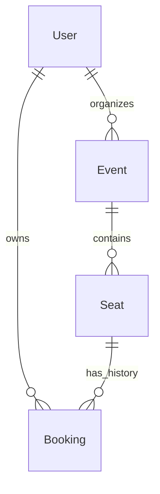
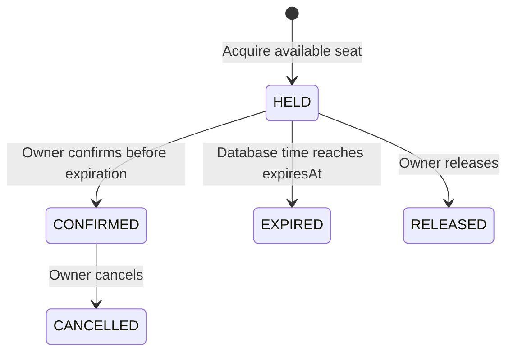
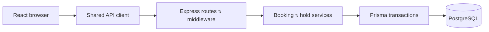
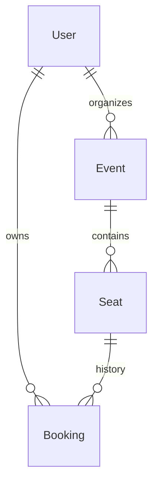

# Seatbook development conversation — filtered and redacted

This is a faithful rendering of the adjacent JSONL export, not a reconstructed conversation. Record text is preserved except for visibly marked redactions. Original message/tool strings are fenced literally; original JSON escape sequences inside those strings are not expanded. Record headings and navigation are export formatting. Internal instructions, reasoning, encrypted metadata, compaction summaries, and duplicate event notifications are excluded. See [the evidence index](../README.md) for provenance, counts, limits, and phase links.

**Cutoff:** 2026-10-24T20:07:12.764Z; source line 2790; 952 retained records.

## Record 000001

**Timestamp:** `2026-10-22T12:03:19.831Z` · **Source line:** 12 · **Type:** `message` · **Speaker/tool:** `user`

**id:** `msg_01a1637e-8a96-7da3-893f-211ea403e2a1`

````text
# Context from my IDE setup:

## Active file: client/src/App.tsx

## Open tabs:
- App.tsx: client/src/App.tsx

## My request:
# Seatbook — Senior Full-Stack Engineer Take-Home Assignment

You are acting as a **Senior Full-Stack Engineer and Technical Lead** responsible for taking an existing AI-generated application to production readiness.

I am working on the Seatbook take-home assignment.

## Project Context

Seatbook is an event seat-booking application built by a non-technical founder using AI. The application currently works, but it needs a thorough engineering review, production-readiness improvements, and a new seat-holding feature.

**Repository:** https://github.com/devmonks-co/seatbook

### Current Setup

- The repository has been created from the GitHub template and cloned locally.
- Docker Desktop is installed and running.
- The application has been successfully started using `docker compose up --build`.
- Dependencies have been installed locally using `npm install` in both `client/` and `server/`.
- The existing application is running locally.

Do not repeat the initial installation process unless necessary.

## Existing Functionality — Must Remain Working

1. Organizer and attendee registration and login.
2. Organizers can create events with seat grids and ticket prices.
3. Attendees can browse events and book available seats.
4. Attendees can view and cancel their bookings.

## New Feature — 10-Minute Seat Holds

Users must be able to hold an available seat for 10 minutes before confirming their booking.

Requirements:

- A user can place a temporary hold on an available seat.
- A held seat must be unavailable to other users.
- The hold expires after exactly 10 minutes according to server-side time.
- A user can confirm their own active hold into a permanent booking.
- Expired holds must not be confirmable.
- Expired seats must become available again.
- The frontend must display a countdown showing the remaining hold time.
- Concurrent requests must never result in two users successfully acquiring or booking the same seat.
- Hold ownership, authorization, and database consistency must be enforced.
- The system must behave correctly across page refreshes and server restarts.

## Production-Readiness Expectations

Audit the existing application for:

- Authentication and authorization vulnerabilities.
- Insecure API endpoints.
- Missing or insufficient input validation.
- Race conditions and database consistency issues.
- Missing database constraints and transactions.
- Incorrect HTTP status codes and error handling.
- Sensitive information exposure.
- Frontend loading, error, and empty states.
- Unnecessary complexity and maintainability problems.
- Docker configuration and clean-start reliability.
- Missing automated tests for critical functionality.

Do not add unrelated features such as payments, email, notifications, password reset, 2FA, or deployment infrastructure.

## Your First Task — Codebase Audit Only

**Do not modify any application code yet.**

First, thoroughly inspect the existing repository, including:

1. Project structure and architecture.
2. Backend routes, controllers, services, and middleware.
3. Authentication and authorization implementation.
4. Prisma schema, migrations, and database relationships.
5. Existing seat booking and cancellation logic.
6. Frontend pages, components, state management, and API communication.
7. Existing tests and test configuration.
8. Docker Compose, Dockerfiles, environment variables, and startup scripts.

Do not assume the implementation matches the README. Verify everything against the actual source code.

### Deliverable 1 — Architecture Overview

Explain:

- Current frontend architecture.
- Current backend architecture.
- Database schema and relationships.
- Authentication flow.
- Current seat-booking flow.
- Existing error-handling and testing approach.

### Deliverable 2 — Codebase Audit

Identify concrete issues and classify them as:

- **Critical:** Security vulnerabilities, double-booking risks, or data corruption.
- **High:** Reliability, authorization, or correctness issues.
- **Medium:** Maintainability, validation, and error-handling problems.
- **Low:** Minor improvements that are relevant to production readiness.

For every issue, provide:

- Exact file path and relevant function or line numbers.
- Explanation of the problem.
- Realistic failure or exploitation scenario.
- Recommended solution.
- Priority and whether it must be fixed for this assignment.

Avoid speculative findings. Clearly distinguish verified problems from potential risks.

### Deliverable 3 — Seat Hold Architecture

Propose a robust design for implementing 10-minute holds.

Cover:

- Database schema changes.
- Seat availability and booking state transitions.
- API endpoints and response contracts.
- Transaction boundaries.
- Concurrency control and race-condition prevention.
- Database constraints.
- Hold expiration and cleanup strategy.
- Hold confirmation and cancellation behavior.
- Server-authoritative expiration timestamps.
- Frontend countdown and state synchronization.
- Page refresh and server restart behavior.
- Edge cases and failure recovery.

Prefer PostgreSQL and Prisma using the existing architecture.

Avoid adding Redis, queues, cron jobs, or other infrastructure unless there is a compelling technical reason.

Compare reasonable alternatives briefly and recommend the simplest reliable approach.

### Deliverable 4 — Implementation Plan

Create a phased implementation plan:

**Phase 1:** Fix critical production-readiness issues.

**Phase 2:** Implement backend seat holds.

**Phase 3:** Implement frontend seat hold functionality.

**Phase 4:** Add automated tests, especially concurrency and expiration tests.

**Phase 5:** Verify Docker clean startup and existing functionality.

**Phase 6:** Prepare the README handover and submission requirements.

For each phase, specify:

- Files likely to change.
- Tasks to implement.
- Dependencies between tasks.
- Acceptance criteria.
- Testing strategy.
- Suggested Git commit boundaries.

Prioritize correctness and maintainability over unnecessary refactoring.

### Deliverable 5 — Testing Strategy

Recommend tests covering:

- Existing booking and cancellation behavior.
- Authentication and authorization.
- Hold creation and expiration.
- Hold ownership.
- Successful and rejected confirmations.
- Concurrent hold requests.
- Concurrent booking attempts.
- Database transaction failures.
- Frontend countdown behavior.
- Docker clean-start verification.

Use the existing testing tools wherever practical.

## Assignment Submission Requirements

The final repository must include:

1. Working application with all existing features preserved.
2. Production-readiness fixes.
3. Complete 10-minute seat hold functionality.
4. Meaningful automated tests.
5. A README handover explaining:
   - What changed and why.
   - What remains before launch.
   - The weakest part of the implementation.
   - One specific example where AI was wrong and how it was corrected.
   - How the implementation was verified.
6. An `ai-transcripts/` folder containing exported AI development conversations or screenshots.
7. Meaningful, incremental Git commits without squashing.

The application must work from a clean start using:

`docker compose up --build`

**Deadline:** 30 October 2026, end of day Bangladesh time.

## Engineering Rules

- Treat this as a real senior-level engineering assessment.
- Preserve the existing architecture where reasonable.
- Do not rewrite the application unnecessarily.
- Do not introduce unrelated features.
- Do not claim an issue is fixed without verifying it.
- Do not claim tests passed unless they were executed.
- Avoid overengineering.
- Explain architectural decisions and trade-offs.
- Favor secure, maintainable, testable code.
- Keep the final implementation understandable enough for a 10-minute code walkthrough without AI.
- Do not fabricate AI mistakes for the handover. Record an actual mistake if one occurs.
- Do not automatically commit, push, or modify files without my approval.

## Important Instruction

**For this first interaction, perform ONLY the codebase audit and implementation planning.**

Do not write code, modify files, install packages, change the database, or create commits yet.

After completing your analysis, provide a structured report with findings, proposed architecture, priorities, and implementation phases.

Then STOP and wait for my approval before starting Phase 1.
````

## Record 000002

**Timestamp:** `2026-10-22T12:03:23.468Z` · **Source line:** 15 · **Type:** `message` · **Speaker/tool:** `assistant`

**id:** `msg_0ea491693f0c5b7e016ad9fb8a5e008191968f2207a82e76f4`

````text
I’ll inspect the source and configuration without changing files or database state, then prepare the audit, seat-hold design, and phased plan. I’ll distinguish verified defects from risks that need runtime testing.
````

## Record 000003

**Timestamp:** `2026-10-22T12:03:26.261Z` · **Source line:** 16 · **Type:** `custom_tool_call` · **Speaker/tool:** `exec`

**id:** `ctc_0ea491693f0c5b7e016ad9fb8b54188191b5e15c6a66388048`

**call_id:** `call_7b54b8ce43cc4b4d82bf06fb5c3f3914`

**status:** `completed`

**input:**

````text
text(await tools.exec_command({cmd:"pwd","max_output_tokens":1000}));
text(await tools.exec_command({cmd:"rg --files -g 'AGENTS.md' -g '!node_modules' -g '!client/node_modules' -g '!server/node_modules' -g '!package-lock.json' -g '!**/.git/**' -g '!**/dist/**' -g '!**/build/**' -g '!**/.env' -g '!**/.env.*' -g '!**/coverage/**' -g '!**/generated/**'","max_output_tokens":10000}));
text(await tools.exec_command({cmd:"git status --short","max_output_tokens":2000}));
````

## Record 000004

**Timestamp:** `2026-10-22T12:03:26.875Z` · **Source line:** 18 · **Type:** `custom_tool_call_output` · **Speaker/tool:** `custom_tool_call_output`

**id:** `ctco_01a1637e-a61b-7323-82bc-ac690f67be4c`

**call_id:** `call_7b54b8ce43cc4b4d82bf06fb5c3f3914`

**output:**

````text
[
  {
    "type": "input_text",
    "text": "Script completed\nWall time 0.3 seconds\nOutput:\n"
  },
  {
    "type": "input_text",
    "text": "{\"chunk_id\":\"d10c74\",\"wall_time_seconds\":0.00001375,\"exit_code\":0,\"original_token_count\":8,\"output\":\"[REDACTED: home]/PET/seatbook\\n\"}"
  },
  {
    "type": "input_text",
    "text": "{\"chunk_id\":\"5552a0\",\"wall_time_seconds\":0.000010583,\"exit_code\":1,\"original_token_count\":0,\"output\":\"\"}"
  },
  {
    "type": "input_text",
    "text": "{\"chunk_id\":\"8c9803\",\"wall_time_seconds\":0.000014375,\"exit_code\":0,\"original_token_count\":13,\"output\":\" M docker-compose.yml\\n M server/package-lock.json\\n\"}"
  }
]
````

## Record 000005

**Timestamp:** `2026-10-22T12:03:34.360Z` · **Source line:** 21 · **Type:** `custom_tool_call` · **Speaker/tool:** `exec`

**id:** `ctc_0ea491693f0c5b7e016ad9fb91cf888191b39e397f078b99d3`

**call_id:** `call_41cfb7a3f28047e6a12e800a208a0a2b`

**status:** `completed`

**input:**

````text
const results = await Promise.allSettled([
tools.exec_command({cmd:"rg --files --hidden -g '!**/node_modules/**' -g '!**/.git/**' -g '!**/dist/**' -g '!**/build/**' -g '!**/coverage/**' -g '!**/generated/**' -g '!**/.env' -g '!**/.env.*' -g '!**/package-lock.json'","max_output_tokens":10000}),
tools.exec_command({cmd:"for p in /AGENTS.md [REDACTED: home] [REDACTED: home]/AGENTS.md [REDACTED: home]/PET/AGENTS.md [REDACTED: home]/PET/seatbook/AGENTS.md; do if [ -f \"$p\" ]; then printf '\\n%s\\n' \"$p\"; cat \"$p\"; fi; done","max_output_tokens":5000}),
tools.exec_command({cmd:"git diff -- docker-compose.yml server/package-lock.json","max_output_tokens":4000})
]); results.forEach((r,i)=>text({i,...r}));
````

## Record 000006

**Timestamp:** `2026-10-22T12:03:34.459Z` · **Source line:** 23 · **Type:** `custom_tool_call_output` · **Speaker/tool:** `custom_tool_call_output`

**id:** `ctco_01a1637e-c3bb-7940-85e7-b9414a187901`

**call_id:** `call_41cfb7a3f28047e6a12e800a208a0a2b`

**output:**

````text
[
  {
    "type": "input_text",
    "text": "Script completed\nWall time 0.1 seconds\nOutput:\n"
  },
  {
    "type": "input_text",
    "text": "{\"i\":0,\"status\":\"fulfilled\",\"value\":{\"chunk_id\":\"e6ef10\",\"wall_time_seconds\":0.0000085,\"exit_code\":0,\"original_token_count\":258,\"output\":\"client/src/pages/MyBookingsPage.tsx\\nclient/src/pages/EventsPage.tsx\\nclient/src/pages/CreateEventPage.tsx\\nclient/src/pages/EventDetailPage.tsx\\nclient/src/pages/LoginPage.tsx\\nclient/src/components/GradientButton.tsx\\nclient/src/components/Navbar.tsx\\nclient/src/index.css\\nclient/src/main.tsx\\nclient/src/App.tsx\\nclient/postcss.config.js\\nclient/vite.config.ts\\nclient/tsconfig.json\\nclient/package.json\\nclient/.gitignore\\nclient/.dockerignore\\nclient/Dockerfile\\nclient/tailwind.config.js\\nclient/index.html\\ndocker-compose.yml\\n.gitignore\\nREADME.md\\nserver/src/services/eventService.ts\\nserver/src/routes/auth.ts\\nserver/src/routes/events.ts\\nserver/src/routes/bookings.ts\\nserver/src/db.ts\\nserver/src/index.ts\\nserver/src/utils/helpers.ts\\nserver/src/middleware/auth.ts\\nserver/tsconfig.json\\nserver/package.json\\nserver/.gitignore\\nserver/.dockerignore\\nserver/prisma/seed.ts\\nserver/prisma/schema.prisma\\nserver/prisma/migrations/20261001000000_init/migration.sql\\nserver/prisma/migrations/migration_lock.toml\\nserver/Dockerfile\\nserver/test/helpers.test.ts\\n\"}}"
  },
  {
    "type": "input_text",
    "text": "{\"i\":1,\"status\":\"fulfilled\",\"value\":{\"chunk_id\":\"a410fa\",\"wall_time_seconds\":0.000007542,\"exit_code\":0,\"original_token_count\":0,\"output\":\"\"}}"
  },
  {
    "type": "input_text",
    "text": "{\"i\":2,\"status\":\"fulfilled\",\"value\":{\"chunk_id\":\"5900fd\",\"wall_time_seconds\":0.000009542,\"exit_code\":0,\"original_token_count\":215,\"output\":\"diff --git a/docker-compose.yml b/docker-compose.yml\\nindex b8ff55a..08d5851 100644\\n--- a/docker-compose.yml\\n+++ b/docker-compose.yml\\n@@ -6,7 +6,7 @@ services:\\n       POSTGRES_PASSWORD: [REDACTED: credential]\\n       POSTGRES_DB: seatbook\\n     ports:\\n-      - \\\"5433:5432\\\"\\n+      - \\\"5434:5432\\\"\\n     volumes:\\n       - db-data:/var/lib/postgresql/data\\n     healthcheck:\\ndiff --git a/server/package-lock.json b/server/package-lock.json\\nindex 35b6c0d..5baeee4 100644\\n--- a/server/package-lock.json\\n+++ b/server/package-lock.json\\n@@ -1873,7 +1873,6 @@\\n       \\\"version\\\": \\\"2.3.3\\\",\\n       \\\"resolved\\\": \\\"https://registry.npmjs.org/fsevents/-/fsevents-2.3.3.tgz\\\",\\n       \\\"integrity\\\": \\\"sha512-5xoDfX+fL7faATnagmWPpbFtwh/R77WmMMqqHGS65C3vvB0YHrgF+B1YmZ3441tMj5n63k0212XNoJwzlhffQw==\\\",\\n-      \\\"dev\\\": true,\\n       \\\"hasInstallScript\\\": true,\\n       \\\"license\\\": \\\"MIT\\\",\\n       \\\"optional\\\": true,\\n\"}}"
  }
]
````

## Record 000007

**Timestamp:** `2026-10-22T12:03:40.394Z` · **Source line:** 25 · **Type:** `custom_tool_call` · **Speaker/tool:** `exec`

**id:** `ctc_0ea491693f0c5b7e016ad9fb98a9a48191bc8754021a0064e8`

**call_id:** `call_499183d0895a4e4da1c6647055ff9af3`

**status:** `completed`

**input:**

````text
const groups=[
["server/src/index.ts","server/src/db.ts","server/src/middleware/auth.ts","server/src/routes/auth.ts"],
["server/src/routes/events.ts","server/src/routes/bookings.ts","server/src/services/eventService.ts","server/src/utils/helpers.ts"],
["server/prisma/schema.prisma","server/prisma/migrations/20261001000000_init/migration.sql","server/prisma/seed.ts","server/test/helpers.test.ts"],
["docker-compose.yml","server/Dockerfile","client/Dockerfile","server/package.json","client/package.json","README.md"]
];
const results=await Promise.allSettled(groups.map(paths=>tools.exec_command({cmd:paths.map(p=>`printf '\\nFILE: ${p}\\n'; nl -ba '${p}'`).join("\n"),max_output_tokens:12000}))); results.forEach((r,i)=>text({i,...r}));
````

## Record 000008

**Timestamp:** `2026-10-22T12:03:40.916Z` · **Source line:** 27 · **Type:** `custom_tool_call_output` · **Speaker/tool:** `custom_tool_call_output`

**id:** `ctco_01a1637e-dcf4-7253-9213-fe292c764f8c`

**call_id:** `call_499183d0895a4e4da1c6647055ff9af3`

**output:**

````text
[
  {
    "type": "input_text",
    "text": "Script completed\nWall time 0.1 seconds\nOutput:\n"
  },
  {
    "type": "input_text",
    "text": "{\"i\":0,\"status\":\"fulfilled\",\"value\":{\"chunk_id\":\"c87d73\",\"wall_time_seconds\":0.000008834,\"exit_code\":0,\"original_token_count\":999,\"output\":\"\\nFILE: server/src/index.ts\\n     1\\timport express from 'express';\\n     2\\timport cors from 'cors';\\n     3\\timport authRoutes from './routes/auth';\\n     4\\timport eventRoutes from './routes/events';\\n     5\\timport bookingRoutes from './routes/bookings';\\n     6\\t\\n     7\\tconst app = express();\\n     8\\t\\n     9\\tapp.use(cors());\\n    10\\tapp.use(express.json());\\n    11\\t\\n    12\\tapp.get('/health', (req, res) => {\\n    13\\t  res.json({ ok: true });\\n    14\\t});\\n    15\\t\\n    16\\tapp.use('/auth', authRoutes);\\n    17\\tapp.use('/events', eventRoutes);\\n    18\\tapp.use('/bookings', bookingRoutes);\\n    19\\t\\n    20\\tconst PORT = process.env.PORT || 4000;\\n    21\\t\\n    22\\tapp.listen(PORT, () => {\\n    23\\t  console.log(`Seatbook API running on http://localhost:${PORT}`);\\n    24\\t});\\n\\nFILE: server/src/db.ts\\n     1\\timport { PrismaClient } from '@prisma/client';\\n     2\\t\\n     3\\tconst prisma = new PrismaClient();\\n     4\\t\\n     5\\texport default prisma;\\n\\nFILE: server/src/middleware/auth.ts\\n     1\\timport { Request, Response, NextFunction } from 'express';\\n     2\\timport jwt from 'jsonwebtoken';\\n     3\\t\\n     4\\tconst JWT_SECRET = [REDACTED: credential] || '[REDACTED: credential]';\\n     5\\t\\n     6\\texport interface AuthUser {\\n     7\\t  id: number;\\n     8\\t  email: string;\\n     9\\t  role: 'ORGANIZER' | 'ATTENDEE';\\n    10\\t}\\n    11\\t\\n    12\\texport interface AuthRequest extends Request {\\n    13\\t  user?: AuthUser;\\n    14\\t}\\n    15\\t\\n    16\\texport function requireAuth(req: AuthRequest, res: Response, next: NextFunction) {\\n    17\\t  const header = req.headers.authorization;\\n    18\\t  if (!header) {\\n    19\\t    return res.status(401).json({ error: 'Not logged in' });\\n    20\\t  }\\n    21\\t\\n    22\\t  const token = header.replace('Bearer ', '');\\n    23\\t  try {\\n    24\\t    const payload = jwt.verify(token, JWT_SECRET) as AuthUser;\\n    25\\t    req.user = payload;\\n    26\\t    next();\\n    27\\t  } catch (err) {\\n    28\\t    return res.status(401).json({ message: 'Invalid token' });\\n    29\\t  }\\n    30\\t}\\n\\nFILE: server/src/routes/auth.ts\\n     1\\timport { Router } from 'express';\\n     2\\timport bcrypt from 'bcryptjs';\\n     3\\timport jwt from 'jsonwebtoken';\\n     4\\timport prisma from '../db';\\n     5\\t\\n     6\\tconst router = Router();\\n     7\\t\\n     8\\trouter.post('/register', async (req, res) => {\\n     9\\t  try {\\n    10\\t    const { email, password, name, role } = req.body;\\n    11\\t\\n    12\\t    if (!email || !password || !name) {\\n    13\\t      return res.status(400).json({ error: 'email, password and name are required' });\\n    14\\t    }\\n    15\\t\\n    16\\t    const passwordHash = await bcrypt.hash(password, 10);\\n    17\\t    const user = await prisma.user.create({\\n    18\\t      data: {\\n    19\\t        email,\\n    20\\t        name,\\n    21\\t        passwordHash,\\n    22\\t        role: role === 'ORGANIZER' ? 'ORGANIZER' : 'ATTENDEE',\\n    23\\t      },\\n    24\\t    });\\n    25\\t\\n    26\\t    const token = jwt.sign({ id: user.id, email: user.email, role: user.role }, '[REDACTED: credential]', {\\n    27\\t      expiresIn: '7d',\\n    28\\t    });\\n    29\\t\\n    30\\t    res.status(201).json({ token, user: { id: user.id, email: user.email, name: user.name, role: user.role } });\\n    31\\t  } catch (err: any) {\\n    32\\t    res.status(400).json({ error: err.message });\\n    33\\t  }\\n    34\\t});\\n    35\\t\\n    36\\trouter.post('/login', async (req, res) => {\\n    37\\t  const { email, password } = req.body;\\n    38\\t\\n    39\\t  const user = await prisma.user.findUnique({ where: { email } });\\n    40\\t  if (!user) {\\n    41\\t    return res.status(401).json({ message: 'Invalid credentials' });\\n    42\\t  }\\n    43\\t\\n    44\\t  const ok = await bcrypt.compare(password, user.passwordHash);\\n    45\\t  if (!ok) {\\n    46\\t    return res.status(401).json({ message: 'Invalid credentials' });\\n    47\\t  }\\n    48\\t\\n    49\\t  const token = jwt.sign({ id: user.id, email: user.email, role: user.role }, '[REDACTED: credential]', {\\n    50\\t    expiresIn: '7d',\\n    51\\t  });\\n    52\\t\\n    53\\t  res.json({ token, user: { id: user.id, email: user.email, name: user.name, role: user.role } });\\n    54\\t});\\n    55\\t\\n    56\\texport default router;\\n\"}}"
  },
  {
    "type": "input_text",
    "text": "{\"i\":1,\"status\":\"fulfilled\",\"value\":{\"chunk_id\":\"aa641b\",\"wall_time_seconds\":0.000009708,\"exit_code\":0,\"original_token_count\":1976,\"output\":\"\\nFILE: server/src/routes/events.ts\\n     1\\timport { Router } from 'express';\\n     2\\timport prisma from '../db';\\n     3\\timport { requireAuth, AuthRequest } from '../middleware/auth';\\n     4\\timport { getEventWithSeats, listEvents } from '../services/eventService';\\n     5\\timport { formatPrice, seatLabel } from '../utils/helpers';\\n     6\\t\\n     7\\tconst router = Router();\\n     8\\t\\n     9\\trouter.get('/', async (req, res) => {\\n    10\\t  const events = await listEvents();\\n    11\\t  res.json(events);\\n    12\\t});\\n    13\\t\\n    14\\trouter.get('/:id', async (req, res) => {\\n    15\\t  const event = await getEventWithSeats(req);\\n    16\\t\\n    17\\t  if (!event) {\\n    18\\t    return res.json({ success: false, message: 'Event not found' });\\n    19\\t  }\\n    20\\t\\n    21\\t  const seats = event.seats.map((seat) => ({\\n    22\\t    id: seat.id,\\n    23\\t    row: seat.row,\\n    24\\t    col: seat.col,\\n    25\\t    label: seat.label,\\n    26\\t    available: seat.bookings.length === 0,\\n    27\\t  }));\\n    28\\t\\n    29\\t  res.json({\\n    30\\t    id: event.id,\\n    31\\t    title: event.title,\\n    32\\t    description: event.description,\\n    33\\t    venue: event.venue,\\n    34\\t    startsAt: event.startsAt,\\n    35\\t    price: formatPrice(event.priceCents),\\n    36\\t    rows: event.rows,\\n    37\\t    cols: event.cols,\\n    38\\t    organizer: event.organizer,\\n    39\\t    seats,\\n    40\\t  });\\n    41\\t});\\n    42\\t\\n    43\\trouter.post('/', requireAuth, async (req: AuthRequest, res) => {\\n    44\\t  if (req.user!.role !== 'ORGANIZER') {\\n    45\\t    return res.status(403).json({ error: 'Only organizers can create events' });\\n    46\\t  }\\n    47\\t\\n    48\\t  try {\\n    49\\t    const { title, description, venue, startsAt, rows, cols, priceCents } = req.body;\\n    50\\t\\n    51\\t    if (!title || !venue || !startsAt || !rows || !cols) {\\n    52\\t      return res.status(400).json({ error: 'Missing required fields' });\\n    53\\t    }\\n    54\\t\\n    55\\t    if (rows > 26 || cols > 30) {\\n    56\\t      return res.status(400).json({ msg: 'Seat grid too large (max 26 rows x 30 cols)' });\\n    57\\t    }\\n    58\\t\\n    59\\t    const seats = [];\\n    60\\t    for (let r = 0; r < rows; r++) {\\n    61\\t      for (let c = 0; c < cols; c++) {\\n    62\\t        seats.push({ row: r, col: c, label: seatLabel(r, c) });\\n    63\\t      }\\n    64\\t    }\\n    65\\t\\n    66\\t    const event = await prisma.event.create({\\n    67\\t      data: {\\n    68\\t        title,\\n    69\\t        description: description || '',\\n    70\\t        venue,\\n    71\\t        startsAt: new Date(startsAt),\\n    72\\t        rows,\\n    73\\t        cols,\\n    74\\t        priceCents: priceCents || 0,\\n    75\\t        organizerId: req.user!.id,\\n    76\\t        seats: { create: seats },\\n    77\\t      },\\n    78\\t    });\\n    79\\t\\n    80\\t    res.status(201).json(event);\\n    81\\t  } catch (err) {\\n    82\\t    console.log(err);\\n    83\\t    res.status(500).send('Something went wrong');\\n    84\\t  }\\n    85\\t});\\n    86\\t\\n    87\\texport default router;\\n\\nFILE: server/src/routes/bookings.ts\\n     1\\timport { Router } from 'express';\\n     2\\timport prisma from '../db';\\n     3\\timport { requireAuth, AuthRequest } from '../middleware/auth';\\n     4\\timport { formatPrice } from '../utils/helpers';\\n     5\\t\\n     6\\tconst router = Router();\\n     7\\t\\n     8\\trouter.post('/', requireAuth, async (req: AuthRequest, res) => {\\n     9\\t  try {\\n    10\\t    const { seatId } = req.body;\\n    11\\t\\n    12\\t    const seat = await prisma.seat.findUnique({\\n    13\\t      where: { id: Number(seatId) },\\n    14\\t      include: { event: true },\\n    15\\t    });\\n    16\\t\\n    17\\t    if (!seat) {\\n    18\\t      return res.status(404).json({ error: 'Seat not found' });\\n    19\\t    }\\n    20\\t\\n    21\\t    if (seat.event.startsAt < new Date()) {\\n    22\\t      return res.status(400).json({ msg: 'This event has already started' });\\n    23\\t    }\\n    24\\t\\n    25\\t    const existing = await prisma.booking.findFirst({\\n    26\\t      where: { seatId: seat.id, status: 'CONFIRMED' },\\n    27\\t    });\\n    28\\t\\n    29\\t    if (existing) {\\n    30\\t      return res.status(409).json({ error: 'Seat already booked' });\\n    31\\t    }\\n    32\\t\\n    33\\t    const booking = await prisma.booking.create({\\n    34\\t      data: {\\n    35\\t        seatId: seat.id,\\n    36\\t        userId: req.user!.id,\\n    37\\t        status: 'CONFIRMED',\\n    38\\t      },\\n    39\\t    });\\n    40\\t\\n    41\\t    res.status(201).json(booking);\\n    42\\t  } catch (err: any) {\\n    43\\t    res.status(500).json({ error: err.message });\\n    44\\t  }\\n    45\\t});\\n    46\\t\\n    47\\trouter.get('/mine', requireAuth, async (req: AuthRequest, res) => {\\n    48\\t  try {\\n    49\\t    const bookings = await prisma.booking.findMany({\\n    50\\t      where: { userId: req.user!.id },\\n    51\\t      orderBy: { createdAt: 'desc' },\\n    52\\t      include: { seat: { include: { event: true } } },\\n    53\\t    });\\n    54\\t\\n    55\\t    res.json(\\n    56\\t      bookings.map((b) => ({\\n    57\\t        id: b.id,\\n    58\\t        status: b.status,\\n    59\\t        createdAt: b.createdAt,\\n    60\\t        seat: b.seat.label,\\n    61\\t        event: {\\n    62\\t          id: b.seat.event.id,\\n    63\\t          title: b.seat.event.title,\\n    64\\t          venue: b.seat.event.venue,\\n    65\\t          startsAt: b.seat.event.startsAt,\\n    66\\t          price: formatPrice(b.seat.event.priceCents),\\n    67\\t        },\\n    68\\t      }))\\n    69\\t    );\\n    70\\t  } catch (err) {\\n    71\\t    console.log(err);\\n    72\\t    res.json([]);\\n    73\\t  }\\n    74\\t});\\n    75\\t\\n    76\\trouter.post('/:id/cancel', requireAuth, async (req: AuthRequest, res) => {\\n    77\\t  const id = parseInt(req.params.id);\\n    78\\t\\n    79\\t  await prisma.booking.updateMany({\\n    80\\t    where: { id, status: 'CONFIRMED' },\\n    81\\t    data: { status: 'CANCELLED', cancelledAt: new Date() },\\n    82\\t  });\\n    83\\t\\n    84\\t  res.json({ success: true });\\n    85\\t});\\n    86\\t\\n    87\\texport default router;\\n\\nFILE: server/src/services/eventService.ts\\n     1\\timport { Request } from 'express';\\n     2\\timport prisma from '../db';\\n     3\\timport { formatPrice, isSeatBookable } from '../utils/helpers';\\n     4\\t\\n     5\\texport async function listEvents() {\\n     6\\t  const events = await prisma.event.findMany({\\n     7\\t    orderBy: { startsAt: 'asc' },\\n     8\\t    include: { seats: { include: { bookings: true } } },\\n     9\\t  });\\n    10\\t\\n    11\\t  return events.map((event) => {\\n    12\\t    const seatsLeft = event.seats.filter((seat) => isSeatBookable(seat, event)).length;\\n    13\\t    return {\\n    14\\t      id: event.id,\\n    15\\t      title: event.title,\\n    16\\t      venue: event.venue,\\n    17\\t      startsAt: event.startsAt,\\n    18\\t      price: formatPrice(event.priceCents),\\n    19\\t      totalSeats: event.seats.length,\\n    20\\t      seatsLeft,\\n    21\\t    };\\n    22\\t  });\\n    23\\t}\\n    24\\t\\n    25\\texport async function getEventWithSeats(req: Request) {\\n    26\\t  const id = parseInt(req.params.id);\\n    27\\t\\n    28\\t  return prisma.event.findUnique({\\n    29\\t    where: { id },\\n    30\\t    include: {\\n    31\\t      organizer: { select: { id: true, name: true } },\\n    32\\t      seats: {\\n    33\\t        orderBy: [{ row: 'asc' }, { col: 'asc' }],\\n    34\\t        include: { bookings: { where: { status: 'CONFIRMED' } } },\\n    35\\t      },\\n    36\\t    },\\n    37\\t  });\\n    38\\t}\\n\\nFILE: server/src/utils/helpers.ts\\n     1\\timport { Booking, Event, Seat } from '@prisma/client';\\n     2\\t\\n     3\\texport function formatPrice(cents: number): string {\\n     4\\t  return `$${(cents / 100).toFixed(2)}`;\\n     5\\t}\\n     6\\t\\n     7\\texport function seatLabel(row: number, col: number): string {\\n     8\\t  return `${String.fromCharCode(65 + row)}${col + 1}`;\\n     9\\t}\\n    10\\t\\n    11\\texport function isSeatBookable(seat: Seat & { bookings: Booking[] }, event: Event): boolean {\\n    12\\t  if (new Date(event.startsAt) < new Date()) {\\n    13\\t    return false;\\n    14\\t  }\\n    15\\t  return seat.bookings.length === 0;\\n    16\\t}\\n    17\\t\\n    18\\texport function slugify(text: string): string {\\n    19\\t  return text\\n    20\\t    .toLowerCase()\\n    21\\t    .trim()\\n    22\\t    .replace(/[^a-z0-9]+/g, '-')\\n    23\\t    .replace(/^-+|-+$/g, '');\\n    24\\t}\\n\"}}"
  },
  {
    "type": "input_text",
    "text": "{\"i\":2,\"status\":\"fulfilled\",\"value\":{\"chunk_id\":\"c96b4d\",\"wall_time_seconds\":0.000005834,\"exit_code\":0,\"original_token_count\":2341,\"output\":\"\\nFILE: server/prisma/schema.prisma\\n     1\\tgenerator client {\\n     2\\t  provider      = \\\"prisma-client-js\\\"\\n     3\\t  binaryTargets = [\\\"native\\\", \\\"linux-musl-openssl-3.0.x\\\", \\\"linux-musl-arm64-openssl-3.0.x\\\"]\\n     4\\t}\\n     5\\t\\n     6\\tdatasource db {\\n     7\\t  provider = \\\"postgresql\\\"\\n     8\\t  url      = env(\\\"DATABASE_URL\\\")\\n     9\\t}\\n    10\\t\\n    11\\tenum Role {\\n    12\\t  ORGANIZER\\n    13\\t  ATTENDEE\\n    14\\t}\\n    15\\t\\n    16\\tenum BookingStatus {\\n    17\\t  CONFIRMED\\n    18\\t  CANCELLED\\n    19\\t}\\n    20\\t\\n    21\\tmodel User {\\n    22\\t  id           Int       @id @default(autoincrement())\\n    23\\t  email        String    @unique\\n    24\\t  name         String\\n    25\\t  passwordHash String\\n    26\\t  role         Role      @default(ATTENDEE)\\n    27\\t  events       Event[]\\n    28\\t  bookings     Booking[]\\n    29\\t  createdAt    DateTime  @default(now())\\n    30\\t}\\n    31\\t\\n    32\\tmodel Event {\\n    33\\t  id          Int      @id @default(autoincrement())\\n    34\\t  title       String\\n    35\\t  description String\\n    36\\t  venue       String\\n    37\\t  startsAt    DateTime\\n    38\\t  rows        Int\\n    39\\t  cols        Int\\n    40\\t  priceCents  Int\\n    41\\t  organizerId Int\\n    42\\t  organizer   User     @relation(fields: [organizerId], references: [id])\\n    43\\t  seats       Seat[]\\n    44\\t  createdAt   DateTime @default(now())\\n    45\\t}\\n    46\\t\\n    47\\tmodel Seat {\\n    48\\t  id       Int       @id @default(autoincrement())\\n    49\\t  eventId  Int\\n    50\\t  event    Event     @relation(fields: [eventId], references: [id], onDelete: Cascade)\\n    51\\t  row      Int\\n    52\\t  col      Int\\n    53\\t  label    String\\n    54\\t  bookings Booking[]\\n    55\\t\\n    56\\t  @@unique([eventId, row, col])\\n    57\\t}\\n    58\\t\\n    59\\tmodel Booking {\\n    60\\t  id          Int           @id @default(autoincrement())\\n    61\\t  seatId      Int\\n    62\\t  seat        Seat          @relation(fields: [seatId], references: [id])\\n    63\\t  userId      Int\\n    64\\t  user        User          @relation(fields: [userId], references: [id])\\n    65\\t  status      BookingStatus @default(CONFIRMED)\\n    66\\t  createdAt   DateTime      @default(now())\\n    67\\t  cancelledAt DateTime?\\n    68\\t}\\n\\nFILE: server/prisma/migrations/20261001000000_init/migration.sql\\n     1\\t-- CreateEnum\\n     2\\tCREATE TYPE \\\"Role\\\" AS ENUM ('ORGANIZER', 'ATTENDEE');\\n     3\\t\\n     4\\t-- CreateEnum\\n     5\\tCREATE TYPE \\\"BookingStatus\\\" AS ENUM ('CONFIRMED', 'CANCELLED');\\n     6\\t\\n     7\\t-- CreateTable\\n     8\\tCREATE TABLE \\\"User\\\" (\\n     9\\t    \\\"id\\\" SERIAL NOT NULL,\\n    10\\t    \\\"email\\\" TEXT NOT NULL,\\n    11\\t    \\\"name\\\" TEXT NOT NULL,\\n    12\\t    \\\"passwordHash\\\" TEXT NOT NULL,\\n    13\\t    \\\"role\\\" \\\"Role\\\" NOT NULL DEFAULT 'ATTENDEE',\\n    14\\t    \\\"createdAt\\\" TIMESTAMP(3) NOT NULL DEFAULT CURRENT_TIMESTAMP,\\n    15\\t\\n    16\\t    CONSTRAINT \\\"User_pkey\\\" PRIMARY KEY (\\\"id\\\")\\n    17\\t);\\n    18\\t\\n    19\\t-- CreateTable\\n    20\\tCREATE TABLE \\\"Event\\\" (\\n    21\\t    \\\"id\\\" SERIAL NOT NULL,\\n    22\\t    \\\"title\\\" TEXT NOT NULL,\\n    23\\t    \\\"description\\\" TEXT NOT NULL,\\n    24\\t    \\\"venue\\\" TEXT NOT NULL,\\n    25\\t    \\\"startsAt\\\" TIMESTAMP(3) NOT NULL,\\n    26\\t    \\\"rows\\\" INTEGER NOT NULL,\\n    27\\t    \\\"cols\\\" INTEGER NOT NULL,\\n    28\\t    \\\"priceCents\\\" INTEGER NOT NULL,\\n    29\\t    \\\"organizerId\\\" INTEGER NOT NULL,\\n    30\\t    \\\"createdAt\\\" TIMESTAMP(3) NOT NULL DEFAULT CURRENT_TIMESTAMP,\\n    31\\t\\n    32\\t    CONSTRAINT \\\"Event_pkey\\\" PRIMARY KEY (\\\"id\\\")\\n    33\\t);\\n    34\\t\\n    35\\t-- CreateTable\\n    36\\tCREATE TABLE \\\"Seat\\\" (\\n    37\\t    \\\"id\\\" SERIAL NOT NULL,\\n    38\\t    \\\"eventId\\\" INTEGER NOT NULL,\\n    39\\t    \\\"row\\\" INTEGER NOT NULL,\\n    40\\t    \\\"col\\\" INTEGER NOT NULL,\\n    41\\t    \\\"label\\\" TEXT NOT NULL,\\n    42\\t\\n    43\\t    CONSTRAINT \\\"Seat_pkey\\\" PRIMARY KEY (\\\"id\\\")\\n    44\\t);\\n    45\\t\\n    46\\t-- CreateTable\\n    47\\tCREATE TABLE \\\"Booking\\\" (\\n    48\\t    \\\"id\\\" SERIAL NOT NULL,\\n    49\\t    \\\"seatId\\\" INTEGER NOT NULL,\\n    50\\t    \\\"userId\\\" INTEGER NOT NULL,\\n    51\\t    \\\"status\\\" \\\"BookingStatus\\\" NOT NULL DEFAULT 'CONFIRMED',\\n    52\\t    \\\"createdAt\\\" TIMESTAMP(3) NOT NULL DEFAULT CURRENT_TIMESTAMP,\\n    53\\t    \\\"cancelledAt\\\" TIMESTAMP(3),\\n    54\\t\\n    55\\t    CONSTRAINT \\\"Booking_pkey\\\" PRIMARY KEY (\\\"id\\\")\\n    56\\t);\\n    57\\t\\n    58\\t-- CreateIndex\\n    59\\tCREATE UNIQUE INDEX \\\"User_email_key\\\" ON \\\"User\\\"(\\\"email\\\");\\n    60\\t\\n    61\\t-- CreateIndex\\n    62\\tCREATE UNIQUE INDEX \\\"Seat_eventId_row_col_key\\\" ON \\\"Seat\\\"(\\\"eventId\\\", \\\"row\\\", \\\"col\\\");\\n    63\\t\\n    64\\t-- AddForeignKey\\n    65\\tALTER TABLE \\\"Event\\\" ADD CONSTRAINT \\\"Event_organizerId_fkey\\\" FOREIGN KEY (\\\"organizerId\\\") REFERENCES \\\"User\\\"(\\\"id\\\") ON DELETE RESTRICT ON UPDATE CASCADE;\\n    66\\t\\n    67\\t-- AddForeignKey\\n    68\\tALTER TABLE \\\"Seat\\\" ADD CONSTRAINT \\\"Seat_eventId_fkey\\\" FOREIGN KEY (\\\"eventId\\\") REFERENCES \\\"Event\\\"(\\\"id\\\") ON DELETE CASCADE ON UPDATE CASCADE;\\n    69\\t\\n    70\\t-- AddForeignKey\\n    71\\tALTER TABLE \\\"Booking\\\" ADD CONSTRAINT \\\"Booking_seatId_fkey\\\" FOREIGN KEY (\\\"seatId\\\") REFERENCES \\\"Seat\\\"(\\\"id\\\") ON DELETE RESTRICT ON UPDATE CASCADE;\\n    72\\t\\n    73\\t-- AddForeignKey\\n    74\\tALTER TABLE \\\"Booking\\\" ADD CONSTRAINT \\\"Booking_userId_fkey\\\" FOREIGN KEY (\\\"userId\\\") REFERENCES \\\"User\\\"(\\\"id\\\") ON DELETE RESTRICT ON UPDATE CASCADE;\\n    75\\t\\n\\nFILE: server/prisma/seed.ts\\n     1\\timport { PrismaClient } from '@prisma/client';\\n     2\\timport bcrypt from 'bcryptjs';\\n     3\\timport { seatLabel } from '../src/utils/helpers';\\n     4\\t\\n     5\\tconst prisma = new PrismaClient();\\n     6\\t\\n     7\\tfunction buildSeats(rows: number, cols: number) {\\n     8\\t  const seats = [];\\n     9\\t  for (let r = 0; r < rows; r++) {\\n    10\\t    for (let c = 0; c < cols; c++) {\\n    11\\t      seats.push({ row: r, col: c, label: seatLabel(r, c) });\\n    12\\t    }\\n    13\\t  }\\n    14\\t  return seats;\\n    15\\t}\\n    16\\t\\n    17\\tfunction daysFromNow(days: number) {\\n    18\\t  const d = new Date();\\n    19\\t  d.setDate(d.getDate() + days);\\n    20\\t  d.setHours(18, 30, 0, 0);\\n    21\\t  return d;\\n    22\\t}\\n    23\\t\\n    24\\tasync function main() {\\n    25\\t  const existing = await prisma.user.count();\\n    26\\t  if (existing > 0) {\\n    27\\t    console.log('Database already seeded, skipping');\\n    28\\t    return;\\n    29\\t  }\\n    30\\t\\n    31\\t  const passwordHash = await bcrypt.hash('[REDACTED: credential]', 10);\\n    32\\t\\n    33\\t  const organizer = await prisma.user.create({\\n    34\\t    data: { email: '[REDACTED: email]', name: 'Karim Rahman', passwordHash, role: 'ORGANIZER' },\\n    35\\t  });\\n    36\\t  const alice = await prisma.user.create({\\n    37\\t    data: { email: '[REDACTED: email]', name: 'Alice Karim', passwordHash },\\n    38\\t  });\\n    39\\t  const bob = await prisma.user.create({\\n    40\\t    data: { email: '[REDACTED: email]', name: 'Bob Hossain', passwordHash },\\n    41\\t  });\\n    42\\t\\n    43\\t  const talk = await prisma.event.create({\\n    44\\t    data: {\\n    45\\t      title: 'Postgres in Practice',\\n    46\\t      description: 'An evening talk on indexes, query plans and the mistakes we keep making.',\\n    47\\t      venue: 'Banani Hall, Room 2',\\n    48\\t      startsAt: daysFromNow(7),\\n    49\\t      rows: 5,\\n    50\\t      cols: 8,\\n    51\\t      priceCents: 1500,\\n    52\\t      organizerId: organizer.id,\\n    53\\t      seats: { create: buildSeats(5, 8) },\\n    54\\t    },\\n    55\\t    include: { seats: true },\\n    56\\t  });\\n    57\\t\\n    58\\t  await prisma.event.create({\\n    59\\t    data: {\\n    60\\t      title: 'Design Systems Workshop',\\n    61\\t      description: 'Hands-on workshop. Bring a laptop.',\\n    62\\t      venue: 'Gulshan Studio',\\n    63\\t      startsAt: daysFromNow(14),\\n    64\\t      rows: 4,\\n    65\\t      cols: 6,\\n    66\\t      priceCents: 4000,\\n    67\\t      organizerId: organizer.id,\\n    68\\t      seats: { create: buildSeats(4, 6) },\\n    69\\t    },\\n    70\\t  });\\n    71\\t\\n    72\\t  const past = await prisma.event.create({\\n    73\\t    data: {\\n    74\\t      title: 'Intro to TypeScript',\\n    75\\t      description: 'Already happened. Kept for history.',\\n    76\\t      venue: 'Banani Hall, Room 1',\\n    77\\t      startsAt: daysFromNow(-10),\\n    78\\t      rows: 3,\\n    79\\t      cols: 5,\\n    80\\t      priceCents: 0,\\n    81\\t      organizerId: organizer.id,\\n    82\\t      seats: { create: buildSeats(3, 5) },\\n    83\\t    },\\n    84\\t    include: { seats: true },\\n    85\\t  });\\n    86\\t\\n    87\\t  await prisma.booking.create({ data: { seatId: talk.seats[0].id, userId: alice.id } });\\n    88\\t  await prisma.booking.create({ data: { seatId: talk.seats[1].id, userId: bob.id } });\\n    89\\t  await prisma.booking.create({\\n    90\\t    data: { seatId: talk.seats[2].id, userId: bob.id, status: 'CANCELLED', cancelledAt: new Date() },\\n    91\\t  });\\n    92\\t  await prisma.booking.create({ data: { seatId: past.seats[3].id, userId: alice.id } });\\n    93\\t\\n    94\\t  console.log('Seeded users, events and bookings');\\n    95\\t}\\n    96\\t\\n    97\\tmain()\\n    98\\t  .catch((err) => {\\n    99\\t    console.error(err);\\n   100\\t    process.exit(1);\\n   101\\t  })\\n   102\\t  .finally(() => prisma.$disconnect());\\n\\nFILE: server/test/helpers.test.ts\\n     1\\timport { describe, it, expect } from 'vitest';\\n     2\\timport { formatPrice, seatLabel, slugify } from '../src/utils/helpers';\\n     3\\t\\n     4\\tdescribe('helpers', () => {\\n     5\\t  it('formats cents as dollars', () => {\\n     6\\t    expect(formatPrice(1500)).toBe('$15.00');\\n     7\\t    expect(formatPrice(0)).toBe('$0.00');\\n     8\\t  });\\n     9\\t\\n    10\\t  it('labels seats by row letter and column number', () => {\\n    11\\t    expect(seatLabel(0, 0)).toBe('A1');\\n    12\\t    expect(seatLabel(2, 4)).toBe('C5');\\n    13\\t  });\\n    14\\t\\n    15\\t  it('slugifies titles', () => {\\n    16\\t    expect(slugify('  Postgres in Practice! ')).toBe('postgres-in-practice');\\n    17\\t  });\\n    18\\t});\\n\"}}"
  },
  {
    "type": "input_text",
    "text": "{\"i\":3,\"status\":\"fulfilled\",\"value\":{\"chunk_id\":\"453983\",\"wall_time_seconds\":0.000008333,\"exit_code\":0,\"original_token_count\":1523,\"output\":\"\\nFILE: docker-compose.yml\\n     1\\tservices:\\n     2\\t  db:\\n     3\\t    image: postgres:16-alpine\\n     4\\t    environment:\\n     5\\t      POSTGRES_USER: seatbook\\n     6\\t      POSTGRES_PASSWORD: [REDACTED: credential]\\n     7\\t      POSTGRES_DB: seatbook\\n     8\\t    ports:\\n     9\\t      - \\\"5434:5432\\\"\\n    10\\t    volumes:\\n    11\\t      - db-data:/var/lib/postgresql/data\\n    12\\t    healthcheck:\\n    13\\t      test: [\\\"CMD-SHELL\\\", \\\"pg_isready -U seatbook\\\"]\\n    14\\t      interval: 2s\\n    15\\t      timeout: 3s\\n    16\\t      retries: 20\\n    17\\t\\n    18\\t  server:\\n    19\\t    build: ./server\\n    20\\t    environment:\\n    21\\t      DATABASE_URL: postgresql://[REDACTED: database-credentials]@db:5432/seatbook\\n    22\\t      PORT: 4000\\n    23\\t    ports:\\n    24\\t      - \\\"4000:4000\\\"\\n    25\\t    depends_on:\\n    26\\t      db:\\n    27\\t        condition: service_healthy\\n    28\\t    volumes:\\n    29\\t      - ./server/src:/app/src\\n    30\\t      - ./server/prisma:/app/prisma\\n    31\\t\\n    32\\t  client:\\n    33\\t    build: ./client\\n    34\\t    environment:\\n    35\\t      VITE_API_URL: http://localhost:4000\\n    36\\t    ports:\\n    37\\t      - \\\"5173:5173\\\"\\n    38\\t    depends_on:\\n    39\\t      - server\\n    40\\t    volumes:\\n    41\\t      - ./client/src:/app/src\\n    42\\t\\n    43\\tvolumes:\\n    44\\t  db-data:\\n\\nFILE: server/Dockerfile\\n     1\\tFROM node:20-alpine\\n     2\\tRUN apk add --no-cache openssl\\n     3\\tWORKDIR /app\\n     4\\tCOPY package*.json ./\\n     5\\tRUN npm ci\\n     6\\tCOPY . .\\n     7\\tRUN npx prisma generate\\n     8\\tEXPOSE 4000\\n     9\\tCMD [\\\"sh\\\", \\\"-c\\\", \\\"npx prisma generate && npx prisma migrate deploy && npm run db:seed && npm run dev\\\"]\\n\\nFILE: client/Dockerfile\\n     1\\tFROM node:20-alpine\\n     2\\tWORKDIR /app\\n     3\\tCOPY package*.json ./\\n     4\\tRUN npm ci\\n     5\\tCOPY . .\\n     6\\tEXPOSE 5173\\n     7\\tCMD [\\\"npm\\\", \\\"run\\\", \\\"dev\\\"]\\n\\nFILE: server/package.json\\n     1\\t{\\n     2\\t  \\\"name\\\": \\\"seatbook-server\\\",\\n     3\\t  \\\"version\\\": \\\"0.1.0\\\",\\n     4\\t  \\\"private\\\": true,\\n     5\\t  \\\"scripts\\\": {\\n     6\\t    \\\"dev\\\": \\\"tsx watch src/index.ts\\\",\\n     7\\t    \\\"start\\\": \\\"tsx src/index.ts\\\",\\n     8\\t    \\\"typecheck\\\": \\\"tsc --noEmit\\\",\\n     9\\t    \\\"test\\\": \\\"vitest run\\\",\\n    10\\t    \\\"db:migrate\\\": \\\"prisma migrate deploy\\\",\\n    11\\t    \\\"db:seed\\\": \\\"tsx prisma/seed.ts\\\"\\n    12\\t  },\\n    13\\t  \\\"dependencies\\\": {\\n    14\\t    \\\"@prisma/client\\\": \\\"^5.22.0\\\",\\n    15\\t    \\\"bcryptjs\\\": \\\"^3.0.3\\\",\\n    16\\t    \\\"cors\\\": \\\"^2.8.6\\\",\\n    17\\t    \\\"express\\\": \\\"^4.22.3\\\",\\n    18\\t    \\\"jsonwebtoken\\\": \\\"^9.0.3\\\"\\n    19\\t  },\\n    20\\t  \\\"devDependencies\\\": {\\n    21\\t    \\\"@types/bcryptjs\\\": \\\"^2.4.6\\\",\\n    22\\t    \\\"@types/cors\\\": \\\"^2.8.19\\\",\\n    23\\t    \\\"@types/express\\\": \\\"^4.17.25\\\",\\n    24\\t    \\\"@types/jsonwebtoken\\\": \\\"^9.0.10\\\",\\n    25\\t    \\\"@types/node\\\": \\\"^26.6.5\\\",\\n    26\\t    \\\"prisma\\\": \\\"^5.22.0\\\",\\n    27\\t    \\\"tsx\\\": \\\"^4.23.15\\\",\\n    28\\t    \\\"typescript\\\": \\\"^7.0.2\\\",\\n    29\\t    \\\"vitest\\\": \\\"^5.0.5\\\"\\n    30\\t  }\\n    31\\t}\\n\\nFILE: client/package.json\\n     1\\t{\\n     2\\t  \\\"name\\\": \\\"seatbook-client\\\",\\n     3\\t  \\\"version\\\": \\\"0.1.0\\\",\\n     4\\t  \\\"private\\\": true,\\n     5\\t  \\\"type\\\": \\\"module\\\",\\n     6\\t  \\\"scripts\\\": {\\n     7\\t    \\\"dev\\\": \\\"vite --host 0.0.0.0\\\",\\n     8\\t    \\\"build\\\": \\\"tsc --noEmit && vite build\\\",\\n     9\\t    \\\"typecheck\\\": \\\"tsc --noEmit\\\",\\n    10\\t    \\\"preview\\\": \\\"vite preview\\\"\\n    11\\t  },\\n    12\\t  \\\"dependencies\\\": {\\n    13\\t    \\\"react\\\": \\\"^18.3.1\\\",\\n    14\\t    \\\"react-dom\\\": \\\"^18.3.1\\\",\\n    15\\t    \\\"react-router-dom\\\": \\\"^6.30.6\\\"\\n    16\\t  },\\n    17\\t  \\\"devDependencies\\\": {\\n    18\\t    \\\"@types/react\\\": \\\"^18.3.31\\\",\\n    19\\t    \\\"@types/react-dom\\\": \\\"^18.3.7\\\",\\n    20\\t    \\\"@vitejs/plugin-react\\\": \\\"^4.7.0\\\",\\n    21\\t    \\\"autoprefixer\\\": \\\"^10.6.1\\\",\\n    22\\t    \\\"postcss\\\": \\\"^8.5.31\\\",\\n    23\\t    \\\"tailwindcss\\\": \\\"^3.4.19\\\",\\n    24\\t    \\\"typescript\\\": \\\"^7.0.2\\\",\\n    25\\t    \\\"vite\\\": \\\"^5.4.21\\\"\\n    26\\t  }\\n    27\\t}\\n\\nFILE: README.md\\n     1\\t# Seatbook\\n     2\\t\\n     3\\tSeat booking for small venues. Organizers publish an event with a seat grid, attendees pick a seat and book it.\\n     4\\t\\n     5\\t## Stack\\n     6\\t\\n     7\\t- **server/**: Node, Express, TypeScript, Prisma, Postgres\\n     8\\t- **client/**: React, Vite, TypeScript, Tailwind\\n     9\\t\\n    10\\t## Run it\\n    11\\t\\n    12\\t```bash\\n    13\\tdocker compose up --build\\n    14\\t```\\n    15\\t\\n    16\\t- App: http://localhost:5173\\n    17\\t- API: http://localhost:4000\\n    18\\t- Postgres: `localhost:5433` (user / password / db: `seatbook`)\\n    19\\t\\n    20\\tThe database is migrated and seeded on first start. To start from a clean database: `docker compose down -v`.\\n    21\\t\\n    22\\t**After changing `schema.prisma`:** create the migration from your machine (`cd server && npx prisma migrate dev`, with `DATABASE_URL` pointing at `localhost:5433`), then `docker compose restart server`. The server regenerates the Prisma client and applies migrations on start.\\n    23\\t\\n    24\\t### Seeded accounts\\n    25\\t\\n    26\\tAll passwords are `[REDACTED: credential]`.\\n    27\\t\\n    28\\t| Email | Role |\\n    29\\t|---|---|\\n    30\\t| [REDACTED: email] | Organizer |\\n    31\\t| [REDACTED: email] | Attendee |\\n    32\\t| [REDACTED: email] | Attendee |\\n    33\\t\\n    34\\t### Without Docker\\n    35\\t\\n    36\\t```bash\\n    37\\tcd server && cp .env.example .env && npm install && npm run db:migrate && npm run db:seed && npm run dev\\n    38\\tcd client && npm install && npm run dev\\n    39\\t```\\n    40\\t\\n    41\\tYou need a Postgres running at the `DATABASE_URL` in `server/.env`.\\n    42\\t\\n    43\\t## Scripts\\n    44\\t\\n    45\\t| | server | client |\\n    46\\t|---|---|---|\\n    47\\t| `npm run dev` | API with reload | Vite dev server |\\n    48\\t| `npm run typecheck` | `tsc --noEmit` | `tsc --noEmit` |\\n    49\\t| `npm test` | Vitest | none yet |\\n    50\\t\\n    51\\t## API\\n    52\\t\\n    53\\t| Method | Path | Auth | What it does |\\n    54\\t|---|---|---|---|\\n    55\\t| POST | `/auth/register` | none | Create an account, returns a token |\\n    56\\t| POST | `/auth/login` | none | Log in, returns a token |\\n    57\\t| GET | `/events` | none | List events with seats left |\\n    58\\t| GET | `/events/:id` | none | One event with its seat map |\\n    59\\t| POST | `/events` | organizer | Create an event and its seats |\\n    60\\t| POST | `/bookings` | attendee | Book a seat |\\n    61\\t| GET | `/bookings/mine` | attendee | Your bookings |\\n    62\\t| POST | `/bookings/:id/cancel` | attendee | Cancel a booking |\\n    63\\t\\n    64\\tSend the token as `Authorization: Bearer <token>`.\\n\"}}"
  }
]
````

## Record 000009

**Timestamp:** `2026-10-22T12:03:51.216Z` · **Source line:** 30 · **Type:** `custom_tool_call` · **Speaker/tool:** `exec`

**id:** `ctc_0ea491693f0c5b7e016ad9fba1a1fc8191a06c599981572d92`

**call_id:** `call_0ff8b448170340b7b27eb3a5896314ba`

**status:** `completed`

**input:**

````text
const groups=[
["client/src/App.tsx","client/src/main.tsx","client/src/pages/LoginPage.tsx","client/src/components/Navbar.tsx"],
["client/src/pages/EventsPage.tsx","client/src/pages/EventDetailPage.tsx"],
["client/src/pages/MyBookingsPage.tsx","client/src/pages/CreateEventPage.tsx","client/src/components/GradientButton.tsx"],
["client/src/index.css","client/vite.config.ts","client/tsconfig.json","server/tsconfig.json","client/tailwind.config.js","client/postcss.config.js","client/index.html","client/.dockerignore","server/.dockerignore",".gitignore","client/.gitignore","server/.gitignore","server/prisma/migrations/migration_lock.toml"]
];
const results=await Promise.allSettled(groups.map(paths=>tools.exec_command({cmd:"python3 -c "+ "'"+ "from pathlib import Path\npaths = "+JSON.stringify(paths)+"\nfor name in paths:\n print(\"\\nFILE: \" + name)\n for n, line in enumerate(Path(name).read_text().splitlines(), 1):\n  print(f\"{n:4} {line}\")" +"'",max_output_tokens:15000}))); results.forEach((r,i)=>text({i,...r}));
````

## Record 000010

**Timestamp:** `2026-10-22T12:03:51.557Z` · **Source line:** 32 · **Type:** `custom_tool_call_output` · **Speaker/tool:** `custom_tool_call_output`

**id:** `ctco_01a1637f-0685-77c3-8da8-6ac308ea7f67`

**call_id:** `call_0ff8b448170340b7b27eb3a5896314ba`

**output:**

````text
[
  {
    "type": "input_text",
    "text": "Script completed\nWall time 0.3 seconds\nOutput:\n"
  },
  {
    "type": "input_text",
    "text": "Warning: truncated output (original token count: 10244)\nTotal output lines: 4\n\n{\"i\":0,\"status\":\"fulfilled\",\"value\":{\"chunk_id\":\"c65c02\",\"wall_time_seconds\":0.126978542,\"exit_code\":0,\"original_token_count\":2077,\"output\":\"\\nFILE: client/src/App.tsx\\n   1 import { Routes, Route } from 'react-router-dom';\\n   2 import Navbar from './components/Navbar';\\n   3 import EventsPage from './pages/EventsPage';\\n   4 import EventDetailPage from './pages/EventDetailPage';\\n   5 import MyBookingsPage from './pages/MyBookingsPage';\\n   6 import LoginPage from './pages/LoginPage';\\n   7 import CreateEventPage from './pages/CreateEventPage';\\n   8 \\n   9 export default function App() {\\n  10   return (\\n  11     <div className=\\\"min-h-screen\\\">\\n  12       <Navbar />\\n  13       <main className=\\\"max-w-6xl mx-auto px-6 py-10\\\">\\n  14         <Routes>\\n  15           <Route path=\\\"/\\\" element={<EventsPage />} />\\n  16           <Route path=\\\"/events/new\\\" element={<CreateEventPage />} />\\n  17           <Route path=\\\"/events/:id\\\" element={<EventDetailPage />} />\\n  18           <Route path=\\\"/my-bookings\\\" element={<MyBookingsPage />} />\\n  19           <Route path=\\\"/login\\\" element={<LoginPage />} />\\n  20         </Routes>\\n  21       </main>\\n  22       <footer className=\\\"text-center text-white/40 text-sm py-10\\\">\\n  23         Made with 💜 by the Seatbook team · © {new Date().getFullYear()}\\n  24       </footer>\\n  25     </div>\\n  26   );\\n  27 }\\n\\nFILE: client/src/main.tsx\\n   1 import React from 'react';\\n   2 import ReactDOM from 'react-dom/client';\\n   3 import { BrowserRouter } from 'react-router-dom';\\n   4 import App from './App';\\n   5 import './index.css';\\n   6 \\n   7 ReactDOM.createRoot(document.getElementById('root')!).render(\\n   8   <React.StrictMode>\\n   9     <BrowserRouter>\\n  10       <App />\\n  11     </BrowserRouter>\\n  12   </React.StrictMode>\\n  13 );\\n\\nFILE: client/src/pages/LoginPage.tsx\\n   1 import { useState, FormEvent } from 'react';\\n   2 import GradientButton from '../components/GradientButton';\\n   3 \\n   4 export default function LoginPage() {\\n   5   const [isLogin, setIsLogin] = useState(true);\\n   6   const [email, setEmail] = useState('');\\n   7   const [password, setPassword] = useState('');\\n   8   const [name, setName] = useState('');\\n   9   const [error, setError] = useState('');\\n  10 \\n  11   const handleSubmit = async (e: FormEvent) => {\\n  12     e.preventDefault();\\n  13     setError('');\\n  14 \\n  15     const res = await fetch(`http://localhost:4000/auth/${isLogin ? 'login' : 'register'}`, {\\n  16       method: 'POST',\\n  17       headers: { 'Content-Type': 'application/json' },\\n  18       body: JSON.stringify(isLogin ? { email, password } : { email, password, name }),\\n  19     });\\n  20     const data = await res.json();\\n  21 \\n  22     if (!res.ok) {\\n  23       setError(data.message || data.error);\\n  24       return;\\n  25     }\\n  26 \\n  27     localStorage.setItem('token', data.token);\\n  28     localStorage.setItem('user', JSON.stringify(data.user));\\n  29     window.location.href = '/';\\n  30   };\\n  31 \\n  32   return (\\n  33     <div className=\\\"flex justify-center py-10\\\">\\n  34       <div className=\\\"glass rounded-3xl p-10 w-[440px] glow\\\">\\n  35         <div className=\\\"text-center mb-8\\\">\\n  36           <div className=\\\"text-6xl animate-float\\\">🎟️</div>\\n  37           <h1 className=\\\"mt-4 text-4xl font-extrabold\\\">\\n  38             {isLogin ? 'Welcome ' : 'Join '}\\n  39             <span className=\\\"gradient-text\\\">{isLogin ? 'Back!' : 'Seatbook!'}</span>\\n  40           </h1>\\n  41           <p className=\\\"mt-2 text-white/50\\\">\\n  42             {isLogin ? 'Sign in to continue your journey ✨' : 'Start booking amazing events today 🚀'}\\n  43           </p>\\n  44         </div>\\n  45         <form onSubmit={handleSubmit} className=\\\"space-y-4\\\">\\n  46           {!isLogin && (\\n  47             <input\\n  48               placeholder=\\\"👤 Full name\\\"\\n  49               value={name}\\n  50               onChange={(e) => setName(e.target.value)}\\n  51               className=\\\"w-full px-5 py-4 rounded-2xl bg-white/5 border border-white/10 text-white placeholder-white/30 focus:outline-none focus:ring-2 focus:ring-[#a855f7] transition-all duration-300\\\"\\n  52             />\\n  53           )}\\n  54           <input\\n  55             placeholder=\\\"📧 Email address\\\"\\n  56             value={email}\\n  57             onChange={(e) => setEmail(e.target.value)}\\n  58             className=\\\"w-full px-5 py-4 rounded-2xl bg-white/5 border border-white/10 text-white placeholder-white/30 focus:outline-none focus:ring-2 focus:ring-[#a855f7] transition-all duration-300\\\"\\n  59           />\\n  60           <input\\n  61             type=\\\"password\\\"\\n  62             placeholder=\\\"🔒 Password\\\"\\n  63             value={password}\\n  64             onChange={(e) => setPassword(e.target.value)}\\n  65             className=\\\"w-full px-5 py-4 rounded-2xl bg-white/5 border border-white/10 text-white placeholder-white/30 focus:outline-none focus:ring-2 focus:ring-[#a855f7] transition-all duration-300\\\"\\n  66           />\\n  67           {error && <p className=\\\"text-[#fca5a5] text-sm\\\">⚠️ {error}</p>}\\n  68           <GradientButton type=\\\"submit\\\">{isLogin ? 'Sign In 🚀' : 'Create Account ✨'}</GradientButton>\\n  69         </form>\\n  70         <p className=\\\"mt-6 text-center text-white/50\\\">\\n  71           {isLogin ? \\\"Don't have an account? \\\" : 'Already have an account? '}\\n  72           <span onClick={() => setIsLogin(!isLogin)} className=\\\"text-[#a855f7] cursor-pointer hover:underline\\\">\\n  73             {isLogin ? 'Sign up' : 'Sign in'}\\n  74           </span>\\n  75         </p>\\n  76       </div>\\n  77     </div>\\n  78   );\\n  79 }\\n\\nFILE: client/src/components/Navbar.tsx\\n   1 import { Link, useNavigate, useLocation } from 'react-router-dom';\\n   2 \\n   3 export default function Navbar() {\\n   4   const navigate = useNavigate();\\n   5   const location = useLocation();\\n   6   const user = JSON.parse(localStorage.getItem('user') || 'null');\\n   7 \\n   8   function logout() {\\n   9     localStorage.removeItem('token');\\n  10     localStorage.removeItem('user');\\n  11     navigate('/login');\\n  12   }\\n  13 \\n  14   return (\\n  15     <nav className=\\\"sticky top-0 z-50 glass\\\">\\n  16       <div className=\\\"max-w-6xl mx-auto px-6 py-4 flex items-center justify-between\\\">\\n  17         <Link to=\\\"/\\\" className=\\\"text-2xl font-extrabold gradient-text\\\">\\n  18           ✨ Seatbook\\n  19         </Link>\\n  20         <div className=\\\"flex items-center gap-8\\\">\\n  21           <Link\\n  22             to=\\\"/\\\"\\n  23             className={`text-sm font-medium transition-all duration-300 hover:text-[#a855f7] ${\\n  24               location.pathname === '/' ? 'text-[#a855f7]' : 'text-white/70'\\n  25             }`}\\n  26           >\\n  27             🎉 Events\\n  28           </Link>\\n  29           {user && (\\n  30             <Link\\n  31               to=\\\"/my-bookings\\\"\\n  32               className={`text-sm font-medium transition-all duration-300 hover:text-[#a855f7] ${\\n  33                 location.pathname === '/my-bookings' ? 'text-[#a855f7]' : 'text-white/70'\\n  34               }`}\\n  35             >\\n  36               🎟️ My Bookings\\n  37             </Link>\\n  38           )}\\n  39           {user?.role === 'ORGANIZER' && (\\n  40             <Link\\n  41               to=\\\"/events/new\\\"\\n  42               className={`text-sm font-medium transition-all duration-300 hover:text-[#a855f7] ${\\n  43                 location.pathname === '/events/new' ? 'text-[#a855f7]' : 'text-white/70'\\n  44               }`}\\n  45             >\\n  46               ➕ Create Event\\n  47             </Link>\\n  48           )}\\n  49           {user ? (\\n  50             <div className=\\\"flex items-center gap-3\\\">\\n  51               <div className=\\\"w-9 h-9 rounded-full bg-gradient-to-r from-[#a855f7] to-[#ec4899] flex items-center justify-center font-bold\\\">\\n  52                 {user.name[0]}\\n  53               </div>\\n  54               <button onClick={logout} className=\\\"text-sm text-white/50 hover:text-white transition-all duration-300\\\">\\n  55                 Logout\\n  56               </button>\\n  57             </div>\\n  58           ) : (\\n  59             <Link\\n  60               to=\\\"/login\\\"\\n  61               className=\\\"px-5 py-2 rounded-full bg-gradient-to-r from-[#a855f7] to-[#ec4899] text-sm font-semibold hover:scale-105 transition-all duration-300 shadow-lg shadow-purple-500/30\\\"\\n  62             >\\n  63               Get Started 🚀\\n  64             </Link>\\n  65           )}\\n  66         </div>\\n  67       </div>\\n  68     </nav>\\n  69   );\\n  70 }\\n\"}}\n{\"i\":1,\"status\":\"fulfilled\",\"value\":{\"chunk_id\":\"07cca7\",\"wall_time_seconds\":0.118287917,\"exit_code\":0,\"original_token_count\":3690,\"output\":\"\\nFILE: client/src/pages/EventsPage.tsx\\n   1 import { useEffect, useState } from 'react';\\n   2 import { Link } from 'react-router-dom';\\n   3 \\n   4 const API_URL = import.meta.env.VITE_API_URL || 'http://localhost:4000';\\n   5 \\n   6 export default function EventsPage() {\\n   7   const [events, setEvents] = useState<any[]>([]);\\n   8   const [loading, setLoading] = useState(true);\\n   9   const [error, setError] = useState('');\\n  10   const [search, setSearch] = useState('');\\n  11   const [totalSeatsLeft, setTotalSeatsLeft] = useState(0);\\n  12   const [filtered, setFiltered] = useState<any[]>([]);\\n  13 \\n  14   useEffect(() => {\\n  15     fetch(`${API_URL}/events`)\\n  16       .then((res) => res.json())\\n  17       .then((data) => {\\n  18         setEvents(data);\\n  19         setFiltered(data);\\n  20         let total = 0;\\n  21         for (let i = 0; i < data.length; i++) {\\n  22           total += data[i].seatsLeft;\\n  23         }\\n  24         setTotalSeatsLeft(total);\\n  25         setLoading(false);\\n  26       })\\n  27       .catch(() => {\\n  28         setError('Oops! Something went wrong 😢');\\n  29         setLoading(false);\\n  30       });\\n  31   }, []);\\n  32 \\n  33   useEffect(() => {\\n  34     setFiltered(\\n  35       events.filter(\\n  36         (e) =>\\n  37           e.title.toLowerCase().includes(search.toLowerCase()) || e.venue.toLowerCase().includes(search.toLowerCase())\\n  38       )\\n  39     );\\n  40   }, [search, events]);\\n  41 \\n  42   if (loading) {\\n  43     return (\\n  44       <div className=\\\"flex flex-col items-center justify-center py-32\\\">\\n  45         <div className=\\\"w-16 h-16 border-4 border-[#a855f7] border-t-transparent rounded-full animate-spin\\\"></div>\\n  46         <p className=\\\"mt-6 text-white/60 animate-pulse\\\">Loading amazing events... ✨</p>\\n  47       </div>\\n  48     );\\n  49   }\\n  50 \\n  51   const featured = filtered[0];\\n  52 \\n  53   return (\\n  54     <div>\\n  55       <section className=\\\"text-center py-16\\\">\\n  56         <span className=\\\"px-4 py-1 rounded-full bg-[#a855f7]/20 text-[#d8b4fe] text-sm font-medium\\\">\\n  57           🚀 The future of seat booking\\n  58         </span>\\n  59         <h1 className=\\\"mt-6 text-6xl font-extrabold leading-tight\\\">\\n  60           Discover <span className=\\\"gradient-text\\\">Amazing</span> Events\\n  61         </h1>\\n  62         <p className=\\\"mt-4 text-xl text-white/60 max-w-2xl mx-auto\\\">\\n  63           Book your perfect seat in seconds. Seamless, effortless, and powered by cutting-edge technology. 🎉\\n  64         </p>\\n  65         <div className=\\\"mt-10 flex justify-center gap-6\\\">\\n  66           <div className=\\\"glass rounded-2xl px-8 py-5\\\">\\n  67             <div className=\\\"text-3xl font-bold gradient-text\\\">{events.length}</div>\\n  68             <div className=\\\"text-white/50 text-sm\\\">Events</div>\\n  69           </div>\\n  70           <div className=\\\"glass rounded-2xl px-8 py-5\\\">\\n  71             <div className=\\\"text-3xl font-bold gradient-text\\\">{totalSeatsLeft}</div>\\n  72             <div className=\\\"text-white/50 text-sm\\\">Seats Available</div>\\n  73           </div>\\n  74           <div className=\\\"glass rounded-2xl px-8 py-5\\\">\\n  75             <div className=\\\"text-3xl font-bold gradient-text\\\">100%</div>\\n  76             <div className=\\\"text-white/50 text-sm\\\">Satisfaction</div>\\n  77           </div>\\n  78         </div>\\n  79         <input\\n  80           value={search}\\n  81           onChange={(e) => setSearch(e.target.value)}\\n  82           placeholder=\\\"🔍 Search events...\\\"\\n  83           className=\\\"mt-10 w-full max-w-xl px-6 py-4 rounded-2xl glass text-white placeholder-white/40 focus:outline-none focus:ring-2 focus:ring-[#a855f7]\\\"\\n  84         />\\n  85       </section>\\n  86 \\n  87       {error && (\\n  88         <div className=\\\"mb-8 p-4 rounded-2xl bg-[#ef4444]/20 border border-[#ef4444]/40 text-[#fca5a5]\\\">{error}</div>\\n  89       )}\\n  90 \\n  91       {featured && (\\n  92         <Link to={`/events/${featured.id}`}>\\n  93           <div className=\\\"mb-12 p-10 rounded-3xl bg-gradient-to-br from-[#a855f7]/30 via-[#ec4899]/20 to-[#f97316]/20 border border-white/10 hover:scale-[1.01] transition-all duration-500 glow\\\">\\n  94             <span className=\\\"px-3 py-1 rounded-full bg-[#f97316] text-xs font-bold\\\">🔥 FEATURED</span>\\n  95             <h2 className=\\\"mt-4 text-4xl font-bold\\\">{featured.title}</h2>\\n  96             <p className=\\\"mt-2 text-white/60\\\">📍 {featured.venue}</p>\\n  97             <p className=\\\"text-white/60\\\">\\n  98               📅{' '}\\n  99               {new Date(featured.startsAt).toLocaleDateString('en-US', {\\n 100                 weekday: 'long',\\n 101                 month: 'long',\\n 102                 day: 'numeric',\\n 103               })}\\n 104             </p>\\n 105             <div className=\\\"mt-6 flex items-center gap-4\\\">\\n 106               <span className=\\\"text-3xl font-extrabold gradient-text\\\">{featured.price}</span>\\n 107               <span className=\\\"px-3 py-1 rounded-full bg-[#22c55e]/20 text-[#86efac] text-sm\\\">\\n 108                 {featured.seatsLeft} seats left\\n 109               </span>\\n 110             </div>\\n 111           </div>\\n 112         </Link>\\n 113       )}\\n 114 \\n 115       <h2 className=\\\"text-3xl font-bold mb-6\\\">\\n 116         All <span className=\\\"gradient-text\\\">Events</span> 🎊\\n 117       </h2>\\n 118       <div className=\\\"grid grid-cols-3 gap-6\\\">\\n 119         {filtered.map((event) => (\\n 120           <Link to={`/events/${event.id}`} key={event.id}>\\n 121             <div className=\\\"glass rounded-3xl p-6 hover:scale-105 hover:shadow-2xl hover:shadow-purple-500/20 transition-all duration-300 h-full\\\">\\n 122               <div className=\\\"h-32 rounded-2xl bg-gradient-to-br from-[#a855f7] via-[#ec4899] to-[#f97316] flex items-center justify-center text-5xl animate-float\\\">\\n 123                 🎭\\n 124               </div>\\n 125               <h3 className=\\\"mt-4 text-xl font-bold\\\">{event.title}</h3>\\n 126               <p className=\\\"mt-1 text-white/50 text-sm\\\">📍 {event.venue}</p>\\n 127               <p className=\\\"text-white/50 text-sm\\\">\\n 128                 📅{' '}\\n 129                 {new Date(event.startsAt).toLocaleDateString('en-US', {\\n 130                   weekday: 'long',\\n 131                   month: 'long',\\n 132                   day: 'numeric',\\n 133                 })}\\n 134               </p>\\n 135               <div className=\\\"mt-4 flex items-center justify-between\\\">\\n 136                 <span className=\\\"text-2xl font-extrabold gradient-text\\\">{event.price}</span>\\n 137                 <span className=\\\"px-3 py-1 rounded-full bg-[#22c55e]/20 text-[#86efac] text-sm\\\">\\n 138                   {event.seatsLeft} seats left\\n 139                 </span>\\n 140               </div>\\n 141             </div>\\n 142           </Link>\\n 143         ))}\\n 144       </div>\\n 145 \\n 146       {filtered.length === 0 && (\\n 147         <div className=\\\"text-center py-20 text-white/40\\\">\\n 148           <div className=\\\"text-6xl\\\">🤷</div>\\n 149           <p className=\\\"mt-4\\\">No events found</p>\\n 150         </div>\\n 151       )}\\n 152     </div>\\n 153   );\\n 154 }\\n\\nFILE: client/src/pages/EventDetailPage.tsx\\n   1 import { useEffect, useState } from 'react';\\n   2 import { useParams, useNavigate } from 'react-router-dom';\\n   3 \\n   4 export default function EventDetailPage() {\\n   5   const { id } = useParams();\\n   6   const navigate = useNavigate();\\n   7   const [event, setEvent] = useState<any>(null);\\n   8   const [rows, setRows] = useState<any[][]>([]);\\n   9   const [selectedSeat, setSelectedSeat] = useState<any>(null);\\n  10   const [availableCount, setAvailableCount] = useState(0);\\n  11   const [toast, setToast] = useState<{ type: string; message: string } | null>(null);\\n  12 \\n  13   const fetchEvent = () => {\\n  14     fetch(`http://localhost:4000/events/${id}`)\\n  15       .then((res) => res.json())\\n  16       .then((data) => {\\n  17         setEvent(data);\\n  18 \\n  19         const grouped: any[][] = [];\\n  20         data.seats.forEach((seat: any) => {\\n  21           if (!grouped[seat.row]) grouped[seat.row] = [];\\n  22           grouped[seat.row].push(seat);\\n  23         });\\n  24         setRows(grouped);\\n  25 \\n  26         let count = 0;\\n  27         data.seats.forEach((seat: any) => {\\n  28           if (seat.available) count++;\\n  29         });\\n  30         setAvailableCount(count);\\n  31       });\\n  32   };\\n  33 \\n  34   useEffect(() => {\\n  35     fetchEvent();\\n  36   }, [id]);\\n  37 \\n  38   const handleBook = async () => {\\n  39     if (!selectedSeat) {\\n  40       setToast({ type: 'error', message: 'Please select a seat first! 🪑' });\\n  41       setTimeout(() => setToast(null), 3000);\\n  42       return;\\n  43     }\\n  44 \\n  45     const token = localStorage.getItem('token');\\n  46     if (!token) {\\n  47       navigate('/login');\\n  48       return;\\n  49     }\\n  50 \\n  51     const res = await fetch('http://localhost:4000/bookings', {\\n  52       method: 'POST',\\n  53       headers: { 'Content-Type': 'application/json', Authorization: `Bearer ${token}` },\\n  54       body: JSON.stringify({ seatId: selectedSeat.id }),\\n  55     });\\n  56     const data = await res.json();\\n  57 \\n  58     if (res.ok) {\\n  59       setToast({ type: 'success', message: `🎉 Woohoo! Seat ${selectedSeat.label} is yours!` });\\n  60       setTimeout(() => setToast(null), 3000);\\n  61       setSelectedSeat(null);\\n  62       fetchEvent();\\n  63     } else {\\n  64       setToast({ type: 'error', message: '😢 ' + data.error });\\n  65       setTimeout(() => setToast(null), 3000);\\n  66     }\\n  67   };\\n  68 \\n  69   if (!event) {\\n  70     return (\\n  71       <div className=\\\"flex flex-col items-center justify-center py-32\\\">\\n  72         <div className=\\\"w-16 h-16 border-4 border-[#ec4899] border-t-transparent rounded-full animate-spin\\\"></div>\\n  73         <p className=\\\"mt-6 text-white/60 animate-pulse\\\">Loading event... 🎭</p>\\n  74       </div>\\n  75     );\\n  76   }\\n  77 \\n  78   const price = parseFloat(event.price.replace('$', ''));\\n  79   const serviceFee = price * 0.05;\\n  80   const total = price + serviceFee;\\n  81   const isPast = new Date(event.startsAt) < new Date();\\n  82   const percentBooked = Math.round(((event.seats.length - availableCount) / event.seats.length) * 100);\\n  83 \\n  84   return (\\n  85     <div>\\n  86       {toast && (\\n  87         <div\\n  88           className={`fixed top-24 right-6 z-50 px-6 py-4 rounded-2xl shadow-2xl font-medium ${\\n  89             toast.type === 'success'\\n  90               ? 'bg-gradient-to-r from-[#22c55e] to-[#16a34a]'\\n  91               : 'bg-gradient-to-r from-[#ef4444] to-[#dc2626]'\\n  92           }`}\\n  93         >\\n  94           {toast.message}\\n  95         </div>\\n  96       )}\\n  97 \\n  98       <div className=\\\"rounded-3xl p-10 bg-gradient-to-br from-[#a855f7]/30 via-[#ec4899]/20 to-[#f97316]/20 border border-white/10 glow\\\">\\n  99        …244 tokens truncated…\\\">\\n 117             {availableCount} of {event.seats.length} available · {percentBooked}% booked 🔥\\n 118           </p>\\n 119           <div className=\\\"w-full h-2 rounded-full bg-gradient-to-r from-[#a855f7] to-[#ec4899] mb-10 opacity-60\\\"></div>\\n 120           <div className=\\\"space-y-3\\\">\\n 121             {rows.map((row, i) => (\\n 122               <div key={i} className=\\\"flex gap-3 justify-center\\\">\\n 123                 {row.map((seat: any) => (\\n 124                   <div\\n 125                     key={seat.id}\\n 126                     onClick={() => setSelectedSeat(seat)}\\n 127                     className={`w-12 h-12 rounded-xl flex items-center justify-center text-xs font-bold cursor-pointer transition-all duration-300 hover:scale-110 ${\\n 128                       selectedSeat?.id === seat.id\\n 129                         ? 'bg-gradient-to-br from-[#ec4899] to-[#f97316] shadow-lg shadow-pink-500/50 scale-110'\\n 130                         : seat.available\\n 131                         ? 'bg-gradient-to-br from-[#a855f7]/60 to-[#6366f1]/60 hover:from-[#a855f7] hover:to-[#6366f1]'\\n 132                         : 'bg-gradient-to-br from-[#a855f7]/20 to-[#6366f1]/20 text-white/30'\\n 133                     }`}\\n 134                   >\\n 135                     {seat.label}\\n 136                   </div>\\n 137                 ))}\\n 138               </div>\\n 139             ))}\\n 140           </div>\\n 141         </div>\\n 142 \\n 143         <div className=\\\"glass rounded-3xl p-8 h-fit\\\">\\n 144           <h3 className=\\\"text-xl font-bold mb-6\\\">Order Summary 🧾</h3>\\n 145           <div className=\\\"space-y-4 text-white/70\\\">\\n 146             <div className=\\\"flex justify-between\\\">\\n 147               <span>Seat</span>\\n 148               <span className=\\\"font-bold text-white\\\">{selectedSeat ? selectedSeat.label : '—'}</span>\\n 149             </div>\\n 150             <div className=\\\"flex justify-between\\\">\\n 151               <span>Ticket</span>\\n 152               <span>${price.toFixed(2)}</span>\\n 153             </div>\\n 154             <div className=\\\"flex justify-between\\\">\\n 155               <span>Service fee (5%)</span>\\n 156               <span>${serviceFee.toFixed(2)}</span>\\n 157             </div>\\n 158             <div className=\\\"border-t border-white/10 pt-4 flex justify-between text-xl font-bold text-white\\\">\\n 159               <span>Total</span>\\n 160               <span className=\\\"gradient-text\\\">${total.toFixed(2)}</span>\\n 161             </div>\\n 162           </div>\\n 163           <button\\n 164             onClick={handleBook}\\n 165             className=\\\"mt-8 w-full py-4 rounded-2xl bg-gradient-to-r from-[#a855f7] via-[#ec4899] to-[#f97316] font-bold text-lg hover:scale-[1.02] hover:shadow-2xl hover:shadow-pink-500/40 transition-all duration-300\\\"\\n 166           >\\n 167             Book Now 🎟️\\n 168           </button>\\n 169           <p className=\\\"mt-4 text-center text-xs text-white/40\\\">🔒 Secure checkout · Instant confirmation</p>\\n 170         </div>\\n 171       </div>\\n 172     </div>\\n 173   );\\n 174 }\\n\"}}\n{\"i\":2,\"status\":\"fulfilled\",\"value\":{\"chunk_id\":\"2cae28\",\"wall_time_seconds\":0.111811375,\"exit_code\":0,\"original_token_count\":3166,\"output\":\"\\nFILE: client/src/pages/MyBookingsPage.tsx\\n   1 import { useEffect, useState } from 'react';\\n   2 import { Link } from 'react-router-dom';\\n   3 \\n   4 const API_URL = import.meta.env.VITE_API_URL || 'http://localhost:4000';\\n   5 \\n   6 export default function MyBookingsPage() {\\n   7   const [bookings, setBookings] = useState<any[]>([]);\\n   8   const [loading, setLoading] = useState(true);\\n   9   const [totalSpent, setTotalSpent] = useState(0);\\n  10   const [upcoming, setUpcoming] = useState(0);\\n  11   const [toast, setToast] = useState('');\\n  12 \\n  13   const loadBookings = () => {\\n  14     fetch(`${API_URL}/bookings/mine`, {\\n  15       headers: { Authorization: `Bearer ${localStorage.getItem('token')}` },\\n  16     })\\n  17       .then((res) => res.json())\\n  18       .then((data) => {\\n  19         setBookings(data);\\n  20 \\n  21         let spent = 0;\\n  22         let up = 0;\\n  23         data.forEach((b: any) => {\\n  24           spent += parseFloat(b.event.price.replace('$', ''));\\n  25           if (new Date(b.event.startsAt) > new Date()) up++;\\n  26         });\\n  27         setTotalSpent(spent);\\n  28         setUpcoming(up);\\n  29         setLoading(false);\\n  30       });\\n  31   };\\n  32 \\n  33   useEffect(() => {\\n  34     loadBookings();\\n  35   }, []);\\n  36 \\n  37   const cancelBooking = async (id: number) => {\\n  38     if (!window.confirm('Are you sure you want to cancel? 😢')) return;\\n  39 \\n  40     await fetch(`${API_URL}/bookings/${id}/cancel`, {\\n  41       method: 'POST',\\n  42       headers: { Authorization: `Bearer ${localStorage.getItem('token')}` },\\n  43     });\\n  44     setToast('Booking cancelled successfully! ✅');\\n  45     setTimeout(() => setToast(''), 3000);\\n  46     loadBookings();\\n  47   };\\n  48 \\n  49   if (loading) {\\n  50     return (\\n  51       <div className=\\\"flex flex-col items-center justify-center py-32\\\">\\n  52         <div className=\\\"w-16 h-16 border-4 border-[#f97316] border-t-transparent rounded-full animate-spin\\\"></div>\\n  53         <p className=\\\"mt-6 text-white/60 animate-pulse\\\">Loading your bookings... 🎟️</p>\\n  54       </div>\\n  55     );\\n  56   }\\n  57 \\n  58   return (\\n  59     <div>\\n  60       {toast && (\\n  61         <div className=\\\"fixed top-24 right-6 z-50 px-6 py-4 rounded-2xl shadow-2xl font-medium bg-gradient-to-r from-[#22c55e] to-[#16a34a]\\\">\\n  62           {toast}\\n  63         </div>\\n  64       )}\\n  65 \\n  66       <h1 className=\\\"text-5xl font-extrabold mb-2\\\">\\n  67         My <span className=\\\"gradient-text\\\">Bookings</span> 🎟️\\n  68       </h1>\\n  69       <p className=\\\"text-white/50 mb-10\\\">All your amazing experiences in one place ✨</p>\\n  70 \\n  71       <div className=\\\"grid grid-cols-3 gap-6 mb-10\\\">\\n  72         <div className=\\\"glass rounded-2xl p-6\\\">\\n  73           <div className=\\\"text-white/50 text-sm\\\">Total Bookings</div>\\n  74           <div className=\\\"text-4xl font-bold gradient-text\\\">{bookings.length}</div>\\n  75         </div>\\n  76         <div className=\\\"glass rounded-2xl p-6\\\">\\n  77           <div className=\\\"text-white/50 text-sm\\\">Upcoming</div>\\n  78           <div className=\\\"text-4xl font-bold gradient-text\\\">{upcoming}</div>\\n  79         </div>\\n  80         <div className=\\\"glass rounded-2xl p-6\\\">\\n  81           <div className=\\\"text-white/50 text-sm\\\">Total Spent</div>\\n  82           <div className=\\\"text-4xl font-bold gradient-text\\\">${totalSpent.toFixed(2)}</div>\\n  83         </div>\\n  84       </div>\\n  85 \\n  86       {bookings.length === 0 && (\\n  87         <div className=\\\"text-center py-20 text-white/40\\\">\\n  88           <div className=\\\"text-6xl\\\">🎭</div>\\n  89           <p className=\\\"mt-4\\\">No bookings yet!</p>\\n  90           <Link to=\\\"/\\\" className=\\\"text-[#a855f7]\\\">\\n  91             Explore events →\\n  92           </Link>\\n  93         </div>\\n  94       )}\\n  95 \\n  96       <div className=\\\"space-y-4\\\">\\n  97         {bookings.map((b) => (\\n  98           <div key={b.id} className=\\\"glass rounded-2xl p-6 flex items-center justify-between min-w-[760px]\\\">\\n  99             <div className=\\\"flex items-center gap-5\\\">\\n 100               <div className=\\\"w-14 h-14 rounded-2xl bg-gradient-to-br from-[#a855f7] via-[#ec4899] to-[#f97316] flex items-center justify-center text-2xl\\\">\\n 101                 🎭\\n 102               </div>\\n 103               <div>\\n 104                 <div className=\\\"font-bold text-lg\\\">{b.event.title}</div>\\n 105                 <div className=\\\"text-white/50 text-sm\\\">\\n 106                   📍 {b.event.venue} · 📅 {b.event.startsAt.split('T')[0]}\\n 107                 </div>\\n 108               </div>\\n 109             </div>\\n 110             <div className=\\\"flex items-center gap-6\\\">\\n 111               <span className=\\\"px-3 py-1 rounded-full bg-[#a855f7]/20 text-[#d8b4fe] text-sm\\\">💺 {b.seat}</span>\\n 112               <span className=\\\"font-bold\\\">{b.event.price}</span>\\n 113               <span className=\\\"px-3 py-1 rounded-full bg-[#22c55e]/20 text-[#86efac] text-sm\\\">✓ {b.status}</span>\\n 114               <button\\n 115                 onClick={() => cancelBooking(b.id)}\\n 116                 className=\\\"px-4 py-2 rounded-xl bg-gradient-to-r from-[#ef4444] to-[#dc2626] text-sm font-semibold hover:scale-105 transition-all duration-300\\\"\\n 117               >\\n 118                 Cancel\\n 119               </button>\\n 120             </div>\\n 121           </div>\\n 122         ))}\\n 123       </div>\\n 124     </div>\\n 125   );\\n 126 }\\n\\nFILE: client/src/pages/CreateEventPage.tsx\\n   1 import { useState, FormEvent } from 'react';\\n   2 import { useNavigate } from 'react-router-dom';\\n   3 \\n   4 const API_URL = import.meta.env.VITE_API_URL || 'http://localhost:4000';\\n   5 \\n   6 export default function CreateEventPage() {\\n   7   const navigate = useNavigate();\\n   8   const [title, setTitle] = useState('');\\n   9   const [description, setDescription] = useState('');\\n  10   const [venue, setVenue] = useState('');\\n  11   const [startsAt, setStartsAt] = useState('');\\n  12   const [rows, setRows] = useState(5);\\n  13   const [cols, setCols] = useState(8);\\n  14   const [price, setPrice] = useState('0');\\n  15   const [error, setError] = useState('');\\n  16 \\n  17   const handleSubmit = async (e: FormEvent) => {\\n  18     e.preventDefault();\\n  19     setError('');\\n  20 \\n  21     try {\\n  22       const res = await fetch(`${API_URL}/events`, {\\n  23         method: 'POST',\\n  24         headers: {\\n  25           'Content-Type': 'application/json',\\n  26           Authorization: `Bearer ${localStorage.getItem('token')}`,\\n  27         },\\n  28         body: JSON.stringify({\\n  29           title,\\n  30           description,\\n  31           venue,\\n  32           startsAt: new Date(startsAt).toISOString(),\\n  33           rows: Number(rows),\\n  34           cols: Number(cols),\\n  35           priceCents: Math.round(parseFloat(price) * 100),\\n  36         }),\\n  37       });\\n  38 \\n  39       if (!res.ok) {\\n  40         setError(await res.text());\\n  41         return;\\n  42       }\\n  43 \\n  44       const event = await res.json();\\n  45       navigate(`/events/${event.id}`);\\n  46     } catch (err) {\\n  47       console.error(err);\\n  48       setError('Something went wrong 😢');\\n  49     }\\n  50   };\\n  51 \\n  52   const previewRows = [];\\n  53   for (let r = 0; r < Number(rows); r++) {\\n  54     const seats = [];\\n  55     for (let c = 0; c < Number(cols); c++) {\\n  56       seats.push(String.fromCharCode(65 + r) + (c + 1));\\n  57     }\\n  58     previewRows.push(seats);\\n  59   }\\n  60 \\n  61   return (\\n  62     <div>\\n  63       <h1 className=\\\"text-5xl font-extrabold mb-2\\\">\\n  64         Create <span className=\\\"gradient-text\\\">Event</span> ✨\\n  65       </h1>\\n  66       <p className=\\\"text-white/50 mb-10\\\">Bring people together for something amazing 🎉</p>\\n  67 \\n  68       <div className=\\\"grid grid-cols-2 gap-8\\\">\\n  69         <form onSubmit={handleSubmit} className=\\\"glass rounded-3xl p-8 space-y-4\\\">\\n  70           <input\\n  71             placeholder=\\\"🎭 Event title\\\"\\n  72             value={title}\\n  73             onChange={(e) => setTitle(e.target.value)}\\n  74             className=\\\"w-full px-5 py-4 rounded-2xl bg-white/5 border border-white/10 text-white placeholder-white/30 focus:outline-none focus:ring-2 focus:ring-[#a855f7] transition-all duration-300\\\"\\n  75           />\\n  76           <textarea\\n  77             placeholder=\\\"📝 Description\\\"\\n  78             value={description}\\n  79             onChange={(e) => setDescription(e.target.value)}\\n  80             className=\\\"w-full px-5 py-4 rounded-2xl bg-white/5 border border-white/10 text-white placeholder-white/30 focus:outline-none focus:ring-2 focus:ring-[#a855f7] transition-all duration-300\\\"\\n  81           />\\n  82           <input\\n  83             placeholder=\\\"📍 Venue\\\"\\n  84             value={venue}\\n  85             onChange={(e) => setVenue(e.target.value)}\\n  86             className=\\\"w-full px-5 py-4 rounded-2xl bg-white/5 border border-white/10 text-white placeholder-white/30 focus:outline-none focus:ring-2 focus:ring-[#a855f7] transition-all duration-300\\\"\\n  87           />\\n  88           <input\\n  89             type=\\\"datetime-local\\\"\\n  90             value={startsAt}\\n  91             onChange={(e) => setStartsAt(e.target.value)}\\n  92             className=\\\"w-full px-5 py-4 rounded-2xl bg-white/5 border border-white/10 text-white placeholder-white/30 focus:outline-none focus:ring-2 focus:ring-[#a855f7] transition-all duration-300\\\"\\n  93           />\\n  94           <div className=\\\"grid grid-cols-3 gap-4\\\">\\n  95             <input\\n  96               type=\\\"number\\\"\\n  97               value={rows}\\n  98               onChange={(e) => setRows(Number(e.target.value))}\\n  99               className=\\\"w-full px-5 py-4 rounded-2xl bg-white/5 border border-white/10 text-white placeholder-white/30 focus:outline-none focus:ring-2 focus:ring-[#a855f7] transition-all duration-300\\\"\\n 100             />\\n 101             <input\\n 102               type=\\\"number\\\"\\n 103               value={cols}\\n 104               onChange={(e) => setCols(Number(e.target.value))}\\n 105               className=\\\"w-full px-5 py-4 rounded-2xl bg-white/5 border border-white/10 text-white placeholder-white/30 focus:outline-none focus:ring-2 focus:ring-[#a855f7] transition-all duration-300\\\"\\n 106             />\\n 107             <input\\n 108               placeholder=\\\"💰 Price\\\"\\n 109               value={price}\\n 110               onChange={(e) => setPrice(e.target.value)}\\n 111               className=\\\"w-full px-5 py-4 rounded-2xl bg-white/5 border border-white/10 text-white placeholder-white/30 focus:outline-none focus:ring-2 focus:ring-[#a855f7] transition-all duration-300\\\"\\n 112             />\\n 113           </div>\\n 114           {error && <p className=\\\"text-[#fca5a5] text-sm\\\">⚠️ {error}</p>}\\n 115           <button\\n 116             type=\\\"submit\\\"\\n 117             className=\\\"w-full py-4 rounded-2xl bg-gradient-to-r from-[#a855f7] via-[#ec4899] to-[#f97316] font-bold text-lg hover:scale-[1.02] hover:shadow-2xl hover:shadow-pink-500/40 transition-all duration-300\\\"\\n 118           >\\n 119             Launch Event 🚀\\n 120           </button>\\n 121         </form>\\n 122 \\n 123         <div className=\\\"glass rounded-3xl p-8\\\">\\n 124           <h3 className=\\\"text-xl font-bold mb-6\\\">Live Preview 👀</h3>\\n 125           <div className=\\\"space-y-3\\\">\\n 126             {previewRows.map((row, i) => (\\n 127               <div key={i} className=\\\"flex gap-3 justify-center\\\">\\n 128                 {row.map((label) => (\\n 129                   <div\\n 130                     key={label}\\n 131                     className=\\\"w-12 h-12 rounded-xl flex items-center justify-center text-xs font-bold bg-gradient-to-br from-[#a855f7]/60 to-[#6366f1]/60\\\"\\n 132                   >\\n 133                     {label}\\n 134                   </div>\\n 135                 ))}\\n 136               </div>\\n 137             ))}\\n 138           </div>\\n 139         </div>\\n 140       </div>\\n 141     </div>\\n 142   );\\n 143 }\\n\\nFILE: client/src/components/GradientButton.tsx\\n   1 import { ReactNode } from 'react';\\n   2 \\n   3 interface Props {\\n   4   children: ReactNode;\\n   5   onClick?: () => void;\\n   6   type?: 'button' | 'submit';\\n   7   disabled?: boolean;\\n   8 }\\n   9 \\n  10 export default function GradientButton({ children, onClick, type = 'button', disabled }: Props) {\\n  11   return (\\n  12     <button\\n  13       type={type}\\n  14       onClick={onClick}\\n  15       disabled={disabled}\\n  16       className=\\\"w-full py-4 rounded-2xl bg-gradient-to-r from-[#a855f7] via-[#ec4899] to-[#f97316] font-bold text-lg hover:scale-[1.02] hover:shadow-2xl hover:shadow-pink-500/40 transition-all duration-300 disabled:opacity-50\\\"\\n  17     >\\n  18       {children}\\n  19     </button>\\n  20   );\\n  21 }\\n\"}}\n{\"i\":3,\"status\":\"fulfilled\",\"value\":{\"chunk_id\":\"c8c1ad\",\"wall_time_seconds\":0.11357625,\"exit_code\":0,\"original_token_count\":815,\"output\":\"\\nFILE: client/src/index.css\\n   1 @tailwind base;\\n   2 @tailwind components;\\n   3 @tailwind utilities;\\n   4 \\n   5 body {\\n   6   background: linear-gradient(135deg, #0f0c29 0%, #302b63 50%, #24243e 100%);\\n   7   min-height: 100vh;\\n   8   color: white;\\n   9   font-family: 'Inter', system-ui, sans-serif;\\n  10 }\\n  11 \\n  12 .glass {\\n  13   background: rgba(255, 255, 255, 0.08);\\n  14   backdrop-filter: blur(16px);\\n  15   -webkit-backdrop-filter: blur(16px);\\n  16   border: 1px solid rgba(255, 255, 255, 0.15);\\n  17 }\\n  18 \\n  19 .gradient-text {\\n  20   background: linear-gradient(90deg, #a855f7, #ec4899, #f97316);\\n  21   -webkit-background-clip: text;\\n  22   -webkit-text-fill-color: transparent;\\n  23   background-clip: text;\\n  24 }\\n  25 \\n  26 @keyframes float {\\n  27   0%,\\n  28   100% {\\n  29     transform: translateY(0px);\\n  30   }\\n  31   50% {\\n  32     transform: translateY(-10px);\\n  33   }\\n  34 }\\n  35 \\n  36 .animate-float {\\n  37   animation: float 4s ease-in-out infinite;\\n  38 }\\n  39 \\n  40 .glow {\\n  41   box-shadow: 0 0 40px rgba(168, 85, 247, 0.4);\\n  42 }\\n\\nFILE: client/vite.config.ts\\n   1 import { defineConfig } from 'vite';\\n   2 import react from '@vitejs/plugin-react';\\n   3 \\n   4 export default defineConfig({\\n   5   plugins: [react()],\\n   6   server: { port: 5173 },\\n   7 });\\n\\nFILE: client/tsconfig.json\\n   1 {\\n   2   \\\"compilerOptions\\\": {\\n   3     \\\"target\\\": \\\"ES2020\\\",\\n   4     \\\"lib\\\": [\\\"ES2020\\\", \\\"DOM\\\", \\\"DOM.Iterable\\\"],\\n   5     \\\"module\\\": \\\"ESNext\\\",\\n   6     \\\"moduleResolution\\\": \\\"bundler\\\",\\n   7     \\\"jsx\\\": \\\"react-jsx\\\",\\n   8     \\\"strict\\\": true,\\n   9     \\\"skipLibCheck\\\": true,\\n  10     \\\"noEmit\\\": true,\\n  11     \\\"isolatedModules\\\": true,\\n  12     \\\"types\\\": [\\\"vite/client\\\"]\\n  13   },\\n  14   \\\"include\\\": [\\\"src\\\"]\\n  15 }\\n\\nFILE: server/tsconfig.json\\n   1 {\\n   2   \\\"compilerOptions\\\": {\\n   3     \\\"target\\\": \\\"ES2022\\\",\\n   4     \\\"module\\\": \\\"nodenext\\\",\\n   5     \\\"moduleResolution\\\": \\\"nodenext\\\",\\n   6     \\\"strict\\\": true,\\n   7     \\\"esModuleInterop\\\": true,\\n   8     \\\"skipLibCheck\\\": true,\\n   9     \\\"resolveJsonModule\\\": true,\\n  10     \\\"outDir\\\": \\\"dist\\\"\\n  11   },\\n  12   \\\"include\\\": [\\\"src\\\", \\\"prisma\\\", \\\"test\\\"]\\n  13 }\\n\\nFILE: client/tailwind.config.js\\n   1 /** @type {import('tailwindcss').Config} */\\n   2 export default {\\n   3   content: ['./index.html', './src/**/*.{ts,tsx}'],\\n   4   theme: {\\n   5     extend: {},\\n   6   },\\n   7   plugins: [],\\n   8 };\\n\\nFILE: client/postcss.config.js\\n   1 export default {\\n   2   plugins: {\\n   3     tailwindcss: {},\\n   4     autoprefixer: {},\\n   5   },\\n   6 };\\n\\nFILE: client/index.html\\n   1 <!doctype html>\\n   2 <html lang=\\\"en\\\">\\n   3   <head>\\n   4     <meta charset=\\\"UTF-8\\\" />\\n   5     <meta name=\\\"viewport\\\" content=\\\"width=device-width, initial-scale=1.0\\\" />\\n   6     <title>Seatbook</title>\\n   7   </head>\\n   8   <body>\\n   9     <div id=\\\"root\\\"></div>\\n  10     <script type=\\\"module\\\" src=\\\"/src/main.tsx\\\"></script>\\n  11   </body>\\n  12 </html>\\n\\nFILE: client/.dockerignore\\n   1 node_modules\\n   2 dist\\n\\nFILE: server/.dockerignore\\n   1 node_modules\\n   2 dist\\n   3 .env\\n\\nFILE: .gitignore\\n   1 node_modules\\n   2 dist\\n   3 .env\\n   4 .DS_Store\\n\\nFILE: client/.gitignore\\n   1 node_modules\\n   2 dist\\n   3 .env\\n\\nFILE: server/.gitignore\\n   1 node_modules\\n   2 dist\\n   3 .env\\n\\nFILE: server/prisma/migrations/migration_lock.toml\\n   1 provider = \\\"postgresql\\\"\\n\"}}"
  }
]
````

## Record 000011

**Timestamp:** `2026-10-22T12:04:07.670Z` · **Source line:** 36 · **Type:** `message` · **Speaker/tool:** `assistant`

**id:** `msg_0ea491693f0c5b7e016ad9fbb5380481918d56a7b18ab2fe04`

````text
The source shows three release-blocking defects: JWTs use a known signing secret, booking cancellation does not check ownership, and booking creation has neither an atomic seat claim nor a database uniqueness constraint. I also found inconsistent availability logic: the event list counts cancelled bookings as occupying seats, while the detail page filters them out. I’m checking the frontend, tests, and startup configuration next.
````

## Record 000012

**Timestamp:** `2026-10-22T12:04:18.631Z` · **Source line:** 37 · **Type:** `custom_tool_call` · **Speaker/tool:** `exec`

**id:** `ctc_0ea491693f0c5b7e016ad9fbb7a23081919724b12353b74057`

**call_id:** `call_df5bd3138686481d85d3d99a5bf74726`

**status:** `completed`

**input:**

````text
const results=await Promise.allSettled([
tools.exec_command({cmd:"nl -ba client/src/pages/EventDetailPage.tsx","max_output_tokens":6000}),
tools.exec_command({cmd:"python3 -c 'import json\nfrom pathlib import Path\nfor folder in (\"server\", \"client\"):\n print(\"\\n\"+folder+\" installed tooling\")\n for name in (\"typescript\",\"vitest\",\"vite\",\"express\",\"@prisma/client\",\"prisma\",\"tsx\"):\n  p=Path(folder)/\"node_modules\"/name/\"package.json\"\n  if p.exists():\n   d=json.loads(p.read_text()); print(name, d.get(\"version\"), \"engines=\", d.get(\"engines\"))\n print(\"Environment files (keys only):\")\n for p in sorted(Path(folder).glob(\".env*\")):\n  print(str(p))\n  for line in p.read_text().splitlines():\n   s=line.strip()\n   if s and not s.startswith(\"#\") and \"=\" in s: print(\"  \"+s.split(\"=\",1)[0]+\"=<redacted>\")\n print(\"Lockfile top-level dependencies:\")\n d=json.loads((Path(folder)/\"package-lock.json\").read_text()); print(json.dumps(d.get(\"packages\",{}).get(\"\",{}),indent=2))'","max_output_tokens":4000}),
tools.exec_command({cmd:"rg --files --hidden --no-ignore -g 'AGENTS.md' -g '*test*' -g '*spec*' -g '*vitest*' -g '*playwright*' -g '*jest*' -g '*eslint*' -g '*env*' -g '.github/**' -g '!**/node_modules/**' -g '!**/.git/**' -g '!**/dist/**'","max_output_tokens":3000}),
tools.exec_command({cmd:"node --version","max_output_tokens":1000}),
tools.exec_command({cmd:"docker compose ps","max_output_tokens":3000})
]); results.forEach((r,i)=>text({i,...r}));
````

## Record 000013

**Timestamp:** `2026-10-22T12:04:19.049Z` · **Source line:** 39 · **Type:** `custom_tool_call_output` · **Speaker/tool:** `custom_tool_call_output`

**id:** `ctco_01a1637f-71e9-7333-9f8d-48a07401e58a`

**call_id:** `call_df5bd3138686481d85d3d99a5bf74726`

**output:**

````text
[
  {
    "type": "input_text",
    "text": "Script completed\nWall time 0.3 seconds\nOutput:\n"
  },
  {
    "type": "input_text",
    "text": "{\"i\":0,\"status\":\"fulfilled\",\"value\":{\"chunk_id\":\"aac45b\",\"wall_time_seconds\":0.000007125,\"exit_code\":0,\"original_token_count\":2008,\"output\":\"     1\\timport { useEffect, useState } from 'react';\\n     2\\timport { useParams, useNavigate } from 'react-router-dom';\\n     3\\t\\n     4\\texport default function EventDetailPage() {\\n     5\\t  const { id } = useParams();\\n     6\\t  const navigate = useNavigate();\\n     7\\t  const [event, setEvent] = useState<any>(null);\\n     8\\t  const [rows, setRows] = useState<any[][]>([]);\\n     9\\t  const [selectedSeat, setSelectedSeat] = useState<any>(null);\\n    10\\t  const [availableCount, setAvailableCount] = useState(0);\\n    11\\t  const [toast, setToast] = useState<{ type: string; message: string } | null>(null);\\n    12\\t\\n    13\\t  const fetchEvent = () => {\\n    14\\t    fetch(`http://localhost:4000/events/${id}`)\\n    15\\t      .then((res) => res.json())\\n    16\\t      .then((data) => {\\n    17\\t        setEvent(data);\\n    18\\t\\n    19\\t        const grouped: any[][] = [];\\n    20\\t        data.seats.forEach((seat: any) => {\\n    21\\t          if (!grouped[seat.row]) grouped[seat.row] = [];\\n    22\\t          grouped[seat.row].push(seat);\\n    23\\t        });\\n    24\\t        setRows(grouped);\\n    25\\t\\n    26\\t        let count = 0;\\n    27\\t        data.seats.forEach((seat: any) => {\\n    28\\t          if (seat.available) count++;\\n    29\\t        });\\n    30\\t        setAvailableCount(count);\\n    31\\t      });\\n    32\\t  };\\n    33\\t\\n    34\\t  useEffect(() => {\\n    35\\t    fetchEvent();\\n    36\\t  }, [id]);\\n    37\\t\\n    38\\t  const handleBook = async () => {\\n    39\\t    if (!selectedSeat) {\\n    40\\t      setToast({ type: 'error', message: 'Please select a seat first! 🪑' });\\n    41\\t      setTimeout(() => setToast(null), 3000);\\n    42\\t      return;\\n    43\\t    }\\n    44\\t\\n    45\\t    const token = localStorage.getItem('token');\\n    46\\t    if (!token) {\\n    47\\t      navigate('/login');\\n    48\\t      return;\\n    49\\t    }\\n    50\\t\\n    51\\t    const res = await fetch('http://localhost:4000/bookings', {\\n    52\\t      method: 'POST',\\n    53\\t      headers: { 'Content-Type': 'application/json', Authorization: `Bearer ${token}` },\\n    54\\t      body: JSON.stringify({ seatId: selectedSeat.id }),\\n    55\\t    });\\n    56\\t    const data = await res.json();\\n    57\\t\\n    58\\t    if (res.ok) {\\n    59\\t      setToast({ type: 'success', message: `🎉 Woohoo! Seat ${selectedSeat.label} is yours!` });\\n    60\\t      setTimeout(() => setToast(null), 3000);\\n    61\\t      setSelectedSeat(null);\\n    62\\t      fetchEvent();\\n    63\\t    } else {\\n    64\\t      setToast({ type: 'error', message: '😢 ' + data.error });\\n    65\\t      setTimeout(() => setToast(null), 3000);\\n    66\\t    }\\n    67\\t  };\\n    68\\t\\n    69\\t  if (!event) {\\n    70\\t    return (\\n    71\\t      <div className=\\\"flex flex-col items-center justify-center py-32\\\">\\n    72\\t        <div className=\\\"w-16 h-16 border-4 border-[#ec4899] border-t-transparent rounded-full animate-spin\\\"></div>\\n    73\\t        <p className=\\\"mt-6 text-white/60 animate-pulse\\\">Loading event... 🎭</p>\\n    74\\t      </div>\\n    75\\t    );\\n    76\\t  }\\n    77\\t\\n    78\\t  const price = parseFloat(event.price.replace('$', ''));\\n    79\\t  const serviceFee = price * 0.05;\\n    80\\t  const total = price + serviceFee;\\n    81\\t  const isPast = new Date(event.startsAt) < new Date();\\n    82\\t  const percentBooked = Math.round(((event.seats.length - availableCount) / event.seats.length) * 100);\\n    83\\t\\n    84\\t  return (\\n    85\\t    <div>\\n    86\\t      {toast && (\\n    87\\t        <div\\n    88\\t          className={`fixed top-24 right-6 z-50 px-6 py-4 rounded-2xl shadow-2xl font-medium ${\\n    89\\t            toast.type === 'success'\\n    90\\t              ? 'bg-gradient-to-r from-[#22c55e] to-[#16a34a]'\\n    91\\t              : 'bg-gradient-to-r from-[#ef4444] to-[#dc2626]'\\n    92\\t          }`}\\n    93\\t        >\\n    94\\t          {toast.message}\\n    95\\t        </div>\\n    96\\t      )}\\n    97\\t\\n    98\\t      <div className=\\\"rounded-3xl p-10 bg-gradient-to-br from-[#a855f7]/30 via-[#ec4899]/20 to-[#f97316]/20 border border-white/10 glow\\\">\\n    99\\t        <span className=\\\"px-3 py-1 rounded-full bg-[#a855f7]/30 text-[#d8b4fe] text-xs font-bold\\\">\\n   100\\t          {isPast ? '⏰ ENDED' : '✨ LIVE NOW'}\\n   101\\t        </span>\\n   102\\t        <h1 className=\\\"mt-4 text-5xl font-extrabold\\\">{event.title}</h1>\\n   103\\t        <p className=\\\"mt-4 text-white/60 text-lg\\\">{event.description}</p>\\n   104\\t        <div className=\\\"mt-6 flex gap-6 text-white/70\\\">\\n   105\\t          <span>📍 {event.venue}</span>\\n   106\\t          <span>📅 {new Date(event.startsAt).toDateString()}</span>\\n   107\\t          <span>👤 {event.organizer.name}</span>\\n   108\\t        </div>\\n   109\\t      </div>\\n   110\\t\\n   111\\t      <div className=\\\"mt-10 grid grid-cols-3 gap-8\\\">\\n   112\\t        <div className=\\\"col-span-2 glass rounded-3xl p-8\\\">\\n   113\\t          <h2 className=\\\"text-2xl font-bold mb-2\\\">\\n   114\\t            Choose Your <span className=\\\"gradient-text\\\">Perfect Seat</span> 🪑\\n   115\\t          </h2>\\n   116\\t          <p className=\\\"text-white/50 mb-6\\\">\\n   117\\t            {availableCount} of {event.seats.length} available · {percentBooked}% booked 🔥\\n   118\\t          </p>\\n   119\\t          <div className=\\\"w-full h-2 rounded-full bg-gradient-to-r from-[#a855f7] to-[#ec4899] mb-10 opacity-60\\\"></div>\\n   120\\t          <div className=\\\"space-y-3\\\">\\n   121\\t            {rows.map((row, i) => (\\n   122\\t              <div key={i} className=\\\"flex gap-3 justify-center\\\">\\n   123\\t                {row.map((seat: any) => (\\n   124\\t                  <div\\n   125\\t                    key={seat.id}\\n   126\\t                    onClick={() => setSelectedSeat(seat)}\\n   127\\t                    className={`w-12 h-12 rounded-xl flex items-center justify-center text-xs font-bold cursor-pointer transition-all duration-300 hover:scale-110 ${\\n   128\\t                      selectedSeat?.id === seat.id\\n   129\\t                        ? 'bg-gradient-to-br from-[#ec4899] to-[#f97316] shadow-lg shadow-pink-500/50 scale-110'\\n   130\\t                        : seat.available\\n   131\\t                        ? 'bg-gradient-to-br from-[#a855f7]/60 to-[#6366f1]/60 hover:from-[#a855f7] hover:to-[#6366f1]'\\n   132\\t                        : 'bg-gradient-to-br from-[#a855f7]/20 to-[#6366f1]/20 text-white/30'\\n   133\\t                    }`}\\n   134\\t                  >\\n   135\\t                    {seat.label}\\n   136\\t                  </div>\\n   137\\t                ))}\\n   138\\t              </div>\\n   139\\t            ))}\\n   140\\t          </div>\\n   141\\t        </div>\\n   142\\t\\n   143\\t        <div className=\\\"glass rounded-3xl p-8 h-fit\\\">\\n   144\\t          <h3 className=\\\"text-xl font-bold mb-6\\\">Order Summary 🧾</h3>\\n   145\\t          <div className=\\\"space-y-4 text-white/70\\\">\\n   146\\t            <div className=\\\"flex justify-between\\\">\\n   147\\t              <span>Seat</span>\\n   148\\t              <span className=\\\"font-bold text-white\\\">{selectedSeat ? selectedSeat.label : '—'}</span>\\n   149\\t            </div>\\n   150\\t            <div className=\\\"flex justify-between\\\">\\n   151\\t              <span>Ticket</span>\\n   152\\t              <span>${price.toFixed(2)}</span>\\n   153\\t            </div>\\n   154\\t            <div className=\\\"flex justify-between\\\">\\n   155\\t              <span>Service fee (5%)</span>\\n   156\\t              <span>${serviceFee.toFixed(2)}</span>\\n   157\\t            </div>\\n   158\\t            <div className=\\\"border-t border-white/10 pt-4 flex justify-between text-xl font-bold text-white\\\">\\n   159\\t              <span>Total</span>\\n   160\\t              <span className=\\\"gradient-text\\\">${total.toFixed(2)}</span>\\n   161\\t            </div>\\n   162\\t          </div>\\n   163\\t          <button\\n   164\\t            onClick={handleBook}\\n   165\\t            className=\\\"mt-8 w-full py-4 rounded-2xl bg-gradient-to-r from-[#a855f7] via-[#ec4899] to-[#f97316] font-bold text-lg hover:scale-[1.02] hover:shadow-2xl hover:shadow-pink-500/40 transition-all duration-300\\\"\\n   166\\t          >\\n   167\\t            Book Now 🎟️\\n   168\\t          </button>\\n   169\\t          <p className=\\\"mt-4 text-center text-xs text-white/40\\\">🔒 Secure checkout · Instant confirmation</p>\\n   170\\t        </div>\\n   171\\t      </div>\\n   172\\t    </div>\\n   173\\t  );\\n   174\\t}\\n\"}}"
  },
  {
    "type": "input_text",
    "text": "{\"i\":1,\"status\":\"fulfilled\",\"value\":{\"chunk_id\":\"f63c35\",\"wall_time_seconds\":0.000006208,\"exit_code\":0,\"original_token_count\":410,\"output\":\"\\nserver installed tooling\\ntypescript 7.0.2 engines= {'node': '>=16.20.0'}\\nvitest 5.0.5 engines= {'node': '^22.12.0 || ^24.0.0 || >=26.0.0'}\\nvite 8.3.5 engines= {'node': '^20.19.0 || >=22.12.0'}\\nexpress 4.22.3 engines= {'node': '>= 0.10.0'}\\n@prisma/client 5.22.0 engines= {'node': '>=16.13'}\\nprisma 5.22.0 engines= {'node': '>=16.13'}\\ntsx 4.23.15 engines= {'node': '>=18.0.0'}\\nEnvironment files (keys only):\\nserver/.env.example\\n  DATABASE_URL=<redacted>\\n  PORT=<redacted>\\nLockfile top-level dependencies:\\n{\\n  \\\"name\\\": \\\"seatbook-server\\\",\\n  \\\"version\\\": \\\"0.1.0\\\",\\n  \\\"dependencies\\\": {\\n    \\\"@prisma/client\\\": \\\"^5.22.0\\\",\\n    \\\"bcryptjs\\\": \\\"^3.0.3\\\",\\n    \\\"cors\\\": \\\"^2.8.6\\\",\\n    \\\"express\\\": \\\"^4.22.3\\\",\\n    \\\"jsonwebtoken\\\": \\\"^9.0.3\\\"\\n  },\\n  \\\"devDependencies\\\": {\\n    \\\"@types/bcryptjs\\\": \\\"^2.4.6\\\",\\n    \\\"@types/cors\\\": \\\"^2.8.19\\\",\\n    \\\"@types/express\\\": \\\"^4.17.25\\\",\\n    \\\"@types/jsonwebtoken\\\": \\\"^9.0.10\\\",\\n    \\\"@types/node\\\": \\\"^26.6.5\\\",\\n    \\\"prisma\\\": \\\"^5.22.0\\\",\\n    \\\"tsx\\\": \\\"^4.23.15\\\",\\n    \\\"typescript\\\": \\\"^7.0.2\\\",\\n    \\\"vitest\\\": \\\"^5.0.5\\\"\\n  }\\n}\\n\\nclient installed tooling\\ntypescript 7.0.2 engines= {'node': '>=16.20.0'}\\nvite 5.4.21 engines= {'node': '^18.0.0 || >=20.0.0'}\\nEnvironment files (keys only):\\nLockfile top-level dependencies:\\n{\\n  \\\"name\\\": \\\"seatbook-client\\\",\\n  \\\"version\\\": \\\"0.1.0\\\",\\n  \\\"dependencies\\\": {\\n    \\\"react\\\": \\\"^18.3.1\\\",\\n    \\\"react-dom\\\": \\\"^18.3.1\\\",\\n    \\\"react-router-dom\\\": \\\"^6.30.6\\\"\\n  },\\n  \\\"devDependencies\\\": {\\n    \\\"@types/react\\\": \\\"^18.3.31\\\",\\n    \\\"@types/react-dom\\\": \\\"^18.3.7\\\",\\n    \\\"@vitejs/plugin-react\\\": \\\"^4.7.0\\\",\\n    \\\"autoprefixer\\\": \\\"^10.6.1\\\",\\n    \\\"postcss\\\": \\\"^8.5.31\\\",\\n    \\\"tailwindcss\\\": \\\"^3.4.19\\\",\\n    \\\"typescript\\\": \\\"^7.0.2\\\",\\n    \\\"vite\\\": \\\"^5.4.21\\\"\\n  }\\n}\\n\"}}"
  },
  {
    "type": "input_text",
    "text": "{\"i\":2,\"status\":\"fulfilled\",\"value\":{\"chunk_id\":\"936e2d\",\"wall_time_seconds\":0.000007833,\"exit_code\":0,\"original_token_count\":12,\"output\":\"server/.env.example\\nserver/test/helpers.test.ts\\n\"}}"
  },
  {
    "type": "input_text",
    "text": "{\"i\":3,\"status\":\"fulfilled\",\"value\":{\"chunk_id\":\"be0533\",\"wall_time_seconds\":0.006873834,\"exit_code\":0,\"original_token_count\":2,\"output\":\"v26.7.0\\n\"}}"
  },
  {
    "type": "input_text",
    "text": "{\"i\":4,\"status\":\"fulfilled\",\"value\":{\"chunk_id\":\"7368c5\",\"wall_time_seconds\":0,\"exit_code\":1,\"original_token_count\":28,\"output\":\"permission denied while trying to connect to the docker API at unix://[REDACTED: home]/.docker/run/docker.sock\\n\"}}"
  }
]
````

## Record 000014

**Timestamp:** `2026-10-22T12:04:29.598Z` · **Source line:** 42 · **Type:** `custom_tool_call` · **Speaker/tool:** `exec`

**id:** `ctc_0ea491693f0c5b7e016ad9fbc880608191ad5c61426d2d3cbb`

**call_id:** `call_4dcfd3b9eb2a4cc9836a0ff0cacbdfd8`

**status:** `completed`

**input:**

````text
const results = await Promise.allSettled([
tools.exec_command({cmd:"npm run typecheck","workdir":"[REDACTED: home]/PET/seatbook/server","max_output_tokens":5000}),
tools.exec_command({cmd:"npm run typecheck","workdir":"[REDACTED: home]/PET/seatbook/client","max_output_tokens":5000}),
tools.exec_command({cmd:"rg -n 'cache|fileParallelism|experimental' node_modules/vitest/dist/chunks/cac* node_modules/vitest/dist/config*","workdir":"[REDACTED: home]/PET/seatbook/server","max_output_tokens":3000}),
tools.exec_command({cmd:"nl -ba server/.env.example","max_output_tokens":1000}),
tools.exec_command({cmd:"docker compose ps","sandbox_permissions":"require_escalated","justification":"May I read the running Compose services to verify their status for the audit? This will not start, stop, or change any containers.","prefix_rule":["docker","compose","ps"],"max_output_tokens":3000})
]); results.forEach((r,i)=>text({i,...r}));
````

## Record 000015

**Timestamp:** `2026-10-22T12:05:02.002Z` · **Source line:** 44 · **Type:** `custom_tool_call_output` · **Speaker/tool:** `custom_tool_call_output`

**id:** `ctco_01a16380-19b1-78e1-b557-99500abc0d46`

**call_id:** `call_4dcfd3b9eb2a4cc9836a0ff0cacbdfd8`

**output:**

````text
Script running with cell ID 6
Wall time 31.0 seconds
Output:
````

## Record 000016

**Timestamp:** `2026-10-22T12:05:06.170Z` · **Source line:** 47 · **Type:** `function_call` · **Speaker/tool:** `wait`

**id:** `fc_0ea491693f0c5b7e016ad9fbf1bbd88191a6268f47a48953b9`

**call_id:** `call_d181926efbd5474085c2d30c9ba4a48b`

**arguments:**

````text
{"cell_id":"6","max_tokens":7000,"yield_time_ms":1000}
````

## Record 000017

**Timestamp:** `2026-10-22T12:05:06.301Z` · **Source line:** 49 · **Type:** `function_call_output` · **Speaker/tool:** `function_call_output`

**id:** `fco_01a16380-2a7d-7251-bb74-ea84270ee402`

**call_id:** `call_d181926efbd5474085c2d30c9ba4a48b`

**output:**

````text
[
  {
    "type": "input_text",
    "text": "Script completed\nWall time 0.0 seconds\nOutput:\n"
  },
  {
    "type": "input_text",
    "text": "{\"i\":0,\"status\":\"fulfilled\",\"value\":{\"chunk_id\":\"83537e\",\"wall_time_seconds\":32.233019083,\"exit_code\":0,\"original_token_count\":13,\"output\":\"\\n> seatbook-server@0.1.0 typecheck\\n> tsc --noEmit\\n\\n\"}}"
  },
  {
    "type": "input_text",
    "text": "{\"i\":1,\"status\":\"fulfilled\",\"value\":{\"chunk_id\":\"4f273a\",\"wall_time_seconds\":32.238276791,\"exit_code\":0,\"original_token_count\":13,\"output\":\"\\n> seatbook-client@0.1.0 typecheck\\n> tsc --noEmit\\n\\n\"}}"
  },
  {
    "type": "input_text",
    "text": "{\"i\":2,\"status\":\"fulfilled\",\"value\":{\"chunk_id\":\"596760\",\"wall_time_seconds\":32.228886084,\"exit_code\":0,\"original_token_count\":452,\"output\":\"node_modules/vitest/dist/chunks/cac.CLrZKo1g.js:941:\\tfileParallelism: { description: \\\"Should all test files run in parallel. Use `--no-file-parallelism` to disable (default: `true`)\\\" },\\nnode_modules/vitest/dist/chunks/cac.CLrZKo1g.js:969:\\t\\t\\t\\tdescription: \\\"Run files and tests in a random order. Enabling this option will impact Vitest's cache and have a performance impact. May be useful to find tests that accidentally depend on another run previously (default: `false`)\\\",\\nnode_modules/vitest/dist/chunks/cac.CLrZKo1g.js:1148:\\tcache: {\\nnode_modules/vitest/dist/chunks/cac.CLrZKo1g.js:1159:\\t\\tdescription: \\\"Directory where the `fsModuleCache` is stored (default: `node_modules/.vitest-cache`)\\\",\\nnode_modules/vitest/dist/chunks/cac.CLrZKo1g.js:1205:\\t\\tdescription: \\\"Use `bundle` to bundle the config with esbuild or `runner` (experimental) to process it on the fly. This is only available in vite version 6.1.0 and above. (default: `bundle`)\\\",\\nnode_modules/vitest/dist/chunks/cac.CLrZKo1g.js:1221:\\tclearCache: { description: \\\"Delete all Vitest caches, including the `fsModuleCache`, without running any tests. This will reduce the performance in the subsequent test run.\\\" },\\nnode_modules/vitest/dist/chunks/cac.CLrZKo1g.js:1229:\\texperimental: {\\nnode_modules/vitest/dist/chunks/cac.CLrZKo1g.js:1278:\\t\\t\\trecordDependencies: { description: \\\"Record the modules loaded by every test file in the cache and use the records with `--changed` and `--related` instead of the static module graph. A test file without a record always runs. (default: `false`)\\\" },\\nnode_modules/vitest/dist/chunks/cac.CLrZKo1g.js:1743:# This function is used to clear the cached result after completions are run\\nnode_modules/vitest/dist/chunks/cac.CLrZKo1g.js:1893:# This will get called after the two calls below and clear the cached result\\n\"}}"
  },
  {
    "type": "input_text",
    "text": "{\"i\":3,\"status\":\"fulfilled\",\"value\":{\"chunk_id\":\"2ccbf8\",\"wall_time_seconds\":32.20785875,\"exit_code\":0,\"original_token_count\":23,\"output\":\"     1\\tDATABASE_URL=postgresql://[REDACTED: database-credentials]@localhost:5433/seatbook\\n     2\\tPORT=4000\\n\"}}"
  },
  {
    "type": "input_text",
    "text": "{\"i\":4,\"status\":\"fulfilled\",\"value\":{\"chunk_id\":\"f88f43\",\"wall_time_seconds\":0.000008,\"exit_code\":0,\"original_token_count\":155,\"output\":\"NAME                IMAGE                COMMAND                  SERVICE   CREATED          STATUS                    PORTS\\nseatbook-client-1   seatbook-client      \\\"docker-entrypoint.s…\\\"   client    41 minutes ago   Up 41 minutes             0.0.0.0:5173->5173/tcp, [::]:5173->5173/tcp\\nseatbook-db-1       postgres:16-alpine   \\\"docker-entrypoint.s…\\\"   db        41 minutes ago   Up 41 minutes (healthy)   0.0.0.0:5434->5432/tcp, [::]:5434->5432/tcp\\nseatbook-server-1   seatbook-server      \\\"docker-entrypoint.s…\\\"   server    2 minutes ago    Up 2 minutes              0.0.0.0:4000->4000/tcp, [::]:4000->4000/tcp\\n\"}}"
  }
]
````

## Record 000018

**Timestamp:** `2026-10-22T12:05:15.330Z` · **Source line:** 52 · **Type:** `custom_tool_call` · **Speaker/tool:** `exec`

**id:** `ctc_0ea491693f0c5b7e016ad9fbf5c7608191bb88f6c0ac1dd784`

**call_id:** `call_fe15592b6cbf4af4a7fd5d93a1c3df67`

**status:** `completed`

**input:**

````text
text(await tools.web__run({open:[{ref_id:"https://www.postgresql.org/docs/16/explicit-locking.html"},{ref_id:"https://www.postgresql.org/docs/16/functions-datetime.html"},{ref_id:"https://www.postgresql.org/docs/16/indexes-partial.html"},{ref_id:"https://www.prisma.io/docs/orm/prisma-client/queries/transactions"}],response_length:"long"}));
text(await tools.exec_command({cmd:"sed -n '1138,1165p' node_modules/vitest/dist/chunks/cac.CLrZKo1g.js","workdir":"[REDACTED: home]/PET/seatbook/server","max_output_tokens":2000}));
text(await tools.exec_command({cmd:"rg -n 'cacheDir|fsModuleCache|cache === false|cache: false|cache !== false' node_modules/vitest/dist/chunks/config* node_modules/vitest/dist/chunks/cli-api* node_modules/vitest/dist/chunks/coverage*","workdir":"[REDACTED: home]/PET/seatbook/server","max_output_tokens":3000}));
````

## Record 000019

**Timestamp:** `2026-10-22T12:05:21.743Z` · **Source line:** 55 · **Type:** `custom_tool_call_output` · **Speaker/tool:** `custom_tool_call_output`

**id:** `ctco_01a16380-66cf-7c81-bd09-6293fbc96370`

**call_id:** `call_fe15592b6cbf4af4a7fd5d93a1c3df67`

**output:**

````text
[
  {
    "type": "input_text",
    "text": "Script completed\nWall time 6.4 seconds\nOutput:\n"
  },
  {
    "type": "input_text",
    "text": "PostgreSQL: Documentation: 16: 13.3. Explicit Locking (https://www.postgresql.org/docs/16/explicit-locking.html)\nciteturn0view0 [wordlim: 200] Crawled: today; Content type: text/html; Source: open({\"ref_id\":\"https://www.postgresql.org/docs/16/explicit-locking.html\",\"lineno\":null}); Total lines: 174\nL0: October 15, 2026: 【0†PostgreSQL 19 RC 1 Released!】\nL1: \nL2: 【1†Documentation】 → 【2†PostgreSQL 16】\nL3: \nL4: Supported Versions: 【3†Current】 (【4†18】) / 【5†17】 / 【6†16】 / 【7†15】 / 【8†14】\nL5: \nL6: Development Versions: 【9†19】 / 【10†devel】\nL7: \nL8: Unsupported versions: 【11†13】 / 【12†12】 / 【13†11】 / 【14†10】 / 【15†9.6】 / 【16†9.5】 / 【17†9.4】 / 【18†9.3】 / 【19†9.2】 / 【20†9.1】 / 【21†9.0】 / 【22†8.4】 / 【23†8.3】 / 【24†8.2】 / 【25†8.1】 / 【26†8.0】 / 【27†7.4】 / 【28†7.3】\nL9: \nL10: [Input]\nL11: \nL12: [Input: Search the documentation for...]\nL13: 13.3. Explicit Locking\nL14: ---\nL15: 【29†Prev】   | 【30†Up】  | Chapter 13. Concurrency Control  | 【2†Home】  |  【31†Next】\nL16: \nL17: * * *\nL18: ## 13.3. Explicit Locking 【32†#】\nL19: \nL20: 【33†13.3.1. Table-Level Locks】\nL21: 【34†13.3.2. Row-Level Locks】\nL22: 【35†13.3.3. Page-Level Locks】\nL23: 【36†13.3.4. Deadlocks】\nL24: 【37†13.3.5. Advisory Locks】\nL25: PostgreSQL provides various lock modes to control concurrent access to data in tables. These modes can be used for application-controlled locking in situations where MVCC does not give the desired behavior. Also, most PostgreSQL commands automatically acquire locks of appropriate modes to ensure that referenced tables are not dropped or modified in incompatible ways while the command executes.\nL26: (For example, `TRUNCATE` cannot safely be executed concurrently with other operations on the same table, so it obtains an `ACCESS EXCLUSIVE` lock on the table to enforce that.)\nL27: To examine a list of the currently outstanding locks in a database server, use the 【38†`pg_locks`】 system view. For more information on monitoring the status of the lock manager subsystem, refer to 【39†Chapter 28】.\nL28: ### 13.3.1. Table-Level Locks 【33†#】\nL29: The list below shows the available lock modes and the contexts in which they are used automatically by PostgreSQL. You can also acquire any of these locks explicitly with the command 【40†LOCK】. Remember that all of these lock modes are table-level locks, even if the name contains the word “row”; the names of the lock modes are historical. To some extent the names reflect the typical usage of each lock mode — but the semantics are all the same.\nL30: The only real difference between one lock mode and another is the set of lock modes with which each conflicts (see 【41†Table 13.2】). Two transactions cannot hold locks of conflicting modes on the same table at the same time. (However, a transaction never conflicts with itself. For example, it might acquire `ACCESS EXCLUSIVE` lock and later acquire `ACCESS SHARE` lock on the same table.) Non-conflicting lock modes can be held concurrently by many transactions.\nL31: Notice in particular that some lock modes are self-conflicting (for example, an `ACCESS EXCLUSIVE` lock cannot be held by more than one transaction at a time) while others are not self-conflicting (for example, an `ACCESS SHARE` lock can be held by multiple transactions).\nL32: Table-Level Lock Modes\nL33: \nL34: `ACCESS SHARE` (`AccessShareLock`)\nL35: \nL36: \nL37: Conflicts with the `ACCESS EXCLUSIVE` lock mode only.\nL38: \nL39: The `SELECT` command acquires a lock of this mode on referenced tables. In general, any query that only reads a table and does not modify it will acquire this lock mode.\nL40: \nL41: `ROW SHARE` (`RowShareLock`)\nL42: \nL43: \nL44: Conflicts with the `EXCLUSIVE` and `ACCESS EXCLUSIVE` lock modes.\nL45: The `SELECT` command acquires a lock of this mode on all tables on which one of the `FOR UPDATE`, `FOR NO KEY UPDATE`, `FOR SHARE`, or `FOR KEY SHARE` options is specified (in addition to `ACCESS SHARE` locks on any other tables that are referenced without any explicit `FOR ...` locking option).\nL46: \nL47: `ROW EXCLUSIVE` (`RowExclusiveLock`)\nL48: \nL49: \nL50: Conflicts with the `SHARE`, `SHARE ROW EXCLUSIVE`, `EXCLUSIVE`, and `ACCESS EXCLUSIVE` lock modes.\nL51: The commands `UPDATE`, `DELETE`, `INSERT`, and `MERGE` acquire this lock mode on the target table (in addition to `ACCESS SHARE` locks on any other referenced tables). In general, this lock mode will be acquired by any command that modifies data in a table.\nL52: \nL53: `SHARE UPDATE EXCLUSIVE` (`ShareUpdateExclusiveLock`)\nL54: Conflicts with the `SHARE UPDATE EXCLUSIVE`, `SHARE`, `SHARE ROW EXCLUSIVE`, `EXCLUSIVE`, and `ACCESS EXCLUSIVE` lock modes. This mode protects a table against concurrent schema changes and `VACUUM` runs.\nL55: \nL56: Acquired by `VACUUM` (without `FULL`), `ANALYZE`, `CREATE INDEX CONCURRENTLY`, `CREATE STATISTICS`, `COMMENT ON`, `REINDEX CONCURRENTLY`, and certain 【42†`ALTER INDEX`】 and 【43†`ALTER TABLE`】 variants (for full details see the documentation of these commands).\nL57: \nL58: `SHARE` (`ShareLock`)\nL59: Conflicts with the `ROW EXCLUSIVE`, `SHARE UPDATE EXCLUSIVE`, `SHARE ROW EXCLUSIVE`, `EXCLUSIVE`, and `ACCESS EXCLUSIVE` lock modes. This mode protects a table against concurrent data changes.\nL60: \nL61: Acquired by `CREATE INDEX` (without `CONCURRENTLY`).\nL62: \nL63: `SHARE ROW EXCLUSIVE` (`ShareRowExclusiveLock`)\nL64: Conflicts with the `ROW EXCLUSIVE`, `SHARE UPDATE EXCLUSIVE`, `SHARE`, `SHARE ROW EXCLUSIVE`, `EXCLUSIVE`, and `ACCESS EXCLUSIVE` lock modes. This mode protects a table against concurrent data changes, and is self-exclusive so that only one session can hold it at a time.\nL65: \nL66: Acquired by `CREATE TRIGGER` and some forms of 【43†`ALTER TABLE`】.\nL67: \nL68: `EXCLUSIVE` (`ExclusiveLock`)\nL69: Conflicts with the `ROW SHARE`, `ROW EXCLUSIVE`, `SHARE UPDATE EXCLUSIVE`, `SHARE`, `SHARE ROW EXCLUSIVE`, `EXCLUSIVE`, and `ACCESS EXCLUSIVE` lock modes. This mode allows only concurrent `ACCESS SHARE` locks, i.e., only reads from the table can proceed in parallel with a transaction holding this lock mode.\nL70: \nL71: Acquired by `REFRESH MATERIALIZED VIEW CONCURRENTLY`.\nL72: \nL73: `ACCESS EXCLUSIVE` (`AccessExclusiveLock`)\nL74: Conflicts with locks of all modes (`ACCESS SHARE`, `ROW SHARE`, `ROW EXCLUSIVE`, `SHARE UPDATE EXCLUSIVE`, `SHARE`, `SHARE ROW EXCLUSIVE`, `EXCLUSIVE`, and `ACCESS EXCLUSIVE`). This mode guarantees that the holder is the only transaction accessing the table in any way.\nL75: Acquired by the `DROP TABLE`, `TRUNCATE`, `REINDEX`, `CLUSTER`, `VACUUM FULL`, and `REFRESH MATERIALIZED VIEW` (without `CONCURRENTLY`) commands. Many forms of `ALTER INDEX` and `ALTER TABLE` also acquire a lock at this level. This is also the default lock mode for `LOCK TABLE` statements that do not specify a mode explicitly.\n--------------------------------------------------------------------------------\nPostgreSQL: Documentation: 16: 9.9. Date/Time Functions and Operators (https://www.postgresql.org/docs/16/functions-datetime.html)\nciteturn0view1 [wordlim: 200] Crawled: today; Content type: text/html; Source: open({\"ref_id\":\"https://www.postgresql.org/docs/16/functions-datetime.html\",\"lineno\":null}); Total lines: 516\nL0: October 15, 2026: 【0†PostgreSQL 19 RC 1 Released!】\nL1: \nL2: 【1†Documentation】 → 【2†PostgreSQL 16】\nL3: \nL4: Supported Versions: 【3†Current】 (【4†18】) / 【5†17】 / 【6†16】 / 【7†15】 / 【8†14】\nL5: \nL6: Development Versions: 【9†19】 / 【10†devel】\nL7: \nL8: Unsupported versions: 【11†13】 / 【12†12】 / 【13†11】 / 【14†10】 / 【15†9.6】 / 【16†9.5】 / 【17†9.4】 / 【18†9.3】 / 【19†9.2】 / 【20†9.1】 / 【21†9.0】 / 【22†8.4】 / 【23†8.3】 / 【24†8.2】 / 【25†8.1】 / 【26†8.0】 / 【27†7.4】 / 【28†7.3】 / 【29†7.2】 / 【30†7.1】\nL9: \nL10: [Input]\nL11: \nL12: [Input: Search the documentation for...]\nL13: 9.9. Date/Time Functions and Operators\nL14: ---\nL15: 【31†Prev】   | 【32†Up】  | Chapter 9. Functions and Operators  | 【2†Home】  |  【33†Next】\nL16: \nL17: * * *\nL18: ## 9.9. Date/Time Functions and Operators 【34†#】\nL19: \nL20: 【35†9.9.1. `EXTRACT`, `date_part`】\nL21: 【36†9.9.2. `date_trunc`】\nL22: 【37†9.9.3. `date_bin`】\nL23: 【38†9.9.4. `AT TIME ZONE`】\nL24: 【39†9.9.5. Current Date/Time】\nL25: 【40†9.9.6. Delaying Execution】\nL26: 【41†Table 9.33】 shows the available functions for date/time value processing, with details appearing in the following subsections. 【42†Table 9.32】 illustrates the behaviors of the basic arithmetic operators (`+`, `*`, etc.). For formatting functions, refer to 【31†Section 9.8】. You should be familiar with the background information on date/time data types from 【43†Section 8.5】.\nL27: In addition, the usual comparison operators shown in 【44†Table 9.1】 are available for the date/time types. Dates and timestamps (with or without time zone) are all comparable, while times (with or without time zone) and intervals can only be compared to other values of the same data type.\nL28: When comparing a timestamp without time zone to a timestamp with time zone, the former value is assumed to be given in the time zone specified by the 【45†TimeZone】 configuration parameter, and is rotated to UTC for comparison to the latter value (which is already in UTC internally). Similarly, a date value is assumed to represent midnight in the `TimeZone` zone when comparing it to a timestamp.\nL29: All the functions and operators described below that take `time` or `timestamp` inputs actually come in two variants: one that takes `time with time zone` or `timestamp with time zone`, and one that takes `time without time zone` or `timestamp without time zone`. For brevity, these variants are not shown separately. Also, the `+` and `*` operators come in commutative pairs (for example both `date` `+` `integer` and `integer` `+` `date`); we show only one of each such pair.\nL30: \nL31: Table 9.32. Date/Time Operators\nL32: Operator Description Example(s)\nL33: ---\nL34: `date` `+` `integer` → `date` Add a number of days to a date `date '2001-09-28' + 7` → `2001-10-05`\nL35: `date` `+` `interval` → `timestamp` Add an interval to a date `date '2001-09-28' + interval '1 hour'` → `2001-09-28 01:00:00`\nL36: `date` `+` `time` → `timestamp` Add a time-of-day to a date `date '2001-09-28' + time '03:00'` → `2001-09-28 03:00:00`\nL37: `interval` `+` `interval` → `interval` Add intervals `interval '1 day' + interval '1 hour'` → `1 day 01:00:00`\nL38: `timestamp` `+` `interval` → `timestamp` Add an interval to a timestamp `timestamp '2001-09-28 01:00' + interval '23 hours'` → `2001-09-29 00:00:00`\nL39: `time` `+` `interval` → `time` Add an interval to a time `time '01:00' + interval '3 hours'` → `04:00:00`\nL40: `-` `interval` → `interval` Negate an interval `- interval '23 hours'` → `-23:00:00`\nL41: `date` `-` `date` → `integer` Subtract dates, producing the number of days elapsed `date '2001-10-01' - date '2001-09-28'` → `3`\nL42: `date` `-` `integer` → `date` Subtract a number of days from a date `date '2001-10-01' - 7` → `2001-09-24`\nL43: `date` `-` `interval` → `timestamp` Subtract an interval from a date `date '2001-09-28' - interval '1 hour'` → `2001-09-27 23:00:00`\nL44: `time` `-` `time` → `interval` Subtract times `time '05:00' - time '03:00'` → `02:00:00`\nL45: `time` `-` `interval` → `time` Subtract an interval from a time `time '05:00' - interval '2 hours'` → `03:00:00`\nL46: `timestamp` `-` `interval` → `timestamp` Subtract an interval from a timestamp `timestamp '2001-09-28 23:00' - interval '23 hours'` → `2001-09-28 00:00:00`\nL47: `interval` `-` `interval` → `interval` Subtract intervals `interval '1 day' - interval '1 hour'` → `1 day -01:00:00`\nL48: `timestamp` `-` `timestamp` → `interval` Subtract timestamps (converting 24-hour intervals into days, similarly to 【46†`justify_hours()`】) `timestamp '2001-09-29 03:00' - timestamp '2001-07-27 12:00'` → `63 days 15:00:00`\nL49: `interval` `*` `double precision` → `interval` Multiply an interval by a scalar `interval '1 second' * 900` → `00:15:00` `interval '1 day' * 21` → `21 days` `interval '1 hour' * 3.5` → `03:30:00`\nL50: `interval` `/` `double precision` → `interval` Divide an interval by a scalar `interval '1 hour' / 1.5` → `00:40:00`\nL51: Table 9.33. Date/Time Functions\nL52: Function Description Example(s)\nL53: ---\nL54: `age` ( `timestamp`, `timestamp` ) → `interval` Subtract arguments, producing a “symbolic” result that uses years and months, rather than just days `age(timestamp '2001-04-10', timestamp '1957-06-13')` → `43 years 9 mons 27 days`\nL55: `age` ( `timestamp` ) → `interval` Subtract argument from `current_date` (at midnight) `age(timestamp '1957-06-13')` → `62 years 6 mons 10 days`\nL56: `clock_timestamp` ( ) → `timestamp with time zone` Current date and time (changes during statement execution); see 【39†Section 9.9.5】 `clock_timestamp()` → `2019-12-23 14:39:53.662522-05`\nL57: `current_date` → `date` Current date; see 【39†Section 9.9.5】 `current_date` → `2019-12-23`\nL58: `current_time` → `time with time zone` Current time of day; see 【39†Section 9.9.5】 `current_time` → `14:39:53.662522-05`\nL59: `current_time` ( `integer` ) → `time with time zone` Current time of day, with limited precision; see 【39†Section 9.9.5】 `current_time(2)` → `14:39:53.66-05`\nL60: `current_timestamp` → `timestamp with time zone` Current date and time (start of current transaction); see 【39†Section 9.9.5】 `current_timestamp` → `2019-12-23 14:39:53.662522-05`\nL61: `current_timestamp` ( `integer` ) → `timestamp with time zone` Current date and time (start of current transaction), with limited precision; see 【39†Section 9.9.5】 `current_timestamp(0)` → `2019-12-23 14:39:53-05`\nL62: `date_add` ( `timestamp with time zone`, `interval` [, `text` ] ) → `timestamp with time zone` Add an `interval` to a `timestamp with time zone`, computing times of day and daylight-savings adjustments according to the time zone named by the third argument, or the current 【45†TimeZone】 setting if that is omitted. The form with two arguments is equivalent to the `timestamp with time zone` `+` `interval` operator.\n--------------------------------------------------------------------------------\nPostgreSQL: Documentation: 16: 11.8. Partial Indexes (https://www.postgresql.org/docs/16/indexes-partial.html)\nciteturn0view2 [wordlim: 200] Crawled: today; Content type: text/html; Source: open({\"ref_id\":\"https://www.postgresql.org/docs/16/indexes-partial.html\",\"lineno\":null}); Total lines: 126\nL0: October 15, 2026: 【0†PostgreSQL 19 RC 1 Released!】\nL1: \nL2: 【1†Documentation】 → 【2†PostgreSQL 16】\nL3: \nL4: Supported Versions: 【3†Current】 (【4†18】) / 【5†17】 / 【6†16】 / 【7†15】 / 【8†14】\nL5: \nL6: Development Versions: 【9†19】 / 【10†devel】\nL7: \nL8: Unsupported versions: 【11†13】 / 【12†12】 / 【13†11】 / 【14†10】 / 【15†9.6】 / 【16†9.5】 / 【17†9.4】 / 【18†9.3】 / 【19†9.2】 / 【20†9.1】 / 【21†9.0】 / 【22†8.4】 / 【23†8.3】 / 【24†8.2】 / 【25†8.1】 / 【26†8.0】 / 【27†7.4】 / 【28†7.3】 / 【29†7.2】\nL9: \nL10: [Input]\nL11: \nL12: [Input: Search the documentation for...]\nL13: 11.8. Partial Indexes\nL14: ---\nL15: 【30†Prev】   | 【31†Up】  | Chapter 11. Indexes  | 【2†Home】  |  【32†Next】\nL16: \nL17: * * *\nL18: ## 11.8. Partial Indexes 【33†#】\nL19: \nL20: A partial index is an index built over a subset of a table; the subset is defined by a conditional expression (called the predicate of the partial index). The index contains entries only for those table rows that satisfy the predicate. Partial indexes are a specialized feature, but there are several situations in which they are useful.\nL21: One major reason for using a partial index is to avoid indexing common values. Since a query searching for a common value (one that accounts for more than a few percent of all the table rows) will not use the index anyway, there is no point in keeping those rows in the index at all. This reduces the size of the index, which will speed up those queries that do use the index. It will also speed up many table update operations because the index does not need to be updated in all cases.\nL22: 【34†Example 11.1】 shows a possible application of this idea.\nL23: Example 11.1. Setting up a Partial Index to Exclude Common Values\nL24: \nL25: Suppose you are storing web server access logs in a database. Most accesses originate from the IP address range of your organization but some are from elsewhere (say, employees on dial-up connections). If your searches by IP are primarily for outside accesses, you probably do not need to index the IP range that corresponds to your organization's subnet.\nL26: Assume a table like this:\nL27: \nL28:     CREATE TABLE access_log (\nL29:         url varchar,\nL30:         client_ip inet,\nL31:         ...\nL32:     );\nL33: \nL34: \nL35: To create a partial index that suits our example, use a command such as this:\nL36: \nL37:     CREATE INDEX access_log_client_ip_ix ON access_log (client_ip)\nL38:     WHERE NOT (client_ip > inet '192.168.100.0' AND\nL39:                client_ip < inet '192.168.100.255');\nL40: A typical query that can use this index would be:\nL41: \nL42:     SELECT *\nL43:     FROM access_log\nL44:     WHERE url = '/index.html' AND client_ip = inet '212.78.10.32';\nL45: \nL46: \nL47: Here the query's IP address is covered by the partial index. The following query cannot use the partial index, as it uses an IP address that is excluded from the index:\nL48: \nL49:     SELECT *\nL50:     FROM access_log\nL51:     WHERE url = '/index.html' AND client_ip = inet '192.168.100.23';\nL52: Observe that this kind of partial index requires that the common values be predetermined, so such partial indexes are best used for data distributions that do not change. Such indexes can be recreated occasionally to adjust for new data distributions, but this adds maintenance effort.\nL53: Another possible use for a partial index is to exclude values from the index that the typical query workload is not interested in; this is shown in 【35†Example 11.2】. This results in the same advantages as listed above, but it prevents the “uninteresting” values from being accessed via that index, even if an index scan might be profitable in that case. Obviously, setting up partial indexes for this kind of scenario will require a lot of care and experimentation.\nL54: Example 11.2. Setting up a Partial Index to Exclude Uninteresting Values\nL55: \nL56: If you have a table that contains both billed and unbilled orders, where the unbilled orders take up a small fraction of the total table and yet those are the most-accessed rows, you can improve performance by creating an index on just the unbilled rows. The command to create the index would look like this:\nL57: \nL58:     CREATE INDEX orders_unbilled_index ON orders (order_nr)\nL59:         WHERE billed is not true;\nL60: A possible query to use this index would be:\nL61: \nL62:     SELECT * FROM orders WHERE billed is not true AND order_nr < 10000;\nL63: \nL64: \nL65: However, the index can also be used in queries that do not involve `order_nr` at all, e.g.:\nL66: \nL67:     SELECT * FROM orders WHERE billed is not true AND amount > 5000.00;\nL68: This is not as efficient as a partial index on the `amount` column would be, since the system has to scan the entire index. Yet, if there are relatively few unbilled orders, using this partial index just to find the unbilled orders could be a win.\nL69: \nL70: Note that this query cannot use this index:\nL71: \nL72:     SELECT * FROM orders WHERE order_nr = 3501;\nL73: \nL74: \nL75: The order 3501 might be among the billed or unbilled orders.\nL76: 【35†Example 11.2】 also illustrates that the indexed column and the column used in the predicate do not need to match. PostgreSQL supports partial indexes with arbitrary predicates, so long as only columns of the table being indexed are involved. However, keep in mind that the predicate must match the conditions used in the queries that are supposed to benefit from the index.\nL77: To be precise, a partial index can be used in a query only if the system can recognize that the `WHERE` condition of the query mathematically implies the predicate of the index. PostgreSQL does not have a sophisticated theorem prover that can recognize mathematically equivalent expressions that are written in different forms.\nL78: (Not only is such a general theorem prover extremely difficult to create, it would probably be too slow to be of any real use.) The system can recognize simple inequality implications, for example “x < 1” implies “x < 2”; otherwise the predicate condition must exactly match part of the query's `WHERE` condition or the index will not be recognized as usable. Matching takes place at query planning time, not at run time. As a result, parameterized query clauses do not work with a partial index.\nL79: For example a prepared query with a parameter might specify “x < ?” which will never imply “x < 2” for all possible values of the parameter.\nL80: A third possible use for partial indexes does not require the index to be used in queries at all. The idea here is to create a unique index over a subset of a table, as in 【36†Example 11.3】. This enforces uniqueness among the rows that satisfy the index predicate, without constraining those that do not.\nL81: \nL82: Example 11.3. Setting up a Partial Unique Index\n--------------------------------------------------------------------------------\n (https://www.prisma.io/docs/orm/prisma-client/queries/transactions)\nciteturn0view3 [wordlim: 200] Crawled: today; Content type: text/plain; Source: open({\"ref_id\":\"https://www.prisma.io/docs/orm/prisma-client/queries/transactions\",\"lineno\":null}); Redirected to URL: https://www.prisma.io/docs/orm/fundamentals/transactions; Total lines: 269\nL0: # Transactions (/docs/orm/fundamentals/transactions)\nL1: \nL2: > For the complete Prisma documentation index, see [llms.txt](https://www.prisma.io/docs/llms.txt). A markdown version of any docs page is available by appending `.md` to its URL.\nL3: \nL4: Run several writes so they all succeed or all fail together with db.transaction().\nL5: \nL6: Location: ORM > Fundamentals > Transactions\nL7: \nL8: Run several writes as one unit with `db.transaction(...)`: they all commit together, or they all roll back.\nL9: Prisma ORM 8 runs on PostgreSQL, SQLite, and MongoDB, but there is no MySQL support. The examples on this page are PostgreSQL; `db.transaction(...)` works the same way on SQLite, and MongoDB is covered in [Transactions on MongoDB](#transactions-on-mongodb).\nL10: ## Run writes in a transaction [#run-writes-in-a-transaction]\nL11: \nL12: Use a transaction whenever one business operation spans more than one write: creating a user with their first records, moving a value between two rows, or deleting a parent after its children. Pass a callback to `db.transaction(...)`, and inside it, query through `tx` instead of `db`. Every query you make on `tx` runs inside the transaction, and `db.transaction(...)` returns whatever your callback returns:\nL13: ```typescript\nL14: import { db } from \"./prisma/db\";\nL15: const result = await db.transaction(async (tx) => {\nL16:   const user = await tx.orm.public.User.create({ email: \"[REDACTED: email]\", name: \"Jane\" });\nL17:   const post = await tx.orm.public.Post.create({ title: \"Hello\", published: false, authorId: user.id });\nL18:   return { userId: user.id, postId: post.id }; // both records exist once this returns\nL19: });\nL20: ```\nL21: `tx` has the same query members as `db`. `tx.orm` is the model API, what `prisma.user` was in Prisma ORM 7, and `tx.sql` is the SQL query builder. `tx` also has `raw` for raw SQL, `query` and `execute` to run a query you built, and `prepare` for a statement you run many times with different values.\nL22: `db` is the client you create once in `src/prisma/db.ts`, and `prisma orm init` writes that file for you. It writes the file once; it is your code, so edit it freely. Under `tx.orm.public`, the property name is the model name, so `User` and `Post` are spelled exactly as you spelled them in your contract.\nL23: `public` is the PostgreSQL schema, the namespace your tables live in, which is `public` unless you set one. `create(...)` takes the fields of the record directly, with no `data:` wrapper: pass a field if it is required and has no default, while everything else is optional, and [Write data](https://www.prisma.io/docs/orm/fundamentals/writing-data) has the full rules. You don't need a transaction for a single write; every mutation is already atomic on its own.\nL24: ### Read inside a transaction [#read-inside-a-transaction]\nL25: \nL26: Reads work the same way as writes: query through `tx.orm` and you see the rows the transaction has already written. `.first()` returns `null` when nothing matches.\nL27: ```typescript\nL28: await db.transaction(async (tx) => {\nL29:   await tx.orm.public.User.create({ email: \"[REDACTED: email]\", name: \"Jane\" });\nL30:   const jane = await tx.orm.public.User.where({ email: \"[REDACTED: email]\" }).first();\nL31:   // jane is the record created a line earlier, before the transaction commits\nL32: });\nL33: ```\nL34: ### Pass tx to your helper functions [#pass-tx-to-your-helper-functions]\nL35: \nL36: A helper that runs inside the caller's transaction takes `tx` as a parameter:\nL37: ```typescript\nL38: import { db, type Tx } from \"./prisma/db\";\nL39: async function createWelcomePost(tx: Tx, authorId: string) {\nL40:   return tx.orm.public.Post.create({ title: \"Welcome\", published: false, authorId });\nL41: }\nL42: await db.transaction(async (tx) => {\nL43:   const user = await tx.orm.public.User.create({ email: \"[REDACTED: email]\", name: \"Jane\" });\nL44:   await createWelcomePost(tx, user.id);\nL45: });\nL46: ```\nL47: Prisma ORM does not export a type for `tx`, so add this line to `src/prisma/db.ts`: `export type Tx = Parameters<Parameters<typeof db.transaction>[0]>[0];`, then import `Tx` wherever a helper needs it.\nL48: Do not open a second transaction inside the helper, because calling `db.transaction(...)` again inside a callback does not nest: the inner call is a separate transaction that commits or rolls back on its own, and the outer one cannot roll it back. Pass `tx` down instead.\nL49: ### Options and isolation level [#options-and-isolation-level]\nL50: \nL51: `db.transaction(...)` takes the callback and nothing else. There are no `isolationLevel`, `timeout`, or `maxWait` options; see [what is not available yet](https://www.prisma.io/docs/orm/coming-from-prisma-orm-7#not-available-yet). Every transaction runs at the database's default isolation level, `READ COMMITTED` on PostgreSQL, and you cannot ask for another level yet. If you need one, set it yourself as the first statement in the callback:\nL52: ```typescript\nL53: await db.transaction(async (tx) => {\nL54:   await tx.execute(db.raw.sql`SET TRANSACTION ISOLATION LEVEL SERIALIZABLE`.affectedCount().build());\nL55:   // your writes\nL56: });\nL57: ```\nL58: \nL59: There is no transaction timeout either, so a transaction stays open for as long as your callback runs. If you need a limit, set PostgreSQL's `idle_in_transaction_session_timeout` on the connection (`transaction_timeout` on PostgreSQL 17 and later).\nL60: ## Roll back on errors [#roll-back-on-errors]\nL61: \nL62: The transaction commits when the callback returns and rolls back when it throws, so nothing inside the callback survives an error:\nL63: \nL64: ```typescript\nL65: try {\nL66:   await db.transaction(async (tx) => {\nL67:     await tx.orm.public.User.create({ email: \"[REDACTED: email]\", name: \"Ghost\" });\nL68:     throw new Error(\"boom\");\nL69:   });\nL70: } catch {\nL71:   // The user record was rolled back and does not exist\nL72: }\nL73: ```\nL74: ### Write conflicts [#write-conflicts]\nL75: When PostgreSQL cannot commit your transaction because another transaction touched the same rows, it aborts yours. Errors from the database arrive with a `sqlState` property holding the PostgreSQL error code (`40001` for a serialization failure, when two transactions changed the same rows and one had to give way; `40P01` for a deadlock). When the conflict surfaces at commit, the error you catch has the code `RUNTIME.TRANSACTION_COMMIT_FAILED` and the database error sits on its `cause`.\n"
  },
  {
    "type": "input_text",
    "text": "{\"chunk_id\":\"5fc5a9\",\"wall_time_seconds\":0.744651125,\"exit_code\":0,\"original_token_count\":253,\"output\":\"\\t\\tarray: true\\n\\t},\\n\\tslowTestThreshold: {\\n\\t\\tdescription: \\\"Threshold in milliseconds for a test or suite to be considered slow (default: `300`)\\\",\\n\\t\\targument: \\\"<threshold>\\\"\\n\\t},\\n\\tteardownTimeout: {\\n\\t\\tdescription: \\\"Default timeout of a teardown function in milliseconds (default: `10000`)\\\",\\n\\t\\targument: \\\"<timeout>\\\"\\n\\t},\\n\\tcache: {\\n\\t\\tdescription: \\\"Store the results of test runs to run failed and longer test files first (default: `true`)\\\",\\n\\t\\targument: \\\"\\\",\\n\\t\\tsubcommands: null\\n\\t},\\n\\tmaxConcurrency: {\\n\\t\\tdescription: \\\"Maximum number of concurrent tests and suites during test file execution (default: `5`)\\\",\\n\\t\\targument: \\\"<number>\\\"\\n\\t},\\n\\tfsModuleCache: { description: \\\"Cache transformed modules on the file system and reuse them between reruns (default: `true`)\\\" },\\n\\tfsModuleCachePath: {\\n\\t\\tdescription: \\\"Directory where the `fsModuleCache` is stored (default: `node_modules/.vitest-cache`)\\\",\\n\\t\\targument: \\\"<path>\\\"\\n\\t},\\n\\texpect: {\\n\\t\\tdescription: \\\"Configuration options for `expect()` matches\\\",\\n\\t\\targument: \\\"\\\",\\n\\t\\tsubcommands: {\\n\"}"
  },
  {
    "type": "input_text",
    "text": "{\"chunk_id\":\"9acb06\",\"wall_time_seconds\":0.702284292,\"exit_code\":0,\"original_token_count\":834,\"output\":\"node_modules/vitest/dist/chunks/config.d.QBNYCgFU.d.ts:3750:\\tfsModuleCache: boolean;\\nnode_modules/vitest/dist/chunks/cli-api.De07GUeT.js:5216:\\t\\tif (browser && mod.file?.includes(project.browser.vite.config.cacheDir)) return addExternal(id);\\nnode_modules/vitest/dist/chunks/cli-api.De07GUeT.js:5580:\\t* `fsModuleCachePath`; projects that don't override it fall back to the root\\nnode_modules/vitest/dist/chunks/cli-api.De07GUeT.js:5598:\\t\\tthis.rootCache = vitest.config.fsModuleCachePath || join(searchForWorkspaceRoot(vitest.viteConfig.root), \\\"node_modules\\\", DEFAULT_CACHE_DIRNAME);\\nnode_modules/vitest/dist/chunks/cli-api.De07GUeT.js:5623:\\t\\tconst fsCachePaths = [this.rootCache, ...this.vitest.projects.map((r) => r.config.fsModuleCachePath || this.rootCache)];\\nnode_modules/vitest/dist/chunks/cli-api.De07GUeT.js:5769:\\t\\t\\tcacheRoot = vitestConfig.fsModuleCachePath || this.rootCache;\\nnode_modules/vitest/dist/chunks/cli-api.De07GUeT.js:5811:\\t\\tif (![this.vitest.getRootProject(), ...this.vitest.projects].some((p) => p.config.fsModuleCache)) return;\\nnode_modules/vitest/dist/chunks/cli-api.De07GUeT.js:5968:\\t\\tthis.path = vitest.config.cache ? resolve(vitest.viteConfig.cacheDir, \\\"results.json\\\") : null;\\nnode_modules/vitest/dist/chunks/cli-api.De07GUeT.js:6080:\\t\\t\\tconst cacheDir = dirname(this.path);\\nnode_modules/vitest/dist/chunks/cli-api.De07GUeT.js:6081:\\t\\t\\tawait mkdir(cacheDir, { recursive: true });\\nnode_modules/vitest/dist/chunks/cli-api.De07GUeT.js:6082:\\t\\t\\t// the cache is in \\\"cacheDir/vitest/<hash>\\\", Vitest owns the \\\"vitest\\\" directory\\nnode_modules/vitest/dist/chunks/cli-api.De07GUeT.js:6083:\\t\\t\\ttagCacheDir(dirname(cacheDir));\\nnode_modules/vitest/dist/chunks/cli-api.De07GUeT.js:6125:\\t\\tthis.path = vitest.config.cache && vitest.config.experimental.recordDependencies ? resolve(vitest.viteConfig.cacheDir, \\\"dependencies.json\\\") : null;\\nnode_modules/vitest/dist/chunks/cli-api.De07GUeT.js:6258:\\t\\t\\tconst cacheDir = dirname(this.path);\\nnode_modules/vitest/dist/chunks/cli-api.De07GUeT.js:6259:\\t\\t\\tawait mkdir(cacheDir, { recursive: true });\\nnode_modules/vitest/dist/chunks/cli-api.De07GUeT.js:6260:\\t\\t\\ttagCacheDir(dirname(cacheDir));\\nnode_modules/vitest/dist/chunks/cli-api.De07GUeT.js:7483:* whole module graph again; `fsModuleCache` persists the results on disk so\\nnode_modules/vitest/dist/chunks/cli-api.De07GUeT.js:7488:\\t\\tif (project.fsModuleCache || project.fsModuleCacheProvided || project.transformTime < MIN_TRANSFORM_TIME || project.trackedTime <= 0 || project.transformTime / project.trackedTime < MIN_TRANSFORM_SHARE) return false;\\nnode_modules/vitest/dist/chunks/cli-api.De07GUeT.js:8087:\\t* `fsModuleCache` persists the results so the next run skips them.\\nnode_modules/vitest/dist/chunks/cli-api.De07GUeT.js:8104:\\t\\t\\t\\tfsModuleCache: project.config.fsModuleCache === true,\\nnode_modules/vitest/dist/chunks/cli-api.De07GUeT.js:8105:\\t\\t\\t\\tfsModuleCacheProvided: project.config.providedOptions.fsModuleCache,\\nnode_modules/vitest/dist/chunks/cli-api.De07GUeT.js:8115:\\t\\t\\tthis.log(padSummaryTitle(\\\"\\\"), $.dim(\\\"persist transforms across runs with \\\") + $.yellow(\\\"fsModuleCache: true\\\"));\\nnode_modules/vitest/dist/chunks/cli-api.De07GUeT.js:12321:\\t\\tthis._resolver = new VitestResolver(this.viteConfig.cacheDir, resolved);\\nnode_modules/vitest/dist/chunks/cli-api.De07GUeT.js:12605:\\t* Deletes all Vitest caches, including the `fsModuleCache`.\\n\"}"
  }
]
````

## Record 000020

**Timestamp:** `2026-10-22T12:05:36.544Z` · **Source line:** 58 · **Type:** `custom_tool_call` · **Speaker/tool:** `exec`

**id:** `ctc_0ea491693f0c5b7e016ad9fc0bc948819180cb02ae2997fd58`

**call_id:** `call_7b986e0f30f5494ea42caccfd9471d51`

**status:** `completed`

**input:**

````text
const results=await Promise.allSettled([
tools.exec_command({cmd:"node node_modules/vitest/vitest.mjs run --no-cache --no-fs-module-cache","workdir":"[REDACTED: home]/PET/seatbook/server","max_output_tokens":5000,"yield_time_ms":1000}),
tools.exec_command({cmd:"curl --silent --show-error --max-time 5 --include http://localhost:4000/health","max_output_tokens":2000}),
tools.exec_command({cmd:"rg -n 'transaction|TransactionOptions|timeout\\?:|maxWait\\?:|Serializable|queryRaw' node_modules/.prisma/client/index.d.ts node_modules/@prisma/client/runtime/library.d.ts","workdir":"[REDACTED: home]/PET/seatbook/server","max_output_tokens":3000}),
tools.exec_command({cmd:"git ls-files","max_output_tokens":4000}),
tools.exec_command({cmd:"rg -n 'node_modules/vitest|\"node\": \"\\^22|node_modules/typescript|node_modules/@types/node' server/package-lock.json","max_output_tokens":2000})
]); results.forEach((r,i)=>text({i,...r}));
````

## Record 000021

**Timestamp:** `2026-10-22T12:05:37.723Z` · **Source line:** 60 · **Type:** `custom_tool_call_output` · **Speaker/tool:** `custom_tool_call_output`

**id:** `ctco_01a16380-a53b-78c1-9893-12d3878c864a`

**call_id:** `call_7b986e0f30f5494ea42caccfd9471d51`

**output:**

````text
[
  {
    "type": "input_text",
    "text": "Script completed\nWall time 1.2 seconds\nOutput:\n"
  },
  {
    "type": "input_text",
    "text": "{\"i\":0,\"status\":\"fulfilled\",\"value\":{\"chunk_id\":\"c3875f\",\"wall_time_seconds\":1.002770542,\"session_id\":80486,\"original_token_count\":0,\"output\":\"\"}}"
  },
  {
    "type": "input_text",
    "text": "{\"i\":1,\"status\":\"fulfilled\",\"value\":{\"chunk_id\":\"bf1801\",\"wall_time_seconds\":0.000008459,\"exit_code\":7,\"original_token_count\":23,\"output\":\"curl: (7) Failed to connect to localhost port 4000 after 0 ms: Couldn't connect to server\\n\"}}"
  },
  {
    "type": "input_text",
    "text": "{\"i\":2,\"status\":\"fulfilled\",\"value\":{\"chunk_id\":\"5f29e7\",\"wall_time_seconds\":0.856798166,\"exit_code\":0,\"original_token_count\":3126,\"output\":\"Warning: truncated output (original token count: 3126)\\nTotal output lines: 92\\n\\nnode_modules/@prisma/client/runtime/library.d.ts:24:export declare type Action = keyof typeof DMMF.ModelAction | 'executeRaw' | 'queryRaw' | 'runCommandRaw';\\r\\nnode_modules/@prisma/client/runtime/library.d.ts:88:    transaction?: {\\r\\nnode_modules/@prisma/client/runtime/library.d.ts:114:declare type BatchTransactionOptions = {\\r\\nnode_modules/@prisma/client/runtime/library.d.ts:151:    $queryRaw<T = unknown>(query: TemplateStringsArray | Sql, ...values: any[]): PrismaPromise<T>;\\r\\nnode_modules/@prisma/client/runtime/library.d.ts:152:    $queryRawTyped<T>(query: TypedSql<unknown[], T>): PrismaPromise<T[]>;\\r\\nnode_modules/@prisma/client/runtime/library.d.ts:153:    $queryRawUnsafe<T = unknown>(query: string, ...values: any[]): PrismaPromise<T>;\\r\\nnode_modules/@prisma/client/runtime/library.d.ts:620:declare const denylist: readonly [\\\"$connect\\\", \\\"$disconnect\\\", \\\"$on\\\", \\\"$transaction\\\", \\\"$use\\\", \\\"$extends\\\"];\\r\\nnode_modules/@prisma/client/runtime/library.d.ts:877:     * Starts new transaction.\\r\\nnode_modules/@prisma/client/runtime/library.d.ts:879:    transactionContext(): Promise<Result_4<TransactionContext>>;\\r\\nnode_modules/@prisma/client/runtime/library.d.ts:915:    $transaction<P extends PrismaPromise<any>[]>(arg: [...P], options?: {\\r\\nnode_modules/@prisma/client/runtime/library.d.ts:918:    $transaction<R>(fn: (client: Omit<DynamicClientExtensionThis<TypeMap, TypeMapCb, ExtArgs, ClientOptions>, ITXClientDenyList>) => Promise<R>, options?: {\\r\\nnode_modules/@prisma/client/runtime/library.d.ts:919:        maxWait?: number;\\r\\nnode_modules/@prisma/client/runtime/library.d.ts:920:        timeout?: number;\\r\\nnode_modules/@prisma/client/runtime/library.d.ts:1004:export declare type DynamicQueryExtensionCbArgsArgs<TypeMap extends TypeMapDef, _0 extends PropertyKey, _1 extends PropertyKey, _2 extends PropertyKey> = _2 extends '$queryRaw' | '$executeRaw' ? Sql : TypeMap[_0][_1]['operations'][_2]['args'];\\r\\nnode_modules/@prisma/client/runtime/library.d.ts:1042:    transaction(action: 'start', headers: Transaction_2.TransactionHeaders, options: Transaction_2.Options): Promise<Transaction_2.InteractiveTransactionInfo<unknown>>;\\r\\nnode_modules/@prisma/client/runtime/library.d.ts:1043:    transaction(action: 'commit', headers: Transaction_2.TransactionHeaders, info: Transaction_2.InteractiveTransactionInfo<unknown>): Promise<void>;\\r\\nnode_modules/@prisma/client/runtime/library.d.ts:1044:    transaction(action: 'rollback', headers: Transaction_2.TransactionHeaders, info: Transaction_2.InteractiveTransactionInfo<unknown>): Promise<void>;\\r\\nnode_modules/@prisma/client/runtime/library.d.ts:1070:    transactionOptions: Transaction_2.Options;\\r\\nnode_modules/@prisma/client/runtime/library.d.ts:1399:declare function getBatchRequestPayload(batch: JsonQuery[], transaction?: TransactionOptions_2<unknown>): QueryEngineBatchRequest;\\r\\nnode_modules/@prisma/client/runtime/library.d.ts:1488:        $executeRawInternal(transaction: PrismaPromiseTransaction | undefined, clientMethod: string, args: RawQueryArgs, middlewareArgsMapper?: MiddlewareArgsMapper<unknown, unknown>): Promise<number>;\\r\\nnode_modules/@prisma/client/runtime/library.d.ts:1517:        $queryRawInternal(transaction: PrismaPromiseTransaction | undefined, clientMethod: string, args: RawQueryArgs, middlewareArgsMapper?: MiddlewareArgsMapper<unknown, unknown>): Promise<any>;\\r\\nnode_modules/@prisma/client/runtime/library.d.ts:1526:        $queryRaw(query: TemplateStringsArray | Sql, ...values: any[]): PrismaPromise_2<unknown>;\\r\\nnode_modules/@prisma/client/runtime/library.d.ts:1528:         * Counterpart to $queryRaw, that returns strongly typed results\\r\\nnode_modules/@prisma/client/runtime/library.d.ts:1531:        $queryRawTyped(typedSql: UnknownTypedSql): PrismaPromise_2<unknown>;\\r\\nnode_modules/@prisma/client/runtime/library.d.ts:1533:         * Unsafe counterpart of `$queryRaw` that is susceptible to SQL injections\\r\\nnode_modules/@prisma/client/runtime/library.d.ts:1540:        $queryRawUnsafe(query: string, ...values: RawValue[]): PrismaPromise_2<unknown>;\\r\\nnode_modules/@prisma/client/runtime/library.d.ts:1542:         * Execute a batch of requests in a transaction\\r\\nnode_modules/@prisma/client/runtime/library.d.ts:1546:        _transactionWithArray({ promises, options, }: {\\r\\nnode_modules/@prisma/client/runtime/library.d.ts:1548:            options?: BatchTransactionOptions;\\r\\nnode_modules/@prisma/client/runtime/library.d.ts:1551:         * Perform a long-running transaction\\r\\nnode_modules/@prisma/client/runtime/library.d.ts:1556:        _transactionWithCallback({ callback, options, }: {\\r\\nnode_modules/@prisma/client/runtime/library.d.ts:1560:        _createItxClient(transaction: PrismaPromiseInteractiveTransaction): Client;\\r\\nnode_modules/@prisma/client/runtime/library.d.ts:1562:         * Execute queries within a transaction\\r\\nnode_modules/@prisma/client/runtime/library.d.ts:1567:        $transaction(input: any, options?: any): Promise<any>;\\r\\nnode_modules/@prisma/client/runtime/library.d.ts:1574:        _executeRequest({ args, clientMethod, dataPath, callsite, action, model, argsMapper, transaction, unpacker, otelParentCtx, customDataProxyFetch, }: InternalRequestParams): Promise<any>;\\r\\nnode_modules/@prisma/client/runtime/library.d.ts:1683:    $queryRaw: unknown;\\r\\nnode_modules/@prisma/client/runtime/library.d.ts:1684:    $queryRawTyped: unknown;\\r\\nnode_modules/@prisma/client/runtime/library.d.ts:1686:    $queryRawUnsafe: unknown;\\r\\nnode_modules/@prisma/client/runtime/library.d.ts:1716:    transaction?: PrismaPromiseTransaction;\\r\\nnode_modules/@prisma/client/runtime/library.d.ts:1774:     * For example, `DataProxyEngine` needs to associate different API endpoints with transactions.\\r\\nnode_modules/@prisma/client/runtime/library.d.ts:1780:declare type InteractiveTransactionOptions<Payload> = Transaction_2.InteractiveTransactionInfo<Payload>;\\r\\nnode_modules/@prisma/client/runtime/library.d.ts:1831:    transaction?: PrismaPromiseTransaction;\\r\\nnode_modules/@prisma/client/runtime/library.d.ts:1847: …126 tokens truncated…';\\r\\nnode_modules/@prisma/client/runtime/library.d.ts:2243:export declare type Operation = 'findFirst' | 'findFirstOrThrow' | 'findUnique' | 'findUniqueOrThrow' | 'findMany' | 'create' | 'createMany' | 'createManyAndReturn' | 'update' | 'updateMany' | 'upsert' | 'delete' | 'deleteMany' | 'aggregate' | 'count' | 'groupBy' | '$queryRaw' | '$executeRaw' | '$queryRawUnsafe' | '$executeRawUnsafe' | 'findRaw' | 'aggregateRaw' | '$runCommandRaw';\\r\\nnode_modules/@prisma/client/runtime/library.d.ts:2273:    maxWait?: number;\\r\\nnode_modules/@prisma/client/runtime/library.d.ts:2274:    timeout?: number;\\r\\nnode_modules/@prisma/client/runtime/library.d.ts:2353:    transactionOptions?: Transaction_2.Options;\\r\\nnode_modules/@prisma/client/runtime/library.d.ts:2424:     * @param transaction transaction options\\r\\nnode_modules/@prisma/client/runtime/library.d.ts:2426:    then<R1 = A, R2 = never>(onfulfilled?: (value: A) => R1 | PromiseLike<R1>, onrejected?: (error: unknown) => R2 | PromiseLike<R2>, transaction?: PrismaPromiseTransaction): Promise<R1 | R2>;\\r\\nnode_modules/@prisma/client/runtime/library.d.ts:2430:     * @param transaction transaction options\\r\\nnode_modules/@prisma/client/runtime/library.d.ts:2432:    catch<R = never>(onrejected?: ((reason: any) => R | PromiseLike<R>) | undefined | null, transaction?: PrismaPromiseTransaction): Promise<A | R>;\\r\\nnode_modules/@prisma/client/runtime/library.d.ts:2436:     * @param transaction transaction options\\r\\nnode_modules/@prisma/client/runtime/library.d.ts:2438:    finally(onfinally?: (() => void) | undefined | null, transaction?: PrismaPromiseTransaction): Promise<A>;\\r\\nnode_modules/@prisma/client/runtime/library.d.ts:2441:     * @param transaction transaction options for batch tx\\r\\nnode_modules/@prisma/client/runtime/library.d.ts:2443:    requestTransaction?(transaction: PrismaPromiseBatchTransaction): PromiseLike<unknown>;\\r\\nnode_modules/@prisma/client/runtime/library.d.ts:2454:declare type PrismaPromiseCallback = (transaction?: PrismaPromiseTransaction) => PrismaPromise_2<unknown>;\\r\\nnode_modules/@prisma/client/runtime/library.d.ts:2458: * is essentially a proxy for `Promise`. All the transaction-compatible client\\r\\nnode_modules/@prisma/client/runtime/library.d.ts:2510:    queryRaw(params: Query): Promise<Result_4<ResultSet>>;\\r\\nnode_modules/@prisma/client/runtime/library.d.ts:2516:     * as well as transactional queries.\\r\\nnode_modules/@prisma/client/runtime/library.d.ts:2523:    transaction?: boolean;\\r\\nnode_modules/@prisma/client/runtime/library.d.ts:2552:    query(requestStr: string, headersStr: string, transactionId?: string): Promise<string>;\\r\\nnode_modules/@prisma/client/runtime/library.d.ts:2660:    transaction?: TransactionOptions_2<InteractiveTransactionPayload>;\\r\\nnode_modules/@prisma/client/runtime/library.d.ts:2690:    handleRequestError({ error, clientMethod, callsite, transaction, args, modelName, globalOmit, }: HandleErrorParams): never;\\r\\nnode_modules/@prisma/client/runtime/library.d.ts:2705:    interactiveTransaction?: InteractiveTransactionOptions<InteractiveTransactionPayload>;\\r\\nnode_modules/@prisma/client/runtime/library.d.ts:2717:    transaction?: PrismaPromiseTransaction;\\r\\nnode_modules/@prisma/client/runtime/library.d.ts:3232:    readonly options: TransactionOptions;\\r\\nnode_modules/@prisma/client/runtime/library.d.ts:3234:     * Commit the transaction.\\r\\nnode_modules/@prisma/client/runtime/library.d.ts:3238:     * Rolls back the transaction.\\r\\nnode_modules/@prisma/client/runtime/library.d.ts:3254:     * Starts new transaction.\\r\\nnode_modules/@prisma/client/runtime/library.d.ts:3263:declare type TransactionOptions = {\\r\\nnode_modules/@prisma/client/runtime/library.d.ts:3267:declare type TransactionOptions_2<InteractiveTransactionPayload> = {\\r\\nnode_modules/@prisma/client/runtime/library.d.ts:3269:    options: InteractiveTransactionOptions<InteractiveTransactionPayload>;\\r\\nnode_modules/@prisma/client/runtime/library.d.ts:3272:    options: BatchTransactionOptions;\\r\\nnode_modules/.prisma/client/index.d.ts:149:   * const result = await prisma.$queryRaw`SELECT * FROM User WHERE id = ${1} OR email = ${'[REDACTED: email]'};`\\nnode_modules/.prisma/client/index.d.ts:154:  $queryRaw<T = unknown>(query: TemplateStringsArray | Prisma.Sql, ...values: any[]): Prisma.PrismaPromise<T>;\\nnode_modules/.prisma/client/index.d.ts:161:   * const result = await prisma.$queryRawUnsafe('SELECT * FROM User WHERE id = $1 OR email = $2;', 1, '[REDACTED: email]')\\nnode_modules/.prisma/client/index.d.ts:166:  $queryRawUnsafe<T = unknown>(query: string, ...values: any[]): Prisma.PrismaPromise<T>;\\nnode_modules/.prisma/client/index.d.ts:173:   * const [george, bob, alice] = await prisma.$transaction([\\nnode_modules/.prisma/client/index.d.ts:180:   * Read more in our [docs](https://www.prisma.io/docs/concepts/components/prisma-client/transactions).\\nnode_modules/.prisma/client/index.d.ts:182:  $transaction<P extends Prisma.PrismaPromise<any>[]>(arg: [...P], options?: { isolationLevel?: Prisma.TransactionIsolationLevel }): $Utils.JsPromise<runtime.Types.Utils.UnwrapTuple<P>>\\nnode_modules/.prisma/client/index.d.ts:184:  $transaction<R>(fn: (prisma: Omit<PrismaClient, runtime.ITXClientDenyList>) => $Utils.JsPromise<R>, options?: { maxWait?: number, timeout?: number, isolationLevel?: Prisma.TransactionIsolationLevel }): $Utils.JsPromise<R>\\nnode_modules/.prisma/client/index.d.ts:985:        $queryRaw: {\\nnode_modules/.prisma/client/index.d.ts:989:        $queryRawUnsafe: {\\nnode_modules/.prisma/client/index.d.ts:1030:     * The default values for transactionOptions\\nnode_modules/.prisma/client/index.d.ts:1034:    transactionOptions?: {\\nnode_modules/.prisma/client/index.d.ts:1035:      maxWait?: number\\nnode_modules/.prisma/client/index.d.ts:1036:      timeout?: number\\nnode_modules/.prisma/client/index.d.ts:1085:    | 'queryRaw'\\nnode_modules/.prisma/client/index.d.ts:1115:   * `PrismaClient` proxy available in interactive transactions.\\nnode_modules/.prisma/client/index.d.ts:5327:    Serializable: 'Serializable'\\n\"}}"
  },
  {
    "type": "input_text",
    "text": "{\"i\":3,\"status\":\"fulfilled\",\"value\":{\"chunk_id\":\"fa6b7e\",\"wall_time_seconds\":0.000005958,\"exit_code\":0,\"original_token_count\":276,\"output\":\".gitignore\\nREADME.md\\nclient/.dockerignore\\nclient/.gitignore\\nclient/Dockerfile\\nclient/index.html\\nclient/package-lock.json\\nclient/package.json\\nclient/postcss.config.js\\nclient/src/App.tsx\\nclient/src/components/GradientButton.tsx\\nclient/src/components/Navbar.tsx\\nclient/src/index.css\\nclient/src/main.tsx\\nclient/src/pages/CreateEventPage.tsx\\nclient/src/pages/EventDetailPage.tsx\\nclient/src/pages/EventsPage.tsx\\nclient/src/pages/LoginPage.tsx\\nclient/src/pages/MyBookingsPage.tsx\\nclient/tailwind.config.js\\nclient/tsconfig.json\\nclient/vite.config.ts\\ndocker-compose.yml\\nserver/.dockerignore\\nserver/.env.example\\nserver/.gitignore\\nserver/Dockerfile\\nserver/package-lock.json\\nserver/package.json\\nserver/prisma/migrations/20261001000000_init/migration.sql\\nserver/prisma/migrations/migration_lock.toml\\nserver/prisma/schema.prisma\\nserver/prisma/seed.ts\\nserver/src/db.ts\\nserver/src/index.ts\\nserver/src/middleware/auth.ts\\nserver/src/routes/auth.ts\\nserver/src/routes/bookings.ts\\nserver/src/routes/events.ts\\nserver/src/services/eventService.ts\\nserver/src/utils/helpers.ts\\nserver/test/helpers.test.ts\\nserver/tsconfig.json\\n\"}}"
  },
  {
    "type": "input_text",
    "text": "{\"i\":4,\"status\":\"fulfilled\",\"value\":{\"chunk_id\":\"26f6f0\",\"wall_time_seconds\":0.000008292,\"exit_code\":0,\"original_token_count\":42,\"output\":\"977:    \\\"node_modules/@types/node\\\": {\\n2984:    \\\"node_modules/typescript\\\": {\\n3132:    \\\"node_modules/vitest\\\": {\\n3157:        \\\"node\\\": \\\"^22.12.0 || ^24.0.0 || >=26.0.0\\\"\\n\"}}"
  }
]
````

## Record 000022

**Timestamp:** `2026-10-22T12:05:47.824Z` · **Source line:** 63 · **Type:** `custom_tool_call` · **Speaker/tool:** `exec`

**id:** `ctc_0ea491693f0c5b7e016ad9fc17b0508191b3dc6e8c88038e70`

**call_id:** `call_37423bc9981d406c9e7dfa5884d34cce`

**status:** `completed`

**input:**

````text
const results=await Promise.allSettled([
tools.write_stdin({session_id:80486,chars:"","yield_time_ms":1000,"max_output_tokens":5000}),
tools.exec_command({cmd:"curl --silent --show-error --max-time 5 --include http://localhost:4000/health","sandbox_permissions":"require_escalated","justification":"May I make a read-only request to the local API health endpoint for the audit?","prefix_rule":["curl","--silent","--show-error"],"max_output_tokens":2000}),
tools.exec_command({cmd:"rg -n 'mkdir|writeFile|optimi[sz]eDeps|cacheDir' node_modules/vitest/dist/chunks/cli-api.De07GUeT.js","workdir":"[REDACTED: home]/PET/seatbook/server","max_output_tokens":3000})
]); results.forEach((r,i)=>text({i,...r}));
````

## Record 000023

**Timestamp:** `2026-10-22T12:06:03.453Z` · **Source line:** 65 · **Type:** `custom_tool_call_output` · **Speaker/tool:** `custom_tool_call_output`

**id:** `ctco_01a16381-09bd-7fa3-9536-2a71657a77b8`

**call_id:** `call_37423bc9981d406c9e7dfa5884d34cce`

**output:**

````text
[
  {
    "type": "input_text",
    "text": "Script completed\nWall time 15.6 seconds\nOutput:\n"
  },
  {
    "type": "input_text",
    "text": "{\"i\":0,\"status\":\"fulfilled\",\"value\":{\"chunk_id\":\"9d79b5\",\"wall_time_seconds\":0.000022209,\"exit_code\":0,\"original_token_count\":49,\"output\":\"\\n RUN  v5.0.5 [REDACTED: home]/PET/seatbook/server\\n\\n\\n Test Files  1 passed (1)\\n      Tests  3 passed (3)\\n   Start at  18:05:38\\n   Duration  113ms (transform 60%, import 23%, worker 9%, tests 7%)\\n\\n\"}}"
  },
  {
    "type": "input_text",
    "text": "{\"i\":1,\"status\":\"fulfilled\",\"value\":{\"chunk_id\":\"a6c6b3\",\"wall_time_seconds\":0.000007917,\"exit_code\":0,\"original_token_count\":70,\"output\":\"HTTP/1.1 200 OK\\r\\nX-Powered-By: Express\\r\\nAccess-Control-Allow-Origin: *\\r\\nContent-Type: application/json; charset=utf-8\\r\\nContent-Length: 11\\r\\nETag: W/\\\"b-Ai2R8hgEarLmHKwesT1qcY913ys\\\"\\r\\nDate: Thu, 22 Oct 2026 12:06:03 GMT\\r\\nConnection: keep-alive\\r\\nKeep-Alive: timeout=5\\r\\n\\r\\n{\\\"ok\\\":true}\"}}"
  },
  {
    "type": "input_text",
    "text": "{\"i\":2,\"status\":\"fulfilled\",\"value\":{\"chunk_id\":\"53a0bc\",\"wall_time_seconds\":15.371952375,\"exit_code\":0,\"original_token_count\":790,\"output\":\"2:import fs__default, { promises, existsSync, writeFileSync, mkdirSync, readFileSync, statSync, readdirSync } from 'node:fs';\\n5:import { rm, readFile, writeFile, rename, stat, unlink, mkdir, readdir, copyFile } from 'node:fs/promises';\\n5216:\\t\\tif (browser && mod.file?.includes(project.browser.vite.config.cacheDir)) return addExternal(id);\\n5308:\\t\\t\\t\\treturn promises.writeFile(id, content, \\\"utf-8\\\");\\n5553:\\t\\twriteFileSync(join(dir, \\\"CACHEDIR.TAG\\\"), CACHEDIR_TAG, { flag: \\\"wx\\\" });\\n5771:\\t\\t\\tif (!existsSync(cacheRoot)) mkdirSync(cacheRoot, { recursive: true });\\n5797:\\t\\t\\tif (!existsSync(this.rootCache)) mkdirSync(this.rootCache, { recursive: true });\\n5799:\\t\\t\\tawait writeFile(this.metadataFilePath, JSON.stringify({ lockfileHash }, null, 2), \\\"utf-8\\\");\\n5850:\\t\\tawait writeFile(tmpFilePath, data, \\\"utf-8\\\");\\n5968:\\t\\tthis.path = vitest.config.cache ? resolve(vitest.viteConfig.cacheDir, \\\"results.json\\\") : null;\\n6080:\\t\\t\\tconst cacheDir = dirname(this.path);\\n6081:\\t\\t\\tawait mkdir(cacheDir, { recursive: true });\\n6082:\\t\\t\\t// the cache is in \\\"cacheDir/vitest/<hash>\\\", Vitest owns the \\\"vitest\\\" directory\\n6083:\\t\\t\\ttagCacheDir(dirname(cacheDir));\\n6125:\\t\\tthis.path = vitest.config.cache && vitest.config.experimental.recordDependencies ? resolve(vitest.viteConfig.cacheDir, \\\"dependencies.json\\\") : null;\\n6258:\\t\\t\\tconst cacheDir = dirname(this.path);\\n6259:\\t\\t\\tawait mkdir(cacheDir, { recursive: true });\\n6260:\\t\\t\\ttagCacheDir(dirname(cacheDir));\\n6488:\\t\\tawait promises.mkdir(this.coverageFilesDirectory, { recursive: true });\\n6564:\\t\\t\\t\\tonUpdate: () => writeFileSync(configFilePath, configModule.generate().code.replace(this.autoUpdateMarker, \\\"\\\"), \\\"utf-8\\\")\\n6907:\\t\\t\\tawait promises.writeFile(this.lockFile, payload, { flag: \\\"wx\\\" });\\n7217:\\t\\t\\tif (!existsSync(dir)) await mkdir(dir, { recursive: true });\\n7218:\\t\\t\\tawait writeFile(outputFile, content, \\\"utf-8\\\");\\n7228:\\t\\t\\tawait report.writeFile(outputFile, content, \\\"utf-8\\\");\\n7359:\\tfs.mkdirSync(reportDir, { recursive: true });\\n7373:\\t\\t\\tawait mkdir(reportDir);\\n7381:\\t\\tasync writeFile(filename, content, encoding = \\\"utf8\\\") {\\n7382:\\t\\t\\tawait writeFile(resolve$1(vitestDir, scope, filename), content, encoding);\\n9112:\\t\\t\\t\\twriteFileSync(this.options.jobSummary.outputPath, summary, { flag: \\\"a\\\" });\\n9382:\\t\\t\\tif (!existsSync(outputDirectory)) await promises.mkdir(outputDirectory, { recursive: true });\\n9383:\\t\\t\\tawait promises.writeFile(reportFile, resultString, \\\"utf-8\\\");\\n9388:\\t\\t\\tawait report.writeFile(\\\"output.json\\\", resultString);\\n9469:\\t\\t\\tif (!existsSync(outputDirectory)) await promises.mkdir(outputDirectory, { recursive: true });\\n9479:\\t\\t\\t\\tawait promises.writeFile(this.fileFd, `${text}\\\\n`);\\n11800:\\t\\t\\tawait writeFile(path, JSON.stringify(meta, null, 2), \\\"utf-8\\\");\\n11884:\\t\\t\\tif (!existsSync(project.config.attachmentsDir)) await mkdir(project.config.attachmentsDir, { recursive: true });\\n12321:\\t\\tthis._resolver = new VitestResolver(this.viteConfig.cacheDir, resolved);\\n13815:\\t\\tmkdirSync(dirname(jsonPath), { recursive: true });\\n13816:\\t\\twriteFileSync(jsonPath, JSON.stringify(formatFilesAsJSON(files), null, 2));\\n13837:\\t\\tmkdirSync(dirname(jsonPath), { recursive: true });\\n13838:\\t\\twriteFileSync(jsonPath, JSON.stringify(formatCollectedAsJSON(files), null, 2));\\n\"}}"
  }
]
````

## Record 000024

**Timestamp:** `2026-10-22T12:06:14.554Z` · **Source line:** 69 · **Type:** `message` · **Speaker/tool:** `assistant`

**id:** `msg_0ea491693f0c5b7e016ad9fc332d60819192e268baca4b2c15`

````text
Both TypeScript checks passed, and the three existing helper tests passed with test caches disabled. Compose reports all three services running, and the API health endpoint returns 200. I have not exercised write endpoints, reproduced concurrent requests, or reset the database.

The frontend also has no organizer registration option, hardcodes the API URL in two pages, and reports cancellation success without checking the response. For holds, I’m evaluating a database-backed reservation state with a per-seat transaction lock so expiration and ownership survive refreshes and restarts.
````

## Record 000025

**Timestamp:** `2026-10-22T12:06:19.906Z` · **Source line:** 70 · **Type:** `custom_tool_call` · **Speaker/tool:** `exec`

**id:** `ctc_0ea491693f0c5b7e016ad9fc3668c4819199f94b7f0c96d60d`

**call_id:** `call_8d60771304534f6e83f12ea61af9524f`

**status:** `completed`

**input:**

````text
const results=await Promise.allSettled([
tools.exec_command({cmd:"curl --silent --show-error --max-time 5 --include http://localhost:4000/events","sandbox_permissions":"require_escalated","justification":"May I read the event-list response to check availability against the source?","prefix_rule":["curl","--silent","--show-error"],"max_output_tokens":4000}),
tools.exec_command({cmd:"curl --silent --show-error --max-time 5 --include http://localhost:4000/events/1","sandbox_permissions":"require_escalated","justification":"May I read the first event detail to verify the seat-availability response?","prefix_rule":["curl","--silent","--show-error"],"max_output_tokens":6000}),
tools.exec_command({cmd:"curl --silent --show-error --max-time 5 --include http://localhost:4000/events/2147483647","sandbox_permissions":"require_escalated","justification":"May I read a valid but nonexistent event ID to verify its HTTP status without changing data?","prefix_rule":["curl","--silent","--show-error"],"max_output_tokens":2000}),
tools.exec_command({cmd:"git status --short","max_output_tokens":2000})
]); results.forEach((r,i)=>text({i,...r}));
````

## Record 000026

**Timestamp:** `2026-10-22T12:06:48.466Z` · **Source line:** 72 · **Type:** `custom_tool_call_output` · **Speaker/tool:** `custom_tool_call_output`

**id:** `ctco_01a16381-b992-7110-9b07-fc2080e7c913`

**call_id:** `call_8d60771304534f6e83f12ea61af9524f`

**output:**

````text
[
  {
    "type": "input_text",
    "text": "Script completed\nWall time 28.6 seconds\nOutput:\n"
  },
  {
    "type": "input_text",
    "text": "{\"i\":0,\"status\":\"fulfilled\",\"value\":{\"chunk_id\":\"e16b47\",\"wall_time_seconds\":0.000007667,\"exit_code\":0,\"original_token_count\":184,\"output\":\"HTTP/1.1 200 OK\\r\\nX-Powered-By: Express\\r\\nAccess-Control-Allow-Origin: *\\r\\nContent-Type: application/json; charset=utf-8\\r\\nContent-Length: 464\\r\\nETag: W/\\\"1d0-Srm9uPBRc+DFpc35FPxVIox5mPg\\\"\\r\\nDate: Thu, 22 Oct 2026 12:06:48 GMT\\r\\nConnection: keep-alive\\r\\nKeep-Alive: timeout=5\\r\\n\\r\\n[{\\\"id\\\":3,\\\"title\\\":\\\"Intro to TypeScript\\\",\\\"venue\\\":\\\"Banani Hall, Room 1\\\",\\\"startsAt\\\":\\\"2026-10-12T18:30:00.000Z\\\",\\\"price\\\":\\\"$0.00\\\",\\\"totalSeats\\\":15,\\\"seatsLeft\\\":0},{\\\"id\\\":1,\\\"title\\\":\\\"Postgres in Practice\\\",\\\"venue\\\":\\\"Banani Hall, Room 2\\\",\\\"startsAt\\\":\\\"2026-10-29T18:30:00.000Z\\\",\\\"price\\\":\\\"$15.00\\\",\\\"totalSeats\\\":40,\\\"seatsLeft\\\":37},{\\\"id\\\":2,\\\"title\\\":\\\"Design Systems Workshop\\\",\\\"venue\\\":\\\"Gulshan Studio\\\",\\\"startsAt\\\":\\\"2026-11-05T18:30:00.000Z\\\",\\\"price\\\":\\\"$40.00\\\",\\\"totalSeats\\\":24,\\\"seatsLeft\\\":24}]\"}}"
  },
  {
    "type": "input_text",
    "text": "{\"i\":1,\"status\":\"fulfilled\",\"value\":{\"chunk_id\":\"9a96c1\",\"wall_time_seconds\":1.198981959,\"exit_code\":0,\"original_token_count\":697,\"output\":\"HTTP/1.1 200 OK\\r\\nX-Powered-By: Express\\r\\nAccess-Control-Allow-Origin: *\\r\\nContent-Type: application/json; charset=utf-8\\r\\nContent-Length: 2517\\r\\nETag: W/\\\"9d5-ikclJtlhUeEJ10tcvYbSyBxkeA4\\\"\\r\\nDate: Thu, 22 Oct 2026 12:06:47 GMT\\r\\nConnection: keep-alive\\r\\nKeep-Alive: timeout=5\\r\\n\\r\\n{\\\"id\\\":1,\\\"title\\\":\\\"Postgres in Practice\\\",\\\"description\\\":\\\"An evening talk on indexes, query plans and the mistakes we keep making.\\\",\\\"venue\\\":\\\"Banani Hall, Room 2\\\",\\\"startsAt\\\":\\\"2026-10-29T18:30:00.000Z\\\",\\\"price\\\":\\\"$15.00\\\",\\\"rows\\\":5,\\\"cols\\\":8,\\\"organizer\\\":{\\\"id\\\":1,\\\"name\\\":\\\"Karim Rahman\\\"},\\\"seats\\\":[{\\\"id\\\":1,\\\"row\\\":0,\\\"col\\\":0,\\\"label\\\":\\\"A1\\\",\\\"available\\\":false},{\\\"id\\\":2,\\\"row\\\":0,\\\"col\\\":1,\\\"label\\\":\\\"A2\\\",\\\"available\\\":false},{\\\"id\\\":3,\\\"row\\\":0,\\\"col\\\":2,\\\"label\\\":\\\"A3\\\",\\\"available\\\":true},{\\\"id\\\":4,\\\"row\\\":0,\\\"col\\\":3,\\\"label\\\":\\\"A4\\\",\\\"available\\\":true},{\\\"id\\\":5,\\\"row\\\":0,\\\"col\\\":4,\\\"label\\\":\\\"A5\\\",\\\"available\\\":true},{\\\"id\\\":6,\\\"row\\\":0,\\\"col\\\":5,\\\"label\\\":\\\"A6\\\",\\\"available\\\":true},{\\\"id\\\":7,\\\"row\\\":0,\\\"col\\\":6,\\\"label\\\":\\\"A7\\\",\\\"available\\\":true},{\\\"id\\\":8,\\\"row\\\":0,\\\"col\\\":7,\\\"label\\\":\\\"A8\\\",\\\"available\\\":true},{\\\"id\\\":9,\\\"row\\\":1,\\\"col\\\":0,\\\"label\\\":\\\"B1\\\",\\\"available\\\":true},{\\\"id\\\":10,\\\"row\\\":1,\\\"col\\\":1,\\\"label\\\":\\\"B2\\\",\\\"available\\\":true},{\\\"id\\\":11,\\\"row\\\":1,\\\"col\\\":2,\\\"label\\\":\\\"B3\\\",\\\"available\\\":true},{\\\"id\\\":12,\\\"row\\\":1,\\\"col\\\":3,\\\"label\\\":\\\"B4\\\",\\\"available\\\":true},{\\\"id\\\":13,\\\"row\\\":1,\\\"col\\\":4,\\\"label\\\":\\\"B5\\\",\\\"available\\\":true},{\\\"id\\\":14,\\\"row\\\":1,\\\"col\\\":5,\\\"label\\\":\\\"B6\\\",\\\"available\\\":true},{\\\"id\\\":15,\\\"row\\\":1,\\\"col\\\":6,\\\"label\\\":\\\"B7\\\",\\\"available\\\":true},{\\\"id\\\":16,\\\"row\\\":1,\\\"col\\\":7,\\\"label\\\":\\\"B8\\\",\\\"available\\\":true},{\\\"id\\\":17,\\\"row\\\":2,\\\"col\\\":0,\\\"label\\\":\\\"C1\\\",\\\"available\\\":true},{\\\"id\\\":18,\\\"row\\\":2,\\\"col\\\":1,\\\"label\\\":\\\"C2\\\",\\\"available\\\":true},{\\\"id\\\":19,\\\"row\\\":2,\\\"col\\\":2,\\\"label\\\":\\\"C3\\\",\\\"available\\\":true},{\\\"id\\\":20,\\\"row\\\":2,\\\"col\\\":3,\\\"label\\\":\\\"C4\\\",\\\"available\\\":true},{\\\"id\\\":21,\\\"row\\\":2,\\\"col\\\":4,\\\"label\\\":\\\"C5\\\",\\\"available\\\":true},{\\\"id\\\":22,\\\"row\\\":2,\\\"col\\\":5,\\\"label\\\":\\\"C6\\\",\\\"available\\\":true},{\\\"id\\\":23,\\\"row\\\":2,\\\"col\\\":6,\\\"label\\\":\\\"C7\\\",\\\"available\\\":true},{\\\"id\\\":24,\\\"row\\\":2,\\\"col\\\":7,\\\"label\\\":\\\"C8\\\",\\\"available\\\":true},{\\\"id\\\":25,\\\"row\\\":3,\\\"col\\\":0,\\\"label\\\":\\\"D1\\\",\\\"available\\\":true},{\\\"id\\\":26,\\\"row\\\":3,\\\"col\\\":1,\\\"label\\\":\\\"D2\\\",\\\"available\\\":true},{\\\"id\\\":27,\\\"row\\\":3,\\\"col\\\":2,\\\"label\\\":\\\"D3\\\",\\\"available\\\":true},{\\\"id\\\":28,\\\"row\\\":3,\\\"col\\\":3,\\\"label\\\":\\\"D4\\\",\\\"available\\\":true},{\\\"id\\\":29,\\\"row\\\":3,\\\"col\\\":4,\\\"label\\\":\\\"D5\\\",\\\"available\\\":true},{\\\"id\\\":30,\\\"row\\\":3,\\\"col\\\":5,\\\"label\\\":\\\"D6\\\",\\\"available\\\":true},{\\\"id\\\":31,\\\"row\\\":3,\\\"col\\\":6,\\\"label\\\":\\\"D7\\\",\\\"available\\\":true},{\\\"id\\\":32,\\\"row\\\":3,\\\"col\\\":7,\\\"label\\\":\\\"D8\\\",\\\"available\\\":true},{\\\"id\\\":33,\\\"row\\\":4,\\\"col\\\":0,\\\"label\\\":\\\"E1\\\",\\\"available\\\":true},{\\\"id\\\":34,\\\"row\\\":4,\\\"col\\\":1,\\\"label\\\":\\\"E2\\\",\\\"available\\\":true},{\\\"id\\\":35,\\\"row\\\":4,\\\"col\\\":2,\\\"label\\\":\\\"E3\\\",\\\"available\\\":true},{\\\"id\\\":36,\\\"row\\\":4,\\\"col\\\":3,\\\"label\\\":\\\"E4\\\",\\\"available\\\":true},{\\\"id\\\":37,\\\"row\\\":4,\\\"col\\\":4,\\\"label\\\":\\\"E5\\\",\\\"available\\\":true},{\\\"id\\\":38,\\\"row\\\":4,\\\"col\\\":5,\\\"label\\\":\\\"E6\\\",\\\"available\\\":true},{\\\"id\\\":39,\\\"row\\\":4,\\\"col\\\":6,\\\"label\\\":\\\"E7\\\",\\\"available\\\":true},{\\\"id\\\":40,\\\"row\\\":4,\\\"col\\\":7,\\\"label\\\":\\\"E8\\\",\\\"available\\\":true}]}\"}}"
  },
  {
    "type": "input_text",
    "text": "{\"i\":2,\"status\":\"fulfilled\",\"value\":{\"chunk_id\":\"9cf14b\",\"wall_time_seconds\":7.87989025,\"exit_code\":0,\"original_token_count\":78,\"output\":\"HTTP/1.1 200 OK\\r\\nX-Powered-By: Express\\r\\nAccess-Control-Allow-Origin: *\\r\\nContent-Type: application/json; charset=utf-8\\r\\nContent-Length: 45\\r\\nETag: W/\\\"2d-I5OVASiWcRYLm/5/6J/LSGRnqM0\\\"\\r\\nDate: Thu, 22 Oct 2026 12:06:40 GMT\\r\\nConnection: keep-alive\\r\\nKeep-Alive: timeout=5\\r\\n\\r\\n{\\\"success\\\":false,\\\"message\\\":\\\"Event not found\\\"}\"}}"
  },
  {
    "type": "input_text",
    "text": "{\"i\":3,\"status\":\"fulfilled\",\"value\":{\"chunk_id\":\"ca9a9b\",\"wall_time_seconds\":28.368401083,\"exit_code\":0,\"original_token_count\":13,\"output\":\" M docker-compose.yml\\n M server/package-lock.json\\n\"}}"
  }
]
````

## Record 000027

**Timestamp:** `2026-10-22T12:08:03.987Z` · **Source line:** 78 · **Type:** `custom_tool_call` · **Speaker/tool:** `exec`

**id:** `ctc_0ea491693f0c5b7e016ad9fca064ec8191b0e4a13091a2fa1b`

**call_id:** `call_df62463d6c52445da192f8c37783f442`

**status:** `completed`

**input:**

````text
const results = await Promise.allSettled([
tools.exec_command({cmd:"sed -n '80,116p' node_modules/express/lib/router/layer.js","workdir":"[REDACTED: home]/PET/seatbook/server","max_output_tokens":2000}),
tools.exec_command({cmd:"sed -n '3132,3161p' server/package-lock.json","max_output_tokens":2000}),
tools.exec_command({cmd:"git diff --stat","max_output_tokens":2000})
]); results.forEach((r,i)=>text({i,...r}));
text(await tools.web__run({open:[{ref_id:"https://www.postgresql.org/docs/16/explicit-locking.html",lineno:103},{ref_id:"https://www.postgresql.org/docs/16/functions-datetime.html",lineno:422},{ref_id:"https://www.postgresql.org/docs/16/indexes-partial.html",lineno:80}],response_length:"long"}));
````

## Record 000028

**Timestamp:** `2026-10-22T12:08:08.217Z` · **Source line:** 81 · **Type:** `custom_tool_call_output` · **Speaker/tool:** `custom_tool_call_output`

**id:** `ctco_01a16382-f119-7f10-ac8d-6ef37c146796`

**call_id:** `call_df62463d6c52445da192f8c37783f442`

**output:**

````text
[
  {
    "type": "input_text",
    "text": "Script completed\nWall time 4.2 seconds\nOutput:\n"
  },
  {
    "type": "input_text",
    "text": "{\"i\":0,\"status\":\"fulfilled\",\"value\":{\"chunk_id\":\"5574e5\",\"wall_time_seconds\":0.799134792,\"exit_code\":0,\"original_token_count\":172,\"output\":\" * @param {Request} req\\n * @param {Response} res\\n * @param {function} next\\n * @api private\\n */\\n\\nLayer.prototype.handle_request = function handle(req, res, next) {\\n  var fn = this.handle;\\n\\n  if (fn.length > 3) {\\n    // not a standard request handler\\n    return next();\\n  }\\n\\n  try {\\n    fn(req, res, next);\\n  } catch (err) {\\n    next(err);\\n  }\\n};\\n\\n/**\\n * Check if this route matches `path`, if so\\n * populate `.params`.\\n *\\n * @param {String} path\\n * @return {Boolean}\\n * @api private\\n */\\n\\nLayer.prototype.match = function match(path) {\\n  var match\\n\\n  if (path != null) {\\n    // fast path non-ending match for / (any path matches)\\n    if (this.regexp.fast_slash) {\\n      this.params = {}\\n\"}}"
  },
  {
    "type": "input_text",
    "text": "{\"i\":1,\"status\":\"fulfilled\",\"value\":{\"chunk_id\":\"5c5c0d\",\"wall_time_seconds\":0.000007625,\"exit_code\":0,\"original_token_count\":238,\"output\":\"    \\\"node_modules/vitest\\\": {\\n      \\\"version\\\": \\\"5.0.5\\\",\\n      \\\"resolved\\\": \\\"https://registry.npmjs.org/vitest/-/vitest-5.0.5.tgz\\\",\\n      \\\"integrity\\\": \\\"sha512-cPODOMF8YnkiiYtDdHo6n4wWmBrOBBbOIYH2d33M4l3CdNn72h+qMmO6uXffUN6A5AZFXNND/d+krS9mgkXRfg==\\\",\\n      \\\"dev\\\": true,\\n      \\\"license\\\": \\\"MIT\\\",\\n      \\\"dependencies\\\": {\\n        \\\"@types/chai\\\": \\\"^5.2.2\\\",\\n        \\\"@vitest/mocker\\\": \\\"5.0.5\\\",\\n        \\\"chai\\\": \\\"^6.3.0\\\",\\n        \\\"es-module-lexer\\\": \\\"^2.3.2\\\",\\n        \\\"expect-type\\\": \\\"^1.4.0\\\",\\n        \\\"magic-string\\\": \\\"^1.4.3\\\",\\n        \\\"obug\\\": \\\"^3.0.0\\\",\\n        \\\"picomatch\\\": \\\"^4.0.7\\\",\\n        \\\"std-env\\\": \\\"^4.3.0\\\",\\n        \\\"tinybench\\\": \\\"^6.2.2\\\",\\n        \\\"tinyexec\\\": \\\"^1.3.1\\\",\\n        \\\"tinyglobby\\\": \\\"^0.2.17\\\",\\n        \\\"why-is-node-running\\\": \\\"3.2.1\\\"\\n      },\\n      \\\"bin\\\": {\\n        \\\"vitest\\\": \\\"vitest.mjs\\\"\\n      },\\n      \\\"engines\\\": {\\n        \\\"node\\\": \\\"^22.12.0 || ^24.0.0 || >=26.0.0\\\"\\n      },\\n      \\\"funding\\\": {\\n        \\\"url\\\": \\\"https://opencollective.com/vitest\\\"\\n      },\\n\"}}"
  },
  {
    "type": "input_text",
    "text": "{\"i\":2,\"status\":\"fulfilled\",\"value\":{\"chunk_id\":\"47db40\",\"wall_time_seconds\":0.0000075,\"exit_code\":0,\"original_token_count\":29,\"output\":\" docker-compose.yml       | 2 +-\\n server/package-lock.json | 1 -\\n 2 files changed, 1 insertion(+), 2 deletions(-)\\n\"}}"
  },
  {
    "type": "input_text",
    "text": "PostgreSQL: Documentation: 16: 13.3. Explicit Locking (https://www.postgresql.org/docs/16/explicit-locking.html)\nciteturn1view0 [wordlim: 200] Crawled: today; Content type: text/html; Source: open({\"ref_id\":\"https://www.postgresql.org/docs/16/explicit-locking.html\",\"lineno\":103}); Total lines: 174\nL74: Conflicts with locks of all modes (`ACCESS SHARE`, `ROW SHARE`, `ROW EXCLUSIVE`, `SHARE UPDATE EXCLUSIVE`, `SHARE`, `SHARE ROW EXCLUSIVE`, `EXCLUSIVE`, and `ACCESS EXCLUSIVE`). This mode guarantees that the holder is the only transaction accessing the table in any way.\nL75: Acquired by the `DROP TABLE`, `TRUNCATE`, `REINDEX`, `CLUSTER`, `VACUUM FULL`, and `REFRESH MATERIALIZED VIEW` (without `CONCURRENTLY`) commands. Many forms of `ALTER INDEX` and `ALTER TABLE` also acquire a lock at this level. This is also the default lock mode for `LOCK TABLE` statements that do not specify a mode explicitly.\nL76: ### Tip\nL77: \nL78: Only an `ACCESS EXCLUSIVE` lock blocks a `SELECT` (without `FOR UPDATE/SHARE`) statement.\nL79: Once acquired, a lock is normally held until the end of the transaction. But if a lock is acquired after establishing a savepoint, the lock is released immediately if the savepoint is rolled back to. This is consistent with the principle that `ROLLBACK` cancels all effects of the commands since the savepoint. The same holds for locks acquired within a PL/pgSQL exception block: an error escape from the block releases locks acquired within it.\nL80: \nL81: Table 13.2. Conflicting Lock Modes\nL82: Requested Lock Mode  | Existing Lock Mode\nL83: --- | ---\nL84: `ACCESS SHARE`  | `ROW SHARE`  | `ROW EXCL.`  | `SHARE UPDATE EXCL.`  | `SHARE`  | `SHARE ROW EXCL.`  | `EXCL.`  | `ACCESS EXCL.`\nL85: --- | --- | --- | --- | --- | --- | --- | ---\nL86: `ACCESS SHARE`  |    |    |    |    |    |    |    | X\nL87: `ROW SHARE`  |    |    |    |    |    |    | X  | X\nL88: `ROW EXCL.`  |    |    |    |    | X  | X  | X  | X\nL89: `SHARE UPDATE EXCL.`  |    |    |    | X  | X  | X  | X  | X\nL90: `SHARE`  |    |    | X  | X  |    | X  | X  | X\nL91: `SHARE ROW EXCL.`  |    |    | X  | X  | X  | X  | X  | X\nL92: `EXCL.`  |    | X  | X  | X  | X  | X  | X  | X\nL93: `ACCESS EXCL.`  | X  | X  | X  | X  | X  | X  | X  | X\nL94: ### 13.3.2. Row-Level Locks 【34†#】\nL95: In addition to table-level locks, there are row-level locks, which are listed as below with the contexts in which they are used automatically by PostgreSQL. See 【44†Table 13.3】 for a complete table of row-level lock conflicts. Note that a transaction can hold conflicting locks on the same row, even in different subtransactions; but other than that, two transactions can never hold conflicting locks on the same row.\nL96: Row-level locks do not affect data querying; they block only writers and lockers to the same row. Row-level locks are released at transaction end or during savepoint rollback, just like table-level locks.\nL97: Row-Level Lock Modes\nL98: \nL99: `FOR UPDATE`\nL100: `FOR UPDATE` causes the rows retrieved by the `SELECT` statement to be locked as though for update. This prevents them from being locked, modified or deleted by other transactions until the current transaction ends.\nL101: That is, other transactions that attempt `UPDATE`, `DELETE`, `SELECT FOR UPDATE`, `SELECT FOR NO KEY UPDATE`, `SELECT FOR SHARE` or `SELECT FOR KEY SHARE` of these rows will be blocked until the current transaction ends; conversely, `SELECT FOR UPDATE` will wait for a concurrent transaction that has run any of those commands on the same row, and will then lock and return the updated row (or no row, if the row was deleted).\nL102: Within a `REPEATABLE READ` or `SERIALIZABLE` transaction, however, an error will be thrown if a row to be locked has changed since the transaction started. For further discussion see 【31†Section 13.4】.\nL103: The `FOR UPDATE` lock mode is also acquired by any `DELETE` on a row, and also by an `UPDATE` that modifies the values of certain columns. Currently, the set of columns considered for the `UPDATE` case are those that have a unique index on them that can be used in a foreign key (so partial indexes and expressional indexes are not considered), but this may change in the future.\nL104: \nL105: `FOR NO KEY UPDATE`\nL106: Behaves similarly to `FOR UPDATE`, except that the lock acquired is weaker: this lock will not block `SELECT FOR KEY SHARE` commands that attempt to acquire a lock on the same rows. This lock mode is also acquired by any `UPDATE` that does not acquire a `FOR UPDATE` lock.\nL107: \nL108: `FOR SHARE`\nL109: Behaves similarly to `FOR NO KEY UPDATE`, except that it acquires a shared lock rather than exclusive lock on each retrieved row. A shared lock blocks other transactions from performing `UPDATE`, `DELETE`, `SELECT FOR UPDATE` or `SELECT FOR NO KEY UPDATE` on these rows, but it does not prevent them from performing `SELECT FOR SHARE` or `SELECT FOR KEY SHARE`.\nL110: \nL111: `FOR KEY SHARE`\nL112: Behaves similarly to `FOR SHARE`, except that the lock is weaker: `SELECT FOR UPDATE` is blocked, but not `SELECT FOR NO KEY UPDATE`. A key-shared lock blocks other transactions from performing `DELETE` or any `UPDATE` that changes the key values, but not other `UPDATE`, and neither does it prevent `SELECT FOR NO KEY UPDATE`, `SELECT FOR SHARE`, or `SELECT FOR KEY SHARE`.\nL113: PostgreSQL doesn't remember any information about modified rows in memory, so there is no limit on the number of rows locked at one time. However, locking a row might cause a disk write, e.g., `SELECT FOR UPDATE` modifies selected rows to mark them locked, and so will result in disk writes.\nL114: \nL115: Table 13.3. Conflicting Row-Level Locks\nL116: Requested Lock Mode  | Current Lock Mode\nL117: --- | ---\nL118: FOR KEY SHARE  | FOR SHARE  | FOR NO KEY UPDATE  | FOR UPDATE\nL119: --- | --- | --- | ---\nL120: FOR KEY SHARE  |    |    |    | X\nL121: FOR SHARE  |    |    | X  | X\nL122: FOR NO KEY UPDATE  |    | X  | X  | X\nL123: FOR UPDATE  | X  | X  | X  | X\nL124: ### 13.3.3. Page-Level Locks 【35†#】\nL125: \nL126: In addition to table and row locks, page-level share/exclusive locks are used to control read/write access to table pages in the shared buffer pool. These locks are released immediately after a row is fetched or updated. Application developers normally need not be concerned with page-level locks, but they are mentioned here for completeness.\nL127: ### 13.3.4. Deadlocks 【36†#】\nL128: The use of explicit locking can increase the likelihood of deadlocks, wherein two (or more) transactions each hold locks that the other wants. For example, if transaction 1 acquires an exclusive lock on table A and then tries to acquire an exclusive lock on table B, while transaction 2 has already exclusive-locked table B and now wants an exclusive lock on table A, then neither one can proceed.\nL129: PostgreSQL automatically detects deadlock situations and resolves them by aborting one of the transactions involved, allowing the other(s) to complete. (Exactly which transaction will be aborted is difficult to predict and should not be relied upon.)\nL130: Note that deadlocks can also occur as the result of row-level locks (and thus, they can occur even if explicit locking is not used). Consider the case in which two concurrent transactions modify a table. The first transaction executes:\nL131: \nL132:     UPDATE accounts SET balance = balance + 100.00 WHERE acctnum = 11111;\nL133: This acquires a row-level lock on the row with the specified account number. Then, the second transaction executes:\nL134: \nL135:     UPDATE accounts SET balance = balance + 100.00 WHERE acctnum = 22222;\nL136:     UPDATE accounts SET balance = balance - 100.00 WHERE acctnum = 11111;\nL137: The first `UPDATE` statement successfully acquires a row-level lock on the specified row, so it succeeds in updating that row. However, the second `UPDATE` statement finds that the row it is attempting to update has already been locked, so it waits for the transaction that acquired the lock to complete. Transaction two is now waiting on transaction one to complete before it continues execution. Now, transaction one executes:\nL138: \nL139:     UPDATE accounts SET balance = balance - 100.00 WHERE acctnum = 22222;\nL140: Transaction one attempts to acquire a row-level lock on the specified row, but it cannot: transaction two already holds such a lock. So it waits for transaction two to complete. Thus, transaction one is blocked on transaction two, and transaction two is blocked on transaction one: a deadlock condition. PostgreSQL will detect this situation and abort one of the transactions.\nL141: The best defense against deadlocks is generally to avoid them by being certain that all applications using a database acquire locks on multiple objects in a consistent order. In the example above, if both transactions had updated the rows in the same order, no deadlock would have occurred. One should also ensure that the first lock acquired on an object in a transaction is the most restrictive mode that will be needed for that object.\nL142: If it is not feasible to verify this in advance, then deadlocks can be handled on-the-fly by retrying transactions that abort due to deadlocks.\nL143: So long as no deadlock situation is detected, a transaction seeking either a table-level or row-level lock will wait indefinitely for conflicting locks to be released. This means it is a bad idea for applications to hold transactions open for long periods of time (e.g., while waiting for user input).\nL144: ### 13.3.5. Advisory Locks 【37†#】\nL145: PostgreSQL provides a means for creating locks that have application-defined meanings. These are called advisory locks, because the system does not enforce their use — it is up to the application to use them correctly. Advisory locks can be useful for locking strategies that are an awkward fit for the MVCC model. For example, a common use of advisory locks is to emulate pessimistic locking strategies typical of so-called “flat file” data management systems.\nL146: While a flag stored in a table could be used for the same purpose, advisory locks are faster, avoid table bloat, and are automatically cleaned up by the server at the end of the session.\nL147: There are two ways to acquire an advisory lock in PostgreSQL: at session level or at transaction level. Once acquired at session level, an advisory lock is held until explicitly released or the session ends. Unlike standard lock requests, session-level advisory lock requests do not honor transaction semantics: a lock acquired during a transaction that is later rolled back will still be held following the rollback, and likewise an unlock is effective even if the calling transaction fails later.\nL148: A lock can be acquired multiple times by its owning process; for each completed lock request there must be a corresponding unlock request before the lock is actually released. Transaction-level lock requests, on the other hand, behave more like regular lock requests: they are automatically released at the end of the transaction, and there is no explicit unlock operation. This behavior is often more convenient than the session-level behavior for short-term usage of an advisory lock.\nL149: Session-level and transaction-level lock requests for the same advisory lock identifier will block each other in the expected way. If a session already holds a given advisory lock, additional requests by it will always succeed, even if other sessions are awaiting the lock; this statement is true regardless of whether the existing lock hold and new request are at session level or transaction level.\n--------------------------------------------------------------------------------\nPostgreSQL: Documentation: 16: 9.9. Date/Time Functions and Operators (https://www.postgresql.org/docs/16/functions-datetime.html)\nciteturn1view1 [wordlim: 200] Crawled: today; Content type: text/html; Source: open({\"ref_id\":\"https://www.postgresql.org/docs/16/functions-datetime.html\",\"lineno\":422}); Total lines: 516\nL364: ### 9.9.2. `date_trunc` 【36†#】\nL365: \nL366: The function `date_trunc` is conceptually similar to the `trunc` function for numbers.\nL367: \nL368:     date_trunc(`field`, `source` [, `time_zone` ])\nL369: `source` is a value expression of type `timestamp`, `timestamp with time zone`, or `interval`. (Values of type `date` and `time` are cast automatically to `timestamp` or `interval`, respectively.) `field` selects to which precision to truncate the input value. The return value is likewise of type `timestamp`, `timestamp with time zone`, or `interval`, and it has all fields that are less significant than the selected one set to zero (or one, for day and month).\nL370: \nL371: Valid values for `field` are:\nL372: `microseconds`\nL373: `milliseconds`\nL374: `second`\nL375: `minute`\nL376: `hour`\nL377: `day`\nL378: `week`\nL379: `month`\nL380: `quarter`\nL381: `year`\nL382: `decade`\nL383: `century`\nL384: `millennium`\nL385: When the input value is of type `timestamp with time zone`, the truncation is performed with respect to a particular time zone; for example, truncation to `day` produces a value that is midnight in that zone. By default, truncation is done with respect to the current 【45†TimeZone】 setting, but the optional `time_zone` argument can be provided to specify a different time zone. The time zone name can be specified in any of the ways described in 【48†Section 8.5.3】.\nL386: A time zone cannot be specified when processing `timestamp without time zone` or `interval` inputs. These are always taken at face value.\nL387: Examples (assuming the local time zone is `America/New_York`):\nL388: \nL389:     SELECT date_trunc('hour', TIMESTAMP '2001-02-16 20:38:40');\nL390:     Result: `2001-02-16 20:00:00`\nL391:     SELECT date_trunc('year', TIMESTAMP '2001-02-16 20:38:40');\nL392:     Result: `2001-01-01 00:00:00`\nL393:     SELECT date_trunc('day', TIMESTAMP WITH TIME ZONE '2001-02-16 20:38:40+00');\nL394:     Result: `2001-02-16 00:00:00-05`\nL395:     SELECT date_trunc('day', TIMESTAMP WITH TIME ZONE '2001-02-16 20:38:40+00', 'Australia/Sydney');\nL396:     Result: `2001-02-16 08:00:00-05`\nL397:     SELECT date_trunc('hour', INTERVAL '3 days 02:47:33');\nL398:     Result: `3 days 02:00:00`\nL399: ### 9.9.3. `date_bin` 【37†#】\nL400: \nL401: The function `date_bin` “bins” the input timestamp into the specified interval (the stride) aligned with a specified origin.\nL402: \nL403:     date_bin(`stride`, `source`, `origin`)\nL404: `source` is a value expression of type `timestamp` or `timestamp with time zone`. (Values of type `date` are cast automatically to `timestamp`.) `stride` is a value expression of type `interval`. The return value is likewise of type `timestamp` or `timestamp with time zone`, and it marks the beginning of the bin into which the `source` is placed.\nL405: Examples:\nL406: \nL407:     SELECT date_bin('15 minutes', TIMESTAMP '2020-02-11 15:44:17', TIMESTAMP '2001-01-01');\nL408:     Result: `2020-02-11 15:30:00`\nL409:     SELECT date_bin('15 minutes', TIMESTAMP '2020-02-11 15:44:17', TIMESTAMP '2001-01-01 00:02:30');\nL410:     Result: `2020-02-11 15:32:30`\nL411: \nL412: \nL413: In the case of full units (1 minute, 1 hour, etc.), it gives the same result as the analogous `date_trunc` call, but the difference is that `date_bin` can truncate to an arbitrary interval.\nL414: The `stride` interval must be greater than zero and cannot contain units of month or larger.\nL415: ### 9.9.4. `AT TIME ZONE` 【38†#】\nL416: \nL417: The `AT TIME ZONE` operator converts time stamp without time zone to/from time stamp with time zone, and `time with time zone` values to different time zones. 【49†Table 9.34】 shows its variants.\nL418: \nL419: Table 9.34. `AT TIME ZONE` Variants\nL420: Operator Description Example(s)\nL421: ---\nL422: `timestamp without time zone` `AT TIME ZONE` `zone` → `timestamp with time zone` Converts given time stamp without time zone to time stamp with time zone, assuming the given value is in the named time zone. `timestamp '2001-02-16 20:38:40' at time zone 'America/Denver'` → `2001-02-17 03:38:40+00`\nL423: `timestamp with time zone` `AT TIME ZONE` `zone` → `timestamp without time zone` Converts given time stamp with time zone to time stamp without time zone, as the time would appear in that zone. `timestamp with time zone '2001-02-16 20:38:40-05' at time zone 'America/Denver'` → `2001-02-16 18:38:40`\nL424: `time with time zone` `AT TIME ZONE` `zone` → `time with time zone` Converts given time with time zone to a new time zone. Since no date is supplied, this uses the currently active UTC offset for the named destination zone. `time with time zone '05:34:17-05' at time zone 'UTC'` → `10:34:17+00`\nL425: In these expressions, the desired time zone `zone` can be specified either as a text value (e.g., `'America/Los_Angeles'`) or as an interval (e.g., `INTERVAL '-08:00'`). In the text case, a time zone name can be specified in any of the ways described in 【48†Section 8.5.3】. The interval case is only useful for zones that have fixed offsets from UTC, so it is not very common in practice.\nL426: Examples (assuming the current 【45†TimeZone】 setting is `America/Los_Angeles`):\nL427: \nL428:     SELECT TIMESTAMP '2001-02-16 20:38:40' AT TIME ZONE 'America/Denver';\nL429:     Result: `2001-02-16 19:38:40-08`\nL430:     SELECT TIMESTAMP WITH TIME ZONE '2001-02-16 20:38:40-05' AT TIME ZONE 'America/Denver';\nL431:     Result: `2001-02-16 18:38:40`\nL432:     SELECT TIMESTAMP '2001-02-16 20:38:40' AT TIME ZONE 'Asia/Tokyo' AT TIME ZONE 'America/Chicago';\nL433:     Result: `2001-02-16 05:38:40`\nL434: The first example adds a time zone to a value that lacks it, and displays the value using the current `TimeZone` setting. The second example shifts the time stamp with time zone value to the specified time zone, and returns the value without a time zone. This allows storage and display of values different from the current `TimeZone` setting. The third example converts Tokyo time to Chicago time.\nL435: The function ``timezone`(`zone`, `timestamp`)` is equivalent to the SQL-conforming construct ``timestamp` AT TIME ZONE `zone``.\nL436: ### 9.9.5. Current Date/Time 【39†#】\nL437: \nL438: PostgreSQL provides a number of functions that return values related to the current date and time. These SQL-standard functions all return values based on the start time of the current transaction:\nL439: \nL440:     CURRENT_DATE\nL441:     CURRENT_TIME\nL442:     CURRENT_TIMESTAMP\nL443:     CURRENT_TIME(`precision`)\nL444:     CURRENT_TIMESTAMP(`precision`)\nL445:     LOCALTIME\nL446:     LOCALTIMESTAMP\nL447:     LOCALTIME(`precision`)\nL448:     LOCALTIMESTAMP(`precision`)\nL449: `CURRENT_TIME` and `CURRENT_TIMESTAMP` deliver values with time zone; `LOCALTIME` and `LOCALTIMESTAMP` deliver values without time zone.\nL450: \nL451: `CURRENT_TIME`, `CURRENT_TIMESTAMP`, `LOCALTIME`, and `LOCALTIMESTAMP` can optionally take a precision parameter, which causes the result to be rounded to that many fractional digits in the seconds field. Without a precision parameter, the result is given to the full available precision.\nL452: Some examples:\nL453: \nL454:     SELECT CURRENT_TIME;\nL455:     Result: `14:39:53.662522-05`\nL456:     SELECT CURRENT_DATE;\nL457:     Result: `2019-12-23`\nL458:     SELECT CURRENT_TIMESTAMP;\nL459:     Result: `2019-12-23 14:39:53.662522-05`\nL460:     SELECT CURRENT_TIMESTAMP(2);\nL461:     Result: `2019-12-23 14:39:53.66-05`\nL462:     SELECT LOCALTIMESTAMP;\nL463:     Result: `2019-12-23 14:39:53.662522`\nL464: Since these functions return the start time of the current transaction, their values do not change during the transaction. This is considered a feature: the intent is to allow a single transaction to have a consistent notion of the “current” time, so that multiple modifications within the same transaction bear the same time stamp.\nL465: ### Note\nL466: \nL467: Other database systems might advance these values more frequently.\nL468: \nL469: PostgreSQL also provides functions that return the start time of the current statement, as well as the actual current time at the instant the function is called. The complete list of non-SQL-standard time functions is:\nL470: \nL471:     transaction_timestamp()\nL472:     statement_timestamp()\nL473:     clock_timestamp()\nL474:     timeofday()\nL475:     now()\nL476: `transaction_timestamp()` is equivalent to `CURRENT_TIMESTAMP`, but is named to clearly reflect what it returns. `statement_timestamp()` returns the start time of the current statement (more specifically, the time of receipt of the latest command message from the client). `statement_timestamp()` and `transaction_timestamp()` return the same value during the first statement of a transaction, but might differ during subsequent statements.\nL477: `clock_timestamp()` returns the actual current time, and therefore its value changes even within a single SQL statement. `timeofday()` is a historical PostgreSQL function. Like `clock_timestamp()`, it returns the actual current time, but as a formatted `text` string rather than a `timestamp with time zone` value. `now()` is a traditional PostgreSQL equivalent to `transaction_timestamp()`.\nL478: All the date/time data types also accept the special literal value `now` to specify the current date and time (again, interpreted as the transaction start time). Thus, the following three all return the same result:\nL479: \nL480:     SELECT CURRENT_TIMESTAMP;\nL481:     SELECT now();\nL482:     SELECT TIMESTAMP 'now';  -- but see tip below\nL483: ### Tip\nL484: Do not use the third form when specifying a value to be evaluated later, for example in a `DEFAULT` clause for a table column. The system will convert `now` to a `timestamp` as soon as the constant is parsed, so that when the default value is needed, the time of the table creation would be used! The first two forms will not be evaluated until the default value is used, because they are function calls. Thus they will give the desired behavior of defaulting to the time of row insertion.\nL485: (See also 【50†Section 8.5.1.4】.)\nL486: ### 9.9.6. Delaying Execution 【40†#】\nL487: \nL488: The following functions are available to delay execution of the server process:\nL489: \nL490:     pg_sleep ( `double precision` )\nL491:     pg_sleep_for ( `interval` )\nL492:     pg_sleep_until ( `timestamp with time zone` )\nL493: `pg_sleep` makes the current session's process sleep until the given number of seconds have elapsed. Fractional-second delays can be specified. `pg_sleep_for` is a convenience function to allow the sleep time to be specified as an `interval`. `pg_sleep_until` is a convenience function for when a specific wake-up time is desired. For example:\nL494: \nL495:     SELECT pg_sleep(1.5);\nL496:     SELECT pg_sleep_for('5 minutes');\nL497:     SELECT pg_sleep_until('tomorrow 03:00');\nL498: ### Note\nL499: \nL500: The effective resolution of the sleep interval is platform-specific; 0.01 seconds is a common value. The sleep delay will be at least as long as specified. It might be longer depending on factors such as server load. In particular, `pg_sleep_until` is not guaranteed to wake up exactly at the specified time, but it will not wake up any earlier.\nL501: ### Warning\nL502: \nL503: Make sure that your session does not hold more locks than necessary when calling `pg_sleep` or its variants. Otherwise other sessions might have to wait for your sleeping process, slowing down the entire system.\nL504: \nL505: * * *\nL506: \nL507: 【31†Prev】   | 【32†Up】  |  【33†Next】\nL508: 9.8. Data Type Formatting Functions   | 【2†Home】  |  9.10. Enum Support Functions\n--------------------------------------------------------------------------------\nPostgreSQL: Documentation: 16: 11.8. Partial Indexes (https://www.postgresql.org/docs/16/indexes-partial.html)\nciteturn1view2 [wordlim: 200] Crawled: today; Content type: text/html; Source: open({\"ref_id\":\"https://www.postgresql.org/docs/16/indexes-partial.html\",\"lineno\":80}); Total lines: 126\nL40: A typical query that can use this index would be:\nL52: Observe that this kind of partial index requires that the common values be predetermined, so such partial indexes are best used for data distributions that do not change. Such indexes can be recreated occasionally to adjust for new data distributions, but this adds maintenance effort.\nL53: Another possible use for a partial index is to exclude values from the index that the typical query workload is not interested in; this is shown in 【35†Example 11.2】. This results in the same advantages as listed above, but it prevents the “uninteresting” values from being accessed via that index, even if an index scan might be profitable in that case. Obviously, setting up partial indexes for this kind of scenario will require a lot of care and experimentation.\nL54: Example 11.2. Setting up a Partial Index to Exclude Uninteresting Values\nL55: \nL56: If you have a table that contains both billed and unbilled orders, where the unbilled orders take up a small fraction of the total table and yet those are the most-accessed rows, you can improve performance by creating an index on just the unbilled rows. The command to create the index would look like this:\nL57: \nL58:     CREATE INDEX orders_unbilled_index ON orders (order_nr)\nL59:         WHERE billed is not true;\nL60: A possible query to use this index would be:\nL61: \nL62:     SELECT * FROM orders WHERE billed is not true AND order_nr < 10000;\nL63: \nL64: \nL65: However, the index can also be used in queries that do not involve `order_nr` at all, e.g.:\nL66: \nL67:     SELECT * FROM orders WHERE billed is not true AND amount > 5000.00;\nL68: This is not as efficient as a partial index on the `amount` column would be, since the system has to scan the entire index. Yet, if there are relatively few unbilled orders, using this partial index just to find the unbilled orders could be a win.\nL69: \nL70: Note that this query cannot use this index:\nL71: \nL72:     SELECT * FROM orders WHERE order_nr = 3501;\nL73: \nL74: \nL75: The order 3501 might be among the billed or unbilled orders.\nL76: 【35†Example 11.2】 also illustrates that the indexed column and the column used in the predicate do not need to match. PostgreSQL supports partial indexes with arbitrary predicates, so long as only columns of the table being indexed are involved. However, keep in mind that the predicate must match the conditions used in the queries that are supposed to benefit from the index.\nL77: To be precise, a partial index can be used in a query only if the system can recognize that the `WHERE` condition of the query mathematically implies the predicate of the index. PostgreSQL does not have a sophisticated theorem prover that can recognize mathematically equivalent expressions that are written in different forms.\nL78: (Not only is such a general theorem prover extremely difficult to create, it would probably be too slow to be of any real use.) The system can recognize simple inequality implications, for example “x < 1” implies “x < 2”; otherwise the predicate condition must exactly match part of the query's `WHERE` condition or the index will not be recognized as usable. Matching takes place at query planning time, not at run time. As a result, parameterized query clauses do not work with a partial index.\nL79: For example a prepared query with a parameter might specify “x < ?” which will never imply “x < 2” for all possible values of the parameter.\nL80: A third possible use for partial indexes does not require the index to be used in queries at all. The idea here is to create a unique index over a subset of a table, as in 【36†Example 11.3】. This enforces uniqueness among the rows that satisfy the index predicate, without constraining those that do not.\nL81: \nL82: Example 11.3. Setting up a Partial Unique Index\nL83: Suppose that we have a table describing test outcomes. We wish to ensure that there is only one “successful” entry for a given subject and target combination, but there might be any number of “unsuccessful” entries. Here is one way to do it:\nL84: \nL85:     CREATE TABLE tests (\nL86:         subject text,\nL87:         target text,\nL88:         success boolean,\nL89:         ...\nL90:     );\nL91: \nL92:     CREATE UNIQUE INDEX tests_success_constraint ON tests (subject, target)\nL93:         WHERE success;\nL94: This is a particularly efficient approach when there are few successful tests and many unsuccessful ones. It is also possible to allow only one null in a column by creating a unique partial index with an `IS NULL` restriction.\nL95: Finally, a partial index can also be used to override the system's query plan choices. Also, data sets with peculiar distributions might cause the system to use an index when it really should not. In that case the index can be set up so that it is not available for the offending query.\nL96: Normally, PostgreSQL makes reasonable choices about index usage (e.g., it avoids them when retrieving common values, so the earlier example really only saves index size, it is not required to avoid index usage), and grossly incorrect plan choices are cause for a bug report.\nL97: Keep in mind that setting up a partial index indicates that you know at least as much as the query planner knows, in particular you know when an index might be profitable. Forming this knowledge requires experience and understanding of how indexes in PostgreSQL work. In most cases, the advantage of a partial index over a regular index will be minimal. There are cases where they are quite counterproductive, as in 【37†Example 11.4】.\nL98: \nL99: Example 11.4. Do Not Use Partial Indexes as a Substitute for Partitioning\nL100: You might be tempted to create a large set of non-overlapping partial indexes, for example\nL101: \nL102:     CREATE INDEX mytable_cat_1 ON mytable (data) WHERE category = 1;\nL103:     CREATE INDEX mytable_cat_2 ON mytable (data) WHERE category = 2;\nL104:     CREATE INDEX mytable_cat_3 ON mytable (data) WHERE category = 3;\nL105:     ...\nL106:     CREATE INDEX mytable_cat_`N` ON mytable (data) WHERE category = `N`;\nL107: This is a bad idea! Almost certainly, you'll be better off with a single non-partial index, declared like\nL108: \nL109:     CREATE INDEX mytable_cat_data ON mytable (category, data);\nL110: (Put the category column first, for the reasons described in 【38†Section 11.3】.) While a search in this larger index might have to descend through a couple more tree levels than a search in a smaller index, that's almost certainly going to be cheaper than the planner effort needed to select the appropriate one of the partial indexes.\nL111: The core of the problem is that the system does not understand the relationship among the partial indexes, and will laboriously test each one to see if it's applicable to the current query.\nL112: If your table is large enough that a single index really is a bad idea, you should look into using partitioning instead (see 【39†Section 5.11】). With that mechanism, the system does understand that the tables and indexes are non-overlapping, so far better performance is possible.\nL113: \nL114: More information about partial indexes can be found in 【40†[ston89b]】, 【41†[olson93]】, and 【42†[seshadri95]】.\nL115: \nL116: * * *\nL117: 【30†Prev】   | 【31†Up】  |  【32†Next】\nL118: 11.7. Indexes on Expressions   | 【2†Home】  |  11.9. Index-Only Scans and Covering Indexes\nL119: ## Submit correction\nL120: \nL121: If you see anything in the documentation that is not correct, does not match your experience with the particular feature or requires further clarification, please use 【43†this form】 to report a documentation issue.\nL122: \nL123: 【44†Policies】 | 【45†Code of Conduct】 | 【46†About PostgreSQL】 | 【47†Contact】\nL124: \nL125: Copyright © 1996-2026 The PostgreSQL Global Development Group\n"
  }
]
````

## Record 000029

**Timestamp:** `2026-10-22T12:08:42.998Z` · **Source line:** 85 · **Type:** `message` · **Speaker/tool:** `assistant`

**id:** `msg_0ea491693f0c5b7e016ad9fcb2fb0c8191bc1d5e80b442411a`

````text
The read-only API checks confirmed the availability mismatch: event 1 lists 37 seats left, but its detail response shows 38 available. A nonexistent event also returns HTTP 200.

My recommended hold design extends the existing booking table with hold states, adds one database uniqueness rule across held and confirmed seats, and serializes seat changes with short transactions. Expired holds stop blocking availability based on database time; no scheduled cleanup is needed for correctness. I’ll make the confirmation, retry, and expiry-boundary rules explicit in the report.
````

## Record 000030

**Timestamp:** `2026-10-22T12:13:13.408Z` · **Source line:** 89 · **Type:** `message` · **Speaker/tool:** `assistant`

**id:** `msg_0ea491693f0c5b7e016ad9fce1d3e88191a84d5357fba050a8`

````text
# Seatbook audit and implementation plan

**The existing architecture is suitable for this assignment, but the application is not production-ready.** Three verified defects should block release: forgeable authentication tokens, cancellation without ownership checks, and booking logic that permits double-booking.

No files, packages, database records, or containers were changed. No commits were created. The pre-existing modifications to `docker-compose.yml` and `server/package-lock.json` remain unchanged.

## 1. Inspection scope and verification

I inspected all application source files, Prisma schema and migration, seed data, package manifests and lockfiles, frontend configuration, Docker configuration, environment example, tests, and README.

| Check executed | Result |
|---|---|
| Server `npm run typecheck` | Passed |
| Client `npm run typecheck` | Passed |
| Existing Vitest suite, with result and filesystem caches disabled | 1 file, 3 tests passed |
| `docker compose ps` | Client and server running; PostgreSQL healthy |
| `GET /health` | 200 |
| Event list and detail requests | Confirmed inconsistent seat availability |
| Valid but nonexistent event ID | Incorrectly returned 200 |

**Not executed:** write requests, exploit attempts, concurrency tests, browser tests, dependency vulnerability scanning, container rebuilds, database resets, or clean-start testing. Findings below distinguish source-verified defects from runtime observations and conditional risks.

## 2. Architecture overview

### Frontend

The frontend is a React 18 SPA using TypeScript, Vite, Tailwind, and React Router.

[App.tsx]([REDACTED: home]/PET/seatbook/client/src/App.tsx:9) defines five routes:

| Route | Component | Responsibility |
|---|---|---|
| `/` | `EventsPage` | Event listing, search, availability totals |
| `/events/:id` | `EventDetailPage` | Event details, seat selection, immediate booking |
| `/events/new` | `CreateEventPage` | Event creation and seat-grid preview |
| `/my-bookings` | `MyBookingsPage` | Booking history and cancellation |
| `/login` | `LoginPage` | Login and attendee registration |

State lives inside page components. There is no shared authentication provider, API client, or server-state library. Pages call `fetch` directly.

Authentication tokens and user information are stored in `localStorage`. Navbar visibility is based on the stored user object. Frontend routes themselves are not protected.

Loading and empty states exist in some pages, but error handling and mutation states are inconsistent. Most API data uses `any`.

### Backend

The backend uses Express **4.22.3**, TypeScript, Prisma **5.22.0**, and PostgreSQL 16.

[index.ts]([REDACTED: home]/PET/seatbook/server/src/index.ts:7) creates the application, enables unrestricted CORS and JSON parsing, mounts three routers, and starts listening immediately.

| Module | Responsibility |
|---|---|
| `routes/auth.ts` | Registration, password verification, JWT creation |
| `middleware/auth.ts` | JWT verification |
| `routes/events.ts` | Public event reads and organizer event creation |
| `services/eventService.ts` | Event queries and availability counts |
| `routes/bookings.ts` | Booking creation, personal history, cancellation |
| `db.ts` | Shared Prisma client |
| `utils/helpers.ts` | Price formatting, labels, availability helper |

There is no controller layer, booking service, shared validation layer, async-route wrapper, or central application error handler. Adding a small booking service is justified; introducing a larger architectural framework is unnecessary.

### Database

The checked-in migration matches the Prisma schema.



Current models:

- **User:** unique email, password hash, name, organizer/attendee role.
- **Event:** organizer, start time, grid dimensions, integer price in cents.
- **Seat:** event, row, column, label.
- **Booking:** seat, user, `CONFIRMED` or `CANCELLED`, timestamps.

Existing protections include primary keys, foreign keys, unique email, and unique `(eventId, row, col)`.

**There is no database constraint limiting a seat to one confirmed booking.** There is also no hold representation.

Deleting an event cascades toward seats, but existing booking foreign keys restrict deletion of booked seats. No deletion endpoint currently exposes this relationship.

### Authentication flow

1. Registration checks only that email, password, and name are truthy.
2. Passwords are hashed with bcrypt, cost 10.
3. Registration accepts an organizer role through the API; the frontend never sends it.
4. Login retrieves a user by exact email and compares the password.
5. Both endpoints sign a seven-day JWT with a hardcoded secret.
6. Protected routes verify a token and trust its payload.
7. The browser stores the token and user object in `localStorage`.

User responses explicitly select safe fields; password hashes are not intentionally returned.

### Current booking flow

1. The detail page fetches a seat snapshot.
2. The attendee selects a seat and submits `POST /bookings`.
3. The server loads the seat and event.
4. It rejects events that have already started.
5. It separately checks for a confirmed booking.
6. It inserts a confirmed booking.
7. The frontend reloads event details.

Steps 5–6 are separate operations without a transaction or uniqueness constraint.

Cancellation updates any confirmed booking matching the supplied booking ID. It does not check the authenticated owner.

### Error handling and tests

Responses use inconsistent formats: `error`, `message`, `msg`, plain text, and success-shaped failure responses.

Several async handlers have no rejection handling. Other handlers expose raw exception messages or hide failures behind successful responses.

The only tests cover price formatting, seat labels, and slugification. They do not cover the availability helper, HTTP routes, authentication, database behavior, or frontend.

## 3. Codebase audit

“Required” below means it should be addressed within this assignment. Conditional launch risks are identified explicitly.

### Critical findings

**C1 — Authentication tokens are forgeable. Required.**

- **Location:** [auth.ts]([REDACTED: home]/PET/seatbook/server/src/routes/auth.ts:26), signing at lines 26–28 and 49–51; [middleware/auth.ts]([REDACTED: home]/PET/seatbook/server/src/middleware/auth.ts:4).
- **Verified:** Both issuers hardcode a publicly known secret. Verification falls back to that same secret. Compose provides no replacement.
- **Scenario:** Someone signs a token containing an existing organizer’s ID and role, then creates events as that account. Setting `JWT_SECRET` alone also breaks legitimate login because signing still uses the hardcoded value.
- **Recommendation:** Use one validated configuration source for signing and verification. Require a strong production secret, validate bearer [REDACTED: bearer-token] and claims, and explicitly restrict supported algorithms. Keep any local development credentials clearly isolated from production configuration.

**C2 — Any authenticated user can cancel another user’s booking. Required.**

- **Location:** [bookings.ts]([REDACTED: home]/PET/seatbook/server/src/routes/bookings.ts:76), cancellation handler, lines 76–84.
- **Verified:** The update filters by ID and status, without `userId`.
- **Scenario:** An attendee submits another booking’s sequential ID and cancels it.
- **Recommendation:** Scope lookup and mutation to the authenticated user. Return a consistent 404 for nonexistent or inaccessible bookings. Define repeat cancellation behavior and test it.

**C3 — Concurrent requests can double-book a seat. Required.**

- **Location:** [bookings.ts]([REDACTED: home]/PET/seatbook/server/src/routes/bookings.ts:25), lines 25–39; [schema.prisma]([REDACTED: home]/PET/seatbook/server/prisma/schema.prisma:59), `Booking`; initial migration lines 46–74.
- **Verified:** Availability checking and insertion are separate; the database permits multiple confirmed rows for one seat.
- **Scenario:** Two requests both read “no confirmed booking,” then both insert successfully.
- **Recommendation:** Add a partial unique index for confirmed seats immediately, plus transactional seat locking. Extend that index to held and confirmed reservations in Phase 2. Inspect existing data for duplicates before applying the constraint.
- **Limit:** The unsafe interleaving is established from source; I did not run concurrent writes or claim existing duplicate data.

### High findings

**H1 — Rejected async requests can escape Express error handling. Required.**

- **Location:** [auth.ts]([REDACTED: home]/PET/seatbook/server/src/routes/auth.ts:36), login; [events.ts]([REDACTED: home]/PET/seatbook/server/src/routes/events.ts:9), public reads; [bookings.ts]([REDACTED: home]/PET/seatbook/server/src/routes/bookings.ts:76), cancellation; [index.ts]([REDACTED: home]/PET/seatbook/server/src/index.ts:16).
- **Verified:** These async handlers have no catch/forwarding wrapper. Installed Express 4 invokes handlers without handling returned promise rejections.
- **Scenario:** A malformed login body, invalid database argument, or database outage rejects a promise. The request can fail outside the intended HTTP error path; process termination depends on runtime rejection handling.
- **Recommendation:** Add a small async-handler wrapper and central JSON error middleware. Keep Express 4 rather than upgrading the framework solely for this fix.

**H2 — Event validation permits invalid persistent data. Required.**

- **Location:** [events.ts]([REDACTED: home]/PET/seatbook/server/src/routes/events.ts:49), lines 49–76; [schema.prisma]([REDACTED: home]/PET/seatbook/server/prisma/schema.prisma:32).
- **Verified:** Validation only checks truthiness and upper grid bounds. Negative dimensions and negative prices are not rejected. Strings, fractional dimensions, invalid dates, and whitespace-only values are insufficiently handled.
- **Scenario:** Negative dimensions create an event with no seats; negative prices are persisted. Other malformed inputs become database errors.
- **Recommendation:** Validate bounded strings, valid future timestamps, integer rows `1–26`, integer columns `1–30`, and nonnegative integer cents. Add database checks for dimensions and price.

**H3 — Attendee-only booking authorization is unenforced. Required.**

- **Location:** [bookings.ts]([REDACTED: home]/PET/seatbook/server/src/routes/bookings.ts:8), all protected booking handlers.
- **Verified:** They require authentication but never check the role, despite the documented attendee contract.
- **Scenario:** An organizer calls booking endpoints directly.
- **Recommendation:** Add explicit role middleware for attendee mutations and organizer creation. Apply ownership checks independently of roles. Public organizer registration is an intended capability, not itself a privilege-escalation finding.

**H4 — Cancellation does not reliably restore reported availability. Required.**

- **Location:** [eventService.ts]([REDACTED: home]/PET/seatbook/server/src/services/eventService.ts:5), lines 5–12; [helpers.ts]([REDACTED: home]/PET/seatbook/server/src/utils/helpers.ts:11); [events.ts]([REDACTED: home]/PET/seatbook/server/src/routes/events.ts:21).
- **Verified at runtime:** Event 1 reports **37** seats left, while its detail response has **38** available seats.
- **Cause:** Listing loads all booking statuses, and `isSeatBookable` treats any history as occupancy. Detail filters to confirmed bookings.
- **Recommendation:** Use one availability definition everywhere. Include event closure and active hold expiration in the eventual implementation.

**H5 — Organizer registration is missing from the UI. Required.**

- **Location:** [LoginPage.tsx]([REDACTED: home]/PET/seatbook/client/src/pages/LoginPage.tsx:11), request construction at line 18.
- **Verified:** Registration always omits `role`, so it always creates attendees.
- **Scenario:** A new organizer cannot register through the application and reach event creation without using the API separately.
- **Recommendation:** Add an explicit organizer/attendee choice and validate it server-side.

**H6 — Core frontend flows lack dependable failure handling. Required.**

- **Location:** [EventDetailPage.tsx]([REDACTED: home]/PET/seatbook/client/src/pages/EventDetailPage.tsx:13), loading and booking; [MyBookingsPage.tsx]([REDACTED: home]/PET/seatbook/client/src/pages/MyBookingsPage.tsx:13), loading and cancellation; [LoginPage.tsx]([REDACTED: home]/PET/seatbook/client/src/pages/LoginPage.tsx:11).
- **Verified:** Several requests have no catch/finally handling. Booking history treats every parsed response as an array. Cancellation always shows success after `fetch`, regardless of status.
- **Scenario:** Expired authentication crashes booking-history rendering; API failure leaves a spinner indefinitely; rejected cancellation displays success.
- **Recommendation:** Centralize response parsing and HTTP checks. Add explicit loading/error/empty states, recoverable 401 handling, and disabled pending mutation controls.

**H7 — Public demo credentials are created by normal startup. Required separation before launch.**

- **Location:** [seed.ts]([REDACTED: home]/PET/seatbook/server/prisma/seed.ts:31), lines 31–40; [server/Dockerfile]([REDACTED: home]/PET/seatbook/server/Dockerfile:9); [docker-compose.yml]([REDACTED: home]/PET/seatbook/docker-compose.yml:4), credentials and published ports.
- **Verified:** Startup seeds publicly documented accounts; services bind published ports on all interfaces.
- **Conditional risk:** Deploying this configuration unchanged exposes known accounts, including an organizer. This is not evidence that the local machine is publicly reachable.
- **Recommendation:** Keep demo seeding explicitly development-only, bind local services to loopback where appropriate, and require production credentials. Preserve a convenient documented local demo.

**H8 — Critical behavior has no automated coverage. Required.**

- **Location:** [helpers.test.ts]([REDACTED: home]/PET/seatbook/server/test/helpers.test.ts:1); server package scripts; client package scripts.
- **Verified:** Only three helper tests exist. There are no API, database integration, concurrency, or frontend tests.
- **Scenario:** The current authorization and booking races pass every existing test.
- **Recommendation:** Keep Vitest and add meaningful HTTP/PostgreSQL integration coverage, plus focused frontend tests. Database concurrency must use real PostgreSQL.

### Medium findings

| ID | Exact location | Verified problem and realistic failure | Recommendation | Required? |
|---|---|---|---|---|
| M1 | `server/src/routes/auth.ts:10–16, 37–44`; `routes/bookings.ts:10–13, 77`; `services/eventService.ts:26` | Authentication bodies and identifiers lack strict validation. Empty/incorrectly typed values reach bcrypt or Prisma; `parseInt("1junk")` accepts an unintended ID. | Validate request shapes, email normalization, password bounds, and positive integer identifiers before database work. Handle duplicate email explicitly. | Yes |
| M2 | `server/src/routes/auth.ts:31–32`; `routes/bookings.ts:42–43, 70–72`; `routes/events.ts:17–18, 81–83`; `middleware/auth.ts:19, 28` | Raw exception messages leak internals; booking read failures become `200 []`; missing events return 200; error shapes differ. The missing-event status was observed. | Standard JSON errors, safe messages, structured server logs, 400/401/403/404/409/500 mappings. | Yes |
| M3 | `client/src/pages/LoginPage.tsx:15`; `EventDetailPage.tsx:14, 51`; `docker-compose.yml:35` | Two pages ignore `VITE_API_URL`. A separately hosted browser frontend contacts the visitor’s localhost. | One typed API module using the configured base URL. | Yes |
| M4 | `client/src/pages/EventDetailPage.tsx:78–80, 154–160`; `MyBookingsPage.tsx:21–25, 113–118` | The UI invents a 5% fee absent from the backend. Cancelled bookings contribute to spending/upcoming totals and still show cancellation controls. | Display backend ticket prices without an unsupported fee; calculate summaries by status and disable invalid actions. Do not introduce payments. | Yes |
| M5 | `server/src/routes/auth.ts:8, 36`; `server/src/index.ts:9–10` | No authentication throttling exists. Repeated login attempts and password hashing can consume resources. | Add bounded login/registration rate limits with 429 responses. Review deployment-specific proxy handling when needed. | Yes, basic protection |
| M6 | `server/prisma/seed.ts:24–41, 43–92` | Seeding is nontransactional and skips everything if any user exists. An interrupted seed can permanently leave partial demo data. | Transactional, repeatable development seeding using stable identifiers/upserts. | Yes |
| M7 | `server/Dockerfile:1`; `server/package.json:29`; `server/package-lock.json:3132–3157` | Docker uses Node 20, while installed Vitest 5 requires Node 22.12+, 24, or 26+. Local tests passed on Node 26, not the image runtime. | Align container/runtime/tooling versions and execute checks under the chosen version. | Yes |
| M8 | `client/src/pages/EventsPage.tsx:7–12`; `EventDetailPage.tsx:7–10`; `MyBookingsPage.tsx:7–10`; `services/eventService.ts:25–26` | Widespread `any`, duplicated derived state, and a service accepting an Express request obscure contracts. A malformed response can reach rendering unchecked. | Add small DTO types, derive filtered/grouped/count data where practical, and pass validated IDs to services. | Yes, focused scope |
| M9 | `server/src/services/eventService.ts:6–8, 32–34`; `schema.prisma:59–67` | Listing loads every event, seat, and booking history; detail loads full confirmed booking rows to compute a boolean. Relevant booking query indexes are absent. | Select only needed fields, add seat/status and user/history indexes, and bound listing results if needed. | Yes for projections/indexes; pagination can follow |
| M10 | `server/src/index.ts:12–14, 22`; `docker-compose.yml:25–39`; both Dockerfiles | Health checks only report process liveness; client startup does not wait for API readiness. Images run development servers. | Separate readiness from liveness, check database readiness, document development Compose, and add a straightforward production execution path. | Readiness required; deployment packaging can be documented |

### Low findings

**L1 — Documentation and environment example disagree with the working configuration. Required for handover.**

- **Location:** [README.md]([REDACTED: home]/PET/seatbook/README.md:18), lines 18 and 22; [server/.env.example]([REDACTED: home]/PET/seatbook/server/.env.example:1); Compose line 9.
- **Verified:** Documentation/example use host PostgreSQL port 5433; current Compose uses 5434.
- **Scenario:** Following local migration instructions connects to the wrong port.
- **Recommendation:** Reconcile documentation with the intended configuration while preserving your existing local change.

**L2 — Seat interaction and narrow-screen layouts need basic accessibility fixes. Required for the seat-selection flow.**

- **Location:** `client/src/pages/EventDetailPage.tsx:123–136`; `MyBookingsPage.tsx:98`; `EventsPage.tsx:118`.
- **Verified:** Seats are clickable `div` elements, including unavailable seats. Fixed grid/minimum widths cause narrow-screen overflow.
- **Scenario:** Keyboard users cannot select seats; users can select unavailable seats and submit avoidable failures.
- **Recommendation:** Use labeled buttons with disabled/selected states, visible focus, and a scrollable seat grid.

### Risks deliberately not overstated

- `localStorage` tokens increase the impact of a future XSS vulnerability; **no exploitable XSS was established**. A cookie-auth rewrite is unnecessary for this assignment.
- Permissive CORS is verified, but it does **not** independently bypass bearer [REDACTED: bearer-token] Configure allowed origins as part of hardening.
- Clean startup has **not** been shown to fail. Seed interruption and readiness weaknesses are source-verified risks.
- Dependency CVEs and existing database corruption were **not** assessed or established.

## 4. Recommended seat-hold architecture

### Recommendation: extend the existing booking table

Use `Booking` as the reservation lifecycle record. Preserve its existing seat/user relationships and confirmed/cancelled history.

Add:

| Field/change | Purpose |
|---|---|
| Status `HELD` | Unconfirmed reservation |
| Status `EXPIRED` | Materialized expiration |
| Status `RELEASED` | Explicitly abandoned hold |
| Nullable `heldAt` | Database-generated hold start |
| Nullable `expiresAt` | Exactly `heldAt + 10 minutes` |
| Optional `confirmedAt` | Explicit confirmation timestamp for new confirmations |

Use timezone-aware hold timestamps with consistent millisecond precision and UTC API serialization. Existing records remain valid without hold timestamps; do not invent historical confirmation times.

Keeping `RELEASED` separate from `CANCELLED` prevents abandoned holds appearing as cancelled bookings.

### Database invariants

1. At most one row per seat whose status is `HELD` or `CONFIRMED`.
2. A held reservation has both hold timestamps.
3. Hold timestamps are either both absent or form an exact ten-minute interval.
4. Cancellation timestamps match cancelled booking state.
5. Existing foreign keys and unique grid coordinates remain.
6. Event dimensions and price satisfy database checks.

Enforce exclusivity with a **partial unique index on `seatId` for `HELD` and `CONFIRMED` rows**. PostgreSQL supports uniqueness over such a subset. [PostgreSQL partial unique indexes](https://www.postgresql.org/docs/16/indexes-partial.html)

Use explicit migration SQL for the partial index and checks alongside the Prisma schema. A normal unique `seatId` would incorrectly prevent rebooking after cancellation.

Before migration, inspect existing confirmed duplicates and invalid data. Fail with actionable information rather than silently selecting a winner or deleting records.

### State transitions



`EXPIRED`, `RELEASED`, and `CANCELLED` release the seat. A later acquisition creates a **new record and ID**.

Expiration is primarily a time predicate. A stored `HELD` row with `expiresAt <= databaseTime` is logically expired even before its status is updated.

### Transaction and concurrency protocol

Every mutation affecting a seat follows the same protocol:

1. Validate input and authenticate/authorize.
2. Begin a short Prisma interactive transaction.
3. Lock the existing **Seat row** using parameterized `SELECT … FOR UPDATE`.
4. Read current reservation state after obtaining the lock.
5. Evaluate expiration using fresh database time.
6. Perform the allowed transition.
7. Commit before sending success.

Lock the seat because it always exists; locking only a matching booking cannot protect an available seat with no booking row. PostgreSQL holds these row locks until transaction end. [PostgreSQL row locks](https://www.postgresql.org/docs/16/explicit-locking.html)

All queries in the transaction use its transaction client. No external requests or user interaction occur inside it.

**Acquisition:**

- Reject a started event.
- Mark a stale held row expired.
- Reject an existing confirmed reservation or another user’s active hold.
- Return an existing active hold belonging to the requester without extending it.
- Otherwise insert a new hold with database-generated timestamps.

The expiration update and replacement insert occur in one transaction.

**Confirmation:**

- Identify the reservation by hold ID.
- Lock its seat and re-read the reservation.
- Require ownership, `HELD` status, future event start, and `expiresAt > current database time`.
- Perform a guarded transition to `CONFIRMED`.
- Keep the same record ID and original hold timestamps.

The authoritative decision occurs at the guarded database transition. A request arriving before expiry but waiting for a lock until afterward must fail.

Use fresh `clock_timestamp()` at that decision rather than transaction-start `now()`: PostgreSQL’s `now()` remains fixed throughout a transaction. [PostgreSQL time functions](https://www.postgresql.org/docs/16/functions-datetime.html)

The seat lock serializes competing operations; the partial unique index provides an independent database safeguard. Use bounded transaction/lock timeouts and narrowly bounded retries for genuinely retryable transaction errors.

### API contracts

Keep existing event and booking routes, adding a small holds router.

| Endpoint | Contract |
|---|---|
| `POST /holds` | `{ seatId }`; create hold, 201 |
| `GET /holds/mine?eventId=…` | Authenticated user’s active holds and server time |
| `DELETE /holds/:id` | Owner releases an unconfirmed hold |
| `POST /bookings` | `{ holdId }`; confirm owned active hold |
| `GET /bookings/mine` | Confirmed/cancelled booking history only |
| `POST /bookings/:id/cancel` | Owner cancels a confirmed booking |
| Existing event reads | Consistent effective availability, including holds |

Changing `POST /bookings` to require a hold updates the existing frontend flow; it must not retain an unchecked path that can bypass holds.

A hold response should contain:

```json
{
  "hold": {
    "id": 123,
    "seatId": 45,
    "status": "HELD",
    "heldAt": "2026-10-22T12:00:00.000Z",
    "expiresAt": "2026-10-22T12:10:00.000Z"
  },
  "serverTime": "2026-10-22T12:00:00.000Z"
}
```

Use one error envelope, for example:

```json
{
  "error": {
    "code": "HOLD_EXPIRED",
    "message": "Your seat hold has expired."
  }
}
```

Recommended statuses:

- **400:** malformed input.
- **401:** missing/invalid authentication.
- **403:** wrong role.
- **404:** missing or inaccessible owned resource.
- **409:** unavailable seat, expired/released hold, or event already started.
- **429:** rate limit.
- **500/503:** unexpected failure or temporary database unavailability.

### Availability, expiration, and cleanup

A future event’s seat is available when it has neither:

- A confirmed reservation, nor
- A held reservation with `expiresAt > databaseTime`.

At exact equality, the hold is expired.

Reads calculate this effective state without requiring cleanup. Acquisition materializes stale expiration before inserting a replacement.

**No Redis, queue, cron job, or ten-minute in-process timer is required.** Expiration remains correct while the server is stopped. Historical pruning can be considered later if storage growth warrants it.

A static partial-index predicate is intentional: elapsed time must be evaluated by queries, rather than expecting an index entry to disappear when a clock advances.

### Confirmation, release, cancellation, and retries

- Repeating acquisition for the same active owned hold returns its original deadline.
- Repeating successful confirmation returns the same booking, without creating another.
- Repeating release/cancellation should be harmless for an already-completed matching action.
- Releasing a confirmed hold must never cancel the booking; booking cancellation is a separate action.
- Requests using an old hold ID cannot release or confirm a replacement hold.
- Failed transactions roll back all changes.
- A lost response is recovered by reading owned holds/bookings and retrying safely.

Preserve the existing rule prohibiting booking after event start. A hold acquired shortly before event start still has a ten-minute expiration, but confirmation is rejected once the event starts. Document this rule explicitly.

### Frontend synchronization

Retain the existing detail page and introduce a focused hold hook/component.

1. Fetch event availability and the user’s active event holds.
2. Acquire a hold through an explicit action.
3. Display the persisted hold ID and expiration.
4. Calculate remaining time from `expiresAt` and the server-time offset.
5. Anchor elapsed time to a monotonic browser clock; do not decrement a counter and assume intervals run on schedule.
6. Disable confirmation at zero and refresh server state.
7. Revalidate on focus, reconnect, mutations, and modest polling.
8. Abort stale fetches and prevent older responses overwriting newer state.
9. Show offline/error states without claiming a hold succeeded.

Other users’ held seats appear unavailable. Ownership information comes from authenticated hold reads; do not expose another attendee’s identity in public seat data.

A refresh restores holds from PostgreSQL. A server restart preserves the same deadline. Multiple tabs reconcile through server reads.

### Alternatives considered

| Alternative | Assessment |
|---|---|
| Separate `SeatHold` table | Clear naming, but adds cross-table exclusivity rules between bookings and holds. |
| Hold fields directly on `Seat` | Viable, but needs careful linkage for confirmation retries and reservation history. |
| Serializable transactions alone | Viable with retries, but less explicit than locking the existing seat row and retaining a uniqueness safeguard. |
| In-memory timers or Redis | In-memory state fails restart requirements; Redis adds unnecessary infrastructure and consistency work. |

**Extending the existing booking lifecycle is the smallest design that enforces held/confirmed exclusivity in one database index.**

## 5. Phased implementation plan

Tests should accompany behavior changes; Phase 4 expands and stress-tests coverage rather than postponing all testing.

### Phase 1 — Fix critical production-readiness issues

**Likely files:** backend routes, authentication middleware, `index.ts`, new configuration/error/validation modules, new booking service, Prisma schema/migration, targeted frontend pages, package files.

**Tasks:**

- Correct JWT configuration and verification.
- Enforce roles and cancellation ownership.
- Add strict request validation and consistent error handling.
- Protect current booking creation with seat locking and confirmed-seat uniqueness.
- Correct cancellation availability.
- Repair organizer registration, API configuration, and frontend failure states.
- Align test/runtime versions.

**Dependencies:** inspect existing data before adding constraints.

**Acceptance:** users cannot act as another owner; malformed requests produce controlled responses; competing current bookings have one winner; registration and existing booking/cancellation remain usable.

**Testing:** typechecks, auth/ownership HTTP tests, PostgreSQL uniqueness/race regression tests, focused UI smoke checks.

**Suggested commit boundaries:** authentication; authorization; booking consistency migration/service; validation/errors; frontend correctness. Any commits require your approval.

### Phase 2 — Implement backend holds

**Likely files:** Prisma schema and new migrations, `services/bookingService.ts`, new `routes/holds.ts`, booking/event routes and services, API types, backend tests.

**Tasks:**

- Add hold states and timestamps.
- Extend the unique index across held/confirmed reservations.
- Implement acquisition, confirmation, release, and recovery reads.
- Use database time and consistent seat locking.
- Update booking-history filters and availability projections.
- Stage enum/index migration changes correctly.

**Dependencies:** Phase 1 transaction and error foundations.

**Acceptance:** exact ten-minute lifetime; expired/foreign holds cannot confirm; retries do not extend holds; refresh/restart recovery works; no direct booking bypass exists.

**Testing:** real PostgreSQL lifecycle, constraint, rollback, and concurrency tests.

**Suggested commits:** schema/migrations; hold operations; availability and recovery contracts.

### Phase 3 — Implement frontend holds

**Likely files:** `EventDetailPage.tsx`, new hold hook/countdown component, shared API/types, authentication state, booking page where necessary.

**Tasks:**

- Replace immediate booking with acquire/confirm/release.
- Restore active holds on load.
- Implement server-adjusted countdown and revalidation.
- Add available/held/booked/selected visual states.
- Handle expiry, conflicts, authentication loss, offline state, and pending actions.
- Improve seat keyboard access.

**Dependencies:** stable Phase 2 contracts.

**Acceptance:** refresh preserves the deadline; another user cannot acquire a held seat; expiry and conflicts recover clearly; the existing booking/history/cancellation journey remains intact.

**Testing:** fake-timer component tests and two-session browser checks.

**Suggested commits:** typed API/auth handling; hold interaction/countdown; synchronization/accessibility.

### Phase 4 — Expand automated verification

**Likely files:** `server/test/**`, frontend tests, Vitest configuration, application factory, package scripts, isolated test-database configuration.

**Tasks:**

- Complete the matrix below.
- Make Express importable without starting a listener.
- Add independent-client concurrency tests.
- Add lock-wait expiration and failure recovery tests.
- Keep fixtures isolated from development data.

**Dependencies:** Phases 1–3; foundational regression tests already exist.

**Acceptance:** critical invariants are asserted against PostgreSQL; tests are repeatable; no ten-minute sleeps or shared-development-database resets are needed.

**Suggested commits:** integration harness; lifecycle/concurrency tests; frontend tests.

### Phase 5 — Verify Docker startup and regressions

**Likely files:** Compose, Dockerfiles, startup scripts if needed, seed script, environment examples, verification instructions.

**Tasks:**

- Test empty-database and populated-database migration paths.
- Verify repeatable seed behavior.
- Verify startup/readiness and selected Node version.
- Exercise refresh/restart behavior.
- Run all original organizer/attendee journeys.

**Dependencies:** completed feature and test suite.

**Acceptance:** `docker compose up --build` works with the documented prerequisites; restarting preserves data and original hold deadlines; repeated startup is safe.

**Testing:** use a distinct Compose project and fresh volume so clean-start verification cannot erase your current database.

**Suggested commits:** startup/seed configuration; any verified regression fixes.

### Phase 6 — README handover and submission

**Likely files:** `README.md`, `ai-transcripts/`, optional concise architecture notes.

**Tasks:**

- Explain changes, decisions, verification, launch limitations, and weakest implementation area.
- Record one actual AI mistake if one occurs; do not invent one.
- Export development conversations/screenshots and check for secrets.
- Document API, migrations, environment variables, tests, and clean startup.
- Prepare a ten-minute walkthrough.
- Review incremental commits without squashing.

**Dependencies:** verified final behavior.

**Acceptance:** another reviewer can start, test, understand, and explain the application using the repository.

**Suggested commits:** handover documentation; transcript artifacts.

A practical target is Phases 1–2 by **25 October**, frontend by **27 October**, automated verification by **28 October**, and startup/handover by **29 October**, retaining **30 October 2026** as a Bangladesh-time submission buffer.

## 6. Testing strategy

Use existing Vitest for backend tests. Add only the HTTP/browser-testing utilities needed; avoid replacing the current stack.

| Area | Meaningful tests |
|---|---|
| Registration/login | Both roles; hash verification; duplicate/normalized email; invalid bodies; wrong password; invalid/expired/forged token; configuration validation |
| Authorization | Unauthenticated mutations rejected; attendees cannot create events; organizer booking restrictions; foreign cancellation rejected |
| Existing bookings | Confirmed history; owner cancellation; repeated cancellation; seat rebooking after cancellation; correct list/detail availability |
| Hold creation | Available seat acquired; exact 600,000 ms duration; invalid seat; confirmed seat; another user’s hold; same-owner retry without extension |
| Expiration | Active before deadline; expired at equality and afterward; expired seat readable as available without cleanup; expired row reclaimable |
| Ownership | Another user cannot inspect private hold details, confirm, or release |
| Confirmation | Owned active hold succeeds; expired/released/foreign hold fails; repeated confirmation returns the same booking; event-start rule |
| Concurrent holds | Independent users and database connections race for one seat: one acquisition, one occupying database row |
| Concurrent bookings | Two users race through acquisition/confirmation; duplicate confirmation creates no duplicate; test any retained compatibility route |
| Mixed races | Expiry/reacquisition versus old confirmation; release versus confirmation; cancellation versus new acquisition |
| Transaction failures | Error after expiration update or insertion rolls everything back; connection interruption leaves no partial transition |
| Lock waits | A confirmation blocked until after expiration is rejected using fresh database time |
| Frontend | Countdown formatting/zero; server-clock offset; delayed intervals; refresh restoration; pending controls; 401/409/offline handling |
| Docker | Fresh volume; repeated startup; populated migration; correct runtime tests; server restart during hold; original journeys |

Important test mechanics:

- Use **real PostgreSQL**, not SQLite or mocked Prisma, for concurrency and constraints.
- Race requests through independent connections; assert database invariants as well as HTTP responses.
- Use synchronization barriers where needed to force competing operations to overlap.
- Use fixed instants for exact-boundary unit tests and timestamp-adjusted isolated fixtures for expiration integration tests.
- JavaScript fake timers do not advance PostgreSQL’s clock.
- Include a short real lock-wait test around expiry; do not wait ten minutes per test.
- Keep concurrency/expiration tests repeatable and report only checks actually executed.

**The audit and planning are complete. I will wait for your approval before starting Phase 1.**
````

## Record 000031

**Timestamp:** `2026-10-22T12:28:27.804Z` · **Source line:** 96 · **Type:** `message` · **Speaker/tool:** `user`

**id:** `msg_01a16395-8d1c-73d2-8708-20c6a2cab51a`

````text
# Context from my IDE setup:

## Active file: client/src/App.tsx

## Open tabs:
- App.tsx: client/src/App.tsx

# Files pasted by the user:

## "# Seatbook — Implementation Instructions After Audit The text above is the **or…": [REDACTED: home]/.codex/attachments/a25ef7ca-f553-43cb-a0e3-5dca4a560d94/Pasted text.txt

## My request:
**Seatbook take-home**

Senior Full-Stack Engineer

# The client

Mr. Rahman runs talks and workshops in Dhaka. He built Seatbook himself with AI over a few weekends. It works, but before real customers pay through it, he wants an engineer to take it over and make it safe to run in production. That's you.

- Repo: [https://github.com/devmonks-co/seatbook](https://github.com/devmonks-co/seatbook) (click "Use this template")
- Run it: **docker compose up --build**. Test accounts are in the README. Mr. Rahman's account is the organizer.

# What it does today (must keep working)

- Sign up and log in, as an organizer or an attendee
- Organizers create events with a seat grid and a ticket price
- Attendees browse events, pick a free seat and book it
- Attendees see and cancel their bookings

# What he wants added

*"Can people hold a seat for 10 minutes while they decide? Nobody else can take it meanwhile. If they confirm in time it's theirs, otherwise it goes back on sale. Show them how long they have left."*

# Your job

Make what's there production ready, and add holds. How you do it is your call, on the server and in the UI. Don't add other features (email, notifications, password reset, 2FA, payments, deployment). If one is needed before launch, say so in your handover note. Where the request leaves something open, decide and write down your assumption.

# What to send

1. Your repo, with full git history. Public, or private with **adar2378** added as a collaborator.
2. A handover note in the README: what you changed and why, what you'd still do before launch, the weakest part of your work, one place the AI was wrong, and how you checked it works.
3. Your AI chat history: the conversations you had with tools like Claude Code, Cursor or ChatGPT. Export them, or take screenshots if a tool can't export, into an **ai-transcripts/** folder.

Submit your repo link through the form you received.

# Rules

- Use AI freely. You own every line.
- **docker compose up --build** must work from a clean start.
- Commit as you go. Don't squash.
- Deadline: 30 October 2026, end of day Bangladesh time.

# What happens next

If we move forward: 10 minutes walking us through your code without AI, then a small live change with AI on.


this is the main task&#x20;


````

## Record 000032

**Timestamp:** `2026-10-22T12:28:31.047Z` · **Source line:** 100 · **Type:** `message` · **Speaker/tool:** `assistant`

**id:** `msg_0ea491693f0c5b7e016ada016e47848191b270eeb3a2c39381`

````text
I’ll read the attached implementation instructions alongside the assignment to confirm the scope and what you’ve authorized me to do next.
````

## Record 000033

**Timestamp:** `2026-10-22T12:28:32.271Z` · **Source line:** 101 · **Type:** `custom_tool_call` · **Speaker/tool:** `exec`

**id:** `ctc_0ea491693f0c5b7e016ada016f28248191bf318fb16fec3a13`

**call_id:** `call_7a952f2f22ac4fa0b2336e5ef1afe423`

**status:** `completed`

**input:**

````text
text(await tools.exec_command({cmd:"cat '[REDACTED: home]/.codex/attachments/a25ef7ca-f553-43cb-a0e3-5dca4a560d94/Pasted text.txt'","max_output_tokens":14000}));
````

## Record 000034

**Timestamp:** `2026-10-22T12:28:32.372Z` · **Source line:** 103 · **Type:** `custom_tool_call_output` · **Speaker/tool:** `custom_tool_call_output`

**id:** `ctco_01a16395-9ef4-7d71-8c4c-855c17ef0101`

**call_id:** `call_7a952f2f22ac4fa0b2336e5ef1afe423`

**output:**

````text
[
  {
    "type": "input_text",
    "text": "Script completed\nWall time 0.1 seconds\nOutput:\n"
  },
  {
    "type": "input_text",
    "text": "{\"chunk_id\":\"f7c005\",\"wall_time_seconds\":0.000008375,\"exit_code\":0,\"original_token_count\":1424,\"output\":\"# Seatbook — Implementation Instructions After Audit\\n\\nThe text above is the **original take-home assignment provided by the hiring company**. Treat it as the authoritative source of requirements.\\n\\nYou have already completed the codebase audit and proposed a six-phase implementation plan. I have reviewed your findings and approve proceeding with implementation.\\n\\nYour responsibility is to complete the entire assignment to a professional Senior Full-Stack Engineer standard while preserving the existing application.\\n\\n## 1. Primary Objectives\\n\\nDeliver all three outcomes:\\n\\n1. Fix the production-readiness issues identified in your audit, prioritizing security, authorization, data integrity, reliability, and correctness.\\n2. Implement the complete 10-minute seat-holding feature across the backend, PostgreSQL database, and frontend.\\n3. Preserve and verify every existing organizer and attendee workflow.\\n\\nDo not introduce features outside the official assignment scope.\\n\\n## 2. Implementation Approach\\n\\nFollow your proposed phases:\\n\\n- Phase 1: Critical security, authorization, validation, and booking consistency fixes.\\n- Phase 2: PostgreSQL-backed seat holds with concurrency-safe acquisition, confirmation, expiration, and release.\\n- Phase 3: Frontend seat-holding workflow, countdown, refresh recovery, and error handling.\\n- Phase 4: Automated integration, concurrency, expiration, and frontend tests.\\n- Phase 5: Docker clean-start verification and regression testing.\\n- Phase 6: README handover, AI transcripts, and submission preparation.\\n\\nImplement meaningful tests alongside each phase rather than postponing all testing until Phase 4.\\n\\nAvoid unnecessary architectural changes and dependencies.\\n\\n## 3. Seat-Hold Requirements\\n\\nEnsure that:\\n\\n- A seat can have at most one active hold or confirmed booking.\\n- Holds expire exactly 10 minutes after creation using authoritative database/server time.\\n- Only the hold owner can confirm or release it.\\n- Confirmation after expiration is rejected.\\n- Expired holds release seats for new reservations.\\n- Concurrent requests cannot double-book a seat.\\n- Refreshing the page or restarting the server does not reset or extend the hold.\\n- The frontend shows a reliable countdown.\\n- Existing booking history and cancellation continue working.\\n\\nUse PostgreSQL transactions and database constraints to enforce correctness, not frontend checks alone.\\n\\n## 4. Quality and Security Requirements\\n\\n- Remove hardcoded authentication secrets.\\n- Enforce role-based authorization and booking ownership.\\n- Validate request inputs and identifiers.\\n- Return appropriate HTTP status codes and safe error responses.\\n- Prevent sensitive information exposure.\\n- Fix inconsistent seat availability calculations.\\n- Handle frontend loading, errors, empty states, and failed mutations.\\n- Maintain readable TypeScript types and focused modules.\\n- Avoid overengineering.\\n\\n## 5. Git Workflow\\n\\nThe hiring company explicitly requires meaningful incremental Git history.\\n\\nTherefore:\\n\\n- Make small, logical changes.\\n- Run appropriate tests before proposing each commit.\\n- Suggest a descriptive commit message for each completed milestone.\\n- Ask for my approval before creating commits.\\n- Never squash or rewrite Git history.\\n- Never push without explicit approval.\\n- Preserve existing uncommitted changes.\\n\\n## 6. Testing and Verification\\n\\nUse the existing testing framework wherever practical.\\n\\nAdd meaningful automated coverage for authentication, authorization, booking ownership, hold expiration, concurrency, transaction integrity, and frontend countdown behavior.\\n\\nUse real PostgreSQL for concurrency tests.\\n\\nDo not claim any test passed unless you actually executed it.\\n\\nDo not delete or reset my existing database or Docker volumes. Use an isolated test database and separate Compose project for destructive clean-start verification.\\n\\nThe final application must work using:\\n\\n`docker compose up --build`\\n\\n## 7. README and AI Transcripts\\n\\nThe final README must explain:\\n\\n- What changed and why.\\n- What remains before production launch.\\n- The weakest part of the implementation.\\n- One genuine example where AI made a mistake and how it was corrected.\\n- How the application was tested.\\n- Important design assumptions and trade-offs.\\n\\nCreate an `ai-transcripts/` directory and help organize genuine AI conversation exports or screenshots. Do not invent conversations, fabricate mistakes, or include secrets.\\n\\n## 8. Engineering Ownership\\n\\nThis is a Senior Full-Stack Engineer assessment.\\n\\nI need to understand and defend every important technical decision during a 10-minute walkthrough without AI.\\n\\nFavor simple, reliable, explainable engineering over impressive but unnecessary complexity.\\n\\n## 9. Execution Instructions\\n\\n**Begin implementation now, starting with Phase 1.**\\n\\nYou are authorized to edit application files, add focused tests, and run non-destructive development commands.\\n\\nYou are NOT authorized to:\\n\\n- Delete existing database records or volumes.\\n- Reset the current database.\\n- Rewrite Git history.\\n- Commit or push without my approval.\\n- Introduce unrelated features.\\n- Fabricate test results or AI transcripts.\\n\\nComplete Phase 1, including the critical booking concurrency fix, with relevant regression tests.\\n\\nWhen Phase 1 is complete, provide:\\n\\n1. Files changed and reasons.\\n2. Vulnerabilities and defects fixed.\\n3. Tests executed and their actual results.\\n4. Remaining risks or incomplete items.\\n5. Proposed Git commit boundaries and messages.\\n\\n**Stop after Phase 1 and wait for my review before starting Phase 2.**\\n\\nRemember: the objective is to complete the entire take-home assignment, but implementation must be incremental, verified, and reviewable.\"}"
  }
]
````

## Record 000035

**Timestamp:** `2026-10-22T12:28:42.619Z` · **Source line:** 107 · **Type:** `message` · **Speaker/tool:** `assistant`

**id:** `msg_0ea491693f0c5b7e016ada0178a41c81919f393254df0e2753`

````text
The attachment approves implementation and asks me to stop after Phase 1 for review. I’ll fix authentication, authorization, validation, error handling, and booking concurrency, with regression tests against an isolated PostgreSQL database. I’ll preserve your existing changes and database, and won’t commit or push.
````

## Record 000036

**Timestamp:** `2026-10-22T12:28:47.463Z` · **Source line:** 108 · **Type:** `custom_tool_call` · **Speaker/tool:** `exec`

**id:** `ctc_0ea491693f0c5b7e016ada017ab9bc8191ada45dc601d7908a`

**call_id:** `call_ff37973846c84476a352cf5d82ac87ea`

**status:** `completed`

**input:**

````text
const results=await Promise.allSettled([
tools.exec_command({cmd:"git status --short","max_output_tokens":2000}),
tools.exec_command({cmd:"rg --files --hidden -g '!**/node_modules/**' -g '!**/.git/**' -g '!**/dist/**' -g '!**/package-lock.json'","max_output_tokens":4000}),
tools.exec_command({cmd:"cat server/package.json server/tsconfig.json client/package.json docker-compose.yml","max_output_tokens":5000}),
tools.exec_command({cmd:"cat server/src/routes/auth.ts server/src/routes/bookings.ts server/src/routes/events.ts server/src/middleware/auth.ts server/src/index.ts server/src/services/eventService.ts server/prisma/schema.prisma","max_output_tokens":12000})
]);results.forEach((r,i)=>text({i,...r}));
text(ALL_TOOLS.filter(t=>/plan|terminal|browser/.test(t.name+" "+t.description)).map(t=>({name:t.name,description:t.description.slice(0,140)})));
````

## Record 000037

**Timestamp:** `2026-10-22T12:28:47.572Z` · **Source line:** 110 · **Type:** `custom_tool_call_output` · **Speaker/tool:** `custom_tool_call_output`

**id:** `ctco_01a16395-da54-7400-b082-220197247be4`

**call_id:** `call_ff37973846c84476a352cf5d82ac87ea`

**output:**

````text
[
  {
    "type": "input_text",
    "text": "Script completed\nWall time 0.1 seconds\nOutput:\n"
  },
  {
    "type": "input_text",
    "text": "{\"i\":0,\"status\":\"fulfilled\",\"value\":{\"chunk_id\":\"ae6b38\",\"wall_time_seconds\":0.000018584,\"exit_code\":0,\"original_token_count\":13,\"output\":\" M docker-compose.yml\\n M server/package-lock.json\\n\"}}"
  },
  {
    "type": "input_text",
    "text": "{\"i\":1,\"status\":\"fulfilled\",\"value\":{\"chunk_id\":\"232bdc\",\"wall_time_seconds\":0.000007958,\"exit_code\":0,\"original_token_count\":263,\"output\":\"client/src/pages/MyBookingsPage.tsx\\nclient/src/pages/EventsPage.tsx\\nclient/src/pages/CreateEventPage.tsx\\nclient/src/pages/EventDetailPage.tsx\\nclient/src/pages/LoginPage.tsx\\nclient/src/components/GradientButton.tsx\\nclient/src/components/Navbar.tsx\\nclient/src/index.css\\nclient/src/main.tsx\\nclient/src/App.tsx\\nclient/postcss.config.js\\nclient/vite.config.ts\\nclient/tsconfig.json\\nclient/package.json\\nclient/.gitignore\\nclient/.dockerignore\\nclient/Dockerfile\\nclient/tailwind.config.js\\nclient/index.html\\ndocker-compose.yml\\n.gitignore\\nREADME.md\\nserver/src/services/eventService.ts\\nserver/src/routes/auth.ts\\nserver/src/routes/events.ts\\nserver/src/routes/bookings.ts\\nserver/src/db.ts\\nserver/src/index.ts\\nserver/src/utils/helpers.ts\\nserver/src/middleware/auth.ts\\nserver/.env.example\\nserver/tsconfig.json\\nserver/package.json\\nserver/.gitignore\\nserver/.dockerignore\\nserver/prisma/seed.ts\\nserver/prisma/schema.prisma\\nserver/prisma/migrations/20261001000000_init/migration.sql\\nserver/prisma/migrations/migration_lock.toml\\nserver/Dockerfile\\nserver/test/helpers.test.ts\\n\"}}"
  },
  {
    "type": "input_text",
    "text": "{\"i\":2,\"status\":\"fulfilled\",\"value\":{\"chunk_id\":\"8a8d27\",\"wall_time_seconds\":0.000007417,\"exit_code\":0,\"original_token_count\":639,\"output\":\"{\\n  \\\"name\\\": \\\"seatbook-server\\\",\\n  \\\"version\\\": \\\"0.1.0\\\",\\n  \\\"private\\\": true,\\n  \\\"scripts\\\": {\\n    \\\"dev\\\": \\\"tsx watch src/index.ts\\\",\\n    \\\"start\\\": \\\"tsx src/index.ts\\\",\\n    \\\"typecheck\\\": \\\"tsc --noEmit\\\",\\n    \\\"test\\\": \\\"vitest run\\\",\\n    \\\"db:migrate\\\": \\\"prisma migrate deploy\\\",\\n    \\\"db:seed\\\": \\\"tsx prisma/seed.ts\\\"\\n  },\\n  \\\"dependencies\\\": {\\n    \\\"@prisma/client\\\": \\\"^5.22.0\\\",\\n    \\\"bcryptjs\\\": \\\"^3.0.3\\\",\\n    \\\"cors\\\": \\\"^2.8.6\\\",\\n    \\\"express\\\": \\\"^4.22.3\\\",\\n    \\\"jsonwebtoken\\\": \\\"^9.0.3\\\"\\n  },\\n  \\\"devDependencies\\\": {\\n    \\\"@types/bcryptjs\\\": \\\"^2.4.6\\\",\\n    \\\"@types/cors\\\": \\\"^2.8.19\\\",\\n    \\\"@types/express\\\": \\\"^4.17.25\\\",\\n    \\\"@types/jsonwebtoken\\\": \\\"^9.0.10\\\",\\n    \\\"@types/node\\\": \\\"^26.6.5\\\",\\n    \\\"prisma\\\": \\\"^5.22.0\\\",\\n    \\\"tsx\\\": \\\"^4.23.15\\\",\\n    \\\"typescript\\\": \\\"^7.0.2\\\",\\n    \\\"vitest\\\": \\\"^5.0.5\\\"\\n  }\\n}\\n{\\n  \\\"compilerOptions\\\": {\\n    \\\"target\\\": \\\"ES2022\\\",\\n    \\\"module\\\": \\\"nodenext\\\",\\n    \\\"moduleResolution\\\": \\\"nodenext\\\",\\n    \\\"strict\\\": true,\\n    \\\"esModuleInterop\\\": true,\\n    \\\"skipLibCheck\\\": true,\\n    \\\"resolveJsonModule\\\": true,\\n    \\\"outDir\\\": \\\"dist\\\"\\n  },\\n  \\\"include\\\": [\\\"src\\\", \\\"prisma\\\", \\\"test\\\"]\\n}\\n{\\n  \\\"name\\\": \\\"seatbook-client\\\",\\n  \\\"version\\\": \\\"0.1.0\\\",\\n  \\\"private\\\": true,\\n  \\\"type\\\": \\\"module\\\",\\n  \\\"scripts\\\": {\\n    \\\"dev\\\": \\\"vite --host 0.0.0.0\\\",\\n    \\\"build\\\": \\\"tsc --noEmit && vite build\\\",\\n    \\\"typecheck\\\": \\\"tsc --noEmit\\\",\\n    \\\"preview\\\": \\\"vite preview\\\"\\n  },\\n  \\\"dependencies\\\": {\\n    \\\"react\\\": \\\"^18.3.1\\\",\\n    \\\"react-dom\\\": \\\"^18.3.1\\\",\\n    \\\"react-router-dom\\\": \\\"^6.30.6\\\"\\n  },\\n  \\\"devDependencies\\\": {\\n    \\\"@types/react\\\": \\\"^18.3.31\\\",\\n    \\\"@types/react-dom\\\": \\\"^18.3.7\\\",\\n    \\\"@vitejs/plugin-react\\\": \\\"^4.7.0\\\",\\n    \\\"autoprefixer\\\": \\\"^10.6.1\\\",\\n    \\\"postcss\\\": \\\"^8.5.31\\\",\\n    \\\"tailwindcss\\\": \\\"^3.4.19\\\",\\n    \\\"typescript\\\": \\\"^7.0.2\\\",\\n    \\\"vite\\\": \\\"^5.4.21\\\"\\n  }\\n}\\nservices:\\n  db:\\n    image: postgres:16-alpine\\n    environment:\\n      POSTGRES_USER: seatbook\\n      POSTGRES_PASSWORD: [REDACTED: credential]\\n      POSTGRES_DB: seatbook\\n    ports:\\n      - \\\"5434:5432\\\"\\n    volumes:\\n      - db-data:/var/lib/postgresql/data\\n    healthcheck:\\n      test: [\\\"CMD-SHELL\\\", \\\"pg_isready -U seatbook\\\"]\\n      interval: 2s\\n      timeout: 3s\\n      retries: 20\\n\\n  server:\\n    build: ./server\\n    environment:\\n      DATABASE_URL: postgresql://[REDACTED: database-credentials]@db:5432/seatbook\\n      PORT: 4000\\n    ports:\\n      - \\\"4000:4000\\\"\\n    depends_on:\\n      db:\\n        condition: service_healthy\\n    volumes:\\n      - ./server/src:/app/src\\n      - ./server/prisma:/app/prisma\\n\\n  client:\\n    build: ./client\\n    environment:\\n      VITE_API_URL: http://localhost:4000\\n    ports:\\n      - \\\"5173:5173\\\"\\n    depends_on:\\n      - server\\n    volumes:\\n      - ./client/src:/app/src\\n\\nvolumes:\\n  db-data:\\n\"}}"
  },
  {
    "type": "input_text",
    "text": "{\"i\":3,\"status\":\"fulfilled\",\"value\":{\"chunk_id\":\"290782\",\"wall_time_seconds\":0.000006042,\"exit_code\":0,\"original_token_count\":2508,\"output\":\"import { Router } from 'express';\\nimport bcrypt from 'bcryptjs';\\nimport jwt from 'jsonwebtoken';\\nimport prisma from '../db';\\n\\nconst router = Router();\\n\\nrouter.post('/register', async (req, res) => {\\n  try {\\n    const { email, password, name, role } = req.body;\\n\\n    if (!email || !password || !name) {\\n      return res.status(400).json({ error: 'email, password and name are required' });\\n    }\\n\\n    const passwordHash = await bcrypt.hash(password, 10);\\n    const user = await prisma.user.create({\\n      data: {\\n        email,\\n        name,\\n        passwordHash,\\n        role: role === 'ORGANIZER' ? 'ORGANIZER' : 'ATTENDEE',\\n      },\\n    });\\n\\n    const token = jwt.sign({ id: user.id, email: user.email, role: user.role }, '[REDACTED: credential]', {\\n      expiresIn: '7d',\\n    });\\n\\n    res.status(201).json({ token, user: { id: user.id, email: user.email, name: user.name, role: user.role } });\\n  } catch (err: any) {\\n    res.status(400).json({ error: err.message });\\n  }\\n});\\n\\nrouter.post('/login', async (req, res) => {\\n  const { email, password } = req.body;\\n\\n  const user = await prisma.user.findUnique({ where: { email } });\\n  if (!user) {\\n    return res.status(401).json({ message: 'Invalid credentials' });\\n  }\\n\\n  const ok = await bcrypt.compare(password, user.passwordHash);\\n  if (!ok) {\\n    return res.status(401).json({ message: 'Invalid credentials' });\\n  }\\n\\n  const token = jwt.sign({ id: user.id, email: user.email, role: user.role }, '[REDACTED: credential]', {\\n    expiresIn: '7d',\\n  });\\n\\n  res.json({ token, user: { id: user.id, email: user.email, name: user.name, role: user.role } });\\n});\\n\\nexport default router;\\nimport { Router } from 'express';\\nimport prisma from '../db';\\nimport { requireAuth, AuthRequest } from '../middleware/auth';\\nimport { formatPrice } from '../utils/helpers';\\n\\nconst router = Router();\\n\\nrouter.post('/', requireAuth, async (req: AuthRequest, res) => {\\n  try {\\n    const { seatId } = req.body;\\n\\n    const seat = await prisma.seat.findUnique({\\n      where: { id: Number(seatId) },\\n      include: { event: true },\\n    });\\n\\n    if (!seat) {\\n      return res.status(404).json({ error: 'Seat not found' });\\n    }\\n\\n    if (seat.event.startsAt < new Date()) {\\n      return res.status(400).json({ msg: 'This event has already started' });\\n    }\\n\\n    const existing = await prisma.booking.findFirst({\\n      where: { seatId: seat.id, status: 'CONFIRMED' },\\n    });\\n\\n    if (existing) {\\n      return res.status(409).json({ error: 'Seat already booked' });\\n    }\\n\\n    const booking = await prisma.booking.create({\\n      data: {\\n        seatId: seat.id,\\n        userId: req.user!.id,\\n        status: 'CONFIRMED',\\n      },\\n    });\\n\\n    res.status(201).json(booking);\\n  } catch (err: any) {\\n    res.status(500).json({ error: err.message });\\n  }\\n});\\n\\nrouter.get('/mine', requireAuth, async (req: AuthRequest, res) => {\\n  try {\\n    const bookings = await prisma.booking.findMany({\\n      where: { userId: req.user!.id },\\n      orderBy: { createdAt: 'desc' },\\n      include: { seat: { include: { event: true } } },\\n    });\\n\\n    res.json(\\n      bookings.map((b) => ({\\n        id: b.id,\\n        status: b.status,\\n        createdAt: b.createdAt,\\n        seat: b.seat.label,\\n        event: {\\n          id: b.seat.event.id,\\n          title: b.seat.event.title,\\n          venue: b.seat.event.venue,\\n          startsAt: b.seat.event.startsAt,\\n          price: formatPrice(b.seat.event.priceCents),\\n        },\\n      }))\\n    );\\n  } catch (err) {\\n    console.log(err);\\n    res.json([]);\\n  }\\n});\\n\\nrouter.post('/:id/cancel', requireAuth, async (req: AuthRequest, res) => {\\n  const id = parseInt(req.params.id);\\n\\n  await prisma.booking.updateMany({\\n    where: { id, status: 'CONFIRMED' },\\n    data: { status: 'CANCELLED', cancelledAt: new Date() },\\n  });\\n\\n  res.json({ success: true });\\n});\\n\\nexport default router;\\nimport { Router } from 'express';\\nimport prisma from '../db';\\nimport { requireAuth, AuthRequest } from '../middleware/auth';\\nimport { getEventWithSeats, listEvents } from '../services/eventService';\\nimport { formatPrice, seatLabel } from '../utils/helpers';\\n\\nconst router = Router();\\n\\nrouter.get('/', async (req, res) => {\\n  const events = await listEvents();\\n  res.json(events);\\n});\\n\\nrouter.get('/:id', async (req, res) => {\\n  const event = await getEventWithSeats(req);\\n\\n  if (!event) {\\n    return res.json({ success: false, message: 'Event not found' });\\n  }\\n\\n  const seats = event.seats.map((seat) => ({\\n    id: seat.id,\\n    row: seat.row,\\n    col: seat.col,\\n    label: seat.label,\\n    available: seat.bookings.length === 0,\\n  }));\\n\\n  res.json({\\n    id: event.id,\\n    title: event.title,\\n    description: event.description,\\n    venue: event.venue,\\n    startsAt: event.startsAt,\\n    price: formatPrice(event.priceCents),\\n    rows: event.rows,\\n    cols: event.cols,\\n    organizer: event.organizer,\\n    seats,\\n  });\\n});\\n\\nrouter.post('/', requireAuth, async (req: AuthRequest, res) => {\\n  if (req.user!.role !== 'ORGANIZER') {\\n    return res.status(403).json({ error: 'Only organizers can create events' });\\n  }\\n\\n  try {\\n    const { title, description, venue, startsAt, rows, cols, priceCents } = req.body;\\n\\n    if (!title || !venue || !startsAt || !rows || !cols) {\\n      return res.status(400).json({ error: 'Missing required fields' });\\n    }\\n\\n    if (rows > 26 || cols > 30) {\\n      return res.status(400).json({ msg: 'Seat grid too large (max 26 rows x 30 cols)' });\\n    }\\n\\n    const seats = [];\\n    for (let r = 0; r < rows; r++) {\\n      for (let c = 0; c < cols; c++) {\\n        seats.push({ row: r, col: c, label: seatLabel(r, c) });\\n      }\\n    }\\n\\n    const event = await prisma.event.create({\\n      data: {\\n        title,\\n        description: description || '',\\n        venue,\\n        startsAt: new Date(startsAt),\\n        rows,\\n        cols,\\n        priceCents: priceCents || 0,\\n        organizerId: req.user!.id,\\n        seats: { create: seats },\\n      },\\n    });\\n\\n    res.status(201).json(event);\\n  } catch (err) {\\n    console.log(err);\\n    res.status(500).send('Something went wrong');\\n  }\\n});\\n\\nexport default router;\\nimport { Request, Response, NextFunction } from 'express';\\nimport jwt from 'jsonwebtoken';\\n\\nconst JWT_SECRET = [REDACTED: credential] || '[REDACTED: credential]';\\n\\nexport interface AuthUser {\\n  id: number;\\n  email: string;\\n  role: 'ORGANIZER' | 'ATTENDEE';\\n}\\n\\nexport interface AuthRequest extends Request {\\n  user?: AuthUser;\\n}\\n\\nexport function requireAuth(req: AuthRequest, res: Response, next: NextFunction) {\\n  const header = req.headers.authorization;\\n  if (!header) {\\n    return res.status(401).json({ error: 'Not logged in' });\\n  }\\n\\n  const token = header.replace('Bearer ', '');\\n  try {\\n    const payload = jwt.verify(token, JWT_SECRET) as AuthUser;\\n    req.user = payload;\\n    next();\\n  } catch (err) {\\n    return res.status(401).json({ message: 'Invalid token' });\\n  }\\n}\\nimport express from 'express';\\nimport cors from 'cors';\\nimport authRoutes from './routes/auth';\\nimport eventRoutes from './routes/events';\\nimport bookingRoutes from './routes/bookings';\\n\\nconst app = express();\\n\\napp.use(cors());\\napp.use(express.json());\\n\\napp.get('/health', (req, res) => {\\n  res.json({ ok: true });\\n});\\n\\napp.use('/auth', authRoutes);\\napp.use('/events', eventRoutes);\\napp.use('/bookings', bookingRoutes);\\n\\nconst PORT = process.env.PORT || 4000;\\n\\napp.listen(PORT, () => {\\n  console.log(`Seatbook API running on http://localhost:${PORT}`);\\n});\\nimport { Request } from 'express';\\nimport prisma from '../db';\\nimport { formatPrice, isSeatBookable } from '../utils/helpers';\\n\\nexport async function listEvents() {\\n  const events = await prisma.event.findMany({\\n    orderBy: { startsAt: 'asc' },\\n    include: { seats: { include: { bookings: true } } },\\n  });\\n\\n  return events.map((event) => {\\n    const seatsLeft = event.seats.filter((seat) => isSeatBookable(seat, event)).length;\\n    return {\\n      id: event.id,\\n      title: event.title,\\n      venue: event.venue,\\n      startsAt: event.startsAt,\\n      price: formatPrice(event.priceCents),\\n      totalSeats: event.seats.length,\\n      seatsLeft,\\n    };\\n  });\\n}\\n\\nexport async function getEventWithSeats(req: Request) {\\n  const id = parseInt(req.params.id);\\n\\n  return prisma.event.findUnique({\\n    where: { id },\\n    include: {\\n      organizer: { select: { id: true, name: true } },\\n      seats: {\\n        orderBy: [{ row: 'asc' }, { col: 'asc' }],\\n        include: { bookings: { where: { status: 'CONFIRMED' } } },\\n      },\\n    },\\n  });\\n}\\ngenerator client {\\n  provider      = \\\"prisma-client-js\\\"\\n  binaryTargets = [\\\"native\\\", \\\"linux-musl-openssl-3.0.x\\\", \\\"linux-musl-arm64-openssl-3.0.x\\\"]\\n}\\n\\ndatasource db {\\n  provider = \\\"postgresql\\\"\\n  url      = env(\\\"DATABASE_URL\\\")\\n}\\n\\nenum Role {\\n  ORGANIZER\\n  ATTENDEE\\n}\\n\\nenum BookingStatus {\\n  CONFIRMED\\n  CANCELLED\\n}\\n\\nmodel User {\\n  id           Int       @id @default(autoincrement())\\n  email        String    @unique\\n  name         String\\n  passwordHash String\\n  role         Role      @default(ATTENDEE)\\n  events       Event[]\\n  bookings     Booking[]\\n  createdAt    DateTime  @default(now())\\n}\\n\\nmodel Event {\\n  id          Int      @id @default(autoincrement())\\n  title       String\\n  description String\\n  venue       String\\n  startsAt    DateTime\\n  rows        Int\\n  cols        Int\\n  priceCents  Int\\n  organizerId Int\\n  organizer   User     @relation(fields: [organizerId], references: [id])\\n  seats       Seat[]\\n  createdAt   DateTime @default(now())\\n}\\n\\nmodel Seat {\\n  id       Int       @id @default(autoincrement())\\n  eventId  Int\\n  event    Event     @relation(fields: [eventId], references: [id], onDelete: Cascade)\\n  row      Int\\n  col      Int\\n  label    String\\n  bookings Booking[]\\n\\n  @@unique([eventId, row, col])\\n}\\n\\nmodel Booking {\\n  id          Int           @id @default(autoincrement())\\n  seatId      Int\\n  seat        Seat          @relation(fields: [seatId], references: [id])\\n  userId      Int\\n  user        User          @relation(fields: [userId], references: [id])\\n  status      BookingStatus @default(CONFIRMED)\\n  createdAt   DateTime      @default(now())\\n  cancelledAt DateTime?\\n}\\n\"}}"
  },
  {
    "type": "input_text",
    "text": "[{\"name\":\"mcp__codex_apps__search_service_web_run\",\"description\":\"Tool for accessing the internet.\\n\\n\\n---\\n\\n## Examples of different commands available in this tool\\n\\nExamples of different commands available i\"},{\"name\":\"mcp__codex_apps__sites_add_custom_domain\",\"description\":\"Use Sites to build or modify websites, including landing pages, portfolios, dashboards, portals, trackers, hubs, and internal tools. Use Sit\"},{\"name\":\"mcp__codex_apps__sites_change_site_slug\",\"description\":\"Use Sites to build or modify websites, including landing pages, portfolios, dashboards, portals, trackers, hubs, and internal tools. Use Sit\"},{\"name\":\"mcp__codex_apps__sites_create_schedule\",\"description\":\"Use Sites to build or modify websites, including landing pages, portfolios, dashboards, portals, trackers, hubs, and internal tools. Use Sit\"},{\"name\":\"mcp__codex_apps__sites_create_site\",\"description\":\"Use Sites to build or modify websites, including landing pages, portfolios, dashboards, portals, trackers, hubs, and internal tools. Use Sit\"},{\"name\":\"mcp__codex_apps__sites_create_source_repository_write_credential\",\"description\":\"Use Sites to build or modify websites, including landing pages, portfolios, dashboards, portals, trackers, hubs, and internal tools. Use Sit\"},{\"name\":\"mcp__codex_apps__sites_deploy_private_site_version\",\"description\":\"Use Sites to build or modify websites, including landing pages, portfolios, dashboards, portals, trackers, hubs, and internal tools. Use Sit\"},{\"name\":\"mcp__codex_apps__sites_deploy_site_version\",\"description\":\"Use Sites to build or modify websites, including landing pages, portfolios, dashboards, portals, trackers, hubs, and internal tools. Use Sit\"},{\"name\":\"mcp__codex_apps__sites_generate_siwc_bypass_token\",\"description\":\"Use Sites to build or modify websites, including landing pages, portfolios, dashboards, portals, trackers, hubs, and internal tools. Use Sit\"},{\"name\":\"mcp__codex_apps__sites_get_deployment_status\",\"description\":\"Use Sites to build or modify websites, including landing pages, portfolios, dashboards, portals, trackers, hubs, and internal tools. Use Sit\"},{\"name\":\"mcp__codex_apps__sites_get_environment_variables\",\"description\":\"Use Sites to build or modify websites, including landing pages, portfolios, dashboards, portals, trackers, hubs, and internal tools. Use Sit\"},{\"name\":\"mcp__codex_apps__sites_get_site\",\"description\":\"Use Sites to build or modify websites, including landing pages, portfolios, dashboards, portals, trackers, hubs, and internal tools. Use Sit\"},{\"name\":\"mcp__codex_apps__sites_get_site_version\",\"description\":\"Use Sites to build or modify websites, including landing pages, portfolios, dashboards, portals, trackers, hubs, and internal tools. Use Sit\"},{\"name\":\"mcp__codex_apps__sites_get_site_worker_logs\",\"description\":\"Use Sites to build or modify websites, including landing pages, portfolios, dashboards, portals, trackers, hubs, and internal tools. Use Sit\"},{\"name\":\"mcp__codex_apps__sites_list_custom_domains\",\"description\":\"Use Sites to build or modify websites, including landing pages, portfolios, dashboards, portals, trackers, hubs, and internal tools. Use Sit\"},{\"name\":\"mcp__codex_apps__sites_list_site_versions\",\"description\":\"Use Sites to build or modify websites, including landing pages, portfolios, dashboards, portals, trackers, hubs, and internal tools. Use Sit\"},{\"name\":\"mcp__codex_apps__sites_list_sites\",\"description\":\"Use Sites to build or modify websites, including landing pages, portfolios, dashboards, portals, trackers, hubs, and internal tools. Use Sit\"},{\"name\":\"mcp__codex_apps__sites_read_database_overview\",\"description\":\"Use Sites to build or modify websites, including landing pages, portfolios, dashboards, portals, trackers, hubs, and internal tools. Use Sit\"},{\"name\":\"mcp__codex_apps__sites_read_database_table_rows\",\"description\":\"Use Sites to build or modify websites, including landing pages, portfolios, dashboards, portals, trackers, hubs, and internal tools. Use Sit\"},{\"name\":\"mcp__codex_apps__sites_refresh_custom_domain_status\",\"description\":\"Use Sites to build or modify websites, including landing pages, portfolios, dashboards, portals, trackers, hubs, and internal tools. Use Sit\"},{\"name\":\"mcp__codex_apps__sites_remove_custom_domain\",\"description\":\"Use Sites to build or modify websites, including landing pages, portfolios, dashboards, portals, trackers, hubs, and internal tools. Use Sit\"},{\"name\":\"mcp__codex_apps__sites_save_site_version\",\"description\":\"Use Sites to build or modify websites, including landing pages, portfolios, dashboards, portals, trackers, hubs, and internal tools. Use Sit\"},{\"name\":\"mcp__codex_apps__sites_save_version_and_deploy_private\",\"description\":\"Use Sites to build or modify websites, including landing pages, portfolios, dashboards, portals, trackers, hubs, and internal tools. Use Sit\"},{\"name\":\"mcp__codex_apps__sites_update_environment_variables\",\"description\":\"Use Sites to build or modify websites, including landing pages, portfolios, dashboards, portals, trackers, hubs, and internal tools. Use Sit\"},{\"name\":\"mcp__codex_apps__sites_update_site_access\",\"description\":\"Use Sites to build or modify websites, including landing pages, portfolios, dashboards, portals, trackers, hubs, and internal tools. Use Sit\"},{\"name\":\"mcp__codex_apps__sites_update_site_metadata\",\"description\":\"Use Sites to build or modify websites, including landing pages, portfolios, dashboards, portals, trackers, hubs, and internal tools. Use Sit\"},{\"name\":\"web__run\",\"description\":\"Tools in the web namespace.\\n\\nTool for accessing the internet.\\n\\n\\n---\\n\\n## Examples of different commands available in this tool\\n\\nExamples of d\"}]"
  }
]
````

## Record 000038

**Timestamp:** `2026-10-22T12:32:31.329Z` · **Source line:** 128 · **Type:** `message` · **Speaker/tool:** `assistant`

**id:** `msg_0ea491693f0c5b7e016ada025d2b9481919324369d56d03a65`

````text
I’ll keep Phase 1 on the current immediate-booking flow. Each booking change will lock the seat in a short transaction, and a partial unique index will prevent a second confirmed booking even if application code misses a check.

For local startup, I’ll generate and persist a development JWT secret; production will require a configured secret. Tests will use a separate Compose project, database, and port.
````

## Record 000039

**Timestamp:** `2026-10-22T12:34:45.731Z` · **Source line:** 129 · **Type:** `custom_tool_call` · **Speaker/tool:** `exec`

**id:** `ctc_0ea491693f0c5b7e016ada025f5fc081919c74f62dac6ff0b5`

**call_id:** `call_c2a868499fe4460c962137d3449d6a26`

**status:** `completed`

**input:**

````text
text(await tools.apply_patch("*** Begin Patch\n*** Add File: [REDACTED: home]/PET/seatbook/server/src/config.ts\n+import { randomBytes } from 'node:crypto';\n+import { mkdirSync, readFileSync, writeFileSync } from 'node:fs';\n+import { dirname, resolve } from 'node:path';\n+\n+export interface AppConfig {\n+  jwtSecret: string;\n+  clientOrigin: string;\n+  port: number;\n+}\n+\n+// Local development gets a random, persistent secret. Production fails closed.\n+export function loadConfig(env: NodeJS.ProcessEnv = process.env): AppConfig {\n+  let jwtSecret = env.JWT_SECRET;\n+  if (!jwtSecret) {\n+    if (env.NODE_ENV === 'production' || env.NODE_ENV === 'test') {\n+      throw new Error('JWT_SECRET must be configured');\n+    }\n+    const path = resolve(env.DEV_SECRET_PATH || '.data/jwt-secret');\n+    mkdirSync(dirname(path), { recursive: true, mode: 0o700 });\n+    try {\n+      writeFileSync(path, randomBytes(48).toString('hex'), { flag: 'wx', mode: 0o600 });\n+    } catch (error) {\n+      if ((error as NodeJS.ErrnoException).code !== 'EEXIST') throw error;\n+    }\n+    jwtSecret = readFileSync(path, 'utf8').trim();\n+  }\n+  if (Buffer.byteLength(jwtSecret, 'utf8') < 32) {\n+    throw new Error('JWT_SECRET must contain at least 32 bytes');\n+  }\n+  const port = Number(env.PORT || 4000);\n+  if (!Number.isInteger(port) || port < 1 || port > 65535) throw new Error('Invalid PORT');\n+  const clientOrigin = env.CLIENT_ORIGIN || 'http://localhost:5173';\n+  const origin = new URL(clientOrigin);\n+  if (!['http:', 'https:'].includes(origin.protocol) || origin.origin !== clientOrigin) {\n+    throw new Error('CLIENT_ORIGIN must be a single HTTP(S) origin');\n+  }\n+  return { jwtSecret, clientOrigin, port };\n+}\n*** Add File: [REDACTED: home]/PET/seatbook/server/src/http.ts\n+import { ErrorRequestHandler, RequestHandler } from 'express';\n+import { Prisma } from '@prisma/client';\n+\n+export class HttpError extends Error {\n+  constructor(public status: number, public code: string, message: string) {\n+    super(message);\n+  }\n+}\n+\n+// Express 4 does not forward rejected async handlers automatically.\n+export function asyncHandler(handler: RequestHandler): RequestHandler {\n+  return (req, res, next) => {\n+    Promise.resolve().then(() => handler(req, res, next)).catch(next);\n+  };\n+}\n+\n+export const errorHandler: ErrorRequestHandler = (error: unknown, req, res, _next) => {\n+  if (error instanceof HttpError) {\n+    res.status(error.status).json({ error: { code: error.code, message: error.message } });\n+    return;\n+  }\n+  const bodyError = error as { type?: string } | null;\n+  if (bodyError?.type === 'entity.parse.failed' || bodyError?.type === 'entity.too.large') {\n+    const tooLarge = bodyError.type === 'entity.too.large';\n+    res.status(tooLarge ? 413 : 400).json({\n+      error: { code: tooLarge ? 'BODY_TOO_LARGE' : 'INVALID_JSON', message: tooLarge ? 'Request body is too large' : 'Invalid JSON body' },\n+    });\n+    return;\n+  }\n+  if (error instanceof Prisma.PrismaClientKnownRequestError) {\n+    if (error.code === 'P2002') {\n+      res.status(409).json({ error: { code: 'CONFLICT', message: 'That email or seat is already in use' } });\n+      return;\n+    }\n+    if (error.code === 'P2003') {\n+      res.status(409).json({ error: { code: 'CONFLICT', message: 'The referenced resource is no longer available' } });\n+      return;\n+    }\n+  }\n+  const code = error instanceof Prisma.PrismaClientKnownRequestError || error instanceof Prisma.PrismaClientInitializationError\n+    ? error.code ?? ('errorCode' in error ? error.errorCode : undefined) : undefined;\n+  const unavailable = ['P1001', 'P1002', 'P1008', 'P1017', 'P2024', 'P2028'].includes(code || '');\n+  // Do not log bodies, tokens, SQL arguments, or exception messages containing them.\n+  console.error('Request failed', { method: req.method, path: req.path, name: error instanceof Error ? error.name : 'UnknownError', code });\n+  res.status(unavailable ? 503 : 500).json({\n+    error: { code: unavailable ? 'SERVICE_UNAVAILABLE' : 'INTERNAL_ERROR', message: unavailable ? 'Service temporarily unavailable. Please retry.' : 'Something went wrong' },\n+  });\n+};\n*** Add File: [REDACTED: home]/PET/seatbook/server/src/validation.ts\n+import { HttpError } from './http';\n+\n+function invalid(message: string): never {\n+  throw new HttpError(400, 'VALIDATION_ERROR', message);\n+}\n+\n+export function objectBody(value: unknown): Record<string, unknown> {\n+  if (!value || typeof value !== 'object' || Array.isArray(value)) invalid('A JSON object is required');\n+  return value as Record<string, unknown>;\n+}\n+\n+export function text(value: unknown, name: string, max: number, min = 1): string {\n+  if (typeof value !== 'string') invalid(`${name} must be text`);\n+  const result = value.trim();\n+  if (result.length < min || result.length > max) invalid(`${name} must contain ${min}–${max} characters`);\n+  return result;\n+}\n+\n+export function integer(value: unknown, name: string, min: number, max = 2147483647): number {\n+  if (typeof value !== 'number' || !Number.isInteger(value) || value < min || value > max) {\n+    invalid(`${name} must be an integer between ${min} and ${max}`);\n+  }\n+  return value;\n+}\n+\n+export function identifier(value: string): number {\n+  if (!/^[1-9]\\d*$/.test(value)) invalid('Invalid resource ID');\n+  return integer(Number(value), 'ID', 1);\n+}\n+\n+export function credentials(value: unknown, registering = false) {\n+  const body = objectBody(value);\n+  const email = text(body.email, 'Email', 254).toLowerCase();\n+  if (!/^[^\\s@]+@[^\\s@]+\\.[^\\s@]+$/.test(email)) invalid('A valid email address is required');\n+  if (typeof body.password !== 'string' || body.password.length < (registering ? 12 : 1) || Buffer.byteLength(body.password, 'utf8') > 72) {\n+    invalid(registering ? 'Password must be at least 12 characters and at most 72 UTF-8 bytes' : 'Invalid password');\n+  }\n+  return { email, password: body.password };\n+}\n+\n+export function registration(value: unknown) {\n+  const body = objectBody(value);\n+  const role = body.role === undefined ? 'ATTENDEE' : body.role;\n+  if (role !== 'ORGANIZER' && role !== 'ATTENDEE') invalid('Invalid account role');\n+  return { ...credentials(value, true), name: text(body.name, 'Name', 100), role };\n+}\n+\n+export function eventInput(value: unknown, now = new Date()) {\n+  const body = objectBody(value);\n+  const date = text(body.startsAt, 'Start time', 40);\n+  if (!/^\\d{4}-\\d{2}-\\d{2}T\\d{2}:\\d{2}(?::\\d{2}(?:\\.\\d{1,3})?)?(?:Z|[+-]\\d{2}:\\d{2})$/.test(date)) {\n+    invalid('Start time must be an ISO timestamp with a timezone');\n+  }\n+  const [year, month, day] = date.slice(0, 10).split('-').map(Number);\n+  const startsAt = new Date(date);\n+  if (month < 1 || month > 12 || day < 1 || day > new Date(Date.UTC(year, month, 0)).getUTCDate() || Number(date.slice(11, 13)) > 23 || !Number.isFinite(startsAt.getTime()) || startsAt <= now) {\n+    invalid('Start time must be a valid future date');\n+  }\n+  return {\n+    title: text(body.title, 'Title', 200),\n+    description: body.description === undefined ? '' : text(body.description, 'Description', 5000, 0),\n+    venue: text(body.venue, 'Venue', 200),\n+    startsAt,\n+    rows: integer(body.rows, 'Rows', 1, 26),\n+    cols: integer(body.cols, 'Columns', 1, 30),\n+    priceCents: body.priceCents === undefined ? 0 : integer(body.priceCents, 'Price', 0),\n+  };\n+}\n*** Add File: [REDACTED: home]/PET/seatbook/server/src/middleware/authRateLimit.ts\n+import { RequestHandler } from 'express';\n+\n+// Single-process fixed-window limiter; proxy headers are deliberately not trusted.\n+// Bound memory and expire idle entries. Shared limiting belongs at the edge if scaled.\n+export function authRateLimit(limit = 30, windowMs = 15 * 60_000): RequestHandler {\n+  const clients = new Map<string, { count: number; resetsAt: number }>();\n+  let nextSweep = 0;\n+  return (req, res, next) => {\n+    const now = Date.now();\n+    if (now >= nextSweep) {\n+      for (const [key, value] of clients) if (value.resetsAt <= now) clients.delete(key);\n+      nextSweep = now + 60_000;\n+    }\n+    const key = req.ip || 'unknown';\n+    let client = clients.get(key);\n+    if (!client || client.resetsAt <= now) {\n+      if (!client && clients.size >= 10_000) {\n+        res.setHeader('Retry-After', '60');\n+        res.status(429).json({ error: { code: 'RATE_LIMITED', message: 'Too many requests. Please retry later.' } });\n+        return;\n+      }\n+      client = { count: 0, resetsAt: now + windowMs };\n+      clients.set(key, client);\n+    }\n+    if (++client.count > limit) {\n+      res.setHeader('Retry-After', String(Math.ceil((client.resetsAt - now) / 1000)));\n+      res.status(429).json({ error: { code: 'RATE_LIMITED', message: 'Too many attempts. Please retry later.' } });\n+      return;\n+    }\n+    next();\n+  };\n+}\n*** Delete File: [REDACTED: home]/PET/seatbook/server/src/middleware/auth.ts\n*** Add File: [REDACTED: home]/PET/seatbook/server/src/middleware/auth.ts\n+import { Request, RequestHandler } from 'express';\n+import jwt from 'jsonwebtoken';\n+import { Role } from '@prisma/client';\n+import prisma from '../db';\n+import { AppConfig } from '../config';\n+import { asyncHandler, HttpError } from '../http';\n+\n+export interface AuthUser {\n+  id: number;\n+  email: string;\n+  role: Role;\n+}\n+\n+export interface AuthRequest extends Request {\n+  user?: AuthUser;\n+}\n+\n+export function issueToken(user: AuthUser, config: AppConfig): string {\n+  return jwt.sign({ email: user.email, role: user.role }, config.jwtSecret, {\n+    subject: String(user.id), algorithm: 'HS256', expiresIn: '7d', issuer: 'seatbook-api', audience: 'seatbook-client',\n+  });\n+}\n+\n+export function requireAuth(config: AppConfig): RequestHandler {\n+  return asyncHandler(async (req: AuthRequest, _res, next) => {\n+    const match = /^Bearer ([^\\s]+)$/i.exec(req.headers.authorization || '');\n+    if (!match) throw new HttpError(401, 'UNAUTHENTICATED', 'Please sign in');\n+    let payload: jwt.JwtPayload;\n+    try {\n+      const verified = jwt.verify(match[1], config.jwtSecret, {\n+        algorithms: ['HS256'], issuer: 'seatbook-api', audience: 'seatbook-client',\n+      });\n+      if (typeof verified === 'string' || !verified.sub || !/^[1-9]\\d*$/.test(verified.sub) || !Number.isInteger(verified.exp) || !['ORGANIZER', 'ATTENDEE'].includes(verified.role) || typeof verified.email !== 'string') {\n+        throw new Error('Invalid claims');\n+      }\n+      payload = verified;\n+    } catch {\n+      throw new HttpError(401, 'UNAUTHENTICATED', 'Your session is invalid or expired. Please sign in again.');\n+    }\n+    const id = Number(payload.sub);\n+    if (!Number.isInteger(id) || id > 2147483647) throw new HttpError(401, 'UNAUTHENTICATED', 'Invalid session');\n+    // Authorization uses current database identity, never a client-provided role.\n+    const user = await prisma.user.findUnique({ where: { id }, select: { id: true, email: true, role: true } });\n+    if (!user) throw new HttpError(401, 'UNAUTHENTICATED', 'Please sign in again');\n+    req.user = user;\n+    next();\n+  });\n+}\n+\n+export function requireRole(role: Role): RequestHandler {\n+  return (req: AuthRequest, _res, next) => {\n+    if (req.user?.role !== role) return next(new HttpError(403, 'FORBIDDEN', `This action requires an ${role.toLowerCase()} account`));\n+    next();\n+  };\n+}\n*** Delete File: [REDACTED: home]/PET/seatbook/server/src/routes/auth.ts\n*** Add File: [REDACTED: home]/PET/seatbook/server/src/routes/auth.ts\n+import { Router } from 'express';\n+import bcrypt from 'bcryptjs';\n+import prisma from '../db';\n+import { AppConfig } from '../config';\n+import { asyncHandler, HttpError } from '../http';\n+import { credentials, registration } from '../validation';\n+import { issueToken } from '../middleware/auth';\n+\n+const publicUser = { id: true, email: true, name: true, role: true } as const;\n+\n+export default function authRoutes(config: AppConfig) {\n+  const router = Router();\n+  router.post('/register', asyncHandler(async (req, res) => {\n+    const { password, ...data } = registration(req.body);\n+    // Avoid expensive hashing for an already registered address. The unique\n+    // constraint still resolves simultaneous registrations atomically.\n+    if (await prisma.user.findUnique({ where: { email: data.email }, select: { id: true } })) {\n+      throw new HttpError(409, 'EMAIL_IN_USE', 'That email is already registered');\n+    }\n+    const passwordHash = await bcrypt.hash(password, 10);\n+    const user = await prisma.user.create({ data: { ...data, passwordHash }, select: publicUser });\n+    res.status(201).json({ token: issueToken(user, config), user });\n+  }));\n+\n+  router.post('/login', asyncHandler(async (req, res) => {\n+    const { email, password } = credentials(req.body);\n+    const user = await prisma.user.findUnique({ where: { email } });\n+    if (!user || !(await bcrypt.compare(password, user.passwordHash))) {\n+      throw new HttpError(401, 'INVALID_CREDENTIALS', 'Invalid email or password');\n+    }\n+    const { passwordHash: _hash, createdAt: _createdAt, ...safeUser } = user;\n+    res.json({ token: issueToken(user, config), user: safeUser });\n+  }));\n+  return router;\n+}\n*** Add File: [REDACTED: home]/PET/seatbook/server/src/services/bookingService.ts\n+import { Prisma } from '@prisma/client';\n+import prisma from '../db';\n+import { HttpError } from '../http';\n+\n+async function lockSeat(tx: Prisma.TransactionClient, seatId: number) {\n+  await tx.$executeRaw`SET LOCAL lock_timeout = '3s'`;\n+  const seats = await tx.$queryRaw<{ id: number }[]>`SELECT \"id\" FROM \"Seat\" WHERE \"id\" = ${seatId} FOR UPDATE`;\n+  if (seats.length === 0) throw new HttpError(404, 'SEAT_NOT_FOUND', 'Seat not found');\n+}\n+\n+export async function bookSeat(userId: number, seatId: number) {\n+  return prisma.$transaction(async (tx) => {\n+    // All seat mutations acquire this existing row, including cancellation.\n+    // Locking an absent Booking row would not protect an available seat.\n+    await lockSeat(tx, seatId);\n+    const seat = await tx.seat.findUniqueOrThrow({ where: { id: seatId }, include: { event: true } });\n+    const [clock] = await tx.$queryRaw<{ now: Date }[]>`SELECT clock_timestamp() AS \"now\"`;\n+    if (seat.event.startsAt <= clock.now) throw new HttpError(409, 'EVENT_STARTED', 'This event has already started');\n+    const existing = await tx.booking.findFirst({ where: { seatId, status: 'CONFIRMED' }, select: { id: true } });\n+    if (existing) throw new HttpError(409, 'SEAT_UNAVAILABLE', 'Seat already booked');\n+    return tx.booking.create({ data: { seatId, userId, status: 'CONFIRMED' } });\n+  }, { maxWait: 2000, timeout: 5000 });\n+}\n+\n+export async function cancelBooking(userId: number, id: number) {\n+  return prisma.$transaction(async (tx) => {\n+    const owned = await tx.booking.findFirst({ where: { id, userId }, select: { seatId: true } });\n+    if (!owned) throw new HttpError(404, 'BOOKING_NOT_FOUND', 'Booking not found');\n+    await lockSeat(tx, owned.seatId);\n+    const booking = await tx.booking.findFirst({ where: { id, userId } });\n+    if (!booking) throw new HttpError(404, 'BOOKING_NOT_FOUND', 'Booking not found');\n+    if (booking.status === 'CANCELLED') return booking;\n+    const [clock] = await tx.$queryRaw<{ now: Date }[]>`SELECT clock_timestamp() AS \"now\"`;\n+    return tx.booking.update({ where: { id }, data: { status: 'CANCELLED', cancelledAt: clock.now } });\n+  }, { maxWait: 2000, timeout: 5000 });\n+}\n*** Delete File: [REDACTED: home]/PET/seatbook/server/src/routes/bookings.ts\n*** Add File: [REDACTED: home]/PET/seatbook/server/src/routes/bookings.ts\n+import { Router, RequestHandler } from 'express';\n+import prisma from '../db';\n+import { AuthRequest, requireRole } from '../middleware/auth';\n+import { formatPrice } from '../utils/helpers';\n+import { asyncHandler } from '../http';\n+import { identifier, integer, objectBody } from '../validation';\n+import { bookSeat, cancelBooking } from '../services/bookingService';\n+\n+export default function bookingRoutes(authenticate: RequestHandler) {\n+  const router = Router();\n+  router.use(authenticate, requireRole('ATTENDEE'));\n+  router.post('/', asyncHandler(async (req: AuthRequest, res) => {\n+    const seatId = integer(objectBody(req.body).seatId, 'Seat ID', 1);\n+    res.status(201).json(await bookSeat(req.user!.id, seatId));\n+  }));\n+\n+  router.get('/mine', asyncHandler(async (req: AuthRequest, res) => {\n+    const bookings = await prisma.booking.findMany({\n+      where: { userId: req.user!.id }, orderBy: { createdAt: 'desc' },\n+      select: {\n+        id: true, status: true, createdAt: true,\n+        seat: { select: { label: true, event: { select: { id: true, title: true, venue: true, startsAt: true, priceCents: true } } } },\n+      },\n+    });\n+    res.json(bookings.map((b) => ({\n+      id: b.id, status: b.status, createdAt: b.createdAt, seat: b.seat.label,\n+      event: { ...b.seat.event, price: formatPrice(b.seat.event.priceCents) },\n+    })));\n+  }));\n+\n+  router.post('/:id/cancel', asyncHandler(async (req: AuthRequest, res) => {\n+    await cancelBooking(req.user!.id, identifier(req.params.id));\n+    res.json({ success: true });\n+  }));\n+  return router;\n+}\n*** Delete File: [REDACTED: home]/PET/seatbook/server/src/routes/events.ts\n*** Add File: [REDACTED: home]/PET/seatbook/server/src/routes/events.ts\n+import { Router, RequestHandler } from 'express';\n+import prisma from '../db';\n+import { AuthRequest, requireRole } from '../middleware/auth';\n+import { getEventWithSeats, listEvents } from '../services/eventService';\n+import { formatPrice, isSeatBookable, seatLabel } from '../utils/helpers';\n+import { asyncHandler, HttpError } from '../http';\n+import { eventInput, identifier } from '../validation';\n+\n+export default function eventRoutes(authenticate: RequestHandler) {\n+  const router = Router();\n+  router.get('/', asyncHandler(async (_req, res) => {\n+    res.json(await listEvents());\n+  }));\n+\n+  router.get('/:id', asyncHandler(async (req, res) => {\n+    const event = await getEventWithSeats(identifier(req.params.id));\n+    if (!event) throw new HttpError(404, 'EVENT_NOT_FOUND', 'Event not found');\n+    const now = new Date();\n+    res.json({\n+      id: event.id, title: event.title, description: event.description, venue: event.venue,\n+      startsAt: event.startsAt, priceCents: event.priceCents, price: formatPrice(event.priceCents),\n+      rows: event.rows, cols: event.cols, organizer: event.organizer,\n+      seats: event.seats.map((seat) => ({\n+        id: seat.id, row: seat.row, col: seat.col, label: seat.label, available: isSeatBookable(seat, event, now),\n+      })),\n+    });\n+  }));\n+\n+  router.post('/', authenticate, requireRole('ORGANIZER'), asyncHandler(async (req: AuthRequest, res) => {\n+    const input = eventInput(req.body);\n+    const seats = [];\n+    for (let row = 0; row < input.rows; row++) {\n+      for (let col = 0; col < input.cols; col++) seats.push({ row, col, label: seatLabel(row, col) });\n+    }\n+    // Prisma's nested write creates the event and entire grid atomically.\n+    const event = await prisma.event.create({ data: { ...input, organizerId: req.user!.id, seats: { create: seats } } });\n+    res.status(201).json(event);\n+  }));\n+  return router;\n+}\n*** Add File: [REDACTED: home]/PET/seatbook/server/src/app.ts\n+import express from 'express';\n+import cors from 'cors';\n+import { AppConfig } from './config';\n+import authRoutes from './routes/auth';\n+import eventRoutes from './routes/events';\n+import bookingRoutes from './routes/bookings';\n+import { requireAuth } from './middleware/auth';\n+import { authRateLimit } from './middleware/authRateLimit';\n+import { errorHandler, HttpError } from './http';\n+\n+export function createApp(config: AppConfig) {\n+  const app = express();\n+  app.disable('x-powered-by');\n+  app.use(cors({ origin: config.clientOrigin }));\n+  app.use(express.json({ limit: '32kb' }));\n+  app.use((_req, res, next) => {\n+    res.setHeader('Cache-Control', 'no-store');\n+    res.setHeader('X-Content-Type-Options', 'nosniff');\n+    next();\n+  });\n+  app.get('/health', (_req, res) => res.json({ ok: true }));\n+  const authenticate = requireAuth(config);\n+  app.use('/auth', authRateLimit(), authRoutes(config));\n+  app.use('/events', eventRoutes(authenticate));\n+  app.use('/bookings', bookingRoutes(authenticate));\n+  app.use((_req, _res, next) => next(new HttpError(404, 'NOT_FOUND', 'Resource not found')));\n+  app.use(errorHandler);\n+  return app;\n+}\n*** Delete File: [REDACTED: home]/PET/seatbook/server/src/index.ts\n*** Add File: [REDACTED: home]/PET/seatbook/server/src/index.ts\n+import { createApp } from './app';\n+import { loadConfig } from './config';\n+import prisma from './db';\n+\n+const config = loadConfig();\n+const server = createApp(config).listen(config.port, () => {\n+  console.log(`Seatbook API running on http://localhost:${config.port}`);\n+});\n+\n+function shutdown() {\n+  server.close(() => {\n+    prisma.$disconnect().finally(() => process.exit(0));\n+  });\n+  setTimeout(() => process.exit(1), 10_000).unref();\n+}\n+process.once('SIGTERM', shutdown);\n+process.once('SIGINT', shutdown);\n*** Update File: [REDACTED: home]/PET/seatbook/server/src/services/eventService.ts\n@@\n-import { Request } from 'express';\n@@\n-    include: { seats: { include: { bookings: true } } },\n+    include: { seats: { select: { bookings: { where: { status: 'CONFIRMED' }, select: { status: true } } } } },\n@@\n-  return events.map((event) => {\n-    const seatsLeft = event.seats.filter((seat) => isSeatBookable(seat, event)).length;\n+  const now = new Date();\n+  return events.map((event) => {\n+    const seatsLeft = event.seats.filter((seat) => isSeatBookable(seat, event, now)).length;\n@@\n       price: formatPrice(event.priceCents),\n+      priceCents: event.priceCents,\n@@\n-export async function getEventWithSeats(req: Request) {\n-  const id = parseInt(req.params.id);\n-\n+export async function getEventWithSeats(id: number) {\n@@\n-        include: { bookings: { where: { status: 'CONFIRMED' } } },\n+        include: { bookings: { where: { status: 'CONFIRMED' }, select: { status: true } } },\n*** Update File: [REDACTED: home]/PET/seatbook/server/src/utils/helpers.ts\n@@\n-import { Booking, Event, Seat } from '@prisma/client';\n+import { BookingStatus } from '@prisma/client';\n@@\n-export function isSeatBookable(seat: Seat & { bookings: Booking[] }, event: Event): boolean {\n-  if (new Date(event.startsAt) < new Date()) {\n+export function isSeatBookable(seat: { bookings: { status: BookingStatus }[] }, event: { startsAt: Date }, now = new Date()): boolean {\n+  if (event.startsAt <= now) {\n@@\n-  return seat.bookings.length === 0;\n+  return !seat.bookings.some((booking) => booking.status === 'CONFIRMED');\n*** End Patch"));
````

## Record 000040

**Timestamp:** `2026-10-22T12:34:45.822Z` · **Source line:** 131 · **Type:** `custom_tool_call_output` · **Speaker/tool:** `custom_tool_call_output`

**id:** `ctco_01a1639b-51be-7321-9806-1ced4021bc04`

**call_id:** `call_c2a868499fe4460c962137d3449d6a26`

**output:**

````text
[
  {
    "type": "input_text",
    "text": "Script failed\nWall time 0.0 seconds\nOutput:\n"
  },
  {
    "type": "input_text",
    "text": "Script error:\napply_patch verification failed: invalid patch: multiple operations target [REDACTED: home]/PET/seatbook/server/src/middleware/auth.ts"
  }
]
````

## Record 000041

**Timestamp:** `2026-10-22T12:36:14.149Z` · **Source line:** 134 · **Type:** `custom_tool_call` · **Speaker/tool:** `exec`

**id:** `ctc_0ea491693f0c5b7e016ada02f54fc081919e353750d895c3b6`

**call_id:** `call_6cdba2d8fea04d1d8bc610b4c6b76558`

**status:** `completed`

**input:**

````text
text(await tools.apply_patch("*** Begin Patch\n*** Add File: [REDACTED: home]/PET/seatbook/server/src/config.ts\n+import { randomBytes } from 'node:crypto';\n+import { mkdirSync, readFileSync, writeFileSync } from 'node:fs';\n+import { dirname, resolve } from 'node:path';\n+\n+export interface AppConfig {\n+  jwtSecret: string;\n+  clientOrigin: string;\n+  port: number;\n+}\n+\n+// Local development gets a random, persistent secret. Production fails closed.\n+export function loadConfig(env: NodeJS.ProcessEnv = process.env): AppConfig {\n+  let jwtSecret = env.JWT_SECRET;\n+  if (!jwtSecret) {\n+    if (env.NODE_ENV === 'production' || env.NODE_ENV === 'test') throw new Error('JWT_SECRET must be configured');\n+    const path = resolve(env.DEV_SECRET_PATH || '.data/jwt-secret');\n+    mkdirSync(dirname(path), { recursive: true, mode: 0o700 });\n+    try {\n+      writeFileSync(path, randomBytes(48).toString('hex'), { flag: 'wx', mode: 0o600 });\n+    } catch (error) {\n+      if ((error as NodeJS.ErrnoException).code !== 'EEXIST') throw error;\n+    }\n+    jwtSecret = readFileSync(path, 'utf8').trim();\n+  }\n+  if (Buffer.byteLength(jwtSecret, 'utf8') < 32) throw new Error('JWT_SECRET must contain at least 32 bytes');\n+  const port = Number(env.PORT || 4000);\n+  if (!Number.isInteger(port) || port < 1 || port > 65535) throw new Error('Invalid PORT');\n+  const clientOrigin = env.CLIENT_ORIGIN || 'http://localhost:5173';\n+  const origin = new URL(clientOrigin);\n+  if (!['http:', 'https:'].includes(origin.protocol) || origin.origin !== clientOrigin) throw new Error('CLIENT_ORIGIN must be a single HTTP(S) origin');\n+  return { jwtSecret, clientOrigin, port };\n+}\n*** Add File: [REDACTED: home]/PET/seatbook/server/src/http.ts\n+import { ErrorRequestHandler, RequestHandler } from 'express';\n+import { Prisma } from '@prisma/client';\n+\n+export class HttpError extends Error {\n+  constructor(public status: number, public code: string, message: string) {\n+    super(message);\n+  }\n+}\n+\n+// Express 4 does not forward rejected async handlers automatically.\n+export function asyncHandler(handler: RequestHandler): RequestHandler {\n+  return (req, res, next) => { Promise.resolve().then(() => handler(req, res, next)).catch(next); };\n+}\n+\n+export const errorHandler: ErrorRequestHandler = (error: unknown, req, res, _next) => {\n+  if (error instanceof HttpError) {\n+    res.status(error.status).json({ error: { code: error.code, message: error.message } });\n+    return;\n+  }\n+  const bodyError = error as { type?: string } | null;\n+  if (bodyError?.type === 'entity.parse.failed' || bodyError?.type === 'entity.too.large') {\n+    const tooLarge = bodyError.type === 'entity.too.large';\n+    res.status(tooLarge ? 413 : 400).json({ error: { code: tooLarge ? 'BODY_TOO_LARGE' : 'INVALID_JSON', message: tooLarge ? 'Request body is too large' : 'Invalid JSON body' } });\n+    return;\n+  }\n+  if (error instanceof Prisma.PrismaClientKnownRequestError) {\n+    if (error.code === 'P2002') {\n+      res.status(409).json({ error: { code: 'CONFLICT', message: 'That email or seat is already in use' } });\n+      return;\n+    }\n+    if (error.code === 'P2003') {\n+      res.status(409).json({ error: { code: 'CONFLICT', message: 'The referenced resource is no longer available' } });\n+      return;\n+    }\n+  }\n+  const code = error instanceof Prisma.PrismaClientKnownRequestError ? error.code\n+    : error instanceof Prisma.PrismaClientInitializationError ? error.errorCode : undefined;\n+  const unavailable = ['P1001', 'P1002', 'P1008', 'P1017', 'P2024', 'P2028'].includes(code || '');\n+  // Exception messages can contain SQL arguments; do not log bodies or tokens.\n+  console.error('Request failed', { method: req.method, path: req.path, name: error instanceof Error ? error.name : 'UnknownError', code });\n+  res.status(unavailable ? 503 : 500).json({ error: { code: unavailable ? 'SERVICE_UNAVAILABLE' : 'INTERNAL_ERROR', message: unavailable ? 'Service temporarily unavailable. Please retry.' : 'Something went wrong' } });\n+};\n*** Add File: [REDACTED: home]/PET/seatbook/server/src/validation.ts\n+import { HttpError } from './http';\n+\n+function invalid(message: string): never { throw new HttpError(400, 'VALIDATION_ERROR', message); }\n+\n+export function objectBody(value: unknown): Record<string, unknown> {\n+  if (!value || typeof value !== 'object' || Array.isArray(value)) invalid('A JSON object is required');\n+  return value as Record<string, unknown>;\n+}\n+\n+export function text(value: unknown, name: string, max: number, min = 1): string {\n+  if (typeof value !== 'string') invalid(`${name} must be text`);\n+  const result = value.trim();\n+  if (result.length < min || result.length > max) invalid(`${name} must contain ${min}–${max} characters`);\n+  return result;\n+}\n+\n+export function integer(value: unknown, name: string, min: number, max = 2147483647): number {\n+  if (typeof value !== 'number' || !Number.isInteger(value) || value < min || value > max) invalid(`${name} must be an integer between ${min} and ${max}`);\n+  return value;\n+}\n+\n+export function identifier(value: string): number {\n+  if (!/^[1-9]\\d*$/.test(value)) invalid('Invalid resource ID');\n+  return integer(Number(value), 'ID', 1);\n+}\n+\n+export function credentials(value: unknown, registering = false) {\n+  const body = objectBody(value);\n+  const email = text(body.email, 'Email', 254).toLowerCase();\n+  if (!/^[^\\s@]+@[^\\s@]+\\.[^\\s@]+$/.test(email)) invalid('A valid email address is required');\n+  if (typeof body.password !== 'string' || body.password.length < (registering ? 12 : 1) || Buffer.byteLength(body.password, 'utf8') > 72) {\n+    invalid(registering ? 'Password must be at least 12 characters and at most 72 UTF-8 bytes' : 'Invalid password');\n+  }\n+  return { email, password: body.password };\n+}\n+\n+export function registration(value: unknown) {\n+  const body = objectBody(value);\n+  const role = body.role === undefined ? 'ATTENDEE' : body.role;\n+  if (role !== 'ORGANIZER' && role !== 'ATTENDEE') invalid('Invalid account role');\n+  return { ...credentials(value, true), name: text(body.name, 'Name', 100), role };\n+}\n+\n+export function eventInput(value: unknown, now = new Date()) {\n+  const body = objectBody(value);\n+  const date = text(body.startsAt, 'Start time', 40);\n+  if (!/^\\d{4}-\\d{2}-\\d{2}T\\d{2}:\\d{2}(?::\\d{2}(?:\\.\\d{1,3})?)?(?:Z|[+-]\\d{2}:\\d{2})$/.test(date)) invalid('Start time must be an ISO timestamp with a timezone');\n+  const [year, month, day] = date.slice(0, 10).split('-').map(Number);\n+  const startsAt = new Date(date);\n+  if (month < 1 || month > 12 || day < 1 || day > new Date(Date.UTC(year, month, 0)).getUTCDate() || Number(date.slice(11, 13)) > 23 || !Number.isFinite(startsAt.getTime()) || startsAt <= now) invalid('Start time must be a valid future date');\n+  return {\n+    title: text(body.title, 'Title', 200),\n+    description: body.description === undefined ? '' : text(body.description, 'Description', 5000, 0),\n+    venue: text(body.venue, 'Venue', 200), startsAt,\n+    rows: integer(body.rows, 'Rows', 1, 26), cols: integer(body.cols, 'Columns', 1, 30),\n+    priceCents: body.priceCents === undefined ? 0 : integer(body.priceCents, 'Price', 0),\n+  };\n+}\n*** Add File: [REDACTED: home]/PET/seatbook/server/src/middleware/authRateLimit.ts\n+import { RequestHandler } from 'express';\n+\n+// Single-process fixed-window limiter. Proxy headers are deliberately not trusted.\n+// Shared limiting belongs at the edge if the application is scaled horizontally.\n+export function authRateLimit(limit = 30, windowMs = 15 * 60_000): RequestHandler {\n+  const clients = new Map<string, { count: number; resetsAt: number }>();\n+  let nextSweep = 0;\n+  return (req, res, next) => {\n+    const now = Date.now();\n+    if (now >= nextSweep) {\n+      for (const [key, value] of clients) if (value.resetsAt <= now) clients.delete(key);\n+      nextSweep = now + 60_000;\n+    }\n+    const key = req.ip || 'unknown';\n+    let client = clients.get(key);\n+    if (!client || client.resetsAt <= now) {\n+      if (!client && clients.size >= 10_000) {\n+        res.setHeader('Retry-After', '60');\n+        res.status(429).json({ error: { code: 'RATE_LIMITED', message: 'Too many requests. Please retry later.' } });\n+        return;\n+      }\n+      client = { count: 0, resetsAt: now + windowMs };\n+      clients.set(key, client);\n+    }\n+    if (++client.count > limit) {\n+      res.setHeader('Retry-After', String(Math.ceil((client.resetsAt - now) / 1000)));\n+      res.status(429).json({ error: { code: 'RATE_LIMITED', message: 'Too many attempts. Please retry later.' } });\n+      return;\n+    }\n+    next();\n+  };\n+}\n*** Add File: [REDACTED: home]/PET/seatbook/server/src/services/bookingService.ts\n+import { Prisma } from '@prisma/client';\n+import prisma from '../db';\n+import { HttpError } from '../http';\n+\n+async function lockSeat(tx: Prisma.TransactionClient, seatId: number) {\n+  await tx.$executeRaw`SET LOCAL lock_timeout = '3s'`;\n+  const seats = await tx.$queryRaw<{ id: number }[]>`SELECT \"id\" FROM \"Seat\" WHERE \"id\" = ${seatId} FOR UPDATE`;\n+  if (seats.length === 0) throw new HttpError(404, 'SEAT_NOT_FOUND', 'Seat not found');\n+}\n+\n+export async function bookSeat(userId: number, seatId: number) {\n+  return prisma.$transaction(async (tx) => {\n+    // Lock the existing Seat; an absent Booking row cannot protect availability.\n+    await lockSeat(tx, seatId);\n+    const seat = await tx.seat.findUniqueOrThrow({ where: { id: seatId }, include: { event: true } });\n+    const [clock] = await tx.$queryRaw<{ now: Date }[]>`SELECT clock_timestamp() AS \"now\"`;\n+    if (seat.event.startsAt <= clock.now) throw new HttpError(409, 'EVENT_STARTED', 'This event has already started');\n+    const existing = await tx.booking.findFirst({ where: { seatId, status: 'CONFIRMED' }, select: { id: true } });\n+    if (existing) throw new HttpError(409, 'SEAT_UNAVAILABLE', 'Seat already booked');\n+    return tx.booking.create({ data: { seatId, userId, status: 'CONFIRMED' } });\n+  }, { maxWait: 2000, timeout: 5000 });\n+}\n+\n+export async function cancelBooking(userId: number, id: number) {\n+  return prisma.$transaction(async (tx) => {\n+    const owned = await tx.booking.findFirst({ where: { id, userId }, select: { seatId: true } });\n+    if (!owned) throw new HttpError(404, 'BOOKING_NOT_FOUND', 'Booking not found');\n+    await lockSeat(tx, owned.seatId);\n+    const booking = await tx.booking.findFirst({ where: { id, userId } });\n+    if (!booking) throw new HttpError(404, 'BOOKING_NOT_FOUND', 'Booking not found');\n+    if (booking.status === 'CANCELLED') return booking;\n+    const [clock] = await tx.$queryRaw<{ now: Date }[]>`SELECT clock_timestamp() AS \"now\"`;\n+    return tx.booking.update({ where: { id }, data: { status: 'CANCELLED', cancelledAt: clock.now } });\n+  }, { maxWait: 2000, timeout: 5000 });\n+}\n*** Add File: [REDACTED: home]/PET/seatbook/server/src/app.ts\n+import express from 'express';\n+import cors from 'cors';\n+import { AppConfig } from './config';\n+import authRoutes from './routes/auth';\n+import eventRoutes from './routes/events';\n+import bookingRoutes from './routes/bookings';\n+import { requireAuth } from './middleware/auth';\n+import { authRateLimit } from './middleware/authRateLimit';\n+import { errorHandler, HttpError } from './http';\n+\n+export function createApp(config: AppConfig) {\n+  const app = express();\n+  app.disable('x-powered-by');\n+  app.use(cors({ origin: config.clientOrigin }));\n+  app.use(express.json({ limit: '32kb' }));\n+  app.use((_req, res, next) => {\n+    res.setHeader('Cache-Control', 'no-store');\n+    res.setHeader('X-Content-Type-Options', 'nosniff');\n+    next();\n+  });\n+  app.get('/health', (_req, res) => res.json({ ok: true }));\n+  const authenticate = requireAuth(config);\n+  app.use('/auth', authRateLimit(), authRoutes(config));\n+  app.use('/events', eventRoutes(authenticate));\n+  app.use('/bookings', bookingRoutes(authenticate));\n+  app.use((_req, _res, next) => next(new HttpError(404, 'NOT_FOUND', 'Resource not found')));\n+  app.use(errorHandler);\n+  return app;\n+}\n*** Update File: [REDACTED: home]/PET/seatbook/server/src/services/eventService.ts\n@@\n-import { Request } from 'express';\n@@\n-    include: { seats: { include: { bookings: true } } },\n+    include: { seats: { select: { bookings: { where: { status: 'CONFIRMED' }, select: { status: true } } } } },\n@@\n-  return events.map((event) => {\n-    const seatsLeft = event.seats.filter((seat) => isSeatBookable(seat, event)).length;\n+  const now = new Date();\n+  return events.map((event) => {\n+    const seatsLeft = event.seats.filter((seat) => isSeatBookable(seat, event, now)).length;\n@@\n       price: formatPrice(event.priceCents),\n+      priceCents: event.priceCents,\n@@\n-export async function getEventWithSeats(req: Request) {\n-  const id = parseInt(req.params.id);\n-\n+export async function getEventWithSeats(id: number) {\n@@\n-        include: { bookings: { where: { status: 'CONFIRMED' } } },\n+        include: { bookings: { where: { status: 'CONFIRMED' }, select: { status: true } } },\n*** Update File: [REDACTED: home]/PET/seatbook/server/src/utils/helpers.ts\n@@\n-import { Booking, Event, Seat } from '@prisma/client';\n+import { BookingStatus } from '@prisma/client';\n@@\n-export function isSeatBookable(seat: Seat & { bookings: Booking[] }, event: Event): boolean {\n-  if (new Date(event.startsAt) < new Date()) {\n+export function isSeatBookable(seat: { bookings: { status: BookingStatus }[] }, event: { startsAt: Date }, now = new Date()): boolean {\n+  if (event.startsAt <= now) {\n@@\n-  return seat.bookings.length === 0;\n+  return !seat.bookings.some((booking) => booking.status === 'CONFIRMED');\n*** End Patch"));
````

## Record 000042

**Timestamp:** `2026-10-22T12:36:14.366Z` · **Source line:** 137 · **Type:** `custom_tool_call_output` · **Speaker/tool:** `custom_tool_call_output`

**id:** `ctco_01a1639c-ab9e-76a1-b888-01492458f1c2`

**call_id:** `call_6cdba2d8fea04d1d8bc610b4c6b76558`

**output:**

````text
[
  {
    "type": "input_text",
    "text": "Script completed\nWall time 0.2 seconds\nOutput:\n"
  },
  {
    "type": "input_text",
    "text": "{}"
  }
]
````

## Record 000043

**Timestamp:** `2026-10-22T12:37:17.436Z` · **Source line:** 140 · **Type:** `custom_tool_call` · **Speaker/tool:** `exec`

**id:** `ctc_0ea491693f0c5b7e016ada034994d08191aeb3814092661c85`

**call_id:** `call_8a644e768aa24a1e908b7358f6e573ad`

**status:** `completed`

**input:**

````text
const files = {
"server/src/middleware/auth.ts": "import { Request, RequestHandler } from 'express';\nimport jwt from 'jsonwebtoken';\nimport { Role } from '@prisma/client';\nimport prisma from '../db';\nimport { AppConfig } from '../config';\nimport { asyncHandler, HttpError } from '../http';\n\nexport interface AuthUser {\n  id: number;\n  email: string;\n  role: Role;\n}\n\nexport interface AuthRequest extends Request { user?: AuthUser; }\n\nexport function issueToken(user: AuthUser, config: AppConfig): string {\n  return jwt.sign({ email: user.email, role: user.role }, config.jwtSecret, {\n    subject: String(user.id), algorithm: 'HS256', expiresIn: '7d', issuer: 'seatbook-api', audience: 'seatbook-client',\n  });\n}\n\nexport function requireAuth(config: AppConfig): RequestHandler {\n  return asyncHandler(async (req: AuthRequest, _res, next) => {\n    const match = /^Bearer ([^\\s]+)$/i.exec(req.headers.authorization || '');\n    if (!match) throw new HttpError(401, 'UNAUTHENTICATED', 'Please sign in');\n    let payload: jwt.JwtPayload;\n    try {\n      const verified = jwt.verify(match[1], config.jwtSecret, { algorithms: ['HS256'], issuer: 'seatbook-api', audience: 'seatbook-client' });\n      if (typeof verified === 'string' || !verified.sub || !/^[1-9]\\d*$/.test(verified.sub) || !Number.isInteger(verified.exp) || !['ORGANIZER', 'ATTENDEE'].includes(verified.role) || typeof verified.email !== 'string') throw new Error('Invalid claims');\n      payload = verified;\n    } catch {\n      throw new HttpError(401, 'UNAUTHENTICATED', 'Your session is invalid or expired. Please sign in again.');\n    }\n    const id = Number(payload.sub);\n    if (!Number.isInteger(id) || id > 2147483647) throw new HttpError(401, 'UNAUTHENTICATED', 'Invalid session');\n    // Read the current identity; a signed role may be stale.\n    const user = await prisma.user.findUnique({ where: { id }, select: { id: true, email: true, role: true } });\n    if (!user) throw new HttpError(401, 'UNAUTHENTICATED', 'Please sign in again');\n    req.user = user;\n    next();\n  });\n}\n\nexport function requireRole(role: Role): RequestHandler {\n  return (req: AuthRequest, _res, next) => {\n    if (req.user?.role !== role) return next(new HttpError(403, 'FORBIDDEN', `This action requires an ${role.toLowerCase()} account`));\n    next();\n  };\n}\n",
"server/src/routes/auth.ts": "import { Router } from 'express';\nimport bcrypt from 'bcryptjs';\nimport prisma from '../db';\nimport { AppConfig } from '../config';\nimport { asyncHandler, HttpError } from '../http';\nimport { credentials, registration } from '../validation';\nimport { issueToken } from '../middleware/auth';\n\nconst publicUser = { id: true, email: true, name: true, role: true } as const;\n\nexport default function authRoutes(config: AppConfig) {\n  const router = Router();\n  router.post('/register', asyncHandler(async (req, res) => {\n    const { password, ...data } = registration(req.body);\n    // The database unique constraint also resolves simultaneous registrations.\n    if (await prisma.user.findUnique({ where: { email: data.email }, select: { id: true } })) throw new HttpError(409, 'EMAIL_IN_USE', 'That email is already registered');\n    const passwordHash = await bcrypt.hash(password, 10);\n    const user = await prisma.user.create({ data: { ...data, passwordHash }, select: publicUser });\n    res.status(201).json({ token: issueToken(user, config), user });\n  }));\n\n  router.post('/login', asyncHandler(async (req, res) => {\n    const { email, password } = credentials(req.body);\n    const user = await prisma.user.findUnique({ where: { email } });\n    if (!user || !(await bcrypt.compare(password, user.passwordHash))) throw new HttpError(401, 'INVALID_CREDENTIALS', 'Invalid email or password');\n    const { passwordHash: _hash, createdAt: _createdAt, ...safeUser } = user;\n    res.json({ token: issueToken(user, config), user: safeUser });\n  }));\n  return router;\n}\n",
"server/src/routes/bookings.ts": "import { Router, RequestHandler } from 'express';\nimport prisma from '../db';\nimport { AuthRequest, requireRole } from '../middleware/auth';\nimport { formatPrice } from '../utils/helpers';\nimport { asyncHandler } from '../http';\nimport { identifier, integer, objectBody } from '../validation';\nimport { bookSeat, cancelBooking } from '../services/bookingService';\n\nexport default function bookingRoutes(authenticate: RequestHandler) {\n  const router = Router();\n  router.use(authenticate, requireRole('ATTENDEE'));\n  router.post('/', asyncHandler(async (req: AuthRequest, res) => {\n    const seatId = integer(objectBody(req.body).seatId, 'Seat ID', 1);\n    res.status(201).json(await bookSeat(req.user!.id, seatId));\n  }));\n\n  router.get('/mine', asyncHandler(async (req: AuthRequest, res) => {\n    const bookings = await prisma.booking.findMany({\n      where: { userId: req.user!.id }, orderBy: { createdAt: 'desc' },\n      select: {\n        id: true, status: true, createdAt: true,\n        seat: { select: { label: true, event: { select: { id: true, title: true, venue: true, startsAt: true, priceCents: true } } } },\n      },\n    });\n    res.json(bookings.map((b) => ({ id: b.id, status: b.status, createdAt: b.createdAt, seat: b.seat.label, event: { ...b.seat.event, price: formatPrice(b.seat.event.priceCents) } })));\n  }));\n\n  router.post('/:id/cancel', asyncHandler(async (req: AuthRequest, res) => {\n    await cancelBooking(req.user!.id, identifier(req.params.id));\n    res.json({ success: true });\n  }));\n  return router;\n}\n",
"server/src/routes/events.ts": "import { Router, RequestHandler } from 'express';\nimport prisma from '../db';\nimport { AuthRequest, requireRole } from '../middleware/auth';\nimport { getEventWithSeats, listEvents } from '../services/eventService';\nimport { formatPrice, isSeatBookable, seatLabel } from '../utils/helpers';\nimport { asyncHandler, HttpError } from '../http';\nimport { eventInput, identifier } from '../validation';\n\nexport default function eventRoutes(authenticate: RequestHandler) {\n  const router = Router();\n  router.get('/', asyncHandler(async (_req, res) => { res.json(await listEvents()); }));\n\n  router.get('/:id', asyncHandler(async (req, res) => {\n    const event = await getEventWithSeats(identifier(req.params.id));\n    if (!event) throw new HttpError(404, 'EVENT_NOT_FOUND', 'Event not found');\n    const now = new Date();\n    res.json({\n      id: event.id, title: event.title, description: event.description, venue: event.venue,\n      startsAt: event.startsAt, priceCents: event.priceCents, price: formatPrice(event.priceCents),\n      rows: event.rows, cols: event.cols, organizer: event.organizer,\n      seats: event.seats.map((seat) => ({ id: seat.id, row: seat.row, col: seat.col, label: seat.label, available: isSeatBookable(seat, event, now) })),\n    });\n  }));\n\n  router.post('/', authenticate, requireRole('ORGANIZER'), asyncHandler(async (req: AuthRequest, res) => {\n    const input = eventInput(req.body);\n    const seats = [];\n    for (let row = 0; row < input.rows; row++) {\n      for (let col = 0; col < input.cols; col++) seats.push({ row, col, label: seatLabel(row, col) });\n    }\n    // A Prisma nested write creates the event and full grid atomically.\n    const event = await prisma.event.create({ data: { ...input, organizerId: req.user!.id, seats: { create: seats } } });\n    res.status(201).json(event);\n  }));\n  return router;\n}\n",
"server/src/index.ts": "import { createApp } from './app';\nimport { loadConfig } from './config';\nimport prisma from './db';\n\nconst config = loadConfig();\nconst server = createApp(config).listen(config.port, () => {\n  console.log(`Seatbook API running on http://localhost:${config.port}`);\n});\n\nfunction shutdown() {\n  server.close(() => { prisma.$disconnect().finally(() => process.exit(0)); });\n  setTimeout(() => process.exit(1), 10_000).unref();\n}\nprocess.once('SIGTERM', shutdown);\nprocess.once('SIGINT', shutdown);\n"
};
const quote = s => "'" + s.replaceAll("'","'\\''") + "'";
const r=await tools.exec_command({cmd:"python3 -c "+quote("import json\nfrom pathlib import Path\nprint(json.dumps({p:Path(p).read_text() for p in "+JSON.stringify(Object.keys(files))+"}))"),max_output_tokens:10000});
if (r.exit_code!==0) {text(r);exit();}
const old=JSON.parse(r.output);
let patch="*** Begin Patch\n";
for(const [p,content] of Object.entries(files)) patch+="*** Update File: [REDACTED: home]/PET/seatbook/"+p+"\n@@\n"+old[p].trimEnd().split("\n").map(l=>"-"+l).join("\n")+"\n"+content.trimEnd().split("\n").map(l=>"+"+l).join("\n")+"\n";
patch+="*** End Patch";text(await tools.apply_patch(patch));
store("quote",null);
````

## Record 000044

**Timestamp:** `2026-10-22T12:37:17.738Z` · **Source line:** 143 · **Type:** `custom_tool_call_output` · **Speaker/tool:** `custom_tool_call_output`

**id:** `ctco_01a1639d-a32a-7930-9157-3f6bd8348e02`

**call_id:** `call_8a644e768aa24a1e908b7358f6e573ad`

**output:**

````text
[
  {
    "type": "input_text",
    "text": "Script completed\nWall time 0.3 seconds\nOutput:\n"
  },
  {
    "type": "input_text",
    "text": "{}"
  }
]
````

## Record 000045

**Timestamp:** `2026-10-22T12:37:57.049Z` · **Source line:** 146 · **Type:** `custom_tool_call` · **Speaker/tool:** `exec`

**id:** `ctc_0ea491693f0c5b7e016ada0383c9d881919ebf7d857a8507ef`

**call_id:** `call_53a44db3cb3246eba450ddbb348dcd7c`

**status:** `completed`

**input:**

````text
text(await tools.apply_patch("*** Begin Patch\n*** Update File: [REDACTED: home]/PET/seatbook/server/prisma/schema.prisma\n@@\n   createdAt   DateTime @default(now())\n+\n+  @@index([startsAt])\n@@\n   cancelledAt DateTime?\n+\n+  // Confirmed-seat uniqueness and CHECK constraints live in migration SQL.\n+  @@index([seatId, status])\n+  @@index([userId, createdAt])\n }\n*** Add File: [REDACTED: home]/PET/seatbook/server/prisma/migrations/20261022000000_booking_integrity/migration.sql\n+BEGIN;\n+\n+-- Never resolve conflicting customer bookings or accounts by deleting data.\n+-- Stop with an actionable error so an operator can investigate existing rows.\n+DO $$\n+BEGIN\n+  IF EXISTS (SELECT 1 FROM \"Booking\" WHERE \"status\" = 'CONFIRMED' GROUP BY \"seatId\" HAVING count(*) > 1) THEN\n+    RAISE EXCEPTION 'Multiple confirmed bookings exist for a seat. Reconcile them before retrying this migration.';\n+  END IF;\n+  IF EXISTS (SELECT 1 FROM \"User\" GROUP BY lower(btrim(\"email\")) HAVING count(*) > 1) THEN\n+    RAISE EXCEPTION 'Email addresses collide after normalization. Reconcile accounts before retrying this migration.';\n+  END IF;\n+END $$;\n+\n+UPDATE \"User\" SET \"email\" = lower(btrim(\"email\")) WHERE \"email\" <> lower(btrim(\"email\"));\n+ALTER TABLE \"User\" ADD CONSTRAINT \"User_email_normalized\" CHECK (\"email\" = lower(btrim(\"email\")));\n+ALTER TABLE \"Event\" ADD CONSTRAINT \"Event_grid_bounds\" CHECK (\"rows\" BETWEEN 1 AND 26 AND \"cols\" BETWEEN 1 AND 30);\n+ALTER TABLE \"Event\" ADD CONSTRAINT \"Event_price_nonnegative\" CHECK (\"priceCents\" >= 0);\n+ALTER TABLE \"Seat\" ADD CONSTRAINT \"Seat_coordinates_bounds\" CHECK (\"row\" BETWEEN 0 AND 25 AND \"col\" BETWEEN 0 AND 29);\n+ALTER TABLE \"Booking\" ADD CONSTRAINT \"Booking_cancellation_consistent\" CHECK ((\"status\" = 'CANCELLED') = (\"cancelledAt\" IS NOT NULL));\n+\n+CREATE UNIQUE INDEX \"Booking_one_confirmed_per_seat\" ON \"Booking\" (\"seatId\") WHERE \"status\" = 'CONFIRMED';\n+CREATE INDEX \"Booking_seatId_status_idx\" ON \"Booking\" (\"seatId\", \"status\");\n+CREATE INDEX \"Booking_userId_createdAt_idx\" ON \"Booking\" (\"userId\", \"createdAt\");\n+CREATE INDEX \"Event_startsAt_idx\" ON \"Event\" (\"startsAt\");\n+\n+COMMIT;\n*** Update File: [REDACTED: home]/PET/seatbook/.gitignore\n@@\n .DS_Store\n+.data/\n*** Update File: [REDACTED: home]/PET/seatbook/server/.dockerignore\n@@\n .env\n+.data\n*** Update File: [REDACTED: home]/PET/seatbook/server/.env.example\n@@\n-DATABASE_URL=postgresql://[REDACTED: database-credentials]@localhost:5433/seatbook\n+DATABASE_URL=postgresql://[REDACTED: database-credentials]@localhost:5434/seatbook\n PORT=4000\n+# Local development generates a persistent random secret in .data/jwt-secret.\n+# Production requires JWT_SECRET (at least 32 random bytes), supplied securely.\n+CLIENT_ORIGIN=http://localhost:5173\n*** Update File: [REDACTED: home]/PET/seatbook/server/Dockerfile\n@@\n-FROM node:20-alpine\n+FROM node:24-alpine\n*** Update File: [REDACTED: home]/PET/seatbook/client/Dockerfile\n@@\n-FROM node:20-alpine\n+FROM node:24-alpine\n*** Update File: [REDACTED: home]/PET/seatbook/docker-compose.yml\n@@\n       DATABASE_URL: postgresql://[REDACTED: database-credentials]@db:5432/seatbook\n       PORT: 4000\n+      NODE_ENV: development\n+      JWT_SECRET: [REDACTED: credential]\n+      CLIENT_ORIGIN: http://localhost:5173\n@@\n       - ./server/prisma:/app/prisma\n+      - api-config:/app/.data\n@@\n volumes:\n   db-data:\n+  api-config:\n*** Add File: [REDACTED: home]/PET/seatbook/docker-compose.test.yml\n+# A separate, disposable PostgreSQL instance. Never attaches the app's db-data.\n+services:\n+  db:\n+    image: postgres:16-alpine\n+    environment:\n+      POSTGRES_USER: seatbook_test\n+      POSTGRES_PASSWORD: [REDACTED: credential]\n+      POSTGRES_DB: seatbook_test\n+    ports:\n+      - \"127.0.0.1:${TEST_DB_PORT:-55435}:5432\"\n+    tmpfs:\n+      - /var/lib/postgresql/data\n+    healthcheck:\n+      test: [\"CMD-SHELL\", \"pg_isready -U seatbook_test -d seatbook_test\"]\n+      interval: 1s\n+      timeout: 3s\n+      retries: 30\n*** Add File: [REDACTED: home]/PET/seatbook/server/vitest.config.ts\n+import { defineConfig } from 'vitest/config';\n+\n+export default defineConfig({\n+  test: { include: ['test/**/*.test.ts'], exclude: ['test/**/*.integration.test.ts'] },\n+});\n*** Add File: [REDACTED: home]/PET/seatbook/server/vitest.integration.config.ts\n+import { defineConfig } from 'vitest/config';\n+\n+export default defineConfig({\n+  test: {\n+    include: ['test/**/*.integration.test.ts'],\n+    setupFiles: ['test/integrationSetup.ts'],\n+    fileParallelism: false,\n+    testTimeout: 15_000,\n+    hookTimeout: 30_000,\n+  },\n+});\n*** Add File: [REDACTED: home]/PET/seatbook/server/test/integrationSetup.ts\n+import { spawnSync } from 'node:child_process';\n+import { resolve } from 'node:path';\n+\n+// Require an explicit disposable target before any Prisma client is imported.\n+const url = process.env.TEST_DATABASE_URL;\n+if (!url) throw new Error('Set TEST_DATABASE_URL to the isolated seatbook_test database');\n+const parsed = new URL(url);\n+if (!['postgres:', 'postgresql:'].includes(parsed.protocol) || parsed.pathname !== '/seatbook_test' || parsed.username !== 'seatbook_test') {\n+  throw new Error('Integration tests require the dedicated seatbook_test database and user');\n+}\n+process.env.DATABASE_URL = url;\n+const result = spawnSync(process.execPath, [resolve('node_modules/prisma/build/index.js'), 'migrate', 'deploy'], {\n+  env: { ...process.env, DATABASE_URL: url }, encoding: 'utf8',\n+});\n+if (result.status !== 0) throw new Error(`Test migrations failed: ${result.stdout}\\n${result.stderr}`);\n*** Update File: [REDACTED: home]/PET/seatbook/server/package.json\n@@\n     \"test\": \"vitest run\",\n+    \"test:integration\": \"vitest run --config vitest.integration.config.ts\",\n*** End Patch"));
text(await tools.exec_command({cmd:"npm run typecheck","workdir":"[REDACTED: home]/PET/seatbook/server","yield_time_ms":1000,"max_output_tokens":5000}));
````

## Record 000046

**Timestamp:** `2026-10-22T12:37:58.526Z` · **Source line:** 149 · **Type:** `custom_tool_call_output` · **Speaker/tool:** `custom_tool_call_output`

**id:** `ctco_01a1639e-427e-76b1-ab4d-06418245e074`

**call_id:** `call_53a44db3cb3246eba450ddbb348dcd7c`

**output:**

````text
[
  {
    "type": "input_text",
    "text": "Script completed\nWall time 1.5 seconds\nOutput:\n"
  },
  {
    "type": "input_text",
    "text": "{}"
  },
  {
    "type": "input_text",
    "text": "{\"chunk_id\":\"52a438\",\"wall_time_seconds\":1.002595,\"session_id\":27439,\"original_token_count\":0,\"output\":\"\"}"
  }
]
````

## Record 000047

**Timestamp:** `2026-10-22T12:39:07.008Z` · **Source line:** 152 · **Type:** `custom_tool_call` · **Speaker/tool:** `exec`

**id:** `ctc_0ea491693f0c5b7e016ada03b12c188191850b0348ad2846e3`

**call_id:** `call_aa3a297980f24a4884c8dc7402a7290b`

**status:** `completed`

**input:**

````text
text(await tools.apply_patch("*** Begin Patch\n*** Add File: [REDACTED: home]/PET/seatbook/client/src/types.ts\n+export type Role = 'ORGANIZER' | 'ATTENDEE';\n+\n+export interface User { id: number; email: string; name: string; role: Role; }\n+export interface AuthResponse { token: string; user: User; }\n+export interface EventSummary {\n+  id: number; title: string; venue: string; startsAt: string;\n+  price: string; priceCents: number; totalSeats: number; seatsLeft: number;\n+}\n+export interface Seat { id: number; row: number; col: number; label: string; available: boolean; }\n+export interface EventDetail {\n+  id: number; title: string; description: string; venue: string; startsAt: string;\n+  price: string; priceCents: number; rows: number; cols: number;\n+  organizer: { id: number; name: string }; seats: Seat[];\n+}\n+export interface Booking {\n+  id: number; status: 'CONFIRMED' | 'CANCELLED'; createdAt: string; seat: string;\n+  event: { id: number; title: string; venue: string; startsAt: string; price: string; priceCents: number };\n+}\n*** Add File: [REDACTED: home]/PET/seatbook/client/src/auth.ts\n+import { useEffect, useState } from 'react';\n+import { AuthResponse, User } from './types';\n+\n+const changed = 'seatbook-auth-change';\n+\n+export function getUser(): User | null {\n+  try {\n+    if (!localStorage.getItem('token')) return null;\n+    const user: unknown = JSON.parse(localStorage.getItem('user') || 'null');\n+    if (!user || typeof user !== 'object') return null;\n+    const value = user as Partial<User>;\n+    if (!Number.isInteger(value.id) || typeof value.email !== 'string' || typeof value.name !== 'string' || !['ATTENDEE', 'ORGANIZER'].includes(value.role || '')) return null;\n+    return value as User;\n+  } catch { return null; }\n+}\n+\n+export function saveSession(data: AuthResponse) {\n+  localStorage.setItem('token', data.token);\n+  localStorage.setItem('user', JSON.stringify(data.user));\n+  window.dispatchEvent(new Event(changed));\n+}\n+\n+export function clearSession() {\n+  localStorage.removeItem('token');\n+  localStorage.removeItem('user');\n+  window.dispatchEvent(new Event(changed));\n+}\n+\n+export function useUser() {\n+  const [user, setUser] = useState(getUser);\n+  useEffect(() => {\n+    const update = () => setUser(getUser());\n+    window.addEventListener(changed, update);\n+    window.addEventListener('storage', update);\n+    return () => { window.removeEventListener(changed, update); window.removeEventListener('storage', update); };\n+  }, []);\n+  return user;\n+}\n*** Add File: [REDACTED: home]/PET/seatbook/client/src/api.ts\n+import { clearSession } from './auth';\n+\n+const API_URL = (import.meta.env.VITE_API_URL || 'http://localhost:4000').replace(/\\/$/, '');\n+\n+export class ApiError extends Error {\n+  constructor(public status: number, message: string, public code?: string) { super(message); }\n+}\n+\n+export async function api<T>(path: string, options: RequestInit = {}, authenticated = false): Promise<T> {\n+  const headers = new Headers(options.headers);\n+  headers.set('Accept', 'application/json');\n+  if (options.body !== undefined) headers.set('Content-Type', 'application/json');\n+  if (authenticated) {\n+    const token = localStorage.getItem('token');\n+    if (!token) { clearSession(); throw new ApiError(401, 'Please sign in again'); }\n+    headers.set('Authorization', `Bearer ${token}`);\n+  }\n+  let response: Response;\n+  try { response = await fetch(`${API_URL}${path}`, { ...options, headers }); }\n+  catch (error) {\n+    if (error instanceof Error && error.name === 'AbortError') throw error;\n+    throw new Error('Cannot reach Seatbook. Check your connection and retry.');\n+  }\n+  if (authenticated && response.status === 401) clearSession();\n+  const data: unknown = await response.json().catch(() => null);\n+  if (!response.ok) {\n+    const detail = data && typeof data === 'object' && 'error' in data ? data.error : null;\n+    const error = detail && typeof detail === 'object' ? detail as { message?: unknown; code?: unknown } : null;\n+    throw new ApiError(response.status, typeof error?.message === 'string' ? error.message : 'Request failed. Please retry.', typeof error?.code === 'string' ? error.code : undefined);\n+  }\n+  if (data === null) throw new Error('Seatbook returned an invalid response. Please retry.');\n+  return data as T;\n+}\n+\n+export function errorMessage(error: unknown): string {\n+  return error instanceof Error ? error.message : 'Something went wrong. Please retry.';\n+}\n*** Update File: [REDACTED: home]/PET/seatbook/client/src/components/Navbar.tsx\n@@\n import { Link, useNavigate, useLocation } from 'react-router-dom';\n+import { clearSession, useUser } from '../auth';\n@@\n-  const user = JSON.parse(localStorage.getItem('user') || 'null');\n+  const user = useUser();\n@@\n-    localStorage.removeItem('token');\n-    localStorage.removeItem('user');\n+    clearSession();\n@@\n-          {user && (\n+          {user?.role === 'ATTENDEE' && (\n*** Update File: [REDACTED: home]/PET/seatbook/client/src/App.tsx\n@@\n-import { Routes, Route } from 'react-router-dom';\n+import { Routes, Route, Navigate } from 'react-router-dom';\n+import { ReactNode } from 'react';\n+import { useUser } from './auth';\n+import { Role } from './types';\n@@\n import CreateEventPage from './pages/CreateEventPage';\n+\n+function ProtectedRoute({ role, children }: { role: Role; children: ReactNode }) {\n+  const user = useUser();\n+  if (!user) return <Navigate to=\"/login\" replace />;\n+  if (user.role !== role) return <Navigate to=\"/\" replace />;\n+  return children;\n+}\n@@\n-          <Route path=\"/events/new\" element={<CreateEventPage />} />\n+          <Route path=\"/events/new\" element={<ProtectedRoute role=\"ORGANIZER\"><CreateEventPage /></ProtectedRoute>} />\n@@\n-          <Route path=\"/my-bookings\" element={<MyBookingsPage />} />\n+          <Route path=\"/my-bookings\" element={<ProtectedRoute role=\"ATTENDEE\"><MyBookingsPage /></ProtectedRoute>} />\n@@\n           <Route path=\"/login\" element={<LoginPage />} />\n+          <Route path=\"*\" element={<p>Page not found.</p>} />\n*** Update File: [REDACTED: home]/PET/seatbook/client/src/pages/LoginPage.tsx\n@@\n import GradientButton from '../components/GradientButton';\n+import { useNavigate } from 'react-router-dom';\n+import { api, errorMessage } from '../api';\n+import { saveSession } from '../auth';\n+import { AuthResponse, Role } from '../types';\n@@\n   const [error, setError] = useState('');\n+  const [role, setRole] = useState<Role>('ATTENDEE');\n+  const [pending, setPending] = useState(false);\n+  const navigate = useNavigate();\n@@\n-    const res = await fetch(`http://localhost:4000/auth/${isLogin ? 'login' : 'register'}`, {\n-      method: 'POST',\n-      headers: { 'Content-Type': 'application/json' },\n-      body: JSON.stringify(isLogin ? { email, password } : { email, password, name }),\n-    });\n-    const data = await res.json();\n-\n-    if (!res.ok) {\n-      setError(data.message || data.error);\n-      return;\n-    }\n-\n-    localStorage.setItem('token', data.token);\n-    localStorage.setItem('user', JSON.stringify(data.user));\n-    window.location.href = '/';\n+    if (pending) return;\n+    setPending(true);\n+    try {\n+      const data = await api<AuthResponse>(`/auth/${isLogin ? 'login' : 'register'}`, {\n+        method: 'POST', body: JSON.stringify(isLogin ? { email, password } : { email, password, name, role }),\n+      });\n+      saveSession(data);\n+      navigate('/');\n+    } catch (error) { setError(errorMessage(error)); }\n+    finally { setPending(false); }\n@@\n               placeholder=\"👤 Full name\"\n+              aria-label=\"Full name\" required maxLength={100}\n@@\n             placeholder=\"📧 Email address\"\n+            aria-label=\"Email address\" type=\"email\" required maxLength={254} autoComplete=\"email\"\n@@\n             type=\"password\"\n+            aria-label=\"Password\" required minLength={isLogin ? 1 : 12} maxLength={72} autoComplete={isLogin ? 'current-password' : '[REDACTED: credential]'}\n@@\n-          {error && <p className=\"text-[#fca5a5] text-sm\">⚠️ {error}</p>}\n-          <GradientButton type=\"submit\">{isLogin ? 'Sign In 🚀' : 'Create Account ✨'}</GradientButton>\n+          {!isLogin && <label className=\"block text-sm\">Account type\n+            <select value={role} onChange={(e) => setRole(e.target.value as Role)} className=\"block w-full mt-2 p-3 rounded-xl bg-[#302b63]\">\n+              <option value=\"ATTENDEE\">Attendee — book seats</option>\n+              <option value=\"ORGANIZER\">Organizer — create events</option>\n+            </select>\n+          </label>}\n+          {!isLogin && <p className=\"text-sm text-white/60\">Use at least 12 characters for your password.</p>}\n+          {error && <p role=\"alert\" className=\"text-[#fca5a5] text-sm\">⚠️ {error}</p>}\n+          <GradientButton type=\"submit\" disabled={pending}>{pending ? 'Please wait…' : isLogin ? 'Sign In 🚀' : 'Create Account ✨'}</GradientButton>\n@@\n-          <span onClick={() => setIsLogin(!isLogin)} className=\"text-[#a855f7] cursor-pointer hover:underline\">\n+          <button disabled={pending} onClick={() => { setIsLogin(!isLogin); setError(''); }} className=\"text-[#a855f7] cursor-pointer hover:underline\">\n@@\n-          </span>\n+          </button>\n*** End Patch"));
text(await tools.write_stdin({session_id:27439,chars:"","yield_time_ms":1000,"max_output_tokens":5000}));
````

## Record 000048

**Timestamp:** `2026-10-22T12:39:07.178Z` · **Source line:** 155 · **Type:** `custom_tool_call_output` · **Speaker/tool:** `custom_tool_call_output`

**id:** `ctco_01a1639f-4eaa-7c82-85b6-a37f54e852eb`

**call_id:** `call_aa3a297980f24a4884c8dc7402a7290b`

**output:**

````text
[
  {
    "type": "input_text",
    "text": "Script completed\nWall time 0.2 seconds\nOutput:\n"
  },
  {
    "type": "input_text",
    "text": "{}"
  },
  {
    "type": "input_text",
    "text": "{\"chunk_id\":\"e7d586\",\"wall_time_seconds\":0.000006542,\"exit_code\":1,\"original_token_count\":183,\"output\":\"\\n> seatbook-server@0.1.0 typecheck\\n> tsc --noEmit\\n\\nsrc/routes/auth.ts(18,45): error TS2322: Type '{ email: string; name: string; role: string; passwordHash: string; }' is not assignable to type '(Without<UserCreateInput, UserUncheckedCreateInput> & UserUncheckedCreateInput) | (Without<...> & UserCreateInput)'.\\n  Type '{ email: string; name: string; role: string; passwordHash: string; }' is not assignable to type 'Without<UserUncheckedCreateInput, UserCreateInput> & UserCreateInput'.\\n    Type '{ email: string; name: string; role: string; passwordHash: string; }' is not assignable to type 'UserCreateInput'.\\n      Types of property 'role' are incompatible.\\n        Type 'string' is not assignable to type 'Role | undefined'.\\n\"}"
  }
]
````

## Record 000049

**Timestamp:** `2026-10-22T12:40:08.307Z` · **Source line:** 158 · **Type:** `custom_tool_call` · **Speaker/tool:** `exec`

**id:** `ctc_0ea491693f0c5b7e016ada03f42e6c81918bcd5eb040a5f59a`

**call_id:** `call_4cc47f3fa8dc4cd6b7f04601e36e75f1`

**status:** `completed`

**input:**

````text
text(await tools.apply_patch("*** Begin Patch\n*** Update File: [REDACTED: home]/PET/seatbook/server/src/validation.ts\n@@\n-export function registration(value: unknown) {\n+export function registration(value: unknown): { email: string; password: string; name: string; role: 'ORGANIZER' | 'ATTENDEE' } {\n*** Update File: [REDACTED: home]/PET/seatbook/client/src/pages/EventsPage.tsx\n@@\n import { Link } from 'react-router-dom';\n-\n-const API_URL = import.meta.env.VITE_API_URL || 'http://localhost:4000';\n+import { api, errorMessage } from '../api';\n+import { EventSummary } from '../types';\n@@\n-  const [events, setEvents] = useState<any[]>([]);\n+  const [events, setEvents] = useState<EventSummary[]>([]);\n@@\n-  const [totalSeatsLeft, setTotalSeatsLeft] = useState(0);\n-  const [filtered, setFiltered] = useState<any[]>([]);\n+  const [reload, setReload] = useState(0);\n+  const totalSeatsLeft = events.reduce((total, event) => total + event.seatsLeft, 0);\n+  const filtered = events.filter((event) => `${event.title} ${event.venue}`.toLowerCase().includes(search.toLowerCase()));\n@@\n-    fetch(`${API_URL}/events`)\n-      .then((res) => res.json())\n+    const controller = new AbortController();\n+    setLoading(true);\n+    setError('');\n+    api<EventSummary[]>('/events', { signal: controller.signal })\n       .then((data) => {\n+        if (controller.signal.aborted) return;\n         setEvents(data);\n-        setFiltered(data);\n-        let total = 0;\n-        for (let i = 0; i < data.length; i++) {\n-          total += data[i].seatsLeft;\n-        }\n-        setTotalSeatsLeft(total);\n-        setLoading(false);\n       })\n-      .catch(() => {\n-        setError('Oops! Something went wrong 😢');\n-        setLoading(false);\n-      });\n-  }, []);\n-\n-  useEffect(() => {\n-    setFiltered(\n-      events.filter(\n-        (e) =>\n-          e.title.toLowerCase().includes(search.toLowerCase()) || e.venue.toLowerCase().includes(search.toLowerCase())\n-      )\n-    );\n-  }, [search, events]);\n+      .catch((error) => { if (!controller.signal.aborted) setError(errorMessage(error)); })\n+      .finally(() => { if (!controller.signal.aborted) setLoading(false); });\n+    return () => controller.abort();\n+  }, [reload]);\n@@\n-  const featured = filtered[0];\n+  if (error) return <div role=\"alert\">{error} <button className=\"underline\" onClick={() => setReload(reload + 1)}>Retry</button></div>;\n+\n+  const featured = filtered.find((event) => new Date(event.startsAt) > new Date());\n@@\n-      <div className=\"grid grid-cols-3 gap-6\">\n+      <div className=\"grid sm:grid-cols-2 lg:grid-cols-3 gap-6\">\n*** Update File: [REDACTED: home]/PET/seatbook/client/src/pages/MyBookingsPage.tsx\n@@\n-import { useEffect, useState } from 'react';\n+import { useEffect, useState } from 'react';\n@@\n-const API_URL = import.meta.env.VITE_API_URL || 'http://localhost:4000';\n+import { api, errorMessage } from '../api';\n+import { Booking } from '../types';\n@@\n-  const [bookings, setBookings] = useState<any[]>([]);\n+  const [bookings, setBookings] = useState<Booking[]>([]);\n@@\n-  const [totalSpent, setTotalSpent] = useState(0);\n-  const [upcoming, setUpcoming] = useState(0);\n   const [toast, setToast] = useState('');\n+  const [error, setError] = useState('');\n+  const [cancelling, setCancelling] = useState<number | null>(null);\n+  const [reload, setReload] = useState(0);\n+  const confirmed = bookings.filter((booking) => booking.status === 'CONFIRMED');\n+  const totalSpent = confirmed.reduce((total, booking) => total + booking.event.priceCents, 0) / 100;\n+  const upcoming = confirmed.filter((booking) => new Date(booking.event.startsAt) > new Date()).length;\n@@\n-  const loadBookings = () => {\n-    fetch(`${API_URL}/bookings/mine`, {\n-      headers: { Authorization: `Bearer ${localStorage.getItem('token')}` },\n-    })\n-      .then((res) => res.json())\n-      .then((data) => {\n-        setBookings(data);\n-\n-        let spent = 0;\n-        let up = 0;\n-        data.forEach((b: any) => {\n-          spent += parseFloat(b.event.price.replace('$', ''));\n-          if (new Date(b.event.startsAt) > new Date()) up++;\n-        });\n-        setTotalSpent(spent);\n-        setUpcoming(up);\n-        setLoading(false);\n-      });\n-  };\n-\n   useEffect(() => {\n-    loadBookings();\n-  }, []);\n+    const controller = new AbortController();\n+    setLoading(true);\n+    setError('');\n+    api<Booking[]>('/bookings/mine', { signal: controller.signal }, true)\n+      .then((data) => { if (!controller.signal.aborted) setBookings(data); })\n+      .catch((error) => { if (!controller.signal.aborted) setError(errorMessage(error)); })\n+      .finally(() => { if (!controller.signal.aborted) setLoading(false); });\n+    return () => controller.abort();\n+  }, [reload]);\n@@\n-    if (!window.confirm('Are you sure you want to cancel? 😢')) return;\n-\n-    await fetch(`${API_URL}/bookings/${id}/cancel`, {\n-      method: 'POST',\n-      headers: { Authorization: `Bearer ${localStorage.getItem('token')}` },\n-    });\n-    setToast('Booking cancelled successfully! ✅');\n-    setTimeout(() => setToast(''), 3000);\n-    loadBookings();\n+    if (cancelling !== null || !window.confirm('Cancel this booking?')) return;\n+    setCancelling(id);\n+    setToast('');\n+    setError('');\n+    try {\n+      await api<{ success: boolean }>(`/bookings/${id}/cancel`, { method: 'POST' }, true);\n+      setToast('Booking cancelled successfully.');\n+      setReload((value) => value + 1);\n+    } catch (error) { setError(errorMessage(error)); }\n+    finally { setCancelling(null); }\n@@\n     <div>\n+      {error && <p role=\"alert\" className=\"mb-4 text-red-300\">{error} <button className=\"underline\" onClick={() => setReload((value) => value + 1)}>Retry</button></p>}\n@@\n-      {bookings.length === 0 && (\n+      {!error && bookings.length === 0 && (\n@@\n-          <div key={b.id} className=\"glass rounded-2xl p-6 flex items-center justify-between min-w-[760px]\">\n+          <div key={b.id} className=\"glass rounded-2xl p-6 flex flex-wrap gap-5 items-center justify-between\">\n@@\n-              <span className=\"px-3 py-1 rounded-full bg-[#22c55e]/20 text-[#86efac] text-sm\">✓ {b.status}</span>\n-              <button\n+              <span className={`px-3 py-1 rounded-full text-sm ${b.status === 'CONFIRMED' ? 'bg-green-500/20 text-green-200' : 'bg-white/10 text-white/60'}`}>{b.status}</span>\n+              {b.status === 'CONFIRMED' && <button\n                 onClick={() => cancelBooking(b.id)}\n-                className=\"px-4 py-2 rounded-xl bg-gradient-to-r from-[#ef4444] to-[#dc2626] text-sm font-semibold hover:scale-105 transition-all duration-300\"\n+                disabled={cancelling !== null}\n+                className=\"px-4 py-2 rounded-xl bg-gradient-to-r from-[#ef4444] to-[#dc2626] text-sm font-semibold disabled:opacity-50\"\n@@\n-                Cancel\n-              </button>\n+                {cancelling === b.id ? 'Cancelling…' : 'Cancel'}\n+              </button>}\n*** Update File: [REDACTED: home]/PET/seatbook/client/src/pages/CreateEventPage.tsx\n@@\n-const API_URL = import.meta.env.VITE_API_URL || 'http://localhost:4000';\n+import { api, errorMessage } from '../api';\n@@\n   const [error, setError] = useState('');\n+  const [pending, setPending] = useState(false);\n@@\n     setError('');\n+    if (pending) return;\n+    setPending(true);\n@@\n-      const res = await fetch(`${API_URL}/events`, {\n+      if (!/^\\d+(?:\\.\\d{1,2})?$/.test(price)) throw new Error('Enter a nonnegative ticket price with at most two decimal places');\n+      const event = await api<{ id: number }>('/events', {\n         method: 'POST',\n-        headers: {\n-          'Content-Type': 'application/json',\n-          Authorization: `Bearer ${localStorage.getItem('token')}`,\n-        },\n@@\n-      });\n-\n-      if (!res.ok) {\n-        setError(await res.text());\n-        return;\n-      }\n-\n-      const event = await res.json();\n+      }, true);\n@@\n-      console.error(err);\n-      setError('Something went wrong 😢');\n-    }\n+      setError(errorMessage(err));\n+    } finally { setPending(false); }\n@@\n-  for (let r = 0; r < Number(rows); r++) {\n+  for (let r = 0; r < Math.min(26, Math.max(0, Math.floor(rows))); r++) {\n@@\n-    for (let c = 0; c < Number(cols); c++) {\n+    for (let c = 0; c < Math.min(30, Math.max(0, Math.floor(cols))); c++) {\n@@\n-      <div className=\"grid grid-cols-2 gap-8\">\n+      <div className=\"grid lg:grid-cols-2 gap-8\">\n@@\n             placeholder=\"🎭 Event title\"\n+            aria-label=\"Event title\" required maxLength={200}\n@@\n             placeholder=\"📝 Description\"\n+            aria-label=\"Description\" maxLength={5000}\n@@\n             placeholder=\"📍 Venue\"\n+            aria-label=\"Venue\" required maxLength={200}\n@@\n             type=\"datetime-local\"\n+            aria-label=\"Start time\" required\n@@\n               value={rows}\n+              aria-label=\"Seat rows\" required min={1} max={26} step={1}\n@@\n               value={cols}\n+              aria-label=\"Seat columns\" required min={1} max={30} step={1}\n@@\n               placeholder=\"💰 Price\"\n+              aria-label=\"Ticket price\" type=\"number\" required min={0} max={21474836.47} step=\"0.01\"\n@@\n-          {error && <p className=\"text-[#fca5a5] text-sm\">⚠️ {error}</p>}\n+          {error && <p role=\"alert\" className=\"text-[#fca5a5] text-sm\">⚠️ {error}</p>}\n@@\n             type=\"submit\"\n+            disabled={pending}\n@@\n-            Launch Event 🚀\n+            {pending ? 'Creating…' : 'Launch Event 🚀'}\n@@\n-          <div className=\"space-y-3\">\n+          <div className=\"space-y-3 overflow-x-auto\">\n*** End Patch"));
````

## Record 000050

**Timestamp:** `2026-10-22T12:40:08.444Z` · **Source line:** 161 · **Type:** `custom_tool_call_output` · **Speaker/tool:** `custom_tool_call_output`

**id:** `ctco_01a163a0-3dfc-7050-83dc-dc79349a58cc`

**call_id:** `call_4cc47f3fa8dc4cd6b7f04601e36e75f1`

**output:**

````text
[
  {
    "type": "input_text",
    "text": "Script completed\nWall time 0.1 seconds\nOutput:\n"
  },
  {
    "type": "input_text",
    "text": "{}"
  }
]
````

## Record 000051

**Timestamp:** `2026-10-22T12:41:02.776Z` · **Source line:** 164 · **Type:** `custom_tool_call` · **Speaker/tool:** `exec`

**id:** `ctc_0ea491693f0c5b7e016ada042e023c8191b54eaca2e924240a`

**call_id:** `call_be04e96547eb4340897836fd0772337b`

**status:** `completed`

**input:**

````text
text(await tools.apply_patch("*** Begin Patch\n*** Update File: [REDACTED: home]/PET/seatbook/client/src/pages/EventDetailPage.tsx\n@@\n-import { useEffect, useState } from 'react';\n+import { useCallback, useEffect, useRef, useState } from 'react';\n import { useParams, useNavigate } from 'react-router-dom';\n+import { api, ApiError, errorMessage } from '../api';\n+import { useUser } from '../auth';\n+import { EventDetail, Seat } from '../types';\n@@\n-  const [event, setEvent] = useState<any>(null);\n-  const [rows, setRows] = useState<any[][]>([]);\n-  const [selectedSeat, setSelectedSeat] = useState<any>(null);\n-  const [availableCount, setAvailableCount] = useState(0);\n+  const [event, setEvent] = useState<EventDetail | null>(null);\n+  const [selectedSeat, setSelectedSeat] = useState<Seat | null>(null);\n+  const [loading, setLoading] = useState(true);\n+  const [error, setError] = useState('');\n+  const [pending, setPending] = useState(false);\n+  const [reload, setReload] = useState(0);\n+  const controller = useRef<AbortController | null>(null);\n+  const user = useUser();\n@@\n-  const fetchEvent = () => {\n-    fetch(`http://localhost:4000/events/${id}`)\n-      .then((res) => res.json())\n-      .then((data) => {\n-        setEvent(data);\n-\n-        const grouped: any[][] = [];\n-        data.seats.forEach((seat: any) => {\n-          if (!grouped[seat.row]) grouped[seat.row] = [];\n-          grouped[seat.row].push(seat);\n-        });\n-        setRows(grouped);\n-\n-        let count = 0;\n-        data.seats.forEach((seat: any) => {\n-          if (seat.available) count++;\n-        });\n-        setAvailableCount(count);\n-      });\n-  };\n+  const fetchEvent = useCallback(async (signal: AbortSignal) => {\n+    const data = await api<EventDetail>(`/events/${id}`, { signal });\n+    if (!signal.aborted) setEvent(data);\n+  }, [id]);\n@@\n-    fetchEvent();\n-  }, [id]);\n+    const current = new AbortController();\n+    controller.current = current;\n+    setLoading(true);\n+    setEvent(null);\n+    setSelectedSeat(null);\n+    setToast(null);\n+    setPending(false);\n+    setError('');\n+    fetchEvent(current.signal)\n+      .catch((error) => { if (!current.signal.aborted) setError(errorMessage(error)); })\n+      .finally(() => { if (!current.signal.aborted) setLoading(false); });\n+    return () => current.abort();\n+  }, [fetchEvent, reload]);\n@@\n   const handleBook = async () => {\n+    if (pending) return;\n@@\n-      setTimeout(() => setToast(null), 3000);\n@@\n-    const token = localStorage.getItem('token');\n-    if (!token) {\n+    if (!user) {\n@@\n-    const res = await fetch('http://localhost:4000/bookings', {\n-      method: 'POST',\n-      headers: { 'Content-Type': 'application/json', Authorization: `Bearer ${token}` },\n-      body: JSON.stringify({ seatId: selectedSeat.id }),\n-    });\n-    const data = await res.json();\n-\n-    if (res.ok) {\n-      setToast({ type: 'success', message: `🎉 Woohoo! Seat ${selectedSeat.label} is yours!` });\n-      setTimeout(() => setToast(null), 3000);\n+    const signal = controller.current!.signal;\n+    setPending(true);\n+    setError('');\n+    try {\n+      await api<{ id: number }>('/bookings', { method: 'POST', body: JSON.stringify({ seatId: selectedSeat.id }), signal }, true);\n+      if (signal.aborted) return;\n+      setToast({ type: 'success', message: `Seat ${selectedSeat.label} is booked.` });\n       setSelectedSeat(null);\n-      fetchEvent();\n-    } else {\n-      setToast({ type: 'error', message: '😢 ' + data.error });\n-      setTimeout(() => setToast(null), 3000);\n-    }\n+      await fetchEvent(signal).catch(() => { if (!signal.aborted) setError('Booking confirmed. Reload the page to refresh availability.'); });\n+    } catch (error) {\n+      if (signal.aborted) return;\n+      setToast({ type: 'error', message: errorMessage(error) });\n+      if (error instanceof ApiError && error.status === 409) {\n+        setSelectedSeat(null);\n+        await fetchEvent(signal).catch(() => { if (!signal.aborted) setError('Reload the page to refresh availability.'); });\n+      }\n+    } finally { if (!signal.aborted) setPending(false); }\n@@\n-  if (!event) {\n+  if (loading) {\n@@\n-  const price = parseFloat(event.price.replace('$', ''));\n-  const serviceFee = price * 0.05;\n-  const total = price + serviceFee;\n-  const isPast = new Date(event.startsAt) < new Date();\n+  if (!event) return <div role=\"alert\">{error || 'Event not found.'} <button className=\"underline\" onClick={() => setReload((value) => value + 1)}>Retry</button></div>;\n+  const price = event.priceCents / 100;\n+  const isPast = new Date(event.startsAt) <= new Date();\n+  const availableCount = event.seats.filter((seat) => seat.available).length;\n+  const rows: Seat[][] = [];\n+  event.seats.forEach((seat) => { (rows[seat.row] ||= []).push(seat); });\n@@\n     <div>\n+      {error && <p role=\"alert\" className=\"mb-4 text-red-300\">{error}</p>}\n@@\n         <div\n+          role=\"status\" aria-live=\"polite\"\n@@\n-      <div className=\"mt-10 grid grid-cols-3 gap-8\">\n-        <div className=\"col-span-2 glass rounded-3xl p-8\">\n+      <div className=\"mt-10 grid lg:grid-cols-3 gap-8\">\n+        <div className=\"lg:col-span-2 min-w-0 glass rounded-3xl p-8\">\n@@\n-          <div className=\"space-y-3\">\n+          <div className=\"space-y-3 overflow-x-auto\">\n@@\n-              <div key={i} className=\"flex gap-3 justify-center\">\n-                {row.map((seat: any) => (\n-                  <div\n+              <div key={i} className=\"flex gap-3 w-max min-w-full justify-center\">\n+                {row.map((seat) => (\n+                  <button\n                     key={seat.id}\n+                    type=\"button\" aria-label={`Seat ${seat.label}${seat.available ? '' : ', unavailable'}`} aria-pressed={selectedSeat?.id === seat.id}\n+                    disabled={!seat.available || isPast || pending}\n@@\n-                    className={`w-12 h-12 rounded-xl flex items-center justify-center text-xs font-bold cursor-pointer transition-all duration-300 hover:scale-110 ${\n+                    className={`w-12 h-12 shrink-0 rounded-xl flex items-center justify-center text-xs font-bold transition-all duration-300 focus-visible:outline focus-visible:outline-2 focus-visible:outline-white disabled:cursor-not-allowed ${\n@@\n-                  </div>\n+                  </button>\n@@\n-            <div className=\"flex justify-between\">\n-              <span>Service fee (5%)</span>\n-              <span>${serviceFee.toFixed(2)}</span>\n-            </div>\n@@\n-              <span className=\"gradient-text\">${total.toFixed(2)}</span>\n+              <span className=\"gradient-text\">${price.toFixed(2)}</span>\n@@\n             onClick={handleBook}\n-            className=\"mt-8 w-full py-4 rounded-2xl bg-gradient-to-r from-[#a855f7] via-[#ec4899] to-[#f97316] font-bold text-lg hover:scale-[1.02] hover:shadow-2xl hover:shadow-pink-500/40 transition-all duration-300\"\n+            disabled={pending || isPast || !selectedSeat || user?.role === 'ORGANIZER'}\n+            className=\"mt-8 w-full py-4 rounded-2xl bg-gradient-to-r from-[#a855f7] via-[#ec4899] to-[#f97316] font-bold text-lg disabled:opacity-50 disabled:cursor-not-allowed\"\n@@\n-            Book Now 🎟️\n+            {pending ? 'Booking…' : isPast ? 'Event ended' : 'Book Now 🎟️'}\n@@\n-          <p className=\"mt-4 text-center text-xs text-white/40\">🔒 Secure checkout · Instant confirmation</p>\n+          <p className=\"mt-4 text-center text-xs text-white/60\">{user?.role === 'ORGANIZER' ? 'An attendee account is required to book seats.' : 'Bookings are confirmed immediately.'}</p>\n*** Update File: [REDACTED: home]/PET/seatbook/client/src/pages/MyBookingsPage.tsx\n@@\n-            Total Spent\n+            Confirmed ticket value\n*** End Patch"));
````

## Record 000052

**Timestamp:** `2026-10-22T12:41:02.860Z` · **Source line:** 166 · **Type:** `custom_tool_call_output` · **Speaker/tool:** `custom_tool_call_output`

**id:** `ctco_01a163a1-128c-7d41-95bb-4a11adffe6ed`

**call_id:** `call_be04e96547eb4340897836fd0772337b`

**output:**

````text
[
  {
    "type": "input_text",
    "text": "Script failed\nWall time 0.0 seconds\nOutput:\n"
  },
  {
    "type": "input_text",
    "text": "Script error:\napply_patch verification failed: Failed to find expected lines in [REDACTED: home]/PET/seatbook/client/src/pages/MyBookingsPage.tsx:\n            Total Spent"
  }
]
````

## Record 000053

**Timestamp:** `2026-10-22T12:42:02.530Z` · **Source line:** 169 · **Type:** `custom_tool_call` · **Speaker/tool:** `exec`

**id:** `ctc_0ea491693f0c5b7e016ada0468744c81918313f37b88e0d6ee`

**call_id:** `call_f3b62ed33b324092a9ff492698a6e055`

**status:** `completed`

**input:**

````text
const patch="*** Begin Patch\n*** Update File: [REDACTED: home]/PET/seatbook/client/src/pages/EventDetailPage.tsx\n@@\n-import { useEffect, useState } from 'react';\n+import { useCallback, useEffect, useRef, useState } from 'react';\n import { useParams, useNavigate } from 'react-router-dom';\n+import { api, ApiError, errorMessage } from '../api';\n+import { useUser } from '../auth';\n+import { EventDetail, Seat } from '../types';\n@@\n-  const [event, setEvent] = useState<any>(null);\n-  const [rows, setRows] = useState<any[][]>([]);\n-  const [selectedSeat, setSelectedSeat] = useState<any>(null);\n-  const [availableCount, setAvailableCount] = useState(0);\n+  const [event, setEvent] = useState<EventDetail | null>(null);\n+  const [selectedSeat, setSelectedSeat] = useState<Seat | null>(null);\n+  const [loading, setLoading] = useState(true);\n+  const [error, setError] = useState('');\n+  const [pending, setPending] = useState(false);\n+  const [reload, setReload] = useState(0);\n+  const controller = useRef<AbortController | null>(null);\n+  const user = useUser();\n@@\n-  const fetchEvent = () => {\n-    fetch(`http://localhost:4000/events/${id}`)\n-      .then((res) => res.json())\n-      .then((data) => {\n-        setEvent(data);\n-\n-        const grouped: any[][] = [];\n-        data.seats.forEach((seat: any) => {\n-          if (!grouped[seat.row]) grouped[seat.row] = [];\n-          grouped[seat.row].push(seat);\n-        });\n-        setRows(grouped);\n-\n-        let count = 0;\n-        data.seats.forEach((seat: any) => {\n-          if (seat.available) count++;\n-        });\n-        setAvailableCount(count);\n-      });\n-  };\n+  const fetchEvent = useCallback(async (signal: AbortSignal) => {\n+    const data = await api<EventDetail>(`/events/${id}`, { signal });\n+    if (!signal.aborted) setEvent(data);\n+  }, [id]);\n@@\n-    fetchEvent();\n-  }, [id]);\n+    const current = new AbortController();\n+    controller.current = current;\n+    setLoading(true);\n+    setEvent(null);\n+    setSelectedSeat(null);\n+    setToast(null);\n+    setPending(false);\n+    setError('');\n+    fetchEvent(current.signal)\n+      .catch((error) => { if (!current.signal.aborted) setError(errorMessage(error)); })\n+      .finally(() => { if (!current.signal.aborted) setLoading(false); });\n+    return () => current.abort();\n+  }, [fetchEvent, reload]);\n@@\n   const handleBook = async () => {\n+    if (pending) return;\n@@\n-      setTimeout(() => setToast(null), 3000);\n@@\n-    const token = localStorage.getItem('token');\n-    if (!token) {\n+    if (!user) {\n@@\n-    const res = await fetch('http://localhost:4000/bookings', {\n-      method: 'POST',\n-      headers: { 'Content-Type': 'application/json', Authorization: `Bearer ${token}` },\n-      body: JSON.stringify({ seatId: selectedSeat.id }),\n-    });\n-    const data = await res.json();\n-\n-    if (res.ok) {\n-      setToast({ type: 'success', message: `🎉 Woohoo! Seat ${selectedSeat.label} is yours!` });\n-      setTimeout(() => setToast(null), 3000);\n+    const signal = controller.current!.signal;\n+    setPending(true);\n+    setError('');\n+    try {\n+      await api<{ id: number }>('/bookings', { method: 'POST', body: JSON.stringify({ seatId: selectedSeat.id }), signal }, true);\n+      if (signal.aborted) return;\n+      setToast({ type: 'success', message: `Seat ${selectedSeat.label} is booked.` });\n       setSelectedSeat(null);\n-      fetchEvent();\n-    } else {\n-      setToast({ type: 'error', message: '😢 ' + data.error });\n-      setTimeout(() => setToast(null), 3000);\n-    }\n+      await fetchEvent(signal).catch(() => { if (!signal.aborted) setError('Booking confirmed. Reload the page to refresh availability.'); });\n+    } catch (error) {\n+      if (signal.aborted) return;\n+      setToast({ type: 'error', message: errorMessage(error) });\n+      if (error instanceof ApiError && error.status === 409) {\n+        setSelectedSeat(null);\n+        await fetchEvent(signal).catch(() => { if (!signal.aborted) setError('Reload the page to refresh availability.'); });\n+      }\n+    } finally { if (!signal.aborted) setPending(false); }\n@@\n-  if (!event) {\n+  if (loading) {\n@@\n-  const price = parseFloat(event.price.replace('$', ''));\n-  const serviceFee = price * 0.05;\n-  const total = price + serviceFee;\n-  const isPast = new Date(event.startsAt) < new Date();\n+  if (!event) return <div role=\"alert\">{error || 'Event not found.'} <button className=\"underline\" onClick={() => setReload((value) => value + 1)}>Retry</button></div>;\n+  const price = event.priceCents / 100;\n+  const isPast = new Date(event.startsAt) <= new Date();\n+  const availableCount = event.seats.filter((seat) => seat.available).length;\n+  const rows: Seat[][] = [];\n+  event.seats.forEach((seat) => { (rows[seat.row] ||= []).push(seat); });\n@@\n     <div>\n+      {error && <p role=\"alert\" className=\"mb-4 text-red-300\">{error}</p>}\n@@\n         <div\n+          role=\"status\" aria-live=\"polite\"\n@@\n-      <div className=\"mt-10 grid grid-cols-3 gap-8\">\n-        <div className=\"col-span-2 glass rounded-3xl p-8\">\n+      <div className=\"mt-10 grid lg:grid-cols-3 gap-8\">\n+        <div className=\"lg:col-span-2 min-w-0 glass rounded-3xl p-8\">\n@@\n-          <div className=\"space-y-3\">\n+          <div className=\"space-y-3 overflow-x-auto\">\n@@\n-              <div key={i} className=\"flex gap-3 justify-center\">\n-                {row.map((seat: any) => (\n-                  <div\n+              <div key={i} className=\"flex gap-3 w-max min-w-full justify-center\">\n+                {row.map((seat) => (\n+                  <button\n                     key={seat.id}\n+                    type=\"button\" aria-label={`Seat ${seat.label}${seat.available ? '' : ', unavailable'}`} aria-pressed={selectedSeat?.id === seat.id}\n+                    disabled={!seat.available || isPast || pending}\n@@\n-                    className={`w-12 h-12 rounded-xl flex items-center justify-center text-xs font-bold cursor-pointer transition-all duration-300 hover:scale-110 ${\n+                    className={`w-12 h-12 shrink-0 rounded-xl flex items-center justify-center text-xs font-bold transition-all duration-300 focus-visible:outline focus-visible:outline-2 focus-visible:outline-white disabled:cursor-not-allowed ${\n@@\n-                  </div>\n+                  </button>\n@@\n-            <div className=\"flex justify-between\">\n-              <span>Service fee (5%)</span>\n-              <span>${serviceFee.toFixed(2)}</span>\n-            </div>\n@@\n-              <span className=\"gradient-text\">${total.toFixed(2)}</span>\n+              <span className=\"gradient-text\">${price.toFixed(2)}</span>\n@@\n             onClick={handleBook}\n-            className=\"mt-8 w-full py-4 rounded-2xl bg-gradient-to-r from-[#a855f7] via-[#ec4899] to-[#f97316] font-bold text-lg hover:scale-[1.02] hover:shadow-2xl hover:shadow-pink-500/40 transition-all duration-300\"\n+            disabled={pending || isPast || !selectedSeat || user?.role === 'ORGANIZER'}\n+            className=\"mt-8 w-full py-4 rounded-2xl bg-gradient-to-r from-[#a855f7] via-[#ec4899] to-[#f97316] font-bold text-lg disabled:opacity-50 disabled:cursor-not-allowed\"\n@@\n-            Book Now 🎟️\n+            {pending ? 'Booking…' : isPast ? 'Event ended' : 'Book Now 🎟️'}\n@@\n-          <p className=\"mt-4 text-center text-xs text-white/40\">🔒 Secure checkout · Instant confirmation</p>\n+          <p className=\"mt-4 text-center text-xs text-white/60\">{user?.role === 'ORGANIZER' ? 'An attendee account is required to book seats.' : 'Bookings are confirmed immediately.'}</p>\n*** End Patch";
store("eventPatch",patch);
text(await tools.apply_patch(patch));
text(await tools.exec_command({cmd:"npm run typecheck","workdir":"[REDACTED: home]/PET/seatbook/client","yield_time_ms":1000,"max_output_tokens":3000}));
text(await tools.exec_command({cmd:"npm run typecheck","workdir":"[REDACTED: home]/PET/seatbook/server","yield_time_ms":1000,"max_output_tokens":3000}));
````

## Record 000054

**Timestamp:** `2026-10-22T12:42:04.900Z` · **Source line:** 172 · **Type:** `custom_tool_call_output` · **Speaker/tool:** `custom_tool_call_output`

**id:** `ctco_01a163a2-04e4-7c63-a1db-1a2763c17e49`

**call_id:** `call_f3b62ed33b324092a9ff492698a6e055`

**output:**

````text
[
  {
    "type": "input_text",
    "text": "Script completed\nWall time 2.4 seconds\nOutput:\n"
  },
  {
    "type": "input_text",
    "text": "{}"
  },
  {
    "type": "input_text",
    "text": "{\"chunk_id\":\"eb4300\",\"wall_time_seconds\":1.001963416,\"session_id\":79905,\"original_token_count\":0,\"output\":\"\"}"
  },
  {
    "type": "input_text",
    "text": "{\"chunk_id\":\"8096e4\",\"wall_time_seconds\":0.994654333,\"exit_code\":0,\"original_token_count\":13,\"output\":\"\\n> seatbook-server@0.1.0 typecheck\\n> tsc --noEmit\\n\\n\"}"
  }
]
````

## Record 000055

**Timestamp:** `2026-10-22T12:42:33.611Z` · **Source line:** 176 · **Type:** `message` · **Speaker/tool:** `assistant`

**id:** `msg_0ea491693f0c5b7e016ada04a0f1d88191b7aec93f18754e3d`

````text
The backend changes are in place and type-checking: shared JWT configuration, database-backed identity checks, role enforcement, owner-only cancellation, strict validation, and consistent errors. I’ve also added the booking uniqueness migration; it stops for investigation if conflicting existing data is found.

The frontend now offers organizer registration, shares one API client, and checks failed requests. Next I’m verifying these changes, especially simultaneous bookings and cancellation followed by rebooking, against isolated PostgreSQL.
````

## Record 000056

**Timestamp:** `2026-10-22T12:43:22.290Z` · **Source line:** 178 · **Type:** `custom_tool_call` · **Speaker/tool:** `exec`

**id:** `ctc_0ea491693f0c5b7e016ada04b9dac0819199700b79e664c1cb`

**call_id:** `call_69794101df7548d5a510e537c009af24`

**status:** `completed`

**input:**

````text
text(await tools.apply_patch("*** Begin Patch\n*** Add File: [REDACTED: home]/PET/seatbook/server/test/config.test.ts\n+import { afterEach, describe, expect, it } from 'vitest';\n+import { randomBytes } from 'node:crypto';\n+import { mkdtempSync, readFileSync, rmSync, statSync } from 'node:fs';\n+import { tmpdir } from 'node:os';\n+import { join } from 'node:path';\n+import { loadConfig } from '../src/config';\n+\n+const directories: string[] = [];\n+afterEach(() => { for (const dir of directories.splice(0)) rmSync(dir, { recursive: true, force: true }); });\n+\n+describe('configuration', () => {\n+  it('fails closed without a production secret or with a short secret', () => {\n+    expect(() => loadConfig({ NODE_ENV: 'production' })).toThrow('JWT_SECRET');\n+    expect(() => loadConfig({ NODE_ENV: 'production', JWT_SECRET: '[REDACTED: credential]' })).toThrow('32 bytes');\n+  });\n+\n+  it('uses a supplied secret and validates the origin and port', () => {\n+    const secret = randomBytes(32).toString('hex');\n+    expect(loadConfig({ JWT_SECRET: [REDACTED: credential] }).jwtSecret).toBe(secret);\n+    expect(() => loadConfig({ JWT_SECRET: [REDACTED: credential], PORT: 'NaN' })).toThrow('PORT');\n+    expect(() => loadConfig({ JWT_SECRET: [REDACTED: credential], CLIENT_ORIGIN: 'https://example.com/path' })).toThrow('origin');\n+  });\n+\n+  it('persists an unpredictable development secret across restarts', () => {\n+    const dir = mkdtempSync(join(tmpdir(), 'seatbook-config-'));\n+    directories.push(dir);\n+    const path = join(dir, 'private', 'jwt-secret');\n+    const env = { NODE_ENV: 'development', DEV_SECRET_PATH: path };\n+    const first = loadConfig(env);\n+    expect(first.jwtSecret).toHaveLength(96);\n+    expect(loadConfig(env).jwtSecret).toBe(first.jwtSecret);\n+    expect(readFileSync(path, 'utf8')).toBe(first.jwtSecret);\n+    expect(statSync(path).mode & 0o777).toBe(0o600);\n+    const other = loadConfig({ ...env, DEV_SECRET_PATH: join(dir, 'other-secret') });\n+    expect(other.jwtSecret).not.toBe(first.jwtSecret);\n+  });\n+});\n*** Add File: [REDACTED: home]/PET/seatbook/server/test/validation.test.ts\n+import { describe, expect, it } from 'vitest';\n+import { credentials, eventInput, identifier, registration } from '../src/validation';\n+\n+const now = new Date('2026-10-22T00:00:00Z');\n+const validEvent = { title: 'Talk', venue: 'Dhaka', startsAt: '2027-01-10T18:00:00.000Z', rows: 2, cols: 3, priceCents: 0 };\n+\n+describe('request validation', () => {\n+  it('normalizes email, trims names, and preserves passwords', () => {\n+    const value = registration({ email: ' [REDACTED: email] ', name: ' Alice ', password: '[REDACTED: credential]', role: 'ORGANIZER' });\n+    expect(value).toEqual({ email: '[REDACTED: email]', name: 'Alice', password: '[REDACTED: credential]', role: 'ORGANIZER' });\n+  });\n+\n+  it.each([null, [], {}, { email: 5, password: '[REDACTED: credential]' }, { email: 'bad', password: '[REDACTED: credential]' }, { email: '[REDACTED: email]', password: 42 }])('rejects malformed credentials: %j', (value) => {\n+    expect(() => credentials(value)).toThrow();\n+  });\n+\n+  it('rejects short registration passwords, bcrypt byte truncation, and unknown roles', () => {\n+    const body = { email: '[REDACTED: email]', name: 'Name', password: '[REDACTED: credential]'.repeat(12) };\n+    expect(() => registration({ ...body, password: '[REDACTED: credential]' })).toThrow();\n+    expect(() => registration({ ...body, password: '[REDACTED: credential]'.repeat(19) })).toThrow();\n+    expect(() => registration({ ...body, role: 'ADMIN' })).toThrow();\n+    // Existing demo accounts can still log in with their original passwords.\n+    expect(credentials({ email: body.email, password: '[REDACTED: credential]' }).password).toBe('[REDACTED: credential]');\n+  });\n+\n+  it.each(['0', '-1', '1junk', '1.5', ' 1', '2147483648', '1e2'])('rejects invalid ID %s', (id) => {\n+    expect(() => identifier(id)).toThrow();\n+  });\n+\n+  it('accepts a bounded grid and free tickets', () => {\n+    expect(eventInput(validEvent, now)).toMatchObject({ rows: 2, cols: 3, priceCents: 0, description: '' });\n+  });\n+\n+  it.each([\n+    { rows: -1 }, { rows: 0 }, { rows: 27 }, { rows: 1.5 }, { rows: '2' },\n+    { cols: 31 }, { priceCents: -1 }, { priceCents: 1.2 }, { priceCents: null },\n+    { title: ' ' }, { venue: 42 }, { description: 'x'.repeat(5001) },\n+    { startsAt: 'not-a-date' }, { startsAt: '2027-02-30T10:00:00Z' },\n+    { startsAt: '2027-01-10T24:00:00Z' }, { startsAt: '2027-01-10T10:00:00' },\n+    { startsAt: '2026-10-22T00:00:00Z' },\n+  ])('rejects invalid event fields: %j', (override) => {\n+    expect(() => eventInput({ ...validEvent, ...override }, now)).toThrow();\n+  });\n+});\n*** Add File: [REDACTED: home]/PET/seatbook/server/test/rateLimit.test.ts\n+import { afterEach, expect, it, vi } from 'vitest';\n+import { Request, Response } from 'express';\n+import { authRateLimit } from '../src/middleware/authRateLimit';\n+\n+afterEach(() => vi.useRealTimers());\n+\n+it('limits attempts by socket IP and allows retries after the window', () => {\n+  vi.useFakeTimers();\n+  const middleware = authRateLimit(2, 60_000);\n+  const req = { ip: '127.0.0.1' } as Request;\n+  const res = { status: vi.fn().mockReturnThis(), json: vi.fn(), setHeader: vi.fn() } as unknown as Response;\n+  const next = vi.fn();\n+  middleware(req, res, next);\n+  middleware(req, res, next);\n+  middleware(req, res, next);\n+  expect(next).toHaveBeenCalledTimes(2);\n+  expect(res.status).toHaveBeenCalledWith(429);\n+  expect(res.setHeader).toHaveBeenCalledWith('Retry-After', '60');\n+  vi.advanceTimersByTime(60_000);\n+  middleware(req, res, next);\n+  expect(next).toHaveBeenCalledTimes(3);\n+});\n*** Update File: [REDACTED: home]/PET/seatbook/server/test/helpers.test.ts\n@@\n-import { formatPrice, seatLabel, slugify } from '../src/utils/helpers';\n+import { formatPrice, isSeatBookable, seatLabel, slugify } from '../src/utils/helpers';\n@@\n describe('helpers', () => {\n+  it('ignores cancelled history but rejects confirmed seats and started events', () => {\n+    const now = new Date('2026-10-22T00:00:00Z');\n+    const event = { startsAt: new Date(now.getTime() + 1) };\n+    expect(isSeatBookable({ bookings: [{ status: 'CANCELLED' }] }, event, now)).toBe(true);\n+    expect(isSeatBookable({ bookings: [{ status: 'CONFIRMED' }] }, event, now)).toBe(false);\n+    expect(isSeatBookable({ bookings: [] }, { startsAt: now }, now)).toBe(false);\n+  });\n*** End Patch"));
text(await tools.exec_command({cmd:"docker compose -p seatbook-phase1-tests -f docker-compose.test.yml up -d --wait","sandbox_permissions":"require_escalated","justification":"May I start the dedicated Phase 1 PostgreSQL test container on port 55435? It uses separate credentials and temporary storage, and will not attach to or change your existing database or volumes.","prefix_rule":["docker","compose","-p","seatbook-phase1-tests","-f","docker-compose.test.yml"],"yield_time_ms":1000,"max_output_tokens":4000}));
text(await tools.write_stdin({session_id:79905,chars:"","yield_time_ms":1000,"max_output_tokens":3000}));
````

## Record 000057

**Timestamp:** `2026-10-22T12:43:53.370Z` · **Source line:** 181 · **Type:** `custom_tool_call_output` · **Speaker/tool:** `custom_tool_call_output`

**id:** `ctco_01a163a3-ac9a-7dd2-a906-aa5088fb241f`

**call_id:** `call_69794101df7548d5a510e537c009af24`

**output:**

````text
[
  {
    "type": "input_text",
    "text": "Script running with cell ID 22\nWall time 31.0 seconds\nOutput:\n"
  },
  {
    "type": "input_text",
    "text": "{}"
  }
]
````

## Record 000058

**Timestamp:** `2026-10-22T12:43:56.381Z` · **Source line:** 184 · **Type:** `function_call` · **Speaker/tool:** `wait`

**id:** `fc_0ea491693f0c5b7e016ada050c0c008191ac843d8c3668baf3`

**call_id:** `call_f4ad29439c6c4fa8ac21376c372ce035`

**arguments:**

````text
{"cell_id":"22","yield_time_ms":1000,"max_tokens":5000}
````

## Record 000059

**Timestamp:** `2026-10-22T12:43:56.444Z` · **Source line:** 186 · **Type:** `function_call_output` · **Speaker/tool:** `function_call_output`

**id:** `fco_01a163a3-b89c-7f93-8931-d263b8fcfe4e`

**call_id:** `call_f4ad29439c6c4fa8ac21376c372ce035`

**output:**

````text
[
  {
    "type": "input_text",
    "text": "Script completed\nWall time 0.0 seconds\nOutput:\n"
  },
  {
    "type": "input_text",
    "text": "{\"chunk_id\":\"352181\",\"wall_time_seconds\":1.002218916,\"session_id\":21503,\"original_token_count\":84,\"output\":\" Network seatbook-phase1-tests_default Creating \\n Network seatbook-phase1-tests_default Created \\n Container seatbook-phase1-tests-db-1 Creating \\n Container seatbook-phase1-tests-db-1 Created \\n Container seatbook-phase1-tests-db-1 Starting \\n Container seatbook-phase1-tests-db-1 Started \\n Container seatbook-phase1-tests-db-1 Waiting \\n\"}"
  },
  {
    "type": "input_text",
    "text": "{\"chunk_id\":\"d83fc2\",\"wall_time_seconds\":0.000007209,\"exit_code\":0,\"original_token_count\":13,\"output\":\"\\n> seatbook-client@0.1.0 typecheck\\n> tsc --noEmit\\n\\n\"}"
  }
]
````

## Record 000060

**Timestamp:** `2026-10-22T12:47:00.119Z` · **Source line:** 191 · **Type:** `custom_tool_call` · **Speaker/tool:** `exec`

**id:** `ctc_0ea491693f0c5b7e016ada054769c88191803efec5f0e74f11`

**call_id:** `call_6a9eae6b648f48ee9b6b0d7f7e813045`

**status:** `completed`

**input:**

````text
const patch="*** Begin Patch\n*** Add File: [REDACTED: home]/PET/seatbook/server/test/api.integration.test.ts\n+import { afterAll, afterEach, beforeAll, beforeEach, describe, expect, it, vi } from 'vitest';\n+import { createServer, Server } from 'node:http';\n+import { AddressInfo } from 'node:net';\n+import { randomBytes, randomUUID } from 'node:crypto';\n+import bcrypt from 'bcryptjs';\n+import jwt from 'jsonwebtoken';\n+import { Prisma, PrismaClient, User } from '@prisma/client';\n+import { createApp } from '../src/app';\n+import { issueToken } from '../src/middleware/auth';\n+import { bookSeat } from '../src/services/bookingService';\n+import prisma from '../src/db';\n+\n+const config = { jwtSecret: randomBytes(48).toString('hex'), clientOrigin: 'http://localhost:5173', port: 4000 };\n+let alice: User;\n+let bob: User;\n+let organizer: User;\n+let aliceToken: string;\n+let bobToken: string;\n+let organizerToken: string;\n+let server: Server;\n+let base: string;\n+\n+async function request(path: string, options: RequestInit = {}, token?: string) {\n+  const headers = new Headers(options.headers);\n+  if (options.body !== undefined) headers.set('Content-Type', 'application/json');\n+  if (token) headers.set('Authorization', `Bearer ${token}`);\n+  const response = await fetch(`${base}${path}`, { ...options, headers, signal: AbortSignal.timeout(10_000) });\n+  return { status: response.status, body: await response.json(), headers: response.headers };\n+}\n+\n+function post(path: string, body: unknown, token?: string) {\n+  return request(path, { method: 'POST', body: JSON.stringify(body) }, token);\n+}\n+\n+async function eventWithSeats(past = false, cols = 1) {\n+  return prisma.event.create({\n+    data: {\n+      title: `Test ${randomUUID()}`, description: '', venue: 'Dhaka',\n+      startsAt: new Date(Date.now() + (past ? -1 : 1) * 86_400_000),\n+      rows: 1, cols, priceCents: 1500, organizerId: organizer.id,\n+      seats: { create: Array.from({ length: cols }, (_, col) => ({ row: 0, col, label: `A${col + 1}` })) },\n+    }, include: { seats: { orderBy: { col: 'asc' } } },\n+  });\n+}\n+\n+beforeAll(async () => {\n+  const passwordHash = await bcrypt.hash('[REDACTED: credential]', 10);\n+  const create = (name: string, role: 'ATTENDEE' | 'ORGANIZER' = 'ATTENDEE') => prisma.user.create({\n+    data: { email: `${name}-${randomUUID()}@seatbook.test`, name, passwordHash, role },\n+  });\n+  [alice, bob, organizer] = await Promise.all([create('Alice'), create('Bob'), create('Organizer', 'ORGANIZER')]);\n+  aliceToken = issueToken(alice, config);\n+  bobToken = issueToken(bob, config);\n+  organizerToken = issueToken(organizer, config);\n+});\n+\n+beforeEach(async () => {\n+  server = createServer(createApp(config));\n+  await new Promise<void>((resolve, reject) => {\n+    server.once('error', reject);\n+    server.listen(0, '127.0.0.1', resolve);\n+  });\n+  base = `http://127.0.0.1:${(server.address() as AddressInfo).port}`;\n+});\n+\n+afterEach(async () => {\n+  vi.restoreAllMocks();\n+  if (server?.listening) await new Promise<void>((resolve, reject) => server.close((error) => error ? reject(error) : resolve()));\n+});\n+afterAll(async () => { await prisma.$disconnect(); });\n+\n+describe('authentication and authorization', () => {\n+  it.each(['ATTENDEE', 'ORGANIZER'] as const)('registers and logs in a %s without exposing password hashes', async (role) => {\n+    const email = `${randomUUID()}@seatbook.test`;\n+    const registered = await post('/auth/register', { email: ` ${email.toUpperCase()} `, password: '[REDACTED: credential]', name: ' New User ', role });\n+    expect(registered.status).toBe(201);\n+    expect(registered.body.user).toMatchObject({ email, name: 'New User', role });\n+    expect(Object.keys(registered.body.user).sort()).toEqual(['email', 'id', 'name', 'role']);\n+    expect(jwt.verify(registered.body.token, config.jwtSecret, { algorithms: ['HS256'], issuer: 'seatbook-api', audience: 'seatbook-client' })).toMatchObject({ sub: String(registered.body.user.id), role });\n+    const stored = await prisma.user.findUniqueOrThrow({ where: { email } });\n+    expect(stored.passwordHash).not.toBe('[REDACTED: credential]');\n+    expect(await bcrypt.compare('[REDACTED: credential]', stored.passwordHash)).toBe(true);\n+    const login = await post('/auth/login', { email: email.toUpperCase(), password: '[REDACTED: credential]' });\n+    expect(login.status).toBe(200);\n+    expect(login.body.user).toEqual(registered.body.user);\n+    expect((await post('/auth/register', { email, password: '[REDACTED: credential]', name: 'Other' })).status).toBe(409);\n+  });\n+\n+  it('preserves legacy login passwords and returns the same credential error', async () => {\n+    const legacy = await prisma.user.create({ data: { email: `${randomUUID()}@seatbook.test`, name: 'Legacy', passwordHash: await bcrypt.hash('[REDACTED: credential]', 10) } });\n+    expect((await post('/auth/login', { email: legacy.email, password: '[REDACTED: credential]' })).status).toBe(200);\n+    const wrong = await post('/auth/login', { email: alice.email, password: '[REDACTED: credential]' });\n+    const missing = await post('/auth/login', { email: '[REDACTED: email]', password: '[REDACTED: credential]' });\n+    expect(wrong.status).toBe(401);\n+    expect(missing.body).toEqual(wrong.body);\n+  });\n+\n+  it.each([null, [], {}, { email: 'bad', password: '[REDACTED: credential]' }, { email: '[REDACTED: email]', password: 123 }])('rejects invalid authentication bodies: %j', async (body) => {\n+    expect((await post('/auth/login', body)).status).toBe(400);\n+    expect((await post('/auth/register', body)).status).toBe(400);\n+  });\n+\n+  it('rejects concurrent duplicate registration with a controlled conflict', async () => {\n+    const body = { email: `${randomUUID()}@seatbook.test`, name: 'Concurrent', password: '[REDACTED: credential]' };\n+    const results = await Promise.all([post('/auth/register', body), post('/auth/register', body)]);\n+    expect(results.map((r) => r.status).sort()).toEqual([201, 409]);\n+    expect(await prisma.user.count({ where: { email: body.email } })).toBe(1);\n+  });\n+\n+  it('rejects missing, malformed, expired, forged, and wrong-algorithm tokens', async () => {\n+    const claims = { email: alice.email, role: alice.role };\n+    const options = { subject: String(alice.id), issuer: 'seatbook-api', audience: 'seatbook-client' };\n+    const tokens = [\n+      'not-a-token',\n+      jwt.sign(claims, config.jwtSecret, { ...options, expiresIn: -1 }),\n+      jwt.sign(claims, '[REDACTED: credential]', { ...options, expiresIn: '1h' }),\n+      jwt.sign(claims, config.jwtSecret, { ...options, expiresIn: '1h', algorithm: 'HS384' }),\n+      jwt.sign(claims, config.jwtSecret, options),\n+      jwt.sign(claims, config.jwtSecret, { ...options, issuer: 'someone-else', expiresIn: '1h' }),\n+      jwt.sign({ ...claims, role: 'ADMIN' }, config.jwtSecret, { ...options, expiresIn: '1h' }),\n+    ];\n+    expect((await request('/bookings/mine')).status).toBe(401);\n+    for (const token of tokens) expect((await request('/bookings/mine', {}, token)).status).toBe(401);\n+    expect((await request('/bookings/mine', { headers: { Authorization: aliceToken } })).status).toBe(401);\n+    expect((await request('/bookings/mine', {}, aliceToken)).status).toBe(200);\n+  });\n+\n+  it('authorizes using the current database role rather than a signed stale role', async () => {\n+    const stale = issueToken({ ...alice, role: 'ORGANIZER' }, config);\n+    expect((await post('/events', {}, stale)).status).toBe(403);\n+    expect((await request('/bookings/mine', {}, organizerToken)).status).toBe(403);\n+    expect((await post('/bookings', { seatId: 1 }, organizerToken)).status).toBe(403);\n+    expect((await post('/bookings/1/cancel', {}, organizerToken)).status).toBe(403);\n+  });\n+\n+  it('rejects an otherwise valid token for a nonexistent identity', async () => {\n+    const token = issueToken({ id: 2147483647, email: '[REDACTED: email]', role: 'ATTENDEE' }, config);\n+    expect((await request('/bookings/mine', {}, token)).status).toBe(401);\n+  });\n+\n+  it('throttles auth attempts and ignores spoofed forwarded addresses', async () => {\n+    for (let i = 0; i < 30; i++) {\n+      expect((await request('/auth/login', { method: 'POST', body: '{}', headers: { 'X-Forwarded-For': `192.0.2.${i}` } })).status).toBe(400);\n+    }\n+    const limited = await post('/auth/login', {});\n+    expect(limited.status).toBe(429);\n+    expect(Number(limited.headers.get('retry-after'))).toBeGreaterThan(0);\n+  });\n+});\n+\n+describe('events and safe error responses', () => {\n+  it('creates an entire seat grid as an organizer', async () => {\n+    const body = { title: 'New event', venue: 'Dhaka', startsAt: new Date(Date.now() + 86_400_000).toISOString(), rows: 2, cols: 3, priceCents: 0 };\n+    expect((await post('/events', body)).status).toBe(401);\n+    expect((await post('/events', body, aliceToken)).status).toBe(403);\n+    const created = await post('/events', body, organizerToken);\n+    expect(created.status).toBe(201);\n+    const detail = await request(`/events/${created.body.id}`);\n+    expect(detail.body.seats.map((s: { label: string }) => s.label)).toEqual(['A1', 'A2', 'A3', 'B1', 'B2', 'B3']);\n+    expect(detail.body.organizer).toEqual({ id: organizer.id, name: organizer.name });\n+    expect(detail.body.priceCents).toBe(0);\n+  });\n+\n+  it('returns controlled errors for invalid event input and IDs', async () => {\n+    const input = { title: 'Talk', venue: 'Dhaka', startsAt: new Date(Date.now() + 86_400_000).toISOString(), rows: 1, cols: 1, priceCents: 0 };\n+    const before = await prisma.event.count();\n+    for (const change of [{ rows: -1 }, { cols: 0 }, { rows: 1.5 }, { priceCents: -10 }, { startsAt: 'bad' }, { title: ' ' }]) {\n+      expect((await post('/events', { ...input, ...change }, organizerToken)).status).toBe(400);\n+    }\n+    expect(await prisma.event.count()).toBe(before);\n+    expect((await request('/events/1junk')).status).toBe(400);\n+    expect((await request('/events/2147483647')).status).toBe(404);\n+    expect((await request('/does-not-exist')).status).toBe(404);\n+  });\n+\n+  it('rejects invalid JSON and oversized bodies consistently', async () => {\n+    expect((await request('/auth/login', { method: 'POST', body: '{' })).status).toBe(400);\n+    expect((await post('/auth/register', { junk: 'x'.repeat(33_000) })).status).toBe(413);\n+  });\n+\n+  it('forwards asynchronous failures without exposing internals or returning empty success', async () => {\n+    vi.spyOn(console, 'error').mockImplementation(() => undefined);\n+    vi.spyOn(prisma.event, 'findMany').mockRejectedValueOnce(new Error('secret database connection details'));\n+    const failed = await request('/events');\n+    expect(failed.status).toBe(500);\n+    expect(failed.body).toEqual({ error: { code: 'INTERNAL_ERROR', message: 'Something went wrong' } });\n+    vi.spyOn(prisma.booking, 'findMany').mockRejectedValueOnce(new Prisma.PrismaClientKnownRequestError('private details', { code: 'P2024', clientVersion: '5.22.0' }));\n+    const unavailable = await request('/bookings/mine', {}, aliceToken);\n+    expect(unavailable.status).toBe(503);\n+    expect(unavailable.body.error.code).toBe('SERVICE_UNAVAILABLE');\n+    expect(JSON.stringify(unavailable.body)).not.toContain('private');\n+    expect((await request('/health')).status).toBe(200);\n+  });\n+\n+  it('restricts browser CORS and disables API response caching', async () => {\n+    const result = await request('/health', { headers: { Origin: config.clientOrigin } });\n+    expect(result.headers.get('access-control-allow-origin')).toBe(config.clientOrigin);\n+    expect(result.headers.get('cache-control')).toBe('no-store');\n+    expect(result.headers.get('x-powered-by')).toBeNull();\n+  });\n+});\n+\n+describe('booking integrity and ownership', () => {\n+  it('books, scopes history, rejects foreign cancellation, cancels idempotently, and rebooks', async () => {\n+    const event = await eventWithSeats();\n+    const seatId = event.seats[0].id;\n+    const booked = await post('/bookings', { seatId, userId: bob.id }, aliceToken);\n+    expect(booked.status).toBe(201);\n+    expect(booked.body.userId).toBe(alice.id);\n+    const id = booked.body.id as number;\n+    expect((await request('/bookings/mine', {}, aliceToken)).body.some((b: { id: number }) => b.id === id)).toBe(true);\n+    expect((await request('/bookings/mine', {}, bobToken)).body.some((b: { id: number }) => b.id === id)).toBe(false);\n+    expect((await post(`/bookings/${id}/cancel`, {}, bobToken)).status).toBe(404);\n+    expect((await prisma.booking.findUniqueOrThrow({ where: { id } })).status).toBe('CONFIRMED');\n+    expect((await post(`/bookings/${id}/cancel`, {}, aliceToken)).status).toBe(200);\n+    const cancelled = await prisma.booking.findUniqueOrThrow({ where: { id } });\n+    expect(cancelled.cancelledAt).not.toBeNull();\n+    expect((await post(`/bookings/${id}/cancel`, {}, aliceToken)).status).toBe(200);\n+    expect((await prisma.booking.findUniqueOrThrow({ where: { id } })).cancelledAt).toEqual(cancelled.cancelledAt);\n+    const listed = (await request('/events')).body.find((e: { id: number }) => e.id === event.id);\n+    expect(listed.seatsLeft).toBe(1);\n+    expect((await request(`/events/${event.id}`)).body.seats[0].available).toBe(true);\n+    expect((await post('/bookings', { seatId }, bobToken)).status).toBe(201);\n+    // A retry concerning old history cannot free a replacement booking.\n+    expect((await post(`/bookings/${id}/cancel`, {}, aliceToken)).status).toBe(200);\n+    expect(await prisma.booking.count({ where: { seatId, status: 'CONFIRMED' } })).toBe(1);\n+    expect((await request(`/events/${event.id}`)).body.seats[0].available).toBe(false);\n+  });\n+\n+  it('rejects invalid IDs, missing seats/bookings, and booking started events', async () => {\n+    for (const seatId of [null, '1', 0, -1, 1.5, 2147483648]) expect((await post('/bookings', { seatId }, aliceToken)).status).toBe(400);\n+    expect((await post('/bookings', { seatId: 2147483647 }, aliceToken)).status).toBe(404);\n+    expect((await post('/bookings/1junk/cancel', {}, aliceToken)).status).toBe(400);\n+    expect((await post('/bookings/2147483647/cancel', {}, aliceToken)).status).toBe(404);\n+    const past = await eventWithSeats(true);\n+    const rejected = await post('/bookings', { seatId: past.seats[0].id }, aliceToken);\n+    expect(rejected.status).toBe(409);\n+    expect(rejected.body.error.code).toBe('EVENT_STARTED');\n+    expect((await request(`/events/${past.id}`)).body.seats[0].available).toBe(false);\n+  });\n+\n+  it('allows exactly one winner among twelve simultaneous booking requests', async () => {\n+    const event = await eventWithSeats();\n+    const seatId = event.seats[0].id;\n+    const results = await Promise.all(Array.from({ length: 12 }, (_, i) => post('/bookings', { seatId }, i % 2 ? aliceToken : bobToken)));\n+    expect(results.filter((r) => r.status === 201)).toHaveLength(1);\n+    expect(results.filter((r) => r.status === 409)).toHaveLength(11);\n+    expect(await prisma.booking.count({ where: { seatId, status: 'CONFIRMED' } })).toBe(1);\n+  });\n+\n+  it('enforces confirmed-seat uniqueness even for independent clients bypassing the service', async () => {\n+    const event = await eventWithSeats();\n+    const clients = [new PrismaClient(), new PrismaClient()];\n+    try {\n+      const results = await Promise.allSettled(clients.map((client, i) => client.booking.create({ data: { seatId: event.seats[0].id, userId: i ? alice.id : bob.id } })));\n+      expect(results.filter((r) => r.status === 'fulfilled')).toHaveLength(1);\n+      const rejected = results.find((r) => r.status === 'rejected');\n+      expect(rejected?.status === 'rejected' && rejected.reason.code).toBe('P2002');\n+    } finally { await Promise.all(clients.map((client) => client.$disconnect())); }\n+  });\n+\n+  it('serializes cancellation and rebooking without touching the replacement booking', async () => {\n+    const event = await eventWithSeats();\n+    const seatId = event.seats[0].id;\n+    const original = await post('/bookings', { seatId }, aliceToken);\n+    const cancelPath = `/bookings/${original.body.id}/cancel`;\n+    const results = await Promise.all([post(cancelPath, {}, aliceToken), post(cancelPath, {}, aliceToken), post('/bookings', { seatId }, bobToken)]);\n+    expect(results[0].status).toBe(200);\n+    expect(results[1].status).toBe(200);\n+    if (results[2].status === 409) expect((await post('/bookings', { seatId }, bobToken)).status).toBe(201);\n+    else expect(results[2].status).toBe(201);\n+    const active = await prisma.booking.findMany({ where: { seatId, status: 'CONFIRMED' } });\n+    expect(active).toHaveLength(1);\n+    expect(active[0].userId).toBe(bob.id);\n+  });\n+\n+  it('rolls back failed transactions and releases locks for the next booking', async () => {\n+    const event = await eventWithSeats();\n+    const seatId = event.seats[0].id;\n+    await expect(bookSeat(2147483647, seatId)).rejects.toMatchObject({ code: 'P2003' });\n+    await expect(prisma.$transaction(async (tx) => {\n+      const booking = await tx.booking.create({ data: { seatId, userId: alice.id } });\n+      // Real database CHECK violation after the insert must roll back both writes.\n+      await tx.$executeRaw`UPDATE \"Booking\" SET \"status\" = 'CANCELLED' WHERE \"id\" = ${booking.id}`;\n+    })).rejects.toThrow();\n+    expect(await prisma.booking.count({ where: { seatId } })).toBe(0);\n+    expect((await post('/bookings', { seatId }, bobToken)).status).toBe(201);\n+  });\n+\n+  it('rejects invalid event data and noncanonical emails at the database boundary', async () => {\n+    const event = await eventWithSeats();\n+    await expect(prisma.event.update({ where: { id: event.id }, data: { priceCents: -1 } })).rejects.toThrow();\n+    await expect(prisma.event.update({ where: { id: event.id }, data: { rows: 0 } })).rejects.toThrow();\n+    await expect(prisma.user.create({ data: { email: `UPPER-${randomUUID()}@EXAMPLE.COM`, name: 'Bad', passwordHash: 'not-used' } })).rejects.toThrow();\n+    expect((await prisma.event.findUniqueOrThrow({ where: { id: event.id } })).priceCents).toBe(1500);\n+  });\n+});\n*** End Patch";
store("integrationPatch",patch);
text(await tools.apply_patch(patch));
const results=await Promise.allSettled([
tools.exec_command({cmd:"npm run typecheck","workdir":"[REDACTED: home]/PET/seatbook/server","yield_time_ms":1000,"max_output_tokens":4000}),
tools.exec_command({cmd:"npm test -- --no-cache --no-fs-module-cache","workdir":"[REDACTED: home]/PET/seatbook/server","yield_time_ms":1000,"max_output_tokens":4000}),
tools.exec_command({cmd:"npm run build","workdir":"[REDACTED: home]/PET/seatbook/client","yield_time_ms":1000,"max_output_tokens":4000}),
tools.write_stdin({session_id:21503,chars:"","yield_time_ms":1000,"max_output_tokens":4000})
]);results.forEach((r,i)=>text({i,...r}));
````

## Record 000061

**Timestamp:** `2026-10-22T12:47:01.353Z` · **Source line:** 194 · **Type:** `custom_tool_call_output` · **Speaker/tool:** `custom_tool_call_output`

**id:** `ctco_01a163a6-8ae8-7833-a7f5-d7f0e1c89f72`

**call_id:** `call_6a9eae6b648f48ee9b6b0d7f7e813045`

**output:**

````text
[
  {
    "type": "input_text",
    "text": "Script completed\nWall time 1.2 seconds\nOutput:\n"
  },
  {
    "type": "input_text",
    "text": "{}"
  },
  {
    "type": "input_text",
    "text": "{\"i\":0,\"status\":\"fulfilled\",\"value\":{\"chunk_id\":\"770db5\",\"wall_time_seconds\":1.0017635,\"session_id\":40361,\"original_token_count\":0,\"output\":\"\"}}"
  },
  {
    "type": "input_text",
    "text": "{\"i\":1,\"status\":\"fulfilled\",\"value\":{\"chunk_id\":\"b9a6cb\",\"wall_time_seconds\":1.000112083,\"session_id\":98257,\"original_token_count\":0,\"output\":\"\"}}"
  },
  {
    "type": "input_text",
    "text": "{\"i\":2,\"status\":\"fulfilled\",\"value\":{\"chunk_id\":\"c9e060\",\"wall_time_seconds\":1.00109775,\"session_id\":65107,\"original_token_count\":0,\"output\":\"\"}}"
  },
  {
    "type": "input_text",
    "text": "{\"i\":3,\"status\":\"fulfilled\",\"value\":{\"chunk_id\":\"437c70\",\"wall_time_seconds\":0.000008875,\"exit_code\":0,\"original_token_count\":12,\"output\":\" Container seatbook-phase1-tests-db-1 Healthy \\n\"}}"
  }
]
````

## Record 000062

**Timestamp:** `2026-10-22T12:47:15.929Z` · **Source line:** 197 · **Type:** `custom_tool_call` · **Speaker/tool:** `exec`

**id:** `ctc_0ea491693f0c5b7e016ada05cebedc8191829472872a0ecf12`

**call_id:** `call_ff8b7d7d15be437cac12c9fbbc9f800f`

**status:** `completed`

**input:**

````text
text(await tools.exec_command({cmd:"TEST_DATABASE_URL='postgresql://[REDACTED: database-credentials]@127.0.0.1:55435/seatbook_test' npm run test:integration -- --no-cache --no-fs-module-cache","workdir":"[REDACTED: home]/PET/seatbook/server","yield_time_ms":1000,"max_output_tokens":5000}));
const results=await Promise.allSettled([
tools.write_stdin({session_id:40361,chars:"","yield_time_ms":1000,"max_output_tokens":4000}),
tools.write_stdin({session_id:98257,chars:"","yield_time_ms":1000,"max_output_tokens":5000}),
tools.write_stdin({session_id:65107,chars:"","yield_time_ms":1000,"max_output_tokens":4000}),
tools.exec_command({cmd:"git diff --check","max_output_tokens":2000}),
tools.exec_command({cmd:"git diff --stat","max_output_tokens":3000})
]);results.forEach((r,i)=>text({i,...r}));
````

## Record 000063

**Timestamp:** `2026-10-22T12:47:17.156Z` · **Source line:** 199 · **Type:** `custom_tool_call_output` · **Speaker/tool:** `custom_tool_call_output`

**id:** `ctco_01a163a6-c8a4-7db3-a80b-86974b6fc688`

**call_id:** `call_ff8b7d7d15be437cac12c9fbbc9f800f`

**output:**

````text
[
  {
    "type": "input_text",
    "text": "Script completed\nWall time 1.2 seconds\nOutput:\n"
  },
  {
    "type": "input_text",
    "text": "{\"chunk_id\":\"ca48c2\",\"wall_time_seconds\":1.001447,\"session_id\":42748,\"original_token_count\":142,\"output\":\"\\n> seatbook-server@0.1.0 test:integration\\n> vitest run --config vitest.integration.config.ts --no-cache --no-fs-module-cache\\n\\n(!) Your Vite config uses features that are unsupported by `configLoader: 'native'`, which is planned to become the default in a future major version of Vite:\\n  - ESM syntax in a file loaded as CommonJS (vitest.integration.config.ts:1:1). Use a `.mjs` extension or set `\\\"type\\\": \\\"module\\\"` in the closest package.json\\nSet `VITE_CONFIG_NATIVE_IGNORE_WARNING=true` to suppress this warning.\\n\\n RUN  v5.0.5 [REDACTED: home]/PET/seatbook/server\\n\\n\"}"
  },
  {
    "type": "input_text",
    "text": "{\"i\":0,\"status\":\"fulfilled\",\"value\":{\"chunk_id\":\"7308f7\",\"wall_time_seconds\":0.000006083,\"exit_code\":0,\"original_token_count\":13,\"output\":\"\\n> seatbook-server@0.1.0 typecheck\\n> tsc --noEmit\\n\\n\"}}"
  },
  {
    "type": "input_text",
    "text": "{\"i\":1,\"status\":\"fulfilled\",\"value\":{\"chunk_id\":\"652c1b\",\"wall_time_seconds\":0.000006291,\"exit_code\":0,\"original_token_count\":163,\"output\":\"\\n> seatbook-server@0.1.0 test\\n> vitest run --no-cache --no-fs-module-cache\\n\\n(!) Your Vite config uses features that are unsupported by `configLoader: 'native'`, which is planned to become the default in a future major version of Vite:\\n  - ESM syntax in a file loaded as CommonJS (vitest.config.ts:1:1). Use a `.mjs` extension or set `\\\"type\\\": \\\"module\\\"` in the closest package.json\\nSet `VITE_CONFIG_NATIVE_IGNORE_WARNING=true` to suppress this warning.\\n\\n RUN  v5.0.5 [REDACTED: home]/PET/seatbook/server\\n\\n\\n Test Files  4 passed (4)\\n      Tests  41 passed (41)\\n   Start at  18:47:02\\n   Duration  159ms (transform 60%, import 24%, tests 10%, worker 6%)\\n\\n\"}}"
  },
  {
    "type": "input_text",
    "text": "{\"i\":2,\"status\":\"fulfilled\",\"value\":{\"chunk_id\":\"d82104\",\"wall_time_seconds\":0.000005042,\"exit_code\":0,\"original_token_count\":98,\"output\":\"\\n> seatbook-client@0.1.0 build\\n> tsc --noEmit && vite build\\n\\nvite v5.4.21 building for production...\\ntransforming...\\n✓ 43 modules transformed.\\nrendering chunks...\\ncomputing gzip size...\\ndist/index.html                   0.39 kB │ gzip:  0.27 kB\\ndist/assets/index-6n1A2O2U.css   17.80 kB │ gzip:  4.06 kB\\ndist/assets/index-D7kCyY4R.js   190.36 kB │ gzip: 59.86 kB\\n✓ built in 705ms\\n\"}}"
  },
  {
    "type": "input_text",
    "text": "{\"i\":3,\"status\":\"fulfilled\",\"value\":{\"chunk_id\":\"771c9d\",\"wall_time_seconds\":0.000006458,\"exit_code\":0,\"original_token_count\":0,\"output\":\"\"}}"
  },
  {
    "type": "input_text",
    "text": "{\"i\":4,\"status\":\"fulfilled\",\"value\":{\"chunk_id\":\"df0e54\",\"wall_time_seconds\":0.00000775,\"exit_code\":0,\"original_token_count\":340,\"output\":\" .gitignore                           |   1 +\\n client/Dockerfile                    |   2 +-\\n client/src/App.tsx                   |  17 ++++-\\n client/src/components/Navbar.tsx     |   8 +-\\n client/src/pages/CreateEventPage.tsx |  46 ++++++------\\n client/src/pages/EventDetailPage.tsx | 137 ++++++++++++++++++-----------------\\n client/src/pages/EventsPage.tsx      |  49 +++++--------\\n client/src/pages/LoginPage.tsx       |  50 ++++++++-----\\n client/src/pages/MyBookingsPage.tsx  |  79 ++++++++++----------\\n docker-compose.yml                   |   7 +-\\n server/.dockerignore                 |   1 +\\n server/.env.example                  |   5 +-\\n server/Dockerfile                    |   2 +-\\n server/package-lock.json             |   1 -\\n server/package.json                  |   1 +\\n server/prisma/schema.prisma          |   6 ++\\n server/src/index.ts                  |  33 +++------\\n server/src/middleware/auth.ts        |  55 +++++++++-----\\n server/src/routes/auth.ts            |  78 +++++++-------------\\n server/src/routes/bookings.ts        | 112 ++++++++--------------------\\n server/src/routes/events.ts          | 109 ++++++++--------------------\\n server/src/services/eventService.ts  |  13 ++--\\n server/src/utils/helpers.ts          |   8 +-\\n server/test/helpers.test.ts          |   9 ++-\\n 24 files changed, 371 insertions(+), 458 deletions(-)\\n\"}}"
  }
]
````

## Record 000064

**Timestamp:** `2026-10-22T12:47:24.577Z` · **Source line:** 202 · **Type:** `custom_tool_call` · **Speaker/tool:** `exec`

**id:** `ctc_0ea491693f0c5b7e016ada05dae8388191a4ef629e8325aa88`

**call_id:** `call_a773f2ff4f88434389c684825b35af33`

**status:** `completed`

**input:**

````text
text(await tools.write_stdin({session_id:42748,chars:"","yield_time_ms":1000,"max_output_tokens":6000}));
text(await tools.exec_command({cmd:"git status --short","max_output_tokens":5000}));
text(await tools.exec_command({cmd:"sed -n '1,250p' client/src/pages/EventDetailPage.tsx","max_output_tokens":6000}));
````

## Record 000065

**Timestamp:** `2026-10-22T12:47:24.728Z` · **Source line:** 204 · **Type:** `custom_tool_call_output` · **Speaker/tool:** `custom_tool_call_output`

**id:** `ctco_01a163a6-e638-7d52-acc2-ba8eda547f6b`

**call_id:** `call_a773f2ff4f88434389c684825b35af33`

**output:**

````text
[
  {
    "type": "input_text",
    "text": "Script completed\nWall time 0.1 seconds\nOutput:\n"
  },
  {
    "type": "input_text",
    "text": "{\"chunk_id\":\"401f44\",\"wall_time_seconds\":0.000018583,\"exit_code\":1,\"original_token_count\":208,\"output\":\" ❯ test/api.integration.test.ts (0 test)\\n\\n⎯⎯⎯⎯⎯⎯ Failed Suites 1 ⎯⎯⎯⎯⎯⎯⎯\\n\\n FAIL  test/api.integration.test.ts [ test/api.integration.test.ts ]\\nError: Test migrations failed: Prisma schema loaded from prisma/schema.prisma\\nDatasource \\\"db\\\": PostgreSQL database \\\"seatbook_test\\\", schema \\\"public\\\" at \\\"127.0.0.1:55435\\\"\\n\\n\\nError: Schema engine error:\\n\\n\\n ❯ test/integrationSetup.ts:15:32\\n     13|   env: { ...process.env, DATABASE_URL: url }, encoding: 'utf8',\\n     14| });\\n     15| if (result.status !== 0) throw new Error(`Test migrations failed: ${re…\\n       |                                ^\\n     16|\\n\\n⎯⎯⎯⎯⎯⎯⎯⎯⎯⎯⎯⎯⎯⎯⎯⎯⎯⎯⎯⎯⎯⎯⎯⎯[1/1]⎯\\n\\n\\n Test Files  1 failed (1)\\n      Tests  no tests\\n   Start at  18:47:17\\n   Duration  848ms (worker 96%, environment 4%)\\n\\n\"}"
  },
  {
    "type": "input_text",
    "text": "{\"chunk_id\":\"a8cbb5\",\"wall_time_seconds\":0.000008041,\"exit_code\":0,\"original_token_count\":319,\"output\":\" M .gitignore\\n M client/Dockerfile\\n M client/src/App.tsx\\n M client/src/components/Navbar.tsx\\n M client/src/pages/CreateEventPage.tsx\\n M client/src/pages/EventDetailPage.tsx\\n M client/src/pages/EventsPage.tsx\\n M client/src/pages/LoginPage.tsx\\n M client/src/pages/MyBookingsPage.tsx\\n M docker-compose.yml\\n M server/.dockerignore\\n M server/.env.example\\n M server/Dockerfile\\n M server/package-lock.json\\n M server/package.json\\n M server/prisma/schema.prisma\\n M server/src/index.ts\\n M server/src/middleware/auth.ts\\n M server/src/routes/auth.ts\\n M server/src/routes/bookings.ts\\n M server/src/routes/events.ts\\n M server/src/services/eventService.ts\\n M server/src/utils/helpers.ts\\n M server/test/helpers.test.ts\\n?? client/src/api.ts\\n?? client/src/auth.ts\\n?? client/src/types.ts\\n?? docker-compose.test.yml\\n?? server/prisma/migrations/20261022000000_booking_integrity/\\n?? server/src/app.ts\\n?? server/src/config.ts\\n?? server/src/http.ts\\n?? server/src/middleware/authRateLimit.ts\\n?? server/src/services/bookingService.ts\\n?? server/src/validation.ts\\n?? server/test/api.integration.test.ts\\n?? server/test/config.test.ts\\n?? server/test/integrationSetup.ts\\n?? server/test/rateLimit.test.ts\\n?? server/test/validation.test.ts\\n?? server/vitest.config.ts\\n?? server/vitest.integration.config.ts\\n\"}"
  },
  {
    "type": "input_text",
    "text": "{\"chunk_id\":\"c37f95\",\"wall_time_seconds\":0.00000775,\"exit_code\":0,\"original_token_count\":2052,\"output\":\"import { useCallback, useEffect, useRef, useState } from 'react';\\nimport { useParams, useNavigate } from 'react-router-dom';\\nimport { api, ApiError, errorMessage } from '../api';\\nimport { useUser } from '../auth';\\nimport { EventDetail, Seat } from '../types';\\n\\nexport default function EventDetailPage() {\\n  const { id } = useParams();\\n  const navigate = useNavigate();\\n  const [event, setEvent] = useState<EventDetail | null>(null);\\n  const [selectedSeat, setSelectedSeat] = useState<Seat | null>(null);\\n  const [loading, setLoading] = useState(true);\\n  const [error, setError] = useState('');\\n  const [pending, setPending] = useState(false);\\n  const [reload, setReload] = useState(0);\\n  const controller = useRef<AbortController | null>(null);\\n  const user = useUser();\\n  const [toast, setToast] = useState<{ type: string; message: string } | null>(null);\\n\\n  const fetchEvent = useCallback(async (signal: AbortSignal) => {\\n    const data = await api<EventDetail>(`/events/${id}`, { signal });\\n    if (!signal.aborted) setEvent(data);\\n  }, [id]);\\n\\n  useEffect(() => {\\n    const current = new AbortController();\\n    controller.current = current;\\n    setLoading(true);\\n    setEvent(null);\\n    setSelectedSeat(null);\\n    setToast(null);\\n    setPending(false);\\n    setError('');\\n    fetchEvent(current.signal)\\n      .catch((error) => { if (!current.signal.aborted) setError(errorMessage(error)); })\\n      .finally(() => { if (!current.signal.aborted) setLoading(false); });\\n    return () => current.abort();\\n  }, [fetchEvent, reload]);\\n\\n  const handleBook = async () => {\\n    if (pending) return;\\n    if (!selectedSeat) {\\n      setToast({ type: 'error', message: 'Please select a seat first! 🪑' });\\n      return;\\n    }\\n\\n    if (!user) {\\n      navigate('/login');\\n      return;\\n    }\\n\\n    const signal = controller.current!.signal;\\n    setPending(true);\\n    setError('');\\n    try {\\n      await api<{ id: number }>('/bookings', { method: 'POST', body: JSON.stringify({ seatId: selectedSeat.id }), signal }, true);\\n      if (signal.aborted) return;\\n      setToast({ type: 'success', message: `Seat ${selectedSeat.label} is booked.` });\\n      setSelectedSeat(null);\\n      await fetchEvent(signal).catch(() => { if (!signal.aborted) setError('Booking confirmed. Reload the page to refresh availability.'); });\\n    } catch (error) {\\n      if (signal.aborted) return;\\n      setToast({ type: 'error', message: errorMessage(error) });\\n      if (error instanceof ApiError && error.status === 409) {\\n        setSelectedSeat(null);\\n        await fetchEvent(signal).catch(() => { if (!signal.aborted) setError('Reload the page to refresh availability.'); });\\n      }\\n    } finally { if (!signal.aborted) setPending(false); }\\n  };\\n\\n  if (loading) {\\n    return (\\n      <div className=\\\"flex flex-col items-center justify-center py-32\\\">\\n        <div className=\\\"w-16 h-16 border-4 border-[#ec4899] border-t-transparent rounded-full animate-spin\\\"></div>\\n        <p className=\\\"mt-6 text-white/60 animate-pulse\\\">Loading event... 🎭</p>\\n      </div>\\n    );\\n  }\\n\\n  if (!event) return <div role=\\\"alert\\\">{error || 'Event not found.'} <button className=\\\"underline\\\" onClick={() => setReload((value) => value + 1)}>Retry</button></div>;\\n  const price = event.priceCents / 100;\\n  const isPast = new Date(event.startsAt) <= new Date();\\n  const availableCount = event.seats.filter((seat) => seat.available).length;\\n  const rows: Seat[][] = [];\\n  event.seats.forEach((seat) => { (rows[seat.row] ||= []).push(seat); });\\n  const percentBooked = Math.round(((event.seats.length - availableCount) / event.seats.length) * 100);\\n\\n  return (\\n    <div>\\n      {error && <p role=\\\"alert\\\" className=\\\"mb-4 text-red-300\\\">{error}</p>}\\n      {toast && (\\n        <div\\n          role=\\\"status\\\" aria-live=\\\"polite\\\"\\n          className={`fixed top-24 right-6 z-50 px-6 py-4 rounded-2xl shadow-2xl font-medium ${\\n            toast.type === 'success'\\n              ? 'bg-gradient-to-r from-[#22c55e] to-[#16a34a]'\\n              : 'bg-gradient-to-r from-[#ef4444] to-[#dc2626]'\\n          }`}\\n        >\\n          {toast.message}\\n        </div>\\n      )}\\n\\n      <div className=\\\"rounded-3xl p-10 bg-gradient-to-br from-[#a855f7]/30 via-[#ec4899]/20 to-[#f97316]/20 border border-white/10 glow\\\">\\n        <span className=\\\"px-3 py-1 rounded-full bg-[#a855f7]/30 text-[#d8b4fe] text-xs font-bold\\\">\\n          {isPast ? '⏰ ENDED' : '✨ LIVE NOW'}\\n        </span>\\n        <h1 className=\\\"mt-4 text-5xl font-extrabold\\\">{event.title}</h1>\\n        <p className=\\\"mt-4 text-white/60 text-lg\\\">{event.description}</p>\\n        <div className=\\\"mt-6 flex gap-6 text-white/70\\\">\\n          <span>📍 {event.venue}</span>\\n          <span>📅 {new Date(event.startsAt).toDateString()}</span>\\n          <span>👤 {event.organizer.name}</span>\\n        </div>\\n      </div>\\n\\n      <div className=\\\"mt-10 grid lg:grid-cols-3 gap-8\\\">\\n        <div className=\\\"lg:col-span-2 min-w-0 glass rounded-3xl p-8\\\">\\n          <h2 className=\\\"text-2xl font-bold mb-2\\\">\\n            Choose Your <span className=\\\"gradient-text\\\">Perfect Seat</span> 🪑\\n          </h2>\\n          <p className=\\\"text-white/50 mb-6\\\">\\n            {availableCount} of {event.seats.length} available · {percentBooked}% booked 🔥\\n          </p>\\n          <div className=\\\"w-full h-2 rounded-full bg-gradient-to-r from-[#a855f7] to-[#ec4899] mb-10 opacity-60\\\"></div>\\n          <div className=\\\"space-y-3 overflow-x-auto\\\">\\n            {rows.map((row, i) => (\\n              <div key={i} className=\\\"flex gap-3 w-max min-w-full justify-center\\\">\\n                {row.map((seat) => (\\n                  <button\\n                    key={seat.id}\\n                    type=\\\"button\\\" aria-label={`Seat ${seat.label}${seat.available ? '' : ', unavailable'}`} aria-pressed={selectedSeat?.id === seat.id}\\n                    disabled={!seat.available || isPast || pending}\\n                    onClick={() => setSelectedSeat(seat)}\\n                    className={`w-12 h-12 shrink-0 rounded-xl flex items-center justify-center text-xs font-bold transition-all duration-300 focus-visible:outline focus-visible:outline-2 focus-visible:outline-white disabled:cursor-not-allowed ${\\n                      selectedSeat?.id === seat.id\\n                        ? 'bg-gradient-to-br from-[#ec4899] to-[#f97316] shadow-lg shadow-pink-500/50 scale-110'\\n                        : seat.available\\n                        ? 'bg-gradient-to-br from-[#a855f7]/60 to-[#6366f1]/60 hover:from-[#a855f7] hover:to-[#6366f1]'\\n                        : 'bg-gradient-to-br from-[#a855f7]/20 to-[#6366f1]/20 text-white/30'\\n                    }`}\\n                  >\\n                    {seat.label}\\n                  </button>\\n                ))}\\n              </div>\\n            ))}\\n          </div>\\n        </div>\\n\\n        <div className=\\\"glass rounded-3xl p-8 h-fit\\\">\\n          <h3 className=\\\"text-xl font-bold mb-6\\\">Order Summary 🧾</h3>\\n          <div className=\\\"space-y-4 text-white/70\\\">\\n            <div className=\\\"flex justify-between\\\">\\n              <span>Seat</span>\\n              <span className=\\\"font-bold text-white\\\">{selectedSeat ? selectedSeat.label : '—'}</span>\\n            </div>\\n            <div className=\\\"flex justify-between\\\">\\n              <span>Ticket</span>\\n              <span>${price.toFixed(2)}</span>\\n            </div>\\n            <div className=\\\"border-t border-white/10 pt-4 flex justify-between text-xl font-bold text-white\\\">\\n              <span>Total</span>\\n              <span className=\\\"gradient-text\\\">${price.toFixed(2)}</span>\\n            </div>\\n          </div>\\n          <button\\n            onClick={handleBook}\\n            disabled={pending || isPast || !selectedSeat || user?.role === 'ORGANIZER'}\\n            className=\\\"mt-8 w-full py-4 rounded-2xl bg-gradient-to-r from-[#a855f7] via-[#ec4899] to-[#f97316] font-bold text-lg disabled:opacity-50 disabled:cursor-not-allowed\\\"\\n          >\\n            {pending ? 'Booking…' : isPast ? 'Event ended' : 'Book Now 🎟️'}\\n          </button>\\n          <p className=\\\"mt-4 text-center text-xs text-white/60\\\">{user?.role === 'ORGANIZER' ? 'An attendee account is required to book seats.' : 'Bookings are confirmed immediately.'}</p>\\n        </div>\\n      </div>\\n    </div>\\n  );\\n}\\n\"}"
  }
]
````

## Record 000066

**Timestamp:** `2026-10-22T12:47:38.114Z` · **Source line:** 207 · **Type:** `custom_tool_call` · **Speaker/tool:** `exec`

**id:** `ctc_0ea491693f0c5b7e016ada05dfe79081918c5b507e5bc08dd9`

**call_id:** `call_c3bd119fb928454db24360d76e1a7265`

**status:** `completed`

**input:**

````text
text(await tools.exec_command({cmd:"TEST_DATABASE_URL='postgresql://[REDACTED: database-credentials]@127.0.0.1:55435/seatbook_test' npm run test:integration -- --no-cache --no-fs-module-cache","workdir":"[REDACTED: home]/PET/seatbook/server","sandbox_permissions":"require_escalated","justification":"May I run the API integration tests against the isolated PostgreSQL test container? The sandbox blocked its local connection; the test harness refuses the application database.","yield_time_ms":1000,"max_output_tokens":6000}));
text(await tools.apply_patch("*** Begin Patch\n*** Update File: [REDACTED: home]/PET/seatbook/server/vitest.config.ts\n*** Move to: [REDACTED: home]/PET/seatbook/server/vitest.config.mts\n@@\n import { defineConfig } from 'vitest/config';\n*** Update File: [REDACTED: home]/PET/seatbook/server/vitest.integration.config.ts\n*** Move to: [REDACTED: home]/PET/seatbook/server/vitest.integration.config.mts\n@@\n import { defineConfig } from 'vitest/config';\n*** Update File: [REDACTED: home]/PET/seatbook/server/package.json\n@@\n-    \"test:integration\": \"vitest run --config vitest.integration.config.ts\",\n+    \"test:integration\": \"vitest run --config vitest.integration.config.mts\",\n*** Update File: [REDACTED: home]/PET/seatbook/server/tsconfig.json\n@@\n-  \"include\": [\"src\", \"prisma\", \"test\"]\n+  \"include\": [\"src\", \"prisma\", \"test\", \"vitest*.mts\"]\n*** Update File: [REDACTED: home]/PET/seatbook/client/src/pages/MyBookingsPage.tsx\n@@\n-            <div className=\"text-white/50 text-sm\">Total Spent</div>\n+            <div className=\"text-white/50 text-sm\">Confirmed ticket value</div>\n*** End Patch"));
````

## Record 000067

**Timestamp:** `2026-10-22T12:47:57.500Z` · **Source line:** 210 · **Type:** `custom_tool_call_output` · **Speaker/tool:** `custom_tool_call_output`

**id:** `ctco_01a163a7-663c-7a81-9df0-322f2e8cb7b5`

**call_id:** `call_c3bd119fb928454db24360d76e1a7265`

**output:**

````text
[
  {
    "type": "input_text",
    "text": "Script completed\nWall time 19.4 seconds\nOutput:\n"
  },
  {
    "type": "input_text",
    "text": "{\"chunk_id\":\"d0ef49\",\"wall_time_seconds\":1.001395792,\"session_id\":35358,\"original_token_count\":32,\"output\":\"\\n> seatbook-server@0.1.0 test:integration\\n> vitest run --config vitest.integration.config.ts --no-cache --no-fs-module-cache\\n\\n\"}"
  },
  {
    "type": "input_text",
    "text": "{}"
  }
]
````

## Record 000068

**Timestamp:** `2026-10-22T12:48:05.836Z` · **Source line:** 213 · **Type:** `custom_tool_call` · **Speaker/tool:** `exec`

**id:** `ctc_0ea491693f0c5b7e016ada0603675c8191a27ec8bff400e4d8`

**call_id:** `call_7510f0cb38c64fee9948893793f46067`

**status:** `completed`

**input:**

````text
text(await tools.write_stdin({session_id:35358,chars:"","yield_time_ms":1000,"max_output_tokens":8000}));
text(await tools.exec_command({cmd:"rg --files node_modules -g '*playwright*/package.json' -g '*puppeteer*/package.json' -g '*jsdom*/package.json' -g '*react-test-renderer*/package.json'","workdir":"[REDACTED: home]/PET/seatbook/client","max_output_tokens":2000}));
````

## Record 000069

**Timestamp:** `2026-10-22T12:48:06.727Z` · **Source line:** 215 · **Type:** `custom_tool_call_output` · **Speaker/tool:** `custom_tool_call_output`

**id:** `ctco_01a163a7-8a47-7ef2-a739-335f493c1a40`

**call_id:** `call_7510f0cb38c64fee9948893793f46067`

**output:**

````text
[
  {
    "type": "input_text",
    "text": "Script completed\nWall time 0.9 seconds\nOutput:\n"
  },
  {
    "type": "input_text",
    "text": "{\"chunk_id\":\"46aeff\",\"wall_time_seconds\":0.00002825,\"exit_code\":1,\"original_token_count\":407,\"output\":\"failed to load config from [REDACTED: home]/PET/seatbook/server/vitest.integration.config.ts\\n\\n⎯⎯⎯⎯⎯⎯⎯ Startup Error ⎯⎯⎯⎯⎯⎯⎯⎯\\nError: Build failed with 1 error:\\n\\n\\u001b[31m[UNRESOLVED_ENTRY] \\u001b[0mCannot resolve entry module vitest.integration.config.ts.\\n\\n    at aggregateBindingErrorsIntoJsError (file://[REDACTED: home]/PET/seatbook/server/node_modules/rolldown/dist/shared/error-D0SD8_tL.mjs:49:18)\\n    at unwrapBindingResult (file://[REDACTED: home]/PET/seatbook/server/node_modules/rolldown/dist/shared/error-D0SD8_tL.mjs:19:128)\\n    at #build (file://[REDACTED: home]/PET/seatbook/server/node_modules/rolldown/dist/shared/rolldown-CMhwwZPA.mjs:145:34)\\n    at async bundleConfigFile (file://[REDACTED: home]/PET/seatbook/server/node_modules/vite/dist/node/chunks/node.js:38209:12)\\n    at async bundleAndLoadConfigFile (file://[REDACTED: home]/PET/seatbook/server/node_modules/vite/dist/node/chunks/node.js:38105:18)\\n    at async loadConfigFromFile (file://[REDACTED: home]/PET/seatbook/server/node_modules/vite/dist/node/chunks/node.js:38066:42)\\n    at async resolveConfig (file://[REDACTED: home]/PET/seatbook/server/node_modules/vite/dist/node/chunks/node.js:37668:22)\\n    at async resolveConfig (file://[REDACTED: home]/PET/seatbook/server/node_modules/vitest/dist/chunks/index.1TqnEahn.js:9269:25)\\n    at async createVitest (file://[REDACTED: home]/PET/seatbook/server/node_modules/vitest/dist/chunks/cli-api.De07GUeT.js:13392:17)\\n    at async prepareVitest (file://[REDACTED: home]/PET/seatbook/server/node_modules/vitest/dist/chunks/cli-api.De07GUeT.js:13787:14) {\\n  errors: [Getter/Setter]\\n}\\n\\n\\n\\n\"}"
  },
  {
    "type": "input_text",
    "text": "{\"chunk_id\":\"f3aa37\",\"wall_time_seconds\":0.722144709,\"exit_code\":1,\"original_token_count\":0,\"output\":\"\"}"
  }
]
````

## Record 000070

**Timestamp:** `2026-10-22T12:48:17.109Z` · **Source line:** 219 · **Type:** `message` · **Speaker/tool:** `assistant`

**id:** `msg_0ea491693f0c5b7e016ada0609ee0081919a75df59ad8c0843`

````text
The 41 unit tests pass, and the frontend production build passes. The first integration attempt was blocked from reaching local PostgreSQL by the sandbox. I then made a test-run mistake: I renamed the Vitest config while the retry was starting, so that run could not load it. The config path is now settled, and I’m rerunning the suite.
````

## Record 000071

**Timestamp:** `2026-10-22T12:48:19.460Z` · **Source line:** 221 · **Type:** `custom_tool_call` · **Speaker/tool:** `exec`

**id:** `ctc_0ea491693f0c5b7e016ada061147088191841a9393e5013928`

**call_id:** `call_19915f5c38134a3ea2e6f679bcc2e7b8`

**status:** `completed`

**input:**

````text
text(await tools.exec_command({cmd:"TEST_DATABASE_URL='postgresql://[REDACTED: database-credentials]@127.0.0.1:55435/seatbook_test' npm run test:integration -- --no-cache --no-fs-module-cache","workdir":"[REDACTED: home]/PET/seatbook/server","sandbox_permissions":"require_escalated","justification":"May I rerun the corrected integration suite against only the isolated seatbook_test database?","yield_time_ms":1000,"max_output_tokens":7000}));
````

## Record 000072

**Timestamp:** `2026-10-22T12:48:33.589Z` · **Source line:** 223 · **Type:** `custom_tool_call_output` · **Speaker/tool:** `custom_tool_call_output`

**id:** `ctco_01a163a7-f335-7983-8a46-42a408cce0e9`

**call_id:** `call_19915f5c38134a3ea2e6f679bcc2e7b8`

**output:**

````text
[
  {
    "type": "input_text",
    "text": "Script completed\nWall time 14.1 seconds\nOutput:\n"
  },
  {
    "type": "input_text",
    "text": "{\"chunk_id\":\"edbbd5\",\"wall_time_seconds\":1.001077375,\"session_id\":35931,\"original_token_count\":32,\"output\":\"\\n> seatbook-server@0.1.0 test:integration\\n> vitest run --config vitest.integration.config.mts --no-cache --no-fs-module-cache\\n\\n\"}"
  }
]
````

## Record 000073

**Timestamp:** `2026-10-22T12:48:39.139Z` · **Source line:** 226 · **Type:** `custom_tool_call` · **Speaker/tool:** `exec`

**id:** `ctc_0ea491693f0c5b7e016ada06249f608191941afb2c3a6fe365`

**call_id:** `call_4ae917ef323843ec8b93ef75c0b4a725`

**status:** `completed`

**input:**

````text
const results=await Promise.allSettled([
tools.write_stdin({session_id:35931,chars:"","yield_time_ms":1000,"max_output_tokens":10000}),
tools.exec_command({cmd:"cat client/src/pages/MyBookingsPage.tsx client/src/pages/CreateEventPage.tsx client/src/pages/LoginPage.tsx","max_output_tokens":9000}),
tools.exec_command({cmd:"cat server/prisma/schema.prisma server/src/http.ts server/src/config.ts server/src/services/bookingService.ts","max_output_tokens":6000})
]);results.forEach((r,i)=>text({i,...r}));
````

## Record 000074

**Timestamp:** `2026-10-22T12:48:39.255Z` · **Source line:** 228 · **Type:** `custom_tool_call_output` · **Speaker/tool:** `custom_tool_call_output`

**id:** `ctco_01a163a8-0957-7db3-ba31-c1a5f06a9695`

**call_id:** `call_4ae917ef323843ec8b93ef75c0b4a725`

**output:**

````text
[
  {
    "type": "input_text",
    "text": "Script completed\nWall time 0.1 seconds\nOutput:\n"
  },
  {
    "type": "input_text",
    "text": "{\"i\":0,\"status\":\"fulfilled\",\"value\":{\"chunk_id\":\"736945\",\"wall_time_seconds\":0.000014625,\"exit_code\":1,\"original_token_count\":504,\"output\":\"\\n RUN  v5.0.5 [REDACTED: home]/PET/seatbook/server\\n\\n ❯ test/api.integration.test.ts (25 tests | 25 skipped) 154ms\\n\\n⎯⎯⎯⎯⎯⎯ Failed Suites 1 ⎯⎯⎯⎯⎯⎯⎯\\n\\n FAIL  test/api.integration.test.ts [ test/api.integration.test.ts ]\\nPrismaClientUnknownRequestError: \\nInvalid `prisma.user.create()` invocation in\\n[REDACTED: home]/PET/seatbook/server/test/api.integration.test.ts:48:93\\n\\n  45 \\n  46 beforeAll(async () => {\\n  47   const passwordHash = await bcrypt.hash('[REDACTED: credential]', 10);\\n→ 48   const create = (name: string, role: 'ATTENDEE' | 'ORGANIZER' = 'ATTENDEE') => prisma.user.create(\\nError occurred during query execution:\\nConnectorError(ConnectorError { user_facing_error: None, kind: QueryError(PostgresError { code: \\\"23514\\\", message: \\\"new row for relation \\\\\\\"User\\\\\\\" violates check constraint \\\\\\\"User_email_normalized\\\\\\\"\\\", severity: \\\"ERROR\\\", detail: Some(\\\"Failing row contains (1, [REDACTED: email], Alice, [REDACTED: bcrypt-hash], ATTENDEE, 2026-10-22 12:48:35.287).\\\"), column: None, hint: None }), transient: false })\\n ❯ $n.handleRequestError node_modules/@prisma/client/runtime/library.js:121:7505\\n ❯ $n.handleAndLogRequestError node_modules/@prisma/client/runtime/library.js:121:6623\\n ❯ $n.request node_modules/@prisma/client/runtime/library.js:121:6307\\n ❯ l node_modules/@prisma/client/runtime/library.js:130:9633\\n ❯ test/api.integration.test.ts:51:29\\n     49|     data: { email: `${name}-${randomUUID()}@seatbook.test`, name, pass…\\n     50|   });\\n     51|   [alice, bob, organizer] = await Promise.all([create('Alice'), create…\\n       |                             ^\\n     52|   aliceToken = issueToken(alice, config);\\n     53|   bobToken = issueToken(bob, config);\\n\\n⎯⎯⎯⎯⎯⎯⎯⎯⎯⎯⎯⎯⎯⎯⎯⎯⎯⎯⎯⎯⎯⎯⎯⎯[1/1]⎯\\n\\n\\n Test Files  1 failed (1)\\n      Tests  25 skipped (25)\\n   Start at  18:48:33\\n   Duration  1.48s (transform 52%, setup 28%, tests 11%, import 8%)\\n\\n\"}}"
  },
  {
    "type": "input_text",
    "text": "{\"i\":1,\"status\":\"fulfilled\",\"value\":{\"chunk_id\":\"c04056\",\"wall_time_seconds\":0.00000925,\"exit_code\":0,\"original_token_count\":4037,\"output\":\"import { useEffect, useState } from 'react';\\nimport { Link } from 'react-router-dom';\\n\\nimport { api, errorMessage } from '../api';\\nimport { Booking } from '../types';\\n\\nexport default function MyBookingsPage() {\\n  const [bookings, setBookings] = useState<Booking[]>([]);\\n  const [loading, setLoading] = useState(true);\\n  const [toast, setToast] = useState('');\\n  const [error, setError] = useState('');\\n  const [cancelling, setCancelling] = useState<number | null>(null);\\n  const [reload, setReload] = useState(0);\\n  const confirmed = bookings.filter((booking) => booking.status === 'CONFIRMED');\\n  const totalSpent = confirmed.reduce((total, booking) => total + booking.event.priceCents, 0) / 100;\\n  const upcoming = confirmed.filter((booking) => new Date(booking.event.startsAt) > new Date()).length;\\n\\n  useEffect(() => {\\n    const controller = new AbortController();\\n    setLoading(true);\\n    setError('');\\n    api<Booking[]>('/bookings/mine', { signal: controller.signal }, true)\\n      .then((data) => { if (!controller.signal.aborted) setBookings(data); })\\n      .catch((error) => { if (!controller.signal.aborted) setError(errorMessage(error)); })\\n      .finally(() => { if (!controller.signal.aborted) setLoading(false); });\\n    return () => controller.abort();\\n  }, [reload]);\\n\\n  const cancelBooking = async (id: number) => {\\n    if (cancelling !== null || !window.confirm('Cancel this booking?')) return;\\n    setCancelling(id);\\n    setToast('');\\n    setError('');\\n    try {\\n      await api<{ success: boolean }>(`/bookings/${id}/cancel`, { method: 'POST' }, true);\\n      setToast('Booking cancelled successfully.');\\n      setReload((value) => value + 1);\\n    } catch (error) { setError(errorMessage(error)); }\\n    finally { setCancelling(null); }\\n  };\\n\\n  if (loading) {\\n    return (\\n      <div className=\\\"flex flex-col items-center justify-center py-32\\\">\\n        <div className=\\\"w-16 h-16 border-4 border-[#f97316] border-t-transparent rounded-full animate-spin\\\"></div>\\n        <p className=\\\"mt-6 text-white/60 animate-pulse\\\">Loading your bookings... 🎟️</p>\\n      </div>\\n    );\\n  }\\n\\n  return (\\n    <div>\\n      {error && <p role=\\\"alert\\\" className=\\\"mb-4 text-red-300\\\">{error} <button className=\\\"underline\\\" onClick={() => setReload((value) => value + 1)}>Retry</button></p>}\\n      {toast && (\\n        <div className=\\\"fixed top-24 right-6 z-50 px-6 py-4 rounded-2xl shadow-2xl font-medium bg-gradient-to-r from-[#22c55e] to-[#16a34a]\\\">\\n          {toast}\\n        </div>\\n      )}\\n\\n      <h1 className=\\\"text-5xl font-extrabold mb-2\\\">\\n        My <span className=\\\"gradient-text\\\">Bookings</span> 🎟️\\n      </h1>\\n      <p className=\\\"text-white/50 mb-10\\\">All your amazing experiences in one place ✨</p>\\n\\n      <div className=\\\"grid grid-cols-3 gap-6 mb-10\\\">\\n        <div className=\\\"glass rounded-2xl p-6\\\">\\n          <div className=\\\"text-white/50 text-sm\\\">Total Bookings</div>\\n          <div className=\\\"text-4xl font-bold gradient-text\\\">{bookings.length}</div>\\n        </div>\\n        <div className=\\\"glass rounded-2xl p-6\\\">\\n          <div className=\\\"text-white/50 text-sm\\\">Upcoming</div>\\n          <div className=\\\"text-4xl font-bold gradient-text\\\">{upcoming}</div>\\n        </div>\\n        <div className=\\\"glass rounded-2xl p-6\\\">\\n            <div className=\\\"text-white/50 text-sm\\\">Confirmed ticket value</div>\\n          <div className=\\\"text-4xl font-bold gradient-text\\\">${totalSpent.toFixed(2)}</div>\\n        </div>\\n      </div>\\n\\n      {!error && bookings.length === 0 && (\\n        <div className=\\\"text-center py-20 text-white/40\\\">\\n          <div className=\\\"text-6xl\\\">🎭</div>\\n          <p className=\\\"mt-4\\\">No bookings yet!</p>\\n          <Link to=\\\"/\\\" className=\\\"text-[#a855f7]\\\">\\n            Explore events →\\n          </Link>\\n        </div>\\n      )}\\n\\n      <div className=\\\"space-y-4\\\">\\n        {bookings.map((b) => (\\n          <div key={b.id} className=\\\"glass rounded-2xl p-6 flex flex-wrap gap-5 items-center justify-between\\\">\\n            <div className=\\\"flex items-center gap-5\\\">\\n              <div className=\\\"w-14 h-14 rounded-2xl bg-gradient-to-br from-[#a855f7] via-[#ec4899] to-[#f97316] flex items-center justify-center text-2xl\\\">\\n                🎭\\n              </div>\\n              <div>\\n                <div className=\\\"font-bold text-lg\\\">{b.event.title}</div>\\n                <div className=\\\"text-white/50 text-sm\\\">\\n                  📍 {b.event.venue} · 📅 {b.event.startsAt.split('T')[0]}\\n                </div>\\n              </div>\\n            </div>\\n            <div className=\\\"flex items-center gap-6\\\">\\n              <span className=\\\"px-3 py-1 rounded-full bg-[#a855f7]/20 text-[#d8b4fe] text-sm\\\">💺 {b.seat}</span>\\n              <span className=\\\"font-bold\\\">{b.event.price}</span>\\n              <span className={`px-3 py-1 rounded-full text-sm ${b.status === 'CONFIRMED' ? 'bg-green-500/20 text-green-200' : 'bg-white/10 text-white/60'}`}>{b.status}</span>\\n              {b.status === 'CONFIRMED' && <button\\n                onClick={() => cancelBooking(b.id)}\\n                disabled={cancelling !== null}\\n                className=\\\"px-4 py-2 rounded-xl bg-gradient-to-r from-[#ef4444] to-[#dc2626] text-sm font-semibold disabled:opacity-50\\\"\\n              >\\n                {cancelling === b.id ? 'Cancelling…' : 'Cancel'}\\n              </button>}\\n            </div>\\n          </div>\\n        ))}\\n      </div>\\n    </div>\\n  );\\n}\\nimport { useState, FormEvent } from 'react';\\nimport { useNavigate } from 'react-router-dom';\\n\\nimport { api, errorMessage } from '../api';\\n\\nexport default function CreateEventPage() {\\n  const navigate = useNavigate();\\n  const [title, setTitle] = useState('');\\n  const [description, setDescription] = useState('');\\n  const [venue, setVenue] = useState('');\\n  const [startsAt, setStartsAt] = useState('');\\n  const [rows, setRows] = useState(5);\\n  const [cols, setCols] = useState(8);\\n  const [price, setPrice] = useState('0');\\n  const [error, setError] = useState('');\\n  const [pending, setPending] = useState(false);\\n\\n  const handleSubmit = async (e: FormEvent) => {\\n    e.preventDefault();\\n    setError('');\\n    if (pending) return;\\n    setPending(true);\\n\\n    try {\\n      if (!/^\\\\d+(?:\\\\.\\\\d{1,2})?$/.test(price)) throw new Error('Enter a nonnegative ticket price with at most two decimal places');\\n      const event = await api<{ id: number }>('/events', {\\n        method: 'POST',\\n        body: JSON.stringify({\\n          title,\\n          description,\\n          venue,\\n          startsAt: new Date(startsAt).toISOString(),\\n          rows: Number(rows),\\n          cols: Number(cols),\\n          priceCents: Math.round(parseFloat(price) * 100),\\n        }),\\n      }, true);\\n      navigate(`/events/${event.id}`);\\n    } catch (err) {\\n      setError(errorMessage(err));\\n    } finally { setPending(false); }\\n  };\\n\\n  const previewRows = [];\\n  for (let r = 0; r < Math.min(26, Math.max(0, Math.floor(rows))); r++) {\\n    const seats = [];\\n    for (let c = 0; c < Math.min(30, Math.max(0, Math.floor(cols))); c++) {\\n      seats.push(String.fromCharCode(65 + r) + (c + 1));\\n    }\\n    previewRows.push(seats);\\n  }\\n\\n  return (\\n    <div>\\n      <h1 className=\\\"text-5xl font-extrabold mb-2\\\">\\n        Create <span className=\\\"gradient-text\\\">Event</span> ✨\\n      </h1>\\n      <p className=\\\"text-white/50 mb-10\\\">Bring people together for something amazing 🎉</p>\\n\\n      <div className=\\\"grid lg:grid-cols-2 gap-8\\\">\\n        <form onSubmit={handleSubmit} className=\\\"glass rounded-3xl p-8 space-y-4\\\">\\n          <input\\n            placeholder=\\\"🎭 Event title\\\"\\n            aria-label=\\\"Event title\\\" required maxLength={200}\\n            value={title}\\n            onChange={(e) => setTitle(e.target.value)}\\n            className=\\\"w-full px-5 py-4 rounded-2xl bg-white/5 border border-white/10 text-white placeholder-white/30 focus:outline-none focus:ring-2 focus:ring-[#a855f7] transition-all duration-300\\\"\\n          />\\n          <textarea\\n            placeholder=\\\"📝 Description\\\"\\n            aria-label=\\\"Description\\\" maxLength={5000}\\n            value={description}\\n            onChange={(e) => setDescription(e.target.value)}\\n            className=\\\"w-full px-5 py-4 rounded-2xl bg-white/5 border border-white/10 text-white placeholder-white/30 focus:outline-none focus:ring-2 focus:ring-[#a855f7] transition-all duration-300\\\"\\n          />\\n          <input\\n            placeholder=\\\"📍 Venue\\\"\\n            aria-label=\\\"Venue\\\" required maxLength={200}\\n            value={venue}\\n            onChange={(e) => setVenue(e.target.value)}\\n            className=\\\"w-full px-5 py-4 rounded-2xl bg-white/5 border border-white/10 text-white placeholder-white/30 focus:outline-none focus:ring-2 focus:ring-[#a855f7] transition-all duration-300\\\"\\n          />\\n          <input\\n            type=\\\"datetime-local\\\"\\n            aria-label=\\\"Start time\\\" required\\n            value={startsAt}\\n            onChange={(e) => setStartsAt(e.target.value)}\\n            className=\\\"w-full px-5 py-4 rounded-2xl bg-white/5 border border-white/10 text-white placeholder-white/30 focus:outline-none focus:ring-2 focus:ring-[#a855f7] transition-all duration-300\\\"\\n          />\\n          <div className=\\\"grid grid-cols-3 gap-4\\\">\\n            <input\\n              type=\\\"number\\\"\\n              value={rows}\\n              aria-label=\\\"Seat rows\\\" required min={1} max={26} step={1}\\n              onChange={(e) => setRows(Number(e.target.value))}\\n              className=\\\"w-full px-5 py-4 rounded-2xl bg-white/5 border border-white/10 text-white placeholder-white/30 focus:outline-none focus:ring-2 focus:ring-[#a855f7] transition-all duration-300\\\"\\n            />\\n            <input\\n              type=\\\"number\\\"\\n              value={cols}\\n              aria-label=\\\"Seat columns\\\" required min={1} max={30} step={1}\\n              onChange={(e) => setCols(Number(e.target.value))}\\n              className=\\\"w-full px-5 py-4 rounded-2xl bg-white/5 border border-white/10 text-white placeholder-white/30 focus:outline-none focus:ring-2 focus:ring-[#a855f7] transition-all duration-300\\\"\\n            />\\n            <input\\n              placeholder=\\\"💰 Price\\\"\\n              aria-label=\\\"Ticket price\\\" type=\\\"number\\\" required min={0} max={21474836.47} step=\\\"0.01\\\"\\n              value={price}\\n              onChange={(e) => setPrice(e.target.value)}\\n              className=\\\"w-full px-5 py-4 rounded-2xl bg-white/5 border border-white/10 text-white placeholder-white/30 focus:outline-none focus:ring-2 focus:ring-[#a855f7] transition-all duration-300\\\"\\n            />\\n          </div>\\n          {error && <p role=\\\"alert\\\" className=\\\"text-[#fca5a5] text-sm\\\">⚠️ {error}</p>}\\n          <button\\n            type=\\\"submit\\\"\\n            disabled={pending}\\n            className=\\\"w-full py-4 rounded-2xl bg-gradient-to-r from-[#a855f7] via-[#ec4899] to-[#f97316] font-bold text-lg hover:scale-[1.02] hover:shadow-2xl hover:shadow-pink-500/40 transition-all duration-300\\\"\\n          >\\n            {pending ? 'Creating…' : 'Launch Event 🚀'}\\n          </button>\\n        </form>\\n\\n        <div className=\\\"glass rounded-3xl p-8\\\">\\n          <h3 className=\\\"text-xl font-bold mb-6\\\">Live Preview 👀</h3>\\n          <div className=\\\"space-y-3 overflow-x-auto\\\">\\n            {previewRows.map((row, i) => (\\n              <div key={i} className=\\\"flex gap-3 justify-center\\\">\\n                {row.map((label) => (\\n                  <div\\n                    key={label}\\n                    className=\\\"w-12 h-12 rounded-xl flex items-center justify-center text-xs font-bold bg-gradient-to-br from-[#a855f7]/60 to-[#6366f1]/60\\\"\\n                  >\\n                    {label}\\n                  </div>\\n                ))}\\n              </div>\\n            ))}\\n          </div>\\n        </div>\\n      </div>\\n    </div>\\n  );\\n}\\nimport { useState, FormEvent } from 'react';\\nimport GradientButton from '../components/GradientButton';\\nimport { useNavigate } from 'react-router-dom';\\nimport { api, errorMessage } from '../api';\\nimport { saveSession } from '../auth';\\nimport { AuthResponse, Role } from '../types';\\n\\nexport default function LoginPage() {\\n  const [isLogin, setIsLogin] = useState(true);\\n  const [email, setEmail] = useState('');\\n  const [password, setPassword] = useState('');\\n  const [name, setName] = useState('');\\n  const [error, setError] = useState('');\\n  const [role, setRole] = useState<Role>('ATTENDEE');\\n  const [pending, setPending] = useState(false);\\n  const navigate = useNavigate();\\n\\n  const handleSubmit = async (e: FormEvent) => {\\n    e.preventDefault();\\n    setError('');\\n\\n    if (pending) return;\\n    setPending(true);\\n    try {\\n      const data = await api<AuthResponse>(`/auth/${isLogin ? 'login' : 'register'}`, {\\n        method: 'POST', body: JSON.stringify(isLogin ? { email, password } : { email, password, name, role }),\\n      });\\n      saveSession(data);\\n      navigate('/');\\n    } catch (error) { setError(errorMessage(error)); }\\n    finally { setPending(false); }\\n  };\\n\\n  return (\\n    <div className=\\\"flex justify-center py-10\\\">\\n      <div className=\\\"glass rounded-3xl p-10 w-[440px] glow\\\">\\n        <div className=\\\"text-center mb-8\\\">\\n          <div className=\\\"text-6xl animate-float\\\">🎟️</div>\\n          <h1 className=\\\"mt-4 text-4xl font-extrabold\\\">\\n            {isLogin ? 'Welcome ' : 'Join '}\\n            <span className=\\\"gradient-text\\\">{isLogin ? 'Back!' : 'Seatbook!'}</span>\\n          </h1>\\n          <p className=\\\"mt-2 text-white/50\\\">\\n            {isLogin ? 'Sign in to continue your journey ✨' : 'Start booking amazing events today 🚀'}\\n          </p>\\n        </div>\\n        <form onSubmit={handleSubmit} className=\\\"space-y-4\\\">\\n          {!isLogin && (\\n            <input\\n              placeholder=\\\"👤 Full name\\\"\\n              aria-label=\\\"Full name\\\" required maxLength={100}\\n              value={name}\\n              onChange={(e) => setName(e.target.value)}\\n              className=\\\"w-full px-5 py-4 rounded-2xl bg-white/5 border border-white/10 text-white placeholder-white/30 focus:outline-none focus:ring-2 focus:ring-[#a855f7] transition-all duration-300\\\"\\n            />\\n          )}\\n          <input\\n            placeholder=\\\"📧 Email address\\\"\\n            aria-label=\\\"Email address\\\" type=\\\"email\\\" required maxLength={254} autoComplete=\\\"email\\\"\\n            value={email}\\n            onChange={(e) => setEmail(e.target.value)}\\n            className=\\\"w-full px-5 py-4 rounded-2xl bg-white/5 border border-white/10 text-white placeholder-white/30 focus:outline-none focus:ring-2 focus:ring-[#a855f7] transition-all duration-300\\\"\\n          />\\n          <input\\n            type=\\\"password\\\"\\n            aria-label=\\\"Password\\\" required minLength={isLogin ? 1 : 12} maxLength={72} autoComplete={isLogin ? 'current-password' : '[REDACTED: credential]'}\\n            placeholder=\\\"🔒 Password\\\"\\n            value={password}\\n            onChange={(e) => setPassword(e.target.value)}\\n            className=\\\"w-full px-5 py-4 rounded-2xl bg-white/5 border border-white/10 text-white placeholder-white/30 focus:outline-none focus:ring-2 focus:ring-[#a855f7] transition-all duration-300\\\"\\n          />\\n          {!isLogin && <label className=\\\"block text-sm\\\">Account type\\n            <select value={role} onChange={(e) => setRole(e.target.value as Role)} className=\\\"block w-full mt-2 p-3 rounded-xl bg-[#302b63]\\\">\\n              <option value=\\\"ATTENDEE\\\">Attendee — book seats</option>\\n              <option value=\\\"ORGANIZER\\\">Organizer — create events</option>\\n            </select>\\n          </label>}\\n          {!isLogin && <p className=\\\"text-sm text-white/60\\\">Use at least 12 characters for your password.</p>}\\n          {error && <p role=\\\"alert\\\" className=\\\"text-[#fca5a5] text-sm\\\">⚠️ {error}</p>}\\n          <GradientButton type=\\\"submit\\\" disabled={pending}>{pending ? 'Please wait…' : isLogin ? 'Sign In 🚀' : 'Create Account ✨'}</GradientButton>\\n        </form>\\n        <p className=\\\"mt-6 text-center text-white/50\\\">\\n          {isLogin ? \\\"Don't have an account? \\\" : 'Already have an account? '}\\n          <button disabled={pending} onClick={() => { setIsLogin(!isLogin); setError(''); }} className=\\\"text-[#a855f7] cursor-pointer hover:underline\\\">\\n            {isLogin ? 'Sign up' : 'Sign in'}\\n          </button>\\n        </p>\\n      </div>\\n    </div>\\n  );\\n}\\n\"}}"
  },
  {
    "type": "input_text",
    "text": "{\"i\":2,\"status\":\"fulfilled\",\"value\":{\"chunk_id\":\"bc8fb4\",\"wall_time_seconds\":0.000009917,\"exit_code\":0,\"original_token_count\":1906,\"output\":\"generator client {\\n  provider      = \\\"prisma-client-js\\\"\\n  binaryTargets = [\\\"native\\\", \\\"linux-musl-openssl-3.0.x\\\", \\\"linux-musl-arm64-openssl-3.0.x\\\"]\\n}\\n\\ndatasource db {\\n  provider = \\\"postgresql\\\"\\n  url      = env(\\\"DATABASE_URL\\\")\\n}\\n\\nenum Role {\\n  ORGANIZER\\n  ATTENDEE\\n}\\n\\nenum BookingStatus {\\n  CONFIRMED\\n  CANCELLED\\n}\\n\\nmodel User {\\n  id           Int       @id @default(autoincrement())\\n  email        String    @unique\\n  name         String\\n  passwordHash String\\n  role         Role      @default(ATTENDEE)\\n  events       Event[]\\n  bookings     Booking[]\\n  createdAt    DateTime  @default(now())\\n}\\n\\nmodel Event {\\n  id          Int      @id @default(autoincrement())\\n  title       String\\n  description String\\n  venue       String\\n  startsAt    DateTime\\n  rows        Int\\n  cols        Int\\n  priceCents  Int\\n  organizerId Int\\n  organizer   User     @relation(fields: [organizerId], references: [id])\\n  seats       Seat[]\\n  createdAt   DateTime @default(now())\\n\\n  @@index([startsAt])\\n}\\n\\nmodel Seat {\\n  id       Int       @id @default(autoincrement())\\n  eventId  Int\\n  event    Event     @relation(fields: [eventId], references: [id], onDelete: Cascade)\\n  row      Int\\n  col      Int\\n  label    String\\n  bookings Booking[]\\n\\n  @@unique([eventId, row, col])\\n}\\n\\nmodel Booking {\\n  id          Int           @id @default(autoincrement())\\n  seatId      Int\\n  seat        Seat          @relation(fields: [seatId], references: [id])\\n  userId      Int\\n  user        User          @relation(fields: [userId], references: [id])\\n  status      BookingStatus @default(CONFIRMED)\\n  createdAt   DateTime      @default(now())\\n  cancelledAt DateTime?\\n\\n  // Confirmed-seat uniqueness and CHECK constraints live in migration SQL.\\n  @@index([seatId, status])\\n  @@index([userId, createdAt])\\n}\\nimport { ErrorRequestHandler, RequestHandler } from 'express';\\nimport { Prisma } from '@prisma/client';\\n\\nexport class HttpError extends Error {\\n  constructor(public status: number, public code: string, message: string) {\\n    super(message);\\n  }\\n}\\n\\n// Express 4 does not forward rejected async handlers automatically.\\nexport function asyncHandler(handler: RequestHandler): RequestHandler {\\n  return (req, res, next) => { Promise.resolve().then(() => handler(req, res, next)).catch(next); };\\n}\\n\\nexport const errorHandler: ErrorRequestHandler = (error: unknown, req, res, _next) => {\\n  if (error instanceof HttpError) {\\n    res.status(error.status).json({ error: { code: error.code, message: error.message } });\\n    return;\\n  }\\n  const bodyError = error as { type?: string } | null;\\n  if (bodyError?.type === 'entity.parse.failed' || bodyError?.type === 'entity.too.large') {\\n    const tooLarge = bodyError.type === 'entity.too.large';\\n    res.status(tooLarge ? 413 : 400).json({ error: { code: tooLarge ? 'BODY_TOO_LARGE' : 'INVALID_JSON', message: tooLarge ? 'Request body is too large' : 'Invalid JSON body' } });\\n    return;\\n  }\\n  if (error instanceof Prisma.PrismaClientKnownRequestError) {\\n    if (error.code === 'P2002') {\\n      res.status(409).json({ error: { code: 'CONFLICT', message: 'That email or seat is already in use' } });\\n      return;\\n    }\\n    if (error.code === 'P2003') {\\n      res.status(409).json({ error: { code: 'CONFLICT', message: 'The referenced resource is no longer available' } });\\n      return;\\n    }\\n  }\\n  const code = error instanceof Prisma.PrismaClientKnownRequestError ? error.code\\n    : error instanceof Prisma.PrismaClientInitializationError ? error.errorCode : undefined;\\n  const unavailable = ['P1001', 'P1002', 'P1008', 'P1017', 'P2024', 'P2028'].includes(code || '');\\n  // Exception messages can contain SQL arguments; do not log bodies or tokens.\\n  console.error('Request failed', { method: req.method, path: req.path, name: error instanceof Error ? error.name : 'UnknownError', code });\\n  res.status(unavailable ? 503 : 500).json({ error: { code: unavailable ? 'SERVICE_UNAVAILABLE' : 'INTERNAL_ERROR', message: unavailable ? 'Service temporarily unavailable. Please retry.' : 'Something went wrong' } });\\n};\\nimport { randomBytes } from 'node:crypto';\\nimport { mkdirSync, readFileSync, writeFileSync } from 'node:fs';\\nimport { dirname, resolve } from 'node:path';\\n\\nexport interface AppConfig {\\n  jwtSecret: string;\\n  clientOrigin: string;\\n  port: number;\\n}\\n\\n// Local development gets a random, persistent secret. Production fails closed.\\nexport function loadConfig(env: NodeJS.ProcessEnv = process.env): AppConfig {\\n  let jwtSecret = env.JWT_SECRET;\\n  if (!jwtSecret) {\\n    if (env.NODE_ENV === 'production' || env.NODE_ENV === 'test') throw new Error('JWT_SECRET must be configured');\\n    const path = resolve(env.DEV_SECRET_PATH || '.data/jwt-secret');\\n    mkdirSync(dirname(path), { recursive: true, mode: 0o700 });\\n    try {\\n      writeFileSync(path, randomBytes(48).toString('hex'), { flag: 'wx', mode: 0o600 });\\n    } catch (error) {\\n      if ((error as NodeJS.ErrnoException).code !== 'EEXIST') throw error;\\n    }\\n    jwtSecret = readFileSync(path, 'utf8').trim();\\n  }\\n  if (Buffer.byteLength(jwtSecret, 'utf8') < 32) throw new Error('JWT_SECRET must contain at least 32 bytes');\\n  const port = Number(env.PORT || 4000);\\n  if (!Number.isInteger(port) || port < 1 || port > 65535) throw new Error('Invalid PORT');\\n  const clientOrigin = env.CLIENT_ORIGIN || 'http://localhost:5173';\\n  const origin = new URL(clientOrigin);\\n  if (!['http:', 'https:'].includes(origin.protocol) || origin.origin !== clientOrigin) throw new Error('CLIENT_ORIGIN must be a single HTTP(S) origin');\\n  return { jwtSecret, clientOrigin, port };\\n}\\nimport { Prisma } from '@prisma/client';\\nimport prisma from '../db';\\nimport { HttpError } from '../http';\\n\\nasync function lockSeat(tx: Prisma.TransactionClient, seatId: number) {\\n  await tx.$executeRaw`SET LOCAL lock_timeout = '3s'`;\\n  const seats = await tx.$queryRaw<{ id: number }[]>`SELECT \\\"id\\\" FROM \\\"Seat\\\" WHERE \\\"id\\\" = ${seatId} FOR UPDATE`;\\n  if (seats.length === 0) throw new HttpError(404, 'SEAT_NOT_FOUND', 'Seat not found');\\n}\\n\\nexport async function bookSeat(userId: number, seatId: number) {\\n  return prisma.$transaction(async (tx) => {\\n    // Lock the existing Seat; an absent Booking row cannot protect availability.\\n    await lockSeat(tx, seatId);\\n    const seat = await tx.seat.findUniqueOrThrow({ where: { id: seatId }, include: { event: true } });\\n    const [clock] = await tx.$queryRaw<{ now: Date }[]>`SELECT clock_timestamp() AS \\\"now\\\"`;\\n    if (seat.event.startsAt <= clock.now) throw new HttpError(409, 'EVENT_STARTED', 'This event has already started');\\n    const existing = await tx.booking.findFirst({ where: { seatId, status: 'CONFIRMED' }, select: { id: true } });\\n    if (existing) throw new HttpError(409, 'SEAT_UNAVAILABLE', 'Seat already booked');\\n    return tx.booking.create({ data: { seatId, userId, status: 'CONFIRMED' } });\\n  }, { maxWait: 2000, timeout: 5000 });\\n}\\n\\nexport async function cancelBooking(userId: number, id: number) {\\n  return prisma.$transaction(async (tx) => {\\n    const owned = await tx.booking.findFirst({ where: { id, userId }, select: { seatId: true } });\\n    if (!owned) throw new HttpError(404, 'BOOKING_NOT_FOUND', 'Booking not found');\\n    await lockSeat(tx, owned.seatId);\\n    const booking = await tx.booking.findFirst({ where: { id, userId } });\\n    if (!booking) throw new HttpError(404, 'BOOKING_NOT_FOUND', 'Booking not found');\\n    if (booking.status === 'CANCELLED') return booking;\\n    const [clock] = await tx.$queryRaw<{ now: Date }[]>`SELECT clock_timestamp() AS \\\"now\\\"`;\\n    return tx.booking.update({ where: { id }, data: { status: 'CANCELLED', cancelledAt: clock.now } });\\n  }, { maxWait: 2000, timeout: 5000 });\\n}\\n\"}}"
  }
]
````

## Record 000075

**Timestamp:** `2026-10-22T12:49:43.129Z` · **Source line:** 233 · **Type:** `custom_tool_call` · **Speaker/tool:** `exec`

**id:** `ctc_0ea491693f0c5b7e016ada065b21688191bb973bdb792ca5f3`

**call_id:** `call_aecfe6b4b1dc4507a1ca490b91b990e8`

**status:** `completed`

**input:**

````text
text(await tools.apply_patch("*** Begin Patch\n*** Update File: [REDACTED: home]/PET/seatbook/server/test/api.integration.test.ts\n@@\n-    data: { email: `${name}-${randomUUID()}@seatbook.test`, name, passwordHash, role },\n+    data: { email: `${name.toLowerCase()}-${randomUUID()}@seatbook.test`, name, passwordHash, role },\n*** Update File: [REDACTED: home]/PET/seatbook/server/src/http.ts\n@@\n-  const unavailable = ['P1001', 'P1002', 'P1008', 'P1017', 'P2024', 'P2028'].includes(code || '');\n+  const retryableSql = error instanceof Prisma.PrismaClientKnownRequestError && error.code === 'P2010'\n+    && ['55P03', '40P01', '40001'].includes(String(error.meta?.code));\n+  const unavailable = retryableSql || ['P1001', 'P1002', 'P1008', 'P1017', 'P2024', 'P2028', 'P2034'].includes(code || '');\n*** Update File: [REDACTED: home]/PET/seatbook/server/src/config.ts\n@@\n-  if (Buffer.byteLength(jwtSecret, 'utf8') < 32) throw new Error('JWT_SECRET must contain at least 32 bytes');\n+  if (!jwtSecret.trim() || Buffer.byteLength(jwtSecret, 'utf8') < 32) throw new Error('JWT_SECRET must contain at least 32 bytes');\n*** Update File: [REDACTED: home]/PET/seatbook/client/src/pages/MyBookingsPage.tsx\n@@\n-            <div className=\"text-white/50 text-sm\">Confirmed ticket value</div>\n+          <div className=\"text-white/50 text-sm\">Confirmed ticket value</div>\n*** End Patch"));
text(await tools.exec_command({cmd:"TEST_DATABASE_URL='postgresql://[REDACTED: database-credentials]@127.0.0.1:55435/seatbook_test' npm run test:integration -- --no-cache --no-fs-module-cache","workdir":"[REDACTED: home]/PET/seatbook/server","sandbox_permissions":"require_escalated","justification":"May I run the regression suite against the isolated database after correcting the test fixtures to use normalized emails?","yield_time_ms":1000,"max_output_tokens":7000}));
````

## Record 000076

**Timestamp:** `2026-10-22T12:53:26.641Z` · **Source line:** 236 · **Type:** `custom_tool_call_output` · **Speaker/tool:** `custom_tool_call_output`

**id:** `ctco_01a163ac-6bf1-7a31-a5c9-93c4ffb1ef3d`

**call_id:** `call_aecfe6b4b1dc4507a1ca490b91b990e8`

**output:**

````text
[
  {
    "type": "input_text",
    "text": "Script running with cell ID 30\nWall time 31.0 seconds\nOutput:\n"
  },
  {
    "type": "input_text",
    "text": "{}"
  }
]
````

## Record 000077

**Timestamp:** `2026-10-22T12:53:44.147Z` · **Source line:** 239 · **Type:** `function_call` · **Speaker/tool:** `wait`

**id:** `fc_0ea491693f0c5b7e016ada0757b3608191b122496c51558254`

**call_id:** `call_6aed08d9c3764c4c8c6f5acb817a6e30`

**arguments:**

````text
{"cell_id":"30","yield_time_ms":1000,"max_tokens":7000}
````

## Record 000078

**Timestamp:** `2026-10-22T12:53:44.237Z` · **Source line:** 241 · **Type:** `function_call_output` · **Speaker/tool:** `function_call_output`

**id:** `fco_01a163ac-b0ad-7e63-97ea-866e2b3ac82b`

**call_id:** `call_6aed08d9c3764c4c8c6f5acb817a6e30`

**output:**

````text
[
  {
    "type": "input_text",
    "text": "Script completed\nWall time 0.0 seconds\nOutput:\n"
  },
  {
    "type": "input_text",
    "text": "{\"chunk_id\":\"1fc056\",\"wall_time_seconds\":1.00163425,\"session_id\":57904,\"original_token_count\":0,\"output\":\"\"}"
  }
]
````

## Record 000079

**Timestamp:** `2026-10-22T12:53:54.100Z` · **Source line:** 244 · **Type:** `custom_tool_call` · **Speaker/tool:** `exec`

**id:** `ctc_0ea491693f0c5b7e016ada075dace08191a9ba784b4a764396`

**call_id:** `call_86bef78b169848bba2b11d16eb1cdbab`

**status:** `completed`

**input:**

````text
const results=await Promise.allSettled([
tools.write_stdin({session_id:57904,chars:"","yield_time_ms":1000,"max_output_tokens":10000}),
tools.exec_command({cmd:"npm run typecheck","workdir":"[REDACTED: home]/PET/seatbook/server","yield_time_ms":1000,"max_output_tokens":4000}),
tools.exec_command({cmd:"npm test -- --no-cache --no-fs-module-cache","workdir":"[REDACTED: home]/PET/seatbook/server","yield_time_ms":1000,"max_output_tokens":5000}),
tools.exec_command({cmd:"docker build -t seatbook-phase1-server ./server","sandbox_permissions":"require_escalated","justification":"May I build a separate server image to verify the Node 24 tooling and Docker dependencies? This will not recreate your running containers or apply migrations to your database.","prefix_rule":["docker","build","-t","seatbook-phase1-server"],"yield_time_ms":1000,"max_output_tokens":5000})
]);results.forEach((r,i)=>text({i,...r}));
````

## Record 000080

**Timestamp:** `2026-10-22T12:54:25.111Z` · **Source line:** 246 · **Type:** `custom_tool_call_output` · **Speaker/tool:** `custom_tool_call_output`

**id:** `ctco_01a163ad-5057-7222-88bf-26c5360a64ae`

**call_id:** `call_86bef78b169848bba2b11d16eb1cdbab`

**output:**

````text
Script running with cell ID 31
Wall time 31.0 seconds
Output:
````

## Record 000081

**Timestamp:** `2026-10-22T12:54:28.817Z` · **Source line:** 249 · **Type:** `function_call` · **Speaker/tool:** `wait`

**id:** `fc_0ea491693f0c5b7e016ada07848c908191af30c128b2d019b4`

**call_id:** `call_fb016b927fd0463f824b718f4839d6a0`

**arguments:**

````text
{"cell_id":"31","yield_time_ms":1000,"max_tokens":10000}
````

## Record 000082

**Timestamp:** `2026-10-22T12:54:28.930Z` · **Source line:** 251 · **Type:** `function_call_output` · **Speaker/tool:** `function_call_output`

**id:** `fco_01a163ad-5f42-7b10-83ce-acf743f0e748`

**call_id:** `call_fb016b927fd0463f824b718f4839d6a0`

**output:**

````text
[
  {
    "type": "input_text",
    "text": "Script completed\nWall time 0.0 seconds\nOutput:\n"
  },
  {
    "type": "input_text",
    "text": "{\"i\":0,\"status\":\"fulfilled\",\"value\":{\"chunk_id\":\"169586\",\"wall_time_seconds\":0.000023834,\"exit_code\":0,\"original_token_count\":81,\"output\":\"\\n> seatbook-server@0.1.0 test:integration\\n> vitest run --config vitest.integration.config.mts --no-cache --no-fs-module-cache\\n\\n\\n RUN  v5.0.5 [REDACTED: home]/PET/seatbook/server\\n\\n\\n Test Files  1 passed (1)\\n      Tests  25 passed (25)\\n   Start at  18:53:28\\n   Duration  2.56s (tests 77%, setup 15%, import 5%, transform 3%)\\n\\n\"}}"
  },
  {
    "type": "input_text",
    "text": "{\"i\":1,\"status\":\"fulfilled\",\"value\":{\"chunk_id\":\"71b6c0\",\"wall_time_seconds\":30.3365045,\"exit_code\":0,\"original_token_count\":13,\"output\":\"\\n> seatbook-server@0.1.0 typecheck\\n> tsc --noEmit\\n\\n\"}}"
  },
  {
    "type": "input_text",
    "text": "{\"i\":2,\"status\":\"fulfilled\",\"value\":{\"chunk_id\":\"7f7a3c\",\"wall_time_seconds\":30.339295833,\"exit_code\":0,\"original_token_count\":69,\"output\":\"\\n> seatbook-server@0.1.0 test\\n> vitest run --no-cache --no-fs-module-cache\\n\\n\\n RUN  v5.0.5 [REDACTED: home]/PET/seatbook/server\\n\\n\\n Test Files  4 passed (4)\\n      Tests  41 passed (41)\\n   Start at  18:53:55\\n   Duration  153ms (transform 59%, import 25%, tests 10%, worker 6%)\\n\\n\"}}"
  },
  {
    "type": "input_text",
    "text": "{\"i\":3,\"status\":\"fulfilled\",\"value\":{\"chunk_id\":\"02ce27\",\"wall_time_seconds\":1.000891666,\"session_id\":30638,\"original_token_count\":58,\"output\":\"#0 building with \\\"desktop-linux\\\" instance using docker driver\\n\\n#1 [internal] load build definition from Dockerfile\\n#1 transferring dockerfile: 284B done\\n#1 DONE 0.0s\\n\\n#2 [internal] load metadata for docker.io/library/node:24-alpine\\n\"}}"
  }
]
````

## Record 000083

**Timestamp:** `2026-10-22T12:55:32.305Z` · **Source line:** 257 · **Type:** `message` · **Speaker/tool:** `assistant`

**id:** `msg_0ea491693f0c5b7e016ada07c151c48191adc563b067c0ac81`

````text
All 25 PostgreSQL/API integration tests now pass, including the 12-request booking race, uniqueness checks from independent database clients, ownership checks, cancellation/rebooking, and transaction rollback. The 41 unit tests still pass.

The first database run caught another mistake in my test fixture: I used uppercase emails despite the normalization constraint. I corrected the fixture and kept a test proving the database rejects noncanonical emails. I’m checking the Docker runtime and adding focused frontend regressions before the Phase 1 handoff.
````

## Record 000084

**Timestamp:** `2026-10-22T12:55:35.517Z` · **Source line:** 258 · **Type:** `custom_tool_call` · **Speaker/tool:** `exec`

**id:** `ctc_0ea491693f0c5b7e016ada07c44c988191a36df9a9c365620a`

**call_id:** `call_17df6b9e00e84a2ca0e67176596b4a96`

**status:** `completed`

**input:**

````text
const results=await Promise.allSettled([
tools.exec_command({cmd:"npm install --save-dev 'vitest@^5.0.5' jsdom @testing-library/react","workdir":"[REDACTED: home]/PET/seatbook/client","yield_time_ms":1000,"max_output_tokens":5000}),
tools.write_stdin({session_id:30638,chars:"","yield_time_ms":1000,"max_output_tokens":5000}),
tools.exec_command({cmd:"cat README.md server/Dockerfile client/.dockerignore server/prisma/seed.ts","max_output_tokens":7000})
]);results.forEach((r,i)=>text({i,...r}));
````

## Record 000085

**Timestamp:** `2026-10-22T12:55:39.998Z` · **Source line:** 260 · **Type:** `custom_tool_call_output` · **Speaker/tool:** `custom_tool_call_output`

**id:** `ctco_01a163ae-74de-7ed3-9b30-40cd2555d90b`

**call_id:** `call_17df6b9e00e84a2ca0e67176596b4a96`

**output:**

````text
[
  {
    "type": "input_text",
    "text": "Script completed\nWall time 4.5 seconds\nOutput:\n"
  },
  {
    "type": "input_text",
    "text": "{\"i\":0,\"status\":\"fulfilled\",\"value\":{\"chunk_id\":\"da90c0\",\"wall_time_seconds\":1.001303458,\"session_id\":38207,\"original_token_count\":0,\"output\":\"\"}}"
  },
  {
    "type": "input_text",
    "text": "{\"i\":1,\"status\":\"fulfilled\",\"value\":{\"chunk_id\":\"6213da\",\"wall_time_seconds\":4.470191125,\"exit_code\":0,\"original_token_count\":1614,\"output\":\"#2 DONE 8.6s\\n\\n#3 [internal] load .dockerignore\\n#3 transferring context: 69B done\\n#3 DONE 0.0s\\n\\n#4 [internal] load build context\\n#4 transferring context: 53.47kB done\\n#4 DONE 0.0s\\n\\n#5 [1/7] FROM docker.io/library/node:24-alpine@sha256:06d7adf3e0ef61a13f1d28682726366f97a15aa1888c934d3ecec86c33918b53\\n#5 resolve docker.io/library/node:24-alpine@sha256:06d7adf3e0ef61a13f1d28682726366f97a15aa1888c934d3ecec86c33918b53 done\\n#5 sha256:ddcee9e51d95aa14275aa5eb7476143104fb2ff2a88767f2e4b4adeaac9b251b 0B / 56.81MB 0.1s\\n#5 sha256:5cef607e5e751dc80266eb75d9b391b55c7c63dca5c35acf78b96b03c69b6452 0B / 1.26MB 0.1s\\n#5 sha256:06d7adf3e0ef61a13f1d28682726366f97a15aa1888c934d3ecec86c33918b53 3.87kB / 3.87kB done\\n#5 sha256:398bcf38afb035ae76feb9ad3c7493a93feff4751351c65310811761e37bbfc7 1.72kB / 1.72kB done\\n#5 sha256:976554ea4b266f797a368b22bb5959ac08d388a11445cf40f7ef55912c7c754b 6.69kB / 6.69kB done\\n#5 sha256:d3531b7a4f217bdc3426c57bcff84c170f086f456a39689d4a615c6d026c4be0 0B / 4.19MB 0.1s\\n#5 sha256:5cef607e5e751dc80266eb75d9b391b55c7c63dca5c35acf78b96b03c69b6452 1.26MB / 1.26MB 0.6s done\\n#5 sha256:3e52994cb01f70571f4511a3eddd348464ab581edba079f690e4d7324584ed7e 0B / 445B 0.7s\\n#5 sha256:d3531b7a4f217bdc3426c57bcff84c170f086f456a39689d4a615c6d026c4be0 1.05MB / 4.19MB 1.2s\\n#5 sha256:d3531b7a4f217bdc3426c57bcff84c170f086f456a39689d4a615c6d026c4be0 2.10MB / 4.19MB 1.5s\\n#5 sha256:3e52994cb01f70571f4511a3eddd348464ab581edba079f690e4d7324584ed7e 445B / 445B 1.6s done\\n#5 sha256:d3531b7a4f217bdc3426c57bcff84c170f086f456a39689d4a615c6d026c4be0 3.15MB / 4.19MB 2.0s\\n#5 extracting sha256:d3531b7a4f217bdc3426c57bcff84c170f086f456a39689d4a615c6d026c4be0\\n#5 sha256:d3531b7a4f217bdc3426c57bcff84c170f086f456a39689d4a615c6d026c4be0 4.19MB / 4.19MB 2.5s done\\n#5 extracting sha256:d3531b7a4f217bdc3426c57bcff84c170f086f456a39689d4a615c6d026c4be0 0.1s done\\n#5 sha256:ddcee9e51d95aa14275aa5eb7476143104fb2ff2a88767f2e4b4adeaac9b251b 3.15MB / 56.81MB 3.7s\\n#5 sha256:ddcee9e51d95aa14275aa5eb7476143104fb2ff2a88767f2e4b4adeaac9b251b 6.29MB / 56.81MB 4.9s\\n#5 sha256:ddcee9e51d95aa14275aa5eb7476143104fb2ff2a88767f2e4b4adeaac9b251b 9.44MB / 56.81MB 6.3s\\n#5 sha256:ddcee9e51d95aa14275aa5eb7476143104fb2ff2a88767f2e4b4adeaac9b251b 12.58MB / 56.81MB 7.5s\\n#5 sha256:ddcee9e51d95aa14275aa5eb7476143104fb2ff2a88767f2e4b4adeaac9b251b 15.73MB / 56.81MB 8.8s\\n#5 sha256:ddcee9e51d95aa14275aa5eb7476143104fb2ff2a88767f2e4b4adeaac9b251b 18.87MB / 56.81MB 10.2s\\n#5 sha256:ddcee9e51d95aa14275aa5eb7476143104fb2ff2a88767f2e4b4adeaac9b251b 22.02MB / 56.81MB 11.4s\\n#5 sha256:ddcee9e51d95aa14275aa5eb7476143104fb2ff2a88767f2e4b4adeaac9b251b 25.17MB / 56.81MB 12.7s\\n#5 sha256:ddcee9e51d95aa14275aa5eb7476143104fb2ff2a88767f2e4b4adeaac9b251b 28.31MB / 56.81MB 14.0s\\n#5 sha256:ddcee9e51d95aa14275aa5eb7476143104fb2ff2a88767f2e4b4adeaac9b251b 31.46MB / 56.81MB 15.3s\\n#5 sha256:ddcee9e51d95aa14275aa5eb7476143104fb2ff2a88767f2e4b4adeaac9b251b 34.60MB / 56.81MB 16.7s\\n#5 sha256:ddcee9e51d95aa14275aa5eb7476143104fb2ff2a88767f2e4b4adeaac9b251b 37.75MB / 56.81MB 17.9s\\n#5 sha256:ddcee9e51d95aa14275aa5eb7476143104fb2ff2a88767f2e4b4adeaac9b251b 40.89MB / 56.81MB 19.2s\\n#5 sha256:ddcee9e51d95aa14275aa5eb7476143104fb2ff2a88767f2e4b4adeaac9b251b 44.04MB / 56.81MB 20.6s\\n#5 sha256:ddcee9e51d95aa14275aa5eb7476143104fb2ff2a88767f2e4b4adeaac9b251b 47.19MB / 56.81MB 21.8s\\n#5 sha256:ddcee9e51d95aa14275aa5eb7476143104fb2ff2a88767f2e4b4adeaac9b251b 50.33MB / 56.81MB 23.0s\\n#5 sha256:ddcee9e51d95aa14275aa5eb7476143104fb2ff2a88767f2e4b4adeaac9b251b 53.48MB / 56.81MB 24.4s\\n#5 sha256:ddcee9e51d95aa14275aa5eb7476143104fb2ff2a88767f2e4b4adeaac9b251b 56.81MB / 56.81MB 25.7s\\n#5 sha256:ddcee9e51d95aa14275aa5eb7476143104fb2ff2a88767f2e4b4adeaac9b251b 56.81MB / 56.81MB 25.8s done\\n#5 extracting sha256:ddcee9e51d95aa14275aa5eb7476143104fb2ff2a88767f2e4b4adeaac9b251b 0.1s\\n#5 extracting sha256:ddcee9e51d95aa14275aa5eb7476143104fb2ff2a88767f2e4b4adeaac9b251b 0.9s done\\n#5 extracting sha256:5cef607e5e751dc80266eb75d9b391b55c7c63dca5c35acf78b96b03c69b6452 0.0s done\\n#5 extracting sha256:3e52994cb01f70571f4511a3eddd348464ab581edba079f690e4d7324584ed7e done\\n#5 DONE 26.8s\\n\\n#6 [2/7] RUN apk add --no-cache openssl\\n#6 1.636 (1/1) Installing openssl (3.5.9-r0)\\n#6 1.706 Executing busybox-1.37.0-r31.trigger\\n#6 1.710 OK: 11.9 MiB in 20 packages\\n#6 DONE 1.9s\\n\\n#7 [3/7] WORKDIR /app\\n#7 DONE 0.0s\\n\\n#8 [4/7] COPY package*.json ./\\n#8 DONE 0.0s\\n\\n#9 [5/7] RUN npm ci\\n#9 32.71 \\n#9 32.71 added 151 packages, and audited 152 packages in 33s\\n#9 32.71 \\n#9 32.71 30 packages are looking for funding\\n#9 32.71   run `npm fund` for details\\n#9 32.71 \\n#9 32.71 found 0 vulnerabilities\\n#9 32.71 npm warn install-scripts 4 packages have install scripts not yet covered by allowScripts:\\n#9 32.71 npm warn install-scripts   @prisma/client@5.22.0 (postinstall: node scripts/postinstall.js)\\n#9 32.71 npm warn install-scripts   @prisma/engines@5.22.0 (postinstall: node scripts/postinstall.js)\\n#9 32.71 npm warn install-scripts   esbuild@0.28.2 (postinstall: node install.js)\\n#9 32.71 npm warn install-scripts   prisma@5.22.0 (preinstall: node scripts/preinstall-entry.js)\\n#9 32.71 npm warn install-scripts\\n#9 32.71 npm warn install-scripts Run `npm install-scripts ls` to review, or `npm install-scripts approve <pkg>` to allow.\\n#9 32.71 npm notice\\n#9 32.71 npm notice New major version of npm available! 11.19.1 -> 12.2.1\\n#9 32.71 npm notice Changelog: https://github.com/npm/cli/releases/tag/v12.2.1\\n#9 32.71 npm notice To update run: npm install -g npm@12.2.1\\n#9 32.71 npm notice\\n#9 DONE 32.8s\\n\\n#10 [6/7] COPY . .\\n#10 DONE 0.0s\\n\\n#11 [7/7] RUN npx prisma generate\\n#11 0.599 Prisma schema loaded from prisma/schema.prisma\\n#11 3.997 \\n#11 3.997 ✔ Generated Prisma Client (v5.22.0) to ./node_modules/@prisma/client in 96ms\\n#11 3.997 \\n#11 3.997 Start by importing your Prisma Client (See: https://pris.ly/d/importing-client)\\n#11 3.997 \\n#11 3.997 Tip: Easily identify and fix slow SQL queries in your app. Optimize helps you enhance your visibility: https://pris.ly/--optimize\\n#11 3.997 \\n#11 DONE 4.2s\\n\\n#12 exporting to image\\n#12 exporting layers\\n#12 exporting layers 0.5s done\\n#12 writing image sha256:d002d7b4fe0dc0ef0f42fbb7fe2bbd7757d7f095d083adcaf2fdf78ae7424f2f\\n#12 writing image sha256:d002d7b4fe0dc0ef0f42fbb7fe2bbd7757d7f095d083adcaf2fdf78ae7424f2f done\\n#12 naming to docker.io/library/seatbook-phase1-server done\\n#12 DONE 0.5s\\n\\nView build details: docker-desktop://dashboard/build/desktop-linux/desktop-linux/t3yniwm4noyr6aogyu58tanch\\n\"}}"
  },
  {
    "type": "input_text",
    "text": "{\"i\":2,\"status\":\"fulfilled\",\"value\":{\"chunk_id\":\"e43c6f\",\"wall_time_seconds\":0.00000725,\"exit_code\":0,\"original_token_count\":1304,\"output\":\"# Seatbook\\n\\nSeat booking for small venues. Organizers publish an event with a seat grid, attendees pick a seat and book it.\\n\\n## Stack\\n\\n- **server/**: Node, Express, TypeScript, Prisma, Postgres\\n- **client/**: React, Vite, TypeScript, Tailwind\\n\\n## Run it\\n\\n```bash\\ndocker compose up --build\\n```\\n\\n- App: http://localhost:5173\\n- API: http://localhost:4000\\n- Postgres: `localhost:5433` (user / password / db: `seatbook`)\\n\\nThe database is migrated and seeded on first start. To start from a clean database: `docker compose down -v`.\\n\\n**After changing `schema.prisma`:** create the migration from your machine (`cd server && npx prisma migrate dev`, with `DATABASE_URL` pointing at `localhost:5433`), then `docker compose restart server`. The server regenerates the Prisma client and applies migrations on start.\\n\\n### Seeded accounts\\n\\nAll passwords are `[REDACTED: credential]`.\\n\\n| Email | Role |\\n|---|---|\\n| [REDACTED: email] | Organizer |\\n| [REDACTED: email] | Attendee |\\n| [REDACTED: email] | Attendee |\\n\\n### Without Docker\\n\\n```bash\\ncd server && cp .env.example .env && npm install && npm run db:migrate && npm run db:seed && npm run dev\\ncd client && npm install && npm run dev\\n```\\n\\nYou need a Postgres running at the `DATABASE_URL` in `server/.env`.\\n\\n## Scripts\\n\\n| | server | client |\\n|---|---|---|\\n| `npm run dev` | API with reload | Vite dev server |\\n| `npm run typecheck` | `tsc --noEmit` | `tsc --noEmit` |\\n| `npm test` | Vitest | none yet |\\n\\n## API\\n\\n| Method | Path | Auth | What it does |\\n|---|---|---|---|\\n| POST | `/auth/register` | none | Create an account, returns a token |\\n| POST | `/auth/login` | none | Log in, returns a token |\\n| GET | `/events` | none | List events with seats left |\\n| GET | `/events/:id` | none | One event with its seat map |\\n| POST | `/events` | organizer | Create an event and its seats |\\n| POST | `/bookings` | attendee | Book a seat |\\n| GET | `/bookings/mine` | attendee | Your bookings |\\n| POST | `/bookings/:id/cancel` | attendee | Cancel a booking |\\n\\nSend the token as `Authorization: Bearer <token>`.\\nFROM node:24-alpine\\nRUN apk add --no-cache openssl\\nWORKDIR /app\\nCOPY package*.json ./\\nRUN npm ci\\nCOPY . .\\nRUN npx prisma generate\\nEXPOSE 4000\\nCMD [\\\"sh\\\", \\\"-c\\\", \\\"npx prisma generate && npx prisma migrate deploy && npm run db:seed && npm run dev\\\"]\\nnode_modules\\ndist\\nimport { PrismaClient } from '@prisma/client';\\nimport bcrypt from 'bcryptjs';\\nimport { seatLabel } from '../src/utils/helpers';\\n\\nconst prisma = new PrismaClient();\\n\\nfunction buildSeats(rows: number, cols: number) {\\n  const seats = [];\\n  for (let r = 0; r < rows; r++) {\\n    for (let c = 0; c < cols; c++) {\\n      seats.push({ row: r, col: c, label: seatLabel(r, c) });\\n    }\\n  }\\n  return seats;\\n}\\n\\nfunction daysFromNow(days: number) {\\n  const d = new Date();\\n  d.setDate(d.getDate() + days);\\n  d.setHours(18, 30, 0, 0);\\n  return d;\\n}\\n\\nasync function main() {\\n  const existing = await prisma.user.count();\\n  if (existing > 0) {\\n    console.log('Database already seeded, skipping');\\n    return;\\n  }\\n\\n  const passwordHash = await bcrypt.hash('[REDACTED: credential]', 10);\\n\\n  const organizer = await prisma.user.create({\\n    data: { email: '[REDACTED: email]', name: 'Karim Rahman', passwordHash, role: 'ORGANIZER' },\\n  });\\n  const alice = await prisma.user.create({\\n    data: { email: '[REDACTED: email]', name: 'Alice Karim', passwordHash },\\n  });\\n  const bob = await prisma.user.create({\\n    data: { email: '[REDACTED: email]', name: 'Bob Hossain', passwordHash },\\n  });\\n\\n  const talk = await prisma.event.create({\\n    data: {\\n      title: 'Postgres in Practice',\\n      description: 'An evening talk on indexes, query plans and the mistakes we keep making.',\\n      venue: 'Banani Hall, Room 2',\\n      startsAt: daysFromNow(7),\\n      rows: 5,\\n      cols: 8,\\n      priceCents: 1500,\\n      organizerId: organizer.id,\\n      seats: { create: buildSeats(5, 8) },\\n    },\\n    include: { seats: true },\\n  });\\n\\n  await prisma.event.create({\\n    data: {\\n      title: 'Design Systems Workshop',\\n      description: 'Hands-on workshop. Bring a laptop.',\\n      venue: 'Gulshan Studio',\\n      startsAt: daysFromNow(14),\\n      rows: 4,\\n      cols: 6,\\n      priceCents: 4000,\\n      organizerId: organizer.id,\\n      seats: { create: buildSeats(4, 6) },\\n    },\\n  });\\n\\n  const past = await prisma.event.create({\\n    data: {\\n      title: 'Intro to TypeScript',\\n      description: 'Already happened. Kept for history.',\\n      venue: 'Banani Hall, Room 1',\\n      startsAt: daysFromNow(-10),\\n      rows: 3,\\n      cols: 5,\\n      priceCents: 0,\\n      organizerId: organizer.id,\\n      seats: { create: buildSeats(3, 5) },\\n    },\\n    include: { seats: true },\\n  });\\n\\n  await prisma.booking.create({ data: { seatId: talk.seats[0].id, userId: alice.id } });\\n  await prisma.booking.create({ data: { seatId: talk.seats[1].id, userId: bob.id } });\\n  await prisma.booking.create({\\n    data: { seatId: talk.seats[2].id, userId: bob.id, status: 'CANCELLED', cancelledAt: new Date() },\\n  });\\n  await prisma.booking.create({ data: { seatId: past.seats[3].id, userId: alice.id } });\\n\\n  console.log('Seeded users, events and bookings');\\n}\\n\\nmain()\\n  .catch((err) => {\\n    console.error(err);\\n    process.exit(1);\\n  })\\n  .finally(() => prisma.$disconnect());\\n\"}}"
  }
]
````

## Record 000086

**Timestamp:** `2026-10-22T12:56:09.519Z` · **Source line:** 263 · **Type:** `custom_tool_call` · **Speaker/tool:** `exec`

**id:** `ctc_0ea491693f0c5b7e016ada07e280d081919542138200ac8ad9`

**call_id:** `call_293ede698ae84684bf17ab8e81a8afe2`

**status:** `completed`

**input:**

````text
text(await tools.write_stdin({session_id:38207,chars:"","yield_time_ms":1000,"max_output_tokens":5000}));
text(await tools.apply_patch("*** Begin Patch\n*** Update File: [REDACTED: home]/PET/seatbook/docker-compose.test.yml\n@@\n       retries: 30\n+\n+  server-tests:\n+    build: ./server\n+    profiles: [\"test\"]\n+    environment:\n+      NODE_ENV: test\n+      TEST_DATABASE_URL: postgresql://[REDACTED: database-credentials]@db:5432/seatbook_test\n+    command: [\"sh\", \"-c\", \"npm run typecheck && npm test && npm run test:integration\"]\n+    depends_on:\n+      db:\n+        condition: service_healthy\n*** End Patch"));
text(await tools.exec_command({cmd:"docker compose -p seatbook-phase1-tests -f docker-compose.test.yml run --build --rm server-tests","sandbox_permissions":"require_escalated","justification":"May I run the backend typecheck, unit tests, and PostgreSQL integration suite inside the new Node 24 image, connected only to the separate test database?","prefix_rule":["docker","compose","-p","seatbook-phase1-tests","-f","docker-compose.test.yml"],"yield_time_ms":1000,"max_output_tokens":5000}));
````

## Record 000087

**Timestamp:** `2026-10-22T12:56:29.299Z` · **Source line:** 266 · **Type:** `custom_tool_call_output` · **Speaker/tool:** `custom_tool_call_output`

**id:** `ctco_01a163af-3573-7eb3-bf77-424fda8b0ea7`

**call_id:** `call_293ede698ae84684bf17ab8e81a8afe2`

**output:**

````text
[
  {
    "type": "input_text",
    "text": "Script completed\nWall time 19.8 seconds\nOutput:\n"
  },
  {
    "type": "input_text",
    "text": "{\"chunk_id\":\"3d5b3b\",\"wall_time_seconds\":5.002483084,\"session_id\":38207,\"original_token_count\":0,\"output\":\"\"}"
  },
  {
    "type": "input_text",
    "text": "{}"
  },
  {
    "type": "input_text",
    "text": "{\"chunk_id\":\"1014ce\",\"wall_time_seconds\":1.001970292,\"session_id\":18511,\"original_token_count\":89,\"output\":\" Container seatbook-phase1-tests-db-1 Running \\n Image seatbook-phase1-tests-server-tests Building \\n#1 [internal] load local bake definitions\\n#1 reading from stdin 576B done\\n#1 DONE 0.0s\\n\\n#2 [internal] load build definition from Dockerfile\\n#2 transferring dockerfile: 284B done\\n#2 DONE 0.0s\\n\\n#3 [internal] load metadata for docker.io/library/node:24-alpine\\n\"}"
  }
]
````

## Record 000088

**Timestamp:** `2026-10-22T12:56:49.800Z` · **Source line:** 269 · **Type:** `custom_tool_call` · **Speaker/tool:** `exec`

**id:** `ctc_0ea491693f0c5b7e016ada080e957481919fd445341709f769`

**call_id:** `call_7a513e51636f4141ac812415aa017d66`

**status:** `completed`

**input:**

````text
const results=await Promise.allSettled([
tools.write_stdin({session_id:38207,chars:"","yield_time_ms":1000,"max_output_tokens":5000}),
tools.write_stdin({session_id:18511,chars:"","yield_time_ms":1000,"max_output_tokens":8000}),
tools.exec_command({cmd:"curl --silent --show-error --head --max-time 5 https://registry.npmjs.org/jsdom","max_output_tokens":1000}),
tools.exec_command({cmd:"rg -n 'vitest|jsdom|testing-library' client/package.json","max_output_tokens":2000})
]);results.forEach((r,i)=>text({i,...r}));
````

## Record 000089

**Timestamp:** `2026-10-22T12:56:54.810Z` · **Source line:** 271 · **Type:** `custom_tool_call_output` · **Speaker/tool:** `custom_tool_call_output`

**id:** `ctco_01a163af-991a-7c11-a0fb-6b66fd23ecd8`

**call_id:** `call_7a513e51636f4141ac812415aa017d66`

**output:**

````text
[
  {
    "type": "input_text",
    "text": "Script completed\nWall time 5.0 seconds\nOutput:\n"
  },
  {
    "type": "input_text",
    "text": "{\"i\":0,\"status\":\"fulfilled\",\"value\":{\"chunk_id\":\"73c145\",\"wall_time_seconds\":5.001517125,\"session_id\":38207,\"original_token_count\":0,\"output\":\"\"}}"
  },
  {
    "type": "input_text",
    "text": "{\"i\":1,\"status\":\"fulfilled\",\"value\":{\"chunk_id\":\"be79fa\",\"wall_time_seconds\":0.000021417,\"exit_code\":0,\"original_token_count\":612,\"output\":\"#3 DONE 1.1s\\n\\n#4 [internal] load .dockerignore\\n#4 transferring context: 69B done\\n#4 DONE 0.0s\\n\\n#5 [1/7] FROM docker.io/library/node:24-alpine@sha256:06d7adf3e0ef61a13f1d28682726366f97a15aa1888c934d3ecec86c33918b53\\n#5 DONE 0.0s\\n\\n#6 [internal] load build context\\n#6 transferring context: 1.76kB done\\n#6 DONE 0.0s\\n\\n#7 [3/7] WORKDIR /app\\n#7 CACHED\\n\\n#8 [5/7] RUN npm ci\\n#8 CACHED\\n\\n#9 [4/7] COPY package*.json ./\\n#9 CACHED\\n\\n#10 [2/7] RUN apk add --no-cache openssl\\n#10 CACHED\\n\\n#11 [6/7] COPY . .\\n#11 CACHED\\n\\n#12 [7/7] RUN npx prisma generate\\n#12 CACHED\\n\\n#13 exporting to image\\n#13 exporting layers done\\n#13 writing image sha256:957b962098a40e1867c7e4cbfb6e7bc890f76598e0fad7ae019749f32a57f839 done\\n#13 naming to docker.io/library/seatbook-phase1-tests-server-tests done\\n#13 DONE 0.0s\\n\\n#14 resolving provenance for metadata file\\n#14 DONE 0.0s\\n Image seatbook-phase1-tests-server-tests Built \\n Container seatbook-phase1-tests-db-1 Waiting \\n Container seatbook-phase1-tests-db-1 Healthy \\n Container seatbook-phase1-tests-server-tests-run-66969208a950 Creating \\n Container seatbook-phase1-tests-server-tests-run-66969208a950 Created \\n\\n> seatbook-server@0.1.0 typecheck\\n> tsc --noEmit\\n\\n\\n> seatbook-server@0.1.0 test\\n> vitest run\\n\\n\\n\\u001b[1m\\u001b[30m\\u001b[46m RUN \\u001b[49m\\u001b[39m\\u001b[22m \\u001b[36mv5.0.5 \\u001b[39m\\u001b[90m/app\\u001b[39m\\n\\n \\u001b[32m✓\\u001b[39m test/helpers.test.ts \\u001b[2m(\\u001b[22m\\u001b[2m4 tests\\u001b[22m\\u001b[2m)\\u001b[22m\\u001b[32m 4\\u001b[2mms\\u001b[22m\\u001b[39m\\n \\u001b[32m✓\\u001b[39m test/rateLimit.test.ts \\u001b[2m(\\u001b[22m\\u001b[2m1 test\\u001b[22m\\u001b[2m)\\u001b[22m\\u001b[32m 5\\u001b[2mms\\u001b[22m\\u001b[39m\\n \\u001b[32m✓\\u001b[39m test/config.test.ts \\u001b[2m(\\u001b[22m\\u001b[2m3 tests\\u001b[22m\\u001b[2m)\\u001b[22m\\u001b[32m 6\\u001b[2mms\\u001b[22m\\u001b[39m\\n \\u001b[32m✓\\u001b[39m test/validation.test.ts \\u001b[2m(\\u001b[22m\\u001b[2m33 tests\\u001b[22m\\u001b[2m)\\u001b[22m\\u001b[32m 9\\u001b[2mms\\u001b[22m\\u001b[39m\\n\\n\\u001b[2m Test Files \\u001b[22m \\u001b[1m\\u001b[32m4 passed\\u001b[39m\\u001b[22m\\u001b[90m (4)\\u001b[39m\\n\\u001b[2m      Tests \\u001b[22m \\u001b[1m\\u001b[32m41 passed\\u001b[39m\\u001b[22m\\u001b[90m (41)\\u001b[39m\\n\\u001b[2m   Start at \\u001b[22m 12:56:31\\n\\u001b[2m   Duration \\u001b[22m 176ms\\u001b[2m (transform 67%, import 19%, tests 9%, worker 5%)\\u001b[22m\\n\\n\\n> seatbook-server@0.1.0 test:integration\\n> vitest run --config vitest.integration.config.mts\\n\\n\\n\\u001b[1m\\u001b[30m\\u001b[46m RUN \\u001b[49m\\u001b[39m\\u001b[22m \\u001b[36mv5.0.5 \\u001b[39m\\u001b[90m/app\\u001b[39m\\n\\n \\u001b[32m✓\\u001b[39m test/api.integration.test.ts \\u001b[2m(\\u001b[22m\\u001b[2m25 tests\\u001b[22m\\u001b[2m)\\u001b[22m\\u001b[33m 1255\\u001b[2mms\\u001b[22m\\u001b[39m\\n\\n\\u001b[2m Test Files \\u001b[22m \\u001b[1m\\u001b[32m1 passed\\u001b[39m\\u001b[22m\\u001b[90m (1)\\u001b[39m\\n\\u001b[2m      Tests \\u001b[22m \\u001b[1m\\u001b[32m25 passed\\u001b[39m\\u001b[22m\\u001b[90m (25)\\u001b[39m\\n\\u001b[2m   Start at \\u001b[22m 12:56:31\\n\\u001b[2m   Duration \\u001b[22m 1.88s\\u001b[2m (tests 69%, setup 20%, transform 5%, import 5%)\\u001b[22m\\n\\n\"}}"
  },
  {
    "type": "input_text",
    "text": "{\"i\":2,\"status\":\"fulfilled\",\"value\":{\"chunk_id\":\"899ccc\",\"wall_time_seconds\":0.000006417,\"exit_code\":6,\"original_token_count\":14,\"output\":\"curl: (6) Could not resolve host: registry.npmjs.org\\n\"}}"
  },
  {
    "type": "input_text",
    "text": "{\"i\":3,\"status\":\"fulfilled\",\"value\":{\"chunk_id\":\"c60d38\",\"wall_time_seconds\":0.000007708,\"exit_code\":1,\"original_token_count\":0,\"output\":\"\"}}"
  }
]
````

## Record 000090

**Timestamp:** `2026-10-22T12:56:59.846Z` · **Source line:** 274 · **Type:** `custom_tool_call` · **Speaker/tool:** `exec`

**id:** `ctc_0ea491693f0c5b7e016ada081b439481919e871e3ca8bf581e`

**call_id:** `call_a16d9ca68d154af19771a43ba83d16f3`

**status:** `completed`

**input:**

````text
text(await tools.write_stdin({session_id:38207,chars:"\u0003","yield_time_ms":1000,"max_output_tokens":2000}));
````

## Record 000091

**Timestamp:** `2026-10-22T12:56:59.966Z` · **Source line:** 276 · **Type:** `custom_tool_call_output` · **Speaker/tool:** `custom_tool_call_output`

**id:** `ctco_01a163af-ad3e-7ab0-92bb-4c3c94f730af`

**call_id:** `call_a16d9ca68d154af19771a43ba83d16f3`

**output:**

````text
[
  {
    "type": "input_text",
    "text": "Script completed\nWall time 0.0 seconds\nOutput:\n"
  },
  {
    "type": "input_text",
    "text": "{\"chunk_id\":\"61998c\",\"wall_time_seconds\":0.004942708,\"exit_code\":130,\"original_token_count\":0,\"output\":\"\"}"
  }
]
````

## Record 000092

**Timestamp:** `2026-10-22T12:57:05.047Z` · **Source line:** 278 · **Type:** `custom_tool_call` · **Speaker/tool:** `exec`

**id:** `ctc_0ea491693f0c5b7e016ada081eadac8191acb7a1bb8975e6a7`

**call_id:** `call_13077fe6837f4d44a9ee541762f5717a`

**status:** `completed`

**input:**

````text
text(await tools.exec_command({cmd:"npm install --save-dev 'vitest@^5.0.5' jsdom @testing-library/react","workdir":"[REDACTED: home]/PET/seatbook/client","sandbox_permissions":"require_escalated","justification":"May I download Vitest and DOM test utilities for focused frontend regression tests? The sandbox cannot resolve the npm registry.","prefix_rule":["npm","install","--save-dev"],"yield_time_ms":1000,"max_output_tokens":5000}));
````

## Record 000093

**Timestamp:** `2026-10-22T12:57:15.245Z` · **Source line:** 280 · **Type:** `custom_tool_call_output` · **Speaker/tool:** `custom_tool_call_output`

**id:** `ctco_01a163af-e8ed-76b1-a7d2-efb5c2059497`

**call_id:** `call_13077fe6837f4d44a9ee541762f5717a`

**output:**

````text
[
  {
    "type": "input_text",
    "text": "Script completed\nWall time 10.2 seconds\nOutput:\n"
  },
  {
    "type": "input_text",
    "text": "{\"chunk_id\":\"926c3c\",\"wall_time_seconds\":1.001036791,\"session_id\":39388,\"original_token_count\":0,\"output\":\"\"}"
  }
]
````

## Record 000094

**Timestamp:** `2026-10-22T12:58:20.816Z` · **Source line:** 283 · **Type:** `custom_tool_call` · **Speaker/tool:** `exec`

**id:** `ctc_0ea491693f0c5b7e016ada08400ce081918c327b8e2e0eec28`

**call_id:** `call_cc33e3b2da8840ee99987ac62f5bb88f`

**status:** `completed`

**input:**

````text
text(await tools.apply_patch("*** Begin Patch\n*** Add File: [REDACTED: home]/PET/seatbook/client/vitest.config.mts\n+import { defineConfig } from 'vitest/config';\n+\n+export default defineConfig({\n+  test: {\n+    environment: 'jsdom',\n+    setupFiles: ['src/test/setup.ts'],\n+    include: ['src/**/*.test.{ts,tsx}'],\n+  },\n+  oxc: { jsx: { runtime: 'automatic' } },\n+});\n*** Add File: [REDACTED: home]/PET/seatbook/client/src/test/setup.ts\n+import { afterEach, vi } from 'vitest';\n+import { cleanup } from '@testing-library/react';\n+\n+afterEach(() => {\n+  cleanup();\n+  localStorage.clear();\n+  vi.restoreAllMocks();\n+  vi.unstubAllGlobals();\n+});\n*** Add File: [REDACTED: home]/PET/seatbook/client/src/api.test.ts\n+import { beforeEach, expect, it, vi } from 'vitest';\n+import { api, ApiError } from './api';\n+import { getUser, saveSession } from './auth';\n+\n+const user = { id: 1, name: 'Alice', email: '[REDACTED: email]', role: 'ATTENDEE' as const };\n+beforeEach(() => { saveSession({ token: '[REDACTED: credential]', user }); });\n+\n+it('attaches the bearer [REDACTED: bearer-token] and returns successful JSON', async () => {\n+  const fetcher = vi.fn().mockResolvedValue(Response.json({ success: true }));\n+  vi.stubGlobal('fetch', fetcher);\n+  expect(await api('/bookings/1/cancel', { method: 'POST' }, true)).toEqual({ success: true });\n+  const headers = fetcher.mock.calls[0][1].headers as Headers;\n+  expect(headers.get('Authorization')).toBe('Bearer [REDACTED: credential]');\n+});\n+\n+it('clears expired authentication and returns a readable 401 error', async () => {\n+  vi.stubGlobal('fetch', vi.fn().mockResolvedValue(Response.json({ error: { code: 'UNAUTHENTICATED', message: 'Sign in again' } }, { status: 401 })));\n+  await expect(api('/bookings/mine', {}, true)).rejects.toMatchObject({ status: 401, message: 'Sign in again' });\n+  expect(getUser()).toBeNull();\n+});\n+\n+it('does not report a rejected cancellation as success or clear a valid session', async () => {\n+  vi.stubGlobal('fetch', vi.fn().mockResolvedValue(Response.json({ error: { code: 'BOOKING_NOT_FOUND', message: 'Booking not found' } }, { status: 404 })));\n+  await expect(api('/bookings/1/cancel', { method: 'POST' }, true)).rejects.toBeInstanceOf(ApiError);\n+  expect(getUser()).toEqual(user);\n+});\n+\n+it('handles network failures and non-JSON error bodies safely', async () => {\n+  const fetcher = vi.fn().mockRejectedValueOnce(new TypeError('Failed to fetch')).mockResolvedValueOnce(new Response('<html>internal details</html>', { status: 500 }));\n+  vi.stubGlobal('fetch', fetcher);\n+  await expect(api('/events')).rejects.toThrow('Check your connection');\n+  await expect(api('/events')).rejects.toThrow('Request failed');\n+});\n+\n+it('ignores malformed stored user data without crashing', () => {\n+  localStorage.setItem('user', '{broken');\n+  expect(getUser()).toBeNull();\n+  localStorage.setItem('user', JSON.stringify({ name: 42 }));\n+  expect(getUser()).toBeNull();\n+});\n*** Add File: [REDACTED: home]/PET/seatbook/client/src/pages/phase1.test.tsx\n+import { fireEvent, render, screen, waitFor } from '@testing-library/react';\n+import { beforeEach, expect, it, vi } from 'vitest';\n+import { MemoryRouter } from 'react-router-dom';\n+import LoginPage from './LoginPage';\n+import MyBookingsPage from './MyBookingsPage';\n+import EventsPage from './EventsPage';\n+import EventDetailPage from './EventDetailPage';\n+import { api } from '../api';\n+\n+vi.mock('../api', async () => {\n+  const actual = await vi.importActual<typeof import('../api')>('../api');\n+  return { ...actual, api: vi.fn() };\n+});\n+const mockedApi = vi.mocked(api);\n+beforeEach(() => mockedApi.mockReset());\n+\n+it('lets a new organizer register with the selected role', async () => {\n+  mockedApi.mockResolvedValue({ token: '[REDACTED: credential]', user: { id: 1, email: '[REDACTED: email]', name: 'Organizer', role: 'ORGANIZER' } });\n+  render(<MemoryRouter><LoginPage /></MemoryRouter>);\n+  fireEvent.click(screen.getByRole('button', { name: 'Sign up' }));\n+  fireEvent.change(screen.getByLabelText('Full name'), { target: { value: 'Organizer' } });\n+  fireEvent.change(screen.getByLabelText('Email address'), { target: { value: '[REDACTED: email]' } });\n+  fireEvent.change(screen.getByLabelText('Password'), { target: { value: 'long-password-123' } });\n+  fireEvent.change(screen.getByLabelText('Account type'), { target: { value: 'ORGANIZER' } });\n+  fireEvent.submit(screen.getByRole('button', { name: /Create Account/ }).closest('form')!);\n+  await waitFor(() => expect(mockedApi).toHaveBeenCalled());\n+  const [path, options] = mockedApi.mock.calls[0];\n+  expect(path).toBe('/auth/register');\n+  expect(JSON.parse(options!.body as string).role).toBe('ORGANIZER');\n+});\n+\n+it('shows a failed cancellation and retains the confirmed booking', async () => {\n+  mockedApi.mockResolvedValueOnce([{\n+    id: 5, status: 'CONFIRMED', seat: 'A1', createdAt: '2026-10-22T00:00:00Z',\n+    event: { id: 1, title: 'Test event', venue: 'Dhaka', startsAt: '2099-01-01T00:00:00Z', priceCents: 1500, price: '$15.00' },\n+  }]).mockRejectedValueOnce(new Error('Cancellation failed'));\n+  vi.spyOn(window, 'confirm').mockReturnValue(true);\n+  render(<MemoryRouter><MyBookingsPage /></MemoryRouter>);\n+  fireEvent.click(await screen.findByRole('button', { name: 'Cancel' }));\n+  expect((await screen.findByRole('alert')).textContent).toContain('Cancellation failed');\n+  expect(screen.queryByText(/cancelled successfully/)).toBeNull();\n+  expect(screen.getByText('CONFIRMED')).toBeTruthy();\n+});\n+\n+it('excludes cancelled bookings from upcoming and ticket totals', async () => {\n+  mockedApi.mockResolvedValue([{\n+    id: 5, status: 'CANCELLED', seat: 'A1', createdAt: '2026-10-22T00:00:00Z',\n+    event: { id: 1, title: 'Cancelled event', venue: 'Dhaka', startsAt: '2099-01-01T00:00:00Z', priceCents: 1500, price: '$15.00' },\n+  }]);\n+  render(<MemoryRouter><MyBookingsPage /></MemoryRouter>);\n+  await screen.findByText('CANCELLED');\n+  expect(screen.queryByRole('button', { name: 'Cancel' })).toBeNull();\n+  expect(screen.getByText('$0.00')).toBeTruthy();\n+  expect(screen.getByText('Upcoming').parentElement!.textContent).toBe('Upcoming0');\n+});\n+\n+it('renders an event-list failure with a retry instead of an empty success', async () => {\n+  mockedApi.mockRejectedValue(new Error('Service unavailable'));\n+  render(<MemoryRouter><EventsPage /></MemoryRouter>);\n+  expect((await screen.findByRole('alert')).textContent).toContain('Service unavailable');\n+  expect(screen.queryByText('No events found')).toBeNull();\n+  expect(screen.getByRole('button', { name: 'Retry' })).toBeTruthy();\n+});\n+\n+it('renders an event-detail failure instead of leaving the loading spinner', async () => {\n+  mockedApi.mockRejectedValue(new Error('Event not found'));\n+  render(<MemoryRouter><EventDetailPage /></MemoryRouter>);\n+  expect((await screen.findByRole('alert')).textContent).toContain('Event not found');\n+  expect(screen.queryByText('Loading event... 🎭')).toBeNull();\n+});\n*** End Patch"));
text(await tools.write_stdin({session_id:39388,chars:"","yield_time_ms":1000,"max_output_tokens":6000}));
````

## Record 000095

**Timestamp:** `2026-10-22T12:58:21.037Z` · **Source line:** 286 · **Type:** `custom_tool_call_output` · **Speaker/tool:** `custom_tool_call_output`

**id:** `ctco_01a163b0-e9ed-7302-a94b-6ce6a2377219`

**call_id:** `call_cc33e3b2da8840ee99987ac62f5bb88f`

**output:**

````text
[
  {
    "type": "input_text",
    "text": "Script completed\nWall time 0.2 seconds\nOutput:\n"
  },
  {
    "type": "input_text",
    "text": "{}"
  },
  {
    "type": "input_text",
    "text": "{\"chunk_id\":\"f7b326\",\"wall_time_seconds\":0.000015958,\"exit_code\":1,\"original_token_count\":285,\"output\":\"npm error code ERESOLVE\\nnpm error ERESOLVE unable to resolve dependency tree\\nnpm error\\nnpm error While resolving: seatbook-client@0.1.0\\nnpm error Found: vite@5.4.21\\nnpm error node_modules/vite\\nnpm error   dev vite@\\\"^5.4.21\\\" from the root project\\nnpm error\\nnpm error Could not resolve dependency:\\nnpm error peer vite@\\\"^6.4.0 || ^7.0.0 || ^8.0.0\\\" from vitest@5.0.5\\nnpm error node_modules/vitest\\nnpm error   dev vitest@\\\"^5.0.5\\\" from the root project\\nnpm error   peer vitest@\\\"5.0.5\\\" from @vitest/browser-playwright@5.0.5\\nnpm error   node_modules/@vitest/browser-playwright\\nnpm error     peerOptional @vitest/browser-playwright@\\\"5.0.5\\\" from vitest@5.0.5\\nnpm error   6 more (@vitest/browser-preview, ...)\\nnpm error\\nnpm error Fix the upstream dependency conflict, or retry this command with --force or --legacy-peer-deps to accept an incorrect (and potentially broken) dependency resolution.\\nnpm error\\nnpm error\\nnpm error For a full report see:\\nnpm error [REDACTED: home]/.npm/_logs/2026-10-22T12_57_15_078Z-eresolve-report.txt\\nnpm error A complete log of this run can be found in: [REDACTED: home]/.npm/_logs/2026-10-22T12_57_15_078Z-debug-0.log\\n\"}"
  }
]
````

## Record 000096

**Timestamp:** `2026-10-22T12:58:38.847Z` · **Source line:** 289 · **Type:** `custom_tool_call` · **Speaker/tool:** `exec`

**id:** `ctc_0ea491693f0c5b7e016ada087bd1848191912fda91870b8d6c`

**call_id:** `call_d6d25f9d888844ddaec0b186dc07b600`

**status:** `completed`

**input:**

````text
text(await tools.exec_command({cmd:"npm view 'vitest@3' version dependencies.vite --json","workdir":"[REDACTED: home]/PET/seatbook/client","sandbox_permissions":"require_escalated","justification":"May I check npm's package metadata for a Vitest version compatible with the existing Vite 5 frontend? Vitest 5 requires a newer Vite, and I want to preserve the current build setup.","prefix_rule":["npm","view"],"yield_time_ms":1000,"max_output_tokens":5000}));
text(await tools.web__run({open:[{ref_id:"https://v3.vitest.dev/guide/"}],response_length:"short"}));
````

## Record 000097

**Timestamp:** `2026-10-22T12:58:48.007Z` · **Source line:** 292 · **Type:** `custom_tool_call_output` · **Speaker/tool:** `custom_tool_call_output`

**id:** `ctco_01a163b1-5347-7c51-ba6c-60ab89d729eb`

**call_id:** `call_d6d25f9d888844ddaec0b186dc07b600`

**output:**

````text
[
  {
    "type": "input_text",
    "text": "Script completed\nWall time 9.2 seconds\nOutput:\n"
  },
  {
    "type": "input_text",
    "text": "{\"chunk_id\":\"e78c50\",\"wall_time_seconds\":1.002458709,\"session_id\":61206,\"original_token_count\":0,\"output\":\"\"}"
  },
  {
    "type": "input_text",
    "text": "Getting Started | Guide | Vitest (https://v3.vitest.dev/guide/)\nciteturn2view0 [wordlim: 200] Crawled: today; Content type: text/html; Source: open({\"ref_id\":\"https://v3.vitest.dev/guide/\",\"lineno\":null}); Total lines: 435\nL0: This documentation covers Vitest v3 (old version). For the latest version, see 【0†https://vitest.dev†vitest.dev】.\nL1: \nL2: 【1†Vitest】\nL3: \nL4: Search```K`\nL5: \nL6: 【2†Guide & API】【3†Config】【4†Browser Mode】\nL7: \nL8: Resources\nL9: \nL10: 【5†Advanced API】\nL11: \nL12: 【6†Blog】\nL13: \nL14: 【7†Team】\nL15: \nL16: v3.2.7\nL17: \nL18: 【8†v3.2.7†github.com】\nL19: \nL20: 【9†Releases Notes†github.com】\nL21: \nL22: 【10†Contributing†github.com】\nL23: \nL24: 【11†unreleased†main.vitest.dev】\nL25: \nL26: 【12†v4.x†v4.vitest.dev】\nL27: \nL28: 【13†v2.x†v2.vitest.dev】\nL29: \nL30: 【14†v1.x†v1.vitest.dev】\nL31: \nL32: 【15†v0.x†v0.vitest.dev】\nL33: \nL34: English\nL35: \nL36: 【16†简体中文†v3.cn.vitest.dev】\nL37: \nL38: English\nL39: 【16†简体中文†v3.cn.vitest.dev】\nL40: \nL41: Appearance\nL42: \nL43: Menu\nL44: \nL45: [Button: Return to top]\nL46: ## Introduction\nL47: \nL48: 【17†Why Vitest】\nL49: \nL50: 【2†Getting Started】\nL51: \nL52: 【18†Features】\nL53: \nL54: 【3†Config Reference】\nL55: \nL56: ## API\nL57: \nL58: 【19†Test API Reference】\nL59: \nL60: 【20†Mock Functions】\nL61: \nL62: 【21†Vi Utility】\nL63: \nL64: 【22†Expect】\nL65: \nL66: 【23†ExpectTypeOf】\nL67: \nL68: 【24†Assert】\nL69: \nL70: 【25†AssertType】\nL71: ## Guides\nL72: \nL73: 【26†CLI】\nL74: \nL75: 【27†Test Filtering】\nL76: \nL77: 【28†Test Projects】\nL78: \nL79: 【29†Reporters】\nL80: \nL81: 【30†Coverage】\nL82: \nL83: 【31†Snapshot】\nL84: \nL85: 【32†Mocking】\nL86: \nL87: 【33†Parallelism】\nL88: \nL89: 【34†Testing Types】\nL90: \nL91: 【35†Vitest UI】\nL92: \nL93: 【36†In-Source Testing】\nL94: \nL95: 【37†Test Context】\nL96: \nL97: 【38†Test Annotations】\nL98: \nL99: 【39†Environment】\nL100: \nL101: 【40†Extending Matchers】\nL102: \nL103: 【41†IDE Integration】\nL104: \nL105: 【42†Debugging】\nL106: \nL107: 【43†Common Errors】\nL108: \nL109: 【44†Migration Guide】\nL110: \nL111: 【45†Migrating to Vitest 3.0】\nL112: \nL113: 【46†Migrating from Jest】\nL114: ### Performance\nL115: \nL116: 【47†Profiling Test Performance】\nL117: \nL118: 【48†Improving Performance】\nL119: \nL120: 【4†Browser Mode】\nL121: \nL122: 【49†Node API Reference】\nL123: \nL124: 【50†Comparisons】\nL125: \nL126: On this page\nL127: \nL128: # Getting Started 【51†​】\nL129: \nL130: ## Overview 【52†​】\nL131: \nL132: Vitest (pronounced as \"veetest\") is a next generation testing framework powered by Vite.\nL133: \nL134: You can learn more about the rationale behind the project in the 【17†Why Vitest】 section.\nL135: ## Trying Vitest Online 【53†​】\nL136: \nL137: You can try Vitest online on 【54†StackBlitz†vitest.new】. It runs Vitest directly in the browser, and it is almost identical to the local setup but doesn't require installing anything on your machine.\nL138: ## Adding Vitest to Your Project 【55†​】\nL139: \nL140: 【56†Learn how to install by Video†vueschool.io】\nL141: \nL142: [Input]npm[Input]yarn[Input]pnpm[Input]bun\nL143: \nL144: bash\nL145: \nL146:     `npm install -D vitest`\nL147: \nL148: bash\nL149: \nL150:     `yarn add -D vitest`\nL151: \nL152: bash\nL153: \nL154:     `pnpm add -D vitest`\nL155: \nL156: bash\nL157: \nL158:     `bun add -D vitest`\nL159: \nL160: TIP\nL161: \nL162: Vitest requires Vite >=v5.0.0 and Node >=v18.0.0\nL163: It is recommended that you install a copy of `vitest` in your `package.json`, using one of the methods listed above. However, if you would prefer to run `vitest` directly, you can use `npx vitest` (the `npx` tool comes with npm and Node.js).\nL164: The `npx` tool will execute the specified command. By default, `npx` will first check if the command exists in the local project's binaries. If it is not found there, `npx` will look in the system's `$PATH` and execute it if found. If the command is not found in either location, `npx` will install it in a temporary location prior to execution.\nL165: ## Writing Tests 【57†​】\nL166: \nL167: As an example, we will write a simple test that verifies the output of a function that adds two numbers.\nL168: \nL169: sum.js\nL170: \nL171: js\nL172: \nL173:     `export function sum(a, b) {\nL174:       return a + b\nL175:     }`\nL176: \nL177: sum.test.js\nL178: \nL179: js\nL180: \nL181:     `import { expect, test } from 'vitest'\nL182:     import { sum } from './sum.js'\nL183: \nL184:     test('adds 1 + 2 to equal 3', () => {\nL185:       expect(sum(1, 2)).toBe(3)\nL186:     })`\nL187: \nL188: TIP\nL189: \nL190: By default, tests must contain `.test.` or `.spec.` in their file name.\nL191: Next, in order to execute the test, add the following section to your `package.json`:\nL192: \nL193: package.json\nL194: \nL195: json\nL196: \nL197:     `{\nL198:       \"scripts\": {\nL199:         \"test\": \"vitest\"\nL200:       }\nL201:     }`\nL202: \nL203: Finally, run `npm run test`, `yarn test` or `pnpm test`, depending on your package manager, and Vitest will print this message:\nL204: \nL205: txt\nL206: \nL207:     `✓ sum.test.js (1)\nL208:       ✓ adds 1 + 2 to equal 3\nL209: \nL210:     Test Files  1 passed (1)\nL211:          Tests  1 passed (1)\nL212:       Start at  02:15:44\nL213:       Duration  311ms`\nL214: \nL215: WARNING\nL216: If you are using Bun as your package manager, make sure to use `bun run test` command instead of `bun test`, otherwise Bun will run its own test runner.\nL217: \nL218: Learn more about the usage of Vitest, see the 【58†API†vitest.dev】 section.\nL219: ## Configuring Vitest 【59†​】\nL220: \nL221: One of the main advantages of Vitest is its unified configuration with Vite. If present, `vitest` will read your root `vite.config.ts` to match with the plugins and setup as your Vite app. For example, your Vite 【60†resolve.alias†vitejs.dev】 and 【61†plugins†vitejs.dev】 configuration will work out-of-the-box. If you want a different configuration during testing, you can:\nL222:   * Create `vitest.config.ts`, which will have the higher priority\nL223:   * Pass `--config` option to CLI, e.g. `vitest --config ./path/to/vitest.config.ts`\nL224:   * Use `process.env.VITEST` or `mode` property on `defineConfig` (will be set to `test` if not overridden) to conditionally apply different configuration in `vite.config.ts`\nL225: \nL226: Vitest supports the same extensions for your configuration file as Vite does: `.js`, `.mjs`, `.cjs`, `.ts`, `.cts`, `.mts`. Vitest does not support `.json` extension.\nL227: If you are not using Vite as your build tool, you can configure Vitest using the `test` property in your config file:\nL228: \nL229: vitest.config.ts\nL230: \nL231: ts\nL232: \nL233:     `import { defineConfig } from 'vitest/config'\nL234: \nL235:     export default defineConfig({\nL236:       test: {\nL237:         // ...\nL238:       },\nL239:     })`\nL240: \nL241: TIP\nL242: \nL243: Even if you do not use Vite yourself, Vitest relies heavily on it for its transformation pipeline. For that reason, you can also configure any property described in 【62†Vite documentation†vitejs.dev】.\nL244: If you are already using Vite, add `test` property in your Vite config. You'll also need to add a reference to Vitest types using a 【63†triple slash directive†www.typescriptlang.org】 at the top of your config file.\nL245: \nL246: vite.config.ts\nL247: \nL248: ts\nL249: \nL250:     `/// <reference types=\"vitest\" />\nL251:     import { defineConfig } from 'vite'\nL252: \nL253:     export default defineConfig({\nL254:       test: {\nL255:         // ...\nL256:       },\nL257:     })`\nL258: The `<reference types=\"vitest\" />` will stop working in the next major update, but you can start migrating to `vitest/config` in Vitest 2.1:\nL259: \nL260: vite.config.ts\nL261: \nL262: ts\nL263: \nL264:     `/// <reference types=\"vitest/config\" />\nL265:     import { defineConfig } from 'vite'\nL266: \nL267:     export default defineConfig({\nL268:       test: {\nL269:         // ... Specify options here.\nL270:       },\nL271:     })`\nL272: \nL273: See the list of config options in the 【3†Config Reference】\nL274: \nL275: WARNING\nL276: If you decide to have two separate config files for Vite and Vitest, make sure to define the same Vite options in your Vitest config file since it will override your Vite file, not extend it. You can also use `mergeConfig` method from `vite` or `vitest/config` entries to merge Vite config with Vitest config:\nL277: \nL278: [Input]vitest.config.mjs[Input]vite.config.mjs\nL279: ts\nL280: \nL281:     `import { defineConfig, mergeConfig } from 'vitest/config'\nL282:     import viteConfig from './vite.config.mjs'\nL283: \nL284:     export default mergeConfig(viteConfig, defineConfig({\nL285:       test: {\nL286:         // ...\nL287:       },\nL288:     }))`\nL289: \nL290: ts\nL291: \nL292:     `import { defineConfig } from 'vite'\nL293:     import Vue from '@vitejs/plugin-vue'\nL294: \nL295:     export default defineConfig({\nL296:       plugins: [Vue()],\nL297:     })`\nL298: \nL299: However, we recommend using the same file for both Vite and Vitest, instead of creating two separate files.\nL300: ## Projects Support 【64†​】\nL301: \nL302: Run different project configurations inside the same project with 【28†Test Projects】. You can define a list of files and folders that define your projects in `vitest.config` file.\nL303: \nL304: vitest.config.ts\nL305: ts\nL306: \nL307:     `import { defineConfig } from 'vitest/config'\nL308: \nL309:     export default defineConfig({\nL310:       test: {\nL311:         projects: [\nL312:           // you can use a list of glob patterns to define your projects\nL313:           // Vitest expects a list of config files\nL314:           // or directories where there is a config file\nL315:           'packages/*',\nL316:           'tests/*/vitest.config.{e2e,unit}.ts',\nL317:           // you can even run the same tests,\nL318:           // but with different configs in the same \"vitest\" process\nL319:           {\nL320:             test: {\nL321:               name: 'happy-dom',\nL322:               root: './shared_tests',\nL323:               environment: 'happy-dom',\nL324:               setupFiles: ['./setup.happy-dom.ts'],\nL325:             },\nL326:           },\nL327:           {\nL328:             test: {\nL329:               name: 'node',\nL330:               root: './shared_tests',\nL331:               environment: 'node',\nL332:               setupFiles: ['./setup.node.ts'],\nL333:             },\nL334:           },\nL335:         ],\nL336:       },\nL337:     })`\nL338: ## Command Line Interface 【65†​】\nL339: \nL340: In a project where Vitest is installed, you can use the `vitest` binary in your npm scripts, or run it directly with `npx vitest`. Here are the default npm scripts in a scaffolded Vitest project:\nL341: \nL342: package.json\nL343: \nL344: json\nL345: \nL346:     `{\nL347:       \"scripts\": {\nL348:         \"test\": \"vitest\",\nL349:         \"coverage\": \"vitest run --coverage\"\nL350:       }\nL351:     }`\nL352: To run tests once without watching for file changes, use `vitest run`. You can specify additional CLI options like `--port` or `--https`. For a full list of CLI options, run `npx vitest --help` in your project.\nL353: \nL354: Learn more about the 【26†Command Line Interface】\nL355: ## Automatic Dependency Installation 【66†​】\nL356: \nL357: Vitest will prompt you to install certain dependencies if they are not already installed. You can disable this behavior by setting the `VITEST_SKIP_INSTALL_CHECKS=1` environment variable.\nL358: \nL359: ## IDE Integrations 【67†​】\nL360: \nL361: We also provided an official extension for Visual Studio Code to enhance your testing experience with Vitest.\nL362: \nL363: 【68†Install from VS Code Marketplace†marketplace.visualstudio.com】\nL364: \nL365: Learn more about 【41†IDE Integrations】\nL366: ## Examples 【69†​】\nL367: Example  | Source  | Playground\nL368: --- | --- | ---\nL369: `basic`  | 【70†GitHub†github.com】  | 【71†Play Online†stackblitz.com】\nL370: `fastify`  | 【72†GitHub†github.com】  | 【73†Play Online†stackblitz.com】\nL371: `in-source-test`  | 【74†GitHub†github.com】  | 【75†Play Online†stackblitz.com】\nL372: `lit`  | 【76†GitHub†github.com】  | 【77†Play Online†stackblitz.com】\nL373: `vue`  | 【78†GitHub†github.com】  | 【79†Play Online†stackblitz.com】\nL374: `marko`  | 【80†GitHub†github.com】  | 【81†Play Online†stackblitz.com】\nL375: `preact`  | 【82†GitHub†github.com】  | 【83†Play Online†stackblitz.com】\nL376: `react`  | 【84†GitHub†github.com】  | 【85†Play Online†stackblitz.com】\nL377: `solid`  | 【86†GitHub†github.com】  | 【87†Play Online†stackblitz.com】\n"
  }
]
````

## Record 000098

**Timestamp:** `2026-10-22T12:58:54.460Z` · **Source line:** 295 · **Type:** `custom_tool_call` · **Speaker/tool:** `exec`

**id:** `ctc_0ea491693f0c5b7e016ada088bcd488191b5a5b174f02540bf`

**call_id:** `call_0e59640741164a04b611b7c62e1c91ac`

**status:** `completed`

**input:**

````text
text(await tools.write_stdin({session_id:61206,chars:"","yield_time_ms":1000,"max_output_tokens":5000}));
text(await tools.apply_patch("*** Begin Patch\n*** Update File: [REDACTED: home]/PET/seatbook/client/vitest.config.mts\n@@\n-  oxc: { jsx: { runtime: 'automatic' } },\n+  esbuild: { jsx: 'automatic' },\n*** Update File: [REDACTED: home]/PET/seatbook/client/package.json\n@@\n     \"typecheck\": \"tsc --noEmit\",\n+    \"test\": \"vitest run\",\n*** End Patch"));
````

## Record 000099

**Timestamp:** `2026-10-22T12:58:54.555Z` · **Source line:** 298 · **Type:** `custom_tool_call_output` · **Speaker/tool:** `custom_tool_call_output`

**id:** `ctco_01a163b1-6cdb-7e80-9898-465bb24c4f6a`

**call_id:** `call_0e59640741164a04b611b7c62e1c91ac`

**output:**

````text
[
  {
    "type": "input_text",
    "text": "Script completed\nWall time 0.1 seconds\nOutput:\n"
  },
  {
    "type": "input_text",
    "text": "{\"chunk_id\":\"c41768\",\"wall_time_seconds\":0.000019334,\"exit_code\":0,\"original_token_count\":468,\"output\":\"[\\n  {\\n    \\\"version\\\": \\\"3.0.0\\\",\\n    \\\"dependencies.vite\\\": \\\"^5.0.0 || ^6.0.0\\\"\\n  },\\n  {\\n    \\\"version\\\": \\\"3.0.1\\\",\\n    \\\"dependencies.vite\\\": \\\"^5.0.0 || ^6.0.0\\\"\\n  },\\n  {\\n    \\\"version\\\": \\\"3.0.2\\\",\\n    \\\"dependencies.vite\\\": \\\"^5.0.0 || ^6.0.0\\\"\\n  },\\n  {\\n    \\\"version\\\": \\\"3.0.3\\\",\\n    \\\"dependencies.vite\\\": \\\"^5.0.0 || ^6.0.0\\\"\\n  },\\n  {\\n    \\\"version\\\": \\\"3.0.4\\\",\\n    \\\"dependencies.vite\\\": \\\"^5.0.0 || ^6.0.0\\\"\\n  },\\n  {\\n    \\\"version\\\": \\\"3.0.5\\\",\\n    \\\"dependencies.vite\\\": \\\"^5.0.0 || ^6.0.0\\\"\\n  },\\n  {\\n    \\\"version\\\": \\\"3.0.6\\\",\\n    \\\"dependencies.vite\\\": \\\"^5.0.0 || ^6.0.0\\\"\\n  },\\n  {\\n    \\\"version\\\": \\\"3.0.7\\\",\\n    \\\"dependencies.vite\\\": \\\"^5.0.0 || ^6.0.0\\\"\\n  },\\n  {\\n    \\\"version\\\": \\\"3.0.8\\\",\\n    \\\"dependencies.vite\\\": \\\"^5.0.0 || ^6.0.0\\\"\\n  },\\n  {\\n    \\\"version\\\": \\\"3.0.9\\\",\\n    \\\"dependencies.vite\\\": \\\"^5.0.0 || ^6.0.0\\\"\\n  },\\n  {\\n    \\\"version\\\": \\\"3.1.0\\\",\\n    \\\"dependencies.vite\\\": \\\"^5.0.0 || ^6.0.0\\\"\\n  },\\n  {\\n    \\\"version\\\": \\\"3.1.1\\\",\\n    \\\"dependencies.vite\\\": \\\"^5.0.0 || ^6.0.0\\\"\\n  },\\n  {\\n    \\\"version\\\": \\\"3.1.2\\\",\\n    \\\"dependencies.vite\\\": \\\"^5.0.0 || ^6.0.0\\\"\\n  },\\n  {\\n    \\\"version\\\": \\\"3.1.3\\\",\\n    \\\"dependencies.vite\\\": \\\"^5.0.0 || ^6.0.0\\\"\\n  },\\n  {\\n    \\\"version\\\": \\\"3.1.4\\\",\\n    \\\"dependencies.vite\\\": \\\"^5.0.0 || ^6.0.0\\\"\\n  },\\n  {\\n    \\\"version\\\": \\\"3.2.0\\\",\\n    \\\"dependencies.vite\\\": \\\"^5.0.0 || ^6.0.0 || ^7.0.0-0\\\"\\n  },\\n  {\\n    \\\"version\\\": \\\"3.2.1\\\",\\n    \\\"dependencies.vite\\\": \\\"^5.0.0 || ^6.0.0 || ^7.0.0-0\\\"\\n  },\\n  {\\n    \\\"version\\\": \\\"3.2.2\\\",\\n    \\\"dependencies.vite\\\": \\\"^5.0.0 || ^6.0.0 || ^7.0.0-0\\\"\\n  },\\n  {\\n    \\\"version\\\": \\\"3.2.3\\\",\\n    \\\"dependencies.vite\\\": \\\"^5.0.0 || ^6.0.0 || ^7.0.0-0\\\"\\n  },\\n  {\\n    \\\"version\\\": \\\"3.2.4\\\",\\n    \\\"dependencies.vite\\\": \\\"^5.0.0 || ^6.0.0 || ^7.0.0-0\\\"\\n  },\\n  {\\n    \\\"version\\\": \\\"3.2.5\\\",\\n    \\\"dependencies.vite\\\": \\\"^5.0.0 || ^6.0.0 || ^7.0.0-0\\\"\\n  },\\n  {\\n    \\\"version\\\": \\\"3.2.6\\\",\\n    \\\"dependencies.vite\\\": \\\"^5.0.0 || ^6.0.0 || ^7.0.0-0\\\"\\n  },\\n  {\\n    \\\"version\\\": \\\"3.2.7\\\",\\n    \\\"dependencies.vite\\\": \\\"^5.0.0 || ^6.0.0 || ^7.0.0-0\\\"\\n  }\\n]\\n\"}"
  },
  {
    "type": "input_text",
    "text": "{}"
  }
]
````

## Record 000100

**Timestamp:** `2026-10-22T12:58:59.437Z` · **Source line:** 300 · **Type:** `custom_tool_call` · **Speaker/tool:** `exec`

**id:** `ctc_0ea491693f0c5b7e016ada0891127c819180d352cc1dd3ad81`

**call_id:** `call_182bcdcfa08d4012936a792262c6e535`

**status:** `completed`

**input:**

````text
text(await tools.exec_command({cmd:"npm install --save-dev 'vitest@^3.2.7' jsdom @testing-library/react","workdir":"[REDACTED: home]/PET/seatbook/client","sandbox_permissions":"require_escalated","justification":"May I install the verified Vite 5-compatible Vitest 3.2.7 and DOM test utilities, without changing the frontend's Vite version?","prefix_rule":["npm","install","--save-dev"],"yield_time_ms":1000,"max_output_tokens":5000}));
````

## Record 000101

**Timestamp:** `2026-10-22T12:59:32.845Z` · **Source line:** 302 · **Type:** `custom_tool_call_output` · **Speaker/tool:** `custom_tool_call_output`

**id:** `ctco_01a163b2-026d-77a3-85c0-55ec01c5fe4f`

**call_id:** `call_182bcdcfa08d4012936a792262c6e535`

**output:**

````text
Script running with cell ID 40
Wall time 31.0 seconds
Output:
````

## Record 000102

**Timestamp:** `2026-10-22T12:59:38.508Z` · **Source line:** 306 · **Type:** `message` · **Speaker/tool:** `assistant`

**id:** `msg_0ea491693f0c5b7e016ada08b7be408191b72da9256f984d4d`

````text
The backend also passes inside the Node 24 Docker image: typecheck, all 41 unit tests, and all 25 PostgreSQL integration tests.

Frontend test setup hit a dependency mismatch: Vitest 5 requires a newer Vite than this app uses. I checked the package metadata and selected the compatible Vitest 3.2.7 line, keeping the existing Vite build setup.
````

## Record 000103

**Timestamp:** `2026-10-22T12:59:38.771Z` · **Source line:** 307 · **Type:** `function_call` · **Speaker/tool:** `wait`

**id:** `fc_0ea491693f0c5b7e016ada08ba87a48191bbbd6e19c48bddb9`

**call_id:** `call_85672979beb944b3a8952ce3aac05539`

**arguments:**

````text
{"cell_id":"40","yield_time_ms":1000,"max_tokens":5000}
````

## Record 000104

**Timestamp:** `2026-10-22T12:59:38.839Z` · **Source line:** 309 · **Type:** `function_call_output` · **Speaker/tool:** `function_call_output`

**id:** `fco_01a163b2-19d7-7593-bcc1-fcb1bd15908a`

**call_id:** `call_85672979beb944b3a8952ce3aac05539`

**output:**

````text
[
  {
    "type": "input_text",
    "text": "Script completed\nWall time 0.0 seconds\nOutput:\n"
  },
  {
    "type": "input_text",
    "text": "{\"chunk_id\":\"39730c\",\"wall_time_seconds\":1.002221375,\"session_id\":35162,\"original_token_count\":0,\"output\":\"\"}"
  }
]
````

## Record 000105

**Timestamp:** `2026-10-22T13:00:29.577Z` · **Source line:** 314 · **Type:** `custom_tool_call` · **Speaker/tool:** `exec`

**id:** `ctc_0ea491693f0c5b7e016ada08eb4a048191b7bcd25de7ca8771`

**call_id:** `call_42095a92e8464a689b0641041ac64817`

**status:** `completed`

**input:**

````text
const results=await Promise.allSettled([
tools.write_stdin({session_id:35162,chars:"","yield_time_ms":1000,"max_output_tokens":6000}),
tools.exec_command({cmd:"cat [REDACTED: home]/.agents/skills/caveman-commit/SKILL.md","max_output_tokens":5000}),
tools.exec_command({cmd:"git diff -- docker-compose.yml server/package-lock.json","max_output_tokens":3000})
]);results.forEach((r,i)=>text({i,...r}));
````

## Record 000106

**Timestamp:** `2026-10-22T13:00:29.681Z` · **Source line:** 316 · **Type:** `custom_tool_call_output` · **Speaker/tool:** `custom_tool_call_output`

**id:** `ctco_01a163b2-e071-74b3-908b-542702900943`

**call_id:** `call_42095a92e8464a689b0641041ac64817`

**output:**

````text
[
  {
    "type": "input_text",
    "text": "Script completed\nWall time 0.1 seconds\nOutput:\n"
  },
  {
    "type": "input_text",
    "text": "{\"i\":0,\"status\":\"fulfilled\",\"value\":{\"chunk_id\":\"60d068\",\"wall_time_seconds\":0.000018292,\"exit_code\":0,\"original_token_count\":166,\"output\":\"\\nadded 84 packages, and audited 223 packages in 9s\\n\\n44 packages are looking for funding\\n  run `npm fund` for details\\n\\n14 vulnerabilities (6 moderate, 6 high, 2 critical)\\n\\nTo address all issues (including breaking changes), run:\\n  npm audit fix --force\\n\\nRun `npm audit` for details.\\nnpm warn install-scripts 2 packages have install scripts not yet covered by allowScripts:\\nnpm warn install-scripts   esbuild@0.21.5 (postinstall: node install.js)\\nnpm warn install-scripts   fsevents@2.3.3 (install: (install scripts present))\\nnpm warn install-scripts\\nnpm warn install-scripts Run `npm install-scripts ls` to review, or `npm install-scripts approve <pkg>` to allow.\\n\"}}"
  },
  {
    "type": "input_text",
    "text": "{\"i\":1,\"status\":\"fulfilled\",\"value\":{\"chunk_id\":\"029dba\",\"wall_time_seconds\":0.000007333,\"exit_code\":0,\"original_token_count\":647,\"output\":\"---\\nname: caveman-commit\\ndescription: >\\n  Ultra-compressed commit message generator. Cuts noise from commit messages while preserving\\n  intent and reasoning. Conventional Commits format. Subject ≤50 chars, body only when \\\"why\\\"\\n  isn't obvious. Use when user says \\\"write a commit\\\", \\\"commit message\\\", \\\"generate commit\\\",\\n  \\\"/commit\\\", or invokes /caveman-commit. Auto-triggers when staging changes.\\n---\\n\\nWrite commit messages terse and exact. Conventional Commits format. No fluff. Why over what.\\n\\n## Rules\\n\\n**Subject line:**\\n- `<type>(<scope>): <imperative summary>` — `<scope>` optional\\n- Types: `feat`, `fix`, `refactor`, `perf`, `docs`, `test`, `chore`, `build`, `ci`, `style`, `revert`\\n- Imperative mood: \\\"add\\\", \\\"fix\\\", \\\"remove\\\" — not \\\"added\\\", \\\"adds\\\", \\\"adding\\\"\\n- ≤50 chars when possible, hard cap 72\\n- No trailing period\\n- Match project convention for capitalization after the colon\\n\\n**Body (only if needed):**\\n- Skip entirely when subject is self-explanatory\\n- Add body only for: non-obvious *why*, breaking changes, migration notes, linked issues\\n- Wrap at 72 chars\\n- Bullets `-` not `*`\\n- Reference issues/PRs at end: `Closes #42`, `Refs #17`\\n\\n**What NEVER goes in:**\\n- \\\"This commit does X\\\", \\\"I\\\", \\\"we\\\", \\\"now\\\", \\\"currently\\\" — the diff says what\\n- \\\"As requested by...\\\" — use Co-authored-by trailer\\n- \\\"Generated with Claude Code\\\" or any AI attribution — unless the user's own rule requires an `Assisted-by`/AI-attribution trailer, then add it as a trailer\\n- Emoji (unless project convention requires)\\n- Restating the file name when scope already says it\\n\\n## Examples\\n\\nDiff: new endpoint for user profile with body explaining the why\\n- ❌ \\\"feat: add a new endpoint to get user profile information from the database\\\"\\n- ✅\\n  ```\\n  feat(api): add GET /users/:id/profile\\n\\n  Mobile client needs profile data without the full user payload\\n  to reduce LTE bandwidth on cold-launch screens.\\n\\n  Closes #128\\n  ```\\n\\nDiff: breaking API change\\n- ✅\\n  ```\\n  feat(api)!: rename /v1/orders to /v1/checkout\\n\\n  BREAKING CHANGE: clients on /v1/orders must migrate to /v1/checkout\\n  before 2026-06-01. Old route returns 410 after that date.\\n  ```\\n\\n## Auto-Clarity\\n\\nAlways include body for: breaking changes, security fixes, data migrations, anything reverting a prior commit. Never compress these into subject-only — future debuggers need the context.\\n\\n## Boundaries\\n\\nOnly generates the commit message. Does not run `git commit`, does not stage files, does not amend. Output the message as a code block ready to paste. \\\"stop caveman-commit\\\" or \\\"normal mode\\\": revert to verbose commit style.\\n\"}}"
  },
  {
    "type": "input_text",
    "text": "{\"i\":2,\"status\":\"fulfilled\",\"value\":{\"chunk_id\":\"30ff50\",\"wall_time_seconds\":0.000007583,\"exit_code\":0,\"original_token_count\":348,\"output\":\"diff --git a/docker-compose.yml b/docker-compose.yml\\nindex b8ff55a..0c05068 100644\\n--- a/docker-compose.yml\\n+++ b/docker-compose.yml\\n@@ -6,7 +6,7 @@ services:\\n       POSTGRES_PASSWORD: [REDACTED: credential]\\n       POSTGRES_DB: seatbook\\n     ports:\\n-      - \\\"5433:5432\\\"\\n+      - \\\"5434:5432\\\"\\n     volumes:\\n       - db-data:/var/lib/postgresql/data\\n     healthcheck:\\n@@ -20,6 +20,9 @@ services:\\n     environment:\\n       DATABASE_URL: postgresql://[REDACTED: database-credentials]@db:5432/seatbook\\n       PORT: 4000\\n+      NODE_ENV: development\\n+      JWT_SECRET: [REDACTED: credential]\\n+      CLIENT_ORIGIN: http://localhost:5173\\n     ports:\\n       - \\\"4000:4000\\\"\\n     depends_on:\\n@@ -28,6 +31,7 @@ services:\\n     volumes:\\n       - ./server/src:/app/src\\n       - ./server/prisma:/app/prisma\\n+      - api-config:/app/.data\\n \\n   client:\\n     build: ./client\\n@@ -42,3 +46,4 @@ services:\\n \\n volumes:\\n   db-data:\\n+  api-config:\\ndiff --git a/server/package-lock.json b/server/package-lock.json\\nindex 35b6c0d..5baeee4 100644\\n--- a/server/package-lock.json\\n+++ b/server/package-lock.json\\n@@ -1873,7 +1873,6 @@\\n       \\\"version\\\": \\\"2.3.3\\\",\\n       \\\"resolved\\\": \\\"https://registry.npmjs.org/fsevents/-/fsevents-2.3.3.tgz\\\",\\n       \\\"integrity\\\": \\\"sha512-5xoDfX+fL7faATnagmWPpbFtwh/R77WmMMqqHGS65C3vvB0YHrgF+B1YmZ3441tMj5n63k0212XNoJwzlhffQw==\\\",\\n-      \\\"dev\\\": true,\\n       \\\"hasInstallScript\\\": true,\\n       \\\"license\\\": \\\"MIT\\\",\\n       \\\"optional\\\": true,\\n\"}}"
  }
]
````

## Record 000107

**Timestamp:** `2026-10-22T13:00:49.070Z` · **Source line:** 319 · **Type:** `custom_tool_call` · **Speaker/tool:** `exec`

**id:** `ctc_0ea491693f0c5b7e016ada08fbcce88191836a02b5f1c22083`

**call_id:** `call_593e3496568f45e0a4f3b916ecdaf28d`

**status:** `completed`

**input:**

````text
text(await tools.exec_command({cmd:"npm test -- --no-cache","workdir":"[REDACTED: home]/PET/seatbook/client","yield_time_ms":1000,"max_output_tokens":6000}));
text(await tools.exec_command({cmd:"npm run build","workdir":"[REDACTED: home]/PET/seatbook/client","yield_time_ms":1000,"max_output_tokens":5000}));
const audit=await tools.exec_command({cmd:"npm audit --json","workdir":"[REDACTED: home]/PET/seatbook/client","sandbox_permissions":"require_escalated","justification":"May I inspect the npm vulnerability report? Installing frontend test tools reported critical advisories, and I need to distinguish existing issues from new dependencies before completing Phase 1.","prefix_rule":["npm","audit"],"yield_time_ms":1000,"max_output_tokens":20000});store("auditRun",audit);text(audit.session_id?{session_id:audit.session_id}: {exit_code:audit.exit_code,output:audit.output});
````

## Record 000108

**Timestamp:** `2026-10-22T13:00:55.199Z` · **Source line:** 321 · **Type:** `custom_tool_call_output` · **Speaker/tool:** `custom_tool_call_output`

**id:** `ctco_01a163b3-441f-7e82-8ffa-61d1c1432d7d`

**call_id:** `call_593e3496568f45e0a4f3b916ecdaf28d`

**output:**

````text
[
  {
    "type": "input_text",
    "text": "Script completed\nWall time 6.1 seconds\nOutput:\n"
  },
  {
    "type": "input_text",
    "text": "{\"chunk_id\":\"24914e\",\"wall_time_seconds\":1.001789208,\"session_id\":74439,\"original_token_count\":14,\"output\":\"\\n> seatbook-client@0.1.0 test\\n> vitest run --no-cache\\n\\n\"}"
  },
  {
    "type": "input_text",
    "text": "{\"chunk_id\":\"d93206\",\"wall_time_seconds\":1.001490542,\"session_id\":33679,\"original_token_count\":16,\"output\":\"\\n> seatbook-client@0.1.0 build\\n> tsc --noEmit && vite build\\n\\n\"}"
  },
  {
    "type": "input_text",
    "text": "{\"session_id\":51177}"
  }
]
````

## Record 000109

**Timestamp:** `2026-10-22T13:01:11.246Z` · **Source line:** 324 · **Type:** `custom_tool_call` · **Speaker/tool:** `exec`

**id:** `ctc_0ea491693f0c5b7e016ada0911b928819191bbc58c7184fe29`

**call_id:** `call_5667e8da6ff84af28bfa4130560d9ea8`

**status:** `completed`

**input:**

````text
const results=await Promise.allSettled([
tools.write_stdin({session_id:74439,chars:"","yield_time_ms":1000,"max_output_tokens":6000}),
tools.write_stdin({session_id:33679,chars:"","yield_time_ms":1000,"max_output_tokens":5000}),
tools.write_stdin({session_id:51177,chars:"","yield_time_ms":1000,"max_output_tokens":20000})
]);for(let i=0;i<results.length;i++){const r=results[i];if(i===2&&r.status==="fulfilled"&&!r.value.session_id){store("clientAudit",r.value.output);try{const d=JSON.parse(r.value.output);text({i,metadata:d.metadata,vulnerabilities:Object.fromEntries(Object.entries(d.vulnerabilities||{}).map(([k,v])=>[k,{severity:v.severity,range:v.range,isDirect:v.isDirect,fix:v.fixAvailable,via:v.via.map(e=>typeof e==="string"?e:{name:e.name,title:e.title,range:e.range,url:e.url})}]))});}catch{text({i,...r});}}else text({i,...r});}
````

## Record 000110

**Timestamp:** `2026-10-22T13:01:11.996Z` · **Source line:** 326 · **Type:** `custom_tool_call_output` · **Speaker/tool:** `custom_tool_call_output`

**id:** `ctco_01a163b3-85bc-7a21-88f2-eae7905a64c9`

**call_id:** `call_5667e8da6ff84af28bfa4130560d9ea8`

**output:**

````text
[
  {
    "type": "input_text",
    "text": "Script completed\nWall time 0.0 seconds\nOutput:\n"
  },
  {
    "type": "input_text",
    "text": "{\"i\":0,\"status\":\"fulfilled\",\"value\":{\"chunk_id\":\"a8bc91\",\"wall_time_seconds\":0.000006291,\"exit_code\":1,\"original_token_count\":1404,\"output\":\"\\n RUN  v3.2.7 [REDACTED: home]/PET/seatbook/client\\n\\n(node:24123) ExperimentalWarning: localStorage is not available because --localstorage-file was not provided.\\n(Use `node --trace-warnings ...` to show where the warning was created)\\n ❯ src/api.test.ts (5 tests | 5 failed) 5ms\\n   × attaches the bearer [REDACTED: bearer-token] and returns successful JSON 3ms\\n     → Cannot read properties of undefined (reading 'setItem')\\n     → Cannot read properties of undefined (reading 'clear')\\n   × clears expired authentication and returns a readable 401 error 0ms\\n     → Cannot read properties of undefined (reading 'setItem')\\n     → Cannot read properties of undefined (reading 'clear')\\n   × does not report a rejected cancellation as success or clear a valid session 0ms\\n     → Cannot read properties of undefined (reading 'setItem')\\n     → Cannot read properties of undefined (reading 'clear')\\n   × handles network failures and non-JSON error bodies safely 0ms\\n     → Cannot read properties of undefined (reading 'setItem')\\n     → Cannot read properties of undefined (reading 'clear')\\n   × ignores malformed stored user data without crashing 0ms\\n     → Cannot read properties of undefined (reading 'setItem')\\n     → Cannot read properties of undefined (reading 'clear')\\nstderr | src/pages/phase1.test.tsx > lets a new organizer register with the selected role\\n⚠️ React Router Future Flag Warning: React Router will begin wrapping state updates in `React.startTransition` in v7. You can use the `v7_startTransition` future flag to opt-in early. For more information, see https://reactrouter.com/v6/upgrading/future#v7_starttransition.\\n⚠️ React Router Future Flag Warning: Relative route resolution within Splat routes is changing in v7. You can use the `v7_relativeSplatPath` future flag to opt-in early. For more information, see https://reactrouter.com/v6/upgrading/future#v7_relativesplatpath.\\n\\n(node:24122) ExperimentalWarning: localStorage is not available because --localstorage-file was not provided.\\n(Use `node --trace-warnings ...` to show where the warning was created)\\n ❯ src/pages/phase1.test.tsx (5 tests | 5 failed) 148ms\\n   × lets a new organizer register with the selected role 105ms\\n     → Cannot read properties of undefined (reading 'clear')\\n   × shows a failed cancellation and retains the confirmed booking 18ms\\n     → Cannot read properties of undefined (reading 'clear')\\n   × excludes cancelled bookings from upcoming and ticket totals 8ms\\n     → Cannot read properties of undefined (reading 'clear')\\n   × renders an event-list failure with a retry instead of an empty success 12ms\\n     → Cannot read properties of undefined (reading 'clear')\\n   × renders an event-detail failure instead of leaving the loading spinner 5ms\\n     → Cannot read properties of undefined (reading 'clear')\\n\\n⎯⎯⎯⎯⎯⎯ Failed Tests 10 ⎯⎯⎯⎯⎯⎯⎯\\n\\n FAIL  src/api.test.ts > attaches the bearer [REDACTED: bearer-token] and returns successful JSON\\n FAIL  src/api.test.ts > clears expired authentication and returns a readable 401 error\\n FAIL  src/api.test.ts > does not report a rejected cancellation as success or clear a valid session\\n FAIL  src/api.test.ts > handles network failures and non-JSON error bodies safely\\n FAIL  src/api.test.ts > ignores malformed stored user data without crashing\\nTypeError: Cannot read properties of undefined (reading 'setItem')\\n ❯ Module.saveSession src/auth.ts:18:16\\n     16| \\n     17| export function saveSession(data: AuthResponse) {\\n     18|   localStorage.setItem('token', data.token);\\n       |                ^\\n     19|   localStorage.setItem('user', JSON.stringify(data.user));\\n     20|   window.dispatchEvent(new Event(changed));\\n ❯ src/api.test.ts:6:20\\n\\n⎯⎯⎯⎯⎯⎯⎯⎯⎯⎯⎯⎯⎯⎯⎯⎯⎯⎯⎯⎯⎯⎯⎯[1/15]⎯\\n\\n FAIL  src/api.test.ts > attaches the bearer [REDACTED: bearer-token] and returns successful JSON\\n FAIL  src/api.test.ts > clears expired authentication and returns a readable 401 error\\n FAIL  src/api.test.ts > does not report a rejected cancellation as success or clear a valid session\\n FAIL  src/api.test.ts > handles network failures and non-JSON error bodies safely\\n FAIL  src/api.test.ts > ignores malformed stored user data without crashing\\nTypeError: Cannot read properties of undefined (reading 'clear')\\n ❯ src/test/setup.ts:6:16\\n      4| afterEach(() => {\\n      5|   cleanup();\\n      6|   localStorage.clear();\\n       |                ^\\n      7|   vi.restoreAllMocks();\\n      8|   vi.unstubAllGlobals();\\n\\n⎯⎯⎯⎯⎯⎯⎯⎯⎯⎯⎯⎯⎯⎯⎯⎯⎯⎯⎯⎯⎯⎯⎯[2/15]⎯\\n\\n FAIL  src/pages/phase1.test.tsx > lets a new organizer register with the selected role\\n FAIL  src/pages/phase1.test.tsx > shows a failed cancellation and retains the confirmed booking\\n FAIL  src/pages/phase1.test.tsx > excludes cancelled bookings from upcoming and ticket totals\\n FAIL  src/pages/phase1.test.tsx > renders an event-list failure with a retry instead of an empty success\\n FAIL  src/pages/phase1.test.tsx > renders an event-detail failure instead of leaving the loading spinner\\nTypeError: Cannot read properties of undefined (reading 'clear')\\n ❯ src/test/setup.ts:6:16\\n      4| afterEach(() => {\\n      5|   cleanup();\\n      6|   localStorage.clear();\\n       |                ^\\n      7|   vi.restoreAllMocks();\\n      8|   vi.unstubAllGlobals();\\n\\n⎯⎯⎯⎯⎯⎯⎯⎯⎯⎯⎯⎯⎯⎯⎯⎯⎯⎯⎯⎯⎯⎯⎯[3/15]⎯\\n\\n\\n Test Files  2 failed (2)\\n      Tests  10 failed (10)\\n   Start at  19:00:50\\n   Duration  1.50s (transform 114ms, setup 223ms, collect 157ms, tests 153ms, environment 1.63s, prepare 278ms)\\n\\n\"}}"
  },
  {
    "type": "input_text",
    "text": "{\"i\":1,\"status\":\"fulfilled\",\"value\":{\"chunk_id\":\"bf1905\",\"wall_time_seconds\":0.000007416,\"exit_code\":0,\"original_token_count\":83,\"output\":\"vite v5.4.21 building for production...\\ntransforming...\\n✓ 43 modules transformed.\\nrendering chunks...\\ncomputing gzip size...\\ndist/index.html                   0.39 kB │ gzip:  0.27 kB\\ndist/assets/index-6n1A2O2U.css   17.80 kB │ gzip:  4.06 kB\\ndist/assets/index-D_UePMUl.js   190.37 kB │ gzip: 59.86 kB\\n✓ built in 730ms\\n\"}}"
  },
  {
    "type": "input_text",
    "text": "{\"i\":2,\"metadata\":{\"vulnerabilities\":{\"info\":0,\"low\":0,\"moderate\":6,\"high\":6,\"critical\":2,\"total\":14},\"dependencies\":{\"prod\":9,\"dev\":280,\"optional\":70,\"peer\":10,\"peerOptional\":0,\"total\":288}},\"vulnerabilities\":{\"@vitest/mocker\":{\"severity\":\"moderate\",\"range\":\"<=4.1.11\",\"isDirect\":false,\"fix\":{\"name\":\"vitest\",\"version\":\"5.0.5\",\"isSemVerMajor\":true},\"via\":[{\"name\":\"@vitest/mocker\",\"title\":\"Vitest: Path Traversal / Arbitrary File Read via @vitest/mocker Redirect Mock\",\"range\":\">=2.1.0 <4.1.11\",\"url\":\"https://github.com/advisories/GHSA-82fw-gwwq-j7x9\"},{\"name\":\"@vitest/mocker\",\"title\":\"Vitest: Code injection via unauthenticated manual mock registration\",\"range\":\">=2.1.0-beta.7 <4.1.12\",\"url\":\"https://github.com/advisories/GHSA-qxg6-89mg-rqv8\"}]},\"braces\":{\"severity\":\"high\",\"range\":\"*\",\"isDirect\":false,\"fix\":{\"name\":\"tailwindcss\",\"version\":\"4.3.3\",\"isSemVerMajor\":true},\"via\":[{\"name\":\"braces\",\"title\":\"braces vulnerable to stack-exhaustion denial of service through deeply nested patterns\",\"range\":\"<=3.0.3\",\"url\":\"https://github.com/advisories/GHSA-vfj7-8cjw-p6xm\"}]},\"chokidar\":{\"severity\":\"high\",\"range\":\"2.0.0 - 3.6.0\",\"isDirect\":false,\"fix\":{\"name\":\"tailwindcss\",\"version\":\"4.3.3\",\"isSemVerMajor\":true},\"via\":[\"braces\"]},\"esbuild\":{\"severity\":\"moderate\",\"range\":\"<=0.24.2\",\"isDirect\":false,\"fix\":{\"name\":\"vite\",\"version\":\"8.3.5\",\"isSemVerMajor\":true},\"via\":[{\"name\":\"esbuild\",\"title\":\"esbuild enables any website to send any requests to the development server and read the response\",\"range\":\"<=0.24.2\",\"url\":\"https://github.com/advisories/GHSA-67mh-4wv8-2f99\"}]},\"fast-glob\":{\"severity\":\"high\",\"range\":\"*\",\"isDirect\":false,\"fix\":{\"name\":\"tailwindcss\",\"version\":\"4.3.3\",\"isSemVerMajor\":true},\"via\":[\"micromatch\"]},\"micromatch\":{\"severity\":\"high\",\"range\":\">=0.2.0\",\"isDirect\":false,\"fix\":{\"name\":\"tailwindcss\",\"version\":\"4.3.3\",\"isSemVerMajor\":true},\"via\":[\"braces\"]},\"postcss-nested\":{\"severity\":\"moderate\",\"range\":\"2.0.3 - 6.2.0\",\"isDirect\":false,\"fix\":{\"name\":\"tailwindcss\",\"version\":\"4.3.3\",\"isSemVerMajor\":true},\"via\":[\"postcss-selector-parser\"]},\"postcss-selector-parser\":{\"severity\":\"moderate\",\"range\":\"<7.1.6\",\"isDirect\":false,\"fix\":{\"name\":\"tailwindcss\",\"version\":\"4.3.3\",\"isSemVerMajor\":true},\"via\":[{\"name\":\"postcss-selector-parser\",\"title\":\"PostCSS: Quadratic complexity in flat selector parsing allows CPU exhaustion\",\"range\":\"<7.1.6\",\"url\":\"https://github.com/advisories/GHSA-rj75-hqrm-r3gf\"}]},\"react-router\":{\"severity\":\"moderate\",\"range\":\"6.0.0 - 7.17.0\",\"isDirect\":false,\"fix\":{\"name\":\"react-router-dom\",\"version\":\"7.18.4\",\"isSemVerMajor\":true},\"via\":[{\"name\":\"react-router\",\"title\":\"React Router: Open redirect via backslash in <Link> and useNavigate (CVE-2025-68470 bypass)\",\"range\":\">=6.0.0 <7.18.0\",\"url\":\"https://github.com/advisories/GHSA-wrjc-x8rr-h8h6\"},{\"name\":\"react-router\",\"title\":\"React Router: Arbitrary Constructor Injection via deserializeErrors() in React Router SSR Hydration\",\"range\":\">=6.4.0 <7.18.0\",\"url\":\"https://github.com/advisories/GHSA-337j-9hxr-rhxg\"}]},\"react-router-dom\":{\"severity\":\"moderate\",\"range\":\"6.0.0-alpha.0 - 7.17.0\",\"isDirect\":true,\"fix\":{\"name\":\"react-router-dom\",\"version\":\"7.18.4\",\"isSemVerMajor\":true},\"via\":[\"react-router\"]},\"tailwindcss\":{\"severity\":\"high\",\"range\":\"<=0.0.0-oxide-insiders.ff2c25f || 0.5.0 - 3.4.19\",\"isDirect\":true,\"fix\":{\"name\":\"tailwindcss\",\"version\":\"4.3.3\",\"isSemVerMajor\":true},\"via\":[\"chokidar\",\"fast-glob\",\"micromatch\",\"postcss-nested\",\"postcss-selector-parser\"]},\"tinypool\":{\"severity\":\"critical\",\"range\":\"<=2.1.1\",\"isDirect\":false,\"fix\":{\"name\":\"vitest\",\"version\":\"5.0.5\",\"isSemVerMajor\":true},\"via\":[{\"name\":\"tinypool\",\"title\":\"Tinypool: Prototype Pollution gadget in worker options leads to Remote Code Execution\",\"range\":\"<=2.1.0\",\"url\":\"https://github.com/advisories/GHSA-5gmw-xhrv-c9v3\"},{\"name\":\"tinypool\",\"title\":\"Tinypool: Prototype Pollution Gadget to RCE in run() options\",\"range\":\"<2.1.2\",\"url\":\"https://github.com/advisories/GHSA-85c8-ppgw-ccpr\"}]},\"vite\":{\"severity\":\"high\",\"range\":\"<=6.4.3\",\"isDirect\":true,\"fix\":{\"name\":\"vite\",\"version\":\"8.3.5\",\"isSemVerMajor\":true},\"via\":[{\"name\":\"vite\",\"title\":\"Vite Vulnerable to Path Traversal in Optimized Deps `.map` Handling\",\"range\":\"<=6.4.1\",\"url\":\"https://github.com/advisories/GHSA-4w7w-66w2-5vf9\"},{\"name\":\"vite\",\"title\":\"launch-editor: NTLMv2 hash disclosure via UNC path handling on Windows\",\"range\":\"<=6.4.2\",\"url\":\"https://github.com/advisories/GHSA-v6wh-96g9-6wx3\"},{\"name\":\"vite\",\"title\":\"vite: `server.fs.deny` bypass on Windows alternate paths\",\"range\":\"<=6.4.2\",\"url\":\"https://github.com/advisories/GHSA-fx2h-pf6j-xcff\"},{\"name\":\"vite\",\"title\":\"launch-editor: escapeCmdArgs() omits % escaping on Windows\",\"range\":\"<=6.4.3\",\"url\":\"https://github.com/advisories/GHSA-698v-4r3x-3vcv\"},{\"name\":\"vite\",\"title\":\"launch-editor: Editor CLI flag misinterpretation causing arbitrary command execution for some editors\",\"range\":\"<=6.4.3\",\"url\":\"https://github.com/advisories/GHSA-r825-w8mm-5pxw\"},{\"name\":\"vite\",\"title\":\"launch-editor: `fs.existsSync()` existence check can be bypassed on Windows\",\"range\":\"<=6.4.3\",\"url\":\"https://github.com/advisories/GHSA-587h-7wmj-h5pm\"},{\"name\":\"vite\",\"title\":\"Vite: Cross origin script execution through Vite custom middleware\",\"range\":\"<=6.4.3\",\"url\":\"https://github.com/advisories/GHSA-9jrq-w75r-8gcw\"},{\"name\":\"vite\",\"title\":\"Vite: Files outside `server.fs.allow` could be served when project paths match system paths on non-Windows machine\",\"range\":\"<=6.4.3\",\"url\":\"https://github.com/advisories/GHSA-rq7h-c2jc-7f22\"},\"esbuild\"]},\"vitest\":{\"severity\":\"critical\",\"range\":\"0.0.95 - 4.1.10\",\"isDirect\":true,\"fix\":{\"name\":\"vitest\",\"version\":\"5.0.5\",\"isSemVerMajor\":true},\"via\":[\"@vitest/mocker\",{\"name\":\"vitest\",\"title\":\"Vitest: Path Traversal / Arbitrary File Read via @vitest/mocker Redirect Mock\",\"range\":\">=2.1.0 <4.1.11\",\"url\":\"https://github.com/advisories/GHSA-82fw-gwwq-j7x9\"},\"tinypool\"]}}}"
  }
]
````

## Record 000111

**Timestamp:** `2026-10-22T13:01:59.929Z` · **Source line:** 330 · **Type:** `custom_tool_call` · **Speaker/tool:** `exec`

**id:** `ctc_0ea491693f0c5b7e016ada09455cc481918ebcd8aaaa59f8e1`

**call_id:** `call_97b171bbceea4c79bb3e88f0f72a8a4d`

**status:** `completed`

**input:**

````text
text(await tools.exec_command({cmd:"npm view 'vite@6' version --json","workdir":"[REDACTED: home]/PET/seatbook/client","sandbox_permissions":"require_escalated","justification":"May I check whether Vite 6 has a patched release? The dependency audit found critical issues in the older Vitest line, so the frontend needs a compatible patched build tool.","prefix_rule":["npm","view"],"yield_time_ms":1000,"max_output_tokens":4000}));
````

## Record 000112

**Timestamp:** `2026-10-22T13:02:14.599Z` · **Source line:** 332 · **Type:** `custom_tool_call_output` · **Speaker/tool:** `custom_tool_call_output`

**id:** `ctco_01a163b4-7a47-7132-8622-246f9daa8b51`

**call_id:** `call_97b171bbceea4c79bb3e88f0f72a8a4d`

**output:**

````text
[
  {
    "type": "input_text",
    "text": "Script completed\nWall time 14.7 seconds\nOutput:\n"
  },
  {
    "type": "input_text",
    "text": "{\"chunk_id\":\"c35125\",\"wall_time_seconds\":1.002556042,\"session_id\":70531,\"original_token_count\":0,\"output\":\"\"}"
  }
]
````

## Record 000113

**Timestamp:** `2026-10-22T13:02:19.005Z` · **Source line:** 335 · **Type:** `custom_tool_call` · **Speaker/tool:** `exec`

**id:** `ctc_0ea491693f0c5b7e016ada0959e3e08191bb81d640682a51a5`

**call_id:** `call_f31f478812ec491fb3a396bbde829d58`

**status:** `completed`

**input:**

````text
text(await tools.write_stdin({session_id:70531,chars:"","yield_time_ms":1000,"max_output_tokens":4000}));
text(await tools.exec_command({cmd:"cat client/package.json","max_output_tokens":3000}));
````

## Record 000114

**Timestamp:** `2026-10-22T13:02:19.091Z` · **Source line:** 337 · **Type:** `custom_tool_call_output` · **Speaker/tool:** `custom_tool_call_output`

**id:** `ctco_01a163b4-8bd3-7bb2-a00a-a11bb42a8b8a`

**call_id:** `call_f31f478812ec491fb3a396bbde829d58`

**output:**

````text
[
  {
    "type": "input_text",
    "text": "Script completed\nWall time 0.1 seconds\nOutput:\n"
  },
  {
    "type": "input_text",
    "text": "{\"chunk_id\":\"54b57e\",\"wall_time_seconds\":0.000014583,\"exit_code\":0,\"original_token_count\":126,\"output\":\"[\\n  \\\"6.0.0\\\",\\n  \\\"6.0.1\\\",\\n  \\\"6.0.2\\\",\\n  \\\"6.0.3\\\",\\n  \\\"6.0.4\\\",\\n  \\\"6.0.5\\\",\\n  \\\"6.0.6\\\",\\n  \\\"6.0.7\\\",\\n  \\\"6.0.8\\\",\\n  \\\"6.0.9\\\",\\n  \\\"6.0.10\\\",\\n  \\\"6.0.11\\\",\\n  \\\"6.1.0\\\",\\n  \\\"6.1.1\\\",\\n  \\\"6.2.0\\\",\\n  \\\"6.2.1\\\",\\n  \\\"6.2.2\\\",\\n  \\\"6.2.3\\\",\\n  \\\"6.1.2\\\",\\n  \\\"6.0.12\\\",\\n  \\\"6.2.4\\\",\\n  \\\"6.1.3\\\",\\n  \\\"6.0.13\\\",\\n  \\\"6.2.5\\\",\\n  \\\"6.1.4\\\",\\n  \\\"6.0.14\\\",\\n  \\\"6.2.6\\\",\\n  \\\"6.1.5\\\",\\n  \\\"6.0.15\\\",\\n  \\\"6.3.0\\\",\\n  \\\"6.3.1\\\",\\n  \\\"6.3.2\\\",\\n  \\\"6.3.3\\\",\\n  \\\"6.3.4\\\",\\n  \\\"6.2.7\\\",\\n  \\\"6.1.6\\\",\\n  \\\"6.3.5\\\",\\n  \\\"6.3.6\\\",\\n  \\\"6.3.7\\\",\\n  \\\"6.4.0\\\",\\n  \\\"6.4.1\\\",\\n  \\\"6.4.2\\\",\\n  \\\"6.4.3\\\",\\n  \\\"6.4.4\\\",\\n  \\\"6.4.5\\\"\\n]\\n\"}"
  },
  {
    "type": "input_text",
    "text": "{\"chunk_id\":\"5eba8e\",\"wall_time_seconds\":0.000007375,\"exit_code\":0,\"original_token_count\":188,\"output\":\"{\\n  \\\"name\\\": \\\"seatbook-client\\\",\\n  \\\"version\\\": \\\"0.1.0\\\",\\n  \\\"private\\\": true,\\n  \\\"type\\\": \\\"module\\\",\\n  \\\"scripts\\\": {\\n    \\\"dev\\\": \\\"vite --host 0.0.0.0\\\",\\n    \\\"build\\\": \\\"tsc --noEmit && vite build\\\",\\n    \\\"typecheck\\\": \\\"tsc --noEmit\\\",\\n    \\\"test\\\": \\\"vitest run\\\",\\n    \\\"preview\\\": \\\"vite preview\\\"\\n  },\\n  \\\"dependencies\\\": {\\n    \\\"react\\\": \\\"^18.3.1\\\",\\n    \\\"react-dom\\\": \\\"^18.3.1\\\",\\n    \\\"react-router-dom\\\": \\\"^6.30.6\\\"\\n  },\\n  \\\"devDependencies\\\": {\\n    \\\"@testing-library/react\\\": \\\"^16.3.3\\\",\\n    \\\"@types/react\\\": \\\"^18.3.31\\\",\\n    \\\"@types/react-dom\\\": \\\"^18.3.7\\\",\\n    \\\"@vitejs/plugin-react\\\": \\\"^4.7.0\\\",\\n    \\\"autoprefixer\\\": \\\"^10.6.1\\\",\\n    \\\"jsdom\\\": \\\"^30.1.3\\\",\\n    \\\"postcss\\\": \\\"^8.5.31\\\",\\n    \\\"tailwindcss\\\": \\\"^3.4.19\\\",\\n    \\\"typescript\\\": \\\"^7.0.2\\\",\\n    \\\"vite\\\": \\\"^5.4.21\\\",\\n    \\\"vitest\\\": \\\"^3.2.7\\\"\\n  }\\n}\\n\"}"
  }
]
````

## Record 000115

**Timestamp:** `2026-10-22T13:02:30.622Z` · **Source line:** 341 · **Type:** `message` · **Speaker/tool:** `assistant`

**id:** `msg_0ea491693f0c5b7e016ada09646a9c8191b854031be49798aa`

````text
The dependency audit found critical advisories in the older Vitest toolchain. Vite 6 has a patched release, so I’m making that focused build-tool upgrade and using Vitest 5 for frontend tests. I’ll report the remaining advisories and their applicability rather than apply an automatic `--force` upgrade.
````

## Record 000116

**Timestamp:** `2026-10-22T13:02:38.763Z` · **Source line:** 342 · **Type:** `custom_tool_call` · **Speaker/tool:** `exec`

**id:** `ctc_0ea491693f0c5b7e016ada096691d481918992602b2bdca4cc`

**call_id:** `call_c8b553865aca4f898455977aec7b29a9`

**status:** `completed`

**input:**

````text
text(await tools.exec_command({cmd:"npm install --save-dev 'vite@^6.4.5' 'vitest@^5.0.5'","workdir":"[REDACTED: home]/PET/seatbook/client","sandbox_permissions":"require_escalated","justification":"May I update to patched Vite 6.4.5 and Vitest 5? This removes the critical advisories introduced by the older compatible test toolchain while retaining the existing React and Tailwind setup.","prefix_rule":["npm","install","--save-dev"],"yield_time_ms":1000,"max_output_tokens":5000}));
text(await tools.apply_patch("*** Begin Patch\n*** Update File: [REDACTED: home]/PET/seatbook/client/src/test/setup.ts\n@@\n-import { afterEach, vi } from 'vitest';\n+import { afterEach, beforeEach, vi } from 'vitest';\n@@\n import { cleanup } from '@testing-library/react';\n+\n+// Use jsdom's browser storage, not Node's experimental global localStorage.\n+beforeEach(() => { vi.stubGlobal('localStorage', window.localStorage); });\n*** Update File: [REDACTED: home]/PET/seatbook/docker-compose.yml\n@@\n-      - \"5434:5432\"\n+      - \"127.0.0.1:5434:5432\"\n@@\n-      - \"4000:4000\"\n+      - \"127.0.0.1:4000:4000\"\n@@\n-      - \"5173:5173\"\n+      - \"127.0.0.1:5173:5173\"\n*** End Patch"));
````

## Record 000117

**Timestamp:** `2026-10-22T13:02:47.040Z` · **Source line:** 345 · **Type:** `custom_tool_call_output` · **Speaker/tool:** `custom_tool_call_output`

**id:** `ctco_01a163b4-f900-7782-b370-d7f359d9d981`

**call_id:** `call_c8b553865aca4f898455977aec7b29a9`

**output:**

````text
[
  {
    "type": "input_text",
    "text": "Script completed\nWall time 8.3 seconds\nOutput:\n"
  },
  {
    "type": "input_text",
    "text": "{\"chunk_id\":\"bae03c\",\"wall_time_seconds\":1.001851833,\"session_id\":15640,\"original_token_count\":0,\"output\":\"\"}"
  },
  {
    "type": "input_text",
    "text": "{}"
  }
]
````

## Record 000118

**Timestamp:** `2026-10-22T13:03:54.766Z` · **Source line:** 349 · **Type:** `custom_tool_call` · **Speaker/tool:** `exec`

**id:** `ctc_0ea491693f0c5b7e016ada099a01148191854262dcc78a58f8`

**call_id:** `call_59c77ef6a1b2437f9704bfea6f594ac0`

**status:** `completed`

**input:**

````text
text(await tools.write_stdin({session_id:15640,chars:"","yield_time_ms":1000,"max_output_tokens":5000}));
text(await tools.apply_patch("*** Begin Patch\n*** Update File: [REDACTED: home]/PET/seatbook/README.md\n@@\n-- Postgres: `localhost:5433` (user / password / db: `seatbook`)\n+- Postgres: `localhost:5434` (user / password / db: `seatbook`)\n@@\n-The database is migrated and seeded on first start. To start from a clean database: `docker compose down -v`.\n+This Compose configuration is for local development, with ports bound to loopback and public demo accounts. The database is migrated and seeded on startup. Keep the application database and its volumes when testing; the separate test project below provides disposable storage.\n@@\n-**After changing `schema.prisma`:** create the migration from your machine (`cd server && npx prisma migrate dev`, with `DATABASE_URL` pointing at `localhost:5433`), then `docker compose restart server`. The server regenerates the Prisma client and applies migrations on start.\n+**Schema changes:** commit a reviewed migration alongside `schema.prisma`. Use a disposable development database when generating migrations. Container startup regenerates the Prisma client and applies pending migrations. The Phase 1 migration stops on conflicting confirmed bookings or normalized emails; investigate those records rather than resetting the database. CHECK violations also stop migration without deleting records.\n+\n+The API generates a random local signing secret in `/app/.data/jwt-secret`, persisted in the `api-config` volume. Without Docker it uses `server/.data/jwt-secret`. Production requires a securely supplied `JWT_SECRET` of at least 32 bytes; there is no hardcoded fallback. Changing secrets invalidates sessions. Existing sessions from the original app must sign in again.\n+\n+Use Node 24 for local development and tests, matching both Docker images. Browser requests use `VITE_API_URL`; the API permits the configured `CLIENT_ORIGIN` (default `http://localhost:5173`).\n@@\n-| `npm test` | Vitest | none yet |\n+| `npm test` | Vitest unit tests | Vitest + jsdom component/API tests |\n+| `npm run test:integration` | HTTP + real PostgreSQL tests | — |\n+\n+## Isolated PostgreSQL regression tests\n+\n+From the repository root:\n+\n+```bash\n+docker compose -p seatbook-phase1-tests -f docker-compose.test.yml run --build --rm server-tests\n+```\n+\n+This runs the backend typecheck, unit tests, migrations, and integration tests inside Node 24. The test database has separate credentials, a separate Docker network, port 55435, and temporary storage. It never mounts the application's `db-data` volume. Fixture records remain only in the disposable test database.\n+\n+For a host-side test run:\n+\n+```bash\n+docker compose -p seatbook-phase1-tests -f docker-compose.test.yml up -d --wait db\n+cd server\n+TEST_DATABASE_URL=postgresql://[REDACTED: database-credentials]@127.0.0.1:55435/seatbook_test npm run test:integration\n+```\n+\n+The harness requires `TEST_DATABASE_URL` and refuses databases/users other than `seatbook_test`. To stop the test project, run `docker compose -p seatbook-phase1-tests -f docker-compose.test.yml down` from the repository root. This discards **only test** temporary storage.\n+\n+From `client/`, run `npm test` and `npm run build` for frontend verification.\n+\n+## Phase 1 review status\n+\n+Implemented: JWT configuration/claim validation, current database identity and role checks, owner-only cancellation, input validation, safe errors, authentication throttling, consistent seat availability, PostgreSQL constraints, transactional booking/cancellation, organizer registration, and frontend request/error handling. A row lock serializes seat mutations; a partial unique index independently prevents two confirmed bookings for one seat. Cancellation is idempotent and preserves history.\n+\n+Assumptions: organizer registration is public; bookings are attendee-only; cancellation remains allowed after event start; free tickets are valid; email identity is trimmed and lowercase. Registration passwords require 12 characters and at most 72 UTF-8 bytes; existing demo passwords still work for login. Currency remains the existing USD display. The unsupported frontend service fee was removed; no payment functionality exists.\n+\n+Seat holds are **not implemented yet**. Phase 2 requires review approval. Full clean-start/seed reliability verification, broader browser testing, launch hardening, and final handover/transcript packaging remain for later phases. Development Compose is not a production deployment configuration. The per-process authentication limiter would need shared enforcement if multiple API instances were deployed.\n+\n+An actual AI mistake: I initially chose frontend Vitest 5 without checking its Vite peer range. npm rejected Vite 5. An attempted older compatible Vitest introduced critical transitive advisories, so I checked package metadata and the audit report and moved to patched Vite 6.4.5 with Vitest 5. I did not bypass peer checks with `--force` or rewrite the application. Final verification results are recorded in `docs/phase-1.md`.\n*** End Patch"));
````

## Record 000119

**Timestamp:** `2026-10-22T13:03:54.826Z` · **Source line:** 352 · **Type:** `custom_tool_call_output` · **Speaker/tool:** `custom_tool_call_output`

**id:** `ctco_01a163b6-01ca-78c1-a3e4-a44f69167c39`

**call_id:** `call_59c77ef6a1b2437f9704bfea6f594ac0`

**output:**

````text
[
  {
    "type": "input_text",
    "text": "Script completed\nWall time 0.1 seconds\nOutput:\n"
  },
  {
    "type": "input_text",
    "text": "{\"chunk_id\":\"9cdbe9\",\"wall_time_seconds\":0.000017541,\"exit_code\":0,\"original_token_count\":173,\"output\":\"\\nadded 3 packages, removed 19 packages, changed 13 packages, and audited 207 packages in 7s\\n\\n38 packages are looking for funding\\n  run `npm fund` for details\\n\\n9 vulnerabilities (4 moderate, 5 high)\\n\\nTo address all issues (including breaking changes), run:\\n  npm audit fix --force\\n\\nRun `npm audit` for details.\\nnpm warn install-scripts 2 packages have install scripts not yet covered by allowScripts:\\nnpm warn install-scripts   fsevents@2.3.3 (install: (install scripts present))\\nnpm warn install-scripts   esbuild@0.25.12 (postinstall: node install.js)\\nnpm warn install-scripts\\nnpm warn install-scripts Run `npm install-scripts ls` to review, or `npm install-scripts approve <pkg>` to allow.\\n\"}"
  },
  {
    "type": "input_text",
    "text": "{}"
  }
]
````

## Record 000120

**Timestamp:** `2026-10-22T13:04:33.217Z` · **Source line:** 356 · **Type:** `custom_tool_call` · **Speaker/tool:** `exec`

**id:** `ctc_0ea491693f0c5b7e016ada09dcfdc881918c89dc848fdc22ac`

**call_id:** `call_593d9ef2f72742348fde8c2487e82a1d`

**status:** `completed`

**input:**

````text
const results=await Promise.allSettled([
tools.exec_command({cmd:"npm test -- --no-cache --no-fs-module-cache","workdir":"[REDACTED: home]/PET/seatbook/client","yield_time_ms":1000,"max_output_tokens":7000}),
tools.exec_command({cmd:"npm run build","workdir":"[REDACTED: home]/PET/seatbook/client","yield_time_ms":1000,"max_output_tokens":5000}),
tools.exec_command({cmd:"npm audit --omit=dev --json","workdir":"[REDACTED: home]/PET/seatbook/client","sandbox_permissions":"require_escalated","justification":"May I check which remaining advisories affect shipped frontend dependencies, separately from build-only tooling?","prefix_rule":["npm","audit"],"yield_time_ms":1000,"max_output_tokens":10000})
]);results.forEach((r,i)=>text({i,...r}));
````

## Record 000121

**Timestamp:** `2026-10-22T13:05:53.845Z` · **Source line:** 358 · **Type:** `custom_tool_call_output` · **Speaker/tool:** `custom_tool_call_output`

**id:** `ctco_01a163b7-d2b5-7023-81b3-19e486716c0f`

**call_id:** `call_593d9ef2f72742348fde8c2487e82a1d`

**output:**

````text
Script running with cell ID 48
Wall time 31.0 seconds
Output:
````

## Record 000122

**Timestamp:** `2026-10-22T13:05:57.709Z` · **Source line:** 361 · **Type:** `function_call` · **Speaker/tool:** `wait`

**id:** `fc_0ea491693f0c5b7e016ada0a356b808191a8f40fe3ad00fdd9`

**call_id:** `call_dba1e08c57a245fc9ca6f132ae30681b`

**arguments:**

````text
{"cell_id":"48","yield_time_ms":1000,"max_tokens":13000}
````

## Record 000123

**Timestamp:** `2026-10-22T13:05:57.778Z` · **Source line:** 363 · **Type:** `function_call_output` · **Speaker/tool:** `function_call_output`

**id:** `fco_01a163b7-e212-7b62-816e-d7e50d6ba07f`

**call_id:** `call_dba1e08c57a245fc9ca6f132ae30681b`

**output:**

````text
[
  {
    "type": "input_text",
    "text": "Script completed\nWall time 0.0 seconds\nOutput:\n"
  },
  {
    "type": "input_text",
    "text": "{\"i\":0,\"status\":\"fulfilled\",\"value\":{\"chunk_id\":\"7e09e0\",\"wall_time_seconds\":80.452691,\"exit_code\":1,\"original_token_count\":454,\"output\":\"\\n> seatbook-client@0.1.0 test\\n> vitest run --no-cache --no-fs-module-cache\\n\\n\\n RUN  v5.0.5 [REDACTED: home]/PET/seatbook/client\\n\\n ❯ src/pages/phase1.test.tsx (5 tests | 2 failed) 164ms\\n   × renders an event-list failure with a retry instead of an empty success 5ms\\n   × renders an event-detail failure instead of leaving the loading spinner 4ms\\n\\n⎯⎯⎯⎯⎯⎯⎯ Failed Tests 2 ⎯⎯⎯⎯⎯⎯⎯\\n\\n FAIL  src/pages/phase1.test.tsx > renders an event-list failure with a retry instead of an empty success\\nError: Service unavailable\\n ❯ src/pages/phase1.test.tsx:58:31\\n     56|\\n     57| it('renders an event-list failure with a retry instead of an empty suc…\\n     58|   mockedApi.mockRejectedValue(new Error('Service unavailable'));\\n       |                               ^\\n     59|   render(<MemoryRouter><EventsPage /></MemoryRouter>);\\n     60|   expect((await screen.findByRole('alert')).textContent).toContain('Se…\\n\\n⎯⎯⎯⎯⎯⎯⎯⎯⎯⎯⎯⎯⎯⎯⎯⎯⎯⎯⎯⎯⎯⎯⎯⎯[1/2]⎯\\n\\n FAIL  src/pages/phase1.test.tsx > renders an event-detail failure instead of leaving the loading spinner\\nError: Event not found\\n ❯ src/pages/phase1.test.tsx:66:31\\n     64|\\n     65| it('renders an event-detail failure instead of leaving the loading spi…\\n     66|   mockedApi.mockRejectedValue(new Error('Event not found'));\\n       |                               ^\\n     67|   render(<MemoryRouter><EventDetailPage /></MemoryRouter>);\\n     68|   expect((await screen.findByRole('alert')).textContent).toContain('Ev…\\n\\n⎯⎯⎯⎯⎯⎯⎯⎯⎯⎯⎯⎯⎯⎯⎯⎯⎯⎯⎯⎯⎯⎯⎯⎯[2/2]⎯\\n\\n\\n Test Files  1 failed | 1 passed (2)\\n      Tests  2 failed | 8 passed (10)\\n   Start at  19:04:35\\n   Duration  1.12s (environment 67%, setup 11%, transform 10%, tests 10%, import 2%, worker 1%)\\n\\n\"}}"
  },
  {
    "type": "input_text",
    "text": "{\"i\":1,\"status\":\"fulfilled\",\"value\":{\"chunk_id\":\"58f8df\",\"wall_time_seconds\":80.452480625,\"exit_code\":0,\"original_token_count\":98,\"output\":\"\\n> seatbook-client@0.1.0 build\\n> tsc --noEmit && vite build\\n\\nvite v6.4.5 building for production...\\ntransforming...\\n✓ 40 modules transformed.\\nrendering chunks...\\ncomputing gzip size...\\ndist/index.html                   0.39 kB │ gzip:  0.27 kB\\ndist/assets/index-BgxV0GJb.css   17.79 kB │ gzip:  4.06 kB\\ndist/assets/index-BXuOlJ-9.js   191.95 kB │ gzip: 60.54 kB\\n✓ built in 861ms\\n\"}}"
  },
  {
    "type": "input_text",
    "text": "{\"i\":2,\"status\":\"fulfilled\",\"value\":{\"chunk_id\":\"454ab5\",\"wall_time_seconds\":1.002684666,\"session_id\":10162,\"original_token_count\":0,\"output\":\"\"}}"
  }
]
````

## Record 000124

**Timestamp:** `2026-10-22T13:06:24.680Z` · **Source line:** 366 · **Type:** `custom_tool_call` · **Speaker/tool:** `exec`

**id:** `ctc_0ea491693f0c5b7e016ada0a4e14ac81918aba809bf9422f89`

**call_id:** `call_252cb1ff89ab41fbb5ce88cea9126fdb`

**status:** `completed`

**input:**

````text
text(await tools.exec_command({cmd:"npm test -- --reporter=verbose --no-cache --no-fs-module-cache","workdir":"[REDACTED: home]/PET/seatbook/client","yield_time_ms":1000,"max_output_tokens":7000}));
text(await tools.write_stdin({session_id:10162,chars:"","yield_time_ms":1000,"max_output_tokens":10000}));
text(await tools.exec_command({cmd:"sed -n '1,75p' client/src/pages/EventsPage.tsx","max_output_tokens":3000}));
````

## Record 000125

**Timestamp:** `2026-10-22T13:06:25.907Z` · **Source line:** 368 · **Type:** `custom_tool_call_output` · **Speaker/tool:** `custom_tool_call_output`

**id:** `ctco_01a163b8-4ff3-7b13-8cf4-edfa62b95f1c`

**call_id:** `call_252cb1ff89ab41fbb5ce88cea9126fdb`

**output:**

````text
[
  {
    "type": "input_text",
    "text": "Script completed\nWall time 1.2 seconds\nOutput:\n"
  },
  {
    "type": "input_text",
    "text": "{\"chunk_id\":\"c31a5c\",\"wall_time_seconds\":1.001979333,\"session_id\":49671,\"original_token_count\":24,\"output\":\"\\n> seatbook-client@0.1.0 test\\n> vitest run --reporter=verbose --no-cache --no-fs-module-cache\\n\\n\"}"
  },
  {
    "type": "input_text",
    "text": "{\"chunk_id\":\"2922f4\",\"wall_time_seconds\":0.00000525,\"exit_code\":1,\"original_token_count\":576,\"output\":\"{\\n  \\\"auditReportVersion\\\": 2,\\n  \\\"vulnerabilities\\\": {\\n    \\\"react-router\\\": {\\n      \\\"name\\\": \\\"react-router\\\",\\n      \\\"severity\\\": \\\"moderate\\\",\\n      \\\"isDirect\\\": false,\\n      \\\"via\\\": [\\n        {\\n          \\\"source\\\": 1124268,\\n          \\\"name\\\": \\\"react-router\\\",\\n          \\\"dependency\\\": \\\"react-router\\\",\\n          \\\"title\\\": \\\"React Router: Open redirect via backslash in <Link> and useNavigate (CVE-2025-68470 bypass)\\\",\\n          \\\"url\\\": \\\"https://github.com/advisories/GHSA-wrjc-x8rr-h8h6\\\",\\n          \\\"severity\\\": \\\"moderate\\\",\\n          \\\"cwe\\\": [\\n            \\\"CWE-601\\\"\\n          ],\\n          \\\"cvss\\\": {\\n            \\\"score\\\": 0,\\n            \\\"vectorString\\\": null\\n          },\\n          \\\"range\\\": \\\">=6.0.0 <7.18.0\\\"\\n        },\\n        {\\n          \\\"source\\\": 1124272,\\n          \\\"name\\\": \\\"react-router\\\",\\n          \\\"dependency\\\": \\\"react-router\\\",\\n          \\\"title\\\": \\\"React Router: Arbitrary Constructor Injection via deserializeErrors() in React Router SSR Hydration\\\",\\n          \\\"url\\\": \\\"https://github.com/advisories/GHSA-337j-9hxr-rhxg\\\",\\n          \\\"severity\\\": \\\"moderate\\\",\\n          \\\"cwe\\\": [\\n            \\\"CWE-470\\\"\\n          ],\\n          \\\"cvss\\\": {\\n            \\\"score\\\": 6.1,\\n            \\\"vectorString\\\": \\\"CVSS:3.1/AV:N/AC:L/PR:N/UI:R/S:C/C:L/I:L/A:N\\\"\\n          },\\n          \\\"range\\\": \\\">=6.4.0 <7.18.0\\\"\\n        }\\n      ],\\n      \\\"effects\\\": [\\n        \\\"react-router-dom\\\"\\n      ],\\n      \\\"range\\\": \\\"6.0.0 - 7.17.0\\\",\\n      \\\"nodes\\\": [\\n        \\\"node_modules/react-router\\\"\\n      ],\\n      \\\"fixAvailable\\\": {\\n        \\\"name\\\": \\\"react-router-dom\\\",\\n        \\\"version\\\": \\\"7.18.4\\\",\\n        \\\"isSemVerMajor\\\": true\\n      }\\n    },\\n    \\\"react-router-dom\\\": {\\n      \\\"name\\\": \\\"react-router-dom\\\",\\n      \\\"severity\\\": \\\"moderate\\\",\\n      \\\"isDirect\\\": true,\\n      \\\"via\\\": [\\n        \\\"react-router\\\"\\n      ],\\n      \\\"effects\\\": [],\\n      \\\"range\\\": \\\"6.0.0-alpha.0 - 7.17.0\\\",\\n      \\\"nodes\\\": [\\n        \\\"node_modules/react-router-dom\\\"\\n      ],\\n      \\\"fixAvailable\\\": {\\n        \\\"name\\\": \\\"react-router-dom\\\",\\n        \\\"version\\\": \\\"7.18.4\\\",\\n        \\\"isSemVerMajor\\\": true\\n      }\\n    }\\n  },\\n  \\\"metadata\\\": {\\n    \\\"vulnerabilities\\\": {\\n      \\\"info\\\": 0,\\n      \\\"low\\\": 0,\\n      \\\"moderate\\\": 2,\\n      \\\"high\\\": 0,\\n      \\\"critical\\\": 0,\\n      \\\"total\\\": 2\\n    },\\n    \\\"dependencies\\\": {\\n      \\\"prod\\\": 9,\\n      \\\"dev\\\": 267,\\n      \\\"optional\\\": 73,\\n      \\\"peer\\\": 10,\\n      \\\"peerOptional\\\": 0,\\n      \\\"total\\\": 275\\n    }\\n  }\\n}\\n\"}"
  },
  {
    "type": "input_text",
    "text": "{\"chunk_id\":\"0eb03a\",\"wall_time_seconds\":0.000007667,\"exit_code\":0,\"original_token_count\":839,\"output\":\"import { useEffect, useState } from 'react';\\nimport { Link } from 'react-router-dom';\\nimport { api, errorMessage } from '../api';\\nimport { EventSummary } from '../types';\\n\\nexport default function EventsPage() {\\n  const [events, setEvents] = useState<EventSummary[]>([]);\\n  const [loading, setLoading] = useState(true);\\n  const [error, setError] = useState('');\\n  const [search, setSearch] = useState('');\\n  const [reload, setReload] = useState(0);\\n  const totalSeatsLeft = events.reduce((total, event) => total + event.seatsLeft, 0);\\n  const filtered = events.filter((event) => `${event.title} ${event.venue}`.toLowerCase().includes(search.toLowerCase()));\\n\\n  useEffect(() => {\\n    const controller = new AbortController();\\n    setLoading(true);\\n    setError('');\\n    api<EventSummary[]>('/events', { signal: controller.signal })\\n      .then((data) => {\\n        if (controller.signal.aborted) return;\\n        setEvents(data);\\n      })\\n      .catch((error) => { if (!controller.signal.aborted) setError(errorMessage(error)); })\\n      .finally(() => { if (!controller.signal.aborted) setLoading(false); });\\n    return () => controller.abort();\\n  }, [reload]);\\n\\n  if (loading) {\\n    return (\\n      <div className=\\\"flex flex-col items-center justify-center py-32\\\">\\n        <div className=\\\"w-16 h-16 border-4 border-[#a855f7] border-t-transparent rounded-full animate-spin\\\"></div>\\n        <p className=\\\"mt-6 text-white/60 animate-pulse\\\">Loading amazing events... ✨</p>\\n      </div>\\n    );\\n  }\\n\\n  if (error) return <div role=\\\"alert\\\">{error} <button className=\\\"underline\\\" onClick={() => setReload(reload + 1)}>Retry</button></div>;\\n\\n  const featured = filtered.find((event) => new Date(event.startsAt) > new Date());\\n\\n  return (\\n    <div>\\n      <section className=\\\"text-center py-16\\\">\\n        <span className=\\\"px-4 py-1 rounded-full bg-[#a855f7]/20 text-[#d8b4fe] text-sm font-medium\\\">\\n          🚀 The future of seat booking\\n        </span>\\n        <h1 className=\\\"mt-6 text-6xl font-extrabold leading-tight\\\">\\n          Discover <span className=\\\"gradient-text\\\">Amazing</span> Events\\n        </h1>\\n        <p className=\\\"mt-4 text-xl text-white/60 max-w-2xl mx-auto\\\">\\n          Book your perfect seat in seconds. Seamless, effortless, and powered by cutting-edge technology. 🎉\\n        </p>\\n        <div className=\\\"mt-10 flex justify-center gap-6\\\">\\n          <div className=\\\"glass rounded-2xl px-8 py-5\\\">\\n            <div className=\\\"text-3xl font-bold gradient-text\\\">{events.length}</div>\\n            <div className=\\\"text-white/50 text-sm\\\">Events</div>\\n          </div>\\n          <div className=\\\"glass rounded-2xl px-8 py-5\\\">\\n            <div className=\\\"text-3xl font-bold gradient-text\\\">{totalSeatsLeft}</div>\\n            <div className=\\\"text-white/50 text-sm\\\">Seats Available</div>\\n          </div>\\n          <div className=\\\"glass rounded-2xl px-8 py-5\\\">\\n            <div className=\\\"text-3xl font-bold gradient-text\\\">100%</div>\\n            <div className=\\\"text-white/50 text-sm\\\">Satisfaction</div>\\n          </div>\\n        </div>\\n        <input\\n          value={search}\\n          onChange={(e) => setSearch(e.target.value)}\\n          placeholder=\\\"🔍 Search events...\\\"\\n          className=\\\"mt-10 w-full max-w-xl px-6 py-4 rounded-2xl glass text-white placeholder-white/40 focus:outline-none focus:ring-2 focus:ring-[#a855f7]\\\"\\n        />\\n      </section>\\n\\n\"}"
  }
]
````

## Record 000126

**Timestamp:** `2026-10-22T13:06:42.392Z` · **Source line:** 371 · **Type:** `custom_tool_call` · **Speaker/tool:** `exec`

**id:** `ctc_0ea491693f0c5b7e016ada0a5fd3808191b8cd2d556b19b9d3`

**call_id:** `call_afd0398304cd444292ccda82f5b248fc`

**status:** `completed`

**input:**

````text
text(await tools.write_stdin({session_id:49671,chars:"","yield_time_ms":1000,"max_output_tokens":9000}));
text(await tools.exec_command({cmd:"rg -n 'throw.*reason|reject.*mock|mock.*reject|settledResults|unhandled' node_modules/@vitest/spy/dist/index.js node_modules/@vitest/runner/dist/*.js","workdir":"[REDACTED: home]/PET/seatbook/client","max_output_tokens":5000}));
````

## Record 000127

**Timestamp:** `2026-10-22T13:06:43.241Z` · **Source line:** 373 · **Type:** `custom_tool_call_output` · **Speaker/tool:** `custom_tool_call_output`

**id:** `ctco_01a163b8-93a9-7020-a30f-c8a7dd565969`

**call_id:** `call_afd0398304cd444292ccda82f5b248fc`

**output:**

````text
[
  {
    "type": "input_text",
    "text": "Script completed\nWall time 0.8 seconds\nOutput:\n"
  },
  {
    "type": "input_text",
    "text": "{\"chunk_id\":\"0d62d6\",\"wall_time_seconds\":0.000015042,\"exit_code\":1,\"original_token_count\":783,\"output\":\"\\n RUN  v5.0.5 [REDACTED: home]/PET/seatbook/client\\n\\n ✓ src/api.test.ts > attaches the bearer [REDACTED: bearer-token] and returns successful JSON 5ms\\n ✓ src/api.test.ts > clears expired authentication and returns a readable 401 error 1ms\\n ✓ src/api.test.ts > does not report a rejected cancellation as success or clear a valid session 0ms\\n ✓ src/api.test.ts > handles network failures and non-JSON error bodies safely 1ms\\n ✓ src/api.test.ts > ignores malformed stored user data without crashing 0ms\\nstderr | src/pages/phase1.test.tsx > lets a new organizer register with the selected role\\n⚠️ React Router Future Flag Warning: React Router will begin wrapping state updates in `React.startTransition` in v7. You can use the `v7_startTransition` future flag to opt-in early. For more information, see https://reactrouter.com/v6/upgrading/future#v7_starttransition.\\n⚠️ React Router Future Flag Warning: Relative route resolution within Splat routes is changing in v7. You can use the `v7_relativeSplatPath` future flag to opt-in early. For more information, see https://reactrouter.com/v6/upgrading/future#v7_relativesplatpath.\\n\\n ✓ src/pages/phase1.test.tsx > lets a new organizer register with the selected role 97ms\\n ✓ src/pages/phase1.test.tsx > shows a failed cancellation and retains the confirmed booking 20ms\\n ✓ src/pages/phase1.test.tsx > excludes cancelled bookings from upcoming and ticket totals 5ms\\n × src/pages/phase1.test.tsx > renders an event-list failure with a retry instead of an empty success 7ms\\n   → Service unavailable\\n × src/pages/phase1.test.tsx > renders an event-detail failure instead of leaving the loading spinner 5ms\\n   → Event not found\\n\\n⎯⎯⎯⎯⎯⎯⎯ Failed Tests 2 ⎯⎯⎯⎯⎯⎯⎯\\n\\n FAIL  src/pages/phase1.test.tsx > renders an event-list failure with a retry instead of an empty success\\nError: Service unavailable\\n ❯ src/pages/phase1.test.tsx:58:31\\n     56|\\n     57| it('renders an event-list failure with a retry instead of an empty suc…\\n     58|   mockedApi.mockRejectedValue(new Error('Service unavailable'));\\n       |                               ^\\n     59|   render(<MemoryRouter><EventsPage /></MemoryRouter>);\\n     60|   expect((await screen.findByRole('alert')).textContent).toContain('Se…\\n\\n⎯⎯⎯⎯⎯⎯⎯⎯⎯⎯⎯⎯⎯⎯⎯⎯⎯⎯⎯⎯⎯⎯⎯⎯[1/2]⎯\\n\\n FAIL  src/pages/phase1.test.tsx > renders an event-detail failure instead of leaving the loading spinner\\nError: Event not found\\n ❯ src/pages/phase1.test.tsx:66:31\\n     64|\\n     65| it('renders an event-detail failure instead of leaving the loading spi…\\n     66|   mockedApi.mockRejectedValue(new Error('Event not found'));\\n       |                               ^\\n     67|   render(<MemoryRouter><EventDetailPage /></MemoryRouter>);\\n     68|   expect((await screen.findByRole('alert')).textContent).toContain('Ev…\\n\\n⎯⎯⎯⎯⎯⎯⎯⎯⎯⎯⎯⎯⎯⎯⎯⎯⎯⎯⎯⎯⎯⎯⎯⎯[2/2]⎯\\n\\n\\n Test Files  1 failed | 1 passed (2)\\n      Tests  2 failed | 8 passed (10)\\n   Start at  19:06:26\\n   Duration  974ms (environment 72%, setup 10%, tests 9%, transform 7%, import 2%)\\n\\n\"}"
  },
  {
    "type": "input_text",
    "text": "{\"chunk_id\":\"90dd82\",\"wall_time_seconds\":0.680374416,\"exit_code\":1,\"original_token_count\":16,\"output\":\"zsh:1: no matches found: node_modules/@vitest/runner/dist/*.js\\n\"}"
  }
]
````

## Record 000128

**Timestamp:** `2026-10-22T13:07:05.389Z` · **Source line:** 376 · **Type:** `custom_tool_call` · **Speaker/tool:** `exec`

**id:** `ctc_0ea491693f0c5b7e016ada0a771db481919448bb2094bdacc0`

**call_id:** `call_5de17b7707b94a9c8629e8e1cc5e4eed`

**status:** `completed`

**input:**

````text
text(await tools.exec_command({cmd:"npm test -- --no-cache --no-fs-module-cache -t 'renders an event-list'","workdir":"[REDACTED: home]/PET/seatbook/client","yield_time_ms":1000,"max_output_tokens":8000}));
text(await tools.exec_command({cmd:"rg -n 'mockRejectedValue|settledResults' node_modules/@vitest/spy/dist","workdir":"[REDACTED: home]/PET/seatbook/client","max_output_tokens":4000}));
````

## Record 000129

**Timestamp:** `2026-10-22T13:07:08.052Z` · **Source line:** 378 · **Type:** `custom_tool_call_output` · **Speaker/tool:** `custom_tool_call_output`

**id:** `ctco_01a163b8-f494-77f2-a16a-28564a9227ef`

**call_id:** `call_5de17b7707b94a9c8629e8e1cc5e4eed`

**output:**

````text
[
  {
    "type": "input_text",
    "text": "Script completed\nWall time 2.7 seconds\nOutput:\n"
  },
  {
    "type": "input_text",
    "text": "{\"chunk_id\":\"5c735a\",\"wall_time_seconds\":1.008249166,\"session_id\":34209,\"original_token_count\":39,\"output\":\"\\n> seatbook-client@0.1.0 test\\n> vitest run --no-cache --no-fs-module-cache -t renders an event-list\\n\\n\\n RUN  v5.0.5 [REDACTED: home]/PET/seatbook/client\\n\\n\"}"
  },
  {
    "type": "input_text",
    "text": "{\"chunk_id\":\"52848c\",\"wall_time_seconds\":1.291160125,\"exit_code\":0,\"original_token_count\":343,\"output\":\"node_modules/@vitest/spy/dist/index.d.ts:122:\\t* fn.mock.settledResults === [\\nnode_modules/@vitest/spy/dist/index.d.ts:137:\\t* fn.mock.settledResults === [\\nnode_modules/@vitest/spy/dist/index.d.ts:144:\\tsettledResults: MockSettledResult<Awaited<MockReturnType<T>>>[];\\nnode_modules/@vitest/spy/dist/index.d.ts:316:\\t* const asyncMock = vi.fn().mockRejectedValue(new Error('Async error'))\\nnode_modules/@vitest/spy/dist/index.d.ts:319:\\tmockRejectedValue(error: unknown): this;\\nnode_modules/@vitest/spy/dist/index.d.ts:326:\\t*   .mockRejectedValueOnce(new Error('Async error'))\\nnode_modules/@vitest/spy/dist/index.d.ts:331:\\tmockRejectedValueOnce(error: unknown): this;\\nnode_modules/@vitest/spy/dist/index.js:179:\\tmock.mockRejectedValue = function mockRejectedValue(value) {\\nnode_modules/@vitest/spy/dist/index.js:182:\\t\\t\\t\\tthrowConstructorError(\\\"mockRejectedValue\\\");\\nnode_modules/@vitest/spy/dist/index.js:187:\\tmock.mockRejectedValueOnce = function mockRejectedValueOnce(value) {\\nnode_modules/@vitest/spy/dist/index.js:190:\\t\\t\\t\\tthrowConstructorError(\\\"mockRejectedValueOnce\\\");\\nnode_modules/@vitest/spy/dist/index.js:201:\\t\\tstate.settledResults = [];\\nnode_modules/@vitest/spy/dist/index.js:493:\\tstate.settledResults.push(result);\\nnode_modules/@vitest/spy/dist/index.js:494:\\tprototypeState?.settledResults.push(result);\\nnode_modules/@vitest/spy/dist/index.js:556:\\t\\tsettledResults: [],\\n\"}"
  }
]
````

## Record 000130

**Timestamp:** `2026-10-22T13:07:23.608Z` · **Source line:** 381 · **Type:** `custom_tool_call` · **Speaker/tool:** `exec`

**id:** `ctc_0ea491693f0c5b7e016ada0a88db0c8191806b3fdc76c8419b`

**call_id:** `call_e7ad899df3764a1bb74003643e62465d`

**status:** `completed`

**input:**

````text
text(await tools.write_stdin({session_id:34209,chars:"","yield_time_ms":1000,"max_output_tokens":7000}));
text(await tools.exec_command({cmd:"sed -n '140,210p' node_modules/@vitest/spy/dist/index.js","workdir":"[REDACTED: home]/PET/seatbook/client","max_output_tokens":3000}));
text(await tools.exec_command({cmd:"sed -n '470,510p' node_modules/@vitest/spy/dist/index.js","workdir":"[REDACTED: home]/PET/seatbook/client","max_output_tokens":2000}));
````

## Record 000131

**Timestamp:** `2026-10-22T13:07:25.294Z` · **Source line:** 383 · **Type:** `custom_tool_call_output` · **Speaker/tool:** `custom_tool_call_output`

**id:** `ctco_01a163b9-37ee-7e10-983a-9ef45a3c4942`

**call_id:** `call_e7ad899df3764a1bb74003643e62465d`

**output:**

````text
[
  {
    "type": "input_text",
    "text": "Script completed\nWall time 1.7 seconds\nOutput:\n"
  },
  {
    "type": "input_text",
    "text": "{\"chunk_id\":\"fad27b\",\"wall_time_seconds\":0.000015834,\"exit_code\":1,\"original_token_count\":418,\"output\":\"stderr | src/pages/phase1.test.tsx > renders an event-list failure with a retry instead of an empty success\\n⚠️ React Router Future Flag Warning: React Router will begin wrapping state updates in `React.startTransition` in v7. You can use the `v7_startTransition` future flag to opt-in early. For more information, see https://reactrouter.com/v6/upgrading/future#v7_starttransition.\\n⚠️ React Router Future Flag Warning: Relative route resolution within Splat routes is changing in v7. You can use the `v7_relativeSplatPath` future flag to opt-in early. For more information, see https://reactrouter.com/v6/upgrading/future#v7_relativesplatpath.\\n\\n ❯ src/pages/phase1.test.tsx (5 tests | 1 failed | 4 skipped) 154ms\\n   × renders an event-list failure with a retry instead of an empty success 153ms\\n\\n⎯⎯⎯⎯⎯⎯⎯ Failed Tests 1 ⎯⎯⎯⎯⎯⎯⎯\\n\\n FAIL  src/pages/phase1.test.tsx > renders an event-list failure with a retry instead of an empty success\\nError: Service unavailable\\n ❯ src/pages/phase1.test.tsx:58:31\\n     56|\\n     57| it('renders an event-list failure with a retry instead of an empty suc…\\n     58|   mockedApi.mockRejectedValue(new Error('Service unavailable'));\\n       |                               ^\\n     59|   render(<MemoryRouter><EventsPage /></MemoryRouter>);\\n     60|   expect((await screen.findByRole('alert')).textContent).toContain('Se…\\n\\n⎯⎯⎯⎯⎯⎯⎯⎯⎯⎯⎯⎯⎯⎯⎯⎯⎯⎯⎯⎯⎯⎯⎯⎯[1/1]⎯\\n\\n\\n Test Files  1 failed | 1 skipped (2)\\n      Tests  1 failed | 9 skipped (10)\\n   Start at  19:07:06\\n   Duration  1.10s (environment 66%, setup 12%, transform 10%, tests 10%, import 2%, worker 1%)\\n\\n\"}"
  },
  {
    "type": "input_text",
    "text": "{\"chunk_id\":\"49df9e\",\"wall_time_seconds\":0.691819416,\"exit_code\":0,\"original_token_count\":523,\"output\":\"\\t\\t\\treturn value;\\n\\t\\t});\\n\\t};\\n\\tmock.mockReturnValueOnce = function mockReturnValueOnce(value) {\\n\\t\\treturn mock.mockImplementationOnce(function() {\\n\\t\\t\\tif (new.target) {\\n\\t\\t\\t\\tthrowConstructorError(\\\"mockReturnValueOnce\\\");\\n\\t\\t\\t}\\n\\t\\t\\treturn value;\\n\\t\\t});\\n\\t};\\n\\tmock.mockThrow = function mockThrow(value) {\\n\\t\\t// oxlint-disable-next-line prefer-arrow-callback\\n\\t\\treturn mock.mockImplementation(function() {\\n\\t\\t\\tthrow value;\\n\\t\\t});\\n\\t};\\n\\tmock.mockThrowOnce = function mockThrowOnce(value) {\\n\\t\\t// oxlint-disable-next-line prefer-arrow-callback\\n\\t\\treturn mock.mockImplementationOnce(function() {\\n\\t\\t\\tthrow value;\\n\\t\\t});\\n\\t};\\n\\tmock.mockResolvedValue = function mockResolvedValue(value) {\\n\\t\\treturn mock.mockImplementation(function() {\\n\\t\\t\\tif (new.target) {\\n\\t\\t\\t\\tthrowConstructorError(\\\"mockResolvedValue\\\");\\n\\t\\t\\t}\\n\\t\\t\\treturn Promise.resolve(value);\\n\\t\\t});\\n\\t};\\n\\tmock.mockResolvedValueOnce = function mockResolvedValueOnce(value) {\\n\\t\\treturn mock.mockImplementationOnce(function() {\\n\\t\\t\\tif (new.target) {\\n\\t\\t\\t\\tthrowConstructorError(\\\"mockResolvedValueOnce\\\");\\n\\t\\t\\t}\\n\\t\\t\\treturn Promise.resolve(value);\\n\\t\\t});\\n\\t};\\n\\tmock.mockRejectedValue = function mockRejectedValue(value) {\\n\\t\\treturn mock.mockImplementation(function() {\\n\\t\\t\\tif (new.target) {\\n\\t\\t\\t\\tthrowConstructorError(\\\"mockRejectedValue\\\");\\n\\t\\t\\t}\\n\\t\\t\\treturn Promise.reject(value);\\n\\t\\t});\\n\\t};\\n\\tmock.mockRejectedValueOnce = function mockRejectedValueOnce(value) {\\n\\t\\treturn mock.mockImplementationOnce(function() {\\n\\t\\t\\tif (new.target) {\\n\\t\\t\\t\\tthrowConstructorError(\\\"mockRejectedValueOnce\\\");\\n\\t\\t\\t}\\n\\t\\t\\treturn Promise.reject(value);\\n\\t\\t});\\n\\t};\\n\\tmock.mockClear = function mockClear() {\\n\\t\\tstate.calls = [];\\n\\t\\tstate.contexts = [];\\n\\t\\tstate.instances = [];\\n\\t\\tstate.invocationCallOrder = [];\\n\\t\\tstate.results = [];\\n\\t\\tstate.settledResults = [];\\n\\t\\tunmarkDirty(DIRTY_MOCK_STATES, mock);\\n\\t\\treturn mock;\\n\\t};\\n\\tmock.mockReset = function mockReset() {\\n\\t\\tmock.mockClear();\\n\\t\\tconfig.mockImplementation = resetToMockImplementation ? mockImplementation : undefined;\\n\\t\\tconfig.mockName = resetToMockName ? mock.name || \\\"vi.fn()\\\" : \\\"vi.fn()\\\";\\n\\t\\tconfig.onceMockImplementations = [];\\n\\t\\tunmarkDirty(DIRTY_MOCK_CONFIGS, mock);\\n\"}"
  },
  {
    "type": "input_text",
    "text": "{\"chunk_id\":\"c24120\",\"wall_time_seconds\":0.669908625,\"exit_code\":0,\"original_token_count\":413,\"output\":\"\\t\\treturn;\\n\\t}\\n\\t// an implementation without a usable prototype (reset mock, arrow or bound\\n\\t// function) reverts the chain to `Object.prototype`, the parent every mock\\n\\t// is created with\\n\\tconst parent = implementation?.prototype ?? Object.prototype;\\n\\tif (mockPrototype !== parent && Object.getPrototypeOf(mockPrototype) !== parent) {\\n\\t\\tObject.setPrototypeOf(mockPrototype, parent);\\n\\t}\\n}\\nfunction registerCalls(args, state, prototypeState) {\\n\\tstate.calls.push(args);\\n\\tprototypeState?.calls.push(args);\\n}\\nfunction registerInvocationOrder(order, state, prototypeState) {\\n\\tstate.invocationCallOrder.push(order);\\n\\tprototypeState?.invocationCallOrder.push(order);\\n}\\nfunction registerResult(result, state, prototypeState) {\\n\\tstate.results.push(result);\\n\\tprototypeState?.results.push(result);\\n}\\nfunction registerSettledResult(result, state, prototypeState) {\\n\\tstate.settledResults.push(result);\\n\\tprototypeState?.settledResults.push(result);\\n}\\nfunction registerInstance(instance, state, prototypeState) {\\n\\tconst instanceIndex = state.instances.push(instance);\\n\\tconst instancePrototypeIndex = prototypeState?.instances.push(instance);\\n\\treturn [instanceIndex, instancePrototypeIndex];\\n}\\nfunction registerContext(context, state, prototypeState) {\\n\\tconst contextIndex = state.contexts.push(context);\\n\\tconst contextPrototypeIndex = prototypeState?.contexts.push(context);\\n\\treturn [contextIndex, contextPrototypeIndex];\\n}\\nfunction copyOriginalStaticProperties(mock, original) {\\n\\tconst { properties, descriptors } = getAllProperties(original);\\n\\tfor (const key of properties) {\\n\\t\\tconst descriptor = descriptors[key];\\n\\t\\tconst mockDescriptor = getDescriptor(mock, key);\\n\"}"
  }
]
````

## Record 000132

**Timestamp:** `2026-10-22T13:07:34.618Z` · **Source line:** 386 · **Type:** `custom_tool_call` · **Speaker/tool:** `exec`

**id:** `ctc_0ea491693f0c5b7e016ada0a9186fc8191ac545812b42178d4`

**call_id:** `call_8fdfc5bd0b7640c5b4ac7f1dc5931924`

**status:** `completed`

**input:**

````text
text(await tools.exec_command({cmd:"rg -n 'settled|then\\(|track|promise' node_modules/@vitest/spy/dist/index.js","workdir":"[REDACTED: home]/PET/seatbook/client","max_output_tokens":4000}));
text(await tools.apply_patch("*** Begin Patch\n*** Update File: [REDACTED: home]/PET/seatbook/client/src/pages/phase1.test.tsx\n@@\n   render(<MemoryRouter><EventsPage /></MemoryRouter>);\n+  console.log('diagnostic: event list rendered');\n   expect((await screen.findByRole('alert')).textContent).toContain('Service unavailable');\n+  console.log('diagnostic: alert found');\n*** End Patch"));
text(await tools.exec_command({cmd:"npm test -- --no-cache --no-fs-module-cache -t 'renders an event-list'","workdir":"[REDACTED: home]/PET/seatbook/client","yield_time_ms":1000,"max_output_tokens":7000}));
````

## Record 000133

**Timestamp:** `2026-10-22T13:07:36.665Z` · **Source line:** 389 · **Type:** `custom_tool_call_output` · **Speaker/tool:** `custom_tool_call_output`

**id:** `ctco_01a163b9-6459-7212-8256-e2443e2a9ed5`

**call_id:** `call_8fdfc5bd0b7640c5b4ac7f1dc5931924`

**output:**

````text
[
  {
    "type": "input_text",
    "text": "Script completed\nWall time 2.0 seconds\nOutput:\n"
  },
  {
    "type": "input_text",
    "text": "{\"chunk_id\":\"7c4e23\",\"wall_time_seconds\":0.680456833,\"exit_code\":0,\"original_token_count\":171,\"output\":\"121:\\t\\t\\treturn returnValue.then(() => {\\n201:\\t\\tstate.settledResults = [];\\n365:\\t\\tconst settledResult = {\\n370:\\t\\tregisterSettledResult(settledResult, state, prototypeState);\\n426:\\t\\t\\t\\tsettledResult.type = \\\"rejected\\\";\\n427:\\t\\t\\t\\tsettledResult.value = thrownValue;\\n442:\\t\\t\\t\\t\\treturnValue.then((settledValue) => {\\n443:\\t\\t\\t\\t\\t\\tsettledResult.type = \\\"fulfilled\\\";\\n444:\\t\\t\\t\\t\\t\\tsettledResult.value = settledValue;\\n446:\\t\\t\\t\\t\\t\\tsettledResult.type = \\\"rejected\\\";\\n447:\\t\\t\\t\\t\\t\\tsettledResult.value = rejectedValue;\\n450:\\t\\t\\t\\t\\tsettledResult.type = \\\"fulfilled\\\";\\n451:\\t\\t\\t\\t\\tsettledResult.value = returnValue;\\n493:\\tstate.settledResults.push(result);\\n494:\\tprototypeState?.settledResults.push(result);\\n556:\\t\\tsettledResults: [],\\n\"}"
  },
  {
    "type": "input_text",
    "text": "{}"
  },
  {
    "type": "input_text",
    "text": "{\"chunk_id\":\"24d5de\",\"wall_time_seconds\":1.002978666,\"session_id\":38593,\"original_token_count\":39,\"output\":\"\\n> seatbook-client@0.1.0 test\\n> vitest run --no-cache --no-fs-module-cache -t renders an event-list\\n\\n\\n RUN  v5.0.5 [REDACTED: home]/PET/seatbook/client\\n\\n\"}"
  }
]
````

## Record 000134

**Timestamp:** `2026-10-22T13:07:42.786Z` · **Source line:** 393 · **Type:** `message` · **Speaker/tool:** `assistant`

**id:** `msg_0ea491693f0c5b7e016ada0a9ce9688191b3d0c8e6546cf151`

````text
The patched frontend build passes. The dependency report now has no critical advisories; two moderate advisories remain in shipped React Router dependencies, alongside build-tool advisories.

Eight frontend tests pass, but two error-state tests still fail. I’m tracing those failures before the handoff so the new error handling is verified.
````

## Record 000135

**Timestamp:** `2026-10-22T13:07:45.823Z` · **Source line:** 394 · **Type:** `custom_tool_call` · **Speaker/tool:** `exec`

**id:** `ctc_0ea491693f0c5b7e016ada0a9ee4248191bf40f76da15c69d2`

**call_id:** `call_39592b1b66d443b89533dc55410341cd`

**status:** `completed`

**input:**

````text
text(await tools.write_stdin({session_id:38593,chars:"","yield_time_ms":1000,"max_output_tokens":8000}));
text(await tools.exec_command({cmd:"sed -n '420,455p' node_modules/@vitest/spy/dist/index.js","workdir":"[REDACTED: home]/PET/seatbook/client","max_output_tokens":3000}));
text(await tools.exec_command({cmd:"rg -n 'asyncWrapper|waitFor' node_modules/@testing-library/react/dist/pure.js","workdir":"[REDACTED: home]/PET/seatbook/client","max_output_tokens":3000}));
````

## Record 000136

**Timestamp:** `2026-10-22T13:07:47.469Z` · **Source line:** 396 · **Type:** `custom_tool_call_output` · **Speaker/tool:** `custom_tool_call_output`

**id:** `ctco_01a163b9-8e8d-7ec0-8b03-1a863420ac93`

**call_id:** `call_39592b1b66d443b89533dc55410341cd`

**output:**

````text
[
  {
    "type": "input_text",
    "text": "Script completed\nWall time 1.6 seconds\nOutput:\n"
  },
  {
    "type": "input_text",
    "text": "{\"chunk_id\":\"8080d7\",\"wall_time_seconds\":0.000021292,\"exit_code\":1,\"original_token_count\":477,\"output\":\"stdout | src/pages/phase1.test.tsx > renders an event-list failure with a retry instead of an empty success\\ndiagnostic: event list rendered\\n\\nstdout | src/pages/phase1.test.tsx > renders an event-list failure with a retry instead of an empty success\\ndiagnostic: alert found\\n\\nstderr | src/pages/phase1.test.tsx > renders an event-list failure with a retry instead of an empty success\\n⚠️ React Router Future Flag Warning: React Router will begin wrapping state updates in `React.startTransition` in v7. You can use the `v7_startTransition` future flag to opt-in early. For more information, see https://reactrouter.com/v6/upgrading/future#v7_starttransition.\\n⚠️ React Router Future Flag Warning: Relative route resolution within Splat routes is changing in v7. You can use the `v7_relativeSplatPath` future flag to opt-in early. For more information, see https://reactrouter.com/v6/upgrading/future#v7_relativesplatpath.\\n\\n ❯ src/pages/phase1.test.tsx (5 tests | 1 failed | 4 skipped) 77ms\\n   × renders an event-list failure with a retry instead of an empty success 76ms\\n\\n⎯⎯⎯⎯⎯⎯⎯ Failed Tests 1 ⎯⎯⎯⎯⎯⎯⎯\\n\\n FAIL  src/pages/phase1.test.tsx > renders an event-list failure with a retry instead of an empty success\\nError: Service unavailable\\n ❯ src/pages/phase1.test.tsx:58:31\\n     56|\\n     57| it('renders an event-list failure with a retry instead of an empty suc…\\n     58|   mockedApi.mockRejectedValue(new Error('Service unavailable'));\\n       |                               ^\\n     59|   render(<MemoryRouter><EventsPage /></MemoryRouter>);\\n     60|   console.log('diagnostic: event list rendered');\\n\\n⎯⎯⎯⎯⎯⎯⎯⎯⎯⎯⎯⎯⎯⎯⎯⎯⎯⎯⎯⎯⎯⎯⎯⎯[1/1]⎯\\n\\n\\n Test Files  1 failed | 1 skipped (2)\\n      Tests  1 failed | 9 skipped (10)\\n   Start at  19:07:36\\n   Duration  846ms (environment 72%, setup 12%, transform 9%, tests 6%, import 2%)\\n\\n\"}"
  },
  {
    "type": "input_text",
    "text": "{\"chunk_id\":\"a776f5\",\"wall_time_seconds\":0.678712292,\"exit_code\":0,\"original_token_count\":274,\"output\":\"\\t\\t\\t}\\n\\t\\t\\tthrow error;\\n\\t\\t} finally {\\n\\t\\t\\tif (didThrow) {\\n\\t\\t\\t\\tresult.type = \\\"throw\\\";\\n\\t\\t\\t\\tresult.value = thrownValue;\\n\\t\\t\\t\\tsettledResult.type = \\\"rejected\\\";\\n\\t\\t\\t\\tsettledResult.value = thrownValue;\\n\\t\\t\\t} else {\\n\\t\\t\\t\\tresult.type = \\\"return\\\";\\n\\t\\t\\t\\tresult.value = returnValue;\\n\\t\\t\\t\\tif (new.target) {\\n\\t\\t\\t\\t\\tstate.contexts[contextIndex - 1] = returnValue;\\n\\t\\t\\t\\t\\tstate.instances[instanceIndex - 1] = returnValue;\\n\\t\\t\\t\\t\\tif (contextPrototypeIndex != null && prototypeState) {\\n\\t\\t\\t\\t\\t\\tprototypeState.contexts[contextPrototypeIndex - 1] = returnValue;\\n\\t\\t\\t\\t\\t}\\n\\t\\t\\t\\t\\tif (instancePrototypeIndex != null && prototypeState) {\\n\\t\\t\\t\\t\\t\\tprototypeState.instances[instancePrototypeIndex - 1] = returnValue;\\n\\t\\t\\t\\t\\t}\\n\\t\\t\\t\\t}\\n\\t\\t\\t\\tif (returnValue instanceof Promise) {\\n\\t\\t\\t\\t\\treturnValue.then((settledValue) => {\\n\\t\\t\\t\\t\\t\\tsettledResult.type = \\\"fulfilled\\\";\\n\\t\\t\\t\\t\\t\\tsettledResult.value = settledValue;\\n\\t\\t\\t\\t\\t}, (rejectedValue) => {\\n\\t\\t\\t\\t\\t\\tsettledResult.type = \\\"rejected\\\";\\n\\t\\t\\t\\t\\t\\tsettledResult.value = rejectedValue;\\n\\t\\t\\t\\t\\t});\\n\\t\\t\\t\\t} else {\\n\\t\\t\\t\\t\\tsettledResult.type = \\\"fulfilled\\\";\\n\\t\\t\\t\\t\\tsettledResult.value = returnValue;\\n\\t\\t\\t\\t}\\n\\t\\t\\t}\\n\\t\\t}\\n\\t\\treturn returnValue;\\n\"}"
  },
  {
    "type": "input_text",
    "text": "{\"chunk_id\":\"14c669\",\"wall_time_seconds\":0.641757875,\"exit_code\":0,\"original_token_count\":75,\"output\":\"81:  // We just want to run `waitFor` without IS_REACT_ACT_ENVIRONMENT\\n82:  // But that's not necessarily how `asyncWrapper` is used since it's a public method.\\n84:  asyncWrapper: async cb => {\\n90:      // Otherwise we'll restore the previous act() environment, before we resolve the `waitFor` call.\\n\"}"
  }
]
````

## Record 000137

**Timestamp:** `2026-10-22T13:07:58.062Z` · **Source line:** 399 · **Type:** `custom_tool_call` · **Speaker/tool:** `exec`

**id:** `ctc_0ea491693f0c5b7e016ada0aaaaa208191bf328277b2622ee1`

**call_id:** `call_87abe394a3e349cb855a402bdaa9f01a`

**status:** `completed`

**input:**

````text
text(await tools.exec_command({cmd:"rg -n 'settledResults|unhandled.*mock|mock.*promise|unawaited|unhandled' node_modules/vitest/dist/chunks/vi* node_modules/vitest/dist/chunks/test* node_modules/@vitest/runner/dist","workdir":"[REDACTED: home]/PET/seatbook/client","max_output_tokens":6000}));
text(await tools.exec_command({cmd:"rg -n 'reject|unhandled|pending|settledResults' node_modules/@vitest/runner","workdir":"[REDACTED: home]/PET/seatbook/client","max_output_tokens":4000}));
````

## Record 000138

**Timestamp:** `2026-10-22T13:07:59.692Z` · **Source line:** 401 · **Type:** `custom_tool_call_output` · **Speaker/tool:** `custom_tool_call_output`

**id:** `ctco_01a163b9-be4b-7b13-b7f5-d600bbfcc29d`

**call_id:** `call_87abe394a3e349cb855a402bdaa9f01a`

**output:**

````text
[
  {
    "type": "input_text",
    "text": "Script completed\nWall time 1.6 seconds\nOutput:\n"
  },
  {
    "type": "input_text",
    "text": "{\"chunk_id\":\"e11091\",\"wall_time_seconds\":0.656060042,\"exit_code\":1,\"original_token_count\":16,\"output\":\"zsh:1: no matches found: node_modules/vitest/dist/chunks/vi*\\n\"}"
  },
  {
    "type": "input_text",
    "text": "{\"chunk_id\":\"0e663b\",\"wall_time_seconds\":0.648719417,\"exit_code\":2,\"original_token_count\":32,\"output\":\"rg: node_modules/@vitest/runner: IO error for operation on node_modules/@vitest/runner: No such file or directory (os error 2)\\n\"}"
  }
]
````

## Record 000139

**Timestamp:** `2026-10-22T13:08:09.464Z` · **Source line:** 404 · **Type:** `custom_tool_call` · **Speaker/tool:** `exec`

**id:** `ctc_0ea491693f0c5b7e016ada0ab3e1b08191bc733c72357936f1`

**call_id:** `call_e73453c3df75408da4597d0ca1161018`

**status:** `completed`

**input:**

````text
text(await tools.exec_command({cmd:"rg -n 'settledResults|unawaited|unhandled.*mock|mock.*promise' node_modules/vitest/dist","workdir":"[REDACTED: home]/PET/seatbook/client","max_output_tokens":5000}));
text(await tools.apply_patch("*** Begin Patch\n*** Update File: [REDACTED: home]/PET/seatbook/client/src/pages/phase1.test.tsx\n@@\n-  console.log('diagnostic: event list rendered');\n@@\n-  console.log('diagnostic: alert found');\n@@\n   expect(screen.getByRole('button', { name: 'Retry' })).toBeTruthy();\n+  mockedApi.mockReset();\n*** End Patch"));
text(await tools.exec_command({cmd:"npm test -- --no-cache --no-fs-module-cache -t 'renders an event-list'","workdir":"[REDACTED: home]/PET/seatbook/client","yield_time_ms":1000,"max_output_tokens":6000}));
````

## Record 000140

**Timestamp:** `2026-10-22T13:08:11.486Z` · **Source line:** 407 · **Type:** `custom_tool_call_output` · **Speaker/tool:** `custom_tool_call_output`

**id:** `ctco_01a163b9-ec5e-7d03-a6e1-46f494723087`

**call_id:** `call_e73453c3df75408da4597d0ca1161018`

**output:**

````text
[
  {
    "type": "input_text",
    "text": "Script completed\nWall time 2.0 seconds\nOutput:\n"
  },
  {
    "type": "input_text",
    "text": "{\"chunk_id\":\"ec9dd4\",\"wall_time_seconds\":0.672919833,\"exit_code\":0,\"original_token_count\":507,\"output\":\"node_modules/vitest/dist/chunks/spy.DDMXghXv.js:175:\\t\\tstate.settledResults = [];\\nnode_modules/vitest/dist/chunks/spy.DDMXghXv.js:419:\\tstate.settledResults.push(result);\\nnode_modules/vitest/dist/chunks/spy.DDMXghXv.js:420:\\tprototypeState?.settledResults.push(result);\\nnode_modules/vitest/dist/chunks/spy.DDMXghXv.js:473:\\t\\tsettledResults: [],\\nnode_modules/vitest/dist/chunks/index.aTZaPVhf.js:2344:\\t\\tcondition: (spy) => spy.mock.settledResults.length > 0 && spy.mock.settledResults.some(({ type }) => type === \\\"fulfilled\\\"),\\nnode_modules/vitest/dist/chunks/index.aTZaPVhf.js:2360:\\t\\tcondition: (spy, times) => spy.mock.settledResults.reduce((s, { type }) => type === \\\"fulfilled\\\" ? ++s : s, 0) === times,\\nnode_modules/vitest/dist/chunks/index.aTZaPVhf.js:2376:\\t\\tcondition: (spy, value) => spy.mock.settledResults.some(({ type, value: result }) => type === \\\"fulfilled\\\" && equals(value, result, [...customTesters, iterableEquality])),\\nnode_modules/vitest/dist/chunks/index.aTZaPVhf.js:2395:\\t\\t\\t\\tconst results = action === \\\"return\\\" ? spy.mock.results : spy.mock.settledResults;\\nnode_modules/vitest/dist/chunks/index.aTZaPVhf.js:2403:\\t\\t\\tconst result = spy.mock.settledResults.at(-1);\\nnode_modules/vitest/dist/chunks/index.aTZaPVhf.js:2417:\\t\\t\\tconst result = (action === \\\"return\\\" ? spy.mock.results : spy.mock.settledResults).at(-1);\\nnode_modules/vitest/dist/chunks/index.aTZaPVhf.js:2425:\\t\\t\\tconst result = spy.mock.settledResults[index - 1];\\nnode_modules/vitest/dist/chunks/index.aTZaPVhf.js:2440:\\t\\t\\tconst result = (action === \\\"return\\\" ? spy.mock.results : spy.mock.settledResults)[nthCall - 1];\\nnode_modules/vitest/dist/chunks/nativeModuleMocker.BxrHJNAF.js:154:\\t\\t\\tmockResult.then(promise.resolve, promise.reject).finally(() => {\\nnode_modules/vitest/dist/chunks/config.d.QBNYCgFU.d.ts:778:\\t* fn.mock.settledResults === [\\nnode_modules/vitest/dist/chunks/config.d.QBNYCgFU.d.ts:793:\\t* fn.mock.settledResults === [\\nnode_modules/vitest/dist/chunks/config.d.QBNYCgFU.d.ts:800:\\tsettledResults: MockSettledResult<Awaited<MockReturnType<T>>>[];\\n\"}"
  },
  {
    "type": "input_text",
    "text": "{}"
  },
  {
    "type": "input_text",
    "text": "{\"chunk_id\":\"dcc855\",\"wall_time_seconds\":1.002536875,\"session_id\":32222,\"original_token_count\":39,\"output\":\"\\n> seatbook-client@0.1.0 test\\n> vitest run --no-cache --no-fs-module-cache -t renders an event-list\\n\\n\\n RUN  v5.0.5 [REDACTED: home]/PET/seatbook/client\\n\\n\"}"
  }
]
````

## Record 000141

**Timestamp:** `2026-10-22T13:08:22.067Z` · **Source line:** 410 · **Type:** `custom_tool_call` · **Speaker/tool:** `exec`

**id:** `ctc_0ea491693f0c5b7e016ada0ac348a081919e07d2c0e64afb43`

**call_id:** `call_423fc79be64f4fde862db8d862860b4c`

**status:** `completed`

**input:**

````text
text(await tools.write_stdin({session_id:32222,chars:"","yield_time_ms":1000,"max_output_tokens":6000}));
text(await tools.exec_command({cmd:"rg -n 'restoreAllMocks|unstubAllGlobals|clearAllMocks' node_modules/vitest/dist/chunks","workdir":"[REDACTED: home]/PET/seatbook/client","max_output_tokens":4000}));
text(await tools.exec_command({cmd:"sed -n '1,100p' node_modules/@testing-library/react/dist/act-compat.js","workdir":"[REDACTED: home]/PET/seatbook/client","max_output_tokens":4000}));
````

## Record 000142

**Timestamp:** `2026-10-22T13:08:23.745Z` · **Source line:** 412 · **Type:** `custom_tool_call_output` · **Speaker/tool:** `custom_tool_call_output`

**id:** `ctco_01a163ba-1c41-7d82-a077-9808907d63ae`

**call_id:** `call_423fc79be64f4fde862db8d862860b4c`

**output:**

````text
[
  {
    "type": "input_text",
    "text": "Script completed\nWall time 1.7 seconds\nOutput:\n"
  },
  {
    "type": "input_text",
    "text": "{\"chunk_id\":\"e64ca0\",\"wall_time_seconds\":0.000022833,\"exit_code\":0,\"original_token_count\":47,\"output\":\"\\n Test Files  1 passed | 1 skipped (2)\\n      Tests  1 passed | 9 skipped (10)\\n   Start at  19:08:11\\n   Duration  731ms (environment 68%, setup 13%, transform 10%, tests 6%, import 2%)\\n\\n\"}"
  },
  {
    "type": "input_text",
    "text": "{\"chunk_id\":\"1a7561\",\"wall_time_seconds\":0.676930083,\"exit_code\":0,\"original_token_count\":573,\"output\":\"node_modules/vitest/dist/chunks/index.aTZaPVhf.js:4:import { i as isMockFunction, f as fn, a as spyOn, r as restoreAllMocks, b as resetAllMocks, c as clearAllMocks } from './spy.DDMXghXv.js';\\nnode_modules/vitest/dist/chunks/index.aTZaPVhf.js:7418:\\t\\tclearAllMocks() {\\nnode_modules/vitest/dist/chunks/index.aTZaPVhf.js:7419:\\t\\t\\tclearAllMocks();\\nnode_modules/vitest/dist/chunks/index.aTZaPVhf.js:7426:\\t\\trestoreAllMocks() {\\nnode_modules/vitest/dist/chunks/index.aTZaPVhf.js:7427:\\t\\t\\trestoreAllMocks();\\nnode_modules/vitest/dist/chunks/index.aTZaPVhf.js:7448:\\t\\tunstubAllGlobals() {\\nnode_modules/vitest/dist/chunks/index.aTZaPVhf.js:8603:\\tif (restoreMocks) vi.restoreAllMocks();\\nnode_modules/vitest/dist/chunks/index.aTZaPVhf.js:8605:\\tif (clearMocks) vi.clearAllMocks();\\nnode_modules/vitest/dist/chunks/index.aTZaPVhf.js:8607:\\tif (unstubGlobals) vi.unstubAllGlobals();\\nnode_modules/vitest/dist/chunks/base.CzXt2BO_.js:104:\\t\\t\\t\\tvi.restoreAllMocks();\\nnode_modules/vitest/dist/chunks/config.d.QBNYCgFU.d.ts:1083:declare function restoreAllMocks(): void;\\nnode_modules/vitest/dist/chunks/config.d.QBNYCgFU.d.ts:1084:declare function clearAllMocks(): void;\\nnode_modules/vitest/dist/chunks/config.d.QBNYCgFU.d.ts:1118:declare const _vitest_spy_clearAllMocks: typeof clearAllMocks;\\nnode_modules/vitest/dist/chunks/config.d.QBNYCgFU.d.ts:1123:declare const _vitest_spy_restoreAllMocks: typeof restoreAllMocks;\\nnode_modules/vitest/dist/chunks/config.d.QBNYCgFU.d.ts:1126:  export { _vitest_spy_clearAllMocks as clearAllMocks, _vitest_spy_createMockInstance as createMockInstance, _vitest_spy_fn as fn, _vitest_spy_isMockFunction as isMockFunction, _vitest_spy_resetAllMocks as resetAllMocks, _vitest_spy_restoreAllMocks as restoreAllMocks, _vitest_spy_spyOn as spyOn };\\nnode_modules/vitest/dist/chunks/spy.DDMXghXv.js:481:function restoreAllMocks() {\\nnode_modules/vitest/dist/chunks/spy.DDMXghXv.js:485:function clearAllMocks() {\\nnode_modules/vitest/dist/chunks/spy.DDMXghXv.js:500:  clearAllMocks: clearAllMocks,\\nnode_modules/vitest/dist/chunks/spy.DDMXghXv.js:505:  restoreAllMocks: restoreAllMocks,\\nnode_modules/vitest/dist/chunks/spy.DDMXghXv.js:509:export { spyOn as a, resetAllMocks as b, clearAllMocks as c, createMockInstance as d, fn as f, isMockFunction as i, restoreAllMocks as r, spyModule as s };\\n\"}"
  },
  {
    "type": "input_text",
    "text": "{\"chunk_id\":\"6ec88d\",\"wall_time_seconds\":0.675137958,\"exit_code\":0,\"original_token_count\":816,\"output\":\"\\\"use strict\\\";\\n\\nObject.defineProperty(exports, \\\"__esModule\\\", {\\n  value: true\\n});\\nexports.default = void 0;\\nexports.getIsReactActEnvironment = getIsReactActEnvironment;\\nexports.setReactActEnvironment = setIsReactActEnvironment;\\nvar React = _interopRequireWildcard(require(\\\"react\\\"));\\nvar DeprecatedReactTestUtils = _interopRequireWildcard(require(\\\"react-dom/test-utils\\\"));\\nfunction _interopRequireWildcard(e, t) { if (\\\"function\\\" == typeof WeakMap) var r = new WeakMap(), n = new WeakMap(); return (_interopRequireWildcard = function (e, t) { if (!t && e && e.__esModule) return e; var o, i, f = { __proto__: null, default: e }; if (null === e || \\\"object\\\" != typeof e && \\\"function\\\" != typeof e) return f; if (o = t ? n : r) { if (o.has(e)) return o.get(e); o.set(e, f); } for (const t in e) \\\"default\\\" !== t && {}.hasOwnProperty.call(e, t) && ((i = (o = Object.defineProperty) && Object.getOwnPropertyDescriptor(e, t)) && (i.get || i.set) ? o(f, t, i) : f[t] = e[t]); return f; })(e, t); }\\nconst reactAct = typeof React.act === 'function' ? React.act : DeprecatedReactTestUtils.act;\\nfunction getGlobalThis() {\\n  /* istanbul ignore else */\\n  if (typeof globalThis !== 'undefined') {\\n    return globalThis;\\n  }\\n  /* istanbul ignore next */\\n  if (typeof self !== 'undefined') {\\n    return self;\\n  }\\n  /* istanbul ignore next */\\n  if (typeof window !== 'undefined') {\\n    return window;\\n  }\\n  /* istanbul ignore next */\\n  if (typeof global !== 'undefined') {\\n    return global;\\n  }\\n  /* istanbul ignore next */\\n  throw new Error('unable to locate global object');\\n}\\nfunction setIsReactActEnvironment(isReactActEnvironment) {\\n  getGlobalThis().IS_REACT_ACT_ENVIRONMENT = isReactActEnvironment;\\n}\\nfunction getIsReactActEnvironment() {\\n  return getGlobalThis().IS_REACT_ACT_ENVIRONMENT;\\n}\\nfunction withGlobalActEnvironment(actImplementation) {\\n  return callback => {\\n    const previousActEnvironment = getIsReactActEnvironment();\\n    setIsReactActEnvironment(true);\\n    try {\\n      // The return value of `act` is always a thenable.\\n      let callbackNeedsToBeAwaited = false;\\n      const actResult = actImplementation(() => {\\n        const result = callback();\\n        if (result !== null && typeof result === 'object' && typeof result.then === 'function') {\\n          callbackNeedsToBeAwaited = true;\\n        }\\n        return result;\\n      });\\n      if (callbackNeedsToBeAwaited) {\\n        const thenable = actResult;\\n        return {\\n          then: (resolve, reject) => {\\n            thenable.then(returnValue => {\\n              setIsReactActEnvironment(previousActEnvironment);\\n              resolve(returnValue);\\n            }, error => {\\n              setIsReactActEnvironment(previousActEnvironment);\\n              reject(error);\\n            });\\n          }\\n        };\\n      } else {\\n        setIsReactActEnvironment(previousActEnvironment);\\n        return actResult;\\n      }\\n    } catch (error) {\\n      // Can't be a `finally {}` block since we don't know if we have to immediately restore IS_REACT_ACT_ENVIRONMENT\\n      // or if we have to await the callback first.\\n      setIsReactActEnvironment(previousActEnvironment);\\n      throw error;\\n    }\\n  };\\n}\\nconst act = withGlobalActEnvironment(reactAct);\\nvar _default = exports.default = act;\\n/* eslint no-console:0 */\"}"
  }
]
````

## Record 000143

**Timestamp:** `2026-10-22T13:08:47.068Z` · **Source line:** 415 · **Type:** `custom_tool_call` · **Speaker/tool:** `exec`

**id:** `ctc_0ea491693f0c5b7e016ada0adb8788819193affbcff6207492`

**call_id:** `call_2ef52d374de54472818bdacefc09a82c`

**status:** `completed`

**input:**

````text
text(await tools.exec_command({cmd:"sed -n '60,125p' node_modules/vitest/dist/chunks/base.CzXt2BO_.js","workdir":"[REDACTED: home]/PET/seatbook/client","max_output_tokens":4000}));
text(await tools.exec_command({cmd:"sed -n '465,505p' node_modules/vitest/dist/chunks/spy.DDMXghXv.js","workdir":"[REDACTED: home]/PET/seatbook/client","max_output_tokens":3000}));
text(await tools.exec_command({cmd:"sed -n '7420,7475p' node_modules/vitest/dist/chunks/index.aTZaPVhf.js","workdir":"[REDACTED: home]/PET/seatbook/client","max_output_tokens":3000}));
````

## Record 000144

**Timestamp:** `2026-10-22T13:08:49.450Z` · **Source line:** 417 · **Type:** `custom_tool_call_output` · **Speaker/tool:** `custom_tool_call_output`

**id:** `ctco_01a163ba-80aa-79e2-a17b-e97a9bd70d42`

**call_id:** `call_2ef52d374de54472818bdacefc09a82c`

**output:**

````text
[
  {
    "type": "input_text",
    "text": "Script completed\nWall time 2.4 seconds\nOutput:\n"
  },
  {
    "type": "input_text",
    "text": "{\"chunk_id\":\"01c70a\",\"wall_time_seconds\":0.667353792,\"exit_code\":0,\"original_token_count\":856,\"output\":\"async function setupConsoleLogSpy() {\\n\\tconst { createCustomConsole } = await import('./console.DtI4yxfN.js');\\n\\tglobalThis.console = createCustomConsole();\\n}\\n\\n// browser shouldn't call this!\\nasync function run(method, files, config, moduleRunner, environment, traces) {\\n\\tconst workerState = getWorkerState();\\n\\tconst [testRunner] = await Promise.all([\\n\\t\\ttraces.$(\\\"vitest.runtime.runner\\\", () => resolveTestRunner(config, moduleRunner, traces)),\\n\\t\\ttraces.$(\\\"vitest.runtime.global_env\\\", () => setupGlobalEnv(config, environment)),\\n\\t\\ttraces.$(\\\"vitest.runtime.coverage.start\\\", () => startCoverageInsideWorker(config.coverage, moduleRunner, { isolate: config.isolate })),\\n\\t\\ttraces.$(\\\"vitest.runtime.snapshot.environment\\\", async () => {\\n\\t\\t\\tif (!workerState.config.snapshotOptions.snapshotEnvironment) workerState.config.snapshotOptions.snapshotEnvironment = await resolveSnapshotEnvironment(config, moduleRunner);\\n\\t\\t})\\n\\t]);\\n\\tconst offCancel = workerState.onCancel((reason) => {\\n\\t\\tcloseInspector(config);\\n\\t\\ttestRunner.cancel?.(reason);\\n\\t});\\n\\tworkerState.durations.prepare = performance$1.now() - workerState.durations.prepare;\\n\\t// modules loaded before the first file are shared by every file in this worker\\n\\tconst dependencies = workerState.dependencies;\\n\\tconst preparedModules = new Set(dependencies);\\n\\tconst getImports = config.experimental.viteModuleRunner === false ? nativeImports.getImports : getEvaluatedImports(workerState.evaluatedModules);\\n\\ttry {\\n\\t\\tawait traces.$(`vitest.test.runner.${method}`, async () => {\\n\\t\\t\\tfor (const file of files) {\\n\\t\\t\\t\\tif (config.isolate) {\\n\\t\\t\\t\\t\\tmoduleRunner.mocker?.reset();\\n\\t\\t\\t\\t\\tresetModules(workerState.evaluatedModules, true);\\n\\t\\t\\t\\t}\\n\\t\\t\\t\\tworkerState.filepath = file.filepath;\\n\\t\\t\\t\\tdependencies?.clear();\\n\\t\\t\\t\\tif (method === \\\"run\\\") {\\n\\t\\t\\t\\t\\tconst collectAsyncLeaks = config.detectAsyncLeaks ? detectAsyncLeaks(file.filepath, workerState.ctx.projectName) : void 0;\\n\\t\\t\\t\\t\\tawait traces.$(`vitest.test.runner.${method}.module`, { attributes: { \\\"code.file.path\\\": file.filepath } }, () => startTests([file], testRunner));\\n\\t\\t\\t\\t\\tif (dependencies) workerState.rpc.onTestModuleDependencies(file.filepath, collectDependencies(getImports, preparedModules, dependencies));\\n\\t\\t\\t\\t\\tconst leaks = await collectAsyncLeaks?.();\\n\\t\\t\\t\\t\\tif (leaks?.length) workerState.rpc.onAsyncLeaks(leaks);\\n\\t\\t\\t\\t} else await traces.$(`vitest.test.runner.${method}.module`, { attributes: { \\\"code.file.path\\\": file.filepath } }, () => publicCollect([file], testRunner));\\n\\t\\t\\t\\t// reset after tests, because user might call `vi.setConfig` in setupFile\\n\\t\\t\\t\\tvi.resetConfig();\\n\\t\\t\\t\\t// mocks should not affect different files\\n\\t\\t\\t\\tvi.restoreAllMocks();\\n\\t\\t\\t\\tmoduleRunner.mocker?.reset();\\n\\t\\t\\t}\\n\\t\\t});\\n\\t} finally {\\n\\t\\toffCancel();\\n\\t}\\n\\tawait traces.$(\\\"vitest.runtime.coverage.stop\\\", () => stopCoverageInsideWorker(config.coverage, moduleRunner, { isolate: config.isolate }));\\n}\\n\\nlet _moduleRunner;\\nconst evaluatedModules = new VitestEvaluatedModules();\\nconst moduleExecutionInfo = /* @__PURE__ */ new Map();\\nasync function startModuleRunner(options) {\\n\\tif (_moduleRunner) return _moduleRunner;\\n\\tconst state = () => getSafeWorkerState() || options.state;\\n\\tprocess.exit = (code = process.exitCode || 0) => {\\n\\t\\tconst filepath = state().filepath;\\n\\t\\tthrow new Error(`process.exit unexpectedly called with \\\"${code}\\\"${filepath ? ` (test file: ${filepath})` : \\\"\\\"}`);\\n\\t};\\n\\tlistenForErrors(state);\\n\\tif (options.state.config.experimental.viteModuleRunner === false) {\\n\"}"
  },
  {
    "type": "input_text",
    "text": "{\"chunk_id\":\"3915f6\",\"wall_time_seconds\":0.61587525,\"exit_code\":0,\"original_token_count\":297,\"output\":\"\\t};\\n}\\nfunction getDefaultState() {\\n\\tconst state = {\\n\\t\\tcalls: [],\\n\\t\\tcontexts: [],\\n\\t\\tinstances: [],\\n\\t\\tinvocationCallOrder: [],\\n\\t\\tsettledResults: [],\\n\\t\\tresults: [],\\n\\t\\tget lastCall() {\\n\\t\\t\\treturn state.calls.at(-1);\\n\\t\\t}\\n\\t};\\n\\treturn state;\\n}\\nfunction restoreAllMocks() {\\n\\tfor (const restore of MOCK_RESTORE) restore();\\n\\tMOCK_RESTORE.clear();\\n}\\nfunction clearAllMocks() {\\n\\tforEachDirty(DIRTY_MOCK_STATES, (mock) => mock.mockClear());\\n}\\nfunction resetAllMocks() {\\n\\t// `mockReset()` removes the mock from both sets, so a mock present in both\\n\\t// is visited once.\\n\\tforEachDirty(DIRTY_MOCK_STATES, (mock) => mock.mockReset());\\n\\tforEachDirty(DIRTY_MOCK_CONFIGS, (mock) => mock.mockReset());\\n}\\nfunction throwConstructorError(shorthand) {\\n\\tthrow new TypeError(`Cannot use \\\\`${shorthand}\\\\` when called with \\\\`new\\\\`. Use \\\\`mockImplementation\\\\` with a \\\\`class\\\\` keyword instead. See https://vitest.dev/api/mock#class-support for more information.`);\\n}\\n\\nvar spyModule = /*#__PURE__*/Object.freeze({\\n  __proto__: null,\\n  clearAllMocks: clearAllMocks,\\n  createMockInstance: createMockInstance,\\n  fn: fn,\\n  isMockFunction: isMockFunction,\\n  resetAllMocks: resetAllMocks,\\n  restoreAllMocks: restoreAllMocks,\\n\"}"
  },
  {
    "type": "input_text",
    "text": "{\"chunk_id\":\"1f57b0\",\"wall_time_seconds\":0.623683041,\"exit_code\":0,\"original_token_count\":368,\"output\":\"\\t\\t\\treturn utils;\\n\\t\\t},\\n\\t\\tresetAllMocks() {\\n\\t\\t\\tresetAllMocks();\\n\\t\\t\\treturn utils;\\n\\t\\t},\\n\\t\\trestoreAllMocks() {\\n\\t\\t\\trestoreAllMocks();\\n\\t\\t\\treturn utils;\\n\\t\\t},\\n\\t\\tstubGlobal(name, value) {\\n\\t\\t\\tif (!_stubsGlobal.has(name)) _stubsGlobal.set(name, Object.getOwnPropertyDescriptor(globalThis, name));\\n\\t\\t\\tObject.defineProperty(globalThis, name, {\\n\\t\\t\\t\\tvalue,\\n\\t\\t\\t\\twritable: true,\\n\\t\\t\\t\\tconfigurable: true,\\n\\t\\t\\t\\tenumerable: true\\n\\t\\t\\t});\\n\\t\\t\\treturn utils;\\n\\t\\t},\\n\\t\\tstubEnv(name, value) {\\n\\t\\t\\tconst env = state().metaEnv;\\n\\t\\t\\tif (!_stubsEnv.has(name)) _stubsEnv.set(name, env[name]);\\n\\t\\t\\tif (value === void 0) delete env[name];\\n\\t\\t\\telse if (_envBooleans.includes(name)) env[name] = value ? \\\"1\\\" : \\\"\\\";\\n\\t\\t\\telse env[name] = String(value);\\n\\t\\t\\treturn utils;\\n\\t\\t},\\n\\t\\tunstubAllGlobals() {\\n\\t\\t\\t_stubsGlobal.forEach((original, name) => {\\n\\t\\t\\t\\tif (!original) Reflect.deleteProperty(globalThis, name);\\n\\t\\t\\t\\telse Object.defineProperty(globalThis, name, original);\\n\\t\\t\\t});\\n\\t\\t\\t_stubsGlobal.clear();\\n\\t\\t\\treturn utils;\\n\\t\\t},\\n\\t\\tunstubAllEnvs() {\\n\\t\\t\\tconst env = state().metaEnv;\\n\\t\\t\\t_stubsEnv.forEach((original, name) => {\\n\\t\\t\\t\\tif (original === void 0) delete env[name];\\n\\t\\t\\t\\telse env[name] = original;\\n\\t\\t\\t});\\n\\t\\t\\t_stubsEnv.clear();\\n\\t\\t\\treturn utils;\\n\\t\\t},\\n\\t\\tresetModules() {\\n\\t\\t\\tresetModules(state().evaluatedModules);\\n\\t\\t\\treturn utils;\\n\\t\\t},\\n\\t\\tasync dynamicImportSettled() {\\n\\t\\t\\treturn waitForImportsToResolve();\\n\\t\\t},\\n\\t\\tsetConfig(config) {\\n\\t\\t\\tif (!_config) _config = { ...state().config };\\n\\t\\t\\tObject.assign(state().config, config);\\n\\t\\t},\\n\"}"
  }
]
````

## Record 000145

**Timestamp:** `2026-10-22T13:09:28.853Z` · **Source line:** 420 · **Type:** `custom_tool_call` · **Speaker/tool:** `exec`

**id:** `ctc_0ea491693f0c5b7e016ada0af7e55881918596e10ae99fbfda`

**call_id:** `call_b150a4b5cc01478a93964c1c7bb25f48`

**status:** `completed`

**input:**

````text
text(await tools.apply_patch("*** Begin Patch\n*** Update File: [REDACTED: home]/PET/seatbook/client/src/pages/phase1.test.tsx\n@@\n-import { MemoryRouter } from 'react-router-dom';\n+import { MemoryRouter, Route, Routes } from 'react-router-dom';\n@@\n import { api } from '../api';\n+import { saveSession } from '../auth';\n+import App from '../App';\n@@\n-beforeEach(() => mockedApi.mockReset());\n+beforeEach(() => { mockedApi.mockReset(); });\n@@\n-  mockedApi.mockReset();\n@@\n it('renders an event-detail failure instead of leaving the loading spinner', async () => {\n@@\n });\n+\n+it('books an available seat, disables occupied seats, and refreshes availability', async () => {\n+  const event = {\n+    id: 1, title: 'Test event', description: '', venue: 'Dhaka', startsAt: '2099-01-01T00:00:00Z',\n+    priceCents: 1500, price: '$15.00', rows: 1, cols: 2, organizer: { id: 2, name: 'Organizer' },\n+    seats: [{ id: 10, row: 0, col: 0, label: 'A1', available: true }, { id: 11, row: 0, col: 1, label: 'A2', available: false }],\n+  };\n+  saveSession({ token: '[REDACTED: credential]', user: { id: 1, email: '[REDACTED: email]', name: 'Alice', role: 'ATTENDEE' } });\n+  mockedApi.mockResolvedValueOnce(event).mockResolvedValueOnce({ id: 20 })\n+    .mockResolvedValueOnce({ ...event, seats: event.seats.map((seat) => ({ ...seat, available: false })) });\n+  render(<MemoryRouter initialEntries={['/events/1']}><Routes><Route path=\"/events/:id\" element={<EventDetailPage />} /></Routes></MemoryRouter>);\n+  const available = await screen.findByRole('button', { name: 'Seat A1' });\n+  expect((screen.getByRole('button', { name: 'Seat A2, unavailable' }) as HTMLButtonElement).disabled).toBe(true);\n+  fireEvent.click(available);\n+  fireEvent.click(screen.getByRole('button', { name: /Book Now/ }));\n+  await screen.findByText('Seat A1 is booked.');\n+  expect(mockedApi.mock.calls[1][0]).toBe('/bookings');\n+  expect(JSON.parse(mockedApi.mock.calls[1][1]!.body as string)).toEqual({ seatId: 10 });\n+  await screen.findByRole('button', { name: 'Seat A1, unavailable' });\n+  expect(screen.queryByText(/Service fee/)).toBeNull();\n+});\n+\n+it('redirects an unauthenticated booking-history visit to login', () => {\n+  render(<MemoryRouter initialEntries={['/my-bookings']}><App /></MemoryRouter>);\n+  expect(screen.getByLabelText('Email address')).toBeTruthy();\n+  expect(mockedApi).not.toHaveBeenCalled();\n+});\n*** End Patch"));
text(await tools.exec_command({cmd:"npm test -- --no-cache --no-fs-module-cache","workdir":"[REDACTED: home]/PET/seatbook/client","yield_time_ms":1000,"max_output_tokens":7000}));
````

## Record 000146

**Timestamp:** `2026-10-22T13:09:30.068Z` · **Source line:** 423 · **Type:** `custom_tool_call_output` · **Speaker/tool:** `custom_tool_call_output`

**id:** `ctco_01a163bb-1f53-75d1-8f63-06ef18637550`

**call_id:** `call_b150a4b5cc01478a93964c1c7bb25f48`

**output:**

````text
[
  {
    "type": "input_text",
    "text": "Script completed\nWall time 1.2 seconds\nOutput:\n"
  },
  {
    "type": "input_text",
    "text": "{}"
  },
  {
    "type": "input_text",
    "text": "{\"chunk_id\":\"871c88\",\"wall_time_seconds\":1.001663083,\"session_id\":74970,\"original_token_count\":19,\"output\":\"\\n> seatbook-client@0.1.0 test\\n> vitest run --no-cache --no-fs-module-cache\\n\\n\"}"
  }
]
````

## Record 000147

**Timestamp:** `2026-10-22T13:10:37.085Z` · **Source line:** 428 · **Type:** `custom_tool_call` · **Speaker/tool:** `exec`

**id:** `ctc_0ea491693f0c5b7e016ada0b43cb5c8191b4ea0839e7a5b0b0`

**call_id:** `call_5e25a68d7b174e9d8ce2026b940e16ac`

**status:** `completed`

**input:**

````text
text(await tools.write_stdin({session_id:74970,chars:"","yield_time_ms":1000,"max_output_tokens":7000}));
text(await tools.apply_patch("*** Begin Patch\n*** Update File: [REDACTED: home]/PET/seatbook/docker-compose.test.yml\n@@\n       db:\n         condition: service_healthy\n+\n+  client-tests:\n+    build: ./client\n+    profiles: [\"test\"]\n+    command: [\"sh\", \"-c\", \"npm test && npm run build\"]\n*** Update File: [REDACTED: home]/PET/seatbook/server/src/services/bookingService.ts\n@@\n import { HttpError } from '../http';\n+\n+const transactionOptions = { isolationLevel: Prisma.TransactionIsolationLevel.ReadCommitted, maxWait: 2000, timeout: 5000 };\n@@\n-  }, { maxWait: 2000, timeout: 5000 });\n+  }, transactionOptions);\n@@\n-  }, { maxWait: 2000, timeout: 5000 });\n+  }, transactionOptions);\n*** Update File: [REDACTED: home]/PET/seatbook/README.md\n@@\n docker compose -p seatbook-phase1-tests -f docker-compose.test.yml run --build --rm server-tests\n+docker compose -p seatbook-phase1-tests -f docker-compose.test.yml run --build --rm client-tests\n*** End Patch"));
text(await tools.exec_command({cmd:"docker compose -p seatbook-phase1-tests -f docker-compose.test.yml run --build --rm client-tests","sandbox_permissions":"require_escalated","justification":"May I verify the frontend tests and build in an isolated Node 24 container with a clean dependency install? This service has no application database connection or host ports.","prefix_rule":["docker","compose","-p","seatbook-phase1-tests","-f","docker-compose.test.yml"],"yield_time_ms":1000,"max_output_tokens":6000}));
````

## Record 000148

**Timestamp:** `2026-10-22T13:10:46.648Z` · **Source line:** 431 · **Type:** `custom_tool_call_output` · **Speaker/tool:** `custom_tool_call_output`

**id:** `ctco_01a163bc-4a78-70c0-9b46-e7120e1e8f10`

**call_id:** `call_5e25a68d7b174e9d8ce2026b940e16ac`

**output:**

````text
[
  {
    "type": "input_text",
    "text": "Script completed\nWall time 9.6 seconds\nOutput:\n"
  },
  {
    "type": "input_text",
    "text": "{\"chunk_id\":\"9d60b5\",\"wall_time_seconds\":0.000017584,\"exit_code\":0,\"original_token_count\":57,\"output\":\"\\n RUN  v5.0.5 [REDACTED: home]/PET/seatbook/client\\n\\n\\n Test Files  2 passed (2)\\n      Tests  12 passed (12)\\n   Start at  19:09:30\\n   Duration  815ms (environment 64%, setup 12%, tests 11%, transform 10%, import 2%, worker 1%)\\n\\n\"}"
  },
  {
    "type": "input_text",
    "text": "{}"
  },
  {
    "type": "input_text",
    "text": "{\"chunk_id\":\"cd6bcd\",\"wall_time_seconds\":1.001443416,\"session_id\":45042,\"original_token_count\":78,\"output\":\" Image seatbook-phase1-tests-client-tests Building \\n#1 [internal] load local bake definitions\\n#1 reading from stdin 576B done\\n#1 DONE 0.0s\\n\\n#2 [internal] load build definition from Dockerfile\\n#2 transferring dockerfile: 150B done\\n#2 DONE 0.0s\\n\\n#3 [internal] load metadata for docker.io/library/node:24-alpine\\n\"}"
  }
]
````

## Record 000149

**Timestamp:** `2026-10-22T13:11:14.430Z` · **Source line:** 435 · **Type:** `message` · **Speaker/tool:** `assistant`

**id:** `msg_0ea491693f0c5b7e016ada0b6ec61c8191b3b91d09de0c7428`

````text
All 12 frontend tests now pass, covering organizer signup, booking, occupied seats, failed cancellation, authentication expiry, and loading/error states. The two failures came from my test hook returning the mock function; Vitest treated it as a cleanup callback. I corrected the hook.

I’m finishing container verification and the review notes. I’ll use the caveman-commit skill for concise proposed commit messages only; nothing will be staged or committed.
````

## Record 000150

**Timestamp:** `2026-10-22T13:11:20.783Z` · **Source line:** 436 · **Type:** `custom_tool_call` · **Speaker/tool:** `exec`

**id:** `ctc_0ea491693f0c5b7e016ada0b728e5081918d8cf160bbe4d1a7`

**call_id:** `call_00d9e9c03c6c4b6abd804c8985fea29b`

**status:** `completed`

**input:**

````text
text(await tools.exec_command({cmd:"docker compose -p seatbook-phase1-tests -f docker-compose.test.yml run --build --rm server-tests","sandbox_permissions":"require_escalated","justification":"May I verify the final explicit transaction-isolation setting with the backend tests in the isolated Node 24/PostgreSQL test project?","prefix_rule":["docker","compose","-p","seatbook-phase1-tests","-f","docker-compose.test.yml"],"yield_time_ms":1000,"max_output_tokens":5000}));
const audit=await tools.exec_command({cmd:"npm audit --json","workdir":"[REDACTED: home]/PET/seatbook/client","sandbox_permissions":"require_escalated","justification":"May I record the final dependency-audit counts and remaining affected packages for the Phase 1 review?","prefix_rule":["npm","audit"],"yield_time_ms":1000,"max_output_tokens":18000});text(audit.session_id?{audit_session:audit.session_id}:audit);
text(await tools.exec_command({cmd:"git diff --check","max_output_tokens":2000}));
text(await tools.exec_command({cmd:"git diff --name-only","max_output_tokens":3000}));
````

## Record 000151

**Timestamp:** `2026-10-22T13:11:51.796Z` · **Source line:** 438 · **Type:** `custom_tool_call_output` · **Speaker/tool:** `custom_tool_call_output`

**id:** `ctco_01a163bd-48f4-7422-a9a9-37b853ea8ea1`

**call_id:** `call_00d9e9c03c6c4b6abd804c8985fea29b`

**output:**

````text
Script running with cell ID 61
Wall time 31.0 seconds
Output:
````

## Record 000152

**Timestamp:** `2026-10-22T13:11:56.806Z` · **Source line:** 441 · **Type:** `function_call` · **Speaker/tool:** `wait`

**id:** `fc_0ea491693f0c5b7e016ada0b9c098881918efa6fb310731237`

**call_id:** `call_4e709f072e05455aba10ae4a6047f722`

**arguments:**

````text
{"cell_id":"61","yield_time_ms":1000,"max_tokens":8000}
````

## Record 000153

**Timestamp:** `2026-10-22T13:12:34.795Z` · **Source line:** 443 · **Type:** `function_call_output` · **Speaker/tool:** `function_call_output`

**id:** `fco_01a163bd-f0eb-75f1-b094-6afbc1243000`

**call_id:** `call_4e709f072e05455aba10ae4a6047f722`

**output:**

````text
[
  {
    "type": "input_text",
    "text": "Script running with cell ID 61\nWall time 1.0 seconds\nOutput:\n"
  },
  {
    "type": "input_text",
    "text": "{\"chunk_id\":\"d880e5\",\"wall_time_seconds\":1.001850416,\"session_id\":95744,\"original_token_count\":89,\"output\":\" Container seatbook-phase1-tests-db-1 Running \\n Image seatbook-phase1-tests-server-tests Building \\n#1 [internal] load local bake definitions\\n#1 reading from stdin 576B done\\n#1 DONE 0.0s\\n\\n#2 [internal] load build definition from Dockerfile\\n#2 transferring dockerfile: 284B done\\n#2 DONE 0.0s\\n\\n#3 [internal] load metadata for docker.io/library/node:24-alpine\\n\"}"
  }
]
````

## Record 000154

**Timestamp:** `2026-10-22T13:12:40.000Z` · **Source line:** 446 · **Type:** `function_call` · **Speaker/tool:** `wait`

**id:** `fc_0ea491693f0c5b7e016ada0bc6e41081918f3b646ab450e428`

**call_id:** `call_bba389a9f1e5460f907fec25a28ae1a6`

**arguments:**

````text
{"cell_id":"61","yield_time_ms":1000,"max_tokens":22000}
````

## Record 000155

**Timestamp:** `2026-10-22T13:12:40.021Z` · **Source line:** 448 · **Type:** `function_call_output` · **Speaker/tool:** `function_call_output`

**id:** `fco_01a163be-0555-7f43-a942-c1b4308cbd68`

**call_id:** `call_bba389a9f1e5460f907fec25a28ae1a6`

**output:**

````text
[
  {
    "type": "input_text",
    "text": "Script completed\nWall time 0.0 seconds\nOutput:\n"
  },
  {
    "type": "input_text",
    "text": "{\"audit_session\":77802}"
  },
  {
    "type": "input_text",
    "text": "{\"chunk_id\":\"da985a\",\"wall_time_seconds\":0.000007584,\"exit_code\":0,\"original_token_count\":0,\"output\":\"\"}"
  },
  {
    "type": "input_text",
    "text": "{\"chunk_id\":\"57fc82\",\"wall_time_seconds\":0.000008167,\"exit_code\":0,\"original_token_count\":177,\"output\":\".gitignore\\nREADME.md\\nclient/Dockerfile\\nclient/package-lock.json\\nclient/package.json\\nclient/src/App.tsx\\nclient/src/components/Navbar.tsx\\nclient/src/pages/CreateEventPage.tsx\\nclient/src/pages/EventDetailPage.tsx\\nclient/src/pages/EventsPage.tsx\\nclient/src/pages/LoginPage.tsx\\nclient/src/pages/MyBookingsPage.tsx\\ndocker-compose.yml\\nserver/.dockerignore\\nserver/.env.example\\nserver/Dockerfile\\nserver/package-lock.json\\nserver/package.json\\nserver/prisma/schema.prisma\\nserver/src/index.ts\\nserver/src/middleware/auth.ts\\nserver/src/routes/auth.ts\\nserver/src/routes/bookings.ts\\nserver/src/routes/events.ts\\nserver/src/services/eventService.ts\\nserver/src/utils/helpers.ts\\nserver/test/helpers.test.ts\\nserver/tsconfig.json\\n\"}"
  }
]
````

## Record 000156

**Timestamp:** `2026-10-22T13:13:31.478Z` · **Source line:** 452 · **Type:** `custom_tool_call` · **Speaker/tool:** `exec`

**id:** `ctc_0ea491693f0c5b7e016ada0bf62bf88191ad81b177eb5887a8`

**call_id:** `call_732a5f2374d54935ba7b5a0abcef68c8`

**status:** `completed`

**input:**

````text
const sessions=[{name:"frontend Docker verification",id:45042},{name:"backend Docker verification",id:95744},{name:"final client dependency audit",id:77802}];
const results=await Promise.allSettled(sessions.map(s=>tools.write_stdin({session_id:s.id,chars:"","yield_time_ms":1000,"max_output_tokens":s.id===77802?18000:7000})));
results.forEach((r,i)=>{
if(sessions[i].id===77802&&r.status==="fulfilled"&&!r.value.session_id){store("finalClientAudit",r.value.output);try{const d=JSON.parse(r.value.output);text({name:sessions[i].name,metadata:d.metadata?.vulnerabilities,packages:Object.fromEntries(Object.entries(d.vulnerabilities||{}).map(([k,v])=>[k,{severity:v.severity,isDirect:v.isDirect,via:v.via.map(e=>typeof e==="string"?e:{title:e.title,url:e.url,range:e.range})}]))});}catch{text({name:sessions[i].name,...r});}}
else text({name:sessions[i].name,...r});
});
````

## Record 000157

**Timestamp:** `2026-10-22T13:13:31.556Z` · **Source line:** 454 · **Type:** `custom_tool_call_output` · **Speaker/tool:** `custom_tool_call_output`

**id:** `ctco_01a163be-cea4-7d61-83c9-3a209ad55f81`

**call_id:** `call_732a5f2374d54935ba7b5a0abcef68c8`

**output:**

````text
[
  {
    "type": "input_text",
    "text": "Script completed\nWall time 0.0 seconds\nOutput:\n"
  },
  {
    "type": "input_text",
    "text": "{\"name\":\"frontend Docker verification\",\"status\":\"fulfilled\",\"value\":{\"chunk_id\":\"580e51\",\"wall_time_seconds\":0.000018208,\"exit_code\":0,\"original_token_count\":919,\"output\":\"#3 DONE 2.0s\\n\\n#4 [internal] load .dockerignore\\n#4 transferring context: 58B done\\n#4 DONE 0.0s\\n\\n#5 [1/5] FROM docker.io/library/node:24-alpine@sha256:06d7adf3e0ef61a13f1d28682726366f97a15aa1888c934d3ecec86c33918b53\\n#5 CACHED\\n\\n#6 [internal] load build context\\n#6 transferring context: 189.09kB 0.0s done\\n#6 DONE 0.0s\\n\\n#7 [2/5] WORKDIR /app\\n#7 DONE 0.0s\\n\\n#8 [3/5] COPY package*.json ./\\n#8 DONE 0.0s\\n\\n#9 [4/5] RUN npm ci\\n#9 14.45 \\n#9 14.45 added 206 packages, and audited 207 packages in 14s\\n#9 14.45 \\n#9 14.45 38 packages are looking for funding\\n#9 14.45   run `npm fund` for details\\n#9 14.49 \\n#9 14.49 9 vulnerabilities (4 moderate, 5 high)\\n#9 14.49 \\n#9 14.49 To address all issues (including breaking changes), run:\\n#9 14.49   npm audit fix --force\\n#9 14.49 \\n#9 14.49 Run `npm audit` for details.\\n#9 14.49 npm warn install-scripts 1 package has install scripts not yet covered by allowScripts:\\n#9 14.49 npm warn install-scripts   esbuild@0.25.12 (postinstall: node install.js)\\n#9 14.49 npm warn install-scripts\\n#9 14.49 npm warn install-scripts Run `npm install-scripts ls` to review, or `npm install-scripts approve <pkg>` to allow.\\n#9 14.49 npm notice\\n#9 14.49 npm notice New major version of npm available! 11.19.1 -> 12.2.1\\n#9 14.49 npm notice Changelog: https://github.com/npm/cli/releases/tag/v12.2.1\\n#9 14.49 npm notice To update run: npm install -g npm@12.2.1\\n#9 14.49 npm notice\\n#9 DONE 14.7s\\n\\n#10 [5/5] COPY . .\\n#10 DONE 0.0s\\n\\n#11 exporting to image\\n#11 exporting layers\\n#11 exporting layers 0.5s done\\n#11 writing image sha256:11a452d732294713209ce15da55d6b5cacbb6e1f73b999fd64e2b92316befd92\\n#11 writing image sha256:11a452d732294713209ce15da55d6b5cacbb6e1f73b999fd64e2b92316befd92 done\\n#11 naming to docker.io/library/seatbook-phase1-tests-client-tests done\\n#11 DONE 0.5s\\n\\n#12 resolving provenance for metadata file\\n#12 DONE 0.0s\\n Image seatbook-phase1-tests-client-tests Built \\n Container seatbook-phase1-tests-client-tests-run-fb7f6b80ea70 Creating \\n Container seatbook-phase1-tests-client-tests-run-fb7f6b80ea70 Created \\n\\n> seatbook-client@0.1.0 test\\n> vitest run\\n\\n\\n\\u001b[1m\\u001b[30m\\u001b[46m RUN \\u001b[49m\\u001b[39m\\u001b[22m \\u001b[36mv5.0.5 \\u001b[39m\\u001b[90m/app\\u001b[39m\\n\\n \\u001b[32m✓\\u001b[39m src/api.test.ts \\u001b[2m(\\u001b[22m\\u001b[2m5 tests\\u001b[22m\\u001b[2m)\\u001b[22m\\u001b[32m 10\\u001b[2mms\\u001b[22m\\u001b[39m\\n\\u001b[90mstderr\\u001b[2m | src/pages/phase1.test.tsx\\u001b[2m > \\u001b[22m\\u001b[2mlets a new organizer register with the selected role\\n\\u001b[22m\\u001b[39m⚠️ React Router Future Flag Warning: React Router will begin wrapping state updates in `React.startTransition` in v7. You can use the `v7_startTransition` future flag to opt-in early. For more information, see https://reactrouter.com/v6/upgrading/future#v7_starttransition.\\n⚠️ React Router Future Flag Warning: Relative route resolution within Splat routes is changing in v7. You can use the `v7_relativeSplatPath` future flag to opt-in early. For more information, see https://reactrouter.com/v6/upgrading/future#v7_relativesplatpath.\\n\\n \\u001b[32m✓\\u001b[39m src/pages/phase1.test.tsx \\u001b[2m(\\u001b[22m\\u001b[2m7 tests\\u001b[22m\\u001b[2m)\\u001b[22m\\u001b[32m 232\\u001b[2mms\\u001b[22m\\u001b[39m\\n\\n\\u001b[2m Test Files \\u001b[22m \\u001b[1m\\u001b[32m2 passed\\u001b[39m\\u001b[22m\\u001b[90m (2)\\u001b[39m\\n\\u001b[2m      Tests \\u001b[22m \\u001b[1m\\u001b[32m12 passed\\u001b[39m\\u001b[22m\\u001b[90m (12)\\u001b[39m\\n\\u001b[2m   Start at \\u001b[22m 13:11:03\\n\\u001b[2m   Duration \\u001b[22m 1.04s\\u001b[2m (environment 61%, tests 15%, transform 13%, setup 8%, import 2%, worker 1%)\\u001b[22m\\n\\n\\n> seatbook-client@0.1.0 build\\n> tsc --noEmit && vite build\\n\\nvite v6.4.5 building for production...\\ntransforming...\\n✓ 40 modules transformed.\\nrendering chunks...\\ncomputing gzip size...\\ndist/index.html                   0.39 kB │ gzip:  0.26 kB\\ndist/assets/index-BgxV0GJb.css   17.79 kB │ gzip:  4.05 kB\\ndist/assets/index-BXuOlJ-9.js   191.95 kB │ gzip: 60.57 kB\\n✓ built in 997ms\\n\"}}"
  },
  {
    "type": "input_text",
    "text": "{\"name\":\"backend Docker verification\",\"status\":\"fulfilled\",\"value\":{\"chunk_id\":\"532074\",\"wall_time_seconds\":0.000014,\"exit_code\":0,\"original_token_count\":740,\"output\":\"#3 DONE 1.2s\\n\\n#4 [internal] load .dockerignore\\n#4 transferring context: 69B done\\n#4 DONE 0.0s\\n\\n#5 [1/7] FROM docker.io/library/node:24-alpine@sha256:06d7adf3e0ef61a13f1d28682726366f97a15aa1888c934d3ecec86c33918b53\\n#5 DONE 0.0s\\n\\n#6 [internal] load build context\\n#6 transferring context: 3.96kB done\\n#6 DONE 0.0s\\n\\n#7 [3/7] WORKDIR /app\\n#7 CACHED\\n\\n#8 [4/7] COPY package*.json ./\\n#8 CACHED\\n\\n#9 [2/7] RUN apk add --no-cache openssl\\n#9 CACHED\\n\\n#10 [5/7] RUN npm ci\\n#10 CACHED\\n\\n#11 [6/7] COPY . .\\n#11 DONE 0.0s\\n\\n#12 [7/7] RUN npx prisma generate\\n#12 0.549 Prisma schema loaded from prisma/schema.prisma\\n#12 4.038 \\n#12 4.038 ✔ Generated Prisma Client (v5.22.0) to ./node_modules/@prisma/client in 73ms\\n#12 4.038 \\n#12 4.038 Start by importing your Prisma Client (See: https://pris.ly/d/importing-client)\\n#12 4.038 \\n#12 4.038 Tip: Need your database queries to be 1000x faster? Accelerate offers you that and more: https://pris.ly/tip-2-accelerate\\n#12 4.038 \\n#12 DONE 4.3s\\n\\n#13 exporting to image\\n#13 exporting layers 0.1s done\\n#13 writing image sha256:e40a76ff44e2478cc1e2118b758fcd8abf1ba60f5a2e0c8d200a251765d83922\\n#13 writing image sha256:e40a76ff44e2478cc1e2118b758fcd8abf1ba60f5a2e0c8d200a251765d83922 done\\n#13 naming to docker.io/library/seatbook-phase1-tests-server-tests done\\n#13 DONE 0.1s\\n\\n#14 resolving provenance for metadata file\\n#14 DONE 0.0s\\n Image seatbook-phase1-tests-server-tests Built \\n Container seatbook-phase1-tests-db-1 Waiting \\n Container seatbook-phase1-tests-db-1 Healthy \\n Container seatbook-phase1-tests-server-tests-run-eeab3bd301ef Creating \\n Container seatbook-phase1-tests-server-tests-run-eeab3bd301ef Created \\n\\n> seatbook-server@0.1.0 typecheck\\n> tsc --noEmit\\n\\n\\n> seatbook-server@0.1.0 test\\n> vitest run\\n\\n\\n\\u001b[1m\\u001b[30m\\u001b[46m RUN \\u001b[49m\\u001b[39m\\u001b[22m \\u001b[36mv5.0.5 \\u001b[39m\\u001b[90m/app\\u001b[39m\\n\\n \\u001b[32m✓\\u001b[39m test/rateLimit.test.ts \\u001b[2m(\\u001b[22m\\u001b[2m1 test\\u001b[22m\\u001b[2m)\\u001b[22m\\u001b[32m 5\\u001b[2mms\\u001b[22m\\u001b[39m\\n \\u001b[32m✓\\u001b[39m test/helpers.test.ts \\u001b[2m(\\u001b[22m\\u001b[2m4 tests\\u001b[22m\\u001b[2m)\\u001b[22m\\u001b[32m 4\\u001b[2mms\\u001b[22m\\u001b[39m\\n \\u001b[32m✓\\u001b[39m test/config.test.ts \\u001b[2m(\\u001b[22m\\u001b[2m3 tests\\u001b[22m\\u001b[2m)\\u001b[22m\\u001b[32m 7\\u001b[2mms\\u001b[22m\\u001b[39m\\n \\u001b[32m✓\\u001b[39m test/validation.test.ts \\u001b[2m(\\u001b[22m\\u001b[2m33 tests\\u001b[22m\\u001b[2m)\\u001b[22m\\u001b[32m 8\\u001b[2mms\\u001b[22m\\u001b[39m\\n\\n\\u001b[2m Test Files \\u001b[22m \\u001b[1m\\u001b[32m4 passed\\u001b[39m\\u001b[22m\\u001b[90m (4)\\u001b[39m\\n\\u001b[2m      Tests \\u001b[22m \\u001b[1m\\u001b[32m41 passed\\u001b[39m\\u001b[22m\\u001b[90m (41)\\u001b[39m\\n\\u001b[2m   Start at \\u001b[22m 13:11:58\\n\\u001b[2m   Duration \\u001b[22m 166ms\\u001b[2m (transform 63%, import 22%, tests 10%, worker 6%)\\u001b[22m\\n\\n\\n> seatbook-server@0.1.0 test:integration\\n> vitest run --config vitest.integration.config.mts\\n\\n\\n\\u001b[1m\\u001b[30m\\u001b[46m RUN \\u001b[49m\\u001b[39m\\u001b[22m \\u001b[36mv5.0.5 \\u001b[39m\\u001b[90m/app\\u001b[39m\\n\\n \\u001b[32m✓\\u001b[39m test/api.integration.test.ts \\u001b[2m(\\u001b[22m\\u001b[2m25 tests\\u001b[22m\\u001b[2m)\\u001b[22m\\u001b[33m 1266\\u001b[2mms\\u001b[22m\\u001b[39m\\n\\n\\u001b[2m Test Files \\u001b[22m \\u001b[1m\\u001b[32m1 passed\\u001b[39m\\u001b[22m\\u001b[90m (1)\\u001b[39m\\n\\u001b[2m      Tests \\u001b[22m \\u001b[1m\\u001b[32m25 passed\\u001b[39m\\u001b[22m\\u001b[90m (25)\\u001b[39m\\n\\u001b[2m   Start at \\u001b[22m 13:11:59\\n\\u001b[2m   Duration \\u001b[22m 1.90s\\u001b[2m (tests 70%, setup 20%, transform 5%, import 5%)\\u001b[22m\\n\\n\"}}"
  },
  {
    "type": "input_text",
    "text": "{\"name\":\"final client dependency audit\",\"metadata\":{\"info\":0,\"low\":0,\"moderate\":4,\"high\":5,\"critical\":0,\"total\":9},\"packages\":{\"braces\":{\"severity\":\"high\",\"isDirect\":false,\"via\":[{\"title\":\"braces vulnerable to stack-exhaustion denial of service through deeply nested patterns\",\"url\":\"https://github.com/advisories/GHSA-vfj7-8cjw-p6xm\",\"range\":\"<=3.0.3\"}]},\"chokidar\":{\"severity\":\"high\",\"isDirect\":false,\"via\":[\"braces\"]},\"fast-glob\":{\"severity\":\"high\",\"isDirect\":false,\"via\":[\"micromatch\"]},\"micromatch\":{\"severity\":\"high\",\"isDirect\":false,\"via\":[\"braces\"]},\"postcss-nested\":{\"severity\":\"moderate\",\"isDirect\":false,\"via\":[\"postcss-selector-parser\"]},\"postcss-selector-parser\":{\"severity\":\"moderate\",\"isDirect\":false,\"via\":[{\"title\":\"PostCSS: Quadratic complexity in flat selector parsing allows CPU exhaustion\",\"url\":\"https://github.com/advisories/GHSA-rj75-hqrm-r3gf\",\"range\":\"<7.1.6\"}]},\"react-router\":{\"severity\":\"moderate\",\"isDirect\":false,\"via\":[{\"title\":\"React Router: Open redirect via backslash in <Link> and useNavigate (CVE-2025-68470 bypass)\",\"url\":\"https://github.com/advisories/GHSA-wrjc-x8rr-h8h6\",\"range\":\">=6.0.0 <7.18.0\"},{\"title\":\"React Router: Arbitrary Constructor Injection via deserializeErrors() in React Router SSR Hydration\",\"url\":\"https://github.com/advisories/GHSA-337j-9hxr-rhxg\",\"range\":\">=6.4.0 <7.18.0\"}]},\"react-router-dom\":{\"severity\":\"moderate\",\"isDirect\":true,\"via\":[\"react-router\"]},\"tailwindcss\":{\"severity\":\"high\",\"isDirect\":true,\"via\":[\"chokidar\",\"fast-glob\",\"micromatch\",\"postcss-nested\",\"postcss-selector-parser\"]}}}"
  }
]
````

## Record 000158

**Timestamp:** `2026-10-22T13:15:33.928Z` · **Source line:** 458 · **Type:** `custom_tool_call` · **Speaker/tool:** `exec`

**id:** `ctc_0ea491693f0c5b7e016ada0c293e3081918af0b6024132f8b0`

**call_id:** `call_5481a672be5b49868fbd7791d2aa97ee`

**status:** `completed`

**input:**

````text
text(await tools.apply_patch("*** Begin Patch\n*** Add File: [REDACTED: home]/PET/seatbook/docs/phase-1.md\n+# Phase 1 review — 22 October 2026\n+\n+Phase 1 is implemented and verified. Seat holds have not been started. No files have been staged, no commits have been created, and no history has been rewritten or pushed.\n+\n+## Changed files and reasons\n+\n+| Files | Reason |\n+| --- | --- |\n+| `server/src/config.ts`, `middleware/auth.ts`, `routes/auth.ts` | One signing/verification configuration; random persisted development secret; production secret requirement; HS256/issuer/audience/expiration/subject validation; current database identity/roles; normalized registration and safe user responses. |\n+| `server/src/app.ts`, `index.ts`, `http.ts`, `validation.ts`, `middleware/authRateLimit.ts` | Importable Express application for HTTP tests; async error forwarding; safe structured errors; bounded request bodies and inputs; explicit CORS; no API response caching; bounded process-local authentication throttling; graceful shutdown. |\n+| `server/src/services/bookingService.ts`, `routes/bookings.ts` | Seat-row locks and short READ COMMITTED transactions for both booking and cancellation; current database clock; attendee authorization; owner-scoped cancellation; idempotent cancellation; scoped booking history. |\n+| `server/src/routes/events.ts`, `services/eventService.ts`, `utils/helpers.ts` | Strict organizer/event validation, numeric IDs, real 404 responses, consistent cancelled/past-event availability, smaller relation projections, integer cents in response contracts. |\n+| `server/prisma/schema.prisma`, `migrations/20261022000000_booking_integrity/migration.sql` | Partial unique confirmed-seat index, query indexes, grid/price/coordinate/cancellation/email checks. Migration detects conflicting existing seats/emails, normalizes existing email text, and rolls back on failure; it never deletes records or chooses booking winners. |\n+| `client/src/api.ts`, `auth.ts`, `types.ts` | One configurable typed API client; HTTP/network error handling; expired-session clearing; safe stored-user parsing; synchronized authentication state. |\n+| `client/src/App.tsx`, `components/Navbar.tsx` | Role-aware protected routes and navigation; safe logout and missing-page handling. |\n+| `client/src/pages/LoginPage.tsx` | Organizer/attendee signup selection; form validation and pending/error states. |\n+| `client/src/pages/EventsPage.tsx`, `EventDetailPage.tsx` | Controlled loading/error/retry states; aborted stale reads; pending booking controls; occupied/past seats disabled; accessible seat buttons; supported ticket price without a fabricated service fee. |\n+| `client/src/pages/MyBookingsPage.tsx`, `CreateEventPage.tsx` | Cancellation success only after an accepted response; correct status totals/actions; event form validation; bounded seat preview and pending submissions. |\n+| `server/test/**`, `server/vitest*.mts`, `server/package.json`, `server/tsconfig.json` | Unit and real HTTP/PostgreSQL regressions, separate integration configuration, explicit disposable-database guard, and typechecked test configuration. |\n+| `client/src/api.test.ts`, `pages/phase1.test.tsx`, `test/setup.ts`, `client/vitest.config.mts`, `client/package.json`, `client/package-lock.json` | API/component regressions using Vitest, jsdom, and Testing Library; patched Vite 6.4.5 and Vitest 5.0.5. |\n+| `docker-compose.yml`, both Dockerfiles, `docker-compose.test.yml` | Node 24; local loopback bindings; persisted development secret; separate disposable PostgreSQL and containerized backend/frontend checks. |\n+| `.gitignore`, `server/.dockerignore`, `server/.env.example`, `README.md`, this file | Exclude generated secrets; retain port 5434 in documentation; document migration behavior, assumptions, reproduction commands, and incomplete work. |\n+\n+The PostgreSQL host port remains **5434**, preserving the user's existing port choice. The pre-existing `server/package-lock.json` diff is untouched; it is not an implementation change.\n+\n+## Correctness argument\n+\n+All booking/cancellation operations lock the existing `Seat` row before checking or changing reservation state. Competing transactions for that seat wait, then read the committed result. The database also permits only one `CONFIRMED` booking per seat through a partial unique index, including writes that bypass the service.\n+\n+Cancellation scopes the booking to its owner, locks the same seat, and re-reads its status. Repeating cancellation preserves the original timestamp. Retrying cancellation of old history cannot cancel a later booking on the seat. Cancelled rows remain available as history and no longer count as occupancy.\n+\n+The current booking endpoint remains immediate booking. Its contract is still `POST /bookings` with a numeric `seatId`. Holds and their API changes require Phase 2 approval.\n+\n+## Executed verification\n+\n+| Check | Actual result |\n+| --- | --- |\n+| Backend `npm run typecheck` | Passed locally and in Node 24 Docker |\n+| Backend `npm test` | 41 tests passed locally and in Node 24 Docker |\n+| Backend `npm run test:integration` | 25 tests passed locally and in Node 24 Docker against isolated PostgreSQL 16 |\n+| Frontend `npm test` | 12 tests passed locally and in Node 24 Docker |\n+| Frontend `npm run build` | Typecheck and Vite production build passed locally and in Node 24 Docker |\n+| Server/client Docker dependency installation and image builds | Passed, including Prisma generation |\n+| Client `npm audit --json` | Nonzero exit as expected: 0 critical, 5 high, 4 moderate advisories |\n+| Client `npm audit --omit=dev --json` | Nonzero exit as expected: 2 moderate, 0 high/critical advisories |\n+| `git diff --check` | Passed |\n+\n+Reproduce the container checks from the repository root:\n+\n+```bash\n+docker compose -p seatbook-phase1-tests -f docker-compose.test.yml run --build --rm server-tests\n+docker compose -p seatbook-phase1-tests -f docker-compose.test.yml run --build --rm client-tests\n+```\n+\n+Backend coverage includes both registration roles, legacy password login, malformed inputs, JWT attacks and expiration, stale signed roles, account existence, authentication throttling, organizer event creation, safe failures, owner-only history/cancellation, cancellation retries/rebooking, started events, twelve simultaneous booking requests, independent database-client uniqueness, actual constraint failures, and transaction rollback.\n+\n+Frontend coverage includes organizer role submission, successful booking and availability refresh, occupied-seat controls, failed cancellation without false success, cancelled-booking totals, login redirection, expired sessions, invalid stored user JSON, network/non-JSON errors, and recoverable event loading failures.\n+\n+Only the dedicated `seatbook-phase1-tests` database was migrated or written by these commands. The application database was not reset, migrated, or written to by verification. No existing application volumes were removed. The new integrity migration still needs to be applied to the application database through the reviewed startup/migration path.\n+\n+## Remaining work and risks\n+\n+- **Not complete:** holds, countdown, refresh/restart hold recovery, broader browser tests, seed/startup reliability, full clean Compose startup, and final handover/transcript export. These remain in later phases.\n+- **Dependencies:** the remaining high advisories arise through the Tailwind 3 build-time glob/parser dependencies. The shipped moderate advisories are in React Router 6. The app currently uses fixed/internal navigation destinations and no SSR hydration; no exploit of these advisories was demonstrated. Track patched dependency upgrades before launch; do not treat this as a clean audit or silently force major framework/CSS upgrades.\n+- **Operational configuration:** Compose remains a development configuration with known demo credentials and development servers. Loopback publishing limits host exposure but does not make this suitable for deployment. Database readiness checks and atomic/repeatable demo seeding remain to be addressed.\n+- **Authentication:** bearer [REDACTED: bearer-token] remain in browser localStorage and last seven days. This preserves the current architecture; XSS/session policy review remains before launch. The in-memory rate limiter covers one API process and does not trust proxy headers; multiple replicas need shared enforcement or an appropriate edge policy.\n+- **Migration safety:** invalid legacy data can intentionally block the migration. Review and reconcile such data; do not reset or automatically delete records. No conflicting legacy production-data migration was simulated in this phase.\n+- **Verification limits:** frontend tests use jsdom, not a full browser. Individual images and the isolated test stack were verified; the complete application startup/seed journey from a fresh volume remains Phase 5.\n+\n+## Genuine AI mistakes recorded\n+\n+1. I initially reused Vitest 5 for the Vite 5 frontend without checking its peer range. npm rejected it. The older compatible test runner then exposed critical transitive advisories. Package metadata and audit results led to patched Vite 6.4.5 with Vitest 5, followed by fresh Docker installs, tests, and builds. No `--force` bypass was used.\n+2. I wrote `beforeEach(() => mockedApi.mockReset())`. It returned the mock function, which Vitest treated as a cleanup callback and invoked after tests. Two error-state tests failed even though their UI assertions succeeded. A block-bodied hook returning nothing fixed the harness; all 12 frontend tests then passed. This is a test-code mistake, not a fabricated application defect.\n+\n+These notes describe actual events; they are not a substitute for exporting the genuine development conversation into `ai-transcripts/` during handover.\n+\n+## Proposed commits — approval required\n+\n+No staging or commits have been performed. Keep regression tests with their corresponding implementation.\n+\n+1. Backend security, database integrity, backend regressions, and required development/test configuration:\n+\n+```text\n+fix(api): secure identity and seat booking\n+\n+Reject forged sessions and foreign cancellations. Serialize seat\n+mutations and enforce one confirmed booking per seat in PostgreSQL.\n+\n+The migration stops on conflicting legacy bookings or email addresses\n+instead of deleting records. Existing sessions must sign in again.\n+```\n+\n+2. Frontend request/authentication flows, registration, booking/cancellation corrections, frontend tests, and patched build tooling:\n+\n+```text\n+fix(client): validate booking and auth flows\n+\n+Handle rejected requests and expired sessions before reporting success.\n+Add organizer signup and verify booking/cancellation interactions.\n+Update Vite and Vitest to avoid known critical test-tool advisories.\n+```\n+\n+3. Review and reproduction documentation:\n+\n+```text\n+docs: record phase one verification and risks\n+```\n+\n+Review the pre-existing Compose port and server lockfile changes separately when approving what to include in commits. Never squash or rewrite history.\n*** End Patch"));
text(await tools.exec_command({cmd:"docker compose config --quiet","max_output_tokens":2000}));
text(await tools.exec_command({cmd:"git diff --check","max_output_tokens":2000}));
text(await tools.exec_command({cmd:"git status --short","max_output_tokens":5000}));
````

## Record 000159

**Timestamp:** `2026-10-22T13:15:34.524Z` · **Source line:** 461 · **Type:** `custom_tool_call_output` · **Speaker/tool:** `custom_tool_call_output`

**id:** `ctco_01a163c0-aefc-7c72-a587-31238c7d81c3`

**call_id:** `call_5481a672be5b49868fbd7791d2aa97ee`

**output:**

````text
[
  {
    "type": "input_text",
    "text": "Script completed\nWall time 0.6 seconds\nOutput:\n"
  },
  {
    "type": "input_text",
    "text": "{}"
  },
  {
    "type": "input_text",
    "text": "{\"chunk_id\":\"3f38a3\",\"wall_time_seconds\":0.123467667,\"exit_code\":0,\"original_token_count\":0,\"output\":\"\"}"
  },
  {
    "type": "input_text",
    "text": "{\"chunk_id\":\"602139\",\"wall_time_seconds\":0.000007125,\"exit_code\":0,\"original_token_count\":0,\"output\":\"\"}"
  },
  {
    "type": "input_text",
    "text": "{\"chunk_id\":\"f7a371\",\"wall_time_seconds\":0.000007542,\"exit_code\":0,\"original_token_count\":371,\"output\":\" M .gitignore\\n M README.md\\n M client/Dockerfile\\n M client/package-lock.json\\n M client/package.json\\n M client/src/App.tsx\\n M client/src/components/Navbar.tsx\\n M client/src/pages/CreateEventPage.tsx\\n M client/src/pages/EventDetailPage.tsx\\n M client/src/pages/EventsPage.tsx\\n M client/src/pages/LoginPage.tsx\\n M client/src/pages/MyBookingsPage.tsx\\n M docker-compose.yml\\n M server/.dockerignore\\n M server/.env.example\\n M server/Dockerfile\\n M server/package-lock.json\\n M server/package.json\\n M server/prisma/schema.prisma\\n M server/src/index.ts\\n M server/src/middleware/auth.ts\\n M server/src/routes/auth.ts\\n M server/src/routes/bookings.ts\\n M server/src/routes/events.ts\\n M server/src/services/eventService.ts\\n M server/src/utils/helpers.ts\\n M server/test/helpers.test.ts\\n M server/tsconfig.json\\n?? client/src/api.test.ts\\n?? client/src/api.ts\\n?? client/src/auth.ts\\n?? client/src/pages/phase1.test.tsx\\n?? client/src/test/\\n?? client/src/types.ts\\n?? client/vitest.config.mts\\n?? docker-compose.test.yml\\n?? docs/\\n?? server/prisma/migrations/20261022000000_booking_integrity/\\n?? server/src/app.ts\\n?? server/src/config.ts\\n?? server/src/http.ts\\n?? server/src/middleware/authRateLimit.ts\\n?? server/src/services/bookingService.ts\\n?? server/src/validation.ts\\n?? server/test/api.integration.test.ts\\n?? server/test/config.test.ts\\n?? server/test/integrationSetup.ts\\n?? server/test/rateLimit.test.ts\\n?? server/test/validation.test.ts\\n?? server/vitest.config.mts\\n?? server/vitest.integration.config.mts\\n\"}"
  }
]
````

## Record 000160

**Timestamp:** `2026-10-22T13:16:32.162Z` · **Source line:** 467 · **Type:** `message` · **Speaker/tool:** `assistant`

**id:** `msg_0ea491693f0c5b7e016ada0cae1d908191afa6a92299c49a88`

````text
Phase 1 verification is complete: all 78 tests pass, and both frontend and backend checks pass in Node 24 containers. The review notes include the changed-file map, actual results, remaining advisories, and proposed commits.

I have not applied the migration to your application database or recreated its containers. I’m removing only the disposable test project, then stopping for your review.
````

## Record 000161

**Timestamp:** `2026-10-22T13:16:35.371Z` · **Source line:** 468 · **Type:** `custom_tool_call` · **Speaker/tool:** `exec`

**id:** `ctc_0ea491693f0c5b7e016ada0cb049a88191b9db2ebe20423f9f`

**call_id:** `call_0c365724fdcc423e890b3710fa6e2b38`

**status:** `completed`

**input:**

````text
text(await tools.exec_command({cmd:"docker compose -p seatbook-phase1-tests -f docker-compose.test.yml down","sandbox_permissions":"require_escalated","justification":"May I remove only the disposable seatbook-phase1-tests containers and network? This discards test-only temporary data and does not touch your application containers or volumes.","prefix_rule":["docker","compose","-p","seatbook-phase1-tests","-f","docker-compose.test.yml"],"yield_time_ms":1000,"max_output_tokens":4000}));
text(await tools.exec_command({cmd:"git diff --cached --stat","max_output_tokens":1000}));
text(await tools.exec_command({cmd:"git diff --check","max_output_tokens":1000}));
````

## Record 000162

**Timestamp:** `2026-10-22T13:17:12.360Z` · **Source line:** 470 · **Type:** `custom_tool_call_output` · **Speaker/tool:** `custom_tool_call_output`

**id:** `ctco_01a163c2-2d28-7221-b2c1-d0700c8b1ece`

**call_id:** `call_0c365724fdcc423e890b3710fa6e2b38`

**output:**

````text
Script running with cell ID 64
Wall time 31.0 seconds
Output:
````

## Record 000163

**Timestamp:** `2026-10-22T13:17:18.966Z` · **Source line:** 473 · **Type:** `function_call` · **Speaker/tool:** `wait`

**id:** `fc_0ea491693f0c5b7e016ada0cdeb5f88191a1d660818a1a8d4e`

**call_id:** `call_b8e8ab6c5e57421abcf88c8a30bf0b1b`

**arguments:**

````text
{"cell_id":"64","yield_time_ms":1000,"max_tokens":5000}
````

## Record 000164

**Timestamp:** `2026-10-22T13:17:19.086Z` · **Source line:** 475 · **Type:** `function_call_output` · **Speaker/tool:** `function_call_output`

**id:** `fco_01a163c2-476e-7570-8cd3-7767a626540c`

**call_id:** `call_b8e8ab6c5e57421abcf88c8a30bf0b1b`

**output:**

````text
[
  {
    "type": "input_text",
    "text": "Script completed\nWall time 0.0 seconds\nOutput:\n"
  },
  {
    "type": "input_text",
    "text": "{\"chunk_id\":\"58466c\",\"wall_time_seconds\":0.401210291,\"exit_code\":0,\"original_token_count\":72,\"output\":\" Container seatbook-phase1-tests-db-1 Stopping \\n Container seatbook-phase1-tests-db-1 Stopped \\n Container seatbook-phase1-tests-db-1 Removing \\n Container seatbook-phase1-tests-db-1 Removed \\n Network seatbook-phase1-tests_default Removing \\n Network seatbook-phase1-tests_default Removed \\n\"}"
  },
  {
    "type": "input_text",
    "text": "{\"chunk_id\":\"1e2de2\",\"wall_time_seconds\":0.000006875,\"exit_code\":0,\"original_token_count\":0,\"output\":\"\"}"
  },
  {
    "type": "input_text",
    "text": "{\"chunk_id\":\"0a823f\",\"wall_time_seconds\":0.000007334,\"exit_code\":0,\"original_token_count\":0,\"output\":\"\"}"
  }
]
````

## Record 000165

**Timestamp:** `2026-10-22T13:17:49.996Z` · **Source line:** 479 · **Type:** `message` · **Speaker/tool:** `assistant`

**id:** `msg_0ea491693f0c5b7e016ada0cf287cc81918868f1c3ad111056`

````text
**Phase 1 is complete and ready for review. Phase 2 has not started.**

The full [Phase 1 report]([REDACTED: home]/PET/seatbook/docs/phase-1.md) contains the changed-file inventory, design rationale, verification results, risks, and proposed commit messages.

Changes include:

- Secure JWT configuration and verification, current database identity checks, role enforcement, and owner-only cancellation.
- Transactional booking/cancellation with seat-row locking and a database uniqueness constraint.
- Strict input validation, safe HTTP errors, authentication throttling, and consistent availability.
- Organizer signup, shared frontend API/authentication handling, reliable mutation states, and corrected cancellation totals.
- Isolated PostgreSQL tests, frontend regression tests, Node 24 Docker configuration, and updated documentation.

**Executed verification:**

| Check | Result |
|---|---|
| Backend unit tests | 41 passed |
| PostgreSQL/API integration tests | 25 passed |
| Frontend tests | 12 passed |
| Backend typecheck | Passed |
| Frontend typecheck and production build | Passed |
| Both Docker image builds and containerized checks | Passed |
| Compose configuration and Git whitespace checks | Passed |

The concurrency test produced exactly **one successful booking among 12 simultaneous requests**.

Remaining limitations:

- The migration is verified against isolated PostgreSQL but **has not been applied to your application database**.
- Frontend dependency auditing reports **5 high and 4 moderate advisories**, with no critical advisories. Two moderate advisories affect shipped dependencies; details are documented.
- Holds, full clean-start/seed verification, broader browser testing, and final submission packaging remain for later phases.

Proposed commit boundaries are backend security/integrity with tests, frontend corrections with tests, then documentation. Full messages are in the report.

Nothing is staged, committed, or pushed. Your existing changes and application database/volumes are preserved. The disposable test project was removed. **Stopped for your Phase 1 review.**
````

## Record 000166

**Timestamp:** `2026-10-22T13:21:50.257Z` · **Source line:** 486 · **Type:** `message` · **Speaker/tool:** `user`

**id:** `msg_01a163c6-6ab0-79c0-9277-502ace3102d7`

````text
# Context from my IDE setup:

## Active file: client/src/App.tsx

## Open tabs:
- App.tsx: client/src/App.tsx
- docker-compose.yml: docker-compose.yml

## My request:
Phase 1 results look promising. Before proceeding to Phase 2, let's finalize and review Phase 1 properly.

Please do the following:

1. Review the complete Phase 1 diff for unintended changes, security regressions, hardcoded secrets, and compatibility issues.
2. Verify that the database migration preserves existing booking data and can be safely applied to an already populated database.
3. Review the 5 high and 4 moderate dependency advisories. Identify which affect production dependencies, their actual exploitability, and whether a safe, in-scope fix is available. Do not perform uncontrolled dependency upgrades.
4. Confirm that all 78 reported tests passed without unexpected skips, and that the 12-request concurrency test verifies the database state as well as HTTP responses.
5. Review the proposed Git commit boundaries and provide the exact files for each commit.
6. Do not apply migrations to my application database, reset volumes, or push changes.

If the review identifies problems, report them before making additional changes.

If everything is satisfactory, propose the exact incremental commits needed to finalize Phase 1.

Do not commit yet. Wait for my approval.

After Phase 1 is committed, we will proceed with Phase 2: PostgreSQL-backed 10-minute seat holds.
````

## Record 000167

**Timestamp:** `2026-10-22T13:21:54.898Z` · **Source line:** 490 · **Type:** `message` · **Speaker/tool:** `assistant`

**id:** `msg_0ea491693f0c5b7e016ada0df15940819194cfdfa935f149e7`

````text
I’ll review the full Phase 1 diff and dependency advisories without changing files. I’ll also test the migration against populated fixtures in isolated PostgreSQL and verify the reported test results. I won’t touch your application database, commit, or push.
````

## Record 000168

**Timestamp:** `2026-10-22T13:21:59.574Z` · **Source line:** 491 · **Type:** `custom_tool_call` · **Speaker/tool:** `exec`

**id:** `ctc_0ea491693f0c5b7e016ada0df3067c8191acad324a397a4643`

**call_id:** `call_4fa83750c72d42a6b3e91a4cfcb560a8`

**status:** `completed`

**input:**

````text
const r=await Promise.allSettled([
tools.exec_command({cmd:"git status --short","max_output_tokens":6000}),
tools.exec_command({cmd:"git diff --numstat","max_output_tokens":4000}),
tools.exec_command({cmd:"git diff -- server/src server/prisma server/test server/package.json server/tsconfig.json","max_output_tokens":16000}),
tools.exec_command({cmd:"cat docker-compose.test.yml client/package.json server/package.json server/prisma/migrations/20261022000000_booking_integrity/migration.sql","max_output_tokens":6000}),
tools.exec_command({cmd:"cat [REDACTED: home]/.agents/skills/caveman-review/SKILL.md [REDACTED: home]/.agents/skills/caveman-commit/SKILL.md","max_output_tokens":5000})
]);r.forEach((v,i)=>text({i,...v}));
````

## Record 000169

**Timestamp:** `2026-10-22T13:21:59.676Z` · **Source line:** 493 · **Type:** `custom_tool_call_output` · **Speaker/tool:** `custom_tool_call_output`

**id:** `ctco_01a163c6-8f7c-7bb2-bf3f-ff95d3e59f7d`

**call_id:** `call_4fa83750c72d42a6b3e91a4cfcb560a8`

**output:**

````text
[
  {
    "type": "input_text",
    "text": "Script completed\nWall time 0.1 seconds\nOutput:\n"
  },
  {
    "type": "input_text",
    "text": "{\"i\":0,\"status\":\"fulfilled\",\"value\":{\"chunk_id\":\"c7659e\",\"wall_time_seconds\":0.000006292,\"exit_code\":0,\"original_token_count\":371,\"output\":\" M .gitignore\\n M README.md\\n M client/Dockerfile\\n M client/package-lock.json\\n M client/package.json\\n M client/src/App.tsx\\n M client/src/components/Navbar.tsx\\n M client/src/pages/CreateEventPage.tsx\\n M client/src/pages/EventDetailPage.tsx\\n M client/src/pages/EventsPage.tsx\\n M client/src/pages/LoginPage.tsx\\n M client/src/pages/MyBookingsPage.tsx\\n M docker-compose.yml\\n M server/.dockerignore\\n M server/.env.example\\n M server/Dockerfile\\n M server/package-lock.json\\n M server/package.json\\n M server/prisma/schema.prisma\\n M server/src/index.ts\\n M server/src/middleware/auth.ts\\n M server/src/routes/auth.ts\\n M server/src/routes/bookings.ts\\n M server/src/routes/events.ts\\n M server/src/services/eventService.ts\\n M server/src/utils/helpers.ts\\n M server/test/helpers.test.ts\\n M server/tsconfig.json\\n?? client/src/api.test.ts\\n?? client/src/api.ts\\n?? client/src/auth.ts\\n?? client/src/pages/phase1.test.tsx\\n?? client/src/test/\\n?? client/src/types.ts\\n?? client/vitest.config.mts\\n?? docker-compose.test.yml\\n?? docs/\\n?? server/prisma/migrations/20261022000000_booking_integrity/\\n?? server/src/app.ts\\n?? server/src/config.ts\\n?? server/src/http.ts\\n?? server/src/middleware/authRateLimit.ts\\n?? server/src/services/bookingService.ts\\n?? server/src/validation.ts\\n?? server/test/api.integration.test.ts\\n?? server/test/config.test.ts\\n?? server/test/integrationSetup.ts\\n?? server/test/rateLimit.test.ts\\n?? server/test/validation.test.ts\\n?? server/vitest.config.mts\\n?? server/vitest.integration.config.mts\\n\"}}"
  },
  {
    "type": "input_text",
    "text": "{\"i\":1,\"status\":\"fulfilled\",\"value\":{\"chunk_id\":\"666bd6\",\"wall_time_seconds\":0.000007458,\"exit_code\":0,\"original_token_count\":212,\"output\":\"1\\t0\\t.gitignore\\n42\\t4\\tREADME.md\\n1\\t1\\tclient/Dockerfile\\n1179\\t130\\tclient/package-lock.json\\n5\\t1\\tclient/package.json\\n14\\t3\\tclient/src/App.tsx\\n4\\t4\\tclient/src/components/Navbar.tsx\\n23\\t23\\tclient/src/pages/CreateEventPage.tsx\\n71\\t66\\tclient/src/pages/EventDetailPage.tsx\\n19\\t30\\tclient/src/pages/EventsPage.tsx\\n31\\t19\\tclient/src/pages/LoginPage.tsx\\n38\\t43\\tclient/src/pages/MyBookingsPage.tsx\\n8\\t3\\tdocker-compose.yml\\n1\\t0\\tserver/.dockerignore\\n4\\t1\\tserver/.env.example\\n1\\t1\\tserver/Dockerfile\\n0\\t1\\tserver/package-lock.json\\n1\\t0\\tserver/package.json\\n6\\t0\\tserver/prisma/schema.prisma\\n12\\t21\\tserver/src/index.ts\\n37\\t18\\tserver/src/middleware/auth.ts\\n26\\t52\\tserver/src/routes/auth.ts\\n29\\t83\\tserver/src/routes/bookings.ts\\n29\\t80\\tserver/src/routes/events.ts\\n6\\t7\\tserver/src/services/eventService.ts\\n4\\t4\\tserver/src/utils/helpers.ts\\n8\\t1\\tserver/test/helpers.test.ts\\n1\\t1\\tserver/tsconfig.json\\n\"}}"
  },
  {
    "type": "input_text",
    "text": "{\"i\":2,\"status\":\"fulfilled\",\"value\":{\"chunk_id\":\"6a9cd1\",\"wall_time_seconds\":0.000007,\"exit_code\":0,\"original_token_count\":5256,\"output\":\"diff --git a/server/package.json b/server/package.json\\nindex ea87c3c..fc5f177 100644\\n--- a/server/package.json\\n+++ b/server/package.json\\n@@ -7,6 +7,7 @@\\n     \\\"start\\\": \\\"tsx src/index.ts\\\",\\n     \\\"typecheck\\\": \\\"tsc --noEmit\\\",\\n     \\\"test\\\": \\\"vitest run\\\",\\n+    \\\"test:integration\\\": \\\"vitest run --config vitest.integration.config.mts\\\",\\n     \\\"db:migrate\\\": \\\"prisma migrate deploy\\\",\\n     \\\"db:seed\\\": \\\"tsx prisma/seed.ts\\\"\\n   },\\ndiff --git a/server/prisma/schema.prisma b/server/prisma/schema.prisma\\nindex e9c66d2..b933e2a 100644\\n--- a/server/prisma/schema.prisma\\n+++ b/server/prisma/schema.prisma\\n@@ -42,6 +42,8 @@ model Event {\\n   organizer   User     @relation(fields: [organizerId], references: [id])\\n   seats       Seat[]\\n   createdAt   DateTime @default(now())\\n+\\n+  @@index([startsAt])\\n }\\n \\n model Seat {\\n@@ -65,4 +67,8 @@ model Booking {\\n   status      BookingStatus @default(CONFIRMED)\\n   createdAt   DateTime      @default(now())\\n   cancelledAt DateTime?\\n+\\n+  // Confirmed-seat uniqueness and CHECK constraints live in migration SQL.\\n+  @@index([seatId, status])\\n+  @@index([userId, createdAt])\\n }\\ndiff --git a/server/src/index.ts b/server/src/index.ts\\nindex 4a65d3c..5e25b58 100644\\n--- a/server/src/index.ts\\n+++ b/server/src/index.ts\\n@@ -1,24 +1,15 @@\\n-import express from 'express';\\n-import cors from 'cors';\\n-import authRoutes from './routes/auth';\\n-import eventRoutes from './routes/events';\\n-import bookingRoutes from './routes/bookings';\\n+import { createApp } from './app';\\n+import { loadConfig } from './config';\\n+import prisma from './db';\\n \\n-const app = express();\\n-\\n-app.use(cors());\\n-app.use(express.json());\\n-\\n-app.get('/health', (req, res) => {\\n-  res.json({ ok: true });\\n+const config = loadConfig();\\n+const server = createApp(config).listen(config.port, () => {\\n+  console.log(`Seatbook API running on http://localhost:${config.port}`);\\n });\\n \\n-app.use('/auth', authRoutes);\\n-app.use('/events', eventRoutes);\\n-app.use('/bookings', bookingRoutes);\\n-\\n-const PORT = process.env.PORT || 4000;\\n-\\n-app.listen(PORT, () => {\\n-  console.log(`Seatbook API running on http://localhost:${PORT}`);\\n-});\\n+function shutdown() {\\n+  server.close(() => { prisma.$disconnect().finally(() => process.exit(0)); });\\n+  setTimeout(() => process.exit(1), 10_000).unref();\\n+}\\n+process.once('SIGTERM', shutdown);\\n+process.once('SIGINT', shutdown);\\ndiff --git a/server/src/middleware/auth.ts b/server/src/middleware/auth.ts\\nindex 0fa3f92..3bdbacd 100644\\n--- a/server/src/middleware/auth.ts\\n+++ b/server/src/middleware/auth.ts\\n@@ -1,30 +1,49 @@\\n-import { Request, Response, NextFunction } from 'express';\\n+import { Request, RequestHandler } from 'express';\\n import jwt from 'jsonwebtoken';\\n-\\n-const JWT_SECRET = [REDACTED: credential] || '[REDACTED: credential]';\\n+import { Role } from '@prisma/client';\\n+import prisma from '../db';\\n+import { AppConfig } from '../config';\\n+import { asyncHandler, HttpError } from '../http';\\n \\n export interface AuthUser {\\n   id: number;\\n   email: string;\\n-  role: 'ORGANIZER' | 'ATTENDEE';\\n+  role: Role;\\n }\\n \\n-export interface AuthRequest extends Request {\\n-  user?: AuthUser;\\n+export interface AuthRequest extends Request { user?: AuthUser; }\\n+\\n+export function issueToken(user: AuthUser, config: AppConfig): string {\\n+  return jwt.sign({ email: user.email, role: user.role }, config.jwtSecret, {\\n+    subject: String(user.id), algorithm: 'HS256', expiresIn: '7d', issuer: 'seatbook-api', audience: 'seatbook-client',\\n+  });\\n }\\n \\n-export function requireAuth(req: AuthRequest, res: Response, next: NextFunction) {\\n-  const header = req.headers.authorization;\\n-  if (!header) {\\n-    return res.status(401).json({ error: 'Not logged in' });\\n-  }\\n+export function requireAuth(config: AppConfig): RequestHandler {\\n+  return asyncHandler(async (req: AuthRequest, _res, next) => {\\n+    const match = /^Bearer ([^\\\\s]+)$/i.exec(req.headers.authorization || '');\\n+    if (!match) throw new HttpError(401, 'UNAUTHENTICATED', 'Please sign in');\\n+    let payload: jwt.JwtPayload;\\n+    try {\\n+      const verified = jwt.verify(match[1], config.jwtSecret, { algorithms: ['HS256'], issuer: 'seatbook-api', audience: 'seatbook-client' });\\n+      if (typeof verified === 'string' || !verified.sub || !/^[1-9]\\\\d*$/.test(verified.sub) || !Number.isInteger(verified.exp) || !['ORGANIZER', 'ATTENDEE'].includes(verified.role) || typeof verified.email !== 'string') throw new Error('Invalid claims');\\n+      payload = verified;\\n+    } catch {\\n+      throw new HttpError(401, 'UNAUTHENTICATED', 'Your session is invalid or expired. Please sign in again.');\\n+    }\\n+    const id = Number(payload.sub);\\n+    if (!Number.isInteger(id) || id > 2147483647) throw new HttpError(401, 'UNAUTHENTICATED', 'Invalid session');\\n+    // Read the current identity; a signed role may be stale.\\n+    const user = await prisma.user.findUnique({ where: { id }, select: { id: true, email: true, role: true } });\\n+    if (!user) throw new HttpError(401, 'UNAUTHENTICATED', 'Please sign in again');\\n+    req.user = user;\\n+    next();\\n+  });\\n+}\\n \\n-  const token = header.replace('Bearer ', '');\\n-  try {\\n-    const payload = jwt.verify(token, JWT_SECRET) as AuthUser;\\n-    req.user = payload;\\n+export function requireRole(role: Role): RequestHandler {\\n+  return (req: AuthRequest, _res, next) => {\\n+    if (req.user?.role !== role) return next(new HttpError(403, 'FORBIDDEN', `This action requires an ${role.toLowerCase()} account`));\\n     next();\\n-  } catch (err) {\\n-    return res.status(401).json({ message: 'Invalid token' });\\n-  }\\n+  };\\n }\\ndiff --git a/server/src/routes/auth.ts b/server/src/routes/auth.ts\\nindex 2d04f97..28d061b 100644\\n--- a/server/src/routes/auth.ts\\n+++ b/server/src/routes/auth.ts\\n@@ -1,56 +1,30 @@\\n import { Router } from 'express';\\n import bcrypt from 'bcryptjs';\\n-import jwt from 'jsonwebtoken';\\n import prisma from '../db';\\n-\\n-const router = Router();\\n-\\n-router.post('/register', async (req, res) => {\\n-  try {\\n-    const { email, password, name, role } = req.body;\\n-\\n-    if (!email || !password || !name) {\\n-      return res.status(400).json({ error: 'email, password and name are required' });\\n-    }\\n-\\n+import { AppConfig } from '../config';\\n+import { asyncHandler, HttpError } from '../http';\\n+import { credentials, registration } from '../validation';\\n+import { issueToken } from '../middleware/auth';\\n+\\n+const publicUser = { id: true, email: true, name: true, role: true } as const;\\n+\\n+export default function authRoutes(config: AppConfig) {\\n+  const router = Router();\\n+  router.post('/register', asyncHandler(async (req, res) => {\\n+    const { password, ...data } = registration(req.body);\\n+    // The database unique constraint also resolves simultaneous registrations.\\n+    if (await prisma.user.findUnique({ where: { email: data.email }, select: { id: true } })) throw new HttpError(409, 'EMAIL_IN_USE', 'That email is already registered');\\n     const passwordHash = await bcrypt.hash(password, 10);\\n-    const user = await prisma.user.create({\\n-      data: {\\n-        email,\\n-        name,\\n-        passwordHash,\\n-        role: role === 'ORGANIZER' ? 'ORGANIZER' : 'ATTENDEE',\\n-      },\\n-    });\\n-\\n-    const token = jwt.sign({ id: user.id, email: user.email, role: user.role }, '[REDACTED: credential]', {\\n-      expiresIn: '7d',\\n-    });\\n-\\n-    res.status(201).json({ token, user: { id: user.id, email: user.email, name: user.name, role: user.role } });\\n-  } catch (err: any) {\\n-    res.status(400).json({ error: err.message });\\n-  }\\n-});\\n-\\n-router.post('/login', async (req, res) => {\\n-  const { email, password } = req.body;\\n-\\n-  const user = await prisma.user.findUnique({ where: { email } });\\n-  if (!user) {\\n-    return res.status(401).json({ message: 'Invalid credentials' });\\n-  }\\n-\\n-  const ok = await bcrypt.compare(password, user.passwordHash);\\n-  if (!ok) {\\n-    return res.status(401).json({ message: 'Invalid credentials' });\\n-  }\\n-\\n-  const token = jwt.sign({ id: user.id, email: user.email, role: user.role }, '[REDACTED: credential]', {\\n-    expiresIn: '7d',\\n-  });\\n-\\n-  res.json({ token, user: { id: user.id, email: user.email, name: user.name, role: user.role } });\\n-});\\n-\\n-export default router;\\n+    const user = await prisma.user.create({ data: { ...data, passwordHash }, select: publicUser });\\n+    res.status(201).json({ token: issueToken(user, config), user });\\n+  }));\\n+\\n+  router.post('/login', asyncHandler(async (req, res) => {\\n+    const { email, password } = credentials(req.body);\\n+    const user = await prisma.user.findUnique({ where: { email } });\\n+    if (!user || !(await bcrypt.compare(password, user.passwordHash))) throw new HttpError(401, 'INVALID_CREDENTIALS', 'Invalid email or password');\\n+    const { passwordHash: _hash, createdAt: _createdAt, ...safeUser } = user;\\n+    res.json({ token: issueToken(user, config), user: safeUser });\\n+  }));\\n+  return router;\\n+}\\ndiff --git a/server/src/routes/bookings.ts b/server/src/routes/bookings.ts\\nindex 5facbae..b7f659b 100644\\n--- a/server/src/routes/bookings.ts\\n+++ b/server/src/routes/bookings.ts\\n@@ -1,87 +1,33 @@\\n-import { Router } from 'express';\\n+import { Router, RequestHandler } from 'express';\\n import prisma from '../db';\\n-import { requireAuth, AuthRequest } from '../middleware/auth';\\n+import { AuthRequest, requireRole } from '../middleware/auth';\\n import { formatPrice } from '../utils/helpers';\\n-\\n-const router = Router();\\n-\\n-router.post('/', requireAuth, async (req: AuthRequest, res) => {\\n-  try {\\n-    const { seatId } = req.body;\\n-\\n-    const seat = await prisma.seat.findUnique({\\n-      where: { id: Number(seatId) },\\n-      include: { event: true },\\n-    });\\n-\\n-    if (!seat) {\\n-      return res.status(404).json({ error: 'Seat not found' });\\n-    }\\n-\\n-    if (seat.event.startsAt < new Date()) {\\n-      return res.status(400).json({ msg: 'This event has already started' });\\n-    }\\n-\\n-    const existing = await prisma.booking.findFirst({\\n-      where: { seatId: seat.id, status: 'CONFIRMED' },\\n-    });\\n-\\n-    if (existing) {\\n-      return res.status(409).json({ error: 'Seat already booked' });\\n-    }\\n-\\n-    const booking = await prisma.booking.create({\\n-      data: {\\n-        seatId: seat.id,\\n-        userId: req.user!.id,\\n-        status: 'CONFIRMED',\\n-      },\\n-    });\\n-\\n-    res.status(201).json(booking);\\n-  } catch (err: any) {\\n-    res.status(500).json({ error: err.message });\\n-  }\\n-});\\n-\\n-router.get('/mine', requireAuth, async (req: AuthRequest, res) => {\\n-  try {\\n+import { asyncHandler } from '../http';\\n+import { identifier, integer, objectBody } from '../validation';\\n+import { bookSeat, cancelBooking } from '../services/bookingService';\\n+\\n+export default function bookingRoutes(authenticate: RequestHandler) {\\n+  const router = Router();\\n+  router.use(authenticate, requireRole('ATTENDEE'));\\n+  router.post('/', asyncHandler(async (req: AuthRequest, res) => {\\n+    const seatId = integer(objectBody(req.body).seatId, 'Seat ID', 1);\\n+    res.status(201).json(await bookSeat(req.user!.id, seatId));\\n+  }));\\n+\\n+  router.get('/mine', asyncHandler(async (req: AuthRequest, res) => {\\n     const bookings = await prisma.booking.findMany({\\n-      where: { userId: req.user!.id },\\n-      orderBy: { createdAt: 'desc' },\\n-      include: { seat: { include: { event: true } } },\\n+      where: { userId: req.user!.id }, orderBy: { createdAt: 'desc' },\\n+      select: {\\n+        id: true, status: true, createdAt: true,\\n+        seat: { select: { label: true, event: { select: { id: true, title: true, venue: true, startsAt: true, priceCents: true } } } },\\n+      },\\n     });\\n-\\n-    res.json(\\n-      bookings.map((b) => ({\\n-        id: b.id,\\n-        status: b.status,\\n-        createdAt: b.createdAt,\\n-        seat: b.seat.label,\\n-        event: {\\n-          id: b.seat.event.id,\\n-          title: b.seat.event.title,\\n-          venue: b.seat.event.venue,\\n-          startsAt: b.seat.event.startsAt,\\n-          price: formatPrice(b.seat.event.priceCents),\\n-        },\\n-      }))\\n-    );\\n-  } catch (err) {\\n-    console.log(err);\\n-    res.json([]);\\n-  }\\n-});\\n-\\n-router.post('/:id/cancel', requireAuth, async (req: AuthRequest, res) => {\\n-  const id = parseInt(req.params.id);\\n-\\n-  await prisma.booking.updateMany({\\n-    where: { id, status: 'CONFIRMED' },\\n-    data: { status: 'CANCELLED', cancelledAt: new Date() },\\n-  });\\n-\\n-  res.json({ success: true });\\n-});\\n-\\n-export default router;\\n+    res.json(bookings.map((b) => ({ id: b.id, status: b.status, createdAt: b.createdAt, seat: b.seat.label, event: { ...b.seat.event, price: formatPrice(b.seat.event.priceCents) } })));\\n+  }));\\n+\\n+  router.post('/:id/cancel', asyncHandler(async (req: AuthRequest, res) => {\\n+    await cancelBooking(req.user!.id, identifier(req.params.id));\\n+    res.json({ success: true });\\n+  }));\\n+  return router;\\n+}\\ndiff --git a/server/src/routes/events.ts b/server/src/routes/events.ts\\nindex 1b61872..6f6da51 100644\\n--- a/server/src/routes/events.ts\\n+++ b/server/src/routes/events.ts\\n@@ -1,87 +1,36 @@\\n-import { Router } from 'express';\\n+import { Router, RequestHandler } from 'express';\\n import prisma from '../db';\\n-import { requireAuth, AuthRequest } from '../middleware/auth';\\n+import { AuthRequest, requireRole } from '../middleware/auth';\\n import { getEventWithSeats, listEvents } from '../services/eventService';\\n-import { formatPrice, seatLabel } from '../utils/helpers';\\n-\\n-const router = Router();\\n-\\n-router.get('/', async (req, res) => {\\n-  const events = await listEvents();\\n-  res.json(events);\\n-});\\n-\\n-router.get('/:id', async (req, res) => {\\n-  const event = await getEventWithSeats(req);\\n-\\n-  if (!event) {\\n-    return res.json({ success: false, message: 'Event not found' });\\n-  }\\n-\\n-  const seats = event.seats.map((seat) => ({\\n-    id: seat.id,\\n-    row: seat.row,\\n-    col: seat.col,\\n-    label: seat.label,\\n-    available: seat.bookings.length === 0,\\n+import { formatPrice, isSeatBookable, seatLabel } from '../utils/helpers';\\n+import { asyncHandler, HttpError } from '../http';\\n+import { eventInput, identifier } from '../validation';\\n+\\n+export default function eventRoutes(authenticate: RequestHandler) {\\n+  const router = Router();\\n+  router.get('/', asyncHandler(async (_req, res) => { res.json(await listEvents()); }));\\n+\\n+  router.get('/:id', asyncHandler(async (req, res) => {\\n+    const event = await getEventWithSeats(identifier(req.params.id));\\n+    if (!event) throw new HttpError(404, 'EVENT_NOT_FOUND', 'Event not found');\\n+    const now = new Date();\\n+    res.json({\\n+      id: event.id, title: event.title, description: event.description, venue: event.venue,\\n+      startsAt: event.startsAt, priceCents: event.priceCents, price: formatPrice(event.priceCents),\\n+      rows: event.rows, cols: event.cols, organizer: event.organizer,\\n+      seats: event.seats.map((seat) => ({ id: seat.id, row: seat.row, col: seat.col, label: seat.label, available: isSeatBookable(seat, event, now) })),\\n+    });\\n   }));\\n \\n-  res.json({\\n-    id: event.id,\\n-    title: event.title,\\n-    description: event.description,\\n-    venue: event.venue,\\n-    startsAt: event.startsAt,\\n-    price: formatPrice(event.priceCents),\\n-    rows: event.rows,\\n-    cols: event.cols,\\n-    organizer: event.organizer,\\n-    seats,\\n-  });\\n-});\\n-\\n-router.post('/', requireAuth, async (req: AuthRequest, res) => {\\n-  if (req.user!.role !== 'ORGANIZER') {\\n-    return res.status(403).json({ error: 'Only organizers can create events' });\\n-  }\\n-\\n-  try {\\n-    const { title, description, venue, startsAt, rows, cols, priceCents } = req.body;\\n-\\n-    if (!title || !venue || !startsAt || !rows || !cols) {\\n-      return res.status(400).json({ error: 'Missing required fields' });\\n-    }\\n-\\n-    if (rows > 26 || cols > 30) {\\n-      return res.status(400).json({ msg: 'Seat grid too large (max 26 rows x 30 cols)' });\\n-    }\\n-\\n+  router.post('/', authenticate, requireRole('ORGANIZER'), asyncHandler(async (req: AuthRequest, res) => {\\n+    const input = eventInput(req.body);\\n     const seats = [];\\n-    for (let r = 0; r < rows; r++) {\\n-      for (let c = 0; c < cols; c++) {\\n-        seats.push({ row: r, col: c, label: seatLabel(r, c) });\\n-      }\\n+    for (let row = 0; row < input.rows; row++) {\\n+      for (let col = 0; col < input.cols; col++) seats.push({ row, col, label: seatLabel(row, col) });\\n     }\\n-\\n-    const event = await prisma.event.create({\\n-      data: {\\n-        title,\\n-        description: description || '',\\n-        venue,\\n-        startsAt: new Date(startsAt),\\n-        rows,\\n-        cols,\\n-        priceCents: priceCents || 0,\\n-        organizerId: req.user!.id,\\n-        seats: { create: seats },\\n-      },\\n-    });\\n-\\n+    // A Prisma nested write creates the event and full grid atomically.\\n+    const event = await prisma.event.create({ data: { ...input, organizerId: req.user!.id, seats: { create: seats } } });\\n     res.status(201).json(event);\\n-  } catch (err) {\\n-    console.log(err);\\n-    res.status(500).send('Something went wrong');\\n-  }\\n-});\\n-\\n-export default router;\\n+  }));\\n+  return router;\\n+}\\ndiff --git a/server/src/services/eventService.ts b/server/src/services/eventService.ts\\nindex 8ec80f9..85bfdab 100644\\n--- a/server/src/services/eventService.ts\\n+++ b/server/src/services/eventService.ts\\n@@ -1,37 +1,36 @@\\n-import { Request } from 'express';\\n import prisma from '../db';\\n import { formatPrice, isSeatBookable } from '../utils/helpers';\\n \\n export async function listEvents() {\\n   const events = await prisma.event.findMany({\\n     orderBy: { startsAt: 'asc' },\\n-    include: { seats: { include: { bookings: true } } },\\n+    include: { seats: { select: { bookings: { where: { status: 'CONFIRMED' }, select: { status: true } } } } },\\n   });\\n \\n+  const now = new Date();\\n   return events.map((event) => {\\n-    const seatsLeft = event.seats.filter((seat) => isSeatBookable(seat, event)).length;\\n+    const seatsLeft = event.seats.filter((seat) => isSeatBookable(seat, event, now)).length;\\n     return {\\n       id: event.id,\\n       title: event.title,\\n       venue: event.venue,\\n       startsAt: event.startsAt,\\n       price: formatPrice(event.priceCents),\\n+      priceCents: event.priceCents,\\n       totalSeats: event.seats.length,\\n       seatsLeft,\\n     };\\n   });\\n }\\n \\n-export async function getEventWithSeats(req: Request) {\\n-  const id = parseInt(req.params.id);\\n-\\n+export async function getEventWithSeats(id: number) {\\n   return prisma.event.findUnique({\\n     where: { id },\\n     include: {\\n       organizer: { select: { id: true, name: true } },\\n       seats: {\\n         orderBy: [{ row: 'asc' }, { col: 'asc' }],\\n-        include: { bookings: { where: { status: 'CONFIRMED' } } },\\n+        include: { bookings: { where: { status: 'CONFIRMED' }, select: { status: true } } },\\n       },\\n     },\\n   });\\ndiff --git a/server/src/utils/helpers.ts b/server/src/utils/helpers.ts\\nindex 9f16d6b..c26b381 100644\\n--- a/server/src/utils/helpers.ts\\n+++ b/server/src/utils/helpers.ts\\n@@ -1,4 +1,4 @@\\n-import { Booking, Event, Seat } from '@prisma/client';\\n+import { BookingStatus } from '@prisma/client';\\n \\n export function formatPrice(cents: number): string {\\n   return `$${(cents / 100).toFixed(2)}`;\\n@@ -8,11 +8,11 @@ export function seatLabel(row: number, col: number): string {\\n   return `${String.fromCharCode(65 + row)}${col + 1}`;\\n }\\n \\n-export function isSeatBookable(seat: Seat & { bookings: Booking[] }, event: Event): boolean {\\n-  if (new Date(event.startsAt) < new Date()) {\\n+export function isSeatBookable(seat: { bookings: { status: BookingStatus }[] }, event: { startsAt: Date }, now = new Date()): boolean {\\n+  if (event.startsAt <= now) {\\n     return false;\\n   }\\n-  return seat.bookings.length === 0;\\n+  return !seat.bookings.some((booking) => booking.status === 'CONFIRMED');\\n }\\n \\n export function slugify(text: string): string {\\ndiff --git a/server/test/helpers.test.ts b/server/test/helpers.test.ts\\nindex ec42934..0fda2ac 100644\\n--- a/server/test/helpers.test.ts\\n+++ b/server/test/helpers.test.ts\\n@@ -1,7 +1,14 @@\\n import { describe, it, expect } from 'vitest';\\n-import { formatPrice, seatLabel, slugify } from '../src/utils/helpers';\\n+import { formatPrice, isSeatBookable, seatLabel, slugify } from '../src/utils/helpers';\\n \\n describe('helpers', () => {\\n+  it('ignores cancelled history but rejects confirmed seats and started events', () => {\\n+    const now = new Date('2026-10-22T00:00:00Z');\\n+    const event = { startsAt: new Date(now.getTime() + 1) };\\n+    expect(isSeatBookable({ bookings: [{ status: 'CANCELLED' }] }, event, now)).toBe(true);\\n+    expect(isSeatBookable({ bookings: [{ status: 'CONFIRMED' }] }, event, now)).toBe(false);\\n+    expect(isSeatBookable({ bookings: [] }, { startsAt: now }, now)).toBe(false);\\n+  });\\n   it('formats cents as dollars', () => {\\n     expect(formatPrice(1500)).toBe('$15.00');\\n     expect(formatPrice(0)).toBe('$0.00');\\ndiff --git a/server/tsconfig.json b/server/tsconfig.json\\nindex 1548bd0..e6e87ff 100644\\n--- a/server/tsconfig.json\\n+++ b/server/tsconfig.json\\n@@ -9,5 +9,5 @@\\n     \\\"resolveJsonModule\\\": true,\\n     \\\"outDir\\\": \\\"dist\\\"\\n   },\\n-  \\\"include\\\": [\\\"src\\\", \\\"prisma\\\", \\\"test\\\"]\\n+  \\\"include\\\": [\\\"src\\\", \\\"prisma\\\", \\\"test\\\", \\\"vitest*.mts\\\"]\\n }\\n\"}}"
  },
  {
    "type": "input_text",
    "text": "{\"i\":3,\"status\":\"fulfilled\",\"value\":{\"chunk_id\":\"ed1a99\",\"wall_time_seconds\":0.0000085,\"exit_code\":0,\"original_token_count\":1038,\"output\":\"# A separate, disposable PostgreSQL instance. Never attaches the app's db-data.\\nservices:\\n  db:\\n    image: postgres:16-alpine\\n    environment:\\n      POSTGRES_USER: seatbook_test\\n      POSTGRES_PASSWORD: [REDACTED: credential]\\n      POSTGRES_DB: seatbook_test\\n    ports:\\n      - \\\"127.0.0.1:${TEST_DB_PORT:-55435}:5432\\\"\\n    tmpfs:\\n      - /var/lib/postgresql/data\\n    healthcheck:\\n      test: [\\\"CMD-SHELL\\\", \\\"pg_isready -U seatbook_test -d seatbook_test\\\"]\\n      interval: 1s\\n      timeout: 3s\\n      retries: 30\\n\\n  server-tests:\\n    build: ./server\\n    profiles: [\\\"test\\\"]\\n    environment:\\n      NODE_ENV: test\\n      TEST_DATABASE_URL: postgresql://[REDACTED: database-credentials]@db:5432/seatbook_test\\n    command: [\\\"sh\\\", \\\"-c\\\", \\\"npm run typecheck && npm test && npm run test:integration\\\"]\\n    depends_on:\\n      db:\\n        condition: service_healthy\\n\\n  client-tests:\\n    build: ./client\\n    profiles: [\\\"test\\\"]\\n    command: [\\\"sh\\\", \\\"-c\\\", \\\"npm test && npm run build\\\"]\\n{\\n  \\\"name\\\": \\\"seatbook-client\\\",\\n  \\\"version\\\": \\\"0.1.0\\\",\\n  \\\"private\\\": true,\\n  \\\"type\\\": \\\"module\\\",\\n  \\\"scripts\\\": {\\n    \\\"dev\\\": \\\"vite --host 0.0.0.0\\\",\\n    \\\"build\\\": \\\"tsc --noEmit && vite build\\\",\\n    \\\"typecheck\\\": \\\"tsc --noEmit\\\",\\n    \\\"test\\\": \\\"vitest run\\\",\\n    \\\"preview\\\": \\\"vite preview\\\"\\n  },\\n  \\\"dependencies\\\": {\\n    \\\"react\\\": \\\"^18.3.1\\\",\\n    \\\"react-dom\\\": \\\"^18.3.1\\\",\\n    \\\"react-router-dom\\\": \\\"^6.30.6\\\"\\n  },\\n  \\\"devDependencies\\\": {\\n    \\\"@testing-library/react\\\": \\\"^16.3.3\\\",\\n    \\\"@types/react\\\": \\\"^18.3.31\\\",\\n    \\\"@types/react-dom\\\": \\\"^18.3.7\\\",\\n    \\\"@vitejs/plugin-react\\\": \\\"^4.7.0\\\",\\n    \\\"autoprefixer\\\": \\\"^10.6.1\\\",\\n    \\\"jsdom\\\": \\\"^30.1.3\\\",\\n    \\\"postcss\\\": \\\"^8.5.31\\\",\\n    \\\"tailwindcss\\\": \\\"^3.4.19\\\",\\n    \\\"typescript\\\": \\\"^7.0.2\\\",\\n    \\\"vite\\\": \\\"^6.4.5\\\",\\n    \\\"vitest\\\": \\\"^5.0.5\\\"\\n  }\\n}\\n{\\n  \\\"name\\\": \\\"seatbook-server\\\",\\n  \\\"version\\\": \\\"0.1.0\\\",\\n  \\\"private\\\": true,\\n  \\\"scripts\\\": {\\n    \\\"dev\\\": \\\"tsx watch src/index.ts\\\",\\n    \\\"start\\\": \\\"tsx src/index.ts\\\",\\n    \\\"typecheck\\\": \\\"tsc --noEmit\\\",\\n    \\\"test\\\": \\\"vitest run\\\",\\n    \\\"test:integration\\\": \\\"vitest run --config vitest.integration.config.mts\\\",\\n    \\\"db:migrate\\\": \\\"prisma migrate deploy\\\",\\n    \\\"db:seed\\\": \\\"tsx prisma/seed.ts\\\"\\n  },\\n  \\\"dependencies\\\": {\\n    \\\"@prisma/client\\\": \\\"^5.22.0\\\",\\n    \\\"bcryptjs\\\": \\\"^3.0.3\\\",\\n    \\\"cors\\\": \\\"^2.8.6\\\",\\n    \\\"express\\\": \\\"^4.22.3\\\",\\n    \\\"jsonwebtoken\\\": \\\"^9.0.3\\\"\\n  },\\n  \\\"devDependencies\\\": {\\n    \\\"@types/bcryptjs\\\": \\\"^2.4.6\\\",\\n    \\\"@types/cors\\\": \\\"^2.8.19\\\",\\n    \\\"@types/express\\\": \\\"^4.17.25\\\",\\n    \\\"@types/jsonwebtoken\\\": \\\"^9.0.10\\\",\\n    \\\"@types/node\\\": \\\"^26.6.5\\\",\\n    \\\"prisma\\\": \\\"^5.22.0\\\",\\n    \\\"tsx\\\": \\\"^4.23.15\\\",\\n    \\\"typescript\\\": \\\"^7.0.2\\\",\\n    \\\"vitest\\\": \\\"^5.0.5\\\"\\n  }\\n}\\nBEGIN;\\n\\n-- Never resolve conflicting customer bookings or accounts by deleting data.\\n-- Stop with an actionable error so an operator can investigate existing rows.\\nDO $$\\nBEGIN\\n  IF EXISTS (SELECT 1 FROM \\\"Booking\\\" WHERE \\\"status\\\" = 'CONFIRMED' GROUP BY \\\"seatId\\\" HAVING count(*) > 1) THEN\\n    RAISE EXCEPTION 'Multiple confirmed bookings exist for a seat. Reconcile them before retrying this migration.';\\n  END IF;\\n  IF EXISTS (SELECT 1 FROM \\\"User\\\" GROUP BY lower(btrim(\\\"email\\\")) HAVING count(*) > 1) THEN\\n    RAISE EXCEPTION 'Email addresses collide after normalization. Reconcile accounts before retrying this migration.';\\n  END IF;\\nEND $$;\\n\\nUPDATE \\\"User\\\" SET \\\"email\\\" = lower(btrim(\\\"email\\\")) WHERE \\\"email\\\" <> lower(btrim(\\\"email\\\"));\\nALTER TABLE \\\"User\\\" ADD CONSTRAINT \\\"User_email_normalized\\\" CHECK (\\\"email\\\" = lower(btrim(\\\"email\\\")));\\nALTER TABLE \\\"Event\\\" ADD CONSTRAINT \\\"Event_grid_bounds\\\" CHECK (\\\"rows\\\" BETWEEN 1 AND 26 AND \\\"cols\\\" BETWEEN 1 AND 30);\\nALTER TABLE \\\"Event\\\" ADD CONSTRAINT \\\"Event_price_nonnegative\\\" CHECK (\\\"priceCents\\\" >= 0);\\nALTER TABLE \\\"Seat\\\" ADD CONSTRAINT \\\"Seat_coordinates_bounds\\\" CHECK (\\\"row\\\" BETWEEN 0 AND 25 AND \\\"col\\\" BETWEEN 0 AND 29);\\nALTER TABLE \\\"Booking\\\" ADD CONSTRAINT \\\"Booking_cancellation_consistent\\\" CHECK ((\\\"status\\\" = 'CANCELLED') = (\\\"cancelledAt\\\" IS NOT NULL));\\n\\nCREATE UNIQUE INDEX \\\"Booking_one_confirmed_per_seat\\\" ON \\\"Booking\\\" (\\\"seatId\\\") WHERE \\\"status\\\" = 'CONFIRMED';\\nCREATE INDEX \\\"Booking_seatId_status_idx\\\" ON \\\"Booking\\\" (\\\"seatId\\\", \\\"status\\\");\\nCREATE INDEX \\\"Booking_userId_createdAt_idx\\\" ON \\\"Booking\\\" (\\\"userId\\\", \\\"createdAt\\\");\\nCREATE INDEX \\\"Event_startsAt_idx\\\" ON \\\"Event\\\" (\\\"startsAt\\\");\\n\\nCOMMIT;\\n\"}}"
  },
  {
    "type": "input_text",
    "text": "{\"i\":4,\"status\":\"fulfilled\",\"value\":{\"chunk_id\":\"c3c863\",\"wall_time_seconds\":0.00000925,\"exit_code\":0,\"original_token_count\":1332,\"output\":\"---\\nname: caveman-review\\ndescription: >\\n  Ultra-compressed code review comments. Cuts noise from PR feedback while preserving\\n  the actionable signal. Each comment is one line: location, problem, fix. Use when user\\n  says \\\"review this PR\\\", \\\"code review\\\", \\\"review the diff\\\", \\\"/review\\\", or invokes\\n  /caveman-review. Auto-triggers when reviewing pull requests.\\n---\\n\\nWrite code review comments terse and actionable. One line per finding. Location, problem, fix. No throat-clearing.\\n\\n## Rules\\n\\n**Format:** `L<line>: <problem>. <fix>.` — or `<file>:L<line>: ...` when reviewing multi-file diffs.\\n\\n**Severity prefix (optional, when mixed):**\\n- `🔴 bug:` — broken behavior, will cause incident\\n- `🟡 risk:` — works but fragile (race, missing null check, swallowed error)\\n- `🔵 nit:` — style, naming, micro-optim. Author can ignore\\n- `❓ q:` — genuine question, not a suggestion\\n\\n**Drop:**\\n- \\\"I noticed that...\\\", \\\"It seems like...\\\", \\\"You might want to consider...\\\"\\n- \\\"This is just a suggestion but...\\\" — use `nit:` instead\\n- \\\"Great work!\\\", \\\"Looks good overall but...\\\" — say it once at the top, not per comment\\n- Restating what the line does — the reviewer can read the diff\\n- Hedging (\\\"perhaps\\\", \\\"maybe\\\", \\\"I think\\\") — if unsure use `q:`\\n\\n**Keep:**\\n- Exact line numbers\\n- Exact symbol/function/variable names in backticks\\n- Concrete fix, not \\\"consider refactoring this\\\"\\n- The *why* if the fix isn't obvious from the problem statement\\n\\n## Examples\\n\\n❌ \\\"I noticed that on line 42 you're not checking if the user object is null before accessing the email property. This could potentially cause a crash if the user is not found in the database. You might want to add a null check here.\\\"\\n\\n✅ `L42: 🔴 bug: user can be null after .find(). Add guard before .email.`\\n\\n❌ \\\"It looks like this function is doing a lot of things and might benefit from being broken up into smaller functions for readability.\\\"\\n\\n✅ `L88-140: 🔵 nit: 50-line fn does 4 things. Extract validate/normalize/persist.`\\n\\n❌ \\\"Have you considered what happens if the API returns a 429? I think we should probably handle that case.\\\"\\n\\n✅ `L23: 🟡 risk: no retry on 429. Wrap in withBackoff(3).`\\n\\n## Auto-Clarity\\n\\nDrop terse mode for: security findings (CVE-class bugs need full explanation + reference), architectural disagreements (need rationale, not just a one-liner), and onboarding contexts where the author is new and needs the \\\"why\\\". In those cases write a normal paragraph, then resume terse for the rest.\\n\\n## Boundaries\\n\\nReviews only — does not write the code fix, does not approve/request-changes, does not run linters. Output the comment(s) ready to paste into the PR. \\\"stop caveman-review\\\" or \\\"normal mode\\\": revert to verbose review style.---\\nname: caveman-commit\\ndescription: >\\n  Ultra-compressed commit message generator. Cuts noise from commit messages while preserving\\n  intent and reasoning. Conventional Commits format. Subject ≤50 chars, body only when \\\"why\\\"\\n  isn't obvious. Use when user says \\\"write a commit\\\", \\\"commit message\\\", \\\"generate commit\\\",\\n  \\\"/commit\\\", or invokes /caveman-commit. Auto-triggers when staging changes.\\n---\\n\\nWrite commit messages terse and exact. Conventional Commits format. No fluff. Why over what.\\n\\n## Rules\\n\\n**Subject line:**\\n- `<type>(<scope>): <imperative summary>` — `<scope>` optional\\n- Types: `feat`, `fix`, `refactor`, `perf`, `docs`, `test`, `chore`, `build`, `ci`, `style`, `revert`\\n- Imperative mood: \\\"add\\\", \\\"fix\\\", \\\"remove\\\" — not \\\"added\\\", \\\"adds\\\", \\\"adding\\\"\\n- ≤50 chars when possible, hard cap 72\\n- No trailing period\\n- Match project convention for capitalization after the colon\\n\\n**Body (only if needed):**\\n- Skip entirely when subject is self-explanatory\\n- Add body only for: non-obvious *why*, breaking changes, migration notes, linked issues\\n- Wrap at 72 chars\\n- Bullets `-` not `*`\\n- Reference issues/PRs at end: `Closes #42`, `Refs #17`\\n\\n**What NEVER goes in:**\\n- \\\"This commit does X\\\", \\\"I\\\", \\\"we\\\", \\\"now\\\", \\\"currently\\\" — the diff says what\\n- \\\"As requested by...\\\" — use Co-authored-by trailer\\n- \\\"Generated with Claude Code\\\" or any AI attribution — unless the user's own rule requires an `Assisted-by`/AI-attribution trailer, then add it as a trailer\\n- Emoji (unless project convention requires)\\n- Restating the file name when scope already says it\\n\\n## Examples\\n\\nDiff: new endpoint for user profile with body explaining the why\\n- ❌ \\\"feat: add a new endpoint to get user profile information from the database\\\"\\n- ✅\\n  ```\\n  feat(api): add GET /users/:id/profile\\n\\n  Mobile client needs profile data without the full user payload\\n  to reduce LTE bandwidth on cold-launch screens.\\n\\n  Closes #128\\n  ```\\n\\nDiff: breaking API change\\n- ✅\\n  ```\\n  feat(api)!: rename /v1/orders to /v1/checkout\\n\\n  BREAKING CHANGE: clients on /v1/orders must migrate to /v1/checkout\\n  before 2026-06-01. Old route returns 410 after that date.\\n  ```\\n\\n## Auto-Clarity\\n\\nAlways include body for: breaking changes, security fixes, data migrations, anything reverting a prior commit. Never compress these into subject-only — future debuggers need the context.\\n\\n## Boundaries\\n\\nOnly generates the commit message. Does not run `git commit`, does not stage files, does not amend. Output the message as a code block ready to paste. \\\"stop caveman-commit\\\" or \\\"normal mode\\\": revert to verbose commit style.\\n\"}}"
  }
]
````

## Record 000170

**Timestamp:** `2026-10-22T13:22:33.763Z` · **Source line:** 496 · **Type:** `custom_tool_call` · **Speaker/tool:** `exec`

**id:** `ctc_0ea491693f0c5b7e016ada0e12b3608191817e083653d18d2f`

**call_id:** `call_37425c57a63c4e8a955aebcf1c4772f6`

**status:** `completed`

**input:**

````text
const groups = [
["server/src/app.ts","server/src/config.ts","server/src/http.ts","server/src/validation.ts","server/src/middleware/authRateLimit.ts","server/src/services/bookingService.ts"],
["server/test/api.integration.test.ts","server/test/integrationSetup.ts","server/test/config.test.ts","server/test/rateLimit.test.ts","server/test/validation.test.ts","server/vitest.config.mts","server/vitest.integration.config.mts"],
["client/src/api.ts","client/src/auth.ts","client/src/types.ts","client/src/api.test.ts","client/src/pages/phase1.test.tsx","client/src/test/setup.ts","client/vitest.config.mts"],
["docker-compose.yml","server/Dockerfile","client/Dockerfile","server/.dockerignore","client/.dockerignore","server/.env.example",".gitignore","client/vite.config.ts","client/tsconfig.json"]
];
const q=s=>"'"+s.replaceAll("'","'\\''")+"'";
const results=await Promise.allSettled(groups.map(paths=>tools.exec_command({cmd:"python3 -c "+q("from pathlib import Path\nfor name in "+JSON.stringify(paths)+":\n print(\"\\nFILE: \"+name)\n for i,line in enumerate(Path(name).read_text().splitlines(),1): print(f\"{i:4} {line}\")"),max_output_tokens:14000})));
results.forEach((r,i)=>text({i,...r}));
````

## Record 000171

**Timestamp:** `2026-10-22T13:22:33.949Z` · **Source line:** 498 · **Type:** `custom_tool_call_output` · **Speaker/tool:** `custom_tool_call_output`

**id:** `ctco_01a163c7-155d-7c61-9321-bc8ddc8c26ea`

**call_id:** `call_37425c57a63c4e8a955aebcf1c4772f6`

**output:**

````text
[
  {
    "type": "input_text",
    "text": "Script completed\nWall time 0.1 seconds\nOutput:\n"
  },
  {
    "type": "input_text",
    "text": "Warning: truncated output (original token count: 14657)\nTotal output lines: 4\n\n{\"i\":0,\"status\":\"fulfilled\",\"value\":{\"chunk_id\":\"7153d5\",\"wall_time_seconds\":0.000007958,\"exit_code\":0,\"original_token_count\":3282,\"output\":\"\\nFILE: server/src/app.ts\\n   1 import express from 'express';\\n   2 import cors from 'cors';\\n   3 import { AppConfig } from './config';\\n   4 import authRoutes from './routes/auth';\\n   5 import eventRoutes from './routes/events';\\n   6 import bookingRoutes from './routes/bookings';\\n   7 import { requireAuth } from './middleware/auth';\\n   8 import { authRateLimit } from './middleware/authRateLimit';\\n   9 import { errorHandler, HttpError } from './http';\\n  10 \\n  11 export function createApp(config: AppConfig) {\\n  12   const app = express();\\n  13   app.disable('x-powered-by');\\n  14   app.use(cors({ origin: config.clientOrigin }));\\n  15   app.use(express.json({ limit: '32kb' }));\\n  16   app.use((_req, res, next) => {\\n  17     res.setHeader('Cache-Control', 'no-store');\\n  18     res.setHeader('X-Content-Type-Options', 'nosniff');\\n  19     next();\\n  20   });\\n  21   app.get('/health', (_req, res) => res.json({ ok: true }));\\n  22   const authenticate = requireAuth(config);\\n  23   app.use('/auth', authRateLimit(), authRoutes(config));\\n  24   app.use('/events', eventRoutes(authenticate));\\n  25   app.use('/bookings', bookingRoutes(authenticate));\\n  26   app.use((_req, _res, next) => next(new HttpError(404, 'NOT_FOUND', 'Resource not found')));\\n  27   app.use(errorHandler);\\n  28   return app;\\n  29 }\\n\\nFILE: server/src/config.ts\\n   1 import { randomBytes } from 'node:crypto';\\n   2 import { mkdirSync, readFileSync, writeFileSync } from 'node:fs';\\n   3 import { dirname, resolve } from 'node:path';\\n   4 \\n   5 export interface AppConfig {\\n   6   jwtSecret: string;\\n   7   clientOrigin: string;\\n   8   port: number;\\n   9 }\\n  10 \\n  11 // Local development gets a random, persistent secret. Production fails closed.\\n  12 export function loadConfig(env: NodeJS.ProcessEnv = process.env): AppConfig {\\n  13   let jwtSecret = env.JWT_SECRET;\\n  14   if (!jwtSecret) {\\n  15     if (env.NODE_ENV === 'production' || env.NODE_ENV === 'test') throw new Error('JWT_SECRET must be configured');\\n  16     const path = resolve(env.DEV_SECRET_PATH || '.data/jwt-secret');\\n  17     mkdirSync(dirname(path), { recursive: true, mode: 0o700 });\\n  18     try {\\n  19       writeFileSync(path, randomBytes(48).toString('hex'), { flag: 'wx', mode: 0o600 });\\n  20     } catch (error) {\\n  21       if ((error as NodeJS.ErrnoException).code !== 'EEXIST') throw error;\\n  22     }\\n  23     jwtSecret = readFileSync(path, 'utf8').trim();\\n  24   }\\n  25   if (!jwtSecret.trim() || Buffer.byteLength(jwtSecret, 'utf8') < 32) throw new Error('JWT_SECRET must contain at least 32 bytes');\\n  26   const port = Number(env.PORT || 4000);\\n  27   if (!Number.isInteger(port) || port < 1 || port > 65535) throw new Error('Invalid PORT');\\n  28   const clientOrigin = env.CLIENT_ORIGIN || 'http://localhost:5173';\\n  29   const origin = new URL(clientOrigin);\\n  30   if (!['http:', 'https:'].includes(origin.protocol) || origin.origin !== clientOrigin) throw new Error('CLIENT_ORIGIN must be a single HTTP(S) origin');\\n  31   return { jwtSecret, clientOrigin, port };\\n  32 }\\n\\nFILE: server/src/http.ts\\n   1 import { ErrorRequestHandler, RequestHandler } from 'express';\\n   2 import { Prisma } from '@prisma/client';\\n   3 \\n   4 export class HttpError extends Error {\\n   5   constructor(public status: number, public code: string, message: string) {\\n   6     super(message);\\n   7   }\\n   8 }\\n   9 \\n  10 // Express 4 does not forward rejected async handlers automatically.\\n  11 export function asyncHandler(handler: RequestHandler): RequestHandler {\\n  12   return (req, res, next) => { Promise.resolve().then(() => handler(req, res, next)).catch(next); };\\n  13 }\\n  14 \\n  15 export const errorHandler: ErrorRequestHandler = (error: unknown, req, res, _next) => {\\n  16   if (error instanceof HttpError) {\\n  17     res.status(error.status).json({ error: { code: error.code, message: error.message } });\\n  18     return;\\n  19   }\\n  20   const bodyError = error as { type?: string } | null;\\n  21   if (bodyError?.type === 'entity.parse.failed' || bodyError?.type === 'entity.too.large') {\\n  22     const tooLarge = bodyError.type === 'entity.too.large';\\n  23     res.status(tooLarge ? 413 : 400).json({ error: { code: tooLarge ? 'BODY_TOO_LARGE' : 'INVALID_JSON', message: tooLarge ? 'Request body is too large' : 'Invalid JSON body' } });\\n  24     return;\\n  25   }\\n  26   if (error instanceof Prisma.PrismaClientKnownRequestError) {\\n  27     if (error.code === 'P2002') {\\n  28       res.status(409).json({ error: { code: 'CONFLICT', message: 'That email or seat is already in use' } });\\n  29       return;\\n  30     }\\n  31     if (error.code === 'P2003') {\\n  32       res.status(409).json({ error: { code: 'CONFLICT', message: 'The referenced resource is no longer available' } });\\n  33       return;\\n  34     }\\n  35   }\\n  36   const code = error instanceof Prisma.PrismaClientKnownRequestError ? error.code\\n  37     : error instanceof Prisma.PrismaClientInitializationError ? error.errorCode : undefined;\\n  38   const retryableSql = error instanceof Prisma.PrismaClientKnownRequestError && error.code === 'P2010'\\n  39     && ['55P03', '40P01', '40001'].includes(String(error.meta?.code));\\n  40   const unavailable = retryableSql || ['P1001', 'P1002', 'P1008', 'P1017', 'P2024', 'P2028', 'P2034'].includes(code || '');\\n  41   // Exception messages can contain SQL arguments; do not log bodies or tokens.\\n  42   console.error('Request failed', { method: req.method, path: req.path, name: error instanceof Error ? error.name : 'UnknownError', code });\\n  43   res.status(unavailable ? 503 : 500).json({ error: { code: unavailable ? 'SERVICE_UNAVAILABLE' : 'INTERNAL_ERROR', message: unavailable ? 'Service temporarily unavailable. Please retry.' : 'Something went wrong' } });\\n  44 };\\n\\nFILE: server/src/validation.ts\\n   1 import { HttpError } from './http';\\n   2 \\n   3 function invalid(message: string): never { throw new HttpError(400, 'VALIDATION_ERROR', message); }\\n   4 \\n   5 export function objectBody(value: unknown): Record<string, unknown> {\\n   6   if (!value || typeof value !== 'object' || Array.isArray(value)) invalid('A JSON object is required');\\n   7   return value as Record<string, unknown>;\\n   8 }\\n   9 \\n  10 export function text(value: unknown, name: string, max: number, min = 1): string {\\n  11   if (typeof value !== 'string') invalid(`${name} must be text`);\\n  12   const result = value.trim();\\n  13   if (result.length < min || result.length > max) invalid(`${name} must contain ${min}–${max} characters`);\\n  14   return result;\\n  15 }\\n  16 \\n  17 export function integer(value: unknown, name: string, min: number, max = 2147483647): number {\\n  18   if (typeof value !== 'number' || !Number.isInteger(value) || value < min || value > max) invalid(`${name} must be an integer between ${min} and ${max}`);\\n  19   return value;\\n  20 }\\n  21 \\n  22 export function identifier(value: string): number {\\n  23   if (!/^[1-9]\\\\d*$/.test(value)) invalid('Invalid resource ID');\\n  24   return integer(Number(value), 'ID', 1);\\n  25 }\\n  26 \\n  27 export function credentials(value: unknown, registering = false) {\\n  28   const body = objectBody(value);\\n  29   const email = text(body.email, 'Email', 254).toLowerCase();\\n  30   if (!/^[^\\\\s@]+@[^\\\\s@]+\\\\.[^\\\\s@]+$/.test(email)) invalid('A valid email address is required');\\n  31   if (typeof body.password !== 'string' || body.password.length < (registering ? 12 : 1) || Buffer.byteLength(body.password, 'utf8') > 72) {\\n  32     invalid(registering ? 'Password must be at least 12 characters and at most 72 UTF-8 bytes' : 'Invalid password');\\n  33   }\\n  34   return { email, password: body.password };\\n  35 }\\n  36 \\n  37 export function registration(value: unknown): { email: string; password: string; name: string; role: 'ORGANIZER' | 'ATTENDEE' } {\\n  38   const body = objectBody(value);\\n  39   const role = body.role === undefined ? 'ATTENDEE' : body.role;\\n  40   if (role !== 'ORGANIZER' && role !== 'ATTENDEE') invalid('Invalid account role');\\n  41   return { ...credentials(value, true), name: text(body.name, 'Name', 100), role };\\n  42 }\\n  43 \\n  44 export function eventInput(value: unknown, now = new Date()) {\\n  45   const body = objectBody(value);\\n  46   const date = text(body.startsAt, 'Start time', 40);\\n  47   if (!/^\\\\d{4}-\\\\d{2}-\\\\d{2}T\\\\d{2}:\\\\d{2}(?::\\\\d{2}(?:\\\\.\\\\d{1,3})?)?(?:Z|[+-]\\\\d{2}:\\\\d{2})$/.test(date)) invalid('Start time must be an ISO timestamp with a timezone');\\n  48   const [year, month, day] = date.slice(0, 10).split('-').map(Number);\\n  49   const startsAt = new Date(date);\\n  50   if (month < 1 || month > 12 || day < 1 || day > new Date(Date.UTC(year, month, 0)).getUTCDate() || Number(date.slice(11, 13)) > 23 || !Number.isFinite(startsAt.getTime()) || startsAt <= now) invalid('Start time must be a valid future date');\\n  51   return {\\n  52     title: text(body.title, 'Title', 200),\\n  53     description: body.description === undefined ? '' : text(body.description, 'Description', 5000, 0),\\n  54     venue: text(body.venue, 'Venue', 200), startsAt,\\n  55     rows: integer(body.rows, 'Rows', 1, 26), cols: integer(body.cols, 'Columns', 1, 30),\\n  56     priceCents: body.priceCents === undefined ? 0 : integer(body.priceCents, 'Price', 0),\\n  57   };\\n  58 }\\n\\nFILE: server/src/middleware/authRateLimit.ts\\n   1 import { RequestHandler } from 'express';\\n   2 \\n   3 // Single-process fixed-window limiter. Proxy headers are deliberately not trusted.\\n   4 // Shared limiting belongs at the edge if the application is scaled horizontally.\\n   5 export function authRateLimit(limit = 30, windowMs = 15 * 60_000): RequestHandler {\\n   6   const clients = new Map<string, { count: number; resetsAt: number }>();\\n   7   let nextSweep = 0;\\n   8   return (req, res, next) => {\\n   9     const now = Date.now();\\n  10     if (now >= nextSweep) {\\n  11       for (const [key, value] of clients) if (value.resetsAt <= now) clients.delete(key);\\n  12       nextSweep = now + 60_000;\\n  13     }\\n  14     const key = req.ip || 'unknown';\\n  15     let client = clients.get(key);\\n  16     if (!client || client.resetsAt <= now) {\\n  17       if (!client && clients.size >= 10_000) {\\n  18         res.setHeader('Retry-After', '60');\\n  19         res.status(429).json({ error: { code: 'RATE_LIMITED', message: 'Too many requests. Please retry later.' } });\\n  20         return;\\n  21       }\\n  22       client = { count: 0, resetsAt: now + windowMs };\\n  23       clients.set(key, client);\\n  24     }\\n  25     if (++client.count > limit) {\\n  26       res.setHeader('Retry-After', String(Math.ceil((client.resetsAt - now) / 1000)));\\n  27       res.status(429).json({ error: { code: 'RATE_LIMITED', message: 'Too many attempts. Please retry later.' } });\\n  28       return;\\n  29     }\\n  30     next();\\n  31   };\\n  32 }\\n\\nFILE: server/src/services/bookingService.ts\\n   1 import { Prisma } from '@prisma/client';\\n   2 import prisma from '../db';\\n   3 import { HttpError } from '../http';\\n   4 \\n   5 const transactionOptions = { isolationLevel: Prisma.TransactionIsolationLevel.ReadCommitted, maxWait: 2000, timeout: 5000 };\\n   6 \\n   7 async function lockSeat(tx: Prisma.TransactionClient, seatId: number) {\\n   8   await tx.$executeRaw`SET LOCAL lock_timeout = '3s'`;\\n   9   const seats = await tx.$queryRaw<{ id: number }[]>`SELECT \\\"id\\\" FROM \\\"Seat\\\" WHERE \\\"id\\\" = ${seatId} FOR UPDATE`;\\n  10   if (seats.length === 0) throw new HttpError(404, 'SEAT_NOT_FOUND', 'Seat not found');\\n  11 }\\n  12 \\n  13 export async function bookSeat(userId: number, seatId: number) {\\n  14   return prisma.$transaction(async (tx) => {\\n  15     // Lock the existing Seat; an absent Booking row cannot protect availability.\\n  16     await lockSeat(tx, seatId);\\n  17     const seat = await tx.seat.findUniqueOrThrow({ where: { id: seatId }, include: { event: true } });\\n  18     const [clock] = await tx.$queryRaw<{ now: Date }[]>`SELECT clock_timestamp() AS \\\"now\\\"`;\\n  19     if (seat.event.startsAt <= clock.now) throw new HttpError(409, 'EVENT_STARTED', 'This event has already started');\\n  20     const existing = await tx.booking.findFirst({ where: { seatId, status: 'CONFIRMED' }, select: { id: true } });\\n  21     if (existing) throw new HttpError(409, 'SEAT_UNAVAILABLE', 'Seat already booked');\\n  22     return tx.booking.create({ data: { seatId, userId, status: 'CONFIRMED' } });\\n  23   }, transactionOptions);\\n  24 }\\n  25 \\n  26 export async function cancelBooking(userId: number, id: number) {\\n  27   return prisma.$transaction(async (tx) => {\\n  28     const owned = await tx.booking.findFirst({ where: { id, userId }, select: { seatId: true } });\\n  29     if (!owned) throw new HttpError(404, 'BOOKING_NOT_FOUND', 'Booking not found');\\n  30     await lockSeat(tx, owned.seatId);\\n  31     const booking = await tx.booking.findFirst({ where: { id, userId } });\\n  32     if (!booking) throw new HttpError(404, 'BOOKING_NOT_FOUND', 'Booking not found');\\n  33     if (booking.status === 'CANCELLED') return booking;\\n  34     const [clock] = await tx.$queryRaw<{ now: Date }[]>`SELECT clock_timestamp() AS \\\"now\\\"`;\\n  35     return tx.booking.update({ where: { id }, data: { status: 'CANCELLED', cancelledAt: clock.now } });\\n  36   }, transactionOptions);\\n  37 }\\n\"}}\n{\"i\":1,\"status\":\"fulfilled\",\"value\":{\"chunk_id\":\"0082d5\",\"wall_time_seconds\":0.000006417,\"exit_code\":0,\"original_token_count\":6641,\"output\":\"\\nFILE: server/test/api.integration.test.ts\\n   1 import { afterAll, afterEach, beforeAll, beforeEach, describe, expect, it, vi } from 'vitest';\\n   2 import { createServer, Server } from 'node:http';\\n   3 import { AddressInfo } from 'node:net';\\n   4 import { randomBytes, randomUUID } from 'node:crypto';\\n   5 import bcrypt from 'bcryptjs';\\n   6 import jwt from 'jsonwebtoken';\\n   7 import { Prisma, PrismaClient, User } from '@prisma/client';\\n   8 import { createApp } from '../src/app';\\n   9 import { issueToken } from '../src/middleware/auth';\\n  10 import { bookSeat } from '../src/services/bookingService';\\n  11 import prisma from '../src/db';\\n  12 \\n  13 const config = { jwtSecret: randomBytes(48).toString('hex'), clientOrigin: 'http://localhost:5173', port: 4000 };\\n  14 let alice: User;\\n  15 let bob: User;\\n  16 let organizer: User;\\n  17 let aliceToken: string;\\n  18 let bobToken: string;\\n  19 let organizerToken: string;\\n  20 let server: Server;\\n  21 let base: string;\\n  22 \\n  23 async function request(path: string, options: RequestInit = {}, token?: string) {\\n  24   const headers = new Headers(options.headers);\\n  25   if (options.body !== undefined) headers.set('Content-Type', 'application/json');\\n  26   if (token) headers.set('Authorization', `Bearer ${token}`);\\n  27   const response = await fetch(`${base}${path}`, { ...options, headers, signal: AbortSignal.timeout(10_000) });\\n  28   return { status: response.status, body: await response.json(), headers: response.headers };\\n  29 }\\n  30 \\n  31 function post(path: string, body: unknown, token?: string) {\\n  32   return request(path, { method: 'POST', body: JSON.stringify(body) }, token);\\n  33 }\\n  34 \\n  35 async function eventWithSeats(past = false, cols = 1) {\\n  36   return prisma.event.create({\\n  37     data: {\\n  38       title: `Test ${randomUUID()}`, description: '', venue: 'Dhaka',\\n  39       startsAt: new Date(Date.now() + (past ? -1 : 1) * 86_400_000),\\n  40       rows: 1, cols, priceCents: 1500, organizerId: organizer.id,\\n  41       seats: { create: Array.from({ length: cols }, (_, col) => ({ row: 0, col, label: `A${col + 1}` })) },\\n  42     }, include: { seats: { orderBy: { col: 'asc' } } },\\n  43   });\\n  44 }\\n  45 \\n  46 beforeAll(async () => {\\n  47   const passwordHash = await bcrypt.hash('[REDACTED: credential]', 10);\\n  48   const create = (name: string, role: 'ATTENDEE' | 'ORGANIZER' = 'ATTENDEE') => prisma.user.create({\\n  49     data: { email: `${name.toLowerCase()}-${randomUUID()}@seatbook.test`, name, passwordHash, role },\\n  50   });\\n  51   [alice, bob, organizer] = await Promise.all([create('Alice'), create('Bob'), create('Organizer', 'ORGANIZER')]);\\n  52   aliceToken = issueToken(alice, config);\\n  53   bobToken = issueToken(bob, config);\\n  54   organizerToken = issueToken(organizer, config);\\n  55 });\\n  56 \\n  57 beforeEach(async () => {\\n  58   server = createServer(createApp(config));\\n  59   await new Promise<void>((resolve, reject) => {\\n  60     server.once('error', reject);\\n  61     server.listen(0, '127.0.0.1', resolve);\\n  62   });\\n  63   base = `http://127.0.0.1:${(server.address() as AddressInfo).port}`;\\n  64 });\\n  65 \\n  66 afterEach(async () => {\\n  67   vi.restoreAllMocks();\\n  68   if (server?.listening) await new Promise<void>((resolve, reject) => server.close((error) => error ? reject(error) : resolve()));\\n  69 });\\n  70 afterAll(async () => { await prisma.$disconnect(); });\\n  71 \\n  72 describe('authentication and authorization', () => {\\n  73   it.each(['ATTENDEE', 'ORGANIZER'] as const)('registers and logs in a %s without exposing password hashes', async (role) => {\\n  74     const email = `${randomUUID()}@seatbook.test`;\\n  75     const registered = await post('/auth/register', { email: ` ${email.toUpperCase()} `, password: '[REDACTED: credential]', name: ' New User ', role });\\n  76     expect(registered.status).toBe(201);\\n  77     expect(registered.body.user).toMatchObject({ email, name: 'New User', role });\\n  78     expect(Object.keys(registered.body.user).sort()).toEqual(['email', 'id', 'name', 'role']);\\n  79     expect(jwt.verify(registered.body.token, config.jwtSecret, { algorithms: ['HS256'], issuer: 'seatbook-api', audience: 'seatbook-client' })).toMatchObject({ sub: String(registered.body.user.id), role });\\n  80     const stored = await prisma.user.findUniqueOrThrow({ where: { email } });\\n  81     expect(stored.passwordHash).not.toBe('[REDACTED: credential]');\\n  82     expect(await bcrypt.compare('[REDACTED: credential]', stored.passwordHash)).toBe(true);\\n  83     const login = await post('/auth/login', { email: email.toUpperCase(), password: '[REDACTED: credential]' });\\n  84     expect(login.status).toBe(200);\\n  85     expect(login.body.user).toEqual(registered.body.user);\\n  86     expect((await post('/auth/register', { email, password: '[REDACTED: credential]', name: 'Other' })).status).toBe(409);\\n  87   });\\n  88 \\n  89   it('preserves legacy login passwords and returns the same credential error', async () => {\\n  90     const legacy = await prisma.user.create({ data: { email: `${randomUUID()}@seatbook.test`, name: 'Legacy', passwordHash: await bcrypt.hash('[REDACTED: credential]', 10) } });\\n  91     expect((await post('/auth/login', { email: legacy.email, password: '[REDACTED: credential]' })).status).toBe(200);\\n  92     const wrong = await post('/auth/login', { email: alice.email, password: '[REDACTED: credential]' });\\n  93     const missing = await post('/auth/login', { email: '[REDACTED: email]', password: '[REDACTED: credential]' });\\n  94     expect(wrong.status).toBe(401);\\n  95     expect(missing.body).toEqual(wrong.body);\\n  96   });\\n  97 \\n  98   it.each([null, [], {}, { email: 'bad', password: '[REDACTED: credential]' }, { email: '[REDACTED: email]', password: 123 }])('rejects invalid authentication bodies: %j', async (body) => {\\n  99     expect((await post('/auth/login', body)).status).toBe(400);\\n 100     expect((await post('/auth/register', body)).status).toBe(400);\\n 101   });\\n 102 \\n 103   it('rejects concurrent duplicate registration with a controlled conflict', async () => {\\n 104     const body = { email: `${randomUUID()}@seatbook.test`, name: 'Concurrent', password: '[REDACTED: credential]' };\\n 105     const results = await Promise.all([post('/auth/register', body), post('/auth/register', body)]);\\n 106  …4657 tokens truncated… expect(() => registration({ ...body, password: '[REDACTED: credential]' })).toThrow();\\n  20     expect(() => registration({ ...body, password: '[REDACTED: credential]'.repeat(19) })).toThrow();\\n  21     expect(() => registration({ ...body, role: 'ADMIN' })).toThrow();\\n  22     // Existing demo accounts can still log in with their original passwords.\\n  23     expect(credentials({ email: body.email, password: '[REDACTED: credential]' }).password).toBe('[REDACTED: credential]');\\n  24   });\\n  25 \\n  26   it.each(['0', '-1', '1junk', '1.5', ' 1', '2147483648', '1e2'])('rejects invalid ID %s', (id) => {\\n  27     expect(() => identifier(id)).toThrow();\\n  28   });\\n  29 \\n  30   it('accepts a bounded grid and free tickets', () => {\\n  31     expect(eventInput(validEvent, now)).toMatchObject({ rows: 2, cols: 3, priceCents: 0, description: '' });\\n  32   });\\n  33 \\n  34   it.each([\\n  35     { rows: -1 }, { rows: 0 }, { rows: 27 }, { rows: 1.5 }, { rows: '2' },\\n  36     { cols: 31 }, { priceCents: -1 }, { priceCents: 1.2 }, { priceCents: null },\\n  37     { title: ' ' }, { venue: 42 }, { description: 'x'.repeat(5001) },\\n  38     { startsAt: 'not-a-date' }, { startsAt: '2027-02-30T10:00:00Z' },\\n  39     { startsAt: '2027-01-10T24:00:00Z' }, { startsAt: '2027-01-10T10:00:00' },\\n  40     { startsAt: '2026-10-22T00:00:00Z' },\\n  41   ])('rejects invalid event fields: %j', (override) => {\\n  42     expect(() => eventInput({ ...validEvent, ...override }, now)).toThrow();\\n  43   });\\n  44 });\\n\\nFILE: server/vitest.config.mts\\n   1 import { defineConfig } from 'vitest/config';\\n   2 \\n   3 export default defineConfig({\\n   4   test: { include: ['test/**/*.test.ts'], exclude: ['test/**/*.integration.test.ts'] },\\n   5 });\\n\\nFILE: server/vitest.integration.config.mts\\n   1 import { defineConfig } from 'vitest/config';\\n   2 \\n   3 export default defineConfig({\\n   4   test: {\\n   5     include: ['test/**/*.integration.test.ts'],\\n   6     setupFiles: ['test/integrationSetup.ts'],\\n   7     fileParallelism: false,\\n   8     testTimeout: 15_000,\\n   9     hookTimeout: 30_000,\\n  10   },\\n  11 });\\n\"}}\n{\"i\":2,\"status\":\"fulfilled\",\"value\":{\"chunk_id\":\"5b3caf\",\"wall_time_seconds\":0.000007542,\"exit_code\":0,\"original_token_count\":3540,\"output\":\"\\nFILE: client/src/api.ts\\n   1 import { clearSession } from './auth';\\n   2 \\n   3 const API_URL = (import.meta.env.VITE_API_URL || 'http://localhost:4000').replace(/\\\\/$/, '');\\n   4 \\n   5 export class ApiError extends Error {\\n   6   constructor(public status: number, message: string, public code?: string) { super(message); }\\n   7 }\\n   8 \\n   9 export async function api<T>(path: string, options: RequestInit = {}, authenticated = false): Promise<T> {\\n  10   const headers = new Headers(options.headers);\\n  11   headers.set('Accept', 'application/json');\\n  12   if (options.body !== undefined) headers.set('Content-Type', 'application/json');\\n  13   if (authenticated) {\\n  14     const token = localStorage.getItem('token');\\n  15     if (!token) { clearSession(); throw new ApiError(401, 'Please sign in again'); }\\n  16     headers.set('Authorization', `Bearer ${token}`);\\n  17   }\\n  18   let response: Response;\\n  19   try { response = await fetch(`${API_URL}${path}`, { ...options, headers }); }\\n  20   catch (error) {\\n  21     if (error instanceof Error && error.name === 'AbortError') throw error;\\n  22     throw new Error('Cannot reach Seatbook. Check your connection and retry.');\\n  23   }\\n  24   if (authenticated && response.status === 401) clearSession();\\n  25   const data: unknown = await response.json().catch(() => null);\\n  26   if (!response.ok) {\\n  27     const detail = data && typeof data === 'object' && 'error' in data ? data.error : null;\\n  28     const error = detail && typeof detail === 'object' ? detail as { message?: unknown; code?: unknown } : null;\\n  29     throw new ApiError(response.status, typeof error?.message === 'string' ? error.message : 'Request failed. Please retry.', typeof error?.code === 'string' ? error.code : undefined);\\n  30   }\\n  31   if (data === null) throw new Error('Seatbook returned an invalid response. Please retry.');\\n  32   return data as T;\\n  33 }\\n  34 \\n  35 export function errorMessage(error: unknown): string {\\n  36   return error instanceof Error ? error.message : 'Something went wrong. Please retry.';\\n  37 }\\n\\nFILE: client/src/auth.ts\\n   1 import { useEffect, useState } from 'react';\\n   2 import { AuthResponse, User } from './types';\\n   3 \\n   4 const changed = 'seatbook-auth-change';\\n   5 \\n   6 export function getUser(): User | null {\\n   7   try {\\n   8     if (!localStorage.getItem('token')) return null;\\n   9     const user: unknown = JSON.parse(localStorage.getItem('user') || 'null');\\n  10     if (!user || typeof user !== 'object') return null;\\n  11     const value = user as Partial<User>;\\n  12     if (!Number.isInteger(value.id) || typeof value.email !== 'string' || typeof value.name !== 'string' || !['ATTENDEE', 'ORGANIZER'].includes(value.role || '')) return null;\\n  13     return value as User;\\n  14   } catch { return null; }\\n  15 }\\n  16 \\n  17 export function saveSession(data: AuthResponse) {\\n  18   localStorage.setItem('token', data.token);\\n  19   localStorage.setItem('user', JSON.stringify(data.user));\\n  20   window.dispatchEvent(new Event(changed));\\n  21 }\\n  22 \\n  23 export function clearSession() {\\n  24   localStorage.removeItem('token');\\n  25   localStorage.removeItem('user');\\n  26   window.dispatchEvent(new Event(changed));\\n  27 }\\n  28 \\n  29 export function useUser() {\\n  30   const [user, setUser] = useState(getUser);\\n  31   useEffect(() => {\\n  32     const update = () => setUser(getUser());\\n  33     window.addEventListener(changed, update);\\n  34     window.addEventListener('storage', update);\\n  35     return () => { window.removeEventListener(changed, update); window.removeEventListener('storage', update); };\\n  36   }, []);\\n  37   return user;\\n  38 }\\n\\nFILE: client/src/types.ts\\n   1 export type Role = 'ORGANIZER' | 'ATTENDEE';\\n   2 \\n   3 export interface User { id: number; email: string; name: string; role: Role; }\\n   4 export interface AuthResponse { token: string; user: User; }\\n   5 export interface EventSummary {\\n   6   id: number; title: string; venue: string; startsAt: string;\\n   7   price: string; priceCents: number; totalSeats: number; seatsLeft: number;\\n   8 }\\n   9 export interface Seat { id: number; row: number; col: number; label: string; available: boolean; }\\n  10 export interface EventDetail {\\n  11   id: number; title: string; description: string; venue: string; startsAt: string;\\n  12   price: string; priceCents: number; rows: number; cols: number;\\n  13   organizer: { id: number; name: string }; seats: Seat[];\\n  14 }\\n  15 export interface Booking {\\n  16   id: number; status: 'CONFIRMED' | 'CANCELLED'; createdAt: string; seat: string;\\n  17   event: { id: number; title: string; venue: string; startsAt: string; price: string; priceCents: number };\\n  18 }\\n\\nFILE: client/src/api.test.ts\\n   1 import { beforeEach, expect, it, vi } from 'vitest';\\n   2 import { api, ApiError } from './api';\\n   3 import { getUser, saveSession } from './auth';\\n   4 \\n   5 const user = { id: 1, name: 'Alice', email: '[REDACTED: email]', role: 'ATTENDEE' as const };\\n   6 beforeEach(() => { saveSession({ token: '[REDACTED: credential]', user }); });\\n   7 \\n   8 it('attaches the bearer [REDACTED: bearer-token] and returns successful JSON', async () => {\\n   9   const fetcher = vi.fn().mockResolvedValue(Response.json({ success: true }));\\n  10   vi.stubGlobal('fetch', fetcher);\\n  11   expect(await api('/bookings/1/cancel', { method: 'POST' }, true)).toEqual({ success: true });\\n  12   const headers = fetcher.mock.calls[0][1].headers as Headers;\\n  13   expect(headers.get('Authorization')).toBe('Bearer [REDACTED: credential]');\\n  14 });\\n  15 \\n  16 it('clears expired authentication and returns a readable 401 error', async () => {\\n  17   vi.stubGlobal('fetch', vi.fn().mockResolvedValue(Response.json({ error: { code: 'UNAUTHENTICATED', message: 'Sign in again' } }, { status: 401 })));\\n  18   await expect(api('/bookings/mine', {}, true)).rejects.toMatchObject({ status: 401, message: 'Sign in again' });\\n  19   expect(getUser()).toBeNull();\\n  20 });\\n  21 \\n  22 it('does not report a rejected cancellation as success or clear a valid session', async () => {\\n  23   vi.stubGlobal('fetch', vi.fn().mockResolvedValue(Response.json({ error: { code: 'BOOKING_NOT_FOUND', message: 'Booking not found' } }, { status: 404 })));\\n  24   await expect(api('/bookings/1/cancel', { method: 'POST' }, true)).rejects.toBeInstanceOf(ApiError);\\n  25   expect(getUser()).toEqual(user);\\n  26 });\\n  27 \\n  28 it('handles network failures and non-JSON error bodies safely', async () => {\\n  29   const fetcher = vi.fn().mockRejectedValueOnce(new TypeError('Failed to fetch')).mockResolvedValueOnce(new Response('<html>internal details</html>', { status: 500 }));\\n  30   vi.stubGlobal('fetch', fetcher);\\n  31   await expect(api('/events')).rejects.toThrow('Check your connection');\\n  32   await expect(api('/events')).rejects.toThrow('Request failed');\\n  33 });\\n  34 \\n  35 it('ignores malformed stored user data without crashing', () => {\\n  36   localStorage.setItem('user', '{broken');\\n  37   expect(getUser()).toBeNull();\\n  38   localStorage.setItem('user', JSON.stringify({ name: 42 }));\\n  39   expect(getUser()).toBeNull();\\n  40 });\\n\\nFILE: client/src/pages/phase1.test.tsx\\n   1 import { fireEvent, render, screen, waitFor } from '@testing-library/react';\\n   2 import { beforeEach, expect, it, vi } from 'vitest';\\n   3 import { MemoryRouter, Route, Routes } from 'react-router-dom';\\n   4 import LoginPage from './LoginPage';\\n   5 import MyBookingsPage from './MyBookingsPage';\\n   6 import EventsPage from './EventsPage';\\n   7 import EventDetailPage from './EventDetailPage';\\n   8 import { api } from '../api';\\n   9 import { saveSession } from '../auth';\\n  10 import App from '../App';\\n  11 \\n  12 vi.mock('../api', async () => {\\n  13   const actual = await vi.importActual<typeof import('../api')>('../api');\\n  14   return { ...actual, api: vi.fn() };\\n  15 });\\n  16 const mockedApi = vi.mocked(api);\\n  17 beforeEach(() => { mockedApi.mockReset(); });\\n  18 \\n  19 it('lets a new organizer register with the selected role', async () => {\\n  20   mockedApi.mockResolvedValue({ token: '[REDACTED: credential]', user: { id: 1, email: '[REDACTED: email]', name: 'Organizer', role: 'ORGANIZER' } });\\n  21   render(<MemoryRouter><LoginPage /></MemoryRouter>);\\n  22   fireEvent.click(screen.getByRole('button', { name: 'Sign up' }));\\n  23   fireEvent.change(screen.getByLabelText('Full name'), { target: { value: 'Organizer' } });\\n  24   fireEvent.change(screen.getByLabelText('Email address'), { target: { value: '[REDACTED: email]' } });\\n  25   fireEvent.change(screen.getByLabelText('Password'), { target: { value: 'long-password-123' } });\\n  26   fireEvent.change(screen.getByLabelText('Account type'), { target: { value: 'ORGANIZER' } });\\n  27   fireEvent.submit(screen.getByRole('button', { name: /Create Account/ }).closest('form')!);\\n  28   await waitFor(() => expect(mockedApi).toHaveBeenCalled());\\n  29   const [path, options] = mockedApi.mock.calls[0];\\n  30   expect(path).toBe('/auth/register');\\n  31   expect(JSON.parse(options!.body as string).role).toBe('ORGANIZER');\\n  32 });\\n  33 \\n  34 it('shows a failed cancellation and retains the confirmed booking', async () => {\\n  35   mockedApi.mockResolvedValueOnce([{\\n  36     id: 5, status: 'CONFIRMED', seat: 'A1', createdAt: '2026-10-22T00:00:00Z',\\n  37     event: { id: 1, title: 'Test event', venue: 'Dhaka', startsAt: '2099-01-01T00:00:00Z', priceCents: 1500, price: '$15.00' },\\n  38   }]).mockRejectedValueOnce(new Error('Cancellation failed'));\\n  39   vi.spyOn(window, 'confirm').mockReturnValue(true);\\n  40   render(<MemoryRouter><MyBookingsPage /></MemoryRouter>);\\n  41   fireEvent.click(await screen.findByRole('button', { name: 'Cancel' }));\\n  42   expect((await screen.findByRole('alert')).textContent).toContain('Cancellation failed');\\n  43   expect(screen.queryByText(/cancelled successfully/)).toBeNull();\\n  44   expect(screen.getByText('CONFIRMED')).toBeTruthy();\\n  45 });\\n  46 \\n  47 it('excludes cancelled bookings from upcoming and ticket totals', async () => {\\n  48   mockedApi.mockResolvedValue([{\\n  49     id: 5, status: 'CANCELLED', seat: 'A1', createdAt: '2026-10-22T00:00:00Z',\\n  50     event: { id: 1, title: 'Cancelled event', venue: 'Dhaka', startsAt: '2099-01-01T00:00:00Z', priceCents: 1500, price: '$15.00' },\\n  51   }]);\\n  52   render(<MemoryRouter><MyBookingsPage /></MemoryRouter>);\\n  53   await screen.findByText('CANCELLED');\\n  54   expect(screen.queryByRole('button', { name: 'Cancel' })).toBeNull();\\n  55   expect(screen.getByText('$0.00')).toBeTruthy();\\n  56   expect(screen.getByText('Upcoming').parentElement!.textContent).toBe('Upcoming0');\\n  57 });\\n  58 \\n  59 it('renders an event-list failure with a retry instead of an empty success', async () => {\\n  60   mockedApi.mockRejectedValue(new Error('Service unavailable'));\\n  61   render(<MemoryRouter><EventsPage /></MemoryRouter>);\\n  62   expect((await screen.findByRole('alert')).textContent).toContain('Service unavailable');\\n  63   expect(screen.queryByText('No events found')).toBeNull();\\n  64   expect(screen.getByRole('button', { name: 'Retry' })).toBeTruthy();\\n  65 });\\n  66 \\n  67 it('renders an event-detail failure instead of leaving the loading spinner', async () => {\\n  68   mockedApi.mockRejectedValue(new Error('Event not found'));\\n  69   render(<MemoryRouter><EventDetailPage /></MemoryRouter>);\\n  70   expect((await screen.findByRole('alert')).textContent).toContain('Event not found');\\n  71   expect(screen.queryByText('Loading event... 🎭')).toBeNull();\\n  72 });\\n  73 \\n  74 it('books an available seat, disables occupied seats, and refreshes availability', async () => {\\n  75   const event = {\\n  76     id: 1, title: 'Test event', description: '', venue: 'Dhaka', startsAt: '2099-01-01T00:00:00Z',\\n  77     priceCents: 1500, price: '$15.00', rows: 1, cols: 2, organizer: { id: 2, name: 'Organizer' },\\n  78     seats: [{ id: 10, row: 0, col: 0, label: 'A1', available: true }, { id: 11, row: 0, col: 1, label: 'A2', available: false }],\\n  79   };\\n  80   saveSession({ token: '[REDACTED: credential]', user: { id: 1, email: '[REDACTED: email]', name: 'Alice', role: 'ATTENDEE' } });\\n  81   mockedApi.mockResolvedValueOnce(event).mockResolvedValueOnce({ id: 20 })\\n  82     .mockResolvedValueOnce({ ...event, seats: event.seats.map((seat) => ({ ...seat, available: false })) });\\n  83   render(<MemoryRouter initialEntries={['/events/1']}><Routes><Route path=\\\"/events/:id\\\" element={<EventDetailPage />} /></Routes></MemoryRouter>);\\n  84   const available = await screen.findByRole('button', { name: 'Seat A1' });\\n  85   expect((screen.getByRole('button', { name: 'Seat A2, unavailable' }) as HTMLButtonElement).disabled).toBe(true);\\n  86   fireEvent.click(available);\\n  87   fireEvent.click(screen.getByRole('button', { name: /Book Now/ }));\\n  88   await screen.findByText('Seat A1 is booked.');\\n  89   expect(mockedApi.mock.calls[1][0]).toBe('/bookings');\\n  90   expect(JSON.parse(mockedApi.mock.calls[1][1]!.body as string)).toEqual({ seatId: 10 });\\n  91   await screen.findByRole('button', { name: 'Seat A1, unavailable' });\\n  92   expect(screen.queryByText(/Service fee/)).toBeNull();\\n  93 });\\n  94 \\n  95 it('redirects an unauthenticated booking-history visit to login', () => {\\n  96   render(<MemoryRouter initialEntries={['/my-bookings']}><App /></MemoryRouter>);\\n  97   expect(screen.getByLabelText('Email address')).toBeTruthy();\\n  98   expect(mockedApi).not.toHaveBeenCalled();\\n  99 });\\n\\nFILE: client/src/test/setup.ts\\n   1 import { afterEach, beforeEach, vi } from 'vitest';\\n   2 import { cleanup } from '@testing-library/react';\\n   3 \\n   4 // Use jsdom's browser storage, not Node's experimental global localStorage.\\n   5 beforeEach(() => { vi.stubGlobal('localStorage', window.localStorage); });\\n   6 \\n   7 afterEach(() => {\\n   8   cleanup();\\n   9   localStorage.clear();\\n  10   vi.restoreAllMocks();\\n  11   vi.unstubAllGlobals();\\n  12 });\\n\\nFILE: client/vitest.config.mts\\n   1 import { defineConfig } from 'vitest/config';\\n   2 \\n   3 export default defineConfig({\\n   4   test: {\\n   5     environment: 'jsdom',\\n   6     setupFiles: ['src/test/setup.ts'],\\n   7     include: ['src/**/*.test.{ts,tsx}'],\\n   8   },\\n   9   esbuild: { jsx: 'automatic' },\\n  10 });\\n\"}}\n{\"i\":3,\"status\":\"fulfilled\",\"value\":{\"chunk_id\":\"e40663\",\"wall_time_seconds\":0.00000825,\"exit_code\":0,\"original_token_count\":756,\"output\":\"\\nFILE: docker-compose.yml\\n   1 services:\\n   2   db:\\n   3     image: postgres:16-alpine\\n   4     environment:\\n   5       POSTGRES_USER: seatbook\\n   6       POSTGRES_PASSWORD: [REDACTED: credential]\\n   7       POSTGRES_DB: seatbook\\n   8     ports:\\n   9       - \\\"127.0.0.1:5434:5432\\\"\\n  10     volumes:\\n  11       - db-data:/var/lib/postgresql/data\\n  12     healthcheck:\\n  13       test: [\\\"CMD-SHELL\\\", \\\"pg_isready -U seatbook\\\"]\\n  14       interval: 2s\\n  15       timeout: 3s\\n  16       retries: 20\\n  17 \\n  18   server:\\n  19     build: ./server\\n  20     environment:\\n  21       DATABASE_URL: postgresql://[REDACTED: database-credentials]@db:5432/seatbook\\n  22       PORT: 4000\\n  23       NODE_ENV: development\\n  24       JWT_SECRET: [REDACTED: credential]\\n  25       CLIENT_ORIGIN: http://localhost:5173\\n  26     ports:\\n  27       - \\\"127.0.0.1:4000:4000\\\"\\n  28     depends_on:\\n  29       db:\\n  30         condition: service_healthy\\n  31     volumes:\\n  32       - ./server/src:/app/src\\n  33       - ./server/prisma:/app/prisma\\n  34       - api-config:/app/.data\\n  35 \\n  36   client:\\n  37     build: ./client\\n  38     environment:\\n  39       VITE_API_URL: http://localhost:4000\\n  40     ports:\\n  41       - \\\"127.0.0.1:5173:5173\\\"\\n  42     depends_on:\\n  43       - server\\n  44     volumes:\\n  45       - ./client/src:/app/src\\n  46 \\n  47 volumes:\\n  48   db-data:\\n  49   api-config:\\n\\nFILE: server/Dockerfile\\n   1 FROM node:24-alpine\\n   2 RUN apk add --no-cache openssl\\n   3 WORKDIR /app\\n   4 COPY package*.json ./\\n   5 RUN npm ci\\n   6 COPY . .\\n   7 RUN npx prisma generate\\n   8 EXPOSE 4000\\n   9 CMD [\\\"sh\\\", \\\"-c\\\", \\\"npx prisma generate && npx prisma migrate deploy && npm run db:seed && npm run dev\\\"]\\n\\nFILE: client/Dockerfile\\n   1 FROM node:24-alpine\\n   2 WORKDIR /app\\n   3 COPY package*.json ./\\n   4 RUN npm ci\\n   5 COPY . .\\n   6 EXPOSE 5173\\n   7 CMD [\\\"npm\\\", \\\"run\\\", \\\"dev\\\"]\\n\\nFILE: server/.dockerignore\\n   1 node_modules\\n   2 dist\\n   3 .env\\n   4 .data\\n\\nFILE: client/.dockerignore\\n   1 node_modules\\n   2 dist\\n\\nFILE: server/.env.example\\n   1 DATABASE_URL=postgresql://[REDACTED: database-credentials]@localhost:5434/seatbook\\n   2 PORT=4000\\n   3 # Local development generates a persistent random secret in .data/jwt-secret.\\n   4 # Production requires JWT_SECRET (at least 32 random bytes), supplied securely.\\n   5 CLIENT_ORIGIN=http://localhost:5173\\n\\nFILE: .gitignore\\n   1 node_modules\\n   2 dist\\n   3 .env\\n   4 .DS_Store\\n   5 .data/\\n\\nFILE: client/vite.config.ts\\n   1 import { defineConfig } from 'vite';\\n   2 import react from '@vitejs/plugin-react';\\n   3 \\n   4 export default defineConfig({\\n   5   plugins: [react()],\\n   6   server: { port: 5173 },\\n   7 });\\n\\nFILE: client/tsconfig.json\\n   1 {\\n   2   \\\"compilerOptions\\\": {\\n   3     \\\"target\\\": \\\"ES2020\\\",\\n   4     \\\"lib\\\": [\\\"ES2020\\\", \\\"DOM\\\", \\\"DOM.Iterable\\\"],\\n   5     \\\"module\\\": \\\"ESNext\\\",\\n   6     \\\"moduleResolution\\\": \\\"bundler\\\",\\n   7     \\\"jsx\\\": \\\"react-jsx\\\",\\n   8     \\\"strict\\\": true,\\n   9     \\\"skipLibCheck\\\": true,\\n  10     \\\"noEmit\\\": true,\\n  11     \\\"isolatedModules\\\": true,\\n  12     \\\"types\\\": [\\\"vite/client\\\"]\\n  13   },\\n  14   \\\"include\\\": [\\\"src\\\"]\\n  15 }\\n\"}}"
  }
]
````

## Record 000172

**Timestamp:** `2026-10-22T13:22:46.000Z` · **Source line:** 501 · **Type:** `custom_tool_call` · **Speaker/tool:** `exec`

**id:** `ctc_0ea491693f0c5b7e016ada0e1e9fbc819183f1aee0212ce513`

**call_id:** `call_a6e5a390c7454db694c20a5269e66a10`

**status:** `completed`

**input:**

````text
const results=await Promise.allSettled([
tools.exec_command({cmd:"git diff -- client/src client/package.json client/Dockerfile .gitignore README.md docker-compose.yml server/.dockerignore server/.env.example server/Dockerfile server/package-lock.json","max_output_tokens":15000}),
tools.exec_command({cmd:"sed -n '105,335p' server/test/api.integration.test.ts","max_output_tokens":8000}),
tools.exec_command({cmd:"rg -n --hidden -g '!**/node_modules/**' -g '!**/.git/**' -g '!**/dist/**' -g '!**/package-lock.json' '(JWT_SECRET|seatbook-secret|BEGIN .*PRIVATE KEY|\\.skip\\b|\\.todo\\b|\\.only\\b|passWithNoTests|testNamePattern|DATABASE_URL)' .","max_output_tokens":5000}),
tools.exec_command({cmd:"rg --files --hidden -g '!**/node_modules/**' -g '!**/.git/**' -g '!**/dist/**' -g '!**/package-lock.json' docs server/test","max_output_tokens":2000})
]);results.forEach((r,i)=>text({i,...r}));
````

## Record 000173

**Timestamp:** `2026-10-22T13:22:46.112Z` · **Source line:** 503 · **Type:** `custom_tool_call_output` · **Speaker/tool:** `custom_tool_call_output`

**id:** `ctco_01a163c7-44e0-7030-81a0-79aaa87d2652`

**call_id:** `call_a6e5a390c7454db694c20a5269e66a10`

**output:**

````text
[
  {
    "type": "input_text",
    "text": "Script completed\nWall time 0.1 seconds\nOutput:\n"
  },
  {
    "type": "input_text",
    "text": "Warning: truncated output (original token count: 15220)\nTotal output lines: 4\n\n{\"i\":0,\"status\":\"fulfilled\",\"value\":{\"chunk_id\":\"2d6256\",\"wall_time_seconds\":0.000007583,\"exit_code\":0,\"original_token_count\":10878,\"output\":\"diff --git a/.gitignore b/.gitignore\\nindex a167bc6..e8eac15 100644\\n--- a/.gitignore\\n+++ b/.gitignore\\n@@ -2,3 +2,4 @@ node_modules\\n dist\\n .env\\n .DS_Store\\n+.data/\\ndiff --git a/README.md b/README.md\\nindex 05bc5dd..fc9b89c 100644\\n--- a/README.md\\n+++ b/README.md\\n@@ -15,11 +15,15 @@ docker compose up --build\\n \\n - App: http://localhost:5173\\n - API: http://localhost:4000\\n-- Postgres: `localhost:5433` (user / password / db: `seatbook`)\\n+- Postgres: `localhost:5434` (user / password / db: `seatbook`)\\n \\n-The database is migrated and seeded on first start. To start from a clean database: `docker compose down -v`.\\n+This Compose configuration is for local development, with ports bound to loopback and public demo accounts. The database is migrated and seeded on startup. Keep the application database and its volumes when testing; the separate test project below provides disposable storage.\\n \\n-**After changing `schema.prisma`:** create the migration from your machine (`cd server && npx prisma migrate dev`, with `DATABASE_URL` pointing at `localhost:5433`), then `docker compose restart server`. The server regenerates the Prisma client and applies migrations on start.\\n+**Schema changes:** commit a reviewed migration alongside `schema.prisma`. Use a disposable development database when generating migrations. Container startup regenerates the Prisma client and applies pending migrations. The Phase 1 migration stops on conflicting confirmed bookings or normalized emails; investigate those records rather than resetting the database. CHECK violations also stop migration without deleting records.\\n+\\n+The API generates a random local signing secret in `/app/.data/jwt-secret`, persisted in the `api-config` volume. Without Docker it uses `server/.data/jwt-secret`. Production requires a securely supplied `JWT_SECRET` of at least 32 bytes; there is no hardcoded fallback. Changing secrets invalidates sessions. Existing sessions from the original app must sign in again.\\n+\\n+Use Node 24 for local development and tests, matching both Docker images. Browser requests use `VITE_API_URL`; the API permits the configured `CLIENT_ORIGIN` (default `http://localhost:5173`).\\n \\n ### Seeded accounts\\n \\n@@ -46,7 +50,41 @@ You need a Postgres running at the `DATABASE_URL` in `server/.env`.\\n |---|---|---|\\n | `npm run dev` | API with reload | Vite dev server |\\n | `npm run typecheck` | `tsc --noEmit` | `tsc --noEmit` |\\n-| `npm test` | Vitest | none yet |\\n+| `npm test` | Vitest unit tests | Vitest + jsdom component/API tests |\\n+| `npm run test:integration` | HTTP + real PostgreSQL tests | — |\\n+\\n+## Isolated PostgreSQL regression tests\\n+\\n+From the repository root:\\n+\\n+```bash\\n+docker compose -p seatbook-phase1-tests -f docker-compose.test.yml run --build --rm server-tests\\n+docker compose -p seatbook-phase1-tests -f docker-compose.test.yml run --build --rm client-tests\\n+```\\n+\\n+This runs the backend typecheck, unit tests, migrations, and integration tests inside Node 24. The test database has separate credentials, a separate Docker network, port 55435, and temporary storage. It never mounts the application's `db-data` volume. Fixture records remain only in the disposable test database.\\n+\\n+For a host-side test run:\\n+\\n+```bash\\n+docker compose -p seatbook-phase1-tests -f docker-compose.test.yml up -d --wait db\\n+cd server\\n+TEST_DATABASE_URL=postgresql://[REDACTED: database-credentials]@127.0.0.1:55435/seatbook_test npm run test:integration\\n+```\\n+\\n+The harness requires `TEST_DATABASE_URL` and refuses databases/users other than `seatbook_test`. To stop the test project, run `docker compose -p seatbook-phase1-tests -f docker-compose.test.yml down` from the repository root. This discards **only test** temporary storage.\\n+\\n+From `client/`, run `npm test` and `npm run build` for frontend verification.\\n+\\n+## Phase 1 review status\\n+\\n+Implemented: JWT configuration/claim validation, current database identity and role checks, owner-only cancellation, input validation, safe errors, authentication throttling, consistent seat availability, PostgreSQL constraints, transactional booking/cancellation, organizer registration, and frontend request/error handling. A row lock serializes seat mutations; a partial unique index independently prevents two confirmed bookings for one seat. Cancellation is idempotent and preserves history.\\n+\\n+Assumptions: organizer registration is public; bookings are attendee-only; cancellation remains allowed after event start; free tickets are valid; email identity is trimmed and lowercase. Registration passwords require 12 characters and at most 72 UTF-8 bytes; existing demo passwords still work for login. Currency remains the existing USD display. The unsupported frontend service fee was removed; no payment functionality exists.\\n+\\n+Seat holds are **not implemented yet**. Phase 2 requires review approval. Full clean-start/seed reliability verification, broader browser testing, launch hardening, and final handover/transcript packaging remain for later phases. Development Compose is not a production deployment configuration. The per-process authentication limiter would need shared enforcement if multiple API instances were deployed.\\n+\\n+An actual AI mistake: I initially chose frontend Vitest 5 without checking its Vite peer range. npm rejected Vite 5. An attempted older compatible Vitest introduced critical transitive advisories, so I checked package metadata and the audit report and moved to patched Vite 6.4.5 with Vitest 5. I did not bypass peer checks with `--force` or rewrite the application. Final verification results are recorded in `docs/phase-1.md`.\\n \\n ## API\\n \\ndiff --git a/client/Dockerfile b/client/Dockerfile\\nindex 833b33b..3967a11 100644\\n--- a/client/Dockerfile\\n+++ b/client/Dockerfile\\n@@ -1,4 +1,4 @@\\n-FROM node:20-alpine\\n+FROM node:24-alpine\\n WORKDIR /app\\n COPY package*.json ./\\n RUN npm ci\\ndiff --git a/client/package.json b/client/package.json\\nindex de41e55..c106781 100644\\n--- a/client/package.json\\n+++ b/client/package.json\\n@@ -7,6 +7,7 @@\\n     \\\"dev\\\": \\\"vite --host 0.0.0.0\\\",\\n     \\\"build\\\": \\\"tsc --noEmit && vite build\\\",\\n     \\\"typecheck\\\": \\\"tsc --noEmit\\\",\\n+    \\\"test\\\": \\\"vitest run\\\",\\n     \\\"preview\\\": \\\"vite preview\\\"\\n   },\\n   \\\"dependencies\\\": {\\n@@ -15,13 +16,16 @@\\n     \\\"react-router-dom\\\": \\\"^6.30.6\\\"\\n   },\\n   \\\"devDependencies\\\": {\\n+    \\\"@testing-library/react\\\": \\\"^16.3.3\\\",\\n     \\\"@types/react\\\": \\\"^18.3.31\\\",\\n     \\\"@types/react-dom\\\": \\\"^18.3.7\\\",\\n     \\\"@vitejs/plugin-react\\\": \\\"^4.7.0\\\",\\n     \\\"autoprefixer\\\": \\\"^10.6.1\\\",\\n+    \\\"jsdom\\\": \\\"^30.1.3\\\",\\n     \\\"postcss\\\": \\\"^8.5.31\\\",\\n     \\\"tailwindcss\\\": \\\"^3.4.19\\\",\\n     \\\"typescript\\\": \\\"^7.0.2\\\",\\n-    \\\"vite\\\": \\\"^5.4.21\\\"\\n+    \\\"vite\\\": \\\"^6.4.5\\\",\\n+    \\\"vitest\\\": \\\"^5.0.5\\\"\\n   }\\n }\\ndiff --git a/client/src/App.tsx b/client/src/App.tsx\\nindex 9a96c3f..9db9322 100644\\n--- a/client/src/App.tsx\\n+++ b/client/src/App.tsx\\n@@ -1,4 +1,7 @@\\n-import { Routes, Route } from 'react-router-dom';\\n+import { Routes, Route, Navigate } from 'react-router-dom';\\n+import { ReactNode } from 'react';\\n+import { useUser } from './auth';\\n+import { Role } from './types';\\n import Navbar from './components/Navbar';\\n import EventsPage from './pages/EventsPage';\\n import EventDetailPage from './pages/EventDetailPage';\\n@@ -6,6 +9,13 @@ import MyBookingsPage from './pages/MyBookingsPage';\\n import LoginPage from './pages/LoginPage';\\n import CreateEventPage from './pages/CreateEventPage';\\n \\n+function ProtectedRoute({ role, children }: { role: Role; children: ReactNode }) {\\n+  const user = useUser();\\n+  if (!user) return <Navigate to=\\\"/login\\\" replace />;\\n+  if (user.role !== role) return <Navigate to=\\\"/\\\" replace />;\\n+  return children;\\n+}\\n+\\n export default function App() {\\n   return (\\n     <div className=\\\"min-h-screen\\\">\\n@@ -13,10 +23,11 @@ export default function App() {\\n       <main className=\\\"max-w-6xl mx-auto px-6 py-10\\\">\\n         <Routes>\\n           <Route path=\\\"/\\\" element={<EventsPage />} />\\n-          <Route path=\\\"/events/new\\\" element={<CreateEventPage />} />\\n+          <Route path=\\\"/events/new\\\" element={<ProtectedRoute role=\\\"ORGANIZER\\\"><CreateEventPage /></ProtectedRoute>} />\\n           <Route path=\\\"/events/:id\\\" element={<EventDetailPage />} />\\n-          <Route path=\\\"/my-bookings\\\" element={<MyBookingsPage />} />\\n+          <Route path=\\\"/my-bookings\\\" element={<ProtectedRoute role=\\\"ATTENDEE\\\"><MyBookingsPage /></ProtectedRoute>} />\\n           <Route path=\\\"/login\\\" element={<LoginPage />} />\\n+          <Route path=\\\"*\\\" element={<p>Page not found.</p>} />\\n         </Routes>\\n       </main>\\n       <footer className=\\\"text-center text-white/40 text-sm py-10\\\">\\ndiff --git a/client/src/components/Navbar.tsx b/client/src/components/Navbar.tsx\\nindex f652dde..b8c4e2d 100644\\n--- a/client/src/components/Navbar.tsx\\n+++ b/client/src/components/Navbar.tsx\\n@@ -1,13 +1,13 @@\\n import { Link, useNavigate, useLocation } from 'react-router-dom';\\n+import { clearSession, useUser } from '../auth';\\n \\n export default function Navbar() {\\n   const navigate = useNavigate();\\n   const location = useLocation();\\n-  const user = JSON.parse(localStorage.getItem('user') || 'null');\\n+  const user = useUser();\\n \\n   function logout() {\\n-    localStorage.removeItem('token');\\n-    localStorage.removeItem('user');\\n+    clearSession();\\n     navigate('/login');\\n   }\\n \\n@@ -26,7 +26,7 @@ export default function Navbar() {\\n           >\\n             🎉 Events\\n           </Link>\\n-          {user && (\\n+          {user?.role === 'ATTENDEE' && (\\n             <Link\\n               to=\\\"/my-bookings\\\"\\n               className={`text-sm font-medium transition-all duration-300 hover:text-[#a855f7] ${\\ndiff --git a/client/src/pages/CreateEventPage.tsx b/client/src/pages/CreateEventPage.tsx\\nindex bdcdeb4..1652a84 100644\\n--- a/client/src/pages/CreateEventPage.tsx\\n+++ b/client/src/pages/CreateEventPage.tsx\\n@@ -1,7 +1,7 @@\\n import { useState, FormEvent } from 'react';\\n import { useNavigate } from 'react-router-dom';\\n \\n-const API_URL = import.meta.env.VITE_API_URL || 'http://localhost:4000';\\n+import { api, errorMessage } from '../api';\\n \\n export default function CreateEventPage() {\\n   const navigate = useNavigate();\\n@@ -13,18 +13,18 @@ export default function CreateEventPage() {\\n   const [cols, setCols] = useState(8);\\n   const [price, setPrice] = useState('0');\\n   const [error, setError] = useState('');\\n+  const [pending, setPending] = useState(false);\\n \\n   const handleSubmit = async (e: FormEvent) => {\\n     e.preventDefault();\\n     setError('');\\n+    if (pending) return;\\n+    setPending(true);\\n \\n     try {\\n-      const res = await fetch(`${API_URL}/events`, {\\n+      if (!/^\\\\d+(?:\\\\.\\\\d{1,2})?$/.test(price)) throw new Error('Enter a nonnegative ticket price with at most two decimal places');\\n+      const event = await api<{ id: number }>('/events', {\\n         method: 'POST',\\n-        headers: {\\n-          'Content-Type': 'application/json',\\n-          Authorization: `Bearer ${localStorage.getItem('token')}`,\\n-        },\\n         body: JSON.stringify({\\n           title,\\n           description,\\n@@ -34,25 +34,17 @@ export default function CreateEventPage() {\\n           cols: Number(cols),\\n           priceCents: Math.round(parseFloat(price) * 100),\\n         }),\\n-      });\\n-\\n-      if (!res.ok) {\\n-        setError(await res.text());\\n-        return;\\n-      }\\n-\\n-      const event = await res.json();\\n+      }, true);\\n       navigate(`/events/${event.id}`);\\n     } catch (err) {\\n-      console.error(err);\\n-      setError('Something went wrong 😢');\\n-    }\\n+      setError(errorMessage(err));\\n+    } finally { setPending(false); }\\n   };\\n \\n   const previewRows = [];\\n-  for (let r = 0; r < Number(rows); r++) {\\n+  for (let r = 0; r < Math.min(26, Math.max(0, Math.floor(rows))); r++) {\\n     const seats = [];\\n-    for (let c = 0; c < Number(cols); c++) {\\n+    for (let c = 0; c < Math.min(30, Math.max(0, Math.floor(cols))); c++) {\\n       seats.push(String.fromCharCode(65 + r) + (c + 1));\\n     }\\n     previewRows.push(seats);\\n@@ -65,28 +57,32 @@ export default function CreateEventPage() {\\n       </h1>\\n       <p className=\\\"text-white/50 mb-10\\\">Bring people together for something amazing 🎉</p>\\n \\n-      <div className=\\\"grid grid-cols-2 gap-8\\\">\\n+      <div className=\\\"grid lg:grid-cols-2 gap-8\\\">\\n         <form onSubmit={handleSubmit} className=\\\"glass rounded-3xl p-8 space-y-4\\\">\\n           <input\\n             placeholder=\\\"🎭 Event title\\\"\\n+            aria-label=\\\"Event title\\\" required maxLength={200}\\n             value={title}\\n             onChange={(e) => setTitle(e.target.value)}\\n             className=\\\"w-full px-5 py-4 rounded-2xl bg-white/5 border border-white/10 text-white placeholder-white/30 focus:outline-none focus:ring-2 focus:ring-[#a855f7] transition-all duration-300\\\"\\n           />\\n           <textarea\\n             placeholder=\\\"📝 Description\\\"\\n+            aria-label=\\\"Description\\\" maxLength={5000}\\n             value={description}\\n             onChange={(e) => setDescription(e.target.value)}\\n             className=\\\"w-full px-5 py-4 rounded-2xl bg-white/5 border border-white/10 text-white placeholder-white/30 focus:outline-none focus:ring-2 focus:ring-[#a855f7] transition-all duration-300\\\"\\n           />\\n           <input\\n             placeholder=\\\"📍 Venue\\\"\\n+            aria-label=\\\"Venue\\\" required maxLength={200}\\n             value={venue}\\n             onChange={(e) => setVenue(e.target.value)}\\n             className=\\\"w-full px-5 py-4 rounded-2xl bg-white/5 border border-white/10 text-white placeholder-white/30 focus:outline-none focus:ring-2 focus:ring-[#a855f7] transition-all duration-300\\\"\\n           />\\n           <input\\n             type=\\\"datetime-local\\\"\\n+            aria-label=\\\"Start time\\\" required\\n             value={startsAt}\\n             onChange={(e) => setStartsAt(e.target.value)}\\n             className=\\\"w-full px-5 py-4 rounded-2xl bg-white/5 border border-white/10 text-white placeholder-white/30 focus:outline-none focus:ring-2 focus:ring-[#a855f7] transition-all duration-300\\\"\\n@@ -95,34 +91,38 @@ export default function CreateEventPage() {\\n             <input\\n               type=\\\"number\\\"\\n               value={rows}\\n+              aria-label=\\\"Seat rows\\\" required min={1} max={26} step={1}\\n               onChange={(e) => setRows(Number(e.target.value))}\\n               className=\\\"w-full px-5 py-4 rounded-2xl bg-white/5 border border-white/10 text-white placeholder-white/30 focus:outline-none focus:ring-2 focus:ring-[#a855f7] transition-all duration-300\\\"\\n             />\\n             <input\\n               type=\\\"number\\\"\\n               value={cols}\\n+              aria-label=\\\"Seat columns\\\" required min={1} max={30} step={1}\\n               onChange={(e) => setCols(Number(e.target.value))}\\n               className=\\\"w-full px-5 py-4 rounded-2xl bg-white/5 border border-white/10 text-white placeholder-white/30 focus:outline-none focus:ring-2 focus:ring-[#a855f7] transition-all duration-300\\\"\\n             />\\n             <input\\n               placeholder=\\\"💰 Price\\\"\\n+              aria-label=\\\"Ticket price\\\" type=\\\"number\\\" required min={0} max={21474836.47} step=\\\"0.01\\\"\\n               value={price}\\n               onChange={(e) => setPrice(e.target.value)}\\n               className=\\\"w-full px-5 py-4 rounded-2xl bg-white/5 border border-white/10 text-white placeholder-white/30 focus:outline-none focus:ring-2 focus:ring-[#a855f7] transition-all duration-300\\\"\\n             />\\n           </div>\\n-          {error && <p className=\\\"text-[#fca5a5] text-sm\\\">⚠️ {error}</p>}\\n+          {error && <p role=\\\"alert\\\" className=\\\"text-[#fca5a5] text-sm\\\">⚠️ {error}</p>}\\n           <button\\n             type=\\\"submit\\\"\\n+            disabled={pending}\\n             className=\\\"w-full py-4 rounded-2xl bg-gradient-to-r from-[#a855f7] via-[#ec4899] to-[#f97316] font-bold text-lg hover:scale-[1.02] hover:shadow-2xl hover:shadow-pink-500/40 transition-all duration-300\\\"\\n           >\\n-            Launch Event 🚀\\n+            {pending ? 'Creating…' : 'Launch Event 🚀'}\\n           </button>\\n         </form>\\n \\n         <div className=\\\"glass rounded-3xl p-8\\\">\\n           <h3 className=\\\"text-xl font-bold mb-6\\\">Live Preview 👀</h3>\\n-          <div className=\\\"space-y-3\\\">\\n+          <div className=\\\"space-y-3 overflow-x-auto\\\">\\n             {previewRows.map((row, i) => (\\n               <div key={i} className=\\\"flex gap-3 justify-center\\\">\\n                 {row.map((label) => (\\ndiff --git a/client/src/pages/EventDetailPage.tsx b/client/src/pages/EventDetailPage.tsx\\nindex cc916c7..22e2885 100644\\n--- a/client/src/pages/EventDetailPage.tsx\\n+++ b/client/src/pages/EventDetailPage.tsx\\n@@ -1,72 +1,74 @@\\n-import { useEffect, useState } from 'react';\\n+import { useCallback, useEffect, useRef, useState } from 'react';\\n import { useParams, useNavigate } from 'react-router-dom';\\n+import { api, ApiError, errorMessage } from '../api';\\n+import { useUser } from '../auth';\\n+import { EventDetail, Seat } from '../types';\\n \\n export default function EventDetailPage() {\\n   const { id } = useParams();\\n   const navigate = useNavigate();\\n-  const [event, setEvent] = useState<any>(null);\\n-  const [rows, setRows] = useState<any[][]>([]);\\n-  const [selectedSeat, setSelectedSeat] = useState<any>(null);\\n-  const [availableCount, setAvailableCount] = useState(0);\\n+  const [event, setEvent] = useState<EventDetail | null>(null);\\n+  const [selectedSeat, setSelectedSeat] = useState<Seat | null>(null);\\n+  const [loading, setLoading] = useState(true);\\n+  const [error, setError] = useState('');\\n+  const [pending, setPending] = useState(false);\\n+  const [reload, setReload] = useState(0);\\n+  const controller = useRef<AbortController | null>(null);\\n+  const user = useUser();\\n   const [toast, setToast] = useState<{ type: string; message: string } | null>(null);\\n \\n-  const fetchEvent = () => {\\n-    fetch(`http://localhost:4000/events/${id}`)\\n-      .then((res) => res.json())\\n-      .then((data) => {\\n-        setEvent(data);\\n-\\n-        const grouped: any[][] = [];\\n-        data.seats.forEach((seat: any) => {\\n-          if (!grouped[seat.row]) grouped[seat.row] = [];\\n-          grouped[seat.row].push(seat);\\n-        });\\n-        setRows(grouped);\\n-\\n-        let count = 0;\\n-        data.seats.forEach((seat: any) => {\\n-          if (seat.available) count++;\\n-        });\\n-        setAvailableCount(count);\\n-      });\\n-  };\\n+  const fetchEvent = useCallback(async (signal: AbortSignal) => {\\n+    const data = await api<EventDetail>(`/events/${id}`, { signal });\\n+    if (!signal.aborted) setEvent(data);\\n+  }, [id]);\\n \\n   useEffect(() => {\\n-    fetchEvent();\\n-  }, [id]);\\n+    const current = new AbortController();\\n+    controller.current = current;\\n+    setLoading(true);\\n+    setEvent(null);\\n+    setSelectedSeat(null);\\n+    setToast(null);\\n+    setPending(false);\\n+    setError('');\\n+    fetchEvent(current.signal)\\n+      .catch((error) => { if (!current.signal.aborted) setError(errorMessage(error)); })\\n+      .finally(() => { if (!current.signal.aborted) setLoading(false); });\\n+    return () => current.abort();\\n+  }, [fetchEvent, reload]);\\n \\n   const handleBook = async () => {\\n+    if (pending) return;\\n     if (!selectedSeat) {\\n       setToast({ type: 'error', message: 'Please select a seat first! 🪑' });\\n-      setTimeout(() => setToast(null), 3000);\\n       return;\\n     }\\n \\n-    const token = localStorage.getItem('token');\\n-    if (!token) {\\n…5220 tokens truncated…from-[#a855f7] via-[#ec4899] to-[#f97316] flex items-center justify-center text-2xl\\\">\\n                 🎭\\n@@ -110,13 +104,14 @@ export default function MyBookingsPage() {\\n             <div className=\\\"flex items-center gap-6\\\">\\n               <span className=\\\"px-3 py-1 rounded-full bg-[#a855f7]/20 text-[#d8b4fe] text-sm\\\">💺 {b.seat}</span>\\n               <span className=\\\"font-bold\\\">{b.event.price}</span>\\n-              <span className=\\\"px-3 py-1 rounded-full bg-[#22c55e]/20 text-[#86efac] text-sm\\\">✓ {b.status}</span>\\n-              <button\\n+              <span className={`px-3 py-1 rounded-full text-sm ${b.status === 'CONFIRMED' ? 'bg-green-500/20 text-green-200' : 'bg-white/10 text-white/60'}`}>{b.status}</span>\\n+              {b.status === 'CONFIRMED' && <button\\n                 onClick={() => cancelBooking(b.id)}\\n-                className=\\\"px-4 py-2 rounded-xl bg-gradient-to-r from-[#ef4444] to-[#dc2626] text-sm font-semibold hover:scale-105 transition-all duration-300\\\"\\n+                disabled={cancelling !== null}\\n+                className=\\\"px-4 py-2 rounded-xl bg-gradient-to-r from-[#ef4444] to-[#dc2626] text-sm font-semibold disabled:opacity-50\\\"\\n               >\\n-                Cancel\\n-              </button>\\n+                {cancelling === b.id ? 'Cancelling…' : 'Cancel'}\\n+              </button>}\\n             </div>\\n           </div>\\n         ))}\\ndiff --git a/docker-compose.yml b/docker-compose.yml\\nindex b8ff55a..c5aaff0 100644\\n--- a/docker-compose.yml\\n+++ b/docker-compose.yml\\n@@ -6,7 +6,7 @@ services:\\n       POSTGRES_PASSWORD: [REDACTED: credential]\\n       POSTGRES_DB: seatbook\\n     ports:\\n-      - \\\"5433:5432\\\"\\n+      - \\\"127.0.0.1:5434:5432\\\"\\n     volumes:\\n       - db-data:/var/lib/postgresql/data\\n     healthcheck:\\n@@ -20,21 +20,25 @@ services:\\n     environment:\\n       DATABASE_URL: postgresql://[REDACTED: database-credentials]@db:5432/seatbook\\n       PORT: 4000\\n+      NODE_ENV: development\\n+      JWT_SECRET: [REDACTED: credential]\\n+      CLIENT_ORIGIN: http://localhost:5173\\n     ports:\\n-      - \\\"4000:4000\\\"\\n+      - \\\"127.0.0.1:4000:4000\\\"\\n     depends_on:\\n       db:\\n         condition: service_healthy\\n     volumes:\\n       - ./server/src:/app/src\\n       - ./server/prisma:/app/prisma\\n+      - api-config:/app/.data\\n \\n   client:\\n     build: ./client\\n     environment:\\n       VITE_API_URL: http://localhost:4000\\n     ports:\\n-      - \\\"5173:5173\\\"\\n+      - \\\"127.0.0.1:5173:5173\\\"\\n     depends_on:\\n       - server\\n     volumes:\\n@@ -42,3 +46,4 @@ services:\\n \\n volumes:\\n   db-data:\\n+  api-config:\\ndiff --git a/server/.dockerignore b/server/.dockerignore\\nindex 9c97bbd..fa3b1a7 100644\\n--- a/server/.dockerignore\\n+++ b/server/.dockerignore\\n@@ -1,3 +1,4 @@\\n node_modules\\n dist\\n .env\\n+.data\\ndiff --git a/server/.env.example b/server/.env.example\\nindex ef71619..dd66242 100644\\n--- a/server/.env.example\\n+++ b/server/.env.example\\n@@ -1,2 +1,5 @@\\n-DATABASE_URL=postgresql://[REDACTED: database-credentials]@localhost:5433/seatbook\\n+DATABASE_URL=postgresql://[REDACTED: database-credentials]@localhost:5434/seatbook\\n PORT=4000\\n+# Local development generates a persistent random secret in .data/jwt-secret.\\n+# Production requires JWT_SECRET (at least 32 random bytes), supplied securely.\\n+CLIENT_ORIGIN=http://localhost:5173\\ndiff --git a/server/Dockerfile b/server/Dockerfile\\nindex b1bbf32..9a1e15a 100644\\n--- a/server/Dockerfile\\n+++ b/server/Dockerfile\\n@@ -1,4 +1,4 @@\\n-FROM node:20-alpine\\n+FROM node:24-alpine\\n RUN apk add --no-cache openssl\\n WORKDIR /app\\n COPY package*.json ./\\ndiff --git a/server/package-lock.json b/server/package-lock.json\\nindex 35b6c0d..5baeee4 100644\\n--- a/server/package-lock.json\\n+++ b/server/package-lock.json\\n@@ -1873,7 +1873,6 @@\\n       \\\"version\\\": \\\"2.3.3\\\",\\n       \\\"resolved\\\": \\\"https://registry.npmjs.org/fsevents/-/fsevents-2.3.3.tgz\\\",\\n       \\\"integrity\\\": \\\"sha512-5xoDfX+fL7faATnagmWPpbFtwh/R77WmMMqqHGS65C3vvB0YHrgF+B1YmZ3441tMj5n63k0212XNoJwzlhffQw==\\\",\\n-      \\\"dev\\\": true,\\n       \\\"hasInstallScript\\\": true,\\n       \\\"license\\\": \\\"MIT\\\",\\n       \\\"optional\\\": true,\\n\"}}\n{\"i\":1,\"status\":\"fulfilled\",\"value\":{\"chunk_id\":\"dbc62c\",\"wall_time_seconds\":0.000007083,\"exit_code\":0,\"original_token_count\":3034,\"output\":\"    const results = await Promise.all([post('/auth/register', body), post('/auth/register', body)]);\\n    expect(results.map((r) => r.status).sort()).toEqual([201, 409]);\\n    expect(await prisma.user.count({ where: { email: body.email } })).toBe(1);\\n  });\\n\\n  it('rejects missing, malformed, expired, forged, and wrong-algorithm tokens', async () => {\\n    const claims = { email: alice.email, role: alice.role };\\n    const options = { subject: String(alice.id), issuer: 'seatbook-api', audience: 'seatbook-client' };\\n    const tokens = [\\n      'not-a-token',\\n      jwt.sign(claims, config.jwtSecret, { ...options, expiresIn: -1 }),\\n      jwt.sign(claims, '[REDACTED: credential]', { ...options, expiresIn: '1h' }),\\n      jwt.sign(claims, config.jwtSecret, { ...options, expiresIn: '1h', algorithm: 'HS384' }),\\n      jwt.sign(claims, config.jwtSecret, options),\\n      jwt.sign(claims, config.jwtSecret, { ...options, issuer: 'someone-else', expiresIn: '1h' }),\\n      jwt.sign({ ...claims, role: 'ADMIN' }, config.jwtSecret, { ...options, expiresIn: '1h' }),\\n    ];\\n    expect((await request('/bookings/mine')).status).toBe(401);\\n    for (const token of tokens) expect((await request('/bookings/mine', {}, token)).status).toBe(401);\\n    expect((await request('/bookings/mine', { headers: { Authorization: aliceToken } })).status).toBe(401);\\n    expect((await request('/bookings/mine', {}, aliceToken)).status).toBe(200);\\n  });\\n\\n  it('authorizes using the current database role rather than a signed stale role', async () => {\\n    const stale = issueToken({ ...alice, role: 'ORGANIZER' }, config);\\n    expect((await post('/events', {}, stale)).status).toBe(403);\\n    expect((await request('/bookings/mine', {}, organizerToken)).status).toBe(403);\\n    expect((await post('/bookings', { seatId: 1 }, organizerToken)).status).toBe(403);\\n    expect((await post('/bookings/1/cancel', {}, organizerToken)).status).toBe(403);\\n  });\\n\\n  it('rejects an otherwise valid token for a nonexistent identity', async () => {\\n    const token = issueToken({ id: 2147483647, email: '[REDACTED: email]', role: 'ATTENDEE' }, config);\\n    expect((await request('/bookings/mine', {}, token)).status).toBe(401);\\n  });\\n\\n  it('throttles auth attempts and ignores spoofed forwarded addresses', async () => {\\n    for (let i = 0; i < 30; i++) {\\n      expect((await request('/auth/login', { method: 'POST', body: '{}', headers: { 'X-Forwarded-For': `192.0.2.${i}` } })).status).toBe(400);\\n    }\\n    const limited = await post('/auth/login', {});\\n    expect(limited.status).toBe(429);\\n    expect(Number(limited.headers.get('retry-after'))).toBeGreaterThan(0);\\n  });\\n});\\n\\ndescribe('events and safe error responses', () => {\\n  it('creates an entire seat grid as an organizer', async () => {\\n    const body = { title: 'New event', venue: 'Dhaka', startsAt: new Date(Date.now() + 86_400_000).toISOString(), rows: 2, cols: 3, priceCents: 0 };\\n    expect((await post('/events', body)).status).toBe(401);\\n    expect((await post('/events', body, aliceToken)).status).toBe(403);\\n    const created = await post('/events', body, organizerToken);\\n    expect(created.status).toBe(201);\\n    const detail = await request(`/events/${created.body.id}`);\\n    expect(detail.body.seats.map((s: { label: string }) => s.label)).toEqual(['A1', 'A2', 'A3', 'B1', 'B2', 'B3']);\\n    expect(detail.body.organizer).toEqual({ id: organizer.id, name: organizer.name });\\n    expect(detail.body.priceCents).toBe(0);\\n  });\\n\\n  it('returns controlled errors for invalid event input and IDs', async () => {\\n    const input = { title: 'Talk', venue: 'Dhaka', startsAt: new Date(Date.now() + 86_400_000).toISOString(), rows: 1, cols: 1, priceCents: 0 };\\n    const before = await prisma.event.count();\\n    for (const change of [{ rows: -1 }, { cols: 0 }, { rows: 1.5 }, { priceCents: -10 }, { startsAt: 'bad' }, { title: ' ' }]) {\\n      expect((await post('/events', { ...input, ...change }, organizerToken)).status).toBe(400);\\n    }\\n    expect(await prisma.event.count()).toBe(before);\\n    expect((await request('/events/1junk')).status).toBe(400);\\n    expect((await request('/events/2147483647')).status).toBe(404);\\n    expect((await request('/does-not-exist')).status).toBe(404);\\n  });\\n\\n  it('rejects invalid JSON and oversized bodies consistently', async () => {\\n    expect((await request('/auth/login', { method: 'POST', body: '{' })).status).toBe(400);\\n    expect((await post('/auth/register', { junk: 'x'.repeat(33_000) })).status).toBe(413);\\n  });\\n\\n  it('forwards asynchronous failures without exposing internals or returning empty success', async () => {\\n    vi.spyOn(console, 'error').mockImplementation(() => undefined);\\n    vi.spyOn(prisma.event, 'findMany').mockRejectedValueOnce(new Error('secret database connection details'));\\n    const failed = await request('/events');\\n    expect(failed.status).toBe(500);\\n    expect(failed.body).toEqual({ error: { code: 'INTERNAL_ERROR', message: 'Something went wrong' } });\\n    vi.spyOn(prisma.booking, 'findMany').mockRejectedValueOnce(new Prisma.PrismaClientKnownRequestError('private details', { code: 'P2024', clientVersion: '5.22.0' }));\\n    const unavailable = await request('/bookings/mine', {}, aliceToken);\\n    expect(unavailable.status).toBe(503);\\n    expect(unavailable.body.error.code).toBe('SERVICE_UNAVAILABLE');\\n    expect(JSON.stringify(unavailable.body)).not.toContain('private');\\n    expect((await request('/health')).status).toBe(200);\\n  });\\n\\n  it('restricts browser CORS and disables API response caching', async () => {\\n    const result = await request('/health', { headers: { Origin: config.clientOrigin } });\\n    expect(result.headers.get('access-control-allow-origin')).toBe(config.clientOrigin);\\n    expect(result.headers.get('cache-control')).toBe('no-store');\\n    expect(result.headers.get('x-powered-by')).toBeNull();\\n  });\\n});\\n\\ndescribe('booking integrity and ownership', () => {\\n  it('books, scopes history, rejects foreign cancellation, cancels idempotently, and rebooks', async () => {\\n    const event = await eventWithSeats();\\n    const seatId = event.seats[0].id;\\n    const booked = await post('/bookings', { seatId, userId: bob.id }, aliceToken);\\n    expect(booked.status).toBe(201);\\n    expect(booked.body.userId).toBe(alice.id);\\n    const id = booked.body.id as number;\\n    expect((await request('/bookings/mine', {}, aliceToken)).body.some((b: { id: number }) => b.id === id)).toBe(true);\\n    expect((await request('/bookings/mine', {}, bobToken)).body.some((b: { id: number }) => b.id === id)).toBe(false);\\n    expect((await post(`/bookings/${id}/cancel`, {}, bobToken)).status).toBe(404);\\n    expect((await prisma.booking.findUniqueOrThrow({ where: { id } })).status).toBe('CONFIRMED');\\n    expect((await post(`/bookings/${id}/cancel`, {}, aliceToken)).status).toBe(200);\\n    const cancelled = await prisma.booking.findUniqueOrThrow({ where: { id } });\\n    expect(cancelled.cancelledAt).not.toBeNull();\\n    expect((await post(`/bookings/${id}/cancel`, {}, aliceToken)).status).toBe(200);\\n    expect((await prisma.booking.findUniqueOrThrow({ where: { id } })).cancelledAt).toEqual(cancelled.cancelledAt);\\n    const listed = (await request('/events')).body.find((e: { id: number }) => e.id === event.id);\\n    expect(listed.seatsLeft).toBe(1);\\n    expect((await request(`/events/${event.id}`)).body.seats[0].available).toBe(true);\\n    expect((await post('/bookings', { seatId }, bobToken)).status).toBe(201);\\n    // A retry concerning old history cannot free a replacement booking.\\n    expect((await post(`/bookings/${id}/cancel`, {}, aliceToken)).status).toBe(200);\\n    expect(await prisma.booking.count({ where: { seatId, status: 'CONFIRMED' } })).toBe(1);\\n    expect((await request(`/events/${event.id}`)).body.seats[0].available).toBe(false);\\n  });\\n\\n  it('rejects invalid IDs, missing seats/bookings, and booking started events', async () => {\\n    for (const seatId of [null, '1', 0, -1, 1.5, 2147483648]) expect((await post('/bookings', { seatId }, aliceToken)).status).toBe(400);\\n    expect((await post('/bookings', { seatId: 2147483647 }, aliceToken)).status).toBe(404);\\n    expect((await post('/bookings/1junk/cancel', {}, aliceToken)).status).toBe(400);\\n    expect((await post('/bookings/2147483647/cancel', {}, aliceToken)).status).toBe(404);\\n    const past = await eventWithSeats(true);\\n    const rejected = await post('/bookings', { seatId: past.seats[0].id }, aliceToken);\\n    expect(rejected.status).toBe(409);\\n    expect(rejected.body.error.code).toBe('EVENT_STARTED');\\n    expect((await request(`/events/${past.id}`)).body.seats[0].available).toBe(false);\\n  });\\n\\n  it('allows exactly one winner among twelve simultaneous booking requests', async () => {\\n    const event = await eventWithSeats();\\n    const seatId = event.seats[0].id;\\n    const results = await Promise.all(Array.from({ length: 12 }, (_, i) => post('/bookings', { seatId }, i % 2 ? aliceToken : bobToken)));\\n    expect(results.filter((r) => r.status === 201)).toHaveLength(1);\\n    expect(results.filter((r) => r.status === 409)).toHaveLength(11);\\n    expect(await prisma.booking.count({ where: { seatId, status: 'CONFIRMED' } })).toBe(1);\\n  });\\n\\n  it('enforces confirmed-seat uniqueness even for independent clients bypassing the service', async () => {\\n    const event = await eventWithSeats();\\n    const clients = [new PrismaClient(), new PrismaClient()];\\n    try {\\n      const results = await Promise.allSettled(clients.map((client, i) => client.booking.create({ data: { seatId: event.seats[0].id, userId: i ? alice.id : bob.id } })));\\n      expect(results.filter((r) => r.status === 'fulfilled')).toHaveLength(1);\\n      const rejected = results.find((r) => r.status === 'rejected');\\n      expect(rejected?.status === 'rejected' && rejected.reason.code).toBe('P2002');\\n    } finally { await Promise.all(clients.map((client) => client.$disconnect())); }\\n  });\\n\\n  it('serializes cancellation and rebooking without touching the replacement booking', async () => {\\n    const event = await eventWithSeats();\\n    const seatId = event.seats[0].id;\\n    const original = await post('/bookings', { seatId }, aliceToken);\\n    const cancelPath = `/bookings/${original.body.id}/cancel`;\\n    const results = await Promise.all([post(cancelPath, {}, aliceToken), post(cancelPath, {}, aliceToken), post('/bookings', { seatId }, bobToken)]);\\n    expect(results[0].status).toBe(200);\\n    expect(results[1].status).toBe(200);\\n    if (results[2].status === 409) expect((await post('/bookings', { seatId }, bobToken)).status).toBe(201);\\n    else expect(results[2].status).toBe(201);\\n    const active = await prisma.booking.findMany({ where: { seatId, status: 'CONFIRMED' } });\\n    expect(active).toHaveLength(1);\\n    expect(active[0].userId).toBe(bob.id);\\n  });\\n\\n  it('rolls back failed transactions and releases locks for the next booking', async () => {\\n    const event = await eventWithSeats();\\n    const seatId = event.seats[0].id;\\n    await expect(bookSeat(2147483647, seatId)).rejects.toMatchObject({ code: 'P2003' });\\n    await expect(prisma.$transaction(async (tx) => {\\n      const booking = await tx.booking.create({ data: { seatId, userId: alice.id } });\\n      // Real database CHECK violation after the insert must roll back both writes.\\n      await tx.$executeRaw`UPDATE \\\"Booking\\\" SET \\\"status\\\" = 'CANCELLED' WHERE \\\"id\\\" = ${booking.id}`;\\n    })).rejects.toThrow();\\n    expect(await prisma.booking.count({ where: { seatId } })).toBe(0);\\n    expect((await post('/bookings', { seatId }, bobToken)).status).toBe(201);\\n  });\\n\\n  it('rejects invalid event data and noncanonical emails at the database boundary', async () => {\\n    const event = await eventWithSeats();\\n    await expect(prisma.event.update({ where: { id: event.id }, data: { priceCents: -1 } })).rejects.toThrow();\\n    await expect(prisma.event.update({ where: { id: event.id }, data: { rows: 0 } })).rejects.toThrow();\\n    await expect(prisma.user.create({ data: { email: `UPPER-${randomUUID()}@EXAMPLE.COM`, name: 'Bad', passwordHash: 'not-used' } })).rejects.toThrow();\\n    expect((await prisma.event.findUniqueOrThrow({ where: { id: event.id } })).priceCents).toBe(1500);\\n  });\\n});\\n\"}}\n{\"i\":2,\"status\":\"fulfilled\",\"value\":{\"chunk_id\":\"a1f033\",\"wall_time_seconds\":0.000006875,\"exit_code\":0,\"original_token_count\":721,\"output\":\"./docker-compose.yml:21:      DATABASE_URL: postgresql://[REDACTED: database-credentials]@db:5432/seatbook\\n./docker-compose.yml:24:      JWT_SECRET: [REDACTED: credential]\\n./server/test/config.test.ts:13:    expect(() => loadConfig({ NODE_ENV: 'production' })).toThrow('JWT_SECRET');\\n./server/test/config.test.ts:14:    expect(() => loadConfig({ NODE_ENV: 'production', JWT_SECRET: '[REDACTED: credential]' })).toThrow('32 bytes');\\n./server/test/config.test.ts:19:    expect(loadConfig({ JWT_SECRET: [REDACTED: credential] }).jwtSecret).toBe(secret);\\n./server/test/config.test.ts:20:    expect(() => loadConfig({ JWT_SECRET: [REDACTED: credential], PORT: 'NaN' })).toThrow('PORT');\\n./server/test/config.test.ts:21:    expect(() => loadConfig({ JWT_SECRET: [REDACTED: credential], CLIENT_ORIGIN: 'https://example.com/path' })).toThrow('origin');\\n./server/test/integrationSetup.ts:5:const url = process.env.TEST_DATABASE_URL;\\n./server/test/integrationSetup.ts:6:if (!url) throw new Error('Set TEST_DATABASE_URL to the isolated seatbook_test database');\\n./server/test/integrationSetup.ts:11:process.env.DATABASE_URL = url;\\n./server/test/integrationSetup.ts:13:  env: { ...process.env, DATABASE_URL: url }, encoding: 'utf8',\\n./server/src/config.ts:13:  let jwtSecret = env.JWT_SECRET;\\n./server/src/config.ts:15:    if (env.NODE_ENV === 'production' || env.NODE_ENV === 'test') throw new Error('JWT_SECRET must be configured');\\n./server/src/config.ts:25:  if (!jwtSecret.trim() || Buffer.byteLength(jwtSecret, 'utf8') < 32) throw new Error('JWT_SECRET must contain at least 32 bytes');\\n./server/test/api.integration.test.ts:116:      jwt.sign(claims, '[REDACTED: credential]', { ...options, expiresIn: '1h' }),\\n./README.md:24:The API generates a random local signing secret in `/app/.data/jwt-secret`, persisted in the `api-config` volume. Without Docker it uses `server/.data/jwt-secret`. Production requires a securely supplied `JWT_SECRET` of at least 32 bytes; there is no hardcoded fallback. Changing secrets invalidates sessions. Existing sessions from the original app must sign in again.\\n./README.md:45:You need a Postgres running at the `DATABASE_URL` in `server/.env`.\\n./README.md:72:TEST_DATABASE_URL=postgresql://[REDACTED: database-credentials]@127.0.0.1:55435/seatbook_test npm run test:integration\\n./README.md:75:The harness requires `TEST_DATABASE_URL` and refuses databases/users other than `seatbook_test`. To stop the test project, run `docker compose -p seatbook-phase1-tests -f docker-compose.test.yml down` from the repository root. This discards **only test** temporary storage.\\n./docker-compose.test.yml:24:      TEST_DATABASE_URL: postgresql://[REDACTED: database-credentials]@db:5432/seatbook_test\\n./server/.env.example:1:DATABASE_URL=postgresql://[REDACTED: database-credentials]@localhost:5434/seatbook\\n./server/.env.example:4:# Production requires JWT_SECRET (at least 32 random bytes), supplied securely.\\n./server/prisma/schema.prisma:8:  url      = env(\\\"DATABASE_URL\\\")\\n\"}}\n{\"i\":3,\"status\":\"fulfilled\",\"value\":{\"chunk_id\":\"4a38a0\",\"wall_time_seconds\":0.000006625,\"exit_code\":0,\"original_token_count\":50,\"output\":\"docs/phase-1.md\\nserver/test/validation.test.ts\\nserver/test/config.test.ts\\nserver/test/helpers.test.ts\\nserver/test/rateLimit.test.ts\\nserver/test/api.integration.test.ts\\nserver/test/integrationSetup.ts\\n\"}}"
  }
]
````

## Record 000174

**Timestamp:** `2026-10-22T13:26:31.272Z` · **Source line:** 517 · **Type:** `message` · **Speaker/tool:** `assistant`

**id:** `msg_0ea491693f0c5b7e016ada0f040f6c81918df5d16498315c5c`

````text
I found a session-handling race: an old request’s 401 response can clear a newer login because the API client does not compare tokens before signing out. I’ll reproduce it in a temporary diagnostic test; I won’t apply a fix during this review.

I’m using caveman-review for concise findings and caveman-commit for the proposed messages. I’ll also test that migration failures roll back populated fixtures, including the email-normalization update.
````

## Record 000175

**Timestamp:** `2026-10-22T13:26:45.512Z` · **Source line:** 518 · **Type:** `custom_tool_call` · **Speaker/tool:** `exec`

**id:** `ctc_0ea491693f0c5b7e016ada0f075ccc81919b30791aa79aecb5`

**call_id:** `call_7dc69483f0264915bccc341135168be7`

**status:** `completed`

**input:**

````text
text(await tools.exec_command({cmd:"docker compose -p seatbook-phase1-review -f docker-compose.test.yml up -d --wait db","sandbox_permissions":"require_escalated","justification":"May I start a separate temporary PostgreSQL review project to test populated-database upgrades and rollback? It will not attach your application's database volume.","prefix_rule":["docker","compose","-p","seatbook-phase1-review","-f","docker-compose.test.yml"],"yield_time_ms":1000,"max_output_tokens":4000}));
const results=await Promise.allSettled([
tools.exec_command({cmd:"npm audit --json","workdir":"[REDACTED: home]/PET/seatbook/client","sandbox_permissions":"require_escalated","justification":"May I retrieve the current frontend advisory details without changing dependencies?","prefix_rule":["npm","audit"],"yield_time_ms":1000,"max_output_tokens":16000}),
tools.exec_command({cmd:"npm audit --omit=dev --json","workdir":"[REDACTED: home]/PET/seatbook/server","sandbox_permissions":"require_escalated","justification":"May I verify whether the backend production dependencies have any reported advisories? This is read-only.","prefix_rule":["npm","audit"],"yield_time_ms":1000,"max_output_tokens":6000}),
tools.exec_command({cmd:"git diff -- client/src/pages/EventsPage.tsx client/src/pages/LoginPage.tsx client/src/pages/MyBookingsPage.tsx","max_output_tokens":9000}),
tools.exec_command({cmd:"python3 -c 'import json, subprocess\nfrom pathlib import Path\nold=json.loads(subprocess.check_output([\"git\", \"show\", \"HEAD:client/package-lock.json\"]))[\"packages\"]\nnew=json.loads(Path(\"client/package-lock.json\").read_text())[\"packages\"]\nfor name in (\"react\",\"react-dom\",\"react-router\",\"react-router-dom\",\"vite\",\"vitest\",\"@vitejs/plugin-react\",\"jsdom\",\"tailwindcss\",\"postcss-nested\",\"postcss-selector-parser\",\"braces\",\"micromatch\",\"fast-glob\",\"chokidar\"):\n key=\"node_modules/\"+name\n print(name, \"baseline=\"+str(old.get(key,{}).get(\"version\")), \"current=\"+str(new.get(key,{}).get(\"version\")), \"dev=\"+str(new.get(key,{}).get(\"dev\",False)))'","max_output_tokens":3000})
]);results.forEach((r,i)=>text({i,...r}));
````

## Record 000176

**Timestamp:** `2026-10-22T13:27:00.302Z` · **Source line:** 520 · **Type:** `custom_tool_call_output` · **Speaker/tool:** `custom_tool_call_output`

**id:** `ctco_01a163cb-25ce-78f3-8b65-79476cb8ed9c`

**call_id:** `call_7dc69483f0264915bccc341135168be7`

**output:**

````text
[
  {
    "type": "input_text",
    "text": "Script completed\nWall time 14.8 seconds\nOutput:\n"
  },
  {
    "type": "input_text",
    "text": "{\"chunk_id\":\"3dd239\",\"wall_time_seconds\":1.00265075,\"session_id\":37568,\"original_token_count\":86,\"output\":\" Network seatbook-phase1-review_default Creating \\n Network seatbook-phase1-review_default Created \\n Container seatbook-phase1-review-db-1 Creating \\n Container seatbook-phase1-review-db-1 Created \\n Container seatbook-phase1-review-db-1 Starting \\n Container seatbook-phase1-review-db-1 Started \\n Container seatbook-phase1-review-db-1 Waiting \\n\"}"
  },
  {
    "type": "input_text",
    "text": "{\"i\":0,\"status\":\"fulfilled\",\"value\":{\"chunk_id\":\"962a29\",\"wall_time_seconds\":2.295007291,\"session_id\":9702,\"original_token_count\":0,\"output\":\"\"}}"
  },
  {
    "type": "input_text",
    "text": "{\"i\":1,\"status\":\"fulfilled\",\"value\":{\"chunk_id\":\"d8bf91\",\"wall_time_seconds\":1.001711125,\"session_id\":26896,\"original_token_count\":0,\"output\":\"\"}}"
  },
  {
    "type": "input_text",
    "text": "{\"i\":2,\"status\":\"fulfilled\",\"value\":{\"chunk_id\":\"97cfac\",\"wall_time_seconds\":5.192179208,\"exit_code\":0,\"original_token_count\":3627,\"output\":\"diff --git a/client/src/pages/EventsPage.tsx b/client/src/pages/EventsPage.tsx\\nindex 39e77e1..7cad417 100644\\n--- a/client/src/pages/EventsPage.tsx\\n+++ b/client/src/pages/EventsPage.tsx\\n@@ -1,43 +1,30 @@\\n import { useEffect, useState } from 'react';\\n import { Link } from 'react-router-dom';\\n-\\n-const API_URL = import.meta.env.VITE_API_URL || 'http://localhost:4000';\\n+import { api, errorMessage } from '../api';\\n+import { EventSummary } from '../types';\\n \\n export default function EventsPage() {\\n-  const [events, setEvents] = useState<any[]>([]);\\n+  const [events, setEvents] = useState<EventSummary[]>([]);\\n   const [loading, setLoading] = useState(true);\\n   const [error, setError] = useState('');\\n   const [search, setSearch] = useState('');\\n-  const [totalSeatsLeft, setTotalSeatsLeft] = useState(0);\\n-  const [filtered, setFiltered] = useState<any[]>([]);\\n+  const [reload, setReload] = useState(0);\\n+  const totalSeatsLeft = events.reduce((total, event) => total + event.seatsLeft, 0);\\n+  const filtered = events.filter((event) => `${event.title} ${event.venue}`.toLowerCase().includes(search.toLowerCase()));\\n \\n   useEffect(() => {\\n-    fetch(`${API_URL}/events`)\\n-      .then((res) => res.json())\\n+    const controller = new AbortController();\\n+    setLoading(true);\\n+    setError('');\\n+    api<EventSummary[]>('/events', { signal: controller.signal })\\n       .then((data) => {\\n+        if (controller.signal.aborted) return;\\n         setEvents(data);\\n-        setFiltered(data);\\n-        let total = 0;\\n-        for (let i = 0; i < data.length; i++) {\\n-          total += data[i].seatsLeft;\\n-        }\\n-        setTotalSeatsLeft(total);\\n-        setLoading(false);\\n       })\\n-      .catch(() => {\\n-        setError('Oops! Something went wrong 😢');\\n-        setLoading(false);\\n-      });\\n-  }, []);\\n-\\n-  useEffect(() => {\\n-    setFiltered(\\n-      events.filter(\\n-        (e) =>\\n-          e.title.toLowerCase().includes(search.toLowerCase()) || e.venue.toLowerCase().includes(search.toLowerCase())\\n-      )\\n-    );\\n-  }, [search, events]);\\n+      .catch((error) => { if (!controller.signal.aborted) setError(errorMessage(error)); })\\n+      .finally(() => { if (!controller.signal.aborted) setLoading(false); });\\n+    return () => controller.abort();\\n+  }, [reload]);\\n \\n   if (loading) {\\n     return (\\n@@ -48,7 +35,9 @@ export default function EventsPage() {\\n     );\\n   }\\n \\n-  const featured = filtered[0];\\n+  if (error) return <div role=\\\"alert\\\">{error} <button className=\\\"underline\\\" onClick={() => setReload(reload + 1)}>Retry</button></div>;\\n+\\n+  const featured = filtered.find((event) => new Date(event.startsAt) > new Date());\\n \\n   return (\\n     <div>\\n@@ -115,7 +104,7 @@ export default function EventsPage() {\\n       <h2 className=\\\"text-3xl font-bold mb-6\\\">\\n         All <span className=\\\"gradient-text\\\">Events</span> 🎊\\n       </h2>\\n-      <div className=\\\"grid grid-cols-3 gap-6\\\">\\n+      <div className=\\\"grid sm:grid-cols-2 lg:grid-cols-3 gap-6\\\">\\n         {filtered.map((event) => (\\n           <Link to={`/events/${event.id}`} key={event.id}>\\n             <div className=\\\"glass rounded-3xl p-6 hover:scale-105 hover:shadow-2xl hover:shadow-purple-500/20 transition-all duration-300 h-full\\\">\\ndiff --git a/client/src/pages/LoginPage.tsx b/client/src/pages/LoginPage.tsx\\nindex 3f65df5..5290795 100644\\n--- a/client/src/pages/LoginPage.tsx\\n+++ b/client/src/pages/LoginPage.tsx\\n@@ -1,5 +1,9 @@\\n import { useState, FormEvent } from 'react';\\n import GradientButton from '../components/GradientButton';\\n+import { useNavigate } from 'react-router-dom';\\n+import { api, errorMessage } from '../api';\\n+import { saveSession } from '../auth';\\n+import { AuthResponse, Role } from '../types';\\n \\n export default function LoginPage() {\\n   const [isLogin, setIsLogin] = useState(true);\\n@@ -7,26 +11,24 @@ export default function LoginPage() {\\n   const [password, setPassword] = useState('');\\n   const [name, setName] = useState('');\\n   const [error, setError] = useState('');\\n+  const [role, setRole] = useState<Role>('ATTENDEE');\\n+  const [pending, setPending] = useState(false);\\n+  const navigate = useNavigate();\\n \\n   const handleSubmit = async (e: FormEvent) => {\\n     e.preventDefault();\\n     setError('');\\n \\n-    const res = await fetch(`http://localhost:4000/auth/${isLogin ? 'login' : 'register'}`, {\\n-      method: 'POST',\\n-      headers: { 'Content-Type': 'application/json' },\\n-      body: JSON.stringify(isLogin ? { email, password } : { email, password, name }),\\n-    });\\n-    const data = await res.json();\\n-\\n-    if (!res.ok) {\\n-      setError(data.message || data.error);\\n-      return;\\n-    }\\n-\\n-    localStorage.setItem('token', data.token);\\n-    localStorage.setItem('user', JSON.stringify(data.user));\\n-    window.location.href = '/';\\n+    if (pending) return;\\n+    setPending(true);\\n+    try {\\n+      const data = await api<AuthResponse>(`/auth/${isLogin ? 'login' : 'register'}`, {\\n+        method: 'POST', body: JSON.stringify(isLogin ? { email, password } : { email, password, name, role }),\\n+      });\\n+      saveSession(data);\\n+      navigate('/');\\n+    } catch (error) { setError(errorMessage(error)); }\\n+    finally { setPending(false); }\\n   };\\n \\n   return (\\n@@ -46,6 +48,7 @@ export default function LoginPage() {\\n           {!isLogin && (\\n             <input\\n               placeholder=\\\"👤 Full name\\\"\\n+              aria-label=\\\"Full name\\\" required maxLength={100}\\n               value={name}\\n               onChange={(e) => setName(e.target.value)}\\n               className=\\\"w-full px-5 py-4 rounded-2xl bg-white/5 border border-white/10 text-white placeholder-white/30 focus:outline-none focus:ring-2 focus:ring-[#a855f7] transition-all duration-300\\\"\\n@@ -53,25 +56,34 @@ export default function LoginPage() {\\n           )}\\n           <input\\n             placeholder=\\\"📧 Email address\\\"\\n+            aria-label=\\\"Email address\\\" type=\\\"email\\\" required maxLength={254} autoComplete=\\\"email\\\"\\n             value={email}\\n             onChange={(e) => setEmail(e.target.value)}\\n             className=\\\"w-full px-5 py-4 rounded-2xl bg-white/5 border border-white/10 text-white placeholder-white/30 focus:outline-none focus:ring-2 focus:ring-[#a855f7] transition-all duration-300\\\"\\n           />\\n           <input\\n             type=\\\"password\\\"\\n+            aria-label=\\\"Password\\\" required minLength={isLogin ? 1 : 12} maxLength={72} autoComplete={isLogin ? 'current-password' : '[REDACTED: credential]'}\\n             placeholder=\\\"🔒 Password\\\"\\n             value={password}\\n             onChange={(e) => setPassword(e.target.value)}\\n             className=\\\"w-full px-5 py-4 rounded-2xl bg-white/5 border border-white/10 text-white placeholder-white/30 focus:outline-none focus:ring-2 focus:ring-[#a855f7] transition-all duration-300\\\"\\n           />\\n-          {error && <p className=\\\"text-[#fca5a5] text-sm\\\">⚠️ {error}</p>}\\n-          <GradientButton type=\\\"submit\\\">{isLogin ? 'Sign In 🚀' : 'Create Account ✨'}</GradientButton>\\n+          {!isLogin && <label className=\\\"block text-sm\\\">Account type\\n+            <select value={role} onChange={(e) => setRole(e.target.value as Role)} className=\\\"block w-full mt-2 p-3 rounded-xl bg-[#302b63]\\\">\\n+              <option value=\\\"ATTENDEE\\\">Attendee — book seats</option>\\n+              <option value=\\\"ORGANIZER\\\">Organizer — create events</option>\\n+            </select>\\n+          </label>}\\n+          {!isLogin && <p className=\\\"text-sm text-white/60\\\">Use at least 12 characters for your password.</p>}\\n+          {error && <p role=\\\"alert\\\" className=\\\"text-[#fca5a5] text-sm\\\">⚠️ {error}</p>}\\n+          <GradientButton type=\\\"submit\\\" disabled={pending}>{pending ? 'Please wait…' : isLogin ? 'Sign In 🚀' : 'Create Account ✨'}</GradientButton>\\n         </form>\\n         <p className=\\\"mt-6 text-center text-white/50\\\">\\n           {isLogin ? \\\"Don't have an account? \\\" : 'Already have an account? '}\\n-          <span onClick={() => setIsLogin(!isLogin)} className=\\\"text-[#a855f7] cursor-pointer hover:underline\\\">\\n+          <button disabled={pending} onClick={() => { setIsLogin(!isLogin); setError(''); }} className=\\\"text-[#a855f7] cursor-pointer hover:underline\\\">\\n             {isLogin ? 'Sign up' : 'Sign in'}\\n-          </span>\\n+          </button>\\n         </p>\\n       </div>\\n     </div>\\ndiff --git a/client/src/pages/MyBookingsPage.tsx b/client/src/pages/MyBookingsPage.tsx\\nindex 7305604..17b2dd5 100644\\n--- a/client/src/pages/MyBookingsPage.tsx\\n+++ b/client/src/pages/MyBookingsPage.tsx\\n@@ -1,49 +1,42 @@\\n import { useEffect, useState } from 'react';\\n import { Link } from 'react-router-dom';\\n \\n-const API_URL = import.meta.env.VITE_API_URL || 'http://localhost:4000';\\n+import { api, errorMessage } from '../api';\\n+import { Booking } from '../types';\\n \\n export default function MyBookingsPage() {\\n-  const [bookings, setBookings] = useState<any[]>([]);\\n+  const [bookings, setBookings] = useState<Booking[]>([]);\\n   const [loading, setLoading] = useState(true);\\n-  const [totalSpent, setTotalSpent] = useState(0);\\n-  const [upcoming, setUpcoming] = useState(0);\\n   const [toast, setToast] = useState('');\\n-\\n-  const loadBookings = () => {\\n-    fetch(`${API_URL}/bookings/mine`, {\\n-      headers: { Authorization: `Bearer ${localStorage.getItem('token')}` },\\n-    })\\n-      .then((res) => res.json())\\n-      .then((data) => {\\n-        setBookings(data);\\n-\\n-        let spent = 0;\\n-        let up = 0;\\n-        data.forEach((b: any) => {\\n-          spent += parseFloat(b.event.price.replace('$', ''));\\n-          if (new Date(b.event.startsAt) > new Date()) up++;\\n-        });\\n-        setTotalSpent(spent);\\n-        setUpcoming(up);\\n-        setLoading(false);\\n-      });\\n-  };\\n+  const [error, setError] = useState('');\\n+  const [cancelling, setCancelling] = useState<number | null>(null);\\n+  const [reload, setReload] = useState(0);\\n+  const confirmed = bookings.filter((booking) => booking.status === 'CONFIRMED');\\n+  const totalSpent = confirmed.reduce((total, booking) => total + booking.event.priceCents, 0) / 100;\\n+  const upcoming = confirmed.filter((booking) => new Date(booking.event.startsAt) > new Date()).length;\\n \\n   useEffect(() => {\\n-    loadBookings();\\n-  }, []);\\n+    const controller = new AbortController();\\n+    setLoading(true);\\n+    setError('');\\n+    api<Booking[]>('/bookings/mine', { signal: controller.signal }, true)\\n+      .then((data) => { if (!controller.signal.aborted) setBookings(data); })\\n+      .catch((error) => { if (!controller.signal.aborted) setError(errorMessage(error)); })\\n+      .finally(() => { if (!controller.signal.aborted) setLoading(false); });\\n+    return () => controller.abort();\\n+  }, [reload]);\\n \\n   const cancelBooking = async (id: number) => {\\n-    if (!window.confirm('Are you sure you want to cancel? 😢')) return;\\n-\\n-    await fetch(`${API_URL}/bookings/${id}/cancel`, {\\n-      method: 'POST',\\n-      headers: { Authorization: `Bearer ${localStorage.getItem('token')}` },\\n-    });\\n-    setToast('Booking cancelled successfully! ✅');\\n-    setTimeout(() => setToast(''), 3000);\\n-    loadBookings();\\n+    if (cancelling !== null || !window.confirm('Cancel this booking?')) return;\\n+    setCancelling(id);\\n+    setToast('');\\n+    setError('');\\n+    try {\\n+      await api<{ success: boolean }>(`/bookings/${id}/cancel`, { method: 'POST' }, true);\\n+      setToast('Booking cancelled successfully.');\\n+      setReload((value) => value + 1);\\n+    } catch (error) { setError(errorMessage(error)); }\\n+    finally { setCancelling(null); }\\n   };\\n \\n   if (loading) {\\n@@ -57,6 +50,7 @@ export default function MyBookingsPage() {\\n \\n   return (\\n     <div>\\n+      {error && <p role=\\\"alert\\\" className=\\\"mb-4 text-red-300\\\">{error} <button className=\\\"underline\\\" onClick={() => setReload((value) => value + 1)}>Retry</button></p>}\\n       {toast && (\\n         <div className=\\\"fixed top-24 right-6 z-50 px-6 py-4 rounded-2xl shadow-2xl font-medium bg-gradient-to-r from-[#22c55e] to-[#16a34a]\\\">\\n           {toast}\\n@@ -78,12 +72,12 @@ export default function MyBookingsPage() {\\n           <div className=\\\"text-4xl font-bold gradient-text\\\">{upcoming}</div>\\n         </div>\\n         <div className=\\\"glass rounded-2xl p-6\\\">\\n-          <div className=\\\"text-white/50 text-sm\\\">Total Spent</div>\\n+          <div className=\\\"text-white/50 text-sm\\\">Confirmed ticket value</div>\\n           <div className=\\\"text-4xl font-bold gradient-text\\\">${totalSpent.toFixed(2)}</div>\\n         </div>\\n       </div>\\n \\n-      {bookings.length === 0 && (\\n+      {!error && bookings.length === 0 && (\\n         <div className=\\\"text-center py-20 text-white/40\\\">\\n           <div className=\\\"text-6xl\\\">🎭</div>\\n           <p className=\\\"mt-4\\\">No bookings yet!</p>\\n@@ -95,7 +89,7 @@ export default function MyBookingsPage() {\\n \\n       <div className=\\\"space-y-4\\\">\\n         {bookings.map((b) => (\\n-          <div key={b.id} className=\\\"glass rounded-2xl p-6 flex items-center justify-between min-w-[760px]\\\">\\n+          <div key={b.id} className=\\\"glass rounded-2xl p-6 flex flex-wrap gap-5 items-center justify-between\\\">\\n             <div className=\\\"flex items-center gap-5\\\">\\n               <div className=\\\"w-14 h-14 rounded-2xl bg-gradient-to-br from-[#a855f7] via-[#ec4899] to-[#f97316] flex items-center justify-center text-2xl\\\">\\n                 🎭\\n@@ -110,13 +104,14 @@ export default function MyBookingsPage() {\\n             <div className=\\\"flex items-center gap-6\\\">\\n               <span className=\\\"px-3 py-1 rounded-full bg-[#a855f7]/20 text-[#d8b4fe] text-sm\\\">💺 {b.seat}</span>\\n               <span className=\\\"font-bold\\\">{b.event.price}</span>\\n-              <span className=\\\"px-3 py-1 rounded-full bg-[#22c55e]/20 text-[#86efac] text-sm\\\">✓ {b.status}</span>\\n-              <button\\n+              <span className={`px-3 py-1 rounded-full text-sm ${b.status === 'CONFIRMED' ? 'bg-green-500/20 text-green-200' : 'bg-white/10 text-white/60'}`}>{b.status}</span>\\n+              {b.status === 'CONFIRMED' && <button\\n                 onClick={() => cancelBooking(b.id)}\\n-                className=\\\"px-4 py-2 rounded-xl bg-gradient-to-r from-[#ef4444] to-[#dc2626] text-sm font-semibold hover:scale-105 transition-all duration-300\\\"\\n+                disabled={cancelling !== null}\\n+                className=\\\"px-4 py-2 rounded-xl bg-gradient-to-r from-[#ef4444] to-[#dc2626] text-sm font-semibold disabled:opacity-50\\\"\\n               >\\n-                Cancel\\n-              </button>\\n+                {cancelling === b.id ? 'Cancelling…' : 'Cancel'}\\n+              </button>}\\n             </div>\\n           </div>\\n         ))}\\n\"}}"
  },
  {
    "type": "input_text",
    "text": "{\"i\":3,\"status\":\"fulfilled\",\"value\":{\"chunk_id\":\"c4b730\",\"wall_time_seconds\":5.14101975,\"exit_code\":0,\"original_token_count\":190,\"output\":\"react baseline=18.3.1 current=18.3.1 dev=False\\nreact-dom baseline=18.3.1 current=18.3.1 dev=False\\nreact-router baseline=6.30.6 current=6.30.6 dev=False\\nreact-router-dom baseline=6.30.6 current=6.30.6 dev=False\\nvite baseline=5.4.21 current=6.4.5 dev=True\\nvitest baseline=None current=5.0.5 dev=True\\n@vitejs/plugin-react baseline=4.7.0 current=4.7.0 dev=True\\njsdom baseline=None current=30.1.3 dev=True\\ntailwindcss baseline=3.4.19 current=3.4.19 dev=True\\npostcss-nested baseline=6.2.0 current=6.2.0 dev=True\\npostcss-selector-parser baseline=6.1.5 current=6.1.5 dev=True\\nbraces baseline=3.0.3 current=3.0.3 dev=True\\nmicromatch baseline=4.0.8 current=4.0.8 dev=True\\nfast-glob baseline=3.3.3 current=3.3.3 dev=True\\nchokidar baseline=3.6.0 current=3.6.0 dev=True\\n\"}}"
  }
]
````

## Record 000177

**Timestamp:** `2026-10-22T13:27:53.272Z` · **Source line:** 524 · **Type:** `custom_tool_call` · **Speaker/tool:** `exec`

**id:** `ctc_0ea491693f0c5b7e016ada0f4e6efc8191b034c2f2da04f594`

**call_id:** `call_1b2249b7c5b442b7a5f868acd87c0d72`

**status:** `completed`

**input:**

````text
text(await tools.web__run({open:[
{ref_id:"https://github.com/micromatch/braces/security/advisories/GHSA-vfj7-8cjw-p6xm"},
{ref_id:"https://github.com/postcss/postcss-selector-parser/security/advisories/GHSA-rj75-hqrm-r3gf"},
{ref_id:"https://github.com/remix-run/react-router/security/advisories/GHSA-wrjc-x8rr-h8h6"},
{ref_id:"https://github.com/remix-run/react-router/security/advisories/GHSA-337j-9hxr-rhxg"},
{ref_id:"https://reactrouter.com/upgrading/v6"}
],response_length:"long"}));
const results=await Promise.allSettled([
tools.write_stdin({session_id:37568,chars:"","yield_time_ms":1000,"max_output_tokens":2000}),
tools.write_stdin({session_id:9702,chars:"","yield_time_ms":1000,"max_output_tokens":16000}),
tools.write_stdin({session_id:26896,chars:"","yield_time_ms":1000,"max_output_tokens":5000}),
tools.exec_command({cmd:"python3 -c 'import hashlib, subprocess\nfrom pathlib import Path\nnames=sorted(p for p in subprocess.check_output([\"git\",\"ls-files\",\"--cached\",\"--others\",\"--exclude-standard\",\"-z\"]).decode().split(\"\\0\") if p)\nh=hashlib.sha256()\nfor name in names:\n p=Path(name)\n if p.is_file(): h.update(name.encode()+b\"\\0\"+p.read_bytes()+b\"\\0\")\nprint(h.hexdigest())'","max_output_tokens":1000})
]);results.forEach((r,i)=>{if(i===1&&r.status==="fulfilled"&&!r.value.session_id){store("reviewClientAudit",r.value.output);const d=JSON.parse(r.value.output);text({i,counts:d.metadata?.vulnerabilities,packages:Object.fromEntries(Object.entries(d.vulnerabilities||{}).map(([k,v])=>[k,{severity:v.severity,direct:v.isDirect,via:v.via,fix:v.fixAvailable}]))});}else {if(i===3&&r.status==="fulfilled")store("reviewStartFingerprint",r.value.output.trim());text({i,...r});}});
````

## Record 000178

**Timestamp:** `2026-10-22T13:27:56.752Z` · **Source line:** 527 · **Type:** `custom_tool_call_output` · **Speaker/tool:** `custom_tool_call_output`

**id:** `ctco_01a163cc-0250-7292-87b9-f5ca7092eb1e`

**call_id:** `call_1b2249b7c5b442b7a5f868acd87c0d72`

**output:**

````text
[
  {
    "type": "input_text",
    "text": "Script completed\nWall time 3.5 seconds\nOutput:\n"
  },
  {
    "type": "input_text",
    "text": "Internal Error ()\nciteturn3view0 [wordlim: 200] Source: open({\"ref_id\":\"https://github.com/micromatch/braces/security/advisories/GHSA-vfj7-8cjw-p6xm\",\"lineno\":null}); Total lines: 1\nL0: Failed to fetch https://github.com/micromatch/braces/security/advisories/GHSA-vfj7-8cjw-p6xm: (404) Not Found\n--------------------------------------------------------------------------------\nQuadratic complexity in flat selector parsing allows CPU exhaustion · Advisory · postcss/postcss-selector-parser · GitHub (https://github.com/postcss/postcss-selector-parser/security/advisories/GHSA-rj75-hqrm-r3gf)\nciteturn3view1 [wordlim: 200] Crawled: today; Content type: text/html; Source: open({\"ref_id\":\"https://github.com/postcss/postcss-selector-parser/security/advisories/GHSA-rj75-hqrm-r3gf\",\"lineno\":null}); Total lines: 258\nL0: 【0†Skip to content】\nL1: ## Navigation Menu\nL2: \nL3: 【1†Sign in】\nL4: \nL5: Appearance settings\nL6: \nL7:   * Platform\nL8: \nL9:     * AI CODE CREATION\nL10:       * 【2†GitHub CopilotWrite better code with AI】\nL11:       * 【3†GitHub Copilot appDirect agents from issue to merge】\nL12:       * 【4†MCP RegistryIntegrate external tools】\nL13: \nL14:     * DEVELOPER WORKFLOWS\nL15:       * 【5†ActionsAutomate any workflow】\nL16:       * 【6†CodespacesInstant dev environments】\nL17:       * 【7†IssuesPlan and track work】\nL18:       * 【8†Code ReviewManage code changes】\nL19:       * 【9†Code QualityEnforce quality at merge】\nL20:     * APPLICATION SECURITY\nL21:       * 【10†GitHub Advanced SecurityFind and fix vulnerabilities】\nL22:       * 【11†Code securitySecure your code as you build】\nL23:       * 【12†Secret protectionStop leaks before they start】\nL24: \nL25:     * EXPLORE\nL26:       * 【13†Why GitHub】\nL27:       * 【14†Documentation†docs.github.com】\nL28:       * 【15†Blog†github.blog】\nL29:       * 【16†Changelog†github.blog】\nL30:       * 【17†Marketplace】\nL31: \nL32: 【18†View all features】\nL33: \nL34:   * Solutions\nL35:     * BY COMPANY SIZE\nL36:       * 【19†Enterprises】\nL37:       * 【20†Small and medium teams】\nL38:       * 【21†Startups】\nL39:       * 【22†Nonprofits】\nL40: \nL41:     * BY USE CASE\nL42:       * 【23†App Modernization】\nL43:       * 【24†DevSecOps】\nL44:       * 【25†DevOps】\nL45:       * 【26†CI/CD】\nL46:       * 【27†View all use cases】\nL47: \nL48:     * BY INDUSTRY\nL49:       * 【28†Healthcare】\nL50:       * 【29†Financial services】\nL51:       * 【30†Manufacturing】\nL52:       * 【31†Government】\nL53:       * 【32†View all industries】\nL54: \nL55: 【33†View all solutions】\nL56: \nL57:   * Resources\nL58:     * EXPLORE BY TOPIC\nL59:       * 【34†AI】\nL60:       * 【35†Software Development】\nL61:       * 【36†DevOps】\nL62:       * 【37†Security】\nL63:       * 【38†View all topics】\nL64: \nL65:     * EXPLORE BY TYPE\nL66:       * 【39†Customer stories】\nL67:       * 【40†Events & webinars】\nL68:       * 【41†Ebooks & reports】\nL69:       * 【42†Business insights】\nL70:       * 【43†GitHub Skills†skills.github.com】\nL71:     * SUPPORT & SERVICES\nL72:       * 【14†Documentation†docs.github.com】\nL73:       * 【44†Customer support†support.github.com】\nL74:       * 【45†Community forum】\nL75:       * 【46†Trust center】\nL76:       * 【47†Partners】\nL77: \nL78: 【48†View all resources】\nL79: \nL80:   * Open Source\nL81: \nL82:     * COMMUNITY\nL83:       * 【49†GitHub SponsorsFund open source developers】\nL84:     * PROGRAMS\nL85:       * 【50†Security Lab†securitylab.github.com】\nL86:       * 【51†Maintainer Community†maintainers.github.com】\nL87:       * 【52†GitHub Stars†stars.github.com】\nL88:       * 【53†Archive Program†archiveprogram.github.com】\nL89: \nL90:     * REPOSITORIES\nL91:       * 【54†Topics】\nL92:       * 【55†Trending】\nL93:       * 【56†Collections】\nL94: \nL95:   * Enterprise\nL96: \nL97:     * ENTERPRISE SOLUTIONS\nL98:       * 【19†Enterprise platformAI-powered developer platform】\nL99:     * AVAILABLE ADD-ONS\nL100:       * 【10†GitHub Advanced SecurityEnterprise-grade security features】\nL101:       * 【57†Copilot for BusinessEnterprise-grade AI features】\nL102:       * 【58†Premium SupportEnterprise-grade 24/7 support】\nL103: \nL104:   * 【59†Pricing】\nL105: \nL106: Search`/`\nL107: \nL108: 【1†Sign in】\nL109: \nL110: 【60†Sign up】\nL111: \nL112: Appearance settings\nL113: You signed in with another tab or window. Reload to refresh your session. You signed out in another tab or window. Reload to refresh your session. You switched accounts on another tab or window. Reload to refresh your session. Dismiss alert\nL114: \nL115:   1. 【61†postcss】\nL116:   2. 【62†postcss-selector-parser】\nL117: ## Repository navigation\nL118: \nL119:   *   * 【62†Code】\nL120:   * 【63†Issues29 (29)】\nL121:   * 【64†Pull requests12 (12)】\nL122:   * 【65†Actions】\nL123:   * 【66†Security and quality1 (1)】\nL124:   * 【67†Insights】\nL125: \nL126: More items\nL127: \nL128: # Quadratic complexity in flat selector parsing allows CPU exhaustion\nL129: \nL130: Moderate\nL131: \nL132: 【68†MoOx】 published GHSA-rj75-hqrm-r3gf Sep 3, 2026\nL133: \nL134: ## Package\nL135: \nL136: postcss-selector-parser (【69†npm】)\nL137: \nL138: ## Affected versions\nL139: \nL140: >= 7.0.0, < 7.1.6\nL141: \nL142: < 6.1.5\nL143: \nL144: ## Patched versions\nL145: \nL146: 7.1.6\nL147: \nL148: 6.1.5\nL149: \nL150: ## Description\nL151: ### Impact\nL152: `.` and `#` are not word delimiters in the tokenizer, so a flat selector such as\nL153: `.a.a.a...` reaches `splitWord()` as a single word token carrying n class or id\nL154: indexes. Three passes scanned those index arrays linearly for every index,\nL155: making the parse O(n^2) in the number of indexes rather than in input length:\nL156: `uniqs()`, the `indices.forEach` loop, and the Sass-interpolation filter.\nL157: Parsing a 400 KB flat selector took ~34 s on a modern laptop, fully occupying a\nL158: single thread. A benign selector of identical byte size parses in tens of\nL159: milliseconds, so the cost is driven by the index count, not the input size.\nL160: The nesting depth of such a selector is 0, so the `maxNestingDepth` guard added\nL161: in 7.1.3 offers no protection.\nL162: Reachability is deployment dependent. Only consumers that parse untrusted,\nL163: attacker-supplied selectors synchronously in a request path are exposed, for\nL164: example CSS sanitizers, CSS-in-JS services and online playgrounds. Ordinary\nL165: build-time use on trusted sources is not affected.\nL166: ### Patches\nL167: \nL168: Fixed in 7.1.6. The three passes now use Set membership tests, making parsing\nL169: linear in the number of indexes. There is no behaviour change: parsing is\nL170: byte-identical on a differential corpus of 8413 selectors.\nL171: \nL172: ### Workarounds\nL173: \nL174: Cap the size of selectors accepted from untrusted sources before parsing.\nL175: \nL176: ### Severity\nL177: \nL178: Moderate\nL179: \nL180: 5.9\nL181: \nL182: # CVSS overall score\nL183: \nL184: This score calculates overall vulnerability severity from 0 to 10 and is based on the Common Vulnerability Scoring System (CVSS).\nL185: \nL186: / 10\nL187: #### CVSS v3 base metrics\nL188: \nL189: Attack vector\nL190: \nL191: Network\nL192: \nL193: Attack complexity\nL194: \nL195: High\nL196: \nL197: Privileges required\nL198: \nL199: None\nL200: \nL201: User interaction\nL202: \nL203: None\nL204: \nL205: Scope\nL206: \nL207: Unchanged\nL208: \nL209: Confidentiality\nL210: \nL211: None\nL212: \nL213: Integrity\nL214: \nL215: None\nL216: \nL217: Availability\nL218: \nL219: High\nL220: \nL221: Learn more about base metrics\nL222: # CVSS v3 base metrics\nL223: \nL224: Attack vector: More severe the more the remote (logically and physically) an attacker can be in order to exploit the vulnerability.\nL225: \nL226: Attack complexity: More severe for the least complex attacks.\nL227: \nL228: Privileges required: More severe if no privileges are required.\nL229: \nL230: User interaction: More severe when no user interaction is required.\nL231: \nL232: Scope: More severe when a scope change occurs, e.g. one vulnerable component impacts resources in components beyond its security scope.\nL233: Confidentiality: More severe when loss of data confidentiality is highest, measuring the level of data access available to an unauthorized user.\nL234: \nL235: Integrity: More severe when loss of data integrity is the highest, measuring the consequence of data modification possible by an unauthorized user.\nL236: \nL237: Availability: More severe when the loss of impacted component availability is highest.\nL238: \nL239: CVSS:3.1/AV:N/AC:H/PR:N/UI:N/S:U/C:N/I:N/A:H\nL240: ### CVE ID\nL241: \nL242: CVE-2026-104844\nL243: \nL244: ### Weaknesses\nL245: \nL246: Weakness CWE-400\nL247: \nL248: #### 【70†Uncontrolled Resource Consumption】\nL249: \nL250: The product does not properly control the allocation and maintenance of a limited resource. 【71†Learn more on MITRE.†cwe.mitre.org】\nL251: \nL252: Weakness CWE-407\nL253: #### 【72†Inefficient Algorithmic Complexity】\nL254: \nL255: An algorithm in a product has an inefficient worst-case computational complexity that may be detrimental to system performance and can be triggered by an attacker, typically using crafted manipulations that ensure that the worst case is being reached. 【73†Learn more on MITRE.†cwe.mitre.org】\nL256: \nL257: You can’t perform that action at this time.\n--------------------------------------------------------------------------------\nUnexpected external redirect via untrusted paths (CVE-2025-68470 bypass) · Advisory · remix-run/react-router · GitHub (https://github.com/remix-run/react-router/security/advisories/GHSA-wrjc-x8rr-h8h6)\nciteturn3view2 [wordlim: 200] Crawled: today; Content type: text/html; Source: open({\"ref_id\":\"https://github.com/remix-run/react-router/security/advisories/GHSA-wrjc-x8rr-h8h6\",\"lineno\":null}); Total lines: 170\nL0: 【0†Skip to content】\nL1: ## Navigation Menu\nL2: \nL3: 【1†Sign in】\nL4: \nL5: Appearance settings\nL6: \nL7:   * Platform\nL8: \nL9:     * AI CODE CREATION\nL10:       * 【2†GitHub CopilotWrite better code with AI】\nL11:       * 【3†GitHub Copilot appDirect agents from issue to merge】\nL12:       * 【4†MCP RegistryIntegrate external tools】\nL13: \nL14:     * DEVELOPER WORKFLOWS\nL15:       * 【5†ActionsAutomate any workflow】\nL16:       * 【6†CodespacesInstant dev environments】\nL17:       * 【7†IssuesPlan and track work】\nL18:       * 【8†Code ReviewManage code changes】\nL19:       * 【9†Code QualityEnforce quality at merge】\nL20:     * APPLICATION SECURITY\nL21:       * 【10†GitHub Advanced SecurityFind and fix vulnerabilities】\nL22:       * 【11†Code securitySecure your code as you build】\nL23:       * 【12†Secret protectionStop leaks before they start】\nL24: \nL25:     * EXPLORE\nL26:       * 【13†Why GitHub】\nL27:       * 【14†Documentation†docs.github.com】\nL28:       * 【15†Blog†github.blog】\nL29:       * 【16†Changelog†github.blog】\nL30:       * 【17†Marketplace】\nL31: \nL32: 【18†View all features】\nL33: \nL34:   * Solutions\nL35:     * BY COMPANY SIZE\nL36:       * 【19†Enterprises】\nL37:       * 【20†Small and medium teams】\nL38:       * 【21†Startups】\nL39:       * 【22†Nonprofits】\nL40: \nL41:     * BY USE CASE\nL42:       * 【23†App Modernization】\nL43:       * 【24†DevSecOps】\nL44:       * 【25†DevOps】\nL45:       * 【26†CI/CD】\nL46:       * 【27†View all use cases】\nL47: \nL48:     * BY INDUSTRY\nL49:       * 【28†Healthcare】\nL50:       * 【29†Financial services】\nL51:       * 【30†Manufacturing】\nL52:       * 【31†Government】\nL53:       * 【32†View all industries】\nL54: \nL55: 【33†View all solutions】\nL56: \nL57:   * Resources\nL58:     * EXPLORE BY TOPIC\nL59:       * 【34†AI】\nL60:       * 【35†Software Development】\nL61:       * 【36†DevOps】\nL62:       * 【37†Security】\nL63:       * 【38†View all topics】\nL64: \nL65:     * EXPLORE BY TYPE\nL66:       * 【39†Customer stories】\nL67:       * 【40†Events & webinars】\nL68:       * 【41†Ebooks & reports】\nL69:       * 【42†Business insights】\nL70:       * 【43†GitHub Skills†skills.github.com】\nL71:     * SUPPORT & SERVICES\nL72:       * 【14†Documentation†docs.github.com】\nL73:       * 【44†Customer support†support.github.com】\nL74:       * 【45†Community forum】\nL75:       * 【46†Trust center】\nL76:       * 【47†Partners】\nL77: \nL78: 【48†View all resources】\nL79: \nL80:   * Open Source\nL81: \nL82:     * COMMUNITY\nL83:       * 【49†GitHub SponsorsFund open source developers】\nL84:     * PROGRAMS\nL85:       * 【50†Security Lab†securitylab.github.com】\nL86:       * 【51†Maintainer Community†maintainers.github.com】\nL87:       * 【52†GitHub Stars†stars.github.com】\nL88:       * 【53†Archive Program†archiveprogram.github.com】\nL89: \nL90:     * REPOSITORIES\nL91:       * 【54†Topics】\nL92:       * 【55†Trending】\nL93:       * 【56†Collections】\nL94: \nL95:   * Enterprise\nL96: \nL97:     * ENTERPRISE SOLUTIONS\nL98:       * 【19†Enterprise platformAI-powered developer platform】\nL99:     * AVAILABLE ADD-ONS\nL100:       * 【10†GitHub Advanced SecurityEnterprise-grade security features】\nL101:       * 【57†Copilot for BusinessEnterprise-grade AI features】\nL102:       * 【58†Premium SupportEnterprise-grade 24/7 support】\nL103: \nL104:   * 【59†Pricing】\nL105: \nL106: Search`/`\nL107: \nL108: 【1†Sign in】\nL109: \nL110: 【60†Sign up】\nL111: \nL112: Appearance settings\nL113: You signed in with another tab or window. Reload to refresh your session. You signed out in another tab or window. Reload to refresh your session. You switched accounts on another tab or window. Reload to refresh your session. Dismiss alert\nL114: \nL115:   1. 【61†remix-run】\nL116:   2. 【62†react-router】\nL117: ## Repository navigation\nL118: \nL119:   *   * 【62†Code】\nL120:   * 【63†Issues124 (124)】\nL121:   * 【64†Pull requests123 (123)】\nL122:   * 【65†Discussions】\nL123:   * 【66†Actions】\nL124:   * 【67†Security and quality22 (22)】\nL125:   * 【68†Insights】\nL126: \nL127: More items\nL128: \nL129: # Unexpected external redirect via untrusted paths (CVE-2025-68470 bypass)\nL130: \nL131: Moderate\nL132: \nL133: 【69†brophdawg11】 published GHSA-wrjc-x8rr-h8h6 Jul 22, 2026\nL134: \nL135: ## Package\nL136: \nL137: react-router (【70†npm】)\nL138: \nL139: ## Affected versions\nL140: \nL141: >= 6.0.0,<7.18.0\nL142: \nL143: ## Patched versions\nL144: \nL145: >=7.18.0\nL146: ## Description\nL147: \nL148: This is a follow up to 【71†CVE-2025-68470】. We have been alerted to certain scenarios in which the fix there was incomplete so there still existed some scenarios where attacker supplied paths passed to navigation mechanisms could result in unexpected external navigations.\nL149: \nL150: ### Severity\nL151: \nL152: Moderate\nL153: \nL154: ### CVE ID\nL155: \nL156: CVE-2026-53669\nL157: \nL158: ### Weaknesses\nL159: \nL160: Weakness CWE-601\nL161: #### 【72†URL Redirection to Untrusted Site ('Open Redirect')】\nL162: \nL163: The web application accepts a user-controlled input that specifies a link to an external site, and uses that link in a redirect. 【73†Learn more on MITRE.†cwe.mitre.org】\nL164: \nL165: ### Credits\nL166: \nL167:   * 【74†outring】 Reporter\nL168: \nL169: You can’t perform that action at this time.\n--------------------------------------------------------------------------------\nArbitrary client-side constructor injection via React Router SSR Hydration · Advisory · remix-run/react-router · GitHub (https://github.com/remix-run/react-router/security/advisories/GHSA-337j-9hxr-rhxg)\nciteturn3view3 [wordlim: 200] Crawled: today; Content type: text/html; Source: open({\"ref_id\":\"https://github.com/remix-run/react-router/security/advisories/GHSA-337j-9hxr-rhxg\",\"lineno\":null}); Total lines: 230\nL0: 【0†Skip to content】\nL1: ## Navigation Menu\nL2: \nL3: 【1†Sign in】\nL4: \nL5: Appearance settings\nL6: \nL7:   * Platform\nL8: \nL9:     * AI CODE CREATION\nL10:       * 【2†GitHub CopilotWrite better code with AI】\nL11:       * 【3†GitHub Copilot appDirect agents from issue to merge】\nL12:       * 【4†MCP RegistryIntegrate external tools】\nL13: \nL14:     * DEVELOPER WORKFLOWS\nL15:       * 【5†ActionsAutomate any workflow】\nL16:       * 【6†CodespacesInstant dev environments】\nL17:       * 【7†IssuesPlan and track work】\nL18:       * 【8†Code ReviewManage code changes】\nL19:       * 【9†Code QualityEnforce quality at merge】\nL20:     * APPLICATION SECURITY\nL21:       * 【10†GitHub Advanced SecurityFind and fix vulnerabilities】\nL22:       * 【11†Code securitySecure your code as you build】\nL23:       * 【12†Secret protectionStop leaks before they start】\nL24: \nL25:     * EXPLORE\nL26:       * 【13†Why GitHub】\nL27:       * 【14†Documentation†docs.github.com】\nL28:       * 【15†Blog†github.blog】\nL29:       * 【16†Changelog†github.blog】\nL30:       * 【17†Marketplace】\nL31: \nL32: 【18†View all features】\nL33: \nL34:   * Solutions\nL35:     * BY COMPANY SIZE\nL36:       * 【19†Enterprises】\nL37:       * 【20†Small and medium teams】\nL38:       * 【21†Startups】\nL39:       * 【22†Nonprofits】\nL40: \nL41:     * BY USE CASE\nL42:       * 【23†App Modernization】\nL43:       * 【24†DevSecOps】\nL44:       * 【25†DevOps】\nL45:       * 【26†CI/CD】\nL46:       * 【27†View all use cases】\nL47: \nL48:     * BY INDUSTRY\nL49:       * 【28†Healthcare】\nL50:       * 【29†Financial services】\nL51:       * 【30†Manufacturing】\nL52:       * 【31†Government】\nL53:       * 【32†View all industries】\nL54: \nL55: 【33†View all solutions】\nL56: \nL57:   * Resources\nL58:     * EXPLORE BY TOPIC\nL59:       * 【34†AI】\nL60:       * 【35†Software Development】\nL61:       * 【36†DevOps】\nL62:       * 【37†Security】\nL63:       * 【38†View all topics】\nL64: \nL65:     * EXPLORE BY TYPE\nL66:       * 【39†Customer stories】\nL67:       * 【40†Events & webinars】\nL68:       * 【41†Ebooks & reports】\nL69:       * 【42†Business insights】\nL70:       * 【43†GitHub Skills†skills.github.com】\nL71:     * SUPPORT & SERVICES\nL72:       * 【14†Documentation†docs.github.com】\nL73:       * 【44†Customer support†support.github.com】\nL74:       * 【45†Community forum】\nL75:       * 【46†Trust center】\nL76:       * 【47†Partners】\nL77: \nL78: 【48†View all resources】\nL79: \nL80:   * Open Source\nL81: \nL82:     * COMMUNITY\nL83:       * 【49†GitHub SponsorsFund open source developers】\nL84:     * PROGRAMS\nL85:       * 【50†Security Lab†securitylab.github.com】\nL86:       * 【51†Maintainer Community†maintainers.github.com】\nL87:       * 【52†GitHub Stars†stars.github.com】\nL88:       * 【53†Archive Program†archiveprogram.github.com】\nL89: \nL90:     * REPOSITORIES\nL91:       * 【54†Topics】\nL92:       * 【55†Trending】\nL93:       * 【56†Collections】\nL94: \nL95:   * Enterprise\nL96: \nL97:     * ENTERPRISE SOLUTIONS\nL98:       * 【19†Enterprise platformAI-powered developer platform】\nL99:     * AVAILABLE ADD-ONS\nL100:       * 【10†GitHub Advanced SecurityEnterprise-grade security features】\nL101:       * 【57†Copilot for BusinessEnterprise-grade AI features】\nL102:       * 【58†Premium SupportEnterprise-grade 24/7 support】\nL103: \nL104:   * 【59†Pricing】\nL105: \nL106: Search`/`\nL107: \nL108: 【1†Sign in】\nL109: \nL110: 【60†Sign up】\nL111: \nL112: Appearance settings\nL113: You signed in with another tab or window. Reload to refresh your session. You signed out in another tab or window. Reload to refresh your session. You switched accounts on another tab or window. Reload to refresh your session. Dismiss alert\nL114: \nL115:   1. 【61†remix-run】\nL116:   2. 【62†react-router】\nL117: ## Repository navigation\nL118: \nL119:   *   * 【62†Code】\nL120:   * 【63†Issues124 (124)】\nL121:   * 【64†Pull requests123 (123)】\nL122:   * 【65†Discussions】\nL123:   * 【66†Actions】\nL124:   * 【67†Security and quality22 (22)】\nL125:   * 【68†Insights】\nL126: \nL127: More items\nL128: \nL129: # Arbitrary client-side constructor injection via React Router SSR Hydration\nL130: \nL131: Moderate\nL132: \nL133: 【69†brophdawg11】 published GHSA-337j-9hxr-rhxg Jul 22, 2026\nL134: \nL135: ## Package\nL136: \nL137: react-router (【70†npm】)\nL138: \nL139: ## Affected versions\nL140: \nL141: >= 6.4.0,<7.18.0\nL142: \nL143: ## Patched versions\nL144: \nL145: >=7.18.0\nL146: ## Description\nL147: \nL148: If application code was written in allows attacker supplied input to overwrite certain aspects of errors caught by the SSR process, then it was possible for attacker the attacker to trigger unexpected constructor execution on the client which would trigger outbound network. This is only possible with very specific (and unlikely) application layer code.\nL149: \nL150: Note\nL151: This does not impact your application if you are using Declarative Mode. This only impacts Framework Mode and Data Mode applications doing manual SSR/hydration\nL152: ### Severity\nL153: \nL154: Moderate\nL155: \nL156: 6.1\nL157: \nL158: # CVSS overall score\nL159: \nL160: This score calculates overall vulnerability severity from 0 to 10 and is based on the Common Vulnerability Scoring System (CVSS).\nL161: \nL162: / 10\nL163: \nL164: #### CVSS v3 base metrics\nL165: \nL166: Attack vector\nL167: \nL168: Network\nL169: \nL170: Attack complexity\nL171: \nL172: Low\nL173: \nL174: Privileges required\nL175: \nL176: None\nL177: \nL178: User interaction\nL179: \nL180: Required\nL181: \nL182: Scope\nL183: \nL184: Changed\nL185: \nL186: Confidentiality\nL187: \nL188: Low\nL189: \nL190: Integrity\nL191: \nL192: Low\nL193: \nL194: Availability\nL195: \nL196: None\nL197: \nL198: Learn more about base metrics\nL199: # CVSS v3 base metrics\nL200: \nL201: Attack vector: More severe the more the remote (logically and physically) an attacker can be in order to exploit the vulnerability.\nL202: \nL203: Attack complexity: More severe for the least complex attacks.\nL204: \nL205: Privileges required: More severe if no privileges are required.\nL206: \nL207: User interaction: More severe when no user interaction is required.\nL208: \nL209: Scope: More severe when a scope change occurs, e.g. one vulnerable component impacts resources in components beyond its security scope.\nL210: Confidentiality: More severe when loss of data confidentiality is highest, measuring the level of data access available to an unauthorized user.\nL211: \nL212: Integrity: More severe when loss of data integrity is the highest, measuring the consequence of data modification possible by an unauthorized user.\nL213: \nL214: Availability: More severe when the loss of impacted component availability is highest.\nL215: \nL216: CVSS:3.1/AV:N/AC:L/PR:N/UI:R/S:C/C:L/I:L/A:N\nL217: ### CVE ID\nL218: \nL219: CVE-2026-53666\nL220: \nL221: ### Weaknesses\nL222: \nL223: No CWEs\nL224: \nL225: ### Credits\nL226: \nL227:   * 【71†yoyomiski】 Reporter\nL228: \nL229: You can’t perform that action at this time.\n--------------------------------------------------------------------------------\nInternal Error ()\nciteturn3view4 [wordlim: 200] Source: open({\"ref_id\":\"https://reactrouter.com/upgrading/v6\",\"lineno\":null}); Total lines: 1\nL0: Failed to fetch https://reactrouter.com/upgrading/v6: (404) Not Found\n"
  },
  {
    "type": "input_text",
    "text": "{\"i\":0,\"status\":\"fulfilled\",\"value\":{\"chunk_id\":\"a4b1f9\",\"wall_time_seconds\":0.000020375,\"exit_code\":0,\"original_token_count\":12,\"output\":\" Container seatbook-phase1-review-db-1 Healthy \\n\"}}"
  },
  {
    "type": "input_text",
    "text": "{\"i\":1,\"counts\":{\"info\":0,\"low\":0,\"moderate\":4,\"high\":5,\"critical\":0,\"total\":9},\"packages\":{\"braces\":{\"severity\":\"high\",\"direct\":false,\"via\":[{\"source\":1240992,\"name\":\"braces\",\"dependency\":\"braces\",\"title\":\"braces vulnerable to stack-exhaustion denial of service through deeply nested patterns\",\"url\":\"https://github.com/advisories/GHSA-vfj7-8cjw-p6xm\",\"severity\":\"high\",\"cwe\":[\"CWE-674\"],\"cvss\":{\"score\":7.5,\"vectorString\":\"CVSS:3.1/AV:N/AC:L/PR:N/UI:N/S:U/C:N/I:N/A:H\"},\"range\":\"<=3.0.3\"}],\"fix\":{\"name\":\"tailwindcss\",\"version\":\"4.3.3\",\"isSemVerMajor\":true}},\"chokidar\":{\"severity\":\"high\",\"direct\":false,\"via\":[\"braces\"],\"fix\":{\"name\":\"tailwindcss\",\"version\":\"4.3.3\",\"isSemVerMajor\":true}},\"fast-glob\":{\"severity\":\"high\",\"direct\":false,\"via\":[\"micromatch\"],\"fix\":{\"name\":\"tailwindcss\",\"version\":\"4.3.3\",\"isSemVerMajor\":true}},\"micromatch\":{\"severity\":\"high\",\"direct\":false,\"via\":[\"braces\"],\"fix\":{\"name\":\"tailwindcss\",\"version\":\"4.3.3\",\"isSemVerMajor\":true}},\"postcss-nested\":{\"severity\":\"moderate\",\"direct\":false,\"via\":[\"postcss-selector-parser\"],\"fix\":{\"name\":\"tailwindcss\",\"version\":\"4.3.3\",\"isSemVerMajor\":true}},\"postcss-selector-parser\":{\"severity\":\"moderate\",\"direct\":false,\"via\":[{\"source\":1241232,\"name\":\"postcss-selector-parser\",\"dependency\":\"postcss-selector-parser\",\"title\":\"PostCSS: Quadratic complexity in flat selector parsing allows CPU exhaustion\",\"url\":\"https://github.com/advisories/GHSA-rj75-hqrm-r3gf\",\"severity\":\"moderate\",\"cwe\":[\"CWE-400\",\"CWE-407\"],\"cvss\":{\"score\":5.9,\"vectorString\":\"CVSS:3.1/AV:N/AC:H/PR:N/UI:N/S:U/C:N/I:N/A:H\"},\"range\":\"<7.1.6\"}],\"fix\":{\"name\":\"tailwindcss\",\"version\":\"4.3.3\",\"isSemVerMajor\":true}},\"react-router\":{\"severity\":\"moderate\",\"direct\":false,\"via\":[{\"source\":1124268,\"name\":\"react-router\",\"dependency\":\"react-router\",\"title\":\"React Router: Open redirect via backslash in <Link> and useNavigate (CVE-2025-68470 bypass)\",\"url\":\"https://github.com/advisories/GHSA-wrjc-x8rr-h8h6\",\"severity\":\"moderate\",\"cwe\":[\"CWE-601\"],\"cvss\":{\"score\":0,\"vectorString\":null},\"range\":\">=6.0.0 <7.18.0\"},{\"source\":1124272,\"name\":\"react-router\",\"dependency\":\"react-router\",\"title\":\"React Router: Arbitrary Constructor Injection via deserializeErrors() in React Router SSR Hydration\",\"url\":\"https://github.com/advisories/GHSA-337j-9hxr-rhxg\",\"severity\":\"moderate\",\"cwe\":[\"CWE-470\"],\"cvss\":{\"score\":6.1,\"vectorString\":\"CVSS:3.1/AV:N/AC:L/PR:N/UI:R/S:C/C:L/I:L/A:N\"},\"range\":\">=6.4.0 <7.18.0\"}],\"fix\":{\"name\":\"react-router-dom\",\"version\":\"7.18.4\",\"isSemVerMajor\":true}},\"react-router-dom\":{\"severity\":\"moderate\",\"direct\":true,\"via\":[\"react-router\"],\"fix\":{\"name\":\"react-router-dom\",\"version\":\"7.18.4\",\"isSemVerMajor\":true}},\"tailwindcss\":{\"severity\":\"high\",\"direct\":true,\"via\":[\"chokidar\",\"fast-glob\",\"micromatch\",\"postcss-nested\",\"postcss-selector-parser\"],\"fix\":{\"name\":\"tailwindcss\",\"version\":\"4.3.3\",\"isSemVerMajor\":true}}}}"
  },
  {
    "type": "input_text",
    "text": "{\"i\":2,\"status\":\"fulfilled\",\"value\":{\"chunk_id\":\"928b40\",\"wall_time_seconds\":0.0000105,\"exit_code\":0,\"original_token_count\":92,\"output\":\"{\\n  \\\"auditReportVersion\\\": 2,\\n  \\\"vulnerabilities\\\": {},\\n  \\\"metadata\\\": {\\n    \\\"vulnerabilities\\\": {\\n      \\\"info\\\": 0,\\n      \\\"low\\\": 0,\\n      \\\"moderate\\\": 0,\\n      \\\"high\\\": 0,\\n      \\\"critical\\\": 0,\\n      \\\"total\\\": 0\\n    },\\n    \\\"dependencies\\\": {\\n      \\\"prod\\\": 93,\\n      \\\"dev\\\": 125,\\n      \\\"optional\\\": 73,\\n      \\\"peer\\\": 36,\\n      \\\"peerOptional\\\": 0,\\n      \\\"total\\\": 218\\n    }\\n  }\\n}\\n\"}}"
  },
  {
    "type": "input_text",
    "text": "{\"i\":3,\"status\":\"fulfilled\",\"value\":{\"chunk_id\":\"584b22\",\"wall_time_seconds\":0.000884,\"exit_code\":0,\"original_token_count\":17,\"output\":\"23e722d36d89812d5bbf0176b788cfe3c1431a87aa52b45fbd08dff410a0f5f4\\n\"}}"
  }
]
````

## Record 000179

**Timestamp:** `2026-10-22T13:28:16.011Z` · **Source line:** 530 · **Type:** `custom_tool_call` · **Speaker/tool:** `exec`

**id:** `ctc_0ea491693f0c5b7e016ada0f665cd88191937652c682f7ae92`

**call_id:** `call_927460fc00ea496f98d866160c80f57b`

**status:** `completed`

**input:**

````text
const results=await Promise.allSettled([
tools.exec_command({cmd:"rg -n 'uniqs|new Set|indices\\.forEach|splitWord' node_modules/postcss-selector-parser/dist/parser.js node_modules/postcss-selector-parser/package.json node_modules/postcss-nested/package.json node_modules/tailwindcss/package.json node_modules/tailwindcss/lib/lib/content.js","workdir":"[REDACTED: home]/PET/seatbook/client","max_output_tokens":5000}),
tools.exec_command({cmd:"npm view braces version dist-tags --json","workdir":"[REDACTED: home]/PET/seatbook/client","sandbox_permissions":"require_escalated","justification":"May I check published patched versions for the advisory review without installing or upgrading anything?","prefix_rule":["npm","view"],"yield_time_ms":1000,"max_output_tokens":3000}),
tools.exec_command({cmd:"npm view 'react-router-dom@7.18.4' engines peerDependencies --json","workdir":"[REDACTED: home]/PET/seatbook/client","sandbox_permissions":"require_escalated","justification":"May I check the proposed patched router's runtime and React compatibility? This reads package metadata only.","prefix_rule":["npm","view"],"yield_time_ms":1000,"max_output_tokens":3000})
]);results.forEach((r,i)=>text({i,...r}));
text(await tools.web__run({open:[
{ref_id:"https://github.com/advisories/GHSA-vfj7-8cjw-p6xm"},
{ref_id:"https://reactrouter.com/7.18.4/upgrading/v6"},
{ref_id:"https://github.com/postcss/postcss-selector-parser/blob/v6.1.5/CHANGELOG.md"},
{ref_id:"https://github.com/postcss/postcss-selector-parser/blob/v6.1.5/src/parser.js"}
],response_length:"long"}));
````

## Record 000180

**Timestamp:** `2026-10-22T13:28:25.604Z` · **Source line:** 533 · **Type:** `custom_tool_call_output` · **Speaker/tool:** `custom_tool_call_output`

**id:** `ctco_01a163cc-7304-7160-a111-a11b67d4149d`

**call_id:** `call_927460fc00ea496f98d866160c80f57b`

**output:**

````text
[
  {
    "type": "input_text",
    "text": "Script completed\nWall time 9.6 seconds\nOutput:\n"
  },
  {
    "type": "input_text",
    "text": "{\"i\":0,\"status\":\"fulfilled\",\"value\":{\"chunk_id\":\"a62f5a\",\"wall_time_seconds\":4.6368504999999995,\"exit_code\":0,\"original_token_count\":290,\"output\":\"node_modules/tailwindcss/lib/lib/content.js:228:    let changedFiles = new Set();\\nnode_modules/postcss-selector-parser/dist/parser.js:86:function uniqs() {\\nnode_modules/postcss-selector-parser/dist/parser.js:89:  return Array.from(new Set(Array.prototype.concat.apply([], arguments)));\\nnode_modules/postcss-selector-parser/dist/parser.js:733:      this.splitWord(false, function (first, length) {\\nnode_modules/postcss-selector-parser/dist/parser.js:788:  _proto.splitWord = function splitWord(namespace, firstCallback) {\\nnode_modules/postcss-selector-parser/dist/parser.js:818:      var interpolationIndexes = new Set(interpolations);\\nnode_modules/postcss-selector-parser/dist/parser.js:827:    var classIndexes = new Set(hasClass);\\nnode_modules/postcss-selector-parser/dist/parser.js:828:    var idIndexes = new Set(hasId);\\nnode_modules/postcss-selector-parser/dist/parser.js:829:    var indices = (0, _sortAscending[\\\"default\\\"])(uniqs([0].concat(hasClass, hasId)));\\nnode_modules/postcss-selector-parser/dist/parser.js:830:    indices.forEach(function (ind, i) {\\nnode_modules/postcss-selector-parser/dist/parser.js:875:    return this.splitWord(namespace);\\n\"}}"
  },
  {
    "type": "input_text",
    "text": "{\"i\":1,\"status\":\"fulfilled\",\"value\":{\"chunk_id\":\"357037\",\"wall_time_seconds\":1.002175625,\"session_id\":11806,\"original_token_count\":0,\"output\":\"\"}}"
  },
  {
    "type": "input_text",
    "text": "{\"i\":2,\"status\":\"fulfilled\",\"value\":{\"chunk_id\":\"03b039\",\"wall_time_seconds\":1.560674708,\"exit_code\":0,\"original_token_count\":30,\"output\":\"{\\n  \\\"engines\\\": {\\n    \\\"node\\\": \\\">=20.0.0\\\"\\n  },\\n  \\\"peerDependencies\\\": {\\n    \\\"react\\\": \\\">=18\\\",\\n    \\\"react-dom\\\": \\\">=18\\\"\\n  }\\n}\\n\"}}"
  },
  {
    "type": "input_text",
    "text": "braces vulnerable to stack-exhaustion denial of service through deeply nested patterns · CVE-2026-93687 · GitHub Advisory Database · GitHub (https://github.com/advisories/GHSA-vfj7-8cjw-p6xm)\nciteturn4view0 [wordlim: 200] Crawled: today; Content type: text/html; Source: open({\"ref_id\":\"https://github.com/advisories/GHSA-vfj7-8cjw-p6xm\",\"lineno\":null}); Total lines: 254\nL0: 【0†Skip to content】\nL1: ## Navigation Menu\nL2: \nL3: 【1†Sign in】\nL4: \nL5: Appearance settings\nL6: \nL7: CVE-2026-93687\nL8: \nL9:   * Platform\nL10: \nL11:     * AI CODE CREATION\nL12:       * 【2†GitHub CopilotWrite better code with AI】\nL13:       * 【3†GitHub Copilot appDirect agents from issue to merge】\nL14:       * 【4†MCP RegistryIntegrate external tools】\nL15:     * DEVELOPER WORKFLOWS\nL16:       * 【5†ActionsAutomate any workflow】\nL17:       * 【6†CodespacesInstant dev environments】\nL18:       * 【7†IssuesPlan and track work】\nL19:       * 【8†Code ReviewManage code changes】\nL20:       * 【9†Code QualityEnforce quality at merge】\nL21: \nL22:     * APPLICATION SECURITY\nL23:       * 【10†GitHub Advanced SecurityFind and fix vulnerabilities】\nL24:       * 【11†Code securitySecure your code as you build】\nL25:       * 【12†Secret protectionStop leaks before they start】\nL26:     * EXPLORE\nL27:       * 【13†Why GitHub】\nL28:       * 【14†Documentation†docs.github.com】\nL29:       * 【15†Blog†github.blog】\nL30:       * 【16†Changelog†github.blog】\nL31:       * 【17†Marketplace】\nL32: \nL33: 【18†View all features】\nL34: \nL35:   * Solutions\nL36: \nL37:     * BY COMPANY SIZE\nL38:       * 【19†Enterprises】\nL39:       * 【20†Small and medium teams】\nL40:       * 【21†Startups】\nL41:       * 【22†Nonprofits】\nL42: \nL43:     * BY USE CASE\nL44:       * 【23†App Modernization】\nL45:       * 【24†DevSecOps】\nL46:       * 【25†DevOps】\nL47:       * 【26†CI/CD】\nL48:       * 【27†View all use cases】\nL49:     * BY INDUSTRY\nL50:       * 【28†Healthcare】\nL51:       * 【29†Financial services】\nL52:       * 【30†Manufacturing】\nL53:       * 【31†Government】\nL54:       * 【32†View all industries】\nL55: \nL56: 【33†View all solutions】\nL57: \nL58:   * Resources\nL59: \nL60:     * EXPLORE BY TOPIC\nL61:       * 【34†AI】\nL62:       * 【35†Software Development】\nL63:       * 【36†DevOps】\nL64:       * 【37†Security】\nL65:       * 【38†View all topics】\nL66:     * EXPLORE BY TYPE\nL67:       * 【39†Customer stories】\nL68:       * 【40†Events & webinars】\nL69:       * 【41†Ebooks & reports】\nL70:       * 【42†Business insights】\nL71:       * 【43†GitHub Skills†skills.github.com】\nL72: \nL73:     * SUPPORT & SERVICES\nL74:       * 【14†Documentation†docs.github.com】\nL75:       * 【44†Customer support†support.github.com】\nL76:       * 【45†Community forum】\nL77:       * 【46†Trust center】\nL78:       * 【47†Partners】\nL79: \nL80: 【48†View all resources】\nL81: \nL82:   * Open Source\nL83: \nL84:     * COMMUNITY\nL85:       * 【49†GitHub SponsorsFund open source developers】\nL86:     * PROGRAMS\nL87:       * 【50†Security Lab†securitylab.github.com】\nL88:       * 【51†Maintainer Community†maintainers.github.com】\nL89:       * 【52†GitHub Stars†stars.github.com】\nL90:       * 【53†Archive Program†archiveprogram.github.com】\nL91: \nL92:     * REPOSITORIES\nL93:       * 【54†Topics】\nL94:       * 【55†Trending】\nL95:       * 【56†Collections】\nL96: \nL97:   * Enterprise\nL98: \nL99:     * ENTERPRISE SOLUTIONS\nL100:       * 【19†Enterprise platformAI-powered developer platform】\nL101:     * AVAILABLE ADD-ONS\nL102:       * 【10†GitHub Advanced SecurityEnterprise-grade security features】\nL103:       * 【57†Copilot for BusinessEnterprise-grade AI features】\nL104:       * 【58†Premium SupportEnterprise-grade 24/7 support】\nL105: \nL106:   * 【59†Pricing】\nL107: \nL108: Search`/`\nL109: \nL110: 【1†Sign in】\nL111: \nL112: 【60†Sign up】\nL113: \nL114: Appearance settings\nL115: You signed in with another tab or window. Reload to refresh your session. You signed out in another tab or window. Reload to refresh your session. You switched accounts on another tab or window. Reload to refresh your session. Dismiss alert\nL116: ## braces vulnerable to stack-exhaustion denial of service through deeply nested patterns\nL117: \nL118: High severity GitHub Reviewed Published Sep 18, 2026 to the GitHub Advisory Database • Updated Oct 2, 2026\nL119: \nL120: 【61†Vulnerability details】 【62†Dependabot alerts 0】\nL121: \nL122: ## Package\nL123: \nL124: braces (【63†npm】)\nL125: \nL126: ## Affected versions\nL127: \nL128: <= 3.0.3\nL129: \nL130: ## Patched versions\nL131: \nL132: None\nL133: ## Description\nL134: \nL135: braces through 3.0.3 contains a stack overflow vulnerability in the recursive AST walkers that lack depth guards. Attackers can supply deeply nested brace patterns under the character limit to exhaust the call stack and terminate the Node.js process with an uncaught RangeError.\nL136: ### References\nL137: \nL138:   * 【64†https://nvd.nist.gov/vuln/detail/CVE-2026-93687†nvd.nist.gov】\nL139:   * 【65†micromatch/braces#70】\nL140:   * 【66†https://github.com/micromatch/braces/blob/3.0.3/lib/compile.js#L49-L53】\nL141:   * 【67†https://github.com/micromatch/braces/blob/3.0.3/lib/expand.js#L102-L105】\nL142:   * 【68†https://github.com/micromatch/braces/blob/3.0.3/lib/parse.js#L38-L40】\nL143:   * 【69†https://www.vulncheck.com/advisories/braces-through-3.0.3-stack-overflow-via-deeply-nested-patterns†www.vulncheck.com】\nL144: Published by the 【64†National Vulnerability Database†nvd.nist.gov】 Sep 18, 2026\nL145: \nL146: Published to the GitHub Advisory Database Sep 18, 2026\nL147: \nL148: Reviewed Oct 2, 2026\nL149: \nL150: Last updated Oct 2, 2026\nL151: ### Severity\nL152: \nL153: High\nL154: \nL155: 8.7\nL156: \nL157: # CVSS overall score\nL158: \nL159: This score calculates overall vulnerability severity from 0 to 10 and is based on the Common Vulnerability Scoring System (CVSS).\nL160: \nL161: / 10\nL162: \nL163: #### CVSS v4 base metrics\nL164: \nL165: ##### Exploitability Metrics\nL166: \nL167: Attack Vector Network\nL168: \nL169: Attack Complexity Low\nL170: \nL171: Attack Requirements None\nL172: \nL173: Privileges Required None\nL174: \nL175: User interaction None\nL176: \nL177: ##### Vulnerable System Impact Metrics\nL178: \nL179: Confidentiality None\nL180: \nL181: Integrity None\nL182: \nL183: Availability High\nL184: ##### Subsequent System Impact Metrics\nL185: \nL186: Confidentiality None\nL187: \nL188: Integrity None\nL189: \nL190: Availability None\nL191: \nL192: Learn more about base metrics\nL193: \nL194: # CVSS v4 base metrics\nL195: ##### Exploitability Metrics\nL196: Attack Vector: This metric reflects the context by which vulnerability exploitation is possible. This metric value (and consequently the resulting severity) will be larger the more remote (logically, and physically) an attacker can be in order to exploit the vulnerable system.\nL197: The assumption is that the number of potential attackers for a vulnerability that could be exploited from across a network is larger than the number of potential attackers that could exploit a vulnerability requiring physical access to a device, and therefore warrants a greater severity.\nL198: Attack Complexity: This metric captures measurable actions that must be taken by the attacker to actively evade or circumvent existing built-in security-enhancing conditions in order to obtain a working exploit. These are conditions whose primary purpose is to increase security and/or increase exploit engineering complexity. A vulnerability exploitable without a target-specific variable has a lower complexity than a vulnerability that would require non-trivial customization.\nL199: This metric is meant to capture security mechanisms utilized by the vulnerable system.\nL200: Attack Requirements: This metric captures the prerequisite deployment and execution conditions or variables of the vulnerable system that enable the attack. These differ from security-enhancing techniques/technologies (ref Attack Complexity) as the primary purpose of these conditions is not to explicitly mitigate attacks, but rather, emerge naturally as a consequence of the deployment and execution of the vulnerable system.\nL201: Privileges Required: This metric describes the level of privileges an attacker must possess prior to successfully exploiting the vulnerability. The method by which the attacker obtains privileged credentials prior to the attack (e.g., free trial accounts), is outside the scope of this metric. Generally, self-service provisioned accounts do not constitute a privilege requirement if the attacker can grant themselves privileges as part of the attack.\nL202: User interaction: This metric captures the requirement for a human user, other than the attacker, to participate in the successful compromise of the vulnerable system. This metric determines whether the vulnerability can be exploited solely at the will of the attacker, or whether a separate user (or user-initiated process) must participate in some manner.\nL203: ##### Vulnerable System Impact Metrics\nL204: \nL205: Confidentiality: This metric measures the impact to the confidentiality of the information managed by the VULNERABLE SYSTEM due to a successfully exploited vulnerability. Confidentiality refers to limiting information access and disclosure to only authorized users, as well as preventing access by, or disclosure to, unauthorized ones.\nL206: Integrity: This metric measures the impact to integrity of a successfully exploited vulnerability. Integrity refers to the trustworthiness and veracity of information. Integrity of the VULNERABLE SYSTEM is impacted when an attacker makes unauthorized modification of system data. Integrity is also impacted when a system user can repudiate critical actions taken in the context of the system (e.g. due to insufficient logging).\nL207: Availability: This metric measures the impact to the availability of the VULNERABLE SYSTEM resulting from a successfully exploited vulnerability. While the Confidentiality and Integrity impact metrics apply to the loss of confidentiality or integrity of data (e.g., information, files) used by the system, this metric refers to the loss of availability of the impacted system itself, such as a networked service (e.g., web, database, email).\nL208: Since availability refers to the accessibility of information resources, attacks that consume network bandwidth, processor cycles, or disk space all impact the availability of a system.\nL209: ##### Subsequent System Impact Metrics\nL210: \nL211: Confidentiality: This metric measures the impact to the confidentiality of the information managed by the SUBSEQUENT SYSTEM due to a successfully exploited vulnerability. Confidentiality refers to limiting information access and disclosure to only authorized users, as well as preventing access by, or disclosure to, unauthorized ones.\nL212: Integrity: This metric measures the impact to integrity of a successfully exploited vulnerability. Integrity refers to the trustworthiness and veracity of information. Integrity of the SUBSEQUENT SYSTEM is impacted when an attacker makes unauthorized modification of system data. Integrity is also impacted when a system user can repudiate critical actions taken in the context of the system (e.g. due to insufficient logging).\nL213: Availability: This metric measures the impact to the availability of the SUBSEQUENT SYSTEM resulting from a successfully exploited vulnerability. While the Confidentiality and Integrity impact metrics apply to the loss of confidentiality or integrity of data (e.g., information, files) used by the system, this metric refers to the loss of availability of the impacted system itself, such as a networked service (e.g., web, database, email).\nL214: Since availability refers to the accessibility of information resources, attacks that consume network bandwidth, processor cycles, or disk space all impact the availability of a system.\nL215: CVSS:4.0/AV:N/AC:L/AT:N/PR:N/UI:N/VC:N/VI:N/VA:H/SC:N/SI:N/SA:N\nL216: ### EPSS score\nL217: \nL218: 0.757%\nL219: \nL220: # Exploit Prediction Scoring System (EPSS)\nL221: \nL222: This score estimates the probability of this vulnerability being exploited within the next 30 days. Data provided by 【70†FIRST†www.first.org】.\nL223: \nL224: (55th percentile)\nL225: \nL226: ### Weaknesses\nL227: \nL228: Weakness CWE-674\nL229: \nL230: #### 【71†Uncontrolled Recursion】\nL231: \nL232: The product does not properly control the amount of recursion that takes place, consuming excessive resources, such as allocated memory or the program stack. 【72†Learn more on MITRE.†cwe.mitre.org】\nL233: ### CVE ID\nL234: \nL235: CVE-2026-93687\nL236: \nL237: ### GHSA ID\nL238: \nL239: GHSA-vfj7-8cjw-p6xm\nL240: \nL241: ### Source code\nL242: \nL243: 【73†micromatch/braces】\nL244: \nL245: Loading Checking history\nL246: \nL247: ### Uh oh!\nL248: \nL249: There was an error while loading. Please reload this page.\nL250: \nL251: See something to contribute? 【74†Suggest improvements for this vulnerability】.\nL252: \nL253: You can’t perform that action at this time.\n--------------------------------------------------------------------------------\nUpgrading from v6 v7.18.4 | React Router (https://reactrouter.com/7.18.4/upgrading/v6)\nciteturn4view1 [wordlim: 200] Crawled: today; Content type: text/html; Source: open({\"ref_id\":\"https://reactrouter.com/7.18.4/upgrading/v6\",\"lineno\":null}); Total lines: 503\nL0: 【0†Image】\nL1: \nL2: 7.18.4\nL3: \nL4: Current\nL5: \nL6: 【1†latest (8.5.0)】【2†main (unreleased)】\nL7: \nL8: Versions\nL9: \nL10: 【3†8.5.0】【4†7.18.4】【5†6.30.6】【6†v4/5.x†v5.reactrouter.com】【7†v3.x†github.com】\nL11: \nL12: 【8†API Reference†api.reactrouter.com】\nL13: \nL14: Search\nL15: \nL16: [Input] Light Dark System\nL17: \nL18: Upgrading from v6\nL19: \nL20: 【9†Changelog】\nL21: \nL22: Getting Started\nL23: \nL24: 【10†Picking a Mode】\nL25: \nL26: Framework Mode\nL27: \nL28: 【11†Installation】【12†Routing】【13†Route Module】【14†Rendering Strategies】【15†Data Loading】【16†Actions】【17†Navigating】【18†Pending UI】【19†Testing】【20†Deploying】\nL29: \nL30: Data Mode\nL31: 【21†Installation】【22†Routing】【23†Route Object】【24†Data Loading】【25†Actions】【26†Navigating】【27†Pending UI】【28†Custom Framework】【29†Testing】\nL32: \nL33: Declarative Mode\nL34: \nL35: 【30†Installation】【31†Routing】【32†Navigating】【33†URL Values】\nL36: \nL37: Upgrading\nL38: \nL39: 【34†Future Changes】【35†Upgrading from v6】【36†Upgrading from Remix v2】【37†Framework Adoption from Component Routes】【38†Framework Adoption from RouterProvider】\nL40: \nL41: API\nL42: \nL43: Components\nL44: 【39†Await】【40†Form】【41†Link】【42†Links】【43†Meta】【44†NavLink】【45†Navigate】【46†Outlet】【47†PrefetchPageLinks】【48†Route】【49†Routes】【50†Scripts】【51†ScrollRestoration】\nL45: \nL46: Hooks\nL47: 【52†useActionData】【53†useAsyncError】【54†useAsyncValue】【55†useBeforeUnload】【56†useBlocker】【57†useFetcher】【58†useFetchers】【59†useFormAction】【60†useHref】【61†useInRouterContext】【62†useLinkClickHandler】【63†useLoaderData】【64†useLocation】【65†useMatch】【66†useMatches】【67†useNavigate】【68†useNavigation】【69†useNavigationType】【70†useOutlet】【71†useOutletContext】【72†useParams】【73†usePrompt🧪】【74†useResolvedPath】【75†useRevalidator】【76†useRouteError】【77†useRouteLoaderData】【78†useRouterState🧪】【79†useRoutes】【80†useSearchParams】【81†useSubmit】【82†useViewTransitionState】\nL48: Framework Conventions\nL49: \nL50: 【83†root.tsx】【84†routes.ts】【85†react-router.config.ts】【86†entry.client.tsx】【87†entry.server.tsx】【88†.client modules】【89†.server modules】\nL51: \nL52: Framework Routers\nL53: \nL54: 【90†HydratedRouter】【91†ServerRouter】\nL55: \nL56: Data Routers\nL57: \nL58: 【92†RouterProvider】【93†StaticRouterProvider】【94†createBrowserRouter】【95†createHashRouter】【96†createMemoryRouter】【97†createStaticHandler】【98†createStaticRouter】\nL59: \nL60: Declarative Routers\nL61: 【99†BrowserRouter】【100†HashRouter】【101†HistoryRouter🧪】【102†MemoryRouter】【103†Router】【104†StaticRouter】\nL62: \nL63: RSC (Unstable)\nL64: \nL65: 【105†RSCHydratedRouter🧪】【106†RSCStaticRouter🧪】【107†createCallServer🧪】【108†getRSCStream🧪】【109†matchRSCServerRequest🧪】【110†routeRSCServerRequest🧪】\nL66: \nL67: Utils\nL68: 【111†IsCookieFunction】【112†IsSessionFunction】【113†RouterContextProvider】【114†createContext】【115†createCookie】【116†createCookieSessionStorage】【117†createMemorySessionStorage】【118†createPath】【119†createRoutesFromElements】【120†createRoutesStub】【121†createSearchParams】【122†data】【123†generatePath】【124†href】【125†isCookie】【126†isRouteErrorResponse】【127†isSession】【128†matchPath】【129†matchRoutes】【130†parsePath】【131†redirect】【132†redirectDocument】【133†renderMatches】【134†replace】【135†resolvePath】\nL69: \nL70: Other API\nL71: 【136†@react-router/{adapter}】【137†@react-router/dev (CLI)】【138†@react-router/serve】\nL72: \nL73: Tutorials\nL74: \nL75: 【139†Quick Start】【140†Address Book】\nL76: \nL77: How-Tos\nL78: 【141†Accessibility】【142†Client Data】【143†Data Strategy】【144†Error Boundaries】【145†Error Reporting】【146†Using Fetchers】【147†File Route Conventions】【148†File Uploads】【149†Form Validation】【150†HTTP Headers】【151†Instrumentation】【152†Middleware】【153†Navigation Blocking】【154†Pre-Rendering】【155†Presets】【156†React Server Components🧪】【157†Resource Routes】【158†Route Module Type Safety】【159†Security】【160†Server Bundles】【161†Single Page App (SPA)】【162†Status Codes】【163†Streaming with Suspense】【164†Using handle】【165†View Transitions】\nL79: Explanations\nL80: \nL81: 【166†Backend For Frontend】【167†Automatic Code Splitting】【168†Network Concurrency Management】【169†Form vs. fetcher】【170†Hot Module Replacement】【171†Index Query Param】【172†Lazy Route Discovery】【173†Progressive Enhancement】【174†Race Conditions】【175†React Transitions】【176†Sessions and Cookies】【177†State Management】【178†Styling】【179†Type Safety】\nL82: \nL83: Community\nL84: \nL85: 【180†API Development Strategy】【181†Contributing】\nL86: \nL87: 【9†Changelog】\nL88: \nL89: Getting Started\nL90: \nL91: 【10†Picking a Mode】\nL92: \nL93: Framework Mode\nL94: 【11†Installation】【12†Routing】【13†Route Module】【14†Rendering Strategies】【15†Data Loading】【16†Actions】【17†Navigating】【18†Pending UI】【19†Testing】【20†Deploying】\nL95: \nL96: Data Mode\nL97: \nL98: 【21†Installation】【22†Routing】【23†Route Object】【24†Data Loading】【25†Actions】【26†Navigating】【27†Pending UI】【28†Custom Framework】【29†Testing】\nL99: \nL100: Declarative Mode\nL101: \nL102: 【30†Installation】【31†Routing】【32†Navigating】【33†URL Values】\nL103: \nL104: Upgrading\nL105: 【34†Future Changes】【35†Upgrading from v6】【36†Upgrading from Remix v2】【37†Framework Adoption from Component Routes】【38†Framework Adoption from RouterProvider】\nL106: \nL107: API\nL108: \nL109: Components\nL110: \nL111: 【39†Await】【40†Form】【41†Link】【42†Links】【43†Meta】【44†NavLink】【45†Navigate】【46†Outlet】【47†PrefetchPageLinks】【48†Route】【49†Routes】【50†Scripts】【51†ScrollRestoration】\nL112: \nL113: Hooks\nL114: 【52†useActionData】【53†useAsyncError】【54†useAsyncValue】【55†useBeforeUnload】【56†useBlocker】【57†useFetcher】【58†useFetchers】【59†useFormAction】【60†useHref】【61†useInRouterContext】【62†useLinkClickHandler】【63†useLoaderData】【64†useLocation】【65†useMatch】【66†useMatches】【67†useNavigate】【68†useNavigation】【69†useNavigationType】【70†useOutlet】【71†useOutletContext】【72†useParams】【73†usePrompt🧪】【74†useResolvedPath】【75†useRevalidator】【76†useRouteError】【77†useRouteLoaderData】【78†useRouterState🧪】【79†useRoutes】【80†useSearchParams】【81†useSubmit】【82†useViewTransitionState】\nL115: Framework Conventions\nL116: \nL117: 【83†root.tsx】【84†routes.ts】【85†react-router.config.ts】【86†entry.client.tsx】【87†entry.server.tsx】【88†.client modules】【89†.server modules】\nL118: \nL119: Framework Routers\nL120: \nL121: 【90†HydratedRouter】【91†ServerRouter】\nL122: \nL123: Data Routers\nL124: \nL125: 【92†RouterProvider】【93†StaticRouterProvider】【94†createBrowserRouter】【95†createHashRouter】【96†createMemoryRouter】【97†createStaticHandler】【98†createStaticRouter】\nL126: \nL127: Declarative Routers\nL128: 【99†BrowserRouter】【100†HashRouter】【101†HistoryRouter🧪】【102†MemoryRouter】【103†Router】【104†StaticRouter】\nL129: \nL130: RSC (Unstable)\nL131: \nL132: 【105†RSCHydratedRouter🧪】【106†RSCStaticRouter🧪】【107†createCallServer🧪】【108†getRSCStream🧪】【109†matchRSCServerRequest🧪】【110†routeRSCServerRequest🧪】\nL133: \nL134: Utils\nL135: 【111†IsCookieFunction】【112†IsSessionFunction】【113†RouterContextProvider】【114†createContext】【115†createCookie】【116†createCookieSessionStorage】【117†createMemorySessionStorage】【118†createPath】【119†createRoutesFromElements】【120†createRoutesStub】【121†createSearchParams】【122†data】【123†generatePath】【124†href】【125†isCookie】【126†isRouteErrorResponse】【127†isSession】【128†matchPath】【129†matchRoutes】【130†parsePath】【131†redirect】【132†redirectDocument】【133†renderMatches】【134†replace】【135†resolvePath】\nL136: \nL137: Other API\nL138: 【136†@react-router/{adapter}】【137†@react-router/dev (CLI)】【138†@react-router/serve】\nL139: \nL140: Tutorials\nL141: \nL142: 【139†Quick Start】【140†Address Book】\nL143: \nL144: How-Tos\nL145: 【141†Accessibility】【142†Client Data】【143†Data Strategy】【144†Error Boundaries】【145†Error Reporting】【146†Using Fetchers】【147†File Route Conventions】【148†File Uploads】【149†Form Validation】【150†HTTP Headers】【151†Instrumentation】【152†Middleware】【153†Navigation Blocking】【154†Pre-Rendering】【155†Presets】【156†React Server Components🧪】【157†Resource Routes】【158†Route Module Type Safety】【159†Security】【160†Server Bundles】【161†Single Page App (SPA)】【162†Status Codes】【163†Streaming with Suspense】【164†Using handle】【165†View Transitions】\nL146: Explanations\nL147: \nL148: 【166†Backend For Frontend】【167†Automatic Code Splitting】【168†Network Concurrency Management】【169†Form vs. fetcher】【170†Hot Module Replacement】【171†Index Query Param】【172†Lazy Route Discovery】【173†Progressive Enhancement】【174†Race Conditions】【175†React Transitions】【176†Sessions and Cookies】【177†State Management】【178†Styling】【179†Type Safety】\nL149: \nL150: Community\nL151: \nL152: 【180†API Development Strategy】【181†Contributing】\nL153: \nL154: Copy Page\nL155: \nL156: 【182†Copy PageCopy Page as Markdown†raw.githubusercontent.com】\nL157: \nL158: On this page\nL159:   * 【183†Update to latest v6.x】\nL160:   * 【184†v7_relativeSplatPath】\nL161:   * 【185†v7_startTransition】\nL162:   * 【186†v7_fetcherPersist】\nL163:   * 【187†v7_normalizeFormMethod】\nL164:   * 【188†v7_partialHydration】\nL165:   * 【189†v7_skipActionErrorRevalidation】\nL166:   * 【190†Deprecations】\nL167:   * 【191†Upgrade to v7】\nL168: \nL169: On this page\nL170:   * 【183†Update to latest v6.x】\nL171:   * 【184†v7_relativeSplatPath】\nL172:   * 【185†v7_startTransition】\nL173:   * 【186†v7_fetcherPersist】\nL174:   * 【187†v7_normalizeFormMethod】\nL175:   * 【188†v7_partialHydration】\nL176:   * 【189†v7_skipActionErrorRevalidation】\nL177:   * 【190†Deprecations】\nL178:   * 【191†Upgrade to v7】\nL179: # Upgrading from v6\nL180: \nL181: React Router v7 requires the following minimum versions:\nL182: \nL183:   * `node@20`\nL184:   * `react@18`\nL185:   * `react-dom@18`\nL186: \nL187: The v7 upgrade has no breaking changes if you have enabled all future flags. These flags allow you to update your app one change at a time. We highly recommend you make a commit after each step and ship it instead of doing everything all at once.\nL188: ## Update to latest v6.x\nL189: \nL190: First update to the latest minor version of v6.x to have the latest future flags and console warnings.\nL191: \nL192: 👉 Update to latest v6\nL193: \nL194:     `npm install react-router-dom@6\nL195:     `\nL196: ### v7_relativeSplatPath\nL197: \nL198: Background\nL199: \nL200: Changes the relative path matching and linking for multi-segment splats paths like `dashboard/*` (vs. just `*`). 【192†View the CHANGELOG†github.com】 for more information.\nL201: \nL202: 👉 Enable the flag\nL203: \nL204: Enabling the flag depends on the type of router:\nL205: \nL206:     `<BrowserRouter\nL207:       future={{\nL208:         v7_relativeSplatPath: true,\nL209:       }}\nL210:     />\nL211:     `\nL212: \nL213:     `createBrowserRouter(routes, {\nL214:       future: {\nL215:         v7_relativeSplatPath: true,\nL216:       },\nL217:     });\nL218:     `\nL219: \nL220: Update your Code\nL221: If you have any routes with a path + a splat like `<Route path=\"dashboard/*\">` that have relative links like `<Link to=\"relative\">` or `<Link to=\"../relative\">` beneath them, you will need to update your code.\nL222: \nL223: 👉 Split the `<Route>` into two\nL224: Split any multi-segment splat `<Route>` into a parent route with the path and a child route with the splat:\nL225: \nL226:     `<Routes>\nL227:       <Route path=\"/\" element={<Home />} />\nL228:     -  <Route path=\"dashboard/*\" element={<Dashboard />} />\nL229:     +  <Route path=\"dashboard\">\nL230:     +    <Route path=\"*\" element={<Dashboard />} />\nL231:     +  </Route>\nL232:     </Routes>\nL233: \nL234:     // or\nL235:     createBrowserRouter([\nL236:       { path: \"/\", element: <Home /> },\nL237:       {\nL238:     -    path: \"dashboard/*\",\nL239:     -    element: <Dashboard />,\nL240:     +    path: \"dashboard\",\nL241:     +    children: [{ path: \"*\", element: <Dashboard /> }],\nL242:       },\nL243:     ]);\nL244:     `\nL245: 👉 Update relative links\nL246: Update any `<Link>` elements within that route tree to include the extra `..` relative segment to continue linking to the same place:\nL247: \nL248:     `function Dashboard() {\nL249:       return (\nL250:         <div>\nL251:           <h2>Dashboard</h2>\nL252:           <nav>\nL253:              <Link to=\"/\">Dashboard Home</Link>\nL254:     -        <Link to=\"team\">Team</Link>\nL255:     -        <Link to=\"projects\">Projects</Link>\nL256:     +        <Link to=\"../team\">Team</Link>\nL257:     +        <Link to=\"../projects\">Projects</Link>\nL258:           </nav>\nL259:           <Routes>\nL260:             <Route path=\"/\" element={<DashboardHome />} />\nL261:             <Route path=\"team\" element={<DashboardTeam />} />\nL262:             <Route\nL263:               path=\"projects\"\nL264:               element={<DashboardProjects />}\nL265:             />\nL266:           </Routes>\nL267:         </div>\nL268:       );\nL269:     }\nL270:     `\nL271: ### v7_startTransition\nL272: \nL273: Background\nL274: \nL275: This uses `React.useTransition` instead of `React.useState` for Router state updates. View the 【193†CHANGELOG†github.com】 for more information.\nL276: \nL277: 👉 Enable the flag\nL278: \nL279:     `<BrowserRouter\nL280:       future={{\nL281:         v7_startTransition: true,\nL282:       }}\nL283:     />\nL284: \nL285:     // or\nL286:     <RouterProvider\nL287:       future={{\nL288:         v7_startTransition: true,\nL289:       }}\nL290:     />\nL291:     `\nL292: \nL293: 👉 Update your Code\nL294: \nL295: You don't need to update anything unless you are using `React.lazy` inside of a component.\nL296: Using `React.lazy` inside of a component is incompatible with `React.useTransition` (or other code that makes promises inside of components). Move `React.lazy` to the module scope and stop making promises inside of components. This is not a limitation of React Router but rather incorrect usage of React.\nL297: We added a flag to opt-out of `React.startTransition` in v7 so you can use that to upgrade to v7 without adopting React transition-enabled navigations if needed. See the 【175†transition docs】 for more information.\nL298: ### v7_fetcherPersist\nL299: \nL300: If you are not using a `<RouterProvider>` you can skip this\nL301: \nL302: Background\nL303: \n--------------------------------------------------------------------------------\nInternal Error ()\nciteturn4view2 [wordlim: 200] Source: open({\"ref_id\":\"https://github.com/postcss/postcss-selector-parser/blob/v6.1.5/CHANGELOG.md\",\"lineno\":null}); Total lines: 1\nL0: Failed to fetch https://github.com/postcss/postcss-selector-parser/blob/v6.1.5/CHANGELOG.md: (404) Not Found\n--------------------------------------------------------------------------------\nInternal Error ()\nciteturn4view3 [wordlim: 200] Source: open({\"ref_id\":\"https://github.com/postcss/postcss-selector-parser/blob/v6.1.5/src/parser.js\",\"lineno\":null}); Total lines: 1\nL0: Failed to fetch https://github.com/postcss/postcss-selector-parser/blob/v6.1.5/src/parser.js: (404) Not Found\n"
  }
]
````

## Record 000181

**Timestamp:** `2026-10-22T13:29:59.762Z` · **Source line:** 537 · **Type:** `custom_tool_call` · **Speaker/tool:** `exec`

**id:** `ctc_0ea491693f0c5b7e016ada0fa4aef08191b31bfb94c015d20c`

**call_id:** `call_eed85d5b132e421bbc020ae7cc9b9455`

**status:** `completed`

**input:**

````text
const r=await tools.exec_command({cmd:"python3 -c 'import tempfile; print(tempfile.mkdtemp(prefix=\"seatbook-phase1-review-\", dir=\"/private/tmp\"))'","max_output_tokens":1000});
if(r.exit_code!==0){text(r);exit();}
const dir=r.output.trim();store("reviewTempDir",dir);text({temporary_review_artifacts:dir});
const q=s=>"'"+s.replaceAll("'","'\\''")+"'";
text(await tools.exec_command({cmd:"python3 -c "+q("import subprocess\nfrom pathlib import Path\nroot=Path("+JSON.stringify(dir)+")/\"baseline\"\nfor name in [\"schema.prisma\", \"migrations/migration_lock.toml\", \"migrations/20261001000000_init/migration.sql\"]:\n p=root/name\n p.parent.mkdir(parents=True,exist_ok=True)\n p.write_bytes(subprocess.check_output([\"git\",\"show\",\"HEAD:server/prisma/\"+name]))\nprint(\"Original migration/schema copied to temporary review directory\")"),max_output_tokens:1000}));
text(await tools.apply_patch("*** Begin Patch\n*** Add File: "+dir+"/migration-review.cjs\n+const { PrismaClient } = require('/app/node_modules/@prisma/client');\n+const { spawnSync } = require('node:child_process');\n+const assert = require('node:assert/strict');\n+\n+const base = new URL(process.env.TEST_DATABASE_URL);\n+assert.equal(base.hostname, 'db');\n+assert.equal(base.username, 'seatbook_test');\n+assert.equal(base.pathname, '/seatbook_test');\n+const admin = new PrismaClient({ datasources: { db: { url: base.toString() } } });\n+const initialSchema = '/review/baseline/schema.prisma';\n+const currentSchema = '/app/prisma/schema.prisma';\n+const migrationName = '20261022000000_booking_integrity';\n+\n+function deploy(url, schema) {\n+  const result = spawnSync(process.execPath, ['/app/node_modules/prisma/build/index.js', 'migrate', 'deploy', '--schema', schema], {\n+    env: { ...process.env, DATABASE_URL: url }, encoding: 'utf8', timeout: 30000,\n+  });\n+  if (result.error) throw result.error;\n+  return { status: result.status, output: result.stdout + result.stderr };\n+}\n+\n+async function snapshot(db) {\n+  const orderBy = { id: 'asc' };\n+  return JSON.parse(JSON.stringify({\n+    users: await db.user.findMany({ orderBy }),\n+    events: await db.event.findMany({ orderBy }),\n+    seats: await db.seat.findMany({ orderBy }),\n+    bookings: await db.booking.findMany({ orderBy }),\n+  }));\n+}\n+\n+async function fixture(db) {\n+  const organizer = await db.user.create({ data: { email: ' [REDACTED: email] ', name: 'Organizer', role: 'ORGANIZER', passwordHash: 'fixture-hash-organizer' } });\n+  const alice = await db.user.create({ data: { email: ' [REDACTED: email] ', name: 'Alice', passwordHash: 'fixture-hash-alice' } });\n+  const bob = await db.user.create({ data: { email: '[REDACTED: email]', name: 'Bob', passwordHash: 'fixture-hash-bob' } });\n+  const event = await db.event.create({ data: {\n+    title: 'Existing future event', description: 'Existing content', venue: 'Dhaka',\n+    startsAt: new Date('2099-01-01T18:00:00Z'), rows: 1, cols: 2, priceCents: 1500, organizerId: organizer.id,\n+    seats: { create: [{ row: 0, col: 0, label: 'A1' }, { row: 0, col: 1, label: 'A2' }] },\n+  }, include: { seats: { orderBy: { col: 'asc' } } } });\n+  const past = await db.event.create({ data: {\n+    title: 'Existing past event', description: 'Historical content', venue: 'Dhaka',\n+    startsAt: new Date('2020-01-01T18:00:00Z'), rows: 1, cols: 1, priceCents: 0, organizerId: organizer.id,\n+    seats: { create: [{ row: 0, col: 0, label: 'A1' }] },\n+  }, include: { seats: true } });\n+  await db.booking.create({ data: { seatId: event.seats[0].id, userId: alice.id, createdAt: new Date('2026-09-01T01:00:00Z') } });\n+  for (const userId of [alice.id, bob.id]) {\n+    await db.booking.create({ data: { seatId: event.seats[0].id, userId, status: 'CANCELLED', createdAt: new Date('2026-08-01T01:00:00Z'), cancelledAt: new Date('2026-08-02T02:00:00Z') } });\n+  }\n+  await db.booking.create({ data: { seatId: past.seats[0].id, userId: bob.id, createdAt: new Date('2019-12-01T01:00:00Z') } });\n+  return { organizer, alice, bob, event };\n+}\n+\n+async function reviewCase(name) {\n+  const database = `phase1_review_${name}`;\n+  assert.match(database, /^phase1_review_[a-z_]+$/);\n+  await admin.$executeRawUnsafe(`CREATE DATABASE \"${database}\"`);\n+  const target = new URL(base);\n+  target.pathname = '/' + database;\n+  const url = target.toString();\n+  const baseline = deploy(url, initialSchema);\n+  assert.equal(baseline.status, 0, baseline.output);\n+  const db = new PrismaClient({ datasources: { db: { url } } });\n+  try {\n+    const f = await fixture(db);\n+    if (name === 'duplicate_booking') await db.booking.create({ data: { seatId: f.event.seats[0].id, userId: f.bob.id } });\n+    if (name === 'email_collision') await db.user.create({ data: { email: '[REDACTED: email]', name: 'Collision', passwordHash: 'fixture-only' } });\n+    if (name === 'invalid_grid') await db.event.update({ where: { id: f.event.id }, data: { rows: -1 } });\n+    const before = await snapshot(db);\n+    const result = deploy(url, currentSchema);\n+    const after = await snapshot(db);\n+    if (name === 'valid') {\n+      assert.equal(result.status, 0, result.output);\n+      assert.deepEqual(after.bookings, before.bookings);\n+      assert.deepEqual(after.events, before.events);\n+      assert.deepEqual(after.seats, before.seats);\n+      assert.deepEqual(after.users, before.users.map((user) => ({ ...user, email: user.email.trim().toLowerCase() })));\n+      const second = deploy(url, currentSchema);\n+      assert.equal(second.status, 0, second.output);\n+      assert.deepEqual(await snapshot(db), after);\n+      await assert.rejects(db.booking.create({ data: { seatId: f.event.seats[0].id, userId: f.bob.id } }), (error) => error.code === 'P2002');\n+      const applied = await db.$queryRaw`SELECT count(*)::int AS count FROM \"_prisma_migrations\" WHERE finished_at IS NOT NULL AND rolled_back_at IS NULL`;\n+      assert.equal(applied[0].count, 2);\n+      console.log(JSON.stringify({ case: name, result: 'PASS', users: before.users.length, events: before.events.length, seats: before.seats.length, bookings: before.bookings.length, bookingRowsUnchanged: true, onlyUserEmailNormalized: true, redeployIdempotent: true, uniquenessEnforced: true }));\n+    } else {\n+      assert.notEqual(result.status, 0);\n+      const expected = name === 'duplicate_booking' ? 'Multiple confirmed bookings' : name === 'email_collision' ? 'Email addresses collide' : 'Event_grid_bounds';\n+      assert.ok(result.output.includes(expected), result.output);\n+      assert.deepEqual(after, before);\n+      const index = await db.$queryRaw`SELECT count(*)::int AS count FROM pg_indexes WHERE indexname = 'Booking_one_confirmed_per_seat'`;\n+      assert.equal(index[0].count, 0);\n+      const failed = await db.$queryRaw`SELECT count(*)::int AS count FROM \"_prisma_migrations\" WHERE migration_name = ${migrationName} AND finished_at IS NULL AND rolled_back_at IS NULL`;\n+      assert.equal(failed[0].count, 1);\n+      const retry = deploy(url, currentSchema);\n+      assert.notEqual(retry.status, 0);\n+      assert.ok(retry.output.includes('P3009'), retry.output);\n+      assert.deepEqual(await snapshot(db), before);\n+      console.log(JSON.stringify({ case: name, result: 'PASS', rejectsUnsafeData: true, allApplicationRowsUnchanged: true, partialIndexAbsentAfterRollback: true, failedMigrationRecorded: true, retryRequiresPrismaResolution: true }));\n+    }\n+  } finally { await db.$disconnect(); }\n+}\n+\n+(async () => {\n+  try { for (const name of ['valid', 'duplicate_booking', 'email_collision', 'invalid_grid']) await reviewCase(name); }\n+  finally { await admin.$disconnect(); }\n+})().catch((error) => { console.error(error); process.exitCode = 1; });\n*** End Patch"));
store("migrationReviewReady",true);
````

## Record 000182

**Timestamp:** `2026-10-22T13:30:00.091Z` · **Source line:** 540 · **Type:** `custom_tool_call_output` · **Speaker/tool:** `custom_tool_call_output`

**id:** `ctco_01a163cd-e41b-7851-8c82-b99cb4873b5e`

**call_id:** `call_eed85d5b132e421bbc020ae7cc9b9455`

**output:**

````text
[
  {
    "type": "input_text",
    "text": "Script completed\nWall time 0.3 seconds\nOutput:\n"
  },
  {
    "type": "input_text",
    "text": "{\"temporary_review_artifacts\":\"/private/tmp/seatbook-phase1-review-nm5vpmgm\"}"
  },
  {
    "type": "input_text",
    "text": "{\"chunk_id\":\"c4d278\",\"wall_time_seconds\":0.000007875,\"exit_code\":0,\"original_token_count\":16,\"output\":\"Original migration/schema copied to temporary review directory\\n\"}"
  },
  {
    "type": "input_text",
    "text": "{}"
  }
]
````

## Record 000183

**Timestamp:** `2026-10-22T13:30:40.059Z` · **Source line:** 543 · **Type:** `custom_tool_call` · **Speaker/tool:** `exec`

**id:** `ctc_0ea491693f0c5b7e016ada0ff0f860819182e02a703c405691`

**call_id:** `call_1a0e8463ccd34ff59386b230d8af05c2`

**status:** `completed`

**input:**

````text
const q=s=>"'"+s.replaceAll("'","'\\''")+"'";
const dir=load("reviewTempDir");
text(await tools.exec_command({cmd:"docker compose -p seatbook-phase1-review -f docker-compose.test.yml run --build --rm --volume "+q(dir+":/review:ro")+" server-tests node /review/migration-review.cjs","sandbox_permissions":"require_escalated","justification":"May I run the exact migration against four populated fixture databases inside the isolated review container, checking preservation, safe rejection, rollback, and Prisma recovery state? Your application database is not a target.","prefix_rule":["docker","compose","-p","seatbook-phase1-review","-f","docker-compose.test.yml"],"yield_time_ms":1000,"max_output_tokens":6000}));
const jsonSummary="const fs=require('node:fs');for(const p of process.argv.slice(1)){const d=JSON.parse(fs.readFileSync(p,'utf8'));const a=d.testResults.flatMap(r=>r.assertionResults);console.log(JSON.stringify({report:p,total:d.numTotalTests,passed:d.numPassedTests,failed:d.numFailedTests,pending:d.numPendingTests,todo:d.numTodoTests,assertions:a.length,nonPassing:a.filter(t=>t.status!=='passed').map(t=>({name:t.fullName,status:t.status})),concurrency:a.filter(t=>t.fullName.includes('twelve simultaneous')).map(t=>({name:t.fullName,status:t.status}))}));}";
store("reviewJsonSummaryScript",jsonSummary);
const backendScript="npm run typecheck && npm test -- --reporter=json --outputFile=/tmp/unit-review.json && npm run test:integration -- --reporter=json --outputFile=/tmp/integration-review.json && node -e "+q(jsonSummary)+" /tmp/unit-review.json /tmp/integration-review.json";
text(await tools.exec_command({cmd:"docker compose -p seatbook-phase1-review -f docker-compose.test.yml run --build --rm server-tests sh -c "+q(backendScript),"sandbox_permissions":"require_escalated","justification":"May I rerun the unchanged backend suites with JSON reports to verify all 66 tests pass with zero skips, using only the isolated review database?","prefix_rule":["docker","compose","-p","seatbook-phase1-review","-f","docker-compose.test.yml"],"yield_time_ms":1000,"max_output_tokens":6000}));
const frontendScript="npm test -- --reporter=json --outputFile=/tmp/frontend-review.json && npm run build && node -e "+q(jsonSummary)+" /tmp/frontend-review.json";
text(await tools.exec_command({cmd:"docker compose -p seatbook-phase1-review -f docker-compose.test.yml run --build --rm client-tests sh -c "+q(frontendScript),"sandbox_permissions":"require_escalated","justification":"May I verify the unchanged 12 frontend tests and build in Node 24, capturing explicit skip and failure counts?","prefix_rule":["docker","compose","-p","seatbook-phase1-review","-f","docker-compose.test.yml"],"yield_time_ms":1000,"max_output_tokens":5000}));
````

## Record 000184

**Timestamp:** `2026-10-22T13:31:06.657Z` · **Source line:** 545 · **Type:** `custom_tool_call_output` · **Speaker/tool:** `custom_tool_call_output`

**id:** `ctco_01a163ce-e821-74f2-b08b-84ce17c9483a`

**call_id:** `call_1a0e8463ccd34ff59386b230d8af05c2`

**output:**

````text
[
  {
    "type": "input_text",
    "text": "Script completed\nWall time 26.6 seconds\nOutput:\n"
  },
  {
    "type": "input_text",
    "text": "{\"chunk_id\":\"a0e85d\",\"wall_time_seconds\":1.001635791,\"session_id\":3066,\"original_token_count\":90,\"output\":\" Container seatbook-phase1-review-db-1 Running \\n Image seatbook-phase1-review-server-tests Building \\n#1 [internal] load local bake definitions\\n#1 reading from stdin 578B done\\n#1 DONE 0.0s\\n\\n#2 [internal] load build definition from Dockerfile\\n#2 transferring dockerfile: 284B done\\n#2 DONE 0.0s\\n\\n#3 [internal] load metadata for docker.io/library/node:24-alpine\\n\"}"
  },
  {
    "type": "input_text",
    "text": "{\"chunk_id\":\"ec7daf\",\"wall_time_seconds\":1.001822667,\"session_id\":92490,\"original_token_count\":324,\"output\":\" Container seatbook-phase1-review-db-1 Running \\n Image seatbook-phase1-review-server-tests Building \\n#1 [internal] load local bake definitions\\n#1 reading from stdin 578B done\\n#1 DONE 0.0s\\n\\n#2 [internal] load build definition from Dockerfile\\n#2 transferring dockerfile: 284B done\\n#2 DONE 0.0s\\n\\n#3 [internal] load metadata for docker.io/library/node:24-alpine\\n#3 DONE 0.5s\\n\\n#4 [internal] load .dockerignore\\n#4 transferring context: 69B done\\n#4 DONE 0.0s\\n\\n#5 [1/7] FROM docker.io/library/node:24-alpine@sha256:06d7adf3e0ef61a13f1d28682726366f97a15aa1888c934d3ecec86c33918b53\\n#5 DONE 0.0s\\n\\n#6 [internal] load build context\\n#6 transferring context: 1.76kB done\\n#6 DONE 0.0s\\n\\n#7 [6/7] COPY . .\\n#7 CACHED\\n\\n#8 [2/7] RUN apk add --no-cache openssl\\n#8 CACHED\\n\\n#9 [5/7] RUN npm ci\\n#9 CACHED\\n\\n#10 [3/7] WORKDIR /app\\n#10 CACHED\\n\\n#11 [4/7] COPY package*.json ./\\n#11 CACHED\\n\\n#12 [7/7] RUN npx prisma generate\\n#12 CACHED\\n\\n#13 exporting to image\\n#13 exporting layers done\\n#13 writing image sha256:8372d3f6c7c6ca97fc4cf3d24ff16e197eef8aca862fe23f04150655bbcbb658 done\\n#13 naming to docker.io/library/seatbook-phase1-review-server-tests done\\n#13 DONE 0.0s\\n\\n#14 resolving provenance for metadata file\\n#14 DONE 0.0s\\n Image seatbook-phase1-review-server-tests Built \\n Container seatbook-phase1-review-db-1 Waiting \\n\"}"
  },
  {
    "type": "input_text",
    "text": "{\"chunk_id\":\"f3021e\",\"wall_time_seconds\":1.002257833,\"session_id\":18227,\"original_token_count\":336,\"output\":\" Image seatbook-phase1-review-client-tests Building \\n#1 [internal] load local bake definitions\\n#1 reading from stdin 578B done\\n#1 DONE 0.0s\\n\\n#2 [internal] load build definition from Dockerfile\\n#2 transferring dockerfile: 150B done\\n#2 DONE 0.0s\\n\\n#3 [internal] load metadata for docker.io/library/node:24-alpine\\n#3 DONE 0.4s\\n\\n#4 [internal] load .dockerignore\\n#4 transferring context: 58B done\\n#4 DONE 0.0s\\n\\n#5 [1/5] FROM docker.io/library/node:24-alpine@sha256:06d7adf3e0ef61a13f1d28682726366f97a15aa1888c934d3ecec86c33918b53\\n#5 DONE 0.0s\\n\\n#6 [internal] load build context\\n#6 transferring context: 1.12kB done\\n#6 DONE 0.0s\\n\\n#7 [4/5] RUN npm ci\\n#7 CACHED\\n\\n#8 [2/5] WORKDIR /app\\n#8 CACHED\\n\\n#9 [3/5] COPY package*.json ./\\n#9 CACHED\\n\\n#10 [5/5] COPY . .\\n#10 CACHED\\n\\n#11 exporting to image\\n#11 exporting layers done\\n#11 writing image sha256:1368e96ec651fb621535794149b25e31bffb675ffc1605a3783f6f36653a2fef done\\n#11 naming to docker.io/library/seatbook-phase1-review-client-tests done\\n#11 DONE 0.0s\\n\\n#12 resolving provenance for metadata file\\n#12 DONE 0.0s\\n Image seatbook-phase1-review-client-tests Built \\n Container seatbook-phase1-review-client-tests-run-9dc1b3d0c047 Creating \\n Container seatbook-phase1-review-client-tests-run-9dc1b3d0c047 Created \\n\\n> seatbook-client@0.1.0 test\\n> vitest run --reporter=json --outputFile=/tmp/frontend-review.json\\n\\n\"}"
  }
]
````

## Record 000185

**Timestamp:** `2026-10-22T13:32:35.755Z` · **Source line:** 550 · **Type:** `custom_tool_call` · **Speaker/tool:** `exec`

**id:** `ctc_0ea491693f0c5b7e016ada105c8e9c8191ae445164f1ce75a0`

**call_id:** `call_3beb6e62956a406e8105c538b3a346ba`

**status:** `completed`

**input:**

````text
const dir=load("reviewTempDir");
const config="export default "+JSON.stringify({root:"[REDACTED: home]/PET/seatbook/client",test:{environment:"jsdom",setupFiles:["[REDACTED: home]/PET/seatbook/client/src/test/setup.ts"],include:[dir+"/diagnostics.test.ts"]}})+";\n";
text(await tools.apply_patch("*** Begin Patch\n*** Add File: "+dir+"/diagnostics.config.mjs\n+"+config.trim()+"\n*** Add File: "+dir+"/diagnostics.test.ts\n+import { expect, it, vi } from '[REDACTED: home]/PET/seatbook/client/node_modules/vitest/dist/index.js';\n+import { api } from '[REDACTED: home]/PET/seatbook/client/src/api';\n+import { getUser, saveSession } from '[REDACTED: home]/PET/seatbook/client/src/auth';\n+import { credentials } from '[REDACTED: home]/PET/seatbook/server/src/validation';\n+import bcrypt from '[REDACTED: home]/PET/seatbook/server/node_modules/bcryptjs/index.js';\n+\n+it('reproduces an old request 401 clearing a newer valid session', async () => {\n+  const alice = { id: 1, name: 'Alice', email: '[REDACTED: email]', role: 'ATTENDEE' as const };\n+  const bob = { id: 2, name: 'Bob', email: '[REDACTED: email]', role: 'ATTENDEE' as const };\n+  let respond!: (response: Response) => void;\n+  vi.stubGlobal('fetch', vi.fn(() => new Promise<Response>((resolve) => { respond = resolve; })));\n+  saveSession({ token: '[REDACTED: credential]', user: alice });\n+  const pending = api('/bookings/mine', {}, true).catch((error) => error);\n+  saveSession({ token: '[REDACTED: credential]', user: bob });\n+  expect(getUser()).toEqual(bob);\n+  respond(Response.json({ error: { code: 'UNAUTHENTICATED', message: 'Old token expired' } }, { status: 401 }));\n+  await pending;\n+  // Diagnostic assertion: the current code loses B even though only A expired.\n+  expect(getUser()).toBeNull();\n+  console.log('REPRODUCED: stale request A 401 erased newer session B');\n+});\n+\n+it('reproduces legacy bcrypt-compatible long passwords being rejected by login validation', async () => {\n+  const password = '[REDACTED: credential]'.repeat(73);\n+  const legacyHash = await bcrypt.hash(password, 4);\n+  expect(await bcrypt.compare(password, legacyHash)).toBe(true);\n+  // The old endpoint compared this password successfully; the new shared\n+  // validator applies the registration byte cap to login as well.\n+  expect(() => credentials({ email: '[REDACTED: email]', password })).toThrow('Invalid password');\n+  console.log('REPRODUCED: legacy 73-byte password matches bcrypt but new login rejects it');\n+});\n*** End Patch"));
const q=s=>"'"+s.replaceAll("'","'\\''")+"'";
text(await tools.exec_command({cmd:"node node_modules/vitest/vitest.mjs run --config "+q(dir+"/diagnostics.config.mjs")+" --no-cache --no-fs-module-cache","workdir":"[REDACTED: home]/PET/seatbook/client","yield_time_ms":1000,"max_output_tokens":7000}));
const results=await Promise.allSettled([
tools.write_stdin({session_id:3066,chars:"","yield_time_ms":1000,"max_output_tokens":7000}),
tools.write_stdin({session_id:92490,chars:"","yield_time_ms":1000,"max_output_tokens":9000}),
tools.write_stdin({session_id:18227,chars:"","yield_time_ms":1000,"max_output_tokens":8000}),
tools.write_stdin({session_id:11806,chars:"","yield_time_ms":1000,"max_output_tokens":3000})
]);results.forEach((r,i)=>text({i,...r}));
````

## Record 000186

**Timestamp:** `2026-10-22T13:32:37.001Z` · **Source line:** 553 · **Type:** `custom_tool_call_output` · **Speaker/tool:** `custom_tool_call_output`

**id:** `ctco_01a163d0-4909-7c02-bd85-01ae402d2c0d`

**call_id:** `call_3beb6e62956a406e8105c538b3a346ba`

**output:**

````text
[
  {
    "type": "input_text",
    "text": "Script completed\nWall time 1.2 seconds\nOutput:\n"
  },
  {
    "type": "input_text",
    "text": "{}"
  },
  {
    "type": "input_text",
    "text": "{\"chunk_id\":\"f28b51\",\"wall_time_seconds\":1.00218225,\"session_id\":32642,\"original_token_count\":0,\"output\":\"\"}"
  },
  {
    "type": "input_text",
    "text": "{\"i\":0,\"status\":\"fulfilled\",\"value\":{\"chunk_id\":\"fd1e30\",\"wall_time_seconds\":0.000005458,\"exit_code\":1,\"original_token_count\":555,\"output\":\"#3 DONE 1.8s\\n\\n#4 [internal] load .dockerignore\\n#4 transferring context: 69B done\\n#4 DONE 0.0s\\n\\n#5 [1/7] FROM docker.io/library/node:24-alpine@sha256:06d7adf3e0ef61a13f1d28682726366f97a15aa1888c934d3ecec86c33918b53\\n#5 DONE 0.0s\\n\\n#6 [internal] load build context\\n#6 transferring context: 1.76kB done\\n#6 DONE 0.0s\\n\\n#7 [3/7] WORKDIR /app\\n#7 CACHED\\n\\n#8 [6/7] COPY . .\\n#8 CACHED\\n\\n#9 [2/7] RUN apk add --no-cache openssl\\n#9 CACHED\\n\\n#10 [5/7] RUN npm ci\\n#10 CACHED\\n\\n#11 [4/7] COPY package*.json ./\\n#11 CACHED\\n\\n#12 [7/7] RUN npx prisma generate\\n#12 CACHED\\n\\n#13 exporting to image\\n#13 exporting layers done\\n#13 writing image sha256:8372d3f6c7c6ca97fc4cf3d24ff16e197eef8aca862fe23f04150655bbcbb658 done\\n#13 naming to docker.io/library/seatbook-phase1-review-server-tests done\\n#13 DONE 0.0s\\n\\n#14 resolving provenance for metadata file\\n#14 DONE 0.0s\\n Image seatbook-phase1-review-server-tests Built \\n Container seatbook-phase1-review-db-1 Waiting \\n Container seatbook-phase1-review-db-1 Healthy \\n Container seatbook-phase1-review-server-tests-run-e008559937ac Creating \\n Container seatbook-phase1-review-server-tests-run-e008559937ac Created \\n{\\\"case\\\":\\\"valid\\\",\\\"result\\\":\\\"PASS\\\",\\\"users\\\":3,\\\"events\\\":2,\\\"seats\\\":3,\\\"bookings\\\":4,\\\"bookingRowsUnchanged\\\":true,\\\"onlyUserEmailNormalized\\\":true,\\\"redeployIdempotent\\\":true,\\\"uniquenessEnforced\\\":true}\\nAssertionError [ERR_ASSERTION]: Prisma schema loaded from prisma/schema.prisma\\nDatasource \\\"db\\\": PostgreSQL database \\\"phase1_review_duplicate_booking\\\", schema \\\"public\\\" at \\\"db:5432\\\"\\n\\n2 migrations found in prisma/migrations\\n\\nApplying migration `20261022000000_booking_integrity`\\nError: ERROR: current transaction is aborted, commands ignored until end of transaction block\\n   0: schema_core::commands::apply_migrations::Applying migration\\n           with migration_name=\\\"20261022000000_booking_integrity\\\"\\n             at schema-engine/core/src/commands/apply_migrations.rs:91\\n   1: schema_core::state::ApplyMigrations\\n             at schema-engine/core/src/state.rs:226\\n\\n\\n    at reviewCase (/review/migration-review.cjs:88:14)\\n    at async /review/migration-review.cjs:104:95 {\\n  generatedMessage: false,\\n  code: 'ERR_ASSERTION',\\n  actual: false,\\n  expected: true,\\n  operator: '==',\\n  diff: 'simple'\\n}\\n\\n\"}}"
  },
  {
    "type": "input_text",
    "text": "{\"i\":1,\"status\":\"fulfilled\",\"value\":{\"chunk_id\":\"73f39c\",\"wall_time_seconds\":0.000005333,\"exit_code\":0,\"original_token_count\":252,\"output\":\" Container seatbook-phase1-review-db-1 Healthy \\n Container seatbook-phase1-review-server-tests-run-7bde028a28f4 Creating \\n Container seatbook-phase1-review-server-tests-run-7bde028a28f4 Created \\n\\n> seatbook-server@0.1.0 typecheck\\n> tsc --noEmit\\n\\n\\n> seatbook-server@0.1.0 test\\n> vitest run --reporter=json --outputFile=/tmp/unit-review.json\\n\\nJSON report written to /tmp/unit-review.json\\n\\n> seatbook-server@0.1.0 test:integration\\n> vitest run --config vitest.integration.config.mts --reporter=json --outputFile=/tmp/integration-review.json\\n\\nJSON report written to /tmp/integration-review.json\\n{\\\"report\\\":\\\"/tmp/unit-review.json\\\",\\\"total\\\":41,\\\"passed\\\":41,\\\"failed\\\":0,\\\"pending\\\":0,\\\"todo\\\":0,\\\"assertions\\\":41,\\\"nonPassing\\\":[],\\\"concurrency\\\":[]}\\n{\\\"report\\\":\\\"/tmp/integration-review.json\\\",\\\"total\\\":25,\\\"passed\\\":25,\\\"failed\\\":0,\\\"pending\\\":0,\\\"todo\\\":0,\\\"assertions\\\":25,\\\"nonPassing\\\":[],\\\"concurrency\\\":[{\\\"name\\\":\\\"booking integrity and ownership allows exactly one winner among twelve simultaneous booking requests\\\",\\\"status\\\":\\\"passed\\\"}]}\\n\"}}"
  },
  {
    "type": "input_text",
    "text": "{\"i\":2,\"status\":\"fulfilled\",\"value\":{\"chunk_id\":\"d793fd\",\"wall_time_seconds\":0.000005583,\"exit_code\":0,\"original_token_count\":146,\"output\":\"JSON report written to /tmp/frontend-review.json\\n\\n> seatbook-client@0.1.0 build\\n> tsc --noEmit && vite build\\n\\nvite v6.4.5 building for production...\\ntransforming...\\n✓ 40 modules transformed.\\nrendering chunks...\\ncomputing gzip size...\\ndist/index.html                   0.39 kB │ gzip:  0.26 kB\\ndist/assets/index-BgxV0GJb.css   17.79 kB │ gzip:  4.05 kB\\ndist/assets/index-BXuOlJ-9.js   191.95 kB │ gzip: 60.57 kB\\n✓ built in 1.01s\\n{\\\"report\\\":\\\"/tmp/frontend-review.json\\\",\\\"total\\\":12,\\\"passed\\\":12,\\\"failed\\\":0,\\\"pending\\\":0,\\\"todo\\\":0,\\\"assertions\\\":12,\\\"nonPassing\\\":[],\\\"concurrency\\\":[]}\\n\"}}"
  },
  {
    "type": "input_text",
    "text": "{\"i\":3,\"status\":\"fulfilled\",\"value\":{\"chunk_id\":\"ac4bc4\",\"wall_time_seconds\":0.0000035,\"exit_code\":0,\"original_token_count\":18,\"output\":\"{\\n  \\\"version\\\": \\\"3.0.3\\\",\\n  \\\"dist-tags\\\": {\\n    \\\"latest\\\": \\\"3.0.3\\\"\\n  }\\n}\\n\"}}"
  }
]
````

## Record 000187

**Timestamp:** `2026-10-22T13:33:36.443Z` · **Source line:** 559 · **Type:** `message` · **Speaker/tool:** `assistant`

**id:** `msg_0ea491693f0c5b7e016ada10ad8f848191a3c37d86813b4588`

````text
The unchanged suites pass again: 41 backend unit tests, 25 PostgreSQL/API tests, and 12 frontend tests, with zero skipped, pending, or todo tests.

The populated migration preserved all four fixture bookings exactly on success. The duplicate-booking case failed as intended, but Prisma displayed a generic “transaction is aborted” error instead of the migration’s diagnostic message. I’m checking rollback and recovery behavior before judging migration readiness.
````

## Record 000188

**Timestamp:** `2026-10-22T13:33:49.406Z` · **Source line:** 560 · **Type:** `custom_tool_call` · **Speaker/tool:** `exec`

**id:** `ctc_0ea491693f0c5b7e016ada10b088348191b25a6cc5ac055b1a`

**call_id:** `call_5cefa225accb4081ad6d41e8ffe3647a`

**status:** `completed`

**input:**

````text
text(await tools.write_stdin({session_id:32642,chars:"","yield_time_ms":1000,"max_output_tokens":8000}));
const dir=load("reviewTempDir");
text(await tools.apply_patch("*** Begin Patch\n*** Update File: "+dir+"/migration-review.cjs\n@@\n-  const database = `phase1_review_${name}`;\n+  const database = `phase1_review_verified_${name}`;\n@@\n-      assert.ok(result.output.includes(expected), result.output);\n+      const rootCauseVisible = result.output.includes(expected);\n+      assert.ok(rootCauseVisible || result.output.includes('current transaction is aborted'), result.output);\n@@\n-      console.log(JSON.stringify({ case: name, result: 'PASS', rejectsUnsafeData: true, allApplicationRowsUnchanged: true, partialIndexAbsentAfterRollback: true, failedMigrationRecorded: true, retryRequiresPrismaResolution: true }));\n+      console.log(JSON.stringify({ case: name, result: 'PASS', rejectsUnsafeData: true, allApplicationRowsUnchanged: true, partialIndexAbsentAfterRollback: true, failedMigrationRecorded: true, retryRequiresPrismaResolution: true, intendedRootCauseVisible: rootCauseVisible, actualError: rootCauseVisible ? expected : 'current transaction is aborted' }));\n*** End Patch"));
const q=s=>"'"+s.replaceAll("'","'\\''")+"'";
text(await tools.exec_command({cmd:"docker compose -p seatbook-phase1-review -f docker-compose.test.yml run --rm --volume "+q(dir+":/review:ro")+" server-tests node /review/migration-review.cjs","sandbox_permissions":"require_escalated","justification":"May I finish the isolated populated-data checks, recording Prisma's actual failure messages and verifying complete rollback and failed-migration recovery state? No application files or database will be changed.","prefix_rule":["docker","compose","-p","seatbook-phase1-review","-f","docker-compose.test.yml"],"yield_time_ms":1000,"max_output_tokens":7000}));
text(await tools.exec_command({cmd:"sed -n '78,96p' node_modules/postcss-selector-parser/dist/parser.js","workdir":"[REDACTED: home]/PET/seatbook/client","max_output_tokens":1000}));
text(await tools.exec_command({cmd:"sed -n '795,843p' node_modules/postcss-selector-parser/dist/parser.js","workdir":"[REDACTED: home]/PET/seatbook/client","max_output_tokens":2000}));
````

## Record 000189

**Timestamp:** `2026-10-22T13:33:56.676Z` · **Source line:** 563 · **Type:** `custom_tool_call_output` · **Speaker/tool:** `custom_tool_call_output`

**id:** `ctco_01a163d1-8044-7e51-b2da-9689b09d9990`

**call_id:** `call_5cefa225accb4081ad6d41e8ffe3647a`

**output:**

````text
[
  {
    "type": "input_text",
    "text": "Script completed\nWall time 7.3 seconds\nOutput:\n"
  },
  {
    "type": "input_text",
    "text": "{\"chunk_id\":\"b40f29\",\"wall_time_seconds\":0.000015542,\"exit_code\":0,\"original_token_count\":53,\"output\":\"\\n RUN  v5.0.5 [REDACTED: home]/PET/seatbook/client\\n\\n\\n Test Files  1 passed (1)\\n      Tests  2 passed (2)\\n   Start at  19:32:37\\n   Duration  728ms (environment 76%, setup 11%, transform 8%, import 2%, tests 2%)\\n\\n\"}"
  },
  {
    "type": "input_text",
    "text": "{}"
  },
  {
    "type": "input_text",
    "text": "{\"chunk_id\":\"dfb6ff\",\"wall_time_seconds\":1.001894417,\"session_id\":48924,\"original_token_count\":73,\"output\":\" Container seatbook-phase1-review-db-1 Running \\n Container seatbook-phase1-review-db-1 Waiting \\n Container seatbook-phase1-review-db-1 Healthy \\n Container seatbook-phase1-review-server-tests-run-26a0be6ad7d8 Creating \\n Container seatbook-phase1-review-server-tests-run-26a0be6ad7d8 Created \\n\"}"
  },
  {
    "type": "input_text",
    "text": "{\"chunk_id\":\"b00c38\",\"wall_time_seconds\":1.431313791,\"exit_code\":0,\"original_token_count\":144,\"output\":\"function indexesOf(array, item) {\\n  var i = -1;\\n  var indexes = [];\\n  while ((i = array.indexOf(item, i + 1)) !== -1) {\\n    indexes.push(i);\\n  }\\n  return indexes;\\n}\\nfunction uniqs() {\\n  // A Set keeps the first-occurrence order the previous filter/indexOf pass\\n  // produced, without its quadratic cost on long index lists.\\n  return Array.from(new Set(Array.prototype.concat.apply([], arguments)));\\n}\\nvar Parser = exports[\\\"default\\\"] = /*#__PURE__*/function () {\\n  function Parser(rule, options) {\\n    if (options === void 0) {\\n      options = {};\\n    }\\n    this.rule = rule;\\n\"}"
  },
  {
    "type": "input_text",
    "text": "{\"chunk_id\":\"4b05e1\",\"wall_time_seconds\":0.987356959,\"exit_code\":0,\"original_token_count\":520,\"output\":\"      word += current;\\n      if (current.lastIndexOf('\\\\\\\\') === current.length - 1) {\\n        var next = this.nextToken;\\n        if (next && next[_tokenize.FIELDS.TYPE] === tokens.space) {\\n          word += this.requiredSpace(this.content(next));\\n          this.position++;\\n        }\\n      }\\n      nextToken = this.nextToken;\\n    }\\n    var hasClass = indexesOf(word, '.').filter(function (i) {\\n      // Allow escaped dot within class name\\n      var escapedDot = word[i - 1] === '\\\\\\\\';\\n      // Allow decimal numbers percent in @keyframes\\n      var isKeyframesPercent = /^\\\\d+\\\\.\\\\d+%$/.test(word);\\n      return !escapedDot && !isKeyframesPercent;\\n    });\\n    var hasId = indexesOf(word, '#').filter(function (i) {\\n      return word[i - 1] !== '\\\\\\\\';\\n    });\\n    // Eliminate Sass interpolations from the list of id indexes\\n    var interpolations = indexesOf(word, '#{');\\n    if (interpolations.length) {\\n      var interpolationIndexes = new Set(interpolations);\\n      hasId = hasId.filter(function (hashIndex) {\\n        return !interpolationIndexes.has(hashIndex);\\n      });\\n    }\\n    // Membership tests are built once. Scanning the arrays per index would\\n    // make a flat selector such as `.a.a.a...` quadratic in its number of\\n    // class/id indexes, which is enough to pin a CPU core on\\n    // attacker-supplied input.\\n    var classIndexes = new Set(hasClass);\\n    var idIndexes = new Set(hasId);\\n    var indices = (0, _sortAscending[\\\"default\\\"])(uniqs([0].concat(hasClass, hasId)));\\n    indices.forEach(function (ind, i) {\\n      var index = indices[i + 1] || word.length;\\n      var value = word.slice(ind, index);\\n      if (i === 0 && firstCallback) {\\n        return firstCallback.call(_this5, value, indices.length);\\n      }\\n      var node;\\n      var current = _this5.currToken;\\n      var sourceIndex = current[_tokenize.FIELDS.START_POS] + indices[i];\\n      var source = getSource(current[1], current[2] + ind, current[3], current[2] + (index - 1));\\n      if (classIndexes.has(ind)) {\\n        var classNameOpts = {\\n          value: value.slice(1),\\n          source: source,\\n\"}"
  }
]
````

## Record 000190

**Timestamp:** `2026-10-22T13:35:32.737Z` · **Source line:** 569 · **Type:** `custom_tool_call` · **Speaker/tool:** `exec`

**id:** `ctc_0ea491693f0c5b7e016ada111ae6fc819180a77456a11590da`

**call_id:** `call_f216174b09c6468fa0d92a2e3f79c7dc`

**status:** `completed`

**input:**

````text
const results=await Promise.allSettled([
tools.write_stdin({session_id:48924,chars:"","yield_time_ms":1000,"max_output_tokens":8000}),
tools.exec_command({cmd:"python3 -c 'import json\nfrom pathlib import Path\np=json.loads(Path(\"client/package-lock.json\").read_text())[\"packages\"]\nfor name,data in p.items():\n if name.endswith(\"node_modules/postcss-selector-parser\"):\n  print(name, data[\"version\"], data.get(\"integrity\"))'","max_output_tokens":2000}),
tools.exec_command({cmd:"rg -n 'twelve simultaneous|results.filter|prisma.booking.count|Buffer.byteLength|current transaction|Schema changes|before.*launch' server/test/api.integration.test.ts server/src/validation.ts README.md docs/phase-1.md","max_output_tokens":2500}),
tools.exec_command({cmd:"npm view 'tailwindcss@^3.4.19' version --json","workdir":"[REDACTED: home]/PET/seatbook/client","sandbox_permissions":"require_escalated","justification":"May I check whether a compatible Tailwind 3 patch exists before recommending any advisory remediation? No dependencies will change.","prefix_rule":["npm","view"],"yield_time_ms":1000,"max_output_tokens":2000})
]);results.forEach((r,i)=>text({i,...r}));
text(await tools.web__run({open:[{ref_id:"https://github.com/micromatch/braces/issues/70"},{ref_id:"https://github.com/postcss/postcss-selector-parser/releases/tag/v6.1.5"},{ref_id:"https://github.com/postcss/postcss-selector-parser/blob/v6.1.5/dist/parser.js"},{ref_id:"https://github.com/advisories/GHSA-rj75-hqrm-r3gf"}],response_length:"long"}));
````

## Record 000191

**Timestamp:** `2026-10-22T13:35:44.522Z` · **Source line:** 572 · **Type:** `custom_tool_call_output` · **Speaker/tool:** `custom_tool_call_output`

**id:** `ctco_01a163d3-2589-77f0-9bde-e8384c91f693`

**call_id:** `call_f216174b09c6468fa0d92a2e3f79c7dc`

**output:**

````text
[
  {
    "type": "input_text",
    "text": "Script completed\nWall time 11.8 seconds\nOutput:\n"
  },
  {
    "type": "input_text",
    "text": "{\"i\":0,\"status\":\"fulfilled\",\"value\":{\"chunk_id\":\"0b76f6\",\"wall_time_seconds\":0.000012833,\"exit_code\":0,\"original_token_count\":265,\"output\":\"{\\\"case\\\":\\\"valid\\\",\\\"result\\\":\\\"PASS\\\",\\\"users\\\":3,\\\"events\\\":2,\\\"seats\\\":3,\\\"bookings\\\":4,\\\"bookingRowsUnchanged\\\":true,\\\"onlyUserEmailNormalized\\\":true,\\\"redeployIdempotent\\\":true,\\\"uniquenessEnforced\\\":true}\\n{\\\"case\\\":\\\"duplicate_booking\\\",\\\"result\\\":\\\"PASS\\\",\\\"rejectsUnsafeData\\\":true,\\\"allApplicationRowsUnchanged\\\":true,\\\"partialIndexAbsentAfterRollback\\\":true,\\\"failedMigrationRecorded\\\":true,\\\"retryRequiresPrismaResolution\\\":true,\\\"intendedRootCauseVisible\\\":false,\\\"actualError\\\":\\\"current transaction is aborted\\\"}\\n{\\\"case\\\":\\\"email_collision\\\",\\\"result\\\":\\\"PASS\\\",\\\"rejectsUnsafeData\\\":true,\\\"allApplicationRowsUnchanged\\\":true,\\\"partialIndexAbsentAfterRollback\\\":true,\\\"failedMigrationRecorded\\\":true,\\\"retryRequiresPrismaResolution\\\":true,\\\"intendedRootCauseVisible\\\":false,\\\"actualError\\\":\\\"current transaction is aborted\\\"}\\n{\\\"case\\\":\\\"invalid_grid\\\",\\\"result\\\":\\\"PASS\\\",\\\"rejectsUnsafeData\\\":true,\\\"allApplicationRowsUnchanged\\\":true,\\\"partialIndexAbsentAfterRollback\\\":true,\\\"failedMigrationRecorded\\\":true,\\\"retryRequiresPrismaResolution\\\":true,\\\"intendedRootCauseVisible\\\":false,\\\"actualError\\\":\\\"current transaction is aborted\\\"}\\n\"}}"
  },
  {
    "type": "input_text",
    "text": "{\"i\":1,\"status\":\"fulfilled\",\"value\":{\"chunk_id\":\"6af65f\",\"wall_time_seconds\":7.3847077500000005,\"exit_code\":0,\"original_token_count\":35,\"output\":\"node_modules/postcss-selector-parser 6.1.5 sha512-TEHFzb5KRDKaOgJ4TYE+0jyJtFbjLvkdVOu0fZ2b6MTWzoqZd4Le+61aEppWkvTlYePgOX4ATL1wsAIPMLTw6Q==\\n\"}}"
  },
  {
    "type": "input_text",
    "text": "{\"i\":2,\"status\":\"fulfilled\",\"value\":{\"chunk_id\":\"3e9296\",\"wall_time_seconds\":7.36694075,\"exit_code\":0,\"original_token_count\":681,\"output\":\"server/src/validation.ts:31:  if (typeof body.password !== 'string' || body.password.length < (registering ? 12 : 1) || Buffer.byteLength(body.password, 'utf8') > 72) {\\nREADME.md:22:**Schema changes:** commit a reviewed migration alongside `schema.prisma`. Use a disposable development database when generating migrations. Container startup regenerates the Prisma client and applies pending migrations. The Phase 1 migration stops on conflicting confirmed bookings or normalized emails; investigate those records rather than resetting the database. CHECK violations also stop migration without deleting records.\\nserver/test/api.integration.test.ts:226:    expect(await prisma.booking.count({ where: { seatId, status: 'CONFIRMED' } })).toBe(1);\\nserver/test/api.integration.test.ts:242:  it('allows exactly one winner among twelve simultaneous booking requests', async () => {\\nserver/test/api.integration.test.ts:246:    expect(results.filter((r) => r.status === 201)).toHaveLength(1);\\nserver/test/api.integration.test.ts:247:    expect(results.filter((r) => r.status === 409)).toHaveLength(11);\\nserver/test/api.integration.test.ts:248:    expect(await prisma.booking.count({ where: { seatId, status: 'CONFIRMED' } })).toBe(1);\\nserver/test/api.integration.test.ts:256:      expect(results.filter((r) => r.status === 'fulfilled')).toHaveLength(1);\\nserver/test/api.integration.test.ts:286:    expect(await prisma.booking.count({ where: { seatId } })).toBe(0);\\ndocs/phase-1.md:55:Backend coverage includes both registration roles, legacy password login, malformed inputs, JWT attacks and expiration, stale signed roles, account existence, authentication throttling, organizer event creation, safe failures, owner-only history/cancellation, cancellation retries/rebooking, started events, twelve simultaneous booking requests, independent database-client uniqueness, actual constraint failures, and transaction rollback.\\ndocs/phase-1.md:64:- **Dependencies:** the remaining high advisories arise through the Tailwind 3 build-time glob/parser dependencies. The shipped moderate advisories are in React Router 6. The app currently uses fixed/internal navigation destinations and no SSR hydration; no exploit of these advisories was demonstrated. Track patched dependency upgrades before launch; do not treat this as a clean audit or silently force major framework/CSS upgrades.\\ndocs/phase-1.md:66:- **Authentication:** bearer [REDACTED: bearer-token] remain in browser localStorage and last seven days. This preserves the current architecture; XSS/session policy review remains before launch. The in-memory rate limiter covers one API process and does not trust proxy headers; multiple replicas need shared enforcement or an appropriate edge policy.\\n\"}}"
  },
  {
    "type": "input_text",
    "text": "{\"i\":3,\"status\":\"fulfilled\",\"value\":{\"chunk_id\":\"ed6beb\",\"wall_time_seconds\":1.001342083,\"session_id\":63924,\"original_token_count\":0,\"output\":\"\"}}"
  },
  {
    "type": "input_text",
    "text": "Security Advisory: Uncontrolled Recursion Depth in Tree Walkers Leads to Stack-Overflow DoS · Issue #70 · micromatch/braces · GitHub (https://github.com/micromatch/braces/issues/70)\nciteturn5view0 [wordlim: 200] Crawled: today; Content type: text/html; Source: open({\"ref_id\":\"https://github.com/micromatch/braces/issues/70\",\"lineno\":null}); Total lines: 333\nL0: 【0†Skip to content】\nL1: ## Navigation Menu\nL2: \nL3: 【1†Sign in】\nL4: \nL5: Appearance settings\nL6: \nL7:   * Platform\nL8: \nL9:     * AI CODE CREATION\nL10:       * 【2†GitHub CopilotWrite better code with AI】\nL11:       * 【3†GitHub Copilot appDirect agents from issue to merge】\nL12:       * 【4†MCP RegistryIntegrate external tools】\nL13: \nL14:     * DEVELOPER WORKFLOWS\nL15:       * 【5†ActionsAutomate any workflow】\nL16:       * 【6†CodespacesInstant dev environments】\nL17:       * 【7†IssuesPlan and track work】\nL18:       * 【8†Code ReviewManage code changes】\nL19:       * 【9†Code QualityEnforce quality at merge】\nL20:     * APPLICATION SECURITY\nL21:       * 【10†GitHub Advanced SecurityFind and fix vulnerabilities】\nL22:       * 【11†Code securitySecure your code as you build】\nL23:       * 【12†Secret protectionStop leaks before they start】\nL24: \nL25:     * EXPLORE\nL26:       * 【13†Why GitHub】\nL27:       * 【14†Documentation†docs.github.com】\nL28:       * 【15†Blog†github.blog】\nL29:       * 【16†Changelog†github.blog】\nL30:       * 【17†Marketplace】\nL31: \nL32: 【18†View all features】\nL33: \nL34:   * Solutions\nL35:     * BY COMPANY SIZE\nL36:       * 【19†Enterprises】\nL37:       * 【20†Small and medium teams】\nL38:       * 【21†Startups】\nL39:       * 【22†Nonprofits】\nL40: \nL41:     * BY USE CASE\nL42:       * 【23†App Modernization】\nL43:       * 【24†DevSecOps】\nL44:       * 【25†DevOps】\nL45:       * 【26†CI/CD】\nL46:       * 【27†View all use cases】\nL47: \nL48:     * BY INDUSTRY\nL49:       * 【28†Healthcare】\nL50:       * 【29†Financial services】\nL51:       * 【30†Manufacturing】\nL52:       * 【31†Government】\nL53:       * 【32†View all industries】\nL54: \nL55: 【33†View all solutions】\nL56: \nL57:   * Resources\nL58:     * EXPLORE BY TOPIC\nL59:       * 【34†AI】\nL60:       * 【35†Software Development】\nL61:       * 【36†DevOps】\nL62:       * 【37†Security】\nL63:       * 【38†View all topics】\nL64: \nL65:     * EXPLORE BY TYPE\nL66:       * 【39†Customer stories】\nL67:       * 【40†Events & webinars】\nL68:       * 【41†Ebooks & reports】\nL69:       * 【42†Business insights】\nL70:       * 【43†GitHub Skills†skills.github.com】\nL71:     * SUPPORT & SERVICES\nL72:       * 【14†Documentation†docs.github.com】\nL73:       * 【44†Customer support†support.github.com】\nL74:       * 【45†Community forum】\nL75:       * 【46†Trust center】\nL76:       * 【47†Partners】\nL77: \nL78: 【48†View all resources】\nL79: \nL80:   * Open Source\nL81: \nL82:     * COMMUNITY\nL83:       * 【49†GitHub SponsorsFund open source developers】\nL84:     * PROGRAMS\nL85:       * 【50†Security Lab†securitylab.github.com】\nL86:       * 【51†Maintainer Community†maintainers.github.com】\nL87:       * 【52†GitHub Stars†stars.github.com】\nL88:       * 【53†Archive Program†archiveprogram.github.com】\nL89: \nL90:     * REPOSITORIES\nL91:       * 【54†Topics】\nL92:       * 【55†Trending】\nL93:       * 【56†Collections】\nL94: \nL95:   * Enterprise\nL96: \nL97:     * ENTERPRISE SOLUTIONS\nL98:       * 【19†Enterprise platformAI-powered developer platform】\nL99:     * AVAILABLE ADD-ONS\nL100:       * 【10†GitHub Advanced SecurityEnterprise-grade security features】\nL101:       * 【57†Copilot for BusinessEnterprise-grade AI features】\nL102:       * 【58†Premium SupportEnterprise-grade 24/7 support】\nL103: \nL104:   * 【59†Pricing】\nL105: \nL106: Search`/`\nL107: \nL108: 【1†Sign in】\nL109: \nL110: 【60†Sign up】\nL111: \nL112: Appearance settings\nL113: You signed in with another tab or window. Reload to refresh your session. You signed out in another tab or window. Reload to refresh your session. You switched accounts on another tab or window. Reload to refresh your session. Dismiss alert\nL114: \nL115:   1. 【61†micromatch】\nL116:   2. 【62†braces】\nL117: ## Repository navigation\nL118: \nL119:   *   * 【62†Code】\nL120:   * 【63†Issues7 (7)】\nL121:   * 【64†Pull requests6 (6)】\nL122:   * 【65†Actions】\nL123:   * 【66†Projects】\nL124:   * 【67†Wiki】\nL125:   * 【68†Security and quality】\nL126:   * 【69†Insights】\nL127: \nL128: More items\nL129: \nL130: # Security Advisory: Uncontrolled Recursion Depth in Tree Walkers Leads to Stack-Overflow DoS #70\nL131: \nL132: New issue\nL133: \nL134: Copy link\nL135: \nL136: New issue\nL137: \nL138: Copy link\nL139: \nL140: Open\nL141: \nL142: Open\nL143: \nL144: 【70†Security Advisory: Uncontrolled Recursion Depth in Tree Walkers Leads to Stack-Overflow DoS】#70\nL145: \nL146: Copy link\nL147: ## Description\nL148: \nL149: 【71†waydeshi】\nL150: \nL151: opened 【72†on Sep 17, 2026】\nL152: \nL153: Issue body actions\nL154: ## Summary\nL155: `braces` 3.0.3 bounds only input character length (`MAX_LENGTH = 10000`), not brace nesting depth. Its recursive AST walkers use one stack frame per nesting level with no depth guard. A short, deeply-nested pattern under the character cap exhausts the call stack and throws `RangeError: Maximum call stack size exceeded`; uncaught, this terminates the Node process.\nL156: Verified on Node v26.5.0 / `braces@3.0.3`: `compile` (the default `braces()` path) crashes at depth ≥ ~3500 and `expand` at ≥ ~4000, both within the 10,000-char cap.\nL157:   * Component: braces\nL158:   * Affected version: <= 3.0.3\nL159:   * CWE: CWE-674 (Uncontrolled Recursion); CWE-400 (Uncontrolled Resource Consumption)\nL160:   * Attack vector: Untrusted deeply-nested brace pattern from an unauthenticated caller\nL161: ## Description\nL162: \nL163: `parse()` caps characters (`lib/parse.js:37-39`) but never nesting depth. Each nested `{` produces a `brace` node containing another `brace` node, and each output path walks the tree recursively:\nL164: \nL165:     // lib/compile.js:48-52 — default braces() path, no depth guard\nL166:     if (node.nodes) {\nL167:       for (const child of node.nodes) {\nL168:         output += walk(child, node);   // one frame per nesting level\nL169:       }\nL170:     }\nL171: The recursion is synchronous and driven purely by input depth. A few thousand nesting levels, far below the character cap, exceed the engine's stack limit. `expand.js:102-104` shares the same recursion and crashes at depth ≥ ~4000. `stringify.js:22-26` is structurally identical but does not overflow within the character cap (its lighter frames survive to the maximum depth of ~5000 the cap allows), so the exploitable sinks are `compile` and `expand`.\nL172: The README documents `options.maxLength` (default 10,000) only as a character guard, and its \"Brace matching pitfalls\" section covers only expansion output size. No depth bound is documented and there is no `maxDepth` option. These inputs stay under the character cap yet crash in default `braces()` compile mode, because the fault is in AST walk recursion. The library already validates malformed input via `MAX_LENGTH`; depth is the same class of guard, left incomplete.\nL173: ## Recommended Fix\nL174: \nL175:   * Enforce a maximum brace nesting depth in `parse()` (e.g. throw above ~100), analogous to the existing character cap. This bounds every downstream walker at the source.\nL176:   * Optionally convert the walk/stringify recursion to an explicit iterative stack.\nL177:   * Until a fixed release: set `options.maxLength` far below 10,000 and/or reject patterns whose `{` nesting exceeds a small bound before calling `braces()`.\nL178: ## Reference\nL179: \nL180:   * CWE-674 (Uncontrolled Recursion); CWE-400 (Uncontrolled Resource Consumption)\nL181:   * Related (distinct: token count vs. nesting depth): 【73†CVE-2024-4068】 / 【73†GHSA-grv7-fg5c-xmjg】\nL182: \nL183: Reactions are currently unavailable\nL184: ## Activity\nL185: \nL186:   1. ### waydeshi commented on Sep 20, 2026\nL187: \nL188: 【71†waydeshi】\nL189: \nL190: 【74†on Sep 20, 2026】\nL191: \nL192: Author\nL193: \nL194: More actions\nL195: \nL196: this is published as 【75†https://www.cve.org/CVERecord?id=CVE-2026-93687†www.cve.org】\nL197: \nL198:   2. ### yanyu0517 commented on Sep 21, 2026\nL199: \nL200: 【76†yanyu0517】\nL201: \nL202: 【77†on Sep 21, 2026】\nL203: \nL204: More actions\nL205: \nL206: Any updates?\nL207: \nL208:   3. ### moritzbednorz commented on Sep 21, 2026\nL209: \nL210: 【78†moritzbednorz】\nL211: \nL212: 【79†on Sep 21, 2026】\nL213: \nL214: More actions\nL215: \nL216: Any updates? +1\nL217: \nL218:   4. ### sk1dcod3r commented on Sep 21, 2026\nL219: \nL220: 【80†sk1dcod3r】\nL221: 【81†on Sep 21, 2026】\nL222: \nL223: More actions\nL224: \nL225: ++++++\nL226: \nL227:   5. ### rformato commented on Sep 21, 2026\nL228: \nL229: 【82†rformato】\nL230: \nL231: 【83†on Sep 21, 2026】\nL232: \nL233: More actions\nL234: \nL235: Any updates? +1\nL236: \nL237:   6. ### km5x2 commented on Sep 21, 2026\nL238: \nL239: 【84†km5x2】\nL240: \nL241: 【85†on Sep 21, 2026】\nL242: \nL243: More actions\nL244: \nL245: +++++\nL246: \nL247:   7. ### andrewangelle commented on Sep 21, 2026\nL248: \nL249: 【86†andrewangelle】\nL250: \nL251: 【87†on Sep 21, 2026】\nL252: \nL253: More actions\nL254: \nL255: ++++++\nL256: \nL257:   8. 【61†micromatch】\nL258: \nL259: locked as spam and limited conversation to collaborators 【88†on Sep 21, 2026】\nL260: \nL261:   9. 【89†DanhezCode】\nL262: marked this as blocking 【90†on Oct 4, 2026】\nL263: \nL264:      * 【91†bug: unresolved vulnerability reported by `bun audit` opinionated-ts/config#5】\nL265: \nL266:   10. ### jonschlinkert commented on Oct 5, 2026\nL267: \nL268: 【92†jonschlinkert】\nL269: \nL270: 【93†on Oct 5, 2026】\nL271: \nL272: Last edited by jonschlinkert\nL273: \nL274: Member\nL275: \nL276: More actions\nL277: \nL278: Was this created by AI? This is complete nonsense.\nL279:     1. To hit a nesting depth of 5,000 would require at least 10,001 characters. Setting `maxLength` to a value less than that is all that's needed, and is already supported.\nL280:     2. For the same reason that you should not allow users to pass raw sql over http requests, you should not let users define regular expressions. If you are not letting users define regular expressions, then this CVE describes how you would attack yourself.\nL281:     3. The `maxDepth` option might be a useful addition, but it will not solve this problem.\nL282: ## Why won't `maxDepth` solve the problem?\nL283: \nL284: Because glob patterns are regular expressions:\nL285: \nL286:      * If a user writes `!({a,b,c}{d,e,f}*)`, the regex engine has to build a Deterministic Finite Automaton (DFA) and invert its states to handle the negation.\nL287:      * The state-space required to invert a non-deterministic loop can scale exponentially ((2^{n})).\nL288: No globbing library, including `braces`, can predict or cap how many internal states the regex compiler will allocate to resolve that negation without effectively writing a full DFA simulation engine. Please stop playing whack-a-mole with the unsolved generalized star height problem.\nL289: The point is that even if we implement this, despite the fact that it's absolutely already solved by `maxLength`, the researchers will pivot to some other contrived nonsense pattern no one would ever actually use, and if you're allowing users to pass globs, you have bigger issues.\nL290: \nL291: The CVE is functionally equivalent to saying `while (true)` is a javascript vulnerability. It's not.\nL292: \nL293: to join this conversation on GitHub. Already have an account? 【94†Sign in to comment】\nL294: ## Metadata\nL295: \nL296: ## Metadata\nL297: \nL298: ### Assignees\nL299: \nL300: No one assigned\nL301: \nL302: ### Labels\nL303: \nL304: No labels\nL305: \nL306: No labels\nL307: \nL308: ### Type\nL309: \nL310: No type\nL311: \nL312: ### Projects\nL313: \nL314: No projects\nL315: \nL316: ### Milestone\nL317: \nL318: No milestone\nL319: \nL320: ### Relationships\nL321: \nL322: None yet\nL323: \nL324: ### Development\nL325: \nL326: No branches or pull requests\nL327: \nL328: ## Issue actions\nL329: \nL330:   * 【95†Image†github.githubassets.com】Open in GitHub Copilot app\nL331: \nL332: You can’t perform that action at this time.\n--------------------------------------------------------------------------------\nInternal Error ()\nciteturn5view1 [wordlim: 200] Source: open({\"ref_id\":\"https://github.com/postcss/postcss-selector-parser/releases/tag/v6.1.5\",\"lineno\":null}); Total lines: 1\nL0: Failed to fetch https://github.com/postcss/postcss-selector-parser/releases/tag/v6.1.5: (404) Not Found\n--------------------------------------------------------------------------------\nInternal Error ()\nciteturn5view2 [wordlim: 200] Source: open({\"ref_id\":\"https://github.com/postcss/postcss-selector-parser/blob/v6.1.5/dist/parser.js\",\"lineno\":null}); Total lines: 1\nL0: Failed to fetch https://github.com/postcss/postcss-selector-parser/blob/v6.1.5/dist/parser.js: Cache miss\n--------------------------------------------------------------------------------\nPostCSS: Quadratic complexity in flat selector parsing allows CPU exhaustion · CVE-2026-104844 · GitHub Advisory Database · GitHub (https://github.com/advisories/GHSA-rj75-hqrm-r3gf)\nciteturn5view3 [wordlim: 200] Crawled: today; Content type: text/html; Source: open({\"ref_id\":\"https://github.com/advisories/GHSA-rj75-hqrm-r3gf\",\"lineno\":null}); Total lines: 283\nL0: 【0†Skip to content】\nL1: ## Navigation Menu\nL2: \nL3: 【1†Sign in】\nL4: \nL5: Appearance settings\nL6: \nL7: CVE-2026-104844\nL8: \nL9:   * Platform\nL10: \nL11:     * AI CODE CREATION\nL12:       * 【2†GitHub CopilotWrite better code with AI】\nL13:       * 【3†GitHub Copilot appDirect agents from issue to merge】\nL14:       * 【4†MCP RegistryIntegrate external tools】\nL15:     * DEVELOPER WORKFLOWS\nL16:       * 【5†ActionsAutomate any workflow】\nL17:       * 【6†CodespacesInstant dev environments】\nL18:       * 【7†IssuesPlan and track work】\nL19:       * 【8†Code ReviewManage code changes】\nL20:       * 【9†Code QualityEnforce quality at merge】\nL21: \nL22:     * APPLICATION SECURITY\nL23:       * 【10†GitHub Advanced SecurityFind and fix vulnerabilities】\nL24:       * 【11†Code securitySecure your code as you build】\nL25:       * 【12†Secret protectionStop leaks before they start】\nL26:     * EXPLORE\nL27:       * 【13†Why GitHub】\nL28:       * 【14†Documentation†docs.github.com】\nL29:       * 【15†Blog†github.blog】\nL30:       * 【16†Changelog†github.blog】\nL31:       * 【17†Marketplace】\nL32: \nL33: 【18†View all features】\nL34: \nL35:   * Solutions\nL36: \nL37:     * BY COMPANY SIZE\nL38:       * 【19†Enterprises】\nL39:       * 【20†Small and medium teams】\nL40:       * 【21†Startups】\nL41:       * 【22†Nonprofits】\nL42: \nL43:     * BY USE CASE\nL44:       * 【23†App Modernization】\nL45:       * 【24†DevSecOps】\nL46:       * 【25†DevOps】\nL47:       * 【26†CI/CD】\nL48:       * 【27†View all use cases】\nL49:     * BY INDUSTRY\nL50:       * 【28†Healthcare】\nL51:       * 【29†Financial services】\nL52:       * 【30†Manufacturing】\nL53:       * 【31†Government】\nL54:       * 【32†View all industries】\nL55: \nL56: 【33†View all solutions】\nL57: \nL58:   * Resources\nL59: \nL60:     * EXPLORE BY TOPIC\nL61:       * 【34†AI】\nL62:       * 【35†Software Development】\nL63:       * 【36†DevOps】\nL64:       * 【37†Security】\nL65:       * 【38†View all topics】\nL66:     * EXPLORE BY TYPE\nL67:       * 【39†Customer stories】\nL68:       * 【40†Events & webinars】\nL69:       * 【41†Ebooks & reports】\nL70:       * 【42†Business insights】\nL71:       * 【43†GitHub Skills†skills.github.com】\nL72: \nL73:     * SUPPORT & SERVICES\nL74:       * 【14†Documentation†docs.github.com】\nL75:       * 【44†Customer support†support.github.com】\nL76:       * 【45†Community forum】\nL77:       * 【46†Trust center】\nL78:       * 【47†Partners】\nL79: \nL80: 【48†View all resources】\nL81: \nL82:   * Open Source\nL83: \nL84:     * COMMUNITY\nL85:       * 【49†GitHub SponsorsFund open source developers】\nL86:     * PROGRAMS\nL87:       * 【50†Security Lab†securitylab.github.com】\nL88:       * 【51†Maintainer Community†maintainers.github.com】\nL89:       * 【52†GitHub Stars†stars.github.com】\nL90:       * 【53†Archive Program†archiveprogram.github.com】\nL91: \nL92:     * REPOSITORIES\nL93:       * 【54†Topics】\nL94:       * 【55†Trending】\nL95:       * 【56†Collections】\nL96: \nL97:   * Enterprise\nL98: \nL99:     * ENTERPRISE SOLUTIONS\nL100:       * 【19†Enterprise platformAI-powered developer platform】\nL101:     * AVAILABLE ADD-ONS\nL102:       * 【10†GitHub Advanced SecurityEnterprise-grade security features】\nL103:       * 【57†Copilot for BusinessEnterprise-grade AI features】\nL104:       * 【58†Premium SupportEnterprise-grade 24/7 support】\nL105: \nL106:   * 【59†Pricing】\nL107: \nL108: Search`/`\nL109: \nL110: 【1†Sign in】\nL111: \nL112: 【60†Sign up】\nL113: \nL114: Appearance settings\nL115: You signed in with another tab or window. Reload to refresh your session. You signed out in another tab or window. Reload to refresh your session. You switched accounts on another tab or window. Reload to refresh your session. Dismiss alert\nL116: ## PostCSS: Quadratic complexity in flat selector parsing allows CPU exhaustion\nL117: \nL118: Moderate severity GitHub Reviewed Published Sep 3, 2026 in 【61†postcss/postcss-selector-parser】 • Updated Oct 5, 2026\nL119: \nL120: 【62†Vulnerability details】 【63†Dependabot alerts 0】\nL121: \nL122: ## Package\nL123: \nL124: postcss-selector-parser (【64†npm】)\nL125: \nL126: ## Affected versions\nL127: \nL128: < 7.1.6\nL129: \nL130: ## Patched versions\nL131: \nL132: 7.1.6\nL133: \nL134: ## Description\nL135: ### Impact\nL136: `.` and `#` are not word delimiters in the tokenizer, so a flat selector such as\nL137: `.a.a.a...` reaches `splitWord()` as a single word token carrying n class or id\nL138: indexes. Three passes scanned those index arrays linearly for every index,\nL139: making the parse O(n^2) in the number of indexes rather than in input length:\nL140: `uniqs()`, the `indices.forEach` loop, and the Sass-interpolation filter.\nL141: Parsing a 400 KB flat selector took ~34 s on a modern laptop, fully occupying a\nL142: single thread. A benign selector of identical byte size parses in tens of\nL143: milliseconds, so the cost is driven by the index count, not the input size.\nL144: The nesting depth of such a selector is 0, so the `maxNestingDepth` guard added\nL145: in 7.1.3 offers no protection.\nL146: Reachability is deployment dependent. Only consumers that parse untrusted,\nL147: attacker-supplied selectors synchronously in a request path are exposed, for\nL148: example CSS sanitizers, CSS-in-JS services and online playgrounds. Ordinary\nL149: build-time use on trusted sources is not affected.\nL150: ### Patches\nL151: \nL152: Fixed in 7.1.6. The three passes now use Set membership tests, making parsing\nL153: linear in the number of indexes. There is no behaviour change: parsing is\nL154: byte-identical on a differential corpus of 8413 selectors.\nL155: \nL156: ### Workarounds\nL157: \nL158: Cap the size of selectors accepted from untrusted sources before parsing.\nL159: ### References\nL160: \nL161:   * 【65†GHSA-rj75-hqrm-r3gf】\nL162:   * 【66†https://nvd.nist.gov/vuln/detail/CVE-2026-104844†nvd.nist.gov】\nL163:   * 【67†postcss/postcss-selector-parser@`62b1917`】\nL164:   * 【68†https://github.com/postcss/postcss-selector-parser/releases/tag/7.1.6】\nL165: \nL166: 【69†MoOx】 published to 【65†postcss/postcss-selector-parser】 Sep 3, 2026\nL167: \nL168: Published by the 【66†National Vulnerability Database†nvd.nist.gov】 Oct 2, 2026\nL169: \nL170: Published to the GitHub Advisory Database Oct 5, 2026\nL171: \nL172: Reviewed Oct 5, 2026\nL173: \nL174: Last updated Oct 5, 2026\nL175: ### Severity\nL176: \nL177: Moderate\nL178: \nL179: 5.9\nL180: \nL181: # CVSS overall score\nL182: \nL183: This score calculates overall vulnerability severity from 0 to 10 and is based on the Common Vulnerability Scoring System (CVSS).\nL184: \nL185: / 10\nL186: \nL187: #### CVSS v3 base metrics\nL188: \nL189: Attack vector\nL190: \nL191: Network\nL192: \nL193: Attack complexity\nL194: \nL195: High\nL196: \nL197: Privileges required\nL198: \nL199: None\nL200: \nL201: User interaction\nL202: \nL203: None\nL204: \nL205: Scope\nL206: \nL207: Unchanged\nL208: \nL209: Confidentiality\nL210: \nL211: None\nL212: \nL213: Integrity\nL214: \nL215: None\nL216: \nL217: Availability\nL218: \nL219: High\nL220: \nL221: Learn more about base metrics\nL222: # CVSS v3 base metrics\nL223: \nL224: Attack vector: More severe the more the remote (logically and physically) an attacker can be in order to exploit the vulnerability.\nL225: \nL226: Attack complexity: More severe for the least complex attacks.\nL227: \nL228: Privileges required: More severe if no privileges are required.\nL229: \nL230: User interaction: More severe when no user interaction is required.\nL231: \nL232: Scope: More severe when a scope change occurs, e.g. one vulnerable component impacts resources in components beyond its security scope.\nL233: Confidentiality: More severe when loss of data confidentiality is highest, measuring the level of data access available to an unauthorized user.\nL234: \nL235: Integrity: More severe when loss of data integrity is the highest, measuring the consequence of data modification possible by an unauthorized user.\nL236: \nL237: Availability: More severe when the loss of impacted component availability is highest.\nL238: \nL239: CVSS:3.1/AV:N/AC:H/PR:N/UI:N/S:U/C:N/I:N/A:H\nL240: ### EPSS score\nL241: \nL242: 0.394%\nL243: \nL244: # Exploit Prediction Scoring System (EPSS)\nL245: \nL246: This score estimates the probability of this vulnerability being exploited within the next 30 days. Data provided by 【70†FIRST†www.first.org】.\nL247: \nL248: (32nd percentile)\nL249: \nL250: ### Weaknesses\nL251: \nL252: Weakness CWE-400\nL253: \nL254: #### 【71†Uncontrolled Resource Consumption】\nL255: \nL256: The product does not properly control the allocation and maintenance of a limited resource. 【72†Learn more on MITRE.†cwe.mitre.org】\nL257: \nL258: Weakness CWE-407\nL259: #### 【73†Inefficient Algorithmic Complexity】\nL260: \nL261: An algorithm in a product has an inefficient worst-case computational complexity that may be detrimental to system performance and can be triggered by an attacker, typically using crafted manipulations that ensure that the worst case is being reached. 【74†Learn more on MITRE.†cwe.mitre.org】\nL262: \nL263: ### CVE ID\nL264: \nL265: CVE-2026-104844\nL266: \nL267: ### GHSA ID\nL268: \nL269: GHSA-rj75-hqrm-r3gf\nL270: \nL271: ### Source code\nL272: \nL273: 【61†postcss/postcss-selector-parser】\nL274: \nL275: Loading Checking history\nL276: ### Uh oh!\nL277: \nL278: There was an error while loading. Please reload this page.\nL279: \nL280: See something to contribute? 【75†Suggest improvements for this vulnerability】.\nL281: \nL282: You can’t perform that action at this time.\n"
  }
]
````

## Record 000192

**Timestamp:** `2026-10-22T13:39:05.087Z` · **Source line:** 582 · **Type:** `custom_tool_call` · **Speaker/tool:** `exec`

**id:** `ctc_0ea491693f0c5b7e016ada11df8f70819180424dac282e2b8e`

**call_id:** `call_ae7b439025c84f8cb8e53d6a29ca0c58`

**status:** `completed`

**input:**

````text
const dir=load("reviewTempDir");
text(await tools.apply_patch("*** Begin Patch\n*** Add File: "+dir+"/recovery-review.cjs\n+const { PrismaClient } = require('/app/node_modules/@prisma/client');\n+const { spawnSync } = require('node:child_process');\n+const assert = require('node:assert/strict');\n+const base = new URL(process.env.TEST_DATABASE_URL);\n+assert.equal(base.hostname, 'db');\n+assert.equal(base.username, 'seatbook_test');\n+assert.equal(base.pathname, '/seatbook_test');\n+\n+function cli(url, args) {\n+  const result = spawnSync(process.execPath, ['/app/node_modules/prisma/build/index.js', 'migrate', ...args, '--schema', '/app/prisma/schema.prisma'], { env: { ...process.env, DATABASE_URL: url }, encoding: 'utf8', timeout: 30000 });\n+  assert.equal(result.status, 0, result.stdout + result.stderr);\n+}\n+async function snapshot(db) {\n+  const orderBy = { id: 'asc' };\n+  return JSON.parse(JSON.stringify({ users: await db.user.findMany({ orderBy }), events: await db.event.findMany({ orderBy }), seats: await db.seat.findMany({ orderBy }), bookings: await db.booking.findMany({ orderBy }) }));\n+}\n+\n+(async () => {\n+  for (const name of ['duplicate_booking', 'email_collision', 'invalid_grid']) {\n+    const target = new URL(base);\n+    target.pathname = '/phase1_review_verified_' + name;\n+    const url = target.toString();\n+    const db = new PrismaClient({ datasources: { db: { url } } });\n+    try {\n+      // Reconcile only deliberately invalid synthetic fixtures. Preserve all rows.\n+      if (name === 'duplicate_booking') {\n+        const duplicate = await db.booking.findFirstOrThrow({ where: { seatId: 1, status: 'CONFIRMED' }, orderBy: { id: 'desc' } });\n+        await db.booking.update({ where: { id: duplicate.id }, data: { status: 'CANCELLED', cancelledAt: new Date('2026-10-22T00:00:00Z') } });\n+      }\n+      if (name === 'email_collision') await db.user.update({ where: { email: '[REDACTED: email]' }, data: { email: '[REDACTED: email]' } });\n+      if (name === 'invalid_grid') await db.event.update({ where: { id: 1 }, data: { rows: 1 } });\n+      const reconciled = await snapshot(db);\n+      cli(url, ['resolve', '--rolled-back', '20261022000000_booking_integrity']);\n+      cli(url, ['deploy']);\n+      const after = await snapshot(db);\n+      assert.deepEqual(after.bookings, reconciled.bookings);\n+      assert.deepEqual(after.events, reconciled.events);\n+      assert.deepEqual(after.seats, reconciled.seats);\n+      assert.deepEqual(after.users, reconciled.users.map((user) => ({ ...user, email: user.email.trim().toLowerCase() })));\n+      console.log(JSON.stringify({ case: name, recovery: 'PASS', explicitResolveRequired: true, redeploySucceeded: true, noRowsDeleted: true }));\n+    } finally { await db.$disconnect(); }\n+  }\n+})().catch((error) => { console.error(error); process.exitCode = 1; });\n*** End Patch"));
const q=s=>"'"+s.replaceAll("'","'\\''")+"'";
text(await tools.exec_command({cmd:"docker compose -p seatbook-phase1-review -f docker-compose.test.yml run --rm --volume "+q(dir+":/review:ro")+" server-tests node /review/recovery-review.cjs","sandbox_permissions":"require_escalated","justification":"May I verify recovery from the failed migrations in the three synthetic fixture databases, preserving all fixture rows? This tests the documented Prisma resolve/redeploy procedure only in the isolated review project.","prefix_rule":["docker","compose","-p","seatbook-phase1-review","-f","docker-compose.test.yml"],"yield_time_ms":1000,"max_output_tokens":5000}));
const results=await Promise.allSettled([
tools.exec_command({cmd:"npm audit --omit=dev --json","workdir":"[REDACTED: home]/PET/seatbook/client","sandbox_permissions":"require_escalated","justification":"May I confirm the exact production-only frontend advisory count without upgrading packages?","prefix_rule":["npm","audit"],"yield_time_ms":1000,"max_output_tokens":7000}),
tools.write_stdin({session_id:63924,chars:"","yield_time_ms":1000,"max_output_tokens":2000}),
tools.exec_command({cmd:"nl -ba client/src/pages/EventDetailPage.tsx","max_output_tokens":7000}),
tools.exec_command({cmd:"nl -ba server/prisma/migrations/20261022000000_booking_integrity/migration.sql","max_output_tokens":2500})
]);results.forEach((r,i)=>text({i,...r}));
````

## Record 000193

**Timestamp:** `2026-10-22T13:39:13.342Z` · **Source line:** 585 · **Type:** `custom_tool_call_output` · **Speaker/tool:** `custom_tool_call_output`

**id:** `ctco_01a163d6-553e-7653-ba6d-e3a219c9b353`

**call_id:** `call_ae7b439025c84f8cb8e53d6a29ca0c58`

**output:**

````text
[
  {
    "type": "input_text",
    "text": "Script completed\nWall time 8.2 seconds\nOutput:\n"
  },
  {
    "type": "input_text",
    "text": "{}"
  },
  {
    "type": "input_text",
    "text": "{\"chunk_id\":\"c3e24f\",\"wall_time_seconds\":1.001423334,\"session_id\":32899,\"original_token_count\":73,\"output\":\" Container seatbook-phase1-review-db-1 Running \\n Container seatbook-phase1-review-db-1 Waiting \\n Container seatbook-phase1-review-db-1 Healthy \\n Container seatbook-phase1-review-server-tests-run-b5c57d9be7c4 Creating \\n Container seatbook-phase1-review-server-tests-run-b5c57d9be7c4 Created \\n\"}"
  },
  {
    "type": "input_text",
    "text": "{\"i\":0,\"status\":\"fulfilled\",\"value\":{\"chunk_id\":\"7f6f3b\",\"wall_time_seconds\":1.000674167,\"session_id\":34735,\"original_token_count\":0,\"output\":\"\"}}"
  },
  {
    "type": "input_text",
    "text": "{\"i\":1,\"status\":\"fulfilled\",\"value\":{\"chunk_id\":\"16b495\",\"wall_time_seconds\":0.000018292,\"exit_code\":0,\"original_token_count\":3,\"output\":\"\\\"3.4.19\\\"\\n\"}}"
  },
  {
    "type": "input_text",
    "text": "{\"i\":2,\"status\":\"fulfilled\",\"value\":{\"chunk_id\":\"94bed4\",\"wall_time_seconds\":2.505071792,\"exit_code\":0,\"original_token_count\":2365,\"output\":\"     1\\timport { useCallback, useEffect, useRef, useState } from 'react';\\n     2\\timport { useParams, useNavigate } from 'react-router-dom';\\n     3\\timport { api, ApiError, errorMessage } from '../api';\\n     4\\timport { useUser } from '../auth';\\n     5\\timport { EventDetail, Seat } from '../types';\\n     6\\t\\n     7\\texport default function EventDetailPage() {\\n     8\\t  const { id } = useParams();\\n     9\\t  const navigate = useNavigate();\\n    10\\t  const [event, setEvent] = useState<EventDetail | null>(null);\\n    11\\t  const [selectedSeat, setSelectedSeat] = useState<Seat | null>(null);\\n    12\\t  const [loading, setLoading] = useState(true);\\n    13\\t  const [error, setError] = useState('');\\n    14\\t  const [pending, setPending] = useState(false);\\n    15\\t  const [reload, setReload] = useState(0);\\n    16\\t  const controller = useRef<AbortController | null>(null);\\n    17\\t  const user = useUser();\\n    18\\t  const [toast, setToast] = useState<{ type: string; message: string } | null>(null);\\n    19\\t\\n    20\\t  const fetchEvent = useCallback(async (signal: AbortSignal) => {\\n    21\\t    const data = await api<EventDetail>(`/events/${id}`, { signal });\\n    22\\t    if (!signal.aborted) setEvent(data);\\n    23\\t  }, [id]);\\n    24\\t\\n    25\\t  useEffect(() => {\\n    26\\t    const current = new AbortController();\\n    27\\t    controller.current = current;\\n    28\\t    setLoading(true);\\n    29\\t    setEvent(null);\\n    30\\t    setSelectedSeat(null);\\n    31\\t    setToast(null);\\n    32\\t    setPending(false);\\n    33\\t    setError('');\\n    34\\t    fetchEvent(current.signal)\\n    35\\t      .catch((error) => { if (!current.signal.aborted) setError(errorMessage(error)); })\\n    36\\t      .finally(() => { if (!current.signal.aborted) setLoading(false); });\\n    37\\t    return () => current.abort();\\n    38\\t  }, [fetchEvent, reload]);\\n    39\\t\\n    40\\t  const handleBook = async () => {\\n    41\\t    if (pending) return;\\n    42\\t    if (!selectedSeat) {\\n    43\\t      setToast({ type: 'error', message: 'Please select a seat first! 🪑' });\\n    44\\t      return;\\n    45\\t    }\\n    46\\t\\n    47\\t    if (!user) {\\n    48\\t      navigate('/login');\\n    49\\t      return;\\n    50\\t    }\\n    51\\t\\n    52\\t    const signal = controller.current!.signal;\\n    53\\t    setPending(true);\\n    54\\t    setError('');\\n    55\\t    try {\\n    56\\t      await api<{ id: number }>('/bookings', { method: 'POST', body: JSON.stringify({ seatId: selectedSeat.id }), signal }, true);\\n    57\\t      if (signal.aborted) return;\\n    58\\t      setToast({ type: 'success', message: `Seat ${selectedSeat.label} is booked.` });\\n    59\\t      setSelectedSeat(null);\\n    60\\t      await fetchEvent(signal).catch(() => { if (!signal.aborted) setError('Booking confirmed. Reload the page to refresh availability.'); });\\n    61\\t    } catch (error) {\\n    62\\t      if (signal.aborted) return;\\n    63\\t      setToast({ type: 'error', message: errorMessage(error) });\\n    64\\t      if (error instanceof ApiError && error.status === 409) {\\n    65\\t        setSelectedSeat(null);\\n    66\\t        await fetchEvent(signal).catch(() => { if (!signal.aborted) setError('Reload the page to refresh availability.'); });\\n    67\\t      }\\n    68\\t    } finally { if (!signal.aborted) setPending(false); }\\n    69\\t  };\\n    70\\t\\n    71\\t  if (loading) {\\n    72\\t    return (\\n    73\\t      <div className=\\\"flex flex-col items-center justify-center py-32\\\">\\n    74\\t        <div className=\\\"w-16 h-16 border-4 border-[#ec4899] border-t-transparent rounded-full animate-spin\\\"></div>\\n    75\\t        <p className=\\\"mt-6 text-white/60 animate-pulse\\\">Loading event... 🎭</p>\\n    76\\t      </div>\\n    77\\t    );\\n    78\\t  }\\n    79\\t\\n    80\\t  if (!event) return <div role=\\\"alert\\\">{error || 'Event not found.'} <button className=\\\"underline\\\" onClick={() => setReload((value) => value + 1)}>Retry</button></div>;\\n    81\\t  const price = event.priceCents / 100;\\n    82\\t  const isPast = new Date(event.startsAt) <= new Date();\\n    83\\t  const availableCount = event.seats.filter((seat) => seat.available).length;\\n    84\\t  const rows: Seat[][] = [];\\n    85\\t  event.seats.forEach((seat) => { (rows[seat.row] ||= []).push(seat); });\\n    86\\t  const percentBooked = Math.round(((event.seats.length - availableCount) / event.seats.length) * 100);\\n    87\\t\\n    88\\t  return (\\n    89\\t    <div>\\n    90\\t      {error && <p role=\\\"alert\\\" className=\\\"mb-4 text-red-300\\\">{error}</p>}\\n    91\\t      {toast && (\\n    92\\t        <div\\n    93\\t          role=\\\"status\\\" aria-live=\\\"polite\\\"\\n    94\\t          className={`fixed top-24 right-6 z-50 px-6 py-4 rounded-2xl shadow-2xl font-medium ${\\n    95\\t            toast.type === 'success'\\n    96\\t              ? 'bg-gradient-to-r from-[#22c55e] to-[#16a34a]'\\n    97\\t              : 'bg-gradient-to-r from-[#ef4444] to-[#dc2626]'\\n    98\\t          }`}\\n    99\\t        >\\n   100\\t          {toast.message}\\n   101\\t        </div>\\n   102\\t      )}\\n   103\\t\\n   104\\t      <div className=\\\"rounded-3xl p-10 bg-gradient-to-br from-[#a855f7]/30 via-[#ec4899]/20 to-[#f97316]/20 border border-white/10 glow\\\">\\n   105\\t        <span className=\\\"px-3 py-1 rounded-full bg-[#a855f7]/30 text-[#d8b4fe] text-xs font-bold\\\">\\n   106\\t          {isPast ? '⏰ ENDED' : '✨ LIVE NOW'}\\n   107\\t        </span>\\n   108\\t        <h1 className=\\\"mt-4 text-5xl font-extrabold\\\">{event.title}</h1>\\n   109\\t        <p className=\\\"mt-4 text-white/60 text-lg\\\">{event.description}</p>\\n   110\\t        <div className=\\\"mt-6 flex gap-6 text-white/70\\\">\\n   111\\t          <span>📍 {event.venue}</span>\\n   112\\t          <span>📅 {new Date(event.startsAt).toDateString()}</span>\\n   113\\t          <span>👤 {event.organizer.name}</span>\\n   114\\t        </div>\\n   115\\t      </div>\\n   116\\t\\n   117\\t      <div className=\\\"mt-10 grid lg:grid-cols-3 gap-8\\\">\\n   118\\t        <div className=\\\"lg:col-span-2 min-w-0 glass rounded-3xl p-8\\\">\\n   119\\t          <h2 className=\\\"text-2xl font-bold mb-2\\\">\\n   120\\t            Choose Your <span className=\\\"gradient-text\\\">Perfect Seat</span> 🪑\\n   121\\t          </h2>\\n   122\\t          <p className=\\\"text-white/50 mb-6\\\">\\n   123\\t            {availableCount} of {event.seats.length} available · {percentBooked}% booked 🔥\\n   124\\t          </p>\\n   125\\t          <div className=\\\"w-full h-2 rounded-full bg-gradient-to-r from-[#a855f7] to-[#ec4899] mb-10 opacity-60\\\"></div>\\n   126\\t          <div className=\\\"space-y-3 overflow-x-auto\\\">\\n   127\\t            {rows.map((row, i) => (\\n   128\\t              <div key={i} className=\\\"flex gap-3 w-max min-w-full justify-center\\\">\\n   129\\t                {row.map((seat) => (\\n   130\\t                  <button\\n   131\\t                    key={seat.id}\\n   132\\t                    type=\\\"button\\\" aria-label={`Seat ${seat.label}${seat.available ? '' : ', unavailable'}`} aria-pressed={selectedSeat?.id === seat.id}\\n   133\\t                    disabled={!seat.available || isPast || pending}\\n   134\\t                    onClick={() => setSelectedSeat(seat)}\\n   135\\t                    className={`w-12 h-12 shrink-0 rounded-xl flex items-center justify-center text-xs font-bold transition-all duration-300 focus-visible:outline focus-visible:outline-2 focus-visible:outline-white disabled:cursor-not-allowed ${\\n   136\\t                      selectedSeat?.id === seat.id\\n   137\\t                        ? 'bg-gradient-to-br from-[#ec4899] to-[#f97316] shadow-lg shadow-pink-500/50 scale-110'\\n   138\\t                        : seat.available\\n   139\\t                        ? 'bg-gradient-to-br from-[#a855f7]/60 to-[#6366f1]/60 hover:from-[#a855f7] hover:to-[#6366f1]'\\n   140\\t                        : 'bg-gradient-to-br from-[#a855f7]/20 to-[#6366f1]/20 text-white/30'\\n   141\\t                    }`}\\n   142\\t                  >\\n   143\\t                    {seat.label}\\n   144\\t                  </button>\\n   145\\t                ))}\\n   146\\t              </div>\\n   147\\t            ))}\\n   148\\t          </div>\\n   149\\t        </div>\\n   150\\t\\n   151\\t        <div className=\\\"glass rounded-3xl p-8 h-fit\\\">\\n   152\\t          <h3 className=\\\"text-xl font-bold mb-6\\\">Order Summary 🧾</h3>\\n   153\\t          <div className=\\\"space-y-4 text-white/70\\\">\\n   154\\t            <div className=\\\"flex justify-between\\\">\\n   155\\t              <span>Seat</span>\\n   156\\t              <span className=\\\"font-bold text-white\\\">{selectedSeat ? selectedSeat.label : '—'}</span>\\n   157\\t            </div>\\n   158\\t            <div className=\\\"flex justify-between\\\">\\n   159\\t              <span>Ticket</span>\\n   160\\t              <span>${price.toFixed(2)}</span>\\n   161\\t            </div>\\n   162\\t            <div className=\\\"border-t border-white/10 pt-4 flex justify-between text-xl font-bold text-white\\\">\\n   163\\t              <span>Total</span>\\n   164\\t              <span className=\\\"gradient-text\\\">${price.toFixed(2)}</span>\\n   165\\t            </div>\\n   166\\t          </div>\\n   167\\t          <button\\n   168\\t            onClick={handleBook}\\n   169\\t            disabled={pending || isPast || !selectedSeat || user?.role === 'ORGANIZER'}\\n   170\\t            className=\\\"mt-8 w-full py-4 rounded-2xl bg-gradient-to-r from-[#a855f7] via-[#ec4899] to-[#f97316] font-bold text-lg disabled:opacity-50 disabled:cursor-not-allowed\\\"\\n   171\\t          >\\n   172\\t            {pending ? 'Booking…' : isPast ? 'Event ended' : 'Book Now 🎟️'}\\n   173\\t          </button>\\n   174\\t          <p className=\\\"mt-4 text-center text-xs text-white/60\\\">{user?.role === 'ORGANIZER' ? 'An attendee account is required to book seats.' : 'Bookings are confirmed immediately.'}</p>\\n   175\\t        </div>\\n   176\\t      </div>\\n   177\\t    </div>\\n   178\\t  );\\n   179\\t}\\n\"}}"
  },
  {
    "type": "input_text",
    "text": "{\"i\":3,\"status\":\"fulfilled\",\"value\":{\"chunk_id\":\"26a330\",\"wall_time_seconds\":2.502970709,\"exit_code\":0,\"original_token_count\":453,\"output\":\"     1\\tBEGIN;\\n     2\\t\\n     3\\t-- Never resolve conflicting customer bookings or accounts by deleting data.\\n     4\\t-- Stop with an actionable error so an operator can investigate existing rows.\\n     5\\tDO $$\\n     6\\tBEGIN\\n     7\\t  IF EXISTS (SELECT 1 FROM \\\"Booking\\\" WHERE \\\"status\\\" = 'CONFIRMED' GROUP BY \\\"seatId\\\" HAVING count(*) > 1) THEN\\n     8\\t    RAISE EXCEPTION 'Multiple confirmed bookings exist for a seat. Reconcile them before retrying this migration.';\\n     9\\t  END IF;\\n    10\\t  IF EXISTS (SELECT 1 FROM \\\"User\\\" GROUP BY lower(btrim(\\\"email\\\")) HAVING count(*) > 1) THEN\\n    11\\t    RAISE EXCEPTION 'Email addresses collide after normalization. Reconcile accounts before retrying this migration.';\\n    12\\t  END IF;\\n    13\\tEND $$;\\n    14\\t\\n    15\\tUPDATE \\\"User\\\" SET \\\"email\\\" = lower(btrim(\\\"email\\\")) WHERE \\\"email\\\" <> lower(btrim(\\\"email\\\"));\\n    16\\tALTER TABLE \\\"User\\\" ADD CONSTRAINT \\\"User_email_normalized\\\" CHECK (\\\"email\\\" = lower(btrim(\\\"email\\\")));\\n    17\\tALTER TABLE \\\"Event\\\" ADD CONSTRAINT \\\"Event_grid_bounds\\\" CHECK (\\\"rows\\\" BETWEEN 1 AND 26 AND \\\"cols\\\" BETWEEN 1 AND 30);\\n    18\\tALTER TABLE \\\"Event\\\" ADD CONSTRAINT \\\"Event_price_nonnegative\\\" CHECK (\\\"priceCents\\\" >= 0);\\n    19\\tALTER TABLE \\\"Seat\\\" ADD CONSTRAINT \\\"Seat_coordinates_bounds\\\" CHECK (\\\"row\\\" BETWEEN 0 AND 25 AND \\\"col\\\" BETWEEN 0 AND 29);\\n    20\\tALTER TABLE \\\"Booking\\\" ADD CONSTRAINT \\\"Booking_cancellation_consistent\\\" CHECK ((\\\"status\\\" = 'CANCELLED') = (\\\"cancelledAt\\\" IS NOT NULL));\\n    21\\t\\n    22\\tCREATE UNIQUE INDEX \\\"Booking_one_confirmed_per_seat\\\" ON \\\"Booking\\\" (\\\"seatId\\\") WHERE \\\"status\\\" = 'CONFIRMED';\\n    23\\tCREATE INDEX \\\"Booking_seatId_status_idx\\\" ON \\\"Booking\\\" (\\\"seatId\\\", \\\"status\\\");\\n    24\\tCREATE INDEX \\\"Booking_userId_createdAt_idx\\\" ON \\\"Booking\\\" (\\\"userId\\\", \\\"createdAt\\\");\\n    25\\tCREATE INDEX \\\"Event_startsAt_idx\\\" ON \\\"Event\\\" (\\\"startsAt\\\");\\n    26\\t\\n    27\\tCOMMIT;\\n\"}}"
  }
]
````

## Record 000194

**Timestamp:** `2026-10-22T13:40:15.051Z` · **Source line:** 591 · **Type:** `message` · **Speaker/tool:** `assistant`

**id:** `msg_0ea491693f0c5b7e016ada123a9eb88191988ef0b6a8168b87`

````text
The migration preserved data in all four cases: valid populated data upgraded successfully; duplicate bookings, colliding emails, and an invalid grid each failed with all application rows unchanged. Failed deployments also leave Prisma in a state that requires explicit resolution before retrying.

The advisory review found a scanner discrepancy: installed `postcss-selector-parser` 6.1.5 contains the documented backport, although npm flags it. The five high entries share the braces dependency issue; I found no application path that passes user-supplied patterns to it. The two shipped React Router entries need separate treatment from the build-tool findings.
````

## Record 000195

**Timestamp:** `2026-10-22T13:40:21.755Z` · **Source line:** 592 · **Type:** `custom_tool_call` · **Speaker/tool:** `exec`

**id:** `ctc_0ea491693f0c5b7e016ada123f0c548191aec57e18c088e961`

**call_id:** `call_0857a64e6a424598815c610c16d790be`

**status:** `completed`

**input:**

````text
const results=await Promise.allSettled([
tools.write_stdin({session_id:32899,chars:"","yield_time_ms":1000,"max_output_tokens":5000}),
tools.write_stdin({session_id:34735,chars:"","yield_time_ms":1000,"max_output_tokens":7000}),
tools.exec_command({cmd:"python3 -c 'import subprocess\npaths=set(filter(None,subprocess.check_output([\"git\",\"diff\",\"--name-only\",\"-z\"]).decode().split(\"\\0\")))\npaths.update(filter(None,subprocess.check_output([\"git\",\"ls-files\",\"--others\",\"--exclude-standard\",\"-z\"]).decode().split(\"\\0\")))\nfor label,predicate in [(\"BACKEND\",lambda p:p==\".gitignore\" or (p.startswith(\"server/\") and p!=\"server/package-lock.json\")),(\"FRONTEND\",lambda p:p.startswith(\"client/\")),(\"COMPOSE\",lambda p:p in (\"docker-compose.yml\",\"docker-compose.test.yml\")),(\"DOCS\",lambda p:p==\"README.md\" or p.startswith(\"docs/\")),(\"EXCLUDE\",lambda p:p==\"server/package-lock.json\")]:\n print(\"\\n\"+label)\n for p in sorted(paths):\n  if predicate(p): print(p)'","max_output_tokens":7000}),
tools.exec_command({cmd:"git diff --check","max_output_tokens":1000})
]);results.forEach((r,i)=>text({i,...r}));
````

## Record 000196

**Timestamp:** `2026-10-22T13:40:22.061Z` · **Source line:** 594 · **Type:** `custom_tool_call_output` · **Speaker/tool:** `custom_tool_call_output`

**id:** `ctco_01a163d7-61ac-7bb0-9fd7-58b8ab0def44`

**call_id:** `call_0857a64e6a424598815c610c16d790be`

**output:**

````text
[
  {
    "type": "input_text",
    "text": "Script completed\nWall time 0.1 seconds\nOutput:\n"
  },
  {
    "type": "input_text",
    "text": "{\"i\":0,\"status\":\"fulfilled\",\"value\":{\"chunk_id\":\"277752\",\"wall_time_seconds\":0.000021,\"exit_code\":0,\"original_token_count\":92,\"output\":\"{\\\"case\\\":\\\"duplicate_booking\\\",\\\"recovery\\\":\\\"PASS\\\",\\\"explicitResolveRequired\\\":true,\\\"redeploySucceeded\\\":true,\\\"noRowsDeleted\\\":true}\\n{\\\"case\\\":\\\"email_collision\\\",\\\"recovery\\\":\\\"PASS\\\",\\\"explicitResolveRequired\\\":true,\\\"redeploySucceeded\\\":true,\\\"noRowsDeleted\\\":true}\\n{\\\"case\\\":\\\"invalid_grid\\\",\\\"recovery\\\":\\\"PASS\\\",\\\"explicitResolveRequired\\\":true,\\\"redeploySucceeded\\\":true,\\\"noRowsDeleted\\\":true}\\n\"}}"
  },
  {
    "type": "input_text",
    "text": "{\"i\":1,\"status\":\"fulfilled\",\"value\":{\"chunk_id\":\"ce71a1\",\"wall_time_seconds\":0.000015792,\"exit_code\":1,\"original_token_count\":576,\"output\":\"{\\n  \\\"auditReportVersion\\\": 2,\\n  \\\"vulnerabilities\\\": {\\n    \\\"react-router\\\": {\\n      \\\"name\\\": \\\"react-router\\\",\\n      \\\"severity\\\": \\\"moderate\\\",\\n      \\\"isDirect\\\": false,\\n      \\\"via\\\": [\\n        {\\n          \\\"source\\\": 1124268,\\n          \\\"name\\\": \\\"react-router\\\",\\n          \\\"dependency\\\": \\\"react-router\\\",\\n          \\\"title\\\": \\\"React Router: Open redirect via backslash in <Link> and useNavigate (CVE-2025-68470 bypass)\\\",\\n          \\\"url\\\": \\\"https://github.com/advisories/GHSA-wrjc-x8rr-h8h6\\\",\\n          \\\"severity\\\": \\\"moderate\\\",\\n          \\\"cwe\\\": [\\n            \\\"CWE-601\\\"\\n          ],\\n          \\\"cvss\\\": {\\n            \\\"score\\\": 0,\\n            \\\"vectorString\\\": null\\n          },\\n          \\\"range\\\": \\\">=6.0.0 <7.18.0\\\"\\n        },\\n        {\\n          \\\"source\\\": 1124272,\\n          \\\"name\\\": \\\"react-router\\\",\\n          \\\"dependency\\\": \\\"react-router\\\",\\n          \\\"title\\\": \\\"React Router: Arbitrary Constructor Injection via deserializeErrors() in React Router SSR Hydration\\\",\\n          \\\"url\\\": \\\"https://github.com/advisories/GHSA-337j-9hxr-rhxg\\\",\\n          \\\"severity\\\": \\\"moderate\\\",\\n          \\\"cwe\\\": [\\n            \\\"CWE-470\\\"\\n          ],\\n          \\\"cvss\\\": {\\n            \\\"score\\\": 6.1,\\n            \\\"vectorString\\\": \\\"CVSS:3.1/AV:N/AC:L/PR:N/UI:R/S:C/C:L/I:L/A:N\\\"\\n          },\\n          \\\"range\\\": \\\">=6.4.0 <7.18.0\\\"\\n        }\\n      ],\\n      \\\"effects\\\": [\\n        \\\"react-router-dom\\\"\\n      ],\\n      \\\"range\\\": \\\"6.0.0 - 7.17.0\\\",\\n      \\\"nodes\\\": [\\n        \\\"node_modules/react-router\\\"\\n      ],\\n      \\\"fixAvailable\\\": {\\n        \\\"name\\\": \\\"react-router-dom\\\",\\n        \\\"version\\\": \\\"7.18.4\\\",\\n        \\\"isSemVerMajor\\\": true\\n      }\\n    },\\n    \\\"react-router-dom\\\": {\\n      \\\"name\\\": \\\"react-router-dom\\\",\\n      \\\"severity\\\": \\\"moderate\\\",\\n      \\\"isDirect\\\": true,\\n      \\\"via\\\": [\\n        \\\"react-router\\\"\\n      ],\\n      \\\"effects\\\": [],\\n      \\\"range\\\": \\\"6.0.0-alpha.0 - 7.17.0\\\",\\n      \\\"nodes\\\": [\\n        \\\"node_modules/react-router-dom\\\"\\n      ],\\n      \\\"fixAvailable\\\": {\\n        \\\"name\\\": \\\"react-router-dom\\\",\\n        \\\"version\\\": \\\"7.18.4\\\",\\n        \\\"isSemVerMajor\\\": true\\n      }\\n    }\\n  },\\n  \\\"metadata\\\": {\\n    \\\"vulnerabilities\\\": {\\n      \\\"info\\\": 0,\\n      \\\"low\\\": 0,\\n      \\\"moderate\\\": 2,\\n      \\\"high\\\": 0,\\n      \\\"critical\\\": 0,\\n      \\\"total\\\": 2\\n    },\\n    \\\"dependencies\\\": {\\n      \\\"prod\\\": 9,\\n      \\\"dev\\\": 267,\\n      \\\"optional\\\": 73,\\n      \\\"peer\\\": 10,\\n      \\\"peerOptional\\\": 0,\\n      \\\"total\\\": 275\\n    }\\n  }\\n}\\n\"}}"
  },
  {
    "type": "input_text",
    "text": "{\"i\":2,\"status\":\"fulfilled\",\"value\":{\"chunk_id\":\"133ef0\",\"wall_time_seconds\":0.000007375,\"exit_code\":0,\"original_token_count\":351,\"output\":\"\\nBACKEND\\n.gitignore\\nserver/.dockerignore\\nserver/.env.example\\nserver/Dockerfile\\nserver/package.json\\nserver/prisma/migrations/20261022000000_booking_integrity/migration.sql\\nserver/prisma/schema.prisma\\nserver/src/app.ts\\nserver/src/config.ts\\nserver/src/http.ts\\nserver/src/index.ts\\nserver/src/middleware/auth.ts\\nserver/src/middleware/authRateLimit.ts\\nserver/src/routes/auth.ts\\nserver/src/routes/bookings.ts\\nserver/src/routes/events.ts\\nserver/src/services/bookingService.ts\\nserver/src/services/eventService.ts\\nserver/src/utils/helpers.ts\\nserver/src/validation.ts\\nserver/test/api.integration.test.ts\\nserver/test/config.test.ts\\nserver/test/helpers.test.ts\\nserver/test/integrationSetup.ts\\nserver/test/rateLimit.test.ts\\nserver/test/validation.test.ts\\nserver/tsconfig.json\\nserver/vitest.config.mts\\nserver/vitest.integration.config.mts\\n\\nFRONTEND\\nclient/Dockerfile\\nclient/package-lock.json\\nclient/package.json\\nclient/src/App.tsx\\nclient/src/api.test.ts\\nclient/src/api.ts\\nclient/src/auth.ts\\nclient/src/components/Navbar.tsx\\nclient/src/pages/CreateEventPage.tsx\\nclient/src/pages/EventDetailPage.tsx\\nclient/src/pages/EventsPage.tsx\\nclient/src/pages/LoginPage.tsx\\nclient/src/pages/MyBookingsPage.tsx\\nclient/src/pages/phase1.test.tsx\\nclient/src/test/setup.ts\\nclient/src/types.ts\\nclient/vitest.config.mts\\n\\nCOMPOSE\\ndocker-compose.test.yml\\ndocker-compose.yml\\n\\nDOCS\\nREADME.md\\ndocs/phase-1.md\\n\\nEXCLUDE\\nserver/package-lock.json\\n\"}}"
  },
  {
    "type": "input_text",
    "text": "{\"i\":3,\"status\":\"fulfilled\",\"value\":{\"chunk_id\":\"e6d493\",\"wall_time_seconds\":0.000007,\"exit_code\":0,\"original_token_count\":0,\"output\":\"\"}}"
  }
]
````

## Record 000197

**Timestamp:** `2026-10-22T13:41:30.327Z` · **Source line:** 599 · **Type:** `custom_tool_call` · **Speaker/tool:** `exec`

**id:** `ctc_0ea491693f0c5b7e016ada12841f688191bf564e79e5103c69`

**call_id:** `call_d2c3d08537fd43dab83f75d5981f54cc`

**status:** `completed`

**input:**

````text
text(await tools.exec_command({cmd:"docker compose -p seatbook-phase1-review -f docker-compose.test.yml down","sandbox_permissions":"require_escalated","justification":"May I remove only the isolated review containers and network now that verification is complete? No application containers or named volumes will be removed or reset.","prefix_rule":["docker","compose","-p","seatbook-phase1-review","-f","docker-compose.test.yml"],"yield_time_ms":1000,"max_output_tokens":3000}));
text(await tools.exec_command({cmd:"python3 -c 'import hashlib, subprocess\nfrom pathlib import Path\nnames=sorted(p for p in subprocess.check_output([\"git\",\"ls-files\",\"--cached\",\"--others\",\"--exclude-standard\",\"-z\"]).decode().split(\"\\0\") if p)\nh=hashlib.sha256()\nfor name in names:\n p=Path(name)\n if p.is_file(): h.update(name.encode()+b\"\\0\"+p.read_bytes()+b\"\\0\")\nprint(h.hexdigest())'","max_output_tokens":1000}));
text({expected_repository_fingerprint:load("reviewStartFingerprint")});
text(await tools.exec_command({cmd:"git diff --cached --stat","max_output_tokens":1000}));
````

## Record 000198

**Timestamp:** `2026-10-22T13:41:37.156Z` · **Source line:** 601 · **Type:** `custom_tool_call_output` · **Speaker/tool:** `custom_tool_call_output`

**id:** `ctco_01a163d8-8704-7350-a80f-a79b9c25363d`

**call_id:** `call_d2c3d08537fd43dab83f75d5981f54cc`

**output:**

````text
[
  {
    "type": "input_text",
    "text": "Script completed\nWall time 6.8 seconds\nOutput:\n"
  },
  {
    "type": "input_text",
    "text": "{\"chunk_id\":\"fb05c1\",\"wall_time_seconds\":0.466960916,\"exit_code\":0,\"original_token_count\":74,\"output\":\" Container seatbook-phase1-review-db-1 Stopping \\n Container seatbook-phase1-review-db-1 Stopped \\n Container seatbook-phase1-review-db-1 Removing \\n Container seatbook-phase1-review-db-1 Removed \\n Network seatbook-phase1-review_default Removing \\n Network seatbook-phase1-review_default Removed \\n\"}"
  },
  {
    "type": "input_text",
    "text": "{\"chunk_id\":\"4fd6c3\",\"wall_time_seconds\":0.000008334,\"exit_code\":0,\"original_token_count\":17,\"output\":\"23e722d36d89812d5bbf0176b788cfe3c1431a87aa52b45fbd08dff410a0f5f4\\n\"}"
  },
  {
    "type": "input_text",
    "text": "{\"expected_repository_fingerprint\":\"23e722d36d89812d5bbf0176b788cfe3c1431a87aa52b45fbd08dff410a0f5f4\"}"
  },
  {
    "type": "input_text",
    "text": "{\"chunk_id\":\"971352\",\"wall_time_seconds\":0.000007333,\"exit_code\":0,\"original_token_count\":0,\"output\":\"\"}"
  }
]
````

## Record 000199

**Timestamp:** `2026-10-22T13:44:04.723Z` · **Source line:** 609 · **Type:** `message` · **Speaker/tool:** `assistant`

**id:** `msg_0ea491693f0c5b7e016ada12ea939881919414e28cad77f06c`

````text
**Phase 1 needs three corrections before I recommend committing it.** The review is complete; no repository files or dependencies were changed, and nothing was staged or committed.

## 1. Findings requiring correction

**Medium — A stale 401 can erase a newer session.**  
[client/src/api.ts:24]([REDACTED: home]/PET/seatbook/client/src/api.ts:24) clears authentication without checking which token produced the response. I reproduced: request A starts, user signs into session B, request A returns 401, and session B is removed.

**Fix:** capture the request token and clear authentication only if it still matches the stored token. Add the reproduction to `client/src/api.test.ts`.

**Medium — Existing long passwords are rejected at login.**  
[server/src/validation.ts:31]([REDACTED: home]/PET/seatbook/server/src/validation.ts:31) applies the new 72-byte registration limit to login too. [LoginPage.tsx]([REDACTED: home]/PET/seatbook/client/src/pages/LoginPage.tsx) also limits login input to 72 characters. I verified that a 73-byte password accepted by the original bcrypt comparison is now rejected before comparison.

**Fix:** preserve bounded legacy login inputs while retaining the 72-byte limit for new registrations. Add backend and frontend regressions. Whether your current database contains affected accounts is unknown; I did not inspect it.

**Medium — Migration failure diagnostics and recovery need improvement.**  
[migration.sql:1]([REDACTED: home]/PET/seatbook/server/prisma/migrations/20261022000000_booking_integrity/migration.sql:1) rolls back safely, but Prisma 5 reports “current transaction is aborted” instead of the intended diagnostic. Subsequent deployment fails with `P3009` until the failed migration is explicitly resolved.

**Fix:** preserve atomicity while restructuring failure handling to retain the original error. Add permanent populated-database migration tests and document reconciliation, rollback verification, `migrate resolve --rolled-back`, and redeployment.

I found no additional ownership bypass, double-booking defect, or hardcoded runtime JWT secret. The old secret remains only in a negative authentication test. Runtime React, React DOM, and React Router versions were unchanged by Phase 1.

## 2. Populated-database migration verification

I applied the exact migration using Prisma 5 against separate PostgreSQL fixture databases.

| Scenario | Verified result |
|---|---|
| Valid populated database | Upgrade succeeded; all four booking rows, IDs, relationships, statuses, and timestamps remained identical |
| Email normalization | Only the intended email values changed; other user fields remained identical |
| Repeated deployment | Succeeded without changing application rows |
| Duplicate confirmed booking | Rejected; all application rows unchanged |
| Colliding normalized emails | Rejected; all application rows unchanged |
| Invalid grid | Rejected; earlier email normalization also rolled back |
| Recovery after fixture reconciliation | Explicit resolution and redeployment succeeded; no rows deleted |

**Data preservation passed. Operational failure handling needs correction.** These checks establish behavior on controlled fixtures, not the cleanliness of your application database.

No application database migration or volume reset occurred. The isolated review project was removed afterward.

## 3. Dependency advisory assessment

The **5 high and 4 moderate counts describe affected package entries**, including inherited findings.

| Entries | Production relevance and exploitability | Recommended action |
|---|---|---|
| **5 high:** `braces`, `chokidar`, `fast-glob`, `micromatch`, `tailwindcss` | Build/watch tooling. Malicious nested patterns can exhaust the stack, but I found no Seatbook application path accepting user-supplied glob patterns. These packages remain installed in the development Docker image. | No patched braces release is available. Do not force a Tailwind 4 migration solely to clear this count. Document the risk and keep build patterns trusted. [Upstream report](https://github.com/micromatch/braces/issues/70) |
| **2 moderate:** `postcss-selector-parser`, `postcss-nested` | Scanner false positive for the installed parser artifact: version **6.1.5** contains the documented Set-based fixes, and the maintainer lists it as patched. | Record the evidence and scanner-range discrepancy; no upgrade is necessary for this advisory. [Maintainer advisory](https://github.com/postcss/postcss-selector-parser/security/advisories/GHSA-rj75-hqrm-r3gf) |
| **2 moderate:** `react-router`, `react-router-dom` | Shipped frontend dependencies. The redirect issue requires attacker-controlled navigation destinations, which I found no path supplying. The hydration issue excludes Seatbook’s Declarative Mode. | A targeted **7.18.4** upgrade is available, but it requires separate approval and route verification; it is not a drop-in v6 patch. [Redirect advisory](https://github.com/remix-run/react-router/security/advisories/GHSA-wrjc-x8rr-h8h6), [hydration advisory](https://github.com/remix-run/react-router/security/advisories/GHSA-337j-9hxr-rhxg) |

The router upgrade’s Node and React minimums are satisfied by Node 24 and React 18. Its migration still needs validation before calling it safe. [Upgrade guide](https://reactrouter.com/7.18.4/upgrading/v6)

Fresh production-only audits reported:

- **Backend:** zero advisories.
- **Frontend:** two moderate package entries; zero high or critical.

No dependency upgrades or overrides were performed during this review.

## 4. Test verification

JSON reports from the unchanged suites confirm:

| Suite | Passed | Failed | Skipped/pending/todo |
|---|---:|---:|---:|
| Backend unit | 41 | 0 | 0 |
| PostgreSQL/API integration | 25 | 0 | 0 |
| Frontend | 12 | 0 | 0 |
| **Total** | **78** | **0** | **0** |

Backend typechecking and frontend typechecking/build also passed in Node 24 containers.

The [12-request concurrency test]([REDACTED: home]/PET/seatbook/server/test/api.integration.test.ts:242) checks **one HTTP 201, eleven HTTP 409 responses, and exactly one confirmed database row**. A separate test verifies uniqueness through independent Prisma clients.

The two reproduced compatibility defects and populated-migration checks were temporary review diagnostics, outside those 78 tests.

## 5. Exact proposed commit boundaries

These boundaries are **conditional on correcting the findings and rerunning verification**.

### Commit 1 — Backend security, integrity, and regressions

```text
fix(api): secure identity and seat booking

Enforce current identities, ownership, and atomic seat mutations.
Preserve legacy login compatibility and booking history during migration.
```

Exact current files:

```text
.gitignore
server/.dockerignore
server/.env.example
server/Dockerfile
server/package.json
server/prisma/migrations/20261022000000_booking_integrity/migration.sql
server/prisma/schema.prisma
server/src/app.ts
server/src/config.ts
server/src/http.ts
server/src/index.ts
server/src/middleware/auth.ts
server/src/middleware/authRateLimit.ts
server/src/routes/auth.ts
server/src/routes/bookings.ts
server/src/routes/events.ts
server/src/services/bookingService.ts
server/src/services/eventService.ts
server/src/utils/helpers.ts
server/src/validation.ts
server/test/api.integration.test.ts
server/test/config.test.ts
server/test/helpers.test.ts
server/test/integrationSetup.ts
server/test/rateLimit.test.ts
server/test/validation.test.ts
server/tsconfig.json
server/vitest.config.mts
server/vitest.integration.config.mts
```

After approval, add the permanent migration regressions as **`server/test/migration.integration.test.ts`** to this commit.

### Commit 2 — Frontend corrections and tests

```text
fix(client): handle booking and session failures

Prevent false mutation success and stale responses clearing newer logins.
Preserve organizer registration and legacy login compatibility.
```

```text
client/Dockerfile
client/package-lock.json
client/package.json
client/src/App.tsx
client/src/api.test.ts
client/src/api.ts
client/src/auth.ts
client/src/components/Navbar.tsx
client/src/pages/CreateEventPage.tsx
client/src/pages/EventDetailPage.tsx
client/src/pages/EventsPage.tsx
client/src/pages/LoginPage.tsx
client/src/pages/MyBookingsPage.tsx
client/src/pages/phase1.test.tsx
client/src/test/setup.ts
client/src/types.ts
client/vitest.config.mts
```

### Commit 3 — Development and isolated test configuration

```text
build: isolate development and test services

Bind demo services to loopback and persist the development signing secret.
Keep PostgreSQL verification separate from application data.
```

```text
docker-compose.yml
docker-compose.test.yml
```

This would deliberately include your existing PostgreSQL port **5434** choice.

### Commit 4 — Verified handover notes

```text
docs: record phase one verification and risks
```

```text
README.md
docs/phase-1.md
```

Update these with the populated-migration results, recovery procedure, advisory assessment, and corrected verification results.

**Exclude `server/package-lock.json`: its pre-existing modification remains untouched.**

I recommend addressing the three findings before approving these commits. No fixes, commits, pushes, or Phase 2 work have started.
````

## Record 000200

**Timestamp:** `2026-10-22T13:45:27.846Z` · **Source line:** 616 · **Type:** `message` · **Speaker/tool:** `user`

**id:** `msg_01a163dc-0c26-7082-bea0-10b725818265`

````text
# Context from my IDE setup:

## Active file: client/src/App.tsx

## Open tabs:
- App.tsx: client/src/App.tsx
- docker-compose.yml: docker-compose.yml

## My request:
I've reviewed your Phase 1 follow-up audit. I agree with your three findings and approve implementing the recommended corrections.

Please fix the following issues before committing Phase 1:

1. **Stale 401 authentication race**
   - Ensure a 401 response clears authentication only when the request's token still matches the currently stored token.
   - Add a regression test reproducing the session A → session B scenario.
2. **Legacy password compatibility**
   - Keep the 72-byte password limit for new registrations.
   - Preserve compatibility with existing bcrypt passwords during login.
   - Apply reasonable login input bounds without rejecting previously valid credentials.
   - Add backend and frontend regression tests.
3. **Database migration diagnostics and recovery**
   - Improve migration failure diagnostics without sacrificing transaction atomicity or data preservation.
   - Add permanent populated-database migration integration tests covering successful upgrades, conflicting data, rollback, and recovery.
   - Document safe migration reconciliation and Prisma recovery procedures.
   - Do not modify or reset my existing application database.

After implementing these corrections:

- Run all backend unit, PostgreSQL integration, and frontend tests.
- Run TypeScript checks and frontend production build.
- Verify the concurrency regression still passes.
- Confirm no tests are unexpectedly skipped.
- Review the complete diff for unrelated changes.
- Update `docs/phase-1.md` with actual verification results.
- Keep the existing dependency versions unchanged unless a change is essential to these fixes.

Do not begin Phase 2.

Do not stage, commit, or push anything yet.

Once everything passes, provide the final Phase 1 summary and the exact four proposed commits, preserving my existing changes.

Stop and wait for my approval.
````

## Record 000201

**Timestamp:** `2026-10-22T13:45:34.668Z` · **Source line:** 620 · **Type:** `message` · **Speaker/tool:** `assistant`

**id:** `msg_0ea491693f0c5b7e016ada137d434c819196f40e5a4320ef4f`

````text
I’ll implement the three approved corrections, add permanent migration regressions, and rerun the Phase 1 checks against isolated PostgreSQL. I’ll keep dependency versions unchanged and won’t stage, commit, push, or begin Phase 2.
````

## Record 000202

**Timestamp:** `2026-10-22T13:45:39.328Z` · **Source line:** 621 · **Type:** `custom_tool_call` · **Speaker/tool:** `exec`

**id:** `ctc_0ea491693f0c5b7e016ada137ec1348191ae0e06c7a2f51a7a`

**call_id:** `call_f620902205084959926a8eed61435e8a`

**status:** `completed`

**input:**

````text
const r=await Promise.allSettled([
tools.exec_command({cmd:"git status --short","max_output_tokens":5000}),
tools.exec_command({cmd:"cat client/src/api.ts client/src/api.test.ts client/src/pages/LoginPage.tsx server/src/validation.ts","max_output_tokens":9000}),
tools.exec_command({cmd:"cat server/prisma/migrations/20261022000000_booking_integrity/migration.sql server/test/integrationSetup.ts server/vitest.integration.config.mts server/test/validation.test.ts docker-compose.test.yml","max_output_tokens":6500}),
tools.exec_command({cmd:"cat docs/phase-1.md README.md server/package.json client/package.json","max_output_tokens":10000}),
tools.exec_command({cmd:"ls /private/tmp/seatbook-phase1-review-nm5vpmgm","max_output_tokens":1000})
]);r.forEach((v,i)=>text({i,...v}));
````

## Record 000203

**Timestamp:** `2026-10-22T13:45:39.466Z` · **Source line:** 623 · **Type:** `custom_tool_call_output` · **Speaker/tool:** `custom_tool_call_output`

**id:** `ctco_01a163dc-398a-7220-82c0-e078f55dab58`

**call_id:** `call_f620902205084959926a8eed61435e8a`

**output:**

````text
[
  {
    "type": "input_text",
    "text": "Script completed\nWall time 0.1 seconds\nOutput:\n"
  },
  {
    "type": "input_text",
    "text": "{\"i\":0,\"status\":\"fulfilled\",\"value\":{\"chunk_id\":\"ed69ce\",\"wall_time_seconds\":0.000006834,\"exit_code\":0,\"original_token_count\":371,\"output\":\" M .gitignore\\n M README.md\\n M client/Dockerfile\\n M client/package-lock.json\\n M client/package.json\\n M client/src/App.tsx\\n M client/src/components/Navbar.tsx\\n M client/src/pages/CreateEventPage.tsx\\n M client/src/pages/EventDetailPage.tsx\\n M client/src/pages/EventsPage.tsx\\n M client/src/pages/LoginPage.tsx\\n M client/src/pages/MyBookingsPage.tsx\\n M docker-compose.yml\\n M server/.dockerignore\\n M server/.env.example\\n M server/Dockerfile\\n M server/package-lock.json\\n M server/package.json\\n M server/prisma/schema.prisma\\n M server/src/index.ts\\n M server/src/middleware/auth.ts\\n M server/src/routes/auth.ts\\n M server/src/routes/bookings.ts\\n M server/src/routes/events.ts\\n M server/src/services/eventService.ts\\n M server/src/utils/helpers.ts\\n M server/test/helpers.test.ts\\n M server/tsconfig.json\\n?? client/src/api.test.ts\\n?? client/src/api.ts\\n?? client/src/auth.ts\\n?? client/src/pages/phase1.test.tsx\\n?? client/src/test/\\n?? client/src/types.ts\\n?? client/vitest.config.mts\\n?? docker-compose.test.yml\\n?? docs/\\n?? server/prisma/migrations/20261022000000_booking_integrity/\\n?? server/src/app.ts\\n?? server/src/config.ts\\n?? server/src/http.ts\\n?? server/src/middleware/authRateLimit.ts\\n?? server/src/services/bookingService.ts\\n?? server/src/validation.ts\\n?? server/test/api.integration.test.ts\\n?? server/test/config.test.ts\\n?? server/test/integrationSetup.ts\\n?? server/test/rateLimit.test.ts\\n?? server/test/validation.test.ts\\n?? server/vitest.config.mts\\n?? server/vitest.integration.config.mts\\n\"}}"
  },
  {
    "type": "input_text",
    "text": "{\"i\":1,\"status\":\"fulfilled\",\"value\":{\"chunk_id\":\"56204b\",\"wall_time_seconds\":0.000007541,\"exit_code\":0,\"original_token_count\":2909,\"output\":\"import { clearSession } from './auth';\\n\\nconst API_URL = (import.meta.env.VITE_API_URL || 'http://localhost:4000').replace(/\\\\/$/, '');\\n\\nexport class ApiError extends Error {\\n  constructor(public status: number, message: string, public code?: string) { super(message); }\\n}\\n\\nexport async function api<T>(path: string, options: RequestInit = {}, authenticated = false): Promise<T> {\\n  const headers = new Headers(options.headers);\\n  headers.set('Accept', 'application/json');\\n  if (options.body !== undefined) headers.set('Content-Type', 'application/json');\\n  if (authenticated) {\\n    const token = localStorage.getItem('token');\\n    if (!token) { clearSession(); throw new ApiError(401, 'Please sign in again'); }\\n    headers.set('Authorization', `Bearer ${token}`);\\n  }\\n  let response: Response;\\n  try { response = await fetch(`${API_URL}${path}`, { ...options, headers }); }\\n  catch (error) {\\n    if (error instanceof Error && error.name === 'AbortError') throw error;\\n    throw new Error('Cannot reach Seatbook. Check your connection and retry.');\\n  }\\n  if (authenticated && response.status === 401) clearSession();\\n  const data: unknown = await response.json().catch(() => null);\\n  if (!response.ok) {\\n    const detail = data && typeof data === 'object' && 'error' in data ? data.error : null;\\n    const error = detail && typeof detail === 'object' ? detail as { message?: unknown; code?: unknown } : null;\\n    throw new ApiError(response.status, typeof error?.message === 'string' ? error.message : 'Request failed. Please retry.', typeof error?.code === 'string' ? error.code : undefined);\\n  }\\n  if (data === null) throw new Error('Seatbook returned an invalid response. Please retry.');\\n  return data as T;\\n}\\n\\nexport function errorMessage(error: unknown): string {\\n  return error instanceof Error ? error.message : 'Something went wrong. Please retry.';\\n}\\nimport { beforeEach, expect, it, vi } from 'vitest';\\nimport { api, ApiError } from './api';\\nimport { getUser, saveSession } from './auth';\\n\\nconst user = { id: 1, name: 'Alice', email: '[REDACTED: email]', role: 'ATTENDEE' as const };\\nbeforeEach(() => { saveSession({ token: '[REDACTED: credential]', user }); });\\n\\nit('attaches the bearer [REDACTED: bearer-token] and returns successful JSON', async () => {\\n  const fetcher = vi.fn().mockResolvedValue(Response.json({ success: true }));\\n  vi.stubGlobal('fetch', fetcher);\\n  expect(await api('/bookings/1/cancel', { method: 'POST' }, true)).toEqual({ success: true });\\n  const headers = fetcher.mock.calls[0][1].headers as Headers;\\n  expect(headers.get('Authorization')).toBe('Bearer [REDACTED: credential]');\\n});\\n\\nit('clears expired authentication and returns a readable 401 error', async () => {\\n  vi.stubGlobal('fetch', vi.fn().mockResolvedValue(Response.json({ error: { code: 'UNAUTHENTICATED', message: 'Sign in again' } }, { status: 401 })));\\n  await expect(api('/bookings/mine', {}, true)).rejects.toMatchObject({ status: 401, message: 'Sign in again' });\\n  expect(getUser()).toBeNull();\\n});\\n\\nit('does not report a rejected cancellation as success or clear a valid session', async () => {\\n  vi.stubGlobal('fetch', vi.fn().mockResolvedValue(Response.json({ error: { code: 'BOOKING_NOT_FOUND', message: 'Booking not found' } }, { status: 404 })));\\n  await expect(api('/bookings/1/cancel', { method: 'POST' }, true)).rejects.toBeInstanceOf(ApiError);\\n  expect(getUser()).toEqual(user);\\n});\\n\\nit('handles network failures and non-JSON error bodies safely', async () => {\\n  const fetcher = vi.fn().mockRejectedValueOnce(new TypeError('Failed to fetch')).mockResolvedValueOnce(new Response('<html>internal details</html>', { status: 500 }));\\n  vi.stubGlobal('fetch', fetcher);\\n  await expect(api('/events')).rejects.toThrow('Check your connection');\\n  await expect(api('/events')).rejects.toThrow('Request failed');\\n});\\n\\nit('ignores malformed stored user data without crashing', () => {\\n  localStorage.setItem('user', '{broken');\\n  expect(getUser()).toBeNull();\\n  localStorage.setItem('user', JSON.stringify({ name: 42 }));\\n  expect(getUser()).toBeNull();\\n});\\nimport { useState, FormEvent } from 'react';\\nimport GradientButton from '../components/GradientButton';\\nimport { useNavigate } from 'react-router-dom';\\nimport { api, errorMessage } from '../api';\\nimport { saveSession } from '../auth';\\nimport { AuthResponse, Role } from '../types';\\n\\nexport default function LoginPage() {\\n  const [isLogin, setIsLogin] = useState(true);\\n  const [email, setEmail] = useState('');\\n  const [password, setPassword] = useState('');\\n  const [name, setName] = useState('');\\n  const [error, setError] = useState('');\\n  const [role, setRole] = useState<Role>('ATTENDEE');\\n  const [pending, setPending] = useState(false);\\n  const navigate = useNavigate();\\n\\n  const handleSubmit = async (e: FormEvent) => {\\n    e.preventDefault();\\n    setError('');\\n\\n    if (pending) return;\\n    setPending(true);\\n    try {\\n      const data = await api<AuthResponse>(`/auth/${isLogin ? 'login' : 'register'}`, {\\n        method: 'POST', body: JSON.stringify(isLogin ? { email, password } : { email, password, name, role }),\\n      });\\n      saveSession(data);\\n      navigate('/');\\n    } catch (error) { setError(errorMessage(error)); }\\n    finally { setPending(false); }\\n  };\\n\\n  return (\\n    <div className=\\\"flex justify-center py-10\\\">\\n      <div className=\\\"glass rounded-3xl p-10 w-[440px] glow\\\">\\n        <div className=\\\"text-center mb-8\\\">\\n          <div className=\\\"text-6xl animate-float\\\">🎟️</div>\\n          <h1 className=\\\"mt-4 text-4xl font-extrabold\\\">\\n            {isLogin ? 'Welcome ' : 'Join '}\\n            <span className=\\\"gradient-text\\\">{isLogin ? 'Back!' : 'Seatbook!'}</span>\\n          </h1>\\n          <p className=\\\"mt-2 text-white/50\\\">\\n            {isLogin ? 'Sign in to continue your journey ✨' : 'Start booking amazing events today 🚀'}\\n          </p>\\n        </div>\\n        <form onSubmit={handleSubmit} className=\\\"space-y-4\\\">\\n          {!isLogin && (\\n            <input\\n              placeholder=\\\"👤 Full name\\\"\\n              aria-label=\\\"Full name\\\" required maxLength={100}\\n              value={name}\\n              onChange={(e) => setName(e.target.value)}\\n              className=\\\"w-full px-5 py-4 rounded-2xl bg-white/5 border border-white/10 text-white placeholder-white/30 focus:outline-none focus:ring-2 focus:ring-[#a855f7] transition-all duration-300\\\"\\n            />\\n          )}\\n          <input\\n            placeholder=\\\"📧 Email address\\\"\\n            aria-label=\\\"Email address\\\" type=\\\"email\\\" required maxLength={254} autoComplete=\\\"email\\\"\\n            value={email}\\n            onChange={(e) => setEmail(e.target.value)}\\n            className=\\\"w-full px-5 py-4 rounded-2xl bg-white/5 border border-white/10 text-white placeholder-white/30 focus:outline-none focus:ring-2 focus:ring-[#a855f7] transition-all duration-300\\\"\\n          />\\n          <input\\n            type=\\\"password\\\"\\n            aria-label=\\\"Password\\\" required minLength={isLogin ? 1 : 12} maxLength={72} autoComplete={isLogin ? 'current-password' : '[REDACTED: credential]'}\\n            placeholder=\\\"🔒 Password\\\"\\n            value={password}\\n            onChange={(e) => setPassword(e.target.value)}\\n            className=\\\"w-full px-5 py-4 rounded-2xl bg-white/5 border border-white/10 text-white placeholder-white/30 focus:outline-none focus:ring-2 focus:ring-[#a855f7] transition-all duration-300\\\"\\n          />\\n          {!isLogin && <label className=\\\"block text-sm\\\">Account type\\n            <select value={role} onChange={(e) => setRole(e.target.value as Role)} className=\\\"block w-full mt-2 p-3 rounded-xl bg-[#302b63]\\\">\\n              <option value=\\\"ATTENDEE\\\">Attendee — book seats</option>\\n              <option value=\\\"ORGANIZER\\\">Organizer — create events</option>\\n            </select>\\n          </label>}\\n          {!isLogin && <p className=\\\"text-sm text-white/60\\\">Use at least 12 characters for your password.</p>}\\n          {error && <p role=\\\"alert\\\" className=\\\"text-[#fca5a5] text-sm\\\">⚠️ {error}</p>}\\n          <GradientButton type=\\\"submit\\\" disabled={pending}>{pending ? 'Please wait…' : isLogin ? 'Sign In 🚀' : 'Create Account ✨'}</GradientButton>\\n        </form>\\n        <p className=\\\"mt-6 text-center text-white/50\\\">\\n          {isLogin ? \\\"Don't have an account? \\\" : 'Already have an account? '}\\n          <button disabled={pending} onClick={() => { setIsLogin(!isLogin); setError(''); }} className=\\\"text-[#a855f7] cursor-pointer hover:underline\\\">\\n            {isLogin ? 'Sign up' : 'Sign in'}\\n          </button>\\n        </p>\\n      </div>\\n    </div>\\n  );\\n}\\nimport { HttpError } from './http';\\n\\nfunction invalid(message: string): never { throw new HttpError(400, 'VALIDATION_ERROR', message); }\\n\\nexport function objectBody(value: unknown): Record<string, unknown> {\\n  if (!value || typeof value !== 'object' || Array.isArray(value)) invalid('A JSON object is required');\\n  return value as Record<string, unknown>;\\n}\\n\\nexport function text(value: unknown, name: string, max: number, min = 1): string {\\n  if (typeof value !== 'string') invalid(`${name} must be text`);\\n  const result = value.trim();\\n  if (result.length < min || result.length > max) invalid(`${name} must contain ${min}–${max} characters`);\\n  return result;\\n}\\n\\nexport function integer(value: unknown, name: string, min: number, max = 2147483647): number {\\n  if (typeof value !== 'number' || !Number.isInteger(value) || value < min || value > max) invalid(`${name} must be an integer between ${min} and ${max}`);\\n  return value;\\n}\\n\\nexport function identifier(value: string): number {\\n  if (!/^[1-9]\\\\d*$/.test(value)) invalid('Invalid resource ID');\\n  return integer(Number(value), 'ID', 1);\\n}\\n\\nexport function credentials(value: unknown, registering = false) {\\n  const body = objectBody(value);\\n  const email = text(body.email, 'Email', 254).toLowerCase();\\n  if (!/^[^\\\\s@]+@[^\\\\s@]+\\\\.[^\\\\s@]+$/.test(email)) invalid('A valid email address is required');\\n  if (typeof body.password !== 'string' || body.password.length < (registering ? 12 : 1) || Buffer.byteLength(body.password, 'utf8') > 72) {\\n    invalid(registering ? 'Password must be at least 12 characters and at most 72 UTF-8 bytes' : 'Invalid password');\\n  }\\n  return { email, password: body.password };\\n}\\n\\nexport function registration(value: unknown): { email: string; password: string; name: string; role: 'ORGANIZER' | 'ATTENDEE' } {\\n  const body = objectBody(value);\\n  const role = body.role === undefined ? 'ATTENDEE' : body.role;\\n  if (role !== 'ORGANIZER' && role !== 'ATTENDEE') invalid('Invalid account role');\\n  return { ...credentials(value, true), name: text(body.name, 'Name', 100), role };\\n}\\n\\nexport function eventInput(value: unknown, now = new Date()) {\\n  const body = objectBody(value);\\n  const date = text(body.startsAt, 'Start time', 40);\\n  if (!/^\\\\d{4}-\\\\d{2}-\\\\d{2}T\\\\d{2}:\\\\d{2}(?::\\\\d{2}(?:\\\\.\\\\d{1,3})?)?(?:Z|[+-]\\\\d{2}:\\\\d{2})$/.test(date)) invalid('Start time must be an ISO timestamp with a timezone');\\n  const [year, month, day] = date.slice(0, 10).split('-').map(Number);\\n  const startsAt = new Date(date);\\n  if (month < 1 || month > 12 || day < 1 || day > new Date(Date.UTC(year, month, 0)).getUTCDate() || Number(date.slice(11, 13)) > 23 || !Number.isFinite(startsAt.getTime()) || startsAt <= now) invalid('Start time must be a valid future date');\\n  return {\\n    title: text(body.title, 'Title', 200),\\n    description: body.description === undefined ? '' : text(body.description, 'Description', 5000, 0),\\n    venue: text(body.venue, 'Venue', 200), startsAt,\\n    rows: integer(body.rows, 'Rows', 1, 26), cols: integer(body.cols, 'Columns', 1, 30),\\n    priceCents: body.priceCents === undefined ? 0 : integer(body.priceCents, 'Price', 0),\\n  };\\n}\\n\"}}"
  },
  {
    "type": "input_text",
    "text": "{\"i\":2,\"status\":\"fulfilled\",\"value\":{\"chunk_id\":\"0f3a9d\",\"wall_time_seconds\":0.000005916,\"exit_code\":0,\"original_token_count\":1539,\"output\":\"BEGIN;\\n\\n-- Never resolve conflicting customer bookings or accounts by deleting data.\\n-- Stop with an actionable error so an operator can investigate existing rows.\\nDO $$\\nBEGIN\\n  IF EXISTS (SELECT 1 FROM \\\"Booking\\\" WHERE \\\"status\\\" = 'CONFIRMED' GROUP BY \\\"seatId\\\" HAVING count(*) > 1) THEN\\n    RAISE EXCEPTION 'Multiple confirmed bookings exist for a seat. Reconcile them before retrying this migration.';\\n  END IF;\\n  IF EXISTS (SELECT 1 FROM \\\"User\\\" GROUP BY lower(btrim(\\\"email\\\")) HAVING count(*) > 1) THEN\\n    RAISE EXCEPTION 'Email addresses collide after normalization. Reconcile accounts before retrying this migration.';\\n  END IF;\\nEND $$;\\n\\nUPDATE \\\"User\\\" SET \\\"email\\\" = lower(btrim(\\\"email\\\")) WHERE \\\"email\\\" <> lower(btrim(\\\"email\\\"));\\nALTER TABLE \\\"User\\\" ADD CONSTRAINT \\\"User_email_normalized\\\" CHECK (\\\"email\\\" = lower(btrim(\\\"email\\\")));\\nALTER TABLE \\\"Event\\\" ADD CONSTRAINT \\\"Event_grid_bounds\\\" CHECK (\\\"rows\\\" BETWEEN 1 AND 26 AND \\\"cols\\\" BETWEEN 1 AND 30);\\nALTER TABLE \\\"Event\\\" ADD CONSTRAINT \\\"Event_price_nonnegative\\\" CHECK (\\\"priceCents\\\" >= 0);\\nALTER TABLE \\\"Seat\\\" ADD CONSTRAINT \\\"Seat_coordinates_bounds\\\" CHECK (\\\"row\\\" BETWEEN 0 AND 25 AND \\\"col\\\" BETWEEN 0 AND 29);\\nALTER TABLE \\\"Booking\\\" ADD CONSTRAINT \\\"Booking_cancellation_consistent\\\" CHECK ((\\\"status\\\" = 'CANCELLED') = (\\\"cancelledAt\\\" IS NOT NULL));\\n\\nCREATE UNIQUE INDEX \\\"Booking_one_confirmed_per_seat\\\" ON \\\"Booking\\\" (\\\"seatId\\\") WHERE \\\"status\\\" = 'CONFIRMED';\\nCREATE INDEX \\\"Booking_seatId_status_idx\\\" ON \\\"Booking\\\" (\\\"seatId\\\", \\\"status\\\");\\nCREATE INDEX \\\"Booking_userId_createdAt_idx\\\" ON \\\"Booking\\\" (\\\"userId\\\", \\\"createdAt\\\");\\nCREATE INDEX \\\"Event_startsAt_idx\\\" ON \\\"Event\\\" (\\\"startsAt\\\");\\n\\nCOMMIT;\\nimport { spawnSync } from 'node:child_process';\\nimport { resolve } from 'node:path';\\n\\n// Require an explicit disposable target before any Prisma client is imported.\\nconst url = process.env.TEST_DATABASE_URL;\\nif (!url) throw new Error('Set TEST_DATABASE_URL to the isolated seatbook_test database');\\nconst parsed = new URL(url);\\nif (!['postgres:', 'postgresql:'].includes(parsed.protocol) || parsed.pathname !== '/seatbook_test' || parsed.username !== 'seatbook_test') {\\n  throw new Error('Integration tests require the dedicated seatbook_test database and user');\\n}\\nprocess.env.DATABASE_URL = url;\\nconst result = spawnSync(process.execPath, [resolve('node_modules/prisma/build/index.js'), 'migrate', 'deploy'], {\\n  env: { ...process.env, DATABASE_URL: url }, encoding: 'utf8',\\n});\\nif (result.status !== 0) throw new Error(`Test migrations failed: ${result.stdout}\\\\n${result.stderr}`);\\nimport { defineConfig } from 'vitest/config';\\n\\nexport default defineConfig({\\n  test: {\\n    include: ['test/**/*.integration.test.ts'],\\n    setupFiles: ['test/integrationSetup.ts'],\\n    fileParallelism: false,\\n    testTimeout: 15_000,\\n    hookTimeout: 30_000,\\n  },\\n});\\nimport { describe, expect, it } from 'vitest';\\nimport { credentials, eventInput, identifier, registration } from '../src/validation';\\n\\nconst now = new Date('2026-10-22T00:00:00Z');\\nconst validEvent = { title: 'Talk', venue: 'Dhaka', startsAt: '2027-01-10T18:00:00.000Z', rows: 2, cols: 3, priceCents: 0 };\\n\\ndescribe('request validation', () => {\\n  it('normalizes email, trims names, and preserves passwords', () => {\\n    const value = registration({ email: ' [REDACTED: email] ', name: ' Alice ', password: '[REDACTED: credential]', role: 'ORGANIZER' });\\n    expect(value).toEqual({ email: '[REDACTED: email]', name: 'Alice', password: '[REDACTED: credential]', role: 'ORGANIZER' });\\n  });\\n\\n  it.each([null, [], {}, { email: 5, password: '[REDACTED: credential]' }, { email: 'bad', password: '[REDACTED: credential]' }, { email: '[REDACTED: email]', password: 42 }])('rejects malformed credentials: %j', (value) => {\\n    expect(() => credentials(value)).toThrow();\\n  });\\n\\n  it('rejects short registration passwords, bcrypt byte truncation, and unknown roles', () => {\\n    const body = { email: '[REDACTED: email]', name: 'Name', password: '[REDACTED: credential]'.repeat(12) };\\n    expect(() => registration({ ...body, password: '[REDACTED: credential]' })).toThrow();\\n    expect(() => registration({ ...body, password: '[REDACTED: credential]'.repeat(19) })).toThrow();\\n    expect(() => registration({ ...body, role: 'ADMIN' })).toThrow();\\n    // Existing demo accounts can still log in with their original passwords.\\n    expect(credentials({ email: body.email, password: '[REDACTED: credential]' }).password).toBe('[REDACTED: credential]');\\n  });\\n\\n  it.each(['0', '-1', '1junk', '1.5', ' 1', '2147483648', '1e2'])('rejects invalid ID %s', (id) => {\\n    expect(() => identifier(id)).toThrow();\\n  });\\n\\n  it('accepts a bounded grid and free tickets', () => {\\n    expect(eventInput(validEvent, now)).toMatchObject({ rows: 2, cols: 3, priceCents: 0, description: '' });\\n  });\\n\\n  it.each([\\n    { rows: -1 }, { rows: 0 }, { rows: 27 }, { rows: 1.5 }, { rows: '2' },\\n    { cols: 31 }, { priceCents: -1 }, { priceCents: 1.2 }, { priceCents: null },\\n    { title: ' ' }, { venue: 42 }, { description: 'x'.repeat(5001) },\\n    { startsAt: 'not-a-date' }, { startsAt: '2027-02-30T10:00:00Z' },\\n    { startsAt: '2027-01-10T24:00:00Z' }, { startsAt: '2027-01-10T10:00:00' },\\n    { startsAt: '2026-10-22T00:00:00Z' },\\n  ])('rejects invalid event fields: %j', (override) => {\\n    expect(() => eventInput({ ...validEvent, ...override }, now)).toThrow();\\n  });\\n});\\n# A separate, disposable PostgreSQL instance. Never attaches the app's db-data.\\nservices:\\n  db:\\n    image: postgres:16-alpine\\n    environment:\\n      POSTGRES_USER: seatbook_test\\n      POSTGRES_PASSWORD: [REDACTED: credential]\\n      POSTGRES_DB: seatbook_test\\n    ports:\\n      - \\\"127.0.0.1:${TEST_DB_PORT:-55435}:5432\\\"\\n    tmpfs:\\n      - /var/lib/postgresql/data\\n    healthcheck:\\n      test: [\\\"CMD-SHELL\\\", \\\"pg_isready -U seatbook_test -d seatbook_test\\\"]\\n      interval: 1s\\n      timeout: 3s\\n      retries: 30\\n\\n  server-tests:\\n    build: ./server\\n    profiles: [\\\"test\\\"]\\n    environment:\\n      NODE_ENV: test\\n      TEST_DATABASE_URL: postgresql://[REDACTED: database-credentials]@db:5432/seatbook_test\\n    command: [\\\"sh\\\", \\\"-c\\\", \\\"npm run typecheck && npm test && npm run test:integration\\\"]\\n    depends_on:\\n      db:\\n        condition: service_healthy\\n\\n  client-tests:\\n    build: ./client\\n    profiles: [\\\"test\\\"]\\n    command: [\\\"sh\\\", \\\"-c\\\", \\\"npm test && npm run build\\\"]\\n\"}}"
  },
  {
    "type": "input_text",
    "text": "{\"i\":3,\"status\":\"fulfilled\",\"value\":{\"chunk_id\":\"6e67ea\",\"wall_time_seconds\":0.000007459,\"exit_code\":0,\"original_token_count\":4620,\"output\":\"# Phase 1 review — 22 October 2026\\n\\nPhase 1 is implemented and verified. Seat holds have not been started. No files have been staged, no commits have been created, and no history has been rewritten or pushed.\\n\\n## Changed files and reasons\\n\\n| Files | Reason |\\n| --- | --- |\\n| `server/src/config.ts`, `middleware/auth.ts`, `routes/auth.ts` | One signing/verification configuration; random persisted development secret; production secret requirement; HS256/issuer/audience/expiration/subject validation; current database identity/roles; normalized registration and safe user responses. |\\n| `server/src/app.ts`, `index.ts`, `http.ts`, `validation.ts`, `middleware/authRateLimit.ts` | Importable Express application for HTTP tests; async error forwarding; safe structured errors; bounded request bodies and inputs; explicit CORS; no API response caching; bounded process-local authentication throttling; graceful shutdown. |\\n| `server/src/services/bookingService.ts`, `routes/bookings.ts` | Seat-row locks and short READ COMMITTED transactions for both booking and cancellation; current database clock; attendee authorization; owner-scoped cancellation; idempotent cancellation; scoped booking history. |\\n| `server/src/routes/events.ts`, `services/eventService.ts`, `utils/helpers.ts` | Strict organizer/event validation, numeric IDs, real 404 responses, consistent cancelled/past-event availability, smaller relation projections, integer cents in response contracts. |\\n| `server/prisma/schema.prisma`, `migrations/20261022000000_booking_integrity/migration.sql` | Partial unique confirmed-seat index, query indexes, grid/price/coordinate/cancellation/email checks. Migration detects conflicting existing seats/emails, normalizes existing email text, and rolls back on failure; it never deletes records or chooses booking winners. |\\n| `client/src/api.ts`, `auth.ts`, `types.ts` | One configurable typed API client; HTTP/network error handling; expired-session clearing; safe stored-user parsing; synchronized authentication state. |\\n| `client/src/App.tsx`, `components/Navbar.tsx` | Role-aware protected routes and navigation; safe logout and missing-page handling. |\\n| `client/src/pages/LoginPage.tsx` | Organizer/attendee signup selection; form validation and pending/error states. |\\n| `client/src/pages/EventsPage.tsx`, `EventDetailPage.tsx` | Controlled loading/error/retry states; aborted stale reads; pending booking controls; occupied/past seats disabled; accessible seat buttons; supported ticket price without a fabricated service fee. |\\n| `client/src/pages/MyBookingsPage.tsx`, `CreateEventPage.tsx` | Cancellation success only after an accepted response; correct status totals/actions; event form validation; bounded seat preview and pending submissions. |\\n| `server/test/**`, `server/vitest*.mts`, `server/package.json`, `server/tsconfig.json` | Unit and real HTTP/PostgreSQL regressions, separate integration configuration, explicit disposable-database guard, and typechecked test configuration. |\\n| `client/src/api.test.ts`, `pages/phase1.test.tsx`, `test/setup.ts`, `client/vitest.config.mts`, `client/package.json`, `client/package-lock.json` | API/component regressions using Vitest, jsdom, and Testing Library; patched Vite 6.4.5 and Vitest 5.0.5. |\\n| `docker-compose.yml`, both Dockerfiles, `docker-compose.test.yml` | Node 24; local loopback bindings; persisted development secret; separate disposable PostgreSQL and containerized backend/frontend checks. |\\n| `.gitignore`, `server/.dockerignore`, `server/.env.example`, `README.md`, this file | Exclude generated secrets; retain port 5434 in documentation; document migration behavior, assumptions, reproduction commands, and incomplete work. |\\n\\nThe PostgreSQL host port remains **5434**, preserving the user's existing port choice. The pre-existing `server/package-lock.json` diff is untouched; it is not an implementation change.\\n\\n## Correctness argument\\n\\nAll booking/cancellation operations lock the existing `Seat` row before checking or changing reservation state. Competing transactions for that seat wait, then read the committed result. The database also permits only one `CONFIRMED` booking per seat through a partial unique index, including writes that bypass the service.\\n\\nCancellation scopes the booking to its owner, locks the same seat, and re-reads its status. Repeating cancellation preserves the original timestamp. Retrying cancellation of old history cannot cancel a later booking on the seat. Cancelled rows remain available as history and no longer count as occupancy.\\n\\nThe current booking endpoint remains immediate booking. Its contract is still `POST /bookings` with a numeric `seatId`. Holds and their API changes require Phase 2 approval.\\n\\n## Executed verification\\n\\n| Check | Actual result |\\n| --- | --- |\\n| Backend `npm run typecheck` | Passed locally and in Node 24 Docker |\\n| Backend `npm test` | 41 tests passed locally and in Node 24 Docker |\\n| Backend `npm run test:integration` | 25 tests passed locally and in Node 24 Docker against isolated PostgreSQL 16 |\\n| Frontend `npm test` | 12 tests passed locally and in Node 24 Docker |\\n| Frontend `npm run build` | Typecheck and Vite production build passed locally and in Node 24 Docker |\\n| Server/client Docker dependency installation and image builds | Passed, including Prisma generation |\\n| Client `npm audit --json` | Nonzero exit as expected: 0 critical, 5 high, 4 moderate advisories |\\n| Client `npm audit --omit=dev --json` | Nonzero exit as expected: 2 moderate, 0 high/critical advisories |\\n| `git diff --check` | Passed |\\n\\nReproduce the container checks from the repository root:\\n\\n```bash\\ndocker compose -p seatbook-phase1-tests -f docker-compose.test.yml run --build --rm server-tests\\ndocker compose -p seatbook-phase1-tests -f docker-compose.test.yml run --build --rm client-tests\\n```\\n\\nBackend coverage includes both registration roles, legacy password login, malformed inputs, JWT attacks and expiration, stale signed roles, account existence, authentication throttling, organizer event creation, safe failures, owner-only history/cancellation, cancellation retries/rebooking, started events, twelve simultaneous booking requests, independent database-client uniqueness, actual constraint failures, and transaction rollback.\\n\\nFrontend coverage includes organizer role submission, successful booking and availability refresh, occupied-seat controls, failed cancellation without false success, cancelled-booking totals, login redirection, expired sessions, invalid stored user JSON, network/non-JSON errors, and recoverable event loading failures.\\n\\nOnly the dedicated `seatbook-phase1-tests` database was migrated or written by these commands. The application database was not reset, migrated, or written to by verification. No existing application volumes were removed. The new integrity migration still needs to be applied to the application database through the reviewed startup/migration path.\\n\\n## Remaining work and risks\\n\\n- **Not complete:** holds, countdown, refresh/restart hold recovery, broader browser tests, seed/startup reliability, full clean Compose startup, and final handover/transcript export. These remain in later phases.\\n- **Dependencies:** the remaining high advisories arise through the Tailwind 3 build-time glob/parser dependencies. The shipped moderate advisories are in React Router 6. The app currently uses fixed/internal navigation destinations and no SSR hydration; no exploit of these advisories was demonstrated. Track patched dependency upgrades before launch; do not treat this as a clean audit or silently force major framework/CSS upgrades.\\n- **Operational configuration:** Compose remains a development configuration with known demo credentials and development servers. Loopback publishing limits host exposure but does not make this suitable for deployment. Database readiness checks and atomic/repeatable demo seeding remain to be addressed.\\n- **Authentication:** bearer [REDACTED: bearer-token] remain in browser localStorage and last seven days. This preserves the current architecture; XSS/session policy review remains before launch. The in-memory rate limiter covers one API process and does not trust proxy headers; multiple replicas need shared enforcement or an appropriate edge policy.\\n- **Migration safety:** invalid legacy data can intentionally block the migration. Review and reconcile such data; do not reset or automatically delete records. No conflicting legacy production-data migration was simulated in this phase.\\n- **Verification limits:** frontend tests use jsdom, not a full browser. Individual images and the isolated test stack were verified; the complete application startup/seed journey from a fresh volume remains Phase 5.\\n\\n## Genuine AI mistakes recorded\\n\\n1. I initially reused Vitest 5 for the Vite 5 frontend without checking its peer range. npm rejected it. The older compatible test runner then exposed critical transitive advisories. Package metadata and audit results led to patched Vite 6.4.5 with Vitest 5, followed by fresh Docker installs, tests, and builds. No `--force` bypass was used.\\n2. I wrote `beforeEach(() => mockedApi.mockReset())`. It returned the mock function, which Vitest treated as a cleanup callback and invoked after tests. Two error-state tests failed even though their UI assertions succeeded. A block-bodied hook returning nothing fixed the harness; all 12 frontend tests then passed. This is a test-code mistake, not a fabricated application defect.\\n\\nThese notes describe actual events; they are not a substitute for exporting the genuine development conversation into `ai-transcripts/` during handover.\\n\\n## Proposed commits — approval required\\n\\nNo staging or commits have been performed. Keep regression tests with their corresponding implementation.\\n\\n1. Backend security, database integrity, backend regressions, and required development/test configuration:\\n\\n```text\\nfix(api): secure identity and seat booking\\n\\nReject forged sessions and foreign cancellations. Serialize seat\\nmutations and enforce one confirmed booking per seat in PostgreSQL.\\n\\nThe migration stops on conflicting legacy bookings or email addresses\\ninstead of deleting records. Existing sessions must sign in again.\\n```\\n\\n2. Frontend request/authentication flows, registration, booking/cancellation corrections, frontend tests, and patched build tooling:\\n\\n```text\\nfix(client): validate booking and auth flows\\n\\nHandle rejected requests and expired sessions before reporting success.\\nAdd organizer signup and verify booking/cancellation interactions.\\nUpdate Vite and Vitest to avoid known critical test-tool advisories.\\n```\\n\\n3. Review and reproduction documentation:\\n\\n```text\\ndocs: record phase one verification and risks\\n```\\n\\nReview the pre-existing Compose port and server lockfile changes separately when approving what to include in commits. Never squash or rewrite history.\\n# Seatbook\\n\\nSeat booking for small venues. Organizers publish an event with a seat grid, attendees pick a seat and book it.\\n\\n## Stack\\n\\n- **server/**: Node, Express, TypeScript, Prisma, Postgres\\n- **client/**: React, Vite, TypeScript, Tailwind\\n\\n## Run it\\n\\n```bash\\ndocker compose up --build\\n```\\n\\n- App: http://localhost:5173\\n- API: http://localhost:4000\\n- Postgres: `localhost:5434` (user / password / db: `seatbook`)\\n\\nThis Compose configuration is for local development, with ports bound to loopback and public demo accounts. The database is migrated and seeded on startup. Keep the application database and its volumes when testing; the separate test project below provides disposable storage.\\n\\n**Schema changes:** commit a reviewed migration alongside `schema.prisma`. Use a disposable development database when generating migrations. Container startup regenerates the Prisma client and applies pending migrations. The Phase 1 migration stops on conflicting confirmed bookings or normalized emails; investigate those records rather than resetting the database. CHECK violations also stop migration without deleting records.\\n\\nThe API generates a random local signing secret in `/app/.data/jwt-secret`, persisted in the `api-config` volume. Without Docker it uses `server/.data/jwt-secret`. Production requires a securely supplied `JWT_SECRET` of at least 32 bytes; there is no hardcoded fallback. Changing secrets invalidates sessions. Existing sessions from the original app must sign in again.\\n\\nUse Node 24 for local development and tests, matching both Docker images. Browser requests use `VITE_API_URL`; the API permits the configured `CLIENT_ORIGIN` (default `http://localhost:5173`).\\n\\n### Seeded accounts\\n\\nAll passwords are `[REDACTED: credential]`.\\n\\n| Email | Role |\\n|---|---|\\n| [REDACTED: email] | Organizer |\\n| [REDACTED: email] | Attendee |\\n| [REDACTED: email] | Attendee |\\n\\n### Without Docker\\n\\n```bash\\ncd server && cp .env.example .env && npm install && npm run db:migrate && npm run db:seed && npm run dev\\ncd client && npm install && npm run dev\\n```\\n\\nYou need a Postgres running at the `DATABASE_URL` in `server/.env`.\\n\\n## Scripts\\n\\n| | server | client |\\n|---|---|---|\\n| `npm run dev` | API with reload | Vite dev server |\\n| `npm run typecheck` | `tsc --noEmit` | `tsc --noEmit` |\\n| `npm test` | Vitest unit tests | Vitest + jsdom component/API tests |\\n| `npm run test:integration` | HTTP + real PostgreSQL tests | — |\\n\\n## Isolated PostgreSQL regression tests\\n\\nFrom the repository root:\\n\\n```bash\\ndocker compose -p seatbook-phase1-tests -f docker-compose.test.yml run --build --rm server-tests\\ndocker compose -p seatbook-phase1-tests -f docker-compose.test.yml run --build --rm client-tests\\n```\\n\\nThis runs the backend typecheck, unit tests, migrations, and integration tests inside Node 24. The test database has separate credentials, a separate Docker network, port 55435, and temporary storage. It never mounts the application's `db-data` volume. Fixture records remain only in the disposable test database.\\n\\nFor a host-side test run:\\n\\n```bash\\ndocker compose -p seatbook-phase1-tests -f docker-compose.test.yml up -d --wait db\\ncd server\\nTEST_DATABASE_URL=postgresql://[REDACTED: database-credentials]@127.0.0.1:55435/seatbook_test npm run test:integration\\n```\\n\\nThe harness requires `TEST_DATABASE_URL` and refuses databases/users other than `seatbook_test`. To stop the test project, run `docker compose -p seatbook-phase1-tests -f docker-compose.test.yml down` from the repository root. This discards **only test** temporary storage.\\n\\nFrom `client/`, run `npm test` and `npm run build` for frontend verification.\\n\\n## Phase 1 review status\\n\\nImplemented: JWT configuration/claim validation, current database identity and role checks, owner-only cancellation, input validation, safe errors, authentication throttling, consistent seat availability, PostgreSQL constraints, transactional booking/cancellation, organizer registration, and frontend request/error handling. A row lock serializes seat mutations; a partial unique index independently prevents two confirmed bookings for one seat. Cancellation is idempotent and preserves history.\\n\\nAssumptions: organizer registration is public; bookings are attendee-only; cancellation remains allowed after event start; free tickets are valid; email identity is trimmed and lowercase. Registration passwords require 12 characters and at most 72 UTF-8 bytes; existing demo passwords still work for login. Currency remains the existing USD display. The unsupported frontend service fee was removed; no payment functionality exists.\\n\\nSeat holds are **not implemented yet**. Phase 2 requires review approval. Full clean-start/seed reliability verification, broader browser testing, launch hardening, and final handover/transcript packaging remain for later phases. Development Compose is not a production deployment configuration. The per-process authentication limiter would need shared enforcement if multiple API instances were deployed.\\n\\nAn actual AI mistake: I initially chose frontend Vitest 5 without checking its Vite peer range. npm rejected Vite 5. An attempted older compatible Vitest introduced critical transitive advisories, so I checked package metadata and the audit report and moved to patched Vite 6.4.5 with Vitest 5. I did not bypass peer checks with `--force` or rewrite the application. Final verification results are recorded in `docs/phase-1.md`.\\n\\n## API\\n\\n| Method | Path | Auth | What it does |\\n|---|---|---|---|\\n| POST | `/auth/register` | none | Create an account, returns a token |\\n| POST | `/auth/login` | none | Log in, returns a token |\\n| GET | `/events` | none | List events with seats left |\\n| GET | `/events/:id` | none | One event with its seat map |\\n| POST | `/events` | organizer | Create an event and its seats |\\n| POST | `/bookings` | attendee | Book a seat |\\n| GET | `/bookings/mine` | attendee | Your bookings |\\n| POST | `/bookings/:id/cancel` | attendee | Cancel a booking |\\n\\nSend the token as `Authorization: Bearer <token>`.\\n{\\n  \\\"name\\\": \\\"seatbook-server\\\",\\n  \\\"version\\\": \\\"0.1.0\\\",\\n  \\\"private\\\": true,\\n  \\\"scripts\\\": {\\n    \\\"dev\\\": \\\"tsx watch src/index.ts\\\",\\n    \\\"start\\\": \\\"tsx src/index.ts\\\",\\n    \\\"typecheck\\\": \\\"tsc --noEmit\\\",\\n    \\\"test\\\": \\\"vitest run\\\",\\n    \\\"test:integration\\\": \\\"vitest run --config vitest.integration.config.mts\\\",\\n    \\\"db:migrate\\\": \\\"prisma migrate deploy\\\",\\n    \\\"db:seed\\\": \\\"tsx prisma/seed.ts\\\"\\n  },\\n  \\\"dependencies\\\": {\\n    \\\"@prisma/client\\\": \\\"^5.22.0\\\",\\n    \\\"bcryptjs\\\": \\\"^3.0.3\\\",\\n    \\\"cors\\\": \\\"^2.8.6\\\",\\n    \\\"express\\\": \\\"^4.22.3\\\",\\n    \\\"jsonwebtoken\\\": \\\"^9.0.3\\\"\\n  },\\n  \\\"devDependencies\\\": {\\n    \\\"@types/bcryptjs\\\": \\\"^2.4.6\\\",\\n    \\\"@types/cors\\\": \\\"^2.8.19\\\",\\n    \\\"@types/express\\\": \\\"^4.17.25\\\",\\n    \\\"@types/jsonwebtoken\\\": \\\"^9.0.10\\\",\\n    \\\"@types/node\\\": \\\"^26.6.5\\\",\\n    \\\"prisma\\\": \\\"^5.22.0\\\",\\n    \\\"tsx\\\": \\\"^4.23.15\\\",\\n    \\\"typescript\\\": \\\"^7.0.2\\\",\\n    \\\"vitest\\\": \\\"^5.0.5\\\"\\n  }\\n}\\n{\\n  \\\"name\\\": \\\"seatbook-client\\\",\\n  \\\"version\\\": \\\"0.1.0\\\",\\n  \\\"private\\\": true,\\n  \\\"type\\\": \\\"module\\\",\\n  \\\"scripts\\\": {\\n    \\\"dev\\\": \\\"vite --host 0.0.0.0\\\",\\n    \\\"build\\\": \\\"tsc --noEmit && vite build\\\",\\n    \\\"typecheck\\\": \\\"tsc --noEmit\\\",\\n    \\\"test\\\": \\\"vitest run\\\",\\n    \\\"preview\\\": \\\"vite preview\\\"\\n  },\\n  \\\"dependencies\\\": {\\n    \\\"react\\\": \\\"^18.3.1\\\",\\n    \\\"react-dom\\\": \\\"^18.3.1\\\",\\n    \\\"react-router-dom\\\": \\\"^6.30.6\\\"\\n  },\\n  \\\"devDependencies\\\": {\\n    \\\"@testing-library/react\\\": \\\"^16.3.3\\\",\\n    \\\"@types/react\\\": \\\"^18.3.31\\\",\\n    \\\"@types/react-dom\\\": \\\"^18.3.7\\\",\\n    \\\"@vitejs/plugin-react\\\": \\\"^4.7.0\\\",\\n    \\\"autoprefixer\\\": \\\"^10.6.1\\\",\\n    \\\"jsdom\\\": \\\"^30.1.3\\\",\\n    \\\"postcss\\\": \\\"^8.5.31\\\",\\n    \\\"tailwindcss\\\": \\\"^3.4.19\\\",\\n    \\\"typescript\\\": \\\"^7.0.2\\\",\\n    \\\"vite\\\": \\\"^6.4.5\\\",\\n    \\\"vitest\\\": \\\"^5.0.5\\\"\\n  }\\n}\\n\"}}"
  },
  {
    "type": "input_text",
    "text": "{\"i\":4,\"status\":\"fulfilled\",\"value\":{\"chunk_id\":\"f9858c\",\"wall_time_seconds\":0.000008166,\"exit_code\":0,\"original_token_count\":24,\"output\":\"baseline\\ndiagnostics.config.mjs\\ndiagnostics.test.ts\\nmigration-review.cjs\\nrecovery-review.cjs\\n\"}}"
  }
]
````

## Record 000204

**Timestamp:** `2026-10-22T13:49:06.021Z` · **Source line:** 632 · **Type:** `custom_tool_call` · **Speaker/tool:** `exec`

**id:** `ctc_0ea491693f0c5b7e016ada144ec8188191814f251e07682fff`

**call_id:** `call_74e7a508f7ef480fa900ae1f2957ea1d`

**status:** `completed`

**input:**

````text
const r=await tools.exec_command({cmd:"git status --short",max_output_tokens:5000});text(r.output);
const p=await tools.exec_command({cmd:"pwd"});text(p.output);
text(await tools.exec_command({cmd:"rg --files -g AGENTS.md -g '*.test.*' -g 'phase-1.md' -g '*migration*' -g 'validation.ts' -g 'LoginPage.tsx' -g 'api.ts' -g '*vitest*' -g '*compose*' -g 'package*.json'",max_output_tokens:6000}));
````

## Record 000205

**Timestamp:** `2026-10-22T13:49:06.245Z` · **Source line:** 634 · **Type:** `custom_tool_call_output` · **Speaker/tool:** `custom_tool_call_output`

**id:** `ctco_01a163df-6145-75c3-b0ce-0fffb1e70382`

**call_id:** `call_74e7a508f7ef480fa900ae1f2957ea1d`

**output:**

````text
[
  {
    "type": "input_text",
    "text": "Script completed\nWall time 0.2 seconds\nOutput:\n"
  },
  {
    "type": "input_text",
    "text": " M .gitignore\n M README.md\n M client/Dockerfile\n M client/package-lock.json\n M client/package.json\n M client/src/App.tsx\n M client/src/components/Navbar.tsx\n M client/src/pages/CreateEventPage.tsx\n M client/src/pages/EventDetailPage.tsx\n M client/src/pages/EventsPage.tsx\n M client/src/pages/LoginPage.tsx\n M client/src/pages/MyBookingsPage.tsx\n M docker-compose.yml\n M server/.dockerignore\n M server/.env.example\n M server/Dockerfile\n M server/package-lock.json\n M server/package.json\n M server/prisma/schema.prisma\n M server/src/index.ts\n M server/src/middleware/auth.ts\n M server/src/routes/auth.ts\n M server/src/routes/bookings.ts\n M server/src/routes/events.ts\n M server/src/services/eventService.ts\n M server/src/utils/helpers.ts\n M server/test/helpers.test.ts\n M server/tsconfig.json\n?? client/src/api.test.ts\n?? client/src/api.ts\n?? client/src/auth.ts\n?? client/src/pages/phase1.test.tsx\n?? client/src/test/\n?? client/src/types.ts\n?? client/vitest.config.mts\n?? docker-compose.test.yml\n?? docs/\n?? server/prisma/migrations/20261022000000_booking_integrity/\n?? server/src/app.ts\n?? server/src/config.ts\n?? server/src/http.ts\n?? server/src/middleware/authRateLimit.ts\n?? server/src/services/bookingService.ts\n?? server/src/validation.ts\n?? server/test/api.integration.test.ts\n?? server/test/config.test.ts\n?? server/test/integrationSetup.ts\n?? server/test/rateLimit.test.ts\n?? server/test/validation.test.ts\n?? server/vitest.config.mts\n?? server/vitest.integration.config.mts\n"
  },
  {
    "type": "input_text",
    "text": "[REDACTED: home]/PET/seatbook\n"
  },
  {
    "type": "input_text",
    "text": "{\"chunk_id\":\"6b08ae\",\"wall_time_seconds\":0.000008333,\"exit_code\":0,\"original_token_count\":174,\"output\":\"client/src/api.test.ts\\nclient/src/pages/phase1.test.tsx\\nclient/src/pages/LoginPage.tsx\\nclient/src/api.ts\\nclient/package.json\\nclient/package-lock.json\\nclient/vitest.config.mts\\ndocker-compose.test.yml\\ndocker-compose.yml\\ndocs/phase-1.md\\nserver/src/validation.ts\\nserver/vitest.integration.config.mts\\nserver/package.json\\nserver/package-lock.json\\nserver/prisma/migrations/20261001000000_init/migration.sql\\nserver/prisma/migrations/20261022000000_booking_integrity/migration.sql\\nserver/prisma/migrations/migration_lock.toml\\nserver/test/validation.test.ts\\nserver/test/config.test.ts\\nserver/test/helpers.test.ts\\nserver/test/rateLimit.test.ts\\nserver/test/api.integration.test.ts\\nserver/vitest.config.mts\\n\"}"
  }
]
````

## Record 000206

**Timestamp:** `2026-10-22T13:49:12.756Z` · **Source line:** 637 · **Type:** `custom_tool_call` · **Speaker/tool:** `exec`

**id:** `ctc_0ea491693f0c5b7e016ada14552ab4819187527db391facf3a`

**call_id:** `call_f30699ea579f4c2c8ae5d5ab8bdd28fb`

**status:** `completed`

**input:**

````text
text(await tools.exec_command({cmd:"cat client/src/api.ts client/src/api.test.ts client/src/pages/LoginPage.tsx server/src/validation.ts server/test/validation.test.ts",max_output_tokens:12000}));
text(await tools.exec_command({cmd:"cat server/test/integrationSetup.ts server/vitest.integration.config.mts server/prisma/migrations/20261022000000_booking_integrity/migration.sql server/package.json docker-compose.test.yml",max_output_tokens:6500}));
text(await tools.exec_command({cmd:"cat docs/phase-1.md README.md client/src/pages/phase1.test.tsx",max_output_tokens:13000}));
text(await tools.exec_command({cmd:"shasum -a 256 server/package.json server/package-lock.json client/package.json client/package-lock.json",max_output_tokens:1000}));
````

## Record 000207

**Timestamp:** `2026-10-22T13:49:13.137Z` · **Source line:** 639 · **Type:** `custom_tool_call_output` · **Speaker/tool:** `custom_tool_call_output`

**id:** `ctco_01a163df-7c31-7f30-9813-9f63fdd7874d`

**call_id:** `call_f30699ea579f4c2c8ae5d5ab8bdd28fb`

**output:**

````text
[
  {
    "type": "input_text",
    "text": "Script completed\nWall time 0.4 seconds\nOutput:\n"
  },
  {
    "type": "input_text",
    "text": "Warning: truncated output (original token count: 10765)\nTotal output lines: 4\n\n{\"chunk_id\":\"b251aa\",\"wall_time_seconds\":0.000009208,\"exit_code\":0,\"original_token_count\":3517,\"output\":\"import { clearSession } from './auth';\\n\\nconst API_URL = (import.meta.env.VITE_API_URL || 'http://localhost:4000').replace(/\\\\/$/, '');\\n\\nexport class ApiError extends Error {\\n  constructor(public status: number, message: string, public code?: string) { super(message); }\\n}\\n\\nexport async function api<T>(path: string, options: RequestInit = {}, authenticated = false): Promise<T> {\\n  const headers = new Headers(options.headers);\\n  headers.set('Accept', 'application/json');\\n  if (options.body !== undefined) headers.set('Content-Type', 'application/json');\\n  if (authenticated) {\\n    const token = localStorage.getItem('token');\\n    if (!token) { clearSession(); throw new ApiError(401, 'Please sign in again'); }\\n    headers.set('Authorization', `Bearer ${token}`);\\n  }\\n  let response: Response;\\n  try { response = await fetch(`${API_URL}${path}`, { ...options, headers }); }\\n  catch (error) {\\n    if (error instanceof Error && error.name === 'AbortError') throw error;\\n    throw new Error('Cannot reach Seatbook. Check your connection and retry.');\\n  }\\n  if (authenticated && response.status === 401) clearSession();\\n  const data: unknown = await response.json().catch(() => null);\\n  if (!response.ok) {\\n    const detail = data && typeof data === 'object' && 'error' in data ? data.error : null;\\n    const error = detail && typeof detail === 'object' ? detail as { message?: unknown; code?: unknown } : null;\\n    throw new ApiError(response.status, typeof error?.message === 'string' ? error.message : 'Request failed. Please retry.', typeof error?.code === 'string' ? error.code : undefined);\\n  }\\n  if (data === null) throw new Error('Seatbook returned an invalid response. Please retry.');\\n  return data as T;\\n}\\n\\nexport function errorMessage(error: unknown): string {\\n  return error instanceof Error ? error.message : 'Something went wrong. Please retry.';\\n}\\nimport { beforeEach, expect, it, vi } from 'vitest';\\nimport { api, ApiError } from './api';\\nimport { getUser, saveSession } from './auth';\\n\\nconst user = { id: 1, name: 'Alice', email: '[REDACTED: email]', role: 'ATTENDEE' as const };\\nbeforeEach(() => { saveSession({ token: '[REDACTED: credential]', user }); });\\n\\nit('attaches the bearer [REDACTED: bearer-token] and returns successful JSON', async () => {\\n  const fetcher = vi.fn().mockResolvedValue(Response.json({ success: true }));\\n  vi.stubGlobal('fetch', fetcher);\\n  expect(await api('/bookings/1/cancel', { method: 'POST' }, true)).toEqual({ success: true });\\n  const headers = fetcher.mock.calls[0][1].headers as Headers;\\n  expect(headers.get('Authorization')).toBe('Bearer [REDACTED: credential]');\\n});\\n\\nit('clears expired authentication and returns a readable 401 error', async () => {\\n  vi.stubGlobal('fetch', vi.fn().mockResolvedValue(Response.json({ error: { code: 'UNAUTHENTICATED', message: 'Sign in again' } }, { status: 401 })));\\n  await expect(api('/bookings/mine', {}, true)).rejects.toMatchObject({ status: 401, message: 'Sign in again' });\\n  expect(getUser()).toBeNull();\\n});\\n\\nit('does not report a rejected cancellation as success or clear a valid session', async () => {\\n  vi.stubGlobal('fetch', vi.fn().mockResolvedValue(Response.json({ error: { code: 'BOOKING_NOT_FOUND', message: 'Booking not found' } }, { status: 404 })));\\n  await expect(api('/bookings/1/cancel', { method: 'POST' }, true)).rejects.toBeInstanceOf(ApiError);\\n  expect(getUser()).toEqual(user);\\n});\\n\\nit('handles network failures and non-JSON error bodies safely', async () => {\\n  const fetcher = vi.fn().mockRejectedValueOnce(new TypeError('Failed to fetch')).mockResolvedValueOnce(new Response('<html>internal details</html>', { status: 500 }));\\n  vi.stubGlobal('fetch', fetcher);\\n  await expect(api('/events')).rejects.toThrow('Check your connection');\\n  await expect(api('/events')).rejects.toThrow('Request failed');\\n});\\n\\nit('ignores malformed stored user data without crashing', () => {\\n  localStorage.setItem('user', '{broken');\\n  expect(getUser()).toBeNull();\\n  localStorage.setItem('user', JSON.stringify({ name: 42 }));\\n  expect(getUser()).toBeNull();\\n});\\nimport { useState, FormEvent } from 'react';\\nimport GradientButton from '../components/GradientButton';\\nimport { useNavigate } from 'react-router-dom';\\nimport { api, errorMessage } from '../api';\\nimport { saveSession } from '../auth';\\nimport { AuthResponse, Role } from '../types';\\n\\nexport default function LoginPage() {\\n  const [isLogin, setIsLogin] = useState(true);\\n  const [email, setEmail] = useState('');\\n  const [password, setPassword] = useState('');\\n  const [name, setName] = useState('');\\n  const [error, setError] = useState('');\\n  const [role, setRole] = useState<Role>('ATTENDEE');\\n  const [pending, setPending] = useState(false);\\n  const navigate = useNavigate();\\n\\n  const handleSubmit = async (e: FormEvent) => {\\n    e.preventDefault();\\n    setError('');\\n\\n    if (pending) return;\\n    setPending(true);\\n    try {\\n      const data = await api<AuthResponse>(`/auth/${isLogin ? 'login' : 'register'}`, {\\n        method: 'POST', body: JSON.stringify(isLogin ? { email, password } : { email, password, name, role }),\\n      });\\n      saveSession(data);\\n      navigate('/');\\n    } catch (error) { setError(errorMessage(error)); }\\n    finally { setPending(false); }\\n  };\\n\\n  return (\\n    <div className=\\\"flex justify-center py-10\\\">\\n      <div className=\\\"glass rounded-3xl p-10 w-[440px] glow\\\">\\n        <div className=\\\"text-center mb-8\\\">\\n          <div className=\\\"text-6xl animate-float\\\">🎟️</div>\\n          <h1 className=\\\"mt-4 text-4xl font-extrabold\\\">\\n            {isLogin ? 'Welcome ' : 'Join '}\\n            <span className=\\\"gradient-text\\\">{isLogin ? 'Back!' : 'Seatbook!'}</span>\\n          </h1>\\n          <p className=\\\"mt-2 text-white/50\\\">\\n            {isLogin ? 'Sign in to continue your journey ✨' : 'Start booking amazing events today 🚀'}\\n          </p>\\n        </div>\\n        <form onSubmit={handleSubmit} className=\\\"space-y-4\\\">\\n          {!isLogin && (\\n            <input\\n              placeholder=\\\"👤 Full name\\\"\\n              aria-label=\\\"Full name\\\" required maxLength={100}\\n              value={name}\\n              onChange={(e) => setName(e.target.value)}\\n              className=\\\"w-full px-5 py-4 rounded-2xl bg-white/5 border border-white/10 text-white placeholder-white/30 focus:outline-none focus:ring-2 focus:ring-[#a855f7] transition-all duration-300\\\"\\n            />\\n          )}\\n          <input\\n            placeholder=\\\"📧 Email address\\\"\\n            aria-label=\\\"Email address\\\" type=\\\"email\\\" required maxLength={254} autoComplete=\\\"email\\\"\\n            value={email}\\n            onChange={(e) => setEmail(e.target.value)}\\n            className=\\\"w-full px-5 py-4 rounded-2xl bg-white/5 border border-white/10 text-white placeholder-white/30 focus:outline-none focus:ring-2 focus:ring-[#a855f7] transition-all duration-300\\\"\\n          />\\n          <input\\n            type=\\\"password\\\"\\n            aria-label=\\\"Password\\\" required minLength={isLogin ? 1 : 12} maxLength={72} autoComplete={isLogin ? 'current-password' : '[REDACTED: credential]'}\\n            placeholder=\\\"🔒 Password\\\"\\n            value={password}\\n            onChange={(e) => setPassword(e.target.value)}\\n            className=\\\"w-full px-5 py-4 rounded-2xl bg-white/5 border border-white/10 text-white placeholder-white/30 focus:outline-none focus:ring-2 focus:ring-[#a855f7] transition-all duration-300\\\"\\n          />\\n          {!isLogin && <label className=\\\"block text-sm\\\">Account type\\n            <select value={role} onChange={(e) => setRole(e.target.value as Role)} className=\\\"block w-full mt-2 p-3 rounded-xl bg-[#302b63]\\\">\\n              <option value=\\\"ATTENDEE\\\">Attendee — book seats</option>\\n              <option value=\\\"ORGANIZER\\\">Organizer — create events</option>\\n            </select>\\n          </label>}\\n          {!isLogin && <p className=\\\"text-sm text-white/60\\\">Use at least 12 characters for your password.</p>}\\n          {error && <p role=\\\"alert\\\" className=\\\"text-[#fca5a5] text-sm\\\">⚠️ {error}</p>}\\n          <GradientButton type=\\\"submit\\\" disabled={pending}>{pending ? 'Please wait…' : isLogin ? 'Sign In 🚀' : 'Create Account ✨'}</GradientButton>\\n        </form>\\n        <p className=\\\"mt-6 text-center text-white/50\\\">\\n          {isLogin ? \\\"Don't have an account? \\\" : 'Already have an account? '}\\n          <button disabled={pending} onClick={() => { setIsLogin(!isLogin); setError(''); }} className=\\\"text-[#a855f7] cursor-pointer hover:underline\\\">\\n            {isLogin ? 'Sign up' : 'Sign in'}\\n          </button>\\n        </p>\\n      </div>\\n    </div>\\n  );\\n}\\nimport { HttpError } from './http';\\n\\nfunction invalid(message: string): never { throw new HttpError(400, 'VALIDATION_ERROR', message); }\\n\\nexport function objectBody(value: unknown): Record<string, unknown> {\\n  if (!value || typeof value !== 'object' || Array.isArray(value)) invalid('A JSON object is required');\\n  return value as Record<string, unknown>;\\n}\\n\\nexport function text(value: unknown, name: string, max: number, min = 1): string {\\n  if (typeof value !== 'string') invalid(`${name} must be text`);\\n  const result = value.trim();\\n  if (result.length < min || result.length > max) invalid(`${name} must contain ${min}–${max} characters`);\\n  return result;\\n}\\n\\nexport function integer(value: unknown, name: string, min: number, max = 2147483647): number {\\n  if (typeof value !== 'number' || !Number.isInteger(value) || value < min || value > max) invalid(`${name} must be an integer between ${min} and ${max}`);\\n  return value;\\n}\\n\\nexport function identifier(value: string): number {\\n  if (!/^[1-9]\\\\d*$/.test(value)) invalid('Invalid resource ID');\\n  return integer(Number(value), 'ID', 1);\\n}\\n\\nexport function credentials(value: unknown, registering = false) {\\n  const body = objectBody(value);\\n  const email = text(body.email, 'Email', 254).toLowerCase();\\n  if (!/^[^\\\\s@]+@[^\\\\s@]+\\\\.[^\\\\s@]+$/.test(email)) invalid('A valid email address is required');\\n  if (typeof body.password !== 'string' || body.password.length < (registering ? 12 : 1) || Buffer.byteLength(body.password, 'utf8') > 72) {\\n    invalid(registering ? 'Password must be at least 12 characters and at most 72 UTF-8 bytes' : 'Invalid password');\\n  }\\n  return { email, password: body.password };\\n}\\n\\nexport function registration(value: unknown): { email: string; password: string; name: string; role: 'ORGANIZER' | 'ATTENDEE' } {\\n  const body = objectBody(value);\\n  const role = body.role === undefined ? 'ATTENDEE' : body.role;\\n  if (role !== 'ORGANIZER' && role !== 'ATTENDEE') invalid('Invalid account role');\\n  return { ...credentials(value, true), name: text(body.name, 'Name', 100), role };\\n}\\n\\nexport function eventInput(value: unknown, now = new Date()) {\\n  const body = objectBody(value);\\n  const date = text(body.startsAt, 'Start time', 40);\\n  if (!/^\\\\d{4}-\\\\d{2}-\\\\d{2}T\\\\d{2}:\\\\d{2}(?::\\\\d{2}(?:\\\\.\\\\d{1,3})?)?(?:Z|[+-]\\\\d{2}:\\\\d{2})$/.test(date)) invalid('Start time must be an ISO timestamp with a timezone');\\n  const [year, month, day] = date.slice(0, 10).split('-').map(Number);\\n  const startsAt = new Date(date);\\n  if (month < 1 || month > 12 || day < 1 || day > new Date(Date.UTC(year, month, 0)).getUTCDate() || Number(date.slice(11, 13)) > 23 || !Number.isFinite(startsAt.getTime()) || startsAt <= now) invalid('Start time must be a valid future date');\\n  return {\\n    title: text(body.title, 'Title', 200),\\n    description: body.description === undefined ? '' : text(body.description, 'Description', 5000, 0),\\n    venue: text(body.venue, 'Venue', 200), startsAt,\\n    rows: integer(body.rows, 'Rows', 1, 26), cols: integer(body.cols, 'Columns', 1, 30),\\n    priceCents: body.priceCents === undefined ? 0 : integer(body.priceCents, 'Price', 0),\\n  };\\n}\\nimport { describe, expect, it } from 'vitest';\\nimport { credentials, eventInput, identifier, registration } from '../src/validation';\\n\\nconst now = new Date('2026-10-22T00:00:00Z');\\nconst validEvent = { title: 'Talk', venue: 'Dhaka', startsAt: '2027-01-10T18:00:00.000Z', rows: 2, cols: 3, priceCents: 0 };\\n\\ndescribe('request validation', () => {\\n  it('normalizes email, trims names, and preserves passwords', () => {\\n    const value = registration({ email: ' [REDACTED: email] ', name: ' Alice ', password: '[REDACTED: credential]', role: 'ORGANIZER' });\\n    expect(value).toEqual({ email: '[REDACTED: email]', name: 'Alice', password: '[REDACTED: credential]', role: 'ORGANIZER' });\\n  });\\n\\n  it.each([null, [], {}, { email: 5, password: '[REDACTED: credential]' }, { email: 'bad', password: '[REDACTED: credential]' }, { email: '[REDACTED: email]', password: 42 }])('rejects malformed credentials: %j', (value) => {\\n    expect(() => credentials(value)).toThrow();\\n  });\\n\\n  it('rejects short registration passwords, bcrypt byte truncation, and unknown roles', () => {\\n    const body = { email: '[REDACTED: email]', name: 'Name', password: '[REDACTED: credential]'.repeat(12) };\\n    expect(() => registration({ ...body, password: '[REDACTED: credential]' })).toThrow();\\n    expect(() => registration({ ...body, password: '[REDACTED: credential]'.repeat(19) })).toThrow();\\n    expect(() => registration({ ...body, role: 'ADMIN' })).toThrow();\\n    // Existing demo accounts can still log in with their original passwords.\\n    expect(credentials({ email: body.email, password: '[REDACTED: credential]' }).password).toBe('[REDACTED: credential]');\\n  });\\n\\n  it.each(['0', '-1', '1junk', '1.5', ' 1', '2147483648', '1e2'])('rejects invalid ID %s', (id) => {\\n    expect(() => identifier(id)).toThrow();\\n  });\\n\\n  it('accepts a bounded grid and free tickets', () => {\\n    expect(eventInput(validEvent, now)).toMatchObject({ rows: 2, cols: 3, priceCents: 0, description: '' });\\n  });\\n\\n  it.each([\\n    { rows: -1 }, { rows: 0 }, { rows: 27 }, { rows: 1.5 }, { rows: '2' },\\n    { cols: 31 }, { priceCents: -1 }, { priceCents: 1.2 }, { priceCents: null },\\n    { title: ' ' }, { venue: 42 }, { description: 'x'.repeat(5001) },\\n    { startsAt: 'not-a-date' }, { startsAt: '2027-02-30T10:00:00Z' },\\n    { startsAt: '2027-01-10T24:00:00Z' }, { startsAt: '2027-01-10T10:00:00' },\\n    { startsAt: '2026-10-22T00:00:00Z' },\\n  ])('rejects invalid event fields: %j', (override) => {\\n    expect(() => eventInput({ ...validEvent, ...override }, now)).toThrow();\\n  });\\n});\\n\"}\n{\"chunk_id\":\"2f2db0\",\"wall_time_seconds\":0.000007875,\"exit_code\":0,\"original_token_count\":1139,\"output\":\"import { spawnSync } from 'node:child_process';\\nimport { resolve } from 'node:path';\\n\\n// Require an explicit disposable target before any Prisma client is imported.\\nconst url = process.env.TEST_DATABASE_URL;\\nif (!url) throw new Error('Set TEST_DATABASE_URL to the isolated seatbook_test database');\\nconst parsed = new URL(url);\\nif (!['postgres:', 'postgresql:'].includes(parsed.protocol) || parsed.pathname !== '/seatbook_test' || parsed.username !== 'seatbook_test') {\\n  throw new Error('Integration tests require the dedicated seatbook_test database and user');\\n}\\nprocess.env.DATABASE_URL = url;\\nconst result = spawnSync(process.execPath, [resolve('node_modules/prisma/build/index.js'), 'migrate', 'deploy'], {\\n  env: { ...process.env, DATABASE_URL: url }, encoding: 'utf8',\\n});\\nif (result.status !== 0) throw new Error(`Test migrations failed: ${result.stdout}\\\\n${result.stderr}`);\\nimport { defineConfig } from 'vitest/config';\\n\\nexport default defineConfig({\\n  test: {\\n    include: ['test/**/*.integration.test.ts'],\\n    setupFiles: ['test/integrationSetup.ts'],\\n    fileParallelism: false,\\n    testTimeout: 15_000,\\n    hookTimeout: 30_000,\\n  },\\n});\\nBEGIN;\\n\\n-- Never resolve conflicting customer bookings or accounts by deleting data.\\n-- Stop with an actionable error so an operator can investigate existing rows.\\nDO $$\\nBEGIN\\n  IF EXISTS (SELECT 1 FROM \\\"Booking\\\" WHERE \\\"status\\\" = 'CONFIRMED' GROUP BY \\\"seatId\\\" HAVING count(*) > 1) THEN\\n    RAISE EXCEPTION 'Multiple confirmed bookings exist for a seat. Reconcile them before retrying this migration.';\\n  END IF;\\n  IF EXISTS (SELECT 1 FROM \\\"User\\\" GROUP BY lower(btrim(\\\"email\\\")) HAVING count(*) > 1) THEN\\n    RAISE EXCEPTION 'Email addresses collide after normalization. Reconcile accounts before retrying this migration.';\\n  END IF;\\nEND $$;\\n\\nUPDATE \\\"User\\\" SET \\\"email\\\" = lower(btrim(\\\"email\\\")) WHERE \\\"email\\\" <> lower(btrim(\\\"email\\\"));\\nALTER TABLE \\\"User\\\" ADD CONSTRAINT \\\"User_email_normalized\\\" CHECK (\\\"email\\\" = lower(btrim(\\\"email\\\")));\\nALTER TABLE \\\"Event\\\" ADD CONSTRAINT \\\"Event_grid_bounds\\\" CHECK (\\\"rows\\\" BETWEEN 1 AND 26 AND \\\"cols\\\" BETWEEN 1 AND 30);\\nALTER TABLE \\\"Event\\\" ADD CONSTRAINT \\\"Event_price_nonnegative\\\" CHECK (\\\"priceCents\\\" >= 0);\\nALTER TABLE \\\"Seat\\\" ADD CONSTRAINT \\\"Seat_coordinates_bounds\\\" CHECK (\\\"row\\\" BETWEEN 0 AND 25 AND \\\"col\\\" BETWEEN 0 AND 29);\\nALTER TABLE \\\"Booking\\\" ADD CONSTRAINT \\\"Booking_cancellation_consistent\\\" CHECK ((\\\"status\\\" = 'CANCELLED') = (\\\"cancelledAt\\\" IS NOT NULL));\\n\\nCREATE UNIQUE INDEX \\\"Booking_one_confirmed_per_seat\\\" ON \\\"Booking\\\" (\\\"seatId\\\") WHERE \\\"status\\\" = 'CONFIRMED';\\nCREATE INDEX \\\"Booking_seatId_status_idx\\\" ON \\\"Booking\\\" (\\\"seatId\\\", \\\"status\\\");\\nCREATE INDEX \\\"Booking_userId_createdAt_idx\\\" ON \\\"Booking\\\" (\\\"userId\\\", \\\"createdAt\\\");\\nCREATE INDEX \\\"Event_startsAt_idx\\\" ON \\\"Event\\\" (\\\"startsAt\\\");\\n\\nCOMMIT;\\n{\\n  \\\"name\\\": \\\"seatbook-server\\\",\\n  \\\"version\\\": \\\"0.1.0\\\",\\n  \\\"private\\\": true,\\n  \\\"scripts\\\": {\\n    \\\"dev\\\": \\\"tsx watch src/index.ts\\\",\\n    \\\"start\\\": \\\"tsx src/index.ts\\\",\\n    \\\"typecheck\\\": \\\"tsc --noEmit\\\",\\n    \\\"test\\\": \\\"vitest run\\\",\\n    \\\"test:integration\\\": \\\"vitest run --config vitest.integration.config.mts\\\",\\n    \\\"db:migrate\\\": \\\"prisma migrate deploy\\\",\\n    \\\"db:seed\\\": \\\"tsx prisma/seed.ts\\\"\\n  },\\n  \\\"dependencies\\\": {\\n    \\\"@prisma/client\\\": \\\"^5.22.0\\\",\\n    \\\"bcryptjs\\\": \\\"^3.0.3\\\",\\n    \\\"cors\\\": \\\"^2.8.6\\\",\\n    \\\"express\\\": \\\"^4.22.3\\\",\\n    \\\"jsonwebtoken\\\": \\\"^9.0.3\\\"\\n  },\\n  \\\"devDependencies\\\": {\\n    \\\"@types/bcryptjs\\\": \\\"^2.4.6\\\",\\n    \\\"@types/cors\\\": \\\"^2.8.19\\\",\\n    \\\"@types/express\\\": \\\"^4.17.25\\\",\\n    \\\"@types/jsonwebtoken\\\": \\\"^9.0.10\\\",\\n    \\\"@types/node\\\": \\\"^26.6.5\\\",\\n    \\\"prisma\\\": \\\"^5.22.0\\\",\\n    \\\"tsx\\\": \\\"^4.23.15\\\",\\n    \\\"typescript\\\": \\\"^7.0.2\\\",\\n    \\\"vitest\\\": \\\"^5.0.5\\\"\\n  }\\n}\\n# A separate, disposable PostgreSQL instance. Never attaches the app's db-data.\\nservices:\\n  db:\\n    image: postgres:16-alpine\\n    environment:\\n      POSTGRES_USER: seatbook_test\\n      POSTGRES_PASSWORD: [REDACTED: credential]\\n      POSTGRES_DB: seatbook_test\\n    ports:\\n      - \\\"127.0.0.1:${TEST_DB_PORT:-55435}:5432\\\"\\n    tmpfs:\\n      - /var/lib/postgresql/data\\n    healthcheck:\\n      test: [\\\"CMD-SHELL\\\", \\\"pg_isready -U seatbook_test -d seatbook_test\\\"]\\n      interval: 1s\\n      timeout: 3s\\n      retries: 30\\n\\n  server-tests:\\n    build: ./server\\n    profiles: [\\\"test\\\"]\\n    environment:\\n      NODE_ENV: test\\n      TEST_DATABASE_URL: postgresql://[REDACTED: database-credentials]@db:5432/seatbook_test\\n    command: [\\\"sh\\\", \\\"-c\\\", \\\"npm run typecheck && npm test && npm run test:integration\\\"]\\n    depends_on:\\n      db:\\n        condition: service_healthy\\n\\n  client-tests:\\n    build: ./client\\n    profiles: [\\\"test\\\"]\\n    command: [\\\"sh\\\", \\\"-c\\\", \\\"npm test && npm run build\\\"]\\n\"}\n{\"chunk_id\":\"d17031\",\"wall_time_seconds\":0.000008,\"exit_code\":0,\"original_token_count\":5666,\"output\":\"# Phase 1 review — 22 October 2026\\n\\nPhase 1 is implemented and verified. Seat holds have not been started. No files have been staged, no commits have been created, and no history has been rewritten or pushed.\\n\\n## Changed files and reasons\\n\\n| Files | Reason |\\n| --- | --- |\\n| `server/src/config.ts`, `middleware/auth.ts`, `routes/auth.ts` | One signing/verification configurat…765 tokens truncated…tgreSQL and containerized backend/frontend checks. |\\n| `.gitignore`, `server/.dockerignore`, `server/.env.example`, `README.md`, this file | Exclude generated secrets; retain port 5434 in documentation; document migration behavior, assumptions, reproduction commands, and incomplete work. |\\n\\nThe PostgreSQL host port remains **5434**, preserving the user's existing port choice. The pre-existing `server/package-lock.json` diff is untouched; it is not an implementation change.\\n\\n## Correctness argument\\n\\nAll booking/cancellation operations lock the existing `Seat` row before checking or changing reservation state. Competing transactions for that seat wait, then read the committed result. The database also permits only one `CONFIRMED` booking per seat through a partial unique index, including writes that bypass the service.\\n\\nCancellation scopes the booking to its owner, locks the same seat, and re-reads its status. Repeating cancellation preserves the original timestamp. Retrying cancellation of old history cannot cancel a later booking on the seat. Cancelled rows remain available as history and no longer count as occupancy.\\n\\nThe current booking endpoint remains immediate booking. Its contract is still `POST /bookings` with a numeric `seatId`. Holds and their API changes require Phase 2 approval.\\n\\n## Executed verification\\n\\n| Check | Actual result |\\n| --- | --- |\\n| Backend `npm run typecheck` | Passed locally and in Node 24 Docker |\\n| Backend `npm test` | 41 tests passed locally and in Node 24 Docker |\\n| Backend `npm run test:integration` | 25 tests passed locally and in Node 24 Docker against isolated PostgreSQL 16 |\\n| Frontend `npm test` | 12 tests passed locally and in Node 24 Docker |\\n| Frontend `npm run build` | Typecheck and Vite production build passed locally and in Node 24 Docker |\\n| Server/client Docker dependency installation and image builds | Passed, including Prisma generation |\\n| Client `npm audit --json` | Nonzero exit as expected: 0 critical, 5 high, 4 moderate advisories |\\n| Client `npm audit --omit=dev --json` | Nonzero exit as expected: 2 moderate, 0 high/critical advisories |\\n| `git diff --check` | Passed |\\n\\nReproduce the container checks from the repository root:\\n\\n```bash\\ndocker compose -p seatbook-phase1-tests -f docker-compose.test.yml run --build --rm server-tests\\ndocker compose -p seatbook-phase1-tests -f docker-compose.test.yml run --build --rm client-tests\\n```\\n\\nBackend coverage includes both registration roles, legacy password login, malformed inputs, JWT attacks and expiration, stale signed roles, account existence, authentication throttling, organizer event creation, safe failures, owner-only history/cancellation, cancellation retries/rebooking, started events, twelve simultaneous booking requests, independent database-client uniqueness, actual constraint failures, and transaction rollback.\\n\\nFrontend coverage includes organizer role submission, successful booking and availability refresh, occupied-seat controls, failed cancellation without false success, cancelled-booking totals, login redirection, expired sessions, invalid stored user JSON, network/non-JSON errors, and recoverable event loading failures.\\n\\nOnly the dedicated `seatbook-phase1-tests` database was migrated or written by these commands. The application database was not reset, migrated, or written to by verification. No existing application volumes were removed. The new integrity migration still needs to be applied to the application database through the reviewed startup/migration path.\\n\\n## Remaining work and risks\\n\\n- **Not complete:** holds, countdown, refresh/restart hold recovery, broader browser tests, seed/startup reliability, full clean Compose startup, and final handover/transcript export. These remain in later phases.\\n- **Dependencies:** the remaining high advisories arise through the Tailwind 3 build-time glob/parser dependencies. The shipped moderate advisories are in React Router 6. The app currently uses fixed/internal navigation destinations and no SSR hydration; no exploit of these advisories was demonstrated. Track patched dependency upgrades before launch; do not treat this as a clean audit or silently force major framework/CSS upgrades.\\n- **Operational configuration:** Compose remains a development configuration with known demo credentials and development servers. Loopback publishing limits host exposure but does not make this suitable for deployment. Database readiness checks and atomic/repeatable demo seeding remain to be addressed.\\n- **Authentication:** bearer [REDACTED: bearer-token] remain in browser localStorage and last seven days. This preserves the current architecture; XSS/session policy review remains before launch. The in-memory rate limiter covers one API process and does not trust proxy headers; multiple replicas need shared enforcement or an appropriate edge policy.\\n- **Migration safety:** invalid legacy data can intentionally block the migration. Review and reconcile such data; do not reset or automatically delete records. No conflicting legacy production-data migration was simulated in this phase.\\n- **Verification limits:** frontend tests use jsdom, not a full browser. Individual images and the isolated test stack were verified; the complete application startup/seed journey from a fresh volume remains Phase 5.\\n\\n## Genuine AI mistakes recorded\\n\\n1. I initially reused Vitest 5 for the Vite 5 frontend without checking its peer range. npm rejected it. The older compatible test runner then exposed critical transitive advisories. Package metadata and audit results led to patched Vite 6.4.5 with Vitest 5, followed by fresh Docker installs, tests, and builds. No `--force` bypass was used.\\n2. I wrote `beforeEach(() => mockedApi.mockReset())`. It returned the mock function, which Vitest treated as a cleanup callback and invoked after tests. Two error-state tests failed even though their UI assertions succeeded. A block-bodied hook returning nothing fixed the harness; all 12 frontend tests then passed. This is a test-code mistake, not a fabricated application defect.\\n\\nThese notes describe actual events; they are not a substitute for exporting the genuine development conversation into `ai-transcripts/` during handover.\\n\\n## Proposed commits — approval required\\n\\nNo staging or commits have been performed. Keep regression tests with their corresponding implementation.\\n\\n1. Backend security, database integrity, backend regressions, and required development/test configuration:\\n\\n```text\\nfix(api): secure identity and seat booking\\n\\nReject forged sessions and foreign cancellations. Serialize seat\\nmutations and enforce one confirmed booking per seat in PostgreSQL.\\n\\nThe migration stops on conflicting legacy bookings or email addresses\\ninstead of deleting records. Existing sessions must sign in again.\\n```\\n\\n2. Frontend request/authentication flows, registration, booking/cancellation corrections, frontend tests, and patched build tooling:\\n\\n```text\\nfix(client): validate booking and auth flows\\n\\nHandle rejected requests and expired sessions before reporting success.\\nAdd organizer signup and verify booking/cancellation interactions.\\nUpdate Vite and Vitest to avoid known critical test-tool advisories.\\n```\\n\\n3. Review and reproduction documentation:\\n\\n```text\\ndocs: record phase one verification and risks\\n```\\n\\nReview the pre-existing Compose port and server lockfile changes separately when approving what to include in commits. Never squash or rewrite history.\\n# Seatbook\\n\\nSeat booking for small venues. Organizers publish an event with a seat grid, attendees pick a seat and book it.\\n\\n## Stack\\n\\n- **server/**: Node, Express, TypeScript, Prisma, Postgres\\n- **client/**: React, Vite, TypeScript, Tailwind\\n\\n## Run it\\n\\n```bash\\ndocker compose up --build\\n```\\n\\n- App: http://localhost:5173\\n- API: http://localhost:4000\\n- Postgres: `localhost:5434` (user / password / db: `seatbook`)\\n\\nThis Compose configuration is for local development, with ports bound to loopback and public demo accounts. The database is migrated and seeded on startup. Keep the application database and its volumes when testing; the separate test project below provides disposable storage.\\n\\n**Schema changes:** commit a reviewed migration alongside `schema.prisma`. Use a disposable development database when generating migrations. Container startup regenerates the Prisma client and applies pending migrations. The Phase 1 migration stops on conflicting confirmed bookings or normalized emails; investigate those records rather than resetting the database. CHECK violations also stop migration without deleting records.\\n\\nThe API generates a random local signing secret in `/app/.data/jwt-secret`, persisted in the `api-config` volume. Without Docker it uses `server/.data/jwt-secret`. Production requires a securely supplied `JWT_SECRET` of at least 32 bytes; there is no hardcoded fallback. Changing secrets invalidates sessions. Existing sessions from the original app must sign in again.\\n\\nUse Node 24 for local development and tests, matching both Docker images. Browser requests use `VITE_API_URL`; the API permits the configured `CLIENT_ORIGIN` (default `http://localhost:5173`).\\n\\n### Seeded accounts\\n\\nAll passwords are `[REDACTED: credential]`.\\n\\n| Email | Role |\\n|---|---|\\n| [REDACTED: email] | Organizer |\\n| [REDACTED: email] | Attendee |\\n| [REDACTED: email] | Attendee |\\n\\n### Without Docker\\n\\n```bash\\ncd server && cp .env.example .env && npm install && npm run db:migrate && npm run db:seed && npm run dev\\ncd client && npm install && npm run dev\\n```\\n\\nYou need a Postgres running at the `DATABASE_URL` in `server/.env`.\\n\\n## Scripts\\n\\n| | server | client |\\n|---|---|---|\\n| `npm run dev` | API with reload | Vite dev server |\\n| `npm run typecheck` | `tsc --noEmit` | `tsc --noEmit` |\\n| `npm test` | Vitest unit tests | Vitest + jsdom component/API tests |\\n| `npm run test:integration` | HTTP + real PostgreSQL tests | — |\\n\\n## Isolated PostgreSQL regression tests\\n\\nFrom the repository root:\\n\\n```bash\\ndocker compose -p seatbook-phase1-tests -f docker-compose.test.yml run --build --rm server-tests\\ndocker compose -p seatbook-phase1-tests -f docker-compose.test.yml run --build --rm client-tests\\n```\\n\\nThis runs the backend typecheck, unit tests, migrations, and integration tests inside Node 24. The test database has separate credentials, a separate Docker network, port 55435, and temporary storage. It never mounts the application's `db-data` volume. Fixture records remain only in the disposable test database.\\n\\nFor a host-side test run:\\n\\n```bash\\ndocker compose -p seatbook-phase1-tests -f docker-compose.test.yml up -d --wait db\\ncd server\\nTEST_DATABASE_URL=postgresql://[REDACTED: database-credentials]@127.0.0.1:55435/seatbook_test npm run test:integration\\n```\\n\\nThe harness requires `TEST_DATABASE_URL` and refuses databases/users other than `seatbook_test`. To stop the test project, run `docker compose -p seatbook-phase1-tests -f docker-compose.test.yml down` from the repository root. This discards **only test** temporary storage.\\n\\nFrom `client/`, run `npm test` and `npm run build` for frontend verification.\\n\\n## Phase 1 review status\\n\\nImplemented: JWT configuration/claim validation, current database identity and role checks, owner-only cancellation, input validation, safe errors, authentication throttling, consistent seat availability, PostgreSQL constraints, transactional booking/cancellation, organizer registration, and frontend request/error handling. A row lock serializes seat mutations; a partial unique index independently prevents two confirmed bookings for one seat. Cancellation is idempotent and preserves history.\\n\\nAssumptions: organizer registration is public; bookings are attendee-only; cancellation remains allowed after event start; free tickets are valid; email identity is trimmed and lowercase. Registration passwords require 12 characters and at most 72 UTF-8 bytes; existing demo passwords still work for login. Currency remains the existing USD display. The unsupported frontend service fee was removed; no payment functionality exists.\\n\\nSeat holds are **not implemented yet**. Phase 2 requires review approval. Full clean-start/seed reliability verification, broader browser testing, launch hardening, and final handover/transcript packaging remain for later phases. Development Compose is not a production deployment configuration. The per-process authentication limiter would need shared enforcement if multiple API instances were deployed.\\n\\nAn actual AI mistake: I initially chose frontend Vitest 5 without checking its Vite peer range. npm rejected Vite 5. An attempted older compatible Vitest introduced critical transitive advisories, so I checked package metadata and the audit report and moved to patched Vite 6.4.5 with Vitest 5. I did not bypass peer checks with `--force` or rewrite the application. Final verification results are recorded in `docs/phase-1.md`.\\n\\n## API\\n\\n| Method | Path | Auth | What it does |\\n|---|---|---|---|\\n| POST | `/auth/register` | none | Create an account, returns a token |\\n| POST | `/auth/login` | none | Log in, returns a token |\\n| GET | `/events` | none | List events with seats left |\\n| GET | `/events/:id` | none | One event with its seat map |\\n| POST | `/events` | organizer | Create an event and its seats |\\n| POST | `/bookings` | attendee | Book a seat |\\n| GET | `/bookings/mine` | attendee | Your bookings |\\n| POST | `/bookings/:id/cancel` | attendee | Cancel a booking |\\n\\nSend the token as `Authorization: Bearer <token>`.\\nimport { fireEvent, render, screen, waitFor } from '@testing-library/react';\\nimport { beforeEach, expect, it, vi } from 'vitest';\\nimport { MemoryRouter, Route, Routes } from 'react-router-dom';\\nimport LoginPage from './LoginPage';\\nimport MyBookingsPage from './MyBookingsPage';\\nimport EventsPage from './EventsPage';\\nimport EventDetailPage from './EventDetailPage';\\nimport { api } from '../api';\\nimport { saveSession } from '../auth';\\nimport App from '../App';\\n\\nvi.mock('../api', async () => {\\n  const actual = await vi.importActual<typeof import('../api')>('../api');\\n  return { ...actual, api: vi.fn() };\\n});\\nconst mockedApi = vi.mocked(api);\\nbeforeEach(() => { mockedApi.mockReset(); });\\n\\nit('lets a new organizer register with the selected role', async () => {\\n  mockedApi.mockResolvedValue({ token: '[REDACTED: credential]', user: { id: 1, email: '[REDACTED: email]', name: 'Organizer', role: 'ORGANIZER' } });\\n  render(<MemoryRouter><LoginPage /></MemoryRouter>);\\n  fireEvent.click(screen.getByRole('button', { name: 'Sign up' }));\\n  fireEvent.change(screen.getByLabelText('Full name'), { target: { value: 'Organizer' } });\\n  fireEvent.change(screen.getByLabelText('Email address'), { target: { value: '[REDACTED: email]' } });\\n  fireEvent.change(screen.getByLabelText('Password'), { target: { value: 'long-password-123' } });\\n  fireEvent.change(screen.getByLabelText('Account type'), { target: { value: 'ORGANIZER' } });\\n  fireEvent.submit(screen.getByRole('button', { name: /Create Account/ }).closest('form')!);\\n  await waitFor(() => expect(mockedApi).toHaveBeenCalled());\\n  const [path, options] = mockedApi.mock.calls[0];\\n  expect(path).toBe('/auth/register');\\n  expect(JSON.parse(options!.body as string).role).toBe('ORGANIZER');\\n});\\n\\nit('shows a failed cancellation and retains the confirmed booking', async () => {\\n  mockedApi.mockResolvedValueOnce([{\\n    id: 5, status: 'CONFIRMED', seat: 'A1', createdAt: '2026-10-22T00:00:00Z',\\n    event: { id: 1, title: 'Test event', venue: 'Dhaka', startsAt: '2099-01-01T00:00:00Z', priceCents: 1500, price: '$15.00' },\\n  }]).mockRejectedValueOnce(new Error('Cancellation failed'));\\n  vi.spyOn(window, 'confirm').mockReturnValue(true);\\n  render(<MemoryRouter><MyBookingsPage /></MemoryRouter>);\\n  fireEvent.click(await screen.findByRole('button', { name: 'Cancel' }));\\n  expect((await screen.findByRole('alert')).textContent).toContain('Cancellation failed');\\n  expect(screen.queryByText(/cancelled successfully/)).toBeNull();\\n  expect(screen.getByText('CONFIRMED')).toBeTruthy();\\n});\\n\\nit('excludes cancelled bookings from upcoming and ticket totals', async () => {\\n  mockedApi.mockResolvedValue([{\\n    id: 5, status: 'CANCELLED', seat: 'A1', createdAt: '2026-10-22T00:00:00Z',\\n    event: { id: 1, title: 'Cancelled event', venue: 'Dhaka', startsAt: '2099-01-01T00:00:00Z', priceCents: 1500, price: '$15.00' },\\n  }]);\\n  render(<MemoryRouter><MyBookingsPage /></MemoryRouter>);\\n  await screen.findByText('CANCELLED');\\n  expect(screen.queryByRole('button', { name: 'Cancel' })).toBeNull();\\n  expect(screen.getByText('$0.00')).toBeTruthy();\\n  expect(screen.getByText('Upcoming').parentElement!.textContent).toBe('Upcoming0');\\n});\\n\\nit('renders an event-list failure with a retry instead of an empty success', async () => {\\n  mockedApi.mockRejectedValue(new Error('Service unavailable'));\\n  render(<MemoryRouter><EventsPage /></MemoryRouter>);\\n  expect((await screen.findByRole('alert')).textContent).toContain('Service unavailable');\\n  expect(screen.queryByText('No events found')).toBeNull();\\n  expect(screen.getByRole('button', { name: 'Retry' })).toBeTruthy();\\n});\\n\\nit('renders an event-detail failure instead of leaving the loading spinner', async () => {\\n  mockedApi.mockRejectedValue(new Error('Event not found'));\\n  render(<MemoryRouter><EventDetailPage /></MemoryRouter>);\\n  expect((await screen.findByRole('alert')).textContent).toContain('Event not found');\\n  expect(screen.queryByText('Loading event... 🎭')).toBeNull();\\n});\\n\\nit('books an available seat, disables occupied seats, and refreshes availability', async () => {\\n  const event = {\\n    id: 1, title: 'Test event', description: '', venue: 'Dhaka', startsAt: '2099-01-01T00:00:00Z',\\n    priceCents: 1500, price: '$15.00', rows: 1, cols: 2, organizer: { id: 2, name: 'Organizer' },\\n    seats: [{ id: 10, row: 0, col: 0, label: 'A1', available: true }, { id: 11, row: 0, col: 1, label: 'A2', available: false }],\\n  };\\n  saveSession({ token: '[REDACTED: credential]', user: { id: 1, email: '[REDACTED: email]', name: 'Alice', role: 'ATTENDEE' } });\\n  mockedApi.mockResolvedValueOnce(event).mockResolvedValueOnce({ id: 20 })\\n    .mockResolvedValueOnce({ ...event, seats: event.seats.map((seat) => ({ ...seat, available: false })) });\\n  render(<MemoryRouter initialEntries={['/events/1']}><Routes><Route path=\\\"/events/:id\\\" element={<EventDetailPage />} /></Routes></MemoryRouter>);\\n  const available = await screen.findByRole('button', { name: 'Seat A1' });\\n  expect((screen.getByRole('button', { name: 'Seat A2, unavailable' }) as HTMLButtonElement).disabled).toBe(true);\\n  fireEvent.click(available);\\n  fireEvent.click(screen.getByRole('button', { name: /Book Now/ }));\\n  await screen.findByText('Seat A1 is booked.');\\n  expect(mockedApi.mock.calls[1][0]).toBe('/bookings');\\n  expect(JSON.parse(mockedApi.mock.calls[1][1]!.body as string)).toEqual({ seatId: 10 });\\n  await screen.findByRole('button', { name: 'Seat A1, unavailable' });\\n  expect(screen.queryByText(/Service fee/)).toBeNull();\\n});\\n\\nit('redirects an unauthenticated booking-history visit to login', () => {\\n  render(<MemoryRouter initialEntries={['/my-bookings']}><App /></MemoryRouter>);\\n  expect(screen.getByLabelText('Email address')).toBeTruthy();\\n  expect(mockedApi).not.toHaveBeenCalled();\\n});\\n\"}\n{\"chunk_id\":\"a92201\",\"wall_time_seconds\":0.017146042,\"exit_code\":0,\"original_token_count\":89,\"output\":\"d2010bdc4845fdd888ed62257430f28b60c059d8b9ff1b0a2b12ffae09c70997  server/package.json\\n629074cd481aa0472032718c69d39c9e14ce5074034c811d315e291358658606  server/package-lock.json\\n8cde6eb03bce2fcaac7ee150731bc05b42ec64353eb0d6ae006e60e88c9c054e  client/package.json\\n8a731d732f143e9029cbb95bd2603951b0d8a7c1fa95e2e51512811c58263dfe  client/package-lock.json\\n\"}"
  }
]
````

## Record 000208

**Timestamp:** `2026-10-22T13:49:25.648Z` · **Source line:** 642 · **Type:** `custom_tool_call` · **Speaker/tool:** `exec`

**id:** `ctc_0ea491693f0c5b7e016ada1462f6208191a7111a0c8c11f653`

**call_id:** `call_1b95c58a70f44323bb0c4f748b7cf978`

**status:** `completed`

**input:**

````text
text(await tools.exec_command({cmd:"sed -n '1,170p' server/test/api.integration.test.ts",max_output_tokens:6000}));
text(await tools.exec_command({cmd:"cat server/prisma/migrations/20261001000000_init/migration.sql server/tsconfig.json server/Dockerfile client/Dockerfile",max_output_tokens:6500}));
text(await tools.exec_command({cmd:"cat /private/tmp/seatbook-phase1-review-nm5vpmgm/migration-review.cjs /private/tmp/seatbook-phase1-review-nm5vpmgm/recovery-review.cjs",max_output_tokens:11000}));
````

## Record 000209

**Timestamp:** `2026-10-22T13:49:25.853Z` · **Source line:** 644 · **Type:** `custom_tool_call_output` · **Speaker/tool:** `custom_tool_call_output`

**id:** `ctco_01a163df-addd-75c3-ad46-c83747ae6ecd`

**call_id:** `call_1b95c58a70f44323bb0c4f748b7cf978`

**output:**

````text
[
  {
    "type": "input_text",
    "text": "Script completed\nWall time 0.2 seconds\nOutput:\n"
  },
  {
    "type": "input_text",
    "text": "{\"chunk_id\":\"77124c\",\"wall_time_seconds\":0.000009042,\"exit_code\":0,\"original_token_count\":2387,\"output\":\"import { afterAll, afterEach, beforeAll, beforeEach, describe, expect, it, vi } from 'vitest';\\nimport { createServer, Server } from 'node:http';\\nimport { AddressInfo } from 'node:net';\\nimport { randomBytes, randomUUID } from 'node:crypto';\\nimport bcrypt from 'bcryptjs';\\nimport jwt from 'jsonwebtoken';\\nimport { Prisma, PrismaClient, User } from '@prisma/client';\\nimport { createApp } from '../src/app';\\nimport { issueToken } from '../src/middleware/auth';\\nimport { bookSeat } from '../src/services/bookingService';\\nimport prisma from '../src/db';\\n\\nconst config = { jwtSecret: randomBytes(48).toString('hex'), clientOrigin: 'http://localhost:5173', port: 4000 };\\nlet alice: User;\\nlet bob: User;\\nlet organizer: User;\\nlet aliceToken: string;\\nlet bobToken: string;\\nlet organizerToken: string;\\nlet server: Server;\\nlet base: string;\\n\\nasync function request(path: string, options: RequestInit = {}, token?: string) {\\n  const headers = new Headers(options.headers);\\n  if (options.body !== undefined) headers.set('Content-Type', 'application/json');\\n  if (token) headers.set('Authorization', `Bearer ${token}`);\\n  const response = await fetch(`${base}${path}`, { ...options, headers, signal: AbortSignal.timeout(10_000) });\\n  return { status: response.status, body: await response.json(), headers: response.headers };\\n}\\n\\nfunction post(path: string, body: unknown, token?: string) {\\n  return request(path, { method: 'POST', body: JSON.stringify(body) }, token);\\n}\\n\\nasync function eventWithSeats(past = false, cols = 1) {\\n  return prisma.event.create({\\n    data: {\\n      title: `Test ${randomUUID()}`, description: '', venue: 'Dhaka',\\n      startsAt: new Date(Date.now() + (past ? -1 : 1) * 86_400_000),\\n      rows: 1, cols, priceCents: 1500, organizerId: organizer.id,\\n      seats: { create: Array.from({ length: cols }, (_, col) => ({ row: 0, col, label: `A${col + 1}` })) },\\n    }, include: { seats: { orderBy: { col: 'asc' } } },\\n  });\\n}\\n\\nbeforeAll(async () => {\\n  const passwordHash = await bcrypt.hash('[REDACTED: credential]', 10);\\n  const create = (name: string, role: 'ATTENDEE' | 'ORGANIZER' = 'ATTENDEE') => prisma.user.create({\\n    data: { email: `${name.toLowerCase()}-${randomUUID()}@seatbook.test`, name, passwordHash, role },\\n  });\\n  [alice, bob, organizer] = await Promise.all([create('Alice'), create('Bob'), create('Organizer', 'ORGANIZER')]);\\n  aliceToken = issueToken(alice, config);\\n  bobToken = issueToken(bob, config);\\n  organizerToken = issueToken(organizer, config);\\n});\\n\\nbeforeEach(async () => {\\n  server = createServer(createApp(config));\\n  await new Promise<void>((resolve, reject) => {\\n    server.once('error', reject);\\n    server.listen(0, '127.0.0.1', resolve);\\n  });\\n  base = `http://127.0.0.1:${(server.address() as AddressInfo).port}`;\\n});\\n\\nafterEach(async () => {\\n  vi.restoreAllMocks();\\n  if (server?.listening) await new Promise<void>((resolve, reject) => server.close((error) => error ? reject(error) : resolve()));\\n});\\nafterAll(async () => { await prisma.$disconnect(); });\\n\\ndescribe('authentication and authorization', () => {\\n  it.each(['ATTENDEE', 'ORGANIZER'] as const)('registers and logs in a %s without exposing password hashes', async (role) => {\\n    const email = `${randomUUID()}@seatbook.test`;\\n    const registered = await post('/auth/register', { email: ` ${email.toUpperCase()} `, password: '[REDACTED: credential]', name: ' New User ', role });\\n    expect(registered.status).toBe(201);\\n    expect(registered.body.user).toMatchObject({ email, name: 'New User', role });\\n    expect(Object.keys(registered.body.user).sort()).toEqual(['email', 'id', 'name', 'role']);\\n    expect(jwt.verify(registered.body.token, config.jwtSecret, { algorithms: ['HS256'], issuer: 'seatbook-api', audience: 'seatbook-client' })).toMatchObject({ sub: String(registered.body.user.id), role });\\n    const stored = await prisma.user.findUniqueOrThrow({ where: { email } });\\n    expect(stored.passwordHash).not.toBe('[REDACTED: credential]');\\n    expect(await bcrypt.compare('[REDACTED: credential]', stored.passwordHash)).toBe(true);\\n    const login = await post('/auth/login', { email: email.toUpperCase(), password: '[REDACTED: credential]' });\\n    expect(login.status).toBe(200);\\n    expect(login.body.user).toEqual(registered.body.user);\\n    expect((await post('/auth/register', { email, password: '[REDACTED: credential]', name: 'Other' })).status).toBe(409);\\n  });\\n\\n  it('preserves legacy login passwords and returns the same credential error', async () => {\\n    const legacy = await prisma.user.create({ data: { email: `${randomUUID()}@seatbook.test`, name: 'Legacy', passwordHash: await bcrypt.hash('[REDACTED: credential]', 10) } });\\n    expect((await post('/auth/login', { email: legacy.email, password: '[REDACTED: credential]' })).status).toBe(200);\\n    const wrong = await post('/auth/login', { email: alice.email, password: '[REDACTED: credential]' });\\n    const missing = await post('/auth/login', { email: '[REDACTED: email]', password: '[REDACTED: credential]' });\\n    expect(wrong.status).toBe(401);\\n    expect(missing.body).toEqual(wrong.body);\\n  });\\n\\n  it.each([null, [], {}, { email: 'bad', password: '[REDACTED: credential]' }, { email: '[REDACTED: email]', password: 123 }])('rejects invalid authentication bodies: %j', async (body) => {\\n    expect((await post('/auth/login', body)).status).toBe(400);\\n    expect((await post('/auth/register', body)).status).toBe(400);\\n  });\\n\\n  it('rejects concurrent duplicate registration with a controlled conflict', async () => {\\n    const body = { email: `${randomUUID()}@seatbook.test`, name: 'Concurrent', password: '[REDACTED: credential]' };\\n    const results = await Promise.all([post('/auth/register', body), post('/auth/register', body)]);\\n    expect(results.map((r) => r.status).sort()).toEqual([201, 409]);\\n    expect(await prisma.user.count({ where: { email: body.email } })).toBe(1);\\n  });\\n\\n  it('rejects missing, malformed, expired, forged, and wrong-algorithm tokens', async () => {\\n    const claims = { email: alice.email, role: alice.role };\\n    const options = { subject: String(alice.id), issuer: 'seatbook-api', audience: 'seatbook-client' };\\n    const tokens = [\\n      'not-a-token',\\n      jwt.sign(claims, config.jwtSecret, { ...options, expiresIn: -1 }),\\n      jwt.sign(claims, '[REDACTED: credential]', { ...options, expiresIn: '1h' }),\\n      jwt.sign(claims, config.jwtSecret, { ...options, expiresIn: '1h', algorithm: 'HS384' }),\\n      jwt.sign(claims, config.jwtSecret, options),\\n      jwt.sign(claims, config.jwtSecret, { ...options, issuer: 'someone-else', expiresIn: '1h' }),\\n      jwt.sign({ ...claims, role: 'ADMIN' }, config.jwtSecret, { ...options, expiresIn: '1h' }),\\n    ];\\n    expect((await request('/bookings/mine')).status).toBe(401);\\n    for (const token of tokens) expect((await request('/bookings/mine', {}, token)).status).toBe(401);\\n    expect((await request('/bookings/mine', { headers: { Authorization: aliceToken } })).status).toBe(401);\\n    expect((await request('/bookings/mine', {}, aliceToken)).status).toBe(200);\\n  });\\n\\n  it('authorizes using the current database role rather than a signed stale role', async () => {\\n    const stale = issueToken({ ...alice, role: 'ORGANIZER' }, config);\\n    expect((await post('/events', {}, stale)).status).toBe(403);\\n    expect((await request('/bookings/mine', {}, organizerToken)).status).toBe(403);\\n    expect((await post('/bookings', { seatId: 1 }, organizerToken)).status).toBe(403);\\n    expect((await post('/bookings/1/cancel', {}, organizerToken)).status).toBe(403);\\n  });\\n\\n  it('rejects an otherwise valid token for a nonexistent identity', async () => {\\n    const token = issueToken({ id: 2147483647, email: '[REDACTED: email]', role: 'ATTENDEE' }, config);\\n    expect((await request('/bookings/mine', {}, token)).status).toBe(401);\\n  });\\n\\n  it('throttles auth attempts and ignores spoofed forwarded addresses', async () => {\\n    for (let i = 0; i < 30; i++) {\\n      expect((await request('/auth/login', { method: 'POST', body: '{}', headers: { 'X-Forwarded-For': `192.0.2.${i}` } })).status).toBe(400);\\n    }\\n    const limited = await post('/auth/login', {});\\n    expect(limited.status).toBe(429);\\n    expect(Number(limited.headers.get('retry-after'))).toBeGreaterThan(0);\\n  });\\n});\\n\\ndescribe('events and safe error responses', () => {\\n  it('creates an entire seat grid as an organizer', async () => {\\n    const body = { title: 'New event', venue: 'Dhaka', startsAt: new Date(Date.now() + 86_400_000).toISOString(), rows: 2, cols: 3, priceCents: 0 };\\n    expect((await post('/events', body)).status).toBe(401);\\n    expect((await post('/events', body, aliceToken)).status).toBe(403);\\n    const created = await post('/events', body, organizerToken);\\n    expect(created.status).toBe(201);\\n    const detail = await request(`/events/${created.body.id}`);\\n    expect(detail.body.seats.map((s: { label: string }) => s.label)).toEqual(['A1', 'A2', 'A3', 'B1', 'B2', 'B3']);\\n    expect(detail.body.organizer).toEqual({ id: organizer.id, name: organizer.name });\\n    expect(detail.body.priceCents).toBe(0);\\n  });\\n\\n  it('returns controlled errors for invalid event input and IDs', async () => {\\n    const input = { title: 'Talk', venue: 'Dhaka', startsAt: new Date(Date.now() + 86_400_000).toISOString(), rows: 1, cols: 1, priceCents: 0 };\\n    const before = await prisma.event.count();\\n    for (const change of [{ rows: -1 }, { cols: 0 }, { rows: 1.5 }, { priceCents: -10 }, { startsAt: 'bad' }, { title: ' ' }]) {\\n      expect((await post('/events', { ...input, ...change }, organizerToken)).status).toBe(400);\\n    }\\n    expect(await prisma.event.count()).toBe(before);\\n\"}"
  },
  {
    "type": "input_text",
    "text": "{\"chunk_id\":\"33211c\",\"wall_time_seconds\":0.000008417,\"exit_code\":0,\"original_token_count\":736,\"output\":\"-- CreateEnum\\nCREATE TYPE \\\"Role\\\" AS ENUM ('ORGANIZER', 'ATTENDEE');\\n\\n-- CreateEnum\\nCREATE TYPE \\\"BookingStatus\\\" AS ENUM ('CONFIRMED', 'CANCELLED');\\n\\n-- CreateTable\\nCREATE TABLE \\\"User\\\" (\\n    \\\"id\\\" SERIAL NOT NULL,\\n    \\\"email\\\" TEXT NOT NULL,\\n    \\\"name\\\" TEXT NOT NULL,\\n    \\\"passwordHash\\\" TEXT NOT NULL,\\n    \\\"role\\\" \\\"Role\\\" NOT NULL DEFAULT 'ATTENDEE',\\n    \\\"createdAt\\\" TIMESTAMP(3) NOT NULL DEFAULT CURRENT_TIMESTAMP,\\n\\n    CONSTRAINT \\\"User_pkey\\\" PRIMARY KEY (\\\"id\\\")\\n);\\n\\n-- CreateTable\\nCREATE TABLE \\\"Event\\\" (\\n    \\\"id\\\" SERIAL NOT NULL,\\n    \\\"title\\\" TEXT NOT NULL,\\n    \\\"description\\\" TEXT NOT NULL,\\n    \\\"venue\\\" TEXT NOT NULL,\\n    \\\"startsAt\\\" TIMESTAMP(3) NOT NULL,\\n    \\\"rows\\\" INTEGER NOT NULL,\\n    \\\"cols\\\" INTEGER NOT NULL,\\n    \\\"priceCents\\\" INTEGER NOT NULL,\\n    \\\"organizerId\\\" INTEGER NOT NULL,\\n    \\\"createdAt\\\" TIMESTAMP(3) NOT NULL DEFAULT CURRENT_TIMESTAMP,\\n\\n    CONSTRAINT \\\"Event_pkey\\\" PRIMARY KEY (\\\"id\\\")\\n);\\n\\n-- CreateTable\\nCREATE TABLE \\\"Seat\\\" (\\n    \\\"id\\\" SERIAL NOT NULL,\\n    \\\"eventId\\\" INTEGER NOT NULL,\\n    \\\"row\\\" INTEGER NOT NULL,\\n    \\\"col\\\" INTEGER NOT NULL,\\n    \\\"label\\\" TEXT NOT NULL,\\n\\n    CONSTRAINT \\\"Seat_pkey\\\" PRIMARY KEY (\\\"id\\\")\\n);\\n\\n-- CreateTable\\nCREATE TABLE \\\"Booking\\\" (\\n    \\\"id\\\" SERIAL NOT NULL,\\n    \\\"seatId\\\" INTEGER NOT NULL,\\n    \\\"userId\\\" INTEGER NOT NULL,\\n    \\\"status\\\" \\\"BookingStatus\\\" NOT NULL DEFAULT 'CONFIRMED',\\n    \\\"createdAt\\\" TIMESTAMP(3) NOT NULL DEFAULT CURRENT_TIMESTAMP,\\n    \\\"cancelledAt\\\" TIMESTAMP(3),\\n\\n    CONSTRAINT \\\"Booking_pkey\\\" PRIMARY KEY (\\\"id\\\")\\n);\\n\\n-- CreateIndex\\nCREATE UNIQUE INDEX \\\"User_email_key\\\" ON \\\"User\\\"(\\\"email\\\");\\n\\n-- CreateIndex\\nCREATE UNIQUE INDEX \\\"Seat_eventId_row_col_key\\\" ON \\\"Seat\\\"(\\\"eventId\\\", \\\"row\\\", \\\"col\\\");\\n\\n-- AddForeignKey\\nALTER TABLE \\\"Event\\\" ADD CONSTRAINT \\\"Event_organizerId_fkey\\\" FOREIGN KEY (\\\"organizerId\\\") REFERENCES \\\"User\\\"(\\\"id\\\") ON DELETE RESTRICT ON UPDATE CASCADE;\\n\\n-- AddForeignKey\\nALTER TABLE \\\"Seat\\\" ADD CONSTRAINT \\\"Seat_eventId_fkey\\\" FOREIGN KEY (\\\"eventId\\\") REFERENCES \\\"Event\\\"(\\\"id\\\") ON DELETE CASCADE ON UPDATE CASCADE;\\n\\n-- AddForeignKey\\nALTER TABLE \\\"Booking\\\" ADD CONSTRAINT \\\"Booking_seatId_fkey\\\" FOREIGN KEY (\\\"seatId\\\") REFERENCES \\\"Seat\\\"(\\\"id\\\") ON DELETE RESTRICT ON UPDATE CASCADE;\\n\\n-- AddForeignKey\\nALTER TABLE \\\"Booking\\\" ADD CONSTRAINT \\\"Booking_userId_fkey\\\" FOREIGN KEY (\\\"userId\\\") REFERENCES \\\"User\\\"(\\\"id\\\") ON DELETE RESTRICT ON UPDATE CASCADE;\\n\\n{\\n  \\\"compilerOptions\\\": {\\n    \\\"target\\\": \\\"ES2022\\\",\\n    \\\"module\\\": \\\"nodenext\\\",\\n    \\\"moduleResolution\\\": \\\"nodenext\\\",\\n    \\\"strict\\\": true,\\n    \\\"esModuleInterop\\\": true,\\n    \\\"skipLibCheck\\\": true,\\n    \\\"resolveJsonModule\\\": true,\\n    \\\"outDir\\\": \\\"dist\\\"\\n  },\\n  \\\"include\\\": [\\\"src\\\", \\\"prisma\\\", \\\"test\\\", \\\"vitest*.mts\\\"]\\n}\\nFROM node:24-alpine\\nRUN apk add --no-cache openssl\\nWORKDIR /app\\nCOPY package*.json ./\\nRUN npm ci\\nCOPY . .\\nRUN npx prisma generate\\nEXPOSE 4000\\nCMD [\\\"sh\\\", \\\"-c\\\", \\\"npx prisma generate && npx prisma migrate deploy && npm run db:seed && npm run dev\\\"]\\nFROM node:24-alpine\\nWORKDIR /app\\nCOPY package*.json ./\\nRUN npm ci\\nCOPY . .\\nEXPOSE 5173\\nCMD [\\\"npm\\\", \\\"run\\\", \\\"dev\\\"]\\n\"}"
  },
  {
    "type": "input_text",
    "text": "{\"chunk_id\":\"a28422\",\"wall_time_seconds\":0.000008083,\"exit_code\":0,\"original_token_count\":2393,\"output\":\"const { PrismaClient } = require('/app/node_modules/@prisma/client');\\nconst { spawnSync } = require('node:child_process');\\nconst assert = require('node:assert/strict');\\n\\nconst base = new URL(process.env.TEST_DATABASE_URL);\\nassert.equal(base.hostname, 'db');\\nassert.equal(base.username, 'seatbook_test');\\nassert.equal(base.pathname, '/seatbook_test');\\nconst admin = new PrismaClient({ datasources: { db: { url: base.toString() } } });\\nconst initialSchema = '/review/baseline/schema.prisma';\\nconst currentSchema = '/app/prisma/schema.prisma';\\nconst migrationName = '20261022000000_booking_integrity';\\n\\nfunction deploy(url, schema) {\\n  const result = spawnSync(process.execPath, ['/app/node_modules/prisma/build/index.js', 'migrate', 'deploy', '--schema', schema], {\\n    env: { ...process.env, DATABASE_URL: url }, encoding: 'utf8', timeout: 30000,\\n  });\\n  if (result.error) throw result.error;\\n  return { status: result.status, output: result.stdout + result.stderr };\\n}\\n\\nasync function snapshot(db) {\\n  const orderBy = { id: 'asc' };\\n  return JSON.parse(JSON.stringify({\\n    users: await db.user.findMany({ orderBy }),\\n    events: await db.event.findMany({ orderBy }),\\n    seats: await db.seat.findMany({ orderBy }),\\n    bookings: await db.booking.findMany({ orderBy }),\\n  }));\\n}\\n\\nasync function fixture(db) {\\n  const organizer = await db.user.create({ data: { email: ' [REDACTED: email] ', name: 'Organizer', role: 'ORGANIZER', passwordHash: 'fixture-hash-organizer' } });\\n  const alice = await db.user.create({ data: { email: ' [REDACTED: email] ', name: 'Alice', passwordHash: 'fixture-hash-alice' } });\\n  const bob = await db.user.create({ data: { email: '[REDACTED: email]', name: 'Bob', passwordHash: 'fixture-hash-bob' } });\\n  const event = await db.event.create({ data: {\\n    title: 'Existing future event', description: 'Existing content', venue: 'Dhaka',\\n    startsAt: new Date('2099-01-01T18:00:00Z'), rows: 1, cols: 2, priceCents: 1500, organizerId: organizer.id,\\n    seats: { create: [{ row: 0, col: 0, label: 'A1' }, { row: 0, col: 1, label: 'A2' }] },\\n  }, include: { seats: { orderBy: { col: 'asc' } } } });\\n  const past = await db.event.create({ data: {\\n    title: 'Existing past event', description: 'Historical content', venue: 'Dhaka',\\n    startsAt: new Date('2020-01-01T18:00:00Z'), rows: 1, cols: 1, priceCents: 0, organizerId: organizer.id,\\n    seats: { create: [{ row: 0, col: 0, label: 'A1' }] },\\n  }, include: { seats: true } });\\n  await db.booking.create({ data: { seatId: event.seats[0].id, userId: alice.id, createdAt: new Date('2026-09-01T01:00:00Z') } });\\n  for (const userId of [alice.id, bob.id]) {\\n    await db.booking.create({ data: { seatId: event.seats[0].id, userId, status: 'CANCELLED', createdAt: new Date('2026-08-01T01:00:00Z'), cancelledAt: new Date('2026-08-02T02:00:00Z') } });\\n  }\\n  await db.booking.create({ data: { seatId: past.seats[0].id, userId: bob.id, createdAt: new Date('2019-12-01T01:00:00Z') } });\\n  return { organizer, alice, bob, event };\\n}\\n\\nasync function reviewCase(name) {\\n  const database = `phase1_review_verified_${name}`;\\n  assert.match(database, /^phase1_review_[a-z_]+$/);\\n  await admin.$executeRawUnsafe(`CREATE DATABASE \\\"${database}\\\"`);\\n  const target = new URL(base);\\n  target.pathname = '/' + database;\\n  const url = target.toString();\\n  const baseline = deploy(url, initialSchema);\\n  assert.equal(baseline.status, 0, baseline.output);\\n  const db = new PrismaClient({ datasources: { db: { url } } });\\n  try {\\n    const f = await fixture(db);\\n    if (name === 'duplicate_booking') await db.booking.create({ data: { seatId: f.event.seats[0].id, userId: f.bob.id } });\\n    if (name === 'email_collision') await db.user.create({ data: { email: '[REDACTED: email]', name: 'Collision', passwordHash: 'fixture-only' } });\\n    if (name === 'invalid_grid') await db.event.update({ where: { id: f.event.id }, data: { rows: -1 } });\\n    const before = await snapshot(db);\\n    const result = deploy(url, currentSchema);\\n    const after = await snapshot(db);\\n    if (name === 'valid') {\\n      assert.equal(result.status, 0, result.output);\\n      assert.deepEqual(after.bookings, before.bookings);\\n      assert.deepEqual(after.events, before.events);\\n      assert.deepEqual(after.seats, before.seats);\\n      assert.deepEqual(after.users, before.users.map((user) => ({ ...user, email: user.email.trim().toLowerCase() })));\\n      const second = deploy(url, currentSchema);\\n      assert.equal(second.status, 0, second.output);\\n      assert.deepEqual(await snapshot(db), after);\\n      await assert.rejects(db.booking.create({ data: { seatId: f.event.seats[0].id, userId: f.bob.id } }), (error) => error.code === 'P2002');\\n      const applied = await db.$queryRaw`SELECT count(*)::int AS count FROM \\\"_prisma_migrations\\\" WHERE finished_at IS NOT NULL AND rolled_back_at IS NULL`;\\n      assert.equal(applied[0].count, 2);\\n      console.log(JSON.stringify({ case: name, result: 'PASS', users: before.users.length, events: before.events.length, seats: before.seats.length, bookings: before.bookings.length, bookingRowsUnchanged: true, onlyUserEmailNormalized: true, redeployIdempotent: true, uniquenessEnforced: true }));\\n    } else {\\n      assert.notEqual(result.status, 0);\\n      const expected = name === 'duplicate_booking' ? 'Multiple confirmed bookings' : name === 'email_collision' ? 'Email addresses collide' : 'Event_grid_bounds';\\n      const rootCauseVisible = result.output.includes(expected);\\n      assert.ok(rootCauseVisible || result.output.includes('current transaction is aborted'), result.output);\\n      assert.deepEqual(after, before);\\n      const index = await db.$queryRaw`SELECT count(*)::int AS count FROM pg_indexes WHERE indexname = 'Booking_one_confirmed_per_seat'`;\\n      assert.equal(index[0].count, 0);\\n      const failed = await db.$queryRaw`SELECT count(*)::int AS count FROM \\\"_prisma_migrations\\\" WHERE migration_name = ${migrationName} AND finished_at IS NULL AND rolled_back_at IS NULL`;\\n      assert.equal(failed[0].count, 1);\\n      const retry = deploy(url, currentSchema);\\n      assert.notEqual(retry.status, 0);\\n      assert.ok(retry.output.includes('P3009'), retry.output);\\n      assert.deepEqual(await snapshot(db), before);\\n      console.log(JSON.stringify({ case: name, result: 'PASS', rejectsUnsafeData: true, allApplicationRowsUnchanged: true, partialIndexAbsentAfterRollback: true, failedMigrationRecorded: true, retryRequiresPrismaResolution: true, intendedRootCauseVisible: rootCauseVisible, actualError: rootCauseVisible ? expected : 'current transaction is aborted' }));\\n    }\\n  } finally { await db.$disconnect(); }\\n}\\n\\n(async () => {\\n  try { for (const name of ['valid', 'duplicate_booking', 'email_collision', 'invalid_grid']) await reviewCase(name); }\\n  finally { await admin.$disconnect(); }\\n})().catch((error) => { console.error(error); process.exitCode = 1; });\\nconst { PrismaClient } = require('/app/node_modules/@prisma/client');\\nconst { spawnSync } = require('node:child_process');\\nconst assert = require('node:assert/strict');\\nconst base = new URL(process.env.TEST_DATABASE_URL);\\nassert.equal(base.hostname, 'db');\\nassert.equal(base.username, 'seatbook_test');\\nassert.equal(base.pathname, '/seatbook_test');\\n\\nfunction cli(url, args) {\\n  const result = spawnSync(process.execPath, ['/app/node_modules/prisma/build/index.js', 'migrate', ...args, '--schema', '/app/prisma/schema.prisma'], { env: { ...process.env, DATABASE_URL: url }, encoding: 'utf8', timeout: 30000 });\\n  assert.equal(result.status, 0, result.stdout + result.stderr);\\n}\\nasync function snapshot(db) {\\n  const orderBy = { id: 'asc' };\\n  return JSON.parse(JSON.stringify({ users: await db.user.findMany({ orderBy }), events: await db.event.findMany({ orderBy }), seats: await db.seat.findMany({ orderBy }), bookings: await db.booking.findMany({ orderBy }) }));\\n}\\n\\n(async () => {\\n  for (const name of ['duplicate_booking', 'email_collision', 'invalid_grid']) {\\n    const target = new URL(base);\\n    target.pathname = '/phase1_review_verified_' + name;\\n    const url = target.toString();\\n    const db = new PrismaClient({ datasources: { db: { url } } });\\n    try {\\n      // Reconcile only deliberately invalid synthetic fixtures. Preserve all rows.\\n      if (name === 'duplicate_booking') {\\n        const duplicate = await db.booking.findFirstOrThrow({ where: { seatId: 1, status: 'CONFIRMED' }, orderBy: { id: 'desc' } });\\n        await db.booking.update({ where: { id: duplicate.id }, data: { status: 'CANCELLED', cancelledAt: new Date('2026-10-22T00:00:00Z') } });\\n      }\\n      if (name === 'email_collision') await db.user.update({ where: { email: '[REDACTED: email]' }, data: { email: '[REDACTED: email]' } });\\n      if (name === 'invalid_grid') await db.event.update({ where: { id: 1 }, data: { rows: 1 } });\\n      const reconciled = await snapshot(db);\\n      cli(url, ['resolve', '--rolled-back', '20261022000000_booking_integrity']);\\n      cli(url, ['deploy']);\\n      const after = await snapshot(db);\\n      assert.deepEqual(after.bookings, reconciled.bookings);\\n      assert.deepEqual(after.events, reconciled.events);\\n      assert.deepEqual(after.seats, reconciled.seats);\\n      assert.deepEqual(after.users, reconciled.users.map((user) => ({ ...user, email: user.email.trim().toLowerCase() })));\\n      console.log(JSON.stringify({ case: name, recovery: 'PASS', explicitResolveRequired: true, redeploySucceeded: true, noRowsDeleted: true }));\\n    } finally { await db.$disconnect(); }\\n  }\\n})().catch((error) => { console.error(error); process.exitCode = 1; });\\n\"}"
  }
]
````

## Record 000210

**Timestamp:** `2026-10-22T13:49:55.261Z` · **Source line:** 646 · **Type:** `custom_tool_call` · **Speaker/tool:** `exec`

**id:** `ctc_0ea491693f0c5b7e016ada14696e1c819193f4dbf87a7e6edc`

**call_id:** `call_f0d6b41722f54a2095d4ed1305b75af0`

**status:** `completed`

**input:**

````text
text(await tools.apply_patch("*** Begin Patch\n*** Update File: [REDACTED: home]/PET/seatbook/client/src/api.ts\n@@\n   if (options.body !== undefined) headers.set('Content-Type', 'application/json');\n+  const requestToken = authenticated ? localStorage.getItem('token') : null;\n   if (authenticated) {\n-    const token = localStorage.getItem('token');\n-    if (!token) { clearSession(); throw new ApiError(401, 'Please sign in again'); }\n-    headers.set('Authorization', `Bearer ${token}`);\n+    if (!requestToken) { clearSession(); throw new ApiError(401, 'Please sign in again'); }\n+    headers.set('Authorization', `Bearer ${requestToken}`);\n@@\n-  if (authenticated && response.status === 401) clearSession();\n+  if (authenticated && response.status === 401 && localStorage.getItem('token') === requestToken) clearSession();\n*** Update File: [REDACTED: home]/PET/seatbook/client/src/api.test.ts\n@@\n it('does not report a rejected cancellation as success or clear a valid session', async () => {\n@@\n });\n+\n+it('retains session B when a delayed request from session A returns 401', async () => {\n+  let respond!: (response: Response) => void;\n+  const fetcher = vi.fn().mockReturnValue(new Promise<Response>((resolve) => { respond = resolve; }));\n+  vi.stubGlobal('fetch', fetcher);\n+  const pending = api('/bookings/mine', {}, true);\n+  const rejected = expect(pending).rejects.toMatchObject({ status: 401 });\n+  expect((fetcher.mock.calls[0][1].headers as Headers).get('Authorization')).toBe('Bearer [REDACTED: credential]');\n+  const sessionB = { token: '[REDACTED: credential]', user: { ...user, id: 2, name: 'Bob' } };\n+  saveSession(sessionB);\n+  respond(Response.json({ error: { message: 'Session A expired' } }, { status: 401 }));\n+  await rejected;\n+  expect(localStorage.getItem('token')).toBe(sessionB.token);\n+  expect(getUser()).toEqual(sessionB.user);\n+});\n*** Update File: [REDACTED: home]/PET/seatbook/server/src/validation.ts\n@@\n-  if (typeof body.password !== 'string' || body.password.length < (registering ? 12 : 1) || Buffer.byteLength(body.password, 'utf8') > 72) {\n+  // bcrypt deliberately accepts legacy inputs longer than 72 bytes on login.\n+  // Bound those inputs by the API's existing 32 KiB JSON budget, without trimming\n+  // or truncating credentials. Only new registrations enforce bcrypt's byte limit.\n+  const maxPasswordBytes = registering ? 72 : 32 * 1024;\n+  if (typeof body.password !== 'string' || body.password.length < (registering ? 12 : 1) || Buffer.byteLength(body.password, 'utf8') > maxPasswordBytes) {\n*** Update File: [REDACTED: home]/PET/seatbook/client/src/pages/LoginPage.tsx\n@@\n-            aria-label=\"Password\" required minLength={isLogin ? 1 : 12} maxLength={72} autoComplete={isLogin ? 'current-password' : '[REDACTED: credential]'}\n+            aria-label=\"Password\" required minLength={isLogin ? 1 : 12} maxLength={isLogin ? 32768 : 72} autoComplete={isLogin ? 'current-password' : '[REDACTED: credential]'}\n@@\n-          {!isLogin && <p className=\"text-sm text-white/60\">Use at least 12 characters for your password.</p>}\n+          {!isLogin && <p className=\"text-sm text-white/60\">Use at least 12 characters and at most 72 UTF-8 bytes for your password.</p>}\n*** Update File: [REDACTED: home]/PET/seatbook/server/test/validation.test.ts\n@@\n   it.each(['0', '-1', '1junk', '1.5', ' 1', '2147483648', '1e2'])('rejects invalid ID %s', (id) => {\n@@\n   });\n+\n+  it.each(['a'.repeat(73), '🔒'.repeat(19), 'a'.repeat(32768)])('preserves long legacy login inputs (%#)', (password) => {\n+    expect(credentials({ email: '[REDACTED: email]', password }).password).toBe(password);\n+    expect(() => registration({ email: '[REDACTED: email]', name: 'Alice', password })).toThrow();\n+  });\n+\n+  it('bounds login input by the API byte budget, including multibyte inputs', () => {\n+    for (const password of ['', 'a'.repeat(32769), '🔒'.repeat(8193)]) {\n+      expect(() => credentials({ email: '[REDACTED: email]', password })).toThrow();\n+    }\n+  });\n*** End Patch"));
````

## Record 000211

**Timestamp:** `2026-10-22T13:49:55.567Z` · **Source line:** 649 · **Type:** `custom_tool_call_output` · **Speaker/tool:** `custom_tool_call_output`

**id:** `ctco_01a163e0-21ef-7a10-aa2a-4fb4201fdb3d`

**call_id:** `call_f0d6b41722f54a2095d4ed1305b75af0`

**output:**

````text
[
  {
    "type": "input_text",
    "text": "Script completed\nWall time 0.3 seconds\nOutput:\n"
  },
  {
    "type": "input_text",
    "text": "{}"
  }
]
````

## Record 000212

**Timestamp:** `2026-10-22T13:50:27.842Z` · **Source line:** 651 · **Type:** `custom_tool_call` · **Speaker/tool:** `exec`

**id:** `ctc_0ea491693f0c5b7e016ada1488bd348191a7a90fcc0d7a0a35`

**call_id:** `call_a21ff947ca534a79851df3217514fb33`

**status:** `completed`

**input:**

````text
text(await tools.apply_patch("*** Begin Patch\n*** Update File: [REDACTED: home]/PET/seatbook/server/test/api.integration.test.ts\n@@\n   it.each([null, [], {}, { email: 'bad', password: '[REDACTED: credential]' }, { email: '[REDACTED: email]', password: 123 }])('rejects invalid authentication bodies: %j', async (body) => {\n@@\n   });\n+\n+  it.each(['a'.repeat(80), '🔒'.repeat(19)])('logs in with an existing bcrypt password over 72 bytes (%#)', async (password) => {\n+    const email = `${randomUUID()}@seatbook.test`;\n+    const legacy = await prisma.user.create({ data: { email, name: 'Legacy', passwordHash: await bcrypt.hash(password, 10) } });\n+    const before = legacy.passwordHash;\n+    const login = await post('/auth/login', { email, password });\n+    expect(login.status).toBe(200);\n+    expect(login.body.user.id).toBe(legacy.id);\n+    expect((await prisma.user.findUniqueOrThrow({ where: { id: legacy.id } })).passwordHash).toBe(before);\n+    const registration = await post('/auth/register', { email: `${randomUUID()}@seatbook.test`, name: 'New', password });\n+    expect(registration.status).toBe(400);\n+    expect(registration.body.error.code).toBe('VALIDATION_ERROR');\n+    expect((await post('/auth/login', { email, password: '[REDACTED: credential]' })).status).toBe(401);\n+  });\n+\n+  it('rejects login bodies beyond the JSON budget without evaluating bcrypt', async () => {\n+    const compare = vi.spyOn(bcrypt, 'compare');\n+    expect((await post('/auth/login', { email: alice.email, password: '[REDACTED: credential]'.repeat(32769) })).status).toBe(413);\n+    expect(compare).not.toHaveBeenCalled();\n+  });\n*** Update File: [REDACTED: home]/PET/seatbook/client/src/pages/phase1.test.tsx\n@@\n it('shows a failed cancellation and retains the confirmed booking', async () => {\n@@\n });\n+\n+it.each(['a'.repeat(80), '🔒'.repeat(19)])('submits a legacy login password over 72 bytes unchanged (%#)', async (password) => {\n+  mockedApi.mockResolvedValue({ token: '[REDACTED: credential]', user: { id: 1, email: '[REDACTED: email]', name: 'Alice', role: 'ATTENDEE' } });\n+  render(<MemoryRouter><LoginPage /></MemoryRouter>);\n+  const input = screen.getByLabelText('Password') as HTMLInputElement;\n+  expect(input.maxLength).toBe(32768);\n+  expect(input.minLength).toBe(1);\n+  fireEvent.change(screen.getByLabelText('Email address'), { target: { value: '[REDACTED: email]' } });\n+  fireEvent.change(input, { target: { value: password } });\n+  fireEvent.submit(screen.getByRole('button', { name: /Sign In/ }).closest('form')!);\n+  await waitFor(() => expect(mockedApi).toHaveBeenCalledOnce());\n+  const [path, options] = mockedApi.mock.calls[0];\n+  expect(path).toBe('/auth/login');\n+  expect(JSON.parse(options!.body as string).password).toBe(password);\n+});\n+\n+it('retains the registration password limit when switching from login', () => {\n+  render(<MemoryRouter><LoginPage /></MemoryRouter>);\n+  fireEvent.click(screen.getByRole('button', { name: 'Sign up' }));\n+  const input = screen.getByLabelText('Password') as HTMLInputElement;\n+  expect(input.maxLength).toBe(72);\n+  expect(input.minLength).toBe(12);\n+  expect(screen.getByText(/at most 72 UTF-8 bytes/)).toBeTruthy();\n+});\n*** Update File: [REDACTED: home]/PET/seatbook/server/prisma/migrations/20261022000000_booking_integrity/migration.sql\n@@\n-BEGIN;\n-\n -- Never resolve conflicting customer bookings or accounts by deleting data.\n--- Stop with an actionable error so an operator can investigate existing rows.\n+-- One PostgreSQL statement makes all normalization and DDL atomic. An explicit\n+-- BEGIN/COMMIT batch masks the original error in Prisma 5 with 25P02; the DO\n+-- statement instead rolls back completely while preserving the root diagnostic.\n DO $$\n BEGIN\n+  -- Keep the preflight checks, normalization, and constraint installation on the\n+  -- same data, even if an old application instance is still writing.\n+  LOCK TABLE \"User\", \"Event\", \"Seat\", \"Booking\" IN ACCESS EXCLUSIVE MODE;\n@@\n-END $$;\n-\n UPDATE \"User\" SET \"email\" = lower(btrim(\"email\")) WHERE \"email\" <> lower(btrim(\"email\"));\n@@\n-COMMIT;\n+END $$;\n*** End Patch"));
````

## Record 000213

**Timestamp:** `2026-10-22T13:50:27.950Z` · **Source line:** 654 · **Type:** `custom_tool_call_output` · **Speaker/tool:** `custom_tool_call_output`

**id:** `ctco_01a163e0-a06e-76f0-a1eb-ae2cd36ca9a1`

**call_id:** `call_a21ff947ca534a79851df3217514fb33`

**output:**

````text
[
  {
    "type": "input_text",
    "text": "Script completed\nWall time 0.1 seconds\nOutput:\n"
  },
  {
    "type": "input_text",
    "text": "{}"
  }
]
````

## Record 000214

**Timestamp:** `2026-10-22T13:50:46.961Z` · **Source line:** 658 · **Type:** `message` · **Speaker/tool:** `assistant`

**id:** `msg_0ea491693f0c5b7e016ada14b43c6c8191b05f07046ff5df3b`

````text
The session fix now checks the token used by the failed request before clearing authentication. Login also accepts legacy bcrypt passwords over 72 bytes; registration keeps the 72-byte limit. Login inputs remain bounded by the API’s 32 KiB request budget.

I’m adding migration tests that run the real Prisma CLI against disposable databases, checking both data preservation and recovery after a failed upgrade.
````

## Record 000215

**Timestamp:** `2026-10-22T13:52:00.010Z` · **Source line:** 659 · **Type:** `custom_tool_call` · **Speaker/tool:** `exec`

**id:** `ctc_0ea491693f0c5b7e016ada14b70cc88191a945fc050fab1c27`

**call_id:** `call_3e4ef0fb2b6043ff8ab69eb1ad3b886c`

**status:** `completed`

**input:**

````text
text(await tools.apply_patch("*** Begin Patch\n*** Add File: [REDACTED: home]/PET/seatbook/server/test/migration.integration.test.ts\n+import { afterAll, beforeAll, describe, expect, it } from 'vitest';\n+import { PrismaClient } from '@prisma/client';\n+import { spawnSync } from 'node:child_process';\n+import { randomUUID } from 'node:crypto';\n+import { cpSync, mkdirSync, mkdtempSync, rmSync } from 'node:fs';\n+import { tmpdir } from 'node:os';\n+import { join, resolve } from 'node:path';\n+\n+// integrationSetup also guards the target before importing any Prisma client.\n+const base = new URL(process.env.TEST_DATABASE_URL!);\n+if (base.pathname !== '/seatbook_test' || base.username !== 'seatbook_test') {\n+  throw new Error('Migration tests require the disposable seatbook_test database/user');\n+}\n+const admin = new PrismaClient({ datasources: { db: { url: base.toString() } } });\n+const migration = '20261022000000_booking_integrity';\n+let baseline: string;\n+\n+beforeAll(() => {\n+  baseline = mkdtempSync(join(tmpdir(), 'seatbook-baseline-'));\n+  mkdirSync(join(baseline, 'migrations'));\n+  cpSync(resolve('prisma/schema.prisma'), join(baseline, 'schema.prisma'));\n+  cpSync(resolve('prisma/migrations/migration_lock.toml'), join(baseline, 'migrations/migration_lock.toml'));\n+  // Deploy the original migration, not db push or a hand-recreated approximation.\n+  cpSync(resolve('prisma/migrations/20261001000000_init'), join(baseline, 'migrations/20261001000000_init'), { recursive: true });\n+});\n+\n+afterAll(async () => {\n+  await admin.$disconnect();\n+  if (baseline) rmSync(baseline, { recursive: true, force: true });\n+});\n+\n+function cli(url: string, args: string[], schema = resolve('prisma/schema.prisma')) {\n+  const result = spawnSync(process.execPath, [resolve('node_modules/prisma/build/index.js'), 'migrate', ...args, '--schema', schema], {\n+    env: { ...process.env, DATABASE_URL: url }, encoding: 'utf8', timeout: 30_000,\n+  });\n+  if (result.error) throw result.error;\n+  return { status: result.status, output: result.stdout + result.stderr };\n+}\n+\n+async function snapshot(db: PrismaClient) {\n+  const orderBy = { id: 'asc' as const };\n+  return {\n+    users: await db.user.findMany({ orderBy }), events: await db.event.findMany({ orderBy }),\n+    seats: await db.seat.findMany({ orderBy }), bookings: await db.booking.findMany({ orderBy }),\n+  };\n+}\n+\n+async function fixture(db: PrismaClient) {\n+  const organizer = await db.user.create({ data: { email: ' [REDACTED: email] ', name: 'Organizer', role: 'ORGANIZER', passwordHash: 'fixture-organizer-hash' } });\n+  const alice = await db.user.create({ data: { email: ' [REDACTED: email] ', name: 'Alice', passwordHash: 'fixture-alice-hash' } });\n+  const bob = await db.user.create({ data: { email: '[REDACTED: email]', name: 'Bob', passwordHash: 'fixture-bob-hash' } });\n+  const event = await db.event.create({ data: {\n+    title: 'Existing event', description: 'Existing content', venue: 'Dhaka',\n+    startsAt: new Date('2099-01-01T18:00:00Z'), rows: 1, cols: 2, priceCents: 1500, organizerId: organizer.id,\n+    seats: { create: [{ row: 0, col: 0, label: 'A1' }, { row: 0, col: 1, label: 'A2' }] },\n+  }, include: { seats: { orderBy: { col: 'asc' } } } });\n+  const past = await db.event.create({ data: {\n+    title: 'Historical event', description: 'History', venue: 'Dhaka',\n+    startsAt: new Date('2020-01-01T18:00:00Z'), rows: 1, cols: 1, priceCents: 0, organizerId: organizer.id,\n+    seats: { create: [{ row: 0, col: 0, label: 'A1' }] },\n+  }, include: { seats: true } });\n+  const booking = await db.booking.create({ data: { seatId: event.seats[0].id, userId: alice.id, createdAt: new Date('2026-09-01T01:00:00Z') } });\n+  for (const userId of [alice.id, bob.id]) {\n+    await db.booking.create({ data: {\n+      seatId: event.seats[0].id, userId, status: 'CANCELLED',\n+      createdAt: new Date('2026-08-01T01:00:00Z'), cancelledAt: new Date('2026-08-02T02:00:00Z'),\n+    } });\n+  }\n+  await db.booking.create({ data: { seatId: past.seats[0].id, userId: bob.id, createdAt: new Date('2019-12-01T01:00:00Z') } });\n+  return { alice, bob, event, booking };\n+}\n+\n+async function withLegacyDatabase(run: (db: PrismaClient, url: string, data: Awaited<ReturnType<typeof fixture>>) => Promise<void>) {\n+  // Only generated fixture names can enter the unavoidable CREATE DATABASE SQL.\n+  const name = `seatbook_migration_${randomUUID().replaceAll('-', '')}`;\n+  if (!/^seatbook_migration_[a-f0-9]{32}$/.test(name)) throw new Error('Invalid fixture database name');\n+  await admin.$executeRawUnsafe(`CREATE DATABASE \"${name}\"`);\n+  const target = new URL(base);\n+  target.pathname = `/${name}`;\n+  const url = target.toString();\n+  const db = new PrismaClient({ datasources: { db: { url } } });\n+  try {\n+    const initial = cli(url, ['deploy'], join(baseline, 'schema.prisma'));\n+    expect(initial.status, initial.output).toBe(0);\n+    await run(db, url, await fixture(db));\n+  } finally {\n+    await db.$disconnect();\n+    // These databases exist only in the isolated test service, never the app DB.\n+    await admin.$executeRawUnsafe(`DROP DATABASE \"${name}\" WITH (FORCE)`);\n+  }\n+}\n+\n+function normalized(before: Awaited<ReturnType<typeof snapshot>>) {\n+  return { ...before, users: before.users.map((user) => ({ ...user, email: user.email.trim().toLowerCase() })) };\n+}\n+\n+describe('populated database migration through Prisma CLI', () => {\n+  it('preserves all bookings, identities, hashes, dates and relationships; redeploys idempotently', async () => {\n+    await withLegacyDatabase(async (db, url, data) => {\n+      const before = await snapshot(db);\n+      const deployed = cli(url, ['deploy']);\n+      expect(deployed.status, deployed.output).toBe(0);\n+      expect(await snapshot(db)).toEqual(normalized(before));\n+      const redeployed = cli(url, ['deploy']);\n+      expect(redeployed.status, redeployed.output).toBe(0);\n+      expect(await snapshot(db)).toEqual(normalized(before));\n+      await expect(db.booking.create({ data: { seatId: data.event.seats[0].id, userId: data.bob.id } })).rejects.toMatchObject({ code: 'P2002' });\n+      expect(await snapshot(db)).toEqual(normalized(before));\n+    });\n+  }, 60_000);\n+\n+  it.each([\n+    { kind: 'duplicate booking', diagnostic: 'Multiple confirmed bookings exist for a seat' },\n+    { kind: 'email collision', diagnostic: 'Email addresses collide after normalization' },\n+    { kind: 'invalid grid', diagnostic: 'Event_grid_bounds' },\n+    { kind: 'negative price', diagnostic: 'Event_price_nonnegative' },\n+    { kind: 'invalid seat', diagnostic: 'Seat_coordinates_bounds' },\n+    { kind: 'invalid cancellation', diagnostic: 'Booking_cancellation_consistent' },\n+  ])('reports $kind, rolls back every change, blocks retries and recovers without deleting rows', async ({ kind, diagnostic }) => {\n+    await withLegacyDatabase(async (db, url, data) => {\n+      let reconcile: () => Promise<unknown>;\n+      if (kind === 'duplicate booking') {\n+        const duplicate = await db.booking.create({ data: { seatId: data.event.seats[0].id, userId: data.bob.id } });\n+        reconcile = () => db.booking.update({ where: { id: duplicate.id }, data: { status: 'CANCELLED', cancelledAt: new Date('2026-10-22T00:00:00Z') } });\n+      } else if (kind === 'email collision') {\n+        const collision = await db.user.create({ data: { email: '[REDACTED: email]', name: 'Collision', passwordHash: 'fixture-collision-hash' } });\n+        reconcile = () => db.user.update({ where: { id: collision.id }, data: { email: '[REDACTED: email]' } });\n+      } else if (kind === 'invalid grid') {\n+        await db.event.update({ where: { id: data.event.id }, data: { rows: -1 } });\n+        reconcile = () => db.event.update({ where: { id: data.event.id }, data: { rows: 1 } });\n+      } else if (kind === 'negative price') {\n+        await db.event.update({ where: { id: data.event.id }, data: { priceCents: -1 } });\n+        reconcile = () => db.event.update({ where: { id: data.event.id }, data: { priceCents: 1500 } });\n+      } else if (kind === 'invalid seat') {\n+        await db.seat.update({ where: { id: data.event.seats[0].id }, data: { row: -1 } });\n+        reconcile = () => db.seat.update({ where: { id: data.event.seats[0].id }, data: { row: 0 } });\n+      } else {\n+        await db.booking.update({ where: { id: data.booking.id }, data: { status: 'CANCELLED' } });\n+        reconcile = () => db.booking.update({ where: { id: data.booking.id }, data: { cancelledAt: new Date('2026-10-22T00:00:00Z') } });\n+      }\n+\n+      const before = await snapshot(db);\n+      const failed = cli(url, ['deploy']);\n+      expect(failed.status).not.toBe(0);\n+      expect(failed.output).toContain(diagnostic);\n+      expect(failed.output).not.toContain('current transaction is aborted');\n+      expect(await snapshot(db)).toEqual(before);\n+      // Even late CHECK failures must roll back email normalization and earlier DDL.\n+      expect(await db.$queryRaw`SELECT indexname FROM pg_indexes WHERE indexname = 'Booking_one_confirmed_per_seat'`).toEqual([]);\n+      expect(await db.$queryRaw`SELECT conname FROM pg_constraint WHERE conname = 'User_email_normalized'`).toEqual([]);\n+      const records = await db.$queryRaw<Array<{ logs: string; finished_at: Date | null; rolled_back_at: Date | null }>>`\n+        SELECT logs, finished_at, rolled_back_at FROM \"_prisma_migrations\" WHERE migration_name = ${migration}`;\n+      expect(records).toHaveLength(1);\n+      expect(records[0]).toMatchObject({ finished_at: null, rolled_back_at: null });\n+      expect(records[0].logs).toContain(diagnostic);\n+\n+      const blocked = cli(url, ['deploy']);\n+      expect(blocked.status).not.toBe(0);\n+      expect(blocked.output).toContain('P3009');\n+      expect(await snapshot(db)).toEqual(before);\n+\n+      // Deliberately reconcile only synthetic invalid fixtures; no automatic winner\n+      // selection, account merging, or record deletion belongs in the migration.\n+      await reconcile();\n+      const reconciled = await snapshot(db);\n+      const resolved = cli(url, ['resolve', '--rolled-back', migration]);\n+      expect(resolved.status, resolved.output).toBe(0);\n+      expect(await snapshot(db)).toEqual(reconciled); // resolve changes metadata only\n+      const recovered = cli(url, ['deploy']);\n+      expect(recovered.status, recovered.output).toBe(0);\n+      expect(await snapshot(db)).toEqual(normalized(reconciled));\n+      expect((await db.$queryRaw<Array<{ count: number }>>`\n+        SELECT count(*)::int AS count FROM \"_prisma_migrations\"\n+        WHERE migration_name = ${migration} AND finished_at IS NOT NULL AND rolled_back_at IS NULL`)[0].count).toBe(1);\n+      await expect(db.booking.create({ data: { seatId: data.event.seats[0].id, userId: data.bob.id } })).rejects.toMatchObject({ code: 'P2002' });\n+    });\n+  }, 60_000);\n+});\n*** End Patch"));
````

## Record 000216

**Timestamp:** `2026-10-22T13:52:00.111Z` · **Source line:** 662 · **Type:** `custom_tool_call_output` · **Speaker/tool:** `custom_tool_call_output`

**id:** `ctco_01a163e2-086f-7123-841f-8498218645ce`

**call_id:** `call_3e4ef0fb2b6043ff8ab69eb1ad3b886c`

**output:**

````text
[
  {
    "type": "input_text",
    "text": "Script completed\nWall time 0.1 seconds\nOutput:\n"
  },
  {
    "type": "input_text",
    "text": "{}"
  }
]
````

## Record 000217

**Timestamp:** `2026-10-22T13:52:17.477Z` · **Source line:** 665 · **Type:** `custom_tool_call` · **Speaker/tool:** `exec`

**id:** `ctc_0ea491693f0c5b7e016ada150c97508191b839b95cfffa4b76`

**call_id:** `call_605042a9561e4806a60bd53d79ec0b23`

**status:** `completed`

**input:**

````text
text(await tools.apply_patch("*** Begin Patch\n*** Update File: [REDACTED: home]/PET/seatbook/server/test/migration.integration.test.ts\n@@\n       } else {\n-        await db.booking.update({ where: { id: data.booking.id }, data: { status: 'CANCELLED' } });\n-        reconcile = () => db.booking.update({ where: { id: data.booking.id }, data: { cancelledAt: new Date('2026-10-22T00:00:00Z') } });\n+        await db.booking.update({ where: { id: data.booking.id }, data: { cancelledAt: new Date('2026-10-22T00:00:00Z') } });\n+        reconcile = () => db.booking.update({ where: { id: data.booking.id }, data: { cancelledAt: null } });\n*** End Patch"));
text(await tools.exec_command({cmd:"docker compose -p seatbook-phase1-tests -f docker-compose.test.yml run --build --rm server-tests",yield_time_ms:1000,max_output_tokens:4000}));
````

## Record 000218

**Timestamp:** `2026-10-22T13:52:17.840Z` · **Source line:** 668 · **Type:** `custom_tool_call_output` · **Speaker/tool:** `custom_tool_call_output`

**id:** `ctco_01a163e2-4db0-75f0-8f65-82d2507d6d10`

**call_id:** `call_605042a9561e4806a60bd53d79ec0b23`

**output:**

````text
[
  {
    "type": "input_text",
    "text": "Script completed\nWall time 0.4 seconds\nOutput:\n"
  },
  {
    "type": "input_text",
    "text": "{}"
  },
  {
    "type": "input_text",
    "text": "{\"chunk_id\":\"08f9a7\",\"wall_time_seconds\":0,\"exit_code\":1,\"original_token_count\":39,\"output\":\"unable to get image 'postgres:16-alpine': permission denied while trying to connect to the docker API at unix://[REDACTED: home]/.docker/run/docker.sock\\n\"}"
  }
]
````

## Record 000219

**Timestamp:** `2026-10-22T13:52:26.799Z` · **Source line:** 670 · **Type:** `custom_tool_call` · **Speaker/tool:** `exec`

**id:** `ctc_0ea491693f0c5b7e016ada15170cd88191b4ebdf0b14bc9e4a`

**call_id:** `call_19e9295e4d8c4336adea9d582d0e6f80`

**status:** `completed`

**input:**

````text
text(await tools.exec_command({cmd:"docker compose -p seatbook-phase1-tests -f docker-compose.test.yml run --build --rm server-tests",yield_time_ms:1000,max_output_tokens:4000,sandbox_permissions:"require_escalated",justification:"May I build and run the backend checks against the isolated, temporary PostgreSQL test service? This does not attach or modify your application database.",prefix_rule:["docker","compose","-p","seatbook-phase1-tests","-f","docker-compose.test.yml"]}));
````

## Record 000220

**Timestamp:** `2026-10-22T13:53:05.475Z` · **Source line:** 672 · **Type:** `custom_tool_call_output` · **Speaker/tool:** `custom_tool_call_output`

**id:** `ctco_01a163e3-07c3-7f32-9bab-6d288fb13070`

**call_id:** `call_19e9295e4d8c4336adea9d582d0e6f80`

**output:**

````text
Script running with cell ID 87
Wall time 31.0 seconds
Output:
````

## Record 000221

**Timestamp:** `2026-10-22T13:53:08.552Z` · **Source line:** 675 · **Type:** `function_call` · **Speaker/tool:** `wait`

**id:** `fc_0ea491693f0c5b7e016ada15441bd081918450a055cad56fcd`

**call_id:** `call_feefaf3698714b4abcb699a1aa7644ca`

**arguments:**

````text
{"cell_id":"87","yield_time_ms":1000,"max_tokens":4500}
````

## Record 000222

**Timestamp:** `2026-10-22T13:53:08.603Z` · **Source line:** 677 · **Type:** `function_call_output` · **Speaker/tool:** `function_call_output`

**id:** `fco_01a163e3-13fb-7cf0-b4ff-d9d2151eeabd`

**call_id:** `call_feefaf3698714b4abcb699a1aa7644ca`

**output:**

````text
[
  {
    "type": "input_text",
    "text": "Script completed\nWall time 0.0 seconds\nOutput:\n"
  },
  {
    "type": "input_text",
    "text": "{\"chunk_id\":\"2e0264\",\"wall_time_seconds\":1.001918459,\"session_id\":30710,\"original_token_count\":149,\"output\":\" Network seatbook-phase1-tests_default Creating \\n Network seatbook-phase1-tests_default Created \\n Container seatbook-phase1-tests-db-1 Creating \\n Container seatbook-phase1-tests-db-1 Created \\n Container seatbook-phase1-tests-db-1 Starting \\n Container seatbook-phase1-tests-db-1 Started \\n Image seatbook-phase1-tests-server-tests Building \\n#1 [internal] load local bake definitions\\n#1 reading from stdin 576B done\\n#1 DONE 0.0s\\n\\n#2 [internal] load build definition from Dockerfile\\n#2 transferring dockerfile: 284B done\\n#2 DONE 0.0s\\n\\n#3 [internal] load metadata for docker.io/library/node:24-alpine\\n\"}"
  }
]
````

## Record 000223

**Timestamp:** `2026-10-22T13:53:16.995Z` · **Source line:** 680 · **Type:** `custom_tool_call` · **Speaker/tool:** `exec`

**id:** `ctc_0ea491693f0c5b7e016ada154a68088191ab12ef132eec3cf0`

**call_id:** `call_a5ca57a8c70a41ff8f69d73b0ba1694b`

**status:** `completed`

**input:**

````text
text(await tools.exec_command({cmd:"docker compose -p seatbook-phase1-tests -f docker-compose.test.yml run --build --rm client-tests",yield_time_ms:1000,max_output_tokens:3000,sandbox_permissions:"require_escalated",justification:"May I run the frontend regression tests and production build in the isolated Node 24 test container?",prefix_rule:["docker","compose","-p","seatbook-phase1-tests","-f","docker-compose.test.yml"]}));
text(await tools.exec_command({cmd:"git diff --check",max_output_tokens:3000}));
````

## Record 000224

**Timestamp:** `2026-10-22T13:53:20.074Z` · **Source line:** 682 · **Type:** `custom_tool_call_output` · **Speaker/tool:** `custom_tool_call_output`

**id:** `ctco_01a163e3-40ca-7950-9c92-001a90c4bc0e`

**call_id:** `call_a5ca57a8c70a41ff8f69d73b0ba1694b`

**output:**

````text
[
  {
    "type": "input_text",
    "text": "Script completed\nWall time 3.1 seconds\nOutput:\n"
  },
  {
    "type": "input_text",
    "text": "{\"chunk_id\":\"c0e930\",\"wall_time_seconds\":1.001347209,\"session_id\":52706,\"original_token_count\":322,\"output\":\" Image seatbook-phase1-tests-client-tests Building \\n#1 [internal] load local bake definitions\\n#1 reading from stdin 576B done\\n#1 DONE 0.0s\\n\\n#2 [internal] load build definition from Dockerfile\\n#2 transferring dockerfile: 150B done\\n#2 DONE 0.0s\\n\\n#3 [internal] load metadata for docker.io/library/node:24-alpine\\n#3 DONE 0.5s\\n\\n#4 [internal] load .dockerignore\\n#4 transferring context: 58B done\\n#4 DONE 0.0s\\n\\n#5 [1/5] FROM docker.io/library/node:24-alpine@sha256:06d7adf3e0ef61a13f1d28682726366f97a15aa1888c934d3ecec86c33918b53\\n#5 DONE 0.0s\\n\\n#6 [internal] load build context\\n#6 transferring context: 17.76kB done\\n#6 DONE 0.0s\\n\\n#7 [2/5] WORKDIR /app\\n#7 CACHED\\n\\n#8 [3/5] COPY package*.json ./\\n#8 CACHED\\n\\n#9 [4/5] RUN npm ci\\n#9 CACHED\\n\\n#10 [5/5] COPY . .\\n#10 DONE 0.0s\\n\\n#11 exporting to image\\n#11 exporting layers done\\n#11 writing image sha256:4a16027835b6724122c9b9835d16fc053befd86232e0becba6e112972e383ad3 done\\n#11 naming to docker.io/library/seatbook-phase1-tests-client-tests done\\n#11 DONE 0.0s\\n\\n#12 resolving provenance for metadata file\\n#12 DONE 0.0s\\n Image seatbook-phase1-tests-client-tests Built \\n Container seatbook-phase1-tests-client-tests-run-80f35bb3af6c Creating \\n Container seatbook-phase1-tests-client-tests-run-80f35bb3af6c Created \\n\\n> seatbook-client@0.1.0 test\\n> vitest run\\n\\n\"}"
  },
  {
    "type": "input_text",
    "text": "{\"chunk_id\":\"77c4e9\",\"wall_time_seconds\":0.000007458,\"exit_code\":0,\"original_token_count\":0,\"output\":\"\"}"
  }
]
````

## Record 000225

**Timestamp:** `2026-10-22T13:53:37.786Z` · **Source line:** 686 · **Type:** `custom_tool_call` · **Speaker/tool:** `exec`

**id:** `ctc_0ea491693f0c5b7e016ada155e339c8191946ab9408b2ba1e2`

**call_id:** `call_3f4bb50e813f4917b8fb7d5c0af95624`

**status:** `completed`

**input:**

````text
const results=await Promise.allSettled([
  tools.write_stdin({session_id:30710,chars:"",yield_time_ms:1000,max_output_tokens:6000}),
  tools.write_stdin({session_id:52706,chars:"",yield_time_ms:1000,max_output_tokens:4000}),
  tools.exec_command({cmd:"git diff --stat",max_output_tokens:4000}),
  tools.exec_command({cmd:"git diff -- server/src server/prisma/schema.prisma server/package.json server/tsconfig.json server/Dockerfile server/.dockerignore server/.env.example .gitignore docker-compose.yml",max_output_tokens:13000})
]);for(let i=0;i<results.length;i++)text({i,result:results[i]});
````

## Record 000226

**Timestamp:** `2026-10-22T13:53:37.887Z` · **Source line:** 688 · **Type:** `custom_tool_call_output` · **Speaker/tool:** `custom_tool_call_output`

**id:** `ctco_01a163e3-865f-7902-9e04-9f276ca297fe`

**call_id:** `call_3f4bb50e813f4917b8fb7d5c0af95624`

**output:**

````text
[
  {
    "type": "input_text",
    "text": "Script completed\nWall time 0.1 seconds\nOutput:\n"
  },
  {
    "type": "input_text",
    "text": "{\"i\":0,\"result\":{\"status\":\"fulfilled\",\"value\":{\"chunk_id\":\"22844d\",\"wall_time_seconds\":0.000019625,\"exit_code\":0,\"original_token_count\":1055,\"output\":\"#3 DONE 2.1s\\n\\n#4 [internal] load .dockerignore\\n#4 transferring context: 69B done\\n#4 DONE 0.0s\\n\\n#5 [1/7] FROM docker.io/library/node:24-alpine@sha256:06d7adf3e0ef61a13f1d28682726366f97a15aa1888c934d3ecec86c33918b53\\n#5 DONE 0.0s\\n\\n#6 [internal] load build context\\n#6 transferring context: 39.78kB done\\n#6 DONE 0.0s\\n\\n#7 [3/7] WORKDIR /app\\n#7 CACHED\\n\\n#8 [4/7] COPY package*.json ./\\n#8 CACHED\\n\\n#9 [2/7] RUN apk add --no-cache openssl\\n#9 CACHED\\n\\n#10 [5/7] RUN npm ci\\n#10 CACHED\\n\\n#11 [6/7] COPY . .\\n#11 DONE 0.0s\\n\\n#12 [7/7] RUN npx prisma generate\\n#12 0.595 Prisma schema loaded from prisma/schema.prisma\\n#12 4.026 \\n#12 4.026 ✔ Generated Prisma Client (v5.22.0) to ./node_modules/@prisma/client in 68ms\\n#12 4.026 \\n#12 4.026 Start by importing your Prisma Client (See: https://pris.ly/d/importing-client)\\n#12 4.026 \\n#12 4.026 Tip: Want to react to database changes in your app as they happen? Discover how with Pulse: https://pris.ly/tip-1-pulse\\n#12 4.026 \\n#12 DONE 4.3s\\n\\n#13 exporting to image\\n#13 exporting layers 0.1s done\\n#13 writing image sha256:7e6165444aeb8cbe7d0f315ae5777a1815ce7da8d70e74feaee469365631a9a1\\n#13 writing image sha256:7e6165444aeb8cbe7d0f315ae5777a1815ce7da8d70e74feaee469365631a9a1 done\\n#13 naming to docker.io/library/seatbook-phase1-tests-server-tests done\\n#13 DONE 0.1s\\n\\n#14 resolving provenance for metadata file\\n#14 DONE 0.0s\\n Image seatbook-phase1-tests-server-tests Built \\n Container seatbook-phase1-tests-db-1 Waiting \\n Container seatbook-phase1-tests-db-1 Healthy \\n Container seatbook-phase1-tests-server-tests-run-f1aafb07f657 Creating \\n Container seatbook-phase1-tests-server-tests-run-f1aafb07f657 Created \\n\\n> seatbook-server@0.1.0 typecheck\\n> tsc --noEmit\\n\\n\\n> seatbook-server@0.1.0 test\\n> vitest run\\n\\n\\n\\u001b[1m\\u001b[30m\\u001b[46m RUN \\u001b[49m\\u001b[39m\\u001b[22m \\u001b[36mv5.0.5 \\u001b[39m\\u001b[90m/app\\u001b[39m\\n\\n \\u001b[32m✓\\u001b[39m test/rateLimit.test.ts \\u001b[2m(\\u001b[22m\\u001b[2m1 test\\u001b[22m\\u001b[2m)\\u001b[22m\\u001b[32m 5\\u001b[2mms\\u001b[22m\\u001b[39m\\n \\u001b[32m✓\\u001b[39m test/helpers.test.ts \\u001b[2m(\\u001b[22m\\u001b[2m4 tests\\u001b[22m\\u001b[2m)\\u001b[22m\\u001b[32m 3\\u001b[2mms\\u001b[22m\\u001b[39m\\n \\u001b[32m✓\\u001b[39m test/config.test.ts \\u001b[2m(\\u001b[22m\\u001b[2m3 tests\\u001b[22m\\u001b[2m)\\u001b[22m\\u001b[32m 6\\u001b[2mms\\u001b[22m\\u001b[39m\\n \\u001b[32m✓\\u001b[39m test/validation.test.ts \\u001b[2m(\\u001b[22m\\u001b[2m37 tests\\u001b[22m\\u001b[2m)\\u001b[22m\\u001b[32m 8\\u001b[2mms\\u001b[22m\\u001b[39m\\n\\n\\u001b[2m Test Files \\u001b[22m \\u001b[1m\\u001b[32m4 passed\\u001b[39m\\u001b[22m\\u001b[90m (4)\\u001b[39m\\n\\u001b[2m      Tests \\u001b[22m \\u001b[1m\\u001b[32m45 passed\\u001b[39m\\u001b[22m\\u001b[90m (45)\\u001b[39m\\n\\u001b[2m   Start at \\u001b[22m 13:53:14\\n\\u001b[2m   Duration \\u001b[22m 171ms\\u001b[2m (transform 62%, import 22%, tests 10%, worker 7%)\\u001b[22m\\n\\n\\n> seatbook-server@0.1.0 test:integration\\n> vitest run --config vitest.integration.config.mts\\n\\n\\n\\u001b[1m\\u001b[30m\\u001b[46m RUN \\u001b[49m\\u001b[39m\\u001b[22m \\u001b[36mv5.0.5 \\u001b[39m\\u001b[90m/app\\u001b[39m\\n\\n \\u001b[32m✓\\u001b[39m test/api.integration.test.ts \\u001b[2m(\\u001b[22m\\u001b[2m28 tests\\u001b[22m\\u001b[2m)\\u001b[22m\\u001b[33m 1696\\u001b[2mms\\u001b[22m\\u001b[39m\\n \\u001b[32m✓\\u001b[39m test/migration.integration.test.ts \\u001b[2m(\\u001b[22m\\u001b[2m7 tests\\u001b[22m\\u001b[2m)\\u001b[22m\\u001b[33m 13804\\u001b[2mms\\u001b[22m\\u001b[39m\\n   \\u001b[32m✓\\u001b[39m populated database migration through Prisma CLI \\u001b[2m(7)\\u001b[22m\\n     \\u001b[33m\\u001b[2m✓\\u001b[22m\\u001b[39m preserves all bookings, identities, hashes, dates and relationships; redeploys idempotently\\u001b[33m 1293\\u001b[2mms\\u001b[22m\\u001b[39m\\n     \\u001b[33m\\u001b[2m✓\\u001b[22m\\u001b[39m reports duplicate booking, rolls back every change, blocks retries and recovers without deleting rows\\u001b[33m 2677\\u001b[2mms\\u001b[22m\\u001b[39m\\n     \\u001b[33m\\u001b[2m✓\\u001b[22m\\u001b[39m reports email collision, rolls back every change, blocks retries and recovers without deleting rows\\u001b[33m 2193\\u001b[2mms\\u001b[22m\\u001b[39m\\n     \\u001b[33m\\u001b[2m✓\\u001b[22m\\u001b[39m reports invalid grid, rolls back every change, blocks retries and recovers without deleting rows\\u001b[33m 1925\\u001b[2mms\\u001b[22m\\u001b[39m\\n     \\u001b[33m\\u001b[2m✓\\u001b[22m\\u001b[39m reports negative price, rolls back every change, blocks retries and recovers without deleting rows\\u001b[33m 1950\\u001b[2mms\\u001b[22m\\u001b[39m\\n     \\u001b[33m\\u001b[2m✓\\u001b[22m\\u001b[39m reports invalid seat, rolls back every change, blocks retries and recovers without deleting rows\\u001b[33m 1894\\u001b[2mms\\u001b[22m\\u001b[39m\\n     \\u001b[33m\\u001b[2m✓\\u001b[22m\\u001b[39m reports invalid cancellation, rolls back every change, blocks retries and recovers without deleting rows\\u001b[33m 1862\\u001b[2mms\\u001b[22m\\u001b[39m\\n\\n\\u001b[2m Test Files \\u001b[22m \\u001b[1m\\u001b[32m2 passed\\u001b[39m\\u001b[22m\\u001b[90m (2)\\u001b[39m\\n\\u001b[2m      Tests \\u001b[22m \\u001b[1m\\u001b[32m35 passed\\u001b[39m\\u001b[22m\\u001b[90m (35)\\u001b[39m\\n\\u001b[2m   Start at \\u001b[22m 13:53:14\\n\\u001b[2m   Duration \\u001b[22m 16.75s\\u001b[2m (tests 93%, setup 5%, import 1%, transform 1%)\\u001b[22m\\n\\n\"}}}"
  },
  {
    "type": "input_text",
    "text": "{\"i\":1,\"result\":{\"status\":\"fulfilled\",\"value\":{\"chunk_id\":\"b576e3\",\"wall_time_seconds\":0.000014042,\"exit_code\":0,\"original_token_count\":400,\"output\":\"\\n\\u001b[1m\\u001b[30m\\u001b[46m RUN \\u001b[49m\\u001b[39m\\u001b[22m \\u001b[36mv5.0.5 \\u001b[39m\\u001b[90m/app\\u001b[39m\\n\\n \\u001b[32m✓\\u001b[39m src/api.test.ts \\u001b[2m(\\u001b[22m\\u001b[2m6 tests\\u001b[22m\\u001b[2m)\\u001b[22m\\u001b[32m 13\\u001b[2mms\\u001b[22m\\u001b[39m\\n\\u001b[90mstderr\\u001b[2m | src/pages/phase1.test.tsx\\u001b[2m > \\u001b[22m\\u001b[2mlets a new organizer register with the selected role\\n\\u001b[22m\\u001b[39m⚠️ React Router Future Flag Warning: React Router will begin wrapping state updates in `React.startTransition` in v7. You can use the `v7_startTransition` future flag to opt-in early. For more information, see https://reactrouter.com/v6/upgrading/future#v7_starttransition.\\n⚠️ React Router Future Flag Warning: Relative route resolution within Splat routes is changing in v7. You can use the `v7_relativeSplatPath` future flag to opt-in early. For more information, see https://reactrouter.com/v6/upgrading/future#v7_relativesplatpath.\\n\\n \\u001b[32m✓\\u001b[39m src/pages/phase1.test.tsx \\u001b[2m(\\u001b[22m\\u001b[2m10 tests\\u001b[22m\\u001b[2m)\\u001b[22m\\u001b[33m 343\\u001b[2mms\\u001b[22m\\u001b[39m\\n\\n\\u001b[2m Test Files \\u001b[22m \\u001b[1m\\u001b[32m2 passed\\u001b[39m\\u001b[22m\\u001b[90m (2)\\u001b[39m\\n\\u001b[2m      Tests \\u001b[22m \\u001b[1m\\u001b[32m16 passed\\u001b[39m\\u001b[22m\\u001b[90m (16)\\u001b[39m\\n\\u001b[2m   Start at \\u001b[22m 13:53:20\\n\\u001b[2m   Duration \\u001b[22m 1.35s\\u001b[2m (environment 57%, tests 18%, transform 15%, setup 7%, import 2%, worker 1%)\\u001b[22m\\n\\n\\n> seatbook-client@0.1.0 build\\n> tsc --noEmit && vite build\\n\\nvite v6.4.5 building for production...\\ntransforming...\\n✓ 40 modules transformed.\\nrendering chunks...\\ncomputing gzip size...\\ndist/index.html                   0.39 kB │ gzip:  0.27 kB\\ndist/assets/index-BgxV0GJb.css   17.79 kB │ gzip:  4.05 kB\\ndist/assets/index-BaOZS14O.js   192.03 kB │ gzip: 60.61 kB\\n✓ built in 1.13s\\n\"}}}"
  },
  {
    "type": "input_text",
    "text": "{\"i\":2,\"result\":{\"status\":\"fulfilled\",\"value\":{\"chunk_id\":\"8a5d14\",\"wall_time_seconds\":0.000009625,\"exit_code\":0,\"original_token_count\":358,\"output\":\" .gitignore                           |    1 +\\n README.md                            |   46 +-\\n client/Dockerfile                    |    2 +-\\n client/package-lock.json             | 1309 ++++++++++++++++++++++++++++++----\\n client/package.json                  |    6 +-\\n client/src/App.tsx                   |   17 +-\\n client/src/components/Navbar.tsx     |    8 +-\\n client/src/pages/CreateEventPage.tsx |   46 +-\\n client/src/pages/EventDetailPage.tsx |  137 ++--\\n client/src/pages/EventsPage.tsx      |   49 +-\\n client/src/pages/LoginPage.tsx       |   50 +-\\n client/src/pages/MyBookingsPage.tsx  |   81 +--\\n docker-compose.yml                   |   11 +-\\n server/.dockerignore                 |    1 +\\n server/.env.example                  |    5 +-\\n server/Dockerfile                    |    2 +-\\n server/package-lock.json             |    1 -\\n server/package.json                  |    1 +\\n server/prisma/schema.prisma          |    6 +\\n server/src/index.ts                  |   33 +-\\n server/src/middleware/auth.ts        |   55 +-\\n server/src/routes/auth.ts            |   78 +-\\n server/src/routes/bookings.ts        |  112 +--\\n server/src/routes/events.ts          |  109 +--\\n server/src/services/eventService.ts  |   13 +-\\n server/src/utils/helpers.ts          |    8 +-\\n server/test/helpers.test.ts          |    9 +-\\n server/tsconfig.json                 |    2 +-\\n 28 files changed, 1601 insertions(+), 597 deletions(-)\\n\"}}}"
  },
  {
    "type": "input_text",
    "text": "{\"i\":3,\"result\":{\"status\":\"fulfilled\",\"value\":{\"chunk_id\":\"aa6933\",\"wall_time_seconds\":0.000007875,\"exit_code\":0,\"original_token_count\":5552,\"output\":\"diff --git a/.gitignore b/.gitignore\\nindex a167bc6..e8eac15 100644\\n--- a/.gitignore\\n+++ b/.gitignore\\n@@ -2,3 +2,4 @@ node_modules\\n dist\\n .env\\n .DS_Store\\n+.data/\\ndiff --git a/docker-compose.yml b/docker-compose.yml\\nindex b8ff55a..c5aaff0 100644\\n--- a/docker-compose.yml\\n+++ b/docker-compose.yml\\n@@ -6,7 +6,7 @@ services:\\n       POSTGRES_PASSWORD: [REDACTED: credential]\\n       POSTGRES_DB: seatbook\\n     ports:\\n-      - \\\"5433:5432\\\"\\n+      - \\\"127.0.0.1:5434:5432\\\"\\n     volumes:\\n       - db-data:/var/lib/postgresql/data\\n     healthcheck:\\n@@ -20,21 +20,25 @@ services:\\n     environment:\\n       DATABASE_URL: postgresql://[REDACTED: database-credentials]@db:5432/seatbook\\n       PORT: 4000\\n+      NODE_ENV: development\\n+      JWT_SECRET: [REDACTED: credential]\\n+      CLIENT_ORIGIN: http://localhost:5173\\n     ports:\\n-      - \\\"4000:4000\\\"\\n+      - \\\"127.0.0.1:4000:4000\\\"\\n     depends_on:\\n       db:\\n         condition: service_healthy\\n     volumes:\\n       - ./server/src:/app/src\\n       - ./server/prisma:/app/prisma\\n+      - api-config:/app/.data\\n \\n   client:\\n     build: ./client\\n     environment:\\n       VITE_API_URL: http://localhost:4000\\n     ports:\\n-      - \\\"5173:5173\\\"\\n+      - \\\"127.0.0.1:5173:5173\\\"\\n     depends_on:\\n       - server\\n     volumes:\\n@@ -42,3 +46,4 @@ services:\\n \\n volumes:\\n   db-data:\\n+  api-config:\\ndiff --git a/server/.dockerignore b/server/.dockerignore\\nindex 9c97bbd..fa3b1a7 100644\\n--- a/server/.dockerignore\\n+++ b/server/.dockerignore\\n@@ -1,3 +1,4 @@\\n node_modules\\n dist\\n .env\\n+.data\\ndiff --git a/server/.env.example b/server/.env.example\\nindex ef71619..dd66242 100644\\n--- a/server/.env.example\\n+++ b/server/.env.example\\n@@ -1,2 +1,5 @@\\n-DATABASE_URL=postgresql://[REDACTED: database-credentials]@localhost:5433/seatbook\\n+DATABASE_URL=postgresql://[REDACTED: database-credentials]@localhost:5434/seatbook\\n PORT=4000\\n+# Local development generates a persistent random secret in .data/jwt-secret.\\n+# Production requires JWT_SECRET (at least 32 random bytes), supplied securely.\\n+CLIENT_ORIGIN=http://localhost:5173\\ndiff --git a/server/Dockerfile b/server/Dockerfile\\nindex b1bbf32..9a1e15a 100644\\n--- a/server/Dockerfile\\n+++ b/server/Dockerfile\\n@@ -1,4 +1,4 @@\\n-FROM node:20-alpine\\n+FROM node:24-alpine\\n RUN apk add --no-cache openssl\\n WORKDIR /app\\n COPY package*.json ./\\ndiff --git a/server/package.json b/server/package.json\\nindex ea87c3c..fc5f177 100644\\n--- a/server/package.json\\n+++ b/server/package.json\\n@@ -7,6 +7,7 @@\\n     \\\"start\\\": \\\"tsx src/index.ts\\\",\\n     \\\"typecheck\\\": \\\"tsc --noEmit\\\",\\n     \\\"test\\\": \\\"vitest run\\\",\\n+    \\\"test:integration\\\": \\\"vitest run --config vitest.integration.config.mts\\\",\\n     \\\"db:migrate\\\": \\\"prisma migrate deploy\\\",\\n     \\\"db:seed\\\": \\\"tsx prisma/seed.ts\\\"\\n   },\\ndiff --git a/server/prisma/schema.prisma b/server/prisma/schema.prisma\\nindex e9c66d2..b933e2a 100644\\n--- a/server/prisma/schema.prisma\\n+++ b/server/prisma/schema.prisma\\n@@ -42,6 +42,8 @@ model Event {\\n   organizer   User     @relation(fields: [organizerId], references: [id])\\n   seats       Seat[]\\n   createdAt   DateTime @default(now())\\n+\\n+  @@index([startsAt])\\n }\\n \\n model Seat {\\n@@ -65,4 +67,8 @@ model Booking {\\n   status      BookingStatus @default(CONFIRMED)\\n   createdAt   DateTime      @default(now())\\n   cancelledAt DateTime?\\n+\\n+  // Confirmed-seat uniqueness and CHECK constraints live in migration SQL.\\n+  @@index([seatId, status])\\n+  @@index([userId, createdAt])\\n }\\ndiff --git a/server/src/index.ts b/server/src/index.ts\\nindex 4a65d3c..5e25b58 100644\\n--- a/server/src/index.ts\\n+++ b/server/src/index.ts\\n@@ -1,24 +1,15 @@\\n-import express from 'express';\\n-import cors from 'cors';\\n-import authRoutes from './routes/auth';\\n-import eventRoutes from './routes/events';\\n-import bookingRoutes from './routes/bookings';\\n+import { createApp } from './app';\\n+import { loadConfig } from './config';\\n+import prisma from './db';\\n \\n-const app = express();\\n-\\n-app.use(cors());\\n-app.use(express.json());\\n-\\n-app.get('/health', (req, res) => {\\n-  res.json({ ok: true });\\n+const config = loadConfig();\\n+const server = createApp(config).listen(config.port, () => {\\n+  console.log(`Seatbook API running on http://localhost:${config.port}`);\\n });\\n \\n-app.use('/auth', authRoutes);\\n-app.use('/events', eventRoutes);\\n-app.use('/bookings', bookingRoutes);\\n-\\n-const PORT = process.env.PORT || 4000;\\n-\\n-app.listen(PORT, () => {\\n-  console.log(`Seatbook API running on http://localhost:${PORT}`);\\n-});\\n+function shutdown() {\\n+  server.close(() => { prisma.$disconnect().finally(() => process.exit(0)); });\\n+  setTimeout(() => process.exit(1), 10_000).unref();\\n+}\\n+process.once('SIGTERM', shutdown);\\n+process.once('SIGINT', shutdown);\\ndiff --git a/server/src/middleware/auth.ts b/server/src/middleware/auth.ts\\nindex 0fa3f92..3bdbacd 100644\\n--- a/server/src/middleware/auth.ts\\n+++ b/server/src/middleware/auth.ts\\n@@ -1,30 +1,49 @@\\n-import { Request, Response, NextFunction } from 'express';\\n+import { Request, RequestHandler } from 'express';\\n import jwt from 'jsonwebtoken';\\n-\\n-const JWT_SECRET = [REDACTED: credential] || '[REDACTED: credential]';\\n+import { Role } from '@prisma/client';\\n+import prisma from '../db';\\n+import { AppConfig } from '../config';\\n+import { asyncHandler, HttpError } from '../http';\\n \\n export interface AuthUser {\\n   id: number;\\n   email: string;\\n-  role: 'ORGANIZER' | 'ATTENDEE';\\n+  role: Role;\\n }\\n \\n-export interface AuthRequest extends Request {\\n-  user?: AuthUser;\\n+export interface AuthRequest extends Request { user?: AuthUser; }\\n+\\n+export function issueToken(user: AuthUser, config: AppConfig): string {\\n+  return jwt.sign({ email: user.email, role: user.role }, config.jwtSecret, {\\n+    subject: String(user.id), algorithm: 'HS256', expiresIn: '7d', issuer: 'seatbook-api', audience: 'seatbook-client',\\n+  });\\n }\\n \\n-export function requireAuth(req: AuthRequest, res: Response, next: NextFunction) {\\n-  const header = req.headers.authorization;\\n-  if (!header) {\\n-    return res.status(401).json({ error: 'Not logged in' });\\n-  }\\n+export function requireAuth(config: AppConfig): RequestHandler {\\n+  return asyncHandler(async (req: AuthRequest, _res, next) => {\\n+    const match = /^Bearer ([^\\\\s]+)$/i.exec(req.headers.authorization || '');\\n+    if (!match) throw new HttpError(401, 'UNAUTHENTICATED', 'Please sign in');\\n+    let payload: jwt.JwtPayload;\\n+    try {\\n+      const verified = jwt.verify(match[1], config.jwtSecret, { algorithms: ['HS256'], issuer: 'seatbook-api', audience: 'seatbook-client' });\\n+      if (typeof verified === 'string' || !verified.sub || !/^[1-9]\\\\d*$/.test(verified.sub) || !Number.isInteger(verified.exp) || !['ORGANIZER', 'ATTENDEE'].includes(verified.role) || typeof verified.email !== 'string') throw new Error('Invalid claims');\\n+      payload = verified;\\n+    } catch {\\n+      throw new HttpError(401, 'UNAUTHENTICATED', 'Your session is invalid or expired. Please sign in again.');\\n+    }\\n+    const id = Number(payload.sub);\\n+    if (!Number.isInteger(id) || id > 2147483647) throw new HttpError(401, 'UNAUTHENTICATED', 'Invalid session');\\n+    // Read the current identity; a signed role may be stale.\\n+    const user = await prisma.user.findUnique({ where: { id }, select: { id: true, email: true, role: true } });\\n+    if (!user) throw new HttpError(401, 'UNAUTHENTICATED', 'Please sign in again');\\n+    req.user = user;\\n+    next();\\n+  });\\n+}\\n \\n-  const token = header.replace('Bearer ', '');\\n-  try {\\n-    const payload = jwt.verify(token, JWT_SECRET) as AuthUser;\\n-    req.user = payload;\\n+export function requireRole(role: Role): RequestHandler {\\n+  return (req: AuthRequest, _res, next) => {\\n+    if (req.user?.role !== role) return next(new HttpError(403, 'FORBIDDEN', `This action requires an ${role.toLowerCase()} account`));\\n     next();\\n-  } catch (err) {\\n-    return res.status(401).json({ message: 'Invalid token' });\\n-  }\\n+  };\\n }\\ndiff --git a/server/src/routes/auth.ts b/server/src/routes/auth.ts\\nindex 2d04f97..28d061b 100644\\n--- a/server/src/routes/auth.ts\\n+++ b/server/src/routes/auth.ts\\n@@ -1,56 +1,30 @@\\n import { Router } from 'express';\\n import bcrypt from 'bcryptjs';\\n-import jwt from 'jsonwebtoken';\\n import prisma from '../db';\\n-\\n-const router = Router();\\n-\\n-router.post('/register', async (req, res) => {\\n-  try {\\n-    const { email, password, name, role } = req.body;\\n-\\n-    if (!email || !password || !name) {\\n-      return res.status(400).json({ error: 'email, password and name are required' });\\n-    }\\n-\\n+import { AppConfig } from '../config';\\n+import { asyncHandler, HttpError } from '../http';\\n+import { credentials, registration } from '../validation';\\n+import { issueToken } from '../middleware/auth';\\n+\\n+const publicUser = { id: true, email: true, name: true, role: true } as const;\\n+\\n+export default function authRoutes(config: AppConfig) {\\n+  const router = Router();\\n+  router.post('/register', asyncHandler(async (req, res) => {\\n+    const { password, ...data } = registration(req.body);\\n+    // The database unique constraint also resolves simultaneous registrations.\\n+    if (await prisma.user.findUnique({ where: { email: data.email }, select: { id: true } })) throw new HttpError(409, 'EMAIL_IN_USE', 'That email is already registered');\\n     const passwordHash = await bcrypt.hash(password, 10);\\n-    const user = await prisma.user.create({\\n-      data: {\\n-        email,\\n-        name,\\n-        passwordHash,\\n-        role: role === 'ORGANIZER' ? 'ORGANIZER' : 'ATTENDEE',\\n-      },\\n-    });\\n-\\n-    const token = jwt.sign({ id: user.id, email: user.email, role: user.role }, '[REDACTED: credential]', {\\n-      expiresIn: '7d',\\n-    });\\n-\\n-    res.status(201).json({ token, user: { id: user.id, email: user.email, name: user.name, role: user.role } });\\n-  } catch (err: any) {\\n-    res.status(400).json({ error: err.message });\\n-  }\\n-});\\n-\\n-router.post('/login', async (req, res) => {\\n-  const { email, password } = req.body;\\n-\\n-  const user = await prisma.user.findUnique({ where: { email } });\\n-  if (!user) {\\n-    return res.status(401).json({ message: 'Invalid credentials' });\\n-  }\\n-\\n-  const ok = await bcrypt.compare(password, user.passwordHash);\\n-  if (!ok) {\\n-    return res.status(401).json({ message: 'Invalid credentials' });\\n-  }\\n-\\n-  const token = jwt.sign({ id: user.id, email: user.email, role: user.role }, '[REDACTED: credential]', {\\n-    expiresIn: '7d',\\n-  });\\n-\\n-  res.json({ token, user: { id: user.id, email: user.email, name: user.name, role: user.role } });\\n-});\\n-\\n-export default router;\\n+    const user = await prisma.user.create({ data: { ...data, passwordHash }, select: publicUser });\\n+    res.status(201).json({ token: issueToken(user, config), user });\\n+  }));\\n+\\n+  router.post('/login', asyncHandler(async (req, res) => {\\n+    const { email, password } = credentials(req.body);\\n+    const user = await prisma.user.findUnique({ where: { email } });\\n+    if (!user || !(await bcrypt.compare(password, user.passwordHash))) throw new HttpError(401, 'INVALID_CREDENTIALS', 'Invalid email or password');\\n+    const { passwordHash: _hash, createdAt: _createdAt, ...safeUser } = user;\\n+    res.json({ token: issueToken(user, config), user: safeUser });\\n+  }));\\n+  return router;\\n+}\\ndiff --git a/server/src/routes/bookings.ts b/server/src/routes/bookings.ts\\nindex 5facbae..b7f659b 100644\\n--- a/server/src/routes/bookings.ts\\n+++ b/server/src/routes/bookings.ts\\n@@ -1,87 +1,33 @@\\n-import { Router } from 'express';\\n+import { Router, RequestHandler } from 'express';\\n import prisma from '../db';\\n-import { requireAuth, AuthRequest } from '../middleware/auth';\\n+import { AuthRequest, requireRole } from '../middleware/auth';\\n import { formatPrice } from '../utils/helpers';\\n-\\n-const router = Router();\\n-\\n-router.post('/', requireAuth, async (req: AuthRequest, res) => {\\n-  try {\\n-    const { seatId } = req.body;\\n-\\n-    const seat = await prisma.seat.findUnique({\\n-      where: { id: Number(seatId) },\\n-      include: { event: true },\\n-    });\\n-\\n-    if (!seat) {\\n-      return res.status(404).json({ error: 'Seat not found' });\\n-    }\\n-\\n-    if (seat.event.startsAt < new Date()) {\\n-      return res.status(400).json({ msg: 'This event has already started' });\\n-    }\\n-\\n-    const existing = await prisma.booking.findFirst({\\n-      where: { seatId: seat.id, status: 'CONFIRMED' },\\n-    });\\n-\\n-    if (existing) {\\n-      return res.status(409).json({ error: 'Seat already booked' });\\n-    }\\n-\\n-    const booking = await prisma.booking.create({\\n-      data: {\\n-        seatId: seat.id,\\n-        userId: req.user!.id,\\n-        status: 'CONFIRMED',\\n-      },\\n-    });\\n-\\n-    res.status(201).json(booking);\\n-  } catch (err: any) {\\n-    res.status(500).json({ error: err.message });\\n-  }\\n-});\\n-\\n-router.get('/mine', requireAuth, async (req: AuthRequest, res) => {\\n-  try {\\n+import { asyncHandler } from '../http';\\n+import { identifier, integer, objectBody } from '../validation';\\n+import { bookSeat, cancelBooking } from '../services/bookingService';\\n+\\n+export default function bookingRoutes(authenticate: RequestHandler) {\\n+  const router = Router();\\n+  router.use(authenticate, requireRole('ATTENDEE'));\\n+  router.post('/', asyncHandler(async (req: AuthRequest, res) => {\\n+    const seatId = integer(objectBody(req.body).seatId, 'Seat ID', 1);\\n+    res.status(201).json(await bookSeat(req.user!.id, seatId));\\n+  }));\\n+\\n+  router.get('/mine', asyncHandler(async (req: AuthRequest, res) => {\\n     const bookings = await prisma.booking.findMany({\\n-      where: { userId: req.user!.id },\\n-      orderBy: { createdAt: 'desc' },\\n-      include: { seat: { include: { event: true } } },\\n+      where: { userId: req.user!.id }, orderBy: { createdAt: 'desc' },\\n+      select: {\\n+        id: true, status: true, createdAt: true,\\n+        seat: { select: { label: true, event: { select: { id: true, title: true, venue: true, startsAt: true, priceCents: true } } } },\\n+      },\\n     });\\n-\\n-    res.json(\\n-      bookings.map((b) => ({\\n-        id: b.id,\\n-        status: b.status,\\n-        createdAt: b.createdAt,\\n-        seat: b.seat.label,\\n-        event: {\\n-          id: b.seat.event.id,\\n-          title: b.seat.event.title,\\n-          venue: b.seat.event.venue,\\n-          startsAt: b.seat.event.startsAt,\\n-          price: formatPrice(b.seat.event.priceCents),\\n-        },\\n-      }))\\n-    );\\n-  } catch (err) {\\n-    console.log(err);\\n-    res.json([]);\\n-  }\\n-});\\n-\\n-router.post('/:id/cancel', requireAuth, async (req: AuthRequest, res) => {\\n-  const id = parseInt(req.params.id);\\n-\\n-  await prisma.booking.updateMany({\\n-    where: { id, status: 'CONFIRMED' },\\n-    data: { status: 'CANCELLED', cancelledAt: new Date() },\\n-  });\\n-\\n-  res.json({ success: true });\\n-});\\n-\\n-export default router;\\n+    res.json(bookings.map((b) => ({ id: b.id, status: b.status, createdAt: b.createdAt, seat: b.seat.label, event: { ...b.seat.event, price: formatPrice(b.seat.event.priceCents) } })));\\n+  }));\\n+\\n+  router.post('/:id/cancel', asyncHandler(async (req: AuthRequest, res) => {\\n+    await cancelBooking(req.user!.id, identifier(req.params.id));\\n+    res.json({ success: true });\\n+  }));\\n+  return router;\\n+}\\ndiff --git a/server/src/routes/events.ts b/server/src/routes/events.ts\\nindex 1b61872..6f6da51 100644\\n--- a/server/src/routes/events.ts\\n+++ b/server/src/routes/events.ts\\n@@ -1,87 +1,36 @@\\n-import { Router } from 'express';\\n+import { Router, RequestHandler } from 'express';\\n import prisma from '../db';\\n-import { requireAuth, AuthRequest } from '../middleware/auth';\\n+import { AuthRequest, requireRole } from '../middleware/auth';\\n import { getEventWithSeats, listEvents } from '../services/eventService';\\n-import { formatPrice, seatLabel } from '../utils/helpers';\\n-\\n-const router = Router();\\n-\\n-router.get('/', async (req, res) => {\\n-  const events = await listEvents();\\n-  res.json(events);\\n-});\\n-\\n-router.get('/:id', async (req, res) => {\\n-  const event = await getEventWithSeats(req);\\n-\\n-  if (!event) {\\n-    return res.json({ success: false, message: 'Event not found' });\\n-  }\\n-\\n-  const seats = event.seats.map((seat) => ({\\n-    id: seat.id,\\n-    row: seat.row,\\n-    col: seat.col,\\n-    label: seat.label,\\n-    available: seat.bookings.length === 0,\\n+import { formatPrice, isSeatBookable, seatLabel } from '../utils/helpers';\\n+import { asyncHandler, HttpError } from '../http';\\n+import { eventInput, identifier } from '../validation';\\n+\\n+export default function eventRoutes(authenticate: RequestHandler) {\\n+  const router = Router();\\n+  router.get('/', asyncHandler(async (_req, res) => { res.json(await listEvents()); }));\\n+\\n+  router.get('/:id', asyncHandler(async (req, res) => {\\n+    const event = await getEventWithSeats(identifier(req.params.id));\\n+    if (!event) throw new HttpError(404, 'EVENT_NOT_FOUND', 'Event not found');\\n+    const now = new Date();\\n+    res.json({\\n+      id: event.id, title: event.title, description: event.description, venue: event.venue,\\n+      startsAt: event.startsAt, priceCents: event.priceCents, price: formatPrice(event.priceCents),\\n+      rows: event.rows, cols: event.cols, organizer: event.organizer,\\n+      seats: event.seats.map((seat) => ({ id: seat.id, row: seat.row, col: seat.col, label: seat.label, available: isSeatBookable(seat, event, now) })),\\n+    });\\n   }));\\n \\n-  res.json({\\n-    id: event.id,\\n-    title: event.title,\\n-    description: event.description,\\n-    venue: event.venue,\\n-    startsAt: event.startsAt,\\n-    price: formatPrice(event.priceCents),\\n-    rows: event.rows,\\n-    cols: event.cols,\\n-    organizer: event.organizer,\\n-    seats,\\n-  });\\n-});\\n-\\n-router.post('/', requireAuth, async (req: AuthRequest, res) => {\\n-  if (req.user!.role !== 'ORGANIZER') {\\n-    return res.status(403).json({ error: 'Only organizers can create events' });\\n-  }\\n-\\n-  try {\\n-    const { title, description, venue, startsAt, rows, cols, priceCents } = req.body;\\n-\\n-    if (!title || !venue || !startsAt || !rows || !cols) {\\n-      return res.status(400).json({ error: 'Missing required fields' });\\n-    }\\n-\\n-    if (rows > 26 || cols > 30) {\\n-      return res.status(400).json({ msg: 'Seat grid too large (max 26 rows x 30 cols)' });\\n-    }\\n-\\n+  router.post('/', authenticate, requireRole('ORGANIZER'), asyncHandler(async (req: AuthRequest, res) => {\\n+    const input = eventInput(req.body);\\n     const seats = [];\\n-    for (let r = 0; r < rows; r++) {\\n-      for (let c = 0; c < cols; c++) {\\n-        seats.push({ row: r, col: c, label: seatLabel(r, c) });\\n-      }\\n+    for (let row = 0; row < input.rows; row++) {\\n+      for (let col = 0; col < input.cols; col++) seats.push({ row, col, label: seatLabel(row, col) });\\n     }\\n-\\n-    const event = await prisma.event.create({\\n-      data: {\\n-        title,\\n-        description: description || '',\\n-        venue,\\n-        startsAt: new Date(startsAt),\\n-        rows,\\n-        cols,\\n-        priceCents: priceCents || 0,\\n-        organizerId: req.user!.id,\\n-        seats: { create: seats },\\n-      },\\n-    });\\n-\\n+    // A Prisma nested write creates the event and full grid atomically.\\n+    const event = await prisma.event.create({ data: { ...input, organizerId: req.user!.id, seats: { create: seats } } });\\n     res.status(201).json(event);\\n-  } catch (err) {\\n-    console.log(err);\\n-    res.status(500).send('Something went wrong');\\n-  }\\n-});\\n-\\n-export default router;\\n+  }));\\n+  return router;\\n+}\\ndiff --git a/server/src/services/eventService.ts b/server/src/services/eventService.ts\\nindex 8ec80f9..85bfdab 100644\\n--- a/server/src/services/eventService.ts\\n+++ b/server/src/services/eventService.ts\\n@@ -1,37 +1,36 @@\\n-import { Request } from 'express';\\n import prisma from '../db';\\n import { formatPrice, isSeatBookable } from '../utils/helpers';\\n \\n export async function listEvents() {\\n   const events = await prisma.event.findMany({\\n     orderBy: { startsAt: 'asc' },\\n-    include: { seats: { include: { bookings: true } } },\\n+    include: { seats: { select: { bookings: { where: { status: 'CONFIRMED' }, select: { status: true } } } } },\\n   });\\n \\n+  const now = new Date();\\n   return events.map((event) => {\\n-    const seatsLeft = event.seats.filter((seat) => isSeatBookable(seat, event)).length;\\n+    const seatsLeft = event.seats.filter((seat) => isSeatBookable(seat, event, now)).length;\\n     return {\\n       id: event.id,\\n       title: event.title,\\n       venue: event.venue,\\n       startsAt: event.startsAt,\\n       price: formatPrice(event.priceCents),\\n+      priceCents: event.priceCents,\\n       totalSeats: event.seats.length,\\n       seatsLeft,\\n     };\\n   });\\n }\\n \\n-export async function getEventWithSeats(req: Request) {\\n-  const id = parseInt(req.params.id);\\n-\\n+export async function getEventWithSeats(id: number) {\\n   return prisma.event.findUnique({\\n     where: { id },\\n     include: {\\n       organizer: { select: { id: true, name: true } },\\n       seats: {\\n         orderBy: [{ row: 'asc' }, { col: 'asc' }],\\n-        include: { bookings: { where: { status: 'CONFIRMED' } } },\\n+        include: { bookings: { where: { status: 'CONFIRMED' }, select: { status: true } } },\\n       },\\n     },\\n   });\\ndiff --git a/server/src/utils/helpers.ts b/server/src/utils/helpers.ts\\nindex 9f16d6b..c26b381 100644\\n--- a/server/src/utils/helpers.ts\\n+++ b/server/src/utils/helpers.ts\\n@@ -1,4 +1,4 @@\\n-import { Booking, Event, Seat } from '@prisma/client';\\n+import { BookingStatus } from '@prisma/client';\\n \\n export function formatPrice(cents: number): string {\\n   return `$${(cents / 100).toFixed(2)}`;\\n@@ -8,11 +8,11 @@ export function seatLabel(row: number, col: number): string {\\n   return `${String.fromCharCode(65 + row)}${col + 1}`;\\n }\\n \\n-export function isSeatBookable(seat: Seat & { bookings: Booking[] }, event: Event): boolean {\\n-  if (new Date(event.startsAt) < new Date()) {\\n+export function isSeatBookable(seat: { bookings: { status: BookingStatus }[] }, event: { startsAt: Date }, now = new Date()): boolean {\\n+  if (event.startsAt <= now) {\\n     return false;\\n   }\\n-  return seat.bookings.length === 0;\\n+  return !seat.bookings.some((booking) => booking.status === 'CONFIRMED');\\n }\\n \\n export function slugify(text: string): string {\\ndiff --git a/server/tsconfig.json b/server/tsconfig.json\\nindex 1548bd0..e6e87ff 100644\\n--- a/server/tsconfig.json\\n+++ b/server/tsconfig.json\\n@@ -9,5 +9,5 @@\\n     \\\"resolveJsonModule\\\": true,\\n     \\\"outDir\\\": \\\"dist\\\"\\n   },\\n-  \\\"include\\\": [\\\"src\\\", \\\"prisma\\\", \\\"test\\\"]\\n+  \\\"include\\\": [\\\"src\\\", \\\"prisma\\\", \\\"test\\\", \\\"vitest*.mts\\\"]\\n }\\n\"}}}"
  }
]
````

## Record 000227

**Timestamp:** `2026-10-22T13:53:51.751Z` · **Source line:** 691 · **Type:** `custom_tool_call` · **Speaker/tool:** `exec`

**id:** `ctc_0ea491693f0c5b7e016ada156b7cdc8191b8b9ad16f7715953`

**call_id:** `call_1a417efc95c54fe794926d4205301fa0`

**status:** `completed`

**input:**

````text
const results=await Promise.allSettled([
tools.exec_command({cmd:"cat server/src/app.ts server/src/config.ts server/src/http.ts server/src/services/bookingService.ts server/src/middleware/authRateLimit.ts client/src/auth.ts client/src/types.ts",max_output_tokens:10000}),
tools.exec_command({cmd:"git diff -- client/src client/package.json client/Dockerfile server/test/helpers.test.ts server/package-lock.json",max_output_tokens:15000}),
tools.exec_command({cmd:"sed -n '170,380p' server/test/api.integration.test.ts",max_output_tokens:9000}),
tools.exec_command({cmd:"cat server/test/config.test.ts server/test/rateLimit.test.ts client/src/test/setup.ts client/vitest.config.mts server/vitest.config.mts",max_output_tokens:5000})
]);for(let i=0;i<results.length;i++)text({i,result:results[i]});
````

## Record 000228

**Timestamp:** `2026-10-22T13:53:51.847Z` · **Source line:** 693 · **Type:** `custom_tool_call_output` · **Speaker/tool:** `custom_tool_call_output`

**id:** `ctco_01a163e3-bce7-7582-a931-545f7e62ee52`

**call_id:** `call_1a417efc95c54fe794926d4205301fa0`

**output:**

````text
[
  {
    "type": "input_text",
    "text": "Script completed\nWall time 0.1 seconds\nOutput:\n"
  },
  {
    "type": "input_text",
    "text": "Warning: truncated output (original token count: 15780)\nTotal output lines: 4\n\n{\"i\":0,\"result\":{\"status\":\"fulfilled\",\"value\":{\"chunk_id\":\"773f85\",\"wall_time_seconds\":0.000008458,\"exit_code\":0,\"original_token_count\":2730,\"output\":\"import express from 'express';\\nimport cors from 'cors';\\nimport { AppConfig } from './config';\\nimport authRoutes from './routes/auth';\\nimport eventRoutes from './routes/events';\\nimport bookingRoutes from './routes/bookings';\\nimport { requireAuth } from './middleware/auth';\\nimport { authRateLimit } from './middleware/authRateLimit';\\nimport { errorHandler, HttpError } from './http';\\n\\nexport function createApp(config: AppConfig) {\\n  const app = express();\\n  app.disable('x-powered-by');\\n  app.use(cors({ origin: config.clientOrigin }));\\n  app.use(express.json({ limit: '32kb' }));\\n  app.use((_req, res, next) => {\\n    res.setHeader('Cache-Control', 'no-store');\\n    res.setHeader('X-Content-Type-Options', 'nosniff');\\n    next();\\n  });\\n  app.get('/health', (_req, res) => res.json({ ok: true }));\\n  const authenticate = requireAuth(config);\\n  app.use('/auth', authRateLimit(), authRoutes(config));\\n  app.use('/events', eventRoutes(authenticate));\\n  app.use('/bookings', bookingRoutes(authenticate));\\n  app.use((_req, _res, next) => next(new HttpError(404, 'NOT_FOUND', 'Resource not found')));\\n  app.use(errorHandler);\\n  return app;\\n}\\nimport { randomBytes } from 'node:crypto';\\nimport { mkdirSync, readFileSync, writeFileSync } from 'node:fs';\\nimport { dirname, resolve } from 'node:path';\\n\\nexport interface AppConfig {\\n  jwtSecret: string;\\n  clientOrigin: string;\\n  port: number;\\n}\\n\\n// Local development gets a random, persistent secret. Production fails closed.\\nexport function loadConfig(env: NodeJS.ProcessEnv = process.env): AppConfig {\\n  let jwtSecret = env.JWT_SECRET;\\n  if (!jwtSecret) {\\n    if (env.NODE_ENV === 'production' || env.NODE_ENV === 'test') throw new Error('JWT_SECRET must be configured');\\n    const path = resolve(env.DEV_SECRET_PATH || '.data/jwt-secret');\\n    mkdirSync(dirname(path), { recursive: true, mode: 0o700 });\\n    try {\\n      writeFileSync(path, randomBytes(48).toString('hex'), { flag: 'wx', mode: 0o600 });\\n    } catch (error) {\\n      if ((error as NodeJS.ErrnoException).code !== 'EEXIST') throw error;\\n    }\\n    jwtSecret = readFileSync(path, 'utf8').trim();\\n  }\\n  if (!jwtSecret.trim() || Buffer.byteLength(jwtSecret, 'utf8') < 32) throw new Error('JWT_SECRET must contain at least 32 bytes');\\n  const port = Number(env.PORT || 4000);\\n  if (!Number.isInteger(port) || port < 1 || port > 65535) throw new Error('Invalid PORT');\\n  const clientOrigin = env.CLIENT_ORIGIN || 'http://localhost:5173';\\n  const origin = new URL(clientOrigin);\\n  if (!['http:', 'https:'].includes(origin.protocol) || origin.origin !== clientOrigin) throw new Error('CLIENT_ORIGIN must be a single HTTP(S) origin');\\n  return { jwtSecret, clientOrigin, port };\\n}\\nimport { ErrorRequestHandler, RequestHandler } from 'express';\\nimport { Prisma } from '@prisma/client';\\n\\nexport class HttpError extends Error {\\n  constructor(public status: number, public code: string, message: string) {\\n    super(message);\\n  }\\n}\\n\\n// Express 4 does not forward rejected async handlers automatically.\\nexport function asyncHandler(handler: RequestHandler): RequestHandler {\\n  return (req, res, next) => { Promise.resolve().then(() => handler(req, res, next)).catch(next); };\\n}\\n\\nexport const errorHandler: ErrorRequestHandler = (error: unknown, req, res, _next) => {\\n  if (error instanceof HttpError) {\\n    res.status(error.status).json({ error: { code: error.code, message: error.message } });\\n    return;\\n  }\\n  const bodyError = error as { type?: string } | null;\\n  if (bodyError?.type === 'entity.parse.failed' || bodyError?.type === 'entity.too.large') {\\n    const tooLarge = bodyError.type === 'entity.too.large';\\n    res.status(tooLarge ? 413 : 400).json({ error: { code: tooLarge ? 'BODY_TOO_LARGE' : 'INVALID_JSON', message: tooLarge ? 'Request body is too large' : 'Invalid JSON body' } });\\n    return;\\n  }\\n  if (error instanceof Prisma.PrismaClientKnownRequestError) {\\n    if (error.code === 'P2002') {\\n      res.status(409).json({ error: { code: 'CONFLICT', message: 'That email or seat is already in use' } });\\n      return;\\n    }\\n    if (error.code === 'P2003') {\\n      res.status(409).json({ error: { code: 'CONFLICT', message: 'The referenced resource is no longer available' } });\\n      return;\\n    }\\n  }\\n  const code = error instanceof Prisma.PrismaClientKnownRequestError ? error.code\\n    : error instanceof Prisma.PrismaClientInitializationError ? error.errorCode : undefined;\\n  const retryableSql = error instanceof Prisma.PrismaClientKnownRequestError && error.code === 'P2010'\\n    && ['55P03', '40P01', '40001'].includes(String(error.meta?.code));\\n  const unavailable = retryableSql || ['P1001', 'P1002', 'P1008', 'P1017', 'P2024', 'P2028', 'P2034'].includes(code || '');\\n  // Exception messages can contain SQL arguments; do not log bodies or tokens.\\n  console.error('Request failed', { method: req.method, path: req.path, name: error instanceof Error ? error.name : 'UnknownError', code });\\n  res.status(unavailable ? 503 : 500).json({ error: { code: unavailable ? 'SERVICE_UNAVAILABLE' : 'INTERNAL_ERROR', message: unavailable ? 'Service temporarily unavailable. Please retry.' : 'Something went wrong' } });\\n};\\nimport { Prisma } from '@prisma/client';\\nimport prisma from '../db';\\nimport { HttpError } from '../http';\\n\\nconst transactionOptions = { isolationLevel: Prisma.TransactionIsolationLevel.ReadCommitted, maxWait: 2000, timeout: 5000 };\\n\\nasync function lockSeat(tx: Prisma.TransactionClient, seatId: number) {\\n  await tx.$executeRaw`SET LOCAL lock_timeout = '3s'`;\\n  const seats = await tx.$queryRaw<{ id: number }[]>`SELECT \\\"id\\\" FROM \\\"Seat\\\" WHERE \\\"id\\\" = ${seatId} FOR UPDATE`;\\n  if (seats.length === 0) throw new HttpError(404, 'SEAT_NOT_FOUND', 'Seat not found');\\n}\\n\\nexport async function bookSeat(userId: number, seatId: number) {\\n  return prisma.$transaction(async (tx) => {\\n    // Lock the existing Seat; an absent Booking row cannot protect availability.\\n    await lockSeat(tx, seatId);\\n    const seat = await tx.seat.findUniqueOrThrow({ where: { id: seatId }, include: { event: true } });\\n    const [clock] = await tx.$queryRaw<{ now: Date }[]>`SELECT clock_timestamp() AS \\\"now\\\"`;\\n    if (seat.event.startsAt <= clock.now) throw new HttpError(409, 'EVENT_STARTED', 'This event has already started');\\n    const existing = await tx.booking.findFirst({ where: { seatId, status: 'CONFIRMED' }, select: { id: true } });\\n    if (existing) throw new HttpError(409, 'SEAT_UNAVAILABLE', 'Seat already booked');\\n    return tx.booking.create({ data: { seatId, userId, status: 'CONFIRMED' } });\\n  }, transactionOptions);\\n}\\n\\nexport async function cancelBooking(userId: number, id: number) {\\n  return prisma.$transaction(async (tx) => {\\n    const owned = await tx.booking.findFirst({ where: { id, userId }, select: { seatId: true } });\\n    if (!owned) throw new HttpError(404, 'BOOKING_NOT_FOUND', 'Booking not found');\\n    await lockSeat(tx, owned.seatId);\\n    const booking = await tx.booking.findFirst({ where: { id, userId } });\\n    if (!booking) throw new HttpError(404, 'BOOKING_NOT_FOUND', 'Booking not found');\\n    if (booking.status === 'CANCELLED') return booking;\\n    const [clock] = await tx.$queryRaw<{ now: Date }[]>`SELECT clock_timestamp() AS \\\"now\\\"`;\\n    return tx.booking.update({ where: { id }, data: { status: 'CANCELLED', cancelledAt: clock.now } });\\n  }, transactionOptions);\\n}\\nimport { RequestHandler } from 'express';\\n\\n// Single-process fixed-window limiter. Proxy headers are deliberately not trusted.\\n// Shared limiting belongs at the edge if the application is scaled horizontally.\\nexport function authRateLimit(limit = 30, windowMs = 15 * 60_000): RequestHandler {\\n  const clients = new Map<string, { count: number; resetsAt: number }>();\\n  let nextSweep = 0;\\n  return (req, res, next) => {\\n    const now = Date.now();\\n    if (now >= nextSweep) {\\n      for (const [key, value] of clients) if (value.resetsAt <= now) clients.delete(key);\\n      nextSweep = now + 60_000;\\n    }\\n    const key = req.ip || 'unknown';\\n    let client = clients.get(key);\\n    if (!client || client.resetsAt <= now) {\\n      if (!client && clients.size >= 10_000) {\\n        res.setHeader('Retry-After', '60');\\n        res.status(429).json({ error: { code: 'RATE_LIMITED', message: 'Too many requests. Please retry later.' } });\\n        return;\\n      }\\n      client = { count: 0, resetsAt: now + windowMs };\\n      clients.set(key, client);\\n    }\\n    if (++client.count > limit) {\\n      res.setHeader('Retry-After', String(Math.ceil((client.resetsAt - now) / 1000)));\\n      res.status(429).json({ error: { code: 'RATE_LIMITED', message: 'Too many attempts. Please retry later.' } });\\n      return;\\n    }\\n    next();\\n  };\\n}\\nimport { useEffect, useState } from 'react';\\nimport { AuthResponse, User } from './types';\\n\\nconst changed = 'seatbook-auth-change';\\n\\nexport function getUser(): User | null {\\n  try {\\n    if (!localStorage.getItem('token')) return null;\\n    const user: unknown = JSON.parse(localStorage.getItem('user') || 'null');\\n    if (!user || typeof user !== 'object') return null;\\n    const value = user as Partial<User>;\\n    if (!Number.isInteger(value.id) || typeof value.email !== 'string' || typeof value.name !== 'string' || !['ATTENDEE', 'ORGANIZER'].includes(value.role || '')) return null;\\n    return value as User;\\n  } catch { return null; }\\n}\\n\\nexport function saveSession(data: AuthResponse) {\\n  localStorage.setItem('token', data.token);\\n  localStorage.setItem('user', JSON.stringify(data.user));\\n  window.dispatchEvent(new Event(changed));\\n}\\n\\nexport function clearSession() {\\n  localStorage.removeItem('token');\\n  localStorage.removeItem('user');\\n  window.dispatchEvent(new Event(changed));\\n}\\n\\nexport function useUser() {\\n  const [user, setUser] = useState(getUser);\\n  useEffect(() => {\\n    const update = () => setUser(getUser());\\n    window.addEventListener(changed, update);\\n    window.addEventListener('storage', update);\\n    return () => { window.removeEventListener(changed, update); window.removeEventListener('storage', update); };\\n  }, []);\\n  return user;\\n}\\nexport type Role = 'ORGANIZER' | 'ATTENDEE';\\n\\nexport interface User { id: number; email: string; name: string; role: Role; }\\nexport interface AuthResponse { token: string; user: User; }\\nexport interface EventSummary {\\n  id: number; title: string; venue: string; startsAt: string;\\n  price: string; priceCents: number; totalSeats: number; seatsLeft: number;\\n}\\nexport interface Seat { id: number; row: number; col: number; label: string; available: boolean; }\\nexport interface EventDetail {\\n  id: number; title: string; description: string; venue: string; startsAt: string;\\n  price: string; priceCents: number; rows: number; cols: number;\\n  organizer: { id: number; name: string }; seats: Seat[];\\n}\\nexport interface Booking {\\n  id: number; status: 'CONFIRMED' | 'CANCELLED'; createdAt: string; seat: string;\\n  event: { id: number; title: string; venue: string; startsAt: string; price: string; priceCents: number };\\n}\\n\"}}}\n{\"i\":1,\"result\":{\"status\":\"fulfilled\",\"value\":{\"chunk_id\":\"ddf625\",\"wall_time_seconds\":0.000008458,\"exit_code\":0,\"original_token_count\":9229,\"output\":\"diff --git a/client/Dockerfile b/client/Dockerfile\\nindex 833b33b..3967a11 100644\\n--- a/client/Dockerfile\\n+++ b/client/Dockerfile\\n@@ -1,4 +1,4 @@\\n-FROM node:20-alpine\\n+FROM node:24-alpine\\n WORKDIR /app\\n COPY package*.json ./\\n RUN npm ci\\ndiff --git a/client/package.json b/client/package.json\\nindex de41e55..c106781 100644\\n--- a/client/package.json\\n+++ b/client/package.json\\n@@ -7,6 +7,7 @@\\n     \\\"dev\\\": \\\"vite --host 0.0.0.0\\\",\\n     \\\"build\\\": \\\"tsc --noEmit && vite build\\\",\\n     \\\"typecheck\\\": \\\"tsc --noEmit\\\",\\n+    \\\"test\\\": \\\"vitest run\\\",\\n     \\\"preview\\\": \\\"vite preview\\\"\\n   },\\n   \\\"dependencies\\\": {\\n@@ -15,13 +16,16 @@\\n     \\\"react-router-dom\\\": \\\"^6.30.6\\\"\\n   },\\n   \\\"devDependencies\\\": {\\n+    \\\"@testing-library/react\\\": \\\"^16.3.3\\\",\\n     \\\"@types/react\\\": \\\"^18.3.31\\\",\\n     \\\"@types/react-dom\\\": \\\"^18.3.7\\\",\\n     \\\"@vitejs/plugin-react\\\": \\\"^4.7.0\\\",\\n     \\\"autoprefixer\\\": \\\"^10.6.1\\\",\\n+    \\\"jsdom\\\": \\\"^30.1.3\\\",\\n     \\\"postcss\\\": \\\"^8.5.31\\\",\\n     \\\"tailwindcss\\\": \\\"^3.4.19\\\",\\n     \\\"typescript\\\": \\\"^7.0.2\\\",\\n-    \\\"vite\\\": \\\"^5.4.21\\\"\\n+    \\\"vite\\\": \\\"^6.4.5\\\",\\n+    \\\"vitest\\\": \\\"^5.0.5\\\"\\n   }\\n }\\ndiff --git a/client/src/App.tsx b/client/src/App.tsx\\nindex 9a96c3f..9db9322 100644\\n--- a/client/src/App.tsx\\n+++ b/client/src/App.tsx\\n@@ -1,4 +1,7 @@\\n-import { Routes, Route } from 'react-router-dom';\\n+import { Routes, Route, Navigate } from 'react-router-dom';\\n+import { ReactNode } from 'react';\\n+import { useUser } from './auth';\\n+import { Role } from './types';\\n import Navbar from './components/Navbar';\\n import EventsPage from './pages/EventsPage';\\n import EventDetailPage from './pages/EventDetailPage';\\n@@ -6,6 +9,13 @@ import MyBookingsPage from './pages/MyBookingsPage';\\n import LoginPage from './pages/LoginPage';\\n import CreateEventPage from './pages/CreateEventPage';\\n \\n+function ProtectedRoute({ role, children }: { role: Role; children: ReactNode }) {\\n+  const user = useUser();\\n+  if (!user) return <Navigate to=\\\"/login\\\" replace />;\\n+  if (user.role !== role) return <Navigate to=\\\"/\\\" replace />;\\n+  return children;\\n+}\\n+\\n export default function App() {\\n   return (\\n     <div className=\\\"min-h-screen\\\">\\n@@ -13,10 +23,11 @@ export default function App() {\\n       <main className=\\\"max-w-6xl mx-auto px-6 py-10\\\">\\n         <Routes>\\n           <Route path=\\\"/\\\" element={<EventsPage />} />\\n-          <Route path=\\\"/events/new\\\" element={<CreateEventPage />} />\\n+          <Route path=\\\"/events/new\\\" element={<ProtectedRoute role=\\\"ORGANIZER\\\"><CreateEventPage /></ProtectedRoute>} />\\n           <Route path=\\\"/events/:id\\\" element={<EventDetailPage />} />\\n-          <Route path=\\\"/my-bookings\\\" element={<MyBookingsPage />} />\\n+          <Route path=\\\"/my-bookings\\\" element={<ProtectedRoute role=\\\"ATTENDEE\\\"><MyBookingsPage /></ProtectedRoute>} />\\n           <Route path=\\\"/login\\\" element={<LoginPage />} />\\n+          <Route path=\\\"*\\\" element={<p>Page not found.</p>} />\\n         </Routes>\\n       </main>\\n       <footer className=\\\"text-center text-white/40 text-sm py-10\\\">\\ndiff --git a/client/src/components/Navbar.tsx b/client/src/components/Navbar.tsx\\nindex f652dde..b8c4e2d 100644\\n--- a/client/src/components/Navbar.tsx\\n+++ b/client/src/components/Navbar.tsx\\n@@ -1,13 +1,13 @@\\n import { Link, useNavigate, useLocation } from 'react-router-dom';\\n+import { clearSession, useUser } from '../auth';\\n \\n export default function Navbar() {\\n   const navigate = useNavigate();\\n   const location = useLocation();\\n-  const user = JSON.parse(localStorage.getItem('user') || 'null');\\n+  const user = useUser();\\n \\n   function logout() {\\n-    localStorage.removeItem('token');\\n-    localStorage.removeItem('user');\\n+    clearSession();\\n     navigate('/login');\\n   }\\n \\n@@ -26,7 +26,7 @@ export default function Navbar() {\\n           >\\n             🎉 Events\\n           </Link>\\n-          {user && (\\n+          {user?.role === 'ATTENDEE' && (\\n             <Link\\n               to=\\\"/my-bookings\\\"\\n               className={`text-sm font-medium transition-all duration-300 hover:text-[#a855f7] ${\\ndiff --git a/client/src/pages/CreateEventPage.tsx b/client/src/pages/CreateEventPage.tsx\\nindex bdcdeb4..1652a84 100644\\n--- a/client/src/pages/CreateEventPage.tsx\\n+++ b/client/src/pages/CreateEventPage.tsx\\n@@ -1,7 +1,7 @@\\n import { useState, FormEvent } from 'react';\\n import { useNavigate } from 'react-router-dom';\\n \\n-const API_URL = import.meta.env.VITE_API_URL || 'http://localhost:4000';\\n+import { api, errorMessage } from '../api';\\n \\n export default function CreateEventPage() {\\n   const navigate = useNavigate();\\n@@ -13,18 +13,18 @@ export default function CreateEventPage() {\\n   const [cols, setCols] = useState(8);\\n   const [price, setPrice] = useState('0');\\n   const [error, setError] = useState('');\\n+  const [pending, setPending] = useState(false);\\n \\n   const handleSubmit = async (e: FormEvent) => {\\n     e.preventDefault();\\n     setError('');\\n+    if (pending) return;\\n+    setPending(true);\\n \\n     try {\\n-      const res = await fetch(`${API_URL}/events`, {\\n+      if (!/^\\\\d+(?:\\\\.\\\\d{1,2})?$/.test(price)) throw new Error('Enter a nonnegative ticket price with at most two decimal places');\\n+      const event = await api<{ id: number }>('/events', {\\n         method: 'POST',\\n-        headers: {\\n-          'Content-Type': 'application/json',\\n-          Authorization: `Bearer ${localStorage.getItem('token')}`,\\n-        },\\n         body: JSON.stringify({\\n           title,\\n           description,\\n@@ -34,25 +34,17 @@ export default function CreateEventPage() {\\n           cols: Number(cols),\\n           priceCents: Math.round(parseFloat(price) * 100),\\n         }),\\n-      });\\n-\\n-      if (!res.ok) {\\n-        setError(await res.text());\\n-        return;\\n-      }\\n-\\n-      const event = await res.json();\\n+      }, true);\\n       navigate(`/events/${event.id}`);\\n     } catch (err) {\\n-      console.error(err);\\n-      setError('Something went wrong 😢');\\n-    }\\n+      setError(errorMessage(err));\\n+    } finally { setPending(false); }\\n   };\\n \\n   const previewRows = [];\\n-  for (let r = 0; r < Number(rows); r++) {\\n+  for (let r = 0; r < Math.min(26, Math.max(0, Math.floor(rows))); r++) {\\n     const seats = [];\\n-    for (let c = 0; c < Number(cols); c++) {\\n+    for (let c = 0; c < Math.min(30, Math.max(0, Math.floor(cols))); c++) {\\n       seats.push(String.fromCharCode(65 + r) + (c + 1));\\n     }\\n     previewRows.push(seats);\\n@@ -65,28 +57,32 @@ export default function CreateEventPage() {\\n       </h1>\\n       <p className=\\\"text-white/50 mb-10\\\">Bring people together for something amazing 🎉</p>\\n \\n-      <div className=\\\"grid grid-cols-2 gap-8\\\">\\n+      <div className=\\\"grid lg:grid-cols-2 gap-8\\\">\\n         <form onSubmit={handleSubmit} className=\\\"glass rounded-3xl p-8 space-y-4\\\">\\n           <input\\n             placeholder=\\\"🎭 Event title\\\"\\n+            aria-label=\\\"Event title\\\" required maxLength={200}\\n             value={title}\\n             onChange={(e) => setTitle(e.target.value)}\\n             className=\\\"w-full px-5 py-4 rounded-2xl bg-white/5 border border-white/10 text-white placeholder-white/30 focus:outline-none focus:ring-2 focus:ring-[#a855f7] transition-all duration-300\\\"\\n           />\\n           <textarea\\n             placeholder=\\\"📝 Description\\\"\\n+            aria-label=\\\"Description\\\" maxLength={5000}\\n             value={description}\\n             onChange={(e) => setDescription(e.target.value)}\\n             className=\\\"w-full px-5 py-4 rounded-2xl bg-white/5 border border-white/10 text-white placeholder-white/30 focus:outline-none focus:ring-2 focus:ring-[#a855f7] transition-all duration-300\\\"\\n           />\\n           <input\\n             placeholder=\\\"📍 Venue\\\"\\n+            aria-label=\\\"Venue\\\" required maxLength={200}\\n             value={venue}\\n             onChange={(e) => setVenue(e.target.value)}\\n             className=\\\"w-full px-5 py-4 rounded-2xl bg-white/5 border border-white/10 text-white placeholder-white/30 focus:outline-none focus:ring-2 focus:ring-[#a855f7] transition-all duration-300\\\"\\n           />\\n           <input\\n             type=\\\"datetime-local\\\"\\n+            aria-label=\\\"Start time\\\" required\\n             value={startsAt}\\n             onChange={(e) => setStartsAt(e.target.value)}\\n             className=\\\"w-full px-5 py-4 rounded-2xl bg-white/5 border border-white/10 text-white placeh…5780 tokens truncated…] = useState(0);\\n+  const confirmed = bookings.filter((booking) => booking.status === 'CONFIRMED');\\n+  const totalSpent = confirmed.reduce((total, booking) => total + booking.event.priceCents, 0) / 100;\\n+  const upcoming = confirmed.filter((booking) => new Date(booking.event.startsAt) > new Date()).length;\\n \\n   useEffect(() => {\\n-    loadBookings();\\n-  }, []);\\n+    const controller = new AbortController();\\n+    setLoading(true);\\n+    setError('');\\n+    api<Booking[]>('/bookings/mine', { signal: controller.signal }, true)\\n+      .then((data) => { if (!controller.signal.aborted) setBookings(data); })\\n+      .catch((error) => { if (!controller.signal.aborted) setError(errorMessage(error)); })\\n+      .finally(() => { if (!controller.signal.aborted) setLoading(false); });\\n+    return () => controller.abort();\\n+  }, [reload]);\\n \\n   const cancelBooking = async (id: number) => {\\n-    if (!window.confirm('Are you sure you want to cancel? 😢')) return;\\n-\\n-    await fetch(`${API_URL}/bookings/${id}/cancel`, {\\n-      method: 'POST',\\n-      headers: { Authorization: `Bearer ${localStorage.getItem('token')}` },\\n-    });\\n-    setToast('Booking cancelled successfully! ✅');\\n-    setTimeout(() => setToast(''), 3000);\\n-    loadBookings();\\n+    if (cancelling !== null || !window.confirm('Cancel this booking?')) return;\\n+    setCancelling(id);\\n+    setToast('');\\n+    setError('');\\n+    try {\\n+      await api<{ success: boolean }>(`/bookings/${id}/cancel`, { method: 'POST' }, true);\\n+      setToast('Booking cancelled successfully.');\\n+      setReload((value) => value + 1);\\n+    } catch (error) { setError(errorMessage(error)); }\\n+    finally { setCancelling(null); }\\n   };\\n \\n   if (loading) {\\n@@ -57,6 +50,7 @@ export default function MyBookingsPage() {\\n \\n   return (\\n     <div>\\n+      {error && <p role=\\\"alert\\\" className=\\\"mb-4 text-red-300\\\">{error} <button className=\\\"underline\\\" onClick={() => setReload((value) => value + 1)}>Retry</button></p>}\\n       {toast && (\\n         <div className=\\\"fixed top-24 right-6 z-50 px-6 py-4 rounded-2xl shadow-2xl font-medium bg-gradient-to-r from-[#22c55e] to-[#16a34a]\\\">\\n           {toast}\\n@@ -78,12 +72,12 @@ export default function MyBookingsPage() {\\n           <div className=\\\"text-4xl font-bold gradient-text\\\">{upcoming}</div>\\n         </div>\\n         <div className=\\\"glass rounded-2xl p-6\\\">\\n-          <div className=\\\"text-white/50 text-sm\\\">Total Spent</div>\\n+          <div className=\\\"text-white/50 text-sm\\\">Confirmed ticket value</div>\\n           <div className=\\\"text-4xl font-bold gradient-text\\\">${totalSpent.toFixed(2)}</div>\\n         </div>\\n       </div>\\n \\n-      {bookings.length === 0 && (\\n+      {!error && bookings.length === 0 && (\\n         <div className=\\\"text-center py-20 text-white/40\\\">\\n           <div className=\\\"text-6xl\\\">🎭</div>\\n           <p className=\\\"mt-4\\\">No bookings yet!</p>\\n@@ -95,7 +89,7 @@ export default function MyBookingsPage() {\\n \\n       <div className=\\\"space-y-4\\\">\\n         {bookings.map((b) => (\\n-          <div key={b.id} className=\\\"glass rounded-2xl p-6 flex items-center justify-between min-w-[760px]\\\">\\n+          <div key={b.id} className=\\\"glass rounded-2xl p-6 flex flex-wrap gap-5 items-center justify-between\\\">\\n             <div className=\\\"flex items-center gap-5\\\">\\n               <div className=\\\"w-14 h-14 rounded-2xl bg-gradient-to-br from-[#a855f7] via-[#ec4899] to-[#f97316] flex items-center justify-center text-2xl\\\">\\n                 🎭\\n@@ -110,13 +104,14 @@ export default function MyBookingsPage() {\\n             <div className=\\\"flex items-center gap-6\\\">\\n               <span className=\\\"px-3 py-1 rounded-full bg-[#a855f7]/20 text-[#d8b4fe] text-sm\\\">💺 {b.seat}</span>\\n               <span className=\\\"font-bold\\\">{b.event.price}</span>\\n-              <span className=\\\"px-3 py-1 rounded-full bg-[#22c55e]/20 text-[#86efac] text-sm\\\">✓ {b.status}</span>\\n-              <button\\n+              <span className={`px-3 py-1 rounded-full text-sm ${b.status === 'CONFIRMED' ? 'bg-green-500/20 text-green-200' : 'bg-white/10 text-white/60'}`}>{b.status}</span>\\n+              {b.status === 'CONFIRMED' && <button\\n                 onClick={() => cancelBooking(b.id)}\\n-                className=\\\"px-4 py-2 rounded-xl bg-gradient-to-r from-[#ef4444] to-[#dc2626] text-sm font-semibold hover:scale-105 transition-all duration-300\\\"\\n+                disabled={cancelling !== null}\\n+                className=\\\"px-4 py-2 rounded-xl bg-gradient-to-r from-[#ef4444] to-[#dc2626] text-sm font-semibold disabled:opacity-50\\\"\\n               >\\n-                Cancel\\n-              </button>\\n+                {cancelling === b.id ? 'Cancelling…' : 'Cancel'}\\n+              </button>}\\n             </div>\\n           </div>\\n         ))}\\ndiff --git a/server/package-lock.json b/server/package-lock.json\\nindex 35b6c0d..5baeee4 100644\\n--- a/server/package-lock.json\\n+++ b/server/package-lock.json\\n@@ -1873,7 +1873,6 @@\\n       \\\"version\\\": \\\"2.3.3\\\",\\n       \\\"resolved\\\": \\\"https://registry.npmjs.org/fsevents/-/fsevents-2.3.3.tgz\\\",\\n       \\\"integrity\\\": \\\"sha512-5xoDfX+fL7faATnagmWPpbFtwh/R77WmMMqqHGS65C3vvB0YHrgF+B1YmZ3441tMj5n63k0212XNoJwzlhffQw==\\\",\\n-      \\\"dev\\\": true,\\n       \\\"hasInstallScript\\\": true,\\n       \\\"license\\\": \\\"MIT\\\",\\n       \\\"optional\\\": true,\\ndiff --git a/server/test/helpers.test.ts b/server/test/helpers.test.ts\\nindex ec42934..0fda2ac 100644\\n--- a/server/test/helpers.test.ts\\n+++ b/server/test/helpers.test.ts\\n@@ -1,7 +1,14 @@\\n import { describe, it, expect } from 'vitest';\\n-import { formatPrice, seatLabel, slugify } from '../src/utils/helpers';\\n+import { formatPrice, isSeatBookable, seatLabel, slugify } from '../src/utils/helpers';\\n \\n describe('helpers', () => {\\n+  it('ignores cancelled history but rejects confirmed seats and started events', () => {\\n+    const now = new Date('2026-10-22T00:00:00Z');\\n+    const event = { startsAt: new Date(now.getTime() + 1) };\\n+    expect(isSeatBookable({ bookings: [{ status: 'CANCELLED' }] }, event, now)).toBe(true);\\n+    expect(isSeatBookable({ bookings: [{ status: 'CONFIRMED' }] }, event, now)).toBe(false);\\n+    expect(isSeatBookable({ bookings: [] }, { startsAt: now }, now)).toBe(false);\\n+  });\\n   it('formats cents as dollars', () => {\\n     expect(formatPrice(1500)).toBe('$15.00');\\n     expect(formatPrice(0)).toBe('$0.00');\\n\"}}}\n{\"i\":2,\"result\":{\"status\":\"fulfilled\",\"value\":{\"chunk_id\":\"0bae12\",\"wall_time_seconds\":0.000007541,\"exit_code\":0,\"original_token_count\":2376,\"output\":\"\\ndescribe('events and safe error responses', () => {\\n  it('creates an entire seat grid as an organizer', async () => {\\n    const body = { title: 'New event', venue: 'Dhaka', startsAt: new Date(Date.now() + 86_400_000).toISOString(), rows: 2, cols: 3, priceCents: 0 };\\n    expect((await post('/events', body)).status).toBe(401);\\n    expect((await post('/events', body, aliceToken)).status).toBe(403);\\n    const created = await post('/events', body, organizerToken);\\n    expect(created.status).toBe(201);\\n    const detail = await request(`/events/${created.body.id}`);\\n    expect(detail.body.seats.map((s: { label: string }) => s.label)).toEqual(['A1', 'A2', 'A3', 'B1', 'B2', 'B3']);\\n    expect(detail.body.organizer).toEqual({ id: organizer.id, name: organizer.name });\\n    expect(detail.body.priceCents).toBe(0);\\n  });\\n\\n  it('returns controlled errors for invalid event input and IDs', async () => {\\n    const input = { title: 'Talk', venue: 'Dhaka', startsAt: new Date(Date.now() + 86_400_000).toISOString(), rows: 1, cols: 1, priceCents: 0 };\\n    const before = await prisma.event.count();\\n    for (const change of [{ rows: -1 }, { cols: 0 }, { rows: 1.5 }, { priceCents: -10 }, { startsAt: 'bad' }, { title: ' ' }]) {\\n      expect((await post('/events', { ...input, ...change }, organizerToken)).status).toBe(400);\\n    }\\n    expect(await prisma.event.count()).toBe(before);\\n    expect((await request('/events/1junk')).status).toBe(400);\\n    expect((await request('/events/2147483647')).status).toBe(404);\\n    expect((await request('/does-not-exist')).status).toBe(404);\\n  });\\n\\n  it('rejects invalid JSON and oversized bodies consistently', async () => {\\n    expect((await request('/auth/login', { method: 'POST', body: '{' })).status).toBe(400);\\n    expect((await post('/auth/register', { junk: 'x'.repeat(33_000) })).status).toBe(413);\\n  });\\n\\n  it('forwards asynchronous failures without exposing internals or returning empty success', async () => {\\n    vi.spyOn(console, 'error').mockImplementation(() => undefined);\\n    vi.spyOn(prisma.event, 'findMany').mockRejectedValueOnce(new Error('secret database connection details'));\\n    const failed = await request('/events');\\n    expect(failed.status).toBe(500);\\n    expect(failed.body).toEqual({ error: { code: 'INTERNAL_ERROR', message: 'Something went wrong' } });\\n    vi.spyOn(prisma.booking, 'findMany').mockRejectedValueOnce(new Prisma.PrismaClientKnownRequestError('private details', { code: 'P2024', clientVersion: '5.22.0' }));\\n    const unavailable = await request('/bookings/mine', {}, aliceToken);\\n    expect(unavailable.status).toBe(503);\\n    expect(unavailable.body.error.code).toBe('SERVICE_UNAVAILABLE');\\n    expect(JSON.stringify(unavailable.body)).not.toContain('private');\\n    expect((await request('/health')).status).toBe(200);\\n  });\\n\\n  it('restricts browser CORS and disables API response caching', async () => {\\n    const result = await request('/health', { headers: { Origin: config.clientOrigin } });\\n    expect(result.headers.get('access-control-allow-origin')).toBe(config.clientOrigin);\\n    expect(result.headers.get('cache-control')).toBe('no-store');\\n    expect(result.headers.get('x-powered-by')).toBeNull();\\n  });\\n});\\n\\ndescribe('booking integrity and ownership', () => {\\n  it('books, scopes history, rejects foreign cancellation, cancels idempotently, and rebooks', async () => {\\n    const event = await eventWithSeats();\\n    const seatId = event.seats[0].id;\\n    const booked = await post('/bookings', { seatId, userId: bob.id }, aliceToken);\\n    expect(booked.status).toBe(201);\\n    expect(booked.body.userId).toBe(alice.id);\\n    const id = booked.body.id as number;\\n    expect((await request('/bookings/mine', {}, aliceToken)).body.some((b: { id: number }) => b.id === id)).toBe(true);\\n    expect((await request('/bookings/mine', {}, bobToken)).body.some((b: { id: number }) => b.id === id)).toBe(false);\\n    expect((await post(`/bookings/${id}/cancel`, {}, bobToken)).status).toBe(404);\\n    expect((await prisma.booking.findUniqueOrThrow({ where: { id } })).status).toBe('CONFIRMED');\\n    expect((await post(`/bookings/${id}/cancel`, {}, aliceToken)).status).toBe(200);\\n    const cancelled = await prisma.booking.findUniqueOrThrow({ where: { id } });\\n    expect(cancelled.cancelledAt).not.toBeNull();\\n    expect((await post(`/bookings/${id}/cancel`, {}, aliceToken)).status).toBe(200);\\n    expect((await prisma.booking.findUniqueOrThrow({ where: { id } })).cancelledAt).toEqual(cancelled.cancelledAt);\\n    const listed = (await request('/events')).body.find((e: { id: number }) => e.id === event.id);\\n    expect(listed.seatsLeft).toBe(1);\\n    expect((await request(`/events/${event.id}`)).body.seats[0].available).toBe(true);\\n    expect((await post('/bookings', { seatId }, bobToken)).status).toBe(201);\\n    // A retry concerning old history cannot free a replacement booking.\\n    expect((await post(`/bookings/${id}/cancel`, {}, aliceToken)).status).toBe(200);\\n    expect(await prisma.booking.count({ where: { seatId, status: 'CONFIRMED' } })).toBe(1);\\n    expect((await request(`/events/${event.id}`)).body.seats[0].available).toBe(false);\\n  });\\n\\n  it('rejects invalid IDs, missing seats/bookings, and booking started events', async () => {\\n    for (const seatId of [null, '1', 0, -1, 1.5, 2147483648]) expect((await post('/bookings', { seatId }, aliceToken)).status).toBe(400);\\n    expect((await post('/bookings', { seatId: 2147483647 }, aliceToken)).status).toBe(404);\\n    expect((await post('/bookings/1junk/cancel', {}, aliceToken)).status).toBe(400);\\n    expect((await post('/bookings/2147483647/cancel', {}, aliceToken)).status).toBe(404);\\n    const past = await eventWithSeats(true);\\n    const rejected = await post('/bookings', { seatId: past.seats[0].id }, aliceToken);\\n    expect(rejected.status).toBe(409);\\n    expect(rejected.body.error.code).toBe('EVENT_STARTED');\\n    expect((await request(`/events/${past.id}`)).body.seats[0].available).toBe(false);\\n  });\\n\\n  it('allows exactly one winner among twelve simultaneous booking requests', async () => {\\n    const event = await eventWithSeats();\\n    const seatId = event.seats[0].id;\\n    const results = await Promise.all(Array.from({ length: 12 }, (_, i) => post('/bookings', { seatId }, i % 2 ? aliceToken : bobToken)));\\n    expect(results.filter((r) => r.status === 201)).toHaveLength(1);\\n    expect(results.filter((r) => r.status === 409)).toHaveLength(11);\\n    expect(await prisma.booking.count({ where: { seatId, status: 'CONFIRMED' } })).toBe(1);\\n  });\\n\\n  it('enforces confirmed-seat uniqueness even for independent clients bypassing the service', async () => {\\n    const event = await eventWithSeats();\\n    const clients = [new PrismaClient(), new PrismaClient()];\\n    try {\\n      const results = await Promise.allSettled(clients.map((client, i) => client.booking.create({ data: { seatId: event.seats[0].id, userId: i ? alice.id : bob.id } })));\\n      expect(results.filter((r) => r.status === 'fulfilled')).toHaveLength(1);\\n      const rejected = results.find((r) => r.status === 'rejected');\\n      expect(rejected?.status === 'rejected' && rejected.reason.code).toBe('P2002');\\n    } finally { await Promise.all(clients.map((client) => client.$disconnect())); }\\n  });\\n\\n  it('serializes cancellation and rebooking without touching the replacement booking', async () => {\\n    const event = await eventWithSeats();\\n    const seatId = event.seats[0].id;\\n    const original = await post('/bookings', { seatId }, aliceToken);\\n    const cancelPath = `/bookings/${original.body.id}/cancel`;\\n    const results = await Promise.all([post(cancelPath, {}, aliceToken), post(cancelPath, {}, aliceToken), post('/bookings', { seatId }, bobToken)]);\\n    expect(results[0].status).toBe(200);\\n    expect(results[1].status).toBe(200);\\n    if (results[2].status === 409) expect((await post('/bookings', { seatId }, bobToken)).status).toBe(201);\\n    else expect(results[2].status).toBe(201);\\n    const active = await prisma.booking.findMany({ where: { seatId, status: 'CONFIRMED' } });\\n    expect(active).toHaveLength(1);\\n    expect(active[0].userId).toBe(bob.id);\\n  });\\n\\n  it('rolls back failed transactions and releases locks for the next booking', async () => {\\n    const event = await eventWithSeats();\\n    const seatId = event.seats[0].id;\\n    await expect(bookSeat(2147483647, seatId)).rejects.toMatchObject({ code: 'P2003' });\\n    await expect(prisma.$transaction(async (tx) => {\\n      const booking = await tx.booking.create({ data: { seatId, userId: alice.id } });\\n      // Real database CHECK violation after the insert must roll back both writes.\\n      await tx.$executeRaw`UPDATE \\\"Booking\\\" SET \\\"status\\\" = 'CANCELLED' WHERE \\\"id\\\" = ${booking.id}`;\\n    })).rejects.toThrow();\\n    expect(await prisma.booking.count({ where: { seatId } })).toBe(0);\\n    expect((await post('/bookings', { seatId }, bobToken)).status).toBe(201);\\n  });\\n\\n  it('rejects invalid event data and noncanonical emails at the database boundary', async () => {\\n    const event = await eventWithSeats();\\n    await expect(prisma.event.update({ where: { id: event.id }, data: { priceCents: -1 } })).rejects.toThrow();\\n    await expect(prisma.event.update({ where: { id: event.id }, data: { rows: 0 } })).rejects.toThrow();\\n    await expect(prisma.user.create({ data: { email: `UPPER-${randomUUID()}@EXAMPLE.COM`, name: 'Bad', passwordHash: 'not-used' } })).rejects.toThrow();\\n    expect((await prisma.event.findUniqueOrThrow({ where: { id: event.id } })).priceCents).toBe(1500);\\n  });\\n});\\n\"}}}\n{\"i\":3,\"result\":{\"status\":\"fulfilled\",\"value\":{\"chunk_id\":\"9eee7f\",\"wall_time_seconds\":0.00000725,\"exit_code\":0,\"original_token_count\":872,\"output\":\"import { afterEach, describe, expect, it } from 'vitest';\\nimport { randomBytes } from 'node:crypto';\\nimport { mkdtempSync, readFileSync, rmSync, statSync } from 'node:fs';\\nimport { tmpdir } from 'node:os';\\nimport { join } from 'node:path';\\nimport { loadConfig } from '../src/config';\\n\\nconst directories: string[] = [];\\nafterEach(() => { for (const dir of directories.splice(0)) rmSync(dir, { recursive: true, force: true }); });\\n\\ndescribe('configuration', () => {\\n  it('fails closed without a production secret or with a short secret', () => {\\n    expect(() => loadConfig({ NODE_ENV: 'production' })).toThrow('JWT_SECRET');\\n    expect(() => loadConfig({ NODE_ENV: 'production', JWT_SECRET: '[REDACTED: credential]' })).toThrow('32 bytes');\\n  });\\n\\n  it('uses a supplied secret and validates the origin and port', () => {\\n    const secret = randomBytes(32).toString('hex');\\n    expect(loadConfig({ JWT_SECRET: [REDACTED: credential] }).jwtSecret).toBe(secret);\\n    expect(() => loadConfig({ JWT_SECRET: [REDACTED: credential], PORT: 'NaN' })).toThrow('PORT');\\n    expect(() => loadConfig({ JWT_SECRET: [REDACTED: credential], CLIENT_ORIGIN: 'https://example.com/path' })).toThrow('origin');\\n  });\\n\\n  it('persists an unpredictable development secret across restarts', () => {\\n    const dir = mkdtempSync(join(tmpdir(), 'seatbook-config-'));\\n    directories.push(dir);\\n    const path = join(dir, 'private', 'jwt-secret');\\n    const env = { NODE_ENV: 'development', DEV_SECRET_PATH: path };\\n    const first = loadConfig(env);\\n    expect(first.jwtSecret).toHaveLength(96);\\n    expect(loadConfig(env).jwtSecret).toBe(first.jwtSecret);\\n    expect(readFileSync(path, 'utf8')).toBe(first.jwtSecret);\\n    expect(statSync(path).mode & 0o777).toBe(0o600);\\n    const other = loadConfig({ ...env, DEV_SECRET_PATH: join(dir, 'other-secret') });\\n    expect(other.jwtSecret).not.toBe(first.jwtSecret);\\n  });\\n});\\nimport { afterEach, expect, it, vi } from 'vitest';\\nimport { Request, Response } from 'express';\\nimport { authRateLimit } from '../src/middleware/authRateLimit';\\n\\nafterEach(() => vi.useRealTimers());\\n\\nit('limits attempts by socket IP and allows retries after the window', () => {\\n  vi.useFakeTimers();\\n  const middleware = authRateLimit(2, 60_000);\\n  const req = { ip: '127.0.0.1' } as Request;\\n  const res = { status: vi.fn().mockReturnThis(), json: vi.fn(), setHeader: vi.fn() } as unknown as Response;\\n  const next = vi.fn();\\n  middleware(req, res, next);\\n  middleware(req, res, next);\\n  middleware(req, res, next);\\n  expect(next).toHaveBeenCalledTimes(2);\\n  expect(res.status).toHaveBeenCalledWith(429);\\n  expect(res.setHeader).toHaveBeenCalledWith('Retry-After', '60');\\n  vi.advanceTimersByTime(60_000);\\n  middleware(req, res, next);\\n  expect(next).toHaveBeenCalledTimes(3);\\n});\\nimport { afterEach, beforeEach, vi } from 'vitest';\\nimport { cleanup } from '@testing-library/react';\\n\\n// Use jsdom's browser storage, not Node's experimental global localStorage.\\nbeforeEach(() => { vi.stubGlobal('localStorage', window.localStorage); });\\n\\nafterEach(() => {\\n  cleanup();\\n  localStorage.clear();\\n  vi.restoreAllMocks();\\n  vi.unstubAllGlobals();\\n});\\nimport { defineConfig } from 'vitest/config';\\n\\nexport default defineConfig({\\n  test: {\\n    environment: 'jsdom',\\n    setupFiles: ['src/test/setup.ts'],\\n    include: ['src/**/*.test.{ts,tsx}'],\\n  },\\n  esbuild: { jsx: 'automatic' },\\n});\\nimport { defineConfig } from 'vitest/config';\\n\\nexport default defineConfig({\\n  test: { include: ['test/**/*.test.ts'], exclude: ['test/**/*.integration.test.ts'] },\\n});\\n\"}}}"
  }
]
````

## Record 000229

**Timestamp:** `2026-10-22T13:53:57.726Z` · **Source line:** 696 · **Type:** `custom_tool_call` · **Speaker/tool:** `exec`

**id:** `ctc_0ea491693f0c5b7e016ada15749c608191b1f254066ba172a4`

**call_id:** `call_a09076a3a6e0448183c9367d8e3f55ed`

**status:** `completed`

**input:**

````text
text((await tools.exec_command({cmd:"git diff -- client/src/pages/EventDetailPage.tsx client/src/pages/EventsPage.tsx client/src/pages/CreateEventPage.tsx",max_output_tokens:9000})).output);
````

## Record 000230

**Timestamp:** `2026-10-22T13:53:57.821Z` · **Source line:** 698 · **Type:** `custom_tool_call_output` · **Speaker/tool:** `custom_tool_call_output`

**id:** `ctco_01a163e3-d43d-7891-8965-300daa352d00`

**call_id:** `call_a09076a3a6e0448183c9367d8e3f55ed`

**output:**

````text
[
  {
    "type": "input_text",
    "text": "Script completed\nWall time 0.1 seconds\nOutput:\n"
  },
  {
    "type": "input_text",
    "text": "diff --git a/client/src/pages/CreateEventPage.tsx b/client/src/pages/CreateEventPage.tsx\nindex bdcdeb4..1652a84 100644\n--- a/client/src/pages/CreateEventPage.tsx\n+++ b/client/src/pages/CreateEventPage.tsx\n@@ -1,7 +1,7 @@\n import { useState, FormEvent } from 'react';\n import { useNavigate } from 'react-router-dom';\n \n-const API_URL = import.meta.env.VITE_API_URL || 'http://localhost:4000';\n+import { api, errorMessage } from '../api';\n \n export default function CreateEventPage() {\n   const navigate = useNavigate();\n@@ -13,18 +13,18 @@ export default function CreateEventPage() {\n   const [cols, setCols] = useState(8);\n   const [price, setPrice] = useState('0');\n   const [error, setError] = useState('');\n+  const [pending, setPending] = useState(false);\n \n   const handleSubmit = async (e: FormEvent) => {\n     e.preventDefault();\n     setError('');\n+    if (pending) return;\n+    setPending(true);\n \n     try {\n-      const res = await fetch(`${API_URL}/events`, {\n+      if (!/^\\d+(?:\\.\\d{1,2})?$/.test(price)) throw new Error('Enter a nonnegative ticket price with at most two decimal places');\n+      const event = await api<{ id: number }>('/events', {\n         method: 'POST',\n-        headers: {\n-          'Content-Type': 'application/json',\n-          Authorization: `Bearer ${localStorage.getItem('token')}`,\n-        },\n         body: JSON.stringify({\n           title,\n           description,\n@@ -34,25 +34,17 @@ export default function CreateEventPage() {\n           cols: Number(cols),\n           priceCents: Math.round(parseFloat(price) * 100),\n         }),\n-      });\n-\n-      if (!res.ok) {\n-        setError(await res.text());\n-        return;\n-      }\n-\n-      const event = await res.json();\n+      }, true);\n       navigate(`/events/${event.id}`);\n     } catch (err) {\n-      console.error(err);\n-      setError('Something went wrong 😢');\n-    }\n+      setError(errorMessage(err));\n+    } finally { setPending(false); }\n   };\n \n   const previewRows = [];\n-  for (let r = 0; r < Number(rows); r++) {\n+  for (let r = 0; r < Math.min(26, Math.max(0, Math.floor(rows))); r++) {\n     const seats = [];\n-    for (let c = 0; c < Number(cols); c++) {\n+    for (let c = 0; c < Math.min(30, Math.max(0, Math.floor(cols))); c++) {\n       seats.push(String.fromCharCode(65 + r) + (c + 1));\n     }\n     previewRows.push(seats);\n@@ -65,28 +57,32 @@ export default function CreateEventPage() {\n       </h1>\n       <p className=\"text-white/50 mb-10\">Bring people together for something amazing 🎉</p>\n \n-      <div className=\"grid grid-cols-2 gap-8\">\n+      <div className=\"grid lg:grid-cols-2 gap-8\">\n         <form onSubmit={handleSubmit} className=\"glass rounded-3xl p-8 space-y-4\">\n           <input\n             placeholder=\"🎭 Event title\"\n+            aria-label=\"Event title\" required maxLength={200}\n             value={title}\n             onChange={(e) => setTitle(e.target.value)}\n             className=\"w-full px-5 py-4 rounded-2xl bg-white/5 border border-white/10 text-white placeholder-white/30 focus:outline-none focus:ring-2 focus:ring-[#a855f7] transition-all duration-300\"\n           />\n           <textarea\n             placeholder=\"📝 Description\"\n+            aria-label=\"Description\" maxLength={5000}\n             value={description}\n             onChange={(e) => setDescription(e.target.value)}\n             className=\"w-full px-5 py-4 rounded-2xl bg-white/5 border border-white/10 text-white placeholder-white/30 focus:outline-none focus:ring-2 focus:ring-[#a855f7] transition-all duration-300\"\n           />\n           <input\n             placeholder=\"📍 Venue\"\n+            aria-label=\"Venue\" required maxLength={200}\n             value={venue}\n             onChange={(e) => setVenue(e.target.value)}\n             className=\"w-full px-5 py-4 rounded-2xl bg-white/5 border border-white/10 text-white placeholder-white/30 focus:outline-none focus:ring-2 focus:ring-[#a855f7] transition-all duration-300\"\n           />\n           <input\n             type=\"datetime-local\"\n+            aria-label=\"Start time\" required\n             value={startsAt}\n             onChange={(e) => setStartsAt(e.target.value)}\n             className=\"w-full px-5 py-4 rounded-2xl bg-white/5 border border-white/10 text-white placeholder-white/30 focus:outline-none focus:ring-2 focus:ring-[#a855f7] transition-all duration-300\"\n@@ -95,34 +91,38 @@ export default function CreateEventPage() {\n             <input\n               type=\"number\"\n               value={rows}\n+              aria-label=\"Seat rows\" required min={1} max={26} step={1}\n               onChange={(e) => setRows(Number(e.target.value))}\n               className=\"w-full px-5 py-4 rounded-2xl bg-white/5 border border-white/10 text-white placeholder-white/30 focus:outline-none focus:ring-2 focus:ring-[#a855f7] transition-all duration-300\"\n             />\n             <input\n               type=\"number\"\n               value={cols}\n+              aria-label=\"Seat columns\" required min={1} max={30} step={1}\n               onChange={(e) => setCols(Number(e.target.value))}\n               className=\"w-full px-5 py-4 rounded-2xl bg-white/5 border border-white/10 text-white placeholder-white/30 focus:outline-none focus:ring-2 focus:ring-[#a855f7] transition-all duration-300\"\n             />\n             <input\n               placeholder=\"💰 Price\"\n+              aria-label=\"Ticket price\" type=\"number\" required min={0} max={21474836.47} step=\"0.01\"\n               value={price}\n               onChange={(e) => setPrice(e.target.value)}\n               className=\"w-full px-5 py-4 rounded-2xl bg-white/5 border border-white/10 text-white placeholder-white/30 focus:outline-none focus:ring-2 focus:ring-[#a855f7] transition-all duration-300\"\n             />\n           </div>\n-          {error && <p className=\"text-[#fca5a5] text-sm\">⚠️ {error}</p>}\n+          {error && <p role=\"alert\" className=\"text-[#fca5a5] text-sm\">⚠️ {error}</p>}\n           <button\n             type=\"submit\"\n+            disabled={pending}\n             className=\"w-full py-4 rounded-2xl bg-gradient-to-r from-[#a855f7] via-[#ec4899] to-[#f97316] font-bold text-lg hover:scale-[1.02] hover:shadow-2xl hover:shadow-pink-500/40 transition-all duration-300\"\n           >\n-            Launch Event 🚀\n+            {pending ? 'Creating…' : 'Launch Event 🚀'}\n           </button>\n         </form>\n \n         <div className=\"glass rounded-3xl p-8\">\n           <h3 className=\"text-xl font-bold mb-6\">Live Preview 👀</h3>\n-          <div className=\"space-y-3\">\n+          <div className=\"space-y-3 overflow-x-auto\">\n             {previewRows.map((row, i) => (\n               <div key={i} className=\"flex gap-3 justify-center\">\n                 {row.map((label) => (\ndiff --git a/client/src/pages/EventDetailPage.tsx b/client/src/pages/EventDetailPage.tsx\nindex cc916c7..22e2885 100644\n--- a/client/src/pages/EventDetailPage.tsx\n+++ b/client/src/pages/EventDetailPage.tsx\n@@ -1,72 +1,74 @@\n-import { useEffect, useState } from 'react';\n+import { useCallback, useEffect, useRef, useState } from 'react';\n import { useParams, useNavigate } from 'react-router-dom';\n+import { api, ApiError, errorMessage } from '../api';\n+import { useUser } from '../auth';\n+import { EventDetail, Seat } from '../types';\n \n export default function EventDetailPage() {\n   const { id } = useParams();\n   const navigate = useNavigate();\n-  const [event, setEvent] = useState<any>(null);\n-  const [rows, setRows] = useState<any[][]>([]);\n-  const [selectedSeat, setSelectedSeat] = useState<any>(null);\n-  const [availableCount, setAvailableCount] = useState(0);\n+  const [event, setEvent] = useState<EventDetail | null>(null);\n+  const [selectedSeat, setSelectedSeat] = useState<Seat | null>(null);\n+  const [loading, setLoading] = useState(true);\n+  const [error, setError] = useState('');\n+  const [pending, setPending] = useState(false);\n+  const [reload, setReload] = useState(0);\n+  const controller = useRef<AbortController | null>(null);\n+  const user = useUser();\n   const [toast, setToast] = useState<{ type: string; message: string } | null>(null);\n \n-  const fetchEvent = () => {\n-    fetch(`http://localhost:4000/events/${id}`)\n-      .then((res) => res.json())\n-      .then((data) => {\n-        setEvent(data);\n-\n-        const grouped: any[][] = [];\n-        data.seats.forEach((seat: any) => {\n-          if (!grouped[seat.row]) grouped[seat.row] = [];\n-          grouped[seat.row].push(seat);\n-        });\n-        setRows(grouped);\n-\n-        let count = 0;\n-        data.seats.forEach((seat: any) => {\n-          if (seat.available) count++;\n-        });\n-        setAvailableCount(count);\n-      });\n-  };\n+  const fetchEvent = useCallback(async (signal: AbortSignal) => {\n+    const data = await api<EventDetail>(`/events/${id}`, { signal });\n+    if (!signal.aborted) setEvent(data);\n+  }, [id]);\n \n   useEffect(() => {\n-    fetchEvent();\n-  }, [id]);\n+    const current = new AbortController();\n+    controller.current = current;\n+    setLoading(true);\n+    setEvent(null);\n+    setSelectedSeat(null);\n+    setToast(null);\n+    setPending(false);\n+    setError('');\n+    fetchEvent(current.signal)\n+      .catch((error) => { if (!current.signal.aborted) setError(errorMessage(error)); })\n+      .finally(() => { if (!current.signal.aborted) setLoading(false); });\n+    return () => current.abort();\n+  }, [fetchEvent, reload]);\n \n   const handleBook = async () => {\n+    if (pending) return;\n     if (!selectedSeat) {\n       setToast({ type: 'error', message: 'Please select a seat first! 🪑' });\n-      setTimeout(() => setToast(null), 3000);\n       return;\n     }\n \n-    const token = localStorage.getItem('token');\n-    if (!token) {\n+    if (!user) {\n       navigate('/login');\n       return;\n     }\n \n-    const res = await fetch('http://localhost:4000/bookings', {\n-      method: 'POST',\n-      headers: { 'Content-Type': 'application/json', Authorization: `Bearer ${token}` },\n-      body: JSON.stringify({ seatId: selectedSeat.id }),\n-    });\n-    const data = await res.json();\n-\n-    if (res.ok) {\n-      setToast({ type: 'success', message: `🎉 Woohoo! Seat ${selectedSeat.label} is yours!` });\n-      setTimeout(() => setToast(null), 3000);\n+    const signal = controller.current!.signal;\n+    setPending(true);\n+    setError('');\n+    try {\n+      await api<{ id: number }>('/bookings', { method: 'POST', body: JSON.stringify({ seatId: selectedSeat.id }), signal }, true);\n+      if (signal.aborted) return;\n+      setToast({ type: 'success', message: `Seat ${selectedSeat.label} is booked.` });\n       setSelectedSeat(null);\n-      fetchEvent();\n-    } else {\n-      setToast({ type: 'error', message: '😢 ' + data.error });\n-      setTimeout(() => setToast(null), 3000);\n-    }\n+      await fetchEvent(signal).catch(() => { if (!signal.aborted) setError('Booking confirmed. Reload the page to refresh availability.'); });\n+    } catch (error) {\n+      if (signal.aborted) return;\n+      setToast({ type: 'error', message: errorMessage(error) });\n+      if (error instanceof ApiError && error.status === 409) {\n+        setSelectedSeat(null);\n+        await fetchEvent(signal).catch(() => { if (!signal.aborted) setError('Reload the page to refresh availability.'); });\n+      }\n+    } finally { if (!signal.aborted) setPending(false); }\n   };\n \n-  if (!event) {\n+  if (loading) {\n     return (\n       <div className=\"flex flex-col items-center justify-center py-32\">\n         <div className=\"w-16 h-16 border-4 border-[#ec4899] border-t-transparent rounded-full animate-spin\"></div>\n@@ -75,16 +77,20 @@ export default function EventDetailPage() {\n     );\n   }\n \n-  const price = parseFloat(event.price.replace('$', ''));\n-  const serviceFee = price * 0.05;\n-  const total = price + serviceFee;\n-  const isPast = new Date(event.startsAt) < new Date();\n+  if (!event) return <div role=\"alert\">{error || 'Event not found.'} <button className=\"underline\" onClick={() => setReload((value) => value + 1)}>Retry</button></div>;\n+  const price = event.priceCents / 100;\n+  const isPast = new Date(event.startsAt) <= new Date();\n+  const availableCount = event.seats.filter((seat) => seat.available).length;\n+  const rows: Seat[][] = [];\n+  event.seats.forEach((seat) => { (rows[seat.row] ||= []).push(seat); });\n   const percentBooked = Math.round(((event.seats.length - availableCount) / event.seats.length) * 100);\n \n   return (\n     <div>\n+      {error && <p role=\"alert\" className=\"mb-4 text-red-300\">{error}</p>}\n       {toast && (\n         <div\n+          role=\"status\" aria-live=\"polite\"\n           className={`fixed top-24 right-6 z-50 px-6 py-4 rounded-2xl shadow-2xl font-medium ${\n             toast.type === 'success'\n               ? 'bg-gradient-to-r from-[#22c55e] to-[#16a34a]'\n@@ -108,8 +114,8 @@ export default function EventDetailPage() {\n         </div>\n       </div>\n \n-      <div className=\"mt-10 grid grid-cols-3 gap-8\">\n-        <div className=\"col-span-2 glass rounded-3xl p-8\">\n+      <div className=\"mt-10 grid lg:grid-cols-3 gap-8\">\n+        <div className=\"lg:col-span-2 min-w-0 glass rounded-3xl p-8\">\n           <h2 className=\"text-2xl font-bold mb-2\">\n             Choose Your <span className=\"gradient-text\">Perfect Seat</span> 🪑\n           </h2>\n@@ -117,14 +123,16 @@ export default function EventDetailPage() {\n             {availableCount} of {event.seats.length} available · {percentBooked}% booked 🔥\n           </p>\n           <div className=\"w-full h-2 rounded-full bg-gradient-to-r from-[#a855f7] to-[#ec4899] mb-10 opacity-60\"></div>\n-          <div className=\"space-y-3\">\n+          <div className=\"space-y-3 overflow-x-auto\">\n             {rows.map((row, i) => (\n-              <div key={i} className=\"flex gap-3 justify-center\">\n-                {row.map((seat: any) => (\n-                  <div\n+              <div key={i} className=\"flex gap-3 w-max min-w-full justify-center\">\n+                {row.map((seat) => (\n+                  <button\n                     key={seat.id}\n+                    type=\"button\" aria-label={`Seat ${seat.label}${seat.available ? '' : ', unavailable'}`} aria-pressed={selectedSeat?.id === seat.id}\n+                    disabled={!seat.available || isPast || pending}\n                     onClick={() => setSelectedSeat(seat)}\n-                    className={`w-12 h-12 rounded-xl flex items-center justify-center text-xs font-bold cursor-pointer transition-all duration-300 hover:scale-110 ${\n+                    className={`w-12 h-12 shrink-0 rounded-xl flex items-center justify-center text-xs font-bold transition-all duration-300 focus-visible:outline focus-visible:outline-2 focus-visible:outline-white disabled:cursor-not-allowed ${\n                       selectedSeat?.id === seat.id\n                         ? 'bg-gradient-to-br from-[#ec4899] to-[#f97316] shadow-lg shadow-pink-500/50 scale-110'\n                         : seat.available\n@@ -133,7 +141,7 @@ export default function EventDetailPage() {\n                     }`}\n                   >\n                     {seat.label}\n-                  </div>\n+                  </button>\n                 ))}\n               </div>\n             ))}\n@@ -151,22 +159,19 @@ export default function EventDetailPage() {\n               <span>Ticket</span>\n               <span>${price.toFixed(2)}</span>\n             </div>\n-            <div className=\"flex justify-between\">\n-              <span>Service fee (5%)</span>\n-              <span>${serviceFee.toFixed(2)}</span>\n-            </div>\n             <div className=\"border-t border-white/10 pt-4 flex justify-between text-xl font-bold text-white\">\n               <span>Total</span>\n-              <span className=\"gradient-text\">${total.toFixed(2)}</span>\n+              <span className=\"gradient-text\">${price.toFixed(2)}</span>\n             </div>\n           </div>\n           <button\n             onClick={handleBook}\n-            className=\"mt-8 w-full py-4 rounded-2xl bg-gradient-to-r from-[#a855f7] via-[#ec4899] to-[#f97316] font-bold text-lg hover:scale-[1.02] hover:shadow-2xl hover:shadow-pink-500/40 transition-all duration-300\"\n+            disabled={pending || isPast || !selectedSeat || user?.role === 'ORGANIZER'}\n+            className=\"mt-8 w-full py-4 rounded-2xl bg-gradient-to-r from-[#a855f7] via-[#ec4899] to-[#f97316] font-bold text-lg disabled:opacity-50 disabled:cursor-not-allowed\"\n           >\n-            Book Now 🎟️\n+            {pending ? 'Booking…' : isPast ? 'Event ended' : 'Book Now 🎟️'}\n           </button>\n-          <p className=\"mt-4 text-center text-xs text-white/40\">🔒 Secure checkout · Instant confirmation</p>\n+          <p className=\"mt-4 text-center text-xs text-white/60\">{user?.role === 'ORGANIZER' ? 'An attendee account is required to book seats.' : 'Bookings are confirmed immediately.'}</p>\n         </div>\n       </div>\n     </div>\ndiff --git a/client/src/pages/EventsPage.tsx b/client/src/pages/EventsPage.tsx\nindex 39e77e1..7cad417 100644\n--- a/client/src/pages/EventsPage.tsx\n+++ b/client/src/pages/EventsPage.tsx\n@@ -1,43 +1,30 @@\n import { useEffect, useState } from 'react';\n import { Link } from 'react-router-dom';\n-\n-const API_URL = import.meta.env.VITE_API_URL || 'http://localhost:4000';\n+import { api, errorMessage } from '../api';\n+import { EventSummary } from '../types';\n \n export default function EventsPage() {\n-  const [events, setEvents] = useState<any[]>([]);\n+  const [events, setEvents] = useState<EventSummary[]>([]);\n   const [loading, setLoading] = useState(true);\n   const [error, setError] = useState('');\n   const [search, setSearch] = useState('');\n-  const [totalSeatsLeft, setTotalSeatsLeft] = useState(0);\n-  const [filtered, setFiltered] = useState<any[]>([]);\n+  const [reload, setReload] = useState(0);\n+  const totalSeatsLeft = events.reduce((total, event) => total + event.seatsLeft, 0);\n+  const filtered = events.filter((event) => `${event.title} ${event.venue}`.toLowerCase().includes(search.toLowerCase()));\n \n   useEffect(() => {\n-    fetch(`${API_URL}/events`)\n-      .then((res) => res.json())\n+    const controller = new AbortController();\n+    setLoading(true);\n+    setError('');\n+    api<EventSummary[]>('/events', { signal: controller.signal })\n       .then((data) => {\n+        if (controller.signal.aborted) return;\n         setEvents(data);\n-        setFiltered(data);\n-        let total = 0;\n-        for (let i = 0; i < data.length; i++) {\n-          total += data[i].seatsLeft;\n-        }\n-        setTotalSeatsLeft(total);\n-        setLoading(false);\n       })\n-      .catch(() => {\n-        setError('Oops! Something went wrong 😢');\n-        setLoading(false);\n-      });\n-  }, []);\n-\n-  useEffect(() => {\n-    setFiltered(\n-      events.filter(\n-        (e) =>\n-          e.title.toLowerCase().includes(search.toLowerCase()) || e.venue.toLowerCase().includes(search.toLowerCase())\n-      )\n-    );\n-  }, [search, events]);\n+      .catch((error) => { if (!controller.signal.aborted) setError(errorMessage(error)); })\n+      .finally(() => { if (!controller.signal.aborted) setLoading(false); });\n+    return () => controller.abort();\n+  }, [reload]);\n \n   if (loading) {\n     return (\n@@ -48,7 +35,9 @@ export default function EventsPage() {\n     );\n   }\n \n-  const featured = filtered[0];\n+  if (error) return <div role=\"alert\">{error} <button className=\"underline\" onClick={() => setReload(reload + 1)}>Retry</button></div>;\n+\n+  const featured = filtered.find((event) => new Date(event.startsAt) > new Date());\n \n   return (\n     <div>\n@@ -115,7 +104,7 @@ export default function EventsPage() {\n       <h2 className=\"text-3xl font-bold mb-6\">\n         All <span className=\"gradient-text\">Events</span> 🎊\n       </h2>\n-      <div className=\"grid grid-cols-3 gap-6\">\n+      <div className=\"grid sm:grid-cols-2 lg:grid-cols-3 gap-6\">\n         {filtered.map((event) => (\n           <Link to={`/events/${event.id}`} key={event.id}>\n             <div className=\"glass rounded-3xl p-6 hover:scale-105 hover:shadow-2xl hover:shadow-purple-500/20 transition-all duration-300 h-full\">\n"
  }
]
````

## Record 000231

**Timestamp:** `2026-10-22T13:54:24.409Z` · **Source line:** 702 · **Type:** `message` · **Speaker/tool:** `assistant`

**id:** `msg_0ea491693f0c5b7e016ada158dd4c8819189dfa54ea0b9d966`

````text
The first full run passed: 45 backend unit tests, 35 PostgreSQL integration tests, and 16 frontend tests. TypeScript checks and the frontend production build also passed.

The seven migration tests confirm that Prisma now reports the original error, failed upgrades roll back data and DDL, and reconciliation followed by `migrate resolve --rolled-back` permits recovery without deleting rows. I’m finishing the diff review and updating the recovery documentation and four commit manifests.
````

## Record 000232

**Timestamp:** `2026-10-22T13:54:42.459Z` · **Source line:** 703 · **Type:** `custom_tool_call` · **Speaker/tool:** `exec`

**id:** `ctc_0ea491693f0c5b7e016ada1590775c8191baec36db596a97f5`

**call_id:** `call_4b2ebe4d5d8c41288487d83d1d606746`

**status:** `completed`

**input:**

````text
text(await tools.apply_patch("*** Begin Patch\n*** Update File: [REDACTED: home]/PET/seatbook/server/prisma/migrations/20261022000000_booking_integrity/migration.sql\n@@\n-UPDATE \"User\" SET \"email\" = lower(btrim(\"email\")) WHERE \"email\" <> lower(btrim(\"email\"));\n-ALTER TABLE \"User\" ADD CONSTRAINT \"User_email_normalized\" CHECK (\"email\" = lower(btrim(\"email\")));\n-ALTER TABLE \"Event\" ADD CONSTRAINT \"Event_grid_bounds\" CHECK (\"rows\" BETWEEN 1 AND 26 AND \"cols\" BETWEEN 1 AND 30);\n-ALTER TABLE \"Event\" ADD CONSTRAINT \"Event_price_nonnegative\" CHECK (\"priceCents\" >= 0);\n-ALTER TABLE \"Seat\" ADD CONSTRAINT \"Seat_coordinates_bounds\" CHECK (\"row\" BETWEEN 0 AND 25 AND \"col\" BETWEEN 0 AND 29);\n-ALTER TABLE \"Booking\" ADD CONSTRAINT \"Booking_cancellation_consistent\" CHECK ((\"status\" = 'CANCELLED') = (\"cancelledAt\" IS NOT NULL));\n+  UPDATE \"User\" SET \"email\" = lower(btrim(\"email\")) WHERE \"email\" <> lower(btrim(\"email\"));\n+  ALTER TABLE \"User\" ADD CONSTRAINT \"User_email_normalized\" CHECK (\"email\" = lower(btrim(\"email\")));\n+  ALTER TABLE \"Event\" ADD CONSTRAINT \"Event_grid_bounds\" CHECK (\"rows\" BETWEEN 1 AND 26 AND \"cols\" BETWEEN 1 AND 30);\n+  ALTER TABLE \"Event\" ADD CONSTRAINT \"Event_price_nonnegative\" CHECK (\"priceCents\" >= 0);\n+  ALTER TABLE \"Seat\" ADD CONSTRAINT \"Seat_coordinates_bounds\" CHECK (\"row\" BETWEEN 0 AND 25 AND \"col\" BETWEEN 0 AND 29);\n+  ALTER TABLE \"Booking\" ADD CONSTRAINT \"Booking_cancellation_consistent\" CHECK ((\"status\" = 'CANCELLED') = (\"cancelledAt\" IS NOT NULL));\n@@\n-CREATE UNIQUE INDEX \"Booking_one_confirmed_per_seat\" ON \"Booking\" (\"seatId\") WHERE \"status\" = 'CONFIRMED';\n-CREATE INDEX \"Booking_seatId_status_idx\" ON \"Booking\" (\"seatId\", \"status\");\n-CREATE INDEX \"Booking_userId_createdAt_idx\" ON \"Booking\" (\"userId\", \"createdAt\");\n-CREATE INDEX \"Event_startsAt_idx\" ON \"Event\" (\"startsAt\");\n+  CREATE UNIQUE INDEX \"Booking_one_confirmed_per_seat\" ON \"Booking\" (\"seatId\") WHERE \"status\" = 'CONFIRMED';\n+  CREATE INDEX \"Booking_seatId_status_idx\" ON \"Booking\" (\"seatId\", \"status\");\n+  CREATE INDEX \"Booking_userId_createdAt_idx\" ON \"Booking\" (\"userId\", \"createdAt\");\n+  CREATE INDEX \"Event_startsAt_idx\" ON \"Event\" (\"startsAt\");\n*** Update File: [REDACTED: home]/PET/seatbook/server/test/api.integration.test.ts\n@@\n     expect(results.filter((r) => r.status === 409)).toHaveLength(11);\n     expect(await prisma.booking.count({ where: { seatId, status: 'CONFIRMED' } })).toBe(1);\n+    const stored = await prisma.booking.findMany({ where: { seatId } });\n+    expect(stored).toHaveLength(1);\n+    expect(stored[0]).toMatchObject({\n+      id: results.find((r) => r.status === 201)!.body.id,\n+      userId: results.find((r) => r.status === 201)!.body.userId,\n+      seatId, status: 'CONFIRMED', cancelledAt: null,\n+    });\n*** End Patch"));
text((await tools.exec_command({cmd:"cat docs/phase-1.md",max_output_tokens:6000})).output);
````

## Record 000233

**Timestamp:** `2026-10-22T13:54:42.595Z` · **Source line:** 706 · **Type:** `custom_tool_call_output` · **Speaker/tool:** `custom_tool_call_output`

**id:** `ctco_01a163e4-8323-70b2-a5e8-07a9c61f5f55`

**call_id:** `call_4b2ebe4d5d8c41288487d83d1d606746`

**output:**

````text
[
  {
    "type": "input_text",
    "text": "Script completed\nWall time 0.1 seconds\nOutput:\n"
  },
  {
    "type": "input_text",
    "text": "{}"
  },
  {
    "type": "input_text",
    "text": "# Phase 1 review — 22 October 2026\n\nPhase 1 is implemented and verified. Seat holds have not been started. No files have been staged, no commits have been created, and no history has been rewritten or pushed.\n\n## Changed files and reasons\n\n| Files | Reason |\n| --- | --- |\n| `server/src/config.ts`, `middleware/auth.ts`, `routes/auth.ts` | One signing/verification configuration; random persisted development secret; production secret requirement; HS256/issuer/audience/expiration/subject validation; current database identity/roles; normalized registration and safe user responses. |\n| `server/src/app.ts`, `index.ts`, `http.ts`, `validation.ts`, `middleware/authRateLimit.ts` | Importable Express application for HTTP tests; async error forwarding; safe structured errors; bounded request bodies and inputs; explicit CORS; no API response caching; bounded process-local authentication throttling; graceful shutdown. |\n| `server/src/services/bookingService.ts`, `routes/bookings.ts` | Seat-row locks and short READ COMMITTED transactions for both booking and cancellation; current database clock; attendee authorization; owner-scoped cancellation; idempotent cancellation; scoped booking history. |\n| `server/src/routes/events.ts`, `services/eventService.ts`, `utils/helpers.ts` | Strict organizer/event validation, numeric IDs, real 404 responses, consistent cancelled/past-event availability, smaller relation projections, integer cents in response contracts. |\n| `server/prisma/schema.prisma`, `migrations/20261022000000_booking_integrity/migration.sql` | Partial unique confirmed-seat index, query indexes, grid/price/coordinate/cancellation/email checks. Migration detects conflicting existing seats/emails, normalizes existing email text, and rolls back on failure; it never deletes records or chooses booking winners. |\n| `client/src/api.ts`, `auth.ts`, `types.ts` | One configurable typed API client; HTTP/network error handling; expired-session clearing; safe stored-user parsing; synchronized authentication state. |\n| `client/src/App.tsx`, `components/Navbar.tsx` | Role-aware protected routes and navigation; safe logout and missing-page handling. |\n| `client/src/pages/LoginPage.tsx` | Organizer/attendee signup selection; form validation and pending/error states. |\n| `client/src/pages/EventsPage.tsx`, `EventDetailPage.tsx` | Controlled loading/error/retry states; aborted stale reads; pending booking controls; occupied/past seats disabled; accessible seat buttons; supported ticket price without a fabricated service fee. |\n| `client/src/pages/MyBookingsPage.tsx`, `CreateEventPage.tsx` | Cancellation success only after an accepted response; correct status totals/actions; event form validation; bounded seat preview and pending submissions. |\n| `server/test/**`, `server/vitest*.mts`, `server/package.json`, `server/tsconfig.json` | Unit and real HTTP/PostgreSQL regressions, separate integration configuration, explicit disposable-database guard, and typechecked test configuration. |\n| `client/src/api.test.ts`, `pages/phase1.test.tsx`, `test/setup.ts`, `client/vitest.config.mts`, `client/package.json`, `client/package-lock.json` | API/component regressions using Vitest, jsdom, and Testing Library; patched Vite 6.4.5 and Vitest 5.0.5. |\n| `docker-compose.yml`, both Dockerfiles, `docker-compose.test.yml` | Node 24; local loopback bindings; persisted development secret; separate disposable PostgreSQL and containerized backend/frontend checks. |\n| `.gitignore`, `server/.dockerignore`, `server/.env.example`, `README.md`, this file | Exclude generated secrets; retain port 5434 in documentation; document migration behavior, assumptions, reproduction commands, and incomplete work. |\n\nThe PostgreSQL host port remains **5434**, preserving the user's existing port choice. The pre-existing `server/package-lock.json` diff is untouched; it is not an implementation change.\n\n## Correctness argument\n\nAll booking/cancellation operations lock the existing `Seat` row before checking or changing reservation state. Competing transactions for that seat wait, then read the committed result. The database also permits only one `CONFIRMED` booking per seat through a partial unique index, including writes that bypass the service.\n\nCancellation scopes the booking to its owner, locks the same seat, and re-reads its status. Repeating cancellation preserves the original timestamp. Retrying cancellation of old history cannot cancel a later booking on the seat. Cancelled rows remain available as history and no longer count as occupancy.\n\nThe current booking endpoint remains immediate booking. Its contract is still `POST /bookings` with a numeric `seatId`. Holds and their API changes require Phase 2 approval.\n\n## Executed verification\n\n| Check | Actual result |\n| --- | --- |\n| Backend `npm run typecheck` | Passed locally and in Node 24 Docker |\n| Backend `npm test` | 41 tests passed locally and in Node 24 Docker |\n| Backend `npm run test:integration` | 25 tests passed locally and in Node 24 Docker against isolated PostgreSQL 16 |\n| Frontend `npm test` | 12 tests passed locally and in Node 24 Docker |\n| Frontend `npm run build` | Typecheck and Vite production build passed locally and in Node 24 Docker |\n| Server/client Docker dependency installation and image builds | Passed, including Prisma generation |\n| Client `npm audit --json` | Nonzero exit as expected: 0 critical, 5 high, 4 moderate advisories |\n| Client `npm audit --omit=dev --json` | Nonzero exit as expected: 2 moderate, 0 high/critical advisories |\n| `git diff --check` | Passed |\n\nReproduce the container checks from the repository root:\n\n```bash\ndocker compose -p seatbook-phase1-tests -f docker-compose.test.yml run --build --rm server-tests\ndocker compose -p seatbook-phase1-tests -f docker-compose.test.yml run --build --rm client-tests\n```\n\nBackend coverage includes both registration roles, legacy password login, malformed inputs, JWT attacks and expiration, stale signed roles, account existence, authentication throttling, organizer event creation, safe failures, owner-only history/cancellation, cancellation retries/rebooking, started events, twelve simultaneous booking requests, independent database-client uniqueness, actual constraint failures, and transaction rollback.\n\nFrontend coverage includes organizer role submission, successful booking and availability refresh, occupied-seat controls, failed cancellation without false success, cancelled-booking totals, login redirection, expired sessions, invalid stored user JSON, network/non-JSON errors, and recoverable event loading failures.\n\nOnly the dedicated `seatbook-phase1-tests` database was migrated or written by these commands. The application database was not reset, migrated, or written to by verification. No existing application volumes were removed. The new integrity migration still needs to be applied to the application database through the reviewed startup/migration path.\n\n## Remaining work and risks\n\n- **Not complete:** holds, countdown, refresh/restart hold recovery, broader browser tests, seed/startup reliability, full clean Compose startup, and final handover/transcript export. These remain in later phases.\n- **Dependencies:** the remaining high advisories arise through the Tailwind 3 build-time glob/parser dependencies. The shipped moderate advisories are in React Router 6. The app currently uses fixed/internal navigation destinations and no SSR hydration; no exploit of these advisories was demonstrated. Track patched dependency upgrades before launch; do not treat this as a clean audit or silently force major framework/CSS upgrades.\n- **Operational configuration:** Compose remains a development configuration with known demo credentials and development servers. Loopback publishing limits host exposure but does not make this suitable for deployment. Database readiness checks and atomic/repeatable demo seeding remain to be addressed.\n- **Authentication:** bearer [REDACTED: bearer-token] remain in browser localStorage and last seven days. This preserves the current architecture; XSS/session policy review remains before launch. The in-memory rate limiter covers one API process and does not trust proxy headers; multiple replicas need shared enforcement or an appropriate edge policy.\n- **Migration safety:** invalid legacy data can intentionally block the migration. Review and reconcile such data; do not reset or automatically delete records. No conflicting legacy production-data migration was simulated in this phase.\n- **Verification limits:** frontend tests use jsdom, not a full browser. Individual images and the isolated test stack were verified; the complete application startup/seed journey from a fresh volume remains Phase 5.\n\n## Genuine AI mistakes recorded\n\n1. I initially reused Vitest 5 for the Vite 5 frontend without checking its peer range. npm rejected it. The older compatible test runner then exposed critical transitive advisories. Package metadata and audit results led to patched Vite 6.4.5 with Vitest 5, followed by fresh Docker installs, tests, and builds. No `--force` bypass was used.\n2. I wrote `beforeEach(() => mockedApi.mockReset())`. It returned the mock function, which Vitest treated as a cleanup callback and invoked after tests. Two error-state tests failed even though their UI assertions succeeded. A block-bodied hook returning nothing fixed the harness; all 12 frontend tests then passed. This is a test-code mistake, not a fabricated application defect.\n\nThese notes describe actual events; they are not a substitute for exporting the genuine development conversation into `ai-transcripts/` during handover.\n\n## Proposed commits — approval required\n\nNo staging or commits have been performed. Keep regression tests with their corresponding implementation.\n\n1. Backend security, database integrity, backend regressions, and required development/test configuration:\n\n```text\nfix(api): secure identity and seat booking\n\nReject forged sessions and foreign cancellations. Serialize seat\nmutations and enforce one confirmed booking per seat in PostgreSQL.\n\nThe migration stops on conflicting legacy bookings or email addresses\ninstead of deleting records. Existing sessions must sign in again.\n```\n\n2. Frontend request/authentication flows, registration, booking/cancellation corrections, frontend tests, and patched build tooling:\n\n```text\nfix(client): validate booking and auth flows\n\nHandle rejected requests and expired sessions before reporting success.\nAdd organizer signup and verify booking/cancellation interactions.\nUpdate Vite and Vitest to avoid known critical test-tool advisories.\n```\n\n3. Review and reproduction documentation:\n\n```text\ndocs: record phase one verification and risks\n```\n\nReview the pre-existing Compose port and server lockfile changes separately when approving what to include in commits. Never squash or rewrite history.\n"
  }
]
````

## Record 000234

**Timestamp:** `2026-10-22T13:56:32.862Z` · **Source line:** 709 · **Type:** `custom_tool_call` · **Speaker/tool:** `exec`

**id:** `ctc_0ea491693f0c5b7e016ada15bc559881918603458bd2656938`

**call_id:** `call_ab86903711b24d38bfa73937ad33c594`

**status:** `completed`

**input:**

````text
text(await tools.apply_patch("*** Begin Patch\n*** Update File: [REDACTED: home]/PET/seatbook/README.md\n@@\n-**Schema changes:** commit a reviewed migration alongside `schema.prisma`. Use a disposable development database when generating migrations. Container startup regenerates the Prisma client and applies pending migrations. The Phase 1 migration stops on conflicting confirmed bookings or normalized emails; investigate those records rather than resetting the database. CHECK violations also stop migration without deleting records.\n+**Schema changes:** commit a reviewed migration alongside `schema.prisma`. Use a disposable development database when generating migrations. Container startup regenerates the Prisma client and applies pending migrations. The Phase 1 migration stops on conflicting confirmed bookings, normalized emails, or CHECK violations, reporting the root cause and rolling back all changes. A failed migration requires deliberate reconciliation and Prisma metadata recovery before retrying; see [migration recovery procedures](docs/phase-1.md#migration-diagnostics-and-recovery). Never reset a populated database to resolve this.\n@@\n-| `npm run test:integration` | HTTP + real PostgreSQL tests | — |\n+| `npm run test:integration` | HTTP + populated migration/recovery tests on real PostgreSQL | — |\n@@\n-This runs the backend typecheck, unit tests, migrations, and integration tests inside Node 24. The test database has separate credentials, a separate Docker network, port 55435, and temporary storage. It never mounts the application's `db-data` volume. Fixture records remain only in the disposable test database.\n+This runs the backend typecheck, unit tests, migrations, and integration tests inside Node 24. The test database has separate credentials, a separate Docker network, port 55435, and temporary storage. It never mounts the application's `db-data` volume. Migration tests additionally create randomly named databases in that isolated PostgreSQL instance, deploy the original schema, populate legacy fixtures, then exercise upgrade, rollback, and recovery using the real Prisma CLI. Those fixture databases are dropped after each test.\n@@\n-Assumptions: organizer registration is public; bookings are attendee-only; cancellation remains allowed after event start; free tickets are valid; email identity is trimmed and lowercase. Registration passwords require 12 characters and at most 72 UTF-8 bytes; existing demo passwords still work for login. Currency remains the existing USD display. The unsupported frontend service fee was removed; no payment functionality exists.\n+Assumptions: organizer registration is public; bookings are attendee-only; cancellation remains allowed after event start; free tickets are valid; email identity is trimmed and lowercase. Registration passwords require 12 characters and at most 72 UTF-8 bytes. Login preserves existing bcrypt behavior, including short demo passwords and legacy inputs exceeding 72 bytes, without trimming, truncating, or rehashing them. Login input is bounded by the API's 32 KiB JSON body budget (including JSON overhead), with a matching upper bound in validation. Currency remains the existing USD display. The unsupported frontend service fee was removed; no payment functionality exists.\n*** Update File: [REDACTED: home]/PET/seatbook/docs/phase-1.md\n@@\n-| `client/src/api.ts`, `auth.ts`, `types.ts` | One configurable typed API client; HTTP/network error handling; expired-session clearing; safe stored-user parsing; synchronized authentication state. |\n+| `client/src/api.ts`, `auth.ts`, `types.ts` | One configurable typed API client; HTTP/network error handling; token-scoped expired-session clearing; safe stored-user parsing; synchronized authentication state. |\n@@\n-| `client/src/pages/LoginPage.tsx` | Organizer/attendee signup selection; form validation and pending/error states. |\n+| `client/src/pages/LoginPage.tsx` | Organizer/attendee signup selection; form validation and pending/error states; separate registration and legacy-login password bounds. |\n@@\n ## Executed verification\n \n+The approved follow-up corrections were verified on 22 October 2026 using the Node 24 Docker test services and isolated PostgreSQL 16. Earlier local runs covered the previous 78-test revision; the current counts below supersede that result.\n+\n | Check | Actual result |\n | --- | --- |\n-| Backend `npm run typecheck` | Passed locally and in Node 24 Docker |\n-| Backend `npm test` | 41 tests passed locally and in Node 24 Docker |\n-| Backend `npm run test:integration` | 25 tests passed locally and in Node 24 Docker against isolated PostgreSQL 16 |\n-| Frontend `npm test` | 12 tests passed locally and in Node 24 Docker |\n-| Frontend `npm run build` | Typecheck and Vite production build passed locally and in Node 24 Docker |\n-| Server/client Docker dependency installation and image builds | Passed, including Prisma generation |\n-| Client `npm audit --json` | Nonzero exit as expected: 0 critical, 5 high, 4 moderate advisories |\n-| Client `npm audit --omit=dev --json` | Nonzero exit as expected: 2 moderate, 0 high/critical advisories |\n+| Backend `npm run typecheck` | Passed in Node 24 Docker, including the new migration test suite |\n+| Backend `npm test` | 45 tests passed across 4 files |\n+| Backend `npm run test:integration` | 35 tests passed: 28 HTTP/API tests and 7 populated migration tests |\n+| Frontend `npm test` | 16 tests passed across 2 files |\n+| Frontend `npm run build` | TypeScript check and Vite production build passed |\n+| Server/client Docker image builds | Passed; locked dependency layers reused, Prisma client generation passed |\n+| Test totals | 96 passed; no failed, skipped, pending, or todo tests |\n+| Prior client audit review (dependencies unchanged in this follow-up) | npm reports 5 high and 4 moderate package entries; production-only audit reports 2 moderate |\n | `git diff --check` | Passed |\n@@\n-Backend coverage includes both registration roles, legacy password login, malformed inputs, JWT attacks and expiration, stale signed roles, account existence, authentication throttling, organizer event creation, safe failures, owner-only history/cancellation, cancellation retries/rebooking, started events, twelve simultaneous booking requests, independent database-client uniqueness, actual constraint failures, and transaction rollback.\n+Backend coverage includes both registration roles, short demo passwords, existing ASCII and multibyte bcrypt passwords exceeding 72 bytes, unchanged stored hashes, rejection of those passwords for new registrations, request-size bounds, malformed inputs, JWT attacks and expiration, stale signed roles, account existence, authentication throttling, organizer event creation, safe failures, owner-only history/cancellation, cancellation retries/rebooking, started events, independent database-client uniqueness, actual constraint failures, and transaction rollback.\n \n-Frontend coverage includes organizer role submission, successful booking and availability refresh, occupied-seat controls, failed cancellation without false success, cancelled-booking totals, login redirection, expired sessions, invalid stored user JSON, network/non-JSON errors, and recoverable event loading failures.\n+The twelve-request concurrency regression requires exactly one HTTP 201 and eleven HTTP 409 responses. It also queries PostgreSQL: exactly one booking row exists, it is confirmed, and its ID/owner match the winning HTTP response.\n \n-Only the dedicated `seatbook-phase1-tests` database was migrated or written by these commands. The application database was not reset, migrated, or written to by verification. No existing application volumes were removed. The new integrity migration still needs to be applied to the application database through the reviewed startup/migration path.\n+Frontend coverage includes the delayed session A 401 arriving after session B signs in (B remains stored), current-token 401 logout, unchanged long ASCII/multibyte login submission, registration bounds, organizer role submission, successful booking and availability refresh, occupied-seat controls, failed cancellation without false success, cancelled-booking totals, login redirection, invalid stored user JSON, network/non-JSON errors, and recoverable event loading failures. React Router emits its existing v7 future-flag notices; there were no test failures.\n+\n+The permanent migration suite deploys the original checked-in migration through Prisma before inserting legacy users, past/future events, seats, and confirmed/cancelled booking history. The successful upgrade preserves all IDs, hashes, timestamps, content, relationships, and bookings; only email normalization changes. Redeployment is idempotent and the partial unique index rejects duplicate direct writes. Six failure/recovery cases cover duplicate confirmed bookings, normalized email collisions, invalid grids, negative prices, invalid seat coordinates, and inconsistent cancellation timestamps. Each verifies the original diagnostic in CLI output and Prisma logs, exact rollback of all application rows, absence of partially installed DDL, P3009 on blind retry, explicit reconciliation, metadata-only resolution, successful redeployment, and retained booking history.\n+\n+Only the dedicated test PostgreSQL service and its generated fixture databases were migrated or written. The application database was not reset, migrated, or written to by verification. No application volumes were removed. The integrity migration remains pending for the application database; applying it requires separate approval.\n+\n+## Approved follow-up corrections\n+\n+- The API client captures the outgoing bearer [REDACTED: bearer-token] A 401 clears authentication only if that same token is still stored; an old request cannot log out a newly signed-in session.\n+- Registration retains the 12-character minimum and 72 UTF-8 byte maximum. Login passes the original string directly to bcrypt, preserving its legacy truncation semantics, and accepts nonempty passwords within the API's existing 32 KiB request budget. JSON overhead reduces the largest password that fits a request. The login form allows up to 32,768 UTF-16 code units; the server remains authoritative for byte/body limits. No smaller arbitrary login cap or credential rewriting was introduced.\n+- The migration now uses one PostgreSQL `DO` statement encompassing preflight checks, normalization, constraints, and indexes. PostgreSQL rolls back that statement on error. This preserves atomicity while avoiding Prisma 5's misleading `current transaction is aborted` diagnostic from the former explicit BEGIN/COMMIT batch. Table locks prevent legacy writers from changing the preflight data during installation.\n+\n+## Migration diagnostics and recovery\n+\n+These are operator instructions, **not commands executed against the application database during this work**. This migration scans and locks all four application tables while normalizing emails and installing constraints/indexes. Plan a maintenance window, stop all application writers (including automatic startup retries), take a verified backup, and rehearse on a restored copy. Do not silently select a winning booking, delete history, merge accounts, reset volumes, or use `prisma migrate reset`/`db push` to bypass a failure.\n+\n+1. Confirm the intended database identity and inspect the original migration error and Prisma state using a trusted database session. Avoid putting real connection secrets in shell history. Useful read-only diagnostics:\n+\n+   ```sql\n+   SELECT current_database(), current_user;\n+   SELECT migration_name, started_at, finished_at, rolled_back_at, logs\n+   FROM \"_prisma_migrations\"\n+   WHERE migration_name = '20261022000000_booking_integrity';\n+\n+   SELECT \"seatId\", array_agg(id ORDER BY id) AS booking_ids,\n+          array_agg(\"userId\" ORDER BY id) AS user_ids\n+   FROM \"Booking\" WHERE status = 'CONFIRMED'\n+   GROUP BY \"seatId\" HAVING count(*) > 1;\n+\n+   SELECT lower(btrim(email)) AS normalized_email, array_agg(id ORDER BY id) AS user_ids\n+   FROM \"User\" GROUP BY lower(btrim(email)) HAVING count(*) > 1;\n+\n+   SELECT id, rows, cols, \"priceCents\" FROM \"Event\"\n+   WHERE rows NOT BETWEEN 1 AND 26 OR cols NOT BETWEEN 1 AND 30 OR \"priceCents\" < 0;\n+   SELECT id, \"eventId\", row, col FROM \"Seat\"\n+   WHERE row NOT BETWEEN 0 AND 25 OR col NOT BETWEEN 0 AND 29;\n+   SELECT id, \"seatId\", \"userId\", status, \"cancelledAt\" FROM \"Booking\"\n+   WHERE (status = 'CANCELLED') <> (\"cancelledAt\" IS NOT NULL);\n+   ```\n+\n+2. Verify rollback against the backup/rehearsal snapshot and expected schema. A normal SQL error in this single-statement migration leaves application data unchanged and installs none of its indexes or CHECK constraints. For example, inspect `pg_indexes` for `Booking_one_confirmed_per_seat`, `Booking_seatId_status_idx`, `Booking_userId_createdAt_idx`, and `Event_startsAt_idx`; inspect `pg_constraint` for `User_email_normalized`, `Event_grid_bounds`, `Event_price_nonnegative`, `Seat_coordinates_bounds`, and `Booking_cancellation_consistent`. If a connection was interrupted after SQL committed but before Prisma recorded completion, the actual schema may already contain the whole migration: investigate before resolving metadata. `resolve` does **not** undo any SQL.\n+3. With the data owner's decision recorded, reconcile only the conflicting records in an explicit transaction. For duplicate bookings this may mean deliberately cancelling an agreed duplicate with its timestamp while preserving the row; email collisions require deciding which actual account owns each verified address. Correct invalid grid/price/coordinate/timestamp data from reliable records, preserving IDs, relationships, and history. The synthetic tests demonstrate recovery mechanics, not a production policy for deciding customer ownership. Re-run diagnostics and check the approved data changes before proceeding.\n+4. **Only after confirming the failed migration rolled back**, run from `server/` with `DATABASE_URL` securely set to the verified intended database:\n+\n+   ```bash\n+   npx prisma migrate resolve --rolled-back 20261022000000_booking_integrity\n+   npx prisma migrate deploy\n+   npx prisma migrate status\n+   ```\n+\n+   `--rolled-back` only reconciles Prisma's failed-migration record; it does not repair data. An unreconciled failed entry blocks deploy with P3009. Do not mark the migration `--applied` to suppress an unresolved failure. If an interruption left the complete migration applied, marking it applied requires independent verification of every data transformation, constraint, and index first; ambiguous or partial states need a reviewed recovery plan.\n+5. Verify all expected constraints/indexes and the successful Prisma record, compare booking counts/IDs/statuses and account relationships against the approved snapshot, then run login, browse, booking, history, and cancellation smoke checks before resuming service. Never edit an already successfully applied migration; use a new reviewed migration for subsequent changes. The current SQL revision is for the pending, uncommitted Phase 1 migration.\n*** End Patch"));
````

## Record 000235

**Timestamp:** `2026-10-22T13:56:32.954Z` · **Source line:** 712 · **Type:** `custom_tool_call_output` · **Speaker/tool:** `custom_tool_call_output`

**id:** `ctco_01a163e6-323a-7560-aa1d-42732cda64f7`

**call_id:** `call_ab86903711b24d38bfa73937ad33c594`

**output:**

````text
[
  {
    "type": "input_text",
    "text": "Script completed\nWall time 0.1 seconds\nOutput:\n"
  },
  {
    "type": "input_text",
    "text": "{}"
  }
]
````

## Record 000236

**Timestamp:** `2026-10-22T13:57:08.304Z` · **Source line:** 715 · **Type:** `custom_tool_call` · **Speaker/tool:** `exec`

**id:** `ctc_0ea491693f0c5b7e016ada1627f264819193607a618759087b`

**call_id:** `call_f442d4c4f26546c1bd12b4730e0391bc`

**status:** `completed`

**input:**

````text
const q=s=>"'"+s.replaceAll("'","'\\''")+"'";
const summary=`const fs = require('node:fs'); for (const path of process.argv.slice(1)) { const r = JSON.parse(fs.readFileSync(path, 'utf8')); const assertions = r.testResults.flatMap(s => s.assertionResults); const unexpected = assertions.filter(a => a.status !== 'passed'); console.log(JSON.stringify({report:path,total:r.numTotalTests,passed:r.numPassedTests,failed:r.numFailedTests,pending:r.numPendingTests,todo:r.numTodoTests,assertions:assertions.length,unexpected,concurrency:assertions.filter(a=>a.fullName.includes('twelve simultaneous')).map(a=>({name:a.fullName,status:a.status})),migration:assertions.filter(a=>a.fullName.includes('populated database migration')).map(a=>({name:a.fullName,status:a.status}))})); if (!r.numTotalTests || r.numPassedTests !== r.numTotalTests || unexpected.length) process.exitCode=1; }`;
const serverScript=`npm run typecheck && npm test -- --reporter=json --outputFile=/tmp/unit.json && npm run test:integration -- --reporter=json --outputFile=/tmp/integration.json && node -e ${q(summary)} /tmp/unit.json /tmp/integration.json`;
const clientScript=`npm test -- --reporter=json --outputFile=/tmp/frontend.json && npm run build && node -e ${q(summary)} /tmp/frontend.json`;
const results=await Promise.allSettled([
tools.exec_command({cmd:"docker compose -p seatbook-phase1-tests -f docker-compose.test.yml run --build --rm server-tests sh -c "+q(serverScript),yield_time_ms:1000,max_output_tokens:3000,sandbox_permissions:"require_escalated",justification:"May I verify the final backend revision and capture machine-readable test results against the isolated temporary test PostgreSQL?",prefix_rule:["docker","compose","-p","seatbook-phase1-tests","-f","docker-compose.test.yml"]}),
tools.exec_command({cmd:"docker compose -p seatbook-phase1-tests -f docker-compose.test.yml run --rm client-tests sh -c "+q(clientScript),yield_time_ms:1000,max_output_tokens:3000,sandbox_permissions:"require_escalated",justification:"May I capture frontend test totals, verify no skipped tests, and rerun the production build in the isolated test container?",prefix_rule:["docker","compose","-p","seatbook-phase1-tests","-f","docker-compose.test.yml"]})
]);for(let i=0;i<results.length;i++)text({i,result:results[i]});
````

## Record 000237

**Timestamp:** `2026-10-22T13:57:53.150Z` · **Source line:** 717 · **Type:** `custom_tool_call_output` · **Speaker/tool:** `custom_tool_call_output`

**id:** `ctco_01a163e7-6b7d-7f01-9663-eb0b3ce86a1d`

**call_id:** `call_f442d4c4f26546c1bd12b4730e0391bc`

**output:**

````text
Script running with cell ID 94
Wall time 31.0 seconds
Output:
````

## Record 000238

**Timestamp:** `2026-10-22T13:58:02.355Z` · **Source line:** 720 · **Type:** `function_call` · **Speaker/tool:** `wait`

**id:** `fc_0ea491693f0c5b7e016ada1669e1e0819185ab5a9a83fd7228`

**call_id:** `call_b0e339c7878d4d6dbe05bd43c1265f9f`

**arguments:**

````text
{"cell_id":"94","yield_time_ms":1000,"max_tokens":4000}
````

## Record 000239

**Timestamp:** `2026-10-22T13:58:02.416Z` · **Source line:** 722 · **Type:** `function_call_output` · **Speaker/tool:** `function_call_output`

**id:** `fco_01a163e7-8fb0-7cb2-99d5-26e29386a831`

**call_id:** `call_b0e339c7878d4d6dbe05bd43c1265f9f`

**output:**

````text
[
  {
    "type": "input_text",
    "text": "Script completed\nWall time 0.0 seconds\nOutput:\n"
  },
  {
    "type": "input_text",
    "text": "{\"i\":0,\"result\":{\"status\":\"fulfilled\",\"value\":{\"chunk_id\":\"9ba543\",\"wall_time_seconds\":3.16170475,\"session_id\":58263,\"original_token_count\":226,\"output\":\" Container seatbook-phase1-tests-db-1 Running \\n Image seatbook-phase1-tests-server-tests Building \\n#1 [internal] load local bake definitions\\n#1 reading from stdin 576B done\\n#1 DONE 0.0s\\n\\n#2 [internal] load build definition from Dockerfile\\n#2 transferring dockerfile: 284B done\\n#2 DONE 0.0s\\n\\n#3 [internal] load metadata for docker.io/library/node:24-alpine\\n#3 DONE 1.7s\\n\\n#4 [internal] load .dockerignore\\n#4 transferring context: 69B done\\n#4 DONE 0.0s\\n\\n#5 [1/7] FROM docker.io/library/node:24-alpine@sha256:06d7adf3e0ef61a13f1d28682726366f97a15aa1888c934d3ecec86c33918b53\\n#5 DONE 0.0s\\n\\n#6 [internal] load build context\\n#6 transferring context: 23.10kB 0.0s done\\n#6 DONE 0.0s\\n\\n#7 [4/7] COPY package*.json ./\\n#7 CACHED\\n\\n#8 [3/7] WORKDIR /app\\n#8 CACHED\\n\\n#9 [2/7] RUN apk add --no-cache openssl\\n#9 CACHED\\n\\n#10 [5/7] RUN npm ci\\n#10 CACHED\\n\\n#11 [6/7] COPY . .\\n#11 DONE 0.0s\\n\\n#12 [7/7] RUN npx prisma generate\\n\"}}}"
  },
  {
    "type": "input_text",
    "text": "{\"i\":1,\"result\":{\"status\":\"fulfilled\",\"value\":{\"chunk_id\":\"987dcb\",\"wall_time_seconds\":1.001938375,\"session_id\":8584,\"original_token_count\":60,\"output\":\" Container seatbook-phase1-tests-client-tests-run-dcd3f49941c8 Creating \\n Container seatbook-phase1-tests-client-tests-run-dcd3f49941c8 Created \\n\\n> seatbook-client@0.1.0 test\\n> vitest run --reporter=json --outputFile=/tmp/frontend.json\\n\\n\"}}}"
  }
]
````

## Record 000240

**Timestamp:** `2026-10-22T13:58:57.559Z` · **Source line:** 725 · **Type:** `custom_tool_call` · **Speaker/tool:** `exec`

**id:** `ctc_0ea491693f0c5b7e016ada16716e68819194e3ec56307799f7`

**call_id:** `call_7c2e27bf9ad040e89e2f5b7e30a9fe16`

**status:** `completed`

**input:**

````text
text(await tools.apply_patch("*** Begin Patch\n*** Update File: [REDACTED: home]/PET/seatbook/docs/phase-1.md\n@@\n-## Remaining work and risks\n+## Dependency review retained from the follow-up audit\n+\n+No package manifest or lockfile changed while implementing the three approved corrections. The earlier Vite/test-tool changes remain part of the existing Phase 1 diff. The npm counts describe affected package entries, including inherited findings, rather than nine independent vulnerabilities.\n+\n+| Reported entries | Production dependency? | Reachability and decision |\n+| --- | --- | --- |\n+| High: `braces@3.0.3`, inherited through `chokidar`, `fast-glob`, `micromatch`, and `tailwindcss` (5 entries) | Build/watch tools, not client runtime dependencies; still installed in the development images | The reported resource-exhaustion scenario requires hostile glob patterns. Application requests do not supply these patterns. No patched braces release was available in the reviewed metadata; npm's suggested Tailwind 4 upgrade entails a CSS/tooling migration. Track the [upstream report and impact discussion](https://github.com/micromatch/braces/issues/70); do not force an unrelated major upgrade. |\n+| Moderate: `postcss-selector-parser@6.1.5` and inherited `postcss-nested@6.2.0` (2 entries) | Build tools | The [maintainer advisory](https://github.com/postcss/postcss-selector-parser/security/advisories/GHSA-rj75-hqrm-r3gf) lists 6.1.5 as patched. The installed parser was inspected and contains the Set-based fixes; the lock has only that parser version. npm's affected range over-reports the installed artifact. Record the discrepancy rather than forcing a major upgrade. |\n+| Moderate: `react-router@6.30.6`, inherited `react-router-dom@6.30.6` (2 entries) | Yes | The [open-redirect advisory](https://github.com/remix-run/react-router/security/advisories/GHSA-wrjc-x8rr-h8h6) needs an attacker-controlled navigation destination; current destinations are fixed/internal or use validated numeric IDs. The [SSR hydration advisory](https://github.com/remix-run/react-router/security/advisories/GHSA-337j-9hxr-rhxg) does not apply to this app's declarative client rendering. A targeted Router 7 migration is available but requires compatibility review and authorization; it is outside these approved fixes. |\n+\n+The prior backend production dependency audit reported zero advisories. This is a reachability assessment of the current application, not a claim that the full dependency audit is clean. No advisory scan was rerun for the unchanged dependencies during this correction pass.\n+\n+## Remaining work and risks\n@@\n-- **Dependencies:** the remaining high advisories arise through the Tailwind 3 build-time glob/parser dependencies. The shipped moderate advisories are in React Router 6. The app currently uses fixed/internal navigation destinations and no SSR hydration; no exploit of these advisories was demonstrated. Track patched dependency upgrades before launch; do not treat this as a clean audit or silently force major framework/CSS upgrades.\n-- **Operational configuration:** Compose remains a development configuration with known demo credentials and development servers. Loopback publishing limits host exposure but does not make this suitable for deployment. Database readiness checks and atomic/repeatable demo seeding remain to be addressed.\n+- **Dependencies:** the advisory analysis above remains applicable; track reviewed dependency fixes before launch. No additional dependency upgrade was needed for the approved corrections.\n+- **Operational configuration:** Compose remains a development configuration with known demo credentials and development servers. Loopback publishing limits host exposure but does not make this suitable for deployment. API readiness and atomic/repeatable demo seeding remain to be addressed.\n@@\n-- **Migration safety:** invalid legacy data can intentionally block the migration. Review and reconcile such data; do not reset or automatically delete records. No conflicting legacy production-data migration was simulated in this phase.\n+- **Migration safety:** populated legacy upgrades, six conflicting/invalid-data failures, rollback, and recovery were verified on synthetic PostgreSQL fixtures. Real customer conflicts still require an operator/data-owner decision. The migration takes blocking table locks; database-size and maintenance-window validation remain before application rollout.\n@@\n-No staging or commits have been performed. Keep regression tests with their corresponding implementation.\n+No staging or commits have been performed. Keep regression tests with their corresponding implementation. The following four manifests list exact paths, with no wildcard staging. Preserve the user's port **5434** in the Compose commit. Exclude the pre-existing `server/package-lock.json` change from all four commits; leave it untouched in the working tree.\n@@\n The migration stops on conflicting legacy bookings or email addresses\n-instead of deleting records. Existing sessions must sign in again.\n+instead of deleting records. Verify populated upgrades and recovery.\n+Preserve legacy bcrypt login inputs. Existing sessions must sign in again.\n ```\n \n+Exact files:\n+\n+```text\n+.gitignore\n+server/.dockerignore\n+server/.env.example\n+server/Dockerfile\n+server/package.json\n+server/prisma/migrations/20261022000000_booking_integrity/migration.sql\n+server/prisma/schema.prisma\n+server/src/app.ts\n+server/src/config.ts\n+server/src/http.ts\n+server/src/index.ts\n+server/src/middleware/auth.ts\n+server/src/middleware/authRateLimit.ts\n+server/src/routes/auth.ts\n+server/src/routes/bookings.ts\n+server/src/routes/events.ts\n+server/src/services/bookingService.ts\n+server/src/services/eventService.ts\n+server/src/utils/helpers.ts\n+server/src/validation.ts\n+server/test/api.integration.test.ts\n+server/test/config.test.ts\n+server/test/helpers.test.ts\n+server/test/integrationSetup.ts\n+server/test/migration.integration.test.ts\n+server/test/rateLimit.test.ts\n+server/test/validation.test.ts\n+server/tsconfig.json\n+server/vitest.config.mts\n+server/vitest.integration.config.mts\n+```\n+\n@@\n-fix(client): validate booking and auth flows\n+fix(client): handle booking and session failures\n \n-Handle rejected requests and expired sessions before reporting success.\n-Add organizer signup and verify booking/cancellation interactions.\n-Update Vite and Vitest to avoid known critical test-tool advisories.\n+Handle rejected requests before reporting success. Scope 401 logout to\n+the outgoing token so stale responses preserve a replacement session.\n+Preserve legacy login inputs and organizer signup. Include the previously\n+reviewed Vite/Vitest compatibility and security updates.\n ```\n \n-3. Review and reproduction documentation:\n+Exact files:\n+\n+```text\n+client/Dockerfile\n+client/package-lock.json\n+client/package.json\n+client/src/App.tsx\n+client/src/api.test.ts\n+client/src/api.ts\n+client/src/auth.ts\n+client/src/components/Navbar.tsx\n+client/src/pages/CreateEventPage.tsx\n+client/src/pages/EventDetailPage.tsx\n+client/src/pages/EventsPage.tsx\n+client/src/pages/LoginPage.tsx\n+client/src/pages/MyBookingsPage.tsx\n+client/src/pages/phase1.test.tsx\n+client/src/test/setup.ts\n+client/src/types.ts\n+client/vitest.config.mts\n+```\n+\n+3. Local service configuration and isolated test services:\n+\n+```text\n+build: isolate development and test services\n+\n+Bind development ports to loopback and persist the random signing secret.\n+Preserve PostgreSQL host port 5434. Add disposable PostgreSQL checks that\n+never attach the application's database volume.\n+```\n+\n+Exact files:\n+\n+```text\n+docker-compose.yml\n+docker-compose.test.yml\n+```\n+\n+4. Review, migration recovery, and reproduction documentation:\n@@\n docs: record phase one verification and risks\n ```\n \n-Review the pre-existing Compose port and server lockfile changes separately when approving what to include in commits. Never squash or rewrite history.\n+Exact files:\n+\n+```text\n+README.md\n+docs/phase-1.md\n+```\n+\n+Apply in this order after approval. Commit 1's integration tests can run with an explicitly supplied disposable TEST_DATABASE_URL; commit 3 supplies the convenient Compose harness for both suites. Never squash or rewrite history.\n*** End Patch"));
````

## Record 000241

**Timestamp:** `2026-10-22T13:58:57.628Z` · **Source line:** 728 · **Type:** `custom_tool_call_output` · **Speaker/tool:** `custom_tool_call_output`

**id:** `ctco_01a163e8-675c-7dd3-96a2-16ffba277293`

**call_id:** `call_7c2e27bf9ad040e89e2f5b7e30a9fe16`

**output:**

````text
[
  {
    "type": "input_text",
    "text": "Script completed\nWall time 0.1 seconds\nOutput:\n"
  },
  {
    "type": "input_text",
    "text": "{}"
  }
]
````

## Record 000242

**Timestamp:** `2026-10-22T13:59:04.461Z` · **Source line:** 731 · **Type:** `custom_tool_call` · **Speaker/tool:** `exec`

**id:** `ctc_0ea491693f0c5b7e016ada16a576a881918343cb85c185b835`

**call_id:** `call_1173f0d85ea14521a9b034e888eec1a2`

**status:** `completed`

**input:**

````text
const results=await Promise.allSettled([
tools.write_stdin({session_id:58263,chars:"",yield_time_ms:1000,max_output_tokens:6000}),
tools.write_stdin({session_id:8584,chars:"",yield_time_ms:1000,max_output_tokens:3000}),
tools.exec_command({cmd:"git diff --check",max_output_tokens:2000}),
tools.exec_command({cmd:"shasum -a 256 server/package.json server/package-lock.json client/package.json client/package-lock.json",max_output_tokens:1000})
]);for(let i=0;i<results.length;i++)text({i,result:results[i]});
````

## Record 000243

**Timestamp:** `2026-10-22T13:59:04.573Z` · **Source line:** 733 · **Type:** `custom_tool_call_output` · **Speaker/tool:** `custom_tool_call_output`

**id:** `ctco_01a163e8-827d-7fc0-b333-d541780864e0`

**call_id:** `call_1173f0d85ea14521a9b034e888eec1a2`

**output:**

````text
[
  {
    "type": "input_text",
    "text": "Script completed\nWall time 0.1 seconds\nOutput:\n"
  },
  {
    "type": "input_text",
    "text": "{\"i\":0,\"result\":{\"status\":\"fulfilled\",\"value\":{\"chunk_id\":\"b7290d\",\"wall_time_seconds\":0.0000175,\"exit_code\":0,\"original_token_count\":778,\"output\":\"#12 1.230 Prisma schema loaded from prisma/schema.prisma\\n#12 4.970 \\n#12 4.970 ✔ Generated Prisma Client (v5.22.0) to ./node_modules/@prisma/client in 86ms\\n#12 4.970 \\n#12 4.970 Start by importing your Prisma Client (See: https://pris.ly/d/importing-client)\\n#12 4.970 \\n#12 4.970 Tip: Easily identify and fix slow SQL queries in your app. Optimize helps you enhance your visibility: https://pris.ly/--optimize\\n#12 4.970 \\n#12 DONE 5.2s\\n\\n#13 exporting to image\\n#13 exporting layers 0.1s done\\n#13 writing image sha256:ab2eac5dc96b4a3557d371769a0b8e14e0ef806f6c1a534ff9d0af0759c48e46 done\\n#13 naming to docker.io/library/seatbook-phase1-tests-server-tests\\n#13 naming to docker.io/library/seatbook-phase1-tests-server-tests done\\n#13 DONE 0.1s\\n\\n#14 resolving provenance for metadata file\\n#14 DONE 0.0s\\n Image seatbook-phase1-tests-server-tests Built \\n Container seatbook-phase1-tests-db-1 Waiting \\n Container seatbook-phase1-tests-db-1 Healthy \\n Container seatbook-phase1-tests-server-tests-run-0ff0b6522d88 Creating \\n Container seatbook-phase1-tests-server-tests-run-0ff0b6522d88 Created \\n\\n> seatbook-server@0.1.0 typecheck\\n> tsc --noEmit\\n\\n\\n> seatbook-server@0.1.0 test\\n> vitest run --reporter=json --outputFile=/tmp/unit.json\\n\\nJSON report written to /tmp/unit.json\\n\\n> seatbook-server@0.1.0 test:integration\\n> vitest run --config vitest.integration.config.mts --reporter=json --outputFile=/tmp/integration.json\\n\\nJSON report written to /tmp/integration.json\\n{\\\"report\\\":\\\"/tmp/unit.json\\\",\\\"total\\\":45,\\\"passed\\\":45,\\\"failed\\\":0,\\\"pending\\\":0,\\\"todo\\\":0,\\\"assertions\\\":45,\\\"unexpected\\\":[],\\\"concurrency\\\":[],\\\"migration\\\":[]}\\n{\\\"report\\\":\\\"/tmp/integration.json\\\",\\\"total\\\":35,\\\"passed\\\":35,\\\"failed\\\":0,\\\"pending\\\":0,\\\"todo\\\":0,\\\"assertions\\\":35,\\\"unexpected\\\":[],\\\"concurrency\\\":[{\\\"name\\\":\\\"booking integrity and ownership allows exactly one winner among twelve simultaneous booking requests\\\",\\\"status\\\":\\\"passed\\\"}],\\\"migration\\\":[{\\\"name\\\":\\\"populated database migration through Prisma CLI preserves all bookings, identities, hashes, dates and relationships; redeploys idempotently\\\",\\\"status\\\":\\\"passed\\\"},{\\\"name\\\":\\\"populated database migration through Prisma CLI reports duplicate booking, rolls back every change, blocks retries and recovers without deleting rows\\\",\\\"status\\\":\\\"passed\\\"},{\\\"name\\\":\\\"populated database migration through Prisma CLI reports email collision, rolls back every change, blocks retries and recovers without deleting rows\\\",\\\"status\\\":\\\"passed\\\"},{\\\"name\\\":\\\"populated database migration through Prisma CLI reports invalid grid, rolls back every change, blocks retries and recovers without deleting rows\\\",\\\"status\\\":\\\"passed\\\"},{\\\"name\\\":\\\"populated database migration through Prisma CLI reports negative price, rolls back every change, blocks retries and recovers without deleting rows\\\",\\\"status\\\":\\\"passed\\\"},{\\\"name\\\":\\\"populated database migration through Prisma CLI reports invalid seat, rolls back every change, blocks retries and recovers without deleting rows\\\",\\\"status\\\":\\\"passed\\\"},{\\\"name\\\":\\\"populated database migration through Prisma CLI reports invalid cancellation, rolls back every change, blocks retries and recovers without deleting rows\\\",\\\"status\\\":\\\"passed\\\"}]}\\n\"}}}"
  },
  {
    "type": "input_text",
    "text": "{\"i\":1,\"result\":{\"status\":\"fulfilled\",\"value\":{\"chunk_id\":\"063daa\",\"wall_time_seconds\":0.000014458,\"exit_code\":0,\"original_token_count\":146,\"output\":\"JSON report written to /tmp/frontend.json\\n\\n> seatbook-client@0.1.0 build\\n> tsc --noEmit && vite build\\n\\nvite v6.4.5 building for production...\\ntransforming...\\n✓ 40 modules transformed.\\nrendering chunks...\\ncomputing gzip size...\\ndist/index.html                   0.39 kB │ gzip:  0.27 kB\\ndist/assets/index-BgxV0GJb.css   17.79 kB │ gzip:  4.05 kB\\ndist/assets/index-BaOZS14O.js   192.03 kB │ gzip: 60.61 kB\\n✓ built in 1.09s\\n{\\\"report\\\":\\\"/tmp/frontend.json\\\",\\\"total\\\":16,\\\"passed\\\":16,\\\"failed\\\":0,\\\"pending\\\":0,\\\"todo\\\":0,\\\"assertions\\\":16,\\\"unexpected\\\":[],\\\"concurrency\\\":[],\\\"migration\\\":[]}\\n\"}}}"
  },
  {
    "type": "input_text",
    "text": "{\"i\":2,\"result\":{\"status\":\"fulfilled\",\"value\":{\"chunk_id\":\"8fd205\",\"wall_time_seconds\":0.000006708,\"exit_code\":0,\"original_token_count\":0,\"output\":\"\"}}}"
  },
  {
    "type": "input_text",
    "text": "{\"i\":3,\"result\":{\"status\":\"fulfilled\",\"value\":{\"chunk_id\":\"4298db\",\"wall_time_seconds\":0.000007458,\"exit_code\":0,\"original_token_count\":89,\"output\":\"d2010bdc4845fdd888ed62257430f28b60c059d8b9ff1b0a2b12ffae09c70997  server/package.json\\n629074cd481aa0472032718c69d39c9e14ce5074034c811d315e291358658606  server/package-lock.json\\n8cde6eb03bce2fcaac7ee150731bc05b42ec64353eb0d6ae006e60e88c9c054e  client/package.json\\n8a731d732f143e9029cbb95bd2603951b0d8a7c1fa95e2e51512811c58263dfe  client/package-lock.json\\n\"}}}"
  }
]
````

## Record 000244

**Timestamp:** `2026-10-22T13:59:34.848Z` · **Source line:** 736 · **Type:** `custom_tool_call` · **Speaker/tool:** `exec`

**id:** `ctc_0ea491693f0c5b7e016ada16b80afc81918f6254f3d7ab3bf2`

**call_id:** `call_7c62a602e44c41b48c93d14c603dd545`

**status:** `completed`

**input:**

````text
text((await tools.exec_command({cmd:"python3 - <<'PY'\nimport json, pathlib, subprocess, re\nroot=pathlib.Path('.')\nold=json.loads(subprocess.check_output(['git','show','HEAD:client/package-lock.json']))\nnew=json.loads((root/'client/package-lock.json').read_text())\nchanged=[]\nfor name,pkg in new['packages'].items():\n    prev=old['packages'].get(name)\n    if prev and prev.get('version') != pkg.get('version'):\n        changed.append((name,prev.get('version'),pkg.get('version')))\nprint('Client lock changed existing package versions:',json.dumps(changed))\nprint('Client lock added package entries:',len(set(new['packages'])-set(old['packages'])))\nprint('Client runtime dependency definitions unchanged:',old['packages']['']['dependencies']==new['packages']['']['dependencies'])\nprint('Resolved package sources:',sorted({p.get('resolved','').split('/')[2] for p in new['packages'].values() if p.get('resolved','').startswith('http')}))\npaths=set(subprocess.check_output(['git','diff','--name-only'],text=True).splitlines()) | set(subprocess.check_output(['git','ls-files','--others','--exclude-standard'],text=True).splitlines())\nblocks=re.findall(r'```text\\n(.*?)```', (root/'docs/phase-1.md').read_text(), re.S)\nmanifests=[b.strip().splitlines() for b in blocks if b.strip().splitlines()[0] in ['.gitignore','client/Dockerfile','docker-compose.yml','README.md']]\nlisted=[p for block in manifests for p in block]\nprint('Commit manifest sizes:',[len(b) for b in manifests])\nprint('Duplicate manifest entries:',[p for p in set(listed) if listed.count(p)>1])\nprint('Changed paths absent from manifests:',sorted(paths-set(listed)))\nprint('Manifest paths that are not changed:',sorted(set(listed)-paths))\nprint('Staged paths:',subprocess.check_output(['git','diff','--cached','--name-only'],text=True).splitlines())\nPY",max_output_tokens:4000})).output);
text((await tools.exec_command({cmd:"rg -n 'JWT_SECRET|passwordHash|secret|api[_-]?key|BEGIN (RSA |OPENSSH )?PRIVATE' server/src client/src server/prisma/migrations/20261022000000_booking_integrity docker-compose.test.yml docker-compose.yml server/.env.example",max_output_tokens:3000})).output);
````

## Record 000245

**Timestamp:** `2026-10-22T13:59:35.090Z` · **Source line:** 738 · **Type:** `custom_tool_call_output` · **Speaker/tool:** `custom_tool_call_output`

**id:** `ctco_01a163e8-f9b2-71f3-9807-5ef1812c4d20`

**call_id:** `call_7c62a602e44c41b48c93d14c603dd545`

**output:**

````text
[
  {
    "type": "input_text",
    "text": "Script completed\nWall time 0.2 seconds\nOutput:\n"
  },
  {
    "type": "input_text",
    "text": "Client lock changed existing package versions: [[\"node_modules/@esbuild/aix-ppc64\", \"0.21.5\", \"0.25.12\"], [\"node_modules/@esbuild/android-arm\", \"0.21.5\", \"0.25.12\"], [\"node_modules/@esbuild/android-arm64\", \"0.21.5\", \"0.25.12\"], [\"node_modules/@esbuild/android-x64\", \"0.21.5\", \"0.25.12\"], [\"node_modules/@esbuild/darwin-arm64\", \"0.21.5\", \"0.25.12\"], [\"node_modules/@esbuild/darwin-x64\", \"0.21.5\", \"0.25.12\"], [\"node_modules/@esbuild/freebsd-arm64\", \"0.21.5\", \"0.25.12\"], [\"node_modules/@esbuild/freebsd-x64\", \"0.21.5\", \"0.25.12\"], [\"node_modules/@esbuild/linux-arm\", \"0.21.5\", \"0.25.12\"], [\"node_modules/@esbuild/linux-arm64\", \"0.21.5\", \"0.25.12\"], [\"node_modules/@esbuild/linux-ia32\", \"0.21.5\", \"0.25.12\"], [\"node_modules/@esbuild/linux-loong64\", \"0.21.5\", \"0.25.12\"], [\"node_modules/@esbuild/linux-mips64el\", \"0.21.5\", \"0.25.12\"], [\"node_modules/@esbuild/linux-ppc64\", \"0.21.5\", \"0.25.12\"], [\"node_modules/@esbuild/linux-riscv64\", \"0.21.5\", \"0.25.12\"], [\"node_modules/@esbuild/linux-s390x\", \"0.21.5\", \"0.25.12\"], [\"node_modules/@esbuild/linux-x64\", \"0.21.5\", \"0.25.12\"], [\"node_modules/@esbuild/netbsd-x64\", \"0.21.5\", \"0.25.12\"], [\"node_modules/@esbuild/openbsd-x64\", \"0.21.5\", \"0.25.12\"], [\"node_modules/@esbuild/sunos-x64\", \"0.21.5\", \"0.25.12\"], [\"node_modules/@esbuild/win32-arm64\", \"0.21.5\", \"0.25.12\"], [\"node_modules/@esbuild/win32-ia32\", \"0.21.5\", \"0.25.12\"], [\"node_modules/@esbuild/win32-x64\", \"0.21.5\", \"0.25.12\"], [\"node_modules/esbuild\", \"0.21.5\", \"0.25.12\"], [\"node_modules/vite\", \"5.4.21\", \"6.4.5\"]]\nClient lock added package entries: 71\nClient runtime dependency definitions unchanged: True\nResolved package sources: ['registry.npmjs.org']\nCommit manifest sizes: [30, 17, 2, 2]\nDuplicate manifest entries: []\nChanged paths absent from manifests: ['server/package-lock.json']\nManifest paths that are not changed: []\nStaged paths: []\n"
  },
  {
    "type": "input_text",
    "text": "server/.env.example:3:# Local development generates a persistent random secret in .data/jwt-secret.\nserver/.env.example:4:# Production requires JWT_SECRET (at least 32 random bytes), supplied securely.\ndocker-compose.yml:24:      JWT_SECRET: [REDACTED: credential]\nserver/src/routes/auth.ts:17:    const passwordHash = await bcrypt.hash(password, 10);\nserver/src/routes/auth.ts:18:    const user = await prisma.user.create({ data: { ...data, passwordHash }, select: publicUser });\nserver/src/routes/auth.ts:25:    if (!user || !(await bcrypt.compare(password, user.passwordHash))) throw new HttpError(401, 'INVALID_CREDENTIALS', 'Invalid email or password');\nserver/src/routes/auth.ts:26:    const { passwordHash: _hash, createdAt: _createdAt, ...safeUser } = user;\nserver/src/config.ts:11:// Local development gets a random, persistent secret. Production fails closed.\nserver/src/config.ts:13:  let jwtSecret = env.JWT_SECRET;\nserver/src/config.ts:15:    if (env.NODE_ENV === 'production' || env.NODE_ENV === 'test') throw new Error('JWT_SECRET must be configured');\nserver/src/config.ts:16:    const path = resolve(env.DEV_SECRET_PATH || '.data/jwt-secret');\nserver/src/config.ts:25:  if (!jwtSecret.trim() || Buffer.byteLength(jwtSecret, 'utf8') < 32) throw new Error('JWT_SECRET must contain at least 32 bytes');\n"
  }
]
````

## Record 000246

**Timestamp:** `2026-10-22T14:00:02.214Z` · **Source line:** 742 · **Type:** `message` · **Speaker/tool:** `assistant`

**id:** `msg_0ea491693f0c5b7e016ada16defe70819189a45b3c01e1e0b4`

````text
Final verification passed all 96 tests. The JSON reports show zero failed, pending, todo, or skipped tests. The 12-request concurrency test passed and confirms that the single stored booking matches the winning HTTP response.

The complete diff review found no additional blocking issues. Package manifests and lockfiles have identical hashes to the start of this correction pass. The four commit manifests preserve port 5434 and leave your existing server lockfile change untouched.
````

## Record 000247

**Timestamp:** `2026-10-22T14:00:16.232Z` · **Source line:** 743 · **Type:** `custom_tool_call` · **Speaker/tool:** `exec`

**id:** `ctc_0ea491693f0c5b7e016ada16e222748191956a237defc6f471`

**call_id:** `call_1b864ebee938468e863af1ab926e0d66`

**status:** `completed`

**input:**

````text
text(await tools.apply_patch("*** Begin Patch\n*** Update File: [REDACTED: home]/PET/seatbook/docs/phase-1.md\n@@\n | `git diff --check` | Passed |\n \n+The final rerun used Vitest JSON reports: every assertion had status `passed`; totals were 45/45 unit, 35/35 integration, and 16/16 frontend, with zero failed/pending/todo entries and no skipped assertions. The final backend rerun includes the strengthened database/winning-response concurrency assertions. Backend typechecking and frontend typechecking/production build passed in those same runs.\n+\n@@\n ## Approved follow-up corrections\n@@\n - The migration now uses one PostgreSQL `DO` statement encompassing preflight checks, normalization, constraints, and indexes. PostgreSQL rolls back that statement on error. This preserves atomicity while avoiding Prisma 5's misleading `current transaction is aborted` diagnostic from the former explicit BEGIN/COMMIT batch. Table locks prevent legacy writers from changing the preflight data during installation.\n+\n+The final review covered tracked and untracked Phase 1 source, tests, migration SQL, dependency changes, Docker configuration, and documentation. No additional blocking regression or unrelated feature change was found. No new hardcoded application signing secret is present; database passwords in Compose are local demo/isolated test credentials. SHA-256 checks confirm that both package manifests and both lockfiles are unchanged from the start of this approved correction pass. All 51 proposed commit paths are accounted for exactly once; only the user's pre-existing server lockfile change is excluded. No staging was performed. The remaining launch and verification limits below still apply.\n*** End Patch"));
text(await tools.exec_command({cmd:"docker compose -p seatbook-phase1-tests -f docker-compose.test.yml down",yield_time_ms:1000,max_output_tokens:2000,sandbox_permissions:"require_escalated",justification:"May I stop and remove only the isolated test containers and network now that verification is complete? This does not target the application stack or its volumes.",prefix_rule:["docker","compose","-p","seatbook-phase1-tests","-f","docker-compose.test.yml"]}));
text((await tools.exec_command({cmd:"git diff --check",max_output_tokens:1000})).output);
text((await tools.exec_command({cmd:"rg -n '^## |^fix\\(|^build:|^docs:|^Exact files:' docs/phase-1.md",max_output_tokens:2000})).output);
````

## Record 000248

**Timestamp:** `2026-10-22T14:01:16.289Z` · **Source line:** 746 · **Type:** `custom_tool_call_output` · **Speaker/tool:** `custom_tool_call_output`

**id:** `ctco_01a163ea-8501-7e73-9519-776cdbafa879`

**call_id:** `call_1b864ebee938468e863af1ab926e0d66`

**output:**

````text
[
  {
    "type": "input_text",
    "text": "Script running with cell ID 98\nWall time 31.0 seconds\nOutput:\n"
  },
  {
    "type": "input_text",
    "text": "{}"
  }
]
````

## Record 000249

**Timestamp:** `2026-10-22T14:01:21.815Z` · **Source line:** 749 · **Type:** `function_call` · **Speaker/tool:** `wait`

**id:** `fc_0ea491693f0c5b7e016ada173162d4819194285686378058c4`

**call_id:** `call_4241ce42605c4ce09f05189acce3c53d`

**arguments:**

````text
{"cell_id":"98","yield_time_ms":1000,"max_tokens":3000}
````

## Record 000250

**Timestamp:** `2026-10-22T14:01:21.831Z` · **Source line:** 751 · **Type:** `function_call_output` · **Speaker/tool:** `function_call_output`

**id:** `fco_01a163ea-9aa7-7050-9e70-a9602b746ff2`

**call_id:** `call_4241ce42605c4ce09f05189acce3c53d`

**output:**

````text
[
  {
    "type": "input_text",
    "text": "Script completed\nWall time 0.0 seconds\nOutput:\n"
  },
  {
    "type": "input_text",
    "text": "{\"chunk_id\":\"923cc9\",\"wall_time_seconds\":0.445158291,\"exit_code\":0,\"original_token_count\":72,\"output\":\" Container seatbook-phase1-tests-db-1 Stopping \\n Container seatbook-phase1-tests-db-1 Stopped \\n Container seatbook-phase1-tests-db-1 Removing \\n Container seatbook-phase1-tests-db-1 Removed \\n Network seatbook-phase1-tests_default Removing \\n Network seatbook-phase1-tests_default Removed \\n\"}"
  },
  {
    "type": "input_text",
    "text": ""
  },
  {
    "type": "input_text",
    "text": "5:## Changed files and reasons\n26:## Correctness argument\n34:## Executed verification\n69:## Approved follow-up corrections\n77:## Migration diagnostics and recovery\n118:## Dependency review retained from the follow-up audit\n130:## Remaining work and risks\n139:## Genuine AI mistakes recorded\n146:## Proposed commits — approval required\n153:fix(api): secure identity and seat booking\n163:Exact files:\n201:fix(client): handle booking and session failures\n209:Exact files:\n234:build: isolate development and test services\n241:Exact files:\n251:docs: record phase one verification and risks\n254:Exact files:\n"
  }
]
````

## Record 000251

**Timestamp:** `2026-10-22T14:01:43.978Z` · **Source line:** 755 · **Type:** `message` · **Speaker/tool:** `assistant`

**id:** `msg_0ea491693f0c5b7e016ada173d85b081919309d04a939f34fa`

````text
The three approved corrections are complete:

- Delayed session A 401 responses preserve session B.
- Login accepts legacy bcrypt passwords over 72 bytes; registration retains the 72-byte limit.
- Migration failures expose the original error while preserving atomic rollback. Permanent tests cover populated upgrades, conflicts, rollback, and recovery.

Verification passed in Node 24 containers against isolated PostgreSQL 16:

| Suite | Passed |
|---|---:|
| Backend unit | 45 |
| PostgreSQL integration | 35 |
| Frontend | 16 |
| **Total** | **96** |

Zero failures or skipped/pending/todo tests. TypeScript checks, frontend production build, and `git diff --check` passed. The concurrency test verifies one winning response and its matching database booking.

The complete diff review found no additional blockers. Dependency versions remain unchanged during this correction pass.

The exact four proposed commits, with complete file lists and commit bodies:

1. [`fix(api): secure identity and seat booking`]([REDACTED: home]/PET/seatbook/docs/phase-1.md:151) — 30 files.
2. [`fix(client): handle booking and session failures`]([REDACTED: home]/PET/seatbook/docs/phase-1.md:198) — 17 files.
3. [`build: isolate development and test services`]([REDACTED: home]/PET/seatbook/docs/phase-1.md:231) — 2 files.
4. [`docs: record phase one verification and risks`]([REDACTED: home]/PET/seatbook/docs/phase-1.md:248) — 2 files.

Your port 5434 remains preserved; your existing `server/package-lock.json` change remains untouched and excluded from these commits.

Your application database and volumes were untouched. Nothing was staged, committed, or pushed. Phase 2 has not started. Awaiting your approval.
````

## Record 000252

**Timestamp:** `2026-10-22T19:12:29.766Z` · **Source line:** 765 · **Type:** `message` · **Speaker/tool:** `user`

**id:** `msg_01a16507-7445-7530-a992-5cb94f1a3762`

````text
# Context from my IDE setup:

## Active file: client/src/App.tsx

## Open tabs:
- App.tsx: client/src/App.tsx
- docker-compose.yml: docker-compose.yml

## My request:
Phase 1 corrections and verification results are approved.

You have my permission to create the four proposed incremental Git commits exactly as documented in `docs/phase-1.md`:

1. `fix(api): secure identity and seat booking`
2. `fix(client): handle booking and session failures`
3. `build: isolate development and test services`
4. `docs: record phase one verification and risks`

Requirements:

- Stage only the exact files assigned to each commit.
- Preserve the existing PostgreSQL port 5434 configuration.
- Do not include the pre-existing `server/package-lock.json` modification.
- Do not stage or commit secrets, `.env` files, test databases, or generated artifacts.
- Do not squash or amend commits.
- Verify the staged diff before each commit.
- Preserve the original commit history.
- Do not push to GitHub.
- Do not modify or reset the application database or Docker volumes.

After all four commits, run `git status` and `git log -5 --oneline`.

Report the four commit hashes and any remaining uncommitted files.

Stop after committing Phase 1 and wait for my approval before beginning Phase 2.
````

## Record 000253

**Timestamp:** `2026-10-22T19:12:35.252Z` · **Source line:** 769 · **Type:** `message` · **Speaker/tool:** `assistant`

**id:** `msg_0ea491693f0c5b7e016ada60221948819183909606accdce28`

````text
I’ll create the four commits from the documented file lists, checking each staged diff before committing. I’ll leave the server lockfile change uncommitted, preserve port 5434, and won’t push or touch the database or Docker volumes.
````

## Record 000254

**Timestamp:** `2026-10-22T19:12:37.843Z` · **Source line:** 770 · **Type:** `custom_tool_call` · **Speaker/tool:** `exec`

**id:** `ctc_0ea491693f0c5b7e016ada602359b48191af83a08e5853b817`

**call_id:** `call_cb7bc60d00474ab0a8696145bf58ebfa`

**status:** `completed`

**input:**

````text
const r = await Promise.allSettled([
tools.exec_command({cmd:"git status --short",max_output_tokens:6000}),
tools.exec_command({cmd:"cat docs/phase-1.md",max_output_tokens:14000}),
tools.exec_command({cmd:"cat [REDACTED: home]/.agents/skills/caveman-commit/SKILL.md",max_output_tokens:4000}),
tools.exec_command({cmd:"rg --files -g AGENTS.md -g '!node_modules' -g '!dist' . [REDACTED: home]/PET [REDACTED: home]/.agents 2>/dev/null",max_output_tokens:2500})
]);r.forEach((result,i)=>text({i,result}));
````

## Record 000255

**Timestamp:** `2026-10-22T19:12:38.047Z` · **Source line:** 772 · **Type:** `custom_tool_call_output` · **Speaker/tool:** `custom_tool_call_output`

**id:** `ctco_01a16507-949f-7661-8427-0c146299b055`

**call_id:** `call_cb7bc60d00474ab0a8696145bf58ebfa`

**output:**

````text
[
  {
    "type": "input_text",
    "text": "Script completed\nWall time 0.2 seconds\nOutput:\n"
  },
  {
    "type": "input_text",
    "text": "{\"i\":0,\"result\":{\"status\":\"fulfilled\",\"value\":{\"chunk_id\":\"7dc67a\",\"wall_time_seconds\":0.000009625,\"exit_code\":0,\"original_token_count\":382,\"output\":\" M .gitignore\\n M README.md\\n M client/Dockerfile\\n M client/package-lock.json\\n M client/package.json\\n M client/src/App.tsx\\n M client/src/components/Navbar.tsx\\n M client/src/pages/CreateEventPage.tsx\\n M client/src/pages/EventDetailPage.tsx\\n M client/src/pages/EventsPage.tsx\\n M client/src/pages/LoginPage.tsx\\n M client/src/pages/MyBookingsPage.tsx\\n M docker-compose.yml\\n M server/.dockerignore\\n M server/.env.example\\n M server/Dockerfile\\n M server/package-lock.json\\n M server/package.json\\n M server/prisma/schema.prisma\\n M server/src/index.ts\\n M server/src/middleware/auth.ts\\n M server/src/routes/auth.ts\\n M server/src/routes/bookings.ts\\n M server/src/routes/events.ts\\n M server/src/services/eventService.ts\\n M server/src/utils/helpers.ts\\n M server/test/helpers.test.ts\\n M server/tsconfig.json\\n?? client/src/api.test.ts\\n?? client/src/api.ts\\n?? client/src/auth.ts\\n?? client/src/pages/phase1.test.tsx\\n?? client/src/test/\\n?? client/src/types.ts\\n?? client/vitest.config.mts\\n?? docker-compose.test.yml\\n?? docs/\\n?? server/prisma/migrations/20261022000000_booking_integrity/\\n?? server/src/app.ts\\n?? server/src/config.ts\\n?? server/src/http.ts\\n?? server/src/middleware/authRateLimit.ts\\n?? server/src/services/bookingService.ts\\n?? server/src/validation.ts\\n?? server/test/api.integration.test.ts\\n?? server/test/config.test.ts\\n?? server/test/integrationSetup.ts\\n?? server/test/migration.integration.test.ts\\n?? server/test/rateLimit.test.ts\\n?? server/test/validation.test.ts\\n?? server/vitest.config.mts\\n?? server/vitest.integration.config.mts\\n\"}}}"
  },
  {
    "type": "input_text",
    "text": "{\"i\":1,\"result\":{\"status\":\"fulfilled\",\"value\":{\"chunk_id\":\"9655eb\",\"wall_time_seconds\":0.000010292,\"exit_code\":0,\"original_token_count\":5960,\"output\":\"# Phase 1 review — 22 October 2026\\n\\nPhase 1 is implemented and verified. Seat holds have not been started. No files have been staged, no commits have been created, and no history has been rewritten or pushed.\\n\\n## Changed files and reasons\\n\\n| Files | Reason |\\n| --- | --- |\\n| `server/src/config.ts`, `middleware/auth.ts`, `routes/auth.ts` | One signing/verification configuration; random persisted development secret; production secret requirement; HS256/issuer/audience/expiration/subject validation; current database identity/roles; normalized registration and safe user responses. |\\n| `server/src/app.ts`, `index.ts`, `http.ts`, `validation.ts`, `middleware/authRateLimit.ts` | Importable Express application for HTTP tests; async error forwarding; safe structured errors; bounded request bodies and inputs; explicit CORS; no API response caching; bounded process-local authentication throttling; graceful shutdown. |\\n| `server/src/services/bookingService.ts`, `routes/bookings.ts` | Seat-row locks and short READ COMMITTED transactions for both booking and cancellation; current database clock; attendee authorization; owner-scoped cancellation; idempotent cancellation; scoped booking history. |\\n| `server/src/routes/events.ts`, `services/eventService.ts`, `utils/helpers.ts` | Strict organizer/event validation, numeric IDs, real 404 responses, consistent cancelled/past-event availability, smaller relation projections, integer cents in response contracts. |\\n| `server/prisma/schema.prisma`, `migrations/20261022000000_booking_integrity/migration.sql` | Partial unique confirmed-seat index, query indexes, grid/price/coordinate/cancellation/email checks. Migration detects conflicting existing seats/emails, normalizes existing email text, and rolls back on failure; it never deletes records or chooses booking winners. |\\n| `client/src/api.ts`, `auth.ts`, `types.ts` | One configurable typed API client; HTTP/network error handling; token-scoped expired-session clearing; safe stored-user parsing; synchronized authentication state. |\\n| `client/src/App.tsx`, `components/Navbar.tsx` | Role-aware protected routes and navigation; safe logout and missing-page handling. |\\n| `client/src/pages/LoginPage.tsx` | Organizer/attendee signup selection; form validation and pending/error states; separate registration and legacy-login password bounds. |\\n| `client/src/pages/EventsPage.tsx`, `EventDetailPage.tsx` | Controlled loading/error/retry states; aborted stale reads; pending booking controls; occupied/past seats disabled; accessible seat buttons; supported ticket price without a fabricated service fee. |\\n| `client/src/pages/MyBookingsPage.tsx`, `CreateEventPage.tsx` | Cancellation success only after an accepted response; correct status totals/actions; event form validation; bounded seat preview and pending submissions. |\\n| `server/test/**`, `server/vitest*.mts`, `server/package.json`, `server/tsconfig.json` | Unit and real HTTP/PostgreSQL regressions, separate integration configuration, explicit disposable-database guard, and typechecked test configuration. |\\n| `client/src/api.test.ts`, `pages/phase1.test.tsx`, `test/setup.ts`, `client/vitest.config.mts`, `client/package.json`, `client/package-lock.json` | API/component regressions using Vitest, jsdom, and Testing Library; patched Vite 6.4.5 and Vitest 5.0.5. |\\n| `docker-compose.yml`, both Dockerfiles, `docker-compose.test.yml` | Node 24; local loopback bindings; persisted development secret; separate disposable PostgreSQL and containerized backend/frontend checks. |\\n| `.gitignore`, `server/.dockerignore`, `server/.env.example`, `README.md`, this file | Exclude generated secrets; retain port 5434 in documentation; document migration behavior, assumptions, reproduction commands, and incomplete work. |\\n\\nThe PostgreSQL host port remains **5434**, preserving the user's existing port choice. The pre-existing `server/package-lock.json` diff is untouched; it is not an implementation change.\\n\\n## Correctness argument\\n\\nAll booking/cancellation operations lock the existing `Seat` row before checking or changing reservation state. Competing transactions for that seat wait, then read the committed result. The database also permits only one `CONFIRMED` booking per seat through a partial unique index, including writes that bypass the service.\\n\\nCancellation scopes the booking to its owner, locks the same seat, and re-reads its status. Repeating cancellation preserves the original timestamp. Retrying cancellation of old history cannot cancel a later booking on the seat. Cancelled rows remain available as history and no longer count as occupancy.\\n\\nThe current booking endpoint remains immediate booking. Its contract is still `POST /bookings` with a numeric `seatId`. Holds and their API changes require Phase 2 approval.\\n\\n## Executed verification\\n\\nThe approved follow-up corrections were verified on 22 October 2026 using the Node 24 Docker test services and isolated PostgreSQL 16. Earlier local runs covered the previous 78-test revision; the current counts below supersede that result.\\n\\n| Check | Actual result |\\n| --- | --- |\\n| Backend `npm run typecheck` | Passed in Node 24 Docker, including the new migration test suite |\\n| Backend `npm test` | 45 tests passed across 4 files |\\n| Backend `npm run test:integration` | 35 tests passed: 28 HTTP/API tests and 7 populated migration tests |\\n| Frontend `npm test` | 16 tests passed across 2 files |\\n| Frontend `npm run build` | TypeScript check and Vite production build passed |\\n| Server/client Docker image builds | Passed; locked dependency layers reused, Prisma client generation passed |\\n| Test totals | 96 passed; no failed, skipped, pending, or todo tests |\\n| Prior client audit review (dependencies unchanged in this follow-up) | npm reports 5 high and 4 moderate package entries; production-only audit reports 2 moderate |\\n| `git diff --check` | Passed |\\n\\nThe final rerun used Vitest JSON reports: every assertion had status `passed`; totals were 45/45 unit, 35/35 integration, and 16/16 frontend, with zero failed/pending/todo entries and no skipped assertions. The final backend rerun includes the strengthened database/winning-response concurrency assertions. Backend typechecking and frontend typechecking/production build passed in those same runs.\\n\\nReproduce the container checks from the repository root:\\n\\n```bash\\ndocker compose -p seatbook-phase1-tests -f docker-compose.test.yml run --build --rm server-tests\\ndocker compose -p seatbook-phase1-tests -f docker-compose.test.yml run --build --rm client-tests\\n```\\n\\nBackend coverage includes both registration roles, short demo passwords, existing ASCII and multibyte bcrypt passwords exceeding 72 bytes, unchanged stored hashes, rejection of those passwords for new registrations, request-size bounds, malformed inputs, JWT attacks and expiration, stale signed roles, account existence, authentication throttling, organizer event creation, safe failures, owner-only history/cancellation, cancellation retries/rebooking, started events, independent database-client uniqueness, actual constraint failures, and transaction rollback.\\n\\nThe twelve-request concurrency regression requires exactly one HTTP 201 and eleven HTTP 409 responses. It also queries PostgreSQL: exactly one booking row exists, it is confirmed, and its ID/owner match the winning HTTP response.\\n\\nFrontend coverage includes the delayed session A 401 arriving after session B signs in (B remains stored), current-token 401 logout, unchanged long ASCII/multibyte login submission, registration bounds, organizer role submission, successful booking and availability refresh, occupied-seat controls, failed cancellation without false success, cancelled-booking totals, login redirection, invalid stored user JSON, network/non-JSON errors, and recoverable event loading failures. React Router emits its existing v7 future-flag notices; there were no test failures.\\n\\nThe permanent migration suite deploys the original checked-in migration through Prisma before inserting legacy users, past/future events, seats, and confirmed/cancelled booking history. The successful upgrade preserves all IDs, hashes, timestamps, content, relationships, and bookings; only email normalization changes. Redeployment is idempotent and the partial unique index rejects duplicate direct writes. Six failure/recovery cases cover duplicate confirmed bookings, normalized email collisions, invalid grids, negative prices, invalid seat coordinates, and inconsistent cancellation timestamps. Each verifies the original diagnostic in CLI output and Prisma logs, exact rollback of all application rows, absence of partially installed DDL, P3009 on blind retry, explicit reconciliation, metadata-only resolution, successful redeployment, and retained booking history.\\n\\nOnly the dedicated test PostgreSQL service and its generated fixture databases were migrated or written. The application database was not reset, migrated, or written to by verification. No application volumes were removed. The integrity migration remains pending for the application database; applying it requires separate approval.\\n\\n## Approved follow-up corrections\\n\\n- The API client captures the outgoing bearer [REDACTED: bearer-token] A 401 clears authentication only if that same token is still stored; an old request cannot log out a newly signed-in session.\\n- Registration retains the 12-character minimum and 72 UTF-8 byte maximum. Login passes the original string directly to bcrypt, preserving its legacy truncation semantics, and accepts nonempty passwords within the API's existing 32 KiB request budget. JSON overhead reduces the largest password that fits a request. The login form allows up to 32,768 UTF-16 code units; the server remains authoritative for byte/body limits. No smaller arbitrary login cap or credential rewriting was introduced.\\n- The migration now uses one PostgreSQL `DO` statement encompassing preflight checks, normalization, constraints, and indexes. PostgreSQL rolls back that statement on error. This preserves atomicity while avoiding Prisma 5's misleading `current transaction is aborted` diagnostic from the former explicit BEGIN/COMMIT batch. Table locks prevent legacy writers from changing the preflight data during installation.\\n\\nThe final review covered tracked and untracked Phase 1 source, tests, migration SQL, dependency changes, Docker configuration, and documentation. No additional blocking regression or unrelated feature change was found. No new hardcoded application signing secret is present; database passwords in Compose are local demo/isolated test credentials. SHA-256 checks confirm that both package manifests and both lockfiles are unchanged from the start of this approved correction pass. All 51 proposed commit paths are accounted for exactly once; only the user's pre-existing server lockfile change is excluded. No staging was performed. The remaining launch and verification limits below still apply.\\n\\n## Migration diagnostics and recovery\\n\\nThese are operator instructions, **not commands executed against the application database during this work**. This migration scans and locks all four application tables while normalizing emails and installing constraints/indexes. Plan a maintenance window, stop all application writers (including automatic startup retries), take a verified backup, and rehearse on a restored copy. Do not silently select a winning booking, delete history, merge accounts, reset volumes, or use `prisma migrate reset`/`db push` to bypass a failure.\\n\\n1. Confirm the intended database identity and inspect the original migration error and Prisma state using a trusted database session. Avoid putting real connection secrets in shell history. Useful read-only diagnostics:\\n\\n   ```sql\\n   SELECT current_database(), current_user;\\n   SELECT migration_name, started_at, finished_at, rolled_back_at, logs\\n   FROM \\\"_prisma_migrations\\\"\\n   WHERE migration_name = '20261022000000_booking_integrity';\\n\\n   SELECT \\\"seatId\\\", array_agg(id ORDER BY id) AS booking_ids,\\n          array_agg(\\\"userId\\\" ORDER BY id) AS user_ids\\n   FROM \\\"Booking\\\" WHERE status = 'CONFIRMED'\\n   GROUP BY \\\"seatId\\\" HAVING count(*) > 1;\\n\\n   SELECT lower(btrim(email)) AS normalized_email, array_agg(id ORDER BY id) AS user_ids\\n   FROM \\\"User\\\" GROUP BY lower(btrim(email)) HAVING count(*) > 1;\\n\\n   SELECT id, rows, cols, \\\"priceCents\\\" FROM \\\"Event\\\"\\n   WHERE rows NOT BETWEEN 1 AND 26 OR cols NOT BETWEEN 1 AND 30 OR \\\"priceCents\\\" < 0;\\n   SELECT id, \\\"eventId\\\", row, col FROM \\\"Seat\\\"\\n   WHERE row NOT BETWEEN 0 AND 25 OR col NOT BETWEEN 0 AND 29;\\n   SELECT id, \\\"seatId\\\", \\\"userId\\\", status, \\\"cancelledAt\\\" FROM \\\"Booking\\\"\\n   WHERE (status = 'CANCELLED') <> (\\\"cancelledAt\\\" IS NOT NULL);\\n   ```\\n\\n2. Verify rollback against the backup/rehearsal snapshot and expected schema. A normal SQL error in this single-statement migration leaves application data unchanged and installs none of its indexes or CHECK constraints. For example, inspect `pg_indexes` for `Booking_one_confirmed_per_seat`, `Booking_seatId_status_idx`, `Booking_userId_createdAt_idx`, and `Event_startsAt_idx`; inspect `pg_constraint` for `User_email_normalized`, `Event_grid_bounds`, `Event_price_nonnegative`, `Seat_coordinates_bounds`, and `Booking_cancellation_consistent`. If a connection was interrupted after SQL committed but before Prisma recorded completion, the actual schema may already contain the whole migration: investigate before resolving metadata. `resolve` does **not** undo any SQL.\\n3. With the data owner's decision recorded, reconcile only the conflicting records in an explicit transaction. For duplicate bookings this may mean deliberately cancelling an agreed duplicate with its timestamp while preserving the row; email collisions require deciding which actual account owns each verified address. Correct invalid grid/price/coordinate/timestamp data from reliable records, preserving IDs, relationships, and history. The synthetic tests demonstrate recovery mechanics, not a production policy for deciding customer ownership. Re-run diagnostics and check the approved data changes before proceeding.\\n4. **Only after confirming the failed migration rolled back**, run from `server/` with `DATABASE_URL` securely set to the verified intended database:\\n\\n   ```bash\\n   npx prisma migrate resolve --rolled-back 20261022000000_booking_integrity\\n   npx prisma migrate deploy\\n   npx prisma migrate status\\n   ```\\n\\n   `--rolled-back` only reconciles Prisma's failed-migration record; it does not repair data. An unreconciled failed entry blocks deploy with P3009. Do not mark the migration `--applied` to suppress an unresolved failure. If an interruption left the complete migration applied, marking it applied requires independent verification of every data transformation, constraint, and index first; ambiguous or partial states need a reviewed recovery plan.\\n5. Verify all expected constraints/indexes and the successful Prisma record, compare booking counts/IDs/statuses and account relationships against the approved snapshot, then run login, browse, booking, history, and cancellation smoke checks before resuming service. Never edit an already successfully applied migration; use a new reviewed migration for subsequent changes. The current SQL revision is for the pending, uncommitted Phase 1 migration.\\n\\n## Dependency review retained from the follow-up audit\\n\\nNo package manifest or lockfile changed while implementing the three approved corrections. The earlier Vite/test-tool changes remain part of the existing Phase 1 diff. The npm counts describe affected package entries, including inherited findings, rather than nine independent vulnerabilities.\\n\\n| Reported entries | Production dependency? | Reachability and decision |\\n| --- | --- | --- |\\n| High: `braces@3.0.3`, inherited through `chokidar`, `fast-glob`, `micromatch`, and `tailwindcss` (5 entries) | Build/watch tools, not client runtime dependencies; still installed in the development images | The reported resource-exhaustion scenario requires hostile glob patterns. Application requests do not supply these patterns. No patched braces release was available in the reviewed metadata; npm's suggested Tailwind 4 upgrade entails a CSS/tooling migration. Track the [upstream report and impact discussion](https://github.com/micromatch/braces/issues/70); do not force an unrelated major upgrade. |\\n| Moderate: `postcss-selector-parser@6.1.5` and inherited `postcss-nested@6.2.0` (2 entries) | Build tools | The [maintainer advisory](https://github.com/postcss/postcss-selector-parser/security/advisories/GHSA-rj75-hqrm-r3gf) lists 6.1.5 as patched. The installed parser was inspected and contains the Set-based fixes; the lock has only that parser version. npm's affected range over-reports the installed artifact. Record the discrepancy rather than forcing a major upgrade. |\\n| Moderate: `react-router@6.30.6`, inherited `react-router-dom@6.30.6` (2 entries) | Yes | The [open-redirect advisory](https://github.com/remix-run/react-router/security/advisories/GHSA-wrjc-x8rr-h8h6) needs an attacker-controlled navigation destination; current destinations are fixed/internal or use validated numeric IDs. The [SSR hydration advisory](https://github.com/remix-run/react-router/security/advisories/GHSA-337j-9hxr-rhxg) does not apply to this app's declarative client rendering. A targeted Router 7 migration is available but requires compatibility review and authorization; it is outside these approved fixes. |\\n\\nThe prior backend production dependency audit reported zero advisories. This is a reachability assessment of the current application, not a claim that the full dependency audit is clean. No advisory scan was rerun for the unchanged dependencies during this correction pass.\\n\\n## Remaining work and risks\\n\\n- **Not complete:** holds, countdown, refresh/restart hold recovery, broader browser tests, seed/startup reliability, full clean Compose startup, and final handover/transcript export. These remain in later phases.\\n- **Dependencies:** the advisory analysis above remains applicable; track reviewed dependency fixes before launch. No additional dependency upgrade was needed for the approved corrections.\\n- **Operational configuration:** Compose remains a development configuration with known demo credentials and development servers. Loopback publishing limits host exposure but does not make this suitable for deployment. API readiness and atomic/repeatable demo seeding remain to be addressed.\\n- **Authentication:** bearer [REDACTED: bearer-token] remain in browser localStorage and last seven days. This preserves the current architecture; XSS/session policy review remains before launch. The in-memory rate limiter covers one API process and does not trust proxy headers; multiple replicas need shared enforcement or an appropriate edge policy.\\n- **Migration safety:** populated legacy upgrades, six conflicting/invalid-data failures, rollback, and recovery were verified on synthetic PostgreSQL fixtures. Real customer conflicts still require an operator/data-owner decision. The migration takes blocking table locks; database-size and maintenance-window validation remain before application rollout.\\n- **Verification limits:** frontend tests use jsdom, not a full browser. Individual images and the isolated test stack were verified; the complete application startup/seed journey from a fresh volume remains Phase 5.\\n\\n## Genuine AI mistakes recorded\\n\\n1. I initially reused Vitest 5 for the Vite 5 frontend without checking its peer range. npm rejected it. The older compatible test runner then exposed critical transitive advisories. Package metadata and audit results led to patched Vite 6.4.5 with Vitest 5, followed by fresh Docker installs, tests, and builds. No `--force` bypass was used.\\n2. I wrote `beforeEach(() => mockedApi.mockReset())`. It returned the mock function, which Vitest treated as a cleanup callback and invoked after tests. Two error-state tests failed even though their UI assertions succeeded. A block-bodied hook returning nothing fixed the harness; all 12 frontend tests then passed. This is a test-code mistake, not a fabricated application defect.\\n\\nThese notes describe actual events; they are not a substitute for exporting the genuine development conversation into `ai-transcripts/` during handover.\\n\\n## Proposed commits — approval required\\n\\nNo staging or commits have been performed. Keep regression tests with their corresponding implementation. The following four manifests list exact paths, with no wildcard staging. Preserve the user's port **5434** in the Compose commit. Exclude the pre-existing `server/package-lock.json` change from all four commits; leave it untouched in the working tree.\\n\\n1. Backend security, database integrity, backend regressions, and required development/test configuration:\\n\\n```text\\nfix(api): secure identity and seat booking\\n\\nReject forged sessions and foreign cancellations. Serialize seat\\nmutations and enforce one confirmed booking per seat in PostgreSQL.\\n\\nThe migration stops on conflicting legacy bookings or email addresses\\ninstead of deleting records. Verify populated upgrades and recovery.\\nPreserve legacy bcrypt login inputs. Existing sessions must sign in again.\\n```\\n\\nExact files:\\n\\n```text\\n.gitignore\\nserver/.dockerignore\\nserver/.env.example\\nserver/Dockerfile\\nserver/package.json\\nserver/prisma/migrations/20261022000000_booking_integrity/migration.sql\\nserver/prisma/schema.prisma\\nserver/src/app.ts\\nserver/src/config.ts\\nserver/src/http.ts\\nserver/src/index.ts\\nserver/src/middleware/auth.ts\\nserver/src/middleware/authRateLimit.ts\\nserver/src/routes/auth.ts\\nserver/src/routes/bookings.ts\\nserver/src/routes/events.ts\\nserver/src/services/bookingService.ts\\nserver/src/services/eventService.ts\\nserver/src/utils/helpers.ts\\nserver/src/validation.ts\\nserver/test/api.integration.test.ts\\nserver/test/config.test.ts\\nserver/test/helpers.test.ts\\nserver/test/integrationSetup.ts\\nserver/test/migration.integration.test.ts\\nserver/test/rateLimit.test.ts\\nserver/test/validation.test.ts\\nserver/tsconfig.json\\nserver/vitest.config.mts\\nserver/vitest.integration.config.mts\\n```\\n\\n2. Frontend request/authentication flows, registration, booking/cancellation corrections, frontend tests, and patched build tooling:\\n\\n```text\\nfix(client): handle booking and session failures\\n\\nHandle rejected requests before reporting success. Scope 401 logout to\\nthe outgoing token so stale responses preserve a replacement session.\\nPreserve legacy login inputs and organizer signup. Include the previously\\nreviewed Vite/Vitest compatibility and security updates.\\n```\\n\\nExact files:\\n\\n```text\\nclient/Dockerfile\\nclient/package-lock.json\\nclient/package.json\\nclient/src/App.tsx\\nclient/src/api.test.ts\\nclient/src/api.ts\\nclient/src/auth.ts\\nclient/src/components/Navbar.tsx\\nclient/src/pages/CreateEventPage.tsx\\nclient/src/pages/EventDetailPage.tsx\\nclient/src/pages/EventsPage.tsx\\nclient/src/pages/LoginPage.tsx\\nclient/src/pages/MyBookingsPage.tsx\\nclient/src/pages/phase1.test.tsx\\nclient/src/test/setup.ts\\nclient/src/types.ts\\nclient/vitest.config.mts\\n```\\n\\n3. Local service configuration and isolated test services:\\n\\n```text\\nbuild: isolate development and test services\\n\\nBind development ports to loopback and persist the random signing secret.\\nPreserve PostgreSQL host port 5434. Add disposable PostgreSQL checks that\\nnever attach the application's database volume.\\n```\\n\\nExact files:\\n\\n```text\\ndocker-compose.yml\\ndocker-compose.test.yml\\n```\\n\\n4. Review, migration recovery, and reproduction documentation:\\n\\n```text\\ndocs: record phase one verification and risks\\n```\\n\\nExact files:\\n\\n```text\\nREADME.md\\ndocs/phase-1.md\\n```\\n\\nApply in this order after approval. Commit 1's integration tests can run with an explicitly supplied disposable TEST_DATABASE_URL; commit 3 supplies the convenient Compose harness for both suites. Never squash or rewrite history.\\n\"}}}"
  },
  {
    "type": "input_text",
    "text": "{\"i\":2,\"result\":{\"status\":\"fulfilled\",\"value\":{\"chunk_id\":\"bc6049\",\"wall_time_seconds\":0.000006208,\"exit_code\":0,\"original_token_count\":647,\"output\":\"---\\nname: caveman-commit\\ndescription: >\\n  Ultra-compressed commit message generator. Cuts noise from commit messages while preserving\\n  intent and reasoning. Conventional Commits format. Subject ≤50 chars, body only when \\\"why\\\"\\n  isn't obvious. Use when user says \\\"write a commit\\\", \\\"commit message\\\", \\\"generate commit\\\",\\n  \\\"/commit\\\", or invokes /caveman-commit. Auto-triggers when staging changes.\\n---\\n\\nWrite commit messages terse and exact. Conventional Commits format. No fluff. Why over what.\\n\\n## Rules\\n\\n**Subject line:**\\n- `<type>(<scope>): <imperative summary>` — `<scope>` optional\\n- Types: `feat`, `fix`, `refactor`, `perf`, `docs`, `test`, `chore`, `build`, `ci`, `style`, `revert`\\n- Imperative mood: \\\"add\\\", \\\"fix\\\", \\\"remove\\\" — not \\\"added\\\", \\\"adds\\\", \\\"adding\\\"\\n- ≤50 chars when possible, hard cap 72\\n- No trailing period\\n- Match project convention for capitalization after the colon\\n\\n**Body (only if needed):**\\n- Skip entirely when subject is self-explanatory\\n- Add body only for: non-obvious *why*, breaking changes, migration notes, linked issues\\n- Wrap at 72 chars\\n- Bullets `-` not `*`\\n- Reference issues/PRs at end: `Closes #42`, `Refs #17`\\n\\n**What NEVER goes in:**\\n- \\\"This commit does X\\\", \\\"I\\\", \\\"we\\\", \\\"now\\\", \\\"currently\\\" — the diff says what\\n- \\\"As requested by...\\\" — use Co-authored-by trailer\\n- \\\"Generated with Claude Code\\\" or any AI attribution — unless the user's own rule requires an `Assisted-by`/AI-attribution trailer, then add it as a trailer\\n- Emoji (unless project convention requires)\\n- Restating the file name when scope already says it\\n\\n## Examples\\n\\nDiff: new endpoint for user profile with body explaining the why\\n- ❌ \\\"feat: add a new endpoint to get user profile information from the database\\\"\\n- ✅\\n  ```\\n  feat(api): add GET /users/:id/profile\\n\\n  Mobile client needs profile data without the full user payload\\n  to reduce LTE bandwidth on cold-launch screens.\\n\\n  Closes #128\\n  ```\\n\\nDiff: breaking API change\\n- ✅\\n  ```\\n  feat(api)!: rename /v1/orders to /v1/checkout\\n\\n  BREAKING CHANGE: clients on /v1/orders must migrate to /v1/checkout\\n  before 2026-06-01. Old route returns 410 after that date.\\n  ```\\n\\n## Auto-Clarity\\n\\nAlways include body for: breaking changes, security fixes, data migrations, anything reverting a prior commit. Never compress these into subject-only — future debuggers need the context.\\n\\n## Boundaries\\n\\nOnly generates the commit message. Does not run `git commit`, does not stage files, does not amend. Output the message as a code block ready to paste. \\\"stop caveman-commit\\\" or \\\"normal mode\\\": revert to verbose commit style.\\n\"}}}"
  },
  {
    "type": "input_text",
    "text": "{\"i\":3,\"result\":{\"status\":\"fulfilled\",\"value\":{\"chunk_id\":\"8aab15\",\"wall_time_seconds\":0.00001025,\"exit_code\":0,\"original_token_count\":22,\"output\":\"[REDACTED: home]/PET/Portfolio/AGENTS.md\\n[REDACTED: home]/PET/predict-arena/AGENTS.md\\n\"}}}"
  }
]
````

## Record 000256

**Timestamp:** `2026-10-22T19:13:05.029Z` · **Source line:** 775 · **Type:** `custom_tool_call` · **Speaker/tool:** `exec`

**id:** `ctc_0ea491693f0c5b7e016ada603650388191ad12fb108808a459`

**call_id:** `call_79f91290670f4095b02d14fab3cc59a5`

**status:** `completed`

**input:**

````text
const result=await tools.exec_command({cmd:"python3 - <<'PY'\nimport hashlib,json,pathlib,re,subprocess\nroot=pathlib.Path('.')\ntext=(root/'docs/phase-1.md').read_text()\nblocks=re.findall(r'```text\\n(.*?)```',text,re.S)\nsubjects=['fix(api): secure identity and seat booking','fix(client): handle booking and session failures','build: isolate development and test services','docs: record phase one verification and risks']\nplan=[]\nfor subject in subjects:\n    index=next(i for i,b in enumerate(blocks) if b.splitlines()[0]==subject)\n    plan.append({'message':blocks[index].strip()+'\\n','files':blocks[index+1].strip().splitlines()})\nfiles=[p for c in plan for p in c['files']]\nassert len(plan)==4 and len(files)==len(set(files))==51\nassert 'server/package-lock.json' not in files\nassert not subprocess.check_output(['git','diff','--cached','--name-only'],text=True).strip(), 'Index is already populated'\nchanged=set(subprocess.check_output(['git','diff','--name-only'],text=True).splitlines()) | set(subprocess.check_output(['git','ls-files','--others','--exclude-standard'],text=True).splitlines())\nassert changed-set(files)=={'server/package-lock.json'},changed-set(files)\nassert not set(files)-changed\nassert '127.0.0.1:5434:5432' in (root/'docker-compose.yml').read_text()\nfor p in files:\n    assert not (root/p).is_symlink(), p\n    assert (root/p).is_file(),p\n    assert not any(part in ['node_modules','dist','.data','db-data','.env'] for part in pathlib.Path(p).parts),p\nprint(json.dumps({'plan':plan,'baselineHead':subprocess.check_output(['git','rev-parse','HEAD'],text=True).strip(),'hashes':{p:hashlib.sha256((root/p).read_bytes()).hexdigest() for p in sorted(changed)}}))\nPY","max_output_tokens":9000});if(result.exit_code!==0)throw new Error(result.output);const state=JSON.parse(result.output);store("phase1CommitState",state);text({baselineHead:state.baselineHead,commits:state.plan.map(c=>({subject:c.message.split("\n")[0],files:c.files.length})),preservedLockHash:state.hashes["server/package-lock.json"]});
text(await tools.exec_command({cmd:"git log -5 --oneline",max_output_tokens:1000}));
text(await tools.exec_command({cmd:"git config --get core.hooksPath",max_output_tokens:1000}));
````

## Record 000257

**Timestamp:** `2026-10-22T19:13:05.518Z` · **Source line:** 777 · **Type:** `custom_tool_call_output` · **Speaker/tool:** `custom_tool_call_output`

**id:** `ctco_01a16507-ffee-7b71-94d1-787d592d9f2f`

**call_id:** `call_79f91290670f4095b02d14fab3cc59a5`

**output:**

````text
[
  {
    "type": "input_text",
    "text": "Script completed\nWall time 0.5 seconds\nOutput:\n"
  },
  {
    "type": "input_text",
    "text": "{\"baselineHead\":\"0c0183109160b8d115f38125904342ad35f20867\",\"commits\":[{\"subject\":\"fix(api): secure identity and seat booking\",\"files\":30},{\"subject\":\"fix(client): handle booking and session failures\",\"files\":17},{\"subject\":\"build: isolate development and test services\",\"files\":2},{\"subject\":\"docs: record phase one verification and risks\",\"files\":2}],\"preservedLockHash\":\"629074cd481aa0472032718c69d39c9e14ce5074034c811d315e291358658606\"}"
  },
  {
    "type": "input_text",
    "text": "{\"chunk_id\":\"9852e0\",\"wall_time_seconds\":0.000009917,\"exit_code\":0,\"original_token_count\":6,\"output\":\"0c01831 Initial commit\\n\"}"
  },
  {
    "type": "input_text",
    "text": "{\"chunk_id\":\"2a6c28\",\"wall_time_seconds\":0.000013166,\"exit_code\":1,\"original_token_count\":0,\"output\":\"\"}"
  }
]
````

## Record 000258

**Timestamp:** `2026-10-22T19:13:26.309Z` · **Source line:** 780 · **Type:** `custom_tool_call` · **Speaker/tool:** `exec`

**id:** `ctc_0ea491693f0c5b7e016ada60554dec8191bcff66d96b39764a`

**call_id:** `call_98753c57683a45d39e07371ba520b96b`

**status:** `completed`

**input:**

````text
const state=load("phase1CommitState");const q=s=>"'"+s.replaceAll("'","'\\''")+"'";text(await tools.exec_command({cmd:"git add -- "+state.plan[0].files.map(q).join(" "),max_output_tokens:2000}));
````

## Record 000259

**Timestamp:** `2026-10-22T19:13:26.415Z` · **Source line:** 782 · **Type:** `custom_tool_call_output` · **Speaker/tool:** `custom_tool_call_output`

**id:** `ctco_01a16508-518e-7c20-b7f8-3b9564dad010`

**call_id:** `call_98753c57683a45d39e07371ba520b96b`

**output:**

````text
[
  {
    "type": "input_text",
    "text": "Script completed\nWall time 0.1 seconds\nOutput:\n"
  },
  {
    "type": "input_text",
    "text": "{\"chunk_id\":\"57517e\",\"wall_time_seconds\":0,\"exit_code\":128,\"original_token_count\":25,\"output\":\"fatal: Unable to create '[REDACTED: home]/PET/seatbook/.git/index.lock': Operation not permitted\\n\"}"
  }
]
````

## Record 000260

**Timestamp:** `2026-10-22T19:13:30.216Z` · **Source line:** 784 · **Type:** `custom_tool_call` · **Speaker/tool:** `exec`

**id:** `ctc_0ea491693f0c5b7e016ada6058a3988191a69a25b71b4f85a2`

**call_id:** `call_ed0a696952df40f5bf85ff8447437df1`

**status:** `completed`

**input:**

````text
const state=load("phase1CommitState");const q=s=>"'"+s.replaceAll("'","'\\''")+"'";text(await tools.exec_command({cmd:"git add -- "+state.plan[0].files.map(q).join(" "),max_output_tokens:2000,sandbox_permissions:"require_escalated",justification:"May I stage exactly the 30 approved backend files for commit 1? Writing Git's index requires access outside the filesystem sandbox.",prefix_rule:["git","add"]}));
````

## Record 000261

**Timestamp:** `2026-10-22T19:29:35.144Z` · **Source line:** 786 · **Type:** `custom_tool_call_output` · **Speaker/tool:** `custom_tool_call_output`

**id:** `ctco_01a16517-19a8-70e3-8402-fcd3b55a6d0e`

**call_id:** `call_ed0a696952df40f5bf85ff8447437df1`

**output:**

````text
Script running with cell ID 102
Wall time 31.0 seconds
Output:
````

## Record 000262

**Timestamp:** `2026-10-22T19:29:38.526Z` · **Source line:** 788 · **Type:** `function_call` · **Speaker/tool:** `wait`

**id:** `fc_0ea491693f0c5b7e016ada6422265881919d558e4a17befc11`

**call_id:** `call_7dceb2ea34c944be9ac7be22da9b72e9`

**arguments:**

````text
{"cell_id":"102","yield_time_ms":1000,"max_tokens":2000}
````

## Record 000263

**Timestamp:** `2026-10-22T19:29:38.530Z` · **Source line:** 790 · **Type:** `function_call_output` · **Speaker/tool:** `function_call_output`

**id:** `fco_01a16517-26e2-75f1-b323-261a6cc67fd1`

**call_id:** `call_7dceb2ea34c944be9ac7be22da9b72e9`

**output:**

````text
[
  {
    "type": "input_text",
    "text": "Script completed\nWall time 0.0 seconds\nOutput:\n"
  },
  {
    "type": "input_text",
    "text": "{\"chunk_id\":\"38cf96\",\"wall_time_seconds\":0.000009083,\"exit_code\":0,\"original_token_count\":0,\"output\":\"\"}"
  }
]
````

## Record 000264

**Timestamp:** `2026-10-22T19:29:46.247Z` · **Source line:** 792 · **Type:** `custom_tool_call` · **Speaker/tool:** `exec`

**id:** `ctc_0ea491693f0c5b7e016ada6424d1a481919c85c96d701ca324`

**call_id:** `call_2b58ec104a3442c0b42f10a31207df65`

**status:** `completed`

**input:**

````text
const s=load("phase1CommitState");const q=v=>"'"+v.replaceAll("'","'\\''")+"'";
const script=`import hashlib,json,subprocess\nexpected=json.loads(${JSON.stringify(JSON.stringify(s.plan[0].files))})\nhashes=json.loads(${JSON.stringify(JSON.stringify(s.hashes))})\nactual=subprocess.check_output(['git','diff','--cached','--name-only','-z']).decode().strip('\\0').split('\\0')\nassert sorted(actual)==sorted(expected),(actual,expected)\nfor p in actual:\n    content=subprocess.check_output(['git','show',':'+p])\n    assert hashlib.sha256(content).hexdigest()==hashes[p],p\nsubprocess.run(['git','diff','--cached','--check'],check=True)\nprint('Verified exact staged paths and approved content hashes:',len(actual))\n`;
store("phase1VerifyScriptBase",script);
text(await tools.exec_command({cmd:"python3 -c "+q(script),max_output_tokens:2000}));
text((await tools.exec_command({cmd:"git diff --cached --stat",max_output_tokens:4000})).output);
text((await tools.exec_command({cmd:"git diff --cached -- server/.env.example server/src/config.ts server/src/middleware/auth.ts server/src/validation.ts server/src/services/bookingService.ts server/prisma/migrations/20261022000000_booking_integrity/migration.sql",max_output_tokens:6500})).output);
````

## Record 000265

**Timestamp:** `2026-10-22T19:29:46.684Z` · **Source line:** 794 · **Type:** `custom_tool_call_output` · **Speaker/tool:** `custom_tool_call_output`

**id:** `ctco_01a16517-46bc-7242-b416-cd4fa09a4d93`

**call_id:** `call_2b58ec104a3442c0b42f10a31207df65`

**output:**

````text
[
  {
    "type": "input_text",
    "text": "Script completed\nWall time 0.4 seconds\nOutput:\n"
  },
  {
    "type": "input_text",
    "text": "{\"chunk_id\":\"f38d34\",\"wall_time_seconds\":0.157329333,\"exit_code\":0,\"original_token_count\":15,\"output\":\"Verified exact staged paths and approved content hashes: 30\\n\"}"
  },
  {
    "type": "input_text",
    "text": " .gitignore                                         |   1 +\n server/.dockerignore                               |   1 +\n server/.env.example                                |   5 +-\n server/Dockerfile                                  |   2 +-\n server/package.json                                |   1 +\n .../20261022000000_booking_integrity/migration.sql |  28 ++\n server/prisma/schema.prisma                        |   6 +\n server/src/app.ts                                  |  29 ++\n server/src/config.ts                               |  32 ++\n server/src/http.ts                                 |  44 +++\n server/src/index.ts                                |  33 +--\n server/src/middleware/auth.ts                      |  55 ++--\n server/src/middleware/authRateLimit.ts             |  32 ++\n server/src/routes/auth.ts                          |  78 ++---\n server/src/routes/bookings.ts                      | 112 ++-----\n server/src/routes/events.ts                        | 109 ++-----\n server/src/services/bookingService.ts              |  37 +++\n server/src/services/eventService.ts                |  13 +-\n server/src/utils/helpers.ts                        |   8 +-\n server/src/validation.ts                           |  62 ++++\n server/test/api.integration.test.ts                | 324 +++++++++++++++++++++\n server/test/config.test.ts                         |  37 +++\n server/test/helpers.test.ts                        |   9 +-\n server/test/integrationSetup.ts                    |  15 +\n server/test/migration.integration.test.ts          | 178 +++++++++++\n server/test/rateLimit.test.ts                      |  22 ++\n server/test/validation.test.ts                     |  55 ++++\n server/tsconfig.json                               |   2 +-\n server/vitest.config.mts                           |   5 +\n server/vitest.integration.config.mts               |  11 +\n 30 files changed, 1077 insertions(+), 269 deletions(-)\n"
  },
  {
    "type": "input_text",
    "text": "diff --git a/server/.env.example b/server/.env.example\nindex ef71619..dd66242 100644\n--- a/server/.env.example\n+++ b/server/.env.example\n@@ -1,2 +1,5 @@\n-DATABASE_URL=postgresql://[REDACTED: database-credentials]@localhost:5433/seatbook\n+DATABASE_URL=postgresql://[REDACTED: database-credentials]@localhost:5434/seatbook\n PORT=4000\n+# Local development generates a persistent random secret in .data/jwt-secret.\n+# Production requires JWT_SECRET (at least 32 random bytes), supplied securely.\n+CLIENT_ORIGIN=http://localhost:5173\ndiff --git a/server/prisma/migrations/20261022000000_booking_integrity/migration.sql b/server/prisma/migrations/20261022000000_booking_integrity/migration.sql\nnew file mode 100644\nindex 0000000..39090c8\n--- /dev/null\n+++ b/server/prisma/migrations/20261022000000_booking_integrity/migration.sql\n@@ -0,0 +1,28 @@\n+-- Never resolve conflicting customer bookings or accounts by deleting data.\n+-- One PostgreSQL statement makes all normalization and DDL atomic. An explicit\n+-- BEGIN/COMMIT batch masks the original error in Prisma 5 with 25P02; the DO\n+-- statement instead rolls back completely while preserving the root diagnostic.\n+DO $$\n+BEGIN\n+  -- Keep the preflight checks, normalization, and constraint installation on the\n+  -- same data, even if an old application instance is still writing.\n+  LOCK TABLE \"User\", \"Event\", \"Seat\", \"Booking\" IN ACCESS EXCLUSIVE MODE;\n+  IF EXISTS (SELECT 1 FROM \"Booking\" WHERE \"status\" = 'CONFIRMED' GROUP BY \"seatId\" HAVING count(*) > 1) THEN\n+    RAISE EXCEPTION 'Multiple confirmed bookings exist for a seat. Reconcile them before retrying this migration.';\n+  END IF;\n+  IF EXISTS (SELECT 1 FROM \"User\" GROUP BY lower(btrim(\"email\")) HAVING count(*) > 1) THEN\n+    RAISE EXCEPTION 'Email addresses collide after normalization. Reconcile accounts before retrying this migration.';\n+  END IF;\n+  UPDATE \"User\" SET \"email\" = lower(btrim(\"email\")) WHERE \"email\" <> lower(btrim(\"email\"));\n+  ALTER TABLE \"User\" ADD CONSTRAINT \"User_email_normalized\" CHECK (\"email\" = lower(btrim(\"email\")));\n+  ALTER TABLE \"Event\" ADD CONSTRAINT \"Event_grid_bounds\" CHECK (\"rows\" BETWEEN 1 AND 26 AND \"cols\" BETWEEN 1 AND 30);\n+  ALTER TABLE \"Event\" ADD CONSTRAINT \"Event_price_nonnegative\" CHECK (\"priceCents\" >= 0);\n+  ALTER TABLE \"Seat\" ADD CONSTRAINT \"Seat_coordinates_bounds\" CHECK (\"row\" BETWEEN 0 AND 25 AND \"col\" BETWEEN 0 AND 29);\n+  ALTER TABLE \"Booking\" ADD CONSTRAINT \"Booking_cancellation_consistent\" CHECK ((\"status\" = 'CANCELLED') = (\"cancelledAt\" IS NOT NULL));\n+\n+  CREATE UNIQUE INDEX \"Booking_one_confirmed_per_seat\" ON \"Booking\" (\"seatId\") WHERE \"status\" = 'CONFIRMED';\n+  CREATE INDEX \"Booking_seatId_status_idx\" ON \"Booking\" (\"seatId\", \"status\");\n+  CREATE INDEX \"Booking_userId_createdAt_idx\" ON \"Booking\" (\"userId\", \"createdAt\");\n+  CREATE INDEX \"Event_startsAt_idx\" ON \"Event\" (\"startsAt\");\n+\n+END $$;\ndiff --git a/server/src/config.ts b/server/src/config.ts\nnew file mode 100644\nindex 0000000..2a797e9\n--- /dev/null\n+++ b/server/src/config.ts\n@@ -0,0 +1,32 @@\n+import { randomBytes } from 'node:crypto';\n+import { mkdirSync, readFileSync, writeFileSync } from 'node:fs';\n+import { dirname, resolve } from 'node:path';\n+\n+export interface AppConfig {\n+  jwtSecret: string;\n+  clientOrigin: string;\n+  port: number;\n+}\n+\n+// Local development gets a random, persistent secret. Production fails closed.\n+export function loadConfig(env: NodeJS.ProcessEnv = process.env): AppConfig {\n+  let jwtSecret = env.JWT_SECRET;\n+  if (!jwtSecret) {\n+    if (env.NODE_ENV === 'production' || env.NODE_ENV === 'test') throw new Error('JWT_SECRET must be configured');\n+    const path = resolve(env.DEV_SECRET_PATH || '.data/jwt-secret');\n+    mkdirSync(dirname(path), { recursive: true, mode: 0o700 });\n+    try {\n+      writeFileSync(path, randomBytes(48).toString('hex'), { flag: 'wx', mode: 0o600 });\n+    } catch (error) {\n+      if ((error as NodeJS.ErrnoException).code !== 'EEXIST') throw error;\n+    }\n+    jwtSecret = readFileSync(path, 'utf8').trim();\n+  }\n+  if (!jwtSecret.trim() || Buffer.byteLength(jwtSecret, 'utf8') < 32) throw new Error('JWT_SECRET must contain at least 32 bytes');\n+  const port = Number(env.PORT || 4000);\n+  if (!Number.isInteger(port) || port < 1 || port > 65535) throw new Error('Invalid PORT');\n+  const clientOrigin = env.CLIENT_ORIGIN || 'http://localhost:5173';\n+  const origin = new URL(clientOrigin);\n+  if (!['http:', 'https:'].includes(origin.protocol) || origin.origin !== clientOrigin) throw new Error('CLIENT_ORIGIN must be a single HTTP(S) origin');\n+  return { jwtSecret, clientOrigin, port };\n+}\ndiff --git a/server/src/middleware/auth.ts b/server/src/middleware/auth.ts\nindex 0fa3f92..3bdbacd 100644\n--- a/server/src/middleware/auth.ts\n+++ b/server/src/middleware/auth.ts\n@@ -1,30 +1,49 @@\n-import { Request, Response, NextFunction } from 'express';\n+import { Request, RequestHandler } from 'express';\n import jwt from 'jsonwebtoken';\n-\n-const JWT_SECRET = [REDACTED: credential] || '[REDACTED: credential]';\n+import { Role } from '@prisma/client';\n+import prisma from '../db';\n+import { AppConfig } from '../config';\n+import { asyncHandler, HttpError } from '../http';\n \n export interface AuthUser {\n   id: number;\n   email: string;\n-  role: 'ORGANIZER' | 'ATTENDEE';\n+  role: Role;\n }\n \n-export interface AuthRequest extends Request {\n-  user?: AuthUser;\n+export interface AuthRequest extends Request { user?: AuthUser; }\n+\n+export function issueToken(user: AuthUser, config: AppConfig): string {\n+  return jwt.sign({ email: user.email, role: user.role }, config.jwtSecret, {\n+    subject: String(user.id), algorithm: 'HS256', expiresIn: '7d', issuer: 'seatbook-api', audience: 'seatbook-client',\n+  });\n }\n \n-export function requireAuth(req: AuthRequest, res: Response, next: NextFunction) {\n-  const header = req.headers.authorization;\n-  if (!header) {\n-    return res.status(401).json({ error: 'Not logged in' });\n-  }\n+export function requireAuth(config: AppConfig): RequestHandler {\n+  return asyncHandler(async (req: AuthRequest, _res, next) => {\n+    const match = /^Bearer ([^\\s]+)$/i.exec(req.headers.authorization || '');\n+    if (!match) throw new HttpError(401, 'UNAUTHENTICATED', 'Please sign in');\n+    let payload: jwt.JwtPayload;\n+    try {\n+      const verified = jwt.verify(match[1], config.jwtSecret, { algorithms: ['HS256'], issuer: 'seatbook-api', audience: 'seatbook-client' });\n+      if (typeof verified === 'string' || !verified.sub || !/^[1-9]\\d*$/.test(verified.sub) || !Number.isInteger(verified.exp) || !['ORGANIZER', 'ATTENDEE'].includes(verified.role) || typeof verified.email !== 'string') throw new Error('Invalid claims');\n+      payload = verified;\n+    } catch {\n+      throw new HttpError(401, 'UNAUTHENTICATED', 'Your session is invalid or expired. Please sign in again.');\n+    }\n+    const id = Number(payload.sub);\n+    if (!Number.isInteger(id) || id > 2147483647) throw new HttpError(401, 'UNAUTHENTICATED', 'Invalid session');\n+    // Read the current identity; a signed role may be stale.\n+    const user = await prisma.user.findUnique({ where: { id }, select: { id: true, email: true, role: true } });\n+    if (!user) throw new HttpError(401, 'UNAUTHENTICATED', 'Please sign in again');\n+    req.user = user;\n+    next();\n+  });\n+}\n \n-  const token = header.replace('Bearer ', '');\n-  try {\n-    const payload = jwt.verify(token, JWT_SECRET) as AuthUser;\n-    req.user = payload;\n+export function requireRole(role: Role): RequestHandler {\n+  return (req: AuthRequest, _res, next) => {\n+    if (req.user?.role !== role) return next(new HttpError(403, 'FORBIDDEN', `This action requires an ${role.toLowerCase()} account`));\n     next();\n-  } catch (err) {\n-    return res.status(401).json({ message: 'Invalid token' });\n-  }\n+  };\n }\ndiff --git a/server/src/services/bookingService.ts b/server/src/services/bookingService.ts\nnew file mode 100644\nindex 0000000..9f672ba\n--- /dev/null\n+++ b/server/src/services/bookingService.ts\n@@ -0,0 +1,37 @@\n+import { Prisma } from '@prisma/client';\n+import prisma from '../db';\n+import { HttpError } from '../http';\n+\n+const transactionOptions = { isolationLevel: Prisma.TransactionIsolationLevel.ReadCommitted, maxWait: 2000, timeout: 5000 };\n+\n+async function lockSeat(tx: Prisma.TransactionClient, seatId: number) {\n+  await tx.$executeRaw`SET LOCAL lock_timeout = '3s'`;\n+  const seats = await tx.$queryRaw<{ id: number }[]>`SELECT \"id\" FROM \"Seat\" WHERE \"id\" = ${seatId} FOR UPDATE`;\n+  if (seats.length === 0) throw new HttpError(404, 'SEAT_NOT_FOUND', 'Seat not found');\n+}\n+\n+export async function bookSeat(userId: number, seatId: number) {\n+  return prisma.$transaction(async (tx) => {\n+    // Lock the existing Seat; an absent Booking row cannot protect availability.\n+    await lockSeat(tx, seatId);\n+    const seat = await tx.seat.findUniqueOrThrow({ where: { id: seatId }, include: { event: true } });\n+    const [clock] = await tx.$queryRaw<{ now: Date }[]>`SELECT clock_timestamp() AS \"now\"`;\n+    if (seat.event.startsAt <= clock.now) throw new HttpError(409, 'EVENT_STARTED', 'This event has already started');\n+    const existing = await tx.booking.findFirst({ where: { seatId, status: 'CONFIRMED' }, select: { id: true } });\n+    if (existing) throw new HttpError(409, 'SEAT_UNAVAILABLE', 'Seat already booked');\n+    return tx.booking.create({ data: { seatId, userId, status: 'CONFIRMED' } });\n+  }, transactionOptions);\n+}\n+\n+export async function cancelBooking(userId: number, id: number) {\n+  return prisma.$transaction(async (tx) => {\n+    const owned = await tx.booking.findFirst({ where: { id, userId }, select: { seatId: true } });\n+    if (!owned) throw new HttpError(404, 'BOOKING_NOT_FOUND', 'Booking not found');\n+    await lockSeat(tx, owned.seatId);\n+    const booking = await tx.booking.findFirst({ where: { id, userId } });\n+    if (!booking) throw new HttpError(404, 'BOOKING_NOT_FOUND', 'Booking not found');\n+    if (booking.status === 'CANCELLED') return booking;\n+    const [clock] = await tx.$queryRaw<{ now: Date }[]>`SELECT clock_timestamp() AS \"now\"`;\n+    return tx.booking.update({ where: { id }, data: { status: 'CANCELLED', cancelledAt: clock.now } });\n+  }, transactionOptions);\n+}\ndiff --git a/server/src/validation.ts b/server/src/validation.ts\nnew file mode 100644\nindex 0000000..6436e7d\n--- /dev/null\n+++ b/server/src/validation.ts\n@@ -0,0 +1,62 @@\n+import { HttpError } from './http';\n+\n+function invalid(message: string): never { throw new HttpError(400, 'VALIDATION_ERROR', message); }\n+\n+export function objectBody(value: unknown): Record<string, unknown> {\n+  if (!value || typeof value !== 'object' || Array.isArray(value)) invalid('A JSON object is required');\n+  return value as Record<string, unknown>;\n+}\n+\n+export function text(value: unknown, name: string, max: number, min = 1): string {\n+  if (typeof value !== 'string') invalid(`${name} must be text`);\n+  const result = value.trim();\n+  if (result.length < min || result.length > max) invalid(`${name} must contain ${min}–${max} characters`);\n+  return result;\n+}\n+\n+export function integer(value: unknown, name: string, min: number, max = 2147483647): number {\n+  if (typeof value !== 'number' || !Number.isInteger(value) || value < min || value > max) invalid(`${name} must be an integer between ${min} and ${max}`);\n+  return value;\n+}\n+\n+export function identifier(value: string): number {\n+  if (!/^[1-9]\\d*$/.test(value)) invalid('Invalid resource ID');\n+  return integer(Number(value), 'ID', 1);\n+}\n+\n+export function credentials(value: unknown, registering = false) {\n+  const body = objectBody(value);\n+  const email = text(body.email, 'Email', 254).toLowerCase();\n+  if (!/^[^\\s@]+@[^\\s@]+\\.[^\\s@]+$/.test(email)) invalid('A valid email address is required');\n+  // bcrypt deliberately accepts legacy inputs longer than 72 bytes on login.\n+  // Bound those inputs by the API's existing 32 KiB JSON budget, without trimming\n+  // or truncating credentials. Only new registrations enforce bcrypt's byte limit.\n+  const maxPasswordBytes = registering ? 72 : 32 * 1024;\n+  if (typeof body.password !== 'string' || body.password.length < (registering ? 12 : 1) || Buffer.byteLength(body.password, 'utf8') > maxPasswordBytes) {\n+    invalid(registering ? 'Password must be at least 12 characters and at most 72 UTF-8 bytes' : 'Invalid password');\n+  }\n+  return { email, password: body.password };\n+}\n+\n+export function registration(value: unknown): { email: string; password: string; name: string; role: 'ORGANIZER' | 'ATTENDEE' } {\n+  const body = objectBody(value);\n+  const role = body.role === undefined ? 'ATTENDEE' : body.role;\n+  if (role !== 'ORGANIZER' && role !== 'ATTENDEE') invalid('Invalid account role');\n+  return { ...credentials(value, true), name: text(body.name, 'Name', 100), role };\n+}\n+\n+export function eventInput(value: unknown, now = new Date()) {\n+  const body = objectBody(value);\n+  const date = text(body.startsAt, 'Start time', 40);\n+  if (!/^\\d{4}-\\d{2}-\\d{2}T\\d{2}:\\d{2}(?::\\d{2}(?:\\.\\d{1,3})?)?(?:Z|[+-]\\d{2}:\\d{2})$/.test(date)) invalid('Start time must be an ISO timestamp with a timezone');\n+  const [year, month, day] = date.slice(0, 10).split('-').map(Number);\n+  const startsAt = new Date(date);\n+  if (month < 1 || month > 12 || day < 1 || day > new Date(Date.UTC(year, month, 0)).getUTCDate() || Number(date.slice(11, 13)) > 23 || !Number.isFinite(startsAt.getTime()) || startsAt <= now) invalid('Start time must be a valid future date');\n+  return {\n+    title: text(body.title, 'Title', 200),\n+    description: body.description === undefined ? '' : text(body.description, 'Description', 5000, 0),\n+    venue: text(body.venue, 'Venue', 200), startsAt,\n+    rows: integer(body.rows, 'Rows', 1, 26), cols: integer(body.cols, 'Columns', 1, 30),\n+    priceCents: body.priceCents === undefined ? 0 : integer(body.priceCents, 'Price', 0),\n+  };\n+}\n"
  }
]
````

## Record 000266

**Timestamp:** `2026-10-22T19:30:05.360Z` · **Source line:** 797 · **Type:** `custom_tool_call` · **Speaker/tool:** `exec`

**id:** `ctc_0ea491693f0c5b7e016ada6438fbe08191aa035ab2da39b841`

**call_id:** `call_5c81163a279f41dda722a2091febd482`

**status:** `completed`

**input:**

````text
const s=load("phase1CommitState");const q=v=>"'"+v.replaceAll("'","'\\''")+"'";
const py=`import json,pathlib,tempfile\nmessages=json.loads(${JSON.stringify(JSON.stringify(s.plan.map(c=>c.message)))})\nfolder=pathlib.Path(tempfile.mkdtemp(prefix='seatbook-phase1-commits-'))\nfor i,message in enumerate(messages,1):\n    (folder/f'{i}.txt').write_text(message)\nprint(str(folder))`;
const r=await tools.exec_command({cmd:"python3 -c "+q(py),max_output_tokens:1000});if(r.exit_code!==0)throw new Error(r.output);store("phase1CommitMessageDir",r.output.trim());text({messageFilesPrepared:4});
text(await tools.exec_command({cmd:"git commit -F "+q(r.output.trim()+"/1.txt"),max_output_tokens:4000,sandbox_permissions:"require_escalated",justification:"May I create the approved backend commit from the verified 30-file staged diff? Git metadata writes require access outside the filesystem sandbox.",prefix_rule:["git","commit"]}));
````

## Record 000267

**Timestamp:** `2026-10-22T19:30:12.466Z` · **Source line:** 799 · **Type:** `custom_tool_call_output` · **Speaker/tool:** `custom_tool_call_output`

**id:** `ctco_01a16517-ab71-7292-83e3-7d4b120d7b8d`

**call_id:** `call_5c81163a279f41dda722a2091febd482`

**output:**

````text
[
  {
    "type": "input_text",
    "text": "Script completed\nWall time 7.1 seconds\nOutput:\n"
  },
  {
    "type": "input_text",
    "text": "{\"messageFilesPrepared\":4}"
  },
  {
    "type": "input_text",
    "text": "{\"chunk_id\":\"07e918\",\"wall_time_seconds\":0.000008,\"exit_code\":0,\"original_token_count\":227,\"output\":\"[main 41d0394] fix(api): secure identity and seat booking\\n 30 files changed, 1077 insertions(+), 269 deletions(-)\\n create mode 100644 server/prisma/migrations/20261022000000_booking_integrity/migration.sql\\n create mode 100644 server/src/app.ts\\n create mode 100644 server/src/config.ts\\n create mode 100644 server/src/http.ts\\n create mode 100644 server/src/middleware/authRateLimit.ts\\n create mode 100644 server/src/services/bookingService.ts\\n create mode 100644 server/src/validation.ts\\n create mode 100644 server/test/api.integration.test.ts\\n create mode 100644 server/test/config.test.ts\\n create mode 100644 server/test/integrationSetup.ts\\n create mode 100644 server/test/migration.integration.test.ts\\n create mode 100644 server/test/rateLimit.test.ts\\n create mode 100644 server/test/validation.test.ts\\n create mode 100644 server/vitest.config.mts\\n create mode 100644 server/vitest.integration.config.mts\\n\"}"
  }
]
````

## Record 000268

**Timestamp:** `2026-10-22T19:30:18.607Z` · **Source line:** 802 · **Type:** `custom_tool_call` · **Speaker/tool:** `exec`

**id:** `ctc_0ea491693f0c5b7e016ada6448554081919d6274321dbc2860`

**call_id:** `call_e1167c604f6942d1a8da6971f54c5f91`

**status:** `completed`

**input:**

````text
const s=load("phase1CommitState");const q=v=>"'"+v.replaceAll("'","'\\''")+"'";
const r=await tools.exec_command({cmd:"git diff --cached --name-only",max_output_tokens:1000});if(r.output.trim())throw new Error("Unexpected files remain staged: "+r.output);
text(await tools.exec_command({cmd:"git add -- "+s.plan[1].files.map(q).join(" "),max_output_tokens:2000,sandbox_permissions:"require_escalated",justification:"May I stage exactly the 17 approved frontend files for commit 2?",prefix_rule:["git","add"]}));
````

## Record 000269

**Timestamp:** `2026-10-22T19:42:04.683Z` · **Source line:** 804 · **Type:** `custom_tool_call_output` · **Speaker/tool:** `custom_tool_call_output`

**id:** `ctco_01a16522-898b-7593-98ea-ec7ea4c473be`

**call_id:** `call_e1167c604f6942d1a8da6971f54c5f91`

**output:**

````text
Script running with cell ID 105
Wall time 31.0 seconds
Output:
````

## Record 000270

**Timestamp:** `2026-10-22T19:42:10.294Z` · **Source line:** 808 · **Type:** `message` · **Speaker/tool:** `assistant`

**id:** `msg_0ea491693f0c5b7e016ada6711538c81918d87370b4bf98161`

````text
The backend commit is created: `41d0394`. Its staged diff contained exactly the 30 documented files. I’m now checking the frontend commit; the server lockfile change remains excluded.
````

## Record 000271

**Timestamp:** `2026-10-22T19:42:10.718Z` · **Source line:** 809 · **Type:** `function_call` · **Speaker/tool:** `wait`

**id:** `fc_0ea491693f0c5b7e016ada671266308191aa76058df5864069`

**call_id:** `call_ed46537bb0be4d139baef1e7434ce65e`

**arguments:**

````text
{"cell_id":"105","yield_time_ms":1000,"max_tokens":2000}
````

## Record 000272

**Timestamp:** `2026-10-22T19:42:10.776Z` · **Source line:** 811 · **Type:** `function_call_output` · **Speaker/tool:** `function_call_output`

**id:** `fco_01a16522-a158-74f2-84df-02080b899647`

**call_id:** `call_ed46537bb0be4d139baef1e7434ce65e`

**output:**

````text
[
  {
    "type": "input_text",
    "text": "Script completed\nWall time 0.0 seconds\nOutput:\n"
  },
  {
    "type": "input_text",
    "text": "{\"chunk_id\":\"8da96e\",\"wall_time_seconds\":0.000012,\"exit_code\":0,\"original_token_count\":0,\"output\":\"\"}"
  }
]
````

## Record 000273

**Timestamp:** `2026-10-22T19:42:17.371Z` · **Source line:** 813 · **Type:** `custom_tool_call` · **Speaker/tool:** `exec`

**id:** `ctc_0ea491693f0c5b7e016ada67150aec8191b30af0a93d2f5016`

**call_id:** `call_f86bd84cff9a4c39b6a49a6996c96273`

**status:** `completed`

**input:**

````text
const s=load("phase1CommitState"),q=v=>"'"+v.replaceAll("'","'\\''")+"'";
const py=`import hashlib,json,subprocess\nexpected=json.loads(${JSON.stringify(JSON.stringify(s.plan[1].files))})\nhashes=json.loads(${JSON.stringify(JSON.stringify(s.hashes))})\nactual=subprocess.check_output(['git','diff','--cached','--name-only','-z']).decode().strip('\\0').split('\\0')\nassert sorted(actual)==sorted(expected),(actual,expected)\nfor p in actual:\n    assert hashlib.sha256(subprocess.check_output(['git','show',':'+p])).hexdigest()==hashes[p],p\nsubprocess.run(['git','diff','--cached','--check'],check=True)\nprint('Verified exact staged paths and approved content hashes:',len(actual))`;
text(await tools.exec_command({cmd:"python3 -c "+q(py),max_output_tokens:2000}));
text((await tools.exec_command({cmd:"git diff --cached --stat",max_output_tokens:3000})).output);
text((await tools.exec_command({cmd:"git diff --cached -- client/src/api.ts client/src/api.test.ts client/src/pages/LoginPage.tsx client/package.json client/Dockerfile",max_output_tokens:6000})).output);
````

## Record 000274

**Timestamp:** `2026-10-22T19:42:17.744Z` · **Source line:** 815 · **Type:** `custom_tool_call_output` · **Speaker/tool:** `custom_tool_call_output`

**id:** `ctco_01a16522-bc90-7480-9257-29561c6b84ff`

**call_id:** `call_f86bd84cff9a4c39b6a49a6996c96273`

**output:**

````text
[
  {
    "type": "input_text",
    "text": "Script completed\nWall time 0.4 seconds\nOutput:\n"
  },
  {
    "type": "input_text",
    "text": "{\"chunk_id\":\"3a7302\",\"wall_time_seconds\":0.086204459,\"exit_code\":0,\"original_token_count\":15,\"output\":\"Verified exact staged paths and approved content hashes: 17\\n\"}"
  },
  {
    "type": "input_text",
    "text": " client/Dockerfile                    |    2 +-\n client/package-lock.json             | 1309 ++++++++++++++++++++++++++++++----\n client/package.json                  |    6 +-\n client/src/App.tsx                   |   17 +-\n client/src/api.test.ts               |   55 ++\n client/src/api.ts                    |   37 +\n client/src/auth.ts                   |   38 +\n client/src/components/Navbar.tsx     |    8 +-\n client/src/pages/CreateEventPage.tsx |   46 +-\n client/src/pages/EventDetailPage.tsx |  137 ++--\n client/src/pages/EventsPage.tsx      |   49 +-\n client/src/pages/LoginPage.tsx       |   50 +-\n client/src/pages/MyBookingsPage.tsx  |   81 +--\n client/src/pages/phase1.test.tsx     |  123 ++++\n client/src/test/setup.ts             |   12 +\n client/src/types.ts                  |   18 +\n client/vitest.config.mts             |   10 +\n 17 files changed, 1678 insertions(+), 320 deletions(-)\n"
  },
  {
    "type": "input_text",
    "text": "diff --git a/client/Dockerfile b/client/Dockerfile\nindex 833b33b..3967a11 100644\n--- a/client/Dockerfile\n+++ b/client/Dockerfile\n@@ -1,4 +1,4 @@\n-FROM node:20-alpine\n+FROM node:24-alpine\n WORKDIR /app\n COPY package*.json ./\n RUN npm ci\ndiff --git a/client/package.json b/client/package.json\nindex de41e55..c106781 100644\n--- a/client/package.json\n+++ b/client/package.json\n@@ -7,6 +7,7 @@\n     \"dev\": \"vite --host 0.0.0.0\",\n     \"build\": \"tsc --noEmit && vite build\",\n     \"typecheck\": \"tsc --noEmit\",\n+    \"test\": \"vitest run\",\n     \"preview\": \"vite preview\"\n   },\n   \"dependencies\": {\n@@ -15,13 +16,16 @@\n     \"react-router-dom\": \"^6.30.6\"\n   },\n   \"devDependencies\": {\n+    \"@testing-library/react\": \"^16.3.3\",\n     \"@types/react\": \"^18.3.31\",\n     \"@types/react-dom\": \"^18.3.7\",\n     \"@vitejs/plugin-react\": \"^4.7.0\",\n     \"autoprefixer\": \"^10.6.1\",\n+    \"jsdom\": \"^30.1.3\",\n     \"postcss\": \"^8.5.31\",\n     \"tailwindcss\": \"^3.4.19\",\n     \"typescript\": \"^7.0.2\",\n-    \"vite\": \"^5.4.21\"\n+    \"vite\": \"^6.4.5\",\n+    \"vitest\": \"^5.0.5\"\n   }\n }\ndiff --git a/client/src/api.test.ts b/client/src/api.test.ts\nnew file mode 100644\nindex 0000000..789620a\n--- /dev/null\n+++ b/client/src/api.test.ts\n@@ -0,0 +1,55 @@\n+import { beforeEach, expect, it, vi } from 'vitest';\n+import { api, ApiError } from './api';\n+import { getUser, saveSession } from './auth';\n+\n+const user = { id: 1, name: 'Alice', email: '[REDACTED: email]', role: 'ATTENDEE' as const };\n+beforeEach(() => { saveSession({ token: '[REDACTED: credential]', user }); });\n+\n+it('attaches the bearer [REDACTED: bearer-token] and returns successful JSON', async () => {\n+  const fetcher = vi.fn().mockResolvedValue(Response.json({ success: true }));\n+  vi.stubGlobal('fetch', fetcher);\n+  expect(await api('/bookings/1/cancel', { method: 'POST' }, true)).toEqual({ success: true });\n+  const headers = fetcher.mock.calls[0][1].headers as Headers;\n+  expect(headers.get('Authorization')).toBe('Bearer [REDACTED: credential]');\n+});\n+\n+it('clears expired authentication and returns a readable 401 error', async () => {\n+  vi.stubGlobal('fetch', vi.fn().mockResolvedValue(Response.json({ error: { code: 'UNAUTHENTICATED', message: 'Sign in again' } }, { status: 401 })));\n+  await expect(api('/bookings/mine', {}, true)).rejects.toMatchObject({ status: 401, message: 'Sign in again' });\n+  expect(getUser()).toBeNull();\n+});\n+\n+it('does not report a rejected cancellation as success or clear a valid session', async () => {\n+  vi.stubGlobal('fetch', vi.fn().mockResolvedValue(Response.json({ error: { code: 'BOOKING_NOT_FOUND', message: 'Booking not found' } }, { status: 404 })));\n+  await expect(api('/bookings/1/cancel', { method: 'POST' }, true)).rejects.toBeInstanceOf(ApiError);\n+  expect(getUser()).toEqual(user);\n+});\n+\n+it('retains session B when a delayed request from session A returns 401', async () => {\n+  let respond!: (response: Response) => void;\n+  const fetcher = vi.fn().mockReturnValue(new Promise<Response>((resolve) => { respond = resolve; }));\n+  vi.stubGlobal('fetch', fetcher);\n+  const pending = api('/bookings/mine', {}, true);\n+  const rejected = expect(pending).rejects.toMatchObject({ status: 401 });\n+  expect((fetcher.mock.calls[0][1].headers as Headers).get('Authorization')).toBe('Bearer [REDACTED: credential]');\n+  const sessionB = { token: '[REDACTED: credential]', user: { ...user, id: 2, name: 'Bob' } };\n+  saveSession(sessionB);\n+  respond(Response.json({ error: { message: 'Session A expired' } }, { status: 401 }));\n+  await rejected;\n+  expect(localStorage.getItem('token')).toBe(sessionB.token);\n+  expect(getUser()).toEqual(sessionB.user);\n+});\n+\n+it('handles network failures and non-JSON error bodies safely', async () => {\n+  const fetcher = vi.fn().mockRejectedValueOnce(new TypeError('Failed to fetch')).mockResolvedValueOnce(new Response('<html>internal details</html>', { status: 500 }));\n+  vi.stubGlobal('fetch', fetcher);\n+  await expect(api('/events')).rejects.toThrow('Check your connection');\n+  await expect(api('/events')).rejects.toThrow('Request failed');\n+});\n+\n+it('ignores malformed stored user data without crashing', () => {\n+  localStorage.setItem('user', '{broken');\n+  expect(getUser()).toBeNull();\n+  localStorage.setItem('user', JSON.stringify({ name: 42 }));\n+  expect(getUser()).toBeNull();\n+});\ndiff --git a/client/src/api.ts b/client/src/api.ts\nnew file mode 100644\nindex 0000000..e792934\n--- /dev/null\n+++ b/client/src/api.ts\n@@ -0,0 +1,37 @@\n+import { clearSession } from './auth';\n+\n+const API_URL = (import.meta.env.VITE_API_URL || 'http://localhost:4000').replace(/\\/$/, '');\n+\n+export class ApiError extends Error {\n+  constructor(public status: number, message: string, public code?: string) { super(message); }\n+}\n+\n+export async function api<T>(path: string, options: RequestInit = {}, authenticated = false): Promise<T> {\n+  const headers = new Headers(options.headers);\n+  headers.set('Accept', 'application/json');\n+  if (options.body !== undefined) headers.set('Content-Type', 'application/json');\n+  const requestToken = authenticated ? localStorage.getItem('token') : null;\n+  if (authenticated) {\n+    if (!requestToken) { clearSession(); throw new ApiError(401, 'Please sign in again'); }\n+    headers.set('Authorization', `Bearer ${requestToken}`);\n+  }\n+  let response: Response;\n+  try { response = await fetch(`${API_URL}${path}`, { ...options, headers }); }\n+  catch (error) {\n+    if (error instanceof Error && error.name === 'AbortError') throw error;\n+    throw new Error('Cannot reach Seatbook. Check your connection and retry.');\n+  }\n+  if (authenticated && response.status === 401 && localStorage.getItem('token') === requestToken) clearSession();\n+  const data: unknown = await response.json().catch(() => null);\n+  if (!response.ok) {\n+    const detail = data && typeof data === 'object' && 'error' in data ? data.error : null;\n+    const error = detail && typeof detail === 'object' ? detail as { message?: unknown; code?: unknown } : null;\n+    throw new ApiError(response.status, typeof error?.message === 'string' ? error.message : 'Request failed. Please retry.', typeof error?.code === 'string' ? error.code : undefined);\n+  }\n+  if (data === null) throw new Error('Seatbook returned an invalid response. Please retry.');\n+  return data as T;\n+}\n+\n+export function errorMessage(error: unknown): string {\n+  return error instanceof Error ? error.message : 'Something went wrong. Please retry.';\n+}\ndiff --git a/client/src/pages/LoginPage.tsx b/client/src/pages/LoginPage.tsx\nindex 3f65df5..a2ce76d 100644\n--- a/client/src/pages/LoginPage.tsx\n+++ b/client/src/pages/LoginPage.tsx\n@@ -1,5 +1,9 @@\n import { useState, FormEvent } from 'react';\n import GradientButton from '../components/GradientButton';\n+import { useNavigate } from 'react-router-dom';\n+import { api, errorMessage } from '../api';\n+import { saveSession } from '../auth';\n+import { AuthResponse, Role } from '../types';\n \n export default function LoginPage() {\n   const [isLogin, setIsLogin] = useState(true);\n@@ -7,26 +11,24 @@ export default function LoginPage() {\n   const [password, setPassword] = useState('');\n   const [name, setName] = useState('');\n   const [error, setError] = useState('');\n+  const [role, setRole] = useState<Role>('ATTENDEE');\n+  const [pending, setPending] = useState(false);\n+  const navigate = useNavigate();\n \n   const handleSubmit = async (e: FormEvent) => {\n     e.preventDefault();\n     setError('');\n \n-    const res = await fetch(`http://localhost:4000/auth/${isLogin ? 'login' : 'register'}`, {\n-      method: 'POST',\n-      headers: { 'Content-Type': 'application/json' },\n-      body: JSON.stringify(isLogin ? { email, password } : { email, password, name }),\n-    });\n-    const data = await res.json();\n-\n-    if (!res.ok) {\n-      setError(data.message || data.error);\n-      return;\n-    }\n-\n-    localStorage.setItem('token', data.token);\n-    localStorage.setItem('user', JSON.stringify(data.user));\n-    window.location.href = '/';\n+    if (pending) return;\n+    setPending(true);\n+    try {\n+      const data = await api<AuthResponse>(`/auth/${isLogin ? 'login' : 'register'}`, {\n+        method: 'POST', body: JSON.stringify(isLogin ? { email, password } : { email, password, name, role }),\n+      });\n+      saveSession(data);\n+      navigate('/');\n+    } catch (error) { setError(errorMessage(error)); }\n+    finally { setPending(false); }\n   };\n \n   return (\n@@ -46,6 +48,7 @@ export default function LoginPage() {\n           {!isLogin && (\n             <input\n               placeholder=\"👤 Full name\"\n+              aria-label=\"Full name\" required maxLength={100}\n               value={name}\n               onChange={(e) => setName(e.target.value)}\n               className=\"w-full px-5 py-4 rounded-2xl bg-white/5 border border-white/10 text-white placeholder-white/30 focus:outline-none focus:ring-2 focus:ring-[#a855f7] transition-all duration-300\"\n@@ -53,25 +56,34 @@ export default function LoginPage() {\n           )}\n           <input\n             placeholder=\"📧 Email address\"\n+            aria-label=\"Email address\" type=\"email\" required maxLength={254} autoComplete=\"email\"\n             value={email}\n             onChange={(e) => setEmail(e.target.value)}\n             className=\"w-full px-5 py-4 rounded-2xl bg-white/5 border border-white/10 text-white placeholder-white/30 focus:outline-none focus:ring-2 focus:ring-[#a855f7] transition-all duration-300\"\n           />\n           <input\n             type=\"password\"\n+            aria-label=\"Password\" required minLength={isLogin ? 1 : 12} maxLength={isLogin ? 32768 : 72} autoComplete={isLogin ? 'current-password' : '[REDACTED: credential]'}\n             placeholder=\"🔒 Password\"\n             value={password}\n             onChange={(e) => setPassword(e.target.value)}\n             className=\"w-full px-5 py-4 rounded-2xl bg-white/5 border border-white/10 text-white placeholder-white/30 focus:outline-none focus:ring-2 focus:ring-[#a855f7] transition-all duration-300\"\n           />\n-          {error && <p className=\"text-[#fca5a5] text-sm\">⚠️ {error}</p>}\n-          <GradientButton type=\"submit\">{isLogin ? 'Sign In 🚀' : 'Create Account ✨'}</GradientButton>\n+          {!isLogin && <label className=\"block text-sm\">Account type\n+            <select value={role} onChange={(e) => setRole(e.target.value as Role)} className=\"block w-full mt-2 p-3 rounded-xl bg-[#302b63]\">\n+              <option value=\"ATTENDEE\">Attendee — book seats</option>\n+              <option value=\"ORGANIZER\">Organizer — create events</option>\n+            </select>\n+          </label>}\n+          {!isLogin && <p className=\"text-sm text-white/60\">Use at least 12 characters and at most 72 UTF-8 bytes for your password.</p>}\n+          {error && <p role=\"alert\" className=\"text-[#fca5a5] text-sm\">⚠️ {error}</p>}\n+          <GradientButton type=\"submit\" disabled={pending}>{pending ? 'Please wait…' : isLogin ? 'Sign In 🚀' : 'Create Account ✨'}</GradientButton>\n         </form>\n         <p className=\"mt-6 text-center text-white/50\">\n           {isLogin ? \"Don't have an account? \" : 'Already have an account? '}\n-          <span onClick={() => setIsLogin(!isLogin)} className=\"text-[#a855f7] cursor-pointer hover:underline\">\n+          <button disabled={pending} onClick={() => { setIsLogin(!isLogin); setError(''); }} className=\"text-[#a855f7] cursor-pointer hover:underline\">\n             {isLogin ? 'Sign up' : 'Sign in'}\n-          </span>\n+          </button>\n         </p>\n       </div>\n     </div>\n"
  }
]
````

## Record 000275

**Timestamp:** `2026-10-22T19:42:21.906Z` · **Source line:** 817 · **Type:** `custom_tool_call` · **Speaker/tool:** `exec`

**id:** `ctc_0ea491693f0c5b7e016ada671bdc0c8191bf20b8285d542a20`

**call_id:** `call_d2d3ad3f5d134e798c2b1b2d6fcc36fd`

**status:** `completed`

**input:**

````text
const q=v=>"'"+v.replaceAll("'","'\\''")+"'";
text(await tools.exec_command({cmd:"git commit -F "+q(load("phase1CommitMessageDir")+"/2.txt"),max_output_tokens:3000,sandbox_permissions:"require_escalated",justification:"May I create the approved frontend commit from the verified 17-file staged diff?",prefix_rule:["git","commit"]}));
````

## Record 000276

**Timestamp:** `2026-10-22T19:43:36.066Z` · **Source line:** 819 · **Type:** `custom_tool_call_output` · **Speaker/tool:** `custom_tool_call_output`

**id:** `ctco_01a16523-ee82-70a2-ad28-789ae38c16f4`

**call_id:** `call_d2d3ad3f5d134e798c2b1b2d6fcc36fd`

**output:**

````text
Script running with cell ID 107
Wall time 31.0 seconds
Output:
````

## Record 000277

**Timestamp:** `2026-10-22T19:43:39.272Z` · **Source line:** 821 · **Type:** `function_call` · **Speaker/tool:** `wait`

**id:** `fc_0ea491693f0c5b7e016ada676b062881919f4afe2d2f785a9a`

**call_id:** `call_b146fb42c42c4b49b644cffd0b176e0f`

**arguments:**

````text
{"cell_id":"107","yield_time_ms":1000,"max_tokens":3000}
````

## Record 000278

**Timestamp:** `2026-10-22T19:43:39.288Z` · **Source line:** 823 · **Type:** `function_call_output` · **Speaker/tool:** `function_call_output`

**id:** `fco_01a16523-fb18-7900-9ac3-cc2da398ebab`

**call_id:** `call_b146fb42c42c4b49b644cffd0b176e0f`

**output:**

````text
[
  {
    "type": "input_text",
    "text": "Script completed\nWall time 0.0 seconds\nOutput:\n"
  },
  {
    "type": "input_text",
    "text": "{\"chunk_id\":\"ce911d\",\"wall_time_seconds\":0.000008167,\"exit_code\":0,\"original_token_count\":106,\"output\":\"[main c2ef163] fix(client): handle booking and session failures\\n 17 files changed, 1678 insertions(+), 320 deletions(-)\\n create mode 100644 client/src/api.test.ts\\n create mode 100644 client/src/api.ts\\n create mode 100644 client/src/auth.ts\\n create mode 100644 client/src/pages/phase1.test.tsx\\n create mode 100644 client/src/test/setup.ts\\n create mode 100644 client/src/types.ts\\n create mode 100644 client/vitest.config.mts\\n\"}"
  }
]
````

## Record 000279

**Timestamp:** `2026-10-22T19:43:43.900Z` · **Source line:** 825 · **Type:** `custom_tool_call` · **Speaker/tool:** `exec`

**id:** `ctc_0ea491693f0c5b7e016ada676d9eb4819186c3be1dccc4a062`

**call_id:** `call_f99e4a3ca7e7432a82f1f940e2fd8ed6`

**status:** `completed`

**input:**

````text
const s=load("phase1CommitState");const q=v=>"'"+v.replaceAll("'","'\\''")+"'";
const r=await tools.exec_command({cmd:"git diff --cached --name-only",max_output_tokens:1000});if(r.output.trim())throw new Error("Unexpected staged files: "+r.output);
text(await tools.exec_command({cmd:"git add -- "+s.plan[2].files.map(q).join(" "),max_output_tokens:2000,sandbox_permissions:"require_escalated",justification:"May I stage only the two approved Compose files for commit 3?",prefix_rule:["git","add"]}));
````

## Record 000280

**Timestamp:** `2026-10-22T19:43:55.469Z` · **Source line:** 827 · **Type:** `custom_tool_call_output` · **Speaker/tool:** `custom_tool_call_output`

**id:** `ctco_01a16524-3a4d-7ca1-ada4-89805f23af70`

**call_id:** `call_f99e4a3ca7e7432a82f1f940e2fd8ed6`

**output:**

````text
[
  {
    "type": "input_text",
    "text": "Script completed\nWall time 11.6 seconds\nOutput:\n"
  },
  {
    "type": "input_text",
    "text": "{\"chunk_id\":\"cacecf\",\"wall_time_seconds\":0.000007833,\"exit_code\":0,\"original_token_count\":0,\"output\":\"\"}"
  }
]
````

## Record 000281

**Timestamp:** `2026-10-22T19:44:02.254Z` · **Source line:** 830 · **Type:** `custom_tool_call` · **Speaker/tool:** `exec`

**id:** `ctc_0ea491693f0c5b7e016ada677df73c8191b4336432a31d4ff7`

**call_id:** `call_3d943f294e2e407fbac0f40f6b10e2bb`

**status:** `completed`

**input:**

````text
const s=load("phase1CommitState"),q=v=>"'"+v.replaceAll("'","'\\''")+"'";
const py=`import hashlib,json,subprocess\nexpected=json.loads(${JSON.stringify(JSON.stringify(s.plan[2].files))})\nhashes=json.loads(${JSON.stringify(JSON.stringify(s.hashes))})\nactual=subprocess.check_output(['git','diff','--cached','--name-only','-z']).decode().strip('\\0').split('\\0')\nassert sorted(actual)==sorted(expected),(actual,expected)\nfor p in actual:\n    content=subprocess.check_output(['git','show',':'+p])\n    assert hashlib.sha256(content).hexdigest()==hashes[p],p\nassert b'127.0.0.1:5434:5432' in subprocess.check_output(['git','show',':docker-compose.yml'])\nsubprocess.run(['git','diff','--cached','--check'],check=True)\nprint('Verified exact staged paths/content and retained port 5434:',len(actual))`;
text(await tools.exec_command({cmd:"python3 -c "+q(py),max_output_tokens:2000}));
text((await tools.exec_command({cmd:"git diff --cached",max_output_tokens:5000})).output);
````

## Record 000282

**Timestamp:** `2026-10-22T19:44:02.490Z` · **Source line:** 832 · **Type:** `custom_tool_call_output` · **Speaker/tool:** `custom_tool_call_output`

**id:** `ctco_01a16524-55ba-7743-817b-6b87e67c2085`

**call_id:** `call_3d943f294e2e407fbac0f40f6b10e2bb`

**output:**

````text
[
  {
    "type": "input_text",
    "text": "Script completed\nWall time 0.2 seconds\nOutput:\n"
  },
  {
    "type": "input_text",
    "text": "{\"chunk_id\":\"b23e82\",\"wall_time_seconds\":0.000007959,\"exit_code\":0,\"original_token_count\":16,\"output\":\"Verified exact staged paths/content and retained port 5434: 2\\n\"}"
  },
  {
    "type": "input_text",
    "text": "diff --git a/docker-compose.test.yml b/docker-compose.test.yml\nnew file mode 100644\nindex 0000000..9cc0850\n--- /dev/null\n+++ b/docker-compose.test.yml\n@@ -0,0 +1,33 @@\n+# A separate, disposable PostgreSQL instance. Never attaches the app's db-data.\n+services:\n+  db:\n+    image: postgres:16-alpine\n+    environment:\n+      POSTGRES_USER: seatbook_test\n+      POSTGRES_PASSWORD: [REDACTED: credential]\n+      POSTGRES_DB: seatbook_test\n+    ports:\n+      - \"127.0.0.1:${TEST_DB_PORT:-55435}:5432\"\n+    tmpfs:\n+      - /var/lib/postgresql/data\n+    healthcheck:\n+      test: [\"CMD-SHELL\", \"pg_isready -U seatbook_test -d seatbook_test\"]\n+      interval: 1s\n+      timeout: 3s\n+      retries: 30\n+\n+  server-tests:\n+    build: ./server\n+    profiles: [\"test\"]\n+    environment:\n+      NODE_ENV: test\n+      TEST_DATABASE_URL: postgresql://[REDACTED: database-credentials]@db:5432/seatbook_test\n+    command: [\"sh\", \"-c\", \"npm run typecheck && npm test && npm run test:integration\"]\n+    depends_on:\n+      db:\n+        condition: service_healthy\n+\n+  client-tests:\n+    build: ./client\n+    profiles: [\"test\"]\n+    command: [\"sh\", \"-c\", \"npm test && npm run build\"]\ndiff --git a/docker-compose.yml b/docker-compose.yml\nindex b8ff55a..c5aaff0 100644\n--- a/docker-compose.yml\n+++ b/docker-compose.yml\n@@ -6,7 +6,7 @@ services:\n       POSTGRES_PASSWORD: [REDACTED: credential]\n       POSTGRES_DB: seatbook\n     ports:\n-      - \"5433:5432\"\n+      - \"127.0.0.1:5434:5432\"\n     volumes:\n       - db-data:/var/lib/postgresql/data\n     healthcheck:\n@@ -20,21 +20,25 @@ services:\n     environment:\n       DATABASE_URL: postgresql://[REDACTED: database-credentials]@db:5432/seatbook\n       PORT: 4000\n+      NODE_ENV: development\n+      JWT_SECRET: [REDACTED: credential]\n+      CLIENT_ORIGIN: http://localhost:5173\n     ports:\n-      - \"4000:4000\"\n+      - \"127.0.0.1:4000:4000\"\n     depends_on:\n       db:\n         condition: service_healthy\n     volumes:\n       - ./server/src:/app/src\n       - ./server/prisma:/app/prisma\n+      - api-config:/app/.data\n \n   client:\n     build: ./client\n     environment:\n       VITE_API_URL: http://localhost:4000\n     ports:\n-      - \"5173:5173\"\n+      - \"127.0.0.1:5173:5173\"\n     depends_on:\n       - server\n     volumes:\n@@ -42,3 +46,4 @@ services:\n \n volumes:\n   db-data:\n+  api-config:\n"
  }
]
````

## Record 000283

**Timestamp:** `2026-10-22T19:44:05.537Z` · **Source line:** 835 · **Type:** `message` · **Speaker/tool:** `assistant`

**id:** `msg_0ea491693f0c5b7e016ada678473bc81918879e4d06232eca1`

````text
The frontend commit is created: `c2ef163`. The Compose staged diff contains exactly its two documented files and retains PostgreSQL port 5434. I’ll commit that next, followed by the two documentation files.
````

## Record 000284

**Timestamp:** `2026-10-22T19:44:07.081Z` · **Source line:** 836 · **Type:** `custom_tool_call` · **Speaker/tool:** `exec`

**id:** `ctc_0ea491693f0c5b7e016ada6785a2ac8191b2d958fafba60662`

**call_id:** `call_23aae4585aa0427490bd1f87c81aa432`

**status:** `completed`

**input:**

````text
const q=v=>"'"+v.replaceAll("'","'\\''")+"'";
text(await tools.exec_command({cmd:"git commit -F "+q(load("phase1CommitMessageDir")+"/3.txt"),max_output_tokens:2500,sandbox_permissions:"require_escalated",justification:"May I create the approved Compose configuration commit from its verified two-file staged diff?",prefix_rule:["git","commit"]}));
````

## Record 000285

**Timestamp:** `2026-10-22T19:44:10.055Z` · **Source line:** 838 · **Type:** `custom_tool_call_output` · **Speaker/tool:** `custom_tool_call_output`

**id:** `ctco_01a16524-7347-73f1-83b4-d902b2b0658a`

**call_id:** `call_23aae4585aa0427490bd1f87c81aa432`

**output:**

````text
[
  {
    "type": "input_text",
    "text": "Script completed\nWall time 3.0 seconds\nOutput:\n"
  },
  {
    "type": "input_text",
    "text": "{\"chunk_id\":\"9ec586\",\"wall_time_seconds\":0.00000825,\"exit_code\":0,\"original_token_count\":39,\"output\":\"[main a9ba7c3] build: isolate development and test services\\n 2 files changed, 41 insertions(+), 3 deletions(-)\\n create mode 100644 docker-compose.test.yml\\n\"}"
  }
]
````

## Record 000286

**Timestamp:** `2026-10-22T19:44:16.470Z` · **Source line:** 840 · **Type:** `custom_tool_call` · **Speaker/tool:** `exec`

**id:** `ctc_0ea491693f0c5b7e016ada678e661c8191ae2f6f9cf9b54a5b`

**call_id:** `call_f925b5758ea644b8ad3d3e3c31147a09`

**status:** `completed`

**input:**

````text
const s=load("phase1CommitState");const q=v=>"'"+v.replaceAll("'","'\\''")+"'";
const r=await tools.exec_command({cmd:"git diff --cached --name-only",max_output_tokens:1000});if(r.output.trim())throw new Error("Unexpected staged files: "+r.output);
text(await tools.exec_command({cmd:"git add -- "+s.plan[3].files.map(q).join(" "),max_output_tokens:2000,sandbox_permissions:"require_escalated",justification:"May I stage exactly README.md and docs/phase-1.md for the approved documentation commit?",prefix_rule:["git","add"]}));
````

## Record 000287

**Timestamp:** `2026-10-22T19:44:26.770Z` · **Source line:** 842 · **Type:** `custom_tool_call_output` · **Speaker/tool:** `custom_tool_call_output`

**id:** `ctco_01a16524-b491-7c01-800d-249d5ad42cbe`

**call_id:** `call_f925b5758ea644b8ad3d3e3c31147a09`

**output:**

````text
[
  {
    "type": "input_text",
    "text": "Script completed\nWall time 10.3 seconds\nOutput:\n"
  },
  {
    "type": "input_text",
    "text": "{\"chunk_id\":\"d445b1\",\"wall_time_seconds\":0.000006916,\"exit_code\":0,\"original_token_count\":0,\"output\":\"\"}"
  }
]
````

## Record 000288

**Timestamp:** `2026-10-22T19:44:32.844Z` · **Source line:** 844 · **Type:** `custom_tool_call` · **Speaker/tool:** `exec`

**id:** `ctc_0ea491693f0c5b7e016ada679cc9388191806075aa7d67f840`

**call_id:** `call_d2da409d101b41dcb73ddbd8d876d8b4`

**status:** `completed`

**input:**

````text
const s=load("phase1CommitState"),q=v=>"'"+v.replaceAll("'","'\\''")+"'";
const py=`import hashlib,json,subprocess\nexpected=json.loads(${JSON.stringify(JSON.stringify(s.plan[3].files))})\nhashes=json.loads(${JSON.stringify(JSON.stringify(s.hashes))})\nactual=subprocess.check_output(['git','diff','--cached','--name-only','-z']).decode().strip('\\0').split('\\0')\nassert sorted(actual)==sorted(expected),(actual,expected)\nfor p in actual:\n    assert hashlib.sha256(subprocess.check_output(['git','show',':'+p])).hexdigest()==hashes[p],p\nsubprocess.run(['git','diff','--cached','--check'],check=True)\nprint('Verified exact staged paths and approved content hashes:',len(actual))`;
text(await tools.exec_command({cmd:"python3 -c "+q(py),max_output_tokens:2000}));
text((await tools.exec_command({cmd:"git diff --cached --stat",max_output_tokens:2000})).output);
text((await tools.exec_command({cmd:"git diff --cached -- README.md",max_output_tokens:5500})).output);
````

## Record 000289

**Timestamp:** `2026-10-22T19:44:33.148Z` · **Source line:** 846 · **Type:** `custom_tool_call_output` · **Speaker/tool:** `custom_tool_call_output`

**id:** `ctco_01a16524-cd7c-7893-b146-1831279f2d8e`

**call_id:** `call_d2da409d101b41dcb73ddbd8d876d8b4`

**output:**

````text
[
  {
    "type": "input_text",
    "text": "Script completed\nWall time 0.3 seconds\nOutput:\n"
  },
  {
    "type": "input_text",
    "text": "{\"chunk_id\":\"b701f3\",\"wall_time_seconds\":0.000007917,\"exit_code\":0,\"original_token_count\":15,\"output\":\"Verified exact staged paths and approved content hashes: 2\\n\"}"
  },
  {
    "type": "input_text",
    "text": " README.md       |  46 +++++++++-\n docs/phase-1.md | 261 ++++++++++++++++++++++++++++++++++++++++++++++++++++++++\n 2 files changed, 303 insertions(+), 4 deletions(-)\n"
  },
  {
    "type": "input_text",
    "text": "diff --git a/README.md b/README.md\nindex 05bc5dd..0574951 100644\n--- a/README.md\n+++ b/README.md\n@@ -15,11 +15,15 @@ docker compose up --build\n \n - App: http://localhost:5173\n - API: http://localhost:4000\n-- Postgres: `localhost:5433` (user / password / db: `seatbook`)\n+- Postgres: `localhost:5434` (user / password / db: `seatbook`)\n \n-The database is migrated and seeded on first start. To start from a clean database: `docker compose down -v`.\n+This Compose configuration is for local development, with ports bound to loopback and public demo accounts. The database is migrated and seeded on startup. Keep the application database and its volumes when testing; the separate test project below provides disposable storage.\n \n-**After changing `schema.prisma`:** create the migration from your machine (`cd server && npx prisma migrate dev`, with `DATABASE_URL` pointing at `localhost:5433`), then `docker compose restart server`. The server regenerates the Prisma client and applies migrations on start.\n+**Schema changes:** commit a reviewed migration alongside `schema.prisma`. Use a disposable development database when generating migrations. Container startup regenerates the Prisma client and applies pending migrations. The Phase 1 migration stops on conflicting confirmed bookings, normalized emails, or CHECK violations, reporting the root cause and rolling back all changes. A failed migration requires deliberate reconciliation and Prisma metadata recovery before retrying; see [migration recovery procedures](docs/phase-1.md#migration-diagnostics-and-recovery). Never reset a populated database to resolve this.\n+\n+The API generates a random local signing secret in `/app/.data/jwt-secret`, persisted in the `api-config` volume. Without Docker it uses `server/.data/jwt-secret`. Production requires a securely supplied `JWT_SECRET` of at least 32 bytes; there is no hardcoded fallback. Changing secrets invalidates sessions. Existing sessions from the original app must sign in again.\n+\n+Use Node 24 for local development and tests, matching both Docker images. Browser requests use `VITE_API_URL`; the API permits the configured `CLIENT_ORIGIN` (default `http://localhost:5173`).\n \n ### Seeded accounts\n \n@@ -46,7 +50,41 @@ You need a Postgres running at the `DATABASE_URL` in `server/.env`.\n |---|---|---|\n | `npm run dev` | API with reload | Vite dev server |\n | `npm run typecheck` | `tsc --noEmit` | `tsc --noEmit` |\n-| `npm test` | Vitest | none yet |\n+| `npm test` | Vitest unit tests | Vitest + jsdom component/API tests |\n+| `npm run test:integration` | HTTP + populated migration/recovery tests on real PostgreSQL | — |\n+\n+## Isolated PostgreSQL regression tests\n+\n+From the repository root:\n+\n+```bash\n+docker compose -p seatbook-phase1-tests -f docker-compose.test.yml run --build --rm server-tests\n+docker compose -p seatbook-phase1-tests -f docker-compose.test.yml run --build --rm client-tests\n+```\n+\n+This runs the backend typecheck, unit tests, migrations, and integration tests inside Node 24. The test database has separate credentials, a separate Docker network, port 55435, and temporary storage. It never mounts the application's `db-data` volume. Migration tests additionally create randomly named databases in that isolated PostgreSQL instance, deploy the original schema, populate legacy fixtures, then exercise upgrade, rollback, and recovery using the real Prisma CLI. Those fixture databases are dropped after each test.\n+\n+For a host-side test run:\n+\n+```bash\n+docker compose -p seatbook-phase1-tests -f docker-compose.test.yml up -d --wait db\n+cd server\n+TEST_DATABASE_URL=postgresql://[REDACTED: database-credentials]@127.0.0.1:55435/seatbook_test npm run test:integration\n+```\n+\n+The harness requires `TEST_DATABASE_URL` and refuses databases/users other than `seatbook_test`. To stop the test project, run `docker compose -p seatbook-phase1-tests -f docker-compose.test.yml down` from the repository root. This discards **only test** temporary storage.\n+\n+From `client/`, run `npm test` and `npm run build` for frontend verification.\n+\n+## Phase 1 review status\n+\n+Implemented: JWT configuration/claim validation, current database identity and role checks, owner-only cancellation, input validation, safe errors, authentication throttling, consistent seat availability, PostgreSQL constraints, transactional booking/cancellation, organizer registration, and frontend request/error handling. A row lock serializes seat mutations; a partial unique index independently prevents two confirmed bookings for one seat. Cancellation is idempotent and preserves history.\n+\n+Assumptions: organizer registration is public; bookings are attendee-only; cancellation remains allowed after event start; free tickets are valid; email identity is trimmed and lowercase. Registration passwords require 12 characters and at most 72 UTF-8 bytes. Login preserves existing bcrypt behavior, including short demo passwords and legacy inputs exceeding 72 bytes, without trimming, truncating, or rehashing them. Login input is bounded by the API's 32 KiB JSON body budget (including JSON overhead), with a matching upper bound in validation. Currency remains the existing USD display. The unsupported frontend service fee was removed; no payment functionality exists.\n+\n+Seat holds are **not implemented yet**. Phase 2 requires review approval. Full clean-start/seed reliability verification, broader browser testing, launch hardening, and final handover/transcript packaging remain for later phases. Development Compose is not a production deployment configuration. The per-process authentication limiter would need shared enforcement if multiple API instances were deployed.\n+\n+An actual AI mistake: I initially chose frontend Vitest 5 without checking its Vite peer range. npm rejected Vite 5. An attempted older compatible Vitest introduced critical transitive advisories, so I checked package metadata and the audit report and moved to patched Vite 6.4.5 with Vitest 5. I did not bypass peer checks with `--force` or rewrite the application. Final verification results are recorded in `docs/phase-1.md`.\n \n ## API\n \n"
  }
]
````

## Record 000290

**Timestamp:** `2026-10-22T19:44:37.016Z` · **Source line:** 848 · **Type:** `custom_tool_call` · **Speaker/tool:** `exec`

**id:** `ctc_0ea491693f0c5b7e016ada67a383848191bf0f34d2d52cb376`

**call_id:** `call_88073a5cd5544ca5b3c9cea3462a3f74`

**status:** `completed`

**input:**

````text
const q=v=>"'"+v.replaceAll("'","'\\''")+"'";
text(await tools.exec_command({cmd:"git commit -F "+q(load("phase1CommitMessageDir")+"/4.txt"),max_output_tokens:2500,sandbox_permissions:"require_escalated",justification:"May I create the fourth approved commit from the verified two-file documentation diff?",prefix_rule:["git","commit"]}));
````

## Record 000291

**Timestamp:** `2026-10-22T19:44:54.062Z` · **Source line:** 850 · **Type:** `custom_tool_call_output` · **Speaker/tool:** `custom_tool_call_output`

**id:** `ctco_01a16525-1f2e-7c80-8c23-1ee419e4d0ba`

**call_id:** `call_88073a5cd5544ca5b3c9cea3462a3f74`

**output:**

````text
[
  {
    "type": "input_text",
    "text": "Script completed\nWall time 17.0 seconds\nOutput:\n"
  },
  {
    "type": "input_text",
    "text": "{\"chunk_id\":\"0a730e\",\"wall_time_seconds\":0.018697,\"exit_code\":0,\"original_token_count\":38,\"output\":\"[main 930580a] docs: record phase one verification and risks\\n 2 files changed, 303 insertions(+), 4 deletions(-)\\n create mode 100644 docs/phase-1.md\\n\"}"
  }
]
````

## Record 000292

**Timestamp:** `2026-10-22T19:45:11.668Z` · **Source line:** 853 · **Type:** `custom_tool_call` · **Speaker/tool:** `exec`

**id:** `ctc_0ea491693f0c5b7e016ada67beb38081919555daeffa1ce288`

**call_id:** `call_e4970cf066dc4b54a0ad69cbd1734b38`

**status:** `completed`

**input:**

````text
const s=load("phase1CommitState"),q=v=>"'"+v.replaceAll("'","'\\''")+"'";
const py=`import hashlib,json,pathlib,subprocess\nstate=json.loads(${JSON.stringify(JSON.stringify(s))})\ndef git(*args): return subprocess.check_output(['git',*args],text=True).strip()\ncommits=git('rev-list','--reverse',state['baselineHead']+'..HEAD').splitlines()\nassert len(commits)==4,commits\nassert git('rev-parse','HEAD~4')==state['baselineHead']\nfor index,(commit,plan) in enumerate(zip(commits,state['plan']),1):\n    paths=git('diff-tree','--no-commit-id','--name-only','-r',commit).splitlines()\n    assert sorted(paths)==sorted(plan['files']),(commit,paths)\n    assert git('show','-s','--format=%B',commit)==plan['message'].strip(),commit\n    for path in paths:\n        blob=subprocess.check_output(['git','show',commit+':'+path])\n        assert hashlib.sha256(blob).hexdigest()==state['hashes'][path],path\n    print(json.dumps({'commit':index,'hash':commit,'subject':plan['message'].splitlines()[0],'exactFiles':len(paths)}))\nfor path,digest in state['hashes'].items():\n    assert hashlib.sha256(pathlib.Path(path).read_bytes()).hexdigest()==digest,path\nassert not git('diff','--cached','--name-only')\nassert git('diff','--name-only')=='server/package-lock.json'\nassert not git('ls-files','--others','--exclude-standard')\nassert not git('diff',state['baselineHead'],'HEAD','--','server/package-lock.json')\nassert '127.0.0.1:5434:5432' in git('show','HEAD:docker-compose.yml')\nprint('Verified: original history preserved; exact manifests and content committed; port 5434 retained; original server lockfile modification remains untouched and uncommitted.')`;
const results=await Promise.allSettled([
tools.exec_command({cmd:"python3 -c "+q(py),max_output_tokens:2500}),
tools.exec_command({cmd:"git status",max_output_tokens:2000}),
tools.exec_command({cmd:"git log -5 --oneline",max_output_tokens:2000})
]);for(let i=0;i<results.length;i++)text({i,result:results[i]});
````

## Record 000293

**Timestamp:** `2026-10-22T19:45:12.706Z` · **Source line:** 855 · **Type:** `custom_tool_call_output` · **Speaker/tool:** `custom_tool_call_output`

**id:** `ctco_01a16525-6802-7302-850d-5ccf1499b740`

**call_id:** `call_e4970cf066dc4b54a0ad69cbd1734b38`

**output:**

````text
[
  {
    "type": "input_text",
    "text": "Script completed\nWall time 1.0 seconds\nOutput:\n"
  },
  {
    "type": "input_text",
    "text": "{\"i\":0,\"result\":{\"status\":\"fulfilled\",\"value\":{\"chunk_id\":\"406a7e\",\"wall_time_seconds\":0.849436667,\"exit_code\":0,\"original_token_count\":186,\"output\":\"{\\\"commit\\\": 1, \\\"hash\\\": \\\"41d03944c525148e56898c85744d46f5db01aea6\\\", \\\"subject\\\": \\\"fix(api): secure identity and seat booking\\\", \\\"exactFiles\\\": 30}\\n{\\\"commit\\\": 2, \\\"hash\\\": \\\"c2ef1639526c946d77c5b976b1a4524bdbcc4a1a\\\", \\\"subject\\\": \\\"fix(client): handle booking and session failures\\\", \\\"exactFiles\\\": 17}\\n{\\\"commit\\\": 3, \\\"hash\\\": \\\"a9ba7c3d75c3c32a355649230f9014b80d36d327\\\", \\\"subject\\\": \\\"build: isolate development and test services\\\", \\\"exactFiles\\\": 2}\\n{\\\"commit\\\": 4, \\\"hash\\\": \\\"930580a2ba485601859269061c4d80d0582d965e\\\", \\\"subject\\\": \\\"docs: record phase one verification and risks\\\", \\\"exactFiles\\\": 2}\\nVerified: original history preserved; exact manifests and content committed; port 5434 retained; original server lockfile modification remains untouched and uncommitted.\\n\"}}}"
  },
  {
    "type": "input_text",
    "text": "{\"i\":1,\"result\":{\"status\":\"fulfilled\",\"value\":{\"chunk_id\":\"df9185\",\"wall_time_seconds\":0.000007459,\"exit_code\":0,\"original_token_count\":97,\"output\":\"On branch main\\nYour branch is ahead of 'origin/main' by 4 commits.\\n  (use \\\"git push\\\" to publish your local commits)\\n\\nChanges not staged for commit:\\n  (use \\\"git add <file>...\\\" to update what will be committed)\\n  (use \\\"git restore <file>...\\\" to discard changes in working directory)\\n\\tmodified:   server/package-lock.json\\n\\nno changes added to commit (use \\\"git add\\\" and/or \\\"git commit -a\\\")\\n\"}}}"
  },
  {
    "type": "input_text",
    "text": "{\"i\":2,\"result\":{\"status\":\"fulfilled\",\"value\":{\"chunk_id\":\"8f2f04\",\"wall_time_seconds\":0.00000675,\"exit_code\":0,\"original_token_count\":60,\"output\":\"930580a docs: record phase one verification and risks\\na9ba7c3 build: isolate development and test services\\nc2ef163 fix(client): handle booking and session failures\\n41d0394 fix(api): secure identity and seat booking\\n0c01831 Initial commit\\n\"}}}"
  }
]
````

## Record 000294

**Timestamp:** `2026-10-22T19:45:19.314Z` · **Source line:** 858 · **Type:** `message` · **Speaker/tool:** `assistant`

**id:** `msg_0ea491693f0c5b7e016ada67cc35f08191a6674b1a73fb5972`

````text
Created all four commits:

- `41d0394` — `fix(api): secure identity and seat booking`
- `c2ef163` — `fix(client): handle booking and session failures`
- `a9ba7c3` — `build: isolate development and test services`
- `930580a` — `docs: record phase one verification and risks`

Verified each staged diff against its exact documented file list. Original history and PostgreSQL port **5434** are preserved.

Ran `git status` and `git log -5 --oneline`. The only remaining uncommitted file is your untouched, unstaged `server/package-lock.json` modification.

Nothing was pushed. No database or Docker volumes were modified. Stopped before Phase 2, awaiting your approval.
````

## Record 000295

**Timestamp:** `2026-10-22T19:56:11.473Z` · **Source line:** 865 · **Type:** `message` · **Speaker/tool:** `user`

**id:** `msg_01a1652f-7550-7513-baf5-f91b08c02015`

````text
# Context from my IDE setup:

## Active file: client/src/App.tsx

## Open tabs:
- App.tsx: client/src/App.tsx
- docker-compose.yml: docker-compose.yml

## My request:
# Seatbook — Phase 2: Implement 10-Minute Seat Holds (Backend)

Phase 1 is complete and committed successfully.

I approve starting **Phase 2: Backend Seat Hold Implementation**.

Follow the original Seatbook take-home assignment, your completed architecture audit, and the Phase 1 implementation.

## Objective

Implement a production-quality, PostgreSQL-backed seat-holding system that allows attendees to reserve a seat exclusively for 10 minutes before confirming their booking.

## Functional Requirements

1. An authenticated attendee can hold an available seat for exactly 10 minutes.
2. While the hold is active, no other attendee can hold or book that seat.
3. The hold owner can confirm the booking before expiration.
4. Expired holds automatically become ineffective, allowing another attendee to acquire the seat without requiring a background worker.
5. Only the hold owner can confirm or release their hold.
6. Users can explicitly release their active holds.
7. Repeated hold requests from the same user must not silently extend the expiration deadline.
8. Holds must survive page refreshes and server restarts.
9. Existing confirmed bookings and cancellations must continue working.

## Database and Concurrency

- Use PostgreSQL as the authoritative source of hold state and expiration.
- Use database transactions and seat-row locking to serialize competing operations.
- Enforce uniqueness for active holds and confirmed bookings using appropriate database constraints.
- Use authoritative database time when evaluating expiration.
- Ensure expired holds are reconciled safely within transactions.
- Prevent double booking even under simultaneous requests from different users.
- Ensure retries, concurrent confirmations, and release operations behave predictably.
- Preserve existing bookings and migration history.
- Avoid Redis, cron jobs, or background workers unless absolutely necessary.

## API Design

Implement clear REST endpoints for:

- Creating a seat hold.
- Retrieving the authenticated attendee's active holds.
- Confirming an active hold into a booking.
- Releasing a hold.
- Retrieving seat availability, accounting for active and expired holds.

Use appropriate HTTP status codes, authentication, ownership checks, and request validation.

Maintain compatibility with existing functionality wherever possible.

Document API contracts and important assumptions.

## Automated Testing

Add comprehensive backend unit and real PostgreSQL integration tests covering:

- Successful hold creation.
- Ten-minute expiration.
- Confirmation before expiration.
- Rejection after expiration.
- Ownership and authorization.
- Concurrent holds on the same seat.
- Concurrent confirmation attempts.
- Hold release and reacquisition.
- Expired hold reacquisition.
- Repeated requests and idempotency.
- Existing confirmed booking protection.
- Booking cancellation and availability.
- Persistence across application restarts.

Use an isolated PostgreSQL test database.

Avoid slow 10-minute sleeps; use deterministic database-time testing where appropriate.

Run all existing and new backend tests, TypeScript checks, and relevant Docker verification.

## Scope and Constraints

- Backend and database changes only.
- Do not implement the frontend countdown or seat-hold UI yet; that belongs to Phase 3.
- Do not introduce unrelated features.
- Do not modify or reset my existing application database or Docker volumes.
- Preserve the existing uncommitted `server/package-lock.json` modification.
- Do not push to GitHub.
- Do not create commits without my approval.

## Deliverables

After implementation, provide:

1. Database schema and migration changes.
2. API endpoint documentation with example requests and responses.
3. Explanation of transaction and concurrency guarantees.
4. Actual automated test results.
5. Any remaining limitations or risks.
6. Exact changed-file inventory.
7. Suggested incremental Git commit boundaries.

**Stop after Phase 2 backend implementation and verification. Wait for my review before committing or starting Phase 3.**
````

## Record 000296

**Timestamp:** `2026-10-22T19:56:17.561Z` · **Source line:** 869 · **Type:** `message` · **Speaker/tool:** `assistant`

**id:** `msg_0ea491693f0c5b7e016ada6a60245881918de75a347255774a`

````text
I’ll implement the backend holds using PostgreSQL state, database time, and the existing seat-row locks. I’ll preserve the immediate-booking flow, document how it interacts with holds, and verify concurrency and expiration against isolated PostgreSQL. I won’t change the frontend, application database, or existing lockfile modification.
````

## Record 000297

**Timestamp:** `2026-10-22T19:56:21.465Z` · **Source line:** 870 · **Type:** `custom_tool_call` · **Speaker/tool:** `exec`

**id:** `ctc_0ea491693f0c5b7e016ada6a61a92081918afefc5a5370591b`

**call_id:** `call_acedbd144dee4069a6f65d4effd2b6ce`

**status:** `completed`

**input:**

````text
const results=await Promise.allSettled([
tools.exec_command({cmd:"git status --short",max_output_tokens:2000}),
tools.exec_command({cmd:"cat server/prisma/schema.prisma server/src/services/bookingService.ts server/src/services/eventService.ts server/src/routes/events.ts server/src/routes/bookings.ts server/src/app.ts server/src/http.ts",max_output_tokens:10000}),
tools.exec_command({cmd:"cat server/test/integrationSetup.ts server/vitest.integration.config.mts server/test/migration.integration.test.ts docker-compose.test.yml server/package.json",max_output_tokens:11000}),
tools.exec_command({cmd:"cat server/src/utils/helpers.ts server/test/helpers.test.ts server/src/validation.ts README.md",max_output_tokens:8500}),
tools.exec_command({cmd:"rg --files -g AGENTS.md -g '*.md' .agents .codex docs [REDACTED: home] 2>/dev/null",max_output_tokens:1200})
]);for(let i=0;i<results.length;i++)text({i,result:results[i]});
````

## Record 000298

**Timestamp:** `2026-10-22T19:56:31.646Z` · **Source line:** 872 · **Type:** `custom_tool_call_output` · **Speaker/tool:** `custom_tool_call_output`

**id:** `ctco_01a1652f-c41e-7680-b318-bc531038046a`

**call_id:** `call_acedbd144dee4069a6f65d4effd2b6ce`

**output:**

````text
[
  {
    "type": "input_text",
    "text": "Script completed\nWall time 10.2 seconds\nOutput:\n"
  },
  {
    "type": "input_text",
    "text": "Warning: truncated output (original token count: 11026)\nTotal output lines: 5\n\n{\"i\":0,\"result\":{\"status\":\"fulfilled\",\"value\":{\"chunk_id\":\"ff79b7\",\"wall_time_seconds\":0.000008583,\"exit_code\":0,\"original_token_count\":7,\"output\":\" M server/package-lock.json\\n\"}}}\n{\"i\":1,\"result\":{\"status\":\"fulfilled\",\"value\":{\"chunk_id\":\"695f88\",\"wall_time_seconds\":0.000007791,\"exit_code\":0,\"original_token_count\":3006,\"output\":\"generator client {\\n  provider      = \\\"prisma-client-js\\\"\\n  binaryTargets = [\\\"native\\\", \\\"linux-musl-openssl-3.0.x\\\", \\\"linux-musl-arm64-openssl-3.0.x\\\"]\\n}\\n\\ndatasource db {\\n  provider = \\\"postgresql\\\"\\n  url      = env(\\\"DATABASE_URL\\\")\\n}\\n\\nenum Role {\\n  ORGANIZER\\n  ATTENDEE\\n}\\n\\nenum BookingStatus {\\n  CONFIRMED\\n  CANCELLED\\n}\\n\\nmodel User {\\n  id           Int       @id @default(autoincrement())\\n  email        String    @unique\\n  name         String\\n  passwordHash String\\n  role         Role      @default(ATTENDEE)\\n  events       Event[]\\n  bookings     Booking[]\\n  createdAt    DateTime  @default(now())\\n}\\n\\nmodel Event {\\n  id          Int      @id @default(autoincrement())\\n  title       String\\n  description String\\n  venue       String\\n  startsAt    DateTime\\n  rows        Int\\n  cols        Int\\n  priceCents  Int\\n  organizerId Int\\n  organizer   User     @relation(fields: [organizerId], references: [id])\\n  seats       Seat[]\\n  createdAt   DateTime @default(now())\\n\\n  @@index([startsAt])\\n}\\n\\nmodel Seat {\\n  id       Int       @id @default(autoincrement())\\n  eventId  Int\\n  event    Event     @relation(fields: [eventId], references: [id], onDelete: Cascade)\\n  row      Int\\n  col      Int\\n  label    String\\n  bookings Booking[]\\n\\n  @@unique([eventId, row, col])\\n}\\n\\nmodel Booking {\\n  id          Int           @id @default(autoincrement())\\n  seatId      Int\\n  seat        Seat          @relation(fields: [seatId], references: [id])\\n  userId      Int\\n  user        User          @relation(fields: [userId], references: [id])\\n  status      BookingStatus @default(CONFIRMED)\\n  createdAt   DateTime      @default(now())\\n  cancelledAt DateTime?\\n\\n  // Confirmed-seat uniqueness and CHECK constraints live in migration SQL.\\n  @@index([seatId, status])\\n  @@index([userId, createdAt])\\n}\\nimport { Prisma } from '@prisma/client';\\nimport prisma from '../db';\\nimport { HttpError } from '../http';\\n\\nconst transactionOptions = { isolationLevel: Prisma.TransactionIsolationLevel.ReadCommitted, maxWait: 2000, timeout: 5000 };\\n\\nasync function lockSeat(tx: Prisma.TransactionClient, seatId: number) {\\n  await tx.$executeRaw`SET LOCAL lock_timeout = '3s'`;\\n  const seats = await tx.$queryRaw<{ id: number }[]>`SELECT \\\"id\\\" FROM \\\"Seat\\\" WHERE \\\"id\\\" = ${seatId} FOR UPDATE`;\\n  if (seats.length === 0) throw new HttpError(404, 'SEAT_NOT_FOUND', 'Seat not found');\\n}\\n\\nexport async function bookSeat(userId: number, seatId: number) {\\n  return prisma.$transaction(async (tx) => {\\n    // Lock the existing Seat; an absent Booking row cannot protect availability.\\n    await lockSeat(tx, seatId);\\n    const seat = await tx.seat.findUniqueOrThrow({ where: { id: seatId }, include: { event: true } });\\n    const [clock] = await tx.$queryRaw<{ now: Date }[]>`SELECT clock_timestamp() AS \\\"now\\\"`;\\n    if (seat.event.startsAt <= clock.now) throw new HttpError(409, 'EVENT_STARTED', 'This event has already started');\\n    const existing = await tx.booking.findFirst({ where: { seatId, status: 'CONFIRMED' }, select: { id: true } });\\n    if (existing) throw new HttpError(409, 'SEAT_UNAVAILABLE', 'Seat already booked');\\n    return tx.booking.create({ data: { seatId, userId, status: 'CONFIRMED' } });\\n  }, transactionOptions);\\n}\\n\\nexport async function cancelBooking(userId: number, id: number) {\\n  return prisma.$transaction(async (tx) => {\\n    const owned = await tx.booking.findFirst({ where: { id, userId }, select: { seatId: true } });\\n    if (!owned) throw new HttpError(404, 'BOOKING_NOT_FOUND', 'Booking not found');\\n    await lockSeat(tx, owned.seatId);\\n    const booking = await tx.booking.findFirst({ where: { id, userId } });\\n    if (!booking) throw new HttpError(404, 'BOOKING_NOT_FOUND', 'Booking not found');\\n    if (booking.status === 'CANCELLED') return booking;\\n    const [clock] = await tx.$queryRaw<{ now: Date }[]>`SELECT clock_timestamp() AS \\\"now\\\"`;\\n    return tx.booking.update({ where: { id }, data: { status: 'CANCELLED', cancelledAt: clock.now } });\\n  }, transactionOptions);\\n}\\nimport prisma from '../db';\\nimport { formatPrice, isSeatBookable } from '../utils/helpers';\\n\\nexport async function listEvents() {\\n  const events = await prisma.event.findMany({\\n    orderBy: { startsAt: 'asc' },\\n    include: { seats: { select: { bookings: { where: { status: 'CONFIRMED' }, select: { status: true } } } } },\\n  });\\n\\n  const now = new Date();\\n  return events.map((event) => {\\n    const seatsLeft = event.seats.filter((seat) => isSeatBookable(seat, event, now)).length;\\n    return {\\n      id: event.id,\\n      title: event.title,\\n      venue: event.venue,\\n      startsAt: event.startsAt,\\n      price: formatPrice(event.priceCents),\\n      priceCents: event.priceCents,\\n      totalSeats: event.seats.length,\\n      seatsLeft,\\n    };\\n  });\\n}\\n\\nexport async function getEventWithSeats(id: number) {\\n  return prisma.event.findUnique({\\n    where: { id },\\n    include: {\\n      organizer: { select: { id: true, name: true } },\\n      seats: {\\n        orderBy: [{ row: 'asc' }, { col: 'asc' }],\\n        include: { bookings: { where: { status: 'CONFIRMED' }, select: { status: true } } },\\n      },\\n    },\\n  });\\n}\\nimport { Router, RequestHandler } from 'express';\\nimport prisma from '../db';\\nimport { AuthRequest, requireRole } from '../middleware/auth';\\nimport { getEventWithSeats, listEvents } from '../services/eventService';\\nimport { formatPrice, isSeatBookable, seatLabel } from '../utils/helpers';\\nimport { asyncHandler, HttpError } from '../http';\\nimport { eventInput, identifier } from '../validation';\\n\\nexport default function eventRoutes(authenticate: RequestHandler) {\\n  const router = Router();\\n  router.get('/', asyncHandler(async (_req, res) => { res.json(await listEvents()); }));\\n\\n  router.get('/:id', asyncHandler(async (req, res) => {\\n    const event = await getEventWithSeats(identifier(req.params.id));\\n    if (!event) throw new HttpError(404, 'EVENT_NOT_FOUND', 'Event not found');\\n    const now = new Date();\\n    res.json({\\n      id: event.id, title: event.title, description: event.description, venue: event.venue,\\n      startsAt: event.startsAt, priceCents: event.priceCents, price: formatPrice(event.priceCents),\\n      rows: event.rows, cols: event.cols, organizer: event.organizer,\\n      seats: event.seats.map((seat) => ({ id: seat.id, row: seat.row, col: seat.col, label: seat.label, available: isSeatBookable(seat, event, now) })),\\n    });\\n  }));\\n\\n  router.post('/', authenticate, requireRole('ORGANIZER'), asyncHandler(async (req: AuthRequest, res) => {\\n    const input = eventInput(req.body);\\n    const seats = [];\\n    for (let row = 0; row < input.rows; row++) {\\n      for (let col = 0; col < input.cols; col++) seats.push({ row, col, label: seatLabel(row, col) });\\n    }\\n    // A Prisma nested write creates the event and full grid atomically.\\n    const event = await prisma.event.create({ data: { ...input, organizerId: req.user!.id, seats: { create: seats } } });\\n    res.status(201).json(event);\\n  }));\\n  return router;\\n}\\nimport { Router, RequestHandler } from 'express';\\nimport prisma from '../db';\\nimport { AuthRequest, requireRole } from '../middleware/auth';\\nimport { formatPrice } from '../utils/helpers';\\nimport { asyncHandler } from '../http';\\nimport { identifier, integer, objectBody } from '../validation';\\nimport { bookSeat, cancelBooking } from '../services/bookingService';\\n\\nexport default function bookingRoutes(authenticate: RequestHandler) {\\n  const router = Router();\\n  router.use(authenticate, requireRole('ATTENDEE'));\\n  router.post('/', asyncHandler(async (req: AuthRequest, res) => {\\n    const seatId = integer(objectBody(req.body).seatId, 'Seat ID', 1);\\n    res.status(201).json(await bookSeat(req.user!.id, seatId));\\n  }));\\n\\n  router.get('/mine', asyncHandler(async (req: AuthRequest, res) => {\\n    const bookings = await prisma.booking.findMany({\\n      where: { userId: req.user!.id }, orderBy: { createdAt: 'desc' },\\n      select: {\\n        id: true, status: true, createdAt: true,\\n        seat: { select: { label: true, event: { select: { id: true, title: true, venue: true, startsAt: true, priceCents: true } } } },\\n      },\\n    });\\n    res.json(bookings.map((b) => ({ id: b.id, status: b.status, createdAt: b.createdAt, seat: b.seat.label, event: { ...b.seat.event, price: formatPrice(b.seat.event.priceCents) } })));\\n  }));\\n\\n  router.post('/:id/cancel', asyncHandler(async (req: AuthRequest, res) => {\\n    await cancelBooking(req.user!.id, identifier(req.params.id));\\n    res.json({ success: true });\\n  }));\\n  return router;\\n}\\nimport express from 'express';\\nimport cors from 'cors';\\nimport { AppConfig } from './config';\\nimport authRoutes from './routes/auth';\\nimport eventRoutes from './routes/events';\\nimport bookingRoutes from './routes/bookings';\\nimport { requireAuth } from './middleware/auth';\\nimport { authRateLimit } from './middleware/authRateLimit';\\nimport { errorHandler, HttpError } from './http';\\n\\nexport function createApp(config: AppConfig) {\\n  const app = express();\\n  app.disable('x-powered-by');\\n  app.use(cors({ origin: config.clientOrigin }));\\n  app.use(express.json({ limit: '32kb' }));\\n  app.use((_req, res, next) => {\\n    res.setHeader('Cache-Control', 'no-store');\\n    res.setHeader('X-Content-Type-Options', 'nosniff');\\n    next();\\n  });\\n  app.get('/health', (_req, res) => res.json({ ok: true }));\\n  const authenticate = requireAuth(config);\\n  app.use('/auth', authRateLimit(), authRoutes(config));\\n  app.use('/events', eventRoutes(authenticate));\\n  app.use('/bookings', bookingRoutes(authenticate));\\n  app.use((_req, _res, next) => next(new HttpError(404, 'NOT_FOUND', 'Resource not found')));\\n  app.use(errorHandler);\\n  return app;\\n}\\nimport { ErrorRequestHandler, RequestHandler } from 'express';\\nimport { Prisma } from '@prisma/client';\\n\\nexport class HttpError extends Error {\\n  constructor(public status: number, public code: string, message: string) {\\n    super(message);\\n  }\\n}\\n\\n// Express 4 does not forward rejected async handlers automatically.\\nexport function asyncHandler(handler: RequestHandler): RequestHandler {\\n  return (req, res, next) => { Promise.resolve().then(() => handler(req, res, next)).catch(next); };\\n}\\n\\nexport const errorHandler: ErrorRequestHandler = (error: unknown, req, res, _next) => {\\n  if (error instanceof HttpError) {\\n    res.status(error.status).json({ error: { code: error.code, message: error.message } });\\n    return;\\n  }\\n  const bodyError = error as { type?: string } | null;\\n  if (bodyError?.type === 'entity.parse.failed' || bodyError?.type === 'entity.too.large') {\\n    const tooLarge = bodyError.type === 'entity.too.large';\\n    res.status(tooLarge ? 413 : 400).json({ error: { code: tooLarge ? 'BODY_TOO_LARGE' : 'INVALID_JSON', message: tooLarge ? 'Request body is too large' : 'Invalid JSON body' } });\\n    return;\\n  }\\n  if (error instanceof Prisma.PrismaClientKnownRequestError) {\\n    if (error.code === 'P2002') {\\n      res.status(409).json({ error: { code: 'CONFLICT', message: 'That email or seat is already in use' } });\\n      return;\\n    }\\n    if (error.code === 'P2003') {\\n      res.status(409).json({ error: { code: 'CONFLICT', message: 'The referenced resource is no longer available' } });\\n      return;\\n    }\\n  }\\n  const code = error instanceof Prisma.PrismaClientKnownRequestError ? error.code\\n    : error instanceof Prisma.PrismaClientInitializationError ? error.errorCode : undefined;\\n  const retryableSql = error instanceof Prisma.PrismaClientKnownRequestError && error.code === 'P2010'\\n    && ['55P03', '40P01', '40001'].includes(String(error.meta?.code));\\n  const unavailable = retryableSql || ['P1001', 'P1002', 'P1008', 'P1017', 'P2024', 'P2028', 'P2034'].includes(code || '');\\n  // Exception messages can contain SQL arguments; do not log bodies or tokens.\\n  console.error('Request failed', { method: req.method, path: req.path, name: error instanceof Error ? error.name : 'UnknownError', code });\\n  res.status(unavailable ? 503 : 500).json({ error: { code: unavailable ? 'SERVICE_UNAVAILABLE' : 'INTERNAL_ERROR', message: unavailable ? 'Service temporarily unavailable. Please retry.' : 'Something went wrong' } });\\n};\\n\"}}}\n{\"i\":2,\"result\":{\"status\":\"fulfilled\",\"value\":{\"chunk_id\":\"9b57d9\",\"wall_time_seconds\":0.000006958,\"exit_code\":0,\"original_token_count\":3376,\"output\":\"import { spawnSync } from 'node:child_process';\\nimport { resolve } from 'node:path';\\n\\n// Require an explicit disposable target before any Prisma client is imported.\\nconst url = process.env.TEST_DATABASE_URL;\\nif (!url) throw new Error('Set TEST_DATABASE_URL to the isolated seatbook_test database');\\nconst parsed = new URL(url);\\nif (!['postgres:', 'postgresql:'].includes(parsed.protocol) || parsed.pathname !== '/seatbook_test' || parsed.username !== 'seatbook_test') {\\n  throw new Error('Integration tests require the dedicated seatbook_test database and user');\\n}\\nprocess.env.DATABASE_URL = url;\\nconst result = spawnSync(process.execPath, [resolve('node_modules/prisma/build/index.js'), 'migrate', 'deploy'], {\\n  env: { ...process.env, DATABASE_URL: url }, encoding: 'utf8',\\n});\\nif (result.status !== 0) throw new Error(`Test migrations failed: ${result.stdout}\\\\n${result.stderr}`);\\nimport { defineConfig } from 'vitest/config';\\n\\nexport default defineConfig({\\n  test: {\\n    include: ['test/**/*.integration.test.ts'],\\n    setupFiles: ['test/integrationSetup.ts'],\\n    fileParallelism: false,\\n    testTimeout: 15_000,\\n    hookTimeout: 30_000,\\n  },\\n});\\nimport { afterAll, beforeAll, describe, expect, it } from 'vitest';\\nimport { PrismaClient } from '@prisma/client';\\nimport { spawnSync } from 'node:child_process';\\nimport { randomUUID } from 'node:crypto';\\nimport { cpSync, mkdirSync, mkdtempSync, rmSync } from 'node:fs';\\nimport { tmpdir } from 'node:os';\\nimport { join, resolve } from 'node:path';\\n\\n// integrationSetup also guards the target before importing any Prisma client.\\nconst base = new URL(process.env.TEST_DATABASE_URL!);\\nif (base.pathname !== '/seatbook_test' || base.username !== 'seatbook_test') {\\n  throw new Error('Migration tests require the disposable seatbook_test database/user');\\n}\\nconst admin = new PrismaClient({ datasources: { db: { url: base.toString() } } });\\nconst migration = '20261022000000_booking_integrity';\\nlet baseline: string;\\n\\nbeforeAll(() => {\\n  baseline = mkdtempSync(join(tmpdir(), 'seatbook-baseline-'));\\n  mkdirSync(join(baseline, 'migrations'));\\n  cpSync(resolve('prisma/schema.prisma'), join(baseline, 'schema.prisma'));\\n  cpSync(resolve('prisma/migrations/migration_lock.toml'), join(baseline, 'migrations/migration_lock.toml'));\\n  // Deploy the original migration, not db push or a hand-recreated approximation.\\n  cpSync(resolve('prisma/migrations/20261001000000_init'), join(baseline, 'migrations/20261001000000_init'), { recursive: true });\\n});\\n\\nafterAll(async () => {\\n  await admin.$disconnect();\\n  if (baseline) rmSync(baseline, { recursive: true, force: true });\\n});\\n\\nfunction cli(url: string, args: string[], schema = resolve('prisma/schema.prisma')) {\\n  const result = spawnSync(process.execPath, [resolve('node_modules/prisma/build/index.js'), 'migrate', ...args, '--schema', schema], {\\n    env: { ...process.env, DATABASE_URL: url }, encoding: 'utf8', timeout: 30_000,\\n  });\\n  if (result.error) throw result.error;\\n  return { status: result.status, output: result.stdout + result.stderr };\\n}\\n\\nasync function snapshot(db: PrismaClient) {\\n  const orderBy = { id: 'asc' as const };\\n  return {\\n    users: await db.user.findMany({ orderBy }), events: await db.event.findMany({ orderBy }),\\n    seats: await db.seat.findMany({ orderBy }), bookings: await db.booking.findMany({ orderBy }),\\n  };\\n}\\n\\nasync function fixture(db: PrismaClient) {\\n  const organizer = await db.user.create({ data: { email: ' [REDACTED: email] ', name: 'Organizer', role: 'ORGANIZER', passwordHash: 'fixture-organizer-hash' } });\\n  const alice = await db.user.create({ data: { email: ' [REDACTED: email] ', name: 'Alice', passwordHash: 'fixture-alice-hash' } });\\n  const bob = await db.user.create({ data: { email: '[REDACTED: email]', name: 'Bob', passwordHash: 'fixture-bob-hash' } });\\n  const event = await db.event.create({ data: {\\n    title: 'Existing event', description: 'Existing content', venue: 'Dhaka',\\n    startsAt: new Date('2099-01-01T18:00:00Z'), rows: 1, cols: 2, priceCents: 1500, organizerId: organizer.id,\\n    seats: { create: [{ row: 0, col: 0, label: 'A1' }, { row: 0, col: 1, label: 'A2' }] },\\n  }, include: { seats: { orderBy: { col: 'asc' } } } });\\n  const past = await db.event.create({ data: {\\n    title: 'Historical event', description: 'History', venue: 'Dhaka',\\n    startsAt: new Date('2020-01-01T18:00:00Z'), rows: 1, cols: 1, priceCents: 0, organizerId: organizer.id,\\n    seats: { create: [{ row: 0, col: 0, label: 'A1' }] },\\n  }, include: { seats: true } });\\n  const booking = await db.booking.create({ data: { seatId: event.seats[0].id, userId: alice.id, createdAt: new Date('2026-09-01T01:00:00Z') } });\\n  for (const userId of [alice.id, bob.id]) {\\n    await db.booking.create({ data: {\\n      seatId: event.seats[0].id, userId, status: 'CANCELLED',\\n      createdAt: new Date('2026-08-01T01:00:00Z'), cancelledAt: new Date('2026-08-02T02:00:00Z'),\\n    } });\\n  }\\n  await db.booking.create({ data: { seatId: past.seats[0].id, userId: bob.id, createdAt: new Date('2019-12-01T01:00:00Z') } });\\n  return { alice, bob, event, booking };\\n}\\n\\nasync function withLegacyDatabase(run: (db: PrismaClient, url: string, data: Awaited<ReturnType<typeof fixture>>) => Promise<void>) {\\n  // Only generated fixture names can enter the unavoidable CREATE DATABASE SQL.\\n  const name = `seatbook_migration_${randomUUID().replaceAll('-', '')}`;\\n  if (!/^seatbook_migration_[a-f0-9]{32}$/.test(name)) throw new Error('Invalid fixture database name');\\n  await admin.$executeRawUnsafe(`CREATE DATABASE \\\"${name}\\\"`);\\n  const target = new URL(base);\\n  target.pathname = `/${name}`;\\n  const url = target.toString();\\n  const db = new PrismaClient({ datasources: { db: { url } } });\\n  try {\\n    const initial = cli(url, ['deploy'], join(baseline, 'schema.prisma'));\\n    expect(initial.status, initial.output).toBe(0);\\n    await run(db, url, await fixture(db));\\n  } finally {\\n    await db.$disconnect();\\n    // These databases exist only in the isolated test service, never the app DB.\\n    await admin.$executeRawUnsafe(`DROP DATABASE \\\"${name}\\\" WITH (FORCE)`);\\n  }\\n}\\n\\nfunction normalized(before: Awaited<ReturnType<typeof snapshot>>) {\\n  return { ...before, users: before.users.map((user) => ({ ...user, email: user.email.trim().toLowerCase() })) };\\n}\\n\\ndescribe('populated database migration through Prisma CLI', () => {\\n  it('preserves all bookings, identities, hashes, dates and relationships; redeploys idempotently', async () => {\\n    await withLegacyDatabase(async (db, url, data) => {\\n      const before = await snapshot(db);\\n      const deployed = cli(url, ['deploy']);\\n      expect(deployed.status, deployed.output).toBe(0);\\n      expect(await snapshot(db)).toEqual(normalized(before));\\n      const redeployed = cli(url, ['deploy']);\\n      expect(redeployed.status, redeployed.output).toBe(0);\\n      expect(await snapshot(db)).toEqual(normalized(before));\\n      await expect(db.booking.create({ data: { seatId: data.event.seats[0].id, userId: data.bob.id } })).rejects.toMatchObject({ code: 'P2002' });…1026 tokens truncated…db)).toEqual(reconciled); // resolve changes metadata only\\n      const recovered = cli(url, ['deploy']);\\n      expect(recovered.status, recovered.output).toBe(0);\\n      expect(await snapshot(db)).toEqual(normalized(reconciled));\\n      expect((await db.$queryRaw<Array<{ count: number }>>`\\n        SELECT count(*)::int AS count FROM \\\"_prisma_migrations\\\"\\n        WHERE migration_name = ${migration} AND finished_at IS NOT NULL AND rolled_back_at IS NULL`)[0].count).toBe(1);\\n      await expect(db.booking.create({ data: { seatId: data.event.seats[0].id, userId: data.bob.id } })).rejects.toMatchObject({ code: 'P2002' });\\n    });\\n  }, 60_000);\\n});\\n# A separate, disposable PostgreSQL instance. Never attaches the app's db-data.\\nservices:\\n  db:\\n    image: postgres:16-alpine\\n    environment:\\n      POSTGRES_USER: seatbook_test\\n      POSTGRES_PASSWORD: [REDACTED: credential]\\n      POSTGRES_DB: seatbook_test\\n    ports:\\n      - \\\"127.0.0.1:${TEST_DB_PORT:-55435}:5432\\\"\\n    tmpfs:\\n      - /var/lib/postgresql/data\\n    healthcheck:\\n      test: [\\\"CMD-SHELL\\\", \\\"pg_isready -U seatbook_test -d seatbook_test\\\"]\\n      interval: 1s\\n      timeout: 3s\\n      retries: 30\\n\\n  server-tests:\\n    build: ./server\\n    profiles: [\\\"test\\\"]\\n    environment:\\n      NODE_ENV: test\\n      TEST_DATABASE_URL: postgresql://[REDACTED: database-credentials]@db:5432/seatbook_test\\n    command: [\\\"sh\\\", \\\"-c\\\", \\\"npm run typecheck && npm test && npm run test:integration\\\"]\\n    depends_on:\\n      db:\\n        condition: service_healthy\\n\\n  client-tests:\\n    build: ./client\\n    profiles: [\\\"test\\\"]\\n    command: [\\\"sh\\\", \\\"-c\\\", \\\"npm test && npm run build\\\"]\\n{\\n  \\\"name\\\": \\\"seatbook-server\\\",\\n  \\\"version\\\": \\\"0.1.0\\\",\\n  \\\"private\\\": true,\\n  \\\"scripts\\\": {\\n    \\\"dev\\\": \\\"tsx watch src/index.ts\\\",\\n    \\\"start\\\": \\\"tsx src/index.ts\\\",\\n    \\\"typecheck\\\": \\\"tsc --noEmit\\\",\\n    \\\"test\\\": \\\"vitest run\\\",\\n    \\\"test:integration\\\": \\\"vitest run --config vitest.integration.config.mts\\\",\\n    \\\"db:migrate\\\": \\\"prisma migrate deploy\\\",\\n    \\\"db:seed\\\": \\\"tsx prisma/seed.ts\\\"\\n  },\\n  \\\"dependencies\\\": {\\n    \\\"@prisma/client\\\": \\\"^5.22.0\\\",\\n    \\\"bcryptjs\\\": \\\"^3.0.3\\\",\\n    \\\"cors\\\": \\\"^2.8.6\\\",\\n    \\\"express\\\": \\\"^4.22.3\\\",\\n    \\\"jsonwebtoken\\\": \\\"^9.0.3\\\"\\n  },\\n  \\\"devDependencies\\\": {\\n    \\\"@types/bcryptjs\\\": \\\"^2.4.6\\\",\\n    \\\"@types/cors\\\": \\\"^2.8.19\\\",\\n    \\\"@types/express\\\": \\\"^4.17.25\\\",\\n    \\\"@types/jsonwebtoken\\\": \\\"^9.0.10\\\",\\n    \\\"@types/node\\\": \\\"^26.6.5\\\",\\n    \\\"prisma\\\": \\\"^5.22.0\\\",\\n    \\\"tsx\\\": \\\"^4.23.15\\\",\\n    \\\"typescript\\\": \\\"^7.0.2\\\",\\n    \\\"vitest\\\": \\\"^5.0.5\\\"\\n  }\\n}\\n\"}}}\n{\"i\":3,\"result\":{\"status\":\"fulfilled\",\"value\":{\"chunk_id\":\"23cee6\",\"wall_time_seconds\":0.000008,\"exit_code\":0,\"original_token_count\":2969,\"output\":\"import { BookingStatus } from '@prisma/client';\\n\\nexport function formatPrice(cents: number): string {\\n  return `$${(cents / 100).toFixed(2)}`;\\n}\\n\\nexport function seatLabel(row: number, col: number): string {\\n  return `${String.fromCharCode(65 + row)}${col + 1}`;\\n}\\n\\nexport function isSeatBookable(seat: { bookings: { status: BookingStatus }[] }, event: { startsAt: Date }, now = new Date()): boolean {\\n  if (event.startsAt <= now) {\\n    return false;\\n  }\\n  return !seat.bookings.some((booking) => booking.status === 'CONFIRMED');\\n}\\n\\nexport function slugify(text: string): string {\\n  return text\\n    .toLowerCase()\\n    .trim()\\n    .replace(/[^a-z0-9]+/g, '-')\\n    .replace(/^-+|-+$/g, '');\\n}\\nimport { describe, it, expect } from 'vitest';\\nimport { formatPrice, isSeatBookable, seatLabel, slugify } from '../src/utils/helpers';\\n\\ndescribe('helpers', () => {\\n  it('ignores cancelled history but rejects confirmed seats and started events', () => {\\n    const now = new Date('2026-10-22T00:00:00Z');\\n    const event = { startsAt: new Date(now.getTime() + 1) };\\n    expect(isSeatBookable({ bookings: [{ status: 'CANCELLED' }] }, event, now)).toBe(true);\\n    expect(isSeatBookable({ bookings: [{ status: 'CONFIRMED' }] }, event, now)).toBe(false);\\n    expect(isSeatBookable({ bookings: [] }, { startsAt: now }, now)).toBe(false);\\n  });\\n  it('formats cents as dollars', () => {\\n    expect(formatPrice(1500)).toBe('$15.00');\\n    expect(formatPrice(0)).toBe('$0.00');\\n  });\\n\\n  it('labels seats by row letter and column number', () => {\\n    expect(seatLabel(0, 0)).toBe('A1');\\n    expect(seatLabel(2, 4)).toBe('C5');\\n  });\\n\\n  it('slugifies titles', () => {\\n    expect(slugify('  Postgres in Practice! ')).toBe('postgres-in-practice');\\n  });\\n});\\nimport { HttpError } from './http';\\n\\nfunction invalid(message: string): never { throw new HttpError(400, 'VALIDATION_ERROR', message); }\\n\\nexport function objectBody(value: unknown): Record<string, unknown> {\\n  if (!value || typeof value !== 'object' || Array.isArray(value)) invalid('A JSON object is required');\\n  return value as Record<string, unknown>;\\n}\\n\\nexport function text(value: unknown, name: string, max: number, min = 1): string {\\n  if (typeof value !== 'string') invalid(`${name} must be text`);\\n  const result = value.trim();\\n  if (result.length < min || result.length > max) invalid(`${name} must contain ${min}–${max} characters`);\\n  return result;\\n}\\n\\nexport function integer(value: unknown, name: string, min: number, max = 2147483647): number {\\n  if (typeof value !== 'number' || !Number.isInteger(value) || value < min || value > max) invalid(`${name} must be an integer between ${min} and ${max}`);\\n  return value;\\n}\\n\\nexport function identifier(value: string): number {\\n  if (!/^[1-9]\\\\d*$/.test(value)) invalid('Invalid resource ID');\\n  return integer(Number(value), 'ID', 1);\\n}\\n\\nexport function credentials(value: unknown, registering = false) {\\n  const body = objectBody(value);\\n  const email = text(body.email, 'Email', 254).toLowerCase();\\n  if (!/^[^\\\\s@]+@[^\\\\s@]+\\\\.[^\\\\s@]+$/.test(email)) invalid('A valid email address is required');\\n  // bcrypt deliberately accepts legacy inputs longer than 72 bytes on login.\\n  // Bound those inputs by the API's existing 32 KiB JSON budget, without trimming\\n  // or truncating credentials. Only new registrations enforce bcrypt's byte limit.\\n  const maxPasswordBytes = registering ? 72 : 32 * 1024;\\n  if (typeof body.password !== 'string' || body.password.length < (registering ? 12 : 1) || Buffer.byteLength(body.password, 'utf8') > maxPasswordBytes) {\\n    invalid(registering ? 'Password must be at least 12 characters and at most 72 UTF-8 bytes' : 'Invalid password');\\n  }\\n  return { email, password: body.password };\\n}\\n\\nexport function registration(value: unknown): { email: string; password: string; name: string; role: 'ORGANIZER' | 'ATTENDEE' } {\\n  const body = objectBody(value);\\n  const role = body.role === undefined ? 'ATTENDEE' : body.role;\\n  if (role !== 'ORGANIZER' && role !== 'ATTENDEE') invalid('Invalid account role');\\n  return { ...credentials(value, true), name: text(body.name, 'Name', 100), role };\\n}\\n\\nexport function eventInput(value: unknown, now = new Date()) {\\n  const body = objectBody(value);\\n  const date = text(body.startsAt, 'Start time', 40);\\n  if (!/^\\\\d{4}-\\\\d{2}-\\\\d{2}T\\\\d{2}:\\\\d{2}(?::\\\\d{2}(?:\\\\.\\\\d{1,3})?)?(?:Z|[+-]\\\\d{2}:\\\\d{2})$/.test(date)) invalid('Start time must be an ISO timestamp with a timezone');\\n  const [year, month, day] = date.slice(0, 10).split('-').map(Number);\\n  const startsAt = new Date(date);\\n  if (month < 1 || month > 12 || day < 1 || day > new Date(Date.UTC(year, month, 0)).getUTCDate() || Number(date.slice(11, 13)) > 23 || !Number.isFinite(startsAt.getTime()) || startsAt <= now) invalid('Start time must be a valid future date');\\n  return {\\n    title: text(body.title, 'Title', 200),\\n    description: body.description === undefined ? '' : text(body.description, 'Description', 5000, 0),\\n    venue: text(body.venue, 'Venue', 200), startsAt,\\n    rows: integer(body.rows, 'Rows', 1, 26), cols: integer(body.cols, 'Columns', 1, 30),\\n    priceCents: body.priceCents === undefined ? 0 : integer(body.priceCents, 'Price', 0),\\n  };\\n}\\n# Seatbook\\n\\nSeat booking for small venues. Organizers publish an event with a seat grid, attendees pick a seat and book it.\\n\\n## Stack\\n\\n- **server/**: Node, Express, TypeScript, Prisma, Postgres\\n- **client/**: React, Vite, TypeScript, Tailwind\\n\\n## Run it\\n\\n```bash\\ndocker compose up --build\\n```\\n\\n- App: http://localhost:5173\\n- API: http://localhost:4000\\n- Postgres: `localhost:5434` (user / password / db: `seatbook`)\\n\\nThis Compose configuration is for local development, with ports bound to loopback and public demo accounts. The database is migrated and seeded on startup. Keep the application database and its volumes when testing; the separate test project below provides disposable storage.\\n\\n**Schema changes:** commit a reviewed migration alongside `schema.prisma`. Use a disposable development database when generating migrations. Container startup regenerates the Prisma client and applies pending migrations. The Phase 1 migration stops on conflicting confirmed bookings, normalized emails, or CHECK violations, reporting the root cause and rolling back all changes. A failed migration requires deliberate reconciliation and Prisma metadata recovery before retrying; see [migration recovery procedures](docs/phase-1.md#migration-diagnostics-and-recovery). Never reset a populated database to resolve this.\\n\\nThe API generates a random local signing secret in `/app/.data/jwt-secret`, persisted in the `api-config` volume. Without Docker it uses `server/.data/jwt-secret`. Production requires a securely supplied `JWT_SECRET` of at least 32 bytes; there is no hardcoded fallback. Changing secrets invalidates sessions. Existing sessions from the original app must sign in again.\\n\\nUse Node 24 for local development and tests, matching both Docker images. Browser requests use `VITE_API_URL`; the API permits the configured `CLIENT_ORIGIN` (default `http://localhost:5173`).\\n\\n### Seeded accounts\\n\\nAll passwords are `[REDACTED: credential]`.\\n\\n| Email | Role |\\n|---|---|\\n| [REDACTED: email] | Organizer |\\n| [REDACTED: email] | Attendee |\\n| [REDACTED: email] | Attendee |\\n\\n### Without Docker\\n\\n```bash\\ncd server && cp .env.example .env && npm install && npm run db:migrate && npm run db:seed && npm run dev\\ncd client && npm install && npm run dev\\n```\\n\\nYou need a Postgres running at the `DATABASE_URL` in `server/.env`.\\n\\n## Scripts\\n\\n| | server | client |\\n|---|---|---|\\n| `npm run dev` | API with reload | Vite dev server |\\n| `npm run typecheck` | `tsc --noEmit` | `tsc --noEmit` |\\n| `npm test` | Vitest unit tests | Vitest + jsdom component/API tests |\\n| `npm run test:integration` | HTTP + populated migration/recovery tests on real PostgreSQL | — |\\n\\n## Isolated PostgreSQL regression tests\\n\\nFrom the repository root:\\n\\n```bash\\ndocker compose -p seatbook-phase1-tests -f docker-compose.test.yml run --build --rm server-tests\\ndocker compose -p seatbook-phase1-tests -f docker-compose.test.yml run --build --rm client-tests\\n```\\n\\nThis runs the backend typecheck, unit tests, migrations, and integration tests inside Node 24. The test database has separate credentials, a separate Docker network, port 55435, and temporary storage. It never mounts the application's `db-data` volume. Migration tests additionally create randomly named databases in that isolated PostgreSQL instance, deploy the original schema, populate legacy fixtures, then exercise upgrade, rollback, and recovery using the real Prisma CLI. Those fixture databases are dropped after each test.\\n\\nFor a host-side test run:\\n\\n```bash\\ndocker compose -p seatbook-phase1-tests -f docker-compose.test.yml up -d --wait db\\ncd server\\nTEST_DATABASE_URL=postgresql://[REDACTED: database-credentials]@127.0.0.1:55435/seatbook_test npm run test:integration\\n```\\n\\nThe harness requires `TEST_DATABASE_URL` and refuses databases/users other than `seatbook_test`. To stop the test project, run `docker compose -p seatbook-phase1-tests -f docker-compose.test.yml down` from the repository root. This discards **only test** temporary storage.\\n\\nFrom `client/`, run `npm test` and `npm run build` for frontend verification.\\n\\n## Phase 1 review status\\n\\nImplemented: JWT configuration/claim validation, current database identity and role checks, owner-only cancellation, input validation, safe errors, authentication throttling, consistent seat availability, PostgreSQL constraints, transactional booking/cancellation, organizer registration, and frontend request/error handling. A row lock serializes seat mutations; a partial unique index independently prevents two confirmed bookings for one seat. Cancellation is idempotent and preserves history.\\n\\nAssumptions: organizer registration is public; bookings are attendee-only; cancellation remains allowed after event start; free tickets are valid; email identity is trimmed and lowercase. Registration passwords require 12 characters and at most 72 UTF-8 bytes. Login preserves existing bcrypt behavior, including short demo passwords and legacy inputs exceeding 72 bytes, without trimming, truncating, or rehashing them. Login input is bounded by the API's 32 KiB JSON body budget (including JSON overhead), with a matching upper bound in validation. Currency remains the existing USD display. The unsupported frontend service fee was removed; no payment functionality exists.\\n\\nSeat holds are **not implemented yet**. Phase 2 requires review approval. Full clean-start/seed reliability verification, broader browser testing, launch hardening, and final handover/transcript packaging remain for later phases. Development Compose is not a production deployment configuration. The per-process authentication limiter would need shared enforcement if multiple API instances were deployed.\\n\\nAn actual AI mistake: I initially chose frontend Vitest 5 without checking its Vite peer range. npm rejected Vite 5. An attempted older compatible Vitest introduced critical transitive advisories, so I checked package metadata and the audit report and moved to patched Vite 6.4.5 with Vitest 5. I did not bypass peer checks with `--force` or rewrite the application. Final verification results are recorded in `docs/phase-1.md`.\\n\\n## API\\n\\n| Method | Path | Auth | What it does |\\n|---|---|---|---|\\n| POST | `/auth/register` | none | Create an account, returns a token |\\n| POST | `/auth/login` | none | Log in, returns a token |\\n| GET | `/events` | none | List events with seats left |\\n| GET | `/events/:id` | none | One event with its seat map |\\n| POST | `/events` | organizer | Create an event and its seats |\\n| POST | `/bookings` | attendee | Book a seat |\\n| GET | `/bookings/mine` | attendee | Your bookings |\\n| POST | `/bookings/:id/cancel` | attendee | Cancel a booking |\\n\\nSend the token as `Authorization: Bearer <token>`.\\n\"}}}\n{\"i\":4,\"result\":{\"status\":\"fulfilled\",\"value\":{\"chunk_id\":\"886452\",\"wall_time_seconds\":10.002214833,\"session_id\":86842,\"original_token_count\":54748,\"output\":\"Warning: truncated output (original token count: 54748)\\nTotal output lines: 1848\\n\\ndocs/phase-1.md\\n[REDACTED: home]/Library/Application Support/Antigravity/User/History/72da110c/eHr6.md\\n[REDACTED: home]/Library/Application Support/Antigravity/User/History/72da110c/PQ1v.md\\n[REDACTED: home]/Library/Application Support/Antigravity/User/History/-4c9061c/NREV.md\\n[REDACTED: home]/Library/Caches/com.mongodb.compass.ShipIt/update.hzplKe3/THIRD-PARTY-NOTICES.md\\n[REDACTED: home]/Library/Application Support/Antigravity/User/History/6ba3ec14/gYIa.md\\n[REDACTED: home]/Library/Application Support/Antigravity/User/History/6ba3ec14/cnsD.md\\n[REDACTED: home]/Library/Application Support/Antigravity/User/History/6ba3ec14/RyjH.md\\n[REDACTED: home]/Library/Application Support/Antigravity/User/History/6ba3ec14/69aq.md\\n[REDACTED: home]/Library/Application Support/Antigravity/User/History/6ba3ec14/rBC7.md\\n[REDACTED: home]/Library/Application Support/Antigravity/User/History/6ba3ec14/SuJs.md\\n[REDACTED: home]/Library/Application Support/Antigravity/User/History/-79a6129a/fisd.md\\n[REDACTED: home]/Library/Application Support/Antigravity/User/History/5496b804/avm4.md\\n[REDACTED: home]/Library/Application Support/Antigravity/User/History/61b2c6ce/qMMP.md\\n[REDACTED: home]/Library/Caches/typescript/6.0/node_modules/entities/readme.md\\n[REDACTED: home]/Library/Caches/typescript/6.0/node_modules/parse5/README.md\\n[REDACTED: home]/Library/Caches/typescript/6.0/node_modules/types-registry/README.md\\n[REDACTED: home]/Library/Caches/typescript/6.0/node_modules/undici-types/README.md\\n[REDACTED: home]/Library/Caches/typescript/6.0/node_modules/csstype/README.md\\n[REDACTED: home]/Library/Caches/typescript/6.0/node_modules/@types/ws/README.md\\n[REDACTED: home]/Library/Application Support/Antigravity/User/History/-5dccf1bd/kdYa.md\\n[REDACTED: home]/Library/Application Support/Antigravity/User/History/-5dccf1bd/RjQy.md\\n[REDACTED: home]/Library/Application Support/Antigravity/User/History/-5dccf1bd/5Gxn.md\\n[REDACTED: home]/Library/Application Support/Antigravity/User/History/-5dccf1bd/91YL.md\\n[REDACTED: home]/Library/Caches/typescript/6.0/node_modules/@types/nodemailer/README.md\\n[REDACTED: home]/Library/Caches/typescript/6.0/node_modules/@types/d3-quadtree/README.md\\n[REDACTED: home]/Library/Caches/typescript/6.0/node_modules/@types/d3-ease/README.md\\n[REDACTED: home]/Library/Caches/typescript/6.0/node_modules/@types/react/README.md\\n[REDACTED: home]/Library/Application Support/Antigravity/User/H…53548 tokens truncated…/Resources/app/out/vs/sessions/skills/troubleshoot/SKILL.md\\n[REDACTED: home]/Library/Caches/com.microsoft.VSCode.ShipIt/update.r8AzQot/Visual Studio Code.app/Contents/Resources/app/out/vs/sessions/skills/commit/SKILL.md\\n[REDACTED: home]/Library/Caches/com.microsoft.VSCode.ShipIt/update.r8AzQot/Visual Studio Code.app/Contents/Resources/app/node_modules.asar.unpacked/@github/copilot-sdk-darwin-x64/copilot-sdk/docs/agent-author.md\\n[REDACTED: home]/Library/Caches/com.microsoft.VSCode.ShipIt/update.r8AzQot/Visual Studio Code.app/Contents/Resources/app/node_modules.asar.unpacked/@github/copilot-sdk-darwin-x64/copilot-sdk/docs/extensions.md\\n[REDACTED: home]/Library/Caches/com.microsoft.VSCode.ShipIt/update.r8AzQot/Visual Studio Code.app/Contents/Resources/app/node_modules.asar.unpacked/@github/copilot-sdk-darwin-x64/copilot-sdk/docs/workflows.md\\n[REDACTED: home]/Library/Caches/com.microsoft.VSCode.ShipIt/update.r8AzQot/Visual Studio Code.app/Contents/Resources/app/node_modules.asar.unpacked/@github/copilot-sdk-darwin-x64/copilot-sdk/docs/examples.md\\n[REDACTED: home]/Library/Caches/com.microsoft.VSCode.ShipIt/update.r8AzQot/Visual Studio Code.app/Contents/Resources/app/node_modules.asar.unpacked/@github/copilot-sdk-darwin-x64/plugins/browser-use/skills/browser-use/BROWSER-RUN.md\\n[REDACTED: home]/Library/Caches/com.microsoft.VSCode.ShipIt/update.r8AzQot/Visual Studio Code.app/Contents/Resources/app/node_modules.asar.unpacked/@github/copilot-sdk-darwin-x64/plugins/browser-use/skills/browser-use/SKILL.md\\n[REDACTED: home]/Library/Caches/com.microsoft.VSCode.ShipIt/update.r8AzQot/Visual Studio Code.app/Contents/Resources/app/node_modules.asar.unpacked/@github/copilot-sdk-darwin-x64/plugins/browser-use/skills/activate/SKILL.md\\n[REDACTED: home]/Library/Caches/com.microsoft.VSCode.ShipIt/update.r8AzQot/Visual Studio Code.app/Contents/Resources/app/node_modules.asar.unpacked/@github/copilot-sdk-darwin-x64/plugins/browser-use/skills/deactivate/SKILL.md\\n[REDACTED: home]/Library/Caches/com.microsoft.VSCode.ShipIt/update.r8AzQot/Visual Studio Code.app/Contents/Resources/app/node_modules.asar.unpacked/@github/copilot-sdk-darwin-x64/plugins/browser-use/skills/doctor/SKILL.md\\n[REDACTED: home]/Library/Caches/com.microsoft.VSCode.ShipIt/update.r8AzQot/Visual Studio Code.app/Contents/Resources/app/node_modules.asar.unpacked/@github/copilot-sdk-darwin-x64/plugins/browser-use/README.md\\n\"}}}"
  }
]
````

## Record 000299

**Timestamp:** `2026-10-22T19:56:37.151Z` · **Source line:** 875 · **Type:** `custom_tool_call` · **Speaker/tool:** `exec`

**id:** `ctc_0ea491693f0c5b7e016ada6a720f9c8191af57f74829552bc3`

**call_id:** `call_4d92c2560b7f4096987a305ffcc6d028`

**status:** `completed`

**input:**

````text
text(await tools.write_stdin({session_id:86842,chars:"\u0003",yield_time_ms:1000,max_output_tokens:100}));
text((await tools.exec_command({cmd:"python3 - <<'PY'\nfrom pathlib import Path\nfor p in [Path('/AGENTS.md'),Path('[REDACTED: home]'),Path('[REDACTED: home]/AGENTS.md'),Path('[REDACTED: home]/PET/AGENTS.md'),Path('[REDACTED: home]/PET/seatbook/AGENTS.md')]:\n if p.is_file(): print(str(p)+'\\n'+p.read_text())\nPY",max_output_tokens:1500})).output);
text((await tools.exec_command({cmd:"shasum -a 256 server/package-lock.json server/package.json client/package-lock.json client/package.json",max_output_tokens:1000})).output);
````

## Record 000300

**Timestamp:** `2026-10-22T19:56:37.446Z` · **Source line:** 877 · **Type:** `custom_tool_call_output` · **Speaker/tool:** `custom_tool_call_output`

**id:** `ctco_01a1652f-dac6-72b0-a370-4ad9928571cb`

**call_id:** `call_4d92c2560b7f4096987a305ffcc6d028`

**output:**

````text
[
  {
    "type": "input_text",
    "text": "Script completed\nWall time 0.3 seconds\nOutput:\n"
  },
  {
    "type": "input_text",
    "text": "{\"chunk_id\":\"ece6ab\",\"wall_time_seconds\":0.000022125,\"exit_code\":2,\"original_token_count\":572,\"output\":\"Warning: truncated output (original token count: 572)\\nTotal output lines: 11\\n\\n[REDACTED: home]/Library/Caches/com.microsoft.VSCode.ShipIt/update.r8AzQot/Visual Studio Code.app/Contents/Resources/app/node_modules.asar.unpacked/@github/copilot-sdk-darwin-arm64/copilot-sdk/docs/ag…472 tokens truncated…p/Contents/Resources/app/node_modules.asar.unpacked/@github/copilot-sdk-darwin-arm64/plugins/browser-use/README.md\\n[REDACTED: home]/Library/Application Support/Google/Chrome/screen_ai/153.3/README.md\\n\"}"
  },
  {
    "type": "input_text",
    "text": ""
  },
  {
    "type": "input_text",
    "text": "629074cd481aa0472032718c69d39c9e14ce5074034c811d315e291358658606  server/package-lock.json\nd2010bdc4845fdd888ed62257430f28b60c059d8b9ff1b0a2b12ffae09c70997  server/package.json\n8a731d732f143e9029cbb95bd2603951b0d8a7c1fa95e2e51512811c58263dfe  client/package-lock.json\n8cde6eb03bce2fcaac7ee150731bc05b42ec64353eb0d6ae006e60e88c9c054e  client/package.json\n"
  }
]
````

## Record 000301

**Timestamp:** `2026-10-22T19:59:29.737Z` · **Source line:** 890 · **Type:** `custom_tool_call` · **Speaker/tool:** `exec`

**id:** `ctc_0ea491693f0c5b7e016ada6b1ff1488191ba6409935e8c1eaa`

**call_id:** `call_abfb771390b14f5598164a31cc3635a7`

**status:** `completed`

**input:**

````text
text(await tools.web__run({search_query:[{q:"site.postgresql.org/docs/16/sql-altertype.html ADD VALUE transaction new value committed"},{q:"site.postgresql.org/docs/16/sql-createindex.html index predicate immutable current time"},{q:"site.postgresql.org/docs/16/explicit-locking.html SELECT FOR UPDATE row lock"}],response_length:"short"}));
````

## Record 000302

**Timestamp:** `2026-10-22T19:59:33.627Z` · **Source line:** 893 · **Type:** `custom_tool_call_output` · **Speaker/tool:** `custom_tool_call_output`

**id:** `ctco_01a16532-8afa-7b61-9335-657a10f040af`

**call_id:** `call_abfb771390b14f5598164a31cc3635a7`

**output:**

````text
[
  {
    "type": "input_text",
    "text": "Script completed\nWall time 3.9 seconds\nOutput:\n"
  },
  {
    "type": "input_text",
    "text": "PostgreSQL: Documentation: 16: 13.3. Explicit Locking (https://www.postgresql.org/docs/16/explicit-locking.html)\nciteturn6search0 [wordlim: 200] Published: 2 months ago; Crawled: yesterday; The `SELECT` command acquires a lock of this mode on all tables on which one of the `FOR UPDATE`, `FOR NO KEY UPDATE`, `FOR SHARE`, or `FOR KEY SHARE` options is specified (in addition to `ACCESS SHARE` locks on any other tables that are referenced without any explicit `FOR ...` locking option). ... In addition to table-level locks, there are row-level locks, which are listed as below with the contexts in which they are used automatically by PostgreSQL.\n--------------------------------------------------------------------------------\nPostgreSQL: Documentation: 16: CREATE INDEX (https://www.postgresql.org/docs/16/sql-createindex.html)\nciteturn6search1 [wordlim: 200] Published: 2 months ago; Crawled: last month;         [ WHERE `predicate` ] ... All functions and operators used in an index definition must be “immutable”, that is, their results must depend only on their arguments and never on any outside influence (such as the contents of another table or the current time). ... More information about operator classes is in Section 11.10 and in Section 38.16. ... `CREATE INDEX` is a PostgreSQL language extension.There are no provisions for indexes in the SQL standard.\n--------------------------------------------------------------------------------\nPostgreSQL: Documentation: 16: ALTER TYPE (https://www.postgresql.org/docs/16/sql-altertype.html)\nciteturn6search2 [wordlim: 200] Published: 2 months ago; Crawled: last month;     ALTER TYPE `name` ADD VALUE [ IF NOT EXISTS ] `new_enum_value` [ { BEFORE | AFTER } `neighbor_enum_value` ] ... ADD VALUE` (the form that adds a new value to an enum type) is executed inside a transaction block, the new value cannot be used until after the transaction has been committed. ... The variants to add and drop attributes are part of the SQL standard; the other variants are PostgreSQL extensions.\n--------------------------------------------------------------------------------\nExplicit Locking - SQL Database Reference Material - Learn sql, read an sql manual, follow an sql tutorial, or learn how to structure an SQL query! (https://sql.org/sql-database/postgresql/manual/explicit-locking.html)\nciteturn6search3 [wordlim: 200] Crawled: 3 days ago; # Explicit Locking ... For more information on monitoring the status of the lock manager subsystem, refer to the PostgreSQL 7.3.4 Administrator's Guide. ... However, locking a row may cause a disk write; thus, for example, `SELECT FOR UPDATE` will modify selected rows to mark them and so will result in disk writes.\n--------------------------------------------------------------------------------\nPostgreSQL 16.13 Documentation (https://www.postgresql.org/files/documentation/pdf/16/postgresql-16-A4.pdf)\nciteturn6search12 [wordlim: 200] Published: 8 months ago; When non-serializable writes are possible, to ensure the current validity of a row and protect it against concurrent updates one must use `SELECT FOR UPDATE`, `SELECT FOR SHARE`, or an appropriate `LOCK TABLE` statement. ... To do that in PostgreSQL you must actually update the row, even if no values need to be changed. ... Note also that if one is relying on explicit locking to prevent concurrent changes, one should either use Read Committed mode, or in Repeatable Read mode be careful to obtain locks before performing queries.\n--------------------------------------------------------------------------------\nPostgreSQL 16.11 Documentation (https://www.postgresql.org/files/documentation/pdf/16/postgresql-16-US.pdf)\nciteturn6search13 [wordlim: 200] Published: 11 months ago; The list below shows the available lock modes and the contexts in which they are used automatically by PostgreSQL. ... The SELECT command acquires a lock of this mode on all tables on which one of the FOR UPDATE, FOR NO KEY UPDATE, FOR SHARE, or FOR KEY SHARE options is specified (in addition to ACCESS SHARE locks on any other tables that are referenced without any explicit FOR locking option).\n--------------------------------------------------------------------------------\nPostgreSQL : Documentation: 16: 13.3. Explicit Locking : Postgres Professional (https://postgrespro.com/docs/postgresql/16/explicit-locking)\nciteturn6search4 [wordlim: 200] Crawled: last month; The list below shows the available lock modes and the contexts in which they are used automatically by PostgreSQL. ... The `SELECT` command acquires a lock of this mode on all tables on which one of the `FOR UPDATE`, `FOR NO KEY UPDATE`, `FOR SHARE`, or `FOR KEY SHARE` options is specified (in addition to `ACCESS SHARE` locks on any other tables that are referenced without any explicit `FOR ...` locking option).\n--------------------------------------------------------------------------------\nPostgreSQL: Documentation: 18: SELECT (https://www.postgresql.org/docs/current/sql-select.html?trk=article-ssr-frontend-pulse_little-text-block)\nciteturn6search5 [wordlim: 200] Published: 2 months ago; Crawled: yesterday; `FOR UPDATE`, `FOR NO KEY UPDATE`, `FOR SHARE` and `FOR KEY SHARE` are locking clauses; they affect how `SELECT` locks rows as they are obtained from the table. ... For more information on each row-level lock mode, refer to Section 13.3.2.\n--------------------------------------------------------------------------------\nPostgreSQL: Documentation: 13: CREATE INDEX (https://www.postgresql.org/docs/13/sql-createindex.html)\nciteturn6search6 [wordlim: 200] Published: 11 months ago; Crawled: yesterday; All functions and operators used in an index definition must be “immutable”, that is, their results must depend only on their arguments and never on any outside influence (such as the contents of another table or the current time). ... To use a user-defined function in an index expression or `WHERE` clause, remember to mark the function immutable when you create it.\n--------------------------------------------------------------------------------\nPostgreSQL: Documentation: 16: LOCK (https://www.postgresql.org/docs/16/sql-lock.html)\nciteturn6search7 [wordlim: 200] Published: 2 months ago; Crawled: 3 days ago; For information on how to acquire an actual row-level lock, see Section 13.3.2 and The Locking Clause in the SELECT documentation. ... Except for `ACCESS SHARE`, `ACCESS EXCLUSIVE`, and `SHARE UPDATE EXCLUSIVE` lock modes, the PostgreSQL lock modes and the `LOCK TABLE` syntax are compatible with those present in Oracle.\n--------------------------------------------------------------------------------\nExplicit Locking (https://osr507doc.sco.com/en/PostgresqlDoc/explicit-locking.html)\nciteturn6search8 [wordlim: 200] Crawled: last week; To acquire an exclusive row-level lock on a row without actually modifying the row, select the row with `SELECT FOR UPDATE`. ... PostgreSQL doesn't remember any information about modified rows in memory, so it has no limit to the number of rows locked at one time.\n--------------------------------------------------------------------------------\nCREATE INDEX (https://osr507doc.sco.com/en/PostgresqlDoc/sql-createindex.html)\nciteturn6search9 [wordlim: 200] Crawled: last week; All functions and operators used in an index definition must be \"immutable\", that is, their results must depend only on their arguments and never on any outside influence (such as the contents of another table or the current time). ... To use a user-defined function in an index expression or `WHERE` clause, remember to mark the function immutable when you create it.\n--------------------------------------------------------------------------------\nCREATE INDEX (https://osr600doc.sco.com/en/DB_postgresql/sql-createindex.html)\nciteturn6search10 [wordlim: 200] Crawled: today; All functions and operators used in an index definition must be \"immutable\", that is, their results must depend only on their arguments and never on any outside influence (such as the contents of another table or the current time). ... To use a user-defined function in an index expression or `WHERE` clause, remember to mark the function immutable when you create it. ... When this option is used, PostgreSQL will build the index without taking any locks that prevent concurrent inserts, updates, or deletes on the table; whereas a standard index build locks out writes (but not reads) on the table until it's done.\n--------------------------------------------------------------------------------\nPostgreSQL: Documentation: 10: 13.3. Explicit Locking (https://www.postgresql.org/docs/10/explicit-locking.html)\nciteturn6search11 [wordlim: 200] Published: 4.0 years ago; Crawled: 3 days ago; The `SELECT FOR UPDATE` and `SELECT FOR SHARE` commands acquire a lock of this mode on the target table(s) (in addition to `ACCESS SHARE` locks on any other tables that are referenced but not selected `FOR UPDATE/FOR SHARE`). ... Conflicts with the `SHARE`, `SHARE ROW EXCLUSIVE`, `EXCLUSIVE`, and `ACCESS EXCLUSIVE` lock modes.\n--------------------------------------------------------------------------------\n11 February 2017 (https://h50146.www5.hpe.com/products/software/oe/linux/mainstream/support/lcc/pdf/PostgreSQL_Internals_1_for_PostgreSQL96_en_20170211-1.pdf)\nciteturn6search14 [wordlim: 200] Published: 2.2 years ago; applications make an explicit lock by executing LOCK TABLE statement or SELECT FOR UPDATE ... 11 Online Manual http://www.postgresql.org/docs/9.6/static/explicit-locking.html\n--------------------------------------------------------------------------------\nPostgres Locks — A Deep Dive (https://pravin.dev/assets/document/attachment/database-engineering-fundamental-part-5/PostgresLocksADeepDive-New.pdf)\nciteturn6search15 [wordlim: 200] When I started to dig into Postgres this binary view of locking changed completely and I understand why. ... PostgreSQL Lock Conflicts ... 16. ... FOR UPDATE is the highest row lock, when a row is locked FOR UPDATE you cannot delete or update it or do a SELECT FOR UPDATE on it.\n--------------------------------------------------------------------------------\nNeed help understanding locks transactions (https://www.reddit.com/r/PostgreSQL/comments/1lzu2dr)\nciteturn6reddit16 [wordlim: 200] Published: 1.3 years ago; Crawled: 1.3 years ago; Or do you have to SELECT first to lock the row to prevent other transactions at the same time to access that row? ... That is only possible in some transactions to write  atomic code through which locking update etc happen in one SQL line.So we apply a lock on the row.. update it and release the lock in a transaction. ... https://www.postgresql.org/docs/current/mvcc.html\n--------------------------------------------------------------------------------\nCan Not Read a row that is currently updated? (https://www.reddit.com/r/SQL/comments/12i3dup)\nciteturn6reddit17 [wordlim: 200] Published: 3.5 years ago; Crawled: 3.5 years ago; That moment depends on the isolation level. https://www.postgresql.org/docs/15/transaction-iso.htmlThat changes if you use select for share or select for update, in which case if the row is locked then the select will wait until the lock is released.\n--------------------------------------------------------------------------------\nConcurrency and Transaction isolation: Serializable (https://www.reddit.com/r/PostgreSQL/comments/hc4ppp)\nciteturn6reddit18 [wordlim: 200] Published: 6.3 years ago; At first, I tried to use Explicit Locking, but it is too complexity to handle (my real case is a little bit more complex, but the above example is sufficient). ... FOR UPDATE` when reading the value as that will take out row-level write locks on each row selected. ... FOR UPDATE as suggested by me and u/mage2k isn't as explicit as using a LOCK statement (https://www.postgresql.org/docs/current/sql-lock.html).\n--------------------------------------------------------------------------------\nIs possible to do a _partial_ lock to prevent reads on a portion of table? (https://www.reddit.com/r/PostgreSQL/comments/mhilxo)\nciteturn6reddit19 [wordlim: 200] Published: 5.6 years ago;     Do the SELECT FOR UPDATE on the row in the room table to lock it.\n--------------------------------------------------------------------------------\nWhat Happens After select for Update (https://www.reddit.com/r/PostgreSQL/comments/17e0qw9)\nciteturn6reddit20 [wordlim: 200] Published: 3.0 years ago; Crawled: 3.0 years ago; Maybe I have some transaction and I have to use select for update and what Happens in this Moment when another transaction comes with select for update , do I got an error or it waits until the transaction is finished ? ...   Does that mean the client must send a second request even if it is not necessary, in order to release the lock?\n--------------------------------------------------------------------------------\ni need help with understanding, `locks` ,and `select for update `, (https://www.reddit.com/r/PostgreSQL/comments/1hh0m1a)\nciteturn6reddit21 [wordlim: 200] Published: 1.8 years ago; Crawled: 1.8 years ago; \\- i was suggested to use the row level locking using the select for update , this reduced the occurences table level locks , but this increased the number of sessions and cpu utilization , and also lock tuples ,\n--------------------------------------------------------------------------------\nWeird locking-like behaviour of hanging queries (https://www.reddit.com/r/PostgreSQL/comments/jorscj)\nciteturn6reddit22 [wordlim: 200] Published: 6.0 years ago; Crawled: 6.0 years ago; There's no \"select for update\" queries, no triggers and serializable isolation level is not used, but behaviour of the queries look like they stuck on a table lock or a row lock although it's not the case. ...   I don’t quite understand the reason why it’s locking other queries that are not modifying anything and even don’t use data that’s updated in an update queries.\n--------------------------------------------------------------------------------\nWould locking a primary key in one table lock foreign keys in other tables? (https://www.reddit.com/r/PostgreSQL/comments/10rthon)\nciteturn6reddit23 [wordlim: 200] Published: 3.7 years ago; Crawled: 3.7 years ago; Then, I run a query to lock a row in table1:    select main_field from table1 where main_field=123 for update; ... PostgreSQL provides advisory locks for just this kind of use case (arbitrary user-space coordinated locking).\n--------------------------------------------------------------------------------\nSELECT ... FOR UPDATE source table function results (https://www.reddit.com/r/PostgreSQL/comments/1ajmoqc)\nciteturn6reddit24 [wordlim: 200] Published: 2.7 years ago; Crawled: 2.7 years ago;     INSERT INTO c SELECT * FROM my_function(42) FOR UPDATE; ... the problem is that the `FOR UPDATE` lock it's not actually locking the rows in\n--------------------------------------------------------------------------------\nUnit testing `FOR UPDATE SKIP LOCKED` (https://www.reddit.com/r/PostgreSQL/comments/fcp2kf)\nciteturn6reddit25 [wordlim: 200] Published: 6.6 years ago; Crawled: 6.6 years ago; The code uses `FOR UPDATE SKIP LOCKED` to let threads ignore rows locked by each other so that when a row meets the `due_date < now()` predicate, it is marked as `expired` as quickly as possible. ... * Create a thread that runs this query and then waits: SELECT * from my_table where id = 1 FOR UPDATE SKIP LOCKED; ...   * I can lock row with `id=1` in a connection in the main thread and it doesn't need its own specific thread. ...       private static final String JDBC_URL = \"jdbc:postgresql://localhost:32769/postgres\";\n--------------------------------------------------------------------------------\nWays of handling a race condition in PostgreSQL? (https://www.reddit.com/r/PostgreSQL/comments/1g1gchu)\nciteturn6reddit26 [wordlim: 200] Published: 2.0 years ago; Crawled: 2.0 years ago; Hello, I am new to PostgreSQL and SQL in general ... Look at SELECT FOR UPDATE or UPDATE … RETURNING. ...       Does that lock the row from being read and updated by another concurrent query? ... The general pattern of protecting a shared resource from conflicts like this is called “locking”, if you want to do more research after you’ve gotten the specific answer (I don’t know what it is for PG)\n--------------------------------------------------------------------------------\nPractical ways to prevent deadlocks when updating data in Postgres and tools to detect them preemptively (https://www.reddit.com/r/PostgreSQL/comments/1h4aq5d)\nciteturn6reddit27 [wordlim: 200] Published: 1.9 years ago; Crawled: 1.9 years ago; I've recently discovered several deadlocks in my code while benchmarking the service that made me realize that I misunderstood implicit locks acquires by Postgres function, so I read the official docs related to the locking in Postgres while also going through dozens of questions on StackOverflow to grasp a better understanding. ... Such a deadlock is possible (if my understanding is correct), because without `SELECT FOR UPDATE` (with some explicit ordering), there is no guarantee that the order in which Postgres acquires locks on the rows matches the order of values in a vector that is passed as an argument to `ANY($1)`. ... 1. the process that normally processes them has those rows locked (possibly using the SELECT FOR UPDATE … SKIP LOCK pattern) while they are being processed, and THAT process doesn’t time out and release them before the “expire” process runs.\n"
  }
]
````

## Record 000303

**Timestamp:** `2026-10-22T19:59:41.930Z` · **Source line:** 897 · **Type:** `message` · **Speaker/tool:** `assistant`

**id:** `msg_0ea491693f0c5b7e016ada6b2ba29c8191a2738ebbd8db74aa`

````text
I’ll represent holds as reservation states in the existing booking table. That lets one database index prevent both competing holds and hold-versus-booking conflicts. Expired holds will become ineffective immediately in availability reads and be marked expired when the next seat mutation runs.

The existing immediate-booking endpoint will remain available for unheld seats. Confirming a hold will use its own endpoint, with retries returning the same booking.
````

## Record 000304

**Timestamp:** `2026-10-22T20:00:16.818Z` · **Source line:** 898 · **Type:** `custom_tool_call` · **Speaker/tool:** `exec`

**id:** `ctc_0ea491693f0c5b7e016ada6b2e09dc8191adf19d421c637e88`

**call_id:** `call_2a5ab223f15b4b059188899f16f3b2ac`

**status:** `completed`

**input:**

````text
text(await tools.apply_patch("*** Begin Patch\n*** Update File: [REDACTED: home]/PET/seatbook/server/prisma/schema.prisma\n@@\n enum BookingStatus {\n   CONFIRMED\n   CANCELLED\n+  HELD\n+  EXPIRED\n+  RELEASED\n@@\n   cancelledAt DateTime?\n+  expiresAt   DateTime?\n \n-  // Confirmed-seat uniqueness and CHECK constraints live in migration SQL.\n+  // HELD/CONFIRMED seat uniqueness and hold CHECKs live in migration SQL.\n   @@index([seatId, status])\n   @@index([userId, createdAt])\n+  @@index([userId, status, expiresAt])\n }\n*** Add File: [REDACTED: home]/PET/seatbook/server/prisma/migrations/20261023000000_hold_states/migration.sql\n+-- PostgreSQL must commit new enum values before a later migration uses them.\n+ALTER TYPE \"BookingStatus\" ADD VALUE 'HELD';\n+ALTER TYPE \"BookingStatus\" ADD VALUE 'EXPIRED';\n+ALTER TYPE \"BookingStatus\" ADD VALUE 'RELEASED';\n*** Add File: [REDACTED: home]/PET/seatbook/server/prisma/migrations/20261023000001_seat_holds/migration.sql\n+-- One statement keeps the column, constraints and index replacement atomic.\n+DO $$\n+BEGIN\n+  LOCK TABLE \"Booking\" IN ACCESS EXCLUSIVE MODE;\n+  ALTER TABLE \"Booking\" ADD COLUMN \"expiresAt\" TIMESTAMP(3);\n+  ALTER TABLE \"Booking\" ADD CONSTRAINT \"Booking_hold_deadline\"\n+    CHECK (\"expiresAt\" IS NULL OR \"expiresAt\" = \"createdAt\" + INTERVAL '10 minutes');\n+  ALTER TABLE \"Booking\" ADD CONSTRAINT \"Booking_hold_requires_deadline\"\n+    CHECK (\"status\" NOT IN ('HELD', 'EXPIRED', 'RELEASED') OR \"expiresAt\" IS NOT NULL);\n+\n+  -- Expired HELD rows are reconciled under the seat lock before inserting.\n+  -- Time cannot appear in an immutable index predicate. This stronger index\n+  -- also prevents a hold and confirmed booking coexisting via direct DB writes.\n+  CREATE UNIQUE INDEX \"Booking_one_live_reservation_per_seat\" ON \"Booking\" (\"seatId\")\n+    WHERE \"status\" IN ('HELD', 'CONFIRMED');\n+  DROP INDEX \"Booking_one_confirmed_per_seat\";\n+  CREATE INDEX \"Booking_userId_status_expiresAt_idx\" ON \"Booking\" (\"userId\", \"status\", \"expiresAt\");\n+END $$;\n*** Add File: [REDACTED: home]/PET/seatbook/server/src/services/seatTransaction.ts\n+import { Prisma } from '@prisma/client';\n+import prisma from '../db';\n+import { HttpError } from '../http';\n+\n+export async function databaseTime(tx: Prisma.TransactionClient): Promise<Date> {\n+  // Match Prisma's millisecond precision and naive UTC timestamp columns.\n+  const [clock] = await tx.$queryRaw<{ now: Date }[]>`\n+    SELECT date_trunc('milliseconds', clock_timestamp() AT TIME ZONE 'UTC') AS \"now\"`;\n+  return clock.now;\n+}\n+\n+export async function expireSeatHolds(tx: Prisma.TransactionClient, seatId: number, now: Date) {\n+  await tx.booking.updateMany({\n+    where: { seatId, status: 'HELD', expiresAt: { lte: now } }, data: { status: 'EXPIRED' },\n+  });\n+}\n+\n+export async function seatTransaction<T>(seatId: number, work: (tx: Prisma.TransactionClient, now: Date) => Promise<T | HttpError>): Promise<T> {\n+  const result = await prisma.$transaction(async (tx) => {\n+    await tx.$executeRaw`SET LOCAL lock_timeout = '3s'`;\n+    const seats = await tx.$queryRaw<{ id: number }[]>`SELECT \"id\" FROM \"Seat\" WHERE \"id\" = ${seatId} FOR UPDATE`;\n+    if (!seats.length) throw new HttpError(404, 'SEAT_NOT_FOUND', 'Seat not found');\n+    // Read time after waiting for the lock, never at transaction start.\n+    const now = await databaseTime(tx);\n+    await expireSeatHolds(tx, seatId, now);\n+    return work(tx, now);\n+  }, { isolationLevel: Prisma.TransactionIsolationLevel.ReadCommitted, maxWait: 2000, timeout: 5000 });\n+  // Expected rejections commit expiry reconciliation. Unexpected failures throw\n+  // within the transaction and roll back all changes, including reconciliation.\n+  if (result instanceof HttpError) throw result;\n+  return result;\n+}\n*** Update File: [REDACTED: home]/PET/seatbook/server/src/services/bookingService.ts\n@@\n-import { Prisma } from '@prisma/client';\n import prisma from '../db';\n import { HttpError } from '../http';\n-\n-const transactionOptions = { isolationLevel: Prisma.TransactionIsolationLevel.ReadCommitted, maxWait: 2000, timeout: 5000 };\n-\n-async function lockSeat(tx: Prisma.TransactionClient, seatId: number) {\n-  await tx.$executeRaw`SET LOCAL lock_timeout = '3s'`;\n-  const seats = await tx.$queryRaw<{ id: number }[]>`SELECT \"id\" FROM \"Seat\" WHERE \"id\" = ${seatId} FOR UPDATE`;\n-  if (seats.length === 0) throw new HttpError(404, 'SEAT_NOT_FOUND', 'Seat not found');\n-}\n+import { seatTransaction } from './seatTransaction';\n@@\n-  return prisma.$transaction(async (tx) => {\n-    // Lock the existing Seat; an absent Booking row cannot protect availability.\n-    await lockSeat(tx, seatId);\n+  return seatTransaction(seatId, async (tx, now) => {\n@@\n-    const [clock] = await tx.$queryRaw<{ now: Date }[]>`SELECT clock_timestamp() AS \"now\"`;\n-    if (seat.event.startsAt <= clock.now) throw new HttpError(409, 'EVENT_STARTED', 'This event has already started');\n-    const existing = await tx.booking.findFirst({ where: { seatId, status: 'CONFIRMED' }, select: { id: true } });\n-    if (existing) throw new HttpError(409, 'SEAT_UNAVAILABLE', 'Seat already booked');\n+    if (seat.event.startsAt <= now) return new HttpError(409, 'EVENT_STARTED', 'This event has already started');\n+    const existing = await tx.booking.findFirst({ where: { seatId, status: { in: ['CONFIRMED', 'HELD'] } }, select: { status: true } });\n+    if (existing) return new HttpError(409, 'SEAT_UNAVAILABLE', existing.status === 'HELD' ? 'Seat is held. The owner must confirm the hold.' : 'Seat already booked');\n@@\n-  }, transactionOptions);\n+  });\n@@\n-  return prisma.$transaction(async (tx) => {\n-    const owned = await tx.booking.findFirst({ where: { id, userId }, select: { seatId: true } });\n-    if (!owned) throw new HttpError(404, 'BOOKING_NOT_FOUND', 'Booking not found');\n-    await lockSeat(tx, owned.seatId);\n-    const booking = await tx.booking.findFirst({ where: { id, userId } });\n-    if (!booking) throw new HttpError(404, 'BOOKING_NOT_FOUND', 'Booking not found');\n+  const where = { id, userId, status: { in: ['CONFIRMED', 'CANCELLED'] as ('CONFIRMED' | 'CANCELLED')[] } };\n+  const owned = await prisma.booking.findFirst({ where, select: { seatId: true } });\n+  if (!owned) throw new HttpError(404, 'BOOKING_NOT_FOUND', 'Booking not found');\n+  return seatTransaction(owned.seatId, async (tx, now) => {\n+    const booking = await tx.booking.findFirst({ where });\n+    if (!booking) return new HttpError(404, 'BOOKING_NOT_FOUND', 'Booking not found');\n@@\n-    const [clock] = await tx.$queryRaw<{ now: Date }[]>`SELECT clock_timestamp() AS \"now\"`;\n-    return tx.booking.update({ where: { id }, data: { status: 'CANCELLED', cancelledAt: clock.now } });\n-  }, transactionOptions);\n+    return tx.booking.update({ where: { id }, data: { status: 'CANCELLED', cancelledAt: now } });\n+  });\n }\n*** Update File: [REDACTED: home]/PET/seatbook/server/src/routes/bookings.ts\n@@\n-      where: { userId: req.user!.id }, orderBy: { createdAt: 'desc' },\n+      where: { userId: req.user!.id, status: { in: ['CONFIRMED', 'CANCELLED'] } }, orderBy: { createdAt: 'desc' },\n*** End Patch"));
````

## Record 000305

**Timestamp:** `2026-10-22T20:00:17.081Z` · **Source line:** 901 · **Type:** `custom_tool_call_output` · **Speaker/tool:** `custom_tool_call_output`

**id:** `ctco_01a16533-34b9-7dd2-ab4b-cd16e213b70b`

**call_id:** `call_2a5ab223f15b4b059188899f16f3b2ac`

**output:**

````text
[
  {
    "type": "input_text",
    "text": "Script completed\nWall time 0.3 seconds\nOutput:\n"
  },
  {
    "type": "input_text",
    "text": "{}"
  }
]
````

## Record 000306

**Timestamp:** `2026-10-22T20:01:22.215Z` · **Source line:** 905 · **Type:** `custom_tool_call` · **Speaker/tool:** `exec`

**id:** `ctc_0ea491693f0c5b7e016ada6b6c5c78819181875c730f330d32`

**call_id:** `call_5ca91e8e2ec943c69d483181eacc19a9`

**status:** `completed`

**input:**

````text
text(await tools.apply_patch("*** Begin Patch\n*** Add File: [REDACTED: home]/PET/seatbook/server/src/services/holdService.ts\n+import { Booking, Prisma } from '@prisma/client';\n+import prisma from '../db';\n+import { HttpError } from '../http';\n+import { databaseTime, expireSeatHolds, seatTransaction } from './seatTransaction';\n+\n+function holdView(hold: Booking) {\n+  return { id: hold.id, seatId: hold.seatId, status: hold.status, createdAt: hold.createdAt, expiresAt: hold.expiresAt! };\n+}\n+\n+async function ownedHold(userId: number, id: number) {\n+  const hold = await prisma.booking.findFirst({ where: { id, userId, expiresAt: { not: null } }, select: { seatId: true } });\n+  if (!hold) throw new HttpError(404, 'HOLD_NOT_FOUND', 'Hold not found');\n+  return hold;\n+}\n+\n+function inactiveHold(hold: Booking): HttpError {\n+  return hold.status === 'EXPIRED'\n+    ? new HttpError(409, 'HOLD_EXPIRED', 'This hold has expired')\n+    : new HttpError(409, 'HOLD_NOT_ACTIVE', 'This hold is no longer active');\n+}\n+\n+export async function createHold(userId: number, seatId: number) {\n+  return seatTransaction(seatId, async (tx, now) => {\n+    const seat = await tx.seat.findUniqueOrThrow({ where: { id: seatId }, include: { event: true } });\n+    if (seat.event.startsAt <= now) return new HttpError(409, 'EVENT_STARTED', 'This event has already started');\n+    const existing = await tx.booking.findFirst({ where: { seatId, status: { in: ['HELD', 'CONFIRMED'] } } });\n+    if (existing) {\n+      if (existing.status === 'HELD' && existing.userId === userId) {\n+        return { created: false, hold: holdView(existing), serverTime: now };\n+      }\n+      return new HttpError(409, 'SEAT_UNAVAILABLE', 'Seat is already held or booked');\n+    }\n+\n+    // One database clock sample supplies both persisted timestamps. No client or\n+    // application clock determines the deadline; retries return the existing row.\n+    const [hold] = await tx.$queryRaw<Booking[]>`\n+      WITH instant AS MATERIALIZED (\n+        SELECT date_trunc('milliseconds', clock_timestamp() AT TIME ZONE 'UTC') AS \"now\"\n+      )\n+      INSERT INTO \"Booking\" (\"seatId\", \"userId\", \"status\", \"createdAt\", \"expiresAt\")\n+      SELECT ${seatId}, ${userId}, 'HELD', instant.\"now\", instant.\"now\" + INTERVAL '10 minutes'\n+      FROM instant\n+      WHERE EXISTS (SELECT 1 FROM \"Seat\" s JOIN \"Event\" e ON e.id = s.\"eventId\"\n+                    WHERE s.id = ${seatId} AND e.\"startsAt\" > instant.\"now\")\n+      RETURNING *`;\n+    if (!hold) return new HttpError(409, 'EVENT_STARTED', 'This event has already started');\n+    return { created: true, hold: holdView(hold), serverTime: hold.createdAt };\n+  });\n+}\n+\n+export async function activeHolds(userId: number) {\n+  return prisma.$transaction(async (tx) => {\n+    const serverTime = await databaseTime(tx);\n+    const holds = await tx.booking.findMany({\n+      where: { userId, status: 'HELD', expiresAt: { gt: serverTime }, seat: { event: { startsAt: { gt: serverTime } } } },\n+      orderBy: [{ expiresAt: 'asc' }, { id: 'asc' }],\n+      include: { seat: { select: { id: true, label: true, row: true, col: true, event: { select: { id: true, title: true, venue: true, startsAt: true } } } } },\n+    });\n+    return { holds: holds.map((hold) => ({ ...holdView(hold), seat: hold.seat })), serverTime };\n+  }, { isolationLevel: Prisma.TransactionIsolationLevel.RepeatableRead });\n+}\n+\n+export async function confirmHold(userId: number, id: number) {\n+  const owned = await ownedHold(userId, id);\n+  return seatTransaction(owned.seatId, async (tx, now) => {\n+    const hold = await tx.booking.findFirst({ where: { id, userId, expiresAt: { not: null } } });\n+    if (!hold) return new HttpError(404, 'HOLD_NOT_FOUND', 'Hold not found');\n+    // A lost successful response can be retried, even after the former deadline.\n+    // Cancellation is terminal: a retry must never resurrect a cancelled booking.\n+    if (hold.status === 'CONFIRMED') return { booking: hold, hold: holdView(hold), serverTime: now };\n+    if (hold.status !== 'HELD') return inactiveHold(hold);\n+\n+    // Check time again in the UPDATE itself, after all lock waits/queries. The\n+    // strict > predicate rejects an exactly expired hold at the state transition.\n+    const [confirmed] = await tx.$queryRaw<(Booking & { serverTime: Date })[]>`\n+      WITH instant AS MATERIALIZED (\n+        SELECT date_trunc('milliseconds', clock_timestamp() AT TIME ZONE 'UTC') AS \"now\"\n+      )\n+      UPDATE \"Booking\" b SET \"status\" = 'CONFIRMED'\n+      FROM \"Seat\" s JOIN \"Event\" e ON e.id = s.\"eventId\", instant\n+      WHERE b.id = ${id} AND b.\"userId\" = ${userId} AND b.\"status\" = 'HELD'\n+        AND s.id = b.\"seatId\" AND b.\"expiresAt\" > instant.\"now\" AND e.\"startsAt\" > instant.\"now\"\n+      RETURNING b.*, instant.\"now\" AS \"serverTime\"`;\n+    if (!confirmed) {\n+      const current = await databaseTime(tx);\n+      await expireSeatHolds(tx, owned.seatId, current);\n+      return hold.expiresAt! <= current\n+        ? new HttpError(409, 'HOLD_EXPIRED', 'This hold has expired')\n+        : new HttpError(409, 'EVENT_STARTED', 'This event has already started');\n+    }\n+    const { serverTime, ...booking } = confirmed;\n+    return { booking, hold: holdView(booking), serverTime };\n+  });\n+}\n+\n+export async function releaseHold(userId: number, id: number) {\n+  const owned = await ownedHold(userId, id);\n+  return seatTransaction(owned.seatId, async (tx, now) => {\n+    const hold = await tx.booking.findFirst({ where: { id, userId, expiresAt: { not: null } } });\n+    if (!hold) return new HttpError(404, 'HOLD_NOT_FOUND', 'Hold not found');\n+    if (hold.status === 'RELEASED') return { hold: holdView(hold), serverTime: now };\n+    if (hold.status !== 'HELD') return inactiveHold(hold);\n+    const released = await tx.booking.update({ where: { id }, data: { status: 'RELEASED' } });\n+    return { hold: holdView(released), serverTime: now };\n+  });\n+}\n*** Add File: [REDACTED: home]/PET/seatbook/server/src/routes/holds.ts\n+import { Router, RequestHandler } from 'express';\n+import { AuthRequest, requireRole } from '../middleware/auth';\n+import { asyncHandler } from '../http';\n+import { identifier, integer, objectBody } from '../validation';\n+import { activeHolds, confirmHold, createHold, releaseHold } from '../services/holdService';\n+\n+export default function holdRoutes(authenticate: RequestHandler) {\n+  const router = Router();\n+  router.use(authenticate, requireRole('ATTENDEE'));\n+  router.post('/', asyncHandler(async (req: AuthRequest, res) => {\n+    const seatId = integer(objectBody(req.body).seatId, 'Seat ID', 1);\n+    const { created, ...response } = await createHold(req.user!.id, seatId);\n+    res.status(created ? 201 : 200).json(response);\n+  }));\n+  router.get('/mine', asyncHandler(async (req: AuthRequest, res) => {\n+    res.json(await activeHolds(req.user!.id));\n+  }));\n+  router.post('/:id/confirm', asyncHandler(async (req: AuthRequest, res) => {\n+    res.json(await confirmHold(req.user!.id, identifier(req.params.id)));\n+  }));\n+  router.post('/:id/release', asyncHandler(async (req: AuthRequest, res) => {\n+    res.json(await releaseHold(req.user!.id, identifier(req.params.id)));\n+  }));\n+  return router;\n+}\n*** Update File: [REDACTED: home]/PET/seatbook/server/src/app.ts\n@@\n import bookingRoutes from './routes/bookings';\n+import holdRoutes from './routes/holds';\n@@\n   app.use('/bookings', bookingRoutes(authenticate));\n+  app.use('/holds', holdRoutes(authenticate));\n*** End Patch"));
````

## Record 000307

**Timestamp:** `2026-10-22T20:01:22.292Z` · **Source line:** 908 · **Type:** `custom_tool_call_output` · **Speaker/tool:** `custom_tool_call_output`

**id:** `ctco_01a16534-3374-7583-b144-83f8efd27fb6`

**call_id:** `call_5ca91e8e2ec943c69d483181eacc19a9`

**output:**

````text
[
  {
    "type": "input_text",
    "text": "Script completed\nWall time 0.1 seconds\nOutput:\n"
  },
  {
    "type": "input_text",
    "text": "{}"
  }
]
````

## Record 000308

**Timestamp:** `2026-10-22T20:01:43.897Z` · **Source line:** 911 · **Type:** `custom_tool_call` · **Speaker/tool:** `exec`

**id:** `ctc_0ea491693f0c5b7e016ada6b9647b0819188e6f45a471d183e`

**call_id:** `call_56da737c032e4841be81440e1235e787`

**status:** `completed`

**input:**

````text
text(await tools.apply_patch("*** Begin Patch\n*** Update File: [REDACTED: home]/PET/seatbook/server/src/utils/helpers.ts\n@@\n-export function isSeatBookable(seat: { bookings: { status: BookingStatus }[] }, event: { startsAt: Date }, now = new Date()): boolean {\n-  if (event.startsAt <= now) {\n-    return false;\n-  }\n-  return !seat.bookings.some((booking) => booking.status === 'CONFIRMED');\n+type SeatReservations = { bookings: { status: BookingStatus; expiresAt?: Date | null }[] };\n+\n+export function seatAvailability(seat: SeatReservations, event: { startsAt: Date }, now: Date) {\n+  if (event.startsAt <= now) return { status: 'CLOSED' as const, holdExpiresAt: null };\n+  if (seat.bookings.some((booking) => booking.status === 'CONFIRMED')) return { status: 'BOOKED' as const, holdExpiresAt: null };\n+  const hold = seat.bookings.find((booking) => booking.status === 'HELD' && booking.expiresAt && booking.expiresAt > now);\n+  return hold ? { status: 'HELD' as const, holdExpiresAt: hold.expiresAt! } : { status: 'AVAILABLE' as const, holdExpiresAt: null };\n+}\n+\n+export function isSeatBookable(seat: SeatReservations, event: { startsAt: Date }, now: Date): boolean {\n+  return seatAvailability(seat, event, now).status === 'AVAILABLE';\n }\n*** Update File: [REDACTED: home]/PET/seatbook/server/src/services/eventService.ts\n@@\n+import { Prisma } from '@prisma/client';\n import prisma from '../db';\n import { formatPrice, isSeatBookable } from '../utils/helpers';\n+import { databaseTime } from './seatTransaction';\n+\n+const reservations = {\n+  where: { status: { in: ['CONFIRMED', 'HELD'] as ('CONFIRMED' | 'HELD')[] } },\n+  select: { status: true, expiresAt: true },\n+};\n@@\n-  const events = await prisma.event.findMany({\n+  return prisma.$transaction(async (tx) => {\n+  const now = await databaseTime(tx);\n+  const events = await tx.event.findMany({\n@@\n-    include: { seats: { select: { bookings: { where: { status: 'CONFIRMED' }, select: { status: true } } } } },\n+    include: { seats: { select: { bookings: reservations } } },\n@@\n-  const now = new Date();\n@@\n       seatsLeft,\n+      serverTime: now,\n@@\n   });\n+  }, { isolationLevel: Prisma.TransactionIsolationLevel.RepeatableRead });\n@@\n-  return prisma.event.findUnique({\n+  return prisma.$transaction(async (tx) => {\n+  const serverTime = await databaseTime(tx);\n+  const event = await tx.event.findUnique({\n@@\n-        include: { bookings: { where: { status: 'CONFIRMED' }, select: { status: true } } },\n+        include: { bookings: reservations },\n@@\n   });\n+  return event ? { ...event, serverTime } : null;\n+  }, { isolationLevel: Prisma.TransactionIsolationLevel.RepeatableRead });\n }\n*** Update File: [REDACTED: home]/PET/seatbook/server/src/routes/events.ts\n@@\n-import { formatPrice, isSeatBookable, seatLabel } from '../utils/helpers';\n+import { formatPrice, seatAvailability, seatLabel } from '../utils/helpers';\n@@\n-    const now = new Date();\n@@\n       rows: event.rows, cols: event.cols, organizer: event.organizer,\n-      seats: event.seats.map((seat) => ({ id: seat.id, row: seat.row, col: seat.col, label: seat.label, available: isSeatBookable(seat, event, now) })),\n+      serverTime: event.serverTime,\n+      seats: event.seats.map((seat) => {\n+        const availability = seatAvailability(seat, event, event.serverTime);\n+        return { id: seat.id, row: seat.row, col: seat.col, label: seat.label, available: availability.status === 'AVAILABLE', ...availability };\n+      }),\n*** End Patch"));
text((await tools.exec_command({cmd:"rg -n 'booking\\.(create|update|findMany)' server/test/migration.integration.test.ts",max_output_tokens:2000})).output);
````

## Record 000309

**Timestamp:** `2026-10-22T20:01:44.037Z` · **Source line:** 914 · **Type:** `custom_tool_call_output` · **Speaker/tool:** `custom_tool_call_output`

**id:** `ctco_01a16534-8865-7e13-9ad5-1eccfb9ce7bb`

**call_id:** `call_56da737c032e4841be81440e1235e787`

**output:**

````text
[
  {
    "type": "input_text",
    "text": "Script completed\nWall time 0.1 seconds\nOutput:\n"
  },
  {
    "type": "input_text",
    "text": "{}"
  },
  {
    "type": "input_text",
    "text": "44:    seats: await db.seat.findMany({ orderBy }), bookings: await db.booking.findMany({ orderBy }),\n62:  const booking = await db.booking.create({ data: { seatId: event.seats[0].id, userId: alice.id, createdAt: new Date('2026-09-01T01:00:00Z') } });\n64:    await db.booking.create({ data: {\n69:  await db.booking.create({ data: { seatId: past.seats[0].id, userId: bob.id, createdAt: new Date('2019-12-01T01:00:00Z') } });\n107:      await expect(db.booking.create({ data: { seatId: data.event.seats[0].id, userId: data.bob.id } })).rejects.toMatchObject({ code: 'P2002' });\n123:        const duplicate = await db.booking.create({ data: { seatId: data.event.seats[0].id, userId: data.bob.id } });\n124:        reconcile = () => db.booking.update({ where: { id: duplicate.id }, data: { status: 'CANCELLED', cancelledAt: new Date('2026-10-22T00:00:00Z') } });\n138:        await db.booking.update({ where: { id: data.booking.id }, data: { cancelledAt: new Date('2026-10-22T00:00:00Z') } });\n139:        reconcile = () => db.booking.update({ where: { id: data.booking.id }, data: { cancelledAt: null } });\n175:      await expect(db.booking.create({ data: { seatId: data.event.seats[0].id, userId: data.bob.id } })).rejects.toMatchObject({ code: 'P2002' });\n"
  }
]
````

## Record 000310

**Timestamp:** `2026-10-22T20:03:37.183Z` · **Source line:** 921 · **Type:** `custom_tool_call` · **Speaker/tool:** `exec`

**id:** `ctc_0ea491693f0c5b7e016ada6bf856a881919a71a2e1f20e4d13`

**call_id:** `call_a5518e750dba4d4697e5cc63f7e68e7a`

**status:** `completed`

**input:**

````text
text(await tools.apply_patch("*** Begin Patch\n*** Update File: [REDACTED: home]/PET/seatbook/server/test/helpers.test.ts\n@@\n-import { formatPrice, isSeatBookable, seatLabel, slugify } from '../src/utils/helpers';\n+import { formatPrice, isSeatBookable, seatAvailability, seatLabel, slugify } from '../src/utils/helpers';\n@@\n   it('formats cents as dollars', () => {\n@@\n   });\n+\n+  it.each([-1, 0, 1])('uses a strict hold deadline at a %+d ms offset', (offset) => {\n+    const now = new Date('2026-10-23T00:00:00Z');\n+    const seat = { bookings: [{ status: 'HELD' as const, expiresAt: new Date(now.getTime() + offset) }] };\n+    const event = { startsAt: new Date('2099-01-01T00:00:00Z') };\n+    expect(isSeatBookable(seat, event, now)).toBe(offset <= 0);\n+    expect(seatAvailability(seat, event, now).status).toBe(offset > 0 ? 'HELD' : 'AVAILABLE');\n+  });\n+\n+  it.each(['EXPIRED', 'RELEASED', 'CANCELLED'] as const)('ignores %s reservation history', (status) => {\n+    const now = new Date('2026-10-23T00:00:00Z');\n+    expect(isSeatBookable({ bookings: [{ status, expiresAt: new Date('2099-01-01') }] }, { startsAt: new Date('2099-01-01') }, now)).toBe(true);\n+  });\n+\n+  it('keeps confirmed reservations booked after their former hold deadline', () => {\n+    const now = new Date('2026-10-23T00:00:00Z');\n+    expect(seatAvailability({ bookings: [{ status: 'CONFIRMED', expiresAt: new Date('2020-01-01') }] }, { startsAt: new Date('2099-01-01') }, now).status).toBe('BOOKED');\n+  });\n+\n+  it('closes started events even when a hold has remaining time', () => {\n+    const now = new Date('2026-10-23T00:00:00Z');\n+    expect(seatAvailability({ bookings: [{ status: 'HELD', expiresAt: new Date('2099-01-01') }] }, { startsAt: now }, now)).toEqual({ status: 'CLOSED', holdExpiresAt: null });\n+  });\n*** Update File: [REDACTED: home]/PET/seatbook/server/test/api.integration.test.ts\n@@\n-    vi.spyOn(prisma.event, 'findMany').mockRejectedValueOnce(new Error('secret database connection details'));\n+    vi.spyOn(prisma, '$transaction').mockRejectedValueOnce(new Error('secret database connection details'));\n*** Update File: [REDACTED: home]/PET/seatbook/server/test/migration.integration.test.ts\n@@\n let baseline: string;\n+let phase1Baseline: string;\n@@\n   cpSync(resolve('prisma/migrations/20261001000000_init'), join(baseline, 'migrations/20261001000000_init'), { recursive: true });\n+  phase1Baseline = mkdtempSync(join(tmpdir(), 'seatbook-phase1-baseline-'));\n+  cpSync(baseline, phase1Baseline, { recursive: true });\n+  cpSync(resolve('prisma/migrations/20261022000000_booking_integrity'), join(phase1Baseline, 'migrations/20261022000000_booking_integrity'), { recursive: true });\n@@\n   if (baseline) rmSync(baseline, { recursive: true, force: true });\n+  if (phase1Baseline) rmSync(phase1Baseline, { recursive: true, force: true });\n@@\n-    seats: await db.seat.findMany({ orderBy }), bookings: await db.booking.findMany({ orderBy }),\n+    seats: await db.seat.findMany({ orderBy }),\n+    // Read the original columns explicitly: the current Prisma model includes\n+    // expiresAt, which does not exist until the Phase 2 migration is deployed.\n+    bookings: await db.$queryRaw<Array<{ id: number; seatId: number; userId: number; status: string; createdAt: Date; cancelledAt: Date | null }>>`\n+      SELECT id, \"seatId\", \"userId\", status, \"createdAt\", \"cancelledAt\" FROM \"Booking\" ORDER BY id`,\n@@\n-  const booking = await db.booking.create({ data: { seatId: event.seats[0].id, userId: alice.id, createdAt: new Date('2026-09-01T01:00:00Z') } });\n+  const booking = await db.booking.create({ select: { id: true }, data: { seatId: event.seats[0].id, userId: alice.id, createdAt: new Date('2026-09-01T01:00:00Z') } });\n@@\n-    await db.booking.create({ data: {\n+    await db.booking.create({ select: { id: true }, data: {\n@@\n-  await db.booking.create({ data: { seatId: past.seats[0].id, userId: bob.id, createdAt: new Date('2019-12-01T01:00:00Z') } });\n+  await db.booking.create({ select: { id: true }, data: { seatId: past.seats[0].id, userId: bob.id, createdAt: new Date('2019-12-01T01:00:00Z') } });\n*** End Patch"));
text(await tools.exec_command({cmd:"python3 - <<'PY'\nfrom pathlib import Path\np=Path('server/test/migration.integration.test.ts')\ns=p.read_text()\ns=s.replace('db.booking.create({ data:', 'db.booking.create({ select: { id: true }, data:')\ns=s.replace('db.booking.update({ where:', 'db.booking.update({ select: { id: true }, where:')\np.write_text(s)\np=Path('server/src/services/eventService.ts')\ns=p.read_text()\nlines=s.splitlines()\nin_callback=False\nfor i,line in enumerate(lines):\n if 'return prisma.$transaction(async (tx) => {' in line:\n  in_callback=True\n elif in_callback and line.startswith('  }, { isolationLevel:'):\n  in_callback=False\n elif in_callback and line:\n  lines[i]='  '+line\np.write_text('\\n'.join(lines)+'\\n')\nPY","max_output_tokens":1000}));
text(await tools.apply_patch("*** Begin Patch\n*** Update File: [REDACTED: home]/PET/seatbook/server/test/migration.integration.test.ts\n@@\n describe('populated database migration through Prisma CLI', () => {\n+  it('upgrades a populated Phase 1 database without changing bookings or prior migration records', async () => {\n+    await withLegacyDatabase(async (db, url) => {\n+      const phase1 = cli(url, ['deploy'], join(phase1Baseline, 'schema.prisma'));\n+      expect(phase1.status, phase1.output).toBe(0);\n+      const before = await snapshot(db);\n+      const history = await db.$queryRaw`SELECT * FROM \"_prisma_migrations\" ORDER BY migration_name`;\n+      const upgraded = cli(url, ['deploy']);\n+      expect(upgraded.status, upgraded.output).toBe(0);\n+      expect(await snapshot(db)).toEqual(before);\n+      expect(await db.$queryRaw`SELECT * FROM \"_prisma_migrations\" WHERE migration_name IN ('20261001000000_init', '20261022000000_booking_integrity') ORDER BY migration_name`).toEqual(history);\n+      expect(await db.booking.findMany({ select: { expiresAt: true } })).toEqual(before.bookings.map(() => ({ expiresAt: null })));\n+      expect(await db.$queryRaw`SELECT indexname FROM pg_indexes WHERE indexname = 'Booking_one_live_reservation_per_seat'`).toHaveLength(1);\n+      const redeployed = cli(url, ['deploy']);\n+      expect(redeployed.status, redeployed.output).toBe(0);\n+      expect(await snapshot(db)).toEqual(before);\n+    });\n+  }, 60_000);\n+\n*** End Patch"));
````

## Record 000311

**Timestamp:** `2026-10-22T20:03:37.427Z` · **Source line:** 925 · **Type:** `custom_tool_call_output` · **Speaker/tool:** `custom_tool_call_output`

**id:** `ctco_01a16536-4353-7842-a4cc-9a5b14e5ad90`

**call_id:** `call_a5518e750dba4d4697e5cc63f7e68e7a`

**output:**

````text
[
  {
    "type": "input_text",
    "text": "Script completed\nWall time 0.2 seconds\nOutput:\n"
  },
  {
    "type": "input_text",
    "text": "{}"
  },
  {
    "type": "input_text",
    "text": "{\"chunk_id\":\"5428c6\",\"wall_time_seconds\":0.000007,\"exit_code\":0,\"original_token_count\":0,\"output\":\"\"}"
  },
  {
    "type": "input_text",
    "text": "{}"
  }
]
````

## Record 000312

**Timestamp:** `2026-10-22T20:06:39.615Z` · **Source line:** 930 · **Type:** `custom_tool_call` · **Speaker/tool:** `exec`

**id:** `ctc_0ea491693f0c5b7e016ada6c496fe08191b9ce0c7f68ba0e3c`

**call_id:** `call_6943bec86cdd45be84107e225395c8d0`

**status:** `completed`

**input:**

````text
text(await tools.apply_patch("*** Begin Patch\n*** Add File: [REDACTED: home]/PET/seatbook/server/test/holds.integration.test.ts\n+import { afterAll, afterEach, beforeAll, beforeEach, describe, expect, it, vi } from 'vitest';\n+import { createServer, Server } from 'node:http';\n+import { AddressInfo } from 'node:net';\n+import { randomBytes, randomUUID } from 'node:crypto';\n+import { spawn } from 'node:child_process';\n+import { once } from 'node:events';\n+import { resolve } from 'node:path';\n+import { Prisma, PrismaClient, User } from '@prisma/client';\n+import { createApp } from '../src/app';\n+import { issueToken } from '../src/middleware/auth';\n+import { createHold } from '../src/services/holdService';\n+import prisma from '../src/db';\n+\n+const config = { jwtSecret: randomBytes(48).toString('hex'), clientOrigin: 'http://localhost:5173', port: 4000 };\n+let alice: User, bob: User, organizer: User;\n+let aliceToken: string, bobToken: string, organizerToken: string;\n+let server: Server, base: string;\n+\n+async function request(path: string, options: RequestInit = {}, token: string | null = aliceToken, target = base) {\n+  const headers = new Headers({ 'Content-Type': 'application/json' });\n+  if (token) headers.set('Authorization', `Bearer ${token}`);\n+  const response = await fetch(`${target}${path}`, { ...options, headers, signal: AbortSignal.timeout(10_000) });\n+  return { status: response.status, body: await response.json() };\n+}\n+const post = (path: string, body: unknown = {}, token: string | null = aliceToken, target = base) => request(path, { method: 'POST', body: JSON.stringify(body) }, token, target);\n+\n+async function eventWithSeats(cols = 1, past = false) {\n+  return prisma.event.create({ data: {\n+    title: `Hold test ${randomUUID()}`, description: '', venue: 'Dhaka',\n+    startsAt: new Date(past ? '2020-01-01T00:00:00Z' : '2099-01-01T00:00:00Z'),\n+    rows: 1, cols, priceCents: 1500, organizerId: organizer.id,\n+    seats: { create: Array.from({ length: cols }, (_, col) => ({ row: 0, col, label: `A${col + 1}` })) },\n+  }, include: { seats: { orderBy: { col: 'asc' } } } });\n+}\n+\n+async function reserve(seatId: number, token = aliceToken, target = base) {\n+  const result = await post('/holds', { seatId }, token, target);\n+  expect(result.status).toBe(201);\n+  return result.body.hold as { id: number; seatId: number; status: string; createdAt: string; expiresAt: string };\n+}\n+\n+// Shift both timestamps on synthetic fixtures, preserving the ten-minute CHECK.\n+// No injectable production clock, client-supplied time, or ten-minute sleeps.\n+async function expire(id: number, tx: Prisma.TransactionClient = prisma) {\n+  await tx.$executeRaw`\n+    WITH instant AS MATERIALIZED (SELECT date_trunc('milliseconds', clock_timestamp() AT TIME ZONE 'UTC') AS \"now\")\n+    UPDATE \"Booking\" SET \"createdAt\" = instant.\"now\" - INTERVAL '10 minutes', \"expiresAt\" = instant.\"now\"\n+    FROM instant WHERE id = ${id}`;\n+}\n+\n+async function worker() {\n+  const script = `\n+    const {createApp} = require('./src/app.ts');\n+    const {loadConfig} = require('./src/config.ts');\n+    const prisma = require('./src/db.ts').default;\n+    const server = createApp(loadConfig()).listen(0, '127.0.0.1', () => console.log('READY:' + server.address().port));\n+    process.on('SIGTERM', () => server.close(() => prisma.$disconnect().then(() => process.exit(0))));\n+  `;\n+  const child = spawn(process.execPath, [resolve('node_modules/tsx/dist/cli.mjs'), '-e', script], {\n+    env: { ...process.env, NODE_ENV: 'test', DATABASE_URL: process.env.TEST_DATABASE_URL!, JWT_SECRET: [REDACTED: credential], CLIENT_ORIGIN: config.clientOrigin },\n+    stdio: ['ignore', 'pipe', 'pipe'],\n+  });\n+  let output = '';\n+  const ready = new Promise<string>((done, reject) => {\n+    const timer = setTimeout(() => { child.kill('SIGKILL'); reject(new Error(`Worker did not start: ${output}`)); }, 10_000);\n+    child.once('error', (error) => { clearTimeout(timer); reject(error); });\n+    child.once('exit', (code) => { clearTimeout(timer); reject(new Error(`Worker exited ${code}: ${output}`)); });\n+    child.stderr.on('data', (chunk) => { output += String(chunk); });\n+    child.stdout.on('data', (chunk) => {\n+      output += String(chunk);\n+      const match = /READY:(\\d+)/.exec(output);\n+      if (match) { clearTimeout(timer); done(`http://127.0.0.1:${match[1]}`); }\n+    });\n+  });\n+  return { base: await ready, stop: async () => {\n+    const closed = once(child, 'exit');\n+    child.kill('SIGTERM');\n+    const timer = setTimeout(() => child.kill('SIGKILL'), 5000);\n+    try { await closed; } finally { clearTimeout(timer); }\n+  } };\n+}\n+\n+beforeAll(async () => {\n+  const create = (name: string, role: 'ATTENDEE' | 'ORGANIZER' = 'ATTENDEE') => prisma.user.create({ data: {\n+    email: `holds-${name.toLowerCase()}-${randomUUID()}@seatbook.test`, name, passwordHash: 'fixture-not-used-for-login', role,\n+  } });\n+  [alice, bob, organizer] = await Promise.all([create('Alice'), create('Bob'), create('Organizer', 'ORGANIZER')]);\n+  [aliceToken, bobToken, organizerToken] = [alice, bob, organizer].map((user) => issueToken(user, config));\n+});\n+beforeEach(async () => {\n+  server = createServer(createApp(config));\n+  await new Promise<void>((done, reject) => { server.once('error', reject); server.listen(0, '127.0.0.1', done); });\n+  base = `http://127.0.0.1:${(server.address() as AddressInfo).port}`;\n+});\n+afterEach(async () => {\n+  vi.restoreAllMocks();\n+  if (server?.listening) await new Promise<void>((done, reject) => server.close((error) => error ? reject(error) : done()));\n+});\n+afterAll(async () => { await prisma.$disconnect(); });\n+\n+describe('hold creation, authorization and availability', () => {\n+  it('persists an exact ten-minute database deadline and ignores supplied ownership/time', async () => {\n+    const event = await eventWithSeats();\n+    const result = await post('/holds', { seatId: event.seats[0].id, userId: bob.id, expiresAt: '2099-01-01', duration: 1 });\n+    expect(result.status).toBe(201);\n+    const hold = result.body.hold;\n+    const stored = await prisma.booking.findUniqueOrThrow({ where: { id: hold.id } });\n+    expect(stored).toMatchObject({ userId: alice.id, seatId: event.seats[0].id, status: 'HELD', cancelledAt: null });\n+    expect(stored.expiresAt!.getTime() - stored.createdAt.getTime()).toBe(600_000);\n+    expect(hold.createdAt).toBe(result.body.serverTime);\n+    expect(hold.expiresAt).toBe(stored.expiresAt!.toISOString());\n+    const detail = await request(`/events/${event.id}`, {}, null);\n+    expect(detail.body.seats[0]).toMatchObject({ available: false, status: 'HELD', holdExpiresAt: hold.expiresAt });\n+    expect(Object.keys(detail.body.seats[0]).sort()).toEqual(['available', 'col', 'holdExpiresAt', 'id', 'label', 'row', 'status']);\n+    expect((await request('/events', {}, null)).body.find((e: { id: number }) => e.id === event.id).seatsLeft).toBe(0);\n+    expect((await request('/bookings/mine')).body.some((b: { id: number }) => b.id === hold.id)).toBe(false);\n+    expect((await post(`/bookings/${hold.id}/cancel`)).status).toBe(404);\n+  });\n+\n+  it('lists only the current attendee’s active holds with original deadlines', async () => {\n+    const event = await eventWithSeats(3);\n+    const own = await reserve(event.seats[0].id);\n+    const expired = await reserve(event.seats[1].id);\n+    await reserve(event.seats[2].id, bobToken);\n+    await expire(expired.id);\n+    const result = await request('/holds/mine');\n+    expect(result.status).toBe(200);\n+    const ids = result.body.holds.map((h: { id: number }) => h.id);\n+    expect(ids).toContain(own.id);\n+    expect(ids).not.toContain(expired.id);\n+    expect(result.body.holds.find((h: { id: number }) => h.id === own.id)).toMatchObject({ ...own, seat: { label: 'A1', event: { id: event.id } } });\n+    expect(Date.parse(result.body.serverTime)).toBeLessThan(Date.parse(own.expiresAt));\n+  });\n+\n+  it('requires attendee authentication on every hold endpoint', async () => {\n+    const event = await eventWithSeats();\n+    const hold = await reserve(event.seats[0].id);\n+    for (const token of [null, organizerToken]) {\n+      const status = token ? 403 : 401;\n+      expect((await post('/holds', { seatId: hold.seatId }, token)).status).toBe(status);\n+      expect((await request('/holds/mine', {}, token)).status).toBe(status);\n+      for (const action of ['confirm', 'release']) expect((await post(`/holds/${hold.id}/${action}`, {}, token)).status).toBe(status);\n+    }\n+  });\n+\n+  it('hides foreign hold identifiers and rejects owner spoofing', async () => {\n+    const event = await eventWithSeats();\n+    const hold = await reserve(event.seats[0].id);\n+    for (const action of ['confirm', 'release']) {\n+      const result = await post(`/holds/${hold.id}/${action}`, { userId: alice.id }, bobToken);\n+      expect(result.status).toBe(404);\n+      expect(result.body.error.code).toBe('HOLD_NOT_FOUND');\n+    }\n+    expect((await prisma.booking.findUniqueOrThrow({ where: { id: hold.id } })).status).toBe('HELD');\n+  });\n+\n+  it('rejects malformed bodies, IDs and missing resources', async () => {\n+    for (const body of [null, [], {}, { seatId: '1' }, { seatId: 0 }, { seatId: -1 }, { seatId: 1.5 }, { seatId: 2147483648 }]) {\n+      expect((await post('/holds', body)).status).toBe(400);\n+    }\n+    expect((await post('/holds', { seatId: 2147483647 })).status).toBe(404);\n+    for (const action of ['confirm', 'release']) {\n+      expect((await post(`/holds/1junk/${action}`)).status).toBe(400);\n+      expect((await post(`/holds/2147483647/${action}`)).status).toBe(404);\n+    }\n+  });\n+\n+  it('rejects holds on confirmed bookings and does not treat direct bookings as holds', async () => {\n+    const event = await eventWithSeats();\n+    const booking = await post('/bookings', { seatId: event.seats[0].id });\n+    expect(booking.status).toBe(201);\n+    expect((await post('/holds', { seatId: event.seats[0].id }, bobToken)).status).toBe(409);\n+    for (const action of ['confirm', 'release']) expect((await post(`/holds/${booking.body.id}/${action}`)).status).toBe(404);\n+    expect(await prisma.booking.count({ where: { seatId: event.seats[0].id } })).toBe(1);\n+  });\n+\n+  it('rejects new holds and confirmation after event start, while allowing release', async () => {\n+    const past = await eventWithSeats(1, true);\n+    expect((await post('/holds', { seatId: past.seats[0].id })).body.error.code).toBe('EVENT_STARTED');\n+    const event = await eventWithSeats();\n+    const hold = await reserve(event.seats[0].id);\n+    await prisma.$executeRaw`UPDATE \"Event\" SET \"startsAt\" = clock_timestamp() AT TIME ZONE 'UTC' WHERE id = ${event.id}`;\n+    expect((await post(`/holds/${hold.id}/confirm`)).body.error.code).toBe('EVENT_STARTED');\n+    expect((await request('/holds/mine')).body.holds.some((h: { id: number }) => h.id === hold.id)).toBe(false);\n+    expect((await request(`/events/${event.id}`)).body.seats[0]).toMatchObject({ available: false, status: 'CLOSED' });\n+    expect((await post(`/holds/${hold.id}/release`)).status).toBe(200);\n+  });\n+\n+  it('uses database time despite application clock skew', async () => {\n+    const event = await eventWithSeats();\n+    vi.spyOn(Date, 'now').mockReturnValue(0);\n+    const result = await createHold(alice.id, event.seats[0].id);\n+    expect(result.hold.createdAt.getUTCFullYear()).toBeGreaterThan(2020);\n+    expect(result.hold.expiresAt.getTime() - result.hold.createdAt.getTime()).toBe(600_000);\n+  });\n+});\n+\n+describe('expiration, confirmation, release and retry behavior', () => {\n+  it('confirms once, retries the same booking, then preserves cancellation and reacquisition', async () => {\n+    const event = await eventWithSeats();\n+    const hold = await reserve(event.seats[0].id);\n+    const confirmed = await post(`/holds/${hold.id}/confirm`);\n+    expect(confirmed.status).toBe(200);\n+    expect(confirmed.body.booking).toMatchObject({ id: hold.id, userId: alice.id, status: 'CONFIRMED', expiresAt: hold.expiresAt });\n+    await expire(hold.id); // Former deadline passing cannot undo a permanent booking.\n+    expect((await post(`/holds/${hold.id}/confirm`)).body.booking.id).toBe(hold.id);\n+    expect((await post(`/holds/${hold.id}/release`)).status).toBe(409);\n+    expect((await post('/holds', { seatId: hold.seatId }, bobToken)).status).toBe(409);\n+    expect((await post(`/bookings/${hold.id}/cancel`)).status).toBe(200);\n+    const replacement = await reserve(hold.seatId, bobToken);\n+    expect((await post(`/holds/${hold.id}/confirm`)).body.error.code).toBe('HOLD_NOT_ACTIVE');\n+    expect((await post(`/bookings/${hold.id}/cancel`)).status).toBe(200);\n+    expect((await prisma.booking.findUniqueOrThrow({ where: { id: replacement.id } })).status).toBe('HELD');\n+    expect((await request('/bookings/mine')).body.find((b: { id: number }) => b.id === hold.id).status).toBe('CANCELLED');\n+  });\n+\n+  it('returns the original hold on retry without extending its expiration', async () => {\n+    const event = await eventWithSeats();\n+    const hold = await reserve(event.seats[0].id);\n+    const retry = await post('/holds', { seatId: hold.seatId });\n+    expect(retry.status).toBe(200);\n+    expect(retry.body.hold).toEqual(hold);\n+    expect(await prisma.booking.count({ where: { seatId: hold.seatId } })).toBe(1);\n+  });\n+\n+  it('releases idempotently, reacquires and ignores stale release retries', async () => {\n+    const event = await eventWithSeats();\n+    const hold = await reserve(event.seats[0].id);\n+    expect((await post(`/holds/${hold.id}/release`)).body.hold.status).toBe('RELEASED');\n+    const replacement = await reserve(hold.seatId, bobToken);\n+    expect((await post(`/holds/${hold.id}/release`)).body.hold.status).toBe('RELEASED');\n+    expect((await post(`/holds/${hold.id}/confirm`)).status).toBe(409);\n+    expect((await prisma.booking.findUniqueOrThrow({ where: { id: replacement.id } })).status).toBe('HELD');\n+  });\n+\n+  it('makes expired seats available without cleanup and rejects expired confirmation/release', async () => {\n+    const event = await eventWithSeats();\n+    const hold = await reserve(event.seats[0].id);\n+    await expire(hold.id);\n+    expect((await prisma.booking.findUniqueOrThrow({ where: { id: hold.id } })).status).toBe('HELD');\n+    expect((await request(`/events/${event.id}`)).body.seats[0]).toMatchObject({ available: true, status: 'AVAILABLE', holdExpiresAt: null });\n+    expect((await request('/events')).body.find((e: { id: number }) => e.id === event.id).seatsLeft).toBe(1);\n+    const rejected = await post(`/holds/${hold.id}/confirm`);\n+    expect(rejected.status).toBe(409);\n+    expect(rejected.body.error.code).toBe('HOLD_EXPIRED');\n+    expect((await post(`/holds/${hold.id}/release`)).body.error.code).toBe('HOLD_EXPIRED');\n+    expect((await prisma.booking.findUniqueOrThrow({ where: { id: hold.id } })).status).toBe('EXPIRED');\n+  });\n+\n+  it.each(['same owner', 'different owner', 'immediate booking'])('reconciles an expired hold for %s without deleting history', async (kind) => {\n+    const event = await eventWithSeats();\n+    const hold = await reserve(event.seats[0].id);\n+    await expire(hold.id);\n+    const result = kind === 'immediate booking'\n+      ? await post('/bookings', { seatId: hold.seatId }, bobToken)\n+      : await post('/holds', { seatId: hold.seatId }, kind === 'same owner' ? aliceToken : bobToken);\n+    expect(result.status).toBe(201);\n+    expect((await prisma.booking.findUniqueOrThrow({ where: { id: hold.id } })).status).toBe('EXPIRED');\n+    expect(await prisma.booking.count({ where: { seatId: hold.seatId } })).toBe(2);\n+    if (kind !== 'immediate booking') {\n+      expect(result.body.hold.id).not.toBe(hold.id);\n+      expect(Date.parse(result.body.hold.expiresAt) - Date.parse(result.body.hold.createdAt)).toBe(600_000);\n+    }\n+  });\n+\n+  it('survives two actual API processes and recovers the original deadline after restart', async () => {\n+    const event = await eventWithSeats();\n+    const first = await worker();\n+    let hold: Awaited<ReturnType<typeof reserve>>;\n+    try { hold = await reserve(event.seats[0].id, aliceToken, first.base); }\n+    finally { await first.stop(); }\n+    const second = await worker();\n+    try {\n+      const recovered = await request('/holds/mine', {}, aliceToken, second.base);\n+      expect(recovered.body.holds.find((h: { id: number }) => h.id === hold.id)).toMatchObject(hold);\n+      expect((await post('/holds', { seatId: hold.seatId }, bobToken, second.base)).status).toBe(409);\n+      expect((await post(`/holds/${hold.id}/confirm`, {}, aliceToken, second.base)).body.booking.id).toBe(hold.id);\n+    } finally { await second.stop(); }\n+  }, 30_000);\n+});\n+\n+describe('database constraints, concurrency and failure recovery', () => {\n+  it('allows one winner among twelve competing attendees and stores that exact hold', async () => {\n+    const event = await eventWithSeats();\n+    // Each request is a different attendee, so successful idempotent retries\n+    // cannot be mistaken for two different users acquiring the same seat.\n+    const users = await Promise.all(Array.from({ length: 12 }, (_, i) => prisma.user.create({ data: {\n+      email: `race-${randomUUID()}@seatbook.test`, name: `Attendee ${i}`, passwordHash: 'fixture-only',\n+    } })));\n+    const results = await Promise.all(users.map((user) => post('/holds', { seatId: event.seats[0].id }, issueToken(user, config))));\n+    expect(results.filter((r) => r.status === 201)).toHaveLength(1);\n+    expect(results.filter((r) => r.status === 409)).toHaveLength(11);\n+    const rows = await prisma.booking.findMany({ where: { seatId: event.seats[0].id } });\n+    expect(rows).toHaveLength(1);\n+    const winner = results.findIndex((r) => r.status === 201);\n+    expect(rows[0]).toMatchObject({ id: results[winner].body.hold.id, userId: users[winner].id, status: 'HELD' });\n+  });\n+\n+  it('serializes concurrent same-owner retries without extending or duplicating a hold', async () => {\n+    const event = await eventWithSeats();\n+    const results = await Promise.all(Array.from({ length: 8 }, () => post('/holds', { seatId: event.seats[0].id })));\n+    expect(results.filter((r) => r.status === 201)).toHaveLength(1);\n+    expect(results.filter((r) => r.status === 200)).toHaveLength(7);\n+    expect(new Set(results.map((r) => JSON.stringify(r.body.hold))).size).toBe(1);\n+    expect(await prisma.booking.count({ where: { seatId: event.seats[0].id } })).toBe(1);\n+  });\n+\n+  it('serializes twelve confirmations into one permanent booking', async () => {\n+    const event = await eventWithSeats();\n+    const hold = await reserve(event.seats[0].id);\n+    const results = await Promise.all(Array.from({ length: 12 }, () => post(`/holds/${hold.id}/confirm`)));\n+    expect(results.every((r) => r.status === 200 && r.body.booking.id === hold.id)).toBe(true);\n+    expect(await prisma.booking.count({ where: { seatId: hold.seatId, status: 'CONFIRMED' } })).toBe(1);\n+    expect(await prisma.booking.count({ where: { seatId: hold.seatId } })).toBe(1);\n+  });\n+\n+  it('prevents a simultaneous hold and immediate booking from both succeeding', async () => {\n+    const event = await eventWithSeats();\n+    const seatId = event.seats[0].id;\n+    const results = await Promise.all([post('/holds', { seatId }), post('/bookings', { seatId }, bobToken)]);\n+    expect(results.map((r) => r.status).sort()).toEqual([201, 409]);\n+    const rows = await prisma.booking.findMany({ where: { seatId } });\n+    expect(rows).toHaveLength(1);\n+    expect(rows[0]).toMatchObject({ status: results[0].status === 201 ? 'HELD' : 'CONFIRMED', userId: results[0].status === 201 ? alice.id : bob.id });\n+  });\n+\n+  it('blocks immediate booking by either attendee during an active hold', async () => {\n+    const event = await eventWithSeats();\n+    const hold = await reserve(event.seats[0].id);\n+    for (const token of [aliceToken, bobToken]) expect((await post('/bookings', { seatId: hold.seatId }, token)).status).toBe(409);\n+    expect(await prisma.booking.count({ where: { seatId: hold.seatId } })).toBe(1);\n+  });\n+\n+  it('serializes confirmation versus release into a single terminal outcome', async () => {\n+    const event = await eventWithSeats();\n+    const hold = await reserve(event.seats[0].id);\n+    const [confirmed, released] = await Promise.all([post(`/holds/${hold.id}/confirm`), post(`/holds/${hold.id}/release`)]);\n+    expect([confirmed.status, released.status].sort()).toEqual([200, 409]);\n+    expect((await prisma.booking.findUniqueOrThrow({ where: { id: hold.id } })).status).toBe(confirmed.status === 200 ? 'CONFIRMED' : 'RELEASED');\n+  });\n+\n+  it('serializes expired confirmation versus reacquisition without affecting the new owner', async () => {\n+    const event = await eventWithSeats();\n+    const hold = await reserve(event.seats[0].id);\n+    await expire(hold.id);\n+    const [confirmed, acquired] = await Promise.all([post(`/holds/${hold.id}/confirm`), post('/holds', { seatId: hold.seatId }, bobToken)]);\n+    expect(confirmed.status).toBe(409);\n+    expect(acquired.status).toBe(201);\n+    expect((await prisma.booking.findUniqueOrThrow({ where: { id: hold.id } })).status).toBe('EXPIRED');\n+    expect((await post(`/holds/${hold.id}/release`)).status).toBe(409);\n+    expect((await prisma.booking.findUniqueOrThrow({ where: { id: acquired.body.hold.id } })).status).toBe('HELD');\n+  });\n+\n+  it('samples expiration after waiting for the seat lock', async () => {\n+    const event = await eventWithSeats();\n+    const hold = await reserve(event.seats[0].id);\n+    let unlock!: () => void, locked!: () => void;\n+    const ready = new Promise<void>((done) => { locked = done; });\n+    const gate = new Promise<void>((done) => { unlock = done; });\n+    const blocker = prisma.$transaction(async (tx) => {\n+      await tx.$queryRaw`SELECT id FROM \"Seat\" WHERE id = ${hold.seatId} FOR UPDATE`;\n+      locked();\n+      await gate;\n+      await expire(hold.id, tx);\n+    }, { timeout: 5000 });\n+    await ready;\n+    const pending = post(`/holds/${hold.id}/confirm`);\n+    try {\n+      const deadline = performance.now() + 2000;\n+      let waiting = false;\n+      while (performance.now() < deadline) {\n+        const rows = await prisma.$queryRaw<Array<{ count: number }>>`\n+          SELECT count(*)::int AS count FROM pg_stat_activity\n+          WHERE datname = current_database() AND wait_event_type = 'Lock'\n+            AND query LIKE 'SELECT \"id\" FROM \"Seat\" WHERE%FOR UPDATE%';\n+        if (rows[0].count) { waiting = true; break; }\n+        await new Promise((done) => setTimeout(done, 5));\n+      }\n+      expect(waiting).toBe(true);\n+    } finally { unlock(); await blocker; }\n+    const result = await pending;\n+    expect(result.status).toBe(409);\n+    expect(result.body.error.code).toBe('HOLD_EXPIRED');\n+    expect((await prisma.booking.findUniqueOrThrow({ where: { id: hold.id } })).status).toBe('EXPIRED');\n+  });\n+\n+  it('enforces hold-versus-booking uniqueness for independent clients bypassing locks', async () => {\n+    const event = await eventWithSeats();\n+    const [clock] = await prisma.$queryRaw<Array<{ now: Date }>>`SELECT date_trunc('milliseconds', clock_timestamp() AT TIME ZONE 'UTC') AS \"now\"`;\n+    const clients = [new PrismaClient(), new PrismaClient()];\n+    try {\n+      const results = await Promise.allSettled([\n+        clients[0].booking.create({ data: { seatId: event.seats[0].id, userId: alice.id, status: 'HELD', createdAt: clock.now, expiresAt: new Date(clock.now.getTime() + 600_000) } }),\n+        clients[1].booking.create({ data: { seatId: event.seats[0].id, userId: bob.id } }),\n+      ]);\n+      expect(results.filter((r) => r.status === 'fulfilled')).toHaveLength(1);\n+      const rejected = results.find((r) => r.status === 'rejected');\n+      expect(rejected?.status === 'rejected' && rejected.reason.code).toBe('P2002');\n+      expect(await prisma.booking.count({ where: { seatId: event.seats[0].id } })).toBe(1);\n+    } finally { await Promise.all(clients.map((client) => client.$disconnect())); }\n+  });\n+\n+  it('rejects missing or non-ten-minute hold deadlines at the database boundary', async () => {\n+    const event = await eventWithSeats();\n+    const createdAt = new Date('2026-01-01T00:00:00Z');\n+    for (const expiresAt of [null, new Date(createdAt.getTime() + 599_999), new Date(createdAt.getTime() + 600_001)]) {\n+      await expect(prisma.booking.create({ data: { seatId: event.seats[0].id, userId: alice.id, status: 'HELD', createdAt, expiresAt } })).rejects.toThrow();\n+    }\n+    expect(await prisma.booking.count({ where: { seatId: event.seats[0].id } })).toBe(0);\n+  });\n+\n+  it('rolls back expiration reconciliation if replacement insertion fails', async () => {\n+    const event = await eventWithSeats();\n+    const hold = await reserve(event.seats[0].id);\n+    await expire(hold.id);\n+    const before = await prisma.booking.findUniqueOrThrow({ where: { id: hold.id } });\n+    await expect(createHold(2147483647, hold.seatId)).rejects.toThrow(); // Real foreign-key failure.\n+    expect(await prisma.booking.findMany({ where: { seatId: hold.seatId } })).toEqual([before]);\n+    await reserve(hold.seatId, bobToken);\n+    expect((await prisma.booking.findUniqueOrThrow({ where: { id: hold.id } })).status).toBe('EXPIRED');\n+  });\n+\n+  it('rolls back a real database confirmation failure and permits a safe retry', async () => {\n+    const event = await eventWithSeats();\n+    const hold = await reserve(event.seats[0].id);\n+    vi.spyOn(console, 'error').mockImplementation(() => undefined);\n+    // Scope the injected CHECK to this synthetic row in the guarded test DB.\n+    await prisma.$executeRawUnsafe(`ALTER TABLE \"Booking\" ADD CONSTRAINT \"phase2_test_confirm_failure\" CHECK (id <> ${hold.id} OR status <> 'CONFIRMED')`);\n+    try {\n+      const failed = await post(`/holds/${hold.id}/confirm`);\n+      expect(failed.status).toBe(500);\n+      expect(failed.body).toEqual({ error: { code: 'INTERNAL_ERROR', message: 'Something went wrong' } });\n+      expect((await prisma.booking.findUniqueOrThrow({ where: { id: hold.id } })).status).toBe('HELD');\n+    } finally { await prisma.$executeRaw`ALTER TABLE \"Booking\" DROP CONSTRAINT \"phase2_test_confirm_failure\"`; }\n+    expect((await post(`/holds/${hold.id}/confirm`)).status).toBe(200);\n+  });\n+});\n*** End Patch"));
````

## Record 000313

**Timestamp:** `2026-10-22T20:06:40.001Z` · **Source line:** 933 · **Type:** `custom_tool_call_output` · **Speaker/tool:** `custom_tool_call_output`

**id:** `ctco_01a16539-0c81-7da0-bcd8-ced6a46dadc1`

**call_id:** `call_6943bec86cdd45be84107e225395c8d0`

**output:**

````text
[
  {
    "type": "input_text",
    "text": "Script completed\nWall time 0.1 seconds\nOutput:\n"
  },
  {
    "type": "input_text",
    "text": "{}"
  }
]
````

## Record 000314

**Timestamp:** `2026-10-22T20:07:03.005Z` · **Source line:** 937 · **Type:** `message` · **Speaker/tool:** `assistant`

**id:** `msg_0ea491693f0c5b7e016ada6ce4e8cc8191bfb02944cab0490e`

````text
The hold transitions and hold-aware availability reads are implemented. Confirmation rechecks database time in the SQL update itself, so waiting for a seat lock cannot allow an expired hold through.

I’ve added regressions for competing holds, confirmation retries, release races, expiration, process restarts, and database failures. I’m running the full backend checks now, including the original Phase 1 tests.
````

## Record 000315

**Timestamp:** `2026-10-22T20:07:05.282Z` · **Source line:** 938 · **Type:** `custom_tool_call` · **Speaker/tool:** `exec`

**id:** `ctc_0ea491693f0c5b7e016ada6ce7148c81919835e1d4a77041cb`

**call_id:** `call_a54be59b41844e46b8c33930accf3668`

**status:** `completed`

**input:**

````text
text(await tools.exec_command({cmd:"docker compose -p seatbook-phase1-tests -f docker-compose.test.yml run --build --rm server-tests",yield_time_ms:1000,max_output_tokens:3500,sandbox_permissions:"require_escalated",justification:"May I build and run all backend checks against the isolated temporary PostgreSQL test service? The application database and its volumes are not attached.",prefix_rule:["docker","compose","-p","seatbook-phase1-tests","-f","docker-compose.test.yml"]}));
text((await tools.exec_command({cmd:"git diff --check",max_output_tokens:1000})).output);
````

## Record 000316

**Timestamp:** `2026-10-22T20:08:40.027Z` · **Source line:** 940 · **Type:** `custom_tool_call_output` · **Speaker/tool:** `custom_tool_call_output`

**id:** `ctco_01a1653a-e15b-73f3-a63c-b135519ff60f`

**call_id:** `call_a54be59b41844e46b8c33930accf3668`

**output:**

````text
Script running with cell ID 123
Wall time 31.0 seconds
Output:
````

## Record 000317

**Timestamp:** `2026-10-22T20:08:43.240Z` · **Source line:** 942 · **Type:** `function_call` · **Speaker/tool:** `wait`

**id:** `fc_0ea491693f0c5b7e016ada6d4b05188191aae1f3e852a7652f`

**call_id:** `call_40df97b1234e4fe3aa7b041e7371a239`

**arguments:**

````text
{"cell_id":"123","yield_time_ms":1000,"max_tokens":3500}
````

## Record 000318

**Timestamp:** `2026-10-22T20:08:43.362Z` · **Source line:** 944 · **Type:** `function_call_output` · **Speaker/tool:** `function_call_output`

**id:** `fco_01a1653a-ee62-7fe2-8465-02bd5b1c0296`

**call_id:** `call_40df97b1234e4fe3aa7b041e7371a239`

**output:**

````text
[
  {
    "type": "input_text",
    "text": "Script completed\nWall time 0.0 seconds\nOutput:\n"
  },
  {
    "type": "input_text",
    "text": "{\"chunk_id\":\"c6571c\",\"wall_time_seconds\":1.002318334,\"session_id\":32728,\"original_token_count\":149,\"output\":\" Network seatbook-phase1-tests_default Creating \\n Network seatbook-phase1-tests_default Created \\n Container seatbook-phase1-tests-db-1 Creating \\n Container seatbook-phase1-tests-db-1 Created \\n Container seatbook-phase1-tests-db-1 Starting \\n Container seatbook-phase1-tests-db-1 Started \\n Image seatbook-phase1-tests-server-tests Building \\n#1 [internal] load local bake definitions\\n#1 reading from stdin 576B done\\n#1 DONE 0.0s\\n\\n#2 [internal] load build definition from Dockerfile\\n#2 transferring dockerfile: 284B done\\n#2 DONE 0.0s\\n\\n#3 [internal] load metadata for docker.io/library/node:24-alpine\\n\"}"
  },
  {
    "type": "input_text",
    "text": ""
  }
]
````

## Record 000319

**Timestamp:** `2026-10-22T20:09:19.979Z` · **Source line:** 948 · **Type:** `custom_tool_call` · **Speaker/tool:** `exec`

**id:** `ctc_0ea491693f0c5b7e016ada6d6f7bb4819187b63b659e60b2bb`

**call_id:** `call_eb2fe1a9cce2443fa0f0ab069e42fb75`

**status:** `completed`

**input:**

````text
text(await tools.write_stdin({session_id:32728,chars:"",yield_time_ms:1000,max_output_tokens:6000}));
````

## Record 000320

**Timestamp:** `2026-10-22T20:09:20.082Z` · **Source line:** 950 · **Type:** `custom_tool_call_output` · **Speaker/tool:** `custom_tool_call_output`

**id:** `ctco_01a1653b-7dd2-7411-9f12-c3c463c6f566`

**call_id:** `call_eb2fe1a9cce2443fa0f0ab069e42fb75`

**output:**

````text
[
  {
    "type": "input_text",
    "text": "Script completed\nWall time 0.0 seconds\nOutput:\n"
  },
  {
    "type": "input_text",
    "text": "{\"chunk_id\":\"4908d0\",\"wall_time_seconds\":0.000018083,\"exit_code\":1,\"original_token_count\":991,\"output\":\"#3 DONE 2.2s\\n\\n#4 [internal] load .dockerignore\\n#4 transferring context: 69B done\\n#4 DONE 0.0s\\n\\n#5 [1/7] FROM docker.io/library/node:24-alpine@sha256:06d7adf3e0ef61a13f1d28682726366f97a15aa1888c934d3ecec86c33918b53\\n#5 DONE 0.0s\\n\\n#6 [internal] load build context\\n#6 transferring context: 83.68kB done\\n#6 DONE 0.0s\\n\\n#7 [2/7] RUN apk add --no-cache openssl\\n#7 CACHED\\n\\n#8 [4/7] COPY package*.json ./\\n#8 CACHED\\n\\n#9 [3/7] WORKDIR /app\\n#9 CACHED\\n\\n#10 [5/7] RUN npm ci\\n#10 CACHED\\n\\n#11 [6/7] COPY . .\\n#11 DONE 0.0s\\n\\n#12 [7/7] RUN npx prisma generate\\n#12 0.790 Prisma schema loaded from prisma/schema.prisma\\n#12 4.439 \\n#12 4.439 ✔ Generated Prisma Client (v5.22.0) to ./node_modules/@prisma/client in 85ms\\n#12 4.439 \\n#12 4.439 Start by importing your Prisma Client (See: https://pris.ly/d/importing-client)\\n#12 4.439 \\n#12 4.439 Tip: Want to react to database changes in your app as they happen? Discover how with Pulse: https://pris.ly/tip-1-pulse\\n#12 4.439 \\n#12 DONE 4.7s\\n\\n#13 exporting to image\\n#13 exporting layers 0.1s done\\n#13 writing image sha256:a0c236fe1cdd7c1ad2600635a18e1e48a5ae4b90ca0fc189931be0a74d865bef\\n#13 writing image sha256:a0c236fe1cdd7c1ad2600635a18e1e48a5ae4b90ca0fc189931be0a74d865bef done\\n#13 naming to docker.io/library/seatbook-phase1-tests-server-tests done\\n#13 DONE 0.1s\\n\\n#14 resolving provenance for metadata file\\n#14 DONE 0.0s\\n Image seatbook-phase1-tests-server-tests Built \\n Container seatbook-phase1-tests-db-1 Waiting \\n Container seatbook-phase1-tests-db-1 Healthy \\n Container seatbook-phase1-tests-server-tests-run-dc8db2b8e466 Creating \\n Container seatbook-phase1-tests-server-tests-run-dc8db2b8e466 Created \\n\\n> seatbook-server@0.1.0 typecheck\\n> tsc --noEmit\\n\\ntest/holds.integration.test.ts(389,66): error TS1005: ',' expected.\\ntest/holds.integration.test.ts(389,73): error TS1005: ',' expected.\\ntest/holds.integration.test.ts(389,83): error TS1005: ',' expected.\\ntest/holds.integration.test.ts(389,118): error TS1005: ')' expected.\\ntest/holds.integration.test.ts(389,121): error TS1434: Unexpected keyword or identifier.\\ntest/holds.integration.test.ts(389,126): error TS1434: Unexpected keyword or identifier.\\ntest/holds.integration.test.ts(389,136): error TS1005: ';' expected.\\ntest/holds.integration.test.ts(389,138): error TS1005: ';' expected.\\ntest/holds.integration.test.ts(389,146): error TS1443: Module declaration names may only use ' or \\\" quoted strings.\\ntest/holds.integration.test.ts(428,37): error TS1434: Unexpected keyword or identifier.\\ntest/holds.integration.test.ts(428,43): error TS1434: Unexpected keyword or identifier.\\ntest/holds.integration.test.ts(428,59): error TS1005: ';' expected.\\ntest/holds.integration.test.ts(428,63): error TS1434: Unexpected keyword or identifier.\\ntest/holds.integration.test.ts(428,104): error TS1005: ';' expected.\\ntest/holds.integration.test.ts(428,115): error TS1109: Expression expected.\\ntest/holds.integration.test.ts(428,118): error TS1005: ',' expected.\\ntest/holds.integration.test.ts(428,123): error TS1005: ',' expected.\\ntest/holds.integration.test.ts(428,128): error TS1005: ',' expected.\\ntest/holds.integration.test.ts(428,131): error TS1005: ',' expected.\\ntest/holds.integration.test.ts(428,139): error TS1109: Expression expected.\\ntest/holds.integration.test.ts(430,42): error TS1005: ';' expected.\\ntest/holds.integration.test.ts(430,51): error TS1161: Unterminated regular expression literal.\\ntest/holds.integration.test.ts(430,60): error TS1005: ';' expected.\\ntest/holds.integration.test.ts(434,5): error TS1128: Declaration or statement expected.\\ntest/holds.integration.test.ts(434,7): error TS1005: 'try' expected.\\ntest/holds.integration.test.ts(436,3): error TS1128: Declaration or statement expected.\\ntest/holds.integration.test.ts(436,4): error TS1128: Declaration or statement expected.\\ntest/holds.integration.test.ts(437,1): error TS1128: Declaration or statement expected.\\ntest/holds.integration.test.ts(437,2): error TS1128: Declaration or statement expected.\\n\\n\"}"
  }
]
````

## Record 000321

**Timestamp:** `2026-10-22T20:09:23.561Z` · **Source line:** 953 · **Type:** `custom_tool_call` · **Speaker/tool:** `exec`

**id:** `ctc_0ea491693f0c5b7e016ada6d72e6248191b47420ba33118630`

**call_id:** `call_87c1023f04bd46cb802490756306d91c`

**status:** `completed`

**input:**

````text
text((await tools.exec_command({cmd:"nl -ba server/test/holds.integration.test.ts | sed -n '350,410p'",max_output_tokens:3500})).output);
````

## Record 000322

**Timestamp:** `2026-10-22T20:09:23.653Z` · **Source line:** 955 · **Type:** `custom_tool_call_output` · **Speaker/tool:** `custom_tool_call_output`

**id:** `ctco_01a1653b-8bc5-78b2-888c-aa893786bd9e`

**call_id:** `call_87c1023f04bd46cb802490756306d91c`

**output:**

````text
[
  {
    "type": "input_text",
    "text": "Script completed\nWall time 0.1 seconds\nOutput:\n"
  },
  {
    "type": "input_text",
    "text": "   350\t    expect((await post(`/holds/${hold.id}/release`)).status).toBe(409);\n   351\t    expect((await prisma.booking.findUniqueOrThrow({ where: { id: acquired.body.hold.id } })).status).toBe('HELD');\n   352\t  });\n   353\t\n   354\t  it('samples expiration after waiting for the seat lock', async () => {\n   355\t    const event = await eventWithSeats();\n   356\t    const hold = await reserve(event.seats[0].id);\n   357\t    let unlock!: () => void, locked!: () => void;\n   358\t    const ready = new Promise<void>((done) => { locked = done; });\n   359\t    const gate = new Promise<void>((done) => { unlock = done; });\n   360\t    const blocker = prisma.$transaction(async (tx) => {\n   361\t      await tx.$queryRaw`SELECT id FROM \"Seat\" WHERE id = ${hold.seatId} FOR UPDATE`;\n   362\t      locked();\n   363\t      await gate;\n   364\t      await expire(hold.id, tx);\n   365\t    }, { timeout: 5000 });\n   366\t    await ready;\n   367\t    const pending = post(`/holds/${hold.id}/confirm`);\n   368\t    try {\n   369\t      const deadline = performance.now() + 2000;\n   370\t      let waiting = false;\n   371\t      while (performance.now() < deadline) {\n   372\t        const rows = await prisma.$queryRaw<Array<{ count: number }>>`\n   373\t          SELECT count(*)::int AS count FROM pg_stat_activity\n   374\t          WHERE datname = current_database() AND wait_event_type = 'Lock'\n   375\t            AND query LIKE 'SELECT \"id\" FROM \"Seat\" WHERE%FOR UPDATE%';\n   376\t        if (rows[0].count) { waiting = true; break; }\n   377\t        await new Promise((done) => setTimeout(done, 5));\n   378\t      }\n   379\t      expect(waiting).toBe(true);\n   380\t    } finally { unlock(); await blocker; }\n   381\t    const result = await pending;\n   382\t    expect(result.status).toBe(409);\n   383\t    expect(result.body.error.code).toBe('HOLD_EXPIRED');\n   384\t    expect((await prisma.booking.findUniqueOrThrow({ where: { id: hold.id } })).status).toBe('EXPIRED');\n   385\t  });\n   386\t\n   387\t  it('enforces hold-versus-booking uniqueness for independent clients bypassing locks', async () => {\n   388\t    const event = await eventWithSeats();\n   389\t    const [clock] = await prisma.$queryRaw<Array<{ now: Date }>>`SELECT date_trunc('milliseconds', clock_timestamp() AT TIME ZONE 'UTC') AS \"now\"`;\n   390\t    const clients = [new PrismaClient(), new PrismaClient()];\n   391\t    try {\n   392\t      const results = await Promise.allSettled([\n   393\t        clients[0].booking.create({ data: { seatId: event.seats[0].id, userId: alice.id, status: 'HELD', createdAt: clock.now, expiresAt: new Date(clock.now.getTime() + 600_000) } }),\n   394\t        clients[1].booking.create({ data: { seatId: event.seats[0].id, userId: bob.id } }),\n   395\t      ]);\n   396\t      expect(results.filter((r) => r.status === 'fulfilled')).toHaveLength(1);\n   397\t      const rejected = results.find((r) => r.status === 'rejected');\n   398\t      expect(rejected?.status === 'rejected' && rejected.reason.code).toBe('P2002');\n   399\t      expect(await prisma.booking.count({ where: { seatId: event.seats[0].id } })).toBe(1);\n   400\t    } finally { await Promise.all(clients.map((client) => client.$disconnect())); }\n   401\t  });\n   402\t\n   403\t  it('rejects missing or non-ten-minute hold deadlines at the database boundary', async () => {\n   404\t    const event = await eventWithSeats();\n   405\t    const createdAt = new Date('2026-01-01T00:00:00Z');\n   406\t    for (const expiresAt of [null, new Date(createdAt.getTime() + 599_999), new Date(createdAt.getTime() + 600_001)]) {\n   407\t      await expect(prisma.booking.create({ data: { seatId: event.seats[0].id, userId: alice.id, status: 'HELD', createdAt, expiresAt } })).rejects.toThrow();\n   408\t    }\n   409\t    expect(await prisma.booking.count({ where: { seatId: event.seats[0].id } })).toBe(0);\n   410\t  });\n"
  }
]
````

## Record 000323

**Timestamp:** `2026-10-22T20:09:30.670Z` · **Source line:** 958 · **Type:** `custom_tool_call` · **Speaker/tool:** `exec`

**id:** `ctc_0ea491693f0c5b7e016ada6d765f1481918c2b5c0239280e67`

**call_id:** `call_35d53babd2344f69a007dd4c4249b37e`

**status:** `completed`

**input:**

````text
text(await tools.apply_patch("*** Begin Patch\n*** Update File: [REDACTED: home]/PET/seatbook/server/test/holds.integration.test.ts\n@@\n-            AND query LIKE 'SELECT \"id\" FROM \"Seat\" WHERE%FOR UPDATE%';\n+            AND query LIKE 'SELECT \"id\" FROM \"Seat\" WHERE%FOR UPDATE%'`;\n*** Update File: [REDACTED: home]/PET/seatbook/server/test/helpers.test.ts\n@@\n-  it.each([-1, 0, 1])('uses a strict hold deadline at a %+d ms offset', (offset) => {\n+  it.each([-1, 0, 1])('uses a strict hold deadline at a %d ms offset', (offset) => {\n*** End Patch"));
text(await tools.exec_command({cmd:"docker compose -p seatbook-phase1-tests -f docker-compose.test.yml run --build --rm server-tests",yield_time_ms:1000,max_output_tokens:2000,sandbox_permissions:"require_escalated",justification:"May I rerun the isolated backend checks after correcting a syntax error in the new lock-wait regression test?",prefix_rule:["docker","compose","-p","seatbook-phase1-tests","-f","docker-compose.test.yml"]}));
````

## Record 000324

**Timestamp:** `2026-10-22T20:09:53.160Z` · **Source line:** 961 · **Type:** `custom_tool_call_output` · **Speaker/tool:** `custom_tool_call_output`

**id:** `ctco_01a1653b-ff08-7d71-b874-884a7246a58e`

**call_id:** `call_35d53babd2344f69a007dd4c4249b37e`

**output:**

````text
[
  {
    "type": "input_text",
    "text": "Script completed\nWall time 22.5 seconds\nOutput:\n"
  },
  {
    "type": "input_text",
    "text": "{}"
  },
  {
    "type": "input_text",
    "text": "{\"chunk_id\":\"6fa2f9\",\"wall_time_seconds\":1.0026555,\"session_id\":34365,\"original_token_count\":89,\"output\":\" Container seatbook-phase1-tests-db-1 Running \\n Image seatbook-phase1-tests-server-tests Building \\n#1 [internal] load local bake definitions\\n#1 reading from stdin 576B done\\n#1 DONE 0.0s\\n\\n#2 [internal] load build definition from Dockerfile\\n#2 transferring dockerfile: 284B done\\n#2 DONE 0.0s\\n\\n#3 [internal] load metadata for docker.io/library/node:24-alpine\\n\"}"
  }
]
````

## Record 000325

**Timestamp:** `2026-10-22T20:11:21.997Z` · **Source line:** 964 · **Type:** `custom_tool_call` · **Speaker/tool:** `exec`

**id:** `ctc_0ea491693f0c5b7e016ada6da528608191869cea3acfc98561`

**call_id:** `call_40cf17f95a9640158c28681f2f035a48`

**status:** `completed`

**input:**

````text
text(await tools.apply_patch("*** Begin Patch\n*** Add File: [REDACTED: home]/PET/seatbook/docs/phase-2.md\n+# Phase 2 backend seat holds — 23 October 2026\n+\n+Backend/database implementation only. The frontend countdown and hold controls remain Phase 3. The application database and Docker volumes are not used for verification. No staging, commits, dependency upgrades, or pushes are part of this phase.\n+\n+## Storage and migration design\n+\n+`Booking` now represents a seat reservation throughout its lifecycle. Existing `CONFIRMED` and `CANCELLED` rows keep their IDs, values, and relationships. New states are `HELD`, `EXPIRED`, and `RELEASED`; a nullable `expiresAt` records hold deadlines. Holds retain their ID when confirmed. Existing immediate bookings have a null deadline; confirmed/cancelled reservations originating from a hold retain their original deadline for history. `createdAt` remains the reservation's creation time, including when a hold later becomes a booking.\n+\n+Two additive migrations follow the unchanged Phase 1 history:\n+\n+- `20261023000000_hold_states`: extends the PostgreSQL enum. These values must commit before the next migration references them, as required by [PostgreSQL ALTER TYPE](https://www.postgresql.org/docs/16/sql-altertype.html).\n+- `20261023000001_seat_holds`: one atomic `DO` statement adds the nullable deadline, CHECK constraints, a stronger partial unique index, and an owner/status/deadline query index. It replaces the former confirmed-only index after creating its replacement.\n+\n+The database enforces:\n+\n+- At most one row per seat whose status is `HELD` or `CONFIRMED`, through `Booking_one_live_reservation_per_seat`. A direct write cannot create a hold alongside a confirmed booking, or two holds/bookings.\n+- A hold deadline is exactly `createdAt + interval '10 minutes'` whenever present. `HELD`, `EXPIRED`, and `RELEASED` require a deadline.\n+- Existing foreign keys, canonical email, grid/price/coordinate checks, and cancellation timestamp consistency remain enforced.\n+\n+The index deliberately includes expired rows still labelled `HELD`. A changing time condition cannot be used in an index predicate because PostgreSQL requires immutable expressions ([CREATE INDEX](https://www.postgresql.org/docs/16/sql-createindex.html)). Mutation transactions reconcile those rows before acquiring a seat. Availability reads evaluate the timestamp directly and need no cleanup.\n+\n+Using a separate holds table would need additional cross-table coordination to enforce hold-versus-booking exclusivity at the database boundary. Adding hold columns to `Seat` would split reservation ownership/history across tables. Extending the existing reservation table gives one constraint and one locking order with minimal infrastructure. Terminal hold history is retained; future archival is an operational decision.\n+\n+## Lifecycle and transaction guarantees\n+\n+```text\n+available -> HELD -> CONFIRMED -> CANCELLED -> available\n+               |          (permanent, ignores former hold deadline)\n+               +-> RELEASED -> available\n+               +-> EXPIRED  -> available\n+```\n+\n+`available` is derived. A stored `HELD` row is effective only while `expiresAt > databaseTime` and the event has not started. Equality means expired. Confirmation must also occur before event start. A hold is always ten minutes, even if the event starts sooner; the event-start rule can close booking eligibility earlier.\n+\n+All seat mutations use the existing seat row as their mutex: `SELECT ... FOR UPDATE`, followed by database time and expired-hold reconciliation inside a READ COMMITTED transaction. This serializes holds, immediate bookings, confirmations, releases, and booking cancellations across API processes ([PostgreSQL row locks](https://www.postgresql.org/docs/16/explicit-locking.html)). Transactions keep the Phase 1 bounds: 2-second pool wait, 3-second lock timeout, and 5-second transaction timeout. Lock/transaction failures use the existing safe 503 path; clients can retry.\n+\n+Hold creation samples UTC PostgreSQL `clock_timestamp()` once in its INSERT, truncates to the same millisecond precision as Prisma timestamps, and computes the deadline in SQL. Caller-supplied user IDs, duration, and timestamps do not control the reservation. Confirmation samples database time again in the UPDATE's strict expiry/event predicates, after lock waits and lookups. Its successful state transition is the acceptance point; a transaction may finish/respond after that point. Requiring a network response or COMMIT to arrive before the deadline would not be a reliable client contract.\n+\n+Expected business rejections are returned from the transaction and raised after it commits, so an expired hold stays reconciled even when confirmation returns 409. Unexpected database exceptions occur inside the transaction and roll back every change, including reconciliation. The shared unique index independently backs up the locking protocol. Constraint failures do not create partial bookings.\n+\n+Read endpoints use a consistent REPEATABLE READ snapshot and a database timestamp. Availability is advisory and can change immediately afterward; every mutation rechecks under the seat lock. Public seat responses disclose no hold owner or hold ID. Private `/holds/mine` supplies the current user's recovery state and original expiration after refresh/restart.\n+\n+## API contracts\n+\n+All `/holds` endpoints require `Authorization: Bearer <token>` and the current database role `ATTENDEE`. Authentication failures are 401; organizers receive 403. Foreign/missing hold IDs return the same 404 `HOLD_NOT_FOUND`. Numeric IDs must be positive PostgreSQL integers. Malformed JSON/body/IDs return 400; oversized bodies return 413. The existing error envelope remains `{ \"error\": { \"code\": \"...\", \"message\": \"...\" } }`.\n+\n+| Method | Endpoint | Successful behavior |\n+| --- | --- | --- |\n+| POST | `/holds` | `{ \"seatId\": 12 }`; 201 for a new hold, 200 for the same owner's existing active hold |\n+| GET | `/holds/mine` | 200 `{ \"holds\": [...], \"serverTime\": \"...\" }`; only effective own holds for future events |\n+| POST | `/holds/:id/confirm` | 200 `{ \"booking\": {...}, \"hold\": {...}, \"serverTime\": \"...\" }`; same reservation becomes permanent |\n+| POST | `/holds/:id/release` | 200 `{ \"hold\": {...}, \"serverTime\": \"...\" }`; explicit release, also 200 on repeated release |\n+| GET | `/events/:id` | Existing public event shape plus database `serverTime` and hold-aware seat fields |\n+| GET | `/events` | Existing array shape; hold-aware `seatsLeft`, plus `serverTime` on each event |\n+\n+Create a hold:\n+\n+```http\n+POST /holds\n+Authorization: Bearer <attendee-token>\n+Content-Type: application/json\n+\n+{\"seatId\":12}\n+```\n+\n+```json\n+{\n+  \"hold\": {\n+    \"id\": 41,\n+    \"seatId\": 12,\n+    \"status\": \"HELD\",\n+    \"createdAt\": \"2026-10-23T12:00:00.000Z\",\n+    \"expiresAt\": \"2026-10-23T12:10:00.000Z\"\n+  },\n+  \"serverTime\": \"2026-10-23T12:00:00.000Z\"\n+}\n+```\n+\n+Repeated POSTs by the same owner return 200 with exactly the same hold object/deadline and a fresh `serverTime`. They never extend the hold. Another user or an existing confirmed booking yields 409 `SEAT_UNAVAILABLE`. After expiration/release, a new POST creates a new ID and ten-minute deadline (201), preserving the terminal prior row.\n+\n+Recover after refresh or restart:\n+\n+```http\n+GET /holds/mine\n+Authorization: Bearer <attendee-token>\n+```\n+\n+```json\n+{\n+  \"holds\": [{\n+    \"id\": 41, \"seatId\": 12, \"status\": \"HELD\",\n+    \"createdAt\": \"2026-10-23T12:00:00.000Z\", \"expiresAt\": \"2026-10-23T12:10:00.000Z\",\n+    \"seat\": { \"id\": 12, \"label\": \"A1\", \"row\": 0, \"col\": 0,\n+      \"event\": { \"id\": 3, \"title\": \"Workshop\", \"venue\": \"Dhaka\", \"startsAt\": \"2026-10-24T12:00:00.000Z\" }\n+    }\n+  }],\n+  \"serverTime\": \"2026-10-23T12:02:00.000Z\"\n+}\n+```\n+\n+The empty result is `holds: []`. Phase 3 can estimate remaining time from `expiresAt - serverTime`, use a monotonic browser timer, and refetch on focus/reconnect. Browser time never authorizes confirmation.\n+\n+Confirm:\n+\n+```http\n+POST /holds/41/confirm\n+Authorization: Bearer <attendee-token>\n+```\n+\n+```json\n+{\n+  \"booking\": {\n+    \"id\": 41, \"seatId\": 12, \"userId\": 7, \"status\": \"CONFIRMED\",\n+    \"createdAt\": \"2026-10-23T12:00:00.000Z\", \"cancelledAt\": null,\n+    \"expiresAt\": \"2026-10-23T12:10:00.000Z\"\n+  },\n+  \"hold\": {\n+    \"id\": 41, \"seatId\": 12, \"status\": \"CONFIRMED\",\n+    \"createdAt\": \"2026-10-23T12:00:00.000Z\", \"expiresAt\": \"2026-10-23T12:10:00.000Z\"\n+  },\n+  \"serverTime\": \"2026-10-23T12:03:00.000Z\"\n+}\n+```\n+\n+Concurrent/repeated confirmations return the same confirmed booking, including after its former deadline/event start: those retries acknowledge an already completed transition. They do not create another booking. An unconfirmed expired hold returns 409 `HOLD_EXPIRED`; a released or subsequently cancelled reservation returns 409 `HOLD_NOT_ACTIVE`. Neither can be resurrected. An event that starts before initial confirmation returns 409 `EVENT_STARTED`.\n+\n+Release:\n+\n+```http\n+POST /holds/41/release\n+Authorization: Bearer <attendee-token>\n+```\n+\n+The hold envelope returns `status: \"RELEASED\"` with the original timestamps and current `serverTime`. Repeating release succeeds without affecting a replacement reservation. Expired holds return 409 `HOLD_EXPIRED`; confirmed/cancelled holds return 409 `HOLD_NOT_ACTIVE`. To cancel a confirmed booking, use the existing owner-scoped booking cancellation endpoint.\n+\n+An event detail seat now looks like:\n+\n+```json\n+{\"id\":12,\"row\":0,\"col\":0,\"label\":\"A1\",\"available\":false,\"status\":\"HELD\",\"holdExpiresAt\":\"2026-10-23T12:10:00.000Z\"}\n+```\n+\n+Possible public statuses: `AVAILABLE`, `HELD`, `BOOKED`, `CLOSED`. Only `AVAILABLE` has `available: true`. `holdExpiresAt` is null except for an effective hold. Expired holds appear available immediately without a worker; past events are always closed.\n+\n+## Compatibility and assumptions\n+\n+- Existing `POST /bookings` still immediately books an unheld available seat. It rejects any active hold, including the caller's own, with 409 `SEAT_UNAVAILABLE`; an owner must explicitly use the hold confirmation endpoint. This preserves the existing UI until Phase 3 while closing the hold bypass.\n+- `/bookings/mine` contains only confirmed/cancelled bookings; abandoned/released/expired holds do not pollute booking history. A hold cannot be cancelled through `/bookings/:id/cancel` (404). Confirmed holds use that endpoint normally, with the existing idempotency/history guarantees.\n+- A user may hold multiple seats; no new per-user quota, anti-hoarding policy, payments, notifications, Redis, cron, or worker was introduced. Expired rows may keep their stored `HELD` label until that seat is next mutated. Their effective availability is always timestamp-based.\n+- Existing authentication/session/storage and process-local rate limiting remain Phase 1 behavior. Full clean application startup/seed reliability, large-database lock impact, abuse limits, and launch hardening remain later work. Rolling mixed-version application deployment is unsupported: drain old writers, apply migrations, then start the new backend. The new index prevents old code from stealing holds, but old versions cannot correctly report hold availability/history.\n+- Do not apply these migrations to the application database without separate approval. They preserve existing booking rows and the earlier migration files. The enum-only migration may already have committed if the following DDL migration fails; harmless unused enum labels are not a reason to reset data. Use the [reviewed reconciliation/Prisma recovery procedure](phase-1.md#migration-diagnostics-and-recovery), inspect actual schema state, and resolve only the failed migration name after verifying rollback. Never edit an applied migration or mark missing DDL applied to bypass an error.\n+\n+## Verification and changed files\n+\n+Verification is in progress. Final executed results, exact file inventory, and suggested commit boundaries will be recorded here after the complete backend suites and Docker checks finish.\n*** End Patch"));
````

## Record 000326

**Timestamp:** `2026-10-22T20:11:22.124Z` · **Source line:** 967 · **Type:** `custom_tool_call_output` · **Speaker/tool:** `custom_tool_call_output`

**id:** `ctco_01a1653d-5a8c-71d0-b0da-cd3d043b8c77`

**call_id:** `call_40cf17f95a9640158c28681f2f035a48`

**output:**

````text
[
  {
    "type": "input_text",
    "text": "Script completed\nWall time 0.1 seconds\nOutput:\n"
  },
  {
    "type": "input_text",
    "text": "{}"
  }
]
````

## Record 000327

**Timestamp:** `2026-10-22T20:11:25.999Z` · **Source line:** 970 · **Type:** `custom_tool_call` · **Speaker/tool:** `exec`

**id:** `ctc_0ea491693f0c5b7e016ada6ded73d48191ad704055731a34d6`

**call_id:** `call_8440ea3635364c9da10bc9d3e63e5433`

**status:** `completed`

**input:**

````text
text(await tools.write_stdin({session_id:34365,chars:"",yield_time_ms:1000,max_output_tokens:7500}));
````

## Record 000328

**Timestamp:** `2026-10-22T20:11:26.111Z` · **Source line:** 972 · **Type:** `custom_tool_call_output` · **Speaker/tool:** `custom_tool_call_output`

**id:** `ctco_01a1653d-6a1f-7210-b67c-44def41168b4`

**call_id:** `call_8440ea3635364c9da10bc9d3e63e5433`

**output:**

````text
[
  {
    "type": "input_text",
    "text": "Script completed\nWall time 0.0 seconds\nOutput:\n"
  },
  {
    "type": "input_text",
    "text": "{\"chunk_id\":\"cb943c\",\"wall_time_seconds\":0.000018833,\"exit_code\":0,\"original_token_count\":1163,\"output\":\"#3 DONE 1.1s\\n\\n#4 [internal] load .dockerignore\\n#4 transferring context: 69B done\\n#4 DONE 0.0s\\n\\n#5 [1/7] FROM docker.io/library/node:24-alpine@sha256:06d7adf3e0ef61a13f1d28682726366f97a15aa1888c934d3ecec86c33918b53\\n#5 DONE 0.0s\\n\\n#6 [internal] load build context\\n#6 transferring context: 30.58kB done\\n#6 DONE 0.0s\\n\\n#7 [4/7] COPY package*.json ./\\n#7 CACHED\\n\\n#8 [2/7] RUN apk add --no-cache openssl\\n#8 CACHED\\n\\n#9 [3/7] WORKDIR /app\\n#9 CACHED\\n\\n#10 [5/7] RUN npm ci\\n#10 CACHED\\n\\n#11 [6/7] COPY . .\\n#11 DONE 0.0s\\n\\n#12 [7/7] RUN npx prisma generate\\n#12 0.702 Prisma schema loaded from prisma/schema.prisma\\n#12 4.306 \\n#12 4.306 ✔ Generated Prisma Client (v5.22.0) to ./node_modules/@prisma/client in 87ms\\n#12 4.306 \\n#12 4.306 Start by importing your Prisma Client (See: https://pris.ly/d/importing-client)\\n#12 4.306 \\n#12 4.306 Tip: Want to turn off tips and other hints? https://pris.ly/tip-4-nohints\\n#12 4.306 \\n#12 DONE 4.6s\\n\\n#13 exporting to image\\n#13 exporting layers 0.1s done\\n#13 writing image sha256:f0cbdbf40981a280ec9d730a232837655856aefc428f1f6a3edd8f8805966032\\n#13 writing image sha256:f0cbdbf40981a280ec9d730a232837655856aefc428f1f6a3edd8f8805966032 done\\n#13 naming to docker.io/library/seatbook-phase1-tests-server-tests done\\n#13 DONE 0.1s\\n\\n#14 resolving provenance for metadata file\\n#14 DONE 0.0s\\n Image seatbook-phase1-tests-server-tests Built \\n Container seatbook-phase1-tests-db-1 Waiting \\n Container seatbook-phase1-tests-db-1 Healthy \\n Container seatbook-phase1-tests-server-tests-run-3a5ee92714b3 Creating \\n Container seatbook-phase1-tests-server-tests-run-3a5ee92714b3 Created \\n\\n> seatbook-server@0.1.0 typecheck\\n> tsc --noEmit\\n\\n\\n> seatbook-server@0.1.0 test\\n> vitest run\\n\\n\\n\\u001b[1m\\u001b[30m\\u001b[46m RUN \\u001b[49m\\u001b[39m\\u001b[22m \\u001b[36mv5.0.5 \\u001b[39m\\u001b[90m/app\\u001b[39m\\n\\n \\u001b[32m✓\\u001b[39m test/helpers.test.ts \\u001b[2m(\\u001b[22m\\u001b[2m12 tests\\u001b[22m\\u001b[2m)\\u001b[22m\\u001b[32m 5\\u001b[2mms\\u001b[22m\\u001b[39m\\n \\u001b[32m✓\\u001b[39m test/rateLimit.test.ts \\u001b[2m(\\u001b[22m\\u001b[2m1 test\\u001b[22m\\u001b[2m)\\u001b[22m\\u001b[32m 5\\u001b[2mms\\u001b[22m\\u001b[39m\\n \\u001b[32m✓\\u001b[39m test/config.test.ts \\u001b[2m(\\u001b[22m\\u001b[2m3 tests\\u001b[22m\\u001b[2m)\\u001b[22m\\u001b[32m 7\\u001b[2mms\\u001b[22m\\u001b[39m\\n \\u001b[32m✓\\u001b[39m test/validation.test.ts \\u001b[2m(\\u001b[22m\\u001b[2m37 tests\\u001b[22m\\u001b[2m)\\u001b[22m\\u001b[32m 8\\u001b[2mms\\u001b[22m\\u001b[39m\\n\\n\\u001b[2m Test Files \\u001b[22m \\u001b[1m\\u001b[32m4 passed\\u001b[39m\\u001b[22m\\u001b[90m (4)\\u001b[39m\\n\\u001b[2m      Tests \\u001b[22m \\u001b[1m\\u001b[32m53 passed\\u001b[39m\\u001b[22m\\u001b[90m (53)\\u001b[39m\\n\\u001b[2m   Start at \\u001b[22m 20:09:59\\n\\u001b[2m   Duration \\u001b[22m 173ms\\u001b[2m (transform 61%, import 23%, tests 11%, worker 6%)\\u001b[22m\\n\\n\\n> seatbook-server@0.1.0 test:integration\\n> vitest run --config vitest.integration.config.mts\\n\\n\\n\\u001b[1m\\u001b[30m\\u001b[46m RUN \\u001b[49m\\u001b[39m\\u001b[22m \\u001b[36mv5.0.5 \\u001b[39m\\u001b[90m/app\\u001b[39m\\n\\n \\u001b[32m✓\\u001b[39m test/holds.integration.test.ts \\u001b[2m(\\u001b[22m\\u001b[2m28 tests\\u001b[22m\\u001b[2m)\\u001b[22m\\u001b[33m 1484\\u001b[2mms\\u001b[22m\\u001b[39m\\n   \\u001b[32m✓\\u001b[39m expiration, confirmation, release and retry behavior \\u001b[2m(8)\\u001b[22m\\n     \\u001b[33m\\u001b[2m✓\\u001b[22m\\u001b[39m survives two actual API processes and recovers the original deadline after restart\\u001b[33m 794\\u001b[2mms\\u001b[22m\\u001b[39m\\n \\u001b[32m✓\\u001b[39m test/api.integration.test.ts \\u001b[2m(\\u001b[22m\\u001b[2m28 tests\\u001b[22m\\u001b[2m)\\u001b[22m\\u001b[33m 1727\\u001b[2mms\\u001b[22m\\u001b[39m\\n \\u001b[32m✓\\u001b[39m test/migration.integration.test.ts \\u001b[2m(\\u001b[22m\\u001b[2m8 tests\\u001b[22m\\u001b[2m)\\u001b[22m\\u001b[33m 15606\\u001b[2mms\\u001b[22m\\u001b[39m\\n   \\u001b[32m✓\\u001b[39m populated database migration through Prisma CLI \\u001b[2m(8)\\u001b[22m\\n     \\u001b[33m\\u001b[2m✓\\u001b[22m\\u001b[39m upgrades a populated Phase 1 database without changing bookings or prior migration records\\u001b[33m 1613\\u001b[2mms\\u001b[22m\\u001b[39m\\n     \\u001b[33m\\u001b[2m✓\\u001b[22m\\u001b[39m preserves all bookings, identities, hashes, dates and relationships; redeploys idempotently\\u001b[33m 1263\\u001b[2mms\\u001b[22m\\u001b[39m\\n     \\u001b[33m\\u001b[2m✓\\u001b[22m\\u001b[39m reports duplicate booking, rolls back every change, blocks retries and recovers without deleting rows\\u001b[33m 2073\\u001b[2mms\\u001b[22m\\u001b[39m\\n     \\u001b[33m\\u001b[2m✓\\u001b[22m\\u001b[39m reports email collision, rolls back every change, blocks retries and recovers without deleting rows\\u001b[33m 1878\\u001b[2mms\\u001b[22m\\u001b[39m\\n     \\u001b[33m\\u001b[2m✓\\u001b[22m\\u001b[39m reports invalid grid, rolls back every change, blocks retries and recovers without deleting rows\\u001b[33m 1881\\u001b[2mms\\u001b[22m\\u001b[39m\\n     \\u001b[33m\\u001b[2m✓\\u001b[22m\\u001b[39m reports negative price, rolls back every change, blocks retries and recovers without deleting rows\\u001b[33m 2081\\u001b[2mms\\u001b[22m\\u001b[39m\\n     \\u001b[33m\\u001b[2m✓\\u001b[22m\\u001b[39m reports invalid seat, rolls back every change, blocks retries and recovers without deleting rows\\u001b[33m 2376\\u001b[2mms\\u001b[22m\\u001b[39m\\n     \\u001b[33m\\u001b[2m✓\\u001b[22m\\u001b[39m reports invalid cancellation, rolls back every change, blocks retries and recovers without deleting rows\\u001b[33m 2427\\u001b[2mms\\u001b[22m\\u001b[39m\\n\\n\\u001b[2m Test Files \\u001b[22m \\u001b[1m\\u001b[32m3 passed\\u001b[39m\\u001b[22m\\u001b[90m (3)\\u001b[39m\\n\\u001b[2m      Tests \\u001b[22m \\u001b[1m\\u001b[32m64 passed\\u001b[39m\\u001b[22m\\u001b[90m (64)\\u001b[39m\\n\\u001b[2m   Start at \\u001b[22m 20:10:00\\n\\u001b[2m   Duration \\u001b[22m 20.50s\\u001b[2m (tests 93%, setup 6%, import 1%, transform 1%)\\u001b[22m\\n\\n\"}"
  }
]
````

## Record 000329

**Timestamp:** `2026-10-22T20:12:16.866Z` · **Source line:** 978 · **Type:** `message` · **Speaker/tool:** `assistant`

**id:** `msg_0ea491693f0c5b7e016ada6e1f4f108191a42aec33907c113a`

````text
The backend checks passed: 53 unit tests and 64 PostgreSQL integration tests. That includes the original booking concurrency test, the new hold races, populated migration preservation, and recovery through two separate API processes.

I’m reviewing the final diff and error contracts now, with a few additional checks for concurrent releases and expiry across restart before the final verification run.
````

## Record 000330

**Timestamp:** `2026-10-22T20:13:09.347Z` · **Source line:** 980 · **Type:** `custom_tool_call` · **Speaker/tool:** `exec`

**id:** `ctc_0ea491693f0c5b7e016ada6e32ef9c81918ef88153a3d98661`

**call_id:** `call_a808c1f70ed142aaa0090d7131800ff2`

**status:** `completed`

**input:**

````text
text(await tools.apply_patch("*** Begin Patch\n*** Update File: [REDACTED: home]/PET/seatbook/server/src/http.ts\n@@\n   }\n   if (error instanceof Prisma.PrismaClientKnownRequestError) {\n-    if (error.code === 'P2002') {\n+    const sqlCode = error.code === 'P2010' ? String(error.meta?.code) : undefined;\n+    if (error.code === 'P2002' || sqlCode === '23505') {\n@@\n-    if (error.code === 'P2003') {\n+    if (error.code === 'P2003' || sqlCode === '23503') {\n*** Update File: [REDACTED: home]/PET/seatbook/server/test/holds.integration.test.ts\n@@\n   it('survives two actual API processes and recovers the original deadline after restart', async () => {\n-    const event = await eventWithSeats();\n+    const event = await eventWithSeats(2);\n     const first = await worker();\n-    let hold: Awaited<ReturnType<typeof reserve>>;\n-    try { hold = await reserve(event.seats[0].id, aliceToken, first.base); }\n+    let hold: Awaited<ReturnType<typeof reserve>>, expired: Awaited<ReturnType<typeof reserve>>;\n+    try {\n+      hold = await reserve(event.seats[0].id, aliceToken, first.base);\n+      expired = await reserve(event.seats[1].id, aliceToken, first.base);\n+    }\n     finally { await first.stop(); }\n+    await expire(expired.id);\n     const second = await worker();\n@@\n       expect(recovered.body.holds.find((h: { id: number }) => h.id === hold.id)).toMatchObject(hold);\n+      expect(recovered.body.holds.some((h: { id: number }) => h.id === expired.id)).toBe(false);\n+      await reserve(expired.seatId, bobToken, second.base);\n@@\n describe('database constraints, concurrency and failure recovery', () => {\n-  it('allows one winner among twelve competing attendees and stores that exact hold', async () => {\n+  it.each([false, true])('allows one winner among twelve competing attendees (expired predecessor: %s)', async (hasExpiredPredecessor) => {\n     const event = await eventWithSeats();\n+    const predecessor = hasExpiredPredecessor ? await reserve(event.seats[0].id) : null;\n+    if (predecessor) await expire(predecessor.id);\n@@\n-    const rows = await prisma.booking.findMany({ where: { seatId: event.seats[0].id } });\n+    const rows = await prisma.booking.findMany({ where: { seatId: event.seats[0].id, status: 'HELD' } });\n@@\n     expect(rows[0]).toMatchObject({ id: results[winner].body.hold.id, userId: users[winner].id, status: 'HELD' });\n+    expect(await prisma.booking.count({ where: { seatId: event.seats[0].id } })).toBe(predecessor ? 2 : 1);\n+    if (predecessor) expect((await prisma.booking.findUniqueOrThrow({ where: { id: predecessor.id } })).status).toBe('EXPIRED');\n   });\n@@\n   it('serializes confirmation versus release into a single terminal outcome', async () => {\n@@\n   });\n+\n+  it('accepts concurrent release retries while leaving a replacement hold intact', async () => {\n+    const event = await eventWithSeats();\n+    const hold = await reserve(event.seats[0].id);\n+    const results = await Promise.all(Array.from({ length: 8 }, () => post(`/holds/${hold.id}/release`)));\n+    expect(results.every((r) => r.status === 200 && r.body.hold.status === 'RELEASED')).toBe(true);\n+    const replacement = await reserve(hold.seatId, bobToken);\n+    expect((await post(`/holds/${hold.id}/release`)).status).toBe(200);\n+    expect((await prisma.booking.findUniqueOrThrow({ where: { id: replacement.id } })).status).toBe('HELD');\n+  });\n@@\n   it('rolls back a real database confirmation failure and permits a safe retry', async () => {\n@@\n     expect((await post(`/holds/${hold.id}/confirm`)).status).toBe(200);\n   });\n+\n+  it.each(['23505', '23503'])('maps raw SQL constraint %s to a safe HTTP conflict', async (code) => {\n+    const event = await eventWithSeats();\n+    vi.spyOn(prisma, '$transaction').mockRejectedValueOnce(new Prisma.PrismaClientKnownRequestError('private SQL arguments', {\n+      code: 'P2010', clientVersion: '5.22.0', meta: { code },\n+    }));\n+    const failed = await post('/holds', { seatId: event.seats[0].id });\n+    expect(failed.status).toBe(409);\n+    expect(failed.body.error.code).toBe('CONFLICT');\n+    expect(JSON.stringify(failed.body)).not.toContain('private');\n+    expect(await prisma.booking.count({ where: { seatId: event.seats[0].id } })).toBe(0);\n+  });\n });\n*** Update File: [REDACTED: home]/PET/seatbook/README.md\n@@\n-Seat holds are **not implemented yet**. Phase 2 requires review approval. Full clean-start/seed reliability verification, broader browser testing, launch hardening, and final handover/transcript packaging remain for later phases. Development Compose is not a production deployment configuration. The per-process authentication limiter would need shared enforcement if multiple API instances were deployed.\n+Phase 1 verification is recorded in [docs/phase-1.md](docs/phase-1.md). Full clean-start/seed reliability verification, broader browser testing, launch hardening, and final handover/transcript packaging remain for later phases. Development Compose is not a production deployment configuration. The per-process authentication limiter would need shared enforcement if multiple API instances were deployed.\n@@\n An actual AI mistake: I initially chose frontend Vitest 5 without checking its Vite peer range. npm rejected Vite 5. An attempted older compatible Vitest introduced critical transitive advisories, so I checked package metadata and the audit report and moved to patched Vite 6.4.5 with Vitest 5. I did not bypass peer checks with `--force` or rewrite the application. Final verification results are recorded in `docs/phase-1.md`.\n \n+## Phase 2 backend holds\n+\n+Attendees can hold a seat for exactly ten minutes using PostgreSQL time, recover active holds after refresh/restart, explicitly confirm, or release. Repeated active-hold requests do not extend the deadline. Expired holds stop affecting availability immediately; the next seat mutation reconciles them without a background worker. One partial unique index prevents both competing holds and hold-versus-booking conflicts, with seat-row locks serializing mutations.\n+\n+The existing immediate-booking endpoint remains available for unheld seats. A hold owner must use its confirmation endpoint; active holds cannot be bypassed through immediate booking. Confirmed hold reservations appear in the existing booking history and support the existing cancellation endpoint. The frontend hold controls/countdown are not implemented yet; they belong to Phase 3.\n+\n+See [Phase 2 API contracts, migration design, guarantees, verification, and remaining risks](docs/phase-2.md). Its two migrations are additive to the committed migration history and have only been applied to isolated test databases during development. Do not run them against the application database without separate approval.\n+\n@@\n-| POST | `/bookings` | attendee | Book a seat |\n+| POST | `/bookings` | attendee | Immediately book an unheld seat |\n@@\n | POST | `/bookings/:id/cancel` | attendee | Cancel a booking |\n+| POST | `/holds` | attendee | Hold a seat; reuse an existing own active hold without extending it |\n+| GET | `/holds/mine` | attendee | Recover your active holds and server time |\n+| POST | `/holds/:id/confirm` | attendee | Confirm your hold; retries return the same booking |\n+| POST | `/holds/:id/release` | attendee | Release your hold; repeated release is safe |\n*** End Patch"));
text((await tools.exec_command({cmd:"git diff -- server/src server/prisma/schema.prisma server/test/migration.integration.test.ts server/test/api.integration.test.ts server/test/helpers.test.ts",max_output_tokens:11500})).output);
````

## Record 000331

**Timestamp:** `2026-10-22T20:13:09.557Z` · **Source line:** 983 · **Type:** `custom_tool_call_output` · **Speaker/tool:** `custom_tool_call_output`

**id:** `ctco_01a1653e-fe35-76e0-a119-53fd4ee2cfa0`

**call_id:** `call_a808c1f70ed142aaa0090d7131800ff2`

**output:**

````text
[
  {
    "type": "input_text",
    "text": "Script completed\nWall time 0.2 seconds\nOutput:\n"
  },
  {
    "type": "input_text",
    "text": "{}"
  },
  {
    "type": "input_text",
    "text": "diff --git a/server/prisma/schema.prisma b/server/prisma/schema.prisma\nindex b933e2a..689e701 100644\n--- a/server/prisma/schema.prisma\n+++ b/server/prisma/schema.prisma\n@@ -16,6 +16,9 @@ enum Role {\n enum BookingStatus {\n   CONFIRMED\n   CANCELLED\n+  HELD\n+  EXPIRED\n+  RELEASED\n }\n \n model User {\n@@ -67,8 +70,10 @@ model Booking {\n   status      BookingStatus @default(CONFIRMED)\n   createdAt   DateTime      @default(now())\n   cancelledAt DateTime?\n+  expiresAt   DateTime?\n \n-  // Confirmed-seat uniqueness and CHECK constraints live in migration SQL.\n+  // HELD/CONFIRMED seat uniqueness and hold CHECKs live in migration SQL.\n   @@index([seatId, status])\n   @@index([userId, createdAt])\n+  @@index([userId, status, expiresAt])\n }\ndiff --git a/server/src/app.ts b/server/src/app.ts\nindex 3c7fd8e..3b91ad4 100644\n--- a/server/src/app.ts\n+++ b/server/src/app.ts\n@@ -4,6 +4,7 @@ import { AppConfig } from './config';\n import authRoutes from './routes/auth';\n import eventRoutes from './routes/events';\n import bookingRoutes from './routes/bookings';\n+import holdRoutes from './routes/holds';\n import { requireAuth } from './middleware/auth';\n import { authRateLimit } from './middleware/authRateLimit';\n import { errorHandler, HttpError } from './http';\n@@ -23,6 +24,7 @@ export function createApp(config: AppConfig) {\n   app.use('/auth', authRateLimit(), authRoutes(config));\n   app.use('/events', eventRoutes(authenticate));\n   app.use('/bookings', bookingRoutes(authenticate));\n+  app.use('/holds', holdRoutes(authenticate));\n   app.use((_req, _res, next) => next(new HttpError(404, 'NOT_FOUND', 'Resource not found')));\n   app.use(errorHandler);\n   return app;\ndiff --git a/server/src/http.ts b/server/src/http.ts\nindex 0c6c69d..25a9b87 100644\n--- a/server/src/http.ts\n+++ b/server/src/http.ts\n@@ -24,11 +24,12 @@ export const errorHandler: ErrorRequestHandler = (error: unknown, req, res, _nex\n     return;\n   }\n   if (error instanceof Prisma.PrismaClientKnownRequestError) {\n-    if (error.code === 'P2002') {\n+    const sqlCode = error.code === 'P2010' ? String(error.meta?.code) : undefined;\n+    if (error.code === 'P2002' || sqlCode === '23505') {\n       res.status(409).json({ error: { code: 'CONFLICT', message: 'That email or seat is already in use' } });\n       return;\n     }\n-    if (error.code === 'P2003') {\n+    if (error.code === 'P2003' || sqlCode === '23503') {\n       res.status(409).json({ error: { code: 'CONFLICT', message: 'The referenced resource is no longer available' } });\n       return;\n     }\ndiff --git a/server/src/routes/bookings.ts b/server/src/routes/bookings.ts\nindex b7f659b..97e23e6 100644\n--- a/server/src/routes/bookings.ts\n+++ b/server/src/routes/bookings.ts\n@@ -16,7 +16,7 @@ export default function bookingRoutes(authenticate: RequestHandler) {\n \n   router.get('/mine', asyncHandler(async (req: AuthRequest, res) => {\n     const bookings = await prisma.booking.findMany({\n-      where: { userId: req.user!.id }, orderBy: { createdAt: 'desc' },\n+      where: { userId: req.user!.id, status: { in: ['CONFIRMED', 'CANCELLED'] } }, orderBy: { createdAt: 'desc' },\n       select: {\n         id: true, status: true, createdAt: true,\n         seat: { select: { label: true, event: { select: { id: true, title: true, venue: true, startsAt: true, priceCents: true } } } },\ndiff --git a/server/src/routes/events.ts b/server/src/routes/events.ts\nindex 6f6da51..4365300 100644\n--- a/server/src/routes/events.ts\n+++ b/server/src/routes/events.ts\n@@ -2,7 +2,7 @@ import { Router, RequestHandler } from 'express';\n import prisma from '../db';\n import { AuthRequest, requireRole } from '../middleware/auth';\n import { getEventWithSeats, listEvents } from '../services/eventService';\n-import { formatPrice, isSeatBookable, seatLabel } from '../utils/helpers';\n+import { formatPrice, seatAvailability, seatLabel } from '../utils/helpers';\n import { asyncHandler, HttpError } from '../http';\n import { eventInput, identifier } from '../validation';\n \n@@ -13,12 +13,15 @@ export default function eventRoutes(authenticate: RequestHandler) {\n   router.get('/:id', asyncHandler(async (req, res) => {\n     const event = await getEventWithSeats(identifier(req.params.id));\n     if (!event) throw new HttpError(404, 'EVENT_NOT_FOUND', 'Event not found');\n-    const now = new Date();\n     res.json({\n       id: event.id, title: event.title, description: event.description, venue: event.venue,\n       startsAt: event.startsAt, priceCents: event.priceCents, price: formatPrice(event.priceCents),\n       rows: event.rows, cols: event.cols, organizer: event.organizer,\n-      seats: event.seats.map((seat) => ({ id: seat.id, row: seat.row, col: seat.col, label: seat.label, available: isSeatBookable(seat, event, now) })),\n+      serverTime: event.serverTime,\n+      seats: event.seats.map((seat) => {\n+        const availability = seatAvailability(seat, event, event.serverTime);\n+        return { id: seat.id, row: seat.row, col: seat.col, label: seat.label, available: availability.status === 'AVAILABLE', ...availability };\n+      }),\n     });\n   }));\n \ndiff --git a/server/src/services/bookingService.ts b/server/src/services/bookingService.ts\nindex 9f672ba..d98b2a5 100644\n--- a/server/src/services/bookingService.ts\n+++ b/server/src/services/bookingService.ts\n@@ -1,37 +1,25 @@\n-import { Prisma } from '@prisma/client';\n import prisma from '../db';\n import { HttpError } from '../http';\n-\n-const transactionOptions = { isolationLevel: Prisma.TransactionIsolationLevel.ReadCommitted, maxWait: 2000, timeout: 5000 };\n-\n-async function lockSeat(tx: Prisma.TransactionClient, seatId: number) {\n-  await tx.$executeRaw`SET LOCAL lock_timeout = '3s'`;\n-  const seats = await tx.$queryRaw<{ id: number }[]>`SELECT \"id\" FROM \"Seat\" WHERE \"id\" = ${seatId} FOR UPDATE`;\n-  if (seats.length === 0) throw new HttpError(404, 'SEAT_NOT_FOUND', 'Seat not found');\n-}\n+import { seatTransaction } from './seatTransaction';\n \n export async function bookSeat(userId: number, seatId: number) {\n-  return prisma.$transaction(async (tx) => {\n-    // Lock the existing Seat; an absent Booking row cannot protect availability.\n-    await lockSeat(tx, seatId);\n+  return seatTransaction(seatId, async (tx, now) => {\n     const seat = await tx.seat.findUniqueOrThrow({ where: { id: seatId }, include: { event: true } });\n-    const [clock] = await tx.$queryRaw<{ now: Date }[]>`SELECT clock_timestamp() AS \"now\"`;\n-    if (seat.event.startsAt <= clock.now) throw new HttpError(409, 'EVENT_STARTED', 'This event has already started');\n-    const existing = await tx.booking.findFirst({ where: { seatId, status: 'CONFIRMED' }, select: { id: true } });\n-    if (existing) throw new HttpError(409, 'SEAT_UNAVAILABLE', 'Seat already booked');\n+    if (seat.event.startsAt <= now) return new HttpError(409, 'EVENT_STARTED', 'This event has already started');\n+    const existing = await tx.booking.findFirst({ where: { seatId, status: { in: ['CONFIRMED', 'HELD'] } }, select: { status: true } });\n+    if (existing) return new HttpError(409, 'SEAT_UNAVAILABLE', existing.status === 'HELD' ? 'Seat is held. The owner must confirm the hold.' : 'Seat already booked');\n     return tx.booking.create({ data: { seatId, userId, status: 'CONFIRMED' } });\n-  }, transactionOptions);\n+  });\n }\n \n export async function cancelBooking(userId: number, id: number) {\n-  return prisma.$transaction(async (tx) => {\n-    const owned = await tx.booking.findFirst({ where: { id, userId }, select: { seatId: true } });\n-    if (!owned) throw new HttpError(404, 'BOOKING_NOT_FOUND', 'Booking not found');\n-    await lockSeat(tx, owned.seatId);\n-    const booking = await tx.booking.findFirst({ where: { id, userId } });\n-    if (!booking) throw new HttpError(404, 'BOOKING_NOT_FOUND', 'Booking not found');\n+  const where = { id, userId, status: { in: ['CONFIRMED', 'CANCELLED'] as ('CONFIRMED' | 'CANCELLED')[] } };\n+  const owned = await prisma.booking.findFirst({ where, select: { seatId: true } });\n+  if (!owned) throw new HttpError(404, 'BOOKING_NOT_FOUND', 'Booking not found');\n+  return seatTransaction(owned.seatId, async (tx, now) => {\n+    const booking = await tx.booking.findFirst({ where });\n+    if (!booking) return new HttpError(404, 'BOOKING_NOT_FOUND', 'Booking not found');\n     if (booking.status === 'CANCELLED') return booking;\n-    const [clock] = await tx.$queryRaw<{ now: Date }[]>`SELECT clock_timestamp() AS \"now\"`;\n-    return tx.booking.update({ where: { id }, data: { status: 'CANCELLED', cancelledAt: clock.now } });\n-  }, transactionOptions);\n+    return tx.booking.update({ where: { id }, data: { status: 'CANCELLED', cancelledAt: now } });\n+  });\n }\ndiff --git a/server/src/services/eventService.ts b/server/src/services/eventService.ts\nindex 85bfdab..986ff38 100644\n--- a/server/src/services/eventService.ts\n+++ b/server/src/services/eventService.ts\n@@ -1,37 +1,51 @@\n+import { Prisma } from '@prisma/client';\n import prisma from '../db';\n import { formatPrice, isSeatBookable } from '../utils/helpers';\n+import { databaseTime } from './seatTransaction';\n+\n+const reservations = {\n+  where: { status: { in: ['CONFIRMED', 'HELD'] as ('CONFIRMED' | 'HELD')[] } },\n+  select: { status: true, expiresAt: true },\n+};\n \n export async function listEvents() {\n-  const events = await prisma.event.findMany({\n-    orderBy: { startsAt: 'asc' },\n-    include: { seats: { select: { bookings: { where: { status: 'CONFIRMED' }, select: { status: true } } } } },\n-  });\n+  return prisma.$transaction(async (tx) => {\n+    const now = await databaseTime(tx);\n+    const events = await tx.event.findMany({\n+      orderBy: { startsAt: 'asc' },\n+      include: { seats: { select: { bookings: reservations } } },\n+    });\n \n-  const now = new Date();\n-  return events.map((event) => {\n-    const seatsLeft = event.seats.filter((seat) => isSeatBookable(seat, event, now)).length;\n-    return {\n-      id: event.id,\n-      title: event.title,\n-      venue: event.venue,\n-      startsAt: event.startsAt,\n-      price: formatPrice(event.priceCents),\n-      priceCents: event.priceCents,\n-      totalSeats: event.seats.length,\n-      seatsLeft,\n-    };\n-  });\n+    return events.map((event) => {\n+      const seatsLeft = event.seats.filter((seat) => isSeatBookable(seat, event, now)).length;\n+      return {\n+        id: event.id,\n+        title: event.title,\n+        venue: event.venue,\n+        startsAt: event.startsAt,\n+        price: formatPrice(event.priceCents),\n+        priceCents: event.priceCents,\n+        totalSeats: event.seats.length,\n+        seatsLeft,\n+        serverTime: now,\n+      };\n+    });\n+  }, { isolationLevel: Prisma.TransactionIsolationLevel.RepeatableRead });\n }\n \n export async function getEventWithSeats(id: number) {\n-  return prisma.event.findUnique({\n-    where: { id },\n-    include: {\n-      organizer: { select: { id: true, name: true } },\n-      seats: {\n-        orderBy: [{ row: 'asc' }, { col: 'asc' }],\n-        include: { bookings: { where: { status: 'CONFIRMED' }, select: { status: true } } },\n+  return prisma.$transaction(async (tx) => {\n+    const serverTime = await databaseTime(tx);\n+    const event = await tx.event.findUnique({\n+      where: { id },\n+      include: {\n+        organizer: { select: { id: true, name: true } },\n+        seats: {\n+          orderBy: [{ row: 'asc' }, { col: 'asc' }],\n+          include: { bookings: reservations },\n+        },\n       },\n-    },\n-  });\n+    });\n+    return event ? { ...event, serverTime } : null;\n+  }, { isolationLevel: Prisma.TransactionIsolationLevel.RepeatableRead });\n }\ndiff --git a/server/src/utils/helpers.ts b/server/src/utils/helpers.ts\nindex c26b381..66f7155 100644\n--- a/server/src/utils/helpers.ts\n+++ b/server/src/utils/helpers.ts\n@@ -8,11 +8,17 @@ export function seatLabel(row: number, col: number): string {\n   return `${String.fromCharCode(65 + row)}${col + 1}`;\n }\n \n-export function isSeatBookable(seat: { bookings: { status: BookingStatus }[] }, event: { startsAt: Date }, now = new Date()): boolean {\n-  if (event.startsAt <= now) {\n-    return false;\n-  }\n-  return !seat.bookings.some((booking) => booking.status === 'CONFIRMED');\n+type SeatReservations = { bookings: { status: BookingStatus; expiresAt?: Date | null }[] };\n+\n+export function seatAvailability(seat: SeatReservations, event: { startsAt: Date }, now: Date) {\n+  if (event.startsAt <= now) return { status: 'CLOSED' as const, holdExpiresAt: null };\n+  if (seat.bookings.some((booking) => booking.status === 'CONFIRMED')) return { status: 'BOOKED' as const, holdExpiresAt: null };\n+  const hold = seat.bookings.find((booking) => booking.status === 'HELD' && booking.expiresAt && booking.expiresAt > now);\n+  return hold ? { status: 'HELD' as const, holdExpiresAt: hold.expiresAt! } : { status: 'AVAILABLE' as const, holdExpiresAt: null };\n+}\n+\n+export function isSeatBookable(seat: SeatReservations, event: { startsAt: Date }, now: Date): boolean {\n+  return seatAvailability(seat, event, now).status === 'AVAILABLE';\n }\n \n export function slugify(text: string): string {\ndiff --git a/server/test/api.integration.test.ts b/server/test/api.integration.test.ts\nindex 29a30da..087542a 100644\n--- a/server/test/api.integration.test.ts\n+++ b/server/test/api.integration.test.ts\n@@ -200,7 +200,7 @@ describe('events and safe error responses', () => {\n \n   it('forwards asynchronous failures without exposing internals or returning empty success', async () => {\n     vi.spyOn(console, 'error').mockImplementation(() => undefined);\n-    vi.spyOn(prisma.event, 'findMany').mockRejectedValueOnce(new Error('secret database connection details'));\n+    vi.spyOn(prisma, '$transaction').mockRejectedValueOnce(new Error('secret database connection details'));\n     const failed = await request('/events');\n     expect(failed.status).toBe(500);\n     expect(failed.body).toEqual({ error: { code: 'INTERNAL_ERROR', message: 'Something went wrong' } });\ndiff --git a/server/test/helpers.test.ts b/server/test/helpers.test.ts\nindex 0fda2ac..9f3b21a 100644\n--- a/server/test/helpers.test.ts\n+++ b/server/test/helpers.test.ts\n@@ -1,5 +1,5 @@\n import { describe, it, expect } from 'vitest';\n-import { formatPrice, isSeatBookable, seatLabel, slugify } from '../src/utils/helpers';\n+import { formatPrice, isSeatBookable, seatAvailability, seatLabel, slugify } from '../src/utils/helpers';\n \n describe('helpers', () => {\n   it('ignores cancelled history but rejects confirmed seats and started events', () => {\n@@ -14,6 +14,29 @@ describe('helpers', () => {\n     expect(formatPrice(0)).toBe('$0.00');\n   });\n \n+  it.each([-1, 0, 1])('uses a strict hold deadline at a %d ms offset', (offset) => {\n+    const now = new Date('2026-10-23T00:00:00Z');\n+    const seat = { bookings: [{ status: 'HELD' as const, expiresAt: new Date(now.getTime() + offset) }] };\n+    const event = { startsAt: new Date('2099-01-01T00:00:00Z') };\n+    expect(isSeatBookable(seat, event, now)).toBe(offset <= 0);\n+    expect(seatAvailability(seat, event, now).status).toBe(offset > 0 ? 'HELD' : 'AVAILABLE');\n+  });\n+\n+  it.each(['EXPIRED', 'RELEASED', 'CANCELLED'] as const)('ignores %s reservation history', (status) => {\n+    const now = new Date('2026-10-23T00:00:00Z');\n+    expect(isSeatBookable({ bookings: [{ status, expiresAt: new Date('2099-01-01') }] }, { startsAt: new Date('2099-01-01') }, now)).toBe(true);\n+  });\n+\n+  it('keeps confirmed reservations booked after their former hold deadline', () => {\n+    const now = new Date('2026-10-23T00:00:00Z');\n+    expect(seatAvailability({ bookings: [{ status: 'CONFIRMED', expiresAt: new Date('2020-01-01') }] }, { startsAt: new Date('2099-01-01') }, now).status).toBe('BOOKED');\n+  });\n+\n+  it('closes started events even when a hold has remaining time', () => {\n+    const now = new Date('2026-10-23T00:00:00Z');\n+    expect(seatAvailability({ bookings: [{ status: 'HELD', expiresAt: new Date('2099-01-01') }] }, { startsAt: now }, now)).toEqual({ status: 'CLOSED', holdExpiresAt: null });\n+  });\n+\n   it('labels seats by row letter and column number', () => {\n     expect(seatLabel(0, 0)).toBe('A1');\n     expect(seatLabel(2, 4)).toBe('C5');\ndiff --git a/server/test/migration.integration.test.ts b/server/test/migration.integration.test.ts\nindex 3ca7ccb..c849e70 100644\n--- a/server/test/migration.integration.test.ts\n+++ b/server/test/migration.integration.test.ts\n@@ -14,6 +14,7 @@ if (base.pathname !== '/seatbook_test' || base.username !== 'seatbook_test') {\n const admin = new PrismaClient({ datasources: { db: { url: base.toString() } } });\n const migration = '20261022000000_booking_integrity';\n let baseline: string;\n+let phase1Baseline: string;\n \n beforeAll(() => {\n   baseline = mkdtempSync(join(tmpdir(), 'seatbook-baseline-'));\n@@ -22,11 +23,15 @@ beforeAll(() => {\n   cpSync(resolve('prisma/migrations/migration_lock.toml'), join(baseline, 'migrations/migration_lock.toml'));\n   // Deploy the original migration, not db push or a hand-recreated approximation.\n   cpSync(resolve('prisma/migrations/20261001000000_init'), join(baseline, 'migrations/20261001000000_init'), { recursive: true });\n+  phase1Baseline = mkdtempSync(join(tmpdir(), 'seatbook-phase1-baseline-'));\n+  cpSync(baseline, phase1Baseline, { recursive: true });\n+  cpSync(resolve('prisma/migrations/20261022000000_booking_integrity'), join(phase1Baseline, 'migrations/20261022000000_booking_integrity'), { recursive: true });\n });\n \n afterAll(async () => {\n   await admin.$disconnect();\n   if (baseline) rmSync(baseline, { recursive: true, force: true });\n+  if (phase1Baseline) rmSync(phase1Baseline, { recursive: true, force: true });\n });\n \n function cli(url: string, args: string[], schema = resolve('prisma/schema.prisma')) {\n@@ -41,7 +46,11 @@ async function snapshot(db: PrismaClient) {\n   const orderBy = { id: 'asc' as const };\n   return {\n     users: await db.user.findMany({ orderBy }), events: await db.event.findMany({ orderBy }),\n-    seats: await db.seat.findMany({ orderBy }), bookings: await db.booking.findMany({ orderBy }),\n+    seats: await db.seat.findMany({ orderBy }),\n+    // Read the original columns explicitly: the current Prisma model includes\n+    // expiresAt, which does not exist until the Phase 2 migration is deployed.\n+    bookings: await db.$queryRaw<Array<{ id: number; seatId: number; userId: number; status: string; createdAt: Date; cancelledAt: Date | null }>>`\n+      SELECT id, \"seatId\", \"userId\", status, \"createdAt\", \"cancelledAt\" FROM \"Booking\" ORDER BY id`,\n   };\n }\n \n@@ -59,14 +68,14 @@ async function fixture(db: PrismaClient) {\n     startsAt: new Date('2020-01-01T18:00:00Z'), rows: 1, cols: 1, priceCents: 0, organizerId: organizer.id,\n     seats: { create: [{ row: 0, col: 0, label: 'A1' }] },\n   }, include: { seats: true } });\n-  const booking = await db.booking.create({ data: { seatId: event.seats[0].id, userId: alice.id, createdAt: new Date('2026-09-01T01:00:00Z') } });\n+  const booking = await db.booking.create({ select: { id: true }, data: { seatId: event.seats[0].id, userId: alice.id, createdAt: new Date('2026-09-01T01:00:00Z') } });\n   for (const userId of [alice.id, bob.id]) {\n-    await db.booking.create({ data: {\n+    await db.booking.create({ select: { id: true }, data: {\n       seatId: event.seats[0].id, userId, status: 'CANCELLED',\n       createdAt: new Date('2026-08-01T01:00:00Z'), cancelledAt: new Date('2026-08-02T02:00:00Z'),\n     } });\n   }\n-  await db.booking.create({ data: { seatId: past.seats[0].id, userId: bob.id, createdAt: new Date('2019-12-01T01:00:00Z') } });\n+  await db.booking.create({ select: { id: true }, data: { seatId: past.seats[0].id, userId: bob.id, createdAt: new Date('2019-12-01T01:00:00Z') } });\n   return { alice, bob, event, booking };\n }\n \n@@ -95,6 +104,24 @@ function normalized(before: Awaited<ReturnType<typeof snapshot>>) {\n }\n \n describe('populated database migration through Prisma CLI', () => {\n+  it('upgrades a populated Phase 1 database without changing bookings or prior migration records', async () => {\n+    await withLegacyDatabase(async (db, url) => {\n+      const phase1 = cli(url, ['deploy'], join(phase1Baseline, 'schema.prisma'));\n+      expect(phase1.status, phase1.output).toBe(0);\n+      const before = await snapshot(db);\n+      const history = await db.$queryRaw`SELECT * FROM \"_prisma_migrations\" ORDER BY migration_name`;\n+      const upgraded = cli(url, ['deploy']);\n+      expect(upgraded.status, upgraded.output).toBe(0);\n+      expect(await snapshot(db)).toEqual(before);\n+      expect(await db.$queryRaw`SELECT * FROM \"_prisma_migrations\" WHERE migration_name IN ('20261001000000_init', '20261022000000_booking_integrity') ORDER BY migration_name`).toEqual(history);\n+      expect(await db.booking.findMany({ select: { expiresAt: true } })).toEqual(before.bookings.map(() => ({ expiresAt: null })));\n+      expect(await db.$queryRaw`SELECT indexname FROM pg_indexes WHERE indexname = 'Booking_one_live_reservation_per_seat'`).toHaveLength(1);\n+      const redeployed = cli(url, ['deploy']);\n+      expect(redeployed.status, redeployed.output).toBe(0);\n+      expect(await snapshot(db)).toEqual(before);\n+    });\n+  }, 60_000);\n+\n   it('preserves all bookings, identities, hashes, dates and relationships; redeploys idempotently', async () => {\n     await withLegacyDatabase(async (db, url, data) => {\n       const before = await snapshot(db);\n@@ -104,7 +131,7 @@ describe('populated database migration through Prisma CLI', () => {\n       const redeployed = cli(url, ['deploy']);\n       expect(redeployed.status, redeployed.output).toBe(0);\n       expect(await snapshot(db)).toEqual(normalized(before));\n-      await expect(db.booking.create({ data: { seatId: data.event.seats[0].id, userId: data.bob.id } })).rejects.toMatchObject({ code: 'P2002' });\n+      await expect(db.booking.create({ select: { id: true }, data: { seatId: data.event.seats[0].id, userId: data.bob.id } })).rejects.toMatchObject({ code: 'P2002' });\n       expect(await snapshot(db)).toEqual(normalized(before));\n     });\n   }, 60_000);\n@@ -120,8 +147,8 @@ describe('populated database migration through Prisma CLI', () => {\n     await withLegacyDatabase(async (db, url, data) => {\n       let reconcile: () => Promise<unknown>;\n       if (kind === 'duplicate booking') {\n-        const duplicate = await db.booking.create({ data: { seatId: data.event.seats[0].id, userId: data.bob.id } });\n-        reconcile = () => db.booking.update({ where: { id: duplicate.id }, data: { status: 'CANCELLED', cancelledAt: new Date('2026-10-22T00:00:00Z') } });\n+        const duplicate = await db.booking.create({ select: { id: true }, data: { seatId: data.event.seats[0].id, userId: data.bob.id } });\n+        reconcile = () => db.booking.update({ select: { id: true }, where: { id: duplicate.id }, data: { status: 'CANCELLED', cancelledAt: new Date('2026-10-22T00:00:00Z') } });\n       } else if (kind === 'email collision') {\n         const collision = await db.user.create({ data: { email: '[REDACTED: email]', name: 'Collision', passwordHash: 'fixture-collision-hash' } });\n         reconcile = () => db.user.update({ where: { id: collision.id }, data: { email: '[REDACTED: email]' } });\n@@ -135,8 +162,8 @@ describe('populated database migration through Prisma CLI', () => {\n         await db.seat.update({ where: { id: data.event.seats[0].id }, data: { row: -1 } });\n         reconcile = () => db.seat.update({ where: { id: data.event.seats[0].id }, data: { row: 0 } });\n       } else {\n-        await db.booking.update({ where: { id: data.booking.id }, data: { cancelledAt: new Date('2026-10-22T00:00:00Z') } });\n-        reconcile = () => db.booking.update({ where: { id: data.booking.id }, data: { cancelledAt: null } });\n+        await db.booking.update({ select: { id: true }, where: { id: data.booking.id }, data: { cancelledAt: new Date('2026-10-22T00:00:00Z') } });\n+        reconcile = () => db.booking.update({ select: { id: true }, where: { id: data.booking.id }, data: { cancelledAt: null } });\n       }\n \n       const before = await snapshot(db);\n@@ -172,7 +199,7 @@ describe('populated database migration through Prisma CLI', () => {\n       expect((await db.$queryRaw<Array<{ count: number }>>`\n         SELECT count(*)::int AS count FROM \"_prisma_migrations\"\n         WHERE migration_name = ${migration} AND finished_at IS NOT NULL AND rolled_back_at IS NULL`)[0].count).toBe(1);\n-      await expect(db.booking.create({ data: { seatId: data.event.seats[0].id, userId: data.bob.id } })).rejects.toMatchObject({ code: 'P2002' });\n+      await expect(db.booking.create({ select: { id: true }, data: { seatId: data.event.seats[0].id, userId: data.bob.id } })).rejects.toMatchObject({ code: 'P2002' });\n     });\n   }, 60_000);\n });\n"
  }
]
````

## Record 000332

**Timestamp:** `2026-10-22T20:13:35.699Z` · **Source line:** 986 · **Type:** `custom_tool_call` · **Speaker/tool:** `exec`

**id:** `ctc_0ea491693f0c5b7e016ada6e649c30819187c5301992aa99e5`

**call_id:** `call_3333f7e212f64bb2be0665edf66850aa`

**status:** `completed`

**input:**

````text
const q=s=>"'"+s.replaceAll("'","'\\''")+"'";
const summary=`const fs=require('node:fs'); for(const path of process.argv.slice(1)){const r=JSON.parse(fs.readFileSync(path,'utf8'));const assertions=r.testResults.flatMap(s=>s.assertionResults);const unexpected=assertions.filter(a=>a.status!=='passed');console.log(JSON.stringify({report:path,total:r.numTotalTests,passed:r.numPassedTests,failed:r.numFailedTests,pending:r.numPendingTests,todo:r.numTodoTests,assertions:assertions.length,unexpected,suites:r.testResults.map(s=>({file:s.name.split('/').pop(),tests:s.assertionResults.length,status:s.status})),critical:assertions.filter(a=>/twelve|restart|after waiting|populated Phase 1/.test(a.fullName)).map(a=>({name:a.fullName,status:a.status}))}));if(!r.numTotalTests||r.numPassedTests!==r.numTotalTests||unexpected.length)process.exitCode=1;}`;
const backend=`DATABASE_URL="$TEST_DATABASE_URL" npx prisma validate && npm run typecheck && npm test -- --reporter=json --outputFile=/tmp/phase2-unit.json && npm run test:integration -- --reporter=json --outputFile=/tmp/phase2-integration.json && DATABASE_URL="$TEST_DATABASE_URL" npx prisma migrate status && node -e ${q(summary)} /tmp/phase2-unit.json /tmp/phase2-integration.json`;
const frontend=`npm test -- --reporter=json --outputFile=/tmp/phase2-frontend.json && npm run build && node -e ${q(summary)} /tmp/phase2-frontend.json`;
const results=await Promise.allSettled([
tools.exec_command({cmd:"docker compose -p seatbook-phase1-tests -f docker-compose.test.yml run --build --rm server-tests sh -c "+q(backend),yield_time_ms:1000,max_output_tokens:2500,sandbox_permissions:"require_escalated",justification:"May I run final backend verification, schema validation, and migration-status checks in the isolated test service and capture exact no-skip results?",prefix_rule:["docker","compose","-p","seatbook-phase1-tests","-f","docker-compose.test.yml"]}),
tools.exec_command({cmd:"docker compose -p seatbook-phase1-tests -f docker-compose.test.yml run --build --rm client-tests sh -c "+q(frontend),yield_time_ms:1000,max_output_tokens:2500,sandbox_permissions:"require_escalated",justification:"May I run the existing frontend tests and build unchanged to check Phase 2 compatibility, using only the disposable test container?",prefix_rule:["docker","compose","-p","seatbook-phase1-tests","-f","docker-compose.test.yml"]})
]);results.forEach((result,i)=>text({i,result}));
````

## Record 000333

**Timestamp:** `2026-10-22T20:15:11.982Z` · **Source line:** 988 · **Type:** `custom_tool_call_output` · **Speaker/tool:** `custom_tool_call_output`

**id:** `ctco_01a16540-dc6e-7620-9c14-bd24d77f9fea`

**call_id:** `call_3333f7e212f64bb2be0665edf66850aa`

**output:**

````text
Script running with cell ID 130
Wall time 31.0 seconds
Output:
````

## Record 000334

**Timestamp:** `2026-10-22T20:16:07.331Z` · **Source line:** 994 · **Type:** `function_call` · **Speaker/tool:** `wait`

**id:** `fc_0ea491693f0c5b7e016ada6f06f9d88191a0d9e969119ea784`

**call_id:** `call_e1889c114e95484c8e57614e3627c789`

**arguments:**

````text
{"cell_id":"130","yield_time_ms":1000,"max_tokens":3500}
````

## Record 000335

**Timestamp:** `2026-10-22T20:16:07.471Z` · **Source line:** 996 · **Type:** `function_call_output` · **Speaker/tool:** `function_call_output`

**id:** `fco_01a16541-b52f-7360-87d5-b67872bc2a44`

**call_id:** `call_e1889c114e95484c8e57614e3627c789`

**output:**

````text
[
  {
    "type": "input_text",
    "text": "Script completed\nWall time 0.0 seconds\nOutput:\n"
  },
  {
    "type": "input_text",
    "text": "{\"i\":0,\"result\":{\"status\":\"fulfilled\",\"value\":{\"chunk_id\":\"75d2af\",\"wall_time_seconds\":1.001032875,\"session_id\":77387,\"original_token_count\":224,\"output\":\" Container seatbook-phase1-tests-db-1 Running \\n Image seatbook-phase1-tests-server-tests Building \\n#1 [internal] load local bake definitions\\n#1 reading from stdin 576B done\\n#1 DONE 0.0s\\n\\n#2 [internal] load build definition from Dockerfile\\n#2 transferring dockerfile: 284B done\\n#2 DONE 0.0s\\n\\n#3 [internal] load metadata for docker.io/library/node:24-alpine\\n#3 DONE 0.4s\\n\\n#4 [internal] load .dockerignore\\n#4 transferring context: 69B done\\n#4 DONE 0.0s\\n\\n#5 [1/7] FROM docker.io/library/node:24-alpine@sha256:06d7adf3e0ef61a13f1d28682726366f97a15aa1888c934d3ecec86c33918b53\\n#5 DONE 0.0s\\n\\n#6 [internal] load build context\\n#6 transferring context: 32.76kB done\\n#6 DONE 0.0s\\n\\n#7 [4/7] COPY package*.json ./\\n#7 CACHED\\n\\n#8 [3/7] WORKDIR /app\\n#8 CACHED\\n\\n#9 [2/7] RUN apk add --no-cache openssl\\n#9 CACHED\\n\\n#10 [5/7] RUN npm ci\\n#10 CACHED\\n\\n#11 [6/7] COPY . .\\n#11 DONE 0.0s\\n\\n#12 [7/7] RUN npx prisma generate\\n\"}}}"
  },
  {
    "type": "input_text",
    "text": "{\"i\":1,\"result\":{\"status\":\"fulfilled\",\"value\":{\"chunk_id\":\"aa7ac7\",\"wall_time_seconds\":3.280588291,\"session_id\":98927,\"original_token_count\":335,\"output\":\" Image seatbook-phase1-tests-client-tests Building \\n#1 [internal] load local bake definitions\\n#1 reading from stdin 576B done\\n#1 DONE 0.0s\\n\\n#2 [internal] load build definition from Dockerfile\\n#2 transferring dockerfile: 150B done\\n#2 DONE 0.0s\\n\\n#3 [internal] load metadata for docker.io/library/node:24-alpine\\n#3 DONE 1.6s\\n\\n#4 [internal] load .dockerignore\\n#4 transferring context: 58B done\\n#4 DONE 0.0s\\n\\n#5 [1/5] FROM docker.io/library/node:24-alpine@sha256:06d7adf3e0ef61a13f1d28682726366f97a15aa1888c934d3ecec86c33918b53\\n#5 DONE 0.0s\\n\\n#6 [internal] load build context\\n#6 transferring context: 1.12kB done\\n#6 DONE 0.0s\\n\\n#7 [2/5] WORKDIR /app\\n#7 CACHED\\n\\n#8 [3/5] COPY package*.json ./\\n#8 CACHED\\n\\n#9 [4/5] RUN npm ci\\n#9 CACHED\\n\\n#10 [5/5] COPY . .\\n#10 CACHED\\n\\n#11 exporting to image\\n#11 exporting layers done\\n#11 writing image sha256:4a16027835b6724122c9b9835d16fc053befd86232e0becba6e112972e383ad3 done\\n#11 naming to docker.io/library/seatbook-phase1-tests-client-tests done\\n#11 DONE 0.0s\\n\\n#12 resolving provenance for metadata file\\n#12 DONE 0.0s\\n Image seatbook-phase1-tests-client-tests Built \\n Container seatbook-phase1-tests-client-tests-run-e47e3b92b1dd Creating \\n Container seatbook-phase1-tests-client-tests-run-e47e3b92b1dd Created \\n\\n> seatbook-client@0.1.0 test\\n> vitest run --reporter=json --outputFile=/tmp/phase2-frontend.json\\n\\n\"}}}"
  }
]
````

## Record 000336

**Timestamp:** `2026-10-22T20:16:11.800Z` · **Source line:** 999 · **Type:** `custom_tool_call` · **Speaker/tool:** `exec`

**id:** `ctc_0ea491693f0c5b7e016ada6f0a1ca48191921bcaef990abc19`

**call_id:** `call_9a24087c92b44e8b82ba8941c38bf84e`

**status:** `completed`

**input:**

````text
const results=await Promise.allSettled([
tools.write_stdin({session_id:77387,chars:"",yield_time_ms:1000,max_output_tokens:6500}),
tools.write_stdin({session_id:98927,chars:"",yield_time_ms:1000,max_output_tokens:2500}),
tools.exec_command({cmd:"git status --short",max_output_tokens:3000}),
tools.exec_command({cmd:"git diff --check",max_output_tokens:1000})
]);results.forEach((result,i)=>text({i,result}));
````

## Record 000337

**Timestamp:** `2026-10-22T20:16:11.907Z` · **Source line:** 1001 · **Type:** `custom_tool_call_output` · **Speaker/tool:** `custom_tool_call_output`

**id:** `ctco_01a16541-c683-7dd2-8d97-c2b88d7156bd`

**call_id:** `call_9a24087c92b44e8b82ba8941c38bf84e`

**output:**

````text
[
  {
    "type": "input_text",
    "text": "Script completed\nWall time 0.1 seconds\nOutput:\n"
  },
  {
    "type": "input_text",
    "text": "{\"i\":0,\"result\":{\"status\":\"fulfilled\",\"value\":{\"chunk_id\":\"6b597f\",\"wall_time_seconds\":0.000022459,\"exit_code\":0,\"original_token_count\":1138,\"output\":\"#12 0.677 Prisma schema loaded from prisma/schema.prisma\\n#12 4.434 \\n#12 4.434 ✔ Generated Prisma Client (v5.22.0) to ./node_modules/@prisma/client in 93ms\\n#12 4.434 \\n#12 4.434 Start by importing your Prisma Client (See: https://pris.ly/d/importing-client)\\n#12 4.434 \\n#12 4.434 Tip: Interested in query caching in just a few lines of code? Try Accelerate today! https://pris.ly/tip-3-accelerate\\n#12 4.434 \\n#12 DONE 4.7s\\n\\n#13 exporting to image\\n#13 exporting layers 0.1s done\\n#13 writing image sha256:4037c28953f6257610226045421a53536142ff524344a7087485dbedbe68a51a\\n#13 writing image sha256:4037c28953f6257610226045421a53536142ff524344a7087485dbedbe68a51a done\\n#13 naming to docker.io/library/seatbook-phase1-tests-server-tests done\\n#13 DONE 0.1s\\n\\n#14 resolving provenance for metadata file\\n#14 DONE 0.0s\\n Image seatbook-phase1-tests-server-tests Built \\n Container seatbook-phase1-tests-db-1 Waiting \\n Container seatbook-phase1-tests-db-1 Healthy \\n Container seatbook-phase1-tests-server-tests-run-867505cb022c Creating \\n Container seatbook-phase1-tests-server-tests-run-867505cb022c Created \\nPrisma schema loaded from prisma/schema.prisma\\nThe schema at prisma/schema.prisma is valid 🚀\\n\\n> seatbook-server@0.1.0 typecheck\\n> tsc --noEmit\\n\\n\\n> seatbook-server@0.1.0 test\\n> vitest run --reporter=json --outputFile=/tmp/phase2-unit.json\\n\\nJSON report written to /tmp/phase2-unit.json\\n\\n> seatbook-server@0.1.0 test:integration\\n> vitest run --config vitest.integration.config.mts --reporter=json --outputFile=/tmp/phase2-integration.json\\n\\nJSON report written to /tmp/phase2-integration.json\\nPrisma schema loaded from prisma/schema.prisma\\nDatasource \\\"db\\\": PostgreSQL database \\\"seatbook_test\\\", schema \\\"public\\\" at \\\"db:5432\\\"\\n\\n4 migrations found in prisma/migrations\\n\\nDatabase schema is up to date!\\n┌─────────────────────────────────────────────────────────┐\\n│  Update available 5.22.0 -> 8.0.0-rc.26                 │\\n│                                                         │\\n│  This is a major update - please follow the guide at    │\\n│  https://pris.ly/d/major-version-upgrade                │\\n│                                                         │\\n│  Run the following to update                            │\\n│    npm i --save-dev prisma@latest                       │\\n│    npm i @prisma/client@latest                          │\\n└─────────────────────────────────────────────────────────┘\\n{\\\"report\\\":\\\"/tmp/phase2-unit.json\\\",\\\"total\\\":53,\\\"passed\\\":53,\\\"failed\\\":0,\\\"pending\\\":0,\\\"todo\\\":0,\\\"assertions\\\":53,\\\"unexpected\\\":[],\\\"suites\\\":[{\\\"file\\\":\\\"config.test.ts\\\",\\\"tests\\\":3,\\\"status\\\":\\\"passed\\\"},{\\\"file\\\":\\\"helpers.test.ts\\\",\\\"tests\\\":12,\\\"status\\\":\\\"passed\\\"},{\\\"file\\\":\\\"rateLimit.test.ts\\\",\\\"tests\\\":1,\\\"status\\\":\\\"passed\\\"},{\\\"file\\\":\\\"validation.test.ts\\\",\\\"tests\\\":37,\\\"status\\\":\\\"passed\\\"}],\\\"critical\\\":[{\\\"name\\\":\\\"configuration persists an unpredictable development secret across restarts\\\",\\\"status\\\":\\\"passed\\\"}]}\\n{\\\"report\\\":\\\"/tmp/phase2-integration.json\\\",\\\"total\\\":68,\\\"passed\\\":68,\\\"failed\\\":0,\\\"pending\\\":0,\\\"todo\\\":0,\\\"assertions\\\":68,\\\"unexpected\\\":[],\\\"suites\\\":[{\\\"file\\\":\\\"api.integration.test.ts\\\",\\\"tests\\\":28,\\\"status\\\":\\\"passed\\\"},{\\\"file\\\":\\\"holds.integration.test.ts\\\",\\\"tests\\\":32,\\\"status\\\":\\\"passed\\\"},{\\\"file\\\":\\\"migration.integration.test.ts\\\",\\\"tests\\\":8,\\\"status\\\":\\\"passed\\\"}],\\\"critical\\\":[{\\\"name\\\":\\\"booking integrity and ownership allows exactly one winner among twelve simultaneous booking requests\\\",\\\"status\\\":\\\"passed\\\"},{\\\"name\\\":\\\"expiration, confirmation, release and retry behavior survives two actual API processes and recovers the original deadline after restart\\\",\\\"status\\\":\\\"passed\\\"},{\\\"name\\\":\\\"database constraints, concurrency and failure recovery allows one winner among twelve competing attendees (expired predecessor: false)\\\",\\\"status\\\":\\\"passed\\\"},{\\\"name\\\":\\\"database constraints, concurrency and failure recovery allows one winner among twelve competing attendees (expired predecessor: true)\\\",\\\"status\\\":\\\"passed\\\"},{\\\"name\\\":\\\"database constraints, concurrency and failure recovery serializes twelve confirmations into one permanent booking\\\",\\\"status\\\":\\\"passed\\\"},{\\\"name\\\":\\\"database constraints, concurrency and failure recovery samples expiration after waiting for the seat lock\\\",\\\"status\\\":\\\"passed\\\"},{\\\"name\\\":\\\"populated database migration through Prisma CLI upgrades a populated Phase 1 database without changing bookings or prior migration records\\\",\\\"status\\\":\\\"passed\\\"}]}\\n\"}}}"
  },
  {
    "type": "input_text",
    "text": "{\"i\":1,\"result\":{\"status\":\"fulfilled\",\"value\":{\"chunk_id\":\"985608\",\"wall_time_seconds\":0.000016166,\"exit_code\":0,\"original_token_count\":174,\"output\":\"JSON report written to /tmp/phase2-frontend.json\\n\\n> seatbook-client@0.1.0 build\\n> tsc --noEmit && vite build\\n\\nvite v6.4.5 building for production...\\ntransforming...\\n✓ 40 modules transformed.\\nrendering chunks...\\ncomputing gzip size...\\ndist/index.html                   0.39 kB │ gzip:  0.27 kB\\ndist/assets/index-BgxV0GJb.css   17.79 kB │ gzip:  4.05 kB\\ndist/assets/index-BaOZS14O.js   192.03 kB │ gzip: 60.61 kB\\n✓ built in 1.06s\\n{\\\"report\\\":\\\"/tmp/phase2-frontend.json\\\",\\\"total\\\":16,\\\"passed\\\":16,\\\"failed\\\":0,\\\"pending\\\":0,\\\"todo\\\":0,\\\"assertions\\\":16,\\\"unexpected\\\":[],\\\"suites\\\":[{\\\"file\\\":\\\"api.test.ts\\\",\\\"tests\\\":6,\\\"status\\\":\\\"passed\\\"},{\\\"file\\\":\\\"phase1.test.tsx\\\",\\\"tests\\\":10,\\\"status\\\":\\\"passed\\\"}],\\\"critical\\\":[]}\\n\"}}}"
  },
  {
    "type": "input_text",
    "text": "{\"i\":2,\"result\":{\"status\":\"fulfilled\",\"value\":{\"chunk_id\":\"c307b9\",\"wall_time_seconds\":0.000008125,\"exit_code\":0,\"original_token_count\":172,\"output\":\" M README.md\\n M server/package-lock.json\\n M server/prisma/schema.prisma\\n M server/src/app.ts\\n M server/src/http.ts\\n M server/src/routes/bookings.ts\\n M server/src/routes/events.ts\\n M server/src/services/bookingService.ts\\n M server/src/services/eventService.ts\\n M server/src/utils/helpers.ts\\n M server/test/api.integration.test.ts\\n M server/test/helpers.test.ts\\n M server/test/migration.integration.test.ts\\n?? docs/phase-2.md\\n?? server/prisma/migrations/20261023000000_hold_states/\\n?? server/prisma/migrations/20261023000001_seat_holds/\\n?? server/src/routes/holds.ts\\n?? server/src/services/holdService.ts\\n?? server/src/services/seatTransaction.ts\\n?? server/test/holds.integration.test.ts\\n\"}}}"
  },
  {
    "type": "input_text",
    "text": "{\"i\":3,\"result\":{\"status\":\"fulfilled\",\"value\":{\"chunk_id\":\"c87bdf\",\"wall_time_seconds\":0.00000775,\"exit_code\":0,\"original_token_count\":0,\"output\":\"\"}}}"
  }
]
````

## Record 000338

**Timestamp:** `2026-10-22T20:17:05.375Z` · **Source line:** 1007 · **Type:** `message` · **Speaker/tool:** `assistant`

**id:** `msg_0ea491693f0c5b7e016ada6f3f8e208191bcd19ccdf25250cd`

````text
Final verification passed: 53 backend unit tests and 68 PostgreSQL integration tests, with no skipped, pending, or todo tests. Prisma validation and migration-status checks passed. The unchanged frontend also passed its 16 tests and production build.

The remaining step is to finish the handover notes and exact file inventory. The application database, frontend source, dependency versions, and existing server lockfile modification remain untouched.
````

## Record 000339

**Timestamp:** `2026-10-22T20:17:32.985Z` · **Source line:** 1008 · **Type:** `custom_tool_call` · **Speaker/tool:** `exec`

**id:** `ctc_0ea491693f0c5b7e016ada6f416c388191bcc7a9249cfc55bf`

**call_id:** `call_3678b9c33e6b4fba969b106f420f084d`

**status:** `completed`

**input:**

````text
text(await tools.apply_patch("*** Begin Patch\n*** Update File: [REDACTED: home]/PET/seatbook/docs/phase-2.md\n@@\n ## Verification and changed files\n \n-Verification is in progress. Final executed results, exact file inventory, and suggested commit boundaries will be recorded here after the complete backend suites and Docker checks finish.\n+Executed on 23 October 2026 in Node 24 containers against the dedicated PostgreSQL 16 test service:\n+\n+| Check | Actual result |\n+| --- | --- |\n+| Backend Docker image build and Prisma client generation | Passed, locked dependencies reused |\n+| `prisma validate` | Passed |\n+| Backend `npm run typecheck` | Passed, including all tests |\n+| Backend `npm test` | 53 passed across 4 files |\n+| Backend `npm run test:integration` | 68 passed across 3 files: 28 original API, 32 hold, 8 populated migration/recovery tests |\n+| `prisma migrate status` on the isolated test database | All 4 migrations applied; schema up to date |\n+| Existing frontend tests, without source changes | 16 passed across 2 files |\n+| Existing frontend production build | TypeScript and Vite build passed |\n+| `git diff --check` | Passed |\n+\n+The final Vitest JSON reports counted 121 backend assertions plus 16 existing frontend assertions. Every assertion was `passed`; no failures, skipped assertions, pending tests, or todo tests. The original twelve-request booking regression remains passing and still checks the winning response against database state.\n+\n+The hold regressions include exact SQL-persisted ten-minute duration; expiry availability at -1/0/+1 milliseconds in pure unit tests; backdated synthetic timestamps using database time; expired confirmation rejection and committed reconciliation; fresh and expired-seat twelve-attendee races; twelve confirmations returning one booking; concurrent same-user acquisition/release retries; hold-versus-immediate-booking races; direct independent-client database uniqueness; confirmation-versus-release races; a request that becomes expired while demonstrably waiting on a seat lock; database constraint failures and rollback/retry; authorization/input bounds; and two actual API subprocesses recovering both an active original deadline and an expired seat after restart. No production clock override or long sleep was introduced. A new populated Phase 1 upgrade test preserves all original booking values and earlier `_prisma_migrations` records.\n+\n+The first typecheck caught a missing closing template delimiter in the new lock-wait test. It was corrected before the passing runs. This was a test-source syntax error; no test was skipped or weakened to obtain the results.\n+\n+Reproduce from the repository root:\n+\n+```bash\n+docker compose -p seatbook-phase1-tests -f docker-compose.test.yml run --build --rm server-tests\n+docker compose -p seatbook-phase1-tests -f docker-compose.test.yml run --build --rm client-tests\n+```\n+\n+The existing test project name is retained intentionally; it still uses only its dedicated credentials, network, port 55435 and temporary PostgreSQL storage. Migration tests create/drop generated fixture databases only within that instance. Full application Compose startup/seed smoke testing is still Phase 5 and was not run against the application's existing database. Frontend tests are jsdom tests with mocked API calls; the real backend HTTP contracts are exercised separately by PostgreSQL integration tests. No browser hold UI is claimed.\n+\n+Final review found no unrelated source changes or additional blocking defect. The existing server lockfile's SHA-256 remains `629074cd481aa0472032718c69d39c9e14ce5074034c811d315e291358658606`. Both package manifests and both lockfiles are unchanged from Phase 2 entry. Earlier migration files, client source, application Compose configuration/port 5434, and Git history remain unchanged. No application database migrations, volume operations, staging, commits, or pushes were performed.\n+\n+Exact Phase 2 file inventory, grouped into three suggested incremental commits (approval required):\n+\n+1. `feat(db): add persistent seat hold states` — additive schema/index constraints and populated migration regression. Deploy enum additions before the atomic constraint/index migration; preserve existing rows and earlier migration records. Four files:\n+\n+   ```text\n+   server/prisma/schema.prisma\n+   server/prisma/migrations/20261023000000_hold_states/migration.sql\n+   server/prisma/migrations/20261023000001_seat_holds/migration.sql\n+   server/test/migration.integration.test.ts\n+   ```\n+\n+2. `feat(api): add transactional seat holds` — authenticated hold lifecycle, shared seat locking, expiry reconciliation, compatible immediate booking/cancellation, database-time availability, safe raw SQL conflicts, and the matching regressions. Thirteen files:\n+\n+   ```text\n+   server/src/app.ts\n+   server/src/http.ts\n+   server/src/routes/bookings.ts\n+   server/src/routes/events.ts\n+   server/src/routes/holds.ts\n+   server/src/services/bookingService.ts\n+   server/src/services/eventService.ts\n+   server/src/services/holdService.ts\n+   server/src/services/seatTransaction.ts\n+   server/src/utils/helpers.ts\n+   server/test/api.integration.test.ts\n+   server/test/helpers.test.ts\n+   server/test/holds.integration.test.ts\n+   ```\n+\n+3. `docs: explain backend hold contracts and checks` — contracts, examples, assumptions, migration trade-offs, actual verification, inventory, and remaining risks. Two files:\n+\n+   ```text\n+   README.md\n+   docs/phase-2.md\n+   ```\n+\n+These are 19 Phase 2 paths, each assigned once. The pre-existing `server/package-lock.json` modification is excluded and must remain untouched/uncommitted. Suggested order is 1 → 2 → 3; the API commit depends on the schema commit and includes its regression tests. No commits will be created without review approval.\n*** End Patch"));
text((await tools.exec_command({cmd:"cat server/src/services/holdService.ts server/src/services/seatTransaction.ts server/src/routes/holds.ts server/prisma/migrations/20261023000000_hold_states/migration.sql server/prisma/migrations/20261023000001_seat_holds/migration.sql",max_output_tokens:7000})).output);
````

## Record 000340

**Timestamp:** `2026-10-22T20:17:33.112Z` · **Source line:** 1011 · **Type:** `custom_tool_call_output` · **Speaker/tool:** `custom_tool_call_output`

**id:** `ctco_01a16543-03b8-7460-af38-842a3dd1dff8`

**call_id:** `call_3678b9c33e6b4fba969b106f420f084d`

**output:**

````text
[
  {
    "type": "input_text",
    "text": "Script completed\nWall time 0.1 seconds\nOutput:\n"
  },
  {
    "type": "input_text",
    "text": "{}"
  },
  {
    "type": "input_text",
    "text": "import { Booking, Prisma } from '@prisma/client';\nimport prisma from '../db';\nimport { HttpError } from '../http';\nimport { databaseTime, expireSeatHolds, seatTransaction } from './seatTransaction';\n\nfunction holdView(hold: Booking) {\n  return { id: hold.id, seatId: hold.seatId, status: hold.status, createdAt: hold.createdAt, expiresAt: hold.expiresAt! };\n}\n\nasync function ownedHold(userId: number, id: number) {\n  const hold = await prisma.booking.findFirst({ where: { id, userId, expiresAt: { not: null } }, select: { seatId: true } });\n  if (!hold) throw new HttpError(404, 'HOLD_NOT_FOUND', 'Hold not found');\n  return hold;\n}\n\nfunction inactiveHold(hold: Booking): HttpError {\n  return hold.status === 'EXPIRED'\n    ? new HttpError(409, 'HOLD_EXPIRED', 'This hold has expired')\n    : new HttpError(409, 'HOLD_NOT_ACTIVE', 'This hold is no longer active');\n}\n\nexport async function createHold(userId: number, seatId: number) {\n  return seatTransaction(seatId, async (tx, now) => {\n    const seat = await tx.seat.findUniqueOrThrow({ where: { id: seatId }, include: { event: true } });\n    if (seat.event.startsAt <= now) return new HttpError(409, 'EVENT_STARTED', 'This event has already started');\n    const existing = await tx.booking.findFirst({ where: { seatId, status: { in: ['HELD', 'CONFIRMED'] } } });\n    if (existing) {\n      if (existing.status === 'HELD' && existing.userId === userId) {\n        return { created: false, hold: holdView(existing), serverTime: now };\n      }\n      return new HttpError(409, 'SEAT_UNAVAILABLE', 'Seat is already held or booked');\n    }\n\n    // One database clock sample supplies both persisted timestamps. No client or\n    // application clock determines the deadline; retries return the existing row.\n    const [hold] = await tx.$queryRaw<Booking[]>`\n      WITH instant AS MATERIALIZED (\n        SELECT date_trunc('milliseconds', clock_timestamp() AT TIME ZONE 'UTC') AS \"now\"\n      )\n      INSERT INTO \"Booking\" (\"seatId\", \"userId\", \"status\", \"createdAt\", \"expiresAt\")\n      SELECT ${seatId}, ${userId}, 'HELD', instant.\"now\", instant.\"now\" + INTERVAL '10 minutes'\n      FROM instant\n      WHERE EXISTS (SELECT 1 FROM \"Seat\" s JOIN \"Event\" e ON e.id = s.\"eventId\"\n                    WHERE s.id = ${seatId} AND e.\"startsAt\" > instant.\"now\")\n      RETURNING *`;\n    if (!hold) return new HttpError(409, 'EVENT_STARTED', 'This event has already started');\n    return { created: true, hold: holdView(hold), serverTime: hold.createdAt };\n  });\n}\n\nexport async function activeHolds(userId: number) {\n  return prisma.$transaction(async (tx) => {\n    const serverTime = await databaseTime(tx);\n    const holds = await tx.booking.findMany({\n      where: { userId, status: 'HELD', expiresAt: { gt: serverTime }, seat: { event: { startsAt: { gt: serverTime } } } },\n      orderBy: [{ expiresAt: 'asc' }, { id: 'asc' }],\n      include: { seat: { select: { id: true, label: true, row: true, col: true, event: { select: { id: true, title: true, venue: true, startsAt: true } } } } },\n    });\n    return { holds: holds.map((hold) => ({ ...holdView(hold), seat: hold.seat })), serverTime };\n  }, { isolationLevel: Prisma.TransactionIsolationLevel.RepeatableRead });\n}\n\nexport async function confirmHold(userId: number, id: number) {\n  const owned = await ownedHold(userId, id);\n  return seatTransaction(owned.seatId, async (tx, now) => {\n    const hold = await tx.booking.findFirst({ where: { id, userId, expiresAt: { not: null } } });\n    if (!hold) return new HttpError(404, 'HOLD_NOT_FOUND', 'Hold not found');\n    // A lost successful response can be retried, even after the former deadline.\n    // Cancellation is terminal: a retry must never resurrect a cancelled booking.\n    if (hold.status === 'CONFIRMED') return { booking: hold, hold: holdView(hold), serverTime: now };\n    if (hold.status !== 'HELD') return inactiveHold(hold);\n\n    // Check time again in the UPDATE itself, after all lock waits/queries. The\n    // strict > predicate rejects an exactly expired hold at the state transition.\n    const [confirmed] = await tx.$queryRaw<(Booking & { serverTime: Date })[]>`\n      WITH instant AS MATERIALIZED (\n        SELECT date_trunc('milliseconds', clock_timestamp() AT TIME ZONE 'UTC') AS \"now\"\n      )\n      UPDATE \"Booking\" b SET \"status\" = 'CONFIRMED'\n      FROM \"Seat\" s JOIN \"Event\" e ON e.id = s.\"eventId\", instant\n      WHERE b.id = ${id} AND b.\"userId\" = ${userId} AND b.\"status\" = 'HELD'\n        AND s.id = b.\"seatId\" AND b.\"expiresAt\" > instant.\"now\" AND e.\"startsAt\" > instant.\"now\"\n      RETURNING b.*, instant.\"now\" AS \"serverTime\"`;\n    if (!confirmed) {\n      const current = await databaseTime(tx);\n      await expireSeatHolds(tx, owned.seatId, current);\n      return hold.expiresAt! <= current\n        ? new HttpError(409, 'HOLD_EXPIRED', 'This hold has expired')\n        : new HttpError(409, 'EVENT_STARTED', 'This event has already started');\n    }\n    const { serverTime, ...booking } = confirmed;\n    return { booking, hold: holdView(booking), serverTime };\n  });\n}\n\nexport async function releaseHold(userId: number, id: number) {\n  const owned = await ownedHold(userId, id);\n  return seatTransaction(owned.seatId, async (tx, now) => {\n    const hold = await tx.booking.findFirst({ where: { id, userId, expiresAt: { not: null } } });\n    if (!hold) return new HttpError(404, 'HOLD_NOT_FOUND', 'Hold not found');\n    if (hold.status === 'RELEASED') return { hold: holdView(hold), serverTime: now };\n    if (hold.status !== 'HELD') return inactiveHold(hold);\n    const released = await tx.booking.update({ where: { id }, data: { status: 'RELEASED' } });\n    return { hold: holdView(released), serverTime: now };\n  });\n}\nimport { Prisma } from '@prisma/client';\nimport prisma from '../db';\nimport { HttpError } from '../http';\n\nexport async function databaseTime(tx: Prisma.TransactionClient): Promise<Date> {\n  // Match Prisma's millisecond precision and naive UTC timestamp columns.\n  const [clock] = await tx.$queryRaw<{ now: Date }[]>`\n    SELECT date_trunc('milliseconds', clock_timestamp() AT TIME ZONE 'UTC') AS \"now\"`;\n  return clock.now;\n}\n\nexport async function expireSeatHolds(tx: Prisma.TransactionClient, seatId: number, now: Date) {\n  await tx.booking.updateMany({\n    where: { seatId, status: 'HELD', expiresAt: { lte: now } }, data: { status: 'EXPIRED' },\n  });\n}\n\nexport async function seatTransaction<T>(seatId: number, work: (tx: Prisma.TransactionClient, now: Date) => Promise<T | HttpError>): Promise<T> {\n  const result = await prisma.$transaction(async (tx) => {\n    await tx.$executeRaw`SET LOCAL lock_timeout = '3s'`;\n    const seats = await tx.$queryRaw<{ id: number }[]>`SELECT \"id\" FROM \"Seat\" WHERE \"id\" = ${seatId} FOR UPDATE`;\n    if (!seats.length) throw new HttpError(404, 'SEAT_NOT_FOUND', 'Seat not found');\n    // Read time after waiting for the lock, never at transaction start.\n    const now = await databaseTime(tx);\n    await expireSeatHolds(tx, seatId, now);\n    return work(tx, now);\n  }, { isolationLevel: Prisma.TransactionIsolationLevel.ReadCommitted, maxWait: 2000, timeout: 5000 });\n  // Expected rejections commit expiry reconciliation. Unexpected failures throw\n  // within the transaction and roll back all changes, including reconciliation.\n  if (result instanceof HttpError) throw result;\n  return result;\n}\nimport { Router, RequestHandler } from 'express';\nimport { AuthRequest, requireRole } from '../middleware/auth';\nimport { asyncHandler } from '../http';\nimport { identifier, integer, objectBody } from '../validation';\nimport { activeHolds, confirmHold, createHold, releaseHold } from '../services/holdService';\n\nexport default function holdRoutes(authenticate: RequestHandler) {\n  const router = Router();\n  router.use(authenticate, requireRole('ATTENDEE'));\n  router.post('/', asyncHandler(async (req: AuthRequest, res) => {\n    const seatId = integer(objectBody(req.body).seatId, 'Seat ID', 1);\n    const { created, ...response } = await createHold(req.user!.id, seatId);\n    res.status(created ? 201 : 200).json(response);\n  }));\n  router.get('/mine', asyncHandler(async (req: AuthRequest, res) => {\n    res.json(await activeHolds(req.user!.id));\n  }));\n  router.post('/:id/confirm', asyncHandler(async (req: AuthRequest, res) => {\n    res.json(await confirmHold(req.user!.id, identifier(req.params.id)));\n  }));\n  router.post('/:id/release', asyncHandler(async (req: AuthRequest, res) => {\n    res.json(await releaseHold(req.user!.id, identifier(req.params.id)));\n  }));\n  return router;\n}\n-- PostgreSQL must commit new enum values before a later migration uses them.\nALTER TYPE \"BookingStatus\" ADD VALUE 'HELD';\nALTER TYPE \"BookingStatus\" ADD VALUE 'EXPIRED';\nALTER TYPE \"BookingStatus\" ADD VALUE 'RELEASED';\n-- One statement keeps the column, constraints and index replacement atomic.\nDO $$\nBEGIN\n  LOCK TABLE \"Booking\" IN ACCESS EXCLUSIVE MODE;\n  ALTER TABLE \"Booking\" ADD COLUMN \"expiresAt\" TIMESTAMP(3);\n  ALTER TABLE \"Booking\" ADD CONSTRAINT \"Booking_hold_deadline\"\n    CHECK (\"expiresAt\" IS NULL OR \"expiresAt\" = \"createdAt\" + INTERVAL '10 minutes');\n  ALTER TABLE \"Booking\" ADD CONSTRAINT \"Booking_hold_requires_deadline\"\n    CHECK (\"status\" NOT IN ('HELD', 'EXPIRED', 'RELEASED') OR \"expiresAt\" IS NOT NULL);\n\n  -- Expired HELD rows are reconciled under the seat lock before inserting.\n  -- Time cannot appear in an immutable index predicate. This stronger index\n  -- also prevents a hold and confirmed booking coexisting via direct DB writes.\n  CREATE UNIQUE INDEX \"Booking_one_live_reservation_per_seat\" ON \"Booking\" (\"seatId\")\n    WHERE \"status\" IN ('HELD', 'CONFIRMED');\n  DROP INDEX \"Booking_one_confirmed_per_seat\";\n  CREATE INDEX \"Booking_userId_status_expiresAt_idx\" ON \"Booking\" (\"userId\", \"status\", \"expiresAt\");\nEND $$;\n"
  }
]
````

## Record 000341

**Timestamp:** `2026-10-22T20:18:20.801Z` · **Source line:** 1015 · **Type:** `custom_tool_call` · **Speaker/tool:** `exec`

**id:** `ctc_0ea491693f0c5b7e016ada6f7db1588191ad95701e20a81409`

**call_id:** `call_395a1384d78f4132b212e101d6fccfb3`

**status:** `completed`

**input:**

````text
text((await tools.exec_command({cmd:"python3 - <<'PY'\nimport hashlib,pathlib,re,subprocess\nroot=pathlib.Path('.')\ntext=(root/'docs/phase-2.md').read_text()\nblocks=re.findall(r'```text\\n(.*?)```',text,re.S)\nmanifests=[]\nfor block in blocks:\n paths=[p.strip() for p in block.strip().splitlines()]\n if paths and all((root/p).is_file() for p in paths): manifests.append(paths)\nlisted=[p for group in manifests for p in group]\nchanged=set(subprocess.check_output(['git','diff','--name-only'],text=True).splitlines()) | set(subprocess.check_output(['git','ls-files','--others','--exclude-standard'],text=True).splitlines())\nassert len(manifests)==3 and [len(p) for p in manifests]==[4,13,2]\nassert len(listed)==len(set(listed))==19\nassert changed-set(listed)=={'server/package-lock.json'},changed-set(listed)\nassert not set(listed)-changed\nexpected={\n 'server/package-lock.json':'629074cd481aa0472032718c69d39c9e14ce5074034c811d315e291358658606',\n 'server/package.json':'d2010bdc4845fdd888ed62257430f28b60c059d8b9ff1b0a2b12ffae09c70997',\n 'client/package-lock.json':'8a731d732f143e9029cbb95bd2603951b0d8a7c1fa95e2e51512811c58263dfe',\n 'client/package.json':'8cde6eb03bce2fcaac7ee150731bc05b42ec64353eb0d6ae006e60e88c9c054e',\n}\nfor p,digest in expected.items(): assert hashlib.sha256((root/p).read_bytes()).hexdigest()==digest,p\nassert not subprocess.check_output(['git','diff','--cached','--name-only'],text=True).strip()\nassert subprocess.check_output(['git','rev-parse','HEAD'],text=True).strip()=='930580a2ba485601859269061c4d80d0582d965e'\nassert not subprocess.check_output(['git','diff','--name-only','--','client','docker-compose.yml','server/prisma/migrations/20261001000000_init','server/prisma/migrations/20261022000000_booking_integrity'],text=True).strip()\nassert '127.0.0.1:5434:5432' in (root/'docker-compose.yml').read_text()\nprint('Phase 2 exact file manifests verified:',[len(group) for group in manifests])\nprint('\\n'.join(sorted(listed)))\nprint('Verified unchanged: dependencies and lockfiles, frontend, prior migrations, Compose/5434, HEAD; index empty.')\nPY",max_output_tokens:4000})).output);
text((await tools.exec_command({cmd:"git diff --check",max_output_tokens:1000})).output);
text((await tools.exec_command({cmd:"rg -n '^## |^[123]\\. `|server/prisma/schema.prisma|server/src/app.ts|README.md' docs/phase-2.md",max_output_tokens:2000})).output);
text(await tools.exec_command({cmd:"docker compose -p seatbook-phase1-tests -f docker-compose.test.yml down",yield_time_ms:1000,max_output_tokens:2000,sandbox_permissions:"require_escalated",justification:"May I remove only the disposable test containers and network after verification? This does not target application containers, databases, or Docker volumes.",prefix_rule:["docker","compose","-p","seatbook-phase1-tests","-f","docker-compose.test.yml"]}));
````

## Record 000342

**Timestamp:** `2026-10-22T20:19:58.738Z` · **Source line:** 1017 · **Type:** `custom_tool_call_output` · **Speaker/tool:** `custom_tool_call_output`

**id:** `ctco_01a16545-3c92-7a00-a5e4-3366dcd11cb4`

**call_id:** `call_395a1384d78f4132b212e101d6fccfb3`

**output:**

````text
[
  {
    "type": "input_text",
    "text": "Script running with cell ID 133\nWall time 31.0 seconds\nOutput:\n"
  },
  {
    "type": "input_text",
    "text": "Phase 2 exact file manifests verified: [4, 13, 2]\nREADME.md\ndocs/phase-2.md\nserver/prisma/migrations/20261023000000_hold_states/migration.sql\nserver/prisma/migrations/20261023000001_seat_holds/migration.sql\nserver/prisma/schema.prisma\nserver/src/app.ts\nserver/src/http.ts\nserver/src/routes/bookings.ts\nserver/src/routes/events.ts\nserver/src/routes/holds.ts\nserver/src/services/bookingService.ts\nserver/src/services/eventService.ts\nserver/src/services/holdService.ts\nserver/src/services/seatTransaction.ts\nserver/src/utils/helpers.ts\nserver/test/api.integration.test.ts\nserver/test/helpers.test.ts\nserver/test/holds.integration.test.ts\nserver/test/migration.integration.test.ts\nVerified unchanged: dependencies and lockfiles, frontend, prior migrations, Compose/5434, HEAD; index empty.\n"
  },
  {
    "type": "input_text",
    "text": ""
  },
  {
    "type": "input_text",
    "text": "5:## Storage and migration design\n24:## Lifecycle and transaction guarantees\n43:## API contracts\n144:## Compatibility and assumptions\n152:## Verification and changed files\n187:1. `feat(db): add persistent seat hold states` — additive schema/index constraints and populated migration regression. Deploy enum additions before the atomic constraint/index migration; preserve existing rows and earlier migration records. Four files:\n190:   server/prisma/schema.prisma\n196:2. `feat(api): add transactional seat holds` — authenticated hold lifecycle, shared seat locking, expiry reconciliation, compatible immediate booking/cancellation, database-time availability, safe raw SQL conflicts, and the matching regressions. Thirteen files:\n199:   server/src/app.ts\n214:3. `docs: explain backend hold contracts and checks` — contracts, examples, assumptions, migration trade-offs, actual verification, inventory, and remaining risks. Two files:\n217:   README.md\n"
  }
]
````

## Record 000343

**Timestamp:** `2026-10-22T20:20:01.951Z` · **Source line:** 1020 · **Type:** `function_call` · **Speaker/tool:** `wait`

**id:** `fc_0ea491693f0c5b7e016ada6ff1a5488191a11261f39efa2018`

**call_id:** `call_f2aad9247c37422a9a5e1ff8c3a145c2`

**arguments:**

````text
{"cell_id":"133","yield_time_ms":1000,"max_tokens":2000}
````

## Record 000344

**Timestamp:** `2026-10-22T20:20:01.954Z` · **Source line:** 1022 · **Type:** `function_call_output` · **Speaker/tool:** `function_call_output`

**id:** `fco_01a16545-4922-7142-b9d9-3e83560c846c`

**call_id:** `call_f2aad9247c37422a9a5e1ff8c3a145c2`

**output:**

````text
[
  {
    "type": "input_text",
    "text": "Script completed\nWall time 0.0 seconds\nOutput:\n"
  },
  {
    "type": "input_text",
    "text": "{\"chunk_id\":\"9179bb\",\"wall_time_seconds\":0.537728375,\"exit_code\":0,\"original_token_count\":72,\"output\":\" Container seatbook-phase1-tests-db-1 Stopping \\n Container seatbook-phase1-tests-db-1 Stopped \\n Container seatbook-phase1-tests-db-1 Removing \\n Container seatbook-phase1-tests-db-1 Removed \\n Network seatbook-phase1-tests_default Removing \\n Network seatbook-phase1-tests_default Removed \\n\"}"
  }
]
````

## Record 000345

**Timestamp:** `2026-10-22T20:20:23.951Z` · **Source line:** 1026 · **Type:** `message` · **Speaker/tool:** `assistant`

**id:** `msg_0ea491693f0c5b7e016ada6ffdff6c8191a61e3f8d65836cf9`

````text
Phase 2 backend implementation is complete and verified.

The database now supports `HELD`, `EXPIRED`, and `RELEASED` reservation states, with an exact ten-minute deadline. Two additive migrations preserve existing bookings and migration history. A single partial unique index prevents competing holds and hold-versus-booking conflicts.

Seat-row locks serialize mutations. Confirmation checks database time inside its SQL update; expired holds become available without a worker. Acquisition retries preserve the original deadline, and confirmation retries return the same booking.

| Endpoint | Behavior |
|---|---|
| `POST /holds` | Hold `{ "seatId": 12 }`; 201 new, 200 existing own hold |
| `GET /holds/mine` | Recover active holds and server time |
| `POST /holds/:id/confirm` | Confirm an owned hold; 200 |
| `POST /holds/:id/release` | Release an owned hold; repeat-safe |
| `GET /events`, `/events/:id` | Hold-aware availability |

Existing immediate booking remains available for unheld seats. Confirmed holds support existing booking history and cancellation.

Verification executed:

| Check | Result |
|---|---:|
| Backend unit tests | 53 passed |
| PostgreSQL integration tests | 68 passed |
| Existing frontend tests | 16 passed |

Zero failures, skips, pending, or todo tests. TypeScript, Prisma validation, Docker builds, migration status, and frontend production build passed. Tests cover concurrency, expiration, rollback, populated upgrades, and actual API process restarts.

[The Phase 2 report]([REDACTED: home]/PET/seatbook/docs/phase-2.md) contains request/response examples, transaction guarantees, limitations, and the **exact 19-file inventory**, grouped into these proposed commits:

1. `feat(db): add persistent seat hold states` — 4 files.
2. `feat(api): add transactional seat holds` — 13 files.
3. `docs: explain backend hold contracts and checks` — 2 files.

Remaining limits include frontend hold controls, per-user abuse limits, retained hold history, and application startup/rollout verification.

Your application database, Docker volumes, port 5434, dependency versions, and pre-existing server lockfile modification remain untouched. Nothing was staged, committed, or pushed.

Stopped for your review before committing or starting Phase 3.
````

## Record 000346

**Timestamp:** `2026-10-22T20:28:47.690Z` · **Source line:** 1033 · **Type:** `message` · **Speaker/tool:** `user`

**id:** `msg_01a1654d-4eca-78c0-b2dc-096eb9b95d97`

````text
# Context from my IDE setup:

## Active file: client/src/App.tsx

## Open tabs:
- App.tsx: client/src/App.tsx
- docker-compose.yml: docker-compose.yml

## My request:
Phase 2 implementation and verification results look promising.

Before approving the three proposed commits, perform a final read-only review of the complete Phase 2 changes.

Focus on:

1. Verify that the existing immediate booking endpoint cannot bypass another user's active hold.
2. Verify that seat-row locking, partial unique indexes, and transaction ordering prevent double booking and deadlocks.
3. Verify that confirmation checks expiration using authoritative database time, including requests waiting on locks.
4. Verify that expired holds are correctly reconciled and that a newly available seat can be acquired immediately.
5. Verify that repeated hold creation, confirmation, and release requests have safe and predictable behavior.
6. Verify that authorization prevents accessing or modifying another attendee's holds.
7. Verify that both migrations safely preserve populated databases and that failed migrations have documented recovery procedures.
8. Check for security regressions, unexpected changes, and compatibility issues with the existing frontend.
9. Confirm all 137 tests passed with no unexpected skips.
10. Confirm the exact three proposed commit boundaries and that no unrelated files or secrets will be staged.

Do not modify application files during this review. If you discover a defect, report it with a reproduction and recommended fix.

Do not apply migrations to my application database, commit, push, or begin Phase 3.


If everything passes, explicitly state whether Phase 2 is ready for commit and provide the exact proposed commit messages.

Stop and wait for my approval.
````

## Record 000347

**Timestamp:** `2026-10-22T20:28:51.274Z` · **Source line:** 1037 · **Type:** `message` · **Speaker/tool:** `assistant`

**id:** `msg_0ea491693f0c5b7e016ada720222a88191b48ae98a2ed79839`

````text
I’ll review the complete Phase 2 diff without changing files, focusing on hold bypasses, lock ordering, expiration checks, migrations, and frontend compatibility. I’ll also confirm the test counts and proposed commit boundaries.
````

## Record 000348

**Timestamp:** `2026-10-22T20:28:54.473Z` · **Source line:** 1038 · **Type:** `custom_tool_call` · **Speaker/tool:** `exec`

**id:** `ctc_0ea491693f0c5b7e016ada72034cdc8191971e95b985b8266d`

**call_id:** `call_7e945a55f1d640218448c9d774b99f8e`

**status:** `completed`

**input:**

````text
const results=await Promise.allSettled([
tools.exec_command({cmd:"git status --short",max_output_tokens:3000}),
tools.exec_command({cmd:"git diff -- server/src server/prisma/schema.prisma server/test",max_output_tokens:11500}),
tools.exec_command({cmd:"cat server/src/services/holdService.ts server/src/services/seatTransaction.ts server/src/routes/holds.ts server/prisma/migrations/20261023000000_hold_states/migration.sql server/prisma/migrations/20261023000001_seat_holds/migration.sql",max_output_tokens:7500}),
tools.exec_command({cmd:"cat docs/phase-2.md",max_output_tokens:10000}),
tools.exec_command({cmd:"cat [REDACTED: home]/.agents/skills/caveman-review/SKILL.md",max_output_tokens:2000})
]);for(let i=0;i<results.length;i++)text({i,result:results[i]});
````

## Record 000349

**Timestamp:** `2026-10-22T20:28:54.570Z` · **Source line:** 1040 · **Type:** `custom_tool_call_output` · **Speaker/tool:** `custom_tool_call_output`

**id:** `ctco_01a1654d-69aa-7452-9702-a2ee1d7fc94c`

**call_id:** `call_7e945a55f1d640218448c9d774b99f8e`

**output:**

````text
[
  {
    "type": "input_text",
    "text": "Script completed\nWall time 0.1 seconds\nOutput:\n"
  },
  {
    "type": "input_text",
    "text": "Warning: truncated output (original token count: 14267)\nTotal output lines: 5\n\n{\"i\":0,\"result\":{\"status\":\"fulfilled\",\"value\":{\"chunk_id\":\"93978a\",\"wall_time_seconds\":0.000006625,\"exit_code\":0,\"original_token_count\":172,\"output\":\" M README.md\\n M server/package-lock.json\\n M server/prisma/schema.prisma\\n M server/src/app.ts\\n M server/src/http.ts\\n M server/src/routes/bookings.ts\\n M server/src/routes/events.ts\\n M server/src/services/bookingService.ts\\n M server/src/services/eventService.ts\\n M server/src/utils/helpers.ts\\n M server/test/api.integration.test.ts\\n M server/test/helpers.test.ts\\n M server/test/migration.integration.test.ts\\n?? docs/phase-2.md\\n?? server/prisma/migrations/20261023000000_hold_states/\\n?? server/prisma/migrations/20261023000001_seat_holds/\\n?? server/src/routes/holds.ts\\n?? server/src/services/holdService.ts\\n?? server/src/services/seatTransaction.ts\\n?? server/test/holds.integration.test.ts\\n\"}}}\n{\"i\":1,\"result\":{\"status\":\"fulfilled\",\"value\":{\"chunk_id\":\"6db6f5\",\"wall_time_seconds\":0.000005333,\"exit_code\":0,\"original_token_count\":6180,\"output\":\"diff --git a/server/prisma/schema.prisma b/server/prisma/schema.prisma\\nindex b933e2a..689e701 100644\\n--- a/server/prisma/schema.prisma\\n+++ b/server/prisma/schema.prisma\\n@@ -16,6 +16,9 @@ enum Role {\\n enum BookingStatus {\\n   CONFIRMED\\n   CANCELLED\\n+  HELD\\n+  EXPIRED\\n+  RELEASED\\n }\\n \\n model User {\\n@@ -67,8 +70,10 @@ model Booking {\\n   status      BookingStatus @default(CONFIRMED)\\n   createdAt   DateTime      @default(now())\\n   cancelledAt DateTime?\\n+  expiresAt   DateTime?\\n \\n-  // Confirmed-seat uniqueness and CHECK constraints live in migration SQL.\\n+  // HELD/CONFIRMED seat uniqueness and hold CHECKs live in migration SQL.\\n   @@index([seatId, status])\\n   @@index([userId, createdAt])\\n+  @@index([userId, status, expiresAt])\\n }\\ndiff --git a/server/src/app.ts b/server/src/app.ts\\nindex 3c7fd8e..3b91ad4 100644\\n--- a/server/src/app.ts\\n+++ b/server/src/app.ts\\n@@ -4,6 +4,7 @@ import { AppConfig } from './config';\\n import authRoutes from './routes/auth';\\n import eventRoutes from './routes/events';\\n import bookingRoutes from './routes/bookings';\\n+import holdRoutes from './routes/holds';\\n import { requireAuth } from './middleware/auth';\\n import { authRateLimit } from './middleware/authRateLimit';\\n import { errorHandler, HttpError } from './http';\\n@@ -23,6 +24,7 @@ export function createApp(config: AppConfig) {\\n   app.use('/auth', authRateLimit(), authRoutes(config));\\n   app.use('/events', eventRoutes(authenticate));\\n   app.use('/bookings', bookingRoutes(authenticate));\\n+  app.use('/holds', holdRoutes(authenticate));\\n   app.use((_req, _res, next) => next(new HttpError(404, 'NOT_FOUND', 'Resource not found')));\\n   app.use(errorHandler);\\n   return app;\\ndiff --git a/server/src/http.ts b/server/src/http.ts\\nindex 0c6c69d..25a9b87 100644\\n--- a/server/src/http.ts\\n+++ b/server/src/http.ts\\n@@ -24,11 +24,12 @@ export const errorHandler: ErrorRequestHandler = (error: unknown, req, res, _nex\\n     return;\\n   }\\n   if (error instanceof Prisma.PrismaClientKnownRequestError) {\\n-    if (error.code === 'P2002') {\\n+    const sqlCode = error.code === 'P2010' ? String(error.meta?.code) : undefined;\\n+    if (error.code === 'P2002' || sqlCode === '23505') {\\n       res.status(409).json({ error: { code: 'CONFLICT', message: 'That email or seat is already in use' } });\\n       return;\\n     }\\n-    if (error.code === 'P2003') {\\n+    if (error.code === 'P2003' || sqlCode === '23503') {\\n       res.status(409).json({ error: { code: 'CONFLICT', message: 'The referenced resource is no longer available' } });\\n       return;\\n     }\\ndiff --git a/server/src/routes/bookings.ts b/server/src/routes/bookings.ts\\nindex b7f659b..97e23e6 100644\\n--- a/server/src/routes/bookings.ts\\n+++ b/server/src/routes/bookings.ts\\n@@ -16,7 +16,7 @@ export default function bookingRoutes(authenticate: RequestHandler) {\\n \\n   router.get('/mine', asyncHandler(async (req: AuthRequest, res) => {\\n     const bookings = await prisma.booking.findMany({\\n-      where: { userId: req.user!.id }, orderBy: { createdAt: 'desc' },\\n+      where: { userId: req.user!.id, status: { in: ['CONFIRMED', 'CANCELLED'] } }, orderBy: { createdAt: 'desc' },\\n       select: {\\n         id: true, status: true, createdAt: true,\\n         seat: { select: { label: true, event: { select: { id: true, title: true, venue: true, startsAt: true, priceCents: true } } } },\\ndiff --git a/server/src/routes/events.ts b/server/src/routes/events.ts\\nindex 6f6da51..4365300 100644\\n--- a/server/src/routes/events.ts\\n+++ b/server/src/routes/events.ts\\n@@ -2,7 +2,7 @@ import { Router, RequestHandler } from 'express';\\n import prisma from '../db';\\n import { AuthRequest, requireRole } from '../middleware/auth';\\n import { getEventWithSeats, listEvents } from '../services/eventService';\\n-import { formatPrice, isSeatBookable, seatLabel } from '../utils/helpers';\\n+import { formatPrice, seatAvailability, seatLabel } from '../utils/helpers';\\n import { asyncHandler, HttpError } from '../http';\\n import { eventInput, identifier } from '../validation';\\n \\n@@ -13,12 +13,15 @@ export default function eventRoutes(authenticate: RequestHandler) {\\n   router.get('/:id', asyncHandler(async (req, res) => {\\n     const event = await getEventWithSeats(identifier(req.params.id));\\n     if (!event) throw new HttpError(404, 'EVENT_NOT_FOUND', 'Event not found');\\n-    const now = new Date();\\n     res.json({\\n       id: event.id, title: event.title, description: event.description, venue: event.venue,\\n       startsAt: event.startsAt, priceCents: event.priceCents, price: formatPrice(event.priceCents),\\n       rows: event.rows, cols: event.cols, organizer: event.organizer,\\n-      seats: event.seats.map((seat) => ({ id: seat.id, row: seat.row, col: seat.col, label: seat.label, available: isSeatBookable(seat, event, now) })),\\n+      serverTime: event.serverTime,\\n+      seats: event.seats.map((seat) => {\\n+        const availability = seatAvailability(seat, event, event.serverTime);\\n+        return { id: seat.id, row: seat.row, col: seat.col, label: seat.label, available: availability.status === 'AVAILABLE', ...availability };\\n+      }),\\n     });\\n   }));\\n \\ndiff --git a/server/src/services/bookingService.ts b/server/src/services/bookingService.ts\\nindex 9f672ba..d98b2a5 100644\\n--- a/server/src/services/bookingService.ts\\n+++ b/server/src/services/bookingService.ts\\n@@ -1,37 +1,25 @@\\n-import { Prisma } from '@prisma/client';\\n import prisma from '../db';\\n import { HttpError } from '../http';\\n-\\n-const transactionOptions = { isolationLevel: Prisma.TransactionIsolationLevel.ReadCommitted, maxWait: 2000, timeout: 5000 };\\n-\\n-async function lockSeat(tx: Prisma.TransactionClient, seatId: number) {\\n-  await tx.$executeRaw`SET LOCAL lock_timeout = '3s'`;\\n-  const seats = await tx.$queryRaw<{ id: number }[]>`SELECT \\\"id\\\" FROM \\\"Seat\\\" WHERE \\\"id\\\" = ${seatId} FOR UPDATE`;\\n-  if (seats.length === 0) throw new HttpError(404, 'SEAT_NOT_FOUND', 'Seat not found');\\n-}\\n+import { seatTransaction } from './seatTransaction';\\n \\n export async function bookSeat(userId: number, seatId: number) {\\n-  return prisma.$transaction(async (tx) => {\\n-    // Lock the existing Seat; an absent Booking row cannot protect availability.\\n-    await lockSeat(tx, seatId);\\n+  return seatTransaction(seatId, async (tx, now) => {\\n     const seat = await tx.seat.findUniqueOrThrow({ where: { id: seatId }, include: { event: true } });\\n-    const [clock] = await tx.$queryRaw<{ now: Date }[]>`SELECT clock_timestamp() AS \\\"now\\\"`;\\n-    if (seat.event.startsAt <= clock.now) throw new HttpError(409, 'EVENT_STARTED', 'This event has already started');\\n-    const existing = await tx.booking.findFirst({ where: { seatId, status: 'CONFIRMED' }, select: { id: true } });\\n-    if (existing) throw new HttpError(409, 'SEAT_UNAVAILABLE', 'Seat already booked');\\n+    if (seat.event.startsAt <= now) return new HttpError(409, 'EVENT_STARTED', 'This event has already started');\\n+    const existing = await tx.booking.findFirst({ where: { seatId, status: { in: ['CONFIRMED', 'HELD'] } }, select: { status: true } });\\n+    if (existing) return new HttpError(409, 'SEAT_UNAVAILABLE', existing.status === 'HELD' ? 'Seat is held. The owner must confirm the hold.' : 'Seat already booked');\\n     return tx.booking.create({ data: { seatId, userId, status: 'CONFIRMED' } });\\n-  }, transactionOptions);\\n+  });\\n }\\n \\n export async function cancelBooking(userId: number, id: number) {\\n-  return prisma.$transaction(async (tx) => {\\n-    const owned = await tx.booking.findFirst({ where: { id, userId }, select: { seatId: true } });\\n-    if (!owned) throw new HttpError(404, 'BOOKING_NOT_FOUND', 'Booking not found');\\n-    await lockSeat(tx, owned.seatId);\\n-    const booking = await tx.booking.findFirst({ where: { id, userId } });\\n-    if (!booking) throw new HttpError(404, 'BOOKING_NOT_FOUND', 'Booking not found');\\n+  const where = { id, userId, status: { in: ['CONFIRMED', 'CANCELLED'] as ('CONFIRMED' | 'CANCELLED')[] } };\\n+  const owned = await prisma.booking.findFirst({ where, select: { seatId: true } });\\n+  if (!owned) throw new HttpError(404, 'BOOKING_NOT_FOUND', 'Booking not found');\\n+  return seatTransaction(owned.seatId, async (tx, now) => {\\n+    const booking = await tx.booking.findFirst({ where });\\n+    if (!booking) return new HttpError(404, 'BOOKING_NOT_FOUND', 'Booking not found');\\n     if (booking.status === 'CANCELLED') return booking;\\n-    const [clock] = await tx.$queryRaw<{ now: Date }[]>`SELECT clock_timestamp() AS \\\"now\\\"`;\\n-    return tx.booking.update({ where: { id }, data: { status: 'CANCELLED', cancelledAt: clock.now } });\\n-  }, transactionOptions);\\n+    return tx.booking.update({ where: { id }, data: { status: 'CANCELLED', cancelledAt: now } });\\n+  });\\n }\\ndiff --git a/server/src/services/eventService.ts b/server/src/services/eventService.ts\\nindex 85bfdab..986ff38 100644\\n--- a/server/src/services/eventService.ts\\n+++ b/server/src/services/eventService.ts\\n@@ -1,37 +1,51 @@\\n+import { Prisma } from '@prisma/client';\\n import prisma from '../db';\\n import { formatPrice, isSeatBookable } from '../utils/helpers';\\n+import { databaseTime } from './seatTransaction';\\n+\\n+const reservations = {\\n+  where: { status: { in: ['CONFIRMED', 'HELD'] as ('CONFIRMED' | 'HELD')[] } },\\n+  select: { status: true, expiresAt: true },\\n+};\\n \\n export async function listEvents() {\\n-  const events = await prisma.event.findMany({\\n-    orderBy: { startsAt: 'asc' },\\n-    include: { seats: { select: { bookings: { where: { status: 'CONFIRMED' }, select: { status: true } } } } },\\n-  });\\n+  return prisma.$transaction(async (tx) => {\\n+    const now = await databaseTime(tx);\\n+    const events = await tx.event.findMany({\\n+      orderBy: { startsAt: 'asc' },\\n+      include: { seats: { select: { bookings: reservations } } },\\n+    });\\n \\n-  const now = new Date();\\n-  return events.map((event) => {\\n-    const seatsLeft = event.seats.filter((seat) => isSeatBookable(seat, event, now)).length;\\n-    return {\\n-      id: event.id,\\n-      title: event.title,\\n-      venue: event.venue,\\n-      startsAt: event.startsAt,\\n-      price: formatPrice(event.priceCents),\\n-      priceCents: event.priceCents,\\n-      totalSeats: event.seats.length,\\n-      seatsLeft,\\n-    };\\n-  });\\n+    return events.map((event) => {\\n+      const seatsLeft = event.seats.filter((seat) => isSeatBookable(seat, event, now)).length;\\n+      return {\\n+        id: event.id,\\n+        title: event.title,\\n+        venue: event.venue,\\n+        startsAt: event.startsAt,\\n+        price: formatPrice(event.priceCents),\\n+        priceCents: event.priceCents,\\n+        totalSeats: event.seats.length,\\n+        seatsLeft,\\n+        serverTime: now,\\n+      };\\n+    });\\n+  }, { isolationLevel: Prisma.TransactionIsolationLevel.RepeatableRead });\\n }\\n \\n export async function getEventWithSeats(id: number) {\\n-  return prisma.event.findUnique({\\n-    where: { id },\\n-    include: {\\n-      organizer: { select: { id: true, name: true } },\\n-      seats: {\\n-        orderBy: [{ row: 'asc' }, { col: 'asc' }],\\n-        include: { bookings: { where: { status: 'CONFIRMED' }, select: { status: true } } },\\n+  return prisma.$transaction(async (tx) => {\\n+    const serverTime = await databaseTime(tx);\\n+    const event = await tx.event.findUnique({\\n+      where: { id },\\n+      include: {\\n+        organizer: { select: { id: true, name: true } },\\n+        seats: {\\n+          orderBy: [{ row: 'asc' }, { col: 'asc' }],\\n+          include: { bookings: reservations },\\n+        },\\n       },\\n-    },\\n-  });\\n+    });\\n+    return event ? { ...event, serverTime } : null;\\n+  }, { isolationLevel: Prisma.TransactionIsolationLevel.RepeatableRead });\\n }\\ndiff --git a/server/src/utils/helpers.ts b/server/src/utils/helpers.ts\\nindex c26b381..66f7155 100644\\n--- a/server/src/utils/helpers.ts\\n+++ b/server/src/utils/helpers.ts\\n@@ -8,11 +8,17 @@ export function seatLabel(row: number, col: number): string {\\n   return `${String.fromCharCode(65 + row)}${col + 1}`;\\n }\\n \\n-export function isSeatBookable(seat: { bookings: { status: BookingStatus }[] }, event: { startsAt: Date }, now = new Date()): boolean {\\n-  if (event.startsAt <= now) {\\n-    return false;\\n-  }\\n-  return !seat.bookings.some((booking) => booking.status === 'CONFIRMED');\\n+type SeatReservations = { bookings: { status: BookingStatus; expiresAt?: Date | null }[] };\\n+\\n+export function seatAvailability(seat: SeatReservations, event: { startsAt: Date }, now: Date) {\\n+  if (event.startsAt <= now) return { status: 'CLOSED' as const, holdExpiresAt: null };\\n+  if (seat.bookings.some((booking) => booking.status === 'CONFIRMED')) return { status: 'BOOKED' as const, holdExpiresAt: null };\\n+  const hold = seat.bookings.find((booking) => booking.status === 'HELD' && booking.expiresAt && booking.expiresAt > now);\\n+  return hold ? { status: 'HELD' as const, holdExpiresAt: hold.expiresAt! } : { status: 'AVAILABLE' as const, holdExpiresAt: null };\\n+}\\n+\\n+export function isSeatBookable(seat: SeatReservations, event: { startsAt: Date }, now: Date): boolean {\\n+  return seatAvailability(seat, event, now).status === 'AVAILABLE';\\n }\\n \\n export function slugify(text: string): string {\\ndiff --git a/server/test/api.integration.test.ts b/server/test/api.integration.test.ts\\nindex 29a30da..087542a 100644\\n--- a/server/test/api.integration.test.ts\\n+++ b/server/test/api.integration.test.ts\\n@@ -200,7 +200,7 @@ describe('events and safe error responses', () => {\\n \\n   it('forwards asynchronous failures without exposing internals or returning empty success', async () => {\\n     vi.spyOn(console, 'error').mockImplementation(() => undefined);\\n-    vi.spyOn(prisma.event, 'findMany').mockRejectedValueOnce(new Error('secret database connection details'));\\n+    vi.spyOn(prisma, '$transaction').mockRejectedValueOnce(new Error('secret database connection details'));\\n     const failed = await request('/events');\\n     expect(failed.status).toBe(500);\\n     expect(failed.body).toEqual({ error: { code: 'INTERNAL_ERROR', message: 'Something went wrong' } });\\ndiff --git a/server/test/helpers.test.ts b/server/test/helpers.test.ts\\nindex 0fda2ac..9f3b21a 100644\\n--- a/server/test/helpers.test.ts\\n+++ b/server/test/helpers.test.ts\\n@@ -1,5 +1,5 @@\\n import { describe, it, expect } from 'vitest';\\n-import { formatPrice, isSeatBookable, seatLabel, slugify } from '../src/utils/helpers';\\n+import { formatPrice, isSeatBookable, seatAvailability, seatLabel, slugify } from '../src/utils/helpers';\\n \\n describe('helpers', () => {\\n   it('ignores cancelled history but rejects confirmed seats and started events', () => {\\n@@ -14,6 +14,29 @@ describe('helpers', () => {\\n     expect(formatPrice(0)).toBe('$0.00');\\n   });\\n \\n+  it.each([-1, 0, 1])('uses a strict hold deadline at a %d ms offset', (offset) => {\\n+    const now = new Date('2026-10-23T00:00:00Z');\\n+    const seat = { bookings: [{ status: 'HELD' as const, expiresAt: new Date(now.getTime() + offset) }] };\\n+    const event = { startsAt: new Date('2099-01-01T00:00:00Z') };\\n+    expect(isSeatBookable(seat, event, now)).toBe(offset <= 0);\\n+    expect(seatAvailability(seat, event, now).status).toBe(offset > 0 ? 'HELD' : 'AVAILABLE');\\n+  });\\n+\\n+  it.each(['EXPIRED', 'RELEASED', 'CANCELLED'] as const)('ignores %s reservation history', (status) => {\\n+    const now = new Date('2026-10-23T00:00:00Z');\\n+    expect(isSeatBookable({ bookings: [{ status, expiresAt: new Date('2099-01-01') }] }, { startsAt: new Date('2099-01-01') }, now)).toBe(true);\\n+  });\\n+\\n+  it('keeps confirmed reservations booked after their former hold deadline', () => {\\n+    const now = new Date('2026-10-23T00:00:00Z');\\n+    expect(seatAvailability({ bookings: [{ status: 'CONFIRMED', expiresAt: new Date('2020-01-01') }] }, { startsAt: new Date('2099-01-01') }, now).status).toBe('BOOKED');\\n+  });\\n+\\n+  it('closes started events even when a hold has remaining time', () => {\\n+    const now = new Date('2026-10-23T00:00:00Z');\\n+    expect(seatAvailability({ bookings: [{ status: 'HELD', expiresAt: new Date('2099-01-01') }] }, { startsAt: now }, now)).toEqual({ status: 'CLOSED', holdExpiresAt: null });\\n+  });\\n+\\n   it('labels seats by row letter and column number', () => {\\n     expect(seatLabel(0, 0)).toBe('A1');\\n     expect(seatLabel(2, 4)).toBe('C5');\\ndiff --git a/server/test/migration.integration.test.ts b/server/test/migration.integration.test.ts\\nindex 3ca7ccb..c849e70 100644\\n--- a/server/test/migration.integration.test.ts\\n+++ b/server/test/migration.integration.test.ts\\n@@ -14,6 +14,7 @@ if (base.pathname !== '/seatbook_test' || base.username !== 'seatbook_test') {\\n const admin = new PrismaClient({ datasources: { db: { url: base.toString() } } });\\n const migration = '20261022000000_booking_integrity';\\n let baseline: string;\\n+let phase1Baseline: string;\\n \\n beforeAll(() => {\\n   baseline = mkdtempSync(join(tmpdir(), 'seatbook-baseline-'));\\n@@ -22,11 +23,15 @@ beforeAll(() => {\\n   cpSync(resolve('prisma/migrations/migration_lock.toml'), join(baseline, 'migrations/migration_lock.toml'));\\n   // Deploy the original migration, not db push or a hand-recreated approximation.\\n   cpSync(resolve('prisma/migrations/20261001000000_init'), join(baseline, 'migrations/20261001000000_init'), { recursive: true });\\n+  phase1Baseline = mkdtempSync(join(tmpdir(), 'seatbook-phase1-baseline-'));\\n+  cpSync(baseline, phase1Baseline, { recursive: true });\\n+  cpSync(resolve('prisma/migrations/20261022000000_booking_integrity'), join(phase1Baseline, 'migrations/20261022000000_booking_integrity'), { recursive: true });\\n });\\n \\n afterAll(async () => {\\n   await admin.$disconnect();\\n   if (baseline) rmSync(baseline, { recursive: true, force: true });\\n+  if (phase1Baseline) rmSync(phase1Baseline, { recursive: true, force: true });\\n });\\n \\n function cli(url: string, args: string[], schema = resolve('prisma/schema.prisma')) {\\n@@ -41,7 +46,11 @@ async function snapshot(db: PrismaClient) {\\n   const orderBy = { id: 'asc' as const };\\n   return {\\n     users: await db.user.findMany({ orderBy }), events: await db.event.findMany({ orderBy }),\\n-    seats: await db.seat.findMany({ orderBy }), bookings: await db.booking.findMany({ orderBy }),\\n+    seats: await db.seat.findMany({ orderBy }),\\n+    // Read the original columns explicitly: the current Prisma model includes\\n+    // expiresAt, which does not exist until the Phase 2 migration is deployed.\\n+    bookings: await db.$queryRaw<Array<{ id: number; seatId: number; userId: number; status: string; createdAt: Date; cancelledAt: Date | null }>>`\\n+      SELECT id, \\\"seatId\\\", \\\"userId\\\", status, \\\"createdAt\\\", \\\"cancelledAt\\\" FROM \\\"Booking\\\" ORDER BY id`,\\n   };\\n }\\n \\n@@ -59,14 +68,14 @@ async function fixture(db: PrismaClient) {\\n     startsAt: new Date('2020-01-01T18:00:00Z'), rows:…4267 tokens truncated…, and relationships. New states are `HELD`, `EXPIRED`, and `RELEASED`; a nullable `expiresAt` records hold deadlines. Holds retain their ID when confirmed. Existing immediate bookings have a null deadline; confirmed/cancelled reservations originating from a hold retain their original deadline for history. `createdAt` remains the reservation's creation time, including when a hold later becomes a booking.\\n\\nTwo additive migrations follow the unchanged Phase 1 history:\\n\\n- `20261023000000_hold_states`: extends the PostgreSQL enum. These values must commit before the next migration references them, as required by [PostgreSQL ALTER TYPE](https://www.postgresql.org/docs/16/sql-altertype.html).\\n- `20261023000001_seat_holds`: one atomic `DO` statement adds the nullable deadline, CHECK constraints, a stronger partial unique index, and an owner/status/deadline query index. It replaces the former confirmed-only index after creating its replacement.\\n\\nThe database enforces:\\n\\n- At most one row per seat whose status is `HELD` or `CONFIRMED`, through `Booking_one_live_reservation_per_seat`. A direct write cannot create a hold alongside a confirmed booking, or two holds/bookings.\\n- A hold deadline is exactly `createdAt + interval '10 minutes'` whenever present. `HELD`, `EXPIRED`, and `RELEASED` require a deadline.\\n- Existing foreign keys, canonical email, grid/price/coordinate checks, and cancellation timestamp consistency remain enforced.\\n\\nThe index deliberately includes expired rows still labelled `HELD`. A changing time condition cannot be used in an index predicate because PostgreSQL requires immutable expressions ([CREATE INDEX](https://www.postgresql.org/docs/16/sql-createindex.html)). Mutation transactions reconcile those rows before acquiring a seat. Availability reads evaluate the timestamp directly and need no cleanup.\\n\\nUsing a separate holds table would need additional cross-table coordination to enforce hold-versus-booking exclusivity at the database boundary. Adding hold columns to `Seat` would split reservation ownership/history across tables. Extending the existing reservation table gives one constraint and one locking order with minimal infrastructure. Terminal hold history is retained; future archival is an operational decision.\\n\\n## Lifecycle and transaction guarantees\\n\\n```text\\navailable -> HELD -> CONFIRMED -> CANCELLED -> available\\n               |          (permanent, ignores former hold deadline)\\n               +-> RELEASED -> available\\n               +-> EXPIRED  -> available\\n```\\n\\n`available` is derived. A stored `HELD` row is effective only while `expiresAt > databaseTime` and the event has not started. Equality means expired. Confirmation must also occur before event start. A hold is always ten minutes, even if the event starts sooner; the event-start rule can close booking eligibility earlier.\\n\\nAll seat mutations use the existing seat row as their mutex: `SELECT ... FOR UPDATE`, followed by database time and expired-hold reconciliation inside a READ COMMITTED transaction. This serializes holds, immediate bookings, confirmations, releases, and booking cancellations across API processes ([PostgreSQL row locks](https://www.postgresql.org/docs/16/explicit-locking.html)). Transactions keep the Phase 1 bounds: 2-second pool wait, 3-second lock timeout, and 5-second transaction timeout. Lock/transaction failures use the existing safe 503 path; clients can retry.\\n\\nHold creation samples UTC PostgreSQL `clock_timestamp()` once in its INSERT, truncates to the same millisecond precision as Prisma timestamps, and computes the deadline in SQL. Caller-supplied user IDs, duration, and timestamps do not control the reservation. Confirmation samples database time again in the UPDATE's strict expiry/event predicates, after lock waits and lookups. Its successful state transition is the acceptance point; a transaction may finish/respond after that point. Requiring a network response or COMMIT to arrive before the deadline would not be a reliable client contract.\\n\\nExpected business rejections are returned from the transaction and raised after it commits, so an expired hold stays reconciled even when confirmation returns 409. Unexpected database exceptions occur inside the transaction and roll back every change, including reconciliation. The shared unique index independently backs up the locking protocol. Constraint failures do not create partial bookings.\\n\\nRead endpoints use a consistent REPEATABLE READ snapshot and a database timestamp. Availability is advisory and can change immediately afterward; every mutation rechecks under the seat lock. Public seat responses disclose no hold owner or hold ID. Private `/holds/mine` supplies the current user's recovery state and original expiration after refresh/restart.\\n\\n## API contracts\\n\\nAll `/holds` endpoints require `Authorization: Bearer <token>` and the current database role `ATTENDEE`. Authentication failures are 401; organizers receive 403. Foreign/missing hold IDs return the same 404 `HOLD_NOT_FOUND`. Numeric IDs must be positive PostgreSQL integers. Malformed JSON/body/IDs return 400; oversized bodies return 413. The existing error envelope remains `{ \\\"error\\\": { \\\"code\\\": \\\"...\\\", \\\"message\\\": \\\"...\\\" } }`.\\n\\n| Method | Endpoint | Successful behavior |\\n| --- | --- | --- |\\n| POST | `/holds` | `{ \\\"seatId\\\": 12 }`; 201 for a new hold, 200 for the same owner's existing active hold |\\n| GET | `/holds/mine` | 200 `{ \\\"holds\\\": [...], \\\"serverTime\\\": \\\"...\\\" }`; only effective own holds for future events |\\n| POST | `/holds/:id/confirm` | 200 `{ \\\"booking\\\": {...}, \\\"hold\\\": {...}, \\\"serverTime\\\": \\\"...\\\" }`; same reservation becomes permanent |\\n| POST | `/holds/:id/release` | 200 `{ \\\"hold\\\": {...}, \\\"serverTime\\\": \\\"...\\\" }`; explicit release, also 200 on repeated release |\\n| GET | `/events/:id` | Existing public event shape plus database `serverTime` and hold-aware seat fields |\\n| GET | `/events` | Existing array shape; hold-aware `seatsLeft`, plus `serverTime` on each event |\\n\\nCreate a hold:\\n\\n```http\\nPOST /holds\\nAuthorization: Bearer <attendee-token>\\nContent-Type: application/json\\n\\n{\\\"seatId\\\":12}\\n```\\n\\n```json\\n{\\n  \\\"hold\\\": {\\n    \\\"id\\\": 41,\\n    \\\"seatId\\\": 12,\\n    \\\"status\\\": \\\"HELD\\\",\\n    \\\"createdAt\\\": \\\"2026-10-23T12:00:00.000Z\\\",\\n    \\\"expiresAt\\\": \\\"2026-10-23T12:10:00.000Z\\\"\\n  },\\n  \\\"serverTime\\\": \\\"2026-10-23T12:00:00.000Z\\\"\\n}\\n```\\n\\nRepeated POSTs by the same owner return 200 with exactly the same hold object/deadline and a fresh `serverTime`. They never extend the hold. Another user or an existing confirmed booking yields 409 `SEAT_UNAVAILABLE`. After expiration/release, a new POST creates a new ID and ten-minute deadline (201), preserving the terminal prior row.\\n\\nRecover after refresh or restart:\\n\\n```http\\nGET /holds/mine\\nAuthorization: Bearer <attendee-token>\\n```\\n\\n```json\\n{\\n  \\\"holds\\\": [{\\n    \\\"id\\\": 41, \\\"seatId\\\": 12, \\\"status\\\": \\\"HELD\\\",\\n    \\\"createdAt\\\": \\\"2026-10-23T12:00:00.000Z\\\", \\\"expiresAt\\\": \\\"2026-10-23T12:10:00.000Z\\\",\\n    \\\"seat\\\": { \\\"id\\\": 12, \\\"label\\\": \\\"A1\\\", \\\"row\\\": 0, \\\"col\\\": 0,\\n      \\\"event\\\": { \\\"id\\\": 3, \\\"title\\\": \\\"Workshop\\\", \\\"venue\\\": \\\"Dhaka\\\", \\\"startsAt\\\": \\\"2026-10-24T12:00:00.000Z\\\" }\\n    }\\n  }],\\n  \\\"serverTime\\\": \\\"2026-10-23T12:02:00.000Z\\\"\\n}\\n```\\n\\nThe empty result is `holds: []`. Phase 3 can estimate remaining time from `expiresAt - serverTime`, use a monotonic browser timer, and refetch on focus/reconnect. Browser time never authorizes confirmation.\\n\\nConfirm:\\n\\n```http\\nPOST /holds/41/confirm\\nAuthorization: Bearer <attendee-token>\\n```\\n\\n```json\\n{\\n  \\\"booking\\\": {\\n    \\\"id\\\": 41, \\\"seatId\\\": 12, \\\"userId\\\": 7, \\\"status\\\": \\\"CONFIRMED\\\",\\n    \\\"createdAt\\\": \\\"2026-10-23T12:00:00.000Z\\\", \\\"cancelledAt\\\": null,\\n    \\\"expiresAt\\\": \\\"2026-10-23T12:10:00.000Z\\\"\\n  },\\n  \\\"hold\\\": {\\n    \\\"id\\\": 41, \\\"seatId\\\": 12, \\\"status\\\": \\\"CONFIRMED\\\",\\n    \\\"createdAt\\\": \\\"2026-10-23T12:00:00.000Z\\\", \\\"expiresAt\\\": \\\"2026-10-23T12:10:00.000Z\\\"\\n  },\\n  \\\"serverTime\\\": \\\"2026-10-23T12:03:00.000Z\\\"\\n}\\n```\\n\\nConcurrent/repeated confirmations return the same confirmed booking, including after its former deadline/event start: those retries acknowledge an already completed transition. They do not create another booking. An unconfirmed expired hold returns 409 `HOLD_EXPIRED`; a released or subsequently cancelled reservation returns 409 `HOLD_NOT_ACTIVE`. Neither can be resurrected. An event that starts before initial confirmation returns 409 `EVENT_STARTED`.\\n\\nRelease:\\n\\n```http\\nPOST /holds/41/release\\nAuthorization: Bearer <attendee-token>\\n```\\n\\nThe hold envelope returns `status: \\\"RELEASED\\\"` with the original timestamps and current `serverTime`. Repeating release succeeds without affecting a replacement reservation. Expired holds return 409 `HOLD_EXPIRED`; confirmed/cancelled holds return 409 `HOLD_NOT_ACTIVE`. To cancel a confirmed booking, use the existing owner-scoped booking cancellation endpoint.\\n\\nAn event detail seat now looks like:\\n\\n```json\\n{\\\"id\\\":12,\\\"row\\\":0,\\\"col\\\":0,\\\"label\\\":\\\"A1\\\",\\\"available\\\":false,\\\"status\\\":\\\"HELD\\\",\\\"holdExpiresAt\\\":\\\"2026-10-23T12:10:00.000Z\\\"}\\n```\\n\\nPossible public statuses: `AVAILABLE`, `HELD`, `BOOKED`, `CLOSED`. Only `AVAILABLE` has `available: true`. `holdExpiresAt` is null except for an effective hold. Expired holds appear available immediately without a worker; past events are always closed.\\n\\n## Compatibility and assumptions\\n\\n- Existing `POST /bookings` still immediately books an unheld available seat. It rejects any active hold, including the caller's own, with 409 `SEAT_UNAVAILABLE`; an owner must explicitly use the hold confirmation endpoint. This preserves the existing UI until Phase 3 while closing the hold bypass.\\n- `/bookings/mine` contains only confirmed/cancelled bookings; abandoned/released/expired holds do not pollute booking history. A hold cannot be cancelled through `/bookings/:id/cancel` (404). Confirmed holds use that endpoint normally, with the existing idempotency/history guarantees.\\n- A user may hold multiple seats; no new per-user quota, anti-hoarding policy, payments, notifications, Redis, cron, or worker was introduced. Expired rows may keep their stored `HELD` label until that seat is next mutated. Their effective availability is always timestamp-based.\\n- Existing authentication/session/storage and process-local rate limiting remain Phase 1 behavior. Full clean application startup/seed reliability, large-database lock impact, abuse limits, and launch hardening remain later work. Rolling mixed-version application deployment is unsupported: drain old writers, apply migrations, then start the new backend. The new index prevents old code from stealing holds, but old versions cannot correctly report hold availability/history.\\n- Do not apply these migrations to the application database without separate approval. They preserve existing booking rows and the earlier migration files. The enum-only migration may already have committed if the following DDL migration fails; harmless unused enum labels are not a reason to reset data. Use the [reviewed reconciliation/Prisma recovery procedure](phase-1.md#migration-diagnostics-and-recovery), inspect actual schema state, and resolve only the failed migration name after verifying rollback. Never edit an applied migration or mark missing DDL applied to bypass an error.\\n\\n## Verification and changed files\\n\\nExecuted on 23 October 2026 in Node 24 containers against the dedicated PostgreSQL 16 test service:\\n\\n| Check | Actual result |\\n| --- | --- |\\n| Backend Docker image build and Prisma client generation | Passed, locked dependencies reused |\\n| `prisma validate` | Passed |\\n| Backend `npm run typecheck` | Passed, including all tests |\\n| Backend `npm test` | 53 passed across 4 files |\\n| Backend `npm run test:integration` | 68 passed across 3 files: 28 original API, 32 hold, 8 populated migration/recovery tests |\\n| `prisma migrate status` on the isolated test database | All 4 migrations applied; schema up to date |\\n| Existing frontend tests, without source changes | 16 passed across 2 files |\\n| Existing frontend production build | TypeScript and Vite build passed |\\n| `git diff --check` | Passed |\\n\\nThe final Vitest JSON reports counted 121 backend assertions plus 16 existing frontend assertions. Every assertion was `passed`; no failures, skipped assertions, pending tests, or todo tests. The original twelve-request booking regression remains passing and still checks the winning response against database state.\\n\\nThe hold regressions include exact SQL-persisted ten-minute duration; expiry availability at -1/0/+1 milliseconds in pure unit tests; backdated synthetic timestamps using database time; expired confirmation rejection and committed reconciliation; fresh and expired-seat twelve-attendee races; twelve confirmations returning one booking; concurrent same-user acquisition/release retries; hold-versus-immediate-booking races; direct independent-client database uniqueness; confirmation-versus-release races; a request that becomes expired while demonstrably waiting on a seat lock; database constraint failures and rollback/retry; authorization/input bounds; and two actual API subprocesses recovering both an active original deadline and an expired seat after restart. No production clock override or long sleep was introduced. A new populated Phase 1 upgrade test preserves all original booking values and earlier `_prisma_migrations` records.\\n\\nThe first typecheck caught a missing closing template delimiter in the new lock-wait test. It was corrected before the passing runs. This was a test-source syntax error; no test was skipped or weakened to obtain the results.\\n\\nReproduce from the repository root:\\n\\n```bash\\ndocker compose -p seatbook-phase1-tests -f docker-compose.test.yml run --build --rm server-tests\\ndocker compose -p seatbook-phase1-tests -f docker-compose.test.yml run --build --rm client-tests\\n```\\n\\nThe existing test project name is retained intentionally; it still uses only its dedicated credentials, network, port 55435 and temporary PostgreSQL storage. Migration tests create/drop generated fixture databases only within that instance. Full application Compose startup/seed smoke testing is still Phase 5 and was not run against the application's existing database. Frontend tests are jsdom tests with mocked API calls; the real backend HTTP contracts are exercised separately by PostgreSQL integration tests. No browser hold UI is claimed.\\n\\nFinal review found no unrelated source changes or additional blocking defect. The existing server lockfile's SHA-256 remains `629074cd481aa0472032718c69d39c9e14ce5074034c811d315e291358658606`. Both package manifests and both lockfiles are unchanged from Phase 2 entry. Earlier migration files, client source, application Compose configuration/port 5434, and Git history remain unchanged. No application database migrations, volume operations, staging, commits, or pushes were performed.\\n\\nExact Phase 2 file inventory, grouped into three suggested incremental commits (approval required):\\n\\n1. `feat(db): add persistent seat hold states` — additive schema/index constraints and populated migration regression. Deploy enum additions before the atomic constraint/index migration; preserve existing rows and earlier migration records. Four files:\\n\\n   ```text\\n   server/prisma/schema.prisma\\n   server/prisma/migrations/20261023000000_hold_states/migration.sql\\n   server/prisma/migrations/20261023000001_seat_holds/migration.sql\\n   server/test/migration.integration.test.ts\\n   ```\\n\\n2. `feat(api): add transactional seat holds` — authenticated hold lifecycle, shared seat locking, expiry reconciliation, compatible immediate booking/cancellation, database-time availability, safe raw SQL conflicts, and the matching regressions. Thirteen files:\\n\\n   ```text\\n   server/src/app.ts\\n   server/src/http.ts\\n   server/src/routes/bookings.ts\\n   server/src/routes/events.ts\\n   server/src/routes/holds.ts\\n   server/src/services/bookingService.ts\\n   server/src/services/eventService.ts\\n   server/src/services/holdService.ts\\n   server/src/services/seatTransaction.ts\\n   server/src/utils/helpers.ts\\n   server/test/api.integration.test.ts\\n   server/test/helpers.test.ts\\n   server/test/holds.integration.test.ts\\n   ```\\n\\n3. `docs: explain backend hold contracts and checks` — contracts, examples, assumptions, migration trade-offs, actual verification, inventory, and remaining risks. Two files:\\n\\n   ```text\\n   README.md\\n   docs/phase-2.md\\n   ```\\n\\nThese are 19 Phase 2 paths, each assigned once. The pre-existing `server/package-lock.json` modification is excluded and must remain untouched/uncommitted. Suggested order is 1 → 2 → 3; the API commit depends on the schema commit and includes its regression tests. No commits will be created without review approval.\\n\"}}}\n{\"i\":4,\"result\":{\"status\":\"fulfilled\",\"value\":{\"chunk_id\":\"1bf20b\",\"wall_time_seconds\":0.000007416,\"exit_code\":0,\"original_token_count\":685,\"output\":\"---\\nname: caveman-review\\ndescription: >\\n  Ultra-compressed code review comments. Cuts noise from PR feedback while preserving\\n  the actionable signal. Each comment is one line: location, problem, fix. Use when user\\n  says \\\"review this PR\\\", \\\"code review\\\", \\\"review the diff\\\", \\\"/review\\\", or invokes\\n  /caveman-review. Auto-triggers when reviewing pull requests.\\n---\\n\\nWrite code review comments terse and actionable. One line per finding. Location, problem, fix. No throat-clearing.\\n\\n## Rules\\n\\n**Format:** `L<line>: <problem>. <fix>.` — or `<file>:L<line>: ...` when reviewing multi-file diffs.\\n\\n**Severity prefix (optional, when mixed):**\\n- `🔴 bug:` — broken behavior, will cause incident\\n- `🟡 risk:` — works but fragile (race, missing null check, swallowed error)\\n- `🔵 nit:` — style, naming, micro-optim. Author can ignore\\n- `❓ q:` — genuine question, not a suggestion\\n\\n**Drop:**\\n- \\\"I noticed that...\\\", \\\"It seems like...\\\", \\\"You might want to consider...\\\"\\n- \\\"This is just a suggestion but...\\\" — use `nit:` instead\\n- \\\"Great work!\\\", \\\"Looks good overall but...\\\" — say it once at the top, not per comment\\n- Restating what the line does — the reviewer can read the diff\\n- Hedging (\\\"perhaps\\\", \\\"maybe\\\", \\\"I think\\\") — if unsure use `q:`\\n\\n**Keep:**\\n- Exact line numbers\\n- Exact symbol/function/variable names in backticks\\n- Concrete fix, not \\\"consider refactoring this\\\"\\n- The *why* if the fix isn't obvious from the problem statement\\n\\n## Examples\\n\\n❌ \\\"I noticed that on line 42 you're not checking if the user object is null before accessing the email property. This could potentially cause a crash if the user is not found in the database. You might want to add a null check here.\\\"\\n\\n✅ `L42: 🔴 bug: user can be null after .find(). Add guard before .email.`\\n\\n❌ \\\"It looks like this function is doing a lot of things and might benefit from being broken up into smaller functions for readability.\\\"\\n\\n✅ `L88-140: 🔵 nit: 50-line fn does 4 things. Extract validate/normalize/persist.`\\n\\n❌ \\\"Have you considered what happens if the API returns a 429? I think we should probably handle that case.\\\"\\n\\n✅ `L23: 🟡 risk: no retry on 429. Wrap in withBackoff(3).`\\n\\n## Auto-Clarity\\n\\nDrop terse mode for: security findings (CVE-class bugs need full explanation + reference), architectural disagreements (need rationale, not just a one-liner), and onboarding contexts where the author is new and needs the \\\"why\\\". In those cases write a normal paragraph, then resume terse for the rest.\\n\\n## Boundaries\\n\\nReviews only — does not write the code fix, does not approve/request-changes, does not run linters. Output the comment(s) ready to paste into the PR. \\\"stop caveman-review\\\" or \\\"normal mode\\\": revert to verbose review style.\"}}}"
  }
]
````

## Record 000350

**Timestamp:** `2026-10-22T20:30:00.352Z` · **Source line:** 1046 · **Type:** `custom_tool_call` · **Speaker/tool:** `exec`

**id:** `ctc_0ea491693f0c5b7e016ada72460334819180a1c61a1d7f3ab9`

**call_id:** `call_716f5dfdd4e343d1876139ac4a3805fe`

**status:** `completed`

**input:**

````text
text((await tools.exec_command({cmd:"cat server/prisma/seed.ts server/Dockerfile server/src/index.ts server/src/middleware/auth.ts server/src/validation.ts server/test/integrationSetup.ts server/vitest.config.mts server/vitest.integration.config.mts docker-compose.test.yml",max_output_tokens:6500})).output);
text((await tools.exec_command({cmd:"nl -ba server/src/services/holdService.ts",max_output_tokens:5000})).output);
text((await tools.exec_command({cmd:"nl -ba server/src/services/seatTransaction.ts",max_output_tokens:2200})).output);
````

## Record 000351

**Timestamp:** `2026-10-22T20:30:00.558Z` · **Source line:** 1048 · **Type:** `custom_tool_call_output` · **Speaker/tool:** `custom_tool_call_output`

**id:** `ctco_01a1654e-6b6d-7872-ae35-700ff35f3c6f`

**call_id:** `call_716f5dfdd4e343d1876139ac4a3805fe`

**output:**

````text
[
  {
    "type": "input_text",
    "text": "Script completed\nWall time 0.2 seconds\nOutput:\n"
  },
  {
    "type": "input_text",
    "text": "import { PrismaClient } from '@prisma/client';\nimport bcrypt from 'bcryptjs';\nimport { seatLabel } from '../src/utils/helpers';\n\nconst prisma = new PrismaClient();\n\nfunction buildSeats(rows: number, cols: number) {\n  const seats = [];\n  for (let r = 0; r < rows; r++) {\n    for (let c = 0; c < cols; c++) {\n      seats.push({ row: r, col: c, label: seatLabel(r, c) });\n    }\n  }\n  return seats;\n}\n\nfunction daysFromNow(days: number) {\n  const d = new Date();\n  d.setDate(d.getDate() + days);\n  d.setHours(18, 30, 0, 0);\n  return d;\n}\n\nasync function main() {\n  const existing = await prisma.user.count();\n  if (existing > 0) {\n    console.log('Database already seeded, skipping');\n    return;\n  }\n\n  const passwordHash = await bcrypt.hash('[REDACTED: credential]', 10);\n\n  const organizer = await prisma.user.create({\n    data: { email: '[REDACTED: email]', name: 'Karim Rahman', passwordHash, role: 'ORGANIZER' },\n  });\n  const alice = await prisma.user.create({\n    data: { email: '[REDACTED: email]', name: 'Alice Karim', passwordHash },\n  });\n  const bob = await prisma.user.create({\n    data: { email: '[REDACTED: email]', name: 'Bob Hossain', passwordHash },\n  });\n\n  const talk = await prisma.event.create({\n    data: {\n      title: 'Postgres in Practice',\n      description: 'An evening talk on indexes, query plans and the mistakes we keep making.',\n      venue: 'Banani Hall, Room 2',\n      startsAt: daysFromNow(7),\n      rows: 5,\n      cols: 8,\n      priceCents: 1500,\n      organizerId: organizer.id,\n      seats: { create: buildSeats(5, 8) },\n    },\n    include: { seats: true },\n  });\n\n  await prisma.event.create({\n    data: {\n      title: 'Design Systems Workshop',\n      description: 'Hands-on workshop. Bring a laptop.',\n      venue: 'Gulshan Studio',\n      startsAt: daysFromNow(14),\n      rows: 4,\n      cols: 6,\n      priceCents: 4000,\n      organizerId: organizer.id,\n      seats: { create: buildSeats(4, 6) },\n    },\n  });\n\n  const past = await prisma.event.create({\n    data: {\n      title: 'Intro to TypeScript',\n      description: 'Already happened. Kept for history.',\n      venue: 'Banani Hall, Room 1',\n      startsAt: daysFromNow(-10),\n      rows: 3,\n      cols: 5,\n      priceCents: 0,\n      organizerId: organizer.id,\n      seats: { create: buildSeats(3, 5) },\n    },\n    include: { seats: true },\n  });\n\n  await prisma.booking.create({ data: { seatId: talk.seats[0].id, userId: alice.id } });\n  await prisma.booking.create({ data: { seatId: talk.seats[1].id, userId: bob.id } });\n  await prisma.booking.create({\n    data: { seatId: talk.seats[2].id, userId: bob.id, status: 'CANCELLED', cancelledAt: new Date() },\n  });\n  await prisma.booking.create({ data: { seatId: past.seats[3].id, userId: alice.id } });\n\n  console.log('Seeded users, events and bookings');\n}\n\nmain()\n  .catch((err) => {\n    console.error(err);\n    process.exit(1);\n  })\n  .finally(() => prisma.$disconnect());\nFROM node:24-alpine\nRUN apk add --no-cache openssl\nWORKDIR /app\nCOPY package*.json ./\nRUN npm ci\nCOPY . .\nRUN npx prisma generate\nEXPOSE 4000\nCMD [\"sh\", \"-c\", \"npx prisma generate && npx prisma migrate deploy && npm run db:seed && npm run dev\"]\nimport { createApp } from './app';\nimport { loadConfig } from './config';\nimport prisma from './db';\n\nconst config = loadConfig();\nconst server = createApp(config).listen(config.port, () => {\n  console.log(`Seatbook API running on http://localhost:${config.port}`);\n});\n\nfunction shutdown() {\n  server.close(() => { prisma.$disconnect().finally(() => process.exit(0)); });\n  setTimeout(() => process.exit(1), 10_000).unref();\n}\nprocess.once('SIGTERM', shutdown);\nprocess.once('SIGINT', shutdown);\nimport { Request, RequestHandler } from 'express';\nimport jwt from 'jsonwebtoken';\nimport { Role } from '@prisma/client';\nimport prisma from '../db';\nimport { AppConfig } from '../config';\nimport { asyncHandler, HttpError } from '../http';\n\nexport interface AuthUser {\n  id: number;\n  email: string;\n  role: Role;\n}\n\nexport interface AuthRequest extends Request { user?: AuthUser; }\n\nexport function issueToken(user: AuthUser, config: AppConfig): string {\n  return jwt.sign({ email: user.email, role: user.role }, config.jwtSecret, {\n    subject: String(user.id), algorithm: 'HS256', expiresIn: '7d', issuer: 'seatbook-api', audience: 'seatbook-client',\n  });\n}\n\nexport function requireAuth(config: AppConfig): RequestHandler {\n  return asyncHandler(async (req: AuthRequest, _res, next) => {\n    const match = /^Bearer ([^\\s]+)$/i.exec(req.headers.authorization || '');\n    if (!match) throw new HttpError(401, 'UNAUTHENTICATED', 'Please sign in');\n    let payload: jwt.JwtPayload;\n    try {\n      const verified = jwt.verify(match[1], config.jwtSecret, { algorithms: ['HS256'], issuer: 'seatbook-api', audience: 'seatbook-client' });\n      if (typeof verified === 'string' || !verified.sub || !/^[1-9]\\d*$/.test(verified.sub) || !Number.isInteger(verified.exp) || !['ORGANIZER', 'ATTENDEE'].includes(verified.role) || typeof verified.email !== 'string') throw new Error('Invalid claims');\n      payload = verified;\n    } catch {\n      throw new HttpError(401, 'UNAUTHENTICATED', 'Your session is invalid or expired. Please sign in again.');\n    }\n    const id = Number(payload.sub);\n    if (!Number.isInteger(id) || id > 2147483647) throw new HttpError(401, 'UNAUTHENTICATED', 'Invalid session');\n    // Read the current identity; a signed role may be stale.\n    const user = await prisma.user.findUnique({ where: { id }, select: { id: true, email: true, role: true } });\n    if (!user) throw new HttpError(401, 'UNAUTHENTICATED', 'Please sign in again');\n    req.user = user;\n    next();\n  });\n}\n\nexport function requireRole(role: Role): RequestHandler {\n  return (req: AuthRequest, _res, next) => {\n    if (req.user?.role !== role) return next(new HttpError(403, 'FORBIDDEN', `This action requires an ${role.toLowerCase()} account`));\n    next();\n  };\n}\nimport { HttpError } from './http';\n\nfunction invalid(message: string): never { throw new HttpError(400, 'VALIDATION_ERROR', message); }\n\nexport function objectBody(value: unknown): Record<string, unknown> {\n  if (!value || typeof value !== 'object' || Array.isArray(value)) invalid('A JSON object is required');\n  return value as Record<string, unknown>;\n}\n\nexport function text(value: unknown, name: string, max: number, min = 1): string {\n  if (typeof value !== 'string') invalid(`${name} must be text`);\n  const result = value.trim();\n  if (result.length < min || result.length > max) invalid(`${name} must contain ${min}–${max} characters`);\n  return result;\n}\n\nexport function integer(value: unknown, name: string, min: number, max = 2147483647): number {\n  if (typeof value !== 'number' || !Number.isInteger(value) || value < min || value > max) invalid(`${name} must be an integer between ${min} and ${max}`);\n  return value;\n}\n\nexport function identifier(value: string): number {\n  if (!/^[1-9]\\d*$/.test(value)) invalid('Invalid resource ID');\n  return integer(Number(value), 'ID', 1);\n}\n\nexport function credentials(value: unknown, registering = false) {\n  const body = objectBody(value);\n  const email = text(body.email, 'Email', 254).toLowerCase();\n  if (!/^[^\\s@]+@[^\\s@]+\\.[^\\s@]+$/.test(email)) invalid('A valid email address is required');\n  // bcrypt deliberately accepts legacy inputs longer than 72 bytes on login.\n  // Bound those inputs by the API's existing 32 KiB JSON budget, without trimming\n  // or truncating credentials. Only new registrations enforce bcrypt's byte limit.\n  const maxPasswordBytes = registering ? 72 : 32 * 1024;\n  if (typeof body.password !== 'string' || body.password.length < (registering ? 12 : 1) || Buffer.byteLength(body.password, 'utf8') > maxPasswordBytes) {\n    invalid(registering ? 'Password must be at least 12 characters and at most 72 UTF-8 bytes' : 'Invalid password');\n  }\n  return { email, password: body.password };\n}\n\nexport function registration(value: unknown): { email: string; password: string; name: string; role: 'ORGANIZER' | 'ATTENDEE' } {\n  const body = objectBody(value);\n  const role = body.role === undefined ? 'ATTENDEE' : body.role;\n  if (role !== 'ORGANIZER' && role !== 'ATTENDEE') invalid('Invalid account role');\n  return { ...credentials(value, true), name: text(body.name, 'Name', 100), role };\n}\n\nexport function eventInput(value: unknown, now = new Date()) {\n  const body = objectBody(value);\n  const date = text(body.startsAt, 'Start time', 40);\n  if (!/^\\d{4}-\\d{2}-\\d{2}T\\d{2}:\\d{2}(?::\\d{2}(?:\\.\\d{1,3})?)?(?:Z|[+-]\\d{2}:\\d{2})$/.test(date)) invalid('Start time must be an ISO timestamp with a timezone');\n  const [year, month, day] = date.slice(0, 10).split('-').map(Number);\n  const startsAt = new Date(date);\n  if (month < 1 || month > 12 || day < 1 || day > new Date(Date.UTC(year, month, 0)).getUTCDate() || Number(date.slice(11, 13)) > 23 || !Number.isFinite(startsAt.getTime()) || startsAt <= now) invalid('Start time must be a valid future date');\n  return {\n    title: text(body.title, 'Title', 200),\n    description: body.description === undefined ? '' : text(body.description, 'Description', 5000, 0),\n    venue: text(body.venue, 'Venue', 200), startsAt,\n    rows: integer(body.rows, 'Rows', 1, 26), cols: integer(body.cols, 'Columns', 1, 30),\n    priceCents: body.priceCents === undefined ? 0 : integer(body.priceCents, 'Price', 0),\n  };\n}\nimport { spawnSync } from 'node:child_process';\nimport { resolve } from 'node:path';\n\n// Require an explicit disposable target before any Prisma client is imported.\nconst url = process.env.TEST_DATABASE_URL;\nif (!url) throw new Error('Set TEST_DATABASE_URL to the isolated seatbook_test database');\nconst parsed = new URL(url);\nif (!['postgres:', 'postgresql:'].includes(parsed.protocol) || parsed.pathname !== '/seatbook_test' || parsed.username !== 'seatbook_test') {\n  throw new Error('Integration tests require the dedicated seatbook_test database and user');\n}\nprocess.env.DATABASE_URL = url;\nconst result = spawnSync(process.execPath, [resolve('node_modules/prisma/build/index.js'), 'migrate', 'deploy'], {\n  env: { ...process.env, DATABASE_URL: url }, encoding: 'utf8',\n});\nif (result.status !== 0) throw new Error(`Test migrations failed: ${result.stdout}\\n${result.stderr}`);\nimport { defineConfig } from 'vitest/config';\n\nexport default defineConfig({\n  test: { include: ['test/**/*.test.ts'], exclude: ['test/**/*.integration.test.ts'] },\n});\nimport { defineConfig } from 'vitest/config';\n\nexport default defineConfig({\n  test: {\n    include: ['test/**/*.integration.test.ts'],\n    setupFiles: ['test/integrationSetup.ts'],\n    fileParallelism: false,\n    testTimeout: 15_000,\n    hookTimeout: 30_000,\n  },\n});\n# A separate, disposable PostgreSQL instance. Never attaches the app's db-data.\nservices:\n  db:\n    image: postgres:16-alpine\n    environment:\n      POSTGRES_USER: seatbook_test\n      POSTGRES_PASSWORD: [REDACTED: credential]\n      POSTGRES_DB: seatbook_test\n    ports:\n      - \"127.0.0.1:${TEST_DB_PORT:-55435}:5432\"\n    tmpfs:\n      - /var/lib/postgresql/data\n    healthcheck:\n      test: [\"CMD-SHELL\", \"pg_isready -U seatbook_test -d seatbook_test\"]\n      interval: 1s\n      timeout: 3s\n      retries: 30\n\n  server-tests:\n    build: ./server\n    profiles: [\"test\"]\n    environment:\n      NODE_ENV: test\n      TEST_DATABASE_URL: postgresql://[REDACTED: database-credentials]@db:5432/seatbook_test\n    command: [\"sh\", \"-c\", \"npm run typecheck && npm test && npm run test:integration\"]\n    depends_on:\n      db:\n        condition: service_healthy\n\n  client-tests:\n    build: ./client\n    profiles: [\"test\"]\n    command: [\"sh\", \"-c\", \"npm test && npm run build\"]\n"
  },
  {
    "type": "input_text",
    "text": "     1\timport { Booking, Prisma } from '@prisma/client';\n     2\timport prisma from '../db';\n     3\timport { HttpError } from '../http';\n     4\timport { databaseTime, expireSeatHolds, seatTransaction } from './seatTransaction';\n     5\t\n     6\tfunction holdView(hold: Booking) {\n     7\t  return { id: hold.id, seatId: hold.seatId, status: hold.status, createdAt: hold.createdAt, expiresAt: hold.expiresAt! };\n     8\t}\n     9\t\n    10\tasync function ownedHold(userId: number, id: number) {\n    11\t  const hold = await prisma.booking.findFirst({ where: { id, userId, expiresAt: { not: null } }, select: { seatId: true } });\n    12\t  if (!hold) throw new HttpError(404, 'HOLD_NOT_FOUND', 'Hold not found');\n    13\t  return hold;\n    14\t}\n    15\t\n    16\tfunction inactiveHold(hold: Booking): HttpError {\n    17\t  return hold.status === 'EXPIRED'\n    18\t    ? new HttpError(409, 'HOLD_EXPIRED', 'This hold has expired')\n    19\t    : new HttpError(409, 'HOLD_NOT_ACTIVE', 'This hold is no longer active');\n    20\t}\n    21\t\n    22\texport async function createHold(userId: number, seatId: number) {\n    23\t  return seatTransaction(seatId, async (tx, now) => {\n    24\t    const seat = await tx.seat.findUniqueOrThrow({ where: { id: seatId }, include: { event: true } });\n    25\t    if (seat.event.startsAt <= now) return new HttpError(409, 'EVENT_STARTED', 'This event has already started');\n    26\t    const existing = await tx.booking.findFirst({ where: { seatId, status: { in: ['HELD', 'CONFIRMED'] } } });\n    27\t    if (existing) {\n    28\t      if (existing.status === 'HELD' && existing.userId === userId) {\n    29\t        return { created: false, hold: holdView(existing), serverTime: now };\n    30\t      }\n    31\t      return new HttpError(409, 'SEAT_UNAVAILABLE', 'Seat is already held or booked');\n    32\t    }\n    33\t\n    34\t    // One database clock sample supplies both persisted timestamps. No client or\n    35\t    // application clock determines the deadline; retries return the existing row.\n    36\t    const [hold] = await tx.$queryRaw<Booking[]>`\n    37\t      WITH instant AS MATERIALIZED (\n    38\t        SELECT date_trunc('milliseconds', clock_timestamp() AT TIME ZONE 'UTC') AS \"now\"\n    39\t      )\n    40\t      INSERT INTO \"Booking\" (\"seatId\", \"userId\", \"status\", \"createdAt\", \"expiresAt\")\n    41\t      SELECT ${seatId}, ${userId}, 'HELD', instant.\"now\", instant.\"now\" + INTERVAL '10 minutes'\n    42\t      FROM instant\n    43\t      WHERE EXISTS (SELECT 1 FROM \"Seat\" s JOIN \"Event\" e ON e.id = s.\"eventId\"\n    44\t                    WHERE s.id = ${seatId} AND e.\"startsAt\" > instant.\"now\")\n    45\t      RETURNING *`;\n    46\t    if (!hold) return new HttpError(409, 'EVENT_STARTED', 'This event has already started');\n    47\t    return { created: true, hold: holdView(hold), serverTime: hold.createdAt };\n    48\t  });\n    49\t}\n    50\t\n    51\texport async function activeHolds(userId: number) {\n    52\t  return prisma.$transaction(async (tx) => {\n    53\t    const serverTime = await databaseTime(tx);\n    54\t    const holds = await tx.booking.findMany({\n    55\t      where: { userId, status: 'HELD', expiresAt: { gt: serverTime }, seat: { event: { startsAt: { gt: serverTime } } } },\n    56\t      orderBy: [{ expiresAt: 'asc' }, { id: 'asc' }],\n    57\t      include: { seat: { select: { id: true, label: true, row: true, col: true, event: { select: { id: true, title: true, venue: true, startsAt: true } } } } },\n    58\t    });\n    59\t    return { holds: holds.map((hold) => ({ ...holdView(hold), seat: hold.seat })), serverTime };\n    60\t  }, { isolationLevel: Prisma.TransactionIsolationLevel.RepeatableRead });\n    61\t}\n    62\t\n    63\texport async function confirmHold(userId: number, id: number) {\n    64\t  const owned = await ownedHold(userId, id);\n    65\t  return seatTransaction(owned.seatId, async (tx, now) => {\n    66\t    const hold = await tx.booking.findFirst({ where: { id, userId, expiresAt: { not: null } } });\n    67\t    if (!hold) return new HttpError(404, 'HOLD_NOT_FOUND', 'Hold not found');\n    68\t    // A lost successful response can be retried, even after the former deadline.\n    69\t    // Cancellation is terminal: a retry must never resurrect a cancelled booking.\n    70\t    if (hold.status === 'CONFIRMED') return { booking: hold, hold: holdView(hold), serverTime: now };\n    71\t    if (hold.status !== 'HELD') return inactiveHold(hold);\n    72\t\n    73\t    // Check time again in the UPDATE itself, after all lock waits/queries. The\n    74\t    // strict > predicate rejects an exactly expired hold at the state transition.\n    75\t    const [confirmed] = await tx.$queryRaw<(Booking & { serverTime: Date })[]>`\n    76\t      WITH instant AS MATERIALIZED (\n    77\t        SELECT date_trunc('milliseconds', clock_timestamp() AT TIME ZONE 'UTC') AS \"now\"\n    78\t      )\n    79\t      UPDATE \"Booking\" b SET \"status\" = 'CONFIRMED'\n    80\t      FROM \"Seat\" s JOIN \"Event\" e ON e.id = s.\"eventId\", instant\n    81\t      WHERE b.id = ${id} AND b.\"userId\" = ${userId} AND b.\"status\" = 'HELD'\n    82\t        AND s.id = b.\"seatId\" AND b.\"expiresAt\" > instant.\"now\" AND e.\"startsAt\" > instant.\"now\"\n    83\t      RETURNING b.*, instant.\"now\" AS \"serverTime\"`;\n    84\t    if (!confirmed) {\n    85\t      const current = await databaseTime(tx);\n    86\t      await expireSeatHolds(tx, owned.seatId, current);\n    87\t      return hold.expiresAt! <= current\n    88\t        ? new HttpError(409, 'HOLD_EXPIRED', 'This hold has expired')\n    89\t        : new HttpError(409, 'EVENT_STARTED', 'This event has already started');\n    90\t    }\n    91\t    const { serverTime, ...booking } = confirmed;\n    92\t    return { booking, hold: holdView(booking), serverTime };\n    93\t  });\n    94\t}\n    95\t\n    96\texport async function releaseHold(userId: number, id: number) {\n    97\t  const owned = await ownedHold(userId, id);\n    98\t  return seatTransaction(owned.seatId, async (tx, now) => {\n    99\t    const hold = await tx.booking.findFirst({ where: { id, userId, expiresAt: { not: null } } });\n   100\t    if (!hold) return new HttpError(404, 'HOLD_NOT_FOUND', 'Hold not found');\n   101\t    if (hold.status === 'RELEASED') return { hold: holdView(hold), serverTime: now };\n   102\t    if (hold.status !== 'HELD') return inactiveHold(hold);\n   103\t    const released = await tx.booking.update({ where: { id }, data: { status: 'RELEASED' } });\n   104\t    return { hold: holdView(released), serverTime: now };\n   105\t  });\n   106\t}\n"
  },
  {
    "type": "input_text",
    "text": "     1\timport { Prisma } from '@prisma/client';\n     2\timport prisma from '../db';\n     3\timport { HttpError } from '../http';\n     4\t\n     5\texport async function databaseTime(tx: Prisma.TransactionClient): Promise<Date> {\n     6\t  // Match Prisma's millisecond precision and naive UTC timestamp columns.\n     7\t  const [clock] = await tx.$queryRaw<{ now: Date }[]>`\n     8\t    SELECT date_trunc('milliseconds', clock_timestamp() AT TIME ZONE 'UTC') AS \"now\"`;\n     9\t  return clock.now;\n    10\t}\n    11\t\n    12\texport async function expireSeatHolds(tx: Prisma.TransactionClient, seatId: number, now: Date) {\n    13\t  await tx.booking.updateMany({\n    14\t    where: { seatId, status: 'HELD', expiresAt: { lte: now } }, data: { status: 'EXPIRED' },\n    15\t  });\n    16\t}\n    17\t\n    18\texport async function seatTransaction<T>(seatId: number, work: (tx: Prisma.TransactionClient, now: Date) => Promise<T | HttpError>): Promise<T> {\n    19\t  const result = await prisma.$transaction(async (tx) => {\n    20\t    await tx.$executeRaw`SET LOCAL lock_timeout = '3s'`;\n    21\t    const seats = await tx.$queryRaw<{ id: number }[]>`SELECT \"id\" FROM \"Seat\" WHERE \"id\" = ${seatId} FOR UPDATE`;\n    22\t    if (!seats.length) throw new HttpError(404, 'SEAT_NOT_FOUND', 'Seat not found');\n    23\t    // Read time after waiting for the lock, never at transaction start.\n    24\t    const now = await databaseTime(tx);\n    25\t    await expireSeatHolds(tx, seatId, now);\n    26\t    return work(tx, now);\n    27\t  }, { isolationLevel: Prisma.TransactionIsolationLevel.ReadCommitted, maxWait: 2000, timeout: 5000 });\n    28\t  // Expected rejections commit expiry reconciliation. Unexpected failures throw\n    29\t  // within the transaction and roll back all changes, including reconciliation.\n    30\t  if (result instanceof HttpError) throw result;\n    31\t  return result;\n    32\t}\n"
  }
]
````

## Record 000352

**Timestamp:** `2026-10-22T20:31:37.037Z` · **Source line:** 1057 · **Type:** `message` · **Speaker/tool:** `assistant`

**id:** `msg_0ea491693f0c5b7e016ada72a645a48191a71f88609056fb42`

````text
The source review confirms that immediate booking checks for active holds under the same seat lock used by hold operations. Confirmation samples database time after acquiring that lock and checks it again in the update.

The API mutation paths consistently lock the seat before changing reservation rows. I found no reversed lock order among those paths; that is narrower than a guarantee against deadlocks from arbitrary external database writes. I’m checking migration recovery, compatibility, and the final test and file manifests next.
````

## Record 000353

**Timestamp:** `2026-10-22T20:31:40.677Z` · **Source line:** 1058 · **Type:** `custom_tool_call` · **Speaker/tool:** `exec`

**id:** `ctc_0ea491693f0c5b7e016ada72a918b0819185135a9fe1a16693`

**call_id:** `call_44428cc3a37245abb965a418e82d4333`

**status:** `completed`

**input:**

````text
const results=await Promise.allSettled([
tools.exec_command({cmd:"sed -n '1,260p' server/test/holds.integration.test.ts",max_output_tokens:8500}),
tools.exec_command({cmd:"sed -n '260,500p' server/test/holds.integration.test.ts",max_output_tokens:8500}),
tools.exec_command({cmd:"cat server/test/migration.integration.test.ts",max_output_tokens:7500}),
tools.exec_command({cmd:"git diff -- README.md server/package-lock.json",max_output_tokens:5000}),
tools.exec_command({cmd:"rg -n 'it\\.(skip|todo|only)|test\\.(skip|todo|only)|describe\\.(skip|todo|only)|\\.skipIf|\\.runIf' server/test client/src -g '*test*' -g '*.ts' -g '*.tsx'",max_output_tokens:1000})
]);for(let i=0;i<results.length;i++)text({i,result:results[i]});
````

## Record 000354

**Timestamp:** `2026-10-22T20:31:40.800Z` · **Source line:** 1060 · **Type:** `custom_tool_call_output` · **Speaker/tool:** `custom_tool_call_output`

**id:** `ctco_01a1654f-f300-7113-8a02-071cf6de7028`

**call_id:** `call_44428cc3a37245abb965a418e82d4333`

**output:**

````text
[
  {
    "type": "input_text",
    "text": "Script completed\nWall time 0.1 seconds\nOutput:\n"
  },
  {
    "type": "input_text",
    "text": "Warning: truncated output (original token count: 11778)\nTotal output lines: 5\n\n{\"i\":0,\"result\":{\"status\":\"fulfilled\",\"value\":{\"chunk_id\":\"4de1b4\",\"wall_time_seconds\":0.000006167,\"exit_code\":0,\"original_token_count\":3825,\"output\":\"import { afterAll, afterEach, beforeAll, beforeEach, describe, expect, it, vi } from 'vitest';\\nimport { createServer, Server } from 'node:http';\\nimport { AddressInfo } from 'node:net';\\nimport { randomBytes, randomUUID } from 'node:crypto';\\nimport { spawn } from 'node:child_process';\\nimport { once } from 'node:events';\\nimport { resolve } from 'node:path';\\nimport { Prisma, PrismaClient, User } from '@prisma/client';\\nimport { createApp } from '../src/app';\\nimport { issueToken } from '../src/middleware/auth';\\nimport { createHold } from '../src/services/holdService';\\nimport prisma from '../src/db';\\n\\nconst config = { jwtSecret: randomBytes(48).toString('hex'), clientOrigin: 'http://localhost:5173', port: 4000 };\\nlet alice: User, bob: User, organizer: User;\\nlet aliceToken: string, bobToken: string, organizerToken: string;\\nlet server: Server, base: string;\\n\\nasync function request(path: string, options: RequestInit = {}, token: string | null = aliceToken, target = base) {\\n  const headers = new Headers({ 'Content-Type': 'application/json' });\\n  if (token) headers.set('Authorization', `Bearer ${token}`);\\n  const response = await fetch(`${target}${path}`, { ...options, headers, signal: AbortSignal.timeout(10_000) });\\n  return { status: response.status, body: await response.json() };\\n}\\nconst post = (path: string, body: unknown = {}, token: string | null = aliceToken, target = base) => request(path, { method: 'POST', body: JSON.stringify(body) }, token, target);\\n\\nasync function eventWithSeats(cols = 1, past = false) {\\n  return prisma.event.create({ data: {\\n    title: `Hold test ${randomUUID()}`, description: '', venue: 'Dhaka',\\n    startsAt: new Date(past ? '2020-01-01T00:00:00Z' : '2099-01-01T00:00:00Z'),\\n    rows: 1, cols, priceCents: 1500, organizerId: organizer.id,\\n    seats: { create: Array.from({ length: cols }, (_, col) => ({ row: 0, col, label: `A${col + 1}` })) },\\n  }, include: { seats: { orderBy: { col: 'asc' } } } });\\n}\\n\\nasync function reserve(seatId: number, token = aliceToken, target = base) {\\n  const result = await post('/holds', { seatId }, token, target);\\n  expect(result.status).toBe(201);\\n  return result.body.hold as { id: number; seatId: number; status: string; createdAt: string; expiresAt: string };\\n}\\n\\n// Shift both timestamps on synthetic fixtures, preserving the ten-minute CHECK.\\n// No injectable production clock, client-supplied time, or ten-minute sleeps.\\nasync function expire(id: number, tx: Prisma.TransactionClient = prisma) {\\n  await tx.$executeRaw`\\n    WITH instant AS MATERIALIZED (SELECT date_trunc('milliseconds', clock_timestamp() AT TIME ZONE 'UTC') AS \\\"now\\\")\\n    UPDATE \\\"Booking\\\" SET \\\"createdAt\\\" = instant.\\\"now\\\" - INTERVAL '10 minutes', \\\"expiresAt\\\" = instant.\\\"now\\\"\\n    FROM instant WHERE id = ${id}`;\\n}\\n\\nasync function worker() {\\n  const script = `\\n    const {createApp} = require('./src/app.ts');\\n    const {loadConfig} = require('./src/config.ts');\\n    const prisma = require('./src/db.ts').default;\\n    const server = createApp(loadConfig()).listen(0, '127.0.0.1', () => console.log('READY:' + server.address().port));\\n    process.on('SIGTERM', () => server.close(() => prisma.$disconnect().then(() => process.exit(0))));\\n  `;\\n  const child = spawn(process.execPath, [resolve('node_modules/tsx/dist/cli.mjs'), '-e', script], {\\n    env: { ...process.env, NODE_ENV: 'test', DATABASE_URL: process.env.TEST_DATABASE_URL!, JWT_SECRET: [REDACTED: credential], CLIENT_ORIGIN: config.clientOrigin },\\n    stdio: ['ignore', 'pipe', 'pipe'],\\n  });\\n  let output = '';\\n  const ready = new Promise<string>((done, reject) => {\\n    const timer = setTimeout(() => { child.kill('SIGKILL'); reject(new Error(`Worker did not start: ${output}`)); }, 10_000);\\n    child.once('error', (error) => { clearTimeout(timer); reject(error); });\\n    child.once('exit', (code) => { clearTimeout(timer); reject(new Error(`Worker exited ${code}: ${output}`)); });\\n    child.stderr.on('data', (chunk) => { output += String(chunk); });\\n    child.stdout.on('data', (chunk) => {\\n      output += String(chunk);\\n      const match = /READY:(\\\\d+)/.exec(output);\\n      if (match) { clearTimeout(timer); done(`http://127.0.0.1:${match[1]}`); }\\n    });\\n  });\\n  return { base: await ready, stop: async () => {\\n    const closed = once(child, 'exit');\\n    child.kill('SIGTERM');\\n    const timer = setTimeout(() => child.kill('SIGKILL'), 5000);\\n    try { await closed; } finally { clearTimeout(timer); }\\n  } };\\n}\\n\\nbeforeAll(async () => {\\n  const create = (name: string, role: 'ATTENDEE' | 'ORGANIZER' = 'ATTENDEE') => prisma.user.create({ data: {\\n    email: `holds-${name.toLowerCase()}-${randomUUID()}@seatbook.test`, name, passwordHash: 'fixture-not-used-for-login', role,\\n  } });\\n  [alice, bob, organizer] = await Promise.all([create('Alice'), create('Bob'), create('Organizer', 'ORGANIZER')]);\\n  [aliceToken, bobToken, organizerToken] = [alice, bob, organizer].map((user) => issueToken(user, config));\\n});\\nbeforeEach(async () => {\\n  server = createServer(createApp(config));\\n  await new Promise<void>((done, reject) => { server.once('error', reject); server.listen(0, '127.0.0.1', done); });\\n  base = `http://127.0.0.1:${(server.address() as AddressInfo).port}`;\\n});\\nafterEach(async () => {\\n  vi.restoreAllMocks();\\n  if (server?.listening) await new Promise<void>((done, reject) => server.close((error) => error ? reject(error) : done()));\\n});\\nafterAll(async () => { await prisma.$disconnect(); });\\n\\ndescribe('hold creation, authorization and availability', () => {\\n  it('persists an exact ten-minute database deadline and ignores supplied ownership/time', async () => {\\n    const event = await eventWithSeats();\\n    const result = await post('/holds', { seatId: event.seats[0].id, userId: bob.id, expiresAt: '2099-01-01', duration: 1 });\\n    expect(result.status).toBe(201);\\n    const hold = result.body.hold;\\n    const stored = await prisma.booking.findUniqueOrThrow({ where: { id: hold.id } });\\n    expect(stored).toMatchObject({ userId: alice.id, seatId: event.seats[0].id, status: 'HELD', cancelledAt: null });\\n    expect(stored.expiresAt!.getTime() - stored.createdAt.getTime()).toBe(600_000);\\n    expect(hold.createdAt).toBe(result.body.serverTime);\\n    expect(hold.expiresAt).toBe(stored.expiresAt!.toISOString());\\n    const detail = await request(`/events/${event.id}`, {}, null);\\n    expect(detail.body.seats[0]).toMatchObject({ available: false, status: 'HELD', holdExpiresAt: hold.expiresAt });\\n    expect(Object.keys(detail.body.seats[0]).sort()).toEqual(['available', 'col', 'holdExpiresAt', 'id', 'label', 'row', 'status']);\\n    expect((await request('/events', {}, null)).body.find((e: { id: number }) => e.id === event.id).seatsLeft).toBe(0);\\n    expect((await request('/bookings/mine')).body.some((b: { id: number }) => b.id === hold.id)).toBe(false);\\n    expect((await post(`/bookings/${hold.id}/cancel`)).status).toBe(404);\\n  });\\n\\n  it('lists only the current attendee’s active holds with original deadlines', async () => {\\n    const event = await eventWithSeats(3);\\n    const own = await reserve(event.seats[0].id);\\n    const expired = await reserve(event.seats[1].id);\\n    await reserve(event.seats[2].id, bobToken);\\n    await expire(expired.id);\\n    const result = await request('/holds/mine');\\n    expect(result.status).toBe(200);\\n    const ids = result.body.holds.map((h: { id: number }) => h.id);\\n    expect(ids).toContain(own.id);\\n    expect(ids).not.toContain(expired.id);\\n    expect(result.body.holds.find((h: { id: number }) => h.id === own.id)).toMatchObject({ ...own, seat: { label: 'A1', event: { id: event.id } } });\\n    expect(Date.parse(result.body.serverTime)).toBeLessThan(Date.parse(own.expiresAt));\\n  });\\n\\n  it('requires attendee authentication on every hold endpoint', async () => {\\n    const event = await eventWithSeats();\\n    const hold = await reserve(event.seats[0].id);\\n    for (const token of [null, organizerToken]) {\\n      const status = token ? 403 : 401;\\n      expect((await post('/holds', { seatId: hold.seatId }, token)).status).toBe(status);\\n      expect((await request('/holds/mine', {}, token)).status).toBe(status);\\n      for (const action of ['confirm', 'release']) expect((await post(`/holds/${hold.id}/${action}`, {}, token)).status).toBe(status);\\n    }\\n  });\\n\\n  it('hides foreign hold identifiers and rejects owner spoofing', async () => {\\n    const event = await eventWithSeats();\\n    const hold = await reserve(event.seats[0].id);\\n    for (const action of ['confirm', 'release']) {\\n      const result = await post(`/holds/${hold.id}/${action}`, { userId: alice.id }, bobToken);\\n      expect(result.status).toBe(404);\\n      expect(result.body.error.code).toBe('HOLD_NOT_FOUND');\\n    }\\n    expect((await prisma.booking.findUniqueOrThrow({ where: { id: hold.id } })).status).toBe('HELD');\\n  });\\n\\n  it('rejects malformed bodies, IDs and missing resources', async () => {\\n    for (const body of [null, [], {}, { seatId: '1' }, { seatId: 0 }, { seatId: -1 }, { seatId: 1.5 }, { seatId: 2147483648 }]) {\\n      expect((await post('/holds', body)).status).toBe(400);\\n    }\\n    expect((await post('/holds', { seatId: 2147483647 })).status).toBe(404);\\n    for (const action of ['confirm', 'release']) {\\n      expect((await post(`/holds/1junk/${action}`)).status).toBe(400);\\n      expect((await post(`/holds/2147483647/${action}`)).status).toBe(404);\\n    }\\n  });\\n\\n  it('rejects holds on confirmed bookings and does not treat direct bookings as holds', async () => {\\n    const event = await eventWithSeats();\\n    const booking = await post('/bookings', { seatId: event.seats[0].id });\\n    expect(booking.status).toBe(201);\\n    expect((await post('/holds', { seatId: event.seats[0].id }, bobToken)).status).toBe(409);\\n    for (const action of ['confirm', 'release']) expect((await post(`/holds/${booking.body.id}/${action}`)).status).toBe(404);\\n    expect(await prisma.booking.count({ where: { seatId: event.seats[0].id } })).toBe(1);\\n  });\\n\\n  it('rejects new holds and confirmation after event start, while allowing release', async () => {\\n    const past = await eventWithSeats(1, true);\\n    expect((await post('/holds', { seatId: past.seats[0].id })).body.error.code).toBe('EVENT_STARTED');\\n    const event = await eventWithSeats();\\n    const hold = await reserve(event.seats[0].id);\\n    await prisma.$executeRaw`UPDATE \\\"Event\\\" SET \\\"startsAt\\\" = clock_timestamp() AT TIME ZONE 'UTC' WHERE id = ${event.id}`;\\n    expect((await post(`/holds/${hold.id}/confirm`)).body.error.code).toBe('EVENT_STARTED');\\n    expect((await request('/holds/mine')).body.holds.some((h: { id: number }) => h.id === hold.id)).toBe(false);\\n    expect((await request(`/events/${event.id}`)).body.seats[0]).toMatchObject({ available: false, status: 'CLOSED' });\\n    expect((await post(`/holds/${hold.id}/release`)).status).toBe(200);\\n  });\\n\\n  it('uses database time despite application clock skew', async () => {\\n    const event = await eventWithSeats();\\n    vi.spyOn(Date, 'now').mockReturnValue(0);\\n    const result = await createHold(alice.id, event.seats[0].id);\\n    expect(result.hold.createdAt.getUTCFullYear()).toBeGreaterThan(2020);\\n    expect(result.hold.expiresAt.getTime() - result.hold.createdAt.getTime()).toBe(600_000);\\n  });\\n});\\n\\ndescribe('expiration, confirmation, release and retry behavior', () => {\\n  it('confirms once, retries the same booking, then preserves cancellation and reacquisition', async () => {\\n    const event = await eventWithSeats();\\n    const hold = await reserve(event.seats[0].id);\\n    const confirmed = await post(`/holds/${hold.id}/confirm`);\\n    expect(confirmed.status).toBe(200);\\n    expect(confirmed.body.booking).toMatchObject({ id: hold.id, userId: alice.id, status: 'CONFIRMED', expiresAt: hold.expiresAt });\\n    await expire(hold.id); // Former deadline passing cannot undo a permanent booking.\\n    expect((await post(`/holds/${hold.id}/confirm`)).body.booking.id).toBe(hold.id);\\n    expect((await post(`/holds/${hold.id}/release`)).status).toBe(409);\\n    expect((await post('/holds', { seatId: hold.seatId }, bobToken)).status).toBe(409);\\n    expect((await post(`/bookings/${hold.id}/cancel`)).status).toBe(200);\\n    const replacement = await reserve(hold.seatId, bobToken);\\n    expect((await post(`/holds/${hold.id}/confirm`)).body.error.code).toBe('HOLD_NOT_ACTIVE');\\n    expect((await post(`/bookings/${hold.id}/cancel`)).status).toBe(200);\\n    expect((await prisma.booking.findUniqueOrThrow({ where: { id: replacement.id } })).status).toBe('HELD');\\n    expect((await request('/bookings/mine')).body.find((b: { id: number }) => b.id === hold.id).status).toBe('CANCELLED');\\n  });\\n\\n  it('returns the original hold on retry without extending its expiration', async () => {\\n    const event = await eventWithSeats();\\n    const hold = await reserve(event.seats[0].id);\\n    const retry = await post('/holds', { seatId: hold.seatId });\\n    expect(retry.status).toBe(200);\\n    expect(retry.body.hold).toEqual(hold);\\n    expect(await prisma.booking.count({ where: { seatId: hold.seatId } })).toBe(1);\\n  });\\n\\n  it('releases idempotently, reacquires and ignores stale release retries', async () => {\\n    const event = await eventWithSeats();\\n    const hold = await reserve(event.seats[0].id);\\n    expect((await post(`/holds/${hold.id}/release`)).body.hold.status).toBe('RELEASED');\\n    const replacement = await reserve(hold.seatId, bobToken);\\n    expect((await post(`/holds/${hold.id}/release`)).body.hold.status).toBe('RELEASED');\\n    expect((await post(`/holds/${hold.id}/confirm`)).status).toBe(409);\\n    expect((await prisma.booking.findUniqueOrThrow({ where: { id: replacement.id } })).status).toBe('HELD');\\n  });\\n\\n  it('makes expired seats available without cleanup and rejects expired confirmation/release', async () => {\\n    const event = await eventWithSeats();\\n    const hold = await reserve(event.seats[0].id);\\n    await expire(hold.id);\\n    expect((await prisma.booking.findUniqueOrThrow({ where: { id: hold.id } })).status).toBe('HELD');\\n    expect((await request(`/events/${event.id}`)).body.seats[0]).toMatchObject({ available: true, status: 'AVAILABLE', holdExpiresAt: null });\\n    expect((await request('/events')).body.find((e: { id: number }) => e.id === event.id).seatsLeft).toBe(1);\\n    const rejected = await post(`/holds/${hold.id}/confirm`);\\n    expect(rejected.status).toBe(409);\\n    expect(rejected.body.error.code).toBe('HOLD_EXPIRED');\\n    expect((await post(`/holds/${hold.id}/release`)).body.error.code).toBe('HOLD_EXPIRED');\\n    expect((await prisma.booking.findUniqueOrThrow({ where: { id: hold.id } })).status).toBe('EXPIRED');\\n  });\\n\\n  it.each(['same owner', 'different owner', 'immediate booking'])('reconciles an expired hold for %s without deleting history', async (kind) => {\\n    const event = await eventWithSeats();\\n    const hold = await reserve(event.seats[0].id);\\n    await expire(hold.id);\\n    const result = kind === 'immediate booking'\\n      ? await post('/bookings', { seatId: hold.seatId }, bobToken)\\n      : await post('/holds', { seatId: hold.seatId }, kind === 'same owner' ? aliceToken : bobToken);\\n    expect(result.status).toBe(201);\\n    expect((await prisma.booking.findUniqueOrThrow({ where: { id: hold.id } })).status).toBe('EXPIRED');\\n    expect(await prisma.booking.count({ where: { seatId: hold.seatId } })).toBe(2);\\n    if (kind !== 'immediate booking') {\\n\"}}}\n{\"i\":1,\"result\":{\"status\":\"fulfilled\",\"value\":{\"chunk_id\":\"c631d8\",\"wall_time_seconds\":0.000007625,\"exit_code\":0,\"original_token_count\":3155,\"output\":\"    if (kind !== 'immediate booking') {\\n      expect(result.body.hold.id).not.toBe(hold.id);\\n      expect(Date.parse(result.body.hold.expiresAt) - Date.parse(result.body.hold.createdAt)).toBe(600_000);\\n    }\\n  });\\n\\n  it('survives two actual API processes and recovers the original deadline after restart', async () => {\\n    const event = await eventWithSeats(2);\\n    const first = await worker();\\n    let hold: Awaited<ReturnType<typeof reserve>>, expired: Awaited<ReturnType<typeof reserve>>;\\n    try {\\n      hold = await reserve(event.seats[0].id, aliceToken, first.base);\\n      expired = await reserve(event.seats[1].id, aliceToken, first.base);\\n    }\\n    finally { await first.stop(); }\\n    await expire(expired.id);\\n    const second = await worker();\\n    try {\\n      const recovered = await request('/holds/mine', {}, aliceToken, second.base);\\n      expect(recovered.body.holds.find((h: { id: number }) => h.id === hold.id)).toMatchObject(hold);\\n      expect(recovered.body.holds.some((h: { id: number }) => h.id === expired.id)).toBe(false);\\n      await reserve(expired.seatId, bobToken, second.base);\\n      expect((await post('/holds', { seatId: hold.seatId }, bobToken, second.base)).status).toBe(409);\\n      expect((await post(`/holds/${hold.id}/confirm`, {}, aliceToken, second.base)).body.booking.id).toBe(hold.id);\\n    } finally { await second.stop(); }\\n  }, 30_000);\\n});\\n\\ndescribe('database constraints, concurrency and failure recovery', () => {\\n  it.each([false, true])('allows one winner among twelve competing attendees (expired predecessor: %s)', async (hasExpiredPredecessor) => {\\n    const event = await eventWithSeats();\\n    const predecessor = hasExpiredPredecessor ? await reserve(event.seats[0].id) : null;\\n    if (predecessor) await expire(predecessor.id);\\n    // Each request is a different attendee, so successful idempotent retries\\n    // cannot be mistaken for two different users acquiring the same seat.\\n    const users = await Promise.all(Array.from({ length: 12 }, (_, i) => prisma.user.create({ data: {\\n      email: `race-${randomUUID()}@seatbook.test`, name: `Attendee ${i}`, passwordHash: 'fixture-only',\\n    } })));\\n    const results = await Promise.all(users.map((user) => post('/holds', { seatId: event.seats[0].id }, issueToken(user, config))));\\n    expect(results.filter((r) => r.status === 201)).toHaveLength(1);\\n    expect(results.filter((r) => r.status === 409)).toHaveLength(11);\\n    const rows = await prisma.booking.findMany({ where: { seatId: event.seats[0].id, status: 'HELD' } });\\n    expect(rows).toHaveLength(1);\\n    const winner = results.findIndex((r) => r.status === 201);\\n    expect(rows[0]).toMatchObject({ id: results[winner].body.hold.id, userId: users[winner].id, status: 'HELD' });\\n    expect(await prisma.booking.count({ where: { seatId: event.seats[0].id } })).toBe(predecessor ? 2 : 1);\\n    if (predecessor) expect((await prisma.booking.findUniqueOrThrow({ where: { id: predecessor.id } })).status).toBe('EXPIRED');\\n  });\\n\\n  it('serializes concurrent same-owner retries without extending or duplicating a hold', async () => {\\n    const event = await eventWithSeats();\\n    const results = await Promise.all(Array.from({ length: 8 }, () => post('/holds', { seatId: event.seats[0].id })));\\n    expect(results.filter((r) => r.status === 201)).toHaveLength(1);\\n    expect(results.filter((r) => r.status === 200)).toHaveLength(7);\\n    expect(new Set(results.map((r) => JSON.stringify(r.body.hold))).size).toBe(1);\\n    expect(await prisma.booking.count({ where: { seatId: event.seats[0].id } })).toBe(1);\\n  });\\n\\n  it('serializes twelve confirmations into one permanent booking', async () => {\\n    const event = await eventWithSeats();\\n    const hold = await reserve(event.seats[0].id);\\n    const results = await Promise.all(Array.from({ length: 12 }, () => post(`/holds/${hold.id}/confirm`)));\\n    expect(results.every((r) => r.status === 200 && r.body.booking.id === hold.id)).toBe(true);\\n    expect(await prisma.booking.count({ where: { seatId: hold.seatId, status: 'CONFIRMED' } })).toBe(1);\\n  …1778 tokens truncated…{\\n    const event = await eventWithSeats();\\n    const hold = await reserve(event.seats[0].id);\\n    vi.spyOn(console, 'error').mockImplementation(() => undefined);\\n    // Scope the injected CHECK to this synthetic row in the guarded test DB.\\n    await prisma.$executeRawUnsafe(`ALTER TABLE \\\"Booking\\\" ADD CONSTRAINT \\\"phase2_test_confirm_failure\\\" CHECK (id <> ${hold.id} OR status <> 'CONFIRMED')`);\\n    try {\\n      const failed = await post(`/holds/${hold.id}/confirm`);\\n      expect(failed.status).toBe(500);\\n      expect(failed.body).toEqual({ error: { code: 'INTERNAL_ERROR', message: 'Something went wrong' } });\\n      expect((await prisma.booking.findUniqueOrThrow({ where: { id: hold.id } })).status).toBe('HELD');\\n    } finally { await prisma.$executeRaw`ALTER TABLE \\\"Booking\\\" DROP CONSTRAINT \\\"phase2_test_confirm_failure\\\"`; }\\n    expect((await post(`/holds/${hold.id}/confirm`)).status).toBe(200);\\n  });\\n\\n  it.each(['23505', '23503'])('maps raw SQL constraint %s to a safe HTTP conflict', async (code) => {\\n    const event = await eventWithSeats();\\n    vi.spyOn(prisma, '$transaction').mockRejectedValueOnce(new Prisma.PrismaClientKnownRequestError('private SQL arguments', {\\n      code: 'P2010', clientVersion: '5.22.0', meta: { code },\\n    }));\\n    const failed = await post('/holds', { seatId: event.seats[0].id });\\n    expect(failed.status).toBe(409);\\n    expect(failed.body.error.code).toBe('CONFLICT');\\n    expect(JSON.stringify(failed.body)).not.toContain('private');\\n    expect(await prisma.booking.count({ where: { seatId: event.seats[0].id } })).toBe(0);\\n  });\\n});\\n\"}}}\n{\"i\":2,\"result\":{\"status\":\"fulfilled\",\"value\":{\"chunk_id\":\"170f41\",\"wall_time_seconds\":0.000007959,\"exit_code\":0,\"original_token_count\":3193,\"output\":\"import { afterAll, beforeAll, describe, expect, it } from 'vitest';\\nimport { PrismaClient } from '@prisma/client';\\nimport { spawnSync } from 'node:child_process';\\nimport { randomUUID } from 'node:crypto';\\nimport { cpSync, mkdirSync, mkdtempSync, rmSync } from 'node:fs';\\nimport { tmpdir } from 'node:os';\\nimport { join, resolve } from 'node:path';\\n\\n// integrationSetup also guards the target before importing any Prisma client.\\nconst base = new URL(process.env.TEST_DATABASE_URL!);\\nif (base.pathname !== '/seatbook_test' || base.username !== 'seatbook_test') {\\n  throw new Error('Migration tests require the disposable seatbook_test database/user');\\n}\\nconst admin = new PrismaClient({ datasources: { db: { url: base.toString() } } });\\nconst migration = '20261022000000_booking_integrity';\\nlet baseline: string;\\nlet phase1Baseline: string;\\n\\nbeforeAll(() => {\\n  baseline = mkdtempSync(join(tmpdir(), 'seatbook-baseline-'));\\n  mkdirSync(join(baseline, 'migrations'));\\n  cpSync(resolve('prisma/schema.prisma'), join(baseline, 'schema.prisma'));\\n  cpSync(resolve('prisma/migrations/migration_lock.toml'), join(baseline, 'migrations/migration_lock.toml'));\\n  // Deploy the original migration, not db push or a hand-recreated approximation.\\n  cpSync(resolve('prisma/migrations/20261001000000_init'), join(baseline, 'migrations/20261001000000_init'), { recursive: true });\\n  phase1Baseline = mkdtempSync(join(tmpdir(), 'seatbook-phase1-baseline-'));\\n  cpSync(baseline, phase1Baseline, { recursive: true });\\n  cpSync(resolve('prisma/migrations/20261022000000_booking_integrity'), join(phase1Baseline, 'migrations/20261022000000_booking_integrity'), { recursive: true });\\n});\\n\\nafterAll(async () => {\\n  await admin.$disconnect();\\n  if (baseline) rmSync(baseline, { recursive: true, force: true });\\n  if (phase1Baseline) rmSync(phase1Baseline, { recursive: true, force: true });\\n});\\n\\nfunction cli(url: string, args: string[], schema = resolve('prisma/schema.prisma')) {\\n  const result = spawnSync(process.execPath, [resolve('node_modules/prisma/build/index.js'), 'migrate', ...args, '--schema', schema], {\\n    env: { ...process.env, DATABASE_URL: url }, encoding: 'utf8', timeout: 30_000,\\n  });\\n  if (result.error) throw result.error;\\n  return { status: result.status, output: result.stdout + result.stderr };\\n}\\n\\nasync function snapshot(db: PrismaClient) {\\n  const orderBy = { id: 'asc' as const };\\n  return {\\n    users: await db.user.findMany({ orderBy }), events: await db.event.findMany({ orderBy }),\\n    seats: await db.seat.findMany({ orderBy }),\\n    // Read the original columns explicitly: the current Prisma model includes\\n    // expiresAt, which does not exist until the Phase 2 migration is deployed.\\n    bookings: await db.$queryRaw<Array<{ id: number; seatId: number; userId: number; status: string; createdAt: Date; cancelledAt: Date | null }>>`\\n      SELECT id, \\\"seatId\\\", \\\"userId\\\", status, \\\"createdAt\\\", \\\"cancelledAt\\\" FROM \\\"Booking\\\" ORDER BY id`,\\n  };\\n}\\n\\nasync function fixture(db: PrismaClient) {\\n  const organizer = await db.user.create({ data: { email: ' [REDACTED: email] ', name: 'Organizer', role: 'ORGANIZER', passwordHash: 'fixture-organizer-hash' } });\\n  const alice = await db.user.create({ data: { email: ' [REDACTED: email] ', name: 'Alice', passwordHash: 'fixture-alice-hash' } });\\n  const bob = await db.user.create({ data: { email: '[REDACTED: email]', name: 'Bob', passwordHash: 'fixture-bob-hash' } });\\n  const event = await db.event.create({ data: {\\n    title: 'Existing event', description: 'Existing content', venue: 'Dhaka',\\n    startsAt: new Date('2099-01-01T18:00:00Z'), rows: 1, cols: 2, priceCents: 1500, organizerId: organizer.id,\\n    seats: { create: [{ row: 0, col: 0, label: 'A1' }, { row: 0, col: 1, label: 'A2' }] },\\n  }, include: { seats: { orderBy: { col: 'asc' } } } });\\n  const past = await db.event.create({ data: {\\n    title: 'Historical event', description: 'History', venue: 'Dhaka',\\n    startsAt: new Date('2020-01-01T18:00:00Z'), rows: 1, cols: 1, priceCents: 0, organizerId: organizer.id,\\n    seats: { create: [{ row: 0, col: 0, label: 'A1' }] },\\n  }, include: { seats: true } });\\n  const booking = await db.booking.create({ select: { id: true }, data: { seatId: event.seats[0].id, userId: alice.id, createdAt: new Date('2026-09-01T01:00:00Z') } });\\n  for (const userId of [alice.id, bob.id]) {\\n    await db.booking.create({ select: { id: true }, data: {\\n      seatId: event.seats[0].id, userId, status: 'CANCELLED',\\n      createdAt: new Date('2026-08-01T01:00:00Z'), cancelledAt: new Date('2026-08-02T02:00:00Z'),\\n    } });\\n  }\\n  await db.booking.create({ select: { id: true }, data: { seatId: past.seats[0].id, userId: bob.id, createdAt: new Date('2019-12-01T01:00:00Z') } });\\n  return { alice, bob, event, booking };\\n}\\n\\nasync function withLegacyDatabase(run: (db: PrismaClient, url: string, data: Awaited<ReturnType<typeof fixture>>) => Promise<void>) {\\n  // Only generated fixture names can enter the unavoidable CREATE DATABASE SQL.\\n  const name = `seatbook_migration_${randomUUID().replaceAll('-', '')}`;\\n  if (!/^seatbook_migration_[a-f0-9]{32}$/.test(name)) throw new Error('Invalid fixture database name');\\n  await admin.$executeRawUnsafe(`CREATE DATABASE \\\"${name}\\\"`);\\n  const target = new URL(base);\\n  target.pathname = `/${name}`;\\n  const url = target.toString();\\n  const db = new PrismaClient({ datasources: { db: { url } } });\\n  try {\\n    const initial = cli(url, ['deploy'], join(baseline, 'schema.prisma'));\\n    expect(initial.status, initial.output).toBe(0);\\n    await run(db, url, await fixture(db));\\n  } finally {\\n    await db.$disconnect();\\n    // These databases exist only in the isolated test service, never the app DB.\\n    await admin.$executeRawUnsafe(`DROP DATABASE \\\"${name}\\\" WITH (FORCE)`);\\n  }\\n}\\n\\nfunction normalized(before: Awaited<ReturnType<typeof snapshot>>) {\\n  return { ...before, users: before.users.map((user) => ({ ...user, email: user.email.trim().toLowerCase() })) };\\n}\\n\\ndescribe('populated database migration through Prisma CLI', () => {\\n  it('upgrades a populated Phase 1 database without changing bookings or prior migration records', async () => {\\n    await withLegacyDatabase(async (db, url) => {\\n      const phase1 = cli(url, ['deploy'], join(phase1Baseline, 'schema.prisma'));\\n      expect(phase1.status, phase1.output).toBe(0);\\n      const before = await snapshot(db);\\n      const history = await db.$queryRaw`SELECT * FROM \\\"_prisma_migrations\\\" ORDER BY migration_name`;\\n      const upgraded = cli(url, ['deploy']);\\n      expect(upgraded.status, upgraded.output).toBe(0);\\n      expect(await snapshot(db)).toEqual(before);\\n      expect(await db.$queryRaw`SELECT * FROM \\\"_prisma_migrations\\\" WHERE migration_name IN ('20261001000000_init', '20261022000000_booking_integrity') ORDER BY migration_name`).toEqual(history);\\n      expect(await db.booking.findMany({ select: { expiresAt: true } })).toEqual(before.bookings.map(() => ({ expiresAt: null })));\\n      expect(await db.$queryRaw`SELECT indexname FROM pg_indexes WHERE indexname = 'Booking_one_live_reservation_per_seat'`).toHaveLength(1);\\n      const redeployed = cli(url, ['deploy']);\\n      expect(redeployed.status, redeployed.output).toBe(0);\\n      expect(await snapshot(db)).toEqual(before);\\n    });\\n  }, 60_000);\\n\\n  it('preserves all bookings, identities, hashes, dates and relationships; redeploys idempotently', async () => {\\n    await withLegacyDatabase(async (db, url, data) => {\\n      const before = await snapshot(db);\\n      const deployed = cli(url, ['deploy']);\\n      expect(deployed.status, deployed.output).toBe(0);\\n      expect(await snapshot(db)).toEqual(normalized(before));\\n      const redeployed = cli(url, ['deploy']);\\n      expect(redeployed.status, redeployed.output).toBe(0);\\n      expect(await snapshot(db)).toEqual(normalized(before));\\n      await expect(db.booking.create({ select: { id: true }, data: { seatId: data.event.seats[0].id, userId: data.bob.id } })).rejects.toMatchObject({ code: 'P2002' });\\n      expect(await snapshot(db)).toEqual(normalized(before));\\n    });\\n  }, 60_000);\\n\\n  it.each([\\n    { kind: 'duplicate booking', diagnostic: 'Multiple confirmed bookings exist for a seat' },\\n    { kind: 'email collision', diagnostic: 'Email addresses collide after normalization' },\\n    { kind: 'invalid grid', diagnostic: 'Event_grid_bounds' },\\n    { kind: 'negative price', diagnostic: 'Event_price_nonnegative' },\\n    { kind: 'invalid seat', diagnostic: 'Seat_coordinates_bounds' },\\n    { kind: 'invalid cancellation', diagnostic: 'Booking_cancellation_consistent' },\\n  ])('reports $kind, rolls back every change, blocks retries and recovers without deleting rows', async ({ kind, diagnostic }) => {\\n    await withLegacyDatabase(async (db, url, data) => {\\n      let reconcile: () => Promise<unknown>;\\n      if (kind === 'duplicate booking') {\\n        const duplicate = await db.booking.create({ select: { id: true }, data: { seatId: data.event.seats[0].id, userId: data.bob.id } });\\n        reconcile = () => db.booking.update({ select: { id: true }, where: { id: duplicate.id }, data: { status: 'CANCELLED', cancelledAt: new Date('2026-10-22T00:00:00Z') } });\\n      } else if (kind === 'email collision') {\\n        const collision = await db.user.create({ data: { email: '[REDACTED: email]', name: 'Collision', passwordHash: 'fixture-collision-hash' } });\\n        reconcile = () => db.user.update({ where: { id: collision.id }, data: { email: '[REDACTED: email]' } });\\n      } else if (kind === 'invalid grid') {\\n        await db.event.update({ where: { id: data.event.id }, data: { rows: -1 } });\\n        reconcile = () => db.event.update({ where: { id: data.event.id }, data: { rows: 1 } });\\n      } else if (kind === 'negative price') {\\n        await db.event.update({ where: { id: data.event.id }, data: { priceCents: -1 } });\\n        reconcile = () => db.event.update({ where: { id: data.event.id }, data: { priceCents: 1500 } });\\n      } else if (kind === 'invalid seat') {\\n        await db.seat.update({ where: { id: data.event.seats[0].id }, data: { row: -1 } });\\n        reconcile = () => db.seat.update({ where: { id: data.event.seats[0].id }, data: { row: 0 } });\\n      } else {\\n        await db.booking.update({ select: { id: true }, where: { id: data.booking.id }, data: { cancelledAt: new Date('2026-10-22T00:00:00Z') } });\\n        reconcile = () => db.booking.update({ select: { id: true }, where: { id: data.booking.id }, data: { cancelledAt: null } });\\n      }\\n\\n      const before = await snapshot(db);\\n      const failed = cli(url, ['deploy']);\\n      expect(failed.status).not.toBe(0);\\n      expect(failed.output).toContain(diagnostic);\\n      expect(failed.output).not.toContain('current transaction is aborted');\\n      expect(await snapshot(db)).toEqual(before);\\n      // Even late CHECK failures must roll back email normalization and earlier DDL.\\n      expect(await db.$queryRaw`SELECT indexname FROM pg_indexes WHERE indexname = 'Booking_one_confirmed_per_seat'`).toEqual([]);\\n      expect(await db.$queryRaw`SELECT conname FROM pg_constraint WHERE conname = 'User_email_normalized'`).toEqual([]);\\n      const records = await db.$queryRaw<Array<{ logs: string; finished_at: Date | null; rolled_back_at: Date | null }>>`\\n        SELECT logs, finished_at, rolled_back_at FROM \\\"_prisma_migrations\\\" WHERE migration_name = ${migration}`;\\n      expect(records).toHaveLength(1);\\n      expect(records[0]).toMatchObject({ finished_at: null, rolled_back_at: null });\\n      expect(records[0].logs).toContain(diagnostic);\\n\\n      const blocked = cli(url, ['deploy']);\\n      expect(blocked.status).not.toBe(0);\\n      expect(blocked.output).toContain('P3009');\\n      expect(await snapshot(db)).toEqual(before);\\n\\n      // Deliberately reconcile only synthetic invalid fixtures; no automatic winner\\n      // selection, account merging, or record deletion belongs in the migration.\\n      await reconcile();\\n      const reconciled = await snapshot(db);\\n      const resolved = cli(url, ['resolve', '--rolled-back', migration]);\\n      expect(resolved.status, resolved.output).toBe(0);\\n      expect(await snapshot(db)).toEqual(reconciled); // resolve changes metadata only\\n      const recovered = cli(url, ['deploy']);\\n      expect(recovered.status, recovered.output).toBe(0);\\n      expect(await snapshot(db)).toEqual(normalized(reconciled));\\n      expect((await db.$queryRaw<Array<{ count: number }>>`\\n        SELECT count(*)::int AS count FROM \\\"_prisma_migrations\\\"\\n        WHERE migration_name = ${migration} AND finished_at IS NOT NULL AND rolled_back_at IS NULL`)[0].count).toBe(1);\\n      await expect(db.booking.create({ select: { id: true }, data: { seatId: data.event.seats[0].id, userId: data.bob.id } })).rejects.toMatchObject({ code: 'P2002' });\\n    });\\n  }, 60_000);\\n});\\n\"}}}\n{\"i\":3,\"result\":{\"status\":\"fulfilled\",\"value\":{\"chunk_id\":\"5850ee\",\"wall_time_seconds\":0.000008167,\"exit_code\":0,\"original_token_count\":1212,\"output\":\"diff --git a/README.md b/README.md\\nindex 0574951..7560c45 100644\\n--- a/README.md\\n+++ b/README.md\\n@@ -82,10 +82,18 @@ Implemented: JWT configuration/claim validation, current database identity and r\\n \\n Assumptions: organizer registration is public; bookings are attendee-only; cancellation remains allowed after event start; free tickets are valid; email identity is trimmed and lowercase. Registration passwords require 12 characters and at most 72 UTF-8 bytes. Login preserves existing bcrypt behavior, including short demo passwords and legacy inputs exceeding 72 bytes, without trimming, truncating, or rehashing them. Login input is bounded by the API's 32 KiB JSON body budget (including JSON overhead), with a matching upper bound in validation. Currency remains the existing USD display. The unsupported frontend service fee was removed; no payment functionality exists.\\n \\n-Seat holds are **not implemented yet**. Phase 2 requires review approval. Full clean-start/seed reliability verification, broader browser testing, launch hardening, and final handover/transcript packaging remain for later phases. Development Compose is not a production deployment configuration. The per-process authentication limiter would need shared enforcement if multiple API instances were deployed.\\n+Phase 1 verification is recorded in [docs/phase-1.md](docs/phase-1.md). Full clean-start/seed reliability verification, broader browser testing, launch hardening, and final handover/transcript packaging remain for later phases. Development Compose is not a production deployment configuration. The per-process authentication limiter would need shared enforcement if multiple API instances were deployed.\\n \\n An actual AI mistake: I initially chose frontend Vitest 5 without checking its Vite peer range. npm rejected Vite 5. An attempted older compatible Vitest introduced critical transitive advisories, so I checked package metadata and the audit report and moved to patched Vite 6.4.5 with Vitest 5. I did not bypass peer checks with `--force` or rewrite the application. Final verification results are recorded in `docs/phase-1.md`.\\n \\n+## Phase 2 backend holds\\n+\\n+Attendees can hold a seat for exactly ten minutes using PostgreSQL time, recover active holds after refresh/restart, explicitly confirm, or release. Repeated active-hold requests do not extend the deadline. Expired holds stop affecting availability immediately; the next seat mutation reconciles them without a background worker. One partial unique index prevents both competing holds and hold-versus-booking conflicts, with seat-row locks serializing mutations.\\n+\\n+The existing immediate-booking endpoint remains available for unheld seats. A hold owner must use its confirmation endpoint; active holds cannot be bypassed through immediate booking. Confirmed hold reservations appear in the existing booking history and support the existing cancellation endpoint. The frontend hold controls/countdown are not implemented yet; they belong to Phase 3.\\n+\\n+See [Phase 2 API contracts, migration design, guarantees, verification, and remaining risks](docs/phase-2.md). Its two migrations are additive to the committed migration history and have only been applied to isolated test databases during development. Do not run them against the application database without separate approval.\\n+\\n ## API\\n \\n | Method | Path | Auth | What it does |\\n@@ -95,8 +103,12 @@ An actual AI mistake: I initially chose frontend Vitest 5 without checking its V\\n | GET | `/events` | none | List events with seats left |\\n | GET | `/events/:id` | none | One event with its seat map |\\n | POST | `/events` | organizer | Create an event and its seats |\\n-| POST | `/bookings` | attendee | Book a seat |\\n+| POST | `/bookings` | attendee | Immediately book an unheld seat |\\n | GET | `/bookings/mine` | attendee | Your bookings |\\n | POST | `/bookings/:id/cancel` | attendee | Cancel a booking |\\n+| POST | `/holds` | attendee | Hold a seat; reuse an existing own active hold without extending it |\\n+| GET | `/holds/mine` | attendee | Recover your active holds and server time |\\n+| POST | `/holds/:id/confirm` | attendee | Confirm your hold; retries return the same booking |\\n+| POST | `/holds/:id/release` | attendee | Release your hold; repeated release is safe |\\n \\n Send the token as `Authorization: Bearer <token>`.\\ndiff --git a/server/package-lock.json b/server/package-lock.json\\nindex 35b6c0d..5baeee4 100644\\n--- a/server/package-lock.json\\n+++ b/server/package-lock.json\\n@@ -1873,7 +1873,6 @@\\n       \\\"version\\\": \\\"2.3.3\\\",\\n       \\\"resolved\\\": \\\"https://registry.npmjs.org/fsevents/-/fsevents-2.3.3.tgz\\\",\\n       \\\"integrity\\\": \\\"sha512-5xoDfX+fL7faATnagmWPpbFtwh/R77WmMMqqHGS65C3vvB0YHrgF+B1YmZ3441tMj5n63k0212XNoJwzlhffQw==\\\",\\n-      \\\"dev\\\": true,\\n       \\\"hasInstallScript\\\": true,\\n       \\\"license\\\": \\\"MIT\\\",\\n       \\\"optional\\\": true,\\n\"}}}\n{\"i\":4,\"result\":{\"status\":\"fulfilled\",\"value\":{\"chunk_id\":\"e9816b\",\"wall_time_seconds\":0.000007417,\"exit_code\":1,\"original_token_count\":0,\"output\":\"\"}}}"
  }
]
````

## Record 000355

**Timestamp:** `2026-10-22T20:33:20.496Z` · **Source line:** 1068 · **Type:** `custom_tool_call` · **Speaker/tool:** `exec`

**id:** `ctc_0ea491693f0c5b7e016ada73085ebc8191b4f34f17d7df6049`

**call_id:** `call_11008191b1564aa98a8380e2eb67f10d`

**status:** `completed`

**input:**

````text
const r=await tools.exec_command({cmd:"python3 - <<'PY'\nimport hashlib,json,pathlib,re,subprocess\nroot=pathlib.Path('.')\nchanged=set(subprocess.check_output(['git','diff','--name-only'],text=True).splitlines()) | set(subprocess.check_output(['git','ls-files','--others','--exclude-standard'],text=True).splitlines())\nblocks=re.findall(r'```text\\n(.*?)```',(root/'docs/phase-2.md').read_text(),re.S)\ngroups=[]\nfor b in blocks:\n p=[s.strip() for s in b.strip().splitlines()]\n if p and all((root/s).is_file() for s in p): groups.append(p)\npaths=[p for group in groups for p in group]\nassert [len(g) for g in groups]==[4,13,2]\nassert len(paths)==len(set(paths))==19\nassert changed-set(paths)=={'server/package-lock.json'}\nassert not set(paths)-changed\nassert not subprocess.check_output(['git','diff','--cached','--name-only'],text=True).strip()\nassert '127.0.0.1:5434:5432' in (root/'docker-compose.yml').read_text()\nprint(json.dumps({'head':subprocess.check_output(['git','rev-parse','HEAD'],text=True).strip(),'groups':groups,'hashes':{p:hashlib.sha256((root/p).read_bytes()).hexdigest() for p in sorted(changed)}}))\nPY",max_output_tokens:5500});if(r.exit_code!==0)throw new Error(r.output);const s=JSON.parse(r.output);store("phase2ReadOnlyReview",s);text({head:s.head,commitFileCounts:s.groups.map(g=>g.length),excludedLockHash:s.hashes["server/package-lock.json"],indexEmpty:true});
text((await tools.exec_command({cmd:"sed -n '340,430p' server/test/holds.integration.test.ts",max_output_tokens:3000})).output);
text((await tools.exec_command({cmd:"git diff --check",max_output_tokens:1000})).output);
````

## Record 000356

**Timestamp:** `2026-10-22T20:33:20.805Z` · **Source line:** 1070 · **Type:** `custom_tool_call_output` · **Speaker/tool:** `custom_tool_call_output`

**id:** `ctco_01a16551-79a5-7c91-82e0-ab75010b404a`

**call_id:** `call_11008191b1564aa98a8380e2eb67f10d`

**output:**

````text
[
  {
    "type": "input_text",
    "text": "Script completed\nWall time 0.3 seconds\nOutput:\n"
  },
  {
    "type": "input_text",
    "text": "{\"head\":\"930580a2ba485601859269061c4d80d0582d965e\",\"commitFileCounts\":[4,13,2],\"excludedLockHash\":\"629074cd481aa0472032718c69d39c9e14ce5074034c811d315e291358658606\",\"indexEmpty\":true}"
  },
  {
    "type": "input_text",
    "text": "    for (const token of [aliceToken, bobToken]) expect((await post('/bookings', { seatId: hold.seatId }, token)).status).toBe(409);\n    expect(await prisma.booking.count({ where: { seatId: hold.seatId } })).toBe(1);\n  });\n\n  it('serializes confirmation versus release into a single terminal outcome', async () => {\n    const event = await eventWithSeats();\n    const hold = await reserve(event.seats[0].id);\n    const [confirmed, released] = await Promise.all([post(`/holds/${hold.id}/confirm`), post(`/holds/${hold.id}/release`)]);\n    expect([confirmed.status, released.status].sort()).toEqual([200, 409]);\n    expect((await prisma.booking.findUniqueOrThrow({ where: { id: hold.id } })).status).toBe(confirmed.status === 200 ? 'CONFIRMED' : 'RELEASED');\n  });\n\n  it('accepts concurrent release retries while leaving a replacement hold intact', async () => {\n    const event = await eventWithSeats();\n    const hold = await reserve(event.seats[0].id);\n    const results = await Promise.all(Array.from({ length: 8 }, () => post(`/holds/${hold.id}/release`)));\n    expect(results.every((r) => r.status === 200 && r.body.hold.status === 'RELEASED')).toBe(true);\n    const replacement = await reserve(hold.seatId, bobToken);\n    expect((await post(`/holds/${hold.id}/release`)).status).toBe(200);\n    expect((await prisma.booking.findUniqueOrThrow({ where: { id: replacement.id } })).status).toBe('HELD');\n  });\n\n  it('serializes expired confirmation versus reacquisition without affecting the new owner', async () => {\n    const event = await eventWithSeats();\n    const hold = await reserve(event.seats[0].id);\n    await expire(hold.id);\n    const [confirmed, acquired] = await Promise.all([post(`/holds/${hold.id}/confirm`), post('/holds', { seatId: hold.seatId }, bobToken)]);\n    expect(confirmed.status).toBe(409);\n    expect(acquired.status).toBe(201);\n    expect((await prisma.booking.findUniqueOrThrow({ where: { id: hold.id } })).status).toBe('EXPIRED');\n    expect((await post(`/holds/${hold.id}/release`)).status).toBe(409);\n    expect((await prisma.booking.findUniqueOrThrow({ where: { id: acquired.body.hold.id } })).status).toBe('HELD');\n  });\n\n  it('samples expiration after waiting for the seat lock', async () => {\n    const event = await eventWithSeats();\n    const hold = await reserve(event.seats[0].id);\n    let unlock!: () => void, locked!: () => void;\n    const ready = new Promise<void>((done) => { locked = done; });\n    const gate = new Promise<void>((done) => { unlock = done; });\n    const blocker = prisma.$transaction(async (tx) => {\n      await tx.$queryRaw`SELECT id FROM \"Seat\" WHERE id = ${hold.seatId} FOR UPDATE`;\n      locked();\n      await gate;\n      await expire(hold.id, tx);\n    }, { timeout: 5000 });\n    await ready;\n    const pending = post(`/holds/${hold.id}/confirm`);\n    try {\n      const deadline = performance.now() + 2000;\n      let waiting = false;\n      while (performance.now() < deadline) {\n        const rows = await prisma.$queryRaw<Array<{ count: number }>>`\n          SELECT count(*)::int AS count FROM pg_stat_activity\n          WHERE datname = current_database() AND wait_event_type = 'Lock'\n            AND query LIKE 'SELECT \"id\" FROM \"Seat\" WHERE%FOR UPDATE%'`;\n        if (rows[0].count) { waiting = true; break; }\n        await new Promise((done) => setTimeout(done, 5));\n      }\n      expect(waiting).toBe(true);\n    } finally { unlock(); await blocker; }\n    const result = await pending;\n    expect(result.status).toBe(409);\n    expect(result.body.error.code).toBe('HOLD_EXPIRED');\n    expect((await prisma.booking.findUniqueOrThrow({ where: { id: hold.id } })).status).toBe('EXPIRED');\n  });\n\n  it('enforces hold-versus-booking uniqueness for independent clients bypassing locks', async () => {\n    const event = await eventWithSeats();\n    const [clock] = await prisma.$queryRaw<Array<{ now: Date }>>`SELECT date_trunc('milliseconds', clock_timestamp() AT TIME ZONE 'UTC') AS \"now\"`;\n    const clients = [new PrismaClient(), new PrismaClient()];\n    try {\n      const results = await Promise.allSettled([\n        clients[0].booking.create({ data: { seatId: event.seats[0].id, userId: alice.id, status: 'HELD', createdAt: clock.now, expiresAt: new Date(clock.now.getTime() + 600_000) } }),\n        clients[1].booking.create({ data: { seatId: event.seats[0].id, userId: bob.id } }),\n      ]);\n      expect(results.filter((r) => r.status === 'fulfilled')).toHaveLength(1);\n      const rejected = results.find((r) => r.status === 'rejected');\n      expect(rejected?.status === 'rejected' && rejected.reason.code).toBe('P2002');\n      expect(await prisma.booking.count({ where: { seatId: event.seats[0].id } })).toBe(1);\n    } finally { await Promise.all(clients.map((client) => client.$disconnect())); }\n  });\n\n  it('rejects missing or non-ten-minute hold deadlines at the database boundary', async () => {\n    const event = await eventWithSeats();\n    const createdAt = new Date('2026-01-01T00:00:00Z');\n    for (const expiresAt of [null, new Date(createdAt.getTime() + 599_999), new Date(createdAt.getTime() + 600_001)]) {\n      await expect(prisma.booking.create({ data: { seatId: event.seats[0].id, userId: alice.id, status: 'HELD', createdAt, expiresAt } })).rejects.toThrow();\n    }\n    expect(await prisma.booking.count({ where: { seatId: event.seats[0].id } })).toBe(0);\n  });\n"
  },
  {
    "type": "input_text",
    "text": ""
  }
]
````

## Record 000357

**Timestamp:** `2026-10-22T20:33:45.407Z` · **Source line:** 1075 · **Type:** `message` · **Speaker/tool:** `assistant`

**id:** `msg_0ea491693f0c5b7e016ada7327d3a88191bf538b5c066cc6c9`

````text
The file manifests match the proposed 4/13/2 boundaries, and the server lockfile change is excluded. I’m rerunning all 137 tests in disposable containers and adding a temporary check that forces the new migration to fail, then verifies rollback and recovery on synthetic data. No repository files or application database will be changed.
````

## Record 000358

**Timestamp:** `2026-10-22T20:34:21.867Z` · **Source line:** 1076 · **Type:** `custom_tool_call` · **Speaker/tool:** `exec`

**id:** `ctc_0ea491693f0c5b7e016ada732976608191bdb7c22c86501558`

**call_id:** `call_6dfa65ec1e054ad980d0e93af3a3704d`

**status:** `completed`

**input:**

````text
const migrationCheck = String.raw`
const assert = require('node:assert/strict');
const fs = require('node:fs');
const os = require('node:os');
const path = require('node:path');
const {spawnSync} = require('node:child_process');
const {randomUUID} = require('node:crypto');
const {PrismaClient} = require('@prisma/client');
const base = new URL(process.env.TEST_DATABASE_URL);
assert.equal(base.hostname, 'db'); assert.equal(base.username, 'seatbook_test'); assert.equal(base.pathname, '/seatbook_test');
const admin = new PrismaClient({datasources:{db:{url:base.toString()}}});
const fixtureName = 'seatbook_review_' + randomUUID().replaceAll('-', '');
assert.match(fixtureName, /^seatbook_review_[a-f0-9]{32}$/);
const target = new URL(base); target.pathname = '/' + fixtureName;
const url = target.toString();
const db = new PrismaClient({datasources:{db:{url}}});
const folder = fs.mkdtempSync(path.join(os.tmpdir(), 'seatbook-migration-review-'));
fs.mkdirSync(path.join(folder, 'migrations'));
fs.copyFileSync('prisma/schema.prisma', path.join(folder, 'schema.prisma'));
fs.copyFileSync('prisma/migrations/migration_lock.toml', path.join(folder, 'migrations/migration_lock.toml'));
for(const name of ['20261001000000_init','20261022000000_booking_integrity']){
 fs.cpSync('prisma/migrations/'+name,path.join(folder,'migrations',name),{recursive:true});
}
function cli(args, schema=path.resolve('prisma/schema.prisma')){
 const r = spawnSync(process.execPath,[path.resolve('node_modules/prisma/build/index.js'),'migrate',...args,'--schema',schema],{
  env:{...process.env,DATABASE_URL:url},encoding:'utf8',timeout:30000
 });
 if(r.error)throw r.error;
 return {status:r.status,output:r.stdout+r.stderr};
}
function ok(r){assert.equal(r.status,0,r.output);}
async function snapshot(){
 const orderBy={id:'asc'};
 return JSON.parse(JSON.stringify({
  users:await db.user.findMany({orderBy}),events:await db.event.findMany({orderBy}),seats:await db.seat.findMany({orderBy}),
  bookings:await db.$queryRawUnsafe('SELECT id, "seatId", "userId", status, "createdAt", "cancelledAt" FROM "Booking" ORDER BY id')
 }));
}
(async()=>{
 let created = false;
 try {
  await admin.$executeRawUnsafe('CREATE DATABASE "'+fixtureName+'"'); created=true;
  ok(cli(['deploy'],path.join(folder,'schema.prisma')));
  const owner=await db.user.create({data:{email:'[REDACTED: email]',name:'Owner',role:'ORGANIZER',passwordHash:'synthetic-fixture'}});
  const attendee=await db.user.create({data:{email:'[REDACTED: email]',name:'Attendee',passwordHash:'synthetic-fixture'}});
  const event=await db.event.create({data:{title:'Populated upgrade review',description:'Existing',venue:'Dhaka',startsAt:new Date('2099-01-01'),rows:1,cols:2,priceCents:1500,organizerId:owner.id,seats:{create:[{row:0,col:0,label:'A1'},{row:0,col:1,label:'A2'}]}},include:{seats:{orderBy:{col:'asc'}}}});
  await db.booking.create({select:{id:true},data:{seatId:event.seats[0].id,userId:attendee.id}});
  await db.booking.create({select:{id:true},data:{seatId:event.seats[1].id,userId:attendee.id,status:'CANCELLED',cancelledAt:new Date()}});
  const before = await snapshot();
  const history = JSON.parse(JSON.stringify(await db.$queryRawUnsafe('SELECT * FROM "_prisma_migrations" ORDER BY migration_name')));
  // An empty synthetic relation causes the new index's late DDL to fail.
  await db.$executeRawUnsafe('CREATE TABLE "Booking_one_live_reservation_per_seat" (id integer)');
  const failed=cli(['deploy']);
  assert.notEqual(failed.status,0); assert.ok(failed.output.includes('42P07'),failed.output);
  assert.deepEqual(await snapshot(),before);
  assert.deepEqual(await db.$queryRawUnsafe("SELECT column_name FROM information_schema.columns WHERE table_name='Booking' AND column_name='expiresAt'"),[]);
  assert.deepEqual(await db.$queryRawUnsafe("SELECT conname FROM pg_constraint WHERE conname IN ('Booking_hold_deadline','Booking_hold_requires_deadline')"),[]);
  assert.equal((await db.$queryRawUnsafe("SELECT indexname FROM pg_indexes WHERE indexname='Booking_one_confirmed_per_seat'")).length,1);
  assert.deepEqual(await db.$queryRawUnsafe("SELECT indexname FROM pg_indexes WHERE indexname='Booking_one_live_reservation_per_seat'"),[]);
  const enums=await db.$queryRawUnsafe("SELECT enumlabel FROM pg_enum JOIN pg_type ON pg_type.oid=enumtypid WHERE typname='BookingStatus'");
  assert.deepEqual(enums.map(e=>e.enumlabel).sort(),['CANCELLED','CONFIRMED','EXPIRED','HELD','RELEASED']);
  const enumRecord=await db.$queryRawUnsafe("SELECT finished_at FROM \"_prisma_migrations\" WHERE migration_name='20261023000000_hold_states'");
  assert.ok(enumRecord[0].finished_at);
  const retry=cli(['deploy']); assert.notEqual(retry.status,0); assert.ok(retry.output.includes('P3009'),retry.output);
  // Reconcile only the empty synthetic collision, then resolve the failed DDL.
  await db.$executeRawUnsafe('DROP TABLE "Booking_one_live_reservation_per_seat"');
  ok(cli(['resolve','--rolled-back','20261023000001_seat_holds']));
  assert.deepEqual(await snapshot(),before);
  ok(cli(['deploy']));
  assert.deepEqual(await snapshot(),before);
  assert.deepEqual(await db.booking.findMany({select:{expiresAt:true}}),[{expiresAt:null},{expiresAt:null}]);
  const retained=JSON.parse(JSON.stringify(await db.$queryRawUnsafe("SELECT * FROM \"_prisma_migrations\" WHERE migration_name IN ('20261001000000_init','20261022000000_booking_integrity') ORDER BY migration_name")));
  assert.deepEqual(retained,history);
  assert.equal((await db.$queryRawUnsafe("SELECT indexname FROM pg_indexes WHERE indexname='Booking_one_live_reservation_per_seat'")).length,1);
  assert.deepEqual(await db.$queryRawUnsafe("SELECT indexname FROM pg_indexes WHERE indexname='Booking_one_confirmed_per_seat'"),[]);
  ok(cli(['deploy']));
  assert.deepEqual(await snapshot(),before);
  console.log(JSON.stringify({supplementalMigrationReview:'PASS',rootDiagnostic:'42P07',populatedRowsPreserved:true,lateDDLAtomicRollback:true,enumMigrationCommittedSeparately:true,blindRetryBlocked:'P3009',recovery:'resolve --rolled-back then deploy',priorMigrationHistoryUnchanged:true,redeployIdempotent:true}));
 } finally {
  await db.$disconnect();
  if(created)await admin.$executeRawUnsafe('DROP DATABASE "'+fixtureName+'" WITH (FORCE)');
  await admin.$disconnect();
  fs.rmSync(folder,{recursive:true,force:true});
 }
})().catch(error=>{console.error(error);process.exitCode=1;});
`;
store("phase2ReviewMigrationCheck",migrationCheck);
const q=s=>"'"+s.replaceAll("'","'\\''")+"'";
const summary = `const fs=require('node:fs');for(const p of process.argv.slice(1)){const r=JSON.parse(fs.readFileSync(p,'utf8'));const a=r.testResults.flatMap(s=>s.assertionResults);const bad=a.filter(x=>x.status!=='passed');console.log(JSON.stringify({report:p,total:r.numTotalTests,passed:r.numPassedTests,failed:r.numFailedTests,pending:r.numPendingTests,todo:r.numTodoTests,assertions:a.length,unexpected:bad,suites:r.testResults.map(s=>({file:s.name.split('/').pop(),tests:s.assertionResults.length,status:s.status}))}));if(!r.numTotalTests||r.numPassedTests!==r.numTotalTests||bad.length)process.exitCode=1;}`;
const backend=`npm run typecheck && npm test -- --reporter=json --outputFile=/tmp/review-unit.json && npm run test:integration -- --reporter=json --outputFile=/tmp/review-integration.json && node -e ${q(summary)} /tmp/review-unit.json /tmp/review-integration.json && node -e ${q(migrationCheck)}`;
const frontend=`npm test -- --reporter=json --outputFile=/tmp/review-frontend.json && npm run build && node -e ${q(summary)} /tmp/review-frontend.json`;
const results=await Promise.allSettled([
tools.exec_command({cmd:"docker compose -p seatbook-phase1-tests -f docker-compose.test.yml run --build --rm server-tests sh -c "+q(backend),yield_time_ms:1000,max_output_tokens:3000,sandbox_permissions:"require_escalated",justification:"May I verify all backend tests and a synthetic migration rollback/recovery scenario in the isolated temporary PostgreSQL service, without changing repository files or the application database?",prefix_rule:["docker","compose","-p","seatbook-phase1-tests","-f","docker-compose.test.yml"]}),
tools.exec_command({cmd:"docker compose -p seatbook-phase1-tests -f docker-compose.test.yml run --build --rm client-tests sh -c "+q(frontend),yield_time_ms:1000,max_output_tokens:2500,sandbox_permissions:"require_escalated",justification:"May I rerun the unchanged frontend tests and production build inside the disposable container to confirm the reported 137-test total?",prefix_rule:["docker","compose","-p","seatbook-phase1-tests","-f","docker-compose.test.yml"]})
]);results.forEach((result,i)=>text({i,result}));
````

## Record 000359

**Timestamp:** `2026-10-22T20:35:59.832Z` · **Source line:** 1078 · **Type:** `custom_tool_call_output` · **Speaker/tool:** `custom_tool_call_output`

**id:** `ctco_01a16553-e6d8-7a51-8449-a785eaf89685`

**call_id:** `call_6dfa65ec1e054ad980d0e93af3a3704d`

**output:**

````text
Script running with cell ID 138
Wall time 31.0 seconds
Output:
````

## Record 000360

**Timestamp:** `2026-10-22T20:36:36.848Z` · **Source line:** 1082 · **Type:** `function_call` · **Speaker/tool:** `wait`

**id:** `fc_0ea491693f0c5b7e016ada73d46c688191aef548147e46c616`

**call_id:** `call_5b85c41e2deb494a9b96cad07805ace5`

**arguments:**

````text
{"cell_id":"138","yield_time_ms":1000,"max_tokens":3500}
````

## Record 000361

**Timestamp:** `2026-10-22T20:36:36.860Z` · **Source line:** 1084 · **Type:** `function_call_output` · **Speaker/tool:** `function_call_output`

**id:** `fco_01a16554-777c-74e3-98e9-3c85074593d1`

**call_id:** `call_5b85c41e2deb494a9b96cad07805ace5`

**output:**

````text
[
  {
    "type": "input_text",
    "text": "Script completed\nWall time 0.0 seconds\nOutput:\n"
  },
  {
    "type": "input_text",
    "text": "{\"i\":0,\"result\":{\"status\":\"fulfilled\",\"value\":{\"chunk_id\":\"25b496\",\"wall_time_seconds\":3.656637416,\"session_id\":45173,\"original_token_count\":443,\"output\":\" Network seatbook-phase1-tests_default Creating \\n Network seatbook-phase1-tests_default Created \\n Container seatbook-phase1-tests-db-1 Creating \\n Container seatbook-phase1-tests-db-1 Created \\n Container seatbook-phase1-tests-db-1 Starting \\n Container seatbook-phase1-tests-db-1 Started \\n Image seatbook-phase1-tests-server-tests Building \\n#1 [internal] load local bake definitions\\n#1 reading from stdin 576B done\\n#1 DONE 0.0s\\n\\n#2 [internal] load build definition from Dockerfile\\n#2 transferring dockerfile: 284B done\\n#2 DONE 0.1s\\n\\n#3 [internal] load metadata for docker.io/library/node:24-alpine\\n#3 DONE 2.0s\\n\\n#4 [internal] load .dockerignore\\n#4 transferring context: 69B done\\n#4 DONE 0.0s\\n\\n#5 [1/7] FROM docker.io/library/node:24-alpine@sha256:06d7adf3e0ef61a13f1d28682726366f97a15aa1888c934d3ecec86c33918b53\\n#5 DONE 0.0s\\n\\n#6 [internal] load build context\\n#6 transferring context: 2.28kB done\\n#6 DONE 0.0s\\n\\n#7 [5/7] RUN npm ci\\n#7 CACHED\\n\\n#8 [2/7] RUN apk add --no-cache openssl\\n#8 CACHED\\n\\n#9 [4/7] COPY package*.json ./\\n#9 CACHED\\n\\n#10 [3/7] WORKDIR /app\\n#10 CACHED\\n\\n#11 [6/7] COPY . .\\n#11 CACHED\\n\\n#12 [7/7] RUN npx prisma generate\\n#12 CACHED\\n\\n#13 exporting to image\\n#13 exporting layers done\\n#13 writing image sha256:4037c28953f6257610226045421a53536142ff524344a7087485dbedbe68a51a done\\n#13 naming to docker.io/library/seatbook-phase1-tests-server-tests done\\n#13 DONE 0.0s\\n\\n#14 resolving provenance for metadata file\\n#14 DONE 0.0s\\n Image seatbook-phase1-tests-server-tests Built \\n Container seatbook-phase1-tests-db-1 Waiting \\n Container seatbook-phase1-tests-db-1 Healthy \\n Container seatbook-phase1-tests-server-tests-run-fd0607855516 Creating \\n Container seatbook-phase1-tests-server-tests-run-fd0607855516 Created \\n\\n> seatbook-server@0.1.0 typecheck\\n> tsc --noEmit\\n\\n\"}}}"
  },
  {
    "type": "input_text",
    "text": "{\"i\":1,\"result\":{\"status\":\"fulfilled\",\"value\":{\"chunk_id\":\"b1d697\",\"wall_time_seconds\":1.00246975,\"session_id\":13521,\"original_token_count\":335,\"output\":\" Image seatbook-phase1-tests-client-tests Building \\n#1 [internal] load local bake definitions\\n#1 reading from stdin 576B done\\n#1 DONE 0.0s\\n\\n#2 [internal] load build definition from Dockerfile\\n#2 transferring dockerfile: 150B done\\n#2 DONE 0.0s\\n\\n#3 [internal] load metadata for docker.io/library/node:24-alpine\\n#3 DONE 0.4s\\n\\n#4 [internal] load .dockerignore\\n#4 transferring context: 58B done\\n#4 DONE 0.0s\\n\\n#5 [1/5] FROM docker.io/library/node:24-alpine@sha256:06d7adf3e0ef61a13f1d28682726366f97a15aa1888c934d3ecec86c33918b53\\n#5 DONE 0.0s\\n\\n#6 [internal] load build context\\n#6 transferring context: 1.12kB done\\n#6 DONE 0.0s\\n\\n#7 [2/5] WORKDIR /app\\n#7 CACHED\\n\\n#8 [3/5] COPY package*.json ./\\n#8 CACHED\\n\\n#9 [4/5] RUN npm ci\\n#9 CACHED\\n\\n#10 [5/5] COPY . .\\n#10 CACHED\\n\\n#11 exporting to image\\n#11 exporting layers done\\n#11 writing image sha256:4a16027835b6724122c9b9835d16fc053befd86232e0becba6e112972e383ad3 done\\n#11 naming to docker.io/library/seatbook-phase1-tests-client-tests done\\n#11 DONE 0.0s\\n\\n#12 resolving provenance for metadata file\\n#12 DONE 0.0s\\n Image seatbook-phase1-tests-client-tests Built \\n Container seatbook-phase1-tests-client-tests-run-627f6dc013b9 Creating \\n Container seatbook-phase1-tests-client-tests-run-627f6dc013b9 Created \\n\\n> seatbook-client@0.1.0 test\\n> vitest run --reporter=json --outputFile=/tmp/review-frontend.json\\n\\n\"}}}"
  }
]
````

## Record 000362

**Timestamp:** `2026-10-22T20:36:43.108Z` · **Source line:** 1087 · **Type:** `custom_tool_call` · **Speaker/tool:** `exec`

**id:** `ctc_0ea491693f0c5b7e016ada73d83cc0819195fff1860d8624de`

**call_id:** `call_35815700e9924256933b5f10e3b8d517`

**status:** `completed`

**input:**

````text
const results=await Promise.allSettled([
tools.write_stdin({session_id:45173,chars:"",yield_time_ms:1000,max_output_tokens:7000}),
tools.write_stdin({session_id:13521,chars:"",yield_time_ms:1000,max_output_tokens:3000}),
tools.exec_command({cmd:"nl -ba server/src/services/bookingService.ts",max_output_tokens:2500}),
tools.exec_command({cmd:"sed -n '77,117p' docs/phase-1.md",max_output_tokens:4500}),
tools.exec_command({cmd:"cat client/src/types.ts client/src/pages/MyBookingsPage.tsx",max_output_tokens:4500})
]);results.forEach((result,i)=>text({i,result}));
````

## Record 000363

**Timestamp:** `2026-10-22T20:36:43.219Z` · **Source line:** 1089 · **Type:** `custom_tool_call_output` · **Speaker/tool:** `custom_tool_call_output`

**id:** `ctco_01a16554-9053-7da2-b595-964d53cf5ff1`

**call_id:** `call_35815700e9924256933b5f10e3b8d517`

**output:**

````text
[
  {
    "type": "input_text",
    "text": "Script completed\nWall time 0.1 seconds\nOutput:\n"
  },
  {
    "type": "input_text",
    "text": "{\"i\":0,\"result\":{\"status\":\"fulfilled\",\"value\":{\"chunk_id\":\"9d6728\",\"wall_time_seconds\":0.000020291,\"exit_code\":0,\"original_token_count\":337,\"output\":\"\\n> seatbook-server@0.1.0 test\\n> vitest run --reporter=json --outputFile=/tmp/review-unit.json\\n\\nJSON report written to /tmp/review-unit.json\\n\\n> seatbook-server@0.1.0 test:integration\\n> vitest run --config vitest.integration.config.mts --reporter=json --outputFile=/tmp/review-integration.json\\n\\nJSON report written to /tmp/review-integration.json\\n{\\\"report\\\":\\\"/tmp/review-unit.json\\\",\\\"total\\\":53,\\\"passed\\\":53,\\\"failed\\\":0,\\\"pending\\\":0,\\\"todo\\\":0,\\\"assertions\\\":53,\\\"unexpected\\\":[],\\\"suites\\\":[{\\\"file\\\":\\\"config.test.ts\\\",\\\"tests\\\":3,\\\"status\\\":\\\"passed\\\"},{\\\"file\\\":\\\"helpers.test.ts\\\",\\\"tests\\\":12,\\\"status\\\":\\\"passed\\\"},{\\\"file\\\":\\\"rateLimit.test.ts\\\",\\\"tests\\\":1,\\\"status\\\":\\\"passed\\\"},{\\\"file\\\":\\\"validation.test.ts\\\",\\\"tests\\\":37,\\\"status\\\":\\\"passed\\\"}]}\\n{\\\"report\\\":\\\"/tmp/review-integration.json\\\",\\\"total\\\":68,\\\"passed\\\":68,\\\"failed\\\":0,\\\"pending\\\":0,\\\"todo\\\":0,\\\"assertions\\\":68,\\\"unexpected\\\":[],\\\"suites\\\":[{\\\"file\\\":\\\"api.integration.test.ts\\\",\\\"tests\\\":28,\\\"status\\\":\\\"passed\\\"},{\\\"file\\\":\\\"holds.integration.test.ts\\\",\\\"tests\\\":32,\\\"status\\\":\\\"passed\\\"},{\\\"file\\\":\\\"migration.integration.test.ts\\\",\\\"tests\\\":8,\\\"status\\\":\\\"passed\\\"}]}\\n{\\\"supplementalMigrationReview\\\":\\\"PASS\\\",\\\"rootDiagnostic\\\":\\\"42P07\\\",\\\"populatedRowsPreserved\\\":true,\\\"lateDDLAtomicRollback\\\":true,\\\"enumMigrationCommittedSeparately\\\":true,\\\"blindRetryBlocked\\\":\\\"P3009\\\",\\\"recovery\\\":\\\"resolve --rolled-back then deploy\\\",\\\"priorMigrationHistoryUnchanged\\\":true,\\\"redeployIdempotent\\\":true}\\n\"}}}"
  },
  {
    "type": "input_text",
    "text": "{\"i\":1,\"result\":{\"status\":\"fulfilled\",\"value\":{\"chunk_id\":\"246382\",\"wall_time_seconds\":0.00001775,\"exit_code\":0,\"original_token_count\":171,\"output\":\"JSON report written to /tmp/review-frontend.json\\n\\n> seatbook-client@0.1.0 build\\n> tsc --noEmit && vite build\\n\\nvite v6.4.5 building for production...\\ntransforming...\\n✓ 40 modules transformed.\\nrendering chunks...\\ncomputing gzip size...\\ndist/index.html                   0.39 kB │ gzip:  0.27 kB\\ndist/assets/index-BgxV0GJb.css   17.79 kB │ gzip:  4.05 kB\\ndist/assets/index-BaOZS14O.js   192.03 kB │ gzip: 60.61 kB\\n✓ built in 1.15s\\n{\\\"report\\\":\\\"/tmp/review-frontend.json\\\",\\\"total\\\":16,\\\"passed\\\":16,\\\"failed\\\":0,\\\"pending\\\":0,\\\"todo\\\":0,\\\"assertions\\\":16,\\\"unexpected\\\":[],\\\"suites\\\":[{\\\"file\\\":\\\"api.test.ts\\\",\\\"tests\\\":6,\\\"status\\\":\\\"passed\\\"},{\\\"file\\\":\\\"phase1.test.tsx\\\",\\\"tests\\\":10,\\\"status\\\":\\\"passed\\\"}]}\\n\"}}}"
  },
  {
    "type": "input_text",
    "text": "{\"i\":2,\"result\":{\"status\":\"fulfilled\",\"value\":{\"chunk_id\":\"dc0f84\",\"wall_time_seconds\":0.000008125,\"exit_code\":0,\"original_token_count\":434,\"output\":\"     1\\timport prisma from '../db';\\n     2\\timport { HttpError } from '../http';\\n     3\\timport { seatTransaction } from './seatTransaction';\\n     4\\t\\n     5\\texport async function bookSeat(userId: number, seatId: number) {\\n     6\\t  return seatTransaction(seatId, async (tx, now) => {\\n     7\\t    const seat = await tx.seat.findUniqueOrThrow({ where: { id: seatId }, include: { event: true } });\\n     8\\t    if (seat.event.startsAt <= now) return new HttpError(409, 'EVENT_STARTED', 'This event has already started');\\n     9\\t    const existing = await tx.booking.findFirst({ where: { seatId, status: { in: ['CONFIRMED', 'HELD'] } }, select: { status: true } });\\n    10\\t    if (existing) return new HttpError(409, 'SEAT_UNAVAILABLE', existing.status === 'HELD' ? 'Seat is held. The owner must confirm the hold.' : 'Seat already booked');\\n    11\\t    return tx.booking.create({ data: { seatId, userId, status: 'CONFIRMED' } });\\n    12\\t  });\\n    13\\t}\\n    14\\t\\n    15\\texport async function cancelBooking(userId: number, id: number) {\\n    16\\t  const where = { id, userId, status: { in: ['CONFIRMED', 'CANCELLED'] as ('CONFIRMED' | 'CANCELLED')[] } };\\n    17\\t  const owned = await prisma.booking.findFirst({ where, select: { seatId: true } });\\n    18\\t  if (!owned) throw new HttpError(404, 'BOOKING_NOT_FOUND', 'Booking not found');\\n    19\\t  return seatTransaction(owned.seatId, async (tx, now) => {\\n    20\\t    const booking = await tx.booking.findFirst({ where });\\n    21\\t    if (!booking) return new HttpError(404, 'BOOKING_NOT_FOUND', 'Booking not found');\\n    22\\t    if (booking.status === 'CANCELLED') return booking;\\n    23\\t    return tx.booking.update({ where: { id }, data: { status: 'CANCELLED', cancelledAt: now } });\\n    24\\t  });\\n    25\\t}\\n\"}}}"
  },
  {
    "type": "input_text",
    "text": "{\"i\":3,\"result\":{\"status\":\"fulfilled\",\"value\":{\"chunk_id\":\"27521f\",\"wall_time_seconds\":0.000007125,\"exit_code\":0,\"original_token_count\":1090,\"output\":\"## Migration diagnostics and recovery\\n\\nThese are operator instructions, **not commands executed against the application database during this work**. This migration scans and locks all four application tables while normalizing emails and installing constraints/indexes. Plan a maintenance window, stop all application writers (including automatic startup retries), take a verified backup, and rehearse on a restored copy. Do not silently select a winning booking, delete history, merge accounts, reset volumes, or use `prisma migrate reset`/`db push` to bypass a failure.\\n\\n1. Confirm the intended database identity and inspect the original migration error and Prisma state using a trusted database session. Avoid putting real connection secrets in shell history. Useful read-only diagnostics:\\n\\n   ```sql\\n   SELECT current_database(), current_user;\\n   SELECT migration_name, started_at, finished_at, rolled_back_at, logs\\n   FROM \\\"_prisma_migrations\\\"\\n   WHERE migration_name = '20261022000000_booking_integrity';\\n\\n   SELECT \\\"seatId\\\", array_agg(id ORDER BY id) AS booking_ids,\\n          array_agg(\\\"userId\\\" ORDER BY id) AS user_ids\\n   FROM \\\"Booking\\\" WHERE status = 'CONFIRMED'\\n   GROUP BY \\\"seatId\\\" HAVING count(*) > 1;\\n\\n   SELECT lower(btrim(email)) AS normalized_email, array_agg(id ORDER BY id) AS user_ids\\n   FROM \\\"User\\\" GROUP BY lower(btrim(email)) HAVING count(*) > 1;\\n\\n   SELECT id, rows, cols, \\\"priceCents\\\" FROM \\\"Event\\\"\\n   WHERE rows NOT BETWEEN 1 AND 26 OR cols NOT BETWEEN 1 AND 30 OR \\\"priceCents\\\" < 0;\\n   SELECT id, \\\"eventId\\\", row, col FROM \\\"Seat\\\"\\n   WHERE row NOT BETWEEN 0 AND 25 OR col NOT BETWEEN 0 AND 29;\\n   SELECT id, \\\"seatId\\\", \\\"userId\\\", status, \\\"cancelledAt\\\" FROM \\\"Booking\\\"\\n   WHERE (status = 'CANCELLED') <> (\\\"cancelledAt\\\" IS NOT NULL);\\n   ```\\n\\n2. Verify rollback against the backup/rehearsal snapshot and expected schema. A normal SQL error in this single-statement migration leaves application data unchanged and installs none of its indexes or CHECK constraints. For example, inspect `pg_indexes` for `Booking_one_confirmed_per_seat`, `Booking_seatId_status_idx`, `Booking_userId_createdAt_idx`, and `Event_startsAt_idx`; inspect `pg_constraint` for `User_email_normalized`, `Event_grid_bounds`, `Event_price_nonnegative`, `Seat_coordinates_bounds`, and `Booking_cancellation_consistent`. If a connection was interrupted after SQL committed but before Prisma recorded completion, the actual schema may already contain the whole migration: investigate before resolving metadata. `resolve` does **not** undo any SQL.\\n3. With the data owner's decision recorded, reconcile only the conflicting records in an explicit transaction. For duplicate bookings this may mean deliberately cancelling an agreed duplicate with its timestamp while preserving the row; email collisions require deciding which actual account owns each verified address. Correct invalid grid/price/coordinate/timestamp data from reliable records, preserving IDs, relationships, and history. The synthetic tests demonstrate recovery mechanics, not a production policy for deciding customer ownership. Re-run diagnostics and check the approved data changes before proceeding.\\n4. **Only after confirming the failed migration rolled back**, run from `server/` with `DATABASE_URL` securely set to the verified intended database:\\n\\n   ```bash\\n   npx prisma migrate resolve --rolled-back 20261022000000_booking_integrity\\n   npx prisma migrate deploy\\n   npx prisma migrate status\\n   ```\\n\\n   `--rolled-back` only reconciles Prisma's failed-migration record; it does not repair data. An unreconciled failed entry blocks deploy with P3009. Do not mark the migration `--applied` to suppress an unresolved failure. If an interruption left the complete migration applied, marking it applied requires independent verification of every data transformation, constraint, and index first; ambiguous or partial states need a reviewed recovery plan.\\n5. Verify all expected constraints/indexes and the successful Prisma record, compare booking counts/IDs/statuses and account relationships against the approved snapshot, then run login, browse, booking, history, and cancellation smoke checks before resuming service. Never edit an already successfully applied migration; use a new reviewed migration for subsequent changes. The current SQL revision is for the pending, uncommitted Phase 1 migration.\\n\\n\"}}}"
  },
  {
    "type": "input_text",
    "text": "{\"i\":4,\"result\":{\"status\":\"fulfilled\",\"value\":{\"chunk_id\":\"b2b005\",\"wall_time_seconds\":0.000010917,\"exit_code\":0,\"original_token_count\":1569,\"output\":\"export type Role = 'ORGANIZER' | 'ATTENDEE';\\n\\nexport interface User { id: number; email: string; name: string; role: Role; }\\nexport interface AuthResponse { token: string; user: User; }\\nexport interface EventSummary {\\n  id: number; title: string; venue: string; startsAt: string;\\n  price: string; priceCents: number; totalSeats: number; seatsLeft: number;\\n}\\nexport interface Seat { id: number; row: number; col: number; label: string; available: boolean; }\\nexport interface EventDetail {\\n  id: number; title: string; description: string; venue: string; startsAt: string;\\n  price: string; priceCents: number; rows: number; cols: number;\\n  organizer: { id: number; name: string }; seats: Seat[];\\n}\\nexport interface Booking {\\n  id: number; status: 'CONFIRMED' | 'CANCELLED'; createdAt: string; seat: string;\\n  event: { id: number; title: string; venue: string; startsAt: string; price: string; priceCents: number };\\n}\\nimport { useEffect, useState } from 'react';\\nimport { Link } from 'react-router-dom';\\n\\nimport { api, errorMessage } from '../api';\\nimport { Booking } from '../types';\\n\\nexport default function MyBookingsPage() {\\n  const [bookings, setBookings] = useState<Booking[]>([]);\\n  const [loading, setLoading] = useState(true);\\n  const [toast, setToast] = useState('');\\n  const [error, setError] = useState('');\\n  const [cancelling, setCancelling] = useState<number | null>(null);\\n  const [reload, setReload] = useState(0);\\n  const confirmed = bookings.filter((booking) => booking.status === 'CONFIRMED');\\n  const totalSpent = confirmed.reduce((total, booking) => total + booking.event.priceCents, 0) / 100;\\n  const upcoming = confirmed.filter((booking) => new Date(booking.event.startsAt) > new Date()).length;\\n\\n  useEffect(() => {\\n    const controller = new AbortController();\\n    setLoading(true);\\n    setError('');\\n    api<Booking[]>('/bookings/mine', { signal: controller.signal }, true)\\n      .then((data) => { if (!controller.signal.aborted) setBookings(data); })\\n      .catch((error) => { if (!controller.signal.aborted) setError(errorMessage(error)); })\\n      .finally(() => { if (!controller.signal.aborted) setLoading(false); });\\n    return () => controller.abort();\\n  }, [reload]);\\n\\n  const cancelBooking = async (id: number) => {\\n    if (cancelling !== null || !window.confirm('Cancel this booking?')) return;\\n    setCancelling(id);\\n    setToast('');\\n    setError('');\\n    try {\\n      await api<{ success: boolean }>(`/bookings/${id}/cancel`, { method: 'POST' }, true);\\n      setToast('Booking cancelled successfully.');\\n      setReload((value) => value + 1);\\n    } catch (error) { setError(errorMessage(error)); }\\n    finally { setCancelling(null); }\\n  };\\n\\n  if (loading) {\\n    return (\\n      <div className=\\\"flex flex-col items-center justify-center py-32\\\">\\n        <div className=\\\"w-16 h-16 border-4 border-[#f97316] border-t-transparent rounded-full animate-spin\\\"></div>\\n        <p className=\\\"mt-6 text-white/60 animate-pulse\\\">Loading your bookings... 🎟️</p>\\n      </div>\\n    );\\n  }\\n\\n  return (\\n    <div>\\n      {error && <p role=\\\"alert\\\" className=\\\"mb-4 text-red-300\\\">{error} <button className=\\\"underline\\\" onClick={() => setReload((value) => value + 1)}>Retry</button></p>}\\n      {toast && (\\n        <div className=\\\"fixed top-24 right-6 z-50 px-6 py-4 rounded-2xl shadow-2xl font-medium bg-gradient-to-r from-[#22c55e] to-[#16a34a]\\\">\\n          {toast}\\n        </div>\\n      )}\\n\\n      <h1 className=\\\"text-5xl font-extrabold mb-2\\\">\\n        My <span className=\\\"gradient-text\\\">Bookings</span> 🎟️\\n      </h1>\\n      <p className=\\\"text-white/50 mb-10\\\">All your amazing experiences in one place ✨</p>\\n\\n      <div className=\\\"grid grid-cols-3 gap-6 mb-10\\\">\\n        <div className=\\\"glass rounded-2xl p-6\\\">\\n          <div className=\\\"text-white/50 text-sm\\\">Total Bookings</div>\\n          <div className=\\\"text-4xl font-bold gradient-text\\\">{bookings.length}</div>\\n        </div>\\n        <div className=\\\"glass rounded-2xl p-6\\\">\\n          <div className=\\\"text-white/50 text-sm\\\">Upcoming</div>\\n          <div className=\\\"text-4xl font-bold gradient-text\\\">{upcoming}</div>\\n        </div>\\n        <div className=\\\"glass rounded-2xl p-6\\\">\\n          <div className=\\\"text-white/50 text-sm\\\">Confirmed ticket value</div>\\n          <div className=\\\"text-4xl font-bold gradient-text\\\">${totalSpent.toFixed(2)}</div>\\n        </div>\\n      </div>\\n\\n      {!error && bookings.length === 0 && (\\n        <div className=\\\"text-center py-20 text-white/40\\\">\\n          <div className=\\\"text-6xl\\\">🎭</div>\\n          <p className=\\\"mt-4\\\">No bookings yet!</p>\\n          <Link to=\\\"/\\\" className=\\\"text-[#a855f7]\\\">\\n            Explore events →\\n          </Link>\\n        </div>\\n      )}\\n\\n      <div className=\\\"space-y-4\\\">\\n        {bookings.map((b) => (\\n          <div key={b.id} className=\\\"glass rounded-2xl p-6 flex flex-wrap gap-5 items-center justify-between\\\">\\n            <div className=\\\"flex items-center gap-5\\\">\\n              <div className=\\\"w-14 h-14 rounded-2xl bg-gradient-to-br from-[#a855f7] via-[#ec4899] to-[#f97316] flex items-center justify-center text-2xl\\\">\\n                🎭\\n              </div>\\n              <div>\\n                <div className=\\\"font-bold text-lg\\\">{b.event.title}</div>\\n                <div className=\\\"text-white/50 text-sm\\\">\\n                  📍 {b.event.venue} · 📅 {b.event.startsAt.split('T')[0]}\\n                </div>\\n              </div>\\n            </div>\\n            <div className=\\\"flex items-center gap-6\\\">\\n              <span className=\\\"px-3 py-1 rounded-full bg-[#a855f7]/20 text-[#d8b4fe] text-sm\\\">💺 {b.seat}</span>\\n              <span className=\\\"font-bold\\\">{b.event.price}</span>\\n              <span className={`px-3 py-1 rounded-full text-sm ${b.status === 'CONFIRMED' ? 'bg-green-500/20 text-green-200' : 'bg-white/10 text-white/60'}`}>{b.status}</span>\\n              {b.status === 'CONFIRMED' && <button\\n                onClick={() => cancelBooking(b.id)}\\n                disabled={cancelling !== null}\\n                className=\\\"px-4 py-2 rounded-xl bg-gradient-to-r from-[#ef4444] to-[#dc2626] text-sm font-semibold disabled:opacity-50\\\"\\n              >\\n                {cancelling === b.id ? 'Cancelling…' : 'Cancel'}\\n              </button>}\\n            </div>\\n          </div>\\n        ))}\\n      </div>\\n    </div>\\n  );\\n}\\n\"}}}"
  }
]
````

## Record 000364

**Timestamp:** `2026-10-22T20:37:19.213Z` · **Source line:** 1094 · **Type:** `message` · **Speaker/tool:** `assistant`

**id:** `msg_0ea491693f0c5b7e016ada73fcffe081919342fbadea209948`

````text
All 137 tests passed again, with every assertion marked passed and no skips, pending tests, or todos. The supplemental migration check also passed: a forced late DDL failure preserved the populated data, rolled back the schema changes, retained the separately committed enum migration, and recovered through `resolve --rolled-back` followed by deploy.

No blocking defect has surfaced. I’m checking that the review left every repository file and the Git index unchanged.
````

## Record 000365

**Timestamp:** `2026-10-22T20:37:30.406Z` · **Source line:** 1095 · **Type:** `custom_tool_call` · **Speaker/tool:** `exec`

**id:** `ctc_0ea491693f0c5b7e016ada73ff3df08191b95e89172688d49d`

**call_id:** `call_e5e1630cca6742ae91a195a212403f73`

**status:** `completed`

**input:**

````text
const s=load("phase2ReadOnlyReview"), q=v=>"'"+v.replaceAll("'","'\\''")+"'";
const py=`import hashlib,json,pathlib,re,subprocess\nstate=json.loads(${JSON.stringify(JSON.stringify(s))})\nroot=pathlib.Path('.')\ncurrent=set(subprocess.check_output(['git','diff','--name-only'],text=True).splitlines())|set(subprocess.check_output(['git','ls-files','--others','--exclude-standard'],text=True).splitlines())\nassert current==set(state['hashes']),current^set(state['hashes'])\nfor p,digest in state['hashes'].items(): assert hashlib.sha256((root/p).read_bytes()).hexdigest()==digest,p\nassert subprocess.check_output(['git','rev-parse','HEAD'],text=True).strip()==state['head']\nassert not subprocess.check_output(['git','diff','--cached','--name-only'],text=True).strip()\nassert not subprocess.check_output(['git','diff','--name-only','--','client','docker-compose.yml','server/package.json','server/prisma/migrations/20261001000000_init','server/prisma/migrations/20261022000000_booking_integrity'],text=True).strip()\nassert '127.0.0.1:5434:5432' in (root/'docker-compose.yml').read_text()\npaths=[p for group in state['groups'] for p in group]\nsecret=re.compile(r'-----BEGIN (?:RSA |OPENSSH |EC )?PRIVATE KEY-----|github_pat_[A-Za-z0-9_]{20,}|gh[pousr]_[A-Za-z0-9]{20,}|AKIA[0-9A-Z]{16}|(?:sk-proj-|sk-live-)[A-Za-z0-9_-]{20,}')\nfor p in paths:\n assert not any(part in ['.env','node_modules','dist','.data'] for part in pathlib.Path(p).parts),p\n assert not secret.search((root/p).read_text()),p\nprint('Read-only review verified: all 20 working-tree file hashes unchanged; 19 exact Phase 2 candidate paths; server/package-lock.json remains excluded and unchanged; no private-key/token patterns or generated artifacts in candidates; index empty; HEAD and port 5434 unchanged.')\nfor i,group in enumerate(state['groups'],1): print(json.dumps({'commit':i,'files':group}))`;
text((await tools.exec_command({cmd:"python3 -c "+q(py),max_output_tokens:4000})).output);
text((await tools.exec_command({cmd:"git diff --check",max_output_tokens:1000})).output);
text(await tools.exec_command({cmd:"docker compose -p seatbook-phase1-tests -f docker-compose.test.yml down",yield_time_ms:1000,max_output_tokens:1500,sandbox_permissions:"require_escalated",justification:"May I remove only the disposable review test containers and network? No application containers, database, or volumes are targeted.",prefix_rule:["docker","compose","-p","seatbook-phase1-tests","-f","docker-compose.test.yml"]}));
````

## Record 000366

**Timestamp:** `2026-10-22T20:37:47.157Z` · **Source line:** 1097 · **Type:** `custom_tool_call_output` · **Speaker/tool:** `custom_tool_call_output`

**id:** `ctco_01a16555-8a15-7d60-b810-50aae366b393`

**call_id:** `call_e5e1630cca6742ae91a195a212403f73`

**output:**

````text
[
  {
    "type": "input_text",
    "text": "Script completed\nWall time 16.7 seconds\nOutput:\n"
  },
  {
    "type": "input_text",
    "text": "Read-only review verified: all 20 working-tree file hashes unchanged; 19 exact Phase 2 candidate paths; server/package-lock.json remains excluded and unchanged; no private-key/token patterns or generated artifacts in candidates; index empty; HEAD and port 5434 unchanged.\n{\"commit\": 1, \"files\": [\"server/prisma/schema.prisma\", \"server/prisma/migrations/20261023000000_hold_states/migration.sql\", \"server/prisma/migrations/20261023000001_seat_holds/migration.sql\", \"server/test/migration.integration.test.ts\"]}\n{\"commit\": 2, \"files\": [\"server/src/app.ts\", \"server/src/http.ts\", \"server/src/routes/bookings.ts\", \"server/src/routes/events.ts\", \"server/src/routes/holds.ts\", \"server/src/services/bookingService.ts\", \"server/src/services/eventService.ts\", \"server/src/services/holdService.ts\", \"server/src/services/seatTransaction.ts\", \"server/src/utils/helpers.ts\", \"server/test/api.integration.test.ts\", \"server/test/helpers.test.ts\", \"server/test/holds.integration.test.ts\"]}\n{\"commit\": 3, \"files\": [\"README.md\", \"docs/phase-2.md\"]}\n"
  },
  {
    "type": "input_text",
    "text": ""
  },
  {
    "type": "input_text",
    "text": "{\"chunk_id\":\"90a6e4\",\"wall_time_seconds\":0.384697125,\"exit_code\":0,\"original_token_count\":72,\"output\":\" Container seatbook-phase1-tests-db-1 Stopping \\n Container seatbook-phase1-tests-db-1 Stopped \\n Container seatbook-phase1-tests-db-1 Removing \\n Container seatbook-phase1-tests-db-1 Removed \\n Network seatbook-phase1-tests_default Removing \\n Network seatbook-phase1-tests_default Removed \\n\"}"
  }
]
````

## Record 000367

**Timestamp:** `2026-10-22T20:38:33.243Z` · **Source line:** 1102 · **Type:** `message` · **Speaker/tool:** `assistant`

**id:** `msg_0ea491693f0c5b7e016ada743f45f881918097b41fc308ebd4`

````text
**Phase 2 is ready for commit. No blocking defects were found.**

The review confirmed:

- **No hold bypass:** immediate booking rejects active holds, including another attendee’s hold, under the shared seat lock.
- **Concurrency:** mutations lock one seat before changing reservation rows. The partial unique index independently prevents multiple held/confirmed reservations. No reversed lock ordering was found among API paths; this does not guarantee deadlock freedom for arbitrary external database writers.
- **Expiration:** confirmation checks PostgreSQL time after lock waits and again inside its SQL update. Expired holds are reconciled transactionally, allowing immediate reacquisition.
- **Retries:** repeated acquisition preserves the deadline; confirmation returns the same booking; repeated release cannot free a replacement reservation.
- **Authorization:** ownership is enforced server-side. Foreign holds return 404; organizers cannot use attendee hold endpoints.
- **Migrations:** populated upgrades preserve bookings and migration history. A supplemental forced failure verified atomic DDL rollback, separately committed enum additions, P3009 retry blocking, and successful recovery.
- **Compatibility/security:** existing frontend contracts remain compatible. No additional security regression, unrelated change, or secret was found.

Fresh verification passed **all 137 tests**: 53 backend unit, 68 PostgreSQL integration, and 16 frontend. Zero failures, skips, pending tests, or todos. TypeScript, frontend production build, and diff checks passed.

The [exact file boundaries]([REDACTED: home]/PET/seatbook/docs/phase-2.md:185) remain **4 database files, 13 API/test files, and 2 documentation files**. The pre-existing server lockfile modification stays excluded.

Exact proposed commit messages:

```text
feat(db): add persistent seat hold states

Add ten-minute hold deadlines and reservation lifecycle states.
Enforce one held or confirmed reservation per seat.

Keep enum additions separate from dependent DDL and preserve
existing booking data and migration history.
```

```text
feat(api): add transactional seat holds

Serialize seat mutations and evaluate expiry with database time.
Add owner-only creation, recovery, confirmation and release.

Prevent immediate booking from bypassing holds. Preserve booking
history and cancellation, with concurrency and rollback regressions.
```

```text
docs: explain backend hold contracts and checks
```

All repository files remained unchanged during review. The application database, volumes, and port 5434 were untouched. Nothing was staged, committed, or pushed; Phase 3 has not started.

Awaiting your approval.
````

## Record 000368

**Timestamp:** `2026-10-22T20:46:55.584Z` · **Source line:** 1109 · **Type:** `message` · **Speaker/tool:** `user`

**id:** `msg_01a1655d-e860-79a2-bd17-47373a714972`

````text
# Context from my IDE setup:

## Active file: docs/phase-2.md

## Open tabs:
- phase-2.md: docs/phase-2.md
- phase-1.md: docs/phase-1.md
- App.tsx: client/src/App.tsx
- docker-compose.yml: docker-compose.yml

## My request:
Phase 2 final review is approved.

You have my permission to create the three incremental Git commits exactly as documented in `docs/phase-2.md`:

1. `feat(db): add persistent seat hold states`
2. `feat(api): add transactional seat holds`
3. `docs: explain backend hold contracts and checks`

Requirements:

- Stage only the exact 19 files assigned to these three commits.
- Verify each staged diff before committing.
- Preserve the existing Git history.
- Do not squash or amend commits.
- Preserve PostgreSQL port 5434.
- Keep the pre-existing `server/package-lock.json` modification untouched and unstaged.
- Do not stage secrets, `.env` files, or generated artifacts.
- Do not modify or reset my application database or Docker volumes.
- Do not push to GitHub.
- Do not start Phase 3 yet.

After committing, run:

- `git status`
- `git log -5 --oneline`

Report all three commit hashes and any remaining uncommitted changes.

Stop and wait for my approval before starting Phase 3.
````

## Record 000369

**Timestamp:** `2026-10-22T20:47:00.128Z` · **Source line:** 1113 · **Type:** `message` · **Speaker/tool:** `assistant`

**id:** `msg_0ea491693f0c5b7e016ada7642d5c4819195700732ec65879d`

````text
I’ll create the three approved commits from the exact 19-file manifest, verifying each staged diff before committing. I’ll leave the server lockfile modification unstaged, preserve port 5434, and won’t push or touch the database or Docker volumes.
````

## Record 000370

**Timestamp:** `2026-10-22T20:47:02.186Z` · **Source line:** 1114 · **Type:** `custom_tool_call` · **Speaker/tool:** `exec`

**id:** `ctc_0ea491693f0c5b7e016ada764429108191a6695323b8d6da69`

**call_id:** `call_3b9b5f2f89ec4ba4992d04e4d9b31495`

**status:** `completed`

**input:**

````text
const results=await Promise.allSettled([
tools.exec_command({cmd:"git status --short",max_output_tokens:3000}),
tools.exec_command({cmd:"sed -n '183,240p' docs/phase-2.md",max_output_tokens:3500}),
tools.exec_command({cmd:"cat [REDACTED: home]/.agents/skills/caveman-commit/SKILL.md",max_output_tokens:2000}),
tools.exec_command({cmd:"git log -5 --oneline",max_output_tokens:1500})
]);results.forEach((result,i)=>text({i,result}));
````

## Record 000371

**Timestamp:** `2026-10-22T20:47:02.281Z` · **Source line:** 1116 · **Type:** `custom_tool_call_output` · **Speaker/tool:** `custom_tool_call_output`

**id:** `ctco_01a1655e-0289-7e43-a1b9-c02616917c7c`

**call_id:** `call_3b9b5f2f89ec4ba4992d04e4d9b31495`

**output:**

````text
[
  {
    "type": "input_text",
    "text": "Script completed\nWall time 0.1 seconds\nOutput:\n"
  },
  {
    "type": "input_text",
    "text": "{\"i\":0,\"result\":{\"status\":\"fulfilled\",\"value\":{\"chunk_id\":\"3ddf15\",\"wall_time_seconds\":0.000007125,\"exit_code\":0,\"original_token_count\":172,\"output\":\" M README.md\\n M server/package-lock.json\\n M server/prisma/schema.prisma\\n M server/src/app.ts\\n M server/src/http.ts\\n M server/src/routes/bookings.ts\\n M server/src/routes/events.ts\\n M server/src/services/bookingService.ts\\n M server/src/services/eventService.ts\\n M server/src/utils/helpers.ts\\n M server/test/api.integration.test.ts\\n M server/test/helpers.test.ts\\n M server/test/migration.integration.test.ts\\n?? docs/phase-2.md\\n?? server/prisma/migrations/20261023000000_hold_states/\\n?? server/prisma/migrations/20261023000001_seat_holds/\\n?? server/src/routes/holds.ts\\n?? server/src/services/holdService.ts\\n?? server/src/services/seatTransaction.ts\\n?? server/test/holds.integration.test.ts\\n\"}}}"
  },
  {
    "type": "input_text",
    "text": "{\"i\":1,\"result\":{\"status\":\"fulfilled\",\"value\":{\"chunk_id\":\"297088\",\"wall_time_seconds\":0.000008625,\"exit_code\":0,\"original_token_count\":588,\"output\":\"Final review found no unrelated source changes or additional blocking defect. The existing server lockfile's SHA-256 remains `629074cd481aa0472032718c69d39c9e14ce5074034c811d315e291358658606`. Both package manifests and both lockfiles are unchanged from Phase 2 entry. Earlier migration files, client source, application Compose configuration/port 5434, and Git history remain unchanged. No application database migrations, volume operations, staging, commits, or pushes were performed.\\n\\nExact Phase 2 file inventory, grouped into three suggested incremental commits (approval required):\\n\\n1. `feat(db): add persistent seat hold states` — additive schema/index constraints and populated migration regression. Deploy enum additions before the atomic constraint/index migration; preserve existing rows and earlier migration records. Four files:\\n\\n   ```text\\n   server/prisma/schema.prisma\\n   server/prisma/migrations/20261023000000_hold_states/migration.sql\\n   server/prisma/migrations/20261023000001_seat_holds/migration.sql\\n   server/test/migration.integration.test.ts\\n   ```\\n\\n2. `feat(api): add transactional seat holds` — authenticated hold lifecycle, shared seat locking, expiry reconciliation, compatible immediate booking/cancellation, database-time availability, safe raw SQL conflicts, and the matching regressions. Thirteen files:\\n\\n   ```text\\n   server/src/app.ts\\n   server/src/http.ts\\n   server/src/routes/bookings.ts\\n   server/src/routes/events.ts\\n   server/src/routes/holds.ts\\n   server/src/services/bookingService.ts\\n   server/src/services/eventService.ts\\n   server/src/services/holdService.ts\\n   server/src/services/seatTransaction.ts\\n   server/src/utils/helpers.ts\\n   server/test/api.integration.test.ts\\n   server/test/helpers.test.ts\\n   server/test/holds.integration.test.ts\\n   ```\\n\\n3. `docs: explain backend hold contracts and checks` — contracts, examples, assumptions, migration trade-offs, actual verification, inventory, and remaining risks. Two files:\\n\\n   ```text\\n   README.md\\n   docs/phase-2.md\\n   ```\\n\\nThese are 19 Phase 2 paths, each assigned once. The pre-existing `server/package-lock.json` modification is excluded and must remain untouched/uncommitted. Suggested order is 1 → 2 → 3; the API commit depends on the schema commit and includes its regression tests. No commits will be created without review approval.\\n\"}}}"
  },
  {
    "type": "input_text",
    "text": "{\"i\":2,\"result\":{\"status\":\"fulfilled\",\"value\":{\"chunk_id\":\"76a750\",\"wall_time_seconds\":0.000009916,\"exit_code\":0,\"original_token_count\":647,\"output\":\"---\\nname: caveman-commit\\ndescription: >\\n  Ultra-compressed commit message generator. Cuts noise from commit messages while preserving\\n  intent and reasoning. Conventional Commits format. Subject ≤50 chars, body only when \\\"why\\\"\\n  isn't obvious. Use when user says \\\"write a commit\\\", \\\"commit message\\\", \\\"generate commit\\\",\\n  \\\"/commit\\\", or invokes /caveman-commit. Auto-triggers when staging changes.\\n---\\n\\nWrite commit messages terse and exact. Conventional Commits format. No fluff. Why over what.\\n\\n## Rules\\n\\n**Subject line:**\\n- `<type>(<scope>): <imperative summary>` — `<scope>` optional\\n- Types: `feat`, `fix`, `refactor`, `perf`, `docs`, `test`, `chore`, `build`, `ci`, `style`, `revert`\\n- Imperative mood: \\\"add\\\", \\\"fix\\\", \\\"remove\\\" — not \\\"added\\\", \\\"adds\\\", \\\"adding\\\"\\n- ≤50 chars when possible, hard cap 72\\n- No trailing period\\n- Match project convention for capitalization after the colon\\n\\n**Body (only if needed):**\\n- Skip entirely when subject is self-explanatory\\n- Add body only for: non-obvious *why*, breaking changes, migration notes, linked issues\\n- Wrap at 72 chars\\n- Bullets `-` not `*`\\n- Reference issues/PRs at end: `Closes #42`, `Refs #17`\\n\\n**What NEVER goes in:**\\n- \\\"This commit does X\\\", \\\"I\\\", \\\"we\\\", \\\"now\\\", \\\"currently\\\" — the diff says what\\n- \\\"As requested by...\\\" — use Co-authored-by trailer\\n- \\\"Generated with Claude Code\\\" or any AI attribution — unless the user's own rule requires an `Assisted-by`/AI-attribution trailer, then add it as a trailer\\n- Emoji (unless project convention requires)\\n- Restating the file name when scope already says it\\n\\n## Examples\\n\\nDiff: new endpoint for user profile with body explaining the why\\n- ❌ \\\"feat: add a new endpoint to get user profile information from the database\\\"\\n- ✅\\n  ```\\n  feat(api): add GET /users/:id/profile\\n\\n  Mobile client needs profile data without the full user payload\\n  to reduce LTE bandwidth on cold-launch screens.\\n\\n  Closes #128\\n  ```\\n\\nDiff: breaking API change\\n- ✅\\n  ```\\n  feat(api)!: rename /v1/orders to /v1/checkout\\n\\n  BREAKING CHANGE: clients on /v1/orders must migrate to /v1/checkout\\n  before 2026-06-01. Old route returns 410 after that date.\\n  ```\\n\\n## Auto-Clarity\\n\\nAlways include body for: breaking changes, security fixes, data migrations, anything reverting a prior commit. Never compress these into subject-only — future debuggers need the context.\\n\\n## Boundaries\\n\\nOnly generates the commit message. Does not run `git commit`, does not stage files, does not amend. Output the message as a code block ready to paste. \\\"stop caveman-commit\\\" or \\\"normal mode\\\": revert to verbose commit style.\\n\"}}}"
  },
  {
    "type": "input_text",
    "text": "{\"i\":3,\"result\":{\"status\":\"fulfilled\",\"value\":{\"chunk_id\":\"c7e11a\",\"wall_time_seconds\":0.000007709,\"exit_code\":0,\"original_token_count\":60,\"output\":\"930580a docs: record phase one verification and risks\\na9ba7c3 build: isolate development and test services\\nc2ef163 fix(client): handle booking and session failures\\n41d0394 fix(api): secure identity and seat booking\\n0c01831 Initial commit\\n\"}}}"
  }
]
````

## Record 000372

**Timestamp:** `2026-10-22T20:47:29.944Z` · **Source line:** 1119 · **Type:** `custom_tool_call` · **Speaker/tool:** `exec`

**id:** `ctc_0ea491693f0c5b7e016ada765516cc8191bd78e437996f1dc5`

**call_id:** `call_f639e13ee41644eb83e040daaf8644e3`

**status:** `completed`

**input:**

````text
const messages=[
"feat(db): add persistent seat hold states\n\nAdd ten-minute hold deadlines and reservation lifecycle states.\nEnforce one held or confirmed reservation per seat.\n\nKeep enum additions separate from dependent DDL and preserve\nexisting booking data and migration history.\n",
"feat(api): add transactional seat holds\n\nSerialize seat mutations and evaluate expiry with database time.\nAdd owner-only creation, recovery, confirmation and release.\n\nPrevent immediate booking from bypassing holds. Preserve booking\nhistory and cancellation, with concurrency and rollback regressions.\n",
"docs: explain backend hold contracts and checks\n"
];
const q=v=>"'"+v.replaceAll("'","'\\''")+"'";
const script=`import hashlib,json,pathlib,re,subprocess,tempfile\nroot=pathlib.Path('.')\nblocks=re.findall(r'\`\`\`text\\\\n(.*?)\`\`\`',(root/'docs/phase-2.md').read_text(),re.S)\ngroups=[]\nfor b in blocks:\n paths=[p.strip() for p in b.strip().splitlines()]\n if paths and all((root/p).is_file() for p in paths): groups.append(paths)\nassert [len(g) for g in groups]==[4,13,2],groups\nlisted=[p for group in groups for p in group]\nassert len(listed)==len(set(listed))==19\nchanged=set(subprocess.check_output(['git','diff','--name-only'],text=True).splitlines())|set(subprocess.check_output(['git','ls-files','--others','--exclude-standard'],text=True).splitlines())\nassert changed-set(listed)=={'server/package-lock.json'},changed-set(listed)\nassert not set(listed)-changed\nassert not subprocess.check_output(['git','diff','--cached','--name-only'],text=True).strip()\nassert '127.0.0.1:5434:5432' in (root/'docker-compose.yml').read_text()\nfor p in listed:\n assert not (root/p).is_symlink(),p\n assert not any(part in ['.env','node_modules','dist','.data'] for part in pathlib.Path(p).parts),p\nmessages=json.loads(${JSON.stringify(JSON.stringify(messages))})\nfolder=pathlib.Path(tempfile.mkdtemp(prefix='seatbook-phase2-commits-'))\nfor i,message in enumerate(messages,1): (folder/f'{i}.txt').write_text(message)\nprint(json.dumps({'head':subprocess.check_output(['git','rev-parse','HEAD'],text=True).strip(),'groups':groups,'messages':messages,'messageDir':str(folder),'hashes':{p:hashlib.sha256((root/p).read_bytes()).hexdigest() for p in sorted(changed)}}))\n`;
const r=await tools.exec_command({cmd:"python3 -c "+q(script),max_output_tokens:6500});if(r.exit_code!==0)throw new Error(r.output);
const state=JSON.parse(r.output);
const reviewed=load("phase2ReadOnlyReview");
if(reviewed){for(const [path,hash] of Object.entries(reviewed.hashes)){if(state.hashes[path]!==hash)throw new Error("File differs from approved review: "+path);}}
store("phase2CommitState",state);
text({head:state.head,fileCounts:state.groups.map(g=>g.length),matchesApprovedReview:!!reviewed,excludedLockHash:state.hashes["server/package-lock.json"]});
text(await tools.exec_command({cmd:"git add -- "+state.groups[0].map(q).join(" "),max_output_tokens:2000,sandbox_permissions:"require_escalated",justification:"May I stage exactly the four approved Phase 2 database and migration-test files?",prefix_rule:["git","add"]}));
````

## Record 000373

**Timestamp:** `2026-10-22T20:47:30.098Z` · **Source line:** 1121 · **Type:** `custom_tool_call_output` · **Speaker/tool:** `custom_tool_call_output`

**id:** `ctco_01a1655e-6f32-7a93-a9cc-ee715a8d4279`

**call_id:** `call_f639e13ee41644eb83e040daaf8644e3`

**output:**

````text
[
  {
    "type": "input_text",
    "text": "Script failed\nWall time 0.1 seconds\nOutput:\n"
  },
  {
    "type": "input_text",
    "text": "Script error:\nError: Traceback (most recent call last):\n  File \"<string>\", line 8, in <module>\n    assert [len(g) for g in groups]==[4,13,2],groups\n           ^^^^^^^^^^^^^^^^^^^^^^^^^^^^^^^^^^\nAssertionError: []\n\n    at exec_main.mjs:8:113"
  }
]
````

## Record 000374

**Timestamp:** `2026-10-22T20:47:50.221Z` · **Source line:** 1124 · **Type:** `custom_tool_call` · **Speaker/tool:** `exec`

**id:** `ctc_0ea491693f0c5b7e016ada7669cddc81919b888d35590024eb`

**call_id:** `call_aa73b9ffdf484979b5bacf1abe36aacc`

**status:** `completed`

**input:**

````text
const messages=[
"feat(db): add persistent seat hold states\n\nAdd ten-minute hold deadlines and reservation lifecycle states.\nEnforce one held or confirmed reservation per seat.\n\nKeep enum additions separate from dependent DDL and preserve\nexisting booking data and migration history.\n",
"feat(api): add transactional seat holds\n\nSerialize seat mutations and evaluate expiry with database time.\nAdd owner-only creation, recovery, confirmation and release.\n\nPrevent immediate booking from bypassing holds. Preserve booking\nhistory and cancellation, with concurrency and rollback regressions.\n",
"docs: explain backend hold contracts and checks\n"
];
const q=v=>"'"+v.replaceAll("'","'\\''")+"'";
const script=`import hashlib,json,pathlib,re,subprocess,tempfile\nroot=pathlib.Path('.')\nfence=chr(96)*3\nblocks=re.findall(fence+r'text\\n(.*?)'+fence,(root/'docs/phase-2.md').read_text(),re.S)\ngroups=[]\nfor b in blocks:\n paths=[p.strip() for p in b.strip().splitlines()]\n if paths and all((root/p).is_file() for p in paths): groups.append(paths)\nassert [len(g) for g in groups]==[4,13,2],groups\nlisted=[p for group in groups for p in group]\nassert len(listed)==len(set(listed))==19\nchanged=set(subprocess.check_output(['git','diff','--name-only'],text=True).splitlines())|set(subprocess.check_output(['git','ls-files','--others','--exclude-standard'],text=True).splitlines())\nassert changed-set(listed)=={'server/package-lock.json'},changed-set(listed)\nassert not set(listed)-changed\nassert not subprocess.check_output(['git','diff','--cached','--name-only'],text=True).strip()\nassert '127.0.0.1:5434:5432' in (root/'docker-compose.yml').read_text()\nfor p in listed:\n assert not (root/p).is_symlink(),p\n assert not any(part in ['.env','node_modules','dist','.data'] for part in pathlib.Path(p).parts),p\nmessages=json.loads(${JSON.stringify(JSON.stringify(messages))})\nfolder=pathlib.Path(tempfile.mkdtemp(prefix='seatbook-phase2-commits-'))\nfor i,message in enumerate(messages,1): (folder/f'{i}.txt').write_text(message)\nprint(json.dumps({'head':subprocess.check_output(['git','rev-parse','HEAD'],text=True).strip(),'groups':groups,'messages':messages,'messageDir':str(folder),'hashes':{p:hashlib.sha256((root/p).read_bytes()).hexdigest() for p in sorted(changed)}}))\n`;
const r=await tools.exec_command({cmd:"python3 -c "+q(script),max_output_tokens:6500});if(r.exit_code!==0)throw new Error(r.output);
const state=JSON.parse(r.output);
const reviewed=load("phase2ReadOnlyReview");
if(reviewed){for(const [path,hash] of Object.entries(reviewed.hashes)){if(state.hashes[path]!==hash)throw new Error("File differs from approved review: "+path);}}
store("phase2CommitState",state);
text({head:state.head,fileCounts:state.groups.map(g=>g.length),matchesApprovedReview:!!reviewed,excludedLockHash:state.hashes["server/package-lock.json"]});
text(await tools.exec_command({cmd:"git add -- "+state.groups[0].map(q).join(" "),max_output_tokens:2000,sandbox_permissions:"require_escalated",justification:"May I stage exactly the four approved Phase 2 database and migration-test files?",prefix_rule:["git","add"]}));
````

## Record 000375

**Timestamp:** `2026-10-22T20:48:25.781Z` · **Source line:** 1126 · **Type:** `custom_tool_call_output` · **Speaker/tool:** `custom_tool_call_output`

**id:** `ctco_01a1655f-48b5-7fe1-8eef-d58d49bfe479`

**call_id:** `call_aa73b9ffdf484979b5bacf1abe36aacc`

**output:**

````text
[
  {
    "type": "input_text",
    "text": "Script running with cell ID 143\nWall time 31.0 seconds\nOutput:\n"
  },
  {
    "type": "input_text",
    "text": "{\"head\":\"930580a2ba485601859269061c4d80d0582d965e\",\"fileCounts\":[4,13,2],\"matchesApprovedReview\":true,\"excludedLockHash\":\"629074cd481aa0472032718c69d39c9e14ce5074034c811d315e291358658606\"}"
  }
]
````

## Record 000376

**Timestamp:** `2026-10-22T20:48:28.122Z` · **Source line:** 1128 · **Type:** `function_call` · **Speaker/tool:** `wait`

**id:** `fc_0ea491693f0c5b7e016ada769be3e48191859c6c25064f4e43`

**call_id:** `call_4d22c1c224c74f12a108f2a6eac770b7`

**arguments:**

````text
{"cell_id":"143","yield_time_ms":1000,"max_tokens":1500}
````

## Record 000377

**Timestamp:** `2026-10-22T20:48:28.230Z` · **Source line:** 1130 · **Type:** `function_call_output` · **Speaker/tool:** `function_call_output`

**id:** `fco_01a1655f-5246-7f31-ab4a-81b74f409481`

**call_id:** `call_4d22c1c224c74f12a108f2a6eac770b7`

**output:**

````text
[
  {
    "type": "input_text",
    "text": "Script completed\nWall time 0.0 seconds\nOutput:\n"
  },
  {
    "type": "input_text",
    "text": "{\"chunk_id\":\"91b972\",\"wall_time_seconds\":0.000013083,\"exit_code\":0,\"original_token_count\":0,\"output\":\"\"}"
  }
]
````

## Record 000378

**Timestamp:** `2026-10-22T20:48:42.717Z` · **Source line:** 1133 · **Type:** `custom_tool_call` · **Speaker/tool:** `exec`

**id:** `ctc_0ea491693f0c5b7e016ada76a3c99c8191ba3f571ad6d543a5`

**call_id:** `call_73075831e4cf4bc5989463ea5c20044b`

**status:** `completed`

**input:**

````text
const s=load("phase2CommitState"),q=v=>"'"+v.replaceAll("'","'\\''")+"'";
const script=`import hashlib,json,pathlib,re,subprocess,sys\nstate=json.loads(${JSON.stringify(JSON.stringify(s))})\nexpected=state['groups'][int(sys.argv[1])]\nactual=subprocess.check_output(['git','diff','--cached','--name-only','-z']).decode().strip('\\0').split('\\0')\nassert sorted(actual)==sorted(expected),(actual,expected)\nsecret=re.compile(r'-----BEGIN (?:RSA |OPENSSH |EC )?PRIVATE KEY-----|github_pat_[A-Za-z0-9_]{20,}|gh[pousr]_[A-Za-z0-9]{20,}|AKIA[0-9A-Z]{16}')\nfor p in actual:\n content=subprocess.check_output(['git','show',':'+p])\n assert hashlib.sha256(content).hexdigest()==state['hashes'][p],p\n assert not secret.search(content.decode()),p\nassert hashlib.sha256(pathlib.Path('server/package-lock.json').read_bytes()).hexdigest()==state['hashes']['server/package-lock.json']\nassert '127.0.0.1:5434:5432' in pathlib.Path('docker-compose.yml').read_text()\nsubprocess.run(['git','diff','--cached','--check'],check=True)\nprint('Verified exact staged manifest/content, secret patterns, preserved lockfile and port:',len(actual),'files')\n`;
store("phase2StageGateScript",script);
text(await tools.exec_command({cmd:"python3 -c "+q(script)+" 0",max_output_tokens:2000}));
text((await tools.exec_command({cmd:"git diff --cached --stat",max_output_tokens:2000})).output);
text((await tools.exec_command({cmd:"git diff --cached",max_output_tokens:7000})).output);
````

## Record 000379

**Timestamp:** `2026-10-22T20:48:43.009Z` · **Source line:** 1135 · **Type:** `custom_tool_call_output` · **Speaker/tool:** `custom_tool_call_output`

**id:** `ctco_01a1655f-8c01-74d1-bbb3-fa3907b11351`

**call_id:** `call_73075831e4cf4bc5989463ea5c20044b`

**output:**

````text
[
  {
    "type": "input_text",
    "text": "Script completed\nWall time 0.3 seconds\nOutput:\n"
  },
  {
    "type": "input_text",
    "text": "{\"chunk_id\":\"519c93\",\"wall_time_seconds\":0.004247084,\"exit_code\":0,\"original_token_count\":24,\"output\":\"Verified exact staged manifest/content, secret patterns, preserved lockfile and port: 4 files\\n\"}"
  },
  {
    "type": "input_text",
    "text": " .../20261023000000_hold_states/migration.sql       |  4 ++\n .../20261023000001_seat_holds/migration.sql        | 18 +++++++++\n server/prisma/schema.prisma                        |  7 +++-\n server/test/migration.integration.test.ts          | 47 +++++++++++++++++-----\n 4 files changed, 65 insertions(+), 11 deletions(-)\n"
  },
  {
    "type": "input_text",
    "text": "diff --git a/server/prisma/migrations/20261023000000_hold_states/migration.sql b/server/prisma/migrations/20261023000000_hold_states/migration.sql\nnew file mode 100644\nindex 0000000..ee85f15\n--- /dev/null\n+++ b/server/prisma/migrations/20261023000000_hold_states/migration.sql\n@@ -0,0 +1,4 @@\n+-- PostgreSQL must commit new enum values before a later migration uses them.\n+ALTER TYPE \"BookingStatus\" ADD VALUE 'HELD';\n+ALTER TYPE \"BookingStatus\" ADD VALUE 'EXPIRED';\n+ALTER TYPE \"BookingStatus\" ADD VALUE 'RELEASED';\ndiff --git a/server/prisma/migrations/20261023000001_seat_holds/migration.sql b/server/prisma/migrations/20261023000001_seat_holds/migration.sql\nnew file mode 100644\nindex 0000000..3b1da9a\n--- /dev/null\n+++ b/server/prisma/migrations/20261023000001_seat_holds/migration.sql\n@@ -0,0 +1,18 @@\n+-- One statement keeps the column, constraints and index replacement atomic.\n+DO $$\n+BEGIN\n+  LOCK TABLE \"Booking\" IN ACCESS EXCLUSIVE MODE;\n+  ALTER TABLE \"Booking\" ADD COLUMN \"expiresAt\" TIMESTAMP(3);\n+  ALTER TABLE \"Booking\" ADD CONSTRAINT \"Booking_hold_deadline\"\n+    CHECK (\"expiresAt\" IS NULL OR \"expiresAt\" = \"createdAt\" + INTERVAL '10 minutes');\n+  ALTER TABLE \"Booking\" ADD CONSTRAINT \"Booking_hold_requires_deadline\"\n+    CHECK (\"status\" NOT IN ('HELD', 'EXPIRED', 'RELEASED') OR \"expiresAt\" IS NOT NULL);\n+\n+  -- Expired HELD rows are reconciled under the seat lock before inserting.\n+  -- Time cannot appear in an immutable index predicate. This stronger index\n+  -- also prevents a hold and confirmed booking coexisting via direct DB writes.\n+  CREATE UNIQUE INDEX \"Booking_one_live_reservation_per_seat\" ON \"Booking\" (\"seatId\")\n+    WHERE \"status\" IN ('HELD', 'CONFIRMED');\n+  DROP INDEX \"Booking_one_confirmed_per_seat\";\n+  CREATE INDEX \"Booking_userId_status_expiresAt_idx\" ON \"Booking\" (\"userId\", \"status\", \"expiresAt\");\n+END $$;\ndiff --git a/server/prisma/schema.prisma b/server/prisma/schema.prisma\nindex b933e2a..689e701 100644\n--- a/server/prisma/schema.prisma\n+++ b/server/prisma/schema.prisma\n@@ -16,6 +16,9 @@ enum Role {\n enum BookingStatus {\n   CONFIRMED\n   CANCELLED\n+  HELD\n+  EXPIRED\n+  RELEASED\n }\n \n model User {\n@@ -67,8 +70,10 @@ model Booking {\n   status      BookingStatus @default(CONFIRMED)\n   createdAt   DateTime      @default(now())\n   cancelledAt DateTime?\n+  expiresAt   DateTime?\n \n-  // Confirmed-seat uniqueness and CHECK constraints live in migration SQL.\n+  // HELD/CONFIRMED seat uniqueness and hold CHECKs live in migration SQL.\n   @@index([seatId, status])\n   @@index([userId, createdAt])\n+  @@index([userId, status, expiresAt])\n }\ndiff --git a/server/test/migration.integration.test.ts b/server/test/migration.integration.test.ts\nindex 3ca7ccb..c849e70 100644\n--- a/server/test/migration.integration.test.ts\n+++ b/server/test/migration.integration.test.ts\n@@ -14,6 +14,7 @@ if (base.pathname !== '/seatbook_test' || base.username !== 'seatbook_test') {\n const admin = new PrismaClient({ datasources: { db: { url: base.toString() } } });\n const migration = '20261022000000_booking_integrity';\n let baseline: string;\n+let phase1Baseline: string;\n \n beforeAll(() => {\n   baseline = mkdtempSync(join(tmpdir(), 'seatbook-baseline-'));\n@@ -22,11 +23,15 @@ beforeAll(() => {\n   cpSync(resolve('prisma/migrations/migration_lock.toml'), join(baseline, 'migrations/migration_lock.toml'));\n   // Deploy the original migration, not db push or a hand-recreated approximation.\n   cpSync(resolve('prisma/migrations/20261001000000_init'), join(baseline, 'migrations/20261001000000_init'), { recursive: true });\n+  phase1Baseline = mkdtempSync(join(tmpdir(), 'seatbook-phase1-baseline-'));\n+  cpSync(baseline, phase1Baseline, { recursive: true });\n+  cpSync(resolve('prisma/migrations/20261022000000_booking_integrity'), join(phase1Baseline, 'migrations/20261022000000_booking_integrity'), { recursive: true });\n });\n \n afterAll(async () => {\n   await admin.$disconnect();\n   if (baseline) rmSync(baseline, { recursive: true, force: true });\n+  if (phase1Baseline) rmSync(phase1Baseline, { recursive: true, force: true });\n });\n \n function cli(url: string, args: string[], schema = resolve('prisma/schema.prisma')) {\n@@ -41,7 +46,11 @@ async function snapshot(db: PrismaClient) {\n   const orderBy = { id: 'asc' as const };\n   return {\n     users: await db.user.findMany({ orderBy }), events: await db.event.findMany({ orderBy }),\n-    seats: await db.seat.findMany({ orderBy }), bookings: await db.booking.findMany({ orderBy }),\n+    seats: await db.seat.findMany({ orderBy }),\n+    // Read the original columns explicitly: the current Prisma model includes\n+    // expiresAt, which does not exist until the Phase 2 migration is deployed.\n+    bookings: await db.$queryRaw<Array<{ id: number; seatId: number; userId: number; status: string; createdAt: Date; cancelledAt: Date | null }>>`\n+      SELECT id, \"seatId\", \"userId\", status, \"createdAt\", \"cancelledAt\" FROM \"Booking\" ORDER BY id`,\n   };\n }\n \n@@ -59,14 +68,14 @@ async function fixture(db: PrismaClient) {\n     startsAt: new Date('2020-01-01T18:00:00Z'), rows: 1, cols: 1, priceCents: 0, organizerId: organizer.id,\n     seats: { create: [{ row: 0, col: 0, label: 'A1' }] },\n   }, include: { seats: true } });\n-  const booking = await db.booking.create({ data: { seatId: event.seats[0].id, userId: alice.id, createdAt: new Date('2026-09-01T01:00:00Z') } });\n+  const booking = await db.booking.create({ select: { id: true }, data: { seatId: event.seats[0].id, userId: alice.id, createdAt: new Date('2026-09-01T01:00:00Z') } });\n   for (const userId of [alice.id, bob.id]) {\n-    await db.booking.create({ data: {\n+    await db.booking.create({ select: { id: true }, data: {\n       seatId: event.seats[0].id, userId, status: 'CANCELLED',\n       createdAt: new Date('2026-08-01T01:00:00Z'), cancelledAt: new Date('2026-08-02T02:00:00Z'),\n     } });\n   }\n-  await db.booking.create({ data: { seatId: past.seats[0].id, userId: bob.id, createdAt: new Date('2019-12-01T01:00:00Z') } });\n+  await db.booking.create({ select: { id: true }, data: { seatId: past.seats[0].id, userId: bob.id, createdAt: new Date('2019-12-01T01:00:00Z') } });\n   return { alice, bob, event, booking };\n }\n \n@@ -95,6 +104,24 @@ function normalized(before: Awaited<ReturnType<typeof snapshot>>) {\n }\n \n describe('populated database migration through Prisma CLI', () => {\n+  it('upgrades a populated Phase 1 database without changing bookings or prior migration records', async () => {\n+    await withLegacyDatabase(async (db, url) => {\n+      const phase1 = cli(url, ['deploy'], join(phase1Baseline, 'schema.prisma'));\n+      expect(phase1.status, phase1.output).toBe(0);\n+      const before = await snapshot(db);\n+      const history = await db.$queryRaw`SELECT * FROM \"_prisma_migrations\" ORDER BY migration_name`;\n+      const upgraded = cli(url, ['deploy']);\n+      expect(upgraded.status, upgraded.output).toBe(0);\n+      expect(await snapshot(db)).toEqual(before);\n+      expect(await db.$queryRaw`SELECT * FROM \"_prisma_migrations\" WHERE migration_name IN ('20261001000000_init', '20261022000000_booking_integrity') ORDER BY migration_name`).toEqual(history);\n+      expect(await db.booking.findMany({ select: { expiresAt: true } })).toEqual(before.bookings.map(() => ({ expiresAt: null })));\n+      expect(await db.$queryRaw`SELECT indexname FROM pg_indexes WHERE indexname = 'Booking_one_live_reservation_per_seat'`).toHaveLength(1);\n+      const redeployed = cli(url, ['deploy']);\n+      expect(redeployed.status, redeployed.output).toBe(0);\n+      expect(await snapshot(db)).toEqual(before);\n+    });\n+  }, 60_000);\n+\n   it('preserves all bookings, identities, hashes, dates and relationships; redeploys idempotently', async () => {\n     await withLegacyDatabase(async (db, url, data) => {\n       const before = await snapshot(db);\n@@ -104,7 +131,7 @@ describe('populated database migration through Prisma CLI', () => {\n       const redeployed = cli(url, ['deploy']);\n       expect(redeployed.status, redeployed.output).toBe(0);\n       expect(await snapshot(db)).toEqual(normalized(before));\n-      await expect(db.booking.create({ data: { seatId: data.event.seats[0].id, userId: data.bob.id } })).rejects.toMatchObject({ code: 'P2002' });\n+      await expect(db.booking.create({ select: { id: true }, data: { seatId: data.event.seats[0].id, userId: data.bob.id } })).rejects.toMatchObject({ code: 'P2002' });\n       expect(await snapshot(db)).toEqual(normalized(before));\n     });\n   }, 60_000);\n@@ -120,8 +147,8 @@ describe('populated database migration through Prisma CLI', () => {\n     await withLegacyDatabase(async (db, url, data) => {\n       let reconcile: () => Promise<unknown>;\n       if (kind === 'duplicate booking') {\n-        const duplicate = await db.booking.create({ data: { seatId: data.event.seats[0].id, userId: data.bob.id } });\n-        reconcile = () => db.booking.update({ where: { id: duplicate.id }, data: { status: 'CANCELLED', cancelledAt: new Date('2026-10-22T00:00:00Z') } });\n+        const duplicate = await db.booking.create({ select: { id: true }, data: { seatId: data.event.seats[0].id, userId: data.bob.id } });\n+        reconcile = () => db.booking.update({ select: { id: true }, where: { id: duplicate.id }, data: { status: 'CANCELLED', cancelledAt: new Date('2026-10-22T00:00:00Z') } });\n       } else if (kind === 'email collision') {\n         const collision = await db.user.create({ data: { email: '[REDACTED: email]', name: 'Collision', passwordHash: 'fixture-collision-hash' } });\n         reconcile = () => db.user.update({ where: { id: collision.id }, data: { email: '[REDACTED: email]' } });\n@@ -135,8 +162,8 @@ describe('populated database migration through Prisma CLI', () => {\n         await db.seat.update({ where: { id: data.event.seats[0].id }, data: { row: -1 } });\n         reconcile = () => db.seat.update({ where: { id: data.event.seats[0].id }, data: { row: 0 } });\n       } else {\n-        await db.booking.update({ where: { id: data.booking.id }, data: { cancelledAt: new Date('2026-10-22T00:00:00Z') } });\n-        reconcile = () => db.booking.update({ where: { id: data.booking.id }, data: { cancelledAt: null } });\n+        await db.booking.update({ select: { id: true }, where: { id: data.booking.id }, data: { cancelledAt: new Date('2026-10-22T00:00:00Z') } });\n+        reconcile = () => db.booking.update({ select: { id: true }, where: { id: data.booking.id }, data: { cancelledAt: null } });\n       }\n \n       const before = await snapshot(db);\n@@ -172,7 +199,7 @@ describe('populated database migration through Prisma CLI', () => {\n       expect((await db.$queryRaw<Array<{ count: number }>>`\n         SELECT count(*)::int AS count FROM \"_prisma_migrations\"\n         WHERE migration_name = ${migration} AND finished_at IS NOT NULL AND rolled_back_at IS NULL`)[0].count).toBe(1);\n-      await expect(db.booking.create({ data: { seatId: data.event.seats[0].id, userId: data.bob.id } })).rejects.toMatchObject({ code: 'P2002' });\n+      await expect(db.booking.create({ select: { id: true }, data: { seatId: data.event.seats[0].id, userId: data.bob.id } })).rejects.toMatchObject({ code: 'P2002' });\n     });\n   }, 60_000);\n });\n"
  }
]
````

## Record 000380

**Timestamp:** `2026-10-22T20:48:48.783Z` · **Source line:** 1138 · **Type:** `custom_tool_call` · **Speaker/tool:** `exec`

**id:** `ctc_0ea491693f0c5b7e016ada76af632081918fb356ba188da895`

**call_id:** `call_2a22f4ba7f804d29a4419bdc123470fe`

**status:** `completed`

**input:**

````text
const s=load("phase2CommitState"),q=v=>"'"+v.replaceAll("'","'\\''")+"'";
text(await tools.exec_command({cmd:"git commit -F "+q(s.messageDir+"/1.txt"),max_output_tokens:2500,sandbox_permissions:"require_escalated",justification:"May I create the approved database commit from the verified four-file staged diff?",prefix_rule:["git","commit"]}));
````

## Record 000381

**Timestamp:** `2026-10-22T20:49:39.398Z` · **Source line:** 1140 · **Type:** `custom_tool_call_output` · **Speaker/tool:** `custom_tool_call_output`

**id:** `ctco_01a16560-6846-7d00-ac09-7276bcf126cb`

**call_id:** `call_2a22f4ba7f804d29a4419bdc123470fe`

**output:**

````text
Script running with cell ID 145
Wall time 31.0 seconds
Output:
````

## Record 000382

**Timestamp:** `2026-10-22T20:49:45.348Z` · **Source line:** 1144 · **Type:** `message` · **Speaker/tool:** `assistant`

**id:** `msg_0ea491693f0c5b7e016ada76e84e9c8191895d1a38f847df3a`

````text
The staged database diff contains exactly the four documented files and matches the approved review byte for byte. The server lockfile remains excluded, and port 5434 is unchanged. I’m creating that commit, then moving to the API and documentation groups.
````

## Record 000383

**Timestamp:** `2026-10-22T20:49:45.732Z` · **Source line:** 1145 · **Type:** `function_call` · **Speaker/tool:** `wait`

**id:** `fc_0ea491693f0c5b7e016ada76e961988191b40f279bd2a5bcf9`

**call_id:** `call_07d656bff1c848cc897496c8c2a28e14`

**arguments:**

````text
{"cell_id":"145","yield_time_ms":1000,"max_tokens":2500}
````

## Record 000384

**Timestamp:** `2026-10-22T20:49:45.774Z` · **Source line:** 1147 · **Type:** `function_call_output` · **Speaker/tool:** `function_call_output`

**id:** `fco_01a16560-812e-7ef2-bb6c-b0c2e2036409`

**call_id:** `call_07d656bff1c848cc897496c8c2a28e14`

**output:**

````text
[
  {
    "type": "input_text",
    "text": "Script completed\nWall time 0.0 seconds\nOutput:\n"
  },
  {
    "type": "input_text",
    "text": "{\"chunk_id\":\"93fce3\",\"wall_time_seconds\":0.000008167,\"exit_code\":0,\"original_token_count\":70,\"output\":\"[main 832fe0a] feat(db): add persistent seat hold states\\n 4 files changed, 65 insertions(+), 11 deletions(-)\\n create mode 100644 server/prisma/migrations/20261023000000_hold_states/migration.sql\\n create mode 100644 server/prisma/migrations/20261023000001_seat_holds/migration.sql\\n\"}"
  }
]
````

## Record 000385

**Timestamp:** `2026-10-22T20:49:50.043Z` · **Source line:** 1149 · **Type:** `custom_tool_call` · **Speaker/tool:** `exec`

**id:** `ctc_0ea491693f0c5b7e016ada76ec004c819193dc6f7f393ebf19`

**call_id:** `call_4fa2f9d57be9422eacfed06ae282a31d`

**status:** `completed`

**input:**

````text
const s=load("phase2CommitState"),q=v=>"'"+v.replaceAll("'","'\\''")+"'";
const r=await tools.exec_command({cmd:"git diff --cached --name-only",max_output_tokens:1000});if(r.output.trim())throw new Error("Unexpected staged files after commit: "+r.output);
text(await tools.exec_command({cmd:"git add -- "+s.groups[1].map(q).join(" "),max_output_tokens:2000,sandbox_permissions:"require_escalated",justification:"May I stage exactly the 13 approved Phase 2 API and regression-test files?",prefix_rule:["git","add"]}));
````

## Record 000386

**Timestamp:** `2026-10-22T20:49:52.594Z` · **Source line:** 1151 · **Type:** `custom_tool_call_output` · **Speaker/tool:** `custom_tool_call_output`

**id:** `ctco_01a16560-9bd2-7161-bf1d-20070070a383`

**call_id:** `call_4fa2f9d57be9422eacfed06ae282a31d`

**output:**

````text
[
  {
    "type": "input_text",
    "text": "Script completed\nWall time 2.5 seconds\nOutput:\n"
  },
  {
    "type": "input_text",
    "text": "{\"chunk_id\":\"5cc2c2\",\"wall_time_seconds\":0.000014625,\"exit_code\":0,\"original_token_count\":0,\"output\":\"\"}"
  }
]
````

## Record 000387

**Timestamp:** `2026-10-22T20:49:56.757Z` · **Source line:** 1153 · **Type:** `custom_tool_call` · **Speaker/tool:** `exec`

**id:** `ctc_0ea491693f0c5b7e016ada76f2b70c8191b5e686601f6fee37`

**call_id:** `call_08ff47d1dfc24071b57606f6d93059b5`

**status:** `completed`

**input:**

````text
const q=v=>"'"+v.replaceAll("'","'\\''")+"'";
const result=await tools.exec_command({cmd:"python3 -c "+q(load("phase2StageGateScript"))+" 1",max_output_tokens:2000});if(result.exit_code!==0)throw new Error(result.output);text(result.output);
text((await tools.exec_command({cmd:"git diff --cached --stat",max_output_tokens:2500})).output);
text((await tools.exec_command({cmd:"git diff --cached -- server/src",max_output_tokens:11000})).output);
````

## Record 000388

**Timestamp:** `2026-10-22T20:49:57.111Z` · **Source line:** 1155 · **Type:** `custom_tool_call_output` · **Speaker/tool:** `custom_tool_call_output`

**id:** `ctco_01a16560-ad77-7a63-9c40-4c73354adb9d`

**call_id:** `call_08ff47d1dfc24071b57606f6d93059b5`

**output:**

````text
[
  {
    "type": "input_text",
    "text": "Script completed\nWall time 0.3 seconds\nOutput:\n"
  },
  {
    "type": "input_text",
    "text": "Verified exact staged manifest/content, secret patterns, preserved lockfile and port: 13 files\n"
  },
  {
    "type": "input_text",
    "text": " server/src/app.ts                      |   2 +\n server/src/http.ts                     |   5 +-\n server/src/routes/bookings.ts          |   2 +-\n server/src/routes/events.ts            |   9 +-\n server/src/routes/holds.ts             |  25 ++\n server/src/services/bookingService.ts  |  40 +--\n server/src/services/eventService.ts    |  68 +++--\n server/src/services/holdService.ts     | 106 ++++++++\n server/src/services/seatTransaction.ts |  32 +++\n server/src/utils/helpers.ts            |  16 +-\n server/test/api.integration.test.ts    |   2 +-\n server/test/helpers.test.ts            |  25 +-\n server/test/holds.integration.test.ts  | 469 +++++++++++++++++++++++++++++++++\n 13 files changed, 735 insertions(+), 66 deletions(-)\n"
  },
  {
    "type": "input_text",
    "text": "diff --git a/server/src/app.ts b/server/src/app.ts\nindex 3c7fd8e..3b91ad4 100644\n--- a/server/src/app.ts\n+++ b/server/src/app.ts\n@@ -4,6 +4,7 @@ import { AppConfig } from './config';\n import authRoutes from './routes/auth';\n import eventRoutes from './routes/events';\n import bookingRoutes from './routes/bookings';\n+import holdRoutes from './routes/holds';\n import { requireAuth } from './middleware/auth';\n import { authRateLimit } from './middleware/authRateLimit';\n import { errorHandler, HttpError } from './http';\n@@ -23,6 +24,7 @@ export function createApp(config: AppConfig) {\n   app.use('/auth', authRateLimit(), authRoutes(config));\n   app.use('/events', eventRoutes(authenticate));\n   app.use('/bookings', bookingRoutes(authenticate));\n+  app.use('/holds', holdRoutes(authenticate));\n   app.use((_req, _res, next) => next(new HttpError(404, 'NOT_FOUND', 'Resource not found')));\n   app.use(errorHandler);\n   return app;\ndiff --git a/server/src/http.ts b/server/src/http.ts\nindex 0c6c69d..25a9b87 100644\n--- a/server/src/http.ts\n+++ b/server/src/http.ts\n@@ -24,11 +24,12 @@ export const errorHandler: ErrorRequestHandler = (error: unknown, req, res, _nex\n     return;\n   }\n   if (error instanceof Prisma.PrismaClientKnownRequestError) {\n-    if (error.code === 'P2002') {\n+    const sqlCode = error.code === 'P2010' ? String(error.meta?.code) : undefined;\n+    if (error.code === 'P2002' || sqlCode === '23505') {\n       res.status(409).json({ error: { code: 'CONFLICT', message: 'That email or seat is already in use' } });\n       return;\n     }\n-    if (error.code === 'P2003') {\n+    if (error.code === 'P2003' || sqlCode === '23503') {\n       res.status(409).json({ error: { code: 'CONFLICT', message: 'The referenced resource is no longer available' } });\n       return;\n     }\ndiff --git a/server/src/routes/bookings.ts b/server/src/routes/bookings.ts\nindex b7f659b..97e23e6 100644\n--- a/server/src/routes/bookings.ts\n+++ b/server/src/routes/bookings.ts\n@@ -16,7 +16,7 @@ export default function bookingRoutes(authenticate: RequestHandler) {\n \n   router.get('/mine', asyncHandler(async (req: AuthRequest, res) => {\n     const bookings = await prisma.booking.findMany({\n-      where: { userId: req.user!.id }, orderBy: { createdAt: 'desc' },\n+      where: { userId: req.user!.id, status: { in: ['CONFIRMED', 'CANCELLED'] } }, orderBy: { createdAt: 'desc' },\n       select: {\n         id: true, status: true, createdAt: true,\n         seat: { select: { label: true, event: { select: { id: true, title: true, venue: true, startsAt: true, priceCents: true } } } },\ndiff --git a/server/src/routes/events.ts b/server/src/routes/events.ts\nindex 6f6da51..4365300 100644\n--- a/server/src/routes/events.ts\n+++ b/server/src/routes/events.ts\n@@ -2,7 +2,7 @@ import { Router, RequestHandler } from 'express';\n import prisma from '../db';\n import { AuthRequest, requireRole } from '../middleware/auth';\n import { getEventWithSeats, listEvents } from '../services/eventService';\n-import { formatPrice, isSeatBookable, seatLabel } from '../utils/helpers';\n+import { formatPrice, seatAvailability, seatLabel } from '../utils/helpers';\n import { asyncHandler, HttpError } from '../http';\n import { eventInput, identifier } from '../validation';\n \n@@ -13,12 +13,15 @@ export default function eventRoutes(authenticate: RequestHandler) {\n   router.get('/:id', asyncHandler(async (req, res) => {\n     const event = await getEventWithSeats(identifier(req.params.id));\n     if (!event) throw new HttpError(404, 'EVENT_NOT_FOUND', 'Event not found');\n-    const now = new Date();\n     res.json({\n       id: event.id, title: event.title, description: event.description, venue: event.venue,\n       startsAt: event.startsAt, priceCents: event.priceCents, price: formatPrice(event.priceCents),\n       rows: event.rows, cols: event.cols, organizer: event.organizer,\n-      seats: event.seats.map((seat) => ({ id: seat.id, row: seat.row, col: seat.col, label: seat.label, available: isSeatBookable(seat, event, now) })),\n+      serverTime: event.serverTime,\n+      seats: event.seats.map((seat) => {\n+        const availability = seatAvailability(seat, event, event.serverTime);\n+        return { id: seat.id, row: seat.row, col: seat.col, label: seat.label, available: availability.status === 'AVAILABLE', ...availability };\n+      }),\n     });\n   }));\n \ndiff --git a/server/src/routes/holds.ts b/server/src/routes/holds.ts\nnew file mode 100644\nindex 0000000..8ee5c6c\n--- /dev/null\n+++ b/server/src/routes/holds.ts\n@@ -0,0 +1,25 @@\n+import { Router, RequestHandler } from 'express';\n+import { AuthRequest, requireRole } from '../middleware/auth';\n+import { asyncHandler } from '../http';\n+import { identifier, integer, objectBody } from '../validation';\n+import { activeHolds, confirmHold, createHold, releaseHold } from '../services/holdService';\n+\n+export default function holdRoutes(authenticate: RequestHandler) {\n+  const router = Router();\n+  router.use(authenticate, requireRole('ATTENDEE'));\n+  router.post('/', asyncHandler(async (req: AuthRequest, res) => {\n+    const seatId = integer(objectBody(req.body).seatId, 'Seat ID', 1);\n+    const { created, ...response } = await createHold(req.user!.id, seatId);\n+    res.status(created ? 201 : 200).json(response);\n+  }));\n+  router.get('/mine', asyncHandler(async (req: AuthRequest, res) => {\n+    res.json(await activeHolds(req.user!.id));\n+  }));\n+  router.post('/:id/confirm', asyncHandler(async (req: AuthRequest, res) => {\n+    res.json(await confirmHold(req.user!.id, identifier(req.params.id)));\n+  }));\n+  router.post('/:id/release', asyncHandler(async (req: AuthRequest, res) => {\n+    res.json(await releaseHold(req.user!.id, identifier(req.params.id)));\n+  }));\n+  return router;\n+}\ndiff --git a/server/src/services/bookingService.ts b/server/src/services/bookingService.ts\nindex 9f672ba..d98b2a5 100644\n--- a/server/src/services/bookingService.ts\n+++ b/server/src/services/bookingService.ts\n@@ -1,37 +1,25 @@\n-import { Prisma } from '@prisma/client';\n import prisma from '../db';\n import { HttpError } from '../http';\n-\n-const transactionOptions = { isolationLevel: Prisma.TransactionIsolationLevel.ReadCommitted, maxWait: 2000, timeout: 5000 };\n-\n-async function lockSeat(tx: Prisma.TransactionClient, seatId: number) {\n-  await tx.$executeRaw`SET LOCAL lock_timeout = '3s'`;\n-  const seats = await tx.$queryRaw<{ id: number }[]>`SELECT \"id\" FROM \"Seat\" WHERE \"id\" = ${seatId} FOR UPDATE`;\n-  if (seats.length === 0) throw new HttpError(404, 'SEAT_NOT_FOUND', 'Seat not found');\n-}\n+import { seatTransaction } from './seatTransaction';\n \n export async function bookSeat(userId: number, seatId: number) {\n-  return prisma.$transaction(async (tx) => {\n-    // Lock the existing Seat; an absent Booking row cannot protect availability.\n-    await lockSeat(tx, seatId);\n+  return seatTransaction(seatId, async (tx, now) => {\n     const seat = await tx.seat.findUniqueOrThrow({ where: { id: seatId }, include: { event: true } });\n-    const [clock] = await tx.$queryRaw<{ now: Date }[]>`SELECT clock_timestamp() AS \"now\"`;\n-    if (seat.event.startsAt <= clock.now) throw new HttpError(409, 'EVENT_STARTED', 'This event has already started');\n-    const existing = await tx.booking.findFirst({ where: { seatId, status: 'CONFIRMED' }, select: { id: true } });\n-    if (existing) throw new HttpError(409, 'SEAT_UNAVAILABLE', 'Seat already booked');\n+    if (seat.event.startsAt <= now) return new HttpError(409, 'EVENT_STARTED', 'This event has already started');\n+    const existing = await tx.booking.findFirst({ where: { seatId, status: { in: ['CONFIRMED', 'HELD'] } }, select: { status: true } });\n+    if (existing) return new HttpError(409, 'SEAT_UNAVAILABLE', existing.status === 'HELD' ? 'Seat is held. The owner must confirm the hold.' : 'Seat already booked');\n     return tx.booking.create({ data: { seatId, userId, status: 'CONFIRMED' } });\n-  }, transactionOptions);\n+  });\n }\n \n export async function cancelBooking(userId: number, id: number) {\n-  return prisma.$transaction(async (tx) => {\n-    const owned = await tx.booking.findFirst({ where: { id, userId }, select: { seatId: true } });\n-    if (!owned) throw new HttpError(404, 'BOOKING_NOT_FOUND', 'Booking not found');\n-    await lockSeat(tx, owned.seatId);\n-    const booking = await tx.booking.findFirst({ where: { id, userId } });\n-    if (!booking) throw new HttpError(404, 'BOOKING_NOT_FOUND', 'Booking not found');\n+  const where = { id, userId, status: { in: ['CONFIRMED', 'CANCELLED'] as ('CONFIRMED' | 'CANCELLED')[] } };\n+  const owned = await prisma.booking.findFirst({ where, select: { seatId: true } });\n+  if (!owned) throw new HttpError(404, 'BOOKING_NOT_FOUND', 'Booking not found');\n+  return seatTransaction(owned.seatId, async (tx, now) => {\n+    const booking = await tx.booking.findFirst({ where });\n+    if (!booking) return new HttpError(404, 'BOOKING_NOT_FOUND', 'Booking not found');\n     if (booking.status === 'CANCELLED') return booking;\n-    const [clock] = await tx.$queryRaw<{ now: Date }[]>`SELECT clock_timestamp() AS \"now\"`;\n-    return tx.booking.update({ where: { id }, data: { status: 'CANCELLED', cancelledAt: clock.now } });\n-  }, transactionOptions);\n+    return tx.booking.update({ where: { id }, data: { status: 'CANCELLED', cancelledAt: now } });\n+  });\n }\ndiff --git a/server/src/services/eventService.ts b/server/src/services/eventService.ts\nindex 85bfdab..986ff38 100644\n--- a/server/src/services/eventService.ts\n+++ b/server/src/services/eventService.ts\n@@ -1,37 +1,51 @@\n+import { Prisma } from '@prisma/client';\n import prisma from '../db';\n import { formatPrice, isSeatBookable } from '../utils/helpers';\n+import { databaseTime } from './seatTransaction';\n+\n+const reservations = {\n+  where: { status: { in: ['CONFIRMED', 'HELD'] as ('CONFIRMED' | 'HELD')[] } },\n+  select: { status: true, expiresAt: true },\n+};\n \n export async function listEvents() {\n-  const events = await prisma.event.findMany({\n-    orderBy: { startsAt: 'asc' },\n-    include: { seats: { select: { bookings: { where: { status: 'CONFIRMED' }, select: { status: true } } } } },\n-  });\n+  return prisma.$transaction(async (tx) => {\n+    const now = await databaseTime(tx);\n+    const events = await tx.event.findMany({\n+      orderBy: { startsAt: 'asc' },\n+      include: { seats: { select: { bookings: reservations } } },\n+    });\n \n-  const now = new Date();\n-  return events.map((event) => {\n-    const seatsLeft = event.seats.filter((seat) => isSeatBookable(seat, event, now)).length;\n-    return {\n-      id: event.id,\n-      title: event.title,\n-      venue: event.venue,\n-      startsAt: event.startsAt,\n-      price: formatPrice(event.priceCents),\n-      priceCents: event.priceCents,\n-      totalSeats: event.seats.length,\n-      seatsLeft,\n-    };\n-  });\n+    return events.map((event) => {\n+      const seatsLeft = event.seats.filter((seat) => isSeatBookable(seat, event, now)).length;\n+      return {\n+        id: event.id,\n+        title: event.title,\n+        venue: event.venue,\n+        startsAt: event.startsAt,\n+        price: formatPrice(event.priceCents),\n+        priceCents: event.priceCents,\n+        totalSeats: event.seats.length,\n+        seatsLeft,\n+        serverTime: now,\n+      };\n+    });\n+  }, { isolationLevel: Prisma.TransactionIsolationLevel.RepeatableRead });\n }\n \n export async function getEventWithSeats(id: number) {\n-  return prisma.event.findUnique({\n-    where: { id },\n-    include: {\n-      organizer: { select: { id: true, name: true } },\n-      seats: {\n-        orderBy: [{ row: 'asc' }, { col: 'asc' }],\n-        include: { bookings: { where: { status: 'CONFIRMED' }, select: { status: true } } },\n+  return prisma.$transaction(async (tx) => {\n+    const serverTime = await databaseTime(tx);\n+    const event = await tx.event.findUnique({\n+      where: { id },\n+      include: {\n+        organizer: { select: { id: true, name: true } },\n+        seats: {\n+          orderBy: [{ row: 'asc' }, { col: 'asc' }],\n+          include: { bookings: reservations },\n+        },\n       },\n-    },\n-  });\n+    });\n+    return event ? { ...event, serverTime } : null;\n+  }, { isolationLevel: Prisma.TransactionIsolationLevel.RepeatableRead });\n }\ndiff --git a/server/src/services/holdService.ts b/server/src/services/holdService.ts\nnew file mode 100644\nindex 0000000..c05834c\n--- /dev/null\n+++ b/server/src/services/holdService.ts\n@@ -0,0 +1,106 @@\n+import { Booking, Prisma } from '@prisma/client';\n+import prisma from '../db';\n+import { HttpError } from '../http';\n+import { databaseTime, expireSeatHolds, seatTransaction } from './seatTransaction';\n+\n+function holdView(hold: Booking) {\n+  return { id: hold.id, seatId: hold.seatId, status: hold.status, createdAt: hold.createdAt, expiresAt: hold.expiresAt! };\n+}\n+\n+async function ownedHold(userId: number, id: number) {\n+  const hold = await prisma.booking.findFirst({ where: { id, userId, expiresAt: { not: null } }, select: { seatId: true } });\n+  if (!hold) throw new HttpError(404, 'HOLD_NOT_FOUND', 'Hold not found');\n+  return hold;\n+}\n+\n+function inactiveHold(hold: Booking): HttpError {\n+  return hold.status === 'EXPIRED'\n+    ? new HttpError(409, 'HOLD_EXPIRED', 'This hold has expired')\n+    : new HttpError(409, 'HOLD_NOT_ACTIVE', 'This hold is no longer active');\n+}\n+\n+export async function createHold(userId: number, seatId: number) {\n+  return seatTransaction(seatId, async (tx, now) => {\n+    const seat = await tx.seat.findUniqueOrThrow({ where: { id: seatId }, include: { event: true } });\n+    if (seat.event.startsAt <= now) return new HttpError(409, 'EVENT_STARTED', 'This event has already started');\n+    const existing = await tx.booking.findFirst({ where: { seatId, status: { in: ['HELD', 'CONFIRMED'] } } });\n+    if (existing) {\n+      if (existing.status === 'HELD' && existing.userId === userId) {\n+        return { created: false, hold: holdView(existing), serverTime: now };\n+      }\n+      return new HttpError(409, 'SEAT_UNAVAILABLE', 'Seat is already held or booked');\n+    }\n+\n+    // One database clock sample supplies both persisted timestamps. No client or\n+    // application clock determines the deadline; retries return the existing row.\n+    const [hold] = await tx.$queryRaw<Booking[]>`\n+      WITH instant AS MATERIALIZED (\n+        SELECT date_trunc('milliseconds', clock_timestamp() AT TIME ZONE 'UTC') AS \"now\"\n+      )\n+      INSERT INTO \"Booking\" (\"seatId\", \"userId\", \"status\", \"createdAt\", \"expiresAt\")\n+      SELECT ${seatId}, ${userId}, 'HELD', instant.\"now\", instant.\"now\" + INTERVAL '10 minutes'\n+      FROM instant\n+      WHERE EXISTS (SELECT 1 FROM \"Seat\" s JOIN \"Event\" e ON e.id = s.\"eventId\"\n+                    WHERE s.id = ${seatId} AND e.\"startsAt\" > instant.\"now\")\n+      RETURNING *`;\n+    if (!hold) return new HttpError(409, 'EVENT_STARTED', 'This event has already started');\n+    return { created: true, hold: holdView(hold), serverTime: hold.createdAt };\n+  });\n+}\n+\n+export async function activeHolds(userId: number) {\n+  return prisma.$transaction(async (tx) => {\n+    const serverTime = await databaseTime(tx);\n+    const holds = await tx.booking.findMany({\n+      where: { userId, status: 'HELD', expiresAt: { gt: serverTime }, seat: { event: { startsAt: { gt: serverTime } } } },\n+      orderBy: [{ expiresAt: 'asc' }, { id: 'asc' }],\n+      include: { seat: { select: { id: true, label: true, row: true, col: true, event: { select: { id: true, title: true, venue: true, startsAt: true } } } } },\n+    });\n+    return { holds: holds.map((hold) => ({ ...holdView(hold), seat: hold.seat })), serverTime };\n+  }, { isolationLevel: Prisma.TransactionIsolationLevel.RepeatableRead });\n+}\n+\n+export async function confirmHold(userId: number, id: number) {\n+  const owned = await ownedHold(userId, id);\n+  return seatTransaction(owned.seatId, async (tx, now) => {\n+    const hold = await tx.booking.findFirst({ where: { id, userId, expiresAt: { not: null } } });\n+    if (!hold) return new HttpError(404, 'HOLD_NOT_FOUND', 'Hold not found');\n+    // A lost successful response can be retried, even after the former deadline.\n+    // Cancellation is terminal: a retry must never resurrect a cancelled booking.\n+    if (hold.status === 'CONFIRMED') return { booking: hold, hold: holdView(hold), serverTime: now };\n+    if (hold.status !== 'HELD') return inactiveHold(hold);\n+\n+    // Check time again in the UPDATE itself, after all lock waits/queries. The\n+    // strict > predicate rejects an exactly expired hold at the state transition.\n+    const [confirmed] = await tx.$queryRaw<(Booking & { serverTime: Date })[]>`\n+      WITH instant AS MATERIALIZED (\n+        SELECT date_trunc('milliseconds', clock_timestamp() AT TIME ZONE 'UTC') AS \"now\"\n+      )\n+      UPDATE \"Booking\" b SET \"status\" = 'CONFIRMED'\n+      FROM \"Seat\" s JOIN \"Event\" e ON e.id = s.\"eventId\", instant\n+      WHERE b.id = ${id} AND b.\"userId\" = ${userId} AND b.\"status\" = 'HELD'\n+        AND s.id = b.\"seatId\" AND b.\"expiresAt\" > instant.\"now\" AND e.\"startsAt\" > instant.\"now\"\n+      RETURNING b.*, instant.\"now\" AS \"serverTime\"`;\n+    if (!confirmed) {\n+      const current = await databaseTime(tx);\n+      await expireSeatHolds(tx, owned.seatId, current);\n+      return hold.expiresAt! <= current\n+        ? new HttpError(409, 'HOLD_EXPIRED', 'This hold has expired')\n+        : new HttpError(409, 'EVENT_STARTED', 'This event has already started');\n+    }\n+    const { serverTime, ...booking } = confirmed;\n+    return { booking, hold: holdView(booking), serverTime };\n+  });\n+}\n+\n+export async function releaseHold(userId: number, id: number) {\n+  const owned = await ownedHold(userId, id);\n+  return seatTransaction(owned.seatId, async (tx, now) => {\n+    const hold = await tx.booking.findFirst({ where: { id, userId, expiresAt: { not: null } } });\n+    if (!hold) return new HttpError(404, 'HOLD_NOT_FOUND', 'Hold not found');\n+    if (hold.status === 'RELEASED') return { hold: holdView(hold), serverTime: now };\n+    if (hold.status !== 'HELD') return inactiveHold(hold);\n+    const released = await tx.booking.update({ where: { id }, data: { status: 'RELEASED' } });\n+    return { hold: holdView(released), serverTime: now };\n+  });\n+}\ndiff --git a/server/src/services/seatTransaction.ts b/server/src/services/seatTransaction.ts\nnew file mode 100644\nindex 0000000..2882d31\n--- /dev/null\n+++ b/server/src/services/seatTransaction.ts\n@@ -0,0 +1,32 @@\n+import { Prisma } from '@prisma/client';\n+import prisma from '../db';\n+import { HttpError } from '../http';\n+\n+export async function databaseTime(tx: Prisma.TransactionClient): Promise<Date> {\n+  // Match Prisma's millisecond precision and naive UTC timestamp columns.\n+  const [clock] = await tx.$queryRaw<{ now: Date }[]>`\n+    SELECT date_trunc('milliseconds', clock_timestamp() AT TIME ZONE 'UTC') AS \"now\"`;\n+  return clock.now;\n+}\n+\n+export async function expireSeatHolds(tx: Prisma.TransactionClient, seatId: number, now: Date) {\n+  await tx.booking.updateMany({\n+    where: { seatId, status: 'HELD', expiresAt: { lte: now } }, data: { status: 'EXPIRED' },\n+  });\n+}\n+\n+export async function seatTransaction<T>(seatId: number, work: (tx: Prisma.TransactionClient, now: Date) => Promise<T | HttpError>): Promise<T> {\n+  const result = await prisma.$transaction(async (tx) => {\n+    await tx.$executeRaw`SET LOCAL lock_timeout = '3s'`;\n+    const seats = await tx.$queryRaw<{ id: number }[]>`SELECT \"id\" FROM \"Seat\" WHERE \"id\" = ${seatId} FOR UPDATE`;\n+    if (!seats.length) throw new HttpError(404, 'SEAT_NOT_FOUND', 'Seat not found');\n+    // Read time after waiting for the lock, never at transaction start.\n+    const now = await databaseTime(tx);\n+    await expireSeatHolds(tx, seatId, now);\n+    return work(tx, now);\n+  }, { isolationLevel: Prisma.TransactionIsolationLevel.ReadCommitted, maxWait: 2000, timeout: 5000 });\n+  // Expected rejections commit expiry reconciliation. Unexpected failures throw\n+  // within the transaction and roll back all changes, including reconciliation.\n+  if (result instanceof HttpError) throw result;\n+  return result;\n+}\ndiff --git a/server/src/utils/helpers.ts b/server/src/utils/helpers.ts\nindex c26b381..66f7155 100644\n--- a/server/src/utils/helpers.ts\n+++ b/server/src/utils/helpers.ts\n@@ -8,11 +8,17 @@ export function seatLabel(row: number, col: number): string {\n   return `${String.fromCharCode(65 + row)}${col + 1}`;\n }\n \n-export function isSeatBookable(seat: { bookings: { status: BookingStatus }[] }, event: { startsAt: Date }, now = new Date()): boolean {\n-  if (event.startsAt <= now) {\n-    return false;\n-  }\n-  return !seat.bookings.some((booking) => booking.status === 'CONFIRMED');\n+type SeatReservations = { bookings: { status: BookingStatus; expiresAt?: Date | null }[] };\n+\n+export function seatAvailability(seat: SeatReservations, event: { startsAt: Date }, now: Date) {\n+  if (event.startsAt <= now) return { status: 'CLOSED' as const, holdExpiresAt: null };\n+  if (seat.bookings.some((booking) => booking.status === 'CONFIRMED')) return { status: 'BOOKED' as const, holdExpiresAt: null };\n+  const hold = seat.bookings.find((booking) => booking.status === 'HELD' && booking.expiresAt && booking.expiresAt > now);\n+  return hold ? { status: 'HELD' as const, holdExpiresAt: hold.expiresAt! } : { status: 'AVAILABLE' as const, holdExpiresAt: null };\n+}\n+\n+export function isSeatBookable(seat: SeatReservations, event: { startsAt: Date }, now: Date): boolean {\n+  return seatAvailability(seat, event, now).status === 'AVAILABLE';\n }\n \n export function slugify(text: string): string {\n"
  }
]
````

## Record 000389

**Timestamp:** `2026-10-22T20:50:00.536Z` · **Source line:** 1157 · **Type:** `custom_tool_call` · **Speaker/tool:** `exec`

**id:** `ctc_0ea491693f0c5b7e016ada76f73c308191b0209e25ef7c0710`

**call_id:** `call_5b2d8a804320463a96034da5f45ade8d`

**status:** `completed`

**input:**

````text
const s=load("phase2CommitState"),q=v=>"'"+v.replaceAll("'","'\\''")+"'";
text(await tools.exec_command({cmd:"git commit -F "+q(s.messageDir+"/2.txt"),max_output_tokens:2500,sandbox_permissions:"require_escalated",justification:"May I create the approved API commit from the verified 13-file staged diff?",prefix_rule:["git","commit"]}));
````

## Record 000390

**Timestamp:** `2026-10-22T20:50:05.468Z` · **Source line:** 1159 · **Type:** `custom_tool_call_output` · **Speaker/tool:** `custom_tool_call_output`

**id:** `ctco_01a16560-ce1c-74a2-b37e-fa50796765c2`

**call_id:** `call_5b2d8a804320463a96034da5f45ade8d`

**output:**

````text
[
  {
    "type": "input_text",
    "text": "Script completed\nWall time 4.9 seconds\nOutput:\n"
  },
  {
    "type": "input_text",
    "text": "{\"chunk_id\":\"02a09d\",\"wall_time_seconds\":0.0000085,\"exit_code\":0,\"original_token_count\":82,\"output\":\"[main a86fe4e] feat(api): add transactional seat holds\\n 13 files changed, 735 insertions(+), 66 deletions(-)\\n create mode 100644 server/src/routes/holds.ts\\n create mode 100644 server/src/services/holdService.ts\\n create mode 100644 server/src/services/seatTransaction.ts\\n create mode 100644 server/test/holds.integration.test.ts\\n\"}"
  }
]
````

## Record 000391

**Timestamp:** `2026-10-22T20:50:09.589Z` · **Source line:** 1161 · **Type:** `custom_tool_call` · **Speaker/tool:** `exec`

**id:** `ctc_0ea491693f0c5b7e016ada76ff943481918a0f4dcca2f4f836`

**call_id:** `call_cc91cc28066e4c3da90f89e3ac81eb40`

**status:** `completed`

**input:**

````text
const s=load("phase2CommitState"),q=v=>"'"+v.replaceAll("'","'\\''")+"'";
const r=await tools.exec_command({cmd:"git diff --cached --name-only",max_output_tokens:1000});if(r.output.trim())throw new Error("Unexpected staged files after commit: "+r.output);
text(await tools.exec_command({cmd:"git add -- "+s.groups[2].map(q).join(" "),max_output_tokens:2000,sandbox_permissions:"require_escalated",justification:"May I stage only README.md and docs/phase-2.md for the approved documentation commit?",prefix_rule:["git","add"]}));
````

## Record 000392

**Timestamp:** `2026-10-22T20:50:17.000Z` · **Source line:** 1163 · **Type:** `custom_tool_call_output` · **Speaker/tool:** `custom_tool_call_output`

**id:** `ctco_01a16560-fb28-7503-b537-4eb4f1326e2d`

**call_id:** `call_cc91cc28066e4c3da90f89e3ac81eb40`

**output:**

````text
[
  {
    "type": "input_text",
    "text": "Script completed\nWall time 7.4 seconds\nOutput:\n"
  },
  {
    "type": "input_text",
    "text": "{\"chunk_id\":\"82d3ae\",\"wall_time_seconds\":0.000009625,\"exit_code\":0,\"original_token_count\":0,\"output\":\"\"}"
  }
]
````

## Record 000393

**Timestamp:** `2026-10-22T20:50:21.719Z` · **Source line:** 1165 · **Type:** `custom_tool_call` · **Speaker/tool:** `exec`

**id:** `ctc_0ea491693f0c5b7e016ada770b66888191976c6513e22291d3`

**call_id:** `call_47eb3a277a6c4eca843d5e16dcea3877`

**status:** `completed`

**input:**

````text
const q=v=>"'"+v.replaceAll("'","'\\''")+"'";
const result=await tools.exec_command({cmd:"python3 -c "+q(load("phase2StageGateScript"))+" 2",max_output_tokens:2000});if(result.exit_code!==0)throw new Error(result.output);text(result.output);
text((await tools.exec_command({cmd:"git diff --cached --stat",max_output_tokens:2000})).output);
text((await tools.exec_command({cmd:"git diff --cached -- README.md",max_output_tokens:4500})).output);
text((await tools.exec_command({cmd:"git diff --cached -- docs/phase-2.md",max_output_tokens:8500})).output);
````

## Record 000394

**Timestamp:** `2026-10-22T20:50:22.070Z` · **Source line:** 1167 · **Type:** `custom_tool_call_output` · **Speaker/tool:** `custom_tool_call_output`

**id:** `ctco_01a16561-0ef6-7202-af51-c88ed471556f`

**call_id:** `call_47eb3a277a6c4eca843d5e16dcea3877`

**output:**

````text
[
  {
    "type": "input_text",
    "text": "Script completed\nWall time 0.3 seconds\nOutput:\n"
  },
  {
    "type": "input_text",
    "text": "Verified exact staged manifest/content, secret patterns, preserved lockfile and port: 2 files\n"
  },
  {
    "type": "input_text",
    "text": " README.md       |  16 +++-\n docs/phase-2.md | 221 ++++++++++++++++++++++++++++++++++++++++++++++++++++++++\n 2 files changed, 235 insertions(+), 2 deletions(-)\n"
  },
  {
    "type": "input_text",
    "text": "diff --git a/README.md b/README.md\nindex 0574951..7560c45 100644\n--- a/README.md\n+++ b/README.md\n@@ -82,10 +82,18 @@ Implemented: JWT configuration/claim validation, current database identity and r\n \n Assumptions: organizer registration is public; bookings are attendee-only; cancellation remains allowed after event start; free tickets are valid; email identity is trimmed and lowercase. Registration passwords require 12 characters and at most 72 UTF-8 bytes. Login preserves existing bcrypt behavior, including short demo passwords and legacy inputs exceeding 72 bytes, without trimming, truncating, or rehashing them. Login input is bounded by the API's 32 KiB JSON body budget (including JSON overhead), with a matching upper bound in validation. Currency remains the existing USD display. The unsupported frontend service fee was removed; no payment functionality exists.\n \n-Seat holds are **not implemented yet**. Phase 2 requires review approval. Full clean-start/seed reliability verification, broader browser testing, launch hardening, and final handover/transcript packaging remain for later phases. Development Compose is not a production deployment configuration. The per-process authentication limiter would need shared enforcement if multiple API instances were deployed.\n+Phase 1 verification is recorded in [docs/phase-1.md](docs/phase-1.md). Full clean-start/seed reliability verification, broader browser testing, launch hardening, and final handover/transcript packaging remain for later phases. Development Compose is not a production deployment configuration. The per-process authentication limiter would need shared enforcement if multiple API instances were deployed.\n \n An actual AI mistake: I initially chose frontend Vitest 5 without checking its Vite peer range. npm rejected Vite 5. An attempted older compatible Vitest introduced critical transitive advisories, so I checked package metadata and the audit report and moved to patched Vite 6.4.5 with Vitest 5. I did not bypass peer checks with `--force` or rewrite the application. Final verification results are recorded in `docs/phase-1.md`.\n \n+## Phase 2 backend holds\n+\n+Attendees can hold a seat for exactly ten minutes using PostgreSQL time, recover active holds after refresh/restart, explicitly confirm, or release. Repeated active-hold requests do not extend the deadline. Expired holds stop affecting availability immediately; the next seat mutation reconciles them without a background worker. One partial unique index prevents both competing holds and hold-versus-booking conflicts, with seat-row locks serializing mutations.\n+\n+The existing immediate-booking endpoint remains available for unheld seats. A hold owner must use its confirmation endpoint; active holds cannot be bypassed through immediate booking. Confirmed hold reservations appear in the existing booking history and support the existing cancellation endpoint. The frontend hold controls/countdown are not implemented yet; they belong to Phase 3.\n+\n+See [Phase 2 API contracts, migration design, guarantees, verification, and remaining risks](docs/phase-2.md). Its two migrations are additive to the committed migration history and have only been applied to isolated test databases during development. Do not run them against the application database without separate approval.\n+\n ## API\n \n | Method | Path | Auth | What it does |\n@@ -95,8 +103,12 @@ An actual AI mistake: I initially chose frontend Vitest 5 without checking its V\n | GET | `/events` | none | List events with seats left |\n | GET | `/events/:id` | none | One event with its seat map |\n | POST | `/events` | organizer | Create an event and its seats |\n-| POST | `/bookings` | attendee | Book a seat |\n+| POST | `/bookings` | attendee | Immediately book an unheld seat |\n | GET | `/bookings/mine` | attendee | Your bookings |\n | POST | `/bookings/:id/cancel` | attendee | Cancel a booking |\n+| POST | `/holds` | attendee | Hold a seat; reuse an existing own active hold without extending it |\n+| GET | `/holds/mine` | attendee | Recover your active holds and server time |\n+| POST | `/holds/:id/confirm` | attendee | Confirm your hold; retries return the same booking |\n+| POST | `/holds/:id/release` | attendee | Release your hold; repeated release is safe |\n \n Send the token as `Authorization: Bearer <token>`.\n"
  },
  {
    "type": "input_text",
    "text": "diff --git a/docs/phase-2.md b/docs/phase-2.md\nnew file mode 100644\nindex 0000000..4a1d4e2\n--- /dev/null\n+++ b/docs/phase-2.md\n@@ -0,0 +1,221 @@\n+# Phase 2 backend seat holds — 23 October 2026\n+\n+Backend/database implementation only. The frontend countdown and hold controls remain Phase 3. The application database and Docker volumes are not used for verification. No staging, commits, dependency upgrades, or pushes are part of this phase.\n+\n+## Storage and migration design\n+\n+`Booking` now represents a seat reservation throughout its lifecycle. Existing `CONFIRMED` and `CANCELLED` rows keep their IDs, values, and relationships. New states are `HELD`, `EXPIRED`, and `RELEASED`; a nullable `expiresAt` records hold deadlines. Holds retain their ID when confirmed. Existing immediate bookings have a null deadline; confirmed/cancelled reservations originating from a hold retain their original deadline for history. `createdAt` remains the reservation's creation time, including when a hold later becomes a booking.\n+\n+Two additive migrations follow the unchanged Phase 1 history:\n+\n+- `20261023000000_hold_states`: extends the PostgreSQL enum. These values must commit before the next migration references them, as required by [PostgreSQL ALTER TYPE](https://www.postgresql.org/docs/16/sql-altertype.html).\n+- `20261023000001_seat_holds`: one atomic `DO` statement adds the nullable deadline, CHECK constraints, a stronger partial unique index, and an owner/status/deadline query index. It replaces the former confirmed-only index after creating its replacement.\n+\n+The database enforces:\n+\n+- At most one row per seat whose status is `HELD` or `CONFIRMED`, through `Booking_one_live_reservation_per_seat`. A direct write cannot create a hold alongside a confirmed booking, or two holds/bookings.\n+- A hold deadline is exactly `createdAt + interval '10 minutes'` whenever present. `HELD`, `EXPIRED`, and `RELEASED` require a deadline.\n+- Existing foreign keys, canonical email, grid/price/coordinate checks, and cancellation timestamp consistency remain enforced.\n+\n+The index deliberately includes expired rows still labelled `HELD`. A changing time condition cannot be used in an index predicate because PostgreSQL requires immutable expressions ([CREATE INDEX](https://www.postgresql.org/docs/16/sql-createindex.html)). Mutation transactions reconcile those rows before acquiring a seat. Availability reads evaluate the timestamp directly and need no cleanup.\n+\n+Using a separate holds table would need additional cross-table coordination to enforce hold-versus-booking exclusivity at the database boundary. Adding hold columns to `Seat` would split reservation ownership/history across tables. Extending the existing reservation table gives one constraint and one locking order with minimal infrastructure. Terminal hold history is retained; future archival is an operational decision.\n+\n+## Lifecycle and transaction guarantees\n+\n+```text\n+available -> HELD -> CONFIRMED -> CANCELLED -> available\n+               |          (permanent, ignores former hold deadline)\n+               +-> RELEASED -> available\n+               +-> EXPIRED  -> available\n+```\n+\n+`available` is derived. A stored `HELD` row is effective only while `expiresAt > databaseTime` and the event has not started. Equality means expired. Confirmation must also occur before event start. A hold is always ten minutes, even if the event starts sooner; the event-start rule can close booking eligibility earlier.\n+\n+All seat mutations use the existing seat row as their mutex: `SELECT ... FOR UPDATE`, followed by database time and expired-hold reconciliation inside a READ COMMITTED transaction. This serializes holds, immediate bookings, confirmations, releases, and booking cancellations across API processes ([PostgreSQL row locks](https://www.postgresql.org/docs/16/explicit-locking.html)). Transactions keep the Phase 1 bounds: 2-second pool wait, 3-second lock timeout, and 5-second transaction timeout. Lock/transaction failures use the existing safe 503 path; clients can retry.\n+\n+Hold creation samples UTC PostgreSQL `clock_timestamp()` once in its INSERT, truncates to the same millisecond precision as Prisma timestamps, and computes the deadline in SQL. Caller-supplied user IDs, duration, and timestamps do not control the reservation. Confirmation samples database time again in the UPDATE's strict expiry/event predicates, after lock waits and lookups. Its successful state transition is the acceptance point; a transaction may finish/respond after that point. Requiring a network response or COMMIT to arrive before the deadline would not be a reliable client contract.\n+\n+Expected business rejections are returned from the transaction and raised after it commits, so an expired hold stays reconciled even when confirmation returns 409. Unexpected database exceptions occur inside the transaction and roll back every change, including reconciliation. The shared unique index independently backs up the locking protocol. Constraint failures do not create partial bookings.\n+\n+Read endpoints use a consistent REPEATABLE READ snapshot and a database timestamp. Availability is advisory and can change immediately afterward; every mutation rechecks under the seat lock. Public seat responses disclose no hold owner or hold ID. Private `/holds/mine` supplies the current user's recovery state and original expiration after refresh/restart.\n+\n+## API contracts\n+\n+All `/holds` endpoints require `Authorization: Bearer <token>` and the current database role `ATTENDEE`. Authentication failures are 401; organizers receive 403. Foreign/missing hold IDs return the same 404 `HOLD_NOT_FOUND`. Numeric IDs must be positive PostgreSQL integers. Malformed JSON/body/IDs return 400; oversized bodies return 413. The existing error envelope remains `{ \"error\": { \"code\": \"...\", \"message\": \"...\" } }`.\n+\n+| Method | Endpoint | Successful behavior |\n+| --- | --- | --- |\n+| POST | `/holds` | `{ \"seatId\": 12 }`; 201 for a new hold, 200 for the same owner's existing active hold |\n+| GET | `/holds/mine` | 200 `{ \"holds\": [...], \"serverTime\": \"...\" }`; only effective own holds for future events |\n+| POST | `/holds/:id/confirm` | 200 `{ \"booking\": {...}, \"hold\": {...}, \"serverTime\": \"...\" }`; same reservation becomes permanent |\n+| POST | `/holds/:id/release` | 200 `{ \"hold\": {...}, \"serverTime\": \"...\" }`; explicit release, also 200 on repeated release |\n+| GET | `/events/:id` | Existing public event shape plus database `serverTime` and hold-aware seat fields |\n+| GET | `/events` | Existing array shape; hold-aware `seatsLeft`, plus `serverTime` on each event |\n+\n+Create a hold:\n+\n+```http\n+POST /holds\n+Authorization: Bearer <attendee-token>\n+Content-Type: application/json\n+\n+{\"seatId\":12}\n+```\n+\n+```json\n+{\n+  \"hold\": {\n+    \"id\": 41,\n+    \"seatId\": 12,\n+    \"status\": \"HELD\",\n+    \"createdAt\": \"2026-10-23T12:00:00.000Z\",\n+    \"expiresAt\": \"2026-10-23T12:10:00.000Z\"\n+  },\n+  \"serverTime\": \"2026-10-23T12:00:00.000Z\"\n+}\n+```\n+\n+Repeated POSTs by the same owner return 200 with exactly the same hold object/deadline and a fresh `serverTime`. They never extend the hold. Another user or an existing confirmed booking yields 409 `SEAT_UNAVAILABLE`. After expiration/release, a new POST creates a new ID and ten-minute deadline (201), preserving the terminal prior row.\n+\n+Recover after refresh or restart:\n+\n+```http\n+GET /holds/mine\n+Authorization: Bearer <attendee-token>\n+```\n+\n+```json\n+{\n+  \"holds\": [{\n+    \"id\": 41, \"seatId\": 12, \"status\": \"HELD\",\n+    \"createdAt\": \"2026-10-23T12:00:00.000Z\", \"expiresAt\": \"2026-10-23T12:10:00.000Z\",\n+    \"seat\": { \"id\": 12, \"label\": \"A1\", \"row\": 0, \"col\": 0,\n+      \"event\": { \"id\": 3, \"title\": \"Workshop\", \"venue\": \"Dhaka\", \"startsAt\": \"2026-10-24T12:00:00.000Z\" }\n+    }\n+  }],\n+  \"serverTime\": \"2026-10-23T12:02:00.000Z\"\n+}\n+```\n+\n+The empty result is `holds: []`. Phase 3 can estimate remaining time from `expiresAt - serverTime`, use a monotonic browser timer, and refetch on focus/reconnect. Browser time never authorizes confirmation.\n+\n+Confirm:\n+\n+```http\n+POST /holds/41/confirm\n+Authorization: Bearer <attendee-token>\n+```\n+\n+```json\n+{\n+  \"booking\": {\n+    \"id\": 41, \"seatId\": 12, \"userId\": 7, \"status\": \"CONFIRMED\",\n+    \"createdAt\": \"2026-10-23T12:00:00.000Z\", \"cancelledAt\": null,\n+    \"expiresAt\": \"2026-10-23T12:10:00.000Z\"\n+  },\n+  \"hold\": {\n+    \"id\": 41, \"seatId\": 12, \"status\": \"CONFIRMED\",\n+    \"createdAt\": \"2026-10-23T12:00:00.000Z\", \"expiresAt\": \"2026-10-23T12:10:00.000Z\"\n+  },\n+  \"serverTime\": \"2026-10-23T12:03:00.000Z\"\n+}\n+```\n+\n+Concurrent/repeated confirmations return the same confirmed booking, including after its former deadline/event start: those retries acknowledge an already completed transition. They do not create another booking. An unconfirmed expired hold returns 409 `HOLD_EXPIRED`; a released or subsequently cancelled reservation returns 409 `HOLD_NOT_ACTIVE`. Neither can be resurrected. An event that starts before initial confirmation returns 409 `EVENT_STARTED`.\n+\n+Release:\n+\n+```http\n+POST /holds/41/release\n+Authorization: Bearer <attendee-token>\n+```\n+\n+The hold envelope returns `status: \"RELEASED\"` with the original timestamps and current `serverTime`. Repeating release succeeds without affecting a replacement reservation. Expired holds return 409 `HOLD_EXPIRED`; confirmed/cancelled holds return 409 `HOLD_NOT_ACTIVE`. To cancel a confirmed booking, use the existing owner-scoped booking cancellation endpoint.\n+\n+An event detail seat now looks like:\n+\n+```json\n+{\"id\":12,\"row\":0,\"col\":0,\"label\":\"A1\",\"available\":false,\"status\":\"HELD\",\"holdExpiresAt\":\"2026-10-23T12:10:00.000Z\"}\n+```\n+\n+Possible public statuses: `AVAILABLE`, `HELD`, `BOOKED`, `CLOSED`. Only `AVAILABLE` has `available: true`. `holdExpiresAt` is null except for an effective hold. Expired holds appear available immediately without a worker; past events are always closed.\n+\n+## Compatibility and assumptions\n+\n+- Existing `POST /bookings` still immediately books an unheld available seat. It rejects any active hold, including the caller's own, with 409 `SEAT_UNAVAILABLE`; an owner must explicitly use the hold confirmation endpoint. This preserves the existing UI until Phase 3 while closing the hold bypass.\n+- `/bookings/mine` contains only confirmed/cancelled bookings; abandoned/released/expired holds do not pollute booking history. A hold cannot be cancelled through `/bookings/:id/cancel` (404). Confirmed holds use that endpoint normally, with the existing idempotency/history guarantees.\n+- A user may hold multiple seats; no new per-user quota, anti-hoarding policy, payments, notifications, Redis, cron, or worker was introduced. Expired rows may keep their stored `HELD` label until that seat is next mutated. Their effective availability is always timestamp-based.\n+- Existing authentication/session/storage and process-local rate limiting remain Phase 1 behavior. Full clean application startup/seed reliability, large-database lock impact, abuse limits, and launch hardening remain later work. Rolling mixed-version application deployment is unsupported: drain old writers, apply migrations, then start the new backend. The new index prevents old code from stealing holds, but old versions cannot correctly report hold availability/history.\n+- Do not apply these migrations to the application database without separate approval. They preserve existing booking rows and the earlier migration files. The enum-only migration may already have committed if the following DDL migration fails; harmless unused enum labels are not a reason to reset data. Use the [reviewed reconciliation/Prisma recovery procedure](phase-1.md#migration-diagnostics-and-recovery), inspect actual schema state, and resolve only the failed migration name after verifying rollback. Never edit an applied migration or mark missing DDL applied to bypass an error.\n+\n+## Verification and changed files\n+\n+Executed on 23 October 2026 in Node 24 containers against the dedicated PostgreSQL 16 test service:\n+\n+| Check | Actual result |\n+| --- | --- |\n+| Backend Docker image build and Prisma client generation | Passed, locked dependencies reused |\n+| `prisma validate` | Passed |\n+| Backend `npm run typecheck` | Passed, including all tests |\n+| Backend `npm test` | 53 passed across 4 files |\n+| Backend `npm run test:integration` | 68 passed across 3 files: 28 original API, 32 hold, 8 populated migration/recovery tests |\n+| `prisma migrate status` on the isolated test database | All 4 migrations applied; schema up to date |\n+| Existing frontend tests, without source changes | 16 passed across 2 files |\n+| Existing frontend production build | TypeScript and Vite build passed |\n+| `git diff --check` | Passed |\n+\n+The final Vitest JSON reports counted 121 backend assertions plus 16 existing frontend assertions. Every assertion was `passed`; no failures, skipped assertions, pending tests, or todo tests. The original twelve-request booking regression remains passing and still checks the winning response against database state.\n+\n+The hold regressions include exact SQL-persisted ten-minute duration; expiry availability at -1/0/+1 milliseconds in pure unit tests; backdated synthetic timestamps using database time; expired confirmation rejection and committed reconciliation; fresh and expired-seat twelve-attendee races; twelve confirmations returning one booking; concurrent same-user acquisition/release retries; hold-versus-immediate-booking races; direct independent-client database uniqueness; confirmation-versus-release races; a request that becomes expired while demonstrably waiting on a seat lock; database constraint failures and rollback/retry; authorization/input bounds; and two actual API subprocesses recovering both an active original deadline and an expired seat after restart. No production clock override or long sleep was introduced. A new populated Phase 1 upgrade test preserves all original booking values and earlier `_prisma_migrations` records.\n+\n+The first typecheck caught a missing closing template delimiter in the new lock-wait test. It was corrected before the passing runs. This was a test-source syntax error; no test was skipped or weakened to obtain the results.\n+\n+Reproduce from the repository root:\n+\n+```bash\n+docker compose -p seatbook-phase1-tests -f docker-compose.test.yml run --build --rm server-tests\n+docker compose -p seatbook-phase1-tests -f docker-compose.test.yml run --build --rm client-tests\n+```\n+\n+The existing test project name is retained intentionally; it still uses only its dedicated credentials, network, port 55435 and temporary PostgreSQL storage. Migration tests create/drop generated fixture databases only within that instance. Full application Compose startup/seed smoke testing is still Phase 5 and was not run against the application's existing database. Frontend tests are jsdom tests with mocked API calls; the real backend HTTP contracts are exercised separately by PostgreSQL integration tests. No browser hold UI is claimed.\n+\n+Final review found no unrelated source changes or additional blocking defect. The existing server lockfile's SHA-256 remains `629074cd481aa0472032718c69d39c9e14ce5074034c811d315e291358658606`. Both package manifests and both lockfiles are unchanged from Phase 2 entry. Earlier migration files, client source, application Compose configuration/port 5434, and Git history remain unchanged. No application database migrations, volume operations, staging, commits, or pushes were performed.\n+\n+Exact Phase 2 file inventory, grouped into three suggested incremental commits (approval required):\n+\n+1. `feat(db): add persistent seat hold states` — additive schema/index constraints and populated migration regression. Deploy enum additions before the atomic constraint/index migration; preserve existing rows and earlier migration records. Four files:\n+\n+   ```text\n+   server/prisma/schema.prisma\n+   server/prisma/migrations/20261023000000_hold_states/migration.sql\n+   server/prisma/migrations/20261023000001_seat_holds/migration.sql\n+   server/test/migration.integration.test.ts\n+   ```\n+\n+2. `feat(api): add transactional seat holds` — authenticated hold lifecycle, shared seat locking, expiry reconciliation, compatible immediate booking/cancellation, database-time availability, safe raw SQL conflicts, and the matching regressions. Thirteen files:\n+\n+   ```text\n+   server/src/app.ts\n+   server/src/http.ts\n+   server/src/routes/bookings.ts\n+   server/src/routes/events.ts\n+   server/src/routes/holds.ts\n+   server/src/services/bookingService.ts\n+   server/src/services/eventService.ts\n+   server/src/services/holdService.ts\n+   server/src/services/seatTransaction.ts\n+   server/src/utils/helpers.ts\n+   server/test/api.integration.test.ts\n+   server/test/helpers.test.ts\n+   server/test/holds.integration.test.ts\n+   ```\n+\n+3. `docs: explain backend hold contracts and checks` — contracts, examples, assumptions, migration trade-offs, actual verification, inventory, and remaining risks. Two files:\n+\n+   ```text\n+   README.md\n+   docs/phase-2.md\n+   ```\n+\n+These are 19 Phase 2 paths, each assigned once. The pre-existing `server/package-lock.json` modification is excluded and must remain untouched/uncommitted. Suggested order is 1 → 2 → 3; the API commit depends on the schema commit and includes its regression tests. No commits will be created without review approval.\n"
  }
]
````

## Record 000395

**Timestamp:** `2026-10-22T20:50:26.457Z` · **Source line:** 1169 · **Type:** `custom_tool_call` · **Speaker/tool:** `exec`

**id:** `ctc_0ea491693f0c5b7e016ada7710dcc48191a794c83d6f897399`

**call_id:** `call_d21bf86262a346058875a2310e0516be`

**status:** `completed`

**input:**

````text
const s=load("phase2CommitState"),q=v=>"'"+v.replaceAll("'","'\\''")+"'";
text(await tools.exec_command({cmd:"git commit -F "+q(s.messageDir+"/3.txt"),max_output_tokens:2500,sandbox_permissions:"require_escalated",justification:"May I create the approved documentation commit from the verified two-file staged diff?",prefix_rule:["git","commit"]}));
````

## Record 000396

**Timestamp:** `2026-10-22T20:50:45.025Z` · **Source line:** 1171 · **Type:** `custom_tool_call_output` · **Speaker/tool:** `custom_tool_call_output`

**id:** `ctco_01a16561-68a0-7f41-a752-3c1bda543d1d`

**call_id:** `call_d21bf86262a346058875a2310e0516be`

**output:**

````text
[
  {
    "type": "input_text",
    "text": "Script completed\nWall time 18.6 seconds\nOutput:\n"
  },
  {
    "type": "input_text",
    "text": "{\"chunk_id\":\"006317\",\"wall_time_seconds\":0.000007917,\"exit_code\":0,\"original_token_count\":38,\"output\":\"[main 1d7185e] docs: explain backend hold contracts and checks\\n 2 files changed, 235 insertions(+), 2 deletions(-)\\n create mode 100644 docs/phase-2.md\\n\"}"
  }
]
````

## Record 000397

**Timestamp:** `2026-10-22T20:51:06.644Z` · **Source line:** 1174 · **Type:** `custom_tool_call` · **Speaker/tool:** `exec`

**id:** `ctc_0ea491693f0c5b7e016ada7732aba08191a7863af9eb50cb62`

**call_id:** `call_c05b4d38dbda4d03aae4d62e89d31ea5`

**status:** `completed`

**input:**

````text
const s=load("phase2CommitState"),q=v=>"'"+v.replaceAll("'","'\\''")+"'";
const script=`import hashlib,json,pathlib,subprocess\nstate=json.loads(${JSON.stringify(JSON.stringify(s))})\ndef git(*args): return subprocess.check_output(['git',*args],text=True).strip()\ncommits=git('rev-list','--reverse',state['head']+'..HEAD').splitlines()\nassert len(commits)==3,commits\nassert git('rev-parse','HEAD~3')==state['head']\nfor index,(commit,expected,message) in enumerate(zip(commits,state['groups'],state['messages']),1):\n actual=git('diff-tree','--no-commit-id','--name-only','-r',commit).splitlines()\n assert sorted(actual)==sorted(expected),(commit,actual)\n assert git('show','-s','--format=%B',commit)==message.strip(),commit\n for p in actual:\n  assert hashlib.sha256(subprocess.check_output(['git','show',commit+':'+p])).hexdigest()==state['hashes'][p],p\n print(json.dumps({'commit':index,'hash':commit,'subject':message.splitlines()[0],'exactFiles':len(actual)}))\nfor p,digest in state['hashes'].items(): assert hashlib.sha256(pathlib.Path(p).read_bytes()).hexdigest()==digest,p\nassert not git('diff','--cached','--name-only')\nassert git('diff','--name-only')=='server/package-lock.json'\nassert not git('ls-files','--others','--exclude-standard')\nassert not git('diff',state['head'],'HEAD','--','server/package-lock.json','docker-compose.yml')\nassert '127.0.0.1:5434:5432' in git('show','HEAD:docker-compose.yml')\nprint('Verified: exactly 19 approved files committed once; original history preserved; no file contents changed; index empty; port 5434 retained; original server/package-lock.json modification untouched and unstaged.')\n`;
const results=await Promise.allSettled([
tools.exec_command({cmd:"python3 -c "+q(script),max_output_tokens:2500}),
tools.exec_command({cmd:"git status",max_output_tokens:2000}),
tools.exec_command({cmd:"git log -5 --oneline",max_output_tokens:2000})
]);results.forEach((result,i)=>text({i,result}));
````

## Record 000398

**Timestamp:** `2026-10-22T20:51:07.073Z` · **Source line:** 1176 · **Type:** `custom_tool_call_output` · **Speaker/tool:** `custom_tool_call_output`

**id:** `ctco_01a16561-bec1-73d2-8649-1b2b294e7de4`

**call_id:** `call_c05b4d38dbda4d03aae4d62e89d31ea5`

**output:**

````text
[
  {
    "type": "input_text",
    "text": "Script completed\nWall time 0.4 seconds\nOutput:\n"
  },
  {
    "type": "input_text",
    "text": "{\"i\":0,\"result\":{\"status\":\"fulfilled\",\"value\":{\"chunk_id\":\"134fe3\",\"wall_time_seconds\":0.250229042,\"exit_code\":0,\"original_token_count\":158,\"output\":\"{\\\"commit\\\": 1, \\\"hash\\\": \\\"832fe0a556e2fb246fc8c77de8a18b395515a720\\\", \\\"subject\\\": \\\"feat(db): add persistent seat hold states\\\", \\\"exactFiles\\\": 4}\\n{\\\"commit\\\": 2, \\\"hash\\\": \\\"a86fe4e19ebcca34b15be4387f8809157565b028\\\", \\\"subject\\\": \\\"feat(api): add transactional seat holds\\\", \\\"exactFiles\\\": 13}\\n{\\\"commit\\\": 3, \\\"hash\\\": \\\"1d7185ecfd4f5b203cdec204329bc1a2dbb932a2\\\", \\\"subject\\\": \\\"docs: explain backend hold contracts and checks\\\", \\\"exactFiles\\\": 2}\\nVerified: exactly 19 approved files committed once; original history preserved; no file contents changed; index empty; port 5434 retained; original server/package-lock.json modification untouched and unstaged.\\n\"}}}"
  },
  {
    "type": "input_text",
    "text": "{\"i\":1,\"result\":{\"status\":\"fulfilled\",\"value\":{\"chunk_id\":\"1ef1ff\",\"wall_time_seconds\":0.000005,\"exit_code\":0,\"original_token_count\":97,\"output\":\"On branch main\\nYour branch is ahead of 'origin/main' by 7 commits.\\n  (use \\\"git push\\\" to publish your local commits)\\n\\nChanges not staged for commit:\\n  (use \\\"git add <file>...\\\" to update what will be committed)\\n  (use \\\"git restore <file>...\\\" to discard changes in working directory)\\n\\tmodified:   server/package-lock.json\\n\\nno changes added to commit (use \\\"git add\\\" and/or \\\"git commit -a\\\")\\n\"}}}"
  },
  {
    "type": "input_text",
    "text": "{\"i\":2,\"result\":{\"status\":\"fulfilled\",\"value\":{\"chunk_id\":\"4b6d31\",\"wall_time_seconds\":0.000008375,\"exit_code\":0,\"original_token_count\":66,\"output\":\"1d7185e docs: explain backend hold contracts and checks\\na86fe4e feat(api): add transactional seat holds\\n832fe0a feat(db): add persistent seat hold states\\n930580a docs: record phase one verification and risks\\na9ba7c3 build: isolate development and test services\\n\"}}}"
  }
]
````

## Record 000399

**Timestamp:** `2026-10-22T20:51:11.990Z` · **Source line:** 1179 · **Type:** `message` · **Speaker/tool:** `assistant`

**id:** `msg_0ea491693f0c5b7e016ada773d5efc8191b8f14841d48b3dfb`

````text
Created the three approved commits:

- `832fe0a` — `feat(db): add persistent seat hold states`
- `a86fe4e` — `feat(api): add transactional seat holds`
- `1d7185e` — `docs: explain backend hold contracts and checks`

Verified each staged diff and all 19 committed files against the approved manifests. Git history and PostgreSQL port **5434** are preserved.

Ran `git status` and `git log -5 --oneline`. The only remaining uncommitted change is your untouched, unstaged `server/package-lock.json` modification.

Nothing was pushed. The application database and Docker volumes were untouched. Phase 3 has not started; awaiting your approval.
````

## Record 000400

**Timestamp:** `2026-10-22T21:03:42.582Z` · **Source line:** 1186 · **Type:** `message` · **Speaker/tool:** `user`

**id:** `msg_01a1656d-45f6-7120-8050-2e9c776920e8`

````text
# Context from my IDE setup:

## Active file: docs/phase-2.md

## Open tabs:
- phase-2.md: docs/phase-2.md
- phase-1.md: docs/phase-1.md
- App.tsx: client/src/App.tsx
- docker-compose.yml: docker-compose.yml

## My request:
Phase 2 is approved and committed. You may now begin Phase 3: Frontend Seat Hold Experience.

Implement the attendee-facing UI using the existing Phase 2 backend APIs.

Requirements:

1. Attendees can select an available seat and create a 10-minute hold before confirming their booking.
2. Display a clear countdown showing the remaining hold time, calculated using the backend's `serverTime` and `expiresAt`, not the browser's wall clock alone.
3. Allow attendees to confirm or release their own holds.
4. Recover active holds after page refresh, navigation, or browser reopening while authenticated, using `GET /holds/mine`.
5. Show accurate AVAILABLE, HELD, BOOKED, and CLOSED seat states. Never expose another attendee's identity.
6. Handle expired holds, conflicts, authorization failures, network errors, loading states, and duplicate clicks gracefully.
7. Refresh seat availability after hold creation, confirmation, release, or expiry.
8. Preserve existing organizer functionality, event browsing, booking history, and cancellation.
9. Keep the interface responsive, accessible, and consistent with the existing application's design.
10. Add meaningful frontend tests covering countdown behavior, recovery, confirmation, release, expiry, conflicts, and regressions.

Important constraints:

- Follow the original Seatbook assignment strictly. Do not add unrelated features.
- Reuse the existing backend contracts; do not change backend behavior unless a genuine integration defect requires it. Report such defects before making backend changes.
- Do not change the application database, Docker volumes, or PostgreSQL port 5434.
- Preserve the existing unstaged `server/package-lock.json` modification.
- Use the isolated test environment for verification.
- Do not install or upgrade dependencies without approval.
- Do not stage, commit, or push any changes.
- Do not start Phase 4.

First inspect the existing frontend architecture and Phase 2 API contracts. Then implement Phase 3, run relevant tests, and perform a self-review.

Finally report:

- Files changed and why
- UI behavior implemented
- Test results with exact pass/fail counts
- Any remaining defects or limitations
- Proposed incremental Git commits

Stop and wait for my review and approval.
````

## Record 000401

**Timestamp:** `2026-10-22T21:03:46.154Z` · **Source line:** 1190 · **Type:** `message` · **Speaker/tool:** `assistant`

**id:** `msg_0ea491693f0c5b7e016ada7a30e0288191aaed60c5e73e939d`

````text
I’ll inspect the frontend and Phase 2 contracts, then implement hold recovery, countdowns, and confirmation/release controls with frontend tests. I’ll keep backend behavior and dependencies unchanged, preserve your lockfile modification, and verify in the isolated test environment without staging or committing anything.
````

## Record 000402

**Timestamp:** `2026-10-22T21:03:50.855Z` · **Source line:** 1191 · **Type:** `custom_tool_call` · **Speaker/tool:** `exec`

**id:** `ctc_0ea491693f0c5b7e016ada7a322a108191b140084ce21c601d`

**call_id:** `call_1f06bd288f114a2c9b5cc82c8c12208b`

**status:** `completed`

**input:**

````text
const results=await Promise.allSettled([
tools.exec_command({cmd:"git status --short",max_output_tokens:2000}),
tools.exec_command({cmd:"cat client/src/App.tsx client/src/api.ts client/src/auth.ts client/src/types.ts client/src/pages/EventDetailPage.tsx",max_output_tokens:9000}),
tools.exec_command({cmd:"cat client/src/pages/EventsPage.tsx client/src/pages/MyBookingsPage.tsx client/src/components/Navbar.tsx client/src/pages/LoginPage.tsx",max_output_tokens:10000}),
tools.exec_command({cmd:"cat client/src/api.test.ts client/src/pages/phase1.test.tsx client/src/test/setup.ts client/vitest.config.mts client/package.json docker-compose.test.yml",max_output_tokens:10000}),
tools.exec_command({cmd:"cat server/src/routes/holds.ts server/src/services/holdService.ts server/src/services/eventService.ts server/src/routes/events.ts",max_output_tokens:7500}),
tools.exec_command({cmd:"rg --files client/src docs -g '*.css' -g '*.tsx' -g '*.md' -g AGENTS.md",max_output_tokens:2000})
]);for(let i=0;i<results.length;i++)text({i,result:results[i]});
````

## Record 000403

**Timestamp:** `2026-10-22T21:03:50.965Z` · **Source line:** 1193 · **Type:** `custom_tool_call_output` · **Speaker/tool:** `custom_tool_call_output`

**id:** `ctco_01a1656d-66b5-7d60-ad40-e925809bcf84`

**call_id:** `call_1f06bd288f114a2c9b5cc82c8c12208b`

**output:**

````text
[
  {
    "type": "input_text",
    "text": "Script completed\nWall time 0.1 seconds\nOutput:\n"
  },
  {
    "type": "input_text",
    "text": "Warning: truncated output (original token count: 14700)\nTotal output lines: 6\n\n{\"i\":0,\"result\":{\"status\":\"fulfilled\",\"value\":{\"chunk_id\":\"d174c4\",\"wall_time_seconds\":0.000006834,\"exit_code\":0,\"original_token_count\":7,\"output\":\" M server/package-lock.json\\n\"}}}\n{\"i\":1,\"result\":{\"status\":\"fulfilled\",\"value\":{\"chunk_id\":\"e50fde\",\"wall_time_seconds\":0.000005291,\"exit_code\":0,\"original_token_count\":3500,\"output\":\"import { Routes, Route, Navigate } from 'react-router-dom';\\nimport { ReactNode } from 'react';\\nimport { useUser } from './auth';\\nimport { Role } from './types';\\nimport Navbar from './components/Navbar';\\nimport EventsPage from './pages/EventsPage';\\nimport EventDetailPage from './pages/EventDetailPage';\\nimport MyBookingsPage from './pages/MyBookingsPage';\\nimport LoginPage from './pages/LoginPage';\\nimport CreateEventPage from './pages/CreateEventPage';\\n\\nfunction ProtectedRoute({ role, children }: { role: Role; children: ReactNode }) {\\n  const user = useUser();\\n  if (!user) return <Navigate to=\\\"/login\\\" replace />;\\n  if (user.role !== role) return <Navigate to=\\\"/\\\" replace />;\\n  return children;\\n}\\n\\nexport default function App() {\\n  return (\\n    <div className=\\\"min-h-screen\\\">\\n      <Navbar />\\n      <main className=\\\"max-w-6xl mx-auto px-6 py-10\\\">\\n        <Routes>\\n          <Route path=\\\"/\\\" element={<EventsPage />} />\\n          <Route path=\\\"/events/new\\\" element={<ProtectedRoute role=\\\"ORGANIZER\\\"><CreateEventPage /></ProtectedRoute>} />\\n          <Route path=\\\"/events/:id\\\" element={<EventDetailPage />} />\\n          <Route path=\\\"/my-bookings\\\" element={<ProtectedRoute role=\\\"ATTENDEE\\\"><MyBookingsPage /></ProtectedRoute>} />\\n          <Route path=\\\"/login\\\" element={<LoginPage />} />\\n          <Route path=\\\"*\\\" element={<p>Page not found.</p>} />\\n        </Routes>\\n      </main>\\n      <footer className=\\\"text-center text-white/40 text-sm py-10\\\">\\n        Made with 💜 by the Seatbook team · © {new Date().getFullYear()}\\n      </footer>\\n    </div>\\n  );\\n}\\nimport { clearSession } from './auth';\\n\\nconst API_URL = (import.meta.env.VITE_API_URL || 'http://localhost:4000').replace(/\\\\/$/, '');\\n\\nexport class ApiError extends Error {\\n  constructor(public status: number, message: string, public code?: string) { super(message); }\\n}\\n\\nexport async function api<T>(path: string, options: RequestInit = {}, authenticated = false): Promise<T> {\\n  const headers = new Headers(options.headers);\\n  headers.set('Accept', 'application/json');\\n  if (options.body !== undefined) headers.set('Content-Type', 'application/json');\\n  const requestToken = authenticated ? localStorage.getItem('token') : null;\\n  if (authenticated) {\\n    if (!requestToken) { clearSession(); throw new ApiError(401, 'Please sign in again'); }\\n    headers.set('Authorization', `Bearer ${requestToken}`);\\n  }\\n  let response: Response;\\n  try { response = await fetch(`${API_URL}${path}`, { ...options, headers }); }\\n  catch (error) {\\n    if (error instanceof Error && error.name === 'AbortError') throw error;\\n    throw new Error('Cannot reach Seatbook. Check your connection and retry.');\\n  }\\n  if (authenticated && response.status === 401 && localStorage.getItem('token') === requestToken) clearSession();\\n  const data: unknown = await response.json().catch(() => null);\\n  if (!response.ok) {\\n    const detail = data && typeof data === 'object' && 'error' in data ? data.error : null;\\n    const error = detail && typeof detail === 'object' ? detail as { message?: unknown; code?: unknown } : null;\\n    throw new ApiError(response.status, typeof error?.message === 'string' ? error.message : 'Request failed. Please retry.', typeof error?.code === 'string' ? error.code : undefined);\\n  }\\n  if (data === null) throw new Error('Seatbook returned an invalid response. Please retry.');\\n  return data as T;\\n}\\n\\nexport function errorMessage(error: unknown): string {\\n  return error instanceof Error ? error.message : 'Something went wrong. Please retry.';\\n}\\nimport { useEffect, useState } from 'react';\\nimport { AuthResponse, User } from './types';\\n\\nconst changed = 'seatbook-auth-change';\\n\\nexport function getUser(): User | null {\\n  try {\\n    if (!localStorage.getItem('token')) return null;\\n    const user: unknown = JSON.parse(localStorage.getItem('user') || 'null');\\n    if (!user || typeof user !== 'object') return null;\\n    const value = user as Partial<User>;\\n    if (!Number.isInteger(value.id) || typeof value.email !== 'string' || typeof value.name !== 'string' || !['ATTENDEE', 'ORGANIZER'].includes(value.role || '')) return null;\\n    return value as User;\\n  } catch { return null; }\\n}\\n\\nexport function saveSession(data: AuthResponse) {\\n  localStorage.setItem('token', data.token);\\n  localStorage.setItem('user', JSON.stringify(data.user));\\n  window.dispatchEvent(new Event(changed));\\n}\\n\\nexport function clearSession() {\\n  localStorage.removeItem('token');\\n  localStorage.removeItem('user');\\n  window.dispatchEvent(new Event(changed));\\n}\\n\\nexport function useUser() {\\n  const [user, setUser] = useState(getUser);\\n  useEffect(() => {\\n    const update = () => setUser(getUser());\\n    window.addEventListener(changed, update);\\n    window.addEventListener('storage', update);\\n    return () => { window.removeEventListener(changed, update); window.removeEventListener('storage', update); };\\n  }, []);\\n  return user;\\n}\\nexport type Role = 'ORGANIZER' | 'ATTENDEE';\\n\\nexport interface User { id: number; email: string; name: string; role: Role; }\\nexport interface AuthResponse { token: string; user: User; }\\nexport interface EventSummary {\\n  id: number; title: string; venue: string; startsAt: string;\\n  price: string; priceCents: number; totalSeats: number; seatsLeft: number;\\n}\\nexport interface Seat { id: number; row: number; col: number; label: string; available: boolean; }\\nexport interface EventDetail {\\n  id: number; title: string; description: string; venue: string; startsAt: string;\\n  price: string; priceCents: number; rows: number; cols: number;\\n  organizer: { id: number; name: string }; seats: Seat[];\\n}\\nexport interface Booking {\\n  id: number; status: 'CONFIRMED' | 'CANCELLED'; createdAt: string; seat: string;\\n  event: { id: number; title: string; venue: string; startsAt: string; price: string; priceCents: number };\\n}\\nimport { useCallback, useEffect, useRef, useState } from 'react';\\nimport { useParams, useNavigate } from 'react-router-dom';\\nimport { api, ApiError, errorMessage } from '../api';\\nimport { useUser } from '../auth';\\nimport { EventDetail, Seat } from '../types';\\n\\nexport default function EventDetailPage() {\\n  const { id } = useParams();\\n  const navigate = useNavigate();\\n  const [event, setEvent] = useState<EventDetail | null>(null);\\n  const [selectedSeat, setSelectedSeat] = useState<Seat | null>(null);\\n  const [loading, setLoading] = useState(true);\\n  const [error, setError] = useState('');\\n  const [pending, setPending] = useState(false);\\n  const [reload, setReload] = useState(0);\\n  const controller = useRef<AbortController | null>(null);\\n  const user = useUser();\\n  const [toast, setToast] = useState<{ type: string; message: string } | null>(null);\\n\\n  const fetchEvent = useCallback(async (signal: AbortSignal) => {\\n    const data = await api<EventDetail>(`/events/${id}`, { signal });\\n    if (!signal.aborted) setEvent(data);\\n  }, [id]);\\n\\n  useEffect(() => {\\n    const current = new AbortController();\\n    controller.current = current;\\n    setLoading(true);\\n    setEvent(null);\\n    setSelectedSeat(null);\\n    setToast(null);\\n    setPending(false);\\n    setError('');\\n    fetchEvent(current.signal)\\n      .catch((error) => { if (!current.signal.aborted) setError(errorMessage(error)); })\\n      .finally(() => { if (!current.signal.aborted) setLoading(false); });\\n    return () => current.abort();\\n  }, [fetchEvent, reload]);\\n\\n  const handleBook = async () => {\\n    if (pending) return;\\n    if (!selectedSeat) {\\n      setToast({ type: 'error', message: 'Please select a seat first! 🪑' });\\n      return;\\n    }\\n\\n    if (!user) {\\n      navigate('/login');\\n      return;\\n    }\\n\\n    const signal = controller.current!.signal;\\n    setPending(true);\\n    setError('');\\n    try {\\n      await api<{ id: number }>('/bookings', { method: 'POST', body: JSON.stringify({ seatId: selectedSeat.id }), signal }, true);\\n      if (signal.aborted) return;\\n      setToast({ type: 'success', message: `Seat ${selectedSeat.label} is booked.` });\\n      setSelectedSeat(null);\\n      await fetchEvent(signal).catch(() => { if (!signal.aborted) setError('Booking confirmed. Reload the page to refresh availability.'); });\\n    } catch (error) {\\n      if (signal.aborted) return;\\n      setToast({ type: 'error', message: errorMessage(error) });\\n      if (error instanceof ApiError && error.status === 409) {\\n        setSelectedSeat(null);\\n        await fetchEvent(signal).catch(() => { if (!signal.aborted) setError('Reload the page to refresh availability.'); });\\n      }\\n    } finally { if (!signal.aborted) setPending(false); }\\n  };\\n\\n  if (loading) {\\n    return (\\n      <div className=\\\"flex flex-col items-center justify-center py-32\\\">\\n        <div className=\\\"w-16 h-16 border-4 border-[#ec4899] border-t-transparent rounded-full animate-spin\\\"></div>\\n        <p className=\\\"mt-6 text-white/60 animate-pulse\\\">Loading event... 🎭</p>\\n      </div>\\n    );\\n  }\\n\\n  if (!event) return <div role=\\\"alert\\\">{error || 'Event not found.'} <button className=\\\"underline\\\" onClick={() => setReload((value) => value + 1)}>Retry</button></div>;\\n  const price = event.priceCents / 100;\\n  const isPast = new Date(event.startsAt) <= new Date();\\n  const availableCount = event.seats.filter((seat) => seat.available).length;\\n  const rows: Seat[][] = [];\\n  event.seats.forEach((seat) => { (rows[seat.row] ||= []).push(seat); });\\n  const percentBooked = Math.round(((event.seats.length - availableCount) / event.seats.length) * 100);\\n\\n  return (\\n    <div>\\n      {error && <p role=\\\"alert\\\" className=\\\"mb-4 text-red-300\\\">{error}</p>}\\n      {toast && (\\n        <div\\n          role=\\\"status\\\" aria-live=\\\"polite\\\"\\n          className={`fixed top-24 right-6 z-50 px-6 py-4 rounded-2xl shadow-2xl font-medium ${\\n            toast.type === 'success'\\n              ? 'bg-gradient-to-r from-[#22c55e] to-[#16a34a]'\\n              : 'bg-gradient-to-r from-[#ef4444] to-[#dc2626]'\\n          }`}\\n        >\\n          {toast.message}\\n        </div>\\n      )}\\n\\n      <div className=\\\"rounded-3xl p-10 bg-gradient-to-br from-[#a855f7]/30 via-[#ec4899]/20 to-[#f97316]/20 border border-white/10 glow\\\">\\n        <span className=\\\"px-3 py-1 rounded-full bg-[#a855f7]/30 text-[#d8b4fe] text-xs font-bold\\\">\\n          {isPast ? '⏰ ENDED' : '✨ LIVE NOW'}\\n        </span>\\n        <h1 className=\\\"mt-4 text-5xl font-extrabold\\\">{event.title}</h1>\\n        <p className=\\\"mt-4 text-white/60 text-lg\\\">{event.description}</p>\\n        <div className=\\\"mt-6 flex gap-6 text-white/70\\\">\\n          <span>📍 {event.venue}</span>\\n          <span>📅 {new Date(event.startsAt).toDateString()}</span>\\n          <span>👤 {event.organizer.name}</span>\\n        </div>\\n      </div>\\n\\n      <div className=\\\"mt-10 grid lg:grid-cols-3 gap-8\\\">\\n        <div className=\\\"lg:col-span-2 min-w-0 glass rounded-3xl p-8\\\">\\n          <h2 className=\\\"text-2xl font-bold mb-2\\\">\\n            Choose Your <span className=\\\"gradient-text\\\">Perfect Seat</span> 🪑\\n          </h2>\\n          <p className=\\\"text-white/50 mb-6\\\">\\n            {availableCount} of {event.seats.length} available · {percentBooked}% booked 🔥\\n          </p>\\n          <div className=\\\"w-full h-2 rounded-full bg-gradient-to-r from-[#a855f7] to-[#ec4899] mb-10 opacity-60\\\"></div>\\n          <div className=\\\"space-y-3 overflow-x-auto\\\">\\n            {rows.map((row, i) => (\\n              <div key={i} className=\\\"flex gap-3 w-max min-w-full justify-center\\\">\\n                {row.map((seat) => (\\n                  <button\\n                    key={seat.id}\\n                    type=\\\"button\\\" aria-label={`Seat ${seat.label}${seat.available ? '' : ', unavailable'}`} aria-pressed={selectedSeat?.id === seat.id}\\n                    disabled={!seat.available || isPast || pending}\\n                    onClick={() => setSelectedSeat(seat)}\\n                    className={`w-12 h-12 shrink-0 rounded-xl flex items-center justify-center text-xs font-bold transition-all duration-300 focus-visible:outline focus-visible:outline-2 focus-visible:outline-white disabled:cursor-not-allowed ${\\n                      selectedSeat?.id === seat.id\\n                        ? 'bg-gradient-to-br from-[#ec4899] to-[#f97316] shadow-lg shadow-pink-500/50 scale-110'\\n                        : seat.available\\n                        ? 'bg-gradient-to-br from-[#a855f7]/60 to-[#6366f1]/60 hover:from-[#a855f7] hover:to-[#6366f1]'\\n                        : 'bg-gradient-to-br from-[#a855f7]/20 to-[#6366f1]/20 text-white/30'\\n                    }`}\\n                  >\\n                    {seat.label}\\n                  </button>\\n                ))}\\n              </div>\\n            ))}\\n          </div>\\n        </div>\\n\\n        <div className=\\\"glass rounded-3xl p-8 h-fit\\\">\\n          <h3 className=\\\"text-xl font-bold mb-6\\\">Order Summary 🧾</h3>\\n          <div className=\\\"space-y-4 text-white/70\\\">\\n            <div className=\\\"flex justify-between\\\">\\n              <span>Seat</span>\\n              <span className=\\\"font-bold text-white\\\">{selectedSeat ? selectedSeat.label : '—'}</span>\\n            </div>\\n            <div className=\\\"flex justify-between\\\">\\n              <span>Ticket</span>\\n              <span>${price.toFixed(2)}</span>\\n            </div>\\n            <div className=\\\"border-t border-white/10 pt-4 flex justify-between text-xl font-bold text-white\\\">\\n              <span>Total</span>\\n              <span className=\\\"gradient-text\\\">${price.toFixed(2)}</span>\\n            </div>\\n          </div>\\n          <button\\n            onClick={handleBook}\\n            disabled={pending || isPast || !selectedSeat || user?.role === 'ORGANIZER'}\\n            className=\\\"mt-8 w-full py-4 rounded-2xl bg-gradient-to-r from-[#a855f7] via-[#ec4899] to-[#f97316] font-bold text-lg disabled:opacity-50 disabled:cursor-not-allowed\\\"\\n          >\\n            {pending ? 'Booking…' : isPast ? 'Event ended' : 'Book Now 🎟️'}\\n          </button>\\n          <p className=\\\"mt-4 text-center text-xs text-white/60\\\">{user?.role === 'ORGANIZER' ? 'An attendee account is required to book seats.' : 'Bookings are confirmed immediately.'}</p>\\n        </div>\\n      </div>\\n    </div>\\n  );\\n}\\n\"}}}\n{\"i\":2,\"result\":{\"status\":\"fulfilled\",\"value\":{\"chunk_id\":\"4669c0\",\"wall_time_seconds\":0.000007625,\"exit_code\":0,\"original_token_count\":4686,\"output\":\"import { useEffect, useState } from 'react';\\nimport { Link } from 'react-router-dom';\\nimport { api, errorMessage } from '../api';\\nimport { EventSummary } from '../types';\\n\\nexport default function EventsPage() {\\n  const [events, setEvents] = useState<EventSummary[]>([]);\\n  const [loading, setLoading] = useState(true);\\n  const [error, setError] = useState('');\\n  const [search, setSearch] = useState('');\\n  const [reload, setReload] = useState(0);\\n  const totalSeatsLeft = events.reduce((total, event) => total + event.seatsLeft, 0);\\n  const filtered = events.filter((event) => `${event.title} ${event.venue}`.toLowerCase().includes(search.toLowerCase()));\\n\\n  useEffect(() => {\\n    const controller = new AbortController();\\n    setLoading(true);\\n    setError('');\\n    api<EventSummary[]>('/events', { signal: controller.signal })\\n      .then((data) => {\\n        if (controller.signal.aborted) return;\\n        setEvents(data);\\n      })\\n      .catch((error) => { if (!controller.signal.aborted) setError(errorMessage(error)); })\\n      .finally(() => { if (!controller.signal.aborted) setLoading(false); });\\n    return () => controller.abort();\\n  }, [reload]);\\n\\n  if (loading) {\\n    return (\\n      <div className=\\\"flex flex-col items-center justify-center py-32\\\">\\n        <div className=\\\"w-16 h-16 border-4 border-[#a855f7] border-t-transparent rounded-full animate-spin\\\"></div>\\n        <p className=\\\"mt-6 text-white/60 animate-pulse\\\">Loading amazing events... ✨</p>\\n      </div>\\n    );\\n  }\\n\\n  if (error) return <div role=\\\"alert\\\">{error} <button className=\\\"underline\\\" onClick={() => setReload(reload + 1)}>Retry</button></div>;\\n\\n  const featured = filtered.find((event) => new Date(event.startsAt) > new Date());\\n\\n  return (\\n    <div>\\n      <section className=\\\"text-center py-16\\\">\\n        <span className=\\\"px-4 py-1 rounded-full bg-[#a855f7]/20 text-[#d8b4fe] text-sm font-medium\\\">\\n          🚀 The future of seat booking\\n        </span>\\n        <h1 className=\\\"mt-6 text-6xl font-extrabold leading-tight\\\">\\n          Discover <span className=\\\"gradient-text\\\">Amazing</span> Events\\n        </h1>\\n        <p className=\\\"mt-4 text-xl text-white/60 max-w-2xl mx-auto\\\">\\n          Book your perfect seat in seconds. Seamless, effortless, and powered by cutting-edge technology. 🎉\\n        </p>\\n        <div className=\\\"mt-10 flex justify-center gap-6\\\">\\n          <div className=\\\"glass rounded-2xl px-8 py-5\\\">\\n            <div className=\\\"text-3xl font-bold gradient-text\\\">{events.length}</div>\\n            <div className=\\\"text-white/50 text-sm\\\">Events</div>\\n          </div>\\n          <div className=\\\"glass rounded-2xl px-8 py-5\\\">\\n            <div className=\\\"text-3xl font-bold gradient-text\\\">{totalSeatsLeft}</div>\\n            <div className=\\\"text-white/50 text-sm\\\">Seats Available</div>\\n          </div>\\n          <div className=\\\"glass rounded-2xl px-8 py-5\\\">\\n            <div className=\\\"text-3xl font-bold gradient-text\\\">100%</div>\\n            <div className=\\\"text-white/50 text-sm\\\">Satisfaction</div>\\n          </div>\\n        </div>\\n        <input\\n          value={search}\\n          onChange={(e) => setSearch(e.target.value)}\\n          placeholder=\\\"🔍 Search events...\\\"\\n          className=\\\"mt-10 w-full max-w-xl px-6 py-4 rounded-2xl glass text-white placeholder-white/40 focus:outline-none focus:ring-2 focus:ring-[#a855f7]\\\"\\n        />\\n      </section>\\n\\n      {error && (\\n        <div className=\\\"mb-8 p-4 rounded-2xl bg-[#ef4444]/20 border border-[#ef4444]/40 text-[#fca5a5]\\\">{error}</div>\\n      )}\\n\\n      {featured && (\\n        <Link to={`/events/${featured.id}`}>\\n          <div className=\\\"mb-12 p-10 rounded-3xl bg-gradient-to-br from-[#a855f7]/30 via-[#ec4899]/20 to-[#f97316]/20 border border-white/10 hover:scale-[1.01] transition-all duration-500 glow\\\">\\n            <span className=\\\"px-3 py-1 rounded-full bg-[#f97316] text-xs font-bold\\\">🔥 FEATURED</span>\\n            <h2 className=\\\"mt-4 text-4xl font-bold\\\">{featured.title}</h2>\\n            <p className=\\\"mt-2 text-white/60\\\">📍 {featured.venue}</p>\\n            <p className=\\\"text-white/60\\\">\\n              📅{' '}\\n              {new Date(featured.startsAt).toLocaleDateString('en-US', {\\n                weekday: 'long',\\n                month: 'long',\\n                day: 'numeric',\\n              })}\\n            </p>\\n            <div className=\\\"mt-6 flex items-center gap-4\\\">\\n              <span className=\\\"text-3xl font-extrabold gradient-text\\\">{featured.price}</span>\\n              <span className=\\\"px-3 py-1 rounded-full bg-[#22c55e]/20 text-[#86efac] text-sm\\\">\\n                {featured.seatsLeft} seats left\\n              </span>\\n            </div>\\n          </div>\\n        </Link>\\n      )}\\n\\n      <h2 className=\\\"text-3xl font-bold mb-6\\\">\\n        All <span className=\\\"gradient-text\\\">Events</span> 🎊\\n      </h2>\\n      <div className=\\\"grid sm:grid-cols-2 lg:grid-cols-3 gap-6\\\">\\n        {filtered.map((event) => (\\n          <Link to={`/events/${event.id}`} key={e…4700 tokens truncated…getByLabelText('Password'), { target: { value: 'long-password-123' } });\\n  fireEvent.change(screen.getByLabelText('Account type'), { target: { value: 'ORGANIZER' } });\\n  fireEvent.submit(screen.getByRole('button', { name: /Create Account/ }).closest('form')!);\\n  await waitFor(() => expect(mockedApi).toHaveBeenCalled());\\n  const [path, options] = mockedApi.mock.calls[0];\\n  expect(path).toBe('/auth/register');\\n  expect(JSON.parse(options!.body as string).role).toBe('ORGANIZER');\\n});\\n\\nit('shows a failed cancellation and retains the confirmed booking', async () => {\\n  mockedApi.mockResolvedValueOnce([{\\n    id: 5, status: 'CONFIRMED', seat: 'A1', createdAt: '2026-10-22T00:00:00Z',\\n    event: { id: 1, title: 'Test event', venue: 'Dhaka', startsAt: '2099-01-01T00:00:00Z', priceCents: 1500, price: '$15.00' },\\n  }]).mockRejectedValueOnce(new Error('Cancellation failed'));\\n  vi.spyOn(window, 'confirm').mockReturnValue(true);\\n  render(<MemoryRouter><MyBookingsPage /></MemoryRouter>);\\n  fireEvent.click(await screen.findByRole('button', { name: 'Cancel' }));\\n  expect((await screen.findByRole('alert')).textContent).toContain('Cancellation failed');\\n  expect(screen.queryByText(/cancelled successfully/)).toBeNull();\\n  expect(screen.getByText('CONFIRMED')).toBeTruthy();\\n});\\n\\nit.each(['a'.repeat(80), '🔒'.repeat(19)])('submits a legacy login password over 72 bytes unchanged (%#)', async (password) => {\\n  mockedApi.mockResolvedValue({ token: '[REDACTED: credential]', user: { id: 1, email: '[REDACTED: email]', name: 'Alice', role: 'ATTENDEE' } });\\n  render(<MemoryRouter><LoginPage /></MemoryRouter>);\\n  const input = screen.getByLabelText('Password') as HTMLInputElement;\\n  expect(input.maxLength).toBe(32768);\\n  expect(input.minLength).toBe(1);\\n  fireEvent.change(screen.getByLabelText('Email address'), { target: { value: '[REDACTED: email]' } });\\n  fireEvent.change(input, { target: { value: password } });\\n  fireEvent.submit(screen.getByRole('button', { name: /Sign In/ }).closest('form')!);\\n  await waitFor(() => expect(mockedApi).toHaveBeenCalledOnce());\\n  const [path, options] = mockedApi.mock.calls[0];\\n  expect(path).toBe('/auth/login');\\n  expect(JSON.parse(options!.body as string).password).toBe(password);\\n});\\n\\nit('retains the registration password limit when switching from login', () => {\\n  render(<MemoryRouter><LoginPage /></MemoryRouter>);\\n  fireEvent.click(screen.getByRole('button', { name: 'Sign up' }));\\n  const input = screen.getByLabelText('Password') as HTMLInputElement;\\n  expect(input.maxLength).toBe(72);\\n  expect(input.minLength).toBe(12);\\n  expect(screen.getByText(/at most 72 UTF-8 bytes/)).toBeTruthy();\\n});\\n\\nit('excludes cancelled bookings from upcoming and ticket totals', async () => {\\n  mockedApi.mockResolvedValue([{\\n    id: 5, status: 'CANCELLED', seat: 'A1', createdAt: '2026-10-22T00:00:00Z',\\n    event: { id: 1, title: 'Cancelled event', venue: 'Dhaka', startsAt: '2099-01-01T00:00:00Z', priceCents: 1500, price: '$15.00' },\\n  }]);\\n  render(<MemoryRouter><MyBookingsPage /></MemoryRouter>);\\n  await screen.findByText('CANCELLED');\\n  expect(screen.queryByRole('button', { name: 'Cancel' })).toBeNull();\\n  expect(screen.getByText('$0.00')).toBeTruthy();\\n  expect(screen.getByText('Upcoming').parentElement!.textContent).toBe('Upcoming0');\\n});\\n\\nit('renders an event-list failure with a retry instead of an empty success', async () => {\\n  mockedApi.mockRejectedValue(new Error('Service unavailable'));\\n  render(<MemoryRouter><EventsPage /></MemoryRouter>);\\n  expect((await screen.findByRole('alert')).textContent).toContain('Service unavailable');\\n  expect(screen.queryByText('No events found')).toBeNull();\\n  expect(screen.getByRole('button', { name: 'Retry' })).toBeTruthy();\\n});\\n\\nit('renders an event-detail failure instead of leaving the loading spinner', async () => {\\n  mockedApi.mockRejectedValue(new Error('Event not found'));\\n  render(<MemoryRouter><EventDetailPage /></MemoryRouter>);\\n  expect((await screen.findByRole('alert')).textContent).toContain('Event not found');\\n  expect(screen.queryByText('Loading event... 🎭')).toBeNull();\\n});\\n\\nit('books an available seat, disables occupied seats, and refreshes availability', async () => {\\n  const event = {\\n    id: 1, title: 'Test event', description: '', venue: 'Dhaka', startsAt: '2099-01-01T00:00:00Z',\\n    priceCents: 1500, price: '$15.00', rows: 1, cols: 2, organizer: { id: 2, name: 'Organizer' },\\n    seats: [{ id: 10, row: 0, col: 0, label: 'A1', available: true }, { id: 11, row: 0, col: 1, label: 'A2', available: false }],\\n  };\\n  saveSession({ token: '[REDACTED: credential]', user: { id: 1, email: '[REDACTED: email]', name: 'Alice', role: 'ATTENDEE' } });\\n  mockedApi.mockResolvedValueOnce(event).mockResolvedValueOnce({ id: 20 })\\n    .mockResolvedValueOnce({ ...event, seats: event.seats.map((seat) => ({ ...seat, available: false })) });\\n  render(<MemoryRouter initialEntries={['/events/1']}><Routes><Route path=\\\"/events/:id\\\" element={<EventDetailPage />} /></Routes></MemoryRouter>);\\n  const available = await screen.findByRole('button', { name: 'Seat A1' });\\n  expect((screen.getByRole('button', { name: 'Seat A2, unavailable' }) as HTMLButtonElement).disabled).toBe(true);\\n  fireEvent.click(available);\\n  fireEvent.click(screen.getByRole('button', { name: /Book Now/ }));\\n  await screen.findByText('Seat A1 is booked.');\\n  expect(mockedApi.mock.calls[1][0]).toBe('/bookings');\\n  expect(JSON.parse(mockedApi.mock.calls[1][1]!.body as string)).toEqual({ seatId: 10 });\\n  await screen.findByRole('button', { name: 'Seat A1, unavailable' });\\n  expect(screen.queryByText(/Service fee/)).toBeNull();\\n});\\n\\nit('redirects an unauthenticated booking-history visit to login', () => {\\n  render(<MemoryRouter initialEntries={['/my-bookings']}><App /></MemoryRouter>);\\n  expect(screen.getByLabelText('Email address')).toBeTruthy();\\n  expect(mockedApi).not.toHaveBeenCalled();\\n});\\nimport { afterEach, beforeEach, vi } from 'vitest';\\nimport { cleanup } from '@testing-library/react';\\n\\n// Use jsdom's browser storage, not Node's experimental global localStorage.\\nbeforeEach(() => { vi.stubGlobal('localStorage', window.localStorage); });\\n\\nafterEach(() => {\\n  cleanup();\\n  localStorage.clear();\\n  vi.restoreAllMocks();\\n  vi.unstubAllGlobals();\\n});\\nimport { defineConfig } from 'vitest/config';\\n\\nexport default defineConfig({\\n  test: {\\n    environment: 'jsdom',\\n    setupFiles: ['src/test/setup.ts'],\\n    include: ['src/**/*.test.{ts,tsx}'],\\n  },\\n  esbuild: { jsx: 'automatic' },\\n});\\n{\\n  \\\"name\\\": \\\"seatbook-client\\\",\\n  \\\"version\\\": \\\"0.1.0\\\",\\n  \\\"private\\\": true,\\n  \\\"type\\\": \\\"module\\\",\\n  \\\"scripts\\\": {\\n    \\\"dev\\\": \\\"vite --host 0.0.0.0\\\",\\n    \\\"build\\\": \\\"tsc --noEmit && vite build\\\",\\n    \\\"typecheck\\\": \\\"tsc --noEmit\\\",\\n    \\\"test\\\": \\\"vitest run\\\",\\n    \\\"preview\\\": \\\"vite preview\\\"\\n  },\\n  \\\"dependencies\\\": {\\n    \\\"react\\\": \\\"^18.3.1\\\",\\n    \\\"react-dom\\\": \\\"^18.3.1\\\",\\n    \\\"react-router-dom\\\": \\\"^6.30.6\\\"\\n  },\\n  \\\"devDependencies\\\": {\\n    \\\"@testing-library/react\\\": \\\"^16.3.3\\\",\\n    \\\"@types/react\\\": \\\"^18.3.31\\\",\\n    \\\"@types/react-dom\\\": \\\"^18.3.7\\\",\\n    \\\"@vitejs/plugin-react\\\": \\\"^4.7.0\\\",\\n    \\\"autoprefixer\\\": \\\"^10.6.1\\\",\\n    \\\"jsdom\\\": \\\"^30.1.3\\\",\\n    \\\"postcss\\\": \\\"^8.5.31\\\",\\n    \\\"tailwindcss\\\": \\\"^3.4.19\\\",\\n    \\\"typescript\\\": \\\"^7.0.2\\\",\\n    \\\"vite\\\": \\\"^6.4.5\\\",\\n    \\\"vitest\\\": \\\"^5.0.5\\\"\\n  }\\n}\\n# A separate, disposable PostgreSQL instance. Never attaches the app's db-data.\\nservices:\\n  db:\\n    image: postgres:16-alpine\\n    environment:\\n      POSTGRES_USER: seatbook_test\\n      POSTGRES_PASSWORD: [REDACTED: credential]\\n      POSTGRES_DB: seatbook_test\\n    ports:\\n      - \\\"127.0.0.1:${TEST_DB_PORT:-55435}:5432\\\"\\n    tmpfs:\\n      - /var/lib/postgresql/data\\n    healthcheck:\\n      test: [\\\"CMD-SHELL\\\", \\\"pg_isready -U seatbook_test -d seatbook_test\\\"]\\n      interval: 1s\\n      timeout: 3s\\n      retries: 30\\n\\n  server-tests:\\n    build: ./server\\n    profiles: [\\\"test\\\"]\\n    environment:\\n      NODE_ENV: test\\n      TEST_DATABASE_URL: postgresql://[REDACTED: database-credentials]@db:5432/seatbook_test\\n    command: [\\\"sh\\\", \\\"-c\\\", \\\"npm run typecheck && npm test && npm run test:integration\\\"]\\n    depends_on:\\n      db:\\n        condition: service_healthy\\n\\n  client-tests:\\n    build: ./client\\n    profiles: [\\\"test\\\"]\\n    command: [\\\"sh\\\", \\\"-c\\\", \\\"npm test && npm run build\\\"]\\n\"}}}\n{\"i\":4,\"result\":{\"status\":\"fulfilled\",\"value\":{\"chunk_id\":\"2e0bea\",\"wall_time_seconds\":0.000007875,\"exit_code\":0,\"original_token_count\":2639,\"output\":\"import { Router, RequestHandler } from 'express';\\nimport { AuthRequest, requireRole } from '../middleware/auth';\\nimport { asyncHandler } from '../http';\\nimport { identifier, integer, objectBody } from '../validation';\\nimport { activeHolds, confirmHold, createHold, releaseHold } from '../services/holdService';\\n\\nexport default function holdRoutes(authenticate: RequestHandler) {\\n  const router = Router();\\n  router.use(authenticate, requireRole('ATTENDEE'));\\n  router.post('/', asyncHandler(async (req: AuthRequest, res) => {\\n    const seatId = integer(objectBody(req.body).seatId, 'Seat ID', 1);\\n    const { created, ...response } = await createHold(req.user!.id, seatId);\\n    res.status(created ? 201 : 200).json(response);\\n  }));\\n  router.get('/mine', asyncHandler(async (req: AuthRequest, res) => {\\n    res.json(await activeHolds(req.user!.id));\\n  }));\\n  router.post('/:id/confirm', asyncHandler(async (req: AuthRequest, res) => {\\n    res.json(await confirmHold(req.user!.id, identifier(req.params.id)));\\n  }));\\n  router.post('/:id/release', asyncHandler(async (req: AuthRequest, res) => {\\n    res.json(await releaseHold(req.user!.id, identifier(req.params.id)));\\n  }));\\n  return router;\\n}\\nimport { Booking, Prisma } from '@prisma/client';\\nimport prisma from '../db';\\nimport { HttpError } from '../http';\\nimport { databaseTime, expireSeatHolds, seatTransaction } from './seatTransaction';\\n\\nfunction holdView(hold: Booking) {\\n  return { id: hold.id, seatId: hold.seatId, status: hold.status, createdAt: hold.createdAt, expiresAt: hold.expiresAt! };\\n}\\n\\nasync function ownedHold(userId: number, id: number) {\\n  const hold = await prisma.booking.findFirst({ where: { id, userId, expiresAt: { not: null } }, select: { seatId: true } });\\n  if (!hold) throw new HttpError(404, 'HOLD_NOT_FOUND', 'Hold not found');\\n  return hold;\\n}\\n\\nfunction inactiveHold(hold: Booking): HttpError {\\n  return hold.status === 'EXPIRED'\\n    ? new HttpError(409, 'HOLD_EXPIRED', 'This hold has expired')\\n    : new HttpError(409, 'HOLD_NOT_ACTIVE', 'This hold is no longer active');\\n}\\n\\nexport async function createHold(userId: number, seatId: number) {\\n  return seatTransaction(seatId, async (tx, now) => {\\n    const seat = await tx.seat.findUniqueOrThrow({ where: { id: seatId }, include: { event: true } });\\n    if (seat.event.startsAt <= now) return new HttpError(409, 'EVENT_STARTED', 'This event has already started');\\n    const existing = await tx.booking.findFirst({ where: { seatId, status: { in: ['HELD', 'CONFIRMED'] } } });\\n    if (existing) {\\n      if (existing.status === 'HELD' && existing.userId === userId) {\\n        return { created: false, hold: holdView(existing), serverTime: now };\\n      }\\n      return new HttpError(409, 'SEAT_UNAVAILABLE', 'Seat is already held or booked');\\n    }\\n\\n    // One database clock sample supplies both persisted timestamps. No client or\\n    // application clock determines the deadline; retries return the existing row.\\n    const [hold] = await tx.$queryRaw<Booking[]>`\\n      WITH instant AS MATERIALIZED (\\n        SELECT date_trunc('milliseconds', clock_timestamp() AT TIME ZONE 'UTC') AS \\\"now\\\"\\n      )\\n      INSERT INTO \\\"Booking\\\" (\\\"seatId\\\", \\\"userId\\\", \\\"status\\\", \\\"createdAt\\\", \\\"expiresAt\\\")\\n      SELECT ${seatId}, ${userId}, 'HELD', instant.\\\"now\\\", instant.\\\"now\\\" + INTERVAL '10 minutes'\\n      FROM instant\\n      WHERE EXISTS (SELECT 1 FROM \\\"Seat\\\" s JOIN \\\"Event\\\" e ON e.id = s.\\\"eventId\\\"\\n                    WHERE s.id = ${seatId} AND e.\\\"startsAt\\\" > instant.\\\"now\\\")\\n      RETURNING *`;\\n    if (!hold) return new HttpError(409, 'EVENT_STARTED', 'This event has already started');\\n    return { created: true, hold: holdView(hold), serverTime: hold.createdAt };\\n  });\\n}\\n\\nexport async function activeHolds(userId: number) {\\n  return prisma.$transaction(async (tx) => {\\n    const serverTime = await databaseTime(tx);\\n    const holds = await tx.booking.findMany({\\n      where: { userId, status: 'HELD', expiresAt: { gt: serverTime }, seat: { event: { startsAt: { gt: serverTime } } } },\\n      orderBy: [{ expiresAt: 'asc' }, { id: 'asc' }],\\n      include: { seat: { select: { id: true, label: true, row: true, col: true, event: { select: { id: true, title: true, venue: true, startsAt: true } } } } },\\n    });\\n    return { holds: holds.map((hold) => ({ ...holdView(hold), seat: hold.seat })), serverTime };\\n  }, { isolationLevel: Prisma.TransactionIsolationLevel.RepeatableRead });\\n}\\n\\nexport async function confirmHold(userId: number, id: number) {\\n  const owned = await ownedHold(userId, id);\\n  return seatTransaction(owned.seatId, async (tx, now) => {\\n    const hold = await tx.booking.findFirst({ where: { id, userId, expiresAt: { not: null } } });\\n    if (!hold) return new HttpError(404, 'HOLD_NOT_FOUND', 'Hold not found');\\n    // A lost successful response can be retried, even after the former deadline.\\n    // Cancellation is terminal: a retry must never resurrect a cancelled booking.\\n    if (hold.status === 'CONFIRMED') return { booking: hold, hold: holdView(hold), serverTime: now };\\n    if (hold.status !== 'HELD') return inactiveHold(hold);\\n\\n    // Check time again in the UPDATE itself, after all lock waits/queries. The\\n    // strict > predicate rejects an exactly expired hold at the state transition.\\n    const [confirmed] = await tx.$queryRaw<(Booking & { serverTime: Date })[]>`\\n      WITH instant AS MATERIALIZED (\\n        SELECT date_trunc('milliseconds', clock_timestamp() AT TIME ZONE 'UTC') AS \\\"now\\\"\\n      )\\n      UPDATE \\\"Booking\\\" b SET \\\"status\\\" = 'CONFIRMED'\\n      FROM \\\"Seat\\\" s JOIN \\\"Event\\\" e ON e.id = s.\\\"eventId\\\", instant\\n      WHERE b.id = ${id} AND b.\\\"userId\\\" = ${userId} AND b.\\\"status\\\" = 'HELD'\\n        AND s.id = b.\\\"seatId\\\" AND b.\\\"expiresAt\\\" > instant.\\\"now\\\" AND e.\\\"startsAt\\\" > instant.\\\"now\\\"\\n      RETURNING b.*, instant.\\\"now\\\" AS \\\"serverTime\\\"`;\\n    if (!confirmed) {\\n      const current = await databaseTime(tx);\\n      await expireSeatHolds(tx, owned.seatId, current);\\n      return hold.expiresAt! <= current\\n        ? new HttpError(409, 'HOLD_EXPIRED', 'This hold has expired')\\n        : new HttpError(409, 'EVENT_STARTED', 'This event has already started');\\n    }\\n    const { serverTime, ...booking } = confirmed;\\n    return { booking, hold: holdView(booking), serverTime };\\n  });\\n}\\n\\nexport async function releaseHold(userId: number, id: number) {\\n  const owned = await ownedHold(userId, id);\\n  return seatTransaction(owned.seatId, async (tx, now) => {\\n    const hold = await tx.booking.findFirst({ where: { id, userId, expiresAt: { not: null } } });\\n    if (!hold) return new HttpError(404, 'HOLD_NOT_FOUND', 'Hold not found');\\n    if (hold.status === 'RELEASED') return { hold: holdView(hold), serverTime: now };\\n    if (hold.status !== 'HELD') return inactiveHold(hold);\\n    const released = await tx.booking.update({ where: { id }, data: { status: 'RELEASED' } });\\n    return { hold: holdView(released), serverTime: now };\\n  });\\n}\\nimport { Prisma } from '@prisma/client';\\nimport prisma from '../db';\\nimport { formatPrice, isSeatBookable } from '../utils/helpers';\\nimport { databaseTime } from './seatTransaction';\\n\\nconst reservations = {\\n  where: { status: { in: ['CONFIRMED', 'HELD'] as ('CONFIRMED' | 'HELD')[] } },\\n  select: { status: true, expiresAt: true },\\n};\\n\\nexport async function listEvents() {\\n  return prisma.$transaction(async (tx) => {\\n    const now = await databaseTime(tx);\\n    const events = await tx.event.findMany({\\n      orderBy: { startsAt: 'asc' },\\n      include: { seats: { select: { bookings: reservations } } },\\n    });\\n\\n    return events.map((event) => {\\n      const seatsLeft = event.seats.filter((seat) => isSeatBookable(seat, event, now)).length;\\n      return {\\n        id: event.id,\\n        title: event.title,\\n        venue: event.venue,\\n        startsAt: event.startsAt,\\n        price: formatPrice(event.priceCents),\\n        priceCents: event.priceCents,\\n        totalSeats: event.seats.length,\\n        seatsLeft,\\n        serverTime: now,\\n      };\\n    });\\n  }, { isolationLevel: Prisma.TransactionIsolationLevel.RepeatableRead });\\n}\\n\\nexport async function getEventWithSeats(id: number) {\\n  return prisma.$transaction(async (tx) => {\\n    const serverTime = await databaseTime(tx);\\n    const event = await tx.event.findUnique({\\n      where: { id },\\n      include: {\\n        organizer: { select: { id: true, name: true } },\\n        seats: {\\n          orderBy: [{ row: 'asc' }, { col: 'asc' }],\\n          include: { bookings: reservations },\\n        },\\n      },\\n    });\\n    return event ? { ...event, serverTime } : null;\\n  }, { isolationLevel: Prisma.TransactionIsolationLevel.RepeatableRead });\\n}\\nimport { Router, RequestHandler } from 'express';\\nimport prisma from '../db';\\nimport { AuthRequest, requireRole } from '../middleware/auth';\\nimport { getEventWithSeats, listEvents } from '../services/eventService';\\nimport { formatPrice, seatAvailability, seatLabel } from '../utils/helpers';\\nimport { asyncHandler, HttpError } from '../http';\\nimport { eventInput, identifier } from '../validation';\\n\\nexport default function eventRoutes(authenticate: RequestHandler) {\\n  const router = Router();\\n  router.get('/', asyncHandler(async (_req, res) => { res.json(await listEvents()); }));\\n\\n  router.get('/:id', asyncHandler(async (req, res) => {\\n    const event = await getEventWithSeats(identifier(req.params.id));\\n    if (!event) throw new HttpError(404, 'EVENT_NOT_FOUND', 'Event not found');\\n    res.json({\\n      id: event.id, title: event.title, description: event.description, venue: event.venue,\\n      startsAt: event.startsAt, priceCents: event.priceCents, price: formatPrice(event.priceCents),\\n      rows: event.rows, cols: event.cols, organizer: event.organizer,\\n      serverTime: event.serverTime,\\n      seats: event.seats.map((seat) => {\\n        const availability = seatAvailability(seat, event, event.serverTime);\\n        return { id: seat.id, row: seat.row, col: seat.col, label: seat.label, available: availability.status === 'AVAILABLE', ...availability };\\n      }),\\n    });\\n  }));\\n\\n  router.post('/', authenticate, requireRole('ORGANIZER'), asyncHandler(async (req: AuthRequest, res) => {\\n    const input = eventInput(req.body);\\n    const seats = [];\\n    for (let row = 0; row < input.rows; row++) {\\n      for (let col = 0; col < input.cols; col++) seats.push({ row, col, label: seatLabel(row, col) });\\n    }\\n    // A Prisma nested write creates the event and full grid atomically.\\n    const event = await prisma.event.create({ data: { ...input, organizerId: req.user!.id, seats: { create: seats } } });\\n    res.status(201).json(event);\\n  }));\\n  return router;\\n}\\n\"}}}\n{\"i\":5,\"result\":{\"status\":\"fulfilled\",\"value\":{\"chunk_id\":\"3c43ed\",\"wall_time_seconds\":0.000006958,\"exit_code\":0,\"original_token_count\":93,\"output\":\"docs/phase-2.md\\ndocs/phase-1.md\\nclient/src/pages/phase1.test.tsx\\nclient/src/pages/MyBookingsPage.tsx\\nclient/src/pages/EventsPage.tsx\\nclient/src/pages/CreateEventPage.tsx\\nclient/src/pages/EventDetailPage.tsx\\nclient/src/pages/LoginPage.tsx\\nclient/src/main.tsx\\nclient/src/App.tsx\\nclient/src/index.css\\nclient/src/components/GradientButton.tsx\\nclient/src/components/Navbar.tsx\\n\"}}}"
  }
]
````

## Record 000404

**Timestamp:** `2026-10-22T21:08:34.005Z` · **Source line:** 1214 · **Type:** `message` · **Speaker/tool:** `assistant`

**id:** `msg_0ea491693f0c5b7e016ada7b4f598481918a4c205f5bd636c0`

````text
The Phase 2 APIs provide the timestamps and recovery data the UI needs; I haven’t found a backend integration defect. I’ll add a shared hold state provider so active holds remain accessible across pages, plus a countdown anchored to server time and advanced with a monotonic browser timer.

The event page will use “Hold for 10 minutes” before confirmation. Uncertain network results will offer recovery or a safe retry without claiming success.
````

## Record 000405

**Timestamp:** `2026-10-22T21:08:35.828Z` · **Source line:** 1215 · **Type:** `custom_tool_call` · **Speaker/tool:** `exec`

**id:** `ctc_0ea491693f0c5b7e016ada7b5211908191ba7973bd7179e165`

**call_id:** `call_40ce3158e0db4296a4ed0c8e89415b06`

**status:** `completed`

**input:**

````text
text((await tools.exec_command({cmd:"cat client/src/components/Navbar.tsx client/src/index.css client/src/main.tsx client/tsconfig.json",max_output_tokens:4000})).output);
text((await tools.exec_command({cmd:"shasum -a 256 server/package-lock.json server/package.json client/package-lock.json client/package.json",max_output_tokens:1000})).output);
text((await tools.exec_command({cmd:"cat client/src/pages/phase1.test.tsx",max_output_tokens:6000})).output);
````

## Record 000406

**Timestamp:** `2026-10-22T21:08:36.157Z` · **Source line:** 1217 · **Type:** `custom_tool_call_output` · **Speaker/tool:** `custom_tool_call_output`

**id:** `ctco_01a16571-c0bd-7353-a1fc-7ae40c80e4e3`

**call_id:** `call_40ce3158e0db4296a4ed0c8e89415b06`

**output:**

````text
[
  {
    "type": "input_text",
    "text": "Script completed\nWall time 0.3 seconds\nOutput:\n"
  },
  {
    "type": "input_text",
    "text": "import { Link, useNavigate, useLocation } from 'react-router-dom';\nimport { clearSession, useUser } from '../auth';\n\nexport default function Navbar() {\n  const navigate = useNavigate();\n  const location = useLocation();\n  const user = useUser();\n\n  function logout() {\n    clearSession();\n    navigate('/login');\n  }\n\n  return (\n    <nav className=\"sticky top-0 z-50 glass\">\n      <div className=\"max-w-6xl mx-auto px-6 py-4 flex items-center justify-between\">\n        <Link to=\"/\" className=\"text-2xl font-extrabold gradient-text\">\n          ✨ Seatbook\n        </Link>\n        <div className=\"flex items-center gap-8\">\n          <Link\n            to=\"/\"\n            className={`text-sm font-medium transition-all duration-300 hover:text-[#a855f7] ${\n              location.pathname === '/' ? 'text-[#a855f7]' : 'text-white/70'\n            }`}\n          >\n            🎉 Events\n          </Link>\n          {user?.role === 'ATTENDEE' && (\n            <Link\n              to=\"/my-bookings\"\n              className={`text-sm font-medium transition-all duration-300 hover:text-[#a855f7] ${\n                location.pathname === '/my-bookings' ? 'text-[#a855f7]' : 'text-white/70'\n              }`}\n            >\n              🎟️ My Bookings\n            </Link>\n          )}\n          {user?.role === 'ORGANIZER' && (\n            <Link\n              to=\"/events/new\"\n              className={`text-sm font-medium transition-all duration-300 hover:text-[#a855f7] ${\n                location.pathname === '/events/new' ? 'text-[#a855f7]' : 'text-white/70'\n              }`}\n            >\n              ➕ Create Event\n            </Link>\n          )}\n          {user ? (\n            <div className=\"flex items-center gap-3\">\n              <div className=\"w-9 h-9 rounded-full bg-gradient-to-r from-[#a855f7] to-[#ec4899] flex items-center justify-center font-bold\">\n                {user.name[0]}\n              </div>\n              <button onClick={logout} className=\"text-sm text-white/50 hover:text-white transition-all duration-300\">\n                Logout\n              </button>\n            </div>\n          ) : (\n            <Link\n              to=\"/login\"\n              className=\"px-5 py-2 rounded-full bg-gradient-to-r from-[#a855f7] to-[#ec4899] text-sm font-semibold hover:scale-105 transition-all duration-300 shadow-lg shadow-purple-500/30\"\n            >\n              Get Started 🚀\n            </Link>\n          )}\n        </div>\n      </div>\n    </nav>\n  );\n}\n@tailwind base;\n@tailwind components;\n@tailwind utilities;\n\nbody {\n  background: linear-gradient(135deg, #0f0c29 0%, #302b63 50%, #24243e 100%);\n  min-height: 100vh;\n  color: white;\n  font-family: 'Inter', system-ui, sans-serif;\n}\n\n.glass {\n  background: rgba(255, 255, 255, 0.08);\n  backdrop-filter: blur(16px);\n  -webkit-backdrop-filter: blur(16px);\n  border: 1px solid rgba(255, 255, 255, 0.15);\n}\n\n.gradient-text {\n  background: linear-gradient(90deg, #a855f7, #ec4899, #f97316);\n  -webkit-background-clip: text;\n  -webkit-text-fill-color: transparent;\n  background-clip: text;\n}\n\n@keyframes float {\n  0%,\n  100% {\n    transform: translateY(0px);\n  }\n  50% {\n    transform: translateY(-10px);\n  }\n}\n\n.animate-float {\n  animation: float 4s ease-in-out infinite;\n}\n\n.glow {\n  box-shadow: 0 0 40px rgba(168, 85, 247, 0.4);\n}\nimport React from 'react';\nimport ReactDOM from 'react-dom/client';\nimport { BrowserRouter } from 'react-router-dom';\nimport App from './App';\nimport './index.css';\n\nReactDOM.createRoot(document.getElementById('root')!).render(\n  <React.StrictMode>\n    <BrowserRouter>\n      <App />\n    </BrowserRouter>\n  </React.StrictMode>\n);\n{\n  \"compilerOptions\": {\n    \"target\": \"ES2020\",\n    \"lib\": [\"ES2020\", \"DOM\", \"DOM.Iterable\"],\n    \"module\": \"ESNext\",\n    \"moduleResolution\": \"bundler\",\n    \"jsx\": \"react-jsx\",\n    \"strict\": true,\n    \"skipLibCheck\": true,\n    \"noEmit\": true,\n    \"isolatedModules\": true,\n    \"types\": [\"vite/client\"]\n  },\n  \"include\": [\"src\"]\n}\n"
  },
  {
    "type": "input_text",
    "text": "629074cd481aa0472032718c69d39c9e14ce5074034c811d315e291358658606  server/package-lock.json\nd2010bdc4845fdd888ed62257430f28b60c059d8b9ff1b0a2b12ffae09c70997  server/package.json\n8a731d732f143e9029cbb95bd2603951b0d8a7c1fa95e2e51512811c58263dfe  client/package-lock.json\n8cde6eb03bce2fcaac7ee150731bc05b42ec64353eb0d6ae006e60e88c9c054e  client/package.json\n"
  },
  {
    "type": "input_text",
    "text": "import { fireEvent, render, screen, waitFor } from '@testing-library/react';\nimport { beforeEach, expect, it, vi } from 'vitest';\nimport { MemoryRouter, Route, Routes } from 'react-router-dom';\nimport LoginPage from './LoginPage';\nimport MyBookingsPage from './MyBookingsPage';\nimport EventsPage from './EventsPage';\nimport EventDetailPage from './EventDetailPage';\nimport { api } from '../api';\nimport { saveSession } from '../auth';\nimport App from '../App';\n\nvi.mock('../api', async () => {\n  const actual = await vi.importActual<typeof import('../api')>('../api');\n  return { ...actual, api: vi.fn() };\n});\nconst mockedApi = vi.mocked(api);\nbeforeEach(() => { mockedApi.mockReset(); });\n\nit('lets a new organizer register with the selected role', async () => {\n  mockedApi.mockResolvedValue({ token: '[REDACTED: credential]', user: { id: 1, email: '[REDACTED: email]', name: 'Organizer', role: 'ORGANIZER' } });\n  render(<MemoryRouter><LoginPage /></MemoryRouter>);\n  fireEvent.click(screen.getByRole('button', { name: 'Sign up' }));\n  fireEvent.change(screen.getByLabelText('Full name'), { target: { value: 'Organizer' } });\n  fireEvent.change(screen.getByLabelText('Email address'), { target: { value: '[REDACTED: email]' } });\n  fireEvent.change(screen.getByLabelText('Password'), { target: { value: 'long-password-123' } });\n  fireEvent.change(screen.getByLabelText('Account type'), { target: { value: 'ORGANIZER' } });\n  fireEvent.submit(screen.getByRole('button', { name: /Create Account/ }).closest('form')!);\n  await waitFor(() => expect(mockedApi).toHaveBeenCalled());\n  const [path, options] = mockedApi.mock.calls[0];\n  expect(path).toBe('/auth/register');\n  expect(JSON.parse(options!.body as string).role).toBe('ORGANIZER');\n});\n\nit('shows a failed cancellation and retains the confirmed booking', async () => {\n  mockedApi.mockResolvedValueOnce([{\n    id: 5, status: 'CONFIRMED', seat: 'A1', createdAt: '2026-10-22T00:00:00Z',\n    event: { id: 1, title: 'Test event', venue: 'Dhaka', startsAt: '2099-01-01T00:00:00Z', priceCents: 1500, price: '$15.00' },\n  }]).mockRejectedValueOnce(new Error('Cancellation failed'));\n  vi.spyOn(window, 'confirm').mockReturnValue(true);\n  render(<MemoryRouter><MyBookingsPage /></MemoryRouter>);\n  fireEvent.click(await screen.findByRole('button', { name: 'Cancel' }));\n  expect((await screen.findByRole('alert')).textContent).toContain('Cancellation failed');\n  expect(screen.queryByText(/cancelled successfully/)).toBeNull();\n  expect(screen.getByText('CONFIRMED')).toBeTruthy();\n});\n\nit.each(['a'.repeat(80), '🔒'.repeat(19)])('submits a legacy login password over 72 bytes unchanged (%#)', async (password) => {\n  mockedApi.mockResolvedValue({ token: '[REDACTED: credential]', user: { id: 1, email: '[REDACTED: email]', name: 'Alice', role: 'ATTENDEE' } });\n  render(<MemoryRouter><LoginPage /></MemoryRouter>);\n  const input = screen.getByLabelText('Password') as HTMLInputElement;\n  expect(input.maxLength).toBe(32768);\n  expect(input.minLength).toBe(1);\n  fireEvent.change(screen.getByLabelText('Email address'), { target: { value: '[REDACTED: email]' } });\n  fireEvent.change(input, { target: { value: password } });\n  fireEvent.submit(screen.getByRole('button', { name: /Sign In/ }).closest('form')!);\n  await waitFor(() => expect(mockedApi).toHaveBeenCalledOnce());\n  const [path, options] = mockedApi.mock.calls[0];\n  expect(path).toBe('/auth/login');\n  expect(JSON.parse(options!.body as string).password).toBe(password);\n});\n\nit('retains the registration password limit when switching from login', () => {\n  render(<MemoryRouter><LoginPage /></MemoryRouter>);\n  fireEvent.click(screen.getByRole('button', { name: 'Sign up' }));\n  const input = screen.getByLabelText('Password') as HTMLInputElement;\n  expect(input.maxLength).toBe(72);\n  expect(input.minLength).toBe(12);\n  expect(screen.getByText(/at most 72 UTF-8 bytes/)).toBeTruthy();\n});\n\nit('excludes cancelled bookings from upcoming and ticket totals', async () => {\n  mockedApi.mockResolvedValue([{\n    id: 5, status: 'CANCELLED', seat: 'A1', createdAt: '2026-10-22T00:00:00Z',\n    event: { id: 1, title: 'Cancelled event', venue: 'Dhaka', startsAt: '2099-01-01T00:00:00Z', priceCents: 1500, price: '$15.00' },\n  }]);\n  render(<MemoryRouter><MyBookingsPage /></MemoryRouter>);\n  await screen.findByText('CANCELLED');\n  expect(screen.queryByRole('button', { name: 'Cancel' })).toBeNull();\n  expect(screen.getByText('$0.00')).toBeTruthy();\n  expect(screen.getByText('Upcoming').parentElement!.textContent).toBe('Upcoming0');\n});\n\nit('renders an event-list failure with a retry instead of an empty success', async () => {\n  mockedApi.mockRejectedValue(new Error('Service unavailable'));\n  render(<MemoryRouter><EventsPage /></MemoryRouter>);\n  expect((await screen.findByRole('alert')).textContent).toContain('Service unavailable');\n  expect(screen.queryByText('No events found')).toBeNull();\n  expect(screen.getByRole('button', { name: 'Retry' })).toBeTruthy();\n});\n\nit('renders an event-detail failure instead of leaving the loading spinner', async () => {\n  mockedApi.mockRejectedValue(new Error('Event not found'));\n  render(<MemoryRouter><EventDetailPage /></MemoryRouter>);\n  expect((await screen.findByRole('alert')).textContent).toContain('Event not found');\n  expect(screen.queryByText('Loading event... 🎭')).toBeNull();\n});\n\nit('books an available seat, disables occupied seats, and refreshes availability', async () => {\n  const event = {\n    id: 1, title: 'Test event', description: '', venue: 'Dhaka', startsAt: '2099-01-01T00:00:00Z',\n    priceCents: 1500, price: '$15.00', rows: 1, cols: 2, organizer: { id: 2, name: 'Organizer' },\n    seats: [{ id: 10, row: 0, col: 0, label: 'A1', available: true }, { id: 11, row: 0, col: 1, label: 'A2', available: false }],\n  };\n  saveSession({ token: '[REDACTED: credential]', user: { id: 1, email: '[REDACTED: email]', name: 'Alice', role: 'ATTENDEE' } });\n  mockedApi.mockResolvedValueOnce(event).mockResolvedValueOnce({ id: 20 })\n    .mockResolvedValueOnce({ ...event, seats: event.seats.map((seat) => ({ ...seat, available: false })) });\n  render(<MemoryRouter initialEntries={['/events/1']}><Routes><Route path=\"/events/:id\" element={<EventDetailPage />} /></Routes></MemoryRouter>);\n  const available = await screen.findByRole('button', { name: 'Seat A1' });\n  expect((screen.getByRole('button', { name: 'Seat A2, unavailable' }) as HTMLButtonElement).disabled).toBe(true);\n  fireEvent.click(available);\n  fireEvent.click(screen.getByRole('button', { name: /Book Now/ }));\n  await screen.findByText('Seat A1 is booked.');\n  expect(mockedApi.mock.calls[1][0]).toBe('/bookings');\n  expect(JSON.parse(mockedApi.mock.calls[1][1]!.body as string)).toEqual({ seatId: 10 });\n  await screen.findByRole('button', { name: 'Seat A1, unavailable' });\n  expect(screen.queryByText(/Service fee/)).toBeNull();\n});\n\nit('redirects an unauthenticated booking-history visit to login', () => {\n  render(<MemoryRouter initialEntries={['/my-bookings']}><App /></MemoryRouter>);\n  expect(screen.getByLabelText('Email address')).toBeTruthy();\n  expect(mockedApi).not.toHaveBeenCalled();\n});\n"
  }
]
````

## Record 000407

**Timestamp:** `2026-10-22T21:09:37.504Z` · **Source line:** 1223 · **Type:** `custom_tool_call` · **Speaker/tool:** `exec`

**id:** `ctc_0ea491693f0c5b7e016ada7b90b41481918f55819c809cb2f0`

**call_id:** `call_1f2092bab3864e31bbfbd10627b8c542`

**status:** `completed`

**input:**

````text
text(await tools.apply_patch("*** Begin Patch\n*** Update File: [REDACTED: home]/PET/seatbook/client/src/types.ts\n@@\n   seatsLeft: number;\n*** End Patch"));
````

## Record 000408

**Timestamp:** `2026-10-22T21:09:37.606Z` · **Source line:** 1225 · **Type:** `custom_tool_call_output` · **Speaker/tool:** `custom_tool_call_output`

**id:** `ctco_01a16572-b0c6-7cb2-b91b-2ce54af0792d`

**call_id:** `call_1f2092bab3864e31bbfbd10627b8c542`

**output:**

````text
[
  {
    "type": "input_text",
    "text": "Script failed\nWall time 0.0 seconds\nOutput:\n"
  },
  {
    "type": "input_text",
    "text": "Script error:\napply_patch verification failed: Failed to find expected lines in [REDACTED: home]/PET/seatbook/client/src/types.ts:\n  seatsLeft: number;"
  }
]
````

## Record 000409

**Timestamp:** `2026-10-22T21:10:38.315Z` · **Source line:** 1228 · **Type:** `custom_tool_call` · **Speaker/tool:** `exec`

**id:** `ctc_0ea491693f0c5b7e016ada7b9471c481919f95b2c9db8b8642`

**call_id:** `call_a9991476af5e4bbe886e30a330e4ca7f`

**status:** `completed`

**input:**

````text
text(await tools.apply_patch("*** Begin Patch\n*** Update File: [REDACTED: home]/PET/seatbook/client/src/types.ts\n@@\n-  price: string; priceCents: number; totalSeats: number; seatsLeft: number;\n+  price: string; priceCents: number; totalSeats: number; seatsLeft: number; serverTime: string;\n }\n-export interface Seat { id: number; row: number; col: number; label: string; available: boolean; }\n+export type SeatStatus = 'AVAILABLE' | 'HELD' | 'BOOKED' | 'CLOSED';\n+export interface Seat { id: number; row: number; col: number; label: string; available: boolean; status: SeatStatus; holdExpiresAt: string | null; }\n@@\n-  organizer: { id: number; name: string }; seats: Seat[];\n+  organizer: { id: number; name: string }; seats: Seat[]; serverTime: string;\n@@\n }\n+\n+export interface Hold {\n+  id: number; seatId: number; status: 'HELD' | 'CONFIRMED' | 'RELEASED' | 'EXPIRED' | 'CANCELLED';\n+  createdAt: string; expiresAt: string;\n+}\n+export interface ActiveHold extends Hold {\n+  seat: { id: number; label: string; row: number; col: number;\n+    event: { id: number; title: string; venue: string; startsAt: string } };\n+}\n+export interface HoldResponse { hold: Hold; serverTime: string; }\n+export interface HoldsResponse { holds: ActiveHold[]; serverTime: string; }\n+export interface ConfirmHoldResponse extends HoldResponse { booking: { id: number; status: 'CONFIRMED' }; }\n*** Add File: [REDACTED: home]/PET/seatbook/client/src/holdClock.ts\n+import { useEffect, useState } from 'react';\n+\n+export interface ServerClock { serverMs: number; receivedAt: number; roundTripMs: number; }\n+\n+export function serverClock(serverTime: string, startedAt: number, receivedAt = performance.now()): ServerClock {\n+  const serverMs = Date.parse(serverTime);\n+  if (!Number.isFinite(serverMs)) throw new Error('Seatbook returned an invalid server time. Please refresh.');\n+  return { serverMs, receivedAt, roundTripMs: Math.max(0, receivedAt - startedAt) };\n+}\n+\n+export function remainingMs(deadline: string, clock: ServerClock, now = performance.now()): number {\n+  // Subtract the whole request duration conservatively: transport time must not\n+  // extend the displayed deadline. Browser wall-clock edits cannot reset it.\n+  return Math.max(0, Date.parse(deadline) - clock.serverMs - clock.roundTripMs - Math.max(0, now - clock.receivedAt)) || 0;\n+}\n+\n+export function countdown(ms: number): string {\n+  const seconds = Math.max(0, Math.ceil(ms / 1000));\n+  return `${Math.floor(seconds / 60)}:${String(seconds % 60).padStart(2, '0')}`;\n+}\n+\n+export function useMonotonicNow(enabled = true) {\n+  const [now, setNow] = useState(() => performance.now());\n+  useEffect(() => {\n+    if (!enabled) return;\n+    setNow(performance.now());\n+    const timer = window.setInterval(() => setNow(performance.now()), 1000);\n+    return () => window.clearInterval(timer);\n+  }, [enabled]);\n+  return now;\n+}\n*** Add File: [REDACTED: home]/PET/seatbook/client/src/holds.tsx\n+import { createContext, ReactNode, useCallback, useContext, useEffect, useRef, useState } from 'react';\n+import { api, ApiError, errorMessage } from './api';\n+import { useUser } from './auth';\n+import { ActiveHold, ConfirmHoldResponse, EventDetail, HoldResponse, HoldsResponse, Seat } from './types';\n+import { remainingMs, ServerClock, serverClock, useMonotonicNow } from './holdClock';\n+\n+export const availabilityChanged = 'seatbook-availability-change';\n+const notifyAvailability = () => window.dispatchEvent(new Event(availabilityChanged));\n+export interface TimedHold extends ActiveHold { clock: ServerClock; uncertain?: 'confirm' | 'release'; }\n+type Action = 'hold' | 'confirm' | 'release';\n+interface HoldState {\n+  token: string | null; holds: TimedHold[]; loaded: boolean; syncing: boolean;\n+  syncError: string; actionError: string; notice: string; pending: string | null; focusHoldId: number | null;\n+}\n+const emptyState = (token: string | null): HoldState => ({ token, holds: [], loaded: false, syncing: false, syncError: '', actionError: '', notice: '', pending: null, focusHoldId: null });\n+interface HoldContextValue extends HoldState {\n+  ready: boolean; now: number; refresh: () => Promise<void>;\n+  create: (seat: Seat, event: EventDetail) => Promise<boolean>;\n+  confirm: (hold: TimedHold) => Promise<boolean>; release: (hold: TimedHold) => Promise<boolean>;\n+}\n+const HoldContext = createContext<HoldContextValue | null>(null);\n+\n+export function HoldProvider({ children }: { children: ReactNode }) {\n+  const user = useUser();\n+  const token = user ? localStorage.getItem('token') : null;\n+  const attendee = user?.role === 'ATTENDEE';\n+  const [state, setState] = useState<HoldState>(() => emptyState(token));\n+  const epoch = useRef(0);\n+  const sequence = useRef(0);\n+  const read = useRef<AbortController | null>(null);\n+  const session = useRef<AbortController | null>(null);\n+  const mutation = useRef(false);\n+  const expired = useRef(new Set<string>());\n+  const now = useMonotonicNow(attendee);\n+  // Hide the previous identity synchronously, before effect cleanup runs.\n+  const visible = attendee && state.token === token ? state : emptyState(token);\n+\n+  const refresh = useCallback(async () => {\n+    if (!attendee || !token || mutation.current) return;\n+    const generation = epoch.current;\n+    const revision = ++sequence.current;\n+    read.current?.abort();\n+    const controller = new AbortController();\n+    read.current = controller;\n+    const current = () => !controller.signal.aborted && generation === epoch.current && revision === sequence.current && localStorage.getItem('token') === token;\n+    setState((s) => ({ ...s, syncing: true }));\n+    const startedAt = performance.now();\n+    try {\n+      const data = await api<HoldsResponse>('/holds/mine', { signal: controller.signal }, true);\n+      if (!current()) return;\n+      const clock = serverClock(data.serverTime, startedAt);\n+      setState((s) => {\n+        const holds = data.holds.map((hold) => ({ ...hold, clock, uncertain: s.holds.find((old) => old.id === hold.id)?.uncertain }));\n+        // A missing hold after a lost mutation response may already be booked or\n+        // released. Retain its explicit retry instead of inventing success.\n+        const uncertain = s.holds.filter((hold) => hold.uncertain && !holds.some((fresh) => fresh.id === hold.id));\n+        return { ...s, holds: [...holds, ...uncertain], loaded: true, syncing: false, syncError: '' };\n+      });\n+    } catch (error) {\n+      if (!current()) return;\n+      setState((s) => ({ ...s, syncing: false, syncError: errorMessage(error), holds: error instanceof ApiError && error.status === 403 ? [] : s.holds }));\n+    }\n+  }, [attendee, token]);\n+\n+  useEffect(() => {\n+    ++epoch.current;\n+    session.current = new AbortController();\n+    mutation.current = false;\n+    expired.current.clear();\n+    setState(emptyState(token));\n+    if (attendee && token) void refresh();\n+    const sync = () => { if (document.visibilityState !== 'hidden') void refresh(); };\n+    const timer = window.setInterval(sync, 15_000);\n+    for (const event of ['focus', 'pageshow', 'online']) window.addEventListener(event, sync);\n+    document.addEventListener('visibilitychange', sync);\n+    return () => {\n+      ++epoch.current;\n+      read.current?.abort();\n+      session.current?.abort();\n+      window.clearInterval(timer);\n+      for (const event of ['focus', 'pageshow', 'online']) window.removeEventListener(event, sync);\n+      document.removeEventListener('visibilitychange', sync);\n+    };\n+  }, [attendee, token, refresh]);\n+\n+  useEffect(() => {\n+    const due = visible.holds.filter((hold) => !hold.uncertain && (\n+      remainingMs(hold.expiresAt, hold.clock, now) === 0 || remainingMs(hold.seat.event.startsAt, hold.clock, now) === 0\n+    ) && !expired.current.has(`${hold.id}:${hold.expiresAt}`));\n+    if (!due.length) return;\n+    due.forEach((hold) => expired.current.add(`${hold.id}:${hold.expiresAt}`));\n+    setState((s) => ({ ...s, notice: 'A seat hold has expired or its event has started. Availability is being refreshed.' }));\n+    notifyAvailability();\n+    void refresh();\n+  }, [visible.holds, now, refresh]);\n+\n+  const run = async (action: Action, hold?: TimedHold, selection?: { seat: Seat; event: EventDetail }): Promise<boolean> => {\n+    if (!attendee || !token || mutation.current || !session.current || localStorage.getItem('token') !== token) return false;\n+    const ready = visible.loaded && !visible.syncing && !visible.syncError;\n+    if (action === 'hold' && !ready || action === 'confirm' && !hold?.uncertain && !ready) return false;\n+    mutation.current = true; // Synchronous guard also blocks clicks before React renders.\n+    const generation = epoch.current;\n+    const signal = session.current.signal;\n+    const current = () => !signal.aborted && generation === epoch.current && localStorage.getItem('token') === token;\n+    ++sequence.current;\n+    read.current?.abort();\n+    setState((s) => ({ ...s, pending: `${action}:${hold?.id ?? selection!.seat.id}`, syncing: false, actionError: '', notice: '' }));\n+    let refreshAfter = true;\n+    const startedAt = performance.now();\n+    try {\n+      const path = action === 'hold' ? '/holds' : `/holds/${hold!.id}/${action}`;\n+      const data = await api<HoldResponse | ConfirmHoldResponse>(path, {\n+        method: 'POST', signal, ...(selection ? { body: JSON.stringify({ seatId: selection.seat.id }) } : {}),\n+      }, true);\n+      if (!current()) return false;\n+      const clock = serverClock(data.serverTime, startedAt);\n+      setState((s) => {\n+        const holds = s.holds.filter((old) => old.id !== data.hold.id);\n+        if (action === 'hold') holds.push({ ...data.hold, clock, seat: {\n+          id: selection!.seat.id, label: selection!.seat.label, row: selection!.seat.row, col: selection!.seat.col,\n+          event: { id: selection!.event.id, title: selection!.event.title, venue: selection!.event.venue, startsAt: selection!.event.startsAt },\n+        } });\n+        return { ...s, holds, notice: action === 'hold' ? `Seat ${selection!.seat.label} is held for you.` : action === 'confirm' ? `Seat ${hold!.seat.label} is booked.` : `Seat ${hold!.seat.label} was released.`, focusHoldId: action === 'hold' ? data.hold.id : null };\n+      });\n+      return true;\n+    } catch (error) {\n+      if (!current()) return false;\n+      const rejected = error instanceof ApiError && [400, 401, 403, 404, 409].includes(error.status);\n+      const terminal = error instanceof ApiError && [404, 409].includes(error.status);\n+      refreshAfter = !(error instanceof ApiError && error.status === 403);\n+      setState((s) => ({ ...s,\n+        holds: error instanceof ApiError && error.status === 403 ? [] : s.holds.filter((old) => !(terminal && old.id === hold?.id)).map((old) => old.id === hold?.id && !rejected ? { ...old, uncertain: action as 'confirm' | 'release' } : old),\n+        actionError: rejected ? errorMessage(error) : action === 'hold' ? 'The hold request could not be verified. Refresh your holds before trying again.' : `${action === 'confirm' ? 'Confirmation' : 'Release'} could not be verified. Retry the same request${action === 'confirm' ? ' or check My Bookings' : ''}.`,\n+        syncError: action === 'hold' && !rejected ? 'Verify your holds before trying again.' : s.syncError,\n+      }));\n+      return false;\n+    } finally {\n+      if (current()) {\n+        mutation.current = false;\n+        setState((s) => ({ ...s, pending: null }));\n+        notifyAvailability();\n+        if (refreshAfter) void refresh();\n+      }\n+    }\n+  };\n+\n+  return <HoldContext.Provider value={{ ...visible, now, ready: visible.loaded && !visible.syncing && !visible.syncError && !visible.pending,\n+    refresh, create: (seat, event) => run('hold', undefined, { seat, event }), confirm: (hold) => run('confirm', hold), release: (hold) => run('release', hold),\n+  }}>{children}</HoldContext.Provider>;\n+}\n+\n+export function useHolds() {\n+  const value = useContext(HoldContext);\n+  if (!value) throw new Error('Seat hold controls require HoldProvider');\n+  return value;\n+}\n*** End Patch"));
````

## Record 000410

**Timestamp:** `2026-10-22T21:10:38.420Z` · **Source line:** 1231 · **Type:** `custom_tool_call_output` · **Speaker/tool:** `custom_tool_call_output`

**id:** `ctco_01a16573-9e54-7c83-a0bf-dafa476bd63a`

**call_id:** `call_a9991476af5e4bbe886e30a330e4ca7f`

**output:**

````text
[
  {
    "type": "input_text",
    "text": "Script completed\nWall time 0.1 seconds\nOutput:\n"
  },
  {
    "type": "input_text",
    "text": "{}"
  }
]
````

## Record 000411

**Timestamp:** `2026-10-22T21:11:55.404Z` · **Source line:** 1236 · **Type:** `custom_tool_call` · **Speaker/tool:** `exec`

**id:** `ctc_0ea491693f0c5b7e016ada7bff970c8191a6d71262d07ec1e4`

**call_id:** `call_b7327fd258be41989d1c8d63f74afa24`

**status:** `completed`

**input:**

````text
text(await tools.apply_patch("*** Begin Patch\n*** Add File: [REDACTED: home]/PET/seatbook/client/src/components/SeatHolds.tsx\n+import { useEffect, useRef } from 'react';\n+import { Link } from 'react-router-dom';\n+import { useUser } from '../auth';\n+import { countdown, remainingMs } from '../holdClock';\n+import { TimedHold, useHolds } from '../holds';\n+\n+function SeatHoldCard({ hold }: { hold: TimedHold }) {\n+  const { now, ready, pending, focusHoldId, confirm, release } = useHolds();\n+  const card = useRef<HTMLElement>(null);\n+  const remaining = remainingMs(hold.expiresAt, hold.clock, now);\n+  const closed = remainingMs(hold.seat.event.startsAt, hold.clock, now) === 0;\n+  useEffect(() => { if (focusHoldId === hold.id) card.current?.focus(); }, [focusHoldId, hold.id]);\n+  const button = 'rounded-xl px-4 py-3 font-semibold disabled:opacity-50 disabled:cursor-not-allowed focus-visible:outline focus-visible:outline-2 focus-visible:outline-white';\n+  return <article ref={card} id={`hold-${hold.id}`} tabIndex={-1} aria-label={`Your hold for seat ${hold.seat.label} at ${hold.seat.event.title}`} className=\"min-w-0 rounded-2xl border border-cyan-300/30 bg-cyan-400/5 p-5 focus:outline focus:outline-2 focus:outline-cyan-300\">\n+    <div className=\"flex flex-wrap items-start justify-between gap-3\">\n+      <div className=\"min-w-0\">\n+        <Link to={`/events/${hold.seat.event.id}`} className=\"font-bold underline break-words\">{hold.seat.event.title}</Link>\n+        <p className=\"text-white/70\">Your seat {hold.seat.label} · {hold.seat.event.venue}</p>\n+      </div>\n+      {hold.uncertain ? <p className=\"text-amber-200\">Awaiting {hold.uncertain === 'confirm' ? 'booking' : 'release'} status</p> : remaining === 0 || closed\n+        ? <p className=\"font-semibold text-amber-200\">{closed ? 'Event started' : 'Hold expired'}</p>\n+        : <div className={remaining <= 60_000 ? 'text-amber-200' : 'text-cyan-100'}>\n+          <span className=\"block text-xs\">Time remaining</span>\n+          <span role=\"timer\" aria-label={`Time left for seat ${hold.seat.label}`} aria-live=\"off\" className=\"font-mono text-3xl tabular-nums\">{countdown(remaining)}</span>\n+        </div>}\n+    </div>\n+    {hold.uncertain && <p className=\"mt-3 text-sm text-amber-100\">The previous response was lost. Retry the same request to check its result.{hold.uncertain === 'confirm' && <> You can also check <Link to=\"/my-bookings\" className=\"underline\">My Bookings</Link>.</>}</p>}\n+    <div className=\"mt-4 flex flex-col sm:flex-row gap-3\">\n+      <button onClick={() => void confirm(hold)}\n+        disabled={!!pending || hold.uncertain === 'release' || !hold.uncertain && (!ready || remaining === 0 || closed)}\n+        className={`${button} bg-gradient-to-r from-[#a855f7] to-[#ec4899]`}>\n+        {pending === `confirm:${hold.id}` ? `Confirming seat ${hold.seat.label}…` : `${hold.uncertain === 'confirm' ? 'Retry confirmation for' : 'Confirm'} seat ${hold.seat.label}`}\n+      </button>\n+      <button onClick={() => void release(hold)} disabled={!!pending || hold.uncertain === 'confirm' || !hold.uncertain && remaining === 0} className={`${button} border border-white/30`}>\n+        {pending === `release:${hold.id}` ? `Releasing seat ${hold.seat.label}…` : `${hold.uncertain === 'release' ? 'Retry release for' : 'Release'} seat ${hold.seat.label}`}\n+      </button>\n+    </div>\n+  </article>;\n+}\n+\n+export default function SeatHolds() {\n+  const holds = useHolds();\n+  const user = useUser();\n+  if (user?.role !== 'ATTENDEE') return null;\n+  if (holds.loaded && !holds.holds.length && !holds.syncError && !holds.actionError && !holds.notice) return null;\n+  const errors = [...new Set([holds.actionError, holds.syncError].filter(Boolean))].join(' ');\n+  return <section aria-label=\"Your seat holds\" className=\"mb-8 glass rounded-3xl p-5 sm:p-7\">\n+    <div className=\"flex flex-wrap items-center justify-between gap-3 mb-4\">\n+      <h2 className=\"text-xl font-bold\">Your seat holds</h2>\n+      <button onClick={() => void holds.refresh()} disabled={holds.syncing || !!holds.pending} className=\"underline text-sm disabled:opacity-50\">{holds.syncing ? 'Refreshing holds…' : 'Refresh holds'}</button>\n+    </div>\n+    {!holds.loaded && !errors && <p role=\"status\">Recovering your seat holds…</p>}\n+    {errors && <p role=\"alert\" className=\"mb-4 text-red-200\">{errors}</p>}\n+    {holds.notice && <p role=\"status\" className=\"mb-4 text-cyan-100\">{holds.notice}</p>}\n+    <div className=\"grid gap-4 md:grid-cols-2\">{holds.holds.map((hold) => <SeatHoldCard key={hold.id} hold={hold} />)}</div>\n+    {!holds.holds.length && holds.loaded && <p className=\"text-white/60\">No active seat holds.</p>}\n+  </section>;\n+}\n*** Update File: [REDACTED: home]/PET/seatbook/client/src/App.tsx\n@@\n import CreateEventPage from './pages/CreateEventPage';\n+import { HoldProvider } from './holds';\n+import SeatHolds from './components/SeatHolds';\n@@\n-    <div className=\"min-h-screen\">\n+    <HoldProvider><div className=\"min-h-screen\">\n@@\n       <main className=\"max-w-6xl mx-auto px-6 py-10\">\n+        <SeatHolds />\n@@\n-    </div>\n+    </div></HoldProvider>\n*** Update File: [REDACTED: home]/PET/seatbook/client/src/components/Navbar.tsx\n@@\n-      <div className=\"max-w-6xl mx-auto px-6 py-4 flex items-center justify-between\">\n+      <div className=\"max-w-6xl mx-auto px-4 sm:px-6 py-4 flex flex-wrap gap-4 items-center justify-between\">\n@@\n-        <div className=\"flex items-center gap-8\">\n+        <div className=\"flex flex-wrap items-center gap-4 sm:gap-8\">\n*** End Patch"));
````

## Record 000412

**Timestamp:** `2026-10-22T21:11:55.505Z` · **Source line:** 1239 · **Type:** `custom_tool_call_output` · **Speaker/tool:** `custom_tool_call_output`

**id:** `ctco_01a16574-cb71-7051-b72c-2681464dc83e`

**call_id:** `call_b7327fd258be41989d1c8d63f74afa24`

**output:**

````text
[
  {
    "type": "input_text",
    "text": "Script completed\nWall time 0.1 seconds\nOutput:\n"
  },
  {
    "type": "input_text",
    "text": "{}"
  }
]
````

## Record 000413

**Timestamp:** `2026-10-22T21:14:36.595Z` · **Source line:** 1248 · **Type:** `custom_tool_call` · **Speaker/tool:** `exec`

**id:** `ctc_0ea491693f0c5b7e016ada7c85edd08191813832deb063ffc9`

**call_id:** `call_fb644cc00044440491a31665254aa239`

**status:** `completed`

**input:**

````text
const source = String.raw`import { useEffect, useRef, useState } from 'react';
import { useParams, useNavigate } from 'react-router-dom';
import { api, errorMessage } from '../api';
import { useUser } from '../auth';
import { EventDetail, Seat, SeatStatus } from '../types';
import { availabilityChanged, useHolds } from '../holds';
import { remainingMs, ServerClock, serverClock, useMonotonicNow } from '../holdClock';

const seatStyles: Record<SeatStatus, string> = {
  AVAILABLE: 'bg-gradient-to-br from-[#a855f7]/70 to-[#6366f1]/70 hover:from-[#a855f7] hover:to-[#6366f1]',
  HELD: 'bg-amber-400/20 border border-amber-300/50 text-amber-100',
  BOOKED: 'bg-rose-400/15 border border-rose-300/30 text-rose-200',
  CLOSED: 'bg-white/5 border border-white/10 text-white/40',
};

export default function EventDetailPage() {
  const { id } = useParams();
  const navigate = useNavigate();
  const user = useUser();
  const holds = useHolds();
  const [event, setEvent] = useState<EventDetail | null>(null);
  const [clock, setClock] = useState<ServerClock | null>(null);
  const [selectedSeat, setSelectedSeat] = useState<Seat | null>(null);
  const [loading, setLoading] = useState(true);
  const [refreshing, setRefreshing] = useState(false);
  const [error, setError] = useState('');
  const [reload, setReload] = useState(0);
  const routeId = useRef(id);
  routeId.current = id;
  const refresh = useRef<() => void>(() => undefined);
  const expirySeen = useRef(new Set<string>());
  const now = useMonotonicNow();

  useEffect(() => {
    let alive = true;
    let revision = 0;
    let active: AbortController | null = null;
    setEvent(null);
    setClock(null);
    setSelectedSeat(null);
    setLoading(true);
    setError('');
    expirySeen.current.clear();
    const load = async () => {
      active?.abort();
      const controller = new AbortController();
      active = controller;
      const request = ++revision;
      setRefreshing(true);
      const startedAt = performance.now();
      const current = () => alive && !controller.signal.aborted && revision === request;
      try {
        const data = await api<EventDetail>('/events/' + id, { signal: controller.signal });
        if (!current()) return;
        const sample = serverClock(data.serverTime, startedAt);
        setEvent(data);
        setClock(sample);
        setError('');
        setSelectedSeat((seat) => seat && data.seats.some((fresh) => fresh.id === seat.id && fresh.available && fresh.status === 'AVAILABLE') ? seat : null);
      } catch (error) {
        if (current()) setError(errorMessage(error));
      } finally {
        if (current()) { setLoading(false); setRefreshing(false); }
      }
    };
    refresh.current = () => { void load(); };
    const sync = () => { if (document.visibilityState !== 'hidden') void load(); };
    void load();
    const timer = window.setInterval(sync, 15_000);
    window.addEventListener(availabilityChanged, sync);
    for (const name of ['focus', 'pageshow', 'online']) window.addEventListener(name, sync);
    document.addEventListener('visibilitychange', sync);
    return () => {
      alive = false;
      active?.abort();
      refresh.current = () => undefined;
      window.clearInterval(timer);
      window.removeEventListener(availabilityChanged, sync);
      for (const name of ['focus', 'pageshow', 'online']) window.removeEventListener(name, sync);
      document.removeEventListener('visibilitychange', sync);
    };
  }, [id, reload]);

  useEffect(() => {
    if (!event || !clock) return;
    const due = event.seats.filter((seat) => seat.status === 'HELD' && seat.holdExpiresAt && remainingMs(seat.holdExpiresAt, clock, now) === 0)
      .map((seat) => 'seat:' + seat.id + ':' + seat.holdExpiresAt);
    if (remainingMs(event.startsAt, clock, now) === 0) due.push('event:' + event.id + ':' + event.startsAt);
    const unseen = due.filter((key) => !expirySeen.current.has(key));
    if (unseen.length) {
      unseen.forEach((key) => expirySeen.current.add(key));
      refresh.current();
    }
  }, [event, clock, now]);

  const handleHold = async () => {
    if (!selectedSeat || !event || holds.pending) return;
    if (!user) { navigate('/login'); return; }
    const eventId = event.id;
    if (await holds.create(selectedSeat, event) && routeId.current === String(eventId)) setSelectedSeat(null);
  };

  if (loading) return <div role="status" className="flex flex-col items-center justify-center py-32">
    <div className="w-16 h-16 border-4 border-[#ec4899] border-t-transparent rounded-full animate-spin" aria-hidden="true" />
    <p className="mt-6 text-white/60">Loading event... 🎭</p>
  </div>;
  if (!event || !clock) return <div role="alert">{error || 'Event not found.'} <button className="underline" onClick={() => setReload((value) => value + 1)}>Retry</button></div>;

  const isPast = remainingMs(event.startsAt, clock, now) === 0;
  const price = event.priceCents / 100;
  const availableCount = isPast ? 0 : event.seats.filter((seat) => seat.status === 'AVAILABLE' && seat.available).length;
  const rows: Seat[][] = [];
  event.seats.forEach((seat) => { (rows[seat.row] ||= []).push(seat); });
  const ownHolds = holds.holds.filter((hold) => hold.seat.event.id === event.id && !hold.uncertain);
  const blocked = !!holds.pending || refreshing || !!error;
  return <div>
    {error && <p role="alert" className="mb-4 text-red-200">{error} <button className="underline" onClick={() => refresh.current()}>Retry availability</button></p>}
    <div className="rounded-3xl p-6 sm:p-10 bg-gradient-to-br from-[#a855f7]/30 via-[#ec4899]/20 to-[#f97316]/20 border border-white/10 glow">
      <span className="px-3 py-1 rounded-full bg-[#a855f7]/30 text-[#d8b4fe] text-xs font-bold">{isPast ? '⏰ EVENT CLOSED' : '✨ UPCOMING EVENT'}</span>
      <h1 className="mt-4 text-3xl sm:text-5xl font-extrabold break-words">{event.title}</h1>
      <p className="mt-4 text-white/60 text-lg break-words">{event.description}</p>
      <div className="mt-6 flex flex-wrap gap-4 text-white/70">
        <span>📍 {event.venue}</span><span>📅 {new Date(event.startsAt).toLocaleString()}</span><span>👤 {event.organizer.name}</span>
      </div>
    </div>

    <div className="mt-10 grid lg:grid-cols-3 gap-8">
      <div className="lg:col-span-2 min-w-0 glass rounded-3xl p-5 sm:p-8">
        <div className="flex flex-wrap items-center justify-between gap-3 mb-4">
          <h2 className="text-2xl font-bold">Choose your seat</h2>
          <button onClick={() => refresh.current()} disabled={refreshing || !!holds.pending} className="underline text-sm disabled:opacity-50">{refreshing ? 'Refreshing availability…' : 'Refresh availability'}</button>
        </div>
        <p className="text-white/60 mb-4">{availableCount} of {event.seats.length} available</p>
        <ul id="seat-status-legend" aria-label="Seat status legend" className="flex flex-wrap gap-3 mb-7 text-sm">
          <li className="text-purple-200">Available</li><li className="text-amber-200">Held</li><li className="text-rose-200">Booked</li><li className="text-white/50">Closed</li><li className="text-cyan-200">Your hold</li>
        </ul>
        <div className="space-y-3 overflow-x-auto pb-3" aria-label="Seat grid">
          {rows.map((row, index) => <div key={index} className="flex gap-3 w-max min-w-full justify-center">
            {row.map((seat) => {
              const status = isPast ? 'CLOSED' : seat.status;
              const own = status === 'HELD' && ownHolds.some((hold) => hold.seatId === seat.id);
              const label = own ? 'held by you' : status.toLowerCase();
              return <button key={seat.id} type="button" aria-label={'Seat ' + seat.label + ', ' + label} title={seat.label + ': ' + label}
                aria-pressed={selectedSeat?.id === seat.id} aria-describedby="seat-status-legend"
                disabled={blocked || status !== 'AVAILABLE' || !seat.available} onClick={() => setSelectedSeat(seat)}
                className={'w-12 h-12 shrink-0 rounded-xl flex items-center justify-center text-xs font-bold transition-colors focus-visible:outline focus-visible:outline-2 focus-visible:outline-white disabled:cursor-not-allowed ' + (selectedSeat?.id === seat.id ? 'bg-gradient-to-br from-[#ec4899] to-[#f97316] ring-2 ring-white' : own ? 'bg-cyan-400/20 border border-cyan-300 text-cyan-100' : seatStyles[status])}>
                {seat.label}
              </button>;
            })}
          </div>)}
        </div>
        <p className="mt-4 text-sm text-white/50">Availability refreshes automatically. A seat is reserved for you only after your hold succeeds.</p>
      </div>

      <div className="glass rounded-3xl p-6 sm:p-8 h-fit">
        <h3 className="text-xl font-bold mb-6">Hold a seat</h3>
        <div className="space-y-4 text-white/70">
          <div className="flex justify-between"><span>Seat</span><span className="font-bold text-white">{selectedSeat?.label || '—'}</span></div>
          <div className="flex justify-between"><span>Ticket</span><span>${price.toFixed(2)}</span></div>
          <div className="border-t border-white/10 pt-4 flex justify-between text-xl font-bold text-white"><span>Total</span><span className="gradient-text">${price.toFixed(2)}</span></div>
        </div>
        <button onClick={() => void handleHold()} disabled={blocked || isPast || !selectedSeat || user?.role === 'ORGANIZER' || user?.role === 'ATTENDEE' && !holds.ready}
          className="mt-8 w-full py-4 rounded-2xl bg-gradient-to-r from-[#a855f7] via-[#ec4899] to-[#f97316] font-bold text-lg disabled:opacity-50 disabled:cursor-not-allowed">
          {holds.pending?.startsWith('hold:') ? 'Holding seat…' : isPast ? 'Event closed' : !user ? 'Sign in to hold' : !holds.loaded && user.role === 'ATTENDEE' ? 'Checking your holds…' : 'Hold for 10 minutes'}
        </button>
        <p className="mt-4 text-sm text-white/60">{user?.role === 'ORGANIZER' ? 'An attendee account is required to hold seats.' : 'Hold an available seat, then confirm before the timer ends. Holding does not confirm a booking.'}</p>
        {ownHolds.length > 0 && <p className="mt-4 text-sm text-cyan-100">Your holds are above. {ownHolds.map((hold) => <a key={hold.id} href={'#hold-' + hold.id} className="underline mr-3">Review seat {hold.seat.label}</a>)}</p>}
      </div>
    </div>
  </div>;
}
`;
const old=await tools.exec_command({cmd:"cat client/src/pages/EventDetailPage.tsx",max_output_tokens:10000});
if(old.exit_code!==0)throw new Error(old.output);
text(await tools.apply_patch("*** Begin Patch\n*** Update File: [REDACTED: home]/PET/seatbook/client/src/pages/EventDetailPage.tsx\n@@\n"+old.output.trimEnd().split("\n").map(l=>"-"+l).join("\n")+"\n"+source.trimEnd().split("\n").map(l=>"+"+l).join("\n")+"\n*** End Patch"));
text(await tools.apply_patch("*** Begin Patch\n*** Update File: [REDACTED: home]/PET/seatbook/client/src/holds.tsx\n@@\n-  syncError: string; actionError: string; notice: string; pending: string | null; focusHoldId: number | null;\n+  syncError: string; actionError: string; notice: string; pending: string | null; focusHoldId: number | null; uncertainCreation: boolean;\n@@\n-const emptyState = (token: string | null): HoldState => ({ token, holds: [], loaded: false, syncing: false, syncError: '', actionError: '', notice: '', pending: null, focusHoldId: null });\n+const emptyState = (token: string | null): HoldState => ({ token, holds: [], loaded: false, syncing: false, syncError: '', actionError: '', notice: '', pending: null, focusHoldId: null, uncertainCreation: false });\n@@\n   const expired = useRef(new Set<string>());\n+  const snapshot = useRef('');\n@@\n       const clock = serverClock(data.serverTime, startedAt);\n+      const signature = data.holds.map((hold) => `${hold.id}:${hold.expiresAt}:${hold.seat.event.startsAt}`).join(',');\n+      const changed = signature !== snapshot.current;\n+      snapshot.current = signature;\n@@\n-        return { ...s, holds: [...holds, ...uncertain], loaded: true, syncing: false, syncError: '' };\n+        return { ...s, holds: [...holds, ...uncertain], loaded: true, syncing: false, syncError: '', uncertainCreation: false,\n+          actionError: s.uncertainCreation ? '' : s.actionError, notice: s.uncertainCreation ? 'Your seat hold status was refreshed.' : s.notice };\n       });\n+      if (changed) notifyAvailability();\n@@\n     expired.current.clear();\n+    snapshot.current = '';\n@@\n         syncError: action === 'hold' && !rejected ? 'Verify your holds before trying again.' : s.syncError,\n+        uncertainCreation: action === 'hold' && !rejected,\n*** End Patch"));
````

## Record 000414

**Timestamp:** `2026-10-22T21:14:36.648Z` · **Source line:** 1250 · **Type:** `custom_tool_call_output` · **Speaker/tool:** `custom_tool_call_output`

**id:** `ctco_01a16577-40e8-7672-8ca3-a79dcc637d90`

**call_id:** `call_fb644cc00044440491a31665254aa239`

**output:**

````text
[
  {
    "type": "input_text",
    "text": "Script failed\nWall time 0.0 seconds\nOutput:\n"
  },
  {
    "type": "input_text",
    "text": "Script error:\nReferenceError: price is not defined\n    at exec_main.mjs:159:76"
  }
]
````

## Record 000415

**Timestamp:** `2026-10-22T21:15:40.936Z` · **Source line:** 1253 · **Type:** `custom_tool_call` · **Speaker/tool:** `exec`

**id:** `ctc_0ea491693f0c5b7e016ada7cc93ed08191bea0a036ae82f39b`

**call_id:** `call_9ec901cff58a495aabd369086a8b4671`

**status:** `completed`

**input:**

````text
const source = String.raw`import { useEffect, useRef, useState } from 'react';
import { useParams, useNavigate } from 'react-router-dom';
import { api, errorMessage } from '../api';
import { useUser } from '../auth';
import { EventDetail, Seat, SeatStatus } from '../types';
import { availabilityChanged, useHolds } from '../holds';
import { remainingMs, ServerClock, serverClock, useMonotonicNow } from '../holdClock';

const seatStyles: Record<SeatStatus, string> = {
  AVAILABLE: 'bg-gradient-to-br from-[#a855f7]/70 to-[#6366f1]/70 hover:from-[#a855f7] hover:to-[#6366f1]',
  HELD: 'bg-amber-400/20 border border-amber-300/50 text-amber-100',
  BOOKED: 'bg-rose-400/15 border border-rose-300/30 text-rose-200',
  CLOSED: 'bg-white/5 border border-white/10 text-white/40',
};

export default function EventDetailPage() {
  const { id } = useParams();
  const navigate = useNavigate();
  const user = useUser();
  const holds = useHolds();
  const [event, setEvent] = useState<EventDetail | null>(null);
  const [clock, setClock] = useState<ServerClock | null>(null);
  const [selectedSeat, setSelectedSeat] = useState<Seat | null>(null);
  const [loading, setLoading] = useState(true);
  const [refreshing, setRefreshing] = useState(false);
  const [error, setError] = useState('');
  const [reload, setReload] = useState(0);
  const routeId = useRef(id);
  routeId.current = id;
  const refresh = useRef<() => void>(() => undefined);
  const expirySeen = useRef(new Set<string>());
  const now = useMonotonicNow();

  useEffect(() => {
    let alive = true;
    let revision = 0;
    let active: AbortController | null = null;
    setEvent(null);
    setClock(null);
    setSelectedSeat(null);
    setLoading(true);
    setError('');
    expirySeen.current.clear();
    const load = async () => {
      active?.abort();
      const controller = new AbortController();
      active = controller;
      const request = ++revision;
      setRefreshing(true);
      const startedAt = performance.now();
      const current = () => alive && !controller.signal.aborted && revision === request;
      try {
        const data = await api<EventDetail>('/events/' + id, { signal: controller.signal });
        if (!current()) return;
        const sample = serverClock(data.serverTime, startedAt);
        setEvent(data);
        setClock(sample);
        setError('');
        setSelectedSeat((seat) => seat && data.seats.some((fresh) => fresh.id === seat.id && fresh.available && fresh.status === 'AVAILABLE') ? seat : null);
      } catch (error) {
        if (current()) setError(errorMessage(error));
      } finally {
        if (current()) { setLoading(false); setRefreshing(false); }
      }
    };
    refresh.current = () => { void load(); };
    const sync = () => { if (document.visibilityState !== 'hidden') void load(); };
    void load();
    const timer = window.setInterval(sync, 15_000);
    window.addEventListener(availabilityChanged, sync);
    for (const name of ['focus', 'pageshow', 'online']) window.addEventListener(name, sync);
    document.addEventListener('visibilitychange', sync);
    return () => {
      alive = false;
      active?.abort();
      refresh.current = () => undefined;
      window.clearInterval(timer);
      window.removeEventListener(availabilityChanged, sync);
      for (const name of ['focus', 'pageshow', 'online']) window.removeEventListener(name, sync);
      document.removeEventListener('visibilitychange', sync);
    };
  }, [id, reload]);

  useEffect(() => {
    if (!event || !clock) return;
    const due = event.seats.filter((seat) => seat.status === 'HELD' && seat.holdExpiresAt && remainingMs(seat.holdExpiresAt, clock, now) === 0)
      .map((seat) => 'seat:' + seat.id + ':' + seat.holdExpiresAt);
    if (remainingMs(event.startsAt, clock, now) === 0) due.push('event:' + event.id + ':' + event.startsAt);
    const unseen = due.filter((key) => !expirySeen.current.has(key));
    if (unseen.length) {
      unseen.forEach((key) => expirySeen.current.add(key));
      refresh.current();
    }
  }, [event, clock, now]);

  const handleHold = async () => {
    if (!selectedSeat || !event || holds.pending) return;
    if (!user) { navigate('/login'); return; }
    const eventId = event.id;
    if (await holds.create(selectedSeat, event) && routeId.current === String(eventId)) setSelectedSeat(null);
  };

  if (loading) return <div role="status" className="flex flex-col items-center justify-center py-32">
    <div className="w-16 h-16 border-4 border-[#ec4899] border-t-transparent rounded-full animate-spin" aria-hidden="true" />
    <p className="mt-6 text-white/60">Loading event... 🎭</p>
  </div>;
  if (!event || !clock) return <div role="alert">{error || 'Event not found.'} <button className="underline" onClick={() => setReload((value) => value + 1)}>Retry</button></div>;

  const isPast = remainingMs(event.startsAt, clock, now) === 0;
  const price = event.priceCents / 100;
  const availableCount = isPast ? 0 : event.seats.filter((seat) => seat.status === 'AVAILABLE' && seat.available).length;
  const rows: Seat[][] = [];
  event.seats.forEach((seat) => { (rows[seat.row] ||= []).push(seat); });
  const ownHolds = holds.holds.filter((hold) => hold.seat.event.id === event.id && !hold.uncertain);
  const blocked = !!holds.pending || refreshing || !!error;
  return <div>
    {error && <p role="alert" className="mb-4 text-red-200">{error} <button className="underline" onClick={() => refresh.current()}>Retry availability</button></p>}
    <div className="rounded-3xl p-6 sm:p-10 bg-gradient-to-br from-[#a855f7]/30 via-[#ec4899]/20 to-[#f97316]/20 border border-white/10 glow">
      <span className="px-3 py-1 rounded-full bg-[#a855f7]/30 text-[#d8b4fe] text-xs font-bold">{isPast ? '⏰ EVENT CLOSED' : '✨ UPCOMING EVENT'}</span>
      <h1 className="mt-4 text-3xl sm:text-5xl font-extrabold break-words">{event.title}</h1>
      <p className="mt-4 text-white/60 text-lg break-words">{event.description}</p>
      <div className="mt-6 flex flex-wrap gap-4 text-white/70">
        <span>📍 {event.venue}</span><span>📅 {new Date(event.startsAt).toLocaleString()}</span><span>👤 {event.organizer.name}</span>
      </div>
    </div>

    <div className="mt-10 grid lg:grid-cols-3 gap-8">
      <div className="lg:col-span-2 min-w-0 glass rounded-3xl p-5 sm:p-8">
        <div className="flex flex-wrap items-center justify-between gap-3 mb-4">
          <h2 className="text-2xl font-bold">Choose your seat</h2>
          <button onClick={() => refresh.current()} disabled={refreshing || !!holds.pending} className="underline text-sm disabled:opacity-50">{refreshing ? 'Refreshing availability…' : 'Refresh availability'}</button>
        </div>
        <p className="text-white/60 mb-4">{availableCount} of {event.seats.length} available</p>
        <ul id="seat-status-legend" aria-label="Seat status legend" className="flex flex-wrap gap-3 mb-7 text-sm">
          <li className="text-purple-200">Available</li><li className="text-amber-200">Held</li><li className="text-rose-200">Booked</li><li className="text-white/50">Closed</li><li className="text-cyan-200">Your hold</li>
        </ul>
        <div className="space-y-3 overflow-x-auto pb-3" aria-label="Seat grid">
          {rows.map((row, index) => <div key={index} className="flex gap-3 w-max min-w-full justify-center">
            {row.map((seat) => {
              const status = isPast ? 'CLOSED' : seat.status;
              const own = status === 'HELD' && ownHolds.some((hold) => hold.seatId === seat.id);
              const label = own ? 'held by you' : status.toLowerCase();
              return <button key={seat.id} type="button" aria-label={'Seat ' + seat.label + ', ' + label} title={seat.label + ': ' + label}
                aria-pressed={selectedSeat?.id === seat.id} aria-describedby="seat-status-legend"
                disabled={blocked || status !== 'AVAILABLE' || !seat.available} onClick={() => setSelectedSeat(seat)}
                className={'w-12 h-12 shrink-0 rounded-xl flex items-center justify-center text-xs font-bold transition-colors focus-visible:outline focus-visible:outline-2 focus-visible:outline-white disabled:cursor-not-allowed ' + (selectedSeat?.id === seat.id ? 'bg-gradient-to-br from-[#ec4899] to-[#f97316] ring-2 ring-white' : own ? 'bg-cyan-400/20 border border-cyan-300 text-cyan-100' : seatStyles[status])}>
                {seat.label}
              </button>;
            })}
          </div>)}
        </div>
        <p className="mt-4 text-sm text-white/50">Availability refreshes automatically. A seat is reserved for you only after your hold succeeds.</p>
      </div>

      <div className="glass rounded-3xl p-6 sm:p-8 h-fit">
        <h3 className="text-xl font-bold mb-6">Hold a seat</h3>
        <div className="space-y-4 text-white/70">
          <div className="flex justify-between"><span>Seat</span><span className="font-bold text-white">{selectedSeat?.label || '—'}</span></div>
          <div className="flex justify-between"><span>Ticket</span><span>{'$' + price.toFixed(2)}</span></div>
          <div className="border-t border-white/10 pt-4 flex justify-between text-xl font-bold text-white"><span>Total</span><span className="gradient-text">{'$' + price.toFixed(2)}</span></div>
        </div>
        <button onClick={() => void handleHold()} disabled={blocked || isPast || !selectedSeat || user?.role === 'ORGANIZER' || user?.role === 'ATTENDEE' && !holds.ready}
          className="mt-8 w-full py-4 rounded-2xl bg-gradient-to-r from-[#a855f7] via-[#ec4899] to-[#f97316] font-bold text-lg disabled:opacity-50 disabled:cursor-not-allowed">
          {holds.pending?.startsWith('hold:') ? 'Holding seat…' : isPast ? 'Event closed' : !user ? 'Sign in to hold' : !holds.loaded && user.role === 'ATTENDEE' ? 'Checking your holds…' : 'Hold for 10 minutes'}
        </button>
        <p className="mt-4 text-sm text-white/60">{user?.role === 'ORGANIZER' ? 'An attendee account is required to hold seats.' : 'Hold an available seat, then confirm before the timer ends. Holding does not confirm a booking.'}</p>
        {ownHolds.length > 0 && <p className="mt-4 text-sm text-cyan-100">Your holds are above. {ownHolds.map((hold) => <a key={hold.id} href={'#hold-' + hold.id} className="underline mr-3">Review seat {hold.seat.label}</a>)}</p>}
      </div>
    </div>
  </div>;
}
`;
store("phase3EventDetailSource",source);
const old=await tools.exec_command({cmd:"cat client/src/pages/EventDetailPage.tsx",max_output_tokens:10000});
if(old.exit_code!==0)throw new Error(old.output);
text(await tools.apply_patch("*** Begin Patch\n*** Update File: [REDACTED: home]/PET/seatbook/client/src/pages/EventDetailPage.tsx\n@@\n"+old.output.trimEnd().split("\n").map(l=>"-"+l).join("\n")+"\n"+source.trimEnd().split("\n").map(l=>"+"+l).join("\n")+"\n*** End Patch"));
text(await tools.apply_patch("*** Begin Patch\n*** Update File: [REDACTED: home]/PET/seatbook/client/src/holds.tsx\n@@\n-  syncError: string; actionError: string; notice: string; pending: string | null; focusHoldId: number | null;\n+  syncError: string; actionError: string; notice: string; pending: string | null; focusHoldId: number | null; uncertainCreation: boolean;\n@@\n-const emptyState = (token: string | null): HoldState => ({ token, holds: [], loaded: false, syncing: false, syncError: '', actionError: '', notice: '', pending: null, focusHoldId: null });\n+const emptyState = (token: string | null): HoldState => ({ token, holds: [], loaded: false, syncing: false, syncError: '', actionError: '', notice: '', pending: null, focusHoldId: null, uncertainCreation: false });\n@@\n   const expired = useRef(new Set<string>());\n+  const snapshot = useRef('');\n@@\n       const clock = serverClock(data.serverTime, startedAt);\n+      const signature = data.holds.map((hold) => `${hold.id}:${hold.expiresAt}:${hold.seat.event.startsAt}`).join(',');\n+      const changed = signature !== snapshot.current;\n+      snapshot.current = signature;\n@@\n-        return { ...s, holds: [...holds, ...uncertain], loaded: true, syncing: false, syncError: '' };\n+        return { ...s, holds: [...holds, ...uncertain], loaded: true, syncing: false, syncError: '', uncertainCreation: false,\n+          actionError: s.uncertainCreation ? '' : s.actionError, notice: s.uncertainCreation ? 'Your seat hold status was refreshed.' : s.notice };\n       });\n+      if (changed) notifyAvailability();\n@@\n     expired.current.clear();\n+    snapshot.current = '';\n@@\n         syncError: action === 'hold' && !rejected ? 'Verify your holds before trying again.' : s.syncError,\n+        uncertainCreation: action === 'hold' && !rejected,\n*** End Patch"));
````

## Record 000416

**Timestamp:** `2026-10-22T21:15:41.079Z` · **Source line:** 1257 · **Type:** `custom_tool_call_output` · **Speaker/tool:** `custom_tool_call_output`

**id:** `ctco_01a16578-3c97-7410-9d00-c278304b3684`

**call_id:** `call_9ec901cff58a495aabd369086a8b4671`

**output:**

````text
[
  {
    "type": "input_text",
    "text": "Script completed\nWall time 0.1 seconds\nOutput:\n"
  },
  {
    "type": "input_text",
    "text": "{}"
  },
  {
    "type": "input_text",
    "text": "{}"
  }
]
````

## Record 000417

**Timestamp:** `2026-10-22T21:16:59.784Z` · **Source line:** 1266 · **Type:** `message` · **Speaker/tool:** `assistant`

**id:** `msg_0ea491693f0c5b7e016ada7d49f5808191855916b1ce6dcdc2`

````text
The shared hold panel and event-page flow are in place. Countdown calculations use the backend timestamps, account conservatively for request time, and advance with `performance.now()`.

I’m adding regressions for refresh/navigation recovery, expired holds, duplicate clicks, and lost confirmation responses, including checks that an old session’s responses cannot update a newer session’s UI.
````

## Record 000418

**Timestamp:** `2026-10-22T21:17:48.759Z` · **Source line:** 1267 · **Type:** `custom_tool_call` · **Speaker/tool:** `exec`

**id:** `ctc_0ea491693f0c5b7e016ada7d4bdb608191852a2041b400f53d`

**call_id:** `call_30b0776afd774c298eb20451001f6eaf`

**status:** `completed`

**input:**

````text
text(await tools.apply_patch("*** Begin Patch\n*** Update File: [REDACTED: home]/PET/seatbook/client/src/pages/EventsPage.tsx\n@@\n import { EventSummary } from '../types';\n+import { availabilityChanged } from '../holds';\n@@\n   useEffect(() => {\n-    const controller = new AbortController();\n+    let alive = true;\n+    let controller: AbortController | null = null;\n+    let revision = 0;\n     setLoading(true);\n     setError('');\n-    api<EventSummary[]>('/events', { signal: controller.signal })\n+    const load = () => {\n+      controller?.abort();\n+      const current = new AbortController();\n+      controller = current;\n+      const request = ++revision;\n+      const valid = () => alive && !current.signal.aborted && request === revision;\n+      void api<EventSummary[]>('/events', { signal: current.signal })\n       .then((data) => {\n-        if (controller.signal.aborted) return;\n+        if (!valid()) return;\n         setEvents(data);\n+        setError('');\n       })\n-      .catch((error) => { if (!controller.signal.aborted) setError(errorMessage(error)); })\n-      .finally(() => { if (!controller.signal.aborted) setLoading(false); });\n-    return () => controller.abort();\n+      .catch((error) => { if (valid()) setError(errorMessage(error)); })\n+      .finally(() => { if (valid()) setLoading(false); });\n+    };\n+    const sync = () => { if (document.visibilityState !== 'hidden') load(); };\n+    load();\n+    const timer = window.setInterval(sync, 15_000);\n+    window.addEventListener(availabilityChanged, sync);\n+    for (const name of ['focus', 'pageshow', 'online']) window.addEventListener(name, sync);\n+    document.addEventListener('visibilitychange', sync);\n+    return () => {\n+      alive = false;\n+      controller?.abort();\n+      window.clearInterval(timer);\n+      window.removeEventListener(availabilityChanged, sync);\n+      for (const name of ['focus', 'pageshow', 'online']) window.removeEventListener(name, sync);\n+      document.removeEventListener('visibilitychange', sync);\n+    };\n@@\n-  if (error) return <div role=\"alert\">{error} <button className=\"underline\" onClick={() => setReload(reload + 1)}>Retry</button></div>;\n+  if (error && !events.length) return <div role=\"alert\">{error} <button className=\"underline\" onClick={() => setReload(reload + 1)}>Retry</button></div>;\n@@\n-        <div className=\"mb-8 p-4 rounded-2xl bg-[#ef4444]/20 border border-[#ef4444]/40 text-[#fca5a5]\">{error}</div>\n+        <div role=\"alert\" className=\"mb-8 p-4 rounded-2xl bg-[#ef4444]/20 border border-[#ef4444]/40 text-[#fca5a5]\">{error} Availability may be out of date. <button className=\"underline\" onClick={() => setReload((value) => value + 1)}>Retry</button></div>\n*** Add File: [REDACTED: home]/PET/seatbook/client/src/holdClock.test.ts\n+import { expect, it, vi } from 'vitest';\n+import { countdown, remainingMs, serverClock } from './holdClock';\n+\n+const start = '2026-10-23T12:00:00.000Z';\n+const end = '2026-10-23T12:10:00.000Z';\n+\n+it('anchors to server time and advances using elapsed monotonic time', () => {\n+  const clock = serverClock(start, 100, 100);\n+  expect(remainingMs(end, clock, 100)).toBe(600_000);\n+  expect(remainingMs(end, clock, 61_100)).toBe(539_000);\n+  expect(countdown(remainingMs(end, clock, 61_100))).toBe('8:59');\n+});\n+\n+it('does not reset a deadline when the browser wall clock changes', () => {\n+  const clock = serverClock(start, 0, 0);\n+  for (const wallClock of [0, Date.parse('2099-01-01'), Date.parse('2000-01-01')]) {\n+    vi.spyOn(Date, 'now').mockReturnValue(wallClock);\n+    expect(remainingMs(end, clock, 120_000)).toBe(480_000);\n+  }\n+});\n+\n+it('subtracts transport time rather than adding it to the hold lifetime', () => {\n+  const clock = serverClock(start, 100, 2100);\n+  expect(remainingMs(end, clock, 2100)).toBe(598_000);\n+  expect(remainingMs(end, clock, 3100)).toBe(597_000);\n+});\n+\n+it.each([-1, 0, 1])('clamps the deadline at a %d millisecond offset', (offset) => {\n+  const clock = serverClock(start, 0, 0);\n+  expect(remainingMs(end, clock, 600_000 + offset)).toBe(offset < 0 ? 1 : 0);\n+});\n+\n+it('rounds the display up and never shows negative time', () => {\n+  expect(countdown(1)).toBe('0:01');\n+  expect(countdown(60_001)).toBe('1:01');\n+  expect(countdown(0)).toBe('0:00');\n+  expect(countdown(-100)).toBe('0:00');\n+});\n+\n+it('rejects invalid server time and disables an invalid deadline', () => {\n+  expect(() => serverClock('invalid', 0, 0)).toThrow('invalid server time');\n+  expect(remainingMs('invalid', serverClock(start, 0, 0), 0)).toBe(0);\n+});\n*** Add File: [REDACTED: home]/PET/seatbook/client/src/test/holdFixtures.ts\n+import { ActiveHold, EventDetail } from '../types';\n+\n+export const testServerTime = '2026-10-23T12:00:00.000Z';\n+export const attendee = { id: 1, email: '[REDACTED: email]', name: 'Alice', role: 'ATTENDEE' as const };\n+export const testEvent: EventDetail = {\n+  id: 1, title: 'Test workshop', description: 'A workshop in Dhaka', venue: 'Dhaka', startsAt: '2099-01-01T00:00:00.000Z',\n+  priceCents: 1500, price: '$15.00', rows: 1, cols: 3, organizer: { id: 2, name: 'Organizer' }, serverTime: testServerTime,\n+  seats: [\n+    { id: 10, row: 0, col: 0, label: 'A1', available: true, status: 'AVAILABLE', holdExpiresAt: null },\n+    { id: 11, row: 0, col: 1, label: 'A2', available: false, status: 'HELD', holdExpiresAt: '2026-10-23T12:05:00.000Z' },\n+    { id: 12, row: 0, col: 2, label: 'A3', available: false, status: 'BOOKED', holdExpiresAt: null },\n+  ],\n+};\n+\n+export function testHold(id = 41, remaining = 600_000, event = testEvent): ActiveHold {\n+  const expiresAt = new Date(Date.parse(testServerTime) + remaining).toISOString();\n+  return {\n+    id, seatId: event.seats[0].id, status: 'HELD', expiresAt,\n+    createdAt: new Date(Date.parse(expiresAt) - 600_000).toISOString(),\n+    seat: { id: event.seats[0].id, label: event.seats[0].label, row: 0, col: 0,\n+      event: { id: event.id, title: event.title, venue: event.venue, startsAt: event.startsAt } },\n+  };\n+}\n*** End Patch"));
text(await tools.apply_patch("*** Begin Patch\n*** Update File: [REDACTED: home]/PET/seatbook/client/src/pages/phase1.test.tsx\n@@\n import App from '../App';\n+import { HoldProvider } from '../holds';\n+import SeatHolds from '../components/SeatHolds';\n+import { testEvent, testHold, testServerTime } from '../test/holdFixtures';\n@@\n-  render(<MemoryRouter><EventDetailPage /></MemoryRouter>);\n+  render(<MemoryRouter><HoldProvider><EventDetailPage /></HoldProvider></MemoryRouter>);\n@@\n-it('books an available seat, disables occupied seats, and refreshes availability', async () => {\n-  const event = {\n-    id: 1, title: 'Test event', description: '', venue: 'Dhaka', startsAt: '2099-01-01T00:00:00Z',\n-    priceCents: 1500, price: '$15.00', rows: 1, cols: 2, organizer: { id: 2, name: 'Organizer' },\n-    seats: [{ id: 10, row: 0, col: 0, label: 'A1', available: true }, { id: 11, row: 0, col: 1, label: 'A2', available: false }],\n-  };\n+it('holds then confirms an available seat, disables occupied seats, and refreshes availability', async () => {\n+  let held = false, booked = false;\n+  const hold = testHold();\n@@\n-  mockedApi.mockResolvedValueOnce(event).mockResolvedValueOnce({ id: 20 })\n-    .mockResolvedValueOnce({ ...event, seats: event.seats.map((seat) => ({ ...seat, available: false })) });\n-  render(<MemoryRouter initialEntries={['/events/1']}><Routes><Route path=\"/events/:id\" element={<EventDetailPage />} /></Routes></MemoryRouter>);\n-  const available = await screen.findByRole('button', { name: 'Seat A1' });\n-  expect((screen.getByRole('button', { name: 'Seat A2, unavailable' }) as HTMLButtonElement).disabled).toBe(true);\n+  mockedApi.mockImplementation(async (path, options) => {\n+    if (path === '/holds/mine') return { holds: held ? [hold] : [], serverTime: testServerTime };\n+    if (path === '/events/1') return { ...testEvent, seats: testEvent.seats.map((seat) => seat.id === 10 && (held || booked) ? { ...seat, available: false, status: booked ? 'BOOKED' : 'HELD', holdExpiresAt: held ? hold.expiresAt : null } : seat) };\n+    if (path === '/holds' && options?.method === 'POST') { held = true; return { hold, serverTime: testServerTime }; }\n+    if (path === '/holds/41/confirm') { held = false; booked = true; return { hold: { ...hold, status: 'CONFIRMED' }, booking: { id: 41, status: 'CONFIRMED' }, serverTime: testServerTime }; }\n+    throw new Error('Unexpected request ' + path);\n+  });\n+  render(<MemoryRouter initialEntries={['/events/1']}><HoldProvider><SeatHolds /><Routes><Route path=\"/events/:id\" element={<EventDetailPage />} /></Routes></HoldProvider></MemoryRouter>);\n+  const available = await screen.findByRole('button', { name: 'Seat A1, available' });\n+  expect((screen.getByRole('button', { name: 'Seat A3, booked' }) as HTMLButtonElement).disabled).toBe(true);\n   fireEvent.click(available);\n-  fireEvent.click(screen.getByRole('button', { name: /Book Now/ }));\n+  fireEvent.click(screen.getByRole('button', { name: 'Hold for 10 minutes' }));\n+  fireEvent.click(await screen.findByRole('button', { name: 'Confirm seat A1' }));\n   await screen.findByText('Seat A1 is booked.');\n-  expect(mockedApi.mock.calls[1][0]).toBe('/bookings');\n-  expect(JSON.parse(mockedApi.mock.calls[1][1]!.body as string)).toEqual({ seatId: 10 });\n-  await screen.findByRole('button', { name: 'Seat A1, unavailable' });\n+  const created = mockedApi.mock.calls.find(([path]) => path === '/holds')!;\n+  expect(JSON.parse(created[1]!.body as string)).toEqual({ seatId: 10 });\n+  expect(mockedApi.mock.calls.some(([path]) => path === '/bookings')).toBe(false);\n+  await screen.findByRole('button', { name: 'Seat A1, booked' });\n*** End Patch"));
````

## Record 000419

**Timestamp:** `2026-10-22T21:17:48.901Z` · **Source line:** 1271 · **Type:** `custom_tool_call_output` · **Speaker/tool:** `custom_tool_call_output`

**id:** `ctco_01a1657a-2fe5-7053-b36f-50b3077e2888`

**call_id:** `call_30b0776afd774c298eb20451001f6eaf`

**output:**

````text
[
  {
    "type": "input_text",
    "text": "Script completed\nWall time 0.1 seconds\nOutput:\n"
  },
  {
    "type": "input_text",
    "text": "{}"
  },
  {
    "type": "input_text",
    "text": "{}"
  }
]
````

## Record 000420

**Timestamp:** `2026-10-22T21:21:20.743Z` · **Source line:** 1280 · **Type:** `custom_tool_call` · **Speaker/tool:** `exec`

**id:** `ctc_0ea491693f0c5b7e016ada7dec5600819190a6c1ddece9b033`

**call_id:** `call_cf2af599c4d34a60bfe33290445b2680`

**status:** `completed`

**input:**

````text
text(await tools.apply_patch("*** Begin Patch\n*** Add File: [REDACTED: home]/PET/seatbook/client/src/pages/holds.test.tsx\n+import { act, fireEvent, render, screen, waitFor, within } from '@testing-library/react';\n+import { afterEach, beforeEach, expect, it, vi } from 'vitest';\n+import { MemoryRouter } from 'react-router-dom';\n+import App from '../App';\n+import { api, ApiError } from '../api';\n+import { clearSession, saveSession } from '../auth';\n+import { ActiveHold, EventDetail } from '../types';\n+import { attendee, testEvent, testHold, testServerTime } from '../test/holdFixtures';\n+\n+vi.mock('../api', async () => {\n+  const actual = await vi.importActual<typeof import('../api')>('../api');\n+  return { ...actual, api: vi.fn() };\n+});\n+const mockedApi = vi.mocked(api);\n+let elapsed = 0;\n+let active: ActiveHold[];\n+let booked: Set<number>;\n+let released: Set<number>;\n+let detail: EventDetail;\n+let intercept: ((path: string, options?: RequestInit) => Promise<unknown> | undefined) | undefined;\n+const serverTime = () => new Date(Date.parse(testServerTime) + elapsed).toISOString();\n+const posts = (path: string) => mockedApi.mock.calls.filter(([url, options]) => url === path && options?.method === 'POST');\n+const card = (seat = 'A1') => screen.queryByRole('article', { name: new RegExp('Your hold for seat ' + seat) });\n+function deferred<T>() {\n+  let resolve!: (value: T) => void;\n+  let reject!: (error: unknown) => void;\n+  const promise = new Promise<T>((yes, no) => { resolve = yes; reject = no; });\n+  return { promise, resolve, reject };\n+}\n+\n+function open(path = '/events/1') { return render(<MemoryRouter initialEntries={[path]}><App /></MemoryRouter>); }\n+async function settle() { await act(async () => { await Promise.resolve(); }); }\n+async function choose() {\n+  fireEvent.click(await screen.findByRole('button', { name: 'Seat A1, available' }));\n+  const button = screen.getByRole('button', { name: 'Hold for 10 minutes' }) as HTMLButtonElement;\n+  await waitFor(() => expect(button.disabled).toBe(false));\n+  return button;\n+}\n+async function readyConfirm() {\n+  const button = await screen.findByRole('button', { name: 'Confirm seat A1' }) as HTMLButtonElement;\n+  await waitFor(() => expect(button.disabled).toBe(false));\n+  return button;\n+}\n+\n+beforeEach(() => {\n+  elapsed = 0;\n+  active = [];\n+  booked = new Set();\n+  released = new Set();\n+  detail = structuredClone(testEvent);\n+  intercept = undefined;\n+  vi.spyOn(performance, 'now').mockImplementation(() => elapsed);\n+  saveSession({ token: '[REDACTED: credential]', user: attendee });\n+  mockedApi.mockReset();\n+  mockedApi.mockImplementation(async (path, options) => {\n+    const overridden = intercept?.(path, options);\n+    if (overridden !== undefined) return overridden;\n+    if (path === '/holds/mine') return { holds: active.filter((hold) => Date.parse(hold.expiresAt) > Date.parse(serverTime()) && Date.parse(hold.seat.event.startsAt) > Date.parse(serverTime())), serverTime: serverTime() };\n+    if (path.startsWith('/events/')) return { ...detail, serverTime: serverTime(), seats: detail.seats.map((seat) => {\n+      const hold = active.find((row) => row.seatId === seat.id && Date.parse(row.expiresAt) > Date.parse(serverTime()));\n+      return booked.has(seat.id) ? { ...seat, status: 'BOOKED', available: false, holdExpiresAt: null }\n+        : hold ? { ...seat, status: 'HELD', available: false, holdExpiresAt: hold.expiresAt } : seat;\n+    }) };\n+    if (path === '/events') return [{ ...detail, seatsLeft: booked.size || active.length ? 0 : 1, totalSeats: detail.seats.length, serverTime: serverTime() }];\n+    if (path === '/bookings/mine') return [];\n+    if (path === '/holds') {\n+      const hold = testHold();\n+      active.push(hold);\n+      return { hold, serverTime: serverTime() };\n+    }\n+    const match = /^\\/holds\\/(\\d+)\\/(confirm|release)$/.exec(path);\n+    if (match) {\n+      const id = Number(match[1]);\n+      const hold = testHold(id);\n+      active = active.filter((row) => row.id !== id);\n+      if (match[2] === 'confirm') booked.add(hold.seatId);\n+      else released.add(id);\n+      return { hold: { ...hold, status: match[2] === 'confirm' ? 'CONFIRMED' : 'RELEASED' }, booking: { id, status: 'CONFIRMED' }, serverTime: serverTime() };\n+    }\n+    throw new Error('Unexpected request ' + path);\n+  });\n+});\n+afterEach(() => { vi.useRealTimers(); });\n+\n+it('recovers the original server deadline despite a wrong browser clock', async () => {\n+  active = [testHold()];\n+  vi.spyOn(Date, 'now').mockReturnValue(Date.parse('2099-05-01'));\n+  open();\n+  expect((await screen.findByRole('timer', { name: 'Time left for seat A1' })).textContent).toBe('10:00');\n+  await screen.findByRole('button', { name: 'Seat A1, held by you' });\n+  expect(posts('/holds')).toHaveLength(0);\n+});\n+\n+it('creates one hold under duplicate clicks and waits for the server response', async () => {\n+  const response = deferred<unknown>();\n+  intercept = (path) => path === '/holds' ? response.promise : undefined;\n+  open();\n+  const button = await choose();\n+  fireEvent.click(button);\n+  fireEvent.click(button);\n+  expect(posts('/holds')).toHaveLength(1);\n+  expect(JSON.parse(posts('/holds')[0][1]!.body as string)).toEqual({ seatId: 10 });\n+  expect(card()).toBeNull();\n+  expect(screen.queryByText('Seat A1 is held for you.')).toBeNull();\n+  active = [testHold()];\n+  await act(async () => response.resolve({ hold: active[0], serverTime: serverTime() }));\n+  await screen.findByRole('timer');\n+  expect(screen.getByText('Seat A1 is held for you.')).toBeTruthy();\n+  expect(document.activeElement).toBe(card());\n+  expect(posts('/bookings')).toHaveLength(0);\n+});\n+\n+it('confirms a hold and refreshes the booked seat without using immediate booking', async () => {\n+  active = [testHold()];\n+  open();\n+  fireEvent.click(await readyConfirm());\n+  await screen.findByText('Seat A1 is booked.');\n+  expect(posts('/holds/41/confirm')).toHaveLength(1);\n+  await screen.findByRole('button', { name: 'Seat A1, booked' });\n+  expect(card()).toBeNull();\n+  expect(booked.size).toBe(1);\n+  expect(posts('/bookings')).toHaveLength(0);\n+});\n+\n+it('releases a hold only after acknowledgement and refreshes availability', async () => {\n+  active = [testHold()];\n+  const response = deferred<unknown>();\n+  intercept = (path) => path === '/holds/41/release' ? response.promise : undefined;\n+  open();\n+  const button = await screen.findByRole('button', { name: 'Release seat A1' });\n+  fireEvent.click(button);\n+  fireEvent.click(button);\n+  expect(card()).toBeTruthy();\n+  expect(posts('/holds/41/release')).toHaveLength(1);\n+  expect(screen.queryByText('Seat A1 was released.')).toBeNull();\n+  active = [];\n+  await act(async () => response.resolve({ hold: { ...testHold(), status: 'RELEASED' }, serverTime: serverTime() }));\n+  await screen.findByText('Seat A1 was released.');\n+  await screen.findByRole('button', { name: 'Seat A1, available' });\n+  expect(card()).toBeNull();\n+});\n+\n+it('counts down to zero, disables confirmation and automatically recovers availability', async () => {\n+  vi.useFakeTimers({ toFake: ['setInterval', 'clearInterval'] });\n+  active = [testHold(41, 2000)];\n+  open();\n+  await settle();\n+  expect(screen.getByRole('timer').textContent).toBe('0:02');\n+  elapsed = 1000;\n+  await act(async () => { vi.advanceTimersByTime(1000); });\n+  expect(screen.getByRole('timer').textContent).toBe('0:01');\n+  elapsed = 2000;\n+  await act(async () => { vi.advanceTimersByTime(1000); });\n+  await settle();\n+  expect(screen.queryByRole('button', { name: 'Confirm seat A1' })).toBeNull();\n+  expect(screen.getByRole('button', { name: 'Seat A1, available' })).toBeTruthy();\n+  expect(screen.getByText(/A seat hold has expired/)).toBeTruthy();\n+  expect(posts('/holds/41/confirm')).toHaveLength(0);\n+  expect(posts('/holds')).toHaveLength(0);\n+});\n+\n+it('keeps an expired card non-confirmable if expiry synchronization fails', async () => {\n+  vi.useFakeTimers({ toFake: ['setInterval', 'clearInterval'] });\n+  active = [testHold(41, 1000)];\n+  open();\n+  await settle();\n+  intercept = (path) => path === '/holds/mine' ? Promise.reject(new Error('Offline')) : undefined;\n+  elapsed = 1000;\n+  await act(async () => { vi.advanceTimersByTime(1000); });\n+  await settle();\n+  expect(screen.getByText('Hold expired')).toBeTruthy();\n+  expect((screen.getByRole('button', { name: 'Confirm seat A1' }) as HTMLButtonElement).disabled).toBe(true);\n+  expect(screen.getByRole('alert').textContent).toContain('Offline');\n+});\n+\n+it('re-synchronizes on focus without extending the original deadline', async () => {\n+  active = [testHold(41, 300_000)];\n+  open();\n+  expect((await screen.findByRole('timer')).textContent).toBe('5:00');\n+  elapsed = 60_000;\n+  fireEvent(window, new Event('focus'));\n+  await waitFor(() => expect(screen.getByRole('timer').textContent).toBe('4:00'));\n+  expect(active[0].expiresAt).toBe(testHold(41, 300_000).expiresAt);\n+  expect(posts('/holds')).toHaveLength(0);\n+});\n+\n+it.each(['online', 'pageshow', 'visibilitychange'])('recovers authoritative time after %s', async (event) => {\n+  active = [testHold()];\n+  open();\n+  await screen.findByRole('timer');\n+  elapsed = 120_000;\n+  fireEvent(event === 'visibilitychange' ? document : window, new Event(event));\n+  await waitFor(() => expect(screen.getByRole('timer').textContent).toBe('8:00'));\n+});\n+\n+it('blocks acquisition while recovery is pending, then enables the selected available seat', async () => {\n+  const response = deferred<unknown>();\n+  intercept = (path) => path === '/holds/mine' ? response.promise : undefined;\n+  open();\n+  fireEvent.click(await screen.findByRole('button', { name: 'Seat A1, available' }));\n+  expect(screen.getByText('Recovering your seat holds…')).toBeTruthy();\n+  expect((screen.getByRole('button', { name: 'Checking your holds…' }) as HTMLButtonElement).disabled).toBe(true);\n+  await act(async () => response.resolve({ holds: [], serverTime: serverTime() }));\n+  await waitFor(() => expect((screen.getByRole('button', { name: 'Hold for 10 minutes' }) as HTMLButtonElement).disabled).toBe(false));\n+  expect(posts('/holds')).toHaveLength(0);\n+});\n+\n+it('offers recovery retry without reporting a network failure as an empty success', async () => {\n+  active = [testHold()];\n+  let failed = false;\n+  intercept = (path) => {\n+    if (path === '/holds/mine' && !failed) { failed = true; return Promise.reject(new Error('Cannot recover holds')); }\n+    return undefined;\n+  };\n+  open();\n+  expect((await screen.findByRole('alert')).textContent).toContain('Cannot recover holds');\n+  expect(card()).toBeNull();\n+  fireEvent.click(screen.getByRole('button', { name: 'Refresh holds' }));\n+  await screen.findByRole('timer');\n+  expect(screen.queryByRole('alert')).toBeNull();\n+});\n+\n+it('handles an acquisition conflict and refreshes the losing seat', async () => {\n+  intercept = (path) => {\n+    if (path === '/holds') { booked.add(10); return Promise.reject(new ApiError(409, 'Seat is already held or booked', 'SEAT_UNAVAILABLE')); }\n+    return undefined;\n+  };\n+  open();\n+  fireEvent.click(await choose());\n+  expect((await screen.findByRole('alert')).textContent).toContain('already held or booked');\n+  await screen.findByRole('button', { name: 'Seat A1, booked' });\n+  expect(card()).toBeNull();\n+  expect(screen.queryByText('Seat A1 is held for you.')).toBeNull();\n+});\n+\n+it.each(['confirm', 'release'] as const)('handles rejected %s without claiming success', async (action) => {\n+  active = [testHold()];\n+  intercept = (path) => {\n+    if (path === '/holds/41/' + action) {\n+      active = [];\n+      return Promise.reject(new ApiError(409, action === 'confirm' ? 'This hold has expired' : 'This hold is no longer active', action === 'confirm' ? 'HOLD_EXPIRED' : 'HOLD_NOT_ACTIVE'));\n+    }\n+    return undefined;\n+  };\n+  open();\n+  await readyConfirm();\n+  fireEvent.click(screen.getByRole('button', { name: (action === 'confirm' ? 'Confirm' : 'Release') + ' seat A1' }));\n+  expect((await screen.findByRole('alert')).textContent).toContain(action === 'confirm' ? 'expired' : 'no longer active');\n+  expect(card()).toBeNull();\n+  expect(screen.queryByText(action === 'confirm' ? 'Seat A1 is booked.' : 'Seat A1 was released.')).toBeNull();\n+});\n+\n+it('clears hold controls on an authorization rejection', async () => {\n+  active = [testHold()];\n+  intercept = (path) => path === '/holds/41/confirm' ? Promise.reject(new ApiError(403, 'Attendee access denied', 'FORBIDDEN')) : undefined;\n+  open();\n+  fireEvent.click(await readyConfirm());\n+  expect((await screen.findByRole('alert')).textContent).toContain('Attendee access denied');\n+  expect(card()).toBeNull();\n+  expect(screen.queryByText('Seat A1 is booked.')).toBeNull();\n+});\n+\n+it('removes private holds and offers sign-in when the current session expires', async () => {\n+  active = [testHold()];\n+  intercept = (path) => {\n+    if (path === '/holds/41/confirm') { clearSession(); return Promise.reject(new ApiError(401, 'Please sign in again')); }\n+    return undefined;\n+  };\n+  open();\n+  fireEvent.click(await readyConfirm());\n+  await screen.findByRole('link', { name: /Get Started/ });\n+  expect(card()).toBeNull();\n+  expect(screen.queryByText('Seat A1 is booked.')).toBeNull();\n+});\n+\n+it('discards an older recovery response after a release succeeds', async () => {\n+  active = [testHold()];\n+  open();\n+  await readyConfirm();\n+  const old = deferred<unknown>();\n+  let blocked = false;\n+  intercept = (path) => {\n+    if (path === '/holds/mine' && !blocked) { blocked = true; return old.promise; }\n+    return undefined;\n+  };\n+  fireEvent(window, new Event('focus'));\n+  fireEvent.click(screen.getByRole('button', { name: 'Release seat A1' }));\n+  await screen.findByText('Seat A1 was released.');\n+  await act(async () => old.resolve({ holds: [testHold()], serverTime: serverTime() }));\n+  expect(card()).toBeNull();\n+});\n+\n+it('does not leak session A recovery into session B', async () => {\n+  const old = deferred<unknown>();\n+  let first = true;\n+  intercept = (path) => {\n+    if (path === '/holds/mine' && first) { first = false; return old.promise; }\n+    return undefined;\n+  };\n+  open();\n+  await screen.findByRole('button', { name: 'Seat A1, available' });\n+  await act(async () => saveSession({ token: '[REDACTED: credential]', user: { ...attendee, id: 3, name: 'Bob' } }));\n+  await settle();\n+  await act(async () => old.resolve({ holds: [testHold()], serverTime: serverTime() }));\n+  expect(card()).toBeNull();\n+  expect(localStorage.getItem('token')).toBe('session-b');\n+});\n+\n+it('ignores a session A mutation response after session B signs in', async () => {\n+  active = [testHold()];\n+  const old = deferred<unknown>();\n+  intercept = (path) => path === '/holds/41/confirm' ? old.promise : undefined;\n+  open();\n+  fireEvent.click(await readyConfirm());\n+  active = [];\n+  await act(async () => saveSession({ token: '[REDACTED: credential]', user: { ...attendee, id: 3, name: 'Bob' } }));\n+  await settle();\n+  await act(async () => old.resolve({ hold: { ...testHold(), status: 'CONFIRMED' }, booking: { id: 41, status: 'CONFIRMED' }, serverTime: serverTime() }));\n+  expect(card()).toBeNull();\n+  expect(screen.queryByText('Seat A1 is booked.')).toBeNull();\n+});\n+\n+it.each(['confirm', 'release'] as const)('retains a safe same-ID retry after a lost %s response', async (action) => {\n+  active = [testHold()];\n+  let lost = false;\n+  intercept = (path) => {\n+    if (path === '/holds/41/' + action && !lost) {\n+      lost = true;\n+      active = [];\n+      if (action === 'confirm') booked.add(10);\n+      else released.add(41);\n+      return Promise.reject(new Error('Network response lost'));\n+    }\n+    return undefined;\n+  };\n+  open();\n+  await readyConfirm();\n+  fireEvent.click(screen.getByRole('button', { name: (action === 'confirm' ? 'Confirm' : 'Release') + ' seat A1' }));\n+  const retry = await screen.findByRole('button', { name: (action === 'confirm' ? 'Retry confirmation for' : 'Retry release for') + ' seat A1' });\n+  expect(screen.queryByText(action === 'confirm' ? 'Seat A1 is booked.' : 'Seat A1 was released.')).toBeNull();\n+  expect(card()).toBeTruthy();\n+  fireEvent.click(retry);\n+  await screen.findByText(action === 'confirm' ? 'Seat A1 is booked.' : 'Seat A1 was released.');\n+  expect(posts('/holds/41/' + action)).toHaveLength(2);\n+  expect(card()).toBeNull();\n+  expect(action === 'confirm' ? booked.size : released.size).toBe(1);\n+});\n+\n+it('recovers a hold after a lost creation response without silently creating another one', async () => {\n+  intercept = (path) => {\n+    if (path === '/holds') { active = [testHold()]; return Promise.reject(new Error('Response lost')); }\n+    return undefined;\n+  };\n+  open();\n+  fireEvent.click(await choose());\n+  await screen.findByRole('timer');\n+  await screen.findByText('Your seat hold status was refreshed.');\n+  expect(posts('/holds')).toHaveLength(1);\n+  expect(screen.queryByText('Seat A1 is held for you.')).toBeNull();\n+});\n+\n+it('recovers from a fresh provider after reopening without a local hold cache', async () => {\n+  active = [testHold()];\n+  const first = open();\n+  await screen.findByRole('timer');\n+  first.unmount();\n+  elapsed = 120_000;\n+  open();\n+  expect((await screen.findByRole('timer')).textContent).toBe('8:00');\n+  expect(mockedApi.mock.calls.filter(([path]) => path === '/holds/mine')).toHaveLength(2);\n+  expect(Object.keys(localStorage).sort()).toEqual(['token', 'user']);\n+  expect(posts('/holds')).toHaveLength(0);\n+});\n+\n+it('keeps hold controls across navigation and refreshes event-list availability', async () => {\n+  active = [testHold()];\n+  open();\n+  await readyConfirm();\n+  fireEvent.click(screen.getByRole('link', { name: /🎉 Events/ }));\n+  await screen.findByPlaceholderText('🔍 Search events...');\n+  expect(card()).toBeTruthy();\n+  fireEvent.click(screen.getByRole('button', { name: 'Release seat A1' }));\n+  await screen.findByText('Seat A1 was released.');\n+  await waitFor(() => expect(screen.getByText('Seats Available').parentElement!.textContent).toContain('1'));\n+  expect(mockedApi.mock.calls.filter(([path]) => path === '/holds/mine').length).toBeGreaterThanOrEqual(1);\n+});\n+\n+it('shows all seat states without rendering another attendee’s identity', async () => {\n+  detail = { ...testEvent, seats: testEvent.seats.map((seat) => ({ ...seat, ownerName: 'Private attendee name', ownerEmail: '[REDACTED: email]' })) };\n+  open();\n+  await screen.findByRole('button', { name: 'Seat A1, available' });\n+  expect((screen.getByRole('button', { name: 'Seat A2, held' }) as HTMLButtonElement).disabled).toBe(true);\n+  expect((screen.getByRole('button', { name: 'Seat A3, booked' }) as HTMLButtonElement).disabled).toBe(true);\n+  expect(screen.queryByText('Private attendee name')).toBeNull();\n+  expect(document.body.textContent).not.toContain('[REDACTED: email]');\n+  expect(within(screen.getByRole('list', { name: 'Seat status legend' })).getByText('Closed')).toBeTruthy();\n+});\n+\n+it('closes all seat controls using server time when an event has started', async () => {\n+  detail = { ...testEvent, startsAt: '2026-10-23T11:00:00Z', seats: testEvent.seats.map((seat) => ({ ...seat, available: false, status: 'CLOSED', holdExpiresAt: null })) };\n+  open();\n+  await screen.findByRole('button', { name: 'Seat A1, closed' });\n+  expect((screen.getByRole('button', { name: 'Event closed' }) as HTMLButtonElement).disabled).toBe(true);\n+  expect(posts('/holds')).toHaveLength(0);\n+});\n+\n+it('requires sign-in before holding a selected seat', async () => {\n+  clearSession();\n+  open();\n+  fireEvent.click(await screen.findByRole('button', { name: 'Seat A1, available' }));\n+  fireEvent.click(screen.getByRole('button', { name: 'Sign in to hold' }));\n+  await screen.findByLabelText('Email address');\n+  expect(posts('/holds')).toHaveLength(0);\n+  expect(mockedApi.mock.calls.some(([path]) => path === '/holds/mine')).toBe(false);\n+});\n+\n+it('preserves organizer navigation and prevents attendee-only hold actions', async () => {\n+  saveSession({ token: '[REDACTED: credential]', user: { ...attendee, role: 'ORGANIZER' } });\n+  open();\n+  await screen.findByRole('button', { name: 'Seat A1, available' });\n+  expect(screen.getByRole('link', { name: /Create Event/ })).toBeTruthy();\n+  expect((screen.getByRole('button', { name: 'Hold for 10 minutes' }) as HTMLButtonElement).disabled).toBe(true);\n+  expect(mockedApi.mock.calls.some(([path]) => path === '/holds/mine')).toBe(false);\n+});\n*** End Patch"));
````

## Record 000421

**Timestamp:** `2026-10-22T21:21:20.826Z` · **Source line:** 1283 · **Type:** `custom_tool_call_output` · **Speaker/tool:** `custom_tool_call_output`

**id:** `ctco_01a1657d-6bba-7fd2-8eb0-f584688a6082`

**call_id:** `call_cf2af599c4d34a60bfe33290445b2680`

**output:**

````text
[
  {
    "type": "input_text",
    "text": "Script completed\nWall time 0.0 seconds\nOutput:\n"
  },
  {
    "type": "input_text",
    "text": "{}"
  }
]
````

## Record 000422

**Timestamp:** `2026-10-22T21:21:40.094Z` · **Source line:** 1286 · **Type:** `custom_tool_call` · **Speaker/tool:** `exec`

**id:** `ctc_0ea491693f0c5b7e016ada7e6224bc819192046a8114956755`

**call_id:** `call_acc5fc022eca4950a87d3f3764d7cda6`

**status:** `completed`

**input:**

````text
text(await tools.exec_command({cmd:"docker compose -p seatbook-phase1-tests -f docker-compose.test.yml run --build --rm client-tests",yield_time_ms:1000,max_output_tokens:3500,sandbox_permissions:"require_escalated",justification:"May I run the Phase 3 frontend tests and production build in the existing isolated Node 24 test container, without installing or upgrading dependencies?",prefix_rule:["docker","compose","-p","seatbook-phase1-tests","-f","docker-compose.test.yml"]}));
text((await tools.exec_command({cmd:"git diff --check",max_output_tokens:1500})).output);
````

## Record 000423

**Timestamp:** `2026-10-22T21:26:15.324Z` · **Source line:** 1288 · **Type:** `custom_tool_call_output` · **Speaker/tool:** `custom_tool_call_output`

**id:** `ctco_01a16581-ea1b-7821-9882-6335bc7415ed`

**call_id:** `call_acc5fc022eca4950a87d3f3764d7cda6`

**output:**

````text
Script running with cell ID 162
Wall time 31.0 seconds
Output:
````

## Record 000424

**Timestamp:** `2026-10-22T21:26:20.389Z` · **Source line:** 1291 · **Type:** `function_call` · **Speaker/tool:** `wait`

**id:** `fc_0ea491693f0c5b7e016ada7f7c1a1c8191a31efcefbf749c6d`

**call_id:** `call_9180c07f7bcf4bf5ac0c3d422f1fe838`

**arguments:**

````text
{"cell_id":"162","yield_time_ms":1000,"max_tokens":3500}
````

## Record 000425

**Timestamp:** `2026-10-22T21:26:20.443Z` · **Source line:** 1293 · **Type:** `function_call_output` · **Speaker/tool:** `function_call_output`

**id:** `fco_01a16581-fe1b-73a0-91be-b491469d82ae`

**call_id:** `call_9180c07f7bcf4bf5ac0c3d422f1fe838`

**output:**

````text
[
  {
    "type": "input_text",
    "text": "Script completed\nWall time 0.0 seconds\nOutput:\n"
  },
  {
    "type": "input_text",
    "text": "{\"chunk_id\":\"f79d56\",\"wall_time_seconds\":1.002055125,\"session_id\":54712,\"original_token_count\":102,\"output\":\" Network seatbook-phase1-tests_default Creating \\n Network seatbook-phase1-tests_default Created \\n Image seatbook-phase1-tests-client-tests Building \\n#1 [internal] load local bake definitions\\n#1 reading from stdin 576B done\\n#1 DONE 0.0s\\n\\n#2 [internal] load build definition from Dockerfile\\n#2 transferring dockerfile: 150B done\\n#2 DONE 0.0s\\n\\n#3 [internal] load metadata for docker.io/library/node:24-alpine\\n\"}"
  },
  {
    "type": "input_text",
    "text": ""
  }
]
````

## Record 000426

**Timestamp:** `2026-10-22T21:26:27.605Z` · **Source line:** 1297 · **Type:** `message` · **Speaker/tool:** `assistant`

**id:** `msg_0ea491693f0c5b7e016ada7f8276dc8191b31f7e7ba2e4e0e0`

````text
The frontend tests are running in the isolated container. They cover clock skew, countdown expiry, recovery, conflicts, duplicate clicks, authorization failures, and safe retries after lost responses. The original booking regression now checks the required hold-then-confirm flow.
````

## Record 000427

**Timestamp:** `2026-10-22T21:26:28.673Z` · **Source line:** 1298 · **Type:** `custom_tool_call` · **Speaker/tool:** `exec`

**id:** `ctc_0ea491693f0c5b7e016ada7f83af688191bbd3e2c2e401e005`

**call_id:** `call_300919eccca342c9aaa371c5a580e1ec`

**status:** `completed`

**input:**

````text
text(ALL_TOOLS.filter(t=>/browser|playwright|screenshot/i.test(t.name+" "+t.description)).map(t=>({name:t.name,description:t.description.slice(0,240)})));
text(await tools.write_stdin({session_id:54712,chars:"",yield_time_ms:1000,max_output_tokens:7000}));
````

## Record 000428

**Timestamp:** `2026-10-22T21:26:28.769Z` · **Source line:** 1300 · **Type:** `custom_tool_call_output` · **Speaker/tool:** `custom_tool_call_output`

**id:** `ctco_01a16582-1ea1-7af3-b1d8-e643310df8e1`

**call_id:** `call_300919eccca342c9aaa371c5a580e1ec`

**output:**

````text
[
  {
    "type": "input_text",
    "text": "Script completed\nWall time 0.0 seconds\nOutput:\n"
  },
  {
    "type": "input_text",
    "text": "[{\"name\":\"mcp__codex_apps__search_service_web_run\",\"description\":\"Tool for accessing the internet.\\n\\n\\n---\\n\\n## Examples of different commands available in this tool\\n\\nExamples of different commands available in this tool:\\n* `system2_search_query`: {\\\"system2_search_query\\\": [{\\\"q\\\": \\\"What is the capital of Franc\"},{\"name\":\"mcp__codex_apps__sites_change_site_slug\",\"description\":\"Use Sites to build or modify websites, including landing pages, portfolios, dashboards, portals, trackers, hubs, and internal tools. Use Sites skills for local implementation, source preparation, and artifact packaging. Use this connector f\"},{\"name\":\"mcp__codex_apps__sites_create_site\",\"description\":\"Use Sites to build or modify websites, including landing pages, portfolios, dashboards, portals, trackers, hubs, and internal tools. Use Sites skills for local implementation, source preparation, and artifact packaging. Use this connector f\"},{\"name\":\"mcp__codex_apps__sites_deploy_private_site_version\",\"description\":\"Use Sites to build or modify websites, including landing pages, portfolios, dashboards, portals, trackers, hubs, and internal tools. Use Sites skills for local implementation, source preparation, and artifact packaging. Use this connector f\"},{\"name\":\"mcp__codex_apps__sites_deploy_site_version\",\"description\":\"Use Sites to build or modify websites, including landing pages, portfolios, dashboards, portals, trackers, hubs, and internal tools. Use Sites skills for local implementation, source preparation, and artifact packaging. Use this connector f\"},{\"name\":\"mcp__codex_apps__sites_get_deployment_status\",\"description\":\"Use Sites to build or modify websites, including landing pages, portfolios, dashboards, portals, trackers, hubs, and internal tools. Use Sites skills for local implementation, source preparation, and artifact packaging. Use this connector f\"},{\"name\":\"mcp__codex_apps__sites_get_site\",\"description\":\"Use Sites to build or modify websites, including landing pages, portfolios, dashboards, portals, trackers, hubs, and internal tools. Use Sites skills for local implementation, source preparation, and artifact packaging. Use this connector f\"},{\"name\":\"mcp__codex_apps__sites_get_site_version\",\"description\":\"Use Sites to build or modify websites, including landing pages, portfolios, dashboards, portals, trackers, hubs, and internal tools. Use Sites skills for local implementation, source preparation, and artifact packaging. Use this connector f\"},{\"name\":\"mcp__codex_apps__sites_list_site_versions\",\"description\":\"Use Sites to build or modify websites, including landing pages, portfolios, dashboards, portals, trackers, hubs, and internal tools. Use Sites skills for local implementation, source preparation, and artifact packaging. Use this connector f\"},{\"name\":\"mcp__codex_apps__sites_list_sites\",\"description\":\"Use Sites to build or modify websites, including landing pages, portfolios, dashboards, portals, trackers, hubs, and internal tools. Use Sites skills for local implementation, source preparation, and artifact packaging. Use this connector f\"},{\"name\":\"mcp__codex_apps__sites_save_site_version\",\"description\":\"Use Sites to build or modify websites, including landing pages, portfolios, dashboards, portals, trackers, hubs, and internal tools. Use Sites skills for local implementation, source preparation, and artifact packaging. Use this connector f\"},{\"name\":\"mcp__codex_apps__sites_save_version_and_deploy_private\",\"description\":\"Use Sites to build or modify websites, including landing pages, portfolios, dashboards, portals, trackers, hubs, and internal tools. Use Sites skills for local implementation, source preparation, and artifact packaging. Use this connector f\"},{\"name\":\"mcp__codex_apps__sites_update_site_metadata\",\"description\":\"Use Sites to build or modify websites, including landing pages, portfolios, dashboards, portals, trackers, hubs, and internal tools. Use Sites skills for local implementation, source preparation, and artifact packaging. Use this connector f\"},{\"name\":\"web__run\",\"description\":\"Tools in the web namespace.\\n\\nTool for accessing the internet.\\n\\n\\n---\\n\\n## Examples of different commands available in this tool\\n\\nExamples of different commands available in this tool:\\n* `search_query`: {\\\"search_query\\\": [{\\\"q\\\": \\\"What is the cap\"}]"
  },
  {
    "type": "input_text",
    "text": "{\"chunk_id\":\"84e849\",\"wall_time_seconds\":0.000019833,\"exit_code\":0,\"original_token_count\":862,\"output\":\"#3 DONE 1.8s\\n\\n#4 [internal] load .dockerignore\\n#4 transferring context: 58B done\\n#4 DONE 0.0s\\n\\n#5 [1/5] FROM docker.io/library/node:24-alpine@sha256:06d7adf3e0ef61a13f1d28682726366f97a15aa1888c934d3ecec86c33918b53\\n#5 DONE 0.0s\\n\\n#6 [internal] load build context\\n#6 transferring context: 71.73kB done\\n#6 DONE 0.0s\\n\\n#7 [2/5] WORKDIR /app\\n#7 CACHED\\n\\n#8 [3/5] COPY package*.json ./\\n#8 CACHED\\n\\n#9 [4/5] RUN npm ci\\n#9 CACHED\\n\\n#10 [5/5] COPY . .\\n#10 DONE 0.0s\\n\\n#11 exporting to image\\n#11 exporting layers done\\n#11 writing image sha256:2fefdbdd48ce682ba3994f024494364b7607fc10af3a48620a8f0a8a29a66eff done\\n#11 naming to docker.io/library/seatbook-phase1-tests-client-tests done\\n#11 DONE 0.0s\\n\\n#12 resolving provenance for metadata file\\n#12 DONE 0.0s\\n Image seatbook-phase1-tests-client-tests Built \\n Container seatbook-phase1-tests-client-tests-run-0ab9847331d1 Creating \\n Container seatbook-phase1-tests-client-tests-run-0ab9847331d1 Created \\n\\n> seatbook-client@0.1.0 test\\n> vitest run\\n\\n\\n\\u001b[1m\\u001b[30m\\u001b[46m RUN \\u001b[49m\\u001b[39m\\u001b[22m \\u001b[36mv5.0.5 \\u001b[39m\\u001b[90m/app\\u001b[39m\\n\\n \\u001b[32m✓\\u001b[39m src/holdClock.test.ts \\u001b[2m(\\u001b[22m\\u001b[2m8 tests\\u001b[22m\\u001b[2m)\\u001b[22m\\u001b[32m 6\\u001b[2mms\\u001b[22m\\u001b[39m\\n \\u001b[32m✓\\u001b[39m src/api.test.ts \\u001b[2m(\\u001b[22m\\u001b[2m6 tests\\u001b[22m\\u001b[2m)\\u001b[22m\\u001b[32m 10\\u001b[2mms\\u001b[22m\\u001b[39m\\n\\u001b[90mstderr\\u001b[2m | src/pages/holds.test.tsx\\u001b[2m > \\u001b[22m\\u001b[2mrecovers the original server deadline despite a wrong browser clock\\n\\u001b[22m\\u001b[39m⚠️ React Router Future Flag Warning: React Router will begin wrapping state updates in `React.startTransition` in v7. You can use the `v7_startTransition` future flag to opt-in early. For more information, see https://reactrouter.com/v6/upgrading/future#v7_starttransition.\\n⚠️ React Router Future Flag Warning: Relative route resolution within Splat routes is changing in v7. You can use the `v7_relativeSplatPath` future flag to opt-in early. For more information, see https://reactrouter.com/v6/upgrading/future#v7_relativesplatpath.\\n\\n\\u001b[90mstderr\\u001b[2m | src/pages/phase1.test.tsx\\u001b[2m > \\u001b[22m\\u001b[2mlets a new organizer register with the selected role\\n\\u001b[22m\\u001b[39m⚠️ React Router Future Flag Warning: React Router will begin wrapping state updates in `React.startTransition` in v7. You can use the `v7_startTransition` future flag to opt-in early. For more information, see https://reactrouter.com/v6/upgrading/future#v7_starttransition.\\n⚠️ React Router Future Flag Warning: Relative route resolution within Splat routes is changing in v7. You can use the `v7_relativeSplatPath` future flag to opt-in early. For more information, see https://reactrouter.com/v6/upgrading/future#v7_relativesplatpath.\\n\\n \\u001b[32m✓\\u001b[39m src/pages/phase1.test.tsx \\u001b[2m(\\u001b[22m\\u001b[2m10 tests\\u001b[22m\\u001b[2m)\\u001b[22m\\u001b[33m 323\\u001b[2mms\\u001b[22m\\u001b[39m\\n \\u001b[32m✓\\u001b[39m src/pages/holds.test.tsx \\u001b[2m(\\u001b[22m\\u001b[2m29 tests\\u001b[22m\\u001b[2m)\\u001b[22m\\u001b[33m 986\\u001b[2mms\\u001b[22m\\u001b[39m\\n\\n\\u001b[2m Test Files \\u001b[22m \\u001b[1m\\u001b[32m4 passed\\u001b[39m\\u001b[22m\\u001b[90m (4)\\u001b[39m\\n\\u001b[2m      Tests \\u001b[22m \\u001b[1m\\u001b[32m53 passed\\u001b[39m\\u001b[22m\\u001b[90m (53)\\u001b[39m\\n\\u001b[2m   Start at \\u001b[22m 21:26:18\\n\\u001b[2m   Duration \\u001b[22m 2.12s\\u001b[2m (environment 55%, tests 26%, transform 12%, setup 5%, import 2%)\\u001b[22m\\n\\n\\n> seatbook-client@0.1.0 build\\n> tsc --noEmit && vite build\\n\\nvite v6.4.5 building for production...\\ntransforming...\\n✓ 43 modules transformed.\\nrendering chunks...\\ncomputing gzip size...\\ndist/index.html                   0.39 kB │ gzip:  0.26 kB\\ndist/assets/index-CB6aimKm.css   20.12 kB │ gzip:  4.49 kB\\ndist/assets/index-DsEoIgNz.js   204.18 kB │ gzip: 64.28 kB\\n✓ built in 1.04s\\n\"}"
  }
]
````

## Record 000429

**Timestamp:** `2026-10-22T21:28:30.326Z` · **Source line:** 1311 · **Type:** `message` · **Speaker/tool:** `assistant`

**id:** `msg_0ea491693f0c5b7e016ada7ffcb15c819195e4378d9ef81437`

````text
The first frontend run passed all 53 tests and the production build. During self-review, I found that a request which never settles could leave hold controls pending indefinitely. I’ll add a bounded frontend timeout and regressions for request and response-body stalls, while preserving caller cancellation and the existing token-safe 401 behavior.
````

## Record 000430

**Timestamp:** `2026-10-22T21:28:48.170Z` · **Source line:** 1312 · **Type:** `custom_tool_call` · **Speaker/tool:** `exec`

**id:** `ctc_0ea491693f0c5b7e016ada7ffe68108191bba4a83c90f3e057`

**call_id:** `call_a9c2d8c454454b1f9d440af315c23a16`

**status:** `completed`

**input:**

````text
text(await tools.apply_patch("*** Begin Patch\n*** Update File: [REDACTED: home]/PET/seatbook/client/src/api.ts\n@@\n   }\n+  const controller = new AbortController();\n+  const abort = () => controller.abort(options.signal?.reason);\n+  if (options.signal?.aborted) abort();\n+  options.signal?.addEventListener('abort', abort, { once: true });\n+  let timedOut = false;\n+  const timeout = window.setTimeout(() => { timedOut = true; controller.abort(); }, 10_000);\n   let response: Response;\n-  try { response = await fetch(`${API_URL}${path}`, { ...options, headers }); }\n+  let data: unknown;\n+  try {\n+    response = await fetch(`${API_URL}${path}`, { ...options, headers, signal: controller.signal });\n+    if (authenticated && response.status === 401 && localStorage.getItem('token') === requestToken) clearSession();\n+    data = await response.json().catch((error) => {\n+      if (controller.signal.aborted) throw error;\n+      return null;\n+    });\n+  }\n   catch (error) {\n-    if (error instanceof Error && error.name === 'AbortError') throw error;\n+    if (timedOut) throw new Error('Seatbook took too long to respond. Check the result before retrying.');\n+    if (controller.signal.aborted || error instanceof Error && error.name === 'AbortError') throw error;\n     throw new Error('Cannot reach Seatbook. Check your connection and retry.');\n+  } finally {\n+    window.clearTimeout(timeout);\n+    options.signal?.removeEventListener('abort', abort);\n   }\n-  if (authenticated && response.status === 401 && localStorage.getItem('token') === requestToken) clearSession();\n-  const data: unknown = await response.json().catch(() => null);\n*** Update File: [REDACTED: home]/PET/seatbook/client/src/components/SeatHolds.tsx\n@@\n-  const { now, ready, pending, focusHoldId, confirm, release } = useHolds();\n+  const { now, ready, pending, focusHoldId, confirm, release, syncing, syncError } = useHolds();\n@@\n-          <span className=\"block text-xs\">Time remaining</span>\n+          <span className=\"block text-xs\">{syncing ? 'Checking hold status…' : syncError ? 'Last known time remaining' : 'Time remaining'}</span>\n*** Update File: [REDACTED: home]/PET/seatbook/client/src/api.test.ts\n@@\n it('ignores malformed stored user data without crashing', () => {\n@@\n });\n+\n+it('times out a stalled request without clearing the authenticated session', async () => {\n+  vi.useFakeTimers();\n+  try {\n+    vi.stubGlobal('fetch', vi.fn((_url, options: RequestInit) => new Promise((_resolve, reject) => {\n+      options.signal!.addEventListener('abort', () => reject(new DOMException('Aborted', 'AbortError')));\n+    })));\n+    const pending = api('/holds/41/confirm', { method: 'POST' }, true);\n+    const rejected = expect(pending).rejects.toThrow('Check the result before retrying');\n+    await vi.advanceTimersByTimeAsync(10_000);\n+    await rejected;\n+    expect(getUser()).toEqual(user);\n+  } finally { vi.useRealTimers(); }\n+});\n+\n+it('also bounds a response body that stalls after headers arrive', async () => {\n+  vi.useFakeTimers();\n+  try {\n+    vi.stubGlobal('fetch', vi.fn(async (_url, options: RequestInit) => ({\n+      ok: true, status: 200,\n+      json: () => new Promise((_resolve, reject) => options.signal!.addEventListener('abort', () => reject(new DOMException('Aborted', 'AbortError')))),\n+    })));\n+    const rejected = expect(api('/holds/mine', {}, true)).rejects.toThrow('took too long');\n+    await vi.advanceTimersByTimeAsync(10_000);\n+    await rejected;\n+    expect(getUser()).toEqual(user);\n+  } finally { vi.useRealTimers(); }\n+});\n+\n+it('preserves caller cancellation instead of displaying it as a network failure', async () => {\n+  const controller = new AbortController();\n+  vi.stubGlobal('fetch', vi.fn((_url, options: RequestInit) => new Promise((_resolve, reject) => {\n+    options.signal!.addEventListener('abort', () => reject(new DOMException('Aborted', 'AbortError')));\n+  })));\n+  const rejected = expect(api('/events', { signal: controller.signal })).rejects.toMatchObject({ name: 'AbortError' });\n+  controller.abort();\n+  await rejected;\n+  expect(getUser()).toEqual(user);\n+});\n*** End Patch"));
text((await tools.exec_command({cmd:"git diff --stat",max_output_tokens:2500})).output);
````

## Record 000431

**Timestamp:** `2026-10-22T21:28:48.463Z` · **Source line:** 1315 · **Type:** `custom_tool_call_output` · **Speaker/tool:** `custom_tool_call_output`

**id:** `ctco_01a16584-404e-7583-9662-97cbee243534`

**call_id:** `call_a9c2d8c454454b1f9d440af315c23a16`

**output:**

````text
[
  {
    "type": "input_text",
    "text": "Script completed\nWall time 0.3 seconds\nOutput:\n"
  },
  {
    "type": "input_text",
    "text": "{}"
  },
  {
    "type": "input_text",
    "text": " client/src/App.tsx                   |   7 +-\n client/src/api.test.ts               |  39 +++++\n client/src/api.ts                    |  24 ++-\n client/src/components/Navbar.tsx     |   4 +-\n client/src/pages/EventDetailPage.tsx | 282 +++++++++++++++++------------------\n client/src/pages/EventsPage.tsx      |  40 ++++-\n client/src/pages/phase1.test.tsx     |  39 +++--\n client/src/types.ts                  |  19 ++-\n server/package-lock.json             |   1 -\n 9 files changed, 274 insertions(+), 181 deletions(-)\n"
  }
]
````

## Record 000432

**Timestamp:** `2026-10-22T21:31:05.300Z` · **Source line:** 1324 · **Type:** `custom_tool_call` · **Speaker/tool:** `exec`

**id:** `ctc_0ea491693f0c5b7e016ada8097c170819190ae098cf881a390`

**call_id:** `call_6c2a0a8f32c9425bb15c504871b140af`

**status:** `completed`

**input:**

````text
const results = await Promise.allSettled([
  tools.exec_command({cmd:"git status --short",max_output_tokens:2000}),
  tools.exec_command({cmd:"cat docker-compose.test.yml",max_output_tokens:4000}),
  tools.exec_command({cmd:"cat client/src/api.ts",max_output_tokens:5000}),
  tools.exec_command({cmd:"cat server/package.json",max_output_tokens:3000})
]); results.forEach((r,i)=>text({i,...r}));
````

## Record 000433

**Timestamp:** `2026-10-22T21:31:05.411Z` · **Source line:** 1326 · **Type:** `custom_tool_call_output` · **Speaker/tool:** `custom_tool_call_output`

**id:** `ctco_01a16586-5743-73e1-88cf-6e928a7c14ad`

**call_id:** `call_6c2a0a8f32c9425bb15c504871b140af`

**output:**

````text
[
  {
    "type": "input_text",
    "text": "Script completed\nWall time 0.1 seconds\nOutput:\n"
  },
  {
    "type": "input_text",
    "text": "{\"i\":0,\"status\":\"fulfilled\",\"value\":{\"chunk_id\":\"47f689\",\"wall_time_seconds\":0.000007875,\"exit_code\":0,\"original_token_count\":115,\"output\":\" M client/src/App.tsx\\n M client/src/api.test.ts\\n M client/src/api.ts\\n M client/src/components/Navbar.tsx\\n M client/src/pages/EventDetailPage.tsx\\n M client/src/pages/EventsPage.tsx\\n M client/src/pages/phase1.test.tsx\\n M client/src/types.ts\\n M server/package-lock.json\\n?? client/src/components/SeatHolds.tsx\\n?? client/src/holdClock.test.ts\\n?? client/src/holdClock.ts\\n?? client/src/holds.tsx\\n?? client/src/pages/holds.test.tsx\\n?? client/src/test/holdFixtures.ts\\n\"}}"
  },
  {
    "type": "input_text",
    "text": "{\"i\":1,\"status\":\"fulfilled\",\"value\":{\"chunk_id\":\"456de0\",\"wall_time_seconds\":0.000006417,\"exit_code\":0,\"original_token_count\":237,\"output\":\"# A separate, disposable PostgreSQL instance. Never attaches the app's db-data.\\nservices:\\n  db:\\n    image: postgres:16-alpine\\n    environment:\\n      POSTGRES_USER: seatbook_test\\n      POSTGRES_PASSWORD: [REDACTED: credential]\\n      POSTGRES_DB: seatbook_test\\n    ports:\\n      - \\\"127.0.0.1:${TEST_DB_PORT:-55435}:5432\\\"\\n    tmpfs:\\n      - /var/lib/postgresql/data\\n    healthcheck:\\n      test: [\\\"CMD-SHELL\\\", \\\"pg_isready -U seatbook_test -d seatbook_test\\\"]\\n      interval: 1s\\n      timeout: 3s\\n      retries: 30\\n\\n  server-tests:\\n    build: ./server\\n    profiles: [\\\"test\\\"]\\n    environment:\\n      NODE_ENV: test\\n      TEST_DATABASE_URL: postgresql://[REDACTED: database-credentials]@db:5432/seatbook_test\\n    command: [\\\"sh\\\", \\\"-c\\\", \\\"npm run typecheck && npm test && npm run test:integration\\\"]\\n    depends_on:\\n      db:\\n        condition: service_healthy\\n\\n  client-tests:\\n    build: ./client\\n    profiles: [\\\"test\\\"]\\n    command: [\\\"sh\\\", \\\"-c\\\", \\\"npm test && npm run build\\\"]\\n\"}}"
  },
  {
    "type": "input_text",
    "text": "{\"i\":2,\"status\":\"fulfilled\",\"value\":{\"chunk_id\":\"8424e1\",\"wall_time_seconds\":0.00000625,\"exit_code\":0,\"original_token_count\":662,\"output\":\"import { clearSession } from './auth';\\n\\nconst API_URL = (import.meta.env.VITE_API_URL || 'http://localhost:4000').replace(/\\\\/$/, '');\\n\\nexport class ApiError extends Error {\\n  constructor(public status: number, message: string, public code?: string) { super(message); }\\n}\\n\\nexport async function api<T>(path: string, options: RequestInit = {}, authenticated = false): Promise<T> {\\n  const headers = new Headers(options.headers);\\n  headers.set('Accept', 'application/json');\\n  if (options.body !== undefined) headers.set('Content-Type', 'application/json');\\n  const requestToken = authenticated ? localStorage.getItem('token') : null;\\n  if (authenticated) {\\n    if (!requestToken) { clearSession(); throw new ApiError(401, 'Please sign in again'); }\\n    headers.set('Authorization', `Bearer ${requestToken}`);\\n  }\\n  const controller = new AbortController();\\n  const abort = () => controller.abort(options.signal?.reason);\\n  if (options.signal?.aborted) abort();\\n  options.signal?.addEventListener('abort', abort, { once: true });\\n  let timedOut = false;\\n  const timeout = window.setTimeout(() => { timedOut = true; controller.abort(); }, 10_000);\\n  let response: Response;\\n  let data: unknown;\\n  try {\\n    response = await fetch(`${API_URL}${path}`, { ...options, headers, signal: controller.signal });\\n    if (authenticated && response.status === 401 && localStorage.getItem('token') === requestToken) clearSession();\\n    data = await response.json().catch((error) => {\\n      if (controller.signal.aborted) throw error;\\n      return null;\\n    });\\n  }\\n  catch (error) {\\n    if (timedOut) throw new Error('Seatbook took too long to respond. Check the result before retrying.');\\n    if (controller.signal.aborted || error instanceof Error && error.name === 'AbortError') throw error;\\n    throw new Error('Cannot reach Seatbook. Check your connection and retry.');\\n  } finally {\\n    window.clearTimeout(timeout);\\n    options.signal?.removeEventListener('abort', abort);\\n  }\\n  if (!response.ok) {\\n    const detail = data && typeof data === 'object' && 'error' in data ? data.error : null;\\n    const error = detail && typeof detail === 'object' ? detail as { message?: unknown; code?: unknown } : null;\\n    throw new ApiError(response.status, typeof error?.message === 'string' ? error.message : 'Request failed. Please retry.', typeof error?.code === 'string' ? error.code : undefined);\\n  }\\n  if (data === null) throw new Error('Seatbook returned an invalid response. Please retry.');\\n  return data as T;\\n}\\n\\nexport function errorMessage(error: unknown): string {\\n  return error instanceof Error ? error.message : 'Something went wrong. Please retry.';\\n}\\n\"}}"
  },
  {
    "type": "input_text",
    "text": "{\"i\":3,\"status\":\"fulfilled\",\"value\":{\"chunk_id\":\"b933a4\",\"wall_time_seconds\":0.000007667,\"exit_code\":0,\"original_token_count\":208,\"output\":\"{\\n  \\\"name\\\": \\\"seatbook-server\\\",\\n  \\\"version\\\": \\\"0.1.0\\\",\\n  \\\"private\\\": true,\\n  \\\"scripts\\\": {\\n    \\\"dev\\\": \\\"tsx watch src/index.ts\\\",\\n    \\\"start\\\": \\\"tsx src/index.ts\\\",\\n    \\\"typecheck\\\": \\\"tsc --noEmit\\\",\\n    \\\"test\\\": \\\"vitest run\\\",\\n    \\\"test:integration\\\": \\\"vitest run --config vitest.integration.config.mts\\\",\\n    \\\"db:migrate\\\": \\\"prisma migrate deploy\\\",\\n    \\\"db:seed\\\": \\\"tsx prisma/seed.ts\\\"\\n  },\\n  \\\"dependencies\\\": {\\n    \\\"@prisma/client\\\": \\\"^5.22.0\\\",\\n    \\\"bcryptjs\\\": \\\"^3.0.3\\\",\\n    \\\"cors\\\": \\\"^2.8.6\\\",\\n    \\\"express\\\": \\\"^4.22.3\\\",\\n    \\\"jsonwebtoken\\\": \\\"^9.0.3\\\"\\n  },\\n  \\\"devDependencies\\\": {\\n    \\\"@types/bcryptjs\\\": \\\"^2.4.6\\\",\\n    \\\"@types/cors\\\": \\\"^2.8.19\\\",\\n    \\\"@types/express\\\": \\\"^4.17.25\\\",\\n    \\\"@types/jsonwebtoken\\\": \\\"^9.0.10\\\",\\n    \\\"@types/node\\\": \\\"^26.6.5\\\",\\n    \\\"prisma\\\": \\\"^5.22.0\\\",\\n    \\\"tsx\\\": \\\"^4.23.15\\\",\\n    \\\"typescript\\\": \\\"^7.0.2\\\",\\n    \\\"vitest\\\": \\\"^5.0.5\\\"\\n  }\\n}\\n\"}}"
  }
]
````

## Record 000434

**Timestamp:** `2026-10-22T21:31:14.032Z` · **Source line:** 1328 · **Type:** `custom_tool_call` · **Speaker/tool:** `exec`

**id:** `ctc_0ea491693f0c5b7e016ada809b61348191a3b0050b39abcd6c`

**call_id:** `call_20b63094e70e496fbee7c34e3b4bc4c2`

**status:** `completed`

**input:**

````text
const q=s=>"'"+s.replaceAll("'","'\\''")+"'";
const summary = "const fs=require('fs');for(const p of process.argv.slice(1)){const r=JSON.parse(fs.readFileSync(p));const a=r.testResults.flatMap(t=>t.assertionResults);const counts={passed:0,failed:0,pending:0,todo:0};for(const t of a)counts[t.status]=(counts[t.status]||0)+1;console.log(p,JSON.stringify({tests:a.length,...counts,suites:r.numTotalTestSuites,success:r.success}));if(!r.success||a.some(t=>t.status!=='passed'))process.exitCode=1;}";
store('phase3ReportScript', summary);
const results=await Promise.allSettled([
 tools.exec_command({cmd:"docker compose -p seatbook-phase1-tests -f docker-compose.test.yml run --build --rm client-tests sh -c "+q("npm test -- --reporter=json --outputFile=/tmp/phase3-client.json && npm run build && node -e "+q(summary)+" /tmp/phase3-client.json"),sandbox_permissions:"require_escalated",justification:"May I run the updated frontend tests and production build in the isolated test project?",yield_time_ms:1000,max_output_tokens:2000}),
 tools.exec_command({cmd:"docker compose -p seatbook-phase1-tests -f docker-compose.test.yml run --build --rm server-tests sh -c "+q("npm run typecheck && npm test -- --reporter=json --outputFile=/tmp/phase3-unit.json && npm run test:integration -- --reporter=json --outputFile=/tmp/phase3-integration.json && node -e "+q(summary)+" /tmp/phase3-unit.json /tmp/phase3-integration.json"),sandbox_permissions:"require_escalated",justification:"May I run the existing backend regressions against the disposable PostgreSQL test database?",yield_time_ms:1000,max_output_tokens:2000})
]); results.forEach((r,i)=>text({i,...r}));
````

## Record 000435

**Timestamp:** `2026-10-22T21:31:59.871Z` · **Source line:** 1330 · **Type:** `custom_tool_call_output` · **Speaker/tool:** `custom_tool_call_output`

**id:** `ctco_01a16587-2bff-7450-82cd-ecb55d3e20c8`

**call_id:** `call_20b63094e70e496fbee7c34e3b4bc4c2`

**output:**

````text
Script running with cell ID 166
Wall time 31.0 seconds
Output:
````

## Record 000436

**Timestamp:** `2026-10-22T21:32:02.366Z` · **Source line:** 1333 · **Type:** `function_call` · **Speaker/tool:** `wait`

**id:** `fc_0ea491693f0c5b7e016ada80d22ecc819187c61f3e1d1132d9`

**call_id:** `call_bfea611bd1ca4667a65aa3330577c0b7`

**arguments:**

````text
{"cell_id":"166","yield_time_ms":1000,"max_tokens":3000}
````

## Record 000437

**Timestamp:** `2026-10-22T21:32:02.404Z` · **Source line:** 1335 · **Type:** `function_call_output` · **Speaker/tool:** `function_call_output`

**id:** `fco_01a16587-35e4-73c0-879d-e54e2c7159b7`

**call_id:** `call_bfea611bd1ca4667a65aa3330577c0b7`

**output:**

````text
[
  {
    "type": "input_text",
    "text": "Script completed\nWall time 0.0 seconds\nOutput:\n"
  },
  {
    "type": "input_text",
    "text": "{\"i\":0,\"status\":\"fulfilled\",\"value\":{\"chunk_id\":\"55d792\",\"wall_time_seconds\":1.002130291,\"session_id\":88862,\"original_token_count\":313,\"output\":\" Image seatbook-phase1-tests-client-tests Building \\n#1 [internal] load local bake definitions\\n#1 reading from stdin 576B done\\n#1 DONE 0.0s\\n\\n#2 [internal] load build definition from Dockerfile\\n#2 transferring dockerfile: 150B done\\n#2 DONE 0.0s\\n\\n#3 [internal] load metadata for docker.io/library/node:24-alpine\\n#3 DONE 0.6s\\n\\n#4 [internal] load .dockerignore\\n#4 transferring context: 58B done\\n#4 DONE 0.0s\\n\\n#5 [1/7] FROM docker.io/library/node:24-alpine@sha256:06d7adf3e0ef61a13f1d28682726366f97a15aa1888c934d3ecec86c33918b53\\n#5 DONE 0.0s\\n\\n#6 [internal] load build context\\n#6 transferring context: 13.48kB done\\n#6 DONE 0.0s\\n\\n#7 [3/5] COPY package*.json ./\\n#7 CACHED\\n\\n#8 [2/5] WORKDIR /app\\n#8 CACHED\\n\\n#9 [4/5] RUN npm ci\\n#9 CACHED\\n\\n#10 [5/5] COPY . .\\n#10 DONE 0.0s\\n\\n#11 exporting to image\\n#11 exporting layers 0.0s done\\n#11 writing image sha256:d1f0574eb48527bb9d1fbad4861862d13c74666072fc430bde5fa7333e624b56 done\\n#11 naming to docker.io/library/seatbook-phase1-tests-client-tests done\\n#11 DONE 0.0s\\n\\n#12 resolving provenance for metadata file\\n#12 DONE 0.0s\\n Image seatbook-phase1-tests-client-tests Built \\n Container seatbook-phase1-tests-client-tests-run-5e61cbf68d12 Creating \\n Container seatbook-phase1-tests-client-tests-run-5e61cbf68d12 Created \\n\"}}"
  },
  {
    "type": "input_text",
    "text": "{\"i\":1,\"status\":\"fulfilled\",\"value\":{\"chunk_id\":\"464b42\",\"wall_time_seconds\":2.212454375,\"session_id\":34715,\"original_token_count\":358,\"output\":\" Container seatbook-phase1-tests-db-1 Creating \\n Container seatbook-phase1-tests-db-1 Created \\n Container seatbook-phase1-tests-db-1 Starting \\n Container seatbook-phase1-tests-db-1 Started \\n Image seatbook-phase1-tests-server-tests Building \\n#1 [internal] load local bake definitions\\n#1 reading from stdin 576B done\\n#1 DONE 0.0s\\n\\n#2 [internal] load build definition from Dockerfile\\n#2 transferring dockerfile: 284B done\\n#2 DONE 0.0s\\n\\n#3 [internal] load metadata for docker.io/library/node:24-alpine\\n#3 DONE 1.5s\\n\\n#4 [internal] load .dockerignore\\n#4 transferring context: 69B done\\n#4 DONE 0.0s\\n\\n#5 [1/7] FROM docker.io/library/node:24-alpine@sha256:06d7adf3e0ef61a13f1d28682726366f97a15aa1888c934d3ecec86c33918b53\\n#5 DONE 0.0s\\n\\n#6 [internal] load build context\\n#6 transferring context: 2.28kB done\\n#6 DONE 0.0s\\n\\n#7 [5/7] RUN npm ci\\n#7 CACHED\\n\\n#8 [3/7] WORKDIR /app\\n#8 CACHED\\n\\n#9 [4/7] COPY package*.json ./\\n#9 CACHED\\n\\n#10 [2/7] RUN apk add --no-cache openssl\\n#10 CACHED\\n\\n#11 [6/7] COPY . .\\n#11 CACHED\\n\\n#12 [7/7] RUN npx prisma generate\\n#12 CACHED\\n\\n#13 exporting to image\\n#13 exporting layers done\\n#13 writing image sha256:4037c28953f6257610226045421a53536142ff524344a7087485dbedbe68a51a done\\n#13 naming to docker.io/library/seatbook-phase1-tests-server-tests done\\n#13 DONE 0.0s\\n\\n#14 resolving provenance for metadata file\\n#14 DONE 0.0s\\n Image seatbook-phase1-tests-server-tests Built \\n Container seatbook-phase1-tests-db-1 Waiting \\n\"}}"
  }
]
````

## Record 000438

**Timestamp:** `2026-10-22T21:32:06.036Z` · **Source line:** 1337 · **Type:** `custom_tool_call` · **Speaker/tool:** `exec`

**id:** `ctc_0ea491693f0c5b7e016ada80d47bb4819197956968677e2a5b`

**call_id:** `call_c363116cc5754fd4a9aa1d5c2a51a4db`

**status:** `completed`

**input:**

````text
const results=await Promise.allSettled([
 tools.exec_command({cmd:"cat client/src/holds.tsx",max_output_tokens:13000}),
 tools.exec_command({cmd:"cat client/src/components/SeatHolds.tsx",max_output_tokens:6000}),
 tools.exec_command({cmd:"cat README.md",max_output_tokens:10000}),
 tools.exec_command({cmd:"cat docs/phase-2.md",max_output_tokens:1500})
]); results.forEach((r,i)=>text({i,...r}));
````

## Record 000439

**Timestamp:** `2026-10-22T21:32:06.104Z` · **Source line:** 1339 · **Type:** `custom_tool_call_output` · **Speaker/tool:** `custom_tool_call_output`

**id:** `ctco_01a16587-4458-72d0-95e0-c1ee9b595ee3`

**call_id:** `call_c363116cc5754fd4a9aa1d5c2a51a4db`

**output:**

````text
[
  {
    "type": "input_text",
    "text": "Script completed\nWall time 0.1 seconds\nOutput:\n"
  },
  {
    "type": "input_text",
    "text": "{\"i\":0,\"status\":\"fulfilled\",\"value\":{\"chunk_id\":\"949c1d\",\"wall_time_seconds\":0.000004792,\"exit_code\":0,\"original_token_count\":2400,\"output\":\"import { createContext, ReactNode, useCallback, useContext, useEffect, useRef, useState } from 'react';\\nimport { api, ApiError, errorMessage } from './api';\\nimport { useUser } from './auth';\\nimport { ActiveHold, ConfirmHoldResponse, EventDetail, HoldResponse, HoldsResponse, Seat } from './types';\\nimport { remainingMs, ServerClock, serverClock, useMonotonicNow } from './holdClock';\\n\\nexport const availabilityChanged = 'seatbook-availability-change';\\nconst notifyAvailability = () => window.dispatchEvent(new Event(availabilityChanged));\\nexport interface TimedHold extends ActiveHold { clock: ServerClock; uncertain?: 'confirm' | 'release'; }\\ntype Action = 'hold' | 'confirm' | 'release';\\ninterface HoldState {\\n  token: string | null; holds: TimedHold[]; loaded: boolean; syncing: boolean;\\n  syncError: string; actionError: string; notice: string; pending: string | null; focusHoldId: number | null; uncertainCreation: boolean;\\n}\\nconst emptyState = (token: string | null): HoldState => ({ token, holds: [], loaded: false, syncing: false, syncError: '', actionError: '', notice: '', pending: null, focusHoldId: null, uncertainCreation: false });\\ninterface HoldContextValue extends HoldState {\\n  ready: boolean; now: number; refresh: () => Promise<void>;\\n  create: (seat: Seat, event: EventDetail) => Promise<boolean>;\\n  confirm: (hold: TimedHold) => Promise<boolean>; release: (hold: TimedHold) => Promise<boolean>;\\n}\\nconst HoldContext = createContext<HoldContextValue | null>(null);\\n\\nexport function HoldProvider({ children }: { children: ReactNode }) {\\n  const user = useUser();\\n  const token = user ? localStorage.getItem('token') : null;\\n  const attendee = user?.role === 'ATTENDEE';\\n  const [state, setState] = useState<HoldState>(() => emptyState(token));\\n  const epoch = useRef(0);\\n  const sequence = useRef(0);\\n  const read = useRef<AbortController | null>(null);\\n  const session = useRef<AbortController | null>(null);\\n  const mutation = useRef(false);\\n  const expired = useRef(new Set<string>());\\n  const snapshot = useRef('');\\n  const now = useMonotonicNow(attendee);\\n  // Hide the previous identity synchronously, before effect cleanup runs.\\n  const visible = attendee && state.token === token ? state : emptyState(token);\\n\\n  const refresh = useCallback(async () => {\\n    if (!attendee || !token || mutation.current) return;\\n    const generation = epoch.current;\\n    const revision = ++sequence.current;\\n    read.current?.abort();\\n    const controller = new AbortController();\\n    read.current = controller;\\n    const current = () => !controller.signal.aborted && generation === epoch.current && revision === sequence.current && localStorage.getItem('token') === token;\\n    setState((s) => ({ ...s, syncing: true }));\\n    const startedAt = performance.now();\\n    try {\\n      const data = await api<HoldsResponse>('/holds/mine', { signal: controller.signal }, true);\\n      if (!current()) return;\\n      const clock = serverClock(data.serverTime, startedAt);\\n      const signature = data.holds.map((hold) => `${hold.id}:${hold.expiresAt}:${hold.seat.event.startsAt}`).join(',');\\n      const changed = signature !== snapshot.current;\\n      snapshot.current = signature;\\n      setState((s) => {\\n        const holds = data.holds.map((hold) => ({ ...hold, clock, uncertain: s.holds.find((old) => old.id === hold.id)?.uncertain }));\\n        // A missing hold after a lost mutation response may already be booked or\\n        // released. Retain its explicit retry instead of inventing success.\\n        const uncertain = s.holds.filter((hold) => hold.uncertain && !holds.some((fresh) => fresh.id === hold.id));\\n        return { ...s, holds: [...holds, ...uncertain], loaded: true, syncing: false, syncError: '', uncertainCreation: false,\\n          actionError: s.uncertainCreation ? '' : s.actionError, notice: s.uncertainCreation ? 'Your seat hold status was refreshed.' : s.notice };\\n      });\\n      if (changed) notifyAvailability();\\n    } catch (error) {\\n      if (!current()) return;\\n      setState((s) => ({ ...s, syncing: false, syncError: errorMessage(error), holds: error instanceof ApiError && error.status === 403 ? [] : s.holds }));\\n    }\\n  }, [attendee, token]);\\n\\n  useEffect(() => {\\n    ++epoch.current;\\n    session.current = new AbortController();\\n    mutation.current = false;\\n    expired.current.clear();\\n    snapshot.current = '';\\n    setState(emptyState(token));\\n    if (attendee && token) void refresh();\\n    const sync = () => { if (document.visibilityState !== 'hidden') void refresh(); };\\n    const timer = window.setInterval(sync, 15_000);\\n    for (const event of ['focus', 'pageshow', 'online']) window.addEventListener(event, sync);\\n    document.addEventListener('visibilitychange', sync);\\n    return () => {\\n      ++epoch.current;\\n      read.current?.abort();\\n      session.current?.abort();\\n      window.clearInterval(timer);\\n      for (const event of ['focus', 'pageshow', 'online']) window.removeEventListener(event, sync);\\n      document.removeEventListener('visibilitychange', sync);\\n    };\\n  }, [attendee, token, refresh]);\\n\\n  useEffect(() => {\\n    const due = visible.holds.filter((hold) => !hold.uncertain && (\\n      remainingMs(hold.expiresAt, hold.clock, now) === 0 || remainingMs(hold.seat.event.startsAt, hold.clock, now) === 0\\n    ) && !expired.current.has(`${hold.id}:${hold.expiresAt}`));\\n    if (!due.length) return;\\n    due.forEach((hold) => expired.current.add(`${hold.id}:${hold.expiresAt}`));\\n    setState((s) => ({ ...s, notice: 'A seat hold has expired or its event has started. Availability is being refreshed.' }));\\n    notifyAvailability();\\n    void refresh();\\n  }, [visible.holds, now, refresh]);\\n\\n  const run = async (action: Action, hold?: TimedHold, selection?: { seat: Seat; event: EventDetail }): Promise<boolean> => {\\n    if (!attendee || !token || mutation.current || !session.current || localStorage.getItem('token') !== token) return false;\\n    const ready = visible.loaded && !visible.syncing && !visible.syncError;\\n    if (action === 'hold' && !ready || action === 'confirm' && !hold?.uncertain && !ready) return false;\\n    mutation.current = true; // Synchronous guard also blocks clicks before React renders.\\n    const generation = epoch.current;\\n    const signal = session.current.signal;\\n    const current = () => !signal.aborted && generation === epoch.current && localStorage.getItem('token') === token;\\n    ++sequence.current;\\n    read.current?.abort();\\n    setState((s) => ({ ...s, pending: `${action}:${hold?.id ?? selection!.seat.id}`, syncing: false, actionError: '', notice: '' }));\\n    let refreshAfter = true;\\n    const startedAt = performance.now();\\n    try {\\n      const path = action === 'hold' ? '/holds' : `/holds/${hold!.id}/${action}`;\\n      const data = await api<HoldResponse | ConfirmHoldResponse>(path, {\\n        method: 'POST', signal, ...(selection ? { body: JSON.stringify({ seatId: selection.seat.id }) } : {}),\\n      }, true);\\n      if (!current()) return false;\\n      const clock = serverClock(data.serverTime, startedAt);\\n      setState((s) => {\\n        const holds = s.holds.filter((old) => old.id !== data.hold.id);\\n        if (action === 'hold') holds.push({ ...data.hold, clock, seat: {\\n          id: selection!.seat.id, label: selection!.seat.label, row: selection!.seat.row, col: selection!.seat.col,\\n          event: { id: selection!.event.id, title: selection!.event.title, venue: selection!.event.venue, startsAt: selection!.event.startsAt },\\n        } });\\n        return { ...s, holds, notice: action === 'hold' ? `Seat ${selection!.seat.label} is held for you.` : action === 'confirm' ? `Seat ${hold!.seat.label} is booked.` : `Seat ${hold!.seat.label} was released.`, focusHoldId: action === 'hold' ? data.hold.id : null };\\n      });\\n      return true;\\n    } catch (error) {\\n      if (!current()) return false;\\n      const rejected = error instanceof ApiError && [400, 401, 403, 404, 409].includes(error.status);\\n      const terminal = error instanceof ApiError && [404, 409].includes(error.status);\\n      refreshAfter = !(error instanceof ApiError && error.status === 403);\\n      setState((s) => ({ ...s,\\n        holds: error instanceof ApiError && error.status === 403 ? [] : s.holds.filter((old) => !(terminal && old.id === hold?.id)).map((old) => old.id === hold?.id && !rejected ? { ...old, uncertain: action as 'confirm' | 'release' } : old),\\n        actionError: rejected ? errorMessage(error) : action === 'hold' ? 'The hold request could not be verified. Refresh your holds before trying again.' : `${action === 'confirm' ? 'Confirmation' : 'Release'} could not be verified. Retry the same request${action === 'confirm' ? ' or check My Bookings' : ''}.`,\\n        syncError: action === 'hold' && !rejected ? 'Verify your holds before trying again.' : s.syncError,\\n        uncertainCreation: action === 'hold' && !rejected,\\n      }));\\n      return false;\\n    } finally {\\n      if (current()) {\\n        mutation.current = false;\\n        setState((s) => ({ ...s, pending: null }));\\n        notifyAvailability();\\n        if (refreshAfter) void refresh();\\n      }\\n    }\\n  };\\n\\n  return <HoldContext.Provider value={{ ...visible, now, ready: visible.loaded && !visible.syncing && !visible.syncError && !visible.pending,\\n    refresh, create: (seat, event) => run('hold', undefined, { seat, event }), confirm: (hold) => run('confirm', hold), release: (hold) => run('release', hold),\\n  }}>{children}</HoldContext.Provider>;\\n}\\n\\nexport function useHolds() {\\n  const value = useContext(HoldContext);\\n  if (!value) throw new Error('Seat hold controls require HoldProvider');\\n  return value;\\n}\\n\"}}"
  },
  {
    "type": "input_text",
    "text": "{\"i\":1,\"status\":\"fulfilled\",\"value\":{\"chunk_id\":\"933f70\",\"wall_time_seconds\":0.000006167,\"exit_code\":0,\"original_token_count\":1157,\"output\":\"import { useEffect, useRef } from 'react';\\nimport { Link } from 'react-router-dom';\\nimport { useUser } from '../auth';\\nimport { countdown, remainingMs } from '../holdClock';\\nimport { TimedHold, useHolds } from '../holds';\\n\\nfunction SeatHoldCard({ hold }: { hold: TimedHold }) {\\n  const { now, ready, pending, focusHoldId, confirm, release, syncing, syncError } = useHolds();\\n  const card = useRef<HTMLElement>(null);\\n  const remaining = remainingMs(hold.expiresAt, hold.clock, now);\\n  const closed = remainingMs(hold.seat.event.startsAt, hold.clock, now) === 0;\\n  useEffect(() => { if (focusHoldId === hold.id) card.current?.focus(); }, [focusHoldId, hold.id]);\\n  const button = 'rounded-xl px-4 py-3 font-semibold disabled:opacity-50 disabled:cursor-not-allowed focus-visible:outline focus-visible:outline-2 focus-visible:outline-white';\\n  return <article ref={card} id={`hold-${hold.id}`} tabIndex={-1} aria-label={`Your hold for seat ${hold.seat.label} at ${hold.seat.event.title}`} className=\\\"min-w-0 rounded-2xl border border-cyan-300/30 bg-cyan-400/5 p-5 focus:outline focus:outline-2 focus:outline-cyan-300\\\">\\n    <div className=\\\"flex flex-wrap items-start justify-between gap-3\\\">\\n      <div className=\\\"min-w-0\\\">\\n        <Link to={`/events/${hold.seat.event.id}`} className=\\\"font-bold underline break-words\\\">{hold.seat.event.title}</Link>\\n        <p className=\\\"text-white/70\\\">Your seat {hold.seat.label} · {hold.seat.event.venue}</p>\\n      </div>\\n      {hold.uncertain ? <p className=\\\"text-amber-200\\\">Awaiting {hold.uncertain === 'confirm' ? 'booking' : 'release'} status</p> : remaining === 0 || closed\\n        ? <p className=\\\"font-semibold text-amber-200\\\">{closed ? 'Event started' : 'Hold expired'}</p>\\n        : <div className={remaining <= 60_000 ? 'text-amber-200' : 'text-cyan-100'}>\\n          <span className=\\\"block text-xs\\\">{syncing ? 'Checking hold status…' : syncError ? 'Last known time remaining' : 'Time remaining'}</span>\\n          <span role=\\\"timer\\\" aria-label={`Time left for seat ${hold.seat.label}`} aria-live=\\\"off\\\" className=\\\"font-mono text-3xl tabular-nums\\\">{countdown(remaining)}</span>\\n        </div>}\\n    </div>\\n    {hold.uncertain && <p className=\\\"mt-3 text-sm text-amber-100\\\">The previous response was lost. Retry the same request to check its result.{hold.uncertain === 'confirm' && <> You can also check <Link to=\\\"/my-bookings\\\" className=\\\"underline\\\">My Bookings</Link>.</>}</p>}\\n    <div className=\\\"mt-4 flex flex-col sm:flex-row gap-3\\\">\\n      <button onClick={() => void confirm(hold)}\\n        disabled={!!pending || hold.uncertain === 'release' || !hold.uncertain && (!ready || remaining === 0 || closed)}\\n        className={`${button} bg-gradient-to-r from-[#a855f7] to-[#ec4899]`}>\\n        {pending === `confirm:${hold.id}` ? `Confirming seat ${hold.seat.label}…` : `${hold.uncertain === 'confirm' ? 'Retry confirmation for' : 'Confirm'} seat ${hold.seat.label}`}\\n      </button>\\n      <button onClick={() => void release(hold)} disabled={!!pending || hold.uncertain === 'confirm' || !hold.uncertain && remaining === 0} className={`${button} border border-white/30`}>\\n        {pending === `release:${hold.id}` ? `Releasing seat ${hold.seat.label}…` : `${hold.uncertain === 'release' ? 'Retry release for' : 'Release'} seat ${hold.seat.label}`}\\n      </button>\\n    </div>\\n  </article>;\\n}\\n\\nexport default function SeatHolds() {\\n  const holds = useHolds();\\n  const user = useUser();\\n  if (user?.role !== 'ATTENDEE') return null;\\n  if (holds.loaded && !holds.holds.length && !holds.syncError && !holds.actionError && !holds.notice) return null;\\n  const errors = [...new Set([holds.actionError, holds.syncError].filter(Boolean))].join(' ');\\n  return <section aria-label=\\\"Your seat holds\\\" className=\\\"mb-8 glass rounded-3xl p-5 sm:p-7\\\">\\n    <div className=\\\"flex flex-wrap items-center justify-between gap-3 mb-4\\\">\\n      <h2 className=\\\"text-xl font-bold\\\">Your seat holds</h2>\\n      <button onClick={() => void holds.refresh()} disabled={holds.syncing || !!holds.pending} className=\\\"underline text-sm disabled:opacity-50\\\">{holds.syncing ? 'Refreshing holds…' : 'Refresh holds'}</button>\\n    </div>\\n    {!holds.loaded && !errors && <p role=\\\"status\\\">Recovering your seat holds…</p>}\\n    {errors && <p role=\\\"alert\\\" className=\\\"mb-4 text-red-200\\\">{errors}</p>}\\n    {holds.notice && <p role=\\\"status\\\" className=\\\"mb-4 text-cyan-100\\\">{holds.notice}</p>}\\n    <div className=\\\"grid gap-4 md:grid-cols-2\\\">{holds.holds.map((hold) => <SeatHoldCard key={hold.id} hold={hold} />)}</div>\\n    {!holds.holds.length && holds.loaded && <p className=\\\"text-white/60\\\">No active seat holds.</p>}\\n  </section>;\\n}\\n\"}}"
  },
  {
    "type": "input_text",
    "text": "{\"i\":2,\"status\":\"fulfilled\",\"value\":{\"chunk_id\":\"729fa5\",\"wall_time_seconds\":0.000008667,\"exit_code\":0,\"original_token_count\":2071,\"output\":\"# Seatbook\\n\\nSeat booking for small venues. Organizers publish an event with a seat grid, attendees pick a seat and book it.\\n\\n## Stack\\n\\n- **server/**: Node, Express, TypeScript, Prisma, Postgres\\n- **client/**: React, Vite, TypeScript, Tailwind\\n\\n## Run it\\n\\n```bash\\ndocker compose up --build\\n```\\n\\n- App: http://localhost:5173\\n- API: http://localhost:4000\\n- Postgres: `localhost:5434` (user / password / db: `seatbook`)\\n\\nThis Compose configuration is for local development, with ports bound to loopback and public demo accounts. The database is migrated and seeded on startup. Keep the application database and its volumes when testing; the separate test project below provides disposable storage.\\n\\n**Schema changes:** commit a reviewed migration alongside `schema.prisma`. Use a disposable development database when generating migrations. Container startup regenerates the Prisma client and applies pending migrations. The Phase 1 migration stops on conflicting confirmed bookings, normalized emails, or CHECK violations, reporting the root cause and rolling back all changes. A failed migration requires deliberate reconciliation and Prisma metadata recovery before retrying; see [migration recovery procedures](docs/phase-1.md#migration-diagnostics-and-recovery). Never reset a populated database to resolve this.\\n\\nThe API generates a random local signing secret in `/app/.data/jwt-secret`, persisted in the `api-config` volume. Without Docker it uses `server/.data/jwt-secret`. Production requires a securely supplied `JWT_SECRET` of at least 32 bytes; there is no hardcoded fallback. Changing secrets invalidates sessions. Existing sessions from the original app must sign in again.\\n\\nUse Node 24 for local development and tests, matching both Docker images. Browser requests use `VITE_API_URL`; the API permits the configured `CLIENT_ORIGIN` (default `http://localhost:5173`).\\n\\n### Seeded accounts\\n\\nAll passwords are `[REDACTED: credential]`.\\n\\n| Email | Role |\\n|---|---|\\n| [REDACTED: email] | Organizer |\\n| [REDACTED: email] | Attendee |\\n| [REDACTED: email] | Attendee |\\n\\n### Without Docker\\n\\n```bash\\ncd server && cp .env.example .env && npm install && npm run db:migrate && npm run db:seed && npm run dev\\ncd client && npm install && npm run dev\\n```\\n\\nYou need a Postgres running at the `DATABASE_URL` in `server/.env`.\\n\\n## Scripts\\n\\n| | server | client |\\n|---|---|---|\\n| `npm run dev` | API with reload | Vite dev server |\\n| `npm run typecheck` | `tsc --noEmit` | `tsc --noEmit` |\\n| `npm test` | Vitest unit tests | Vitest + jsdom component/API tests |\\n| `npm run test:integration` | HTTP + populated migration/recovery tests on real PostgreSQL | — |\\n\\n## Isolated PostgreSQL regression tests\\n\\nFrom the repository root:\\n\\n```bash\\ndocker compose -p seatbook-phase1-tests -f docker-compose.test.yml run --build --rm server-tests\\ndocker compose -p seatbook-phase1-tests -f docker-compose.test.yml run --build --rm client-tests\\n```\\n\\nThis runs the backend typecheck, unit tests, migrations, and integration tests inside Node 24. The test database has separate credentials, a separate Docker network, port 55435, and temporary storage. It never mounts the application's `db-data` volume. Migration tests additionally create randomly named databases in that isolated PostgreSQL instance, deploy the original schema, populate legacy fixtures, then exercise upgrade, rollback, and recovery using the real Prisma CLI. Those fixture databases are dropped after each test.\\n\\nFor a host-side test run:\\n\\n```bash\\ndocker compose -p seatbook-phase1-tests -f docker-compose.test.yml up -d --wait db\\ncd server\\nTEST_DATABASE_URL=postgresql://[REDACTED: database-credentials]@127.0.0.1:55435/seatbook_test npm run test:integration\\n```\\n\\nThe harness requires `TEST_DATABASE_URL` and refuses databases/users other than `seatbook_test`. To stop the test project, run `docker compose -p seatbook-phase1-tests -f docker-compose.test.yml down` from the repository root. This discards **only test** temporary storage.\\n\\nFrom `client/`, run `npm test` and `npm run build` for frontend verification.\\n\\n## Phase 1 review status\\n\\nImplemented: JWT configuration/claim validation, current database identity and role checks, owner-only cancellation, input validation, safe errors, authentication throttling, consistent seat availability, PostgreSQL constraints, transactional booking/cancellation, organizer registration, and frontend request/error handling. A row lock serializes seat mutations; a partial unique index independently prevents two confirmed bookings for one seat. Cancellation is idempotent and preserves history.\\n\\nAssumptions: organizer registration is public; bookings are attendee-only; cancellation remains allowed after event start; free tickets are valid; email identity is trimmed and lowercase. Registration passwords require 12 characters and at most 72 UTF-8 bytes. Login preserves existing bcrypt behavior, including short demo passwords and legacy inputs exceeding 72 bytes, without trimming, truncating, or rehashing them. Login input is bounded by the API's 32 KiB JSON body budget (including JSON overhead), with a matching upper bound in validation. Currency remains the existing USD display. The unsupported frontend service fee was removed; no payment functionality exists.\\n\\nPhase 1 verification is recorded in [docs/phase-1.md](docs/phase-1.md). Full clean-start/seed reliability verification, broader browser testing, launch hardening, and final handover/transcript packaging remain for later phases. Development Compose is not a production deployment configuration. The per-process authentication limiter would need shared enforcement if multiple API instances were deployed.\\n\\nAn actual AI mistake: I initially chose frontend Vitest 5 without checking its Vite peer range. npm rejected Vite 5. An attempted older compatible Vitest introduced critical transitive advisories, so I checked package metadata and the audit report and moved to patched Vite 6.4.5 with Vitest 5. I did not bypass peer checks with `--force` or rewrite the application. Final verification results are recorded in `docs/phase-1.md`.\\n\\n## Phase 2 backend holds\\n\\nAttendees can hold a seat for exactly ten minutes using PostgreSQL time, recover active holds after refresh/restart, explicitly confirm, or release. Repeated active-hold requests do not extend the deadline. Expired holds stop affecting availability immediately; the next seat mutation reconciles them without a background worker. One partial unique index prevents both competing holds and hold-versus-booking conflicts, with seat-row locks serializing mutations.\\n\\nThe existing immediate-booking endpoint remains available for unheld seats. A hold owner must use its confirmation endpoint; active holds cannot be bypassed through immediate booking. Confirmed hold reservations appear in the existing booking history and support the existing cancellation endpoint. The frontend hold controls/countdown are not implemented yet; they belong to Phase 3.\\n\\nSee [Phase 2 API contracts, migration design, guarantees, verification, and remaining risks](docs/phase-2.md). Its two migrations are additive to the committed migration history and have only been applied to isolated test databases during development. Do not run them against the application database without separate approval.\\n\\n## API\\n\\n| Method | Path | Auth | What it does |\\n|---|---|---|---|\\n| POST | `/auth/register` | none | Create an account, returns a token |\\n| POST | `/auth/login` | none | Log in, returns a token |\\n| GET | `/events` | none | List events with seats left |\\n| GET | `/events/:id` | none | One event with its seat map |\\n| POST | `/events` | organizer | Create an event and its seats |\\n| POST | `/bookings` | attendee | Immediately book an unheld seat |\\n| GET | `/bookings/mine` | attendee | Your bookings |\\n| POST | `/bookings/:id/cancel` | attendee | Cancel a booking |\\n| POST | `/holds` | attendee | Hold a seat; reuse an existing own active hold without extending it |\\n| GET | `/holds/mine` | attendee | Recover your active holds and server time |\\n| POST | `/holds/:id/confirm` | attendee | Confirm your hold; retries return the same booking |\\n| POST | `/holds/:id/release` | attendee | Release your hold; repeated release is safe |\\n\\nSend the token as `Authorization: Bearer <token>`.\\n\"}}"
  },
  {
    "type": "input_text",
    "text": "{\"i\":3,\"status\":\"fulfilled\",\"value\":{\"chunk_id\":\"69712e\",\"wall_time_seconds\":0.000008125,\"exit_code\":0,\"original_token_count\":4272,\"output\":\"Warning: truncated output (original token count: 4272)\\nTotal output lines: 221\\n\\n# Phase 2 backend seat holds — 23 October 2026\\n\\nBackend/database implementation only. The frontend countdown and hold controls remain Phase 3. The application database and Docker volumes are not used for verification. No staging, commits, dependency upgrades, or pushes are part of this phase.\\n\\n## Storage and migration design\\n\\n`Booking` now represents a seat reservation throughout its lifecycle. Existing `CONFIRMED` and `CANCELLED` rows keep their IDs, values, and relationships. New states are `HELD`, `EXPIRED`, and `RELEASED`; a nullable `expiresAt` records hold deadlines. Holds retain their ID when confirmed. Existing immediate bookings have a null deadline; confirmed/cancelled reservations originating from a hold retain their original deadline for history. `createdAt` remains the reservation's creation time, including when a hold later becomes a booking.\\n\\nTwo additive migrations follow the unchanged Phase 1 history:\\n\\n- `20261023000000_hold_states`: extends the PostgreSQL enum. These values must commit before the next migration references them, as required by [PostgreSQL ALTER TYPE](https://www.postgresql.org/docs/16/sql-altertype.html).\\n- `20261023000001_seat_holds`: one atomic `DO` statement adds the nullable deadline, CHECK constraints, a stronger partial unique index, and an owner/status/deadline query index. It replaces the former confirmed-only index after creating its replacement.\\n\\nThe database enforces:\\n\\n- At most one row per seat whose status is `HELD` or `CONFIRMED`, through `Booking_one_live_reservation_per_seat`. A direct write cannot create a hold alongside a confirmed booking, or two holds/bookings.\\n- A hold deadline is exactly `createdAt + interval '10 minutes'` whenever present. `HELD`, `EXPIRED`, and `RELEASED` require a deadline.\\n- Existing foreign keys, canonical email, grid/price/coordinate checks, and cancellation timestamp consistency remain enforced.\\n\\nThe index deliberately includes expired rows still labelled `HELD`. A changing time condition cannot be used in an index predicate because PostgreSQL requires immutable expressions ([CREATE INDEX](https://www.postgresql.org/docs/16/sql-createindex.html)). Mutation transactions reconcile those rows before acquiring a seat. Availability reads evaluate the timestamp directly and need no cleanup.\\n\\nUsing a separate holds table would need additional cross-table coordination to enforce hold-versus-booking exclusivity at the database boundary. Adding hold columns to `Seat` would split reservation ownership/history across tables. Extending the existing reservation table gives one constraint and one locking order with minimal infrastructure. Terminal hold history is retained; future archival is an operational decision.\\n\\n## Lifecycle and transaction guarantees\\n\\n```text\\navailable -> HELD -> CONFIRMED -> CANCELLED -> available\\n               |          (permanent, ignores former hold deadline)\\n               +-> RELEASED -> available\\n               +-> EXPIRED  -> available\\n```\\n\\n`availa…2772 tokens truncated…\\ndocker compose -p seatbook-phase1-tests -f docker-compose.test.yml run --build --rm client-tests\\n```\\n\\nThe existing test project name is retained intentionally; it still uses only its dedicated credentials, network, port 55435 and temporary PostgreSQL storage. Migration tests create/drop generated fixture databases only within that instance. Full application Compose startup/seed smoke testing is still Phase 5 and was not run against the application's existing database. Frontend tests are jsdom tests with mocked API calls; the real backend HTTP contracts are exercised separately by PostgreSQL integration tests. No browser hold UI is claimed.\\n\\nFinal review found no unrelated source changes or additional blocking defect. The existing server lockfile's SHA-256 remains `629074cd481aa0472032718c69d39c9e14ce5074034c811d315e291358658606`. Both package manifests and both lockfiles are unchanged from Phase 2 entry. Earlier migration files, client source, application Compose configuration/port 5434, and Git history remain unchanged. No application database migrations, volume operations, staging, commits, or pushes were performed.\\n\\nExact Phase 2 file inventory, grouped into three suggested incremental commits (approval required):\\n\\n1. `feat(db): add persistent seat hold states` — additive schema/index constraints and populated migration regression. Deploy enum additions before the atomic constraint/index migration; preserve existing rows and earlier migration records. Four files:\\n\\n   ```text\\n   server/prisma/schema.prisma\\n   server/prisma/migrations/20261023000000_hold_states/migration.sql\\n   server/prisma/migrations/20261023000001_seat_holds/migration.sql\\n   server/test/migration.integration.test.ts\\n   ```\\n\\n2. `feat(api): add transactional seat holds` — authenticated hold lifecycle, shared seat locking, expiry reconciliation, compatible immediate booking/cancellation, database-time availability, safe raw SQL conflicts, and the matching regressions. Thirteen files:\\n\\n   ```text\\n   server/src/app.ts\\n   server/src/http.ts\\n   server/src/routes/bookings.ts\\n   server/src/routes/events.ts\\n   server/src/routes/holds.ts\\n   server/src/services/bookingService.ts\\n   server/src/services/eventService.ts\\n   server/src/services/holdService.ts\\n   server/src/services/seatTransaction.ts\\n   server/src/utils/helpers.ts\\n   server/test/api.integration.test.ts\\n   server/test/helpers.test.ts\\n   server/test/holds.integration.test.ts\\n   ```\\n\\n3. `docs: explain backend hold contracts and checks` — contracts, examples, assumptions, migration trade-offs, actual verification, inventory, and remaining risks. Two files:\\n\\n   ```text\\n   README.md\\n   docs/phase-2.md\\n   ```\\n\\nThese are 19 Phase 2 paths, each assigned once. The pre-existing `server/package-lock.json` modification is excluded and must remain untouched/uncommitted. Suggested order is 1 → 2 → 3; the API commit depends on the schema commit and includes its regression tests. No commits will be created without review approval.\\n\"}}"
  }
]
````

## Record 000440

**Timestamp:** `2026-10-22T21:32:10.270Z` · **Source line:** 1342 · **Type:** `custom_tool_call` · **Speaker/tool:** `exec`

**id:** `ctc_0ea491693f0c5b7e016ada80d8aa788191870df67fa24dae25`

**call_id:** `call_d2d1bba22f2049b08b59f1b39d7dacba`

**status:** `completed`

**input:**

````text
const results=await Promise.allSettled([
 tools.write_stdin({session_id:88862,chars:"",yield_time_ms:1000,max_output_tokens:4500}),
 tools.write_stdin({session_id:34715,chars:"",yield_time_ms:1000,max_output_tokens:4500}),
 tools.exec_command({cmd:"cat client/src/pages/EventDetailPage.tsx",max_output_tokens:12000}),
 tools.exec_command({cmd:"cat client/src/pages/EventsPage.tsx",max_output_tokens:6000})
]);results.forEach((r,i)=>text({i,...r}));
````

## Record 000441

**Timestamp:** `2026-10-22T21:32:15.280Z` · **Source line:** 1344 · **Type:** `custom_tool_call_output` · **Speaker/tool:** `custom_tool_call_output`

**id:** `ctco_01a16587-682f-7e00-87c9-75af9bfcee21`

**call_id:** `call_d2d1bba22f2049b08b59f1b39d7dacba`

**output:**

````text
[
  {
    "type": "input_text",
    "text": "Script completed\nWall time 5.0 seconds\nOutput:\n"
  },
  {
    "type": "input_text",
    "text": "{\"i\":0,\"status\":\"fulfilled\",\"value\":{\"chunk_id\":\"04b9da\",\"wall_time_seconds\":0.00001325,\"exit_code\":0,\"original_token_count\":160,\"output\":\"\\n> seatbook-client@0.1.0 test\\n> vitest run --reporter=json --outputFile=/tmp/phase3-client.json\\n\\nJSON report written to /tmp/phase3-client.json\\n\\n> seatbook-client@0.1.0 build\\n> tsc --noEmit && vite build\\n\\nvite v6.4.5 building for production...\\ntransforming...\\n✓ 43 modules transformed.\\nrendering chunks...\\ncomputing gzip size...\\ndist/index.html                   0.39 kB │ gzip:  0.26 kB\\ndist/assets/index-CB6aimKm.css   20.12 kB │ gzip:  4.49 kB\\ndist/assets/index-DObm22l9.js   204.75 kB │ gzip: 64.48 kB\\n✓ built in 1.15s\\n/tmp/phase3-client.json {\\\"tests\\\":56,\\\"passed\\\":56,\\\"failed\\\":0,\\\"pending\\\":0,\\\"todo\\\":0,\\\"suites\\\":4,\\\"success\\\":true}\\n\"}}"
  },
  {
    "type": "input_text",
    "text": "{\"i\":1,\"status\":\"fulfilled\",\"value\":{\"chunk_id\":\"a08b41\",\"wall_time_seconds\":5.002838125,\"session_id\":34715,\"original_token_count\":134,\"output\":\" Container seatbook-phase1-tests-db-1 Healthy \\n Container seatbook-phase1-tests-server-tests-run-7a0566686c20 Creating \\n Container seatbook-phase1-tests-server-tests-run-7a0566686c20 Created \\n\\n> seatbook-server@0.1.0 typecheck\\n> tsc --noEmit\\n\\n\\n> seatbook-server@0.1.0 test\\n> vitest run --reporter=json --outputFile=/tmp/phase3-unit.json\\n\\nJSON report written to /tmp/phase3-unit.json\\n\\n> seatbook-server@0.1.0 test:integration\\n> vitest run --config vitest.integration.config.mts --reporter=json --outputFile=/tmp/phase3-integration.json\\n\\n\"}}"
  },
  {
    "type": "input_text",
    "text": "{\"i\":2,\"status\":\"fulfilled\",\"value\":{\"chunk_id\":\"4e765b\",\"wall_time_seconds\":0.0000075,\"exit_code\":0,\"original_token_count\":2597,\"output\":\"import { useEffect, useRef, useState } from 'react';\\nimport { useParams, useNavigate } from 'react-router-dom';\\nimport { api, errorMessage } from '../api';\\nimport { useUser } from '../auth';\\nimport { EventDetail, Seat, SeatStatus } from '../types';\\nimport { availabilityChanged, useHolds } from '../holds';\\nimport { remainingMs, ServerClock, serverClock, useMonotonicNow } from '../holdClock';\\n\\nconst seatStyles: Record<SeatStatus, string> = {\\n  AVAILABLE: 'bg-gradient-to-br from-[#a855f7]/70 to-[#6366f1]/70 hover:from-[#a855f7] hover:to-[#6366f1]',\\n  HELD: 'bg-amber-400/20 border border-amber-300/50 text-amber-100',\\n  BOOKED: 'bg-rose-400/15 border border-rose-300/30 text-rose-200',\\n  CLOSED: 'bg-white/5 border border-white/10 text-white/40',\\n};\\n\\nexport default function EventDetailPage() {\\n  const { id } = useParams();\\n  const navigate = useNavigate();\\n  const user = useUser();\\n  const holds = useHolds();\\n  const [event, setEvent] = useState<EventDetail | null>(null);\\n  const [clock, setClock] = useState<ServerClock | null>(null);\\n  const [selectedSeat, setSelectedSeat] = useState<Seat | null>(null);\\n  const [loading, setLoading] = useState(true);\\n  const [refreshing, setRefreshing] = useState(false);\\n  const [error, setError] = useState('');\\n  const [reload, setReload] = useState(0);\\n  const routeId = useRef(id);\\n  routeId.current = id;\\n  const refresh = useRef<() => void>(() => undefined);\\n  const expirySeen = useRef(new Set<string>());\\n  const now = useMonotonicNow();\\n\\n  useEffect(() => {\\n    let alive = true;\\n    let revision = 0;\\n    let active: AbortController | null = null;\\n    setEvent(null);\\n    setClock(null);\\n    setSelectedSeat(null);\\n    setLoading(true);\\n    setError('');\\n    expirySeen.current.clear();\\n    const load = async () => {\\n      active?.abort();\\n      const controller = new AbortController();\\n      active = controller;\\n      const request = ++revision;\\n      setRefreshing(true);\\n      const startedAt = performance.now();\\n      const current = () => alive && !controller.signal.aborted && revision === request;\\n      try {\\n        const data = await api<EventDetail>('/events/' + id, { signal: controller.signal });\\n        if (!current()) return;\\n        const sample = serverClock(data.serverTime, startedAt);\\n        setEvent(data);\\n        setClock(sample);\\n        setError('');\\n        setSelectedSeat((seat) => seat && data.seats.some((fresh) => fresh.id === seat.id && fresh.available && fresh.status === 'AVAILABLE') ? seat : null);\\n      } catch (error) {\\n        if (current()) setError(errorMessage(error));\\n      } finally {\\n        if (current()) { setLoading(false); setRefreshing(false); }\\n      }\\n    };\\n    refresh.current = () => { void load(); };\\n    const sync = () => { if (document.visibilityState !== 'hidden') void load(); };\\n    void load();\\n    const timer = window.setInterval(sync, 15_000);\\n    window.addEventListener(availabilityChanged, sync);\\n    for (const name of ['focus', 'pageshow', 'online']) window.addEventListener(name, sync);\\n    document.addEventListener('visibilitychange', sync);\\n    return () => {\\n      alive = false;\\n      active?.abort();\\n      refresh.current = () => undefined;\\n      window.clearInterval(timer);\\n      window.removeEventListener(availabilityChanged, sync);\\n      for (const name of ['focus', 'pageshow', 'online']) window.removeEventListener(name, sync);\\n      document.removeEventListener('visibilitychange', sync);\\n    };\\n  }, [id, reload]);\\n\\n  useEffect(() => {\\n    if (!event || !clock) return;\\n    const due = event.seats.filter((seat) => seat.status === 'HELD' && seat.holdExpiresAt && remainingMs(seat.holdExpiresAt, clock, now) === 0)\\n      .map((seat) => 'seat:' + seat.id + ':' + seat.holdExpiresAt);\\n    if (remainingMs(event.startsAt, clock, now) === 0) due.push('event:' + event.id + ':' + event.startsAt);\\n    const unseen = due.filter((key) => !expirySeen.current.has(key));\\n    if (unseen.length) {\\n      unseen.forEach((key) => expirySeen.current.add(key));\\n      refresh.current();\\n    }\\n  }, [event, clock, now]);\\n\\n  const handleHold = async () => {\\n    if (!selectedSeat || !event || holds.pending) return;\\n    if (!user) { navigate('/login'); return; }\\n    const eventId = event.id;\\n    if (await holds.create(selectedSeat, event) && routeId.current === String(eventId)) setSelectedSeat(null);\\n  };\\n\\n  if (loading) return <div role=\\\"status\\\" className=\\\"flex flex-col items-center justify-center py-32\\\">\\n    <div className=\\\"w-16 h-16 border-4 border-[#ec4899] border-t-transparent rounded-full animate-spin\\\" aria-hidden=\\\"true\\\" />\\n    <p className=\\\"mt-6 text-white/60\\\">Loading event... 🎭</p>\\n  </div>;\\n  if (!event || !clock) return <div role=\\\"alert\\\">{error || 'Event not found.'} <button className=\\\"underline\\\" onClick={() => setReload((value) => value + 1)}>Retry</button></div>;\\n\\n  const isPast = remainingMs(event.startsAt, clock, now) === 0;\\n  const price = event.priceCents / 100;\\n  const availableCount = isPast ? 0 : event.seats.filter((seat) => seat.status === 'AVAILABLE' && seat.available).length;\\n  const rows: Seat[][] = [];\\n  event.seats.forEach((seat) => { (rows[seat.row] ||= []).push(seat); });\\n  const ownHolds = holds.holds.filter((hold) => hold.seat.event.id === event.id && !hold.uncertain);\\n  const blocked = !!holds.pending || refreshing || !!error;\\n  return <div>\\n    {error && <p role=\\\"alert\\\" className=\\\"mb-4 text-red-200\\\">{error} <button className=\\\"underline\\\" onClick={() => refresh.current()}>Retry availability</button></p>}\\n    <div className=\\\"rounded-3xl p-6 sm:p-10 bg-gradient-to-br from-[#a855f7]/30 via-[#ec4899]/20 to-[#f97316]/20 border border-white/10 glow\\\">\\n      <span className=\\\"px-3 py-1 rounded-full bg-[#a855f7]/30 text-[#d8b4fe] text-xs font-bold\\\">{isPast ? '⏰ EVENT CLOSED' : '✨ UPCOMING EVENT'}</span>\\n      <h1 className=\\\"mt-4 text-3xl sm:text-5xl font-extrabold break-words\\\">{event.title}</h1>\\n      <p className=\\\"mt-4 text-white/60 text-lg break-words\\\">{event.description}</p>\\n      <div className=\\\"mt-6 flex flex-wrap gap-4 text-white/70\\\">\\n        <span>📍 {event.venue}</span><span>📅 {new Date(event.startsAt).toLocaleString()}</span><span>👤 {event.organizer.name}</span>\\n      </div>\\n    </div>\\n\\n    <div className=\\\"mt-10 grid lg:grid-cols-3 gap-8\\\">\\n      <div className=\\\"lg:col-span-2 min-w-0 glass rounded-3xl p-5 sm:p-8\\\">\\n        <div className=\\\"flex flex-wrap items-center justify-between gap-3 mb-4\\\">\\n          <h2 className=\\\"text-2xl font-bold\\\">Choose your seat</h2>\\n          <button onClick={() => refresh.current()} disabled={refreshing || !!holds.pending} className=\\\"underline text-sm disabled:opacity-50\\\">{refreshing ? 'Refreshing availability…' : 'Refresh availability'}</button>\\n        </div>\\n        <p className=\\\"text-white/60 mb-4\\\">{availableCount} of {event.seats.length} available</p>\\n        <ul id=\\\"seat-status-legend\\\" aria-label=\\\"Seat status legend\\\" className=\\\"flex flex-wrap gap-3 mb-7 text-sm\\\">\\n          <li className=\\\"text-purple-200\\\">Available</li><li className=\\\"text-amber-200\\\">Held</li><li className=\\\"text-rose-200\\\">Booked</li><li className=\\\"text-white/50\\\">Closed</li><li className=\\\"text-cyan-200\\\">Your hold</li>\\n        </ul>\\n        <div className=\\\"space-y-3 overflow-x-auto pb-3\\\" aria-label=\\\"Seat grid\\\">\\n          {rows.map((row, index) => <div key={index} className=\\\"flex gap-3 w-max min-w-full justify-center\\\">\\n            {row.map((seat) => {\\n              const status = isPast ? 'CLOSED' : seat.status;\\n              const own = status === 'HELD' && ownHolds.some((hold) => hold.seatId === seat.id);\\n              const label = own ? 'held by you' : status.toLowerCase();\\n              return <button key={seat.id} type=\\\"button\\\" aria-label={'Seat ' + seat.label + ', ' + label} title={seat.label + ': ' + label}\\n                aria-pressed={selectedSeat?.id === seat.id} aria-describedby=\\\"seat-status-legend\\\"\\n                disabled={blocked || status !== 'AVAILABLE' || !seat.available} onClick={() => setSelectedSeat(seat)}\\n                className={'w-12 h-12 shrink-0 rounded-xl flex items-center justify-center text-xs font-bold transition-colors focus-visible:outline focus-visible:outline-2 focus-visible:outline-white disabled:cursor-not-allowed ' + (selectedSeat?.id === seat.id ? 'bg-gradient-to-br from-[#ec4899] to-[#f97316] ring-2 ring-white' : own ? 'bg-cyan-400/20 border border-cyan-300 text-cyan-100' : seatStyles[status])}>\\n                {seat.label}\\n              </button>;\\n            })}\\n          </div>)}\\n        </div>\\n        <p className=\\\"mt-4 text-sm text-white/50\\\">Availability refreshes automatically. A seat is reserved for you only after your hold succeeds.</p>\\n      </div>\\n\\n      <div className=\\\"glass rounded-3xl p-6 sm:p-8 h-fit\\\">\\n        <h3 className=\\\"text-xl font-bold mb-6\\\">Hold a seat</h3>\\n        <div className=\\\"space-y-4 text-white/70\\\">\\n          <div className=\\\"flex justify-between\\\"><span>Seat</span><span className=\\\"font-bold text-white\\\">{selectedSeat?.label || '—'}</span></div>\\n          <div className=\\\"flex justify-between\\\"><span>Ticket</span><span>{'$' + price.toFixed(2)}</span></div>\\n          <div className=\\\"border-t border-white/10 pt-4 flex justify-between text-xl font-bold text-white\\\"><span>Total</span><span className=\\\"gradient-text\\\">{'$' + price.toFixed(2)}</span></div>\\n        </div>\\n        <button onClick={() => void handleHold()} disabled={blocked || isPast || !selectedSeat || user?.role === 'ORGANIZER' || user?.role === 'ATTENDEE' && !holds.ready}\\n          className=\\\"mt-8 w-full py-4 rounded-2xl bg-gradient-to-r from-[#a855f7] via-[#ec4899] to-[#f97316] font-bold text-lg disabled:opacity-50 disabled:cursor-not-allowed\\\">\\n          {holds.pending?.startsWith('hold:') ? 'Holding seat…' : isPast ? 'Event closed' : !user ? 'Sign in to hold' : !holds.loaded && user.role === 'ATTENDEE' ? 'Checking your holds…' : 'Hold for 10 minutes'}\\n        </button>\\n        <p className=\\\"mt-4 text-sm text-white/60\\\">{user?.role === 'ORGANIZER' ? 'An attendee account is required to hold seats.' : 'Hold an available seat, then confirm before the timer ends. Holding does not confirm a booking.'}</p>\\n        {ownHolds.length > 0 && <p className=\\\"mt-4 text-sm text-cyan-100\\\">Your holds are above. {ownHolds.map((hold) => <a key={hold.id} href={'#hold-' + hold.id} className=\\\"underline mr-3\\\">Review seat {hold.seat.label}</a>)}</p>}\\n      </div>\\n    </div>\\n  </div>;\\n}\\n\"}}"
  },
  {
    "type": "input_text",
    "text": "{\"i\":3,\"status\":\"fulfilled\",\"value\":{\"chunk_id\":\"ccf4c9\",\"wall_time_seconds\":0.000007959,\"exit_code\":0,\"original_token_count\":1876,\"output\":\"import { useEffect, useState } from 'react';\\nimport { Link } from 'react-router-dom';\\nimport { api, errorMessage } from '../api';\\nimport { EventSummary } from '../types';\\nimport { availabilityChanged } from '../holds';\\n\\nexport default function EventsPage() {\\n  const [events, setEvents] = useState<EventSummary[]>([]);\\n  const [loading, setLoading] = useState(true);\\n  const [error, setError] = useState('');\\n  const [search, setSearch] = useState('');\\n  const [reload, setReload] = useState(0);\\n  const totalSeatsLeft = events.reduce((total, event) => total + event.seatsLeft, 0);\\n  const filtered = events.filter((event) => `${event.title} ${event.venue}`.toLowerCase().includes(search.toLowerCase()));\\n\\n  useEffect(() => {\\n    let alive = true;\\n    let controller: AbortController | null = null;\\n    let revision = 0;\\n    setLoading(true);\\n    setError('');\\n    const load = () => {\\n      controller?.abort();\\n      const current = new AbortController();\\n      controller = current;\\n      const request = ++revision;\\n      const valid = () => alive && !current.signal.aborted && request === revision;\\n      void api<EventSummary[]>('/events', { signal: current.signal })\\n      .then((data) => {\\n        if (!valid()) return;\\n        setEvents(data);\\n        setError('');\\n      })\\n      .catch((error) => { if (valid()) setError(errorMessage(error)); })\\n      .finally(() => { if (valid()) setLoading(false); });\\n    };\\n    const sync = () => { if (document.visibilityState !== 'hidden') load(); };\\n    load();\\n    const timer = window.setInterval(sync, 15_000);\\n    window.addEventListener(availabilityChanged, sync);\\n    for (const name of ['focus', 'pageshow', 'online']) window.addEventListener(name, sync);\\n    document.addEventListener('visibilitychange', sync);\\n    return () => {\\n      alive = false;\\n      controller?.abort();\\n      window.clearInterval(timer);\\n      window.removeEventListener(availabilityChanged, sync);\\n      for (const name of ['focus', 'pageshow', 'online']) window.removeEventListener(name, sync);\\n      document.removeEventListener('visibilitychange', sync);\\n    };\\n  }, [reload]);\\n\\n  if (loading) {\\n    return (\\n      <div className=\\\"flex flex-col items-center justify-center py-32\\\">\\n        <div className=\\\"w-16 h-16 border-4 border-[#a855f7] border-t-transparent rounded-full animate-spin\\\"></div>\\n        <p className=\\\"mt-6 text-white/60 animate-pulse\\\">Loading amazing events... ✨</p>\\n      </div>\\n    );\\n  }\\n\\n  if (error && !events.length) return <div role=\\\"alert\\\">{error} <button className=\\\"underline\\\" onClick={() => setReload(reload + 1)}>Retry</button></div>;\\n\\n  const featured = filtered.find((event) => new Date(event.startsAt) > new Date());\\n\\n  return (\\n    <div>\\n      <section className=\\\"text-center py-16\\\">\\n        <span className=\\\"px-4 py-1 rounded-full bg-[#a855f7]/20 text-[#d8b4fe] text-sm font-medium\\\">\\n          🚀 The future of seat booking\\n        </span>\\n        <h1 className=\\\"mt-6 text-6xl font-extrabold leading-tight\\\">\\n          Discover <span className=\\\"gradient-text\\\">Amazing</span> Events\\n        </h1>\\n        <p className=\\\"mt-4 text-xl text-white/60 max-w-2xl mx-auto\\\">\\n          Book your perfect seat in seconds. Seamless, effortless, and powered by cutting-edge technology. 🎉\\n        </p>\\n        <div className=\\\"mt-10 flex justify-center gap-6\\\">\\n          <div className=\\\"glass rounded-2xl px-8 py-5\\\">\\n            <div className=\\\"text-3xl font-bold gradient-text\\\">{events.length}</div>\\n            <div className=\\\"text-white/50 text-sm\\\">Events</div>\\n          </div>\\n          <div className=\\\"glass rounded-2xl px-8 py-5\\\">\\n            <div className=\\\"text-3xl font-bold gradient-text\\\">{totalSeatsLeft}</div>\\n            <div className=\\\"text-white/50 text-sm\\\">Seats Available</div>\\n          </div>\\n          <div className=\\\"glass rounded-2xl px-8 py-5\\\">\\n            <div className=\\\"text-3xl font-bold gradient-text\\\">100%</div>\\n            <div className=\\\"text-white/50 text-sm\\\">Satisfaction</div>\\n          </div>\\n        </div>\\n        <input\\n          value={search}\\n          onChange={(e) => setSearch(e.target.value)}\\n          placeholder=\\\"🔍 Search events...\\\"\\n          className=\\\"mt-10 w-full max-w-xl px-6 py-4 rounded-2xl glass text-white placeholder-white/40 focus:outline-none focus:ring-2 focus:ring-[#a855f7]\\\"\\n        />\\n      </section>\\n\\n      {error && (\\n        <div role=\\\"alert\\\" className=\\\"mb-8 p-4 rounded-2xl bg-[#ef4444]/20 border border-[#ef4444]/40 text-[#fca5a5]\\\">{error} Availability may be out of date. <button className=\\\"underline\\\" onClick={() => setReload((value) => value + 1)}>Retry</button></div>\\n      )}\\n\\n      {featured && (\\n        <Link to={`/events/${featured.id}`}>\\n          <div className=\\\"mb-12 p-10 rounded-3xl bg-gradient-to-br from-[#a855f7]/30 via-[#ec4899]/20 to-[#f97316]/20 border border-white/10 hover:scale-[1.01] transition-all duration-500 glow\\\">\\n            <span className=\\\"px-3 py-1 rounded-full bg-[#f97316] text-xs font-bold\\\">🔥 FEATURED</span>\\n            <h2 className=\\\"mt-4 text-4xl font-bold\\\">{featured.title}</h2>\\n            <p className=\\\"mt-2 text-white/60\\\">📍 {featured.venue}</p>\\n            <p className=\\\"text-white/60\\\">\\n              📅{' '}\\n              {new Date(featured.startsAt).toLocaleDateString('en-US', {\\n                weekday: 'long',\\n                month: 'long',\\n                day: 'numeric',\\n              })}\\n            </p>\\n            <div className=\\\"mt-6 flex items-center gap-4\\\">\\n              <span className=\\\"text-3xl font-extrabold gradient-text\\\">{featured.price}</span>\\n              <span className=\\\"px-3 py-1 rounded-full bg-[#22c55e]/20 text-[#86efac] text-sm\\\">\\n                {featured.seatsLeft} seats left\\n              </span>\\n            </div>\\n          </div>\\n        </Link>\\n      )}\\n\\n      <h2 className=\\\"text-3xl font-bold mb-6\\\">\\n        All <span className=\\\"gradient-text\\\">Events</span> 🎊\\n      </h2>\\n      <div className=\\\"grid sm:grid-cols-2 lg:grid-cols-3 gap-6\\\">\\n        {filtered.map((event) => (\\n          <Link to={`/events/${event.id}`} key={event.id}>\\n            <div className=\\\"glass rounded-3xl p-6 hover:scale-105 hover:shadow-2xl hover:shadow-purple-500/20 transition-all duration-300 h-full\\\">\\n              <div className=\\\"h-32 rounded-2xl bg-gradient-to-br from-[#a855f7] via-[#ec4899] to-[#f97316] flex items-center justify-center text-5xl animate-float\\\">\\n                🎭\\n              </div>\\n              <h3 className=\\\"mt-4 text-xl font-bold\\\">{event.title}</h3>\\n              <p className=\\\"mt-1 text-white/50 text-sm\\\">📍 {event.venue}</p>\\n              <p className=\\\"text-white/50 text-sm\\\">\\n                📅{' '}\\n                {new Date(event.startsAt).toLocaleDateString('en-US', {\\n                  weekday: 'long',\\n                  month: 'long',\\n                  day: 'numeric',\\n                })}\\n              </p>\\n              <div className=\\\"mt-4 flex items-center justify-between\\\">\\n                <span className=\\\"text-2xl font-extrabold gradient-text\\\">{event.price}</span>\\n                <span className=\\\"px-3 py-1 rounded-full bg-[#22c55e]/20 text-[#86efac] text-sm\\\">\\n                  {event.seatsLeft} seats left\\n                </span>\\n              </div>\\n            </div>\\n          </Link>\\n        ))}\\n      </div>\\n\\n      {filtered.length === 0 && (\\n        <div className=\\\"text-center py-20 text-white/40\\\">\\n          <div className=\\\"text-6xl\\\">🤷</div>\\n          <p className=\\\"mt-4\\\">No events found</p>\\n        </div>\\n      )}\\n    </div>\\n  );\\n}\\n\"}}"
  }
]
````

## Record 000442

**Timestamp:** `2026-10-22T21:32:19.474Z` · **Source line:** 1348 · **Type:** `message` · **Speaker/tool:** `assistant`

**id:** `msg_0ea491693f0c5b7e016ada80e20fec8191b0ca8e5fdd2684e6`

````text
All 56 frontend tests now pass, including the timeout regressions, and the production build passes. The existing backend tests are running against isolated PostgreSQL. I’m finishing the review and documentation, focusing on lost-response recovery, session changes, and the limits of polling for availability.
````

## Record 000443

**Timestamp:** `2026-10-22T21:32:21.575Z` · **Source line:** 1349 · **Type:** `custom_tool_call` · **Speaker/tool:** `exec`

**id:** `ctc_0ea491693f0c5b7e016ada80e38c588191baea99d5813adf32`

**call_id:** `call_b054739428c54289ab949a5269f949cd`

**status:** `completed`

**input:**

````text
const results=await Promise.allSettled([
 tools.exec_command({cmd:"cat client/src/auth.ts",max_output_tokens:4000}),
 tools.exec_command({cmd:"cat client/src/holdClock.ts",max_output_tokens:3000}),
 tools.exec_command({cmd:"cat client/src/pages/holds.test.tsx",max_output_tokens:17000}),
 tools.exec_command({cmd:"git diff -- client/src/App.tsx client/src/types.ts client/src/components/Navbar.tsx client/src/api.ts",max_output_tokens:7000})
]); results.forEach((r,i)=>text({i,...r}));
````

## Record 000444

**Timestamp:** `2026-10-22T21:32:21.664Z` · **Source line:** 1351 · **Type:** `custom_tool_call_output` · **Speaker/tool:** `custom_tool_call_output`

**id:** `ctco_01a16587-811f-7562-8b4e-80d0840a1507`

**call_id:** `call_b054739428c54289ab949a5269f949cd`

**output:**

````text
[
  {
    "type": "input_text",
    "text": "Script completed\nWall time 0.1 seconds\nOutput:\n"
  },
  {
    "type": "input_text",
    "text": "{\"i\":0,\"status\":\"fulfilled\",\"value\":{\"chunk_id\":\"a2edc7\",\"wall_time_seconds\":0.000007959,\"exit_code\":0,\"original_token_count\":342,\"output\":\"import { useEffect, useState } from 'react';\\nimport { AuthResponse, User } from './types';\\n\\nconst changed = 'seatbook-auth-change';\\n\\nexport function getUser(): User | null {\\n  try {\\n    if (!localStorage.getItem('token')) return null;\\n    const user: unknown = JSON.parse(localStorage.getItem('user') || 'null');\\n    if (!user || typeof user !== 'object') return null;\\n    const value = user as Partial<User>;\\n    if (!Number.isInteger(value.id) || typeof value.email !== 'string' || typeof value.name !== 'string' || !['ATTENDEE', 'ORGANIZER'].includes(value.role || '')) return null;\\n    return value as User;\\n  } catch { return null; }\\n}\\n\\nexport function saveSession(data: AuthResponse) {\\n  localStorage.setItem('token', data.token);\\n  localStorage.setItem('user', JSON.stringify(data.user));\\n  window.dispatchEvent(new Event(changed));\\n}\\n\\nexport function clearSession() {\\n  localStorage.removeItem('token');\\n  localStorage.removeItem('user');\\n  window.dispatchEvent(new Event(changed));\\n}\\n\\nexport function useUser() {\\n  const [user, setUser] = useState(getUser);\\n  useEffect(() => {\\n    const update = () => setUser(getUser());\\n    window.addEventListener(changed, update);\\n    window.addEventListener('storage', update);\\n    return () => { window.removeEventListener(changed, update); window.removeEventListener('storage', update); };\\n  }, []);\\n  return user;\\n}\\n\"}}"
  },
  {
    "type": "input_text",
    "text": "{\"i\":1,\"status\":\"fulfilled\",\"value\":{\"chunk_id\":\"4cb0d2\",\"wall_time_seconds\":0.000007708,\"exit_code\":0,\"original_token_count\":353,\"output\":\"import { useEffect, useState } from 'react';\\n\\nexport interface ServerClock { serverMs: number; receivedAt: number; roundTripMs: number; }\\n\\nexport function serverClock(serverTime: string, startedAt: number, receivedAt = performance.now()): ServerClock {\\n  const serverMs = Date.parse(serverTime);\\n  if (!Number.isFinite(serverMs)) throw new Error('Seatbook returned an invalid server time. Please refresh.');\\n  return { serverMs, receivedAt, roundTripMs: Math.max(0, receivedAt - startedAt) };\\n}\\n\\nexport function remainingMs(deadline: string, clock: ServerClock, now = performance.now()): number {\\n  // Subtract the whole request duration conservatively: transport time must not\\n  // extend the displayed deadline. Browser wall-clock edits cannot reset it.\\n  return Math.max(0, Date.parse(deadline) - clock.serverMs - clock.roundTripMs - Math.max(0, now - clock.receivedAt)) || 0;\\n}\\n\\nexport function countdown(ms: number): string {\\n  const seconds = Math.max(0, Math.ceil(ms / 1000));\\n  return `${Math.floor(seconds / 60)}:${String(seconds % 60).padStart(2, '0')}`;\\n}\\n\\nexport function useMonotonicNow(enabled = true) {\\n  const [now, setNow] = useState(() => performance.now());\\n  useEffect(() => {\\n    if (!enabled) return;\\n    setNow(performance.now());\\n    const timer = window.setInterval(() => setNow(performance.now()), 1000);\\n    return () => window.clearInterval(timer);\\n  }, [enabled]);\\n  return now;\\n}\\n\"}}"
  },
  {
    "type": "input_text",
    "text": "{\"i\":2,\"status\":\"fulfilled\",\"value\":{\"chunk_id\":\"1c9c86\",\"wall_time_seconds\":0.000025666,\"exit_code\":0,\"original_token_count\":4994,\"output\":\"import { act, fireEvent, render, screen, waitFor, within } from '@testing-library/react';\\nimport { afterEach, beforeEach, expect, it, vi } from 'vitest';\\nimport { MemoryRouter } from 'react-router-dom';\\nimport App from '../App';\\nimport { api, ApiError } from '../api';\\nimport { clearSession, saveSession } from '../auth';\\nimport { ActiveHold, EventDetail } from '../types';\\nimport { attendee, testEvent, testHold, testServerTime } from '../test/holdFixtures';\\n\\nvi.mock('../api', async () => {\\n  const actual = await vi.importActual<typeof import('../api')>('../api');\\n  return { ...actual, api: vi.fn() };\\n});\\nconst mockedApi = vi.mocked(api);\\nlet elapsed = 0;\\nlet active: ActiveHold[];\\nlet booked: Set<number>;\\nlet released: Set<number>;\\nlet detail: EventDetail;\\nlet intercept: ((path: string, options?: RequestInit) => Promise<unknown> | undefined) | undefined;\\nconst serverTime = () => new Date(Date.parse(testServerTime) + elapsed).toISOString();\\nconst posts = (path: string) => mockedApi.mock.calls.filter(([url, options]) => url === path && options?.method === 'POST');\\nconst card = (seat = 'A1') => screen.queryByRole('article', { name: new RegExp('Your hold for seat ' + seat) });\\nfunction deferred<T>() {\\n  let resolve!: (value: T) => void;\\n  let reject!: (error: unknown) => void;\\n  const promise = new Promise<T>((yes, no) => { resolve = yes; reject = no; });\\n  return { promise, resolve, reject };\\n}\\n\\nfunction open(path = '/events/1') { return render(<MemoryRouter initialEntries={[path]}><App /></MemoryRouter>); }\\nasync function settle() { await act(async () => { await Promise.resolve(); }); }\\nasync function choose() {\\n  fireEvent.click(await screen.findByRole('button', { name: 'Seat A1, available' }));\\n  const button = screen.getByRole('button', { name: 'Hold for 10 minutes' }) as HTMLButtonElement;\\n  await waitFor(() => expect(button.disabled).toBe(false));\\n  return button;\\n}\\nasync function readyConfirm() {\\n  const button = await screen.findByRole('button', { name: 'Confirm seat A1' }) as HTMLButtonElement;\\n  await waitFor(() => expect(button.disabled).toBe(false));\\n  return button;\\n}\\n\\nbeforeEach(() => {\\n  elapsed = 0;\\n  active = [];\\n  booked = new Set();\\n  released = new Set();\\n  detail = structuredClone(testEvent);\\n  intercept = undefined;\\n  vi.spyOn(performance, 'now').mockImplementation(() => elapsed);\\n  saveSession({ token: '[REDACTED: credential]', user: attendee });\\n  mockedApi.mockReset();\\n  mockedApi.mockImplementation(async (path, options) => {\\n    const overridden = intercept?.(path, options);\\n    if (overridden !== undefined) return overridden;\\n    if (path === '/holds/mine') return { holds: active.filter((hold) => Date.parse(hold.expiresAt) > Date.parse(serverTime()) && Date.parse(hold.seat.event.startsAt) > Date.parse(serverTime())), serverTime: serverTime() };\\n    if (path.startsWith('/events/')) return { ...detail, serverTime: serverTime(), seats: detail.seats.map((seat) => {\\n      const hold = active.find((row) => row.seatId === seat.id && Date.parse(row.expiresAt) > Date.parse(serverTime()));\\n      return booked.has(seat.id) ? { ...seat, status: 'BOOKED', available: false, holdExpiresAt: null }\\n        : hold ? { ...seat, status: 'HELD', available: false, holdExpiresAt: hold.expiresAt } : seat;\\n    }) };\\n    if (path === '/events') return [{ ...detail, seatsLeft: booked.size || active.length ? 0 : 1, totalSeats: detail.seats.length, serverTime: serverTime() }];\\n    if (path === '/bookings/mine') return [];\\n    if (path === '/holds') {\\n      const hold = testHold();\\n      active.push(hold);\\n      return { hold, serverTime: serverTime() };\\n    }\\n    const match = /^\\\\/holds\\\\/(\\\\d+)\\\\/(confirm|release)$/.exec(path);\\n    if (match) {\\n      const id = Number(match[1]);\\n      const hold = testHold(id);\\n      active = active.filter((row) => row.id !== id);\\n      if (match[2] === 'confirm') booked.add(hold.seatId);\\n      else released.add(id);\\n      return { hold: { ...hold, status: match[2] === 'confirm' ? 'CONFIRMED' : 'RELEASED' }, booking: { id, status: 'CONFIRMED' }, serverTime: serverTime() };\\n    }\\n    throw new Error('Unexpected request ' + path);\\n  });\\n});\\nafterEach(() => { vi.useRealTimers(); });\\n\\nit('recovers the original server deadline despite a wrong browser clock', async () => {\\n  active = [testHold()];\\n  vi.spyOn(Date, 'now').mockReturnValue(Date.parse('2099-05-01'));\\n  open();\\n  expect((await screen.findByRole('timer', { name: 'Time left for seat A1' })).textContent).toBe('10:00');\\n  await screen.findByRole('button', { name: 'Seat A1, held by you' });\\n  expect(posts('/holds')).toHaveLength(0);\\n});\\n\\nit('creates one hold under duplicate clicks and waits for the server response', async () => {\\n  const response = deferred<unknown>();\\n  intercept = (path) => path === '/holds' ? response.promise : undefined;\\n  open();\\n  const button = await choose();\\n  fireEvent.click(button);\\n  fireEvent.click(button);\\n  expect(posts('/holds')).toHaveLength(1);\\n  expect(JSON.parse(posts('/holds')[0][1]!.body as string)).toEqual({ seatId: 10 });\\n  expect(card()).toBeNull();\\n  expect(screen.queryByText('Seat A1 is held for you.')).toBeNull();\\n  active = [testHold()];\\n  await act(async () => response.resolve({ hold: active[0], serverTime: serverTime() }));\\n  await screen.findByRole('timer');\\n  expect(screen.getByText('Seat A1 is held for you.')).toBeTruthy();\\n  expect(document.activeElement).toBe(card());\\n  expect(posts('/bookings')).toHaveLength(0);\\n});\\n\\nit('confirms a hold and refreshes the booked seat without using immediate booking', async () => {\\n  active = [testHold()];\\n  open();\\n  fireEvent.click(await readyConfirm());\\n  await screen.findByText('Seat A1 is booked.');\\n  expect(posts('/holds/41/confirm')).toHaveLength(1);\\n  await screen.findByRole('button', { name: 'Seat A1, booked' });\\n  expect(card()).toBeNull();\\n  expect(booked.size).toBe(1);\\n  expect(posts('/bookings')).toHaveLength(0);\\n});\\n\\nit('releases a hold only after acknowledgement and refreshes availability', async () => {\\n  active = [testHold()];\\n  const response = deferred<unknown>();\\n  intercept = (path) => path === '/holds/41/release' ? response.promise : undefined;\\n  open();\\n  const button = await screen.findByRole('button', { name: 'Release seat A1' });\\n  fireEvent.click(button);\\n  fireEvent.click(button);\\n  expect(card()).toBeTruthy();\\n  expect(posts('/holds/41/release')).toHaveLength(1);\\n  expect(screen.queryByText('Seat A1 was released.')).toBeNull();\\n  active = [];\\n  await act(async () => response.resolve({ hold: { ...testHold(), status: 'RELEASED' }, serverTime: serverTime() }));\\n  await screen.findByText('Seat A1 was released.');\\n  await screen.findByRole('button', { name: 'Seat A1, available' });\\n  expect(card()).toBeNull();\\n});\\n\\nit('counts down to zero, disables confirmation and automatically recovers availability', async () => {\\n  vi.useFakeTimers({ toFake: ['setInterval', 'clearInterval'] });\\n  active = [testHold(41, 2000)];\\n  open();\\n  await settle();\\n  expect(screen.getByRole('timer').textContent).toBe('0:02');\\n  elapsed = 1000;\\n  await act(async () => { vi.advanceTimersByTime(1000); });\\n  expect(screen.getByRole('timer').textContent).toBe('0:01');\\n  elapsed = 2000;\\n  await act(async () => { vi.advanceTimersByTime(1000); });\\n  await settle();\\n  expect(screen.queryByRole('button', { name: 'Confirm seat A1' })).toBeNull();\\n  expect(screen.getByRole('button', { name: 'Seat A1, available' })).toBeTruthy();\\n  expect(screen.getByText(/A seat hold has expired/)).toBeTruthy();\\n  expect(posts('/holds/41/confirm')).toHaveLength(0);\\n  expect(posts('/holds')).toHaveLength(0);\\n});\\n\\nit('keeps an expired card non-confirmable if expiry synchronization fails', async () => {\\n  vi.useFakeTimers({ toFake: ['setInterval', 'clearInterval'] });\\n  active = [testHold(41, 1000)];\\n  open();\\n  await settle();\\n  intercept = (path) => path === '/holds/mine' ? Promise.reject(new Error('Offline')) : undefined;\\n  elapsed = 1000;\\n  await act(async () => { vi.advanceTimersByTime(1000); });\\n  await settle();\\n  expect(screen.getByText('Hold expired')).toBeTruthy();\\n  expect((screen.getByRole('button', { name: 'Confirm seat A1' }) as HTMLButtonElement).disabled).toBe(true);\\n  expect(screen.getByRole('alert').textContent).toContain('Offline');\\n});\\n\\nit('re-synchronizes on focus without extending the original deadline', async () => {\\n  active = [testHold(41, 300_000)];\\n  open();\\n  expect((await screen.findByRole('timer')).textContent).toBe('5:00');\\n  elapsed = 60_000;\\n  fireEvent(window, new Event('focus'));\\n  await waitFor(() => expect(screen.getByRole('timer').textContent).toBe('4:00'));\\n  expect(active[0].expiresAt).toBe(testHold(41, 300_000).expiresAt);\\n  expect(posts('/holds')).toHaveLength(0);\\n});\\n\\nit.each(['online', 'pageshow', 'visibilitychange'])('recovers authoritative time after %s', async (event) => {\\n  active = [testHold()];\\n  open();\\n  await screen.findByRole('timer');\\n  elapsed = 120_000;\\n  fireEvent(event === 'visibilitychange' ? document : window, new Event(event));\\n  await waitFor(() => expect(screen.getByRole('timer').textContent).toBe('8:00'));\\n});\\n\\nit('blocks acquisition while recovery is pending, then enables the selected available seat', async () => {\\n  const response = deferred<unknown>();\\n  intercept = (path) => path === '/holds/mine' ? response.promise : undefined;\\n  open();\\n  fireEvent.click(await screen.findByRole('button', { name: 'Seat A1, available' }));\\n  expect(screen.getByText('Recovering your seat holds…')).toBeTruthy();\\n  expect((screen.getByRole('button', { name: 'Checking your holds…' }) as HTMLButtonElement).disabled).toBe(true);\\n  await act(async () => response.resolve({ holds: [], serverTime: serverTime() }));\\n  await waitFor(() => expect((screen.getByRole('button', { name: 'Hold for 10 minutes' }) as HTMLButtonElement).disabled).toBe(false));\\n  expect(posts('/holds')).toHaveLength(0);\\n});\\n\\nit('offers recovery retry without reporting a network failure as an empty success', async () => {\\n  active = [testHold()];\\n  let failed = false;\\n  intercept = (path) => {\\n    if (path === '/holds/mine' && !failed) { failed = true; return Promise.reject(new Error('Cannot recover holds')); }\\n    return undefined;\\n  };\\n  open();\\n  expect((await screen.findByRole('alert')).textContent).toContain('Cannot recover holds');\\n  expect(card()).toBeNull();\\n  fireEvent.click(screen.getByRole('button', { name: 'Refresh holds' }));\\n  await screen.findByRole('timer');\\n  expect(screen.queryByRole('alert')).toBeNull();\\n});\\n\\nit('handles an acquisition conflict and refreshes the losing seat', async () => {\\n  intercept = (path) => {\\n    if (path === '/holds') { booked.add(10); return Promise.reject(new ApiError(409, 'Seat is already held or booked', 'SEAT_UNAVAILABLE')); }\\n    return undefined;\\n  };\\n  open();\\n  fireEvent.click(await choose());\\n  expect((await screen.findByRole('alert')).textContent).toContain('already held or booked');\\n  await screen.findByRole('button', { name: 'Seat A1, booked' });\\n  expect(card()).toBeNull();\\n  expect(screen.queryByText('Seat A1 is held for you.')).toBeNull();\\n});\\n\\nit.each(['confirm', 'release'] as const)('handles rejected %s without claiming success', async (action) => {\\n  active = [testHold()];\\n  intercept = (path) => {\\n    if (path === '/holds/41/' + action) {\\n      active = [];\\n      return Promise.reject(new ApiError(409, action === 'confirm' ? 'This hold has expired' : 'This hold is no longer active', action === 'confirm' ? 'HOLD_EXPIRED' : 'HOLD_NOT_ACTIVE'));\\n    }\\n    return undefined;\\n  };\\n  open();\\n  await readyConfirm();\\n  fireEvent.click(screen.getByRole('button', { name: (action === 'confirm' ? 'Confirm' : 'Release') + ' seat A1' }));\\n  expect((await screen.findByRole('alert')).textContent).toContain(action === 'confirm' ? 'expired' : 'no longer active');\\n  expect(card()).toBeNull();\\n  expect(screen.queryByText(action === 'confirm' ? 'Seat A1 is booked.' : 'Seat A1 was released.')).toBeNull();\\n});\\n\\nit('clears hold controls on an authorization rejection', async () => {\\n  active = [testHold()];\\n  intercept = (path) => path === '/holds/41/confirm' ? Promise.reject(new ApiError(403, 'Attendee access denied', 'FORBIDDEN')) : undefined;\\n  open();\\n  fireEvent.click(await readyConfirm());\\n  expect((await screen.findByRole('alert')).textContent).toContain('Attendee access denied');\\n  expect(card()).toBeNull();\\n  expect(screen.queryByText('Seat A1 is booked.')).toBeNull();\\n});\\n\\nit('removes private holds and offers sign-in when the current session expires', async () => {\\n  active = [testHold()];\\n  intercept = (path) => {\\n    if (path === '/holds/41/confirm') { clearSession(); return Promise.reject(new ApiError(401, 'Please sign in again')); }\\n    return undefined;\\n  };\\n  open();\\n  fireEvent.click(await readyConfirm());\\n  await screen.findByRole('link', { name: /Get Started/ });\\n  expect(card()).toBeNull();\\n  expect(screen.queryByText('Seat A1 is booked.')).toBeNull();\\n});\\n\\nit('discards an older recovery response after a release succeeds', async () => {\\n  active = [testHold()];\\n  open();\\n  await readyConfirm();\\n  const old = deferred<unknown>();\\n  let blocked = false;\\n  intercept = (path) => {\\n    if (path === '/holds/mine' && !blocked) { blocked = true; return old.promise; }\\n    return undefined;\\n  };\\n  fireEvent(window, new Event('focus'));\\n  fireEvent.click(screen.getByRole('button', { name: 'Release seat A1' }));\\n  await screen.findByText('Seat A1 was released.');\\n  await act(async () => old.resolve({ holds: [testHold()], serverTime: serverTime() }));\\n  expect(card()).toBeNull();\\n});\\n\\nit('does not leak session A recovery into session B', async () => {\\n  const old = deferred<unknown>();\\n  let first = true;\\n  intercept = (path) => {\\n    if (path === '/holds/mine' && first) { first = false; return old.promise; }\\n    return undefined;\\n  };\\n  open();\\n  await screen.findByRole('button', { name: 'Seat A1, available' });\\n  await act(async () => saveSession({ token: '[REDACTED: credential]', user: { ...attendee, id: 3, name: 'Bob' } }));\\n  await settle();\\n  await act(async () => old.resolve({ holds: [testHold()], serverTime: serverTime() }));\\n  expect(card()).toBeNull();\\n  expect(localStorage.getItem('token')).toBe('session-b');\\n});\\n\\nit('ignores a session A mutation response after session B signs in', async () => {\\n  active = [testHold()];\\n  const old = deferred<unknown>();\\n  intercept = (path) => path === '/holds/41/confirm' ? old.promise : undefined;\\n  open();\\n  fireEvent.click(await readyConfirm());\\n  active = [];\\n  await act(async () => saveSession({ token: '[REDACTED: credential]', user: { ...attendee, id: 3, name: 'Bob' } }));\\n  await settle();\\n  await act(async () => old.resolve({ hold: { ...testHold(), status: 'CONFIRMED' }, booking: { id: 41, status: 'CONFIRMED' }, serverTime: serverTime() }));\\n  expect(card()).toBeNull();\\n  expect(screen.queryByText('Seat A1 is booked.')).toBeNull();\\n});\\n\\nit.each(['confirm', 'release'] as const)('retains a safe same-ID retry after a lost %s response', async (action) => {\\n  active = [testHold()];\\n  let lost = false;\\n  intercept = (path) => {\\n    if (path === '/holds/41/' + action && !lost) {\\n      lost = true;\\n      active = [];\\n      if (action === 'confirm') booked.add(10);\\n      else released.add(41);\\n      return Promise.reject(new Error('Network response lost'));\\n    }\\n    return undefined;\\n  };\\n  open();\\n  await readyConfirm();\\n  fireEvent.click(screen.getByRole('button', { name: (action === 'confirm' ? 'Confirm' : 'Release') + ' seat A1' }));\\n  const retry = await screen.findByRole('button', { name: (action === 'confirm' ? 'Retry confirmation for' : 'Retry release for') + ' seat A1' });\\n  expect(screen.queryByText(action === 'confirm' ? 'Seat A1 is booked.' : 'Seat A1 was released.')).toBeNull();\\n  expect(card()).toBeTruthy();\\n  fireEvent.click(retry);\\n  await screen.findByText(action === 'confirm' ? 'Seat A1 is booked.' : 'Seat A1 was released.');\\n  expect(posts('/holds/41/' + action)).toHaveLength(2);\\n  expect(card()).toBeNull();\\n  expect(action === 'confirm' ? booked.size : released.size).toBe(1);\\n});\\n\\nit('recovers a hold after a lost creation response without silently creating another one', async () => {\\n  intercept = (path) => {\\n    if (path === '/holds') { active = [testHold()]; return Promise.reject(new Error('Response lost')); }\\n    return undefined;\\n  };\\n  open();\\n  fireEvent.click(await choose());\\n  await screen.findByRole('timer');\\n  await screen.findByText('Your seat hold status was refreshed.');\\n  expect(posts('/holds')).toHaveLength(1);\\n  expect(screen.queryByText('Seat A1 is held for you.')).toBeNull();\\n});\\n\\nit('recovers from a fresh provider after reopening without a local hold cache', async () => {\\n  active = [testHold()];\\n  const first = open();\\n  await screen.findByRole('timer');\\n  first.unmount();\\n  elapsed = 120_000;\\n  open();\\n  expect((await screen.findByRole('timer')).textContent).toBe('8:00');\\n  expect(mockedApi.mock.calls.filter(([path]) => path === '/holds/mine')).toHaveLength(2);\\n  expect(Object.keys(localStorage).sort()).toEqual(['token', 'user']);\\n  expect(posts('/holds')).toHaveLength(0);\\n});\\n\\nit('keeps hold controls across navigation and refreshes event-list availability', async () => {\\n  active = [testHold()];\\n  open();\\n  await readyConfirm();\\n  fireEvent.click(screen.getByRole('link', { name: /🎉 Events/ }));\\n  await screen.findByPlaceholderText('🔍 Search events...');\\n  expect(card()).toBeTruthy();\\n  fireEvent.click(screen.getByRole('button', { name: 'Release seat A1' }));\\n  await screen.findByText('Seat A1 was released.');\\n  await waitFor(() => expect(screen.getByText('Seats Available').parentElement!.textContent).toContain('1'));\\n  expect(mockedApi.mock.calls.filter(([path]) => path === '/holds/mine').length).toBeGreaterThanOrEqual(1);\\n});\\n\\nit('shows all seat states without rendering another attendee’s identity', async () => {\\n  detail = { ...testEvent, seats: testEvent.seats.map((seat) => ({ ...seat, ownerName: 'Private attendee name', ownerEmail: '[REDACTED: email]' })) };\\n  open();\\n  await screen.findByRole('button', { name: 'Seat A1, available' });\\n  expect((screen.getByRole('button', { name: 'Seat A2, held' }) as HTMLButtonElement).disabled).toBe(true);\\n  expect((screen.getByRole('button', { name: 'Seat A3, booked' }) as HTMLButtonElement).disabled).toBe(true);\\n  expect(screen.queryByText('Private attendee name')).toBeNull();\\n  expect(document.body.textContent).not.toContain('[REDACTED: email]');\\n  expect(within(screen.getByRole('list', { name: 'Seat status legend' })).getByText('Closed')).toBeTruthy();\\n});\\n\\nit('closes all seat controls using server time when an event has started', async () => {\\n  detail = { ...testEvent, startsAt: '2026-10-23T11:00:00Z', seats: testEvent.seats.map((seat) => ({ ...seat, available: false, status: 'CLOSED', holdExpiresAt: null })) };\\n  open();\\n  await screen.findByRole('button', { name: 'Seat A1, closed' });\\n  expect((screen.getByRole('button', { name: 'Event closed' }) as HTMLButtonElement).disabled).toBe(true);\\n  expect(posts('/holds')).toHaveLength(0);\\n});\\n\\nit('requires sign-in before holding a selected seat', async () => {\\n  clearSession();\\n  open();\\n  fireEvent.click(await screen.findByRole('button', { name: 'Seat A1, available' }));\\n  fireEvent.click(screen.getByRole('button', { name: 'Sign in to hold' }));\\n  await screen.findByLabelText('Email address');\\n  expect(posts('/holds')).toHaveLength(0);\\n  expect(mockedApi.mock.calls.some(([path]) => path === '/holds/mine')).toBe(false);\\n});\\n\\nit('preserves organizer navigation and prevents attendee-only hold actions', async () => {\\n  saveSession({ token: '[REDACTED: credential]', user: { ...attendee, role: 'ORGANIZER' } });\\n  open();\\n  await screen.findByRole('button', { name: 'Seat A1, available' });\\n  expect(screen.getByRole('link', { name: /Create Event/ })).toBeTruthy();\\n  expect((screen.getByRole('button', { name: 'Hold for 10 minutes' }) as HTMLButtonElement).disabled).toBe(true);\\n  expect(mockedApi.mock.calls.some(([path]) => path === '/holds/mine')).toBe(false);\\n});\\n\"}}"
  },
  {
    "type": "input_text",
    "text": "{\"i\":3,\"status\":\"fulfilled\",\"value\":{\"chunk_id\":\"12de8e\",\"wall_time_seconds\":0.000008917,\"exit_code\":0,\"original_token_count\":1600,\"output\":\"diff --git a/client/src/App.tsx b/client/src/App.tsx\\nindex 9db9322..8816d2c 100644\\n--- a/client/src/App.tsx\\n+++ b/client/src/App.tsx\\n@@ -8,6 +8,8 @@ import EventDetailPage from './pages/EventDetailPage';\\n import MyBookingsPage from './pages/MyBookingsPage';\\n import LoginPage from './pages/LoginPage';\\n import CreateEventPage from './pages/CreateEventPage';\\n+import { HoldProvider } from './holds';\\n+import SeatHolds from './components/SeatHolds';\\n \\n function ProtectedRoute({ role, children }: { role: Role; children: ReactNode }) {\\n   const user = useUser();\\n@@ -18,9 +20,10 @@ function ProtectedRoute({ role, children }: { role: Role; children: ReactNode })\\n \\n export default function App() {\\n   return (\\n-    <div className=\\\"min-h-screen\\\">\\n+    <HoldProvider><div className=\\\"min-h-screen\\\">\\n       <Navbar />\\n       <main className=\\\"max-w-6xl mx-auto px-6 py-10\\\">\\n+        <SeatHolds />\\n         <Routes>\\n           <Route path=\\\"/\\\" element={<EventsPage />} />\\n           <Route path=\\\"/events/new\\\" element={<ProtectedRoute role=\\\"ORGANIZER\\\"><CreateEventPage /></ProtectedRoute>} />\\n@@ -33,6 +36,6 @@ export default function App() {\\n       <footer className=\\\"text-center text-white/40 text-sm py-10\\\">\\n         Made with 💜 by the Seatbook team · © {new Date().getFullYear()}\\n       </footer>\\n-    </div>\\n+    </div></HoldProvider>\\n   );\\n }\\ndiff --git a/client/src/api.ts b/client/src/api.ts\\nindex e792934..e953e9f 100644\\n--- a/client/src/api.ts\\n+++ b/client/src/api.ts\\n@@ -15,14 +15,30 @@ export async function api<T>(path: string, options: RequestInit = {}, authentica\\n     if (!requestToken) { clearSession(); throw new ApiError(401, 'Please sign in again'); }\\n     headers.set('Authorization', `Bearer ${requestToken}`);\\n   }\\n+  const controller = new AbortController();\\n+  const abort = () => controller.abort(options.signal?.reason);\\n+  if (options.signal?.aborted) abort();\\n+  options.signal?.addEventListener('abort', abort, { once: true });\\n+  let timedOut = false;\\n+  const timeout = window.setTimeout(() => { timedOut = true; controller.abort(); }, 10_000);\\n   let response: Response;\\n-  try { response = await fetch(`${API_URL}${path}`, { ...options, headers }); }\\n+  let data: unknown;\\n+  try {\\n+    response = await fetch(`${API_URL}${path}`, { ...options, headers, signal: controller.signal });\\n+    if (authenticated && response.status === 401 && localStorage.getItem('token') === requestToken) clearSession();\\n+    data = await response.json().catch((error) => {\\n+      if (controller.signal.aborted) throw error;\\n+      return null;\\n+    });\\n+  }\\n   catch (error) {\\n-    if (error instanceof Error && error.name === 'AbortError') throw error;\\n+    if (timedOut) throw new Error('Seatbook took too long to respond. Check the result before retrying.');\\n+    if (controller.signal.aborted || error instanceof Error && error.name === 'AbortError') throw error;\\n     throw new Error('Cannot reach Seatbook. Check your connection and retry.');\\n+  } finally {\\n+    window.clearTimeout(timeout);\\n+    options.signal?.removeEventListener('abort', abort);\\n   }\\n-  if (authenticated && response.status === 401 && localStorage.getItem('token') === requestToken) clearSession();\\n-  const data: unknown = await response.json().catch(() => null);\\n   if (!response.ok) {\\n     const detail = data && typeof data === 'object' && 'error' in data ? data.error : null;\\n     const error = detail && typeof detail === 'object' ? detail as { message?: unknown; code?: unknown } : null;\\ndiff --git a/client/src/components/Navbar.tsx b/client/src/components/Navbar.tsx\\nindex b8c4e2d..d37e7ea 100644\\n--- a/client/src/components/Navbar.tsx\\n+++ b/client/src/components/Navbar.tsx\\n@@ -13,11 +13,11 @@ export default function Navbar() {\\n \\n   return (\\n     <nav className=\\\"sticky top-0 z-50 glass\\\">\\n-      <div className=\\\"max-w-6xl mx-auto px-6 py-4 flex items-center justify-between\\\">\\n+      <div className=\\\"max-w-6xl mx-auto px-4 sm:px-6 py-4 flex flex-wrap gap-4 items-center justify-between\\\">\\n         <Link to=\\\"/\\\" className=\\\"text-2xl font-extrabold gradient-text\\\">\\n           ✨ Seatbook\\n         </Link>\\n-        <div className=\\\"flex items-center gap-8\\\">\\n+        <div className=\\\"flex flex-wrap items-center gap-4 sm:gap-8\\\">\\n           <Link\\n             to=\\\"/\\\"\\n             className={`text-sm font-medium transition-all duration-300 hover:text-[#a855f7] ${\\ndiff --git a/client/src/types.ts b/client/src/types.ts\\nindex ebb6f10..0763e58 100644\\n--- a/client/src/types.ts\\n+++ b/client/src/types.ts\\n@@ -4,14 +4,27 @@ export interface User { id: number; email: string; name: string; role: Role; }\\n export interface AuthResponse { token: string; user: User; }\\n export interface EventSummary {\\n   id: number; title: string; venue: string; startsAt: string;\\n-  price: string; priceCents: number; totalSeats: number; seatsLeft: number;\\n+  price: string; priceCents: number; totalSeats: number; seatsLeft: number; serverTime: string;\\n }\\n-export interface Seat { id: number; row: number; col: number; label: string; available: boolean; }\\n+export type SeatStatus = 'AVAILABLE' | 'HELD' | 'BOOKED' | 'CLOSED';\\n+export interface Seat { id: number; row: number; col: number; label: string; available: boolean; status: SeatStatus; holdExpiresAt: string | null; }\\n export interface EventDetail {\\n   id: number; title: string; description: string; venue: string; startsAt: string;\\n   price: string; priceCents: number; rows: number; cols: number;\\n-  organizer: { id: number; name: string }; seats: Seat[];\\n+  organizer: { id: number; name: string }; seats: Seat[]; serverTime: string;\\n }\\n+\\n+export interface Hold {\\n+  id: number; seatId: number; status: 'HELD' | 'CONFIRMED' | 'RELEASED' | 'EXPIRED' | 'CANCELLED';\\n+  createdAt: string; expiresAt: string;\\n+}\\n+export interface ActiveHold extends Hold {\\n+  seat: { id: number; label: string; row: number; col: number;\\n+    event: { id: number; title: string; venue: string; startsAt: string } };\\n+}\\n+export interface HoldResponse { hold: Hold; serverTime: string; }\\n+export interface HoldsResponse { holds: ActiveHold[]; serverTime: string; }\\n+export interface ConfirmHoldResponse extends HoldResponse { booking: { id: number; status: 'CONFIRMED' }; }\\n export interface Booking {\\n   id: number; status: 'CONFIRMED' | 'CANCELLED'; createdAt: string; seat: string;\\n   event: { id: number; title: string; venue: string; startsAt: string; price: string; priceCents: number };\\n\"}}"
  }
]
````

## Record 000445

**Timestamp:** `2026-10-22T21:32:27.403Z` · **Source line:** 1354 · **Type:** `custom_tool_call` · **Speaker/tool:** `exec`

**id:** `ctc_0ea491693f0c5b7e016ada80e9fb3c8191a8feaa6ffce77ab5`

**call_id:** `call_9ca125279b554fd5965499d1d6dae1a1`

**status:** `completed`

**input:**

````text
const results=await Promise.allSettled([
 tools.exec_command({cmd:"cat client/src/pages/MyBookingsPage.tsx",max_output_tokens:8000}),
 tools.write_stdin({session_id:34715,chars:"",yield_time_ms:1000,max_output_tokens:4000}),
 tools.exec_command({cmd:"cat client/src/test/setup.ts",max_output_tokens:1000})
]);results.forEach((r,i)=>text({i,...r}));
````

## Record 000446

**Timestamp:** `2026-10-22T21:32:27.488Z` · **Source line:** 1356 · **Type:** `custom_tool_call_output` · **Speaker/tool:** `custom_tool_call_output`

**id:** `ctco_01a16587-97e0-78a1-9dc6-fca52b43dedb`

**call_id:** `call_9ca125279b554fd5965499d1d6dae1a1`

**output:**

````text
[
  {
    "type": "input_text",
    "text": "Script completed\nWall time 0.1 seconds\nOutput:\n"
  },
  {
    "type": "input_text",
    "text": "{\"i\":0,\"status\":\"fulfilled\",\"value\":{\"chunk_id\":\"87d88c\",\"wall_time_seconds\":0.000009125,\"exit_code\":0,\"original_token_count\":1340,\"output\":\"import { useEffect, useState } from 'react';\\nimport { Link } from 'react-router-dom';\\n\\nimport { api, errorMessage } from '../api';\\nimport { Booking } from '../types';\\n\\nexport default function MyBookingsPage() {\\n  const [bookings, setBookings] = useState<Booking[]>([]);\\n  const [loading, setLoading] = useState(true);\\n  const [toast, setToast] = useState('');\\n  const [error, setError] = useState('');\\n  const [cancelling, setCancelling] = useState<number | null>(null);\\n  const [reload, setReload] = useState(0);\\n  const confirmed = bookings.filter((booking) => booking.status === 'CONFIRMED');\\n  const totalSpent = confirmed.reduce((total, booking) => total + booking.event.priceCents, 0) / 100;\\n  const upcoming = confirmed.filter((booking) => new Date(booking.event.startsAt) > new Date()).length;\\n\\n  useEffect(() => {\\n    const controller = new AbortController();\\n    setLoading(true);\\n    setError('');\\n    api<Booking[]>('/bookings/mine', { signal: controller.signal }, true)\\n      .then((data) => { if (!controller.signal.aborted) setBookings(data); })\\n      .catch((error) => { if (!controller.signal.aborted) setError(errorMessage(error)); })\\n      .finally(() => { if (!controller.signal.aborted) setLoading(false); });\\n    return () => controller.abort();\\n  }, [reload]);\\n\\n  const cancelBooking = async (id: number) => {\\n    if (cancelling !== null || !window.confirm('Cancel this booking?')) return;\\n    setCancelling(id);\\n    setToast('');\\n    setError('');\\n    try {\\n      await api<{ success: boolean }>(`/bookings/${id}/cancel`, { method: 'POST' }, true);\\n      setToast('Booking cancelled successfully.');\\n      setReload((value) => value + 1);\\n    } catch (error) { setError(errorMessage(error)); }\\n    finally { setCancelling(null); }\\n  };\\n\\n  if (loading) {\\n    return (\\n      <div className=\\\"flex flex-col items-center justify-center py-32\\\">\\n        <div className=\\\"w-16 h-16 border-4 border-[#f97316] border-t-transparent rounded-full animate-spin\\\"></div>\\n        <p className=\\\"mt-6 text-white/60 animate-pulse\\\">Loading your bookings... 🎟️</p>\\n      </div>\\n    );\\n  }\\n\\n  return (\\n    <div>\\n      {error && <p role=\\\"alert\\\" className=\\\"mb-4 text-red-300\\\">{error} <button className=\\\"underline\\\" onClick={() => setReload((value) => value + 1)}>Retry</button></p>}\\n      {toast && (\\n        <div className=\\\"fixed top-24 right-6 z-50 px-6 py-4 rounded-2xl shadow-2xl font-medium bg-gradient-to-r from-[#22c55e] to-[#16a34a]\\\">\\n          {toast}\\n        </div>\\n      )}\\n\\n      <h1 className=\\\"text-5xl font-extrabold mb-2\\\">\\n        My <span className=\\\"gradient-text\\\">Bookings</span> 🎟️\\n      </h1>\\n      <p className=\\\"text-white/50 mb-10\\\">All your amazing experiences in one place ✨</p>\\n\\n      <div className=\\\"grid grid-cols-3 gap-6 mb-10\\\">\\n        <div className=\\\"glass rounded-2xl p-6\\\">\\n          <div className=\\\"text-white/50 text-sm\\\">Total Bookings</div>\\n          <div className=\\\"text-4xl font-bold gradient-text\\\">{bookings.length}</div>\\n        </div>\\n        <div className=\\\"glass rounded-2xl p-6\\\">\\n          <div className=\\\"text-white/50 text-sm\\\">Upcoming</div>\\n          <div className=\\\"text-4xl font-bold gradient-text\\\">{upcoming}</div>\\n        </div>\\n        <div className=\\\"glass rounded-2xl p-6\\\">\\n          <div className=\\\"text-white/50 text-sm\\\">Confirmed ticket value</div>\\n          <div className=\\\"text-4xl font-bold gradient-text\\\">${totalSpent.toFixed(2)}</div>\\n        </div>\\n      </div>\\n\\n      {!error && bookings.length === 0 && (\\n        <div className=\\\"text-center py-20 text-white/40\\\">\\n          <div className=\\\"text-6xl\\\">🎭</div>\\n          <p className=\\\"mt-4\\\">No bookings yet!</p>\\n          <Link to=\\\"/\\\" className=\\\"text-[#a855f7]\\\">\\n            Explore events →\\n          </Link>\\n        </div>\\n      )}\\n\\n      <div className=\\\"space-y-4\\\">\\n        {bookings.map((b) => (\\n          <div key={b.id} className=\\\"glass rounded-2xl p-6 flex flex-wrap gap-5 items-center justify-between\\\">\\n            <div className=\\\"flex items-center gap-5\\\">\\n              <div className=\\\"w-14 h-14 rounded-2xl bg-gradient-to-br from-[#a855f7] via-[#ec4899] to-[#f97316] flex items-center justify-center text-2xl\\\">\\n                🎭\\n              </div>\\n              <div>\\n                <div className=\\\"font-bold text-lg\\\">{b.event.title}</div>\\n                <div className=\\\"text-white/50 text-sm\\\">\\n                  📍 {b.event.venue} · 📅 {b.event.startsAt.split('T')[0]}\\n                </div>\\n              </div>\\n            </div>\\n            <div className=\\\"flex items-center gap-6\\\">\\n              <span className=\\\"px-3 py-1 rounded-full bg-[#a855f7]/20 text-[#d8b4fe] text-sm\\\">💺 {b.seat}</span>\\n              <span className=\\\"font-bold\\\">{b.event.price}</span>\\n              <span className={`px-3 py-1 rounded-full text-sm ${b.status === 'CONFIRMED' ? 'bg-green-500/20 text-green-200' : 'bg-white/10 text-white/60'}`}>{b.status}</span>\\n              {b.status === 'CONFIRMED' && <button\\n                onClick={() => cancelBooking(b.id)}\\n                disabled={cancelling !== null}\\n                className=\\\"px-4 py-2 rounded-xl bg-gradient-to-r from-[#ef4444] to-[#dc2626] text-sm font-semibold disabled:opacity-50\\\"\\n              >\\n                {cancelling === b.id ? 'Cancelling…' : 'Cancel'}\\n              </button>}\\n            </div>\\n          </div>\\n        ))}\\n      </div>\\n    </div>\\n  );\\n}\\n\"}}"
  },
  {
    "type": "input_text",
    "text": "{\"i\":1,\"status\":\"fulfilled\",\"value\":{\"chunk_id\":\"eab57c\",\"wall_time_seconds\":0.000017667,\"exit_code\":0,\"original_token_count\":68,\"output\":\"JSON report written to /tmp/phase3-integration.json\\n/tmp/phase3-unit.json {\\\"tests\\\":53,\\\"passed\\\":53,\\\"failed\\\":0,\\\"pending\\\":0,\\\"todo\\\":0,\\\"suites\\\":7,\\\"success\\\":true}\\n/tmp/phase3-integration.json {\\\"tests\\\":68,\\\"passed\\\":68,\\\"failed\\\":0,\\\"pending\\\":0,\\\"todo\\\":0,\\\"suites\\\":10,\\\"success\\\":true}\\n\"}}"
  },
  {
    "type": "input_text",
    "text": "{\"i\":2,\"status\":\"fulfilled\",\"value\":{\"chunk_id\":\"b63aad\",\"wall_time_seconds\":0.000010042,\"exit_code\":0,\"original_token_count\":91,\"output\":\"import { afterEach, beforeEach, vi } from 'vitest';\\nimport { cleanup } from '@testing-library/react';\\n\\n// Use jsdom's browser storage, not Node's experimental global localStorage.\\nbeforeEach(() => { vi.stubGlobal('localStorage', window.localStorage); });\\n\\nafterEach(() => {\\n  cleanup();\\n  localStorage.clear();\\n  vi.restoreAllMocks();\\n  vi.unstubAllGlobals();\\n});\\n\"}}"
  }
]
````

## Record 000447

**Timestamp:** `2026-10-22T21:32:43.020Z` · **Source line:** 1360 · **Type:** `message` · **Speaker/tool:** `assistant`

**id:** `msg_0ea491693f0c5b7e016ada80f981c88191a228b5d508a9c3d1`

````text
The backend regressions passed: 53 unit tests and 68 PostgreSQL integration tests, with no skips. I found one frontend integration gap: confirming from the global hold panel while already on “My Bookings” could leave that list stale. I’ll refresh the mounted list after hold operations and add a regression test.
````

## Record 000448

**Timestamp:** `2026-10-22T21:32:55.485Z` · **Source line:** 1361 · **Type:** `custom_tool_call` · **Speaker/tool:** `exec`

**id:** `ctc_0ea491693f0c5b7e016ada80fb1994819188f9a52934aa9423`

**call_id:** `call_0ccaeb3ed33047f9b5cce01bac99450d`

**status:** `completed`

**input:**

````text
text(await tools.apply_patch("*** Begin Patch\n*** Update File: [REDACTED: home]/PET/seatbook/client/src/pages/MyBookingsPage.tsx\n@@\n import { Booking } from '../types';\n+import { availabilityChanged } from '../holds';\n@@\n   const upcoming = confirmed.filter((booking) => new Date(booking.event.startsAt) > new Date()).length;\n \n+  useEffect(() => {\n+    const refresh = () => setReload((value) => value + 1);\n+    window.addEventListener(availabilityChanged, refresh);\n+    return () => window.removeEventListener(availabilityChanged, refresh);\n+  }, []);\n+\n*** End Patch"));
text(await tools.apply_patch("*** Begin Patch\n*** Update File: [REDACTED: home]/PET/seatbook/client/src/pages/holds.test.tsx\n@@\n it('shows all seat states without rendering another attendee’s identity', async () => {\n@@\n });\n+\n+it('refreshes an already mounted booking history after confirming from the global panel', async () => {\n+  active = [testHold()];\n+  intercept = (path) => path === '/bookings/mine' ? Promise.resolve(booked.has(10) ? [{\n+    id: 41, seat: 'A1', status: 'CONFIRMED', createdAt: testServerTime,\n+    event: { id: detail.id, title: detail.title, venue: detail.venue, startsAt: detail.startsAt, price: detail.price, priceCents: detail.priceCents },\n+  }] : []) : undefined;\n+  open('/my-bookings');\n+  await screen.findByText('No bookings yet!');\n+  fireEvent.click(await readyConfirm());\n+  await screen.findByText('Seat A1 is booked.');\n+  await screen.findByText('CONFIRMED');\n+  expect(screen.getByRole('button', { name: 'Cancel' })).toBeTruthy();\n+  expect(screen.queryByText('No bookings yet!')).toBeNull();\n+});\n+\n+it('recovers holds across events and releases only the selected reservation', async () => {\n+  const otherEvent = { ...testEvent, id: 2, title: 'Second workshop' };\n+  const otherHold = testHold(42, 240_000, otherEvent);\n+  otherHold.seatId = 20;\n+  otherHold.seat = { ...otherHold.seat, id: 20, label: 'B1' };\n+  active = [testHold(), otherHold];\n+  open();\n+  await readyConfirm();\n+  expect(screen.getAllByRole('timer')).toHaveLength(2);\n+  expect(screen.getByRole('timer', { name: 'Time left for seat B1' }).textContent).toBe('4:00');\n+  fireEvent.click(screen.getByRole('button', { name: 'Release seat A1' }));\n+  await screen.findByText('Seat A1 was released.');\n+  expect(card()).toBeNull();\n+  expect(card('B1')).toBeTruthy();\n+  expect(posts('/holds/42/release')).toHaveLength(0);\n+  expect((screen.getByRole('link', { name: 'Second workshop' }) as HTMLAnchorElement).getAttribute('href')).toBe('/events/2');\n+});\n*** End Patch"));
````

## Record 000449

**Timestamp:** `2026-10-22T21:32:55.621Z` · **Source line:** 1365 · **Type:** `custom_tool_call_output` · **Speaker/tool:** `custom_tool_call_output`

**id:** `ctco_01a16588-05c5-71e0-a3d6-7a617b6f91f3`

**call_id:** `call_0ccaeb3ed33047f9b5cce01bac99450d`

**output:**

````text
[
  {
    "type": "input_text",
    "text": "Script completed\nWall time 0.1 seconds\nOutput:\n"
  },
  {
    "type": "input_text",
    "text": "{}"
  },
  {
    "type": "input_text",
    "text": "{}"
  }
]
````

## Record 000450

**Timestamp:** `2026-10-22T21:33:02.400Z` · **Source line:** 1368 · **Type:** `custom_tool_call` · **Speaker/tool:** `exec`

**id:** `ctc_0ea491693f0c5b7e016ada810b91088191870e65c620438c4b`

**call_id:** `call_f291aeecaab945d7903828fd2438bca7`

**status:** `completed`

**input:**

````text
const q=s=>"'"+s.replaceAll("'","'\\''")+"'";
text(await tools.exec_command({cmd:"docker compose -p seatbook-phase1-tests -f docker-compose.test.yml run --build --rm client-tests sh -c "+q("npm test -- --reporter=json --outputFile=/tmp/phase3-client.json && npm run build && node -e "+q(load('phase3ReportScript'))+" /tmp/phase3-client.json"),sandbox_permissions:"require_escalated",justification:"May I verify the booking-history refresh and multi-event hold regressions in the isolated frontend test container?",yield_time_ms:1000,max_output_tokens:1000}));
text(await tools.exec_command({cmd:"rg -n 'status:|CLOSED|seatStatus' server/src/services/eventService.ts server/test/holds.integration.test.ts",max_output_tokens:3000}));
````

## Record 000451

**Timestamp:** `2026-10-22T21:33:27.562Z` · **Source line:** 1370 · **Type:** `custom_tool_call_output` · **Speaker/tool:** `custom_tool_call_output`

**id:** `ctco_01a16588-828a-7810-a359-fff215af53cb`

**call_id:** `call_f291aeecaab945d7903828fd2438bca7`

**output:**

````text
[
  {
    "type": "input_text",
    "text": "Script completed\nWall time 25.2 seconds\nOutput:\n"
  },
  {
    "type": "input_text",
    "text": "{\"chunk_id\":\"1f5122\",\"wall_time_seconds\":1.002161542,\"session_id\":58289,\"original_token_count\":78,\"output\":\" Image seatbook-phase1-tests-client-tests Building \\n#1 [internal] load local bake definitions\\n#1 reading from stdin 576B done\\n#1 DONE 0.0s\\n\\n#2 [internal] load build definition from Dockerfile\\n#2 transferring dockerfile: 150B done\\n#2 DONE 0.0s\\n\\n#3 [internal] load metadata for docker.io/library/node:24-alpine\\n\"}"
  },
  {
    "type": "input_text",
    "text": "{\"chunk_id\":\"c0cc82\",\"wall_time_seconds\":0.0000105,\"exit_code\":0,\"original_token_count\":595,\"output\":\"server/src/services/eventService.ts:7:  where: { status: { in: ['CONFIRMED', 'HELD'] as ('CONFIRMED' | 'HELD')[] } },\\nserver/src/services/eventService.ts:8:  select: { status: true, expiresAt: true },\\nserver/test/holds.integration.test.ts:23:  return { status: response.status, body: await response.json() };\\nserver/test/holds.integration.test.ts:39:  return result.body.hold as { id: number; seatId: number; status: string; createdAt: string; expiresAt: string };\\nserver/test/holds.integration.test.ts:108:    expect(stored).toMatchObject({ userId: alice.id, seatId: event.seats[0].id, status: 'HELD', cancelledAt: null });\\nserver/test/holds.integration.test.ts:113:    expect(detail.body.seats[0]).toMatchObject({ available: false, status: 'HELD', holdExpiresAt: hold.expiresAt });\\nserver/test/holds.integration.test.ts:185:    expect((await request(`/events/${event.id}`)).body.seats[0]).toMatchObject({ available: false, status: 'CLOSED' });\\nserver/test/holds.integration.test.ts:204:    expect(confirmed.body.booking).toMatchObject({ id: hold.id, userId: alice.id, status: 'CONFIRMED', expiresAt: hold.expiresAt });\\nserver/test/holds.integration.test.ts:241:    expect((await request(`/events/${event.id}`)).body.seats[0]).toMatchObject({ available: true, status: 'AVAILABLE', holdExpiresAt: null });\\nserver/test/holds.integration.test.ts:301:    const rows = await prisma.booking.findMany({ where: { seatId: event.seats[0].id, status: 'HELD' } });\\nserver/test/holds.integration.test.ts:304:    expect(rows[0]).toMatchObject({ id: results[winner].body.hold.id, userId: users[winner].id, status: 'HELD' });\\nserver/test/holds.integration.test.ts:323:    expect(await prisma.booking.count({ where: { seatId: hold.seatId, status: 'CONFIRMED' } })).toBe(1);\\nserver/test/holds.integration.test.ts:334:    expect(rows[0]).toMatchObject({ status: results[0].status === 201 ? 'HELD' : 'CONFIRMED', userId: results[0].status === 201 ? alice.id : bob.id });\\nserver/test/holds.integration.test.ts:413:        clients[0].booking.create({ data: { seatId: event.seats[0].id, userId: alice.id, status: 'HELD', createdAt: clock.now, expiresAt: new Date(clock.now.getTime() + 600_000) } }),\\nserver/test/holds.integration.test.ts:427:      await expect(prisma.booking.create({ data: { seatId: event.seats[0].id, userId: alice.id, status: 'HELD', createdAt, expiresAt } })).rejects.toThrow();\\n\"}"
  }
]
````

## Record 000452

**Timestamp:** `2026-10-22T21:34:38.701Z` · **Source line:** 1373 · **Type:** `custom_tool_call` · **Speaker/tool:** `exec`

**id:** `ctc_0ea491693f0c5b7e016ada812ae2bc8191a2a34be9d069e709`

**call_id:** `call_9032269f36bf4a9883c7d35a5304187c`

**status:** `completed`

**input:**

````text
text(await tools.apply_patch("*** Begin Patch\n*** Update File: [REDACTED: home]/PET/seatbook/README.md\n@@\n-The existing immediate-booking endpoint remains available for unheld seats. A hold owner must use its confirmation endpoint; active holds cannot be bypassed through immediate booking. Confirmed hold reservations appear in the existing booking history and support the existing cancellation endpoint. The frontend hold controls/countdown are not implemented yet; they belong to Phase 3.\n+The existing immediate-booking endpoint remains available for unheld seats. A hold owner must use its confirmation endpoint; active holds cannot be bypassed through immediate booking. Confirmed hold reservations appear in the existing booking history and support the existing cancellation endpoint.\n@@\n See [Phase 2 API contracts, migration design, guarantees, verification, and remaining risks](docs/phase-2.md). Its two migrations are additive to the committed migration history and have only been applied to isolated test databases during development. Do not run them against the application database without separate approval.\n+\n+## Phase 3 attendee holds\n+\n+Select an available seat and choose **Hold for 10 minutes**. The **Your seat holds** panel stays available across pages: confirm before the deadline to book, or release the seat. Held, booked, and closed seats cannot be selected. Only your own recovered holds are identified as yours; public seat data never identifies another attendee.\n+\n+The countdown uses the API's database `serverTime`, the original `expiresAt`, and monotonic elapsed time. It does not reset after refresh, navigation, reopening, or changing the computer's clock. Active holds are recovered from `GET /holds/mine`, without a local hold cache. A conservative transport allowance can make the display reach zero slightly early; the backend always makes the final decision.\n+\n+Availability refreshes after operations and expiry, every 15 seconds while visible, and when the page regains focus, becomes visible, returns online, or is restored. Network failures retain explicit errors and safe retries; a lost confirmation/release response retries the same reservation ID rather than claiming success. Requests time out after ten seconds, including stalled response bodies. Full browser/visual testing and clean application startup verification remain for later phases.\n+\n+See [Phase 3 implementation, verification, limitations, and proposed commits](docs/phase-3.md).\n*** Add File: [REDACTED: home]/PET/seatbook/docs/phase-3.md\n+# Phase 3 frontend seat holds — 23 October 2026\n+\n+Frontend implementation using the committed Phase 2 contracts. No backend behavior, schema, migration, package version, or Docker configuration changes. Phase 4 has not started. Nothing has been staged, committed, or pushed.\n+\n+## Attendee experience\n+\n+- Select an AVAILABLE seat and choose **Hold for 10 minutes**. Success requires a server acknowledgement; selection alone reserves nothing. The UI no longer uses immediate booking.\n+- The **Your seat holds** panel appears above the current page for authenticated attendees. Each hold identifies its event and seat, displays its remaining time, and offers explicit confirmation or release. Multiple holds across events are supported, matching the backend.\n+- Hold controls persist across navigation. On a fresh application mount, the provider retrieves `GET /holds/mine`; it does not persist hold deadlines or ownership locally. An authenticated reopened browser recovers the original server deadlines.\n+- Successful confirmation removes the hold, updates public availability, and refreshes an already mounted booking history. Confirmed bookings still use the existing history/cancellation page. Release refreshes availability without adding a booking.\n+- AVAILABLE, HELD, BOOKED, and CLOSED seats have distinct text alternatives and visual styles. Own holds are identified only by matching the authenticated hold response. Public seat metadata never supplies another attendee's identity to the UI.\n+- Guests are directed to sign in; organizers retain event creation and browsing without attendee-only hold controls. Existing registration/login, history totals, cancellation errors, and protected routes remain covered by regressions.\n+\n+## API integration\n+\n+No new endpoints or backend contract changes were needed. See [complete Phase 2 contracts](phase-2.md#api-contracts) for payloads and status codes.\n+\n+| UI operation | Existing endpoint | Result used |\n+|---|---|---|\n+| Load or refresh event | `GET /events/:id` | Seat status, availability, hold deadline, event time, `serverTime` |\n+| Recover/synchronize own holds | `GET /holds/mine` | Own active holds, nested event/seat metadata, `serverTime` |\n+| Acquire selected seat | `POST /holds` with `{ \"seatId\": 10 }` | Hold ID and original deadline; 201/new or 200/reused |\n+| Confirm | `POST /holds/:id/confirm` | Acknowledged booking and terminal hold |\n+| Release | `POST /holds/:id/release` | Acknowledged terminal hold |\n+| Refresh event list/history | `GET /events`, `GET /bookings/mine` | Updated availability or confirmed/cancelled history |\n+\n+All private requests use the existing bearer-token helper. The existing token comparison still prevents an old session's 401 from clearing a newer session. Public event requests remain unauthenticated.\n+\n+## Clock and synchronization decisions\n+\n+For each response, capture monotonic request start/receipt times and parse `serverTime`. Remaining milliseconds are:\n+\n+```text\n+max(0, expiresAt - serverTime - requestRoundTrip - monotonicElapsedSinceReceipt)\n+```\n+\n+Subtracting the full round trip is deliberately conservative: response delay cannot grant additional time in the UI. Display uses ceiling seconds and updates once per second. Neither `Date.now()` nor a client-generated ten-minute deadline drives hold eligibility. Invalid server time fails visibly rather than silently trusting the browser. Event closure uses the same server clock sample.\n+\n+The backend enforces the exact ten-minute deadline. The display may reach zero up to approximately one request duration early, plus timer scheduling effects. Periodic synchronization replaces the sample while preserving the original server deadline. Local expiry disables confirmation and triggers recovery/availability requests; it neither creates a replacement hold nor sends a cleanup mutation. A seat is shown as AVAILABLE only after an API snapshot says so.\n+\n+Recovery and public availability refresh every 15 seconds while the document is visible, and on focus, visibility, online, and page-restoration events. A local event coordinates mounted views after mutations, recovered membership changes, and expiry. A background availability error keeps the last snapshot visible with a retry and disables acquisition; a private synchronization error labels the countdown as last known and blocks ordinary confirmation/acquisition until verified.\n+\n+## Request failures and races\n+\n+- One synchronous mutation guard blocks duplicate clicks and competing actions in the current tab before React rerenders. Buttons expose pending labels and disable other mutations. The database remains responsible for exclusivity across users, tabs, and processes.\n+- Requests have a ten-second timeout covering fetch and body reading. Caller cancellation still propagates; cleanup removes timeout/listeners. Aborting a request does not imply its database transaction was cancelled.\n+- Acquisition with an uncertain response immediately recovers `/holds/mine` and blocks further acquisition until that recovery succeeds. It does not silently POST again or extend a deadline.\n+- Confirmation/release with a network, timeout, invalid response, or server failure retains the same hold ID and a clearly labelled retry. Absence from active holds alone is insufficient to claim booking/release success. Same-ID retries use the backend's idempotent terminal responses; My Bookings also remains available to check a confirmation.\n+- Explicit rejection is surfaced without a success message. Terminal 404/409 results remove the affected card and refresh authoritative state. A 403 clears private controls; a current-session 401 clears authentication through the existing API helper.\n+- Read revision numbers, AbortControllers, session epochs, and token comparisons discard stale reads and mutation results after newer operations, navigation, logout, or a switch from session A to B. Previous-session holds are hidden synchronously on render, before effect cleanup.\n+- Public availability is refreshed after every attempted mutation because a rejected/uncertain request may still coincide with a competing successful operation. No optimistic booking or optimistic seat release is shown.\n+\n+## Accessibility and layout\n+\n+Seat buttons expose seat labels, state names, and selection state; unavailable seats are disabled. A textual legend supplements color. Countdown elements use `role=\"timer\"` without announcing every second; success/loading messages use status regions and failures use alerts. Newly created hold cards receive focus; recovery does not steal it. Hold cards/buttons wrap on small screens, navigation wraps, and wide seat grids scroll horizontally. The existing glass/gradient design is retained.\n+\n+## Executed verification\n+\n+All verification used Node 24 containers in the separate `seatbook-phase1-tests` Compose project. Its PostgreSQL service uses port 55435, separate credentials/network, and temporary storage. The application database and its volumes were not used.\n+\n+| Check | Passed | Failed | Skipped/pending/todo |\n+|---|---:|---:|---:|\n+| Frontend clock tests | 8 | 0 | 0 |\n+| Frontend API tests | 9 | 0 | 0 |\n+| Existing frontend page regressions, updated for hold-first booking | 10 | 0 | 0 |\n+| Frontend hold UI/integration regressions | 31 | 0 | 0 |\n+| Existing backend unit tests | 53 | 0 | 0 |\n+| Existing PostgreSQL HTTP/migration/concurrency integration tests | 68 | 0 | 0 |\n+| **Total** | **179** | **0** | **0** |\n+\n+Frontend `tsc --noEmit` and Vite production build, backend `tsc --noEmit`, and `git diff --check` also passed. Vitest JSON assertion statuses were counted to verify that every test executed and passed. Existing backend tests were rerun as regressions; no Phase 4 backend work was added.\n+\n+Commands (the verification run also requested JSON reporters to check assertion statuses):\n+\n+```bash\n+docker compose -p seatbook-phase1-tests -f docker-compose.test.yml run --build --rm client-tests\n+docker compose -p seatbook-phase1-tests -f docker-compose.test.yml run --build --rm server-tests\n+```\n+\n+Frontend coverage includes server/monotonic time, clock jumps, transport allowance, exact expiry boundaries, automatic expiry refresh, failure during recovery, recovery after reopening/navigation/focus/online/page restore, multiple events, confirm/release acknowledgements, duplicate clicks, conflicts, rejected operations, ownership-safe display, current-session expiry, stale session A responses, stale recovery after a mutation, lost creation/confirmation/release responses, mounted booking-history refresh, all seat states, guest/organizer behavior, request/body stalls, and existing page regressions. Backend regression coverage includes real seat-row contention and database-state assertions, expiry while waiting for locks, migration preservation/rollback/recovery, and API restart persistence.\n+\n+## Remaining limits and review\n+\n+- Frontend tests use jsdom and mocked API calls; real PostgreSQL HTTP contracts are tested separately. No real-browser end-to-end, mobile visual, screen-reader, or application clean-start smoke test was performed in Phase 3. Those checks remain necessary before submission/launch.\n+- Availability is a polling snapshot, so another user's changes can remain visible for up to the polling interval plus request delay. Mutation conflicts are handled by authoritative backend responses. No WebSocket/queue/infrastructure was introduced.\n+- Browsers can throttle timers or pause monotonic clocks during sleep. Focus/visibility/page-restore synchronization corrects the sample; ordinary confirmation is blocked during that private refresh. The server always rechecks expiration.\n+- Lost-response retry state is in memory. After closing/reopening, active holds are recovered from the server; completed confirmations appear in booking history. The UI does not infer which terminal action occurred from the absence of an active hold.\n+- The hold coordinator is the most complex frontend component because it handles session/read/mutation races and uncertain responses. It stays within the existing React architecture, with no new state library. Timing math is isolated for direct testing.\n+- The existing localStorage authentication model, public organizer registration, currency assumptions, and launch hardening/dependency risks documented in earlier phases remain unchanged.\n+\n+Self-review found and corrected an integration issue before delivery: a confirmation from the global panel while My Bookings was already mounted initially left its list stale. The page now listens for availability changes, and a regression proves the confirmed booking and cancellation control appear. The review also added bounded requests to prevent indefinite pending hold controls. No backend integration defect or unrelated source change was identified.\n+\n+## Exact file inventory and proposed commits\n+\n+Seventeen Phase 3 paths, each assigned once, in dependency order. These are proposals only; review approval is required before staging/committing.\n+\n+1. `feat(client): coordinate server-timed seat holds` — typed contracts, shared authenticated recovery/mutations, clock math, and bounded request handling with direct tests. Six files:\n+\n+   ```text\n+   client/src/types.ts\n+   client/src/api.ts\n+   client/src/api.test.ts\n+   client/src/holdClock.ts\n+   client/src/holdClock.test.ts\n+   client/src/holds.tsx\n+   ```\n+\n+2. `feat(client): add attendee hold controls` — persistent panel, hold-first selection, availability/history refresh, responsive navigation, and UI regressions. Nine files; depends on commit 1:\n+\n+   ```text\n+   client/src/App.tsx\n+   client/src/components/SeatHolds.tsx\n+   client/src/components/Navbar.tsx\n+   client/src/pages/EventDetailPage.tsx\n+   client/src/pages/EventsPage.tsx\n+   client/src/pages/MyBookingsPage.tsx\n+   client/src/pages/phase1.test.tsx\n+   client/src/pages/holds.test.tsx\n+   client/src/test/holdFixtures.ts\n+   ```\n+\n+3. `docs: record frontend hold behavior and checks` — handover, decisions, exact verification and limits. Two files:\n+\n+   ```text\n+   README.md\n+   docs/phase-3.md\n+   ```\n+\n+The pre-existing unstaged `server/package-lock.json` modification is excluded and preserved. Its SHA-256 remains `629074cd481aa0472032718c69d39c9e14ce5074034c811d315e291358658606`. Both package manifests and both lockfiles match Phase 3 entry. PostgreSQL port 5434, application Compose files, backend source/migrations, and Git history are unchanged. No secrets, environment files, databases, or generated build/test artifacts are included.\n*** End Patch"));
````

## Record 000453

**Timestamp:** `2026-10-22T21:34:38.841Z` · **Source line:** 1376 · **Type:** `custom_tool_call_output` · **Speaker/tool:** `custom_tool_call_output`

**id:** `ctco_01a16589-98f9-75c2-8375-f0e21470fd0e`

**call_id:** `call_9032269f36bf4a9883c7d35a5304187c`

**output:**

````text
[
  {
    "type": "input_text",
    "text": "Script completed\nWall time 0.1 seconds\nOutput:\n"
  },
  {
    "type": "input_text",
    "text": "{}"
  }
]
````

## Record 000454

**Timestamp:** `2026-10-22T21:34:42.998Z` · **Source line:** 1379 · **Type:** `custom_tool_call` · **Speaker/tool:** `exec`

**id:** `ctc_0ea491693f0c5b7e016ada81715e74819182c385841a0771d3`

**call_id:** `call_f9bd126d81db401b9032e712a068f8e5`

**status:** `completed`

**input:**

````text
const results=await Promise.allSettled([
 tools.write_stdin({session_id:58289,chars:"",yield_time_ms:1000,max_output_tokens:3500}),
 tools.exec_command({cmd:"git diff --check",max_output_tokens:2000}),
 tools.exec_command({cmd:"rg -n '^## |5434' docs/phase-2.md docker-compose.yml",max_output_tokens:2000}),
 tools.exec_command({cmd:"git diff --numstat",max_output_tokens:2500})
]);results.forEach((r,i)=>text({i,...r}));
````

## Record 000455

**Timestamp:** `2026-10-22T21:34:43.099Z` · **Source line:** 1381 · **Type:** `custom_tool_call_output` · **Speaker/tool:** `custom_tool_call_output`

**id:** `ctco_01a16589-a99a-7c91-8809-7660a46b91c5`

**call_id:** `call_f9bd126d81db401b9032e712a068f8e5`

**output:**

````text
[
  {
    "type": "input_text",
    "text": "Script completed\nWall time 0.1 seconds\nOutput:\n"
  },
  {
    "type": "input_text",
    "text": "{\"i\":0,\"status\":\"fulfilled\",\"value\":{\"chunk_id\":\"2d002d\",\"wall_time_seconds\":0.000020917,\"exit_code\":0,\"original_token_count\":394,\"output\":\"#3 DONE 1.3s\\n\\n#4 [internal] load .dockerignore\\n#4 transferring context: 58B done\\n#4 DONE 0.0s\\n\\n#5 [1/5] FROM docker.io/library/node:24-alpine@sha256:06d7adf3e0ef61a13f1d28682726366f97a15aa1888c934d3ecec86c33918b53\\n#5 DONE 0.0s\\n\\n#6 [internal] load build context\\n#6 transferring context: 28.70kB done\\n#6 DONE 0.0s\\n\\n#7 [2/5] WORKDIR /app\\n#7 CACHED\\n\\n#8 [3/5] COPY package*.json ./\\n#8 CACHED\\n\\n#9 [4/5] RUN npm ci\\n#9 CACHED\\n\\n#10 [5/5] COPY . .\\n#10 DONE 0.0s\\n\\n#11 exporting to image\\n#11 exporting layers done\\n#11 writing image sha256:51677f3bed913a88547fefc92fa7b2b49e2f34ee3fb65c5006cd284e4123cc81 done\\n#11 naming to docker.io/library/seatbook-phase1-tests-client-tests done\\n#11 DONE 0.0s\\n\\n#12 resolving provenance for metadata file\\n#12 DONE 0.0s\\n Image seatbook-phase1-tests-client-tests Built \\n Container seatbook-phase1-tests-client-tests-run-265189097956 Creating \\n Container seatbook-phase1-tests-client-tests-run-265189097956 Created \\n\\n> seatbook-client@0.1.0 test\\n> vitest run --reporter=json --outputFile=/tmp/phase3-client.json\\n\\nJSON report written to /tmp/phase3-client.json\\n\\n> seatbook-client@0.1.0 build\\n> tsc --noEmit && vite build\\n\\nvite v6.4.5 building for production...\\ntransforming...\\n✓ 43 modules transformed.\\nrendering chunks...\\ncomputing gzip size...\\ndist/index.html                   0.39 kB │ gzip:  0.26 kB\\ndist/assets/index-CB6aimKm.css   20.12 kB │ gzip:  4.49 kB\\ndist/assets/index-CvU6huHZ.js   204.87 kB │ gzip: 64.50 kB\\n✓ built in 1.05s\\n/tmp/phase3-client.json {\\\"tests\\\":58,\\\"passed\\\":58,\\\"failed\\\":0,\\\"pending\\\":0,\\\"todo\\\":0,\\\"suites\\\":4,\\\"success\\\":true}\\n\"}}"
  },
  {
    "type": "input_text",
    "text": "{\"i\":1,\"status\":\"fulfilled\",\"value\":{\"chunk_id\":\"fd4539\",\"wall_time_seconds\":0.000007042,\"exit_code\":0,\"original_token_count\":0,\"output\":\"\"}}"
  },
  {
    "type": "input_text",
    "text": "{\"i\":2,\"status\":\"fulfilled\",\"value\":{\"chunk_id\":\"ebd6b1\",\"wall_time_seconds\":0.000008916,\"exit_code\":0,\"original_token_count\":203,\"output\":\"docker-compose.yml:9:      - \\\"127.0.0.1:5434:5432\\\"\\ndocs/phase-2.md:5:## Storage and migration design\\ndocs/phase-2.md:24:## Lifecycle and transaction guarantees\\ndocs/phase-2.md:43:## API contracts\\ndocs/phase-2.md:144:## Compatibility and assumptions\\ndocs/phase-2.md:152:## Verification and changed files\\ndocs/phase-2.md:183:Final review found no unrelated source changes or additional blocking defect. The existing server lockfile's SHA-256 remains `629074cd481aa0472032718c69d39c9e14ce5074034c811d315e291358658606`. Both package manifests and both lockfiles are unchanged from Phase 2 entry. Earlier migration files, client source, application Compose configuration/port 5434, and Git history remain unchanged. No application database migrations, volume operations, staging, commits, or pushes were performed.\\n\"}}"
  },
  {
    "type": "input_text",
    "text": "{\"i\":3,\"status\":\"fulfilled\",\"value\":{\"chunk_id\":\"89f204\",\"wall_time_seconds\":0.000008625,\"exit_code\":0,\"original_token_count\":86,\"output\":\"11\\t1\\tREADME.md\\n5\\t2\\tclient/src/App.tsx\\n39\\t0\\tclient/src/api.test.ts\\n20\\t4\\tclient/src/api.ts\\n2\\t2\\tclient/src/components/Navbar.tsx\\n137\\t145\\tclient/src/pages/EventDetailPage.tsx\\n32\\t8\\tclient/src/pages/EventsPage.tsx\\n7\\t0\\tclient/src/pages/MyBookingsPage.tsx\\n23\\t16\\tclient/src/pages/phase1.test.tsx\\n16\\t3\\tclient/src/types.ts\\n0\\t1\\tserver/package-lock.json\\n\"}}"
  }
]
````

## Record 000456

**Timestamp:** `2026-10-22T21:34:54.833Z` · **Source line:** 1385 · **Type:** `message` · **Speaker/tool:** `assistant`

**id:** `msg_0ea491693f0c5b7e016ada817d94dc8191a9af69195cea5fbf`

````text
The final run passed all 179 tests: 58 frontend, 53 backend unit, and 68 PostgreSQL integration tests, with zero failures or skips. Both TypeScript checks and the frontend production build passed. The booking-history fix and multi-event hold recovery test are included; the Phase 3 report is written, and I’m checking the file inventory and preserved configuration.
````

## Record 000457

**Timestamp:** `2026-10-22T21:35:08.106Z` · **Source line:** 1386 · **Type:** `custom_tool_call` · **Speaker/tool:** `exec`

**id:** `ctc_0ea491693f0c5b7e016ada817ee95081919ce1616e4169061c`

**call_id:** `call_bb2270c449f14771b3ced269691114d8`

**status:** `completed`

**input:**

````text
const q=s=>"'"+s.replaceAll("'","'\\''")+"'";
const script = `import hashlib, pathlib, subprocess, re
root=pathlib.Path('.')
expected={
'server/package-lock.json':'629074cd481aa0472032718c69d39c9e14ce5074034c811d315e291358658606',
'server/package.json':'d2010bdc4845fdd888ed62257430f28b60c059d8b9ff1b0a2b12ffae09c70997',
'client/package-lock.json':'8a731d732f143e9029cbb95bd2603951b0d8a7c1fa95e2e51512811c58263dfe',
'client/package.json':'8cde6eb03bce2fcaac7ee150731bc05b42ec64353eb0d6ae006e60e88c9c054e'}
for p,h in expected.items():
 actual=hashlib.sha256(pathlib.Path(p).read_bytes()).hexdigest()
 assert actual==h,(p,actual)
 print(p+': unchanged')
doc=pathlib.Path('docs/phase-3.md').read_text()
assigned=[]
for block in re.findall(r'\`\`\`text\\n(.*?)\`\`\`',doc,re.S):
 assigned.extend(x.strip() for x in block.splitlines() if x.strip())
assert len(assigned)==17 and len(set(assigned))==17
tracked=subprocess.check_output(['git','diff','--name-only'],text=True).splitlines()
untracked=subprocess.check_output(['git','ls-files','--others','--exclude-standard'],text=True).splitlines()
actual=set(tracked+untracked)-{'server/package-lock.json'}
assert actual==set(assigned),(actual-set(assigned),set(assigned)-actual)
assert subprocess.check_output(['git','diff','--cached','--name-only'],text=True)==''
assert subprocess.check_output(['git','rev-parse','HEAD'],text=True).strip()=='1d7185ecfd4f5b203cdec204329bc1a2dbb932a2'
assert subprocess.check_output(['git','diff','--name-only','--','server'],text=True).splitlines()==['server/package-lock.json']
assert subprocess.check_output(['git','diff','--name-only','--','docker-compose.yml','docker-compose.test.yml'],text=True)==''
assert '127.0.0.1:5434:5432' in pathlib.Path('docker-compose.yml').read_text()
for p in sorted(actual):
 assert '.env' not in p and 'dist/' not in p and 'node_modules/' not in p
 assert not re.search(r'-----BEGIN (?:RSA |EC |OPENSSH )?PRIVATE KEY-----|AKIA[0-9A-Z]{16}|gh[pousr]_[A-Za-z0-9]{30,}',pathlib.Path(p).read_text()),p
 print(p)
print('17 Phase 3 files assigned exactly once; index empty; HEAD/config/backend preserved; no credential patterns found.')
`;
const results=await Promise.allSettled([
 tools.exec_command({cmd:"python3 -c "+q(script),max_output_tokens:4000}),
 tools.exec_command({cmd:"git diff -- README.md client/src/pages/phase1.test.tsx client/src/pages/MyBookingsPage.tsx client/src/api.test.ts",max_output_tokens:8000}),
 tools.exec_command({cmd:"cat client/src/holdClock.test.ts client/src/test/holdFixtures.ts",max_output_tokens:5000})
]); results.forEach((r,i)=>text({i,...r}));
````

## Record 000458

**Timestamp:** `2026-10-22T21:35:08.265Z` · **Source line:** 1388 · **Type:** `custom_tool_call_output` · **Speaker/tool:** `custom_tool_call_output`

**id:** `ctco_01a1658a-0be9-7cb2-8916-aa0c29d519bc`

**call_id:** `call_bb2270c449f14771b3ced269691114d8`

**output:**

````text
[
  {
    "type": "input_text",
    "text": "Script completed\nWall time 0.2 seconds\nOutput:\n"
  },
  {
    "type": "input_text",
    "text": "{\"i\":0,\"status\":\"fulfilled\",\"value\":{\"chunk_id\":\"ce395f\",\"wall_time_seconds\":0.000008709,\"exit_code\":1,\"original_token_count\":84,\"output\":\"Traceback (most recent call last):\\n  File \\\"<string>\\\", line 16, in <module>\\n    assert len(assigned)==17 and len(set(assigned))==17\\n           ^^^^^^^^^^^^^^^^^^^^^^^^^^^^^^^^^^^^^^^^^^^^\\nAssertionError\\nserver/package-lock.json: unchanged\\nserver/package.json: unchanged\\nclient/package-lock.json: unchanged\\nclient/package.json: unchanged\\n\"}}"
  },
  {
    "type": "input_text",
    "text": "{\"i\":1,\"status\":\"fulfilled\",\"value\":{\"chunk_id\":\"8d5ba0\",\"wall_time_seconds\":0.000008208,\"exit_code\":0,\"original_token_count\":2733,\"output\":\"diff --git a/README.md b/README.md\\nindex 7560c45..90eec73 100644\\n--- a/README.md\\n+++ b/README.md\\n@@ -90,10 +90,20 @@ An actual AI mistake: I initially chose frontend Vitest 5 without checking its V\\n \\n Attendees can hold a seat for exactly ten minutes using PostgreSQL time, recover active holds after refresh/restart, explicitly confirm, or release. Repeated active-hold requests do not extend the deadline. Expired holds stop affecting availability immediately; the next seat mutation reconciles them without a background worker. One partial unique index prevents both competing holds and hold-versus-booking conflicts, with seat-row locks serializing mutations.\\n \\n-The existing immediate-booking endpoint remains available for unheld seats. A hold owner must use its confirmation endpoint; active holds cannot be bypassed through immediate booking. Confirmed hold reservations appear in the existing booking history and support the existing cancellation endpoint. The frontend hold controls/countdown are not implemented yet; they belong to Phase 3.\\n+The existing immediate-booking endpoint remains available for unheld seats. A hold owner must use its confirmation endpoint; active holds cannot be bypassed through immediate booking. Confirmed hold reservations appear in the existing booking history and support the existing cancellation endpoint.\\n \\n See [Phase 2 API contracts, migration design, guarantees, verification, and remaining risks](docs/phase-2.md). Its two migrations are additive to the committed migration history and have only been applied to isolated test databases during development. Do not run them against the application database without separate approval.\\n \\n+## Phase 3 attendee holds\\n+\\n+Select an available seat and choose **Hold for 10 minutes**. The **Your seat holds** panel stays available across pages: confirm before the deadline to book, or release the seat. Held, booked, and closed seats cannot be selected. Only your own recovered holds are identified as yours; public seat data never identifies another attendee.\\n+\\n+The countdown uses the API's database `serverTime`, the original `expiresAt`, and monotonic elapsed time. It does not reset after refresh, navigation, reopening, or changing the computer's clock. Active holds are recovered from `GET /holds/mine`, without a local hold cache. A conservative transport allowance can make the display reach zero slightly early; the backend always makes the final decision.\\n+\\n+Availability refreshes after operations and expiry, every 15 seconds while visible, and when the page regains focus, becomes visible, returns online, or is restored. Network failures retain explicit errors and safe retries; a lost confirmation/release response retries the same reservation ID rather than claiming success. Requests time out after ten seconds, including stalled response bodies. Full browser/visual testing and clean application startup verification remain for later phases.\\n+\\n+See [Phase 3 implementation, verification, limitations, and proposed commits](docs/phase-3.md).\\n+\\n ## API\\n \\n | Method | Path | Auth | What it does |\\ndiff --git a/client/src/api.test.ts b/client/src/api.test.ts\\nindex 789620a..640ff64 100644\\n--- a/client/src/api.test.ts\\n+++ b/client/src/api.test.ts\\n@@ -53,3 +53,42 @@ it('ignores malformed stored user data without crashing', () => {\\n   localStorage.setItem('user', JSON.stringify({ name: 42 }));\\n   expect(getUser()).toBeNull();\\n });\\n+\\n+it('times out a stalled request without clearing the authenticated session', async () => {\\n+  vi.useFakeTimers();\\n+  try {\\n+    vi.stubGlobal('fetch', vi.fn((_url, options: RequestInit) => new Promise((_resolve, reject) => {\\n+      options.signal!.addEventListener('abort', () => reject(new DOMException('Aborted', 'AbortError')));\\n+    })));\\n+    const pending = api('/holds/41/confirm', { method: 'POST' }, true);\\n+    const rejected = expect(pending).rejects.toThrow('Check the result before retrying');\\n+    await vi.advanceTimersByTimeAsync(10_000);\\n+    await rejected;\\n+    expect(getUser()).toEqual(user);\\n+  } finally { vi.useRealTimers(); }\\n+});\\n+\\n+it('also bounds a response body that stalls after headers arrive', async () => {\\n+  vi.useFakeTimers();\\n+  try {\\n+    vi.stubGlobal('fetch', vi.fn(async (_url, options: RequestInit) => ({\\n+      ok: true, status: 200,\\n+      json: () => new Promise((_resolve, reject) => options.signal!.addEventListener('abort', () => reject(new DOMException('Aborted', 'AbortError')))),\\n+    })));\\n+    const rejected = expect(api('/holds/mine', {}, true)).rejects.toThrow('took too long');\\n+    await vi.advanceTimersByTimeAsync(10_000);\\n+    await rejected;\\n+    expect(getUser()).toEqual(user);\\n+  } finally { vi.useRealTimers(); }\\n+});\\n+\\n+it('preserves caller cancellation instead of displaying it as a network failure', async () => {\\n+  const controller = new AbortController();\\n+  vi.stubGlobal('fetch', vi.fn((_url, options: RequestInit) => new Promise((_resolve, reject) => {\\n+    options.signal!.addEventListener('abort', () => reject(new DOMException('Aborted', 'AbortError')));\\n+  })));\\n+  const rejected = expect(api('/events', { signal: controller.signal })).rejects.toMatchObject({ name: 'AbortError' });\\n+  controller.abort();\\n+  await rejected;\\n+  expect(getUser()).toEqual(user);\\n+});\\ndiff --git a/client/src/pages/MyBookingsPage.tsx b/client/src/pages/MyBookingsPage.tsx\\nindex 17b2dd5..03f6db2 100644\\n--- a/client/src/pages/MyBookingsPage.tsx\\n+++ b/client/src/pages/MyBookingsPage.tsx\\n@@ -3,6 +3,7 @@ import { Link } from 'react-router-dom';\\n \\n import { api, errorMessage } from '../api';\\n import { Booking } from '../types';\\n+import { availabilityChanged } from '../holds';\\n \\n export default function MyBookingsPage() {\\n   const [bookings, setBookings] = useState<Booking[]>([]);\\n@@ -15,6 +16,12 @@ export default function MyBookingsPage() {\\n   const totalSpent = confirmed.reduce((total, booking) => total + booking.event.priceCents, 0) / 100;\\n   const upcoming = confirmed.filter((booking) => new Date(booking.event.startsAt) > new Date()).length;\\n \\n+  useEffect(() => {\\n+    const refresh = () => setReload((value) => value + 1);\\n+    window.addEventListener(availabilityChanged, refresh);\\n+    return () => window.removeEventListener(availabilityChanged, refresh);\\n+  }, []);\\n+\\n   useEffect(() => {\\n     const controller = new AbortController();\\n     setLoading(true);\\ndiff --git a/client/src/pages/phase1.test.tsx b/client/src/pages/phase1.test.tsx\\nindex 5d00643..cee002d 100644\\n--- a/client/src/pages/phase1.test.tsx\\n+++ b/client/src/pages/phase1.test.tsx\\n@@ -8,6 +8,9 @@ import EventDetailPage from './EventDetailPage';\\n import { api } from '../api';\\n import { saveSession } from '../auth';\\n import App from '../App';\\n+import { HoldProvider } from '../holds';\\n+import SeatHolds from '../components/SeatHolds';\\n+import { testEvent, testHold, testServerTime } from '../test/holdFixtures';\\n \\n vi.mock('../api', async () => {\\n   const actual = await vi.importActual<typeof import('../api')>('../api');\\n@@ -90,29 +93,33 @@ it('renders an event-list failure with a retry instead of an empty success', asy\\n \\n it('renders an event-detail failure instead of leaving the loading spinner', async () => {\\n   mockedApi.mockRejectedValue(new Error('Event not found'));\\n-  render(<MemoryRouter><EventDetailPage /></MemoryRouter>);\\n+  render(<MemoryRouter><HoldProvider><EventDetailPage /></HoldProvider></MemoryRouter>);\\n   expect((await screen.findByRole('alert')).textContent).toContain('Event not found');\\n   expect(screen.queryByText('Loading event... 🎭')).toBeNull();\\n });\\n \\n-it('books an available seat, disables occupied seats, and refreshes availability', async () => {\\n-  const event = {\\n-    id: 1, title: 'Test event', description: '', venue: 'Dhaka', startsAt: '2099-01-01T00:00:00Z',\\n-    priceCents: 1500, price: '$15.00', rows: 1, cols: 2, organizer: { id: 2, name: 'Organizer' },\\n-    seats: [{ id: 10, row: 0, col: 0, label: 'A1', available: true }, { id: 11, row: 0, col: 1, label: 'A2', available: false }],\\n-  };\\n+it('holds then confirms an available seat, disables occupied seats, and refreshes availability', async () => {\\n+  let held = false, booked = false;\\n+  const hold = testHold();\\n   saveSession({ token: '[REDACTED: credential]', user: { id: 1, email: '[REDACTED: email]', name: 'Alice', role: 'ATTENDEE' } });\\n-  mockedApi.mockResolvedValueOnce(event).mockResolvedValueOnce({ id: 20 })\\n-    .mockResolvedValueOnce({ ...event, seats: event.seats.map((seat) => ({ ...seat, available: false })) });\\n-  render(<MemoryRouter initialEntries={['/events/1']}><Routes><Route path=\\\"/events/:id\\\" element={<EventDetailPage />} /></Routes></MemoryRouter>);\\n-  const available = await screen.findByRole('button', { name: 'Seat A1' });\\n-  expect((screen.getByRole('button', { name: 'Seat A2, unavailable' }) as HTMLButtonElement).disabled).toBe(true);\\n+  mockedApi.mockImplementation(async (path, options) => {\\n+    if (path === '/holds/mine') return { holds: held ? [hold] : [], serverTime: testServerTime };\\n+    if (path === '/events/1') return { ...testEvent, seats: testEvent.seats.map((seat) => seat.id === 10 && (held || booked) ? { ...seat, available: false, status: booked ? 'BOOKED' : 'HELD', holdExpiresAt: held ? hold.expiresAt : null } : seat) };\\n+    if (path === '/holds' && options?.method === 'POST') { held = true; return { hold, serverTime: testServerTime }; }\\n+    if (path === '/holds/41/confirm') { held = false; booked = true; return { hold: { ...hold, status: 'CONFIRMED' }, booking: { id: 41, status: 'CONFIRMED' }, serverTime: testServerTime }; }\\n+    throw new Error('Unexpected request ' + path);\\n+  });\\n+  render(<MemoryRouter initialEntries={['/events/1']}><HoldProvider><SeatHolds /><Routes><Route path=\\\"/events/:id\\\" element={<EventDetailPage />} /></Routes></HoldProvider></MemoryRouter>);\\n+  const available = await screen.findByRole('button', { name: 'Seat A1, available' });\\n+  expect((screen.getByRole('button', { name: 'Seat A3, booked' }) as HTMLButtonElement).disabled).toBe(true);\\n   fireEvent.click(available);\\n-  fireEvent.click(screen.getByRole('button', { name: /Book Now/ }));\\n+  fireEvent.click(screen.getByRole('button', { name: 'Hold for 10 minutes' }));\\n+  fireEvent.click(await screen.findByRole('button', { name: 'Confirm seat A1' }));\\n   await screen.findByText('Seat A1 is booked.');\\n-  expect(mockedApi.mock.calls[1][0]).toBe('/bookings');\\n-  expect(JSON.parse(mockedApi.mock.calls[1][1]!.body as string)).toEqual({ seatId: 10 });\\n-  await screen.findByRole('button', { name: 'Seat A1, unavailable' });\\n+  const created = mockedApi.mock.calls.find(([path]) => path === '/holds')!;\\n+  expect(JSON.parse(created[1]!.body as string)).toEqual({ seatId: 10 });\\n+  expect(mockedApi.mock.calls.some(([path]) => path === '/bookings')).toBe(false);\\n+  await screen.findByRole('button', { name: 'Seat A1, booked' });\\n   expect(screen.queryByText(/Service fee/)).toBeNull();\\n });\\n \\n\"}}"
  },
  {
    "type": "input_text",
    "text": "{\"i\":2,\"status\":\"fulfilled\",\"value\":{\"chunk_id\":\"01ccb0\",\"wall_time_seconds\":0.000007458,\"exit_code\":0,\"original_token_count\":772,\"output\":\"import { expect, it, vi } from 'vitest';\\nimport { countdown, remainingMs, serverClock } from './holdClock';\\n\\nconst start = '2026-10-23T12:00:00.000Z';\\nconst end = '2026-10-23T12:10:00.000Z';\\n\\nit('anchors to server time and advances using elapsed monotonic time', () => {\\n  const clock = serverClock(start, 100, 100);\\n  expect(remainingMs(end, clock, 100)).toBe(600_000);\\n  expect(remainingMs(end, clock, 61_100)).toBe(539_000);\\n  expect(countdown(remainingMs(end, clock, 61_100))).toBe('8:59');\\n});\\n\\nit('does not reset a deadline when the browser wall clock changes', () => {\\n  const clock = serverClock(start, 0, 0);\\n  for (const wallClock of [0, Date.parse('2099-01-01'), Date.parse('2000-01-01')]) {\\n    vi.spyOn(Date, 'now').mockReturnValue(wallClock);\\n    expect(remainingMs(end, clock, 120_000)).toBe(480_000);\\n  }\\n});\\n\\nit('subtracts transport time rather than adding it to the hold lifetime', () => {\\n  const clock = serverClock(start, 100, 2100);\\n  expect(remainingMs(end, clock, 2100)).toBe(598_000);\\n  expect(remainingMs(end, clock, 3100)).toBe(597_000);\\n});\\n\\nit.each([-1, 0, 1])('clamps the deadline at a %d millisecond offset', (offset) => {\\n  const clock = serverClock(start, 0, 0);\\n  expect(remainingMs(end, clock, 600_000 + offset)).toBe(offset < 0 ? 1 : 0);\\n});\\n\\nit('rounds the display up and never shows negative time', () => {\\n  expect(countdown(1)).toBe('0:01');\\n  expect(countdown(60_001)).toBe('1:01');\\n  expect(countdown(0)).toBe('0:00');\\n  expect(countdown(-100)).toBe('0:00');\\n});\\n\\nit('rejects invalid server time and disables an invalid deadline', () => {\\n  expect(() => serverClock('invalid', 0, 0)).toThrow('invalid server time');\\n  expect(remainingMs('invalid', serverClock(start, 0, 0), 0)).toBe(0);\\n});\\nimport { ActiveHold, EventDetail } from '../types';\\n\\nexport const testServerTime = '2026-10-23T12:00:00.000Z';\\nexport const attendee = { id: 1, email: '[REDACTED: email]', name: 'Alice', role: 'ATTENDEE' as const };\\nexport const testEvent: EventDetail = {\\n  id: 1, title: 'Test workshop', description: 'A workshop in Dhaka', venue: 'Dhaka', startsAt: '2099-01-01T00:00:00.000Z',\\n  priceCents: 1500, price: '$15.00', rows: 1, cols: 3, organizer: { id: 2, name: 'Organizer' }, serverTime: testServerTime,\\n  seats: [\\n    { id: 10, row: 0, col: 0, label: 'A1', available: true, status: 'AVAILABLE', holdExpiresAt: null },\\n    { id: 11, row: 0, col: 1, label: 'A2', available: false, status: 'HELD', holdExpiresAt: '2026-10-23T12:05:00.000Z' },\\n    { id: 12, row: 0, col: 2, label: 'A3', available: false, status: 'BOOKED', holdExpiresAt: null },\\n  ],\\n};\\n\\nexport function testHold(id = 41, remaining = 600_000, event = testEvent): ActiveHold {\\n  const expiresAt = new Date(Date.parse(testServerTime) + remaining).toISOString();\\n  return {\\n    id, seatId: event.seats[0].id, status: 'HELD', expiresAt,\\n    createdAt: new Date(Date.parse(expiresAt) - 600_000).toISOString(),\\n    seat: { id: event.seats[0].id, label: event.seats[0].label, row: 0, col: 0,\\n      event: { id: event.id, title: event.title, venue: event.venue, startsAt: event.startsAt } },\\n  };\\n}\\n\"}}"
  }
]
````

## Record 000459

**Timestamp:** `2026-10-22T21:35:24.513Z` · **Source line:** 1391 · **Type:** `custom_tool_call` · **Speaker/tool:** `exec`

**id:** `ctc_0ea491693f0c5b7e016ada819130dc81919e5210a59f6831d3`

**call_id:** `call_2f81e58a7c1a425c80a046a6fcb8fd0b`

**status:** `completed`

**input:**

````text
const q=s=>"'"+s.replaceAll("'","'\\''")+"'";
const script = `import hashlib, pathlib, subprocess, re
expected={
'server/package-lock.json':'629074cd481aa0472032718c69d39c9e14ce5074034c811d315e291358658606',
'server/package.json':'d2010bdc4845fdd888ed62257430f28b60c059d8b9ff1b0a2b12ffae09c70997',
'client/package-lock.json':'8a731d732f143e9029cbb95bd2603951b0d8a7c1fa95e2e51512811c58263dfe',
'client/package.json':'8cde6eb03bce2fcaac7ee150731bc05b42ec64353eb0d6ae006e60e88c9c054e'}
for p,h in expected.items():
 assert hashlib.sha256(pathlib.Path(p).read_bytes()).hexdigest()==h,p
 print(p+': unchanged')
doc=pathlib.Path('docs/phase-3.md').read_text().split('## Exact file inventory and proposed commits')[1]
assigned=[]
for block in re.findall(r'\`\`\`text\\n(.*?)\`\`\`',doc,re.S):
 assigned.extend(x.strip() for x in block.splitlines() if x.strip())
assert len(assigned)==17 and len(set(assigned))==17,assigned
tracked=subprocess.check_output(['git','diff','--name-only'],text=True).splitlines()
untracked=subprocess.check_output(['git','ls-files','--others','--exclude-standard'],text=True).splitlines()
actual=set(tracked+untracked)-{'server/package-lock.json'}
assert actual==set(assigned),(actual-set(assigned),set(assigned)-actual)
assert subprocess.check_output(['git','diff','--cached','--name-only'],text=True)==''
assert subprocess.check_output(['git','rev-parse','HEAD'],text=True).strip()=='1d7185ecfd4f5b203cdec204329bc1a2dbb932a2'
assert subprocess.check_output(['git','diff','--name-only','--','server'],text=True).splitlines()==['server/package-lock.json']
assert subprocess.check_output(['git','diff','--name-only','--','docker-compose.yml','docker-compose.test.yml'],text=True)==''
assert '127.0.0.1:5434:5432' in pathlib.Path('docker-compose.yml').read_text()
for p in sorted(actual):
 assert '.env' not in p and 'dist/' not in p and 'node_modules/' not in p
 assert not re.search(r'-----BEGIN (?:RSA |EC |OPENSSH )?PRIVATE KEY-----|AKIA[0-9A-Z]{16}|gh[pousr]_[A-Za-z0-9]{30,}',pathlib.Path(p).read_text()),p
 print(p)
print('17 Phase 3 files assigned exactly once; index empty; HEAD/config/backend preserved; no credential patterns found.')
`;
text(await tools.exec_command({cmd:"python3 -c "+q(script),max_output_tokens:3500}));
text(await tools.exec_command({cmd:"git diff --check",max_output_tokens:1000}));
text(await tools.exec_command({cmd:"docker compose -p seatbook-phase1-tests -f docker-compose.test.yml down",sandbox_permissions:"require_escalated",justification:"May I stop only the isolated test project now that verification is complete? This does not touch application containers or volumes.",yield_time_ms:1000,max_output_tokens:1500}));
````

## Record 000460

**Timestamp:** `2026-10-22T21:35:36.470Z` · **Source line:** 1393 · **Type:** `custom_tool_call_output` · **Speaker/tool:** `custom_tool_call_output`

**id:** `ctco_01a1658a-7a16-7d20-a0c3-bc9b633b8143`

**call_id:** `call_2f81e58a7c1a425c80a046a6fcb8fd0b`

**output:**

````text
[
  {
    "type": "input_text",
    "text": "Script completed\nWall time 11.9 seconds\nOutput:\n"
  },
  {
    "type": "input_text",
    "text": "{\"chunk_id\":\"cf62a8\",\"wall_time_seconds\":0.003227042,\"exit_code\":0,\"original_token_count\":175,\"output\":\"server/package-lock.json: unchanged\\nserver/package.json: unchanged\\nclient/package-lock.json: unchanged\\nclient/package.json: unchanged\\nREADME.md\\nclient/src/App.tsx\\nclient/src/api.test.ts\\nclient/src/api.ts\\nclient/src/components/Navbar.tsx\\nclient/src/components/SeatHolds.tsx\\nclient/src/holdClock.test.ts\\nclient/src/holdClock.ts\\nclient/src/holds.tsx\\nclient/src/pages/EventDetailPage.tsx\\nclient/src/pages/EventsPage.tsx\\nclient/src/pages/MyBookingsPage.tsx\\nclient/src/pages/holds.test.tsx\\nclient/src/pages/phase1.test.tsx\\nclient/src/test/holdFixtures.ts\\nclient/src/types.ts\\ndocs/phase-3.md\\n17 Phase 3 files assigned exactly once; index empty; HEAD/config/backend preserved; no credential patterns found.\\n\"}"
  },
  {
    "type": "input_text",
    "text": "{\"chunk_id\":\"8bfd65\",\"wall_time_seconds\":0.0000075,\"exit_code\":0,\"original_token_count\":0,\"output\":\"\"}"
  },
  {
    "type": "input_text",
    "text": "{\"chunk_id\":\"bf5283\",\"wall_time_seconds\":0.492155833,\"exit_code\":0,\"original_token_count\":72,\"output\":\" Container seatbook-phase1-tests-db-1 Stopping \\n Container seatbook-phase1-tests-db-1 Stopped \\n Container seatbook-phase1-tests-db-1 Removing \\n Container seatbook-phase1-tests-db-1 Removed \\n Network seatbook-phase1-tests_default Removing \\n Network seatbook-phase1-tests_default Removed \\n\"}"
  }
]
````

## Record 000461

**Timestamp:** `2026-10-22T21:35:56.181Z` · **Source line:** 1397 · **Type:** `message` · **Speaker/tool:** `assistant`

**id:** `msg_0ea491693f0c5b7e016ada81b5a5a8819188e017049e073fb5`

````text
Phase 3 is implemented and ready for review. No blocking defects remain from self-review.

Attendees can now hold, confirm, and release seats, with server-based countdowns and recovery across refreshes, navigation, and authenticated reopening. The UI handles expiry, conflicts, duplicate clicks, session changes, and lost responses. Seat availability and mounted booking history refresh after operations.

**Verification completed:**

| Tests | Passed | Failed | Skipped |
|---|---:|---:|---:|
| Frontend | 58 | 0 | 0 |
| Backend unit | 53 | 0 | 0 |
| PostgreSQL integration | 68 | 0 | 0 |
| **Total** | **179** | **0** | **0** |

Both TypeScript checks, the frontend production build, and `git diff --check` passed.

**Files changed:** 17 files covering shared hold state/contracts/timing, attendee controls and page integration, regression tests, and documentation. The exact inventory, rationale, and commit allocation are in [docs/phase-3.md]([REDACTED: home]/PET/seatbook/docs/phase-3.md).

Proposed incremental commits:

1. `feat(client): coordinate server-timed seat holds`
2. `feat(client): add attendee hold controls`
3. `docs: record frontend hold behavior and checks`

Remaining limitations: browser/visual/accessibility smoke testing is outstanding; availability uses 15-second polling; the conservative countdown can reach zero slightly early. PostgreSQL remains authoritative.

Backend behavior, dependencies, application database/volumes, port **5434**, and the pre-existing `server/package-lock.json` modification are preserved. Nothing was staged, committed, or pushed. Phase 4 has not started.

Stopped for your review and approval.
````

## Record 000462

**Timestamp:** `2026-10-22T21:42:59.951Z` · **Source line:** 1404 · **Type:** `message` · **Speaker/tool:** `user`

**id:** `msg_01a16591-3e6f-78c0-93d0-5ca01ca3d2e1`

````text
# Context from my IDE setup:

## Active file: docs/phase-2.md

## Open tabs:
- phase-2.md: docs/phase-2.md
- phase-1.md: docs/phase-1.md
- App.tsx: client/src/App.tsx
- docker-compose.yml: docker-compose.yml

## My request:
Phase 3 implementation and test results look promising.

Before approving the proposed commits, perform a final read-only review of all Phase 3 changes against the original Seatbook assignment and the Phase 2 backend API contracts.

Focus on:

1. Verify the countdown uses authoritative server time and a monotonic timer, handles network latency, and never extends the original 10-minute deadline.
2. Verify active holds recover correctly after refresh, navigation, browser reopening, and authentication changes.
3. Verify stale asynchronous responses cannot overwrite newer session or hold state.
4. Verify duplicate clicks, lost responses, and concurrent hold/confirm/release operations cannot cause incorrect UI states.
5. Verify expiration updates the UI correctly and never permits a false successful confirmation.
6. Verify another attendee's active hold is displayed as unavailable without exposing private information.
7. Verify booking history, cancellation, organizer functionality, and existing immediate booking compatibility.
8. Review accessibility, responsive layout, keyboard navigation, loading states, and error feedback.
9. Identify any browser-only behaviors that automated jsdom tests cannot verify. If browser testing is available, run a safe smoke test without touching the existing application database.
10. Verify all 179 tests passed without failures or unexpected skips.
11. Verify the exact 17-file inventory and proposed commit boundaries.
12. Confirm that the existing server/package-lock.json modification, PostgreSQL port 5434, application database, and Docker volumes remain untouched.

Do not modify application files during this review.

If you find a defect, report its severity, reproduction steps, and recommended fix. Do not fix it without my approval.

Do not stage, commit, push, or begin Phase 4.

Finally, state whether Phase 3 is ready for commit and list any remaining risks.

Stop and wait for my approval.
````

## Record 000463

**Timestamp:** `2026-10-22T21:43:03.872Z` · **Source line:** 1408 · **Type:** `message` · **Speaker/tool:** `assistant`

**id:** `msg_0ea491693f0c5b7e016ada8367052c8191b5be88d8a86c844a`

````text
I’ll review the full Phase 3 diff against the assignment and backend contracts, rerun verification in the isolated test environment, and check whether a safe browser smoke test is available. I won’t change files or Git state.
````

## Record 000464

**Timestamp:** `2026-10-22T21:43:07.086Z` · **Source line:** 1409 · **Type:** `custom_tool_call` · **Speaker/tool:** `exec`

**id:** `ctc_0ea491693f0c5b7e016ada8367eb308191bfe30e25a89a43cc`

**call_id:** `call_158101ad601b40a1a275303c51662c5b`

**status:** `completed`

**input:**

````text
text(ALL_TOOLS.filter(x=>/browser|playwright|chrome/i.test(x.name+" "+x.description)).map(x=>({name:x.name,description:x.description.slice(0,160)})));
const r=await Promise.allSettled([
tools.exec_command({cmd:"git status --short",max_output_tokens:3000}),
tools.exec_command({cmd:"cat docs/phase-3.md",max_output_tokens:13000}),
tools.exec_command({cmd:"cat [REDACTED: home]/.agents/skills/caveman-review/SKILL.md",max_output_tokens:4000}),
tools.exec_command({cmd:"rg --files -g AGENTS.md -g '*playwright*' -g '*puppeteer*' -g '*vitest*' -g '*test*' -g '!package-lock.json' -g '!node_modules' -g '!dist'",max_output_tokens:4000})
]);r.forEach((v,i)=>text({i,...v}));
````

## Record 000465

**Timestamp:** `2026-10-22T21:43:07.184Z` · **Source line:** 1411 · **Type:** `custom_tool_call_output` · **Speaker/tool:** `custom_tool_call_output`

**id:** `ctco_01a16591-5ab0-7410-8afb-251aeac9abcb`

**call_id:** `call_158101ad601b40a1a275303c51662c5b`

**output:**

````text
[
  {
    "type": "input_text",
    "text": "Script completed\nWall time 0.1 seconds\nOutput:\n"
  },
  {
    "type": "input_text",
    "text": "[{\"name\":\"mcp__codex_apps__plugin_management_get_app_permissions\",\"description\":\"Manage plugins, settings, permissions, and connections. Prefer available built-in tools or connected plugins when they fit the task. Proactively search for plug\"},{\"name\":\"mcp__codex_apps__plugin_management_uninstall_app\",\"description\":\"Manage plugins, settings, permissions, and connections. Prefer available built-in tools or connected plugins when they fit the task. Proactively search for plug\"}]"
  },
  {
    "type": "input_text",
    "text": "{\"i\":0,\"status\":\"fulfilled\",\"value\":{\"chunk_id\":\"c98aef\",\"wall_time_seconds\":0.000007958,\"exit_code\":0,\"original_token_count\":133,\"output\":\" M README.md\\n M client/src/App.tsx\\n M client/src/api.test.ts\\n M client/src/api.ts\\n M client/src/components/Navbar.tsx\\n M client/src/pages/EventDetailPage.tsx\\n M client/src/pages/EventsPage.tsx\\n M client/src/pages/MyBookingsPage.tsx\\n M client/src/pages/phase1.test.tsx\\n M client/src/types.ts\\n M server/package-lock.json\\n?? client/src/components/SeatHolds.tsx\\n?? client/src/holdClock.test.ts\\n?? client/src/holdClock.ts\\n?? client/src/holds.tsx\\n?? client/src/pages/holds.test.tsx\\n?? client/src/test/holdFixtures.ts\\n?? docs/phase-3.md\\n\"}}"
  },
  {
    "type": "input_text",
    "text": "{\"i\":1,\"status\":\"fulfilled\",\"value\":{\"chunk_id\":\"d4aece\",\"wall_time_seconds\":0.000009625,\"exit_code\":0,\"original_token_count\":3121,\"output\":\"# Phase 3 frontend seat holds — 23 October 2026\\n\\nFrontend implementation using the committed Phase 2 contracts. No backend behavior, schema, migration, package version, or Docker configuration changes. Phase 4 has not started. Nothing has been staged, committed, or pushed.\\n\\n## Attendee experience\\n\\n- Select an AVAILABLE seat and choose **Hold for 10 minutes**. Success requires a server acknowledgement; selection alone reserves nothing. The UI no longer uses immediate booking.\\n- The **Your seat holds** panel appears above the current page for authenticated attendees. Each hold identifies its event and seat, displays its remaining time, and offers explicit confirmation or release. Multiple holds across events are supported, matching the backend.\\n- Hold controls persist across navigation. On a fresh application mount, the provider retrieves `GET /holds/mine`; it does not persist hold deadlines or ownership locally. An authenticated reopened browser recovers the original server deadlines.\\n- Successful confirmation removes the hold, updates public availability, and refreshes an already mounted booking history. Confirmed bookings still use the existing history/cancellation page. Release refreshes availability without adding a booking.\\n- AVAILABLE, HELD, BOOKED, and CLOSED seats have distinct text alternatives and visual styles. Own holds are identified only by matching the authenticated hold response. Public seat metadata never supplies another attendee's identity to the UI.\\n- Guests are directed to sign in; organizers retain event creation and browsing without attendee-only hold controls. Existing registration/login, history totals, cancellation errors, and protected routes remain covered by regressions.\\n\\n## API integration\\n\\nNo new endpoints or backend contract changes were needed. See [complete Phase 2 contracts](phase-2.md#api-contracts) for payloads and status codes.\\n\\n| UI operation | Existing endpoint | Result used |\\n|---|---|---|\\n| Load or refresh event | `GET /events/:id` | Seat status, availability, hold deadline, event time, `serverTime` |\\n| Recover/synchronize own holds | `GET /holds/mine` | Own active holds, nested event/seat metadata, `serverTime` |\\n| Acquire selected seat | `POST /holds` with `{ \\\"seatId\\\": 10 }` | Hold ID and original deadline; 201/new or 200/reused |\\n| Confirm | `POST /holds/:id/confirm` | Acknowledged booking and terminal hold |\\n| Release | `POST /holds/:id/release` | Acknowledged terminal hold |\\n| Refresh event list/history | `GET /events`, `GET /bookings/mine` | Updated availability or confirmed/cancelled history |\\n\\nAll private requests use the existing bearer-token helper. The existing token comparison still prevents an old session's 401 from clearing a newer session. Public event requests remain unauthenticated.\\n\\n## Clock and synchronization decisions\\n\\nFor each response, capture monotonic request start/receipt times and parse `serverTime`. Remaining milliseconds are:\\n\\n```text\\nmax(0, expiresAt - serverTime - requestRoundTrip - monotonicElapsedSinceReceipt)\\n```\\n\\nSubtracting the full round trip is deliberately conservative: response delay cannot grant additional time in the UI. Display uses ceiling seconds and updates once per second. Neither `Date.now()` nor a client-generated ten-minute deadline drives hold eligibility. Invalid server time fails visibly rather than silently trusting the browser. Event closure uses the same server clock sample.\\n\\nThe backend enforces the exact ten-minute deadline. The display may reach zero up to approximately one request duration early, plus timer scheduling effects. Periodic synchronization replaces the sample while preserving the original server deadline. Local expiry disables confirmation and triggers recovery/availability requests; it neither creates a replacement hold nor sends a cleanup mutation. A seat is shown as AVAILABLE only after an API snapshot says so.\\n\\nRecovery and public availability refresh every 15 seconds while the document is visible, and on focus, visibility, online, and page-restoration events. A local event coordinates mounted views after mutations, recovered membership changes, and expiry. A background availability error keeps the last snapshot visible with a retry and disables acquisition; a private synchronization error labels the countdown as last known and blocks ordinary confirmation/acquisition until verified.\\n\\n## Request failures and races\\n\\n- One synchronous mutation guard blocks duplicate clicks and competing actions in the current tab before React rerenders. Buttons expose pending labels and disable other mutations. The database remains responsible for exclusivity across users, tabs, and processes.\\n- Requests have a ten-second timeout covering fetch and body reading. Caller cancellation still propagates; cleanup removes timeout/listeners. Aborting a request does not imply its database transaction was cancelled.\\n- Acquisition with an uncertain response immediately recovers `/holds/mine` and blocks further acquisition until that recovery succeeds. It does not silently POST again or extend a deadline.\\n- Confirmation/release with a network, timeout, invalid response, or server failure retains the same hold ID and a clearly labelled retry. Absence from active holds alone is insufficient to claim booking/release success. Same-ID retries use the backend's idempotent terminal responses; My Bookings also remains available to check a confirmation.\\n- Explicit rejection is surfaced without a success message. Terminal 404/409 results remove the affected card and refresh authoritative state. A 403 clears private controls; a current-session 401 clears authentication through the existing API helper.\\n- Read revision numbers, AbortControllers, session epochs, and token comparisons discard stale reads and mutation results after newer operations, navigation, logout, or a switch from session A to B. Previous-session holds are hidden synchronously on render, before effect cleanup.\\n- Public availability is refreshed after every attempted mutation because a rejected/uncertain request may still coincide with a competing successful operation. No optimistic booking or optimistic seat release is shown.\\n\\n## Accessibility and layout\\n\\nSeat buttons expose seat labels, state names, and selection state; unavailable seats are disabled. A textual legend supplements color. Countdown elements use `role=\\\"timer\\\"` without announcing every second; success/loading messages use status regions and failures use alerts. Newly created hold cards receive focus; recovery does not steal it. Hold cards/buttons wrap on small screens, navigation wraps, and wide seat grids scroll horizontally. The existing glass/gradient design is retained.\\n\\n## Executed verification\\n\\nAll verification used Node 24 containers in the separate `seatbook-phase1-tests` Compose project. Its PostgreSQL service uses port 55435, separate credentials/network, and temporary storage. The application database and its volumes were not used.\\n\\n| Check | Passed | Failed | Skipped/pending/todo |\\n|---|---:|---:|---:|\\n| Frontend clock tests | 8 | 0 | 0 |\\n| Frontend API tests | 9 | 0 | 0 |\\n| Existing frontend page regressions, updated for hold-first booking | 10 | 0 | 0 |\\n| Frontend hold UI/integration regressions | 31 | 0 | 0 |\\n| Existing backend unit tests | 53 | 0 | 0 |\\n| Existing PostgreSQL HTTP/migration/concurrency integration tests | 68 | 0 | 0 |\\n| **Total** | **179** | **0** | **0** |\\n\\nFrontend `tsc --noEmit` and Vite production build, backend `tsc --noEmit`, and `git diff --check` also passed. Vitest JSON assertion statuses were counted to verify that every test executed and passed. Existing backend tests were rerun as regressions; no Phase 4 backend work was added.\\n\\nCommands (the verification run also requested JSON reporters to check assertion statuses):\\n\\n```bash\\ndocker compose -p seatbook-phase1-tests -f docker-compose.test.yml run --build --rm client-tests\\ndocker compose -p seatbook-phase1-tests -f docker-compose.test.yml run --build --rm server-tests\\n```\\n\\nFrontend coverage includes server/monotonic time, clock jumps, transport allowance, exact expiry boundaries, automatic expiry refresh, failure during recovery, recovery after reopening/navigation/focus/online/page restore, multiple events, confirm/release acknowledgements, duplicate clicks, conflicts, rejected operations, ownership-safe display, current-session expiry, stale session A responses, stale recovery after a mutation, lost creation/confirmation/release responses, mounted booking-history refresh, all seat states, guest/organizer behavior, request/body stalls, and existing page regressions. Backend regression coverage includes real seat-row contention and database-state assertions, expiry while waiting for locks, migration preservation/rollback/recovery, and API restart persistence.\\n\\n## Remaining limits and review\\n\\n- Frontend tests use jsdom and mocked API calls; real PostgreSQL HTTP contracts are tested separately. No real-browser end-to-end, mobile visual, screen-reader, or application clean-start smoke test was performed in Phase 3. Those checks remain necessary before submission/launch.\\n- Availability is a polling snapshot, so another user's changes can remain visible for up to the polling interval plus request delay. Mutation conflicts are handled by authoritative backend responses. No WebSocket/queue/infrastructure was introduced.\\n- Browsers can throttle timers or pause monotonic clocks during sleep. Focus/visibility/page-restore synchronization corrects the sample; ordinary confirmation is blocked during that private refresh. The server always rechecks expiration.\\n- Lost-response retry state is in memory. After closing/reopening, active holds are recovered from the server; completed confirmations appear in booking history. The UI does not infer which terminal action occurred from the absence of an active hold.\\n- The hold coordinator is the most complex frontend component because it handles session/read/mutation races and uncertain responses. It stays within the existing React architecture, with no new state library. Timing math is isolated for direct testing.\\n- The existing localStorage authentication model, public organizer registration, currency assumptions, and launch hardening/dependency risks documented in earlier phases remain unchanged.\\n\\nSelf-review found and corrected an integration issue before delivery: a confirmation from the global panel while My Bookings was already mounted initially left its list stale. The page now listens for availability changes, and a regression proves the confirmed booking and cancellation control appear. The review also added bounded requests to prevent indefinite pending hold controls. No backend integration defect or unrelated source change was identified.\\n\\n## Exact file inventory and proposed commits\\n\\nSeventeen Phase 3 paths, each assigned once, in dependency order. These are proposals only; review approval is required before staging/committing.\\n\\n1. `feat(client): coordinate server-timed seat holds` — typed contracts, shared authenticated recovery/mutations, clock math, and bounded request handling with direct tests. Six files:\\n\\n   ```text\\n   client/src/types.ts\\n   client/src/api.ts\\n   client/src/api.test.ts\\n   client/src/holdClock.ts\\n   client/src/holdClock.test.ts\\n   client/src/holds.tsx\\n   ```\\n\\n2. `feat(client): add attendee hold controls` — persistent panel, hold-first selection, availability/history refresh, responsive navigation, and UI regressions. Nine files; depends on commit 1:\\n\\n   ```text\\n   client/src/App.tsx\\n   client/src/components/SeatHolds.tsx\\n   client/src/components/Navbar.tsx\\n   client/src/pages/EventDetailPage.tsx\\n   client/src/pages/EventsPage.tsx\\n   client/src/pages/MyBookingsPage.tsx\\n   client/src/pages/phase1.test.tsx\\n   client/src/pages/holds.test.tsx\\n   client/src/test/holdFixtures.ts\\n   ```\\n\\n3. `docs: record frontend hold behavior and checks` — handover, decisions, exact verification and limits. Two files:\\n\\n   ```text\\n   README.md\\n   docs/phase-3.md\\n   ```\\n\\nThe pre-existing unstaged `server/package-lock.json` modification is excluded and preserved. Its SHA-256 remains `629074cd481aa0472032718c69d39c9e14ce5074034c811d315e291358658606`. Both package manifests and both lockfiles match Phase 3 entry. PostgreSQL port 5434, application Compose files, backend source/migrations, and Git history are unchanged. No secrets, environment files, databases, or generated build/test artifacts are included.\\n\"}}"
  },
  {
    "type": "input_text",
    "text": "{\"i\":2,\"status\":\"fulfilled\",\"value\":{\"chunk_id\":\"c7fc8c\",\"wall_time_seconds\":0.000008708,\"exit_code\":0,\"original_token_count\":685,\"output\":\"---\\nname: caveman-review\\ndescription: >\\n  Ultra-compressed code review comments. Cuts noise from PR feedback while preserving\\n  the actionable signal. Each comment is one line: location, problem, fix. Use when user\\n  says \\\"review this PR\\\", \\\"code review\\\", \\\"review the diff\\\", \\\"/review\\\", or invokes\\n  /caveman-review. Auto-triggers when reviewing pull requests.\\n---\\n\\nWrite code review comments terse and actionable. One line per finding. Location, problem, fix. No throat-clearing.\\n\\n## Rules\\n\\n**Format:** `L<line>: <problem>. <fix>.` — or `<file>:L<line>: ...` when reviewing multi-file diffs.\\n\\n**Severity prefix (optional, when mixed):**\\n- `🔴 bug:` — broken behavior, will cause incident\\n- `🟡 risk:` — works but fragile (race, missing null check, swallowed error)\\n- `🔵 nit:` — style, naming, micro-optim. Author can ignore\\n- `❓ q:` — genuine question, not a suggestion\\n\\n**Drop:**\\n- \\\"I noticed that...\\\", \\\"It seems like...\\\", \\\"You might want to consider...\\\"\\n- \\\"This is just a suggestion but...\\\" — use `nit:` instead\\n- \\\"Great work!\\\", \\\"Looks good overall but...\\\" — say it once at the top, not per comment\\n- Restating what the line does — the reviewer can read the diff\\n- Hedging (\\\"perhaps\\\", \\\"maybe\\\", \\\"I think\\\") — if unsure use `q:`\\n\\n**Keep:**\\n- Exact line numbers\\n- Exact symbol/function/variable names in backticks\\n- Concrete fix, not \\\"consider refactoring this\\\"\\n- The *why* if the fix isn't obvious from the problem statement\\n\\n## Examples\\n\\n❌ \\\"I noticed that on line 42 you're not checking if the user object is null before accessing the email property. This could potentially cause a crash if the user is not found in the database. You might want to add a null check here.\\\"\\n\\n✅ `L42: 🔴 bug: user can be null after .find(). Add guard before .email.`\\n\\n❌ \\\"It looks like this function is doing a lot of things and might benefit from being broken up into smaller functions for readability.\\\"\\n\\n✅ `L88-140: 🔵 nit: 50-line fn does 4 things. Extract validate/normalize/persist.`\\n\\n❌ \\\"Have you considered what happens if the API returns a 429? I think we should probably handle that case.\\\"\\n\\n✅ `L23: 🟡 risk: no retry on 429. Wrap in withBackoff(3).`\\n\\n## Auto-Clarity\\n\\nDrop terse mode for: security findings (CVE-class bugs need full explanation + reference), architectural disagreements (need rationale, not just a one-liner), and onboarding contexts where the author is new and needs the \\\"why\\\". In those cases write a normal paragraph, then resume terse for the rest.\\n\\n## Boundaries\\n\\nReviews only — does not write the code fix, does not approve/request-changes, does not run linters. Output the comment(s) ready to paste into the PR. \\\"stop caveman-review\\\" or \\\"normal mode\\\": revert to verbose review style.\"}}"
  },
  {
    "type": "input_text",
    "text": "{\"i\":3,\"status\":\"fulfilled\",\"value\":{\"chunk_id\":\"c436d3\",\"wall_time_seconds\":0.000006917,\"exit_code\":0,\"original_token_count\":115,\"output\":\"client/src/api.test.ts\\nclient/src/pages/phase1.test.tsx\\nclient/src/pages/holds.test.tsx\\nclient/src/holdClock.test.ts\\nclient/vitest.config.mts\\ndocker-compose.test.yml\\nserver/vitest.integration.config.mts\\nserver/test/validation.test.ts\\nserver/test/holds.integration.test.ts\\nserver/test/migration.integration.test.ts\\nserver/test/config.test.ts\\nserver/test/helpers.test.ts\\nserver/test/rateLimit.test.ts\\nserver/test/api.integration.test.ts\\nserver/vitest.config.mts\\n\"}}"
  }
]
````

## Record 000466

**Timestamp:** `2026-10-22T21:43:15.744Z` · **Source line:** 1414 · **Type:** `custom_tool_call` · **Speaker/tool:** `exec`

**id:** `ctc_0ea491693f0c5b7e016ada8370a9588191bbc8d0f6103a839c`

**call_id:** `call_719527b9997545009e4167b317551afa`

**status:** `completed`

**input:**

````text
const r=await Promise.allSettled([
tools.exec_command({cmd:"nl -ba client/src/holds.tsx",max_output_tokens:12000}),
tools.exec_command({cmd:"nl -ba client/src/holdClock.ts",max_output_tokens:3000}),
tools.exec_command({cmd:"nl -ba client/src/components/SeatHolds.tsx",max_output_tokens:6000}),
tools.exec_command({cmd:"nl -ba client/src/api.ts",max_output_tokens:5000}),
tools.exec_command({cmd:"cat server/src/routes/holds.ts server/src/services/holdService.ts server/src/services/seatTransaction.ts",max_output_tokens:12000}),
tools.exec_command({cmd:"ls /Applications",max_output_tokens:3000}),
tools.exec_command({cmd:"command -v node npm chromium chromium-browser google-chrome playwright",max_output_tokens:2000})
]); r.forEach((v,i)=>text({i,...v}));
````

## Record 000467

**Timestamp:** `2026-10-22T21:43:15.844Z` · **Source line:** 1416 · **Type:** `custom_tool_call_output` · **Speaker/tool:** `custom_tool_call_output`

**id:** `ctco_01a16591-7c84-7d51-8dec-02c0582fd0a6`

**call_id:** `call_719527b9997545009e4167b317551afa`

**output:**

````text
[
  {
    "type": "input_text",
    "text": "Script completed\nWall time 0.1 seconds\nOutput:\n"
  },
  {
    "type": "input_text",
    "text": "{\"i\":0,\"status\":\"fulfilled\",\"value\":{\"chunk_id\":\"01ee12\",\"wall_time_seconds\":0.000008834,\"exit_code\":0,\"original_token_count\":2687,\"output\":\"     1\\timport { createContext, ReactNode, useCallback, useContext, useEffect, useRef, useState } from 'react';\\n     2\\timport { api, ApiError, errorMessage } from './api';\\n     3\\timport { useUser } from './auth';\\n     4\\timport { ActiveHold, ConfirmHoldResponse, EventDetail, HoldResponse, HoldsResponse, Seat } from './types';\\n     5\\timport { remainingMs, ServerClock, serverClock, useMonotonicNow } from './holdClock';\\n     6\\t\\n     7\\texport const availabilityChanged = 'seatbook-availability-change';\\n     8\\tconst notifyAvailability = () => window.dispatchEvent(new Event(availabilityChanged));\\n     9\\texport interface TimedHold extends ActiveHold { clock: ServerClock; uncertain?: 'confirm' | 'release'; }\\n    10\\ttype Action = 'hold' | 'confirm' | 'release';\\n    11\\tinterface HoldState {\\n    12\\t  token: string | null; holds: TimedHold[]; loaded: boolean; syncing: boolean;\\n    13\\t  syncError: string; actionError: string; notice: string; pending: string | null; focusHoldId: number | null; uncertainCreation: boolean;\\n    14\\t}\\n    15\\tconst emptyState = (token: string | null): HoldState => ({ token, holds: [], loaded: false, syncing: false, syncError: '', actionError: '', notice: '', pending: null, focusHoldId: null, uncertainCreation: false });\\n    16\\tinterface HoldContextValue extends HoldState {\\n    17\\t  ready: boolean; now: number; refresh: () => Promise<void>;\\n    18\\t  create: (seat: Seat, event: EventDetail) => Promise<boolean>;\\n    19\\t  confirm: (hold: TimedHold) => Promise<boolean>; release: (hold: TimedHold) => Promise<boolean>;\\n    20\\t}\\n    21\\tconst HoldContext = createContext<HoldContextValue | null>(null);\\n    22\\t\\n    23\\texport function HoldProvider({ children }: { children: ReactNode }) {\\n    24\\t  const user = useUser();\\n    25\\t  const token = user ? localStorage.getItem('token') : null;\\n    26\\t  const attendee = user?.role === 'ATTENDEE';\\n    27\\t  const [state, setState] = useState<HoldState>(() => emptyState(token));\\n    28\\t  const epoch = useRef(0);\\n    29\\t  const sequence = useRef(0);\\n    30\\t  const read = useRef<AbortController | null>(null);\\n    31\\t  const session = useRef<AbortController | null>(null);\\n    32\\t  const mutation = useRef(false);\\n    33\\t  const expired = useRef(new Set<string>());\\n    34\\t  const snapshot = useRef('');\\n    35\\t  const now = useMonotonicNow(attendee);\\n    36\\t  // Hide the previous identity synchronously, before effect cleanup runs.\\n    37\\t  const visible = attendee && state.token === token ? state : emptyState(token);\\n    38\\t\\n    39\\t  const refresh = useCallback(async () => {\\n    40\\t    if (!attendee || !token || mutation.current) return;\\n    41\\t    const generation = epoch.current;\\n    42\\t    const revision = ++sequence.current;\\n    43\\t    read.current?.abort();\\n    44\\t    const controller = new AbortController();\\n    45\\t    read.current = controller;\\n    46\\t    const current = () => !controller.signal.aborted && generation === epoch.current && revision === sequence.current && localStorage.getItem('token') === token;\\n    47\\t    setState((s) => ({ ...s, syncing: true }));\\n    48\\t    const startedAt = performance.now();\\n    49\\t    try {\\n    50\\t      const data = await api<HoldsResponse>('/holds/mine', { signal: controller.signal }, true);\\n    51\\t      if (!current()) return;\\n    52\\t      const clock = serverClock(data.serverTime, startedAt);\\n    53\\t      const signature = data.holds.map((hold) => `${hold.id}:${hold.expiresAt}:${hold.seat.event.startsAt}`).join(',');\\n    54\\t      const changed = signature !== snapshot.current;\\n    55\\t      snapshot.current = signature;\\n    56\\t      setState((s) => {\\n    57\\t        const holds = data.holds.map((hold) => ({ ...hold, clock, uncertain: s.holds.find((old) => old.id === hold.id)?.uncertain }));\\n    58\\t        // A missing hold after a lost mutation response may already be booked or\\n    59\\t        // released. Retain its explicit retry instead of inventing success.\\n    60\\t        const uncertain = s.holds.filter((hold) => hold.uncertain && !holds.some((fresh) => fresh.id === hold.id));\\n    61\\t        return { ...s, holds: [...holds, ...uncertain], loaded: true, syncing: false, syncError: '', uncertainCreation: false,\\n    62\\t          actionError: s.uncertainCreation ? '' : s.actionError, notice: s.uncertainCreation ? 'Your seat hold status was refreshed.' : s.notice };\\n    63\\t      });\\n    64\\t      if (changed) notifyAvailability();\\n    65\\t    } catch (error) {\\n    66\\t      if (!current()) return;\\n    67\\t      setState((s) => ({ ...s, syncing: false, syncError: errorMessage(error), holds: error instanceof ApiError && error.status === 403 ? [] : s.holds }));\\n    68\\t    }\\n    69\\t  }, [attendee, token]);\\n    70\\t\\n    71\\t  useEffect(() => {\\n    72\\t    ++epoch.current;\\n    73\\t    session.current = new AbortController();\\n    74\\t    mutation.current = false;\\n    75\\t    expired.current.clear();\\n    76\\t    snapshot.current = '';\\n    77\\t    setState(emptyState(token));\\n    78\\t    if (attendee && token) void refresh();\\n    79\\t    const sync = () => { if (document.visibilityState !== 'hidden') void refresh(); };\\n    80\\t    const timer = window.setInterval(sync, 15_000);\\n    81\\t    for (const event of ['focus', 'pageshow', 'online']) window.addEventListener(event, sync);\\n    82\\t    document.addEventListener('visibilitychange', sync);\\n    83\\t    return () => {\\n    84\\t      ++epoch.current;\\n    85\\t      read.current?.abort();\\n    86\\t      session.current?.abort();\\n    87\\t      window.clearInterval(timer);\\n    88\\t      for (const event of ['focus', 'pageshow', 'online']) window.removeEventListener(event, sync);\\n    89\\t      document.removeEventListener('visibilitychange', sync);\\n    90\\t    };\\n    91\\t  }, [attendee, token, refresh]);\\n    92\\t\\n    93\\t  useEffect(() => {\\n    94\\t    const due = visible.holds.filter((hold) => !hold.uncertain && (\\n    95\\t      remainingMs(hold.expiresAt, hold.clock, now) === 0 || remainingMs(hold.seat.event.startsAt, hold.clock, now) === 0\\n    96\\t    ) && !expired.current.has(`${hold.id}:${hold.expiresAt}`));\\n    97\\t    if (!due.length) return;\\n    98\\t    due.forEach((hold) => expired.current.add(`${hold.id}:${hold.expiresAt}`));\\n    99\\t    setState((s) => ({ ...s, notice: 'A seat hold has expired or its event has started. Availability is being refreshed.' }));\\n   100\\t    notifyAvailability();\\n   101\\t    void refresh();\\n   102\\t  }, [visible.holds, now, refresh]);\\n   103\\t\\n   104\\t  const run = async (action: Action, hold?: TimedHold, selection?: { seat: Seat; event: EventDetail }): Promise<boolean> => {\\n   105\\t    if (!attendee || !token || mutation.current || !session.current || localStorage.getItem('token') !== token) return false;\\n   106\\t    const ready = visible.loaded && !visible.syncing && !visible.syncError;\\n   107\\t    if (action === 'hold' && !ready || action === 'confirm' && !hold?.uncertain && !ready) return false;\\n   108\\t    mutation.current = true; // Synchronous guard also blocks clicks before React renders.\\n   109\\t    const generation = epoch.current;\\n   110\\t    const signal = session.current.signal;\\n   111\\t    const current = () => !signal.aborted && generation === epoch.current && localStorage.getItem('token') === token;\\n   112\\t    ++sequence.current;\\n   113\\t    read.current?.abort();\\n   114\\t    setState((s) => ({ ...s, pending: `${action}:${hold?.id ?? selection!.seat.id}`, syncing: false, actionError: '', notice: '' }));\\n   115\\t    let refreshAfter = true;\\n   116\\t    const startedAt = performance.now();\\n   117\\t    try {\\n   118\\t      const path = action === 'hold' ? '/holds' : `/holds/${hold!.id}/${action}`;\\n   119\\t      const data = await api<HoldResponse | ConfirmHoldResponse>(path, {\\n   120\\t        method: 'POST', signal, ...(selection ? { body: JSON.stringify({ seatId: selection.seat.id }) } : {}),\\n   121\\t      }, true);\\n   122\\t      if (!current()) return false;\\n   123\\t      const clock = serverClock(data.serverTime, startedAt);\\n   124\\t      setState((s) => {\\n   125\\t        const holds = s.holds.filter((old) => old.id !== data.hold.id);\\n   126\\t        if (action === 'hold') holds.push({ ...data.hold, clock, seat: {\\n   127\\t          id: selection!.seat.id, label: selection!.seat.label, row: selection!.seat.row, col: selection!.seat.col,\\n   128\\t          event: { id: selection!.event.id, title: selection!.event.title, venue: selection!.event.venue, startsAt: selection!.event.startsAt },\\n   129\\t        } });\\n   130\\t        return { ...s, holds, notice: action === 'hold' ? `Seat ${selection!.seat.label} is held for you.` : action === 'confirm' ? `Seat ${hold!.seat.label} is booked.` : `Seat ${hold!.seat.label} was released.`, focusHoldId: action === 'hold' ? data.hold.id : null };\\n   131\\t      });\\n   132\\t      return true;\\n   133\\t    } catch (error) {\\n   134\\t      if (!current()) return false;\\n   135\\t      const rejected = error instanceof ApiError && [400, 401, 403, 404, 409].includes(error.status);\\n   136\\t      const terminal = error instanceof ApiError && [404, 409].includes(error.status);\\n   137\\t      refreshAfter = !(error instanceof ApiError && error.status === 403);\\n   138\\t      setState((s) => ({ ...s,\\n   139\\t        holds: error instanceof ApiError && error.status === 403 ? [] : s.holds.filter((old) => !(terminal && old.id === hold?.id)).map((old) => old.id === hold?.id && !rejected ? { ...old, uncertain: action as 'confirm' | 'release' } : old),\\n   140\\t        actionError: rejected ? errorMessage(error) : action === 'hold' ? 'The hold request could not be verified. Refresh your holds before trying again.' : `${action === 'confirm' ? 'Confirmation' : 'Release'} could not be verified. Retry the same request${action === 'confirm' ? ' or check My Bookings' : ''}.`,\\n   141\\t        syncError: action === 'hold' && !rejected ? 'Verify your holds before trying again.' : s.syncError,\\n   142\\t        uncertainCreation: action === 'hold' && !rejected,\\n   143\\t      }));\\n   144\\t      return false;\\n   145\\t    } finally {\\n   146\\t      if (current()) {\\n   147\\t        mutation.current = false;\\n   148\\t        setState((s) => ({ ...s, pending: null }));\\n   149\\t        notifyAvailability();\\n   150\\t        if (refreshAfter) void refresh();\\n   151\\t      }\\n   152\\t    }\\n   153\\t  };\\n   154\\t\\n   155\\t  return <HoldContext.Provider value={{ ...visible, now, ready: visible.loaded && !visible.syncing && !visible.syncError && !visible.pending,\\n   156\\t    refresh, create: (seat, event) => run('hold', undefined, { seat, event }), confirm: (hold) => run('confirm', hold), release: (hold) => run('release', hold),\\n   157\\t  }}>{children}</HoldContext.Provider>;\\n   158\\t}\\n   159\\t\\n   160\\texport function useHolds() {\\n   161\\t  const value = useContext(HoldContext);\\n   162\\t  if (!value) throw new Error('Seat hold controls require HoldProvider');\\n   163\\t  return value;\\n   164\\t}\\n\"}}"
  },
  {
    "type": "input_text",
    "text": "{\"i\":1,\"status\":\"fulfilled\",\"value\":{\"chunk_id\":\"294861\",\"wall_time_seconds\":0.000006,\"exit_code\":0,\"original_token_count\":407,\"output\":\"     1\\timport { useEffect, useState } from 'react';\\n     2\\t\\n     3\\texport interface ServerClock { serverMs: number; receivedAt: number; roundTripMs: number; }\\n     4\\t\\n     5\\texport function serverClock(serverTime: string, startedAt: number, receivedAt = performance.now()): ServerClock {\\n     6\\t  const serverMs = Date.parse(serverTime);\\n     7\\t  if (!Number.isFinite(serverMs)) throw new Error('Seatbook returned an invalid server time. Please refresh.');\\n     8\\t  return { serverMs, receivedAt, roundTripMs: Math.max(0, receivedAt - startedAt) };\\n     9\\t}\\n    10\\t\\n    11\\texport function remainingMs(deadline: string, clock: ServerClock, now = performance.now()): number {\\n    12\\t  // Subtract the whole request duration conservatively: transport time must not\\n    13\\t  // extend the displayed deadline. Browser wall-clock edits cannot reset it.\\n    14\\t  return Math.max(0, Date.parse(deadline) - clock.serverMs - clock.roundTripMs - Math.max(0, now - clock.receivedAt)) || 0;\\n    15\\t}\\n    16\\t\\n    17\\texport function countdown(ms: number): string {\\n    18\\t  const seconds = Math.max(0, Math.ceil(ms / 1000));\\n    19\\t  return `${Math.floor(seconds / 60)}:${String(seconds % 60).padStart(2, '0')}`;\\n    20\\t}\\n    21\\t\\n    22\\texport function useMonotonicNow(enabled = true) {\\n    23\\t  const [now, setNow] = useState(() => performance.now());\\n    24\\t  useEffect(() => {\\n    25\\t    if (!enabled) return;\\n    26\\t    setNow(performance.now());\\n    27\\t    const timer = window.setInterval(() => setNow(performance.now()), 1000);\\n    28\\t    return () => window.clearInterval(timer);\\n    29\\t  }, [enabled]);\\n    30\\t  return now;\\n    31\\t}\\n\"}}"
  },
  {
    "type": "input_text",
    "text": "{\"i\":2,\"status\":\"fulfilled\",\"value\":{\"chunk_id\":\"cc7db4\",\"wall_time_seconds\":0.000008875,\"exit_code\":0,\"original_token_count\":1258,\"output\":\"     1\\timport { useEffect, useRef } from 'react';\\n     2\\timport { Link } from 'react-router-dom';\\n     3\\timport { useUser } from '../auth';\\n     4\\timport { countdown, remainingMs } from '../holdClock';\\n     5\\timport { TimedHold, useHolds } from '../holds';\\n     6\\t\\n     7\\tfunction SeatHoldCard({ hold }: { hold: TimedHold }) {\\n     8\\t  const { now, ready, pending, focusHoldId, confirm, release, syncing, syncError } = useHolds();\\n     9\\t  const card = useRef<HTMLElement>(null);\\n    10\\t  const remaining = remainingMs(hold.expiresAt, hold.clock, now);\\n    11\\t  const closed = remainingMs(hold.seat.event.startsAt, hold.clock, now) === 0;\\n    12\\t  useEffect(() => { if (focusHoldId === hold.id) card.current?.focus(); }, [focusHoldId, hold.id]);\\n    13\\t  const button = 'rounded-xl px-4 py-3 font-semibold disabled:opacity-50 disabled:cursor-not-allowed focus-visible:outline focus-visible:outline-2 focus-visible:outline-white';\\n    14\\t  return <article ref={card} id={`hold-${hold.id}`} tabIndex={-1} aria-label={`Your hold for seat ${hold.seat.label} at ${hold.seat.event.title}`} className=\\\"min-w-0 rounded-2xl border border-cyan-300/30 bg-cyan-400/5 p-5 focus:outline focus:outline-2 focus:outline-cyan-300\\\">\\n    15\\t    <div className=\\\"flex flex-wrap items-start justify-between gap-3\\\">\\n    16\\t      <div className=\\\"min-w-0\\\">\\n    17\\t        <Link to={`/events/${hold.seat.event.id}`} className=\\\"font-bold underline break-words\\\">{hold.seat.event.title}</Link>\\n    18\\t        <p className=\\\"text-white/70\\\">Your seat {hold.seat.label} · {hold.seat.event.venue}</p>\\n    19\\t      </div>\\n    20\\t      {hold.uncertain ? <p className=\\\"text-amber-200\\\">Awaiting {hold.uncertain === 'confirm' ? 'booking' : 'release'} status</p> : remaining === 0 || closed\\n    21\\t        ? <p className=\\\"font-semibold text-amber-200\\\">{closed ? 'Event started' : 'Hold expired'}</p>\\n    22\\t        : <div className={remaining <= 60_000 ? 'text-amber-200' : 'text-cyan-100'}>\\n    23\\t          <span className=\\\"block text-xs\\\">{syncing ? 'Checking hold status…' : syncError ? 'Last known time remaining' : 'Time remaining'}</span>\\n    24\\t          <span role=\\\"timer\\\" aria-label={`Time left for seat ${hold.seat.label}`} aria-live=\\\"off\\\" className=\\\"font-mono text-3xl tabular-nums\\\">{countdown(remaining)}</span>\\n    25\\t        </div>}\\n    26\\t    </div>\\n    27\\t    {hold.uncertain && <p className=\\\"mt-3 text-sm text-amber-100\\\">The previous response was lost. Retry the same request to check its result.{hold.uncertain === 'confirm' && <> You can also check <Link to=\\\"/my-bookings\\\" className=\\\"underline\\\">My Bookings</Link>.</>}</p>}\\n    28\\t    <div className=\\\"mt-4 flex flex-col sm:flex-row gap-3\\\">\\n    29\\t      <button onClick={() => void confirm(hold)}\\n    30\\t        disabled={!!pending || hold.uncertain === 'release' || !hold.uncertain && (!ready || remaining === 0 || closed)}\\n    31\\t        className={`${button} bg-gradient-to-r from-[#a855f7] to-[#ec4899]`}>\\n    32\\t        {pending === `confirm:${hold.id}` ? `Confirming seat ${hold.seat.label}…` : `${hold.uncertain === 'confirm' ? 'Retry confirmation for' : 'Confirm'} seat ${hold.seat.label}`}\\n    33\\t      </button>\\n    34\\t      <button onClick={() => void release(hold)} disabled={!!pending || hold.uncertain === 'confirm' || !hold.uncertain && remaining === 0} className={`${button} border border-white/30`}>\\n    35\\t        {pending === `release:${hold.id}` ? `Releasing seat ${hold.seat.label}…` : `${hold.uncertain === 'release' ? 'Retry release for' : 'Release'} seat ${hold.seat.label}`}\\n    36\\t      </button>\\n    37\\t    </div>\\n    38\\t  </article>;\\n    39\\t}\\n    40\\t\\n    41\\texport default function SeatHolds() {\\n    42\\t  const holds = useHolds();\\n    43\\t  const user = useUser();\\n    44\\t  if (user?.role !== 'ATTENDEE') return null;\\n    45\\t  if (holds.loaded && !holds.holds.length && !holds.syncError && !holds.actionError && !holds.notice) return null;\\n    46\\t  const errors = [...new Set([holds.actionError, holds.syncError].filter(Boolean))].join(' ');\\n    47\\t  return <section aria-label=\\\"Your seat holds\\\" className=\\\"mb-8 glass rounded-3xl p-5 sm:p-7\\\">\\n    48\\t    <div className=\\\"flex flex-wrap items-center justify-between gap-3 mb-4\\\">\\n    49\\t      <h2 className=\\\"text-xl font-bold\\\">Your seat holds</h2>\\n    50\\t      <button onClick={() => void holds.refresh()} disabled={holds.syncing || !!holds.pending} className=\\\"underline text-sm disabled:opacity-50\\\">{holds.syncing ? 'Refreshing holds…' : 'Refresh holds'}</button>\\n    51\\t    </div>\\n    52\\t    {!holds.loaded && !errors && <p role=\\\"status\\\">Recovering your seat holds…</p>}\\n    53\\t    {errors && <p role=\\\"alert\\\" className=\\\"mb-4 text-red-200\\\">{errors}</p>}\\n    54\\t    {holds.notice && <p role=\\\"status\\\" className=\\\"mb-4 text-cyan-100\\\">{holds.notice}</p>}\\n    55\\t    <div className=\\\"grid gap-4 md:grid-cols-2\\\">{holds.holds.map((hold) => <SeatHoldCard key={hold.id} hold={hold} />)}</div>\\n    56\\t    {!holds.holds.length && holds.loaded && <p className=\\\"text-white/60\\\">No active seat holds.</p>}\\n    57\\t  </section>;\\n    58\\t}\\n\"}}"
  },
  {
    "type": "input_text",
    "text": "{\"i\":3,\"status\":\"fulfilled\",\"value\":{\"chunk_id\":\"8d5029\",\"wall_time_seconds\":0.000006833,\"exit_code\":0,\"original_token_count\":755,\"output\":\"     1\\timport { clearSession } from './auth';\\n     2\\t\\n     3\\tconst API_URL = (import.meta.env.VITE_API_URL || 'http://localhost:4000').replace(/\\\\/$/, '');\\n     4\\t\\n     5\\texport class ApiError extends Error {\\n     6\\t  constructor(public status: number, message: string, public code?: string) { super(message); }\\n     7\\t}\\n     8\\t\\n     9\\texport async function api<T>(path: string, options: RequestInit = {}, authenticated = false): Promise<T> {\\n    10\\t  const headers = new Headers(options.headers);\\n    11\\t  headers.set('Accept', 'application/json');\\n    12\\t  if (options.body !== undefined) headers.set('Content-Type', 'application/json');\\n    13\\t  const requestToken = authenticated ? localStorage.getItem('token') : null;\\n    14\\t  if (authenticated) {\\n    15\\t    if (!requestToken) { clearSession(); throw new ApiError(401, 'Please sign in again'); }\\n    16\\t    headers.set('Authorization', `Bearer ${requestToken}`);\\n    17\\t  }\\n    18\\t  const controller = new AbortController();\\n    19\\t  const abort = () => controller.abort(options.signal?.reason);\\n    20\\t  if (options.signal?.aborted) abort();\\n    21\\t  options.signal?.addEventListener('abort', abort, { once: true });\\n    22\\t  let timedOut = false;\\n    23\\t  const timeout = window.setTimeout(() => { timedOut = true; controller.abort(); }, 10_000);\\n    24\\t  let response: Response;\\n    25\\t  let data: unknown;\\n    26\\t  try {\\n    27\\t    response = await fetch(`${API_URL}${path}`, { ...options, headers, signal: controller.signal });\\n    28\\t    if (authenticated && response.status === 401 && localStorage.getItem('token') === requestToken) clearSession();\\n    29\\t    data = await response.json().catch((error) => {\\n    30\\t      if (controller.signal.aborted) throw error;\\n    31\\t      return null;\\n    32\\t    });\\n    33\\t  }\\n    34\\t  catch (error) {\\n    35\\t    if (timedOut) throw new Error('Seatbook took too long to respond. Check the result before retrying.');\\n    36\\t    if (controller.signal.aborted || error instanceof Error && error.name === 'AbortError') throw error;\\n    37\\t    throw new Error('Cannot reach Seatbook. Check your connection and retry.');\\n    38\\t  } finally {\\n    39\\t    window.clearTimeout(timeout);\\n    40\\t    options.signal?.removeEventListener('abort', abort);\\n    41\\t  }\\n    42\\t  if (!response.ok) {\\n    43\\t    const detail = data && typeof data === 'object' && 'error' in data ? data.error : null;\\n    44\\t    const error = detail && typeof detail === 'object' ? detail as { message?: unknown; code?: unknown } : null;\\n    45\\t    throw new ApiError(response.status, typeof error?.message === 'string' ? error.message : 'Request failed. Please retry.', typeof error?.code === 'string' ? error.code : undefined);\\n    46\\t  }\\n    47\\t  if (data === null) throw new Error('Seatbook returned an invalid response. Please retry.');\\n    48\\t  return data as T;\\n    49\\t}\\n    50\\t\\n    51\\texport function errorMessage(error: unknown): string {\\n    52\\t  return error instanceof Error ? error.message : 'Something went wrong. Please retry.';\\n    53\\t}\\n\"}}"
  },
  {
    "type": "input_text",
    "text": "{\"i\":4,\"status\":\"fulfilled\",\"value\":{\"chunk_id\":\"fe5dc7\",\"wall_time_seconds\":0.000007958,\"exit_code\":0,\"original_token_count\":2131,\"output\":\"import { Router, RequestHandler } from 'express';\\nimport { AuthRequest, requireRole } from '../middleware/auth';\\nimport { asyncHandler } from '../http';\\nimport { identifier, integer, objectBody } from '../validation';\\nimport { activeHolds, confirmHold, createHold, releaseHold } from '../services/holdService';\\n\\nexport default function holdRoutes(authenticate: RequestHandler) {\\n  const router = Router();\\n  router.use(authenticate, requireRole('ATTENDEE'));\\n  router.post('/', asyncHandler(async (req: AuthRequest, res) => {\\n    const seatId = integer(objectBody(req.body).seatId, 'Seat ID', 1);\\n    const { created, ...response } = await createHold(req.user!.id, seatId);\\n    res.status(created ? 201 : 200).json(response);\\n  }));\\n  router.get('/mine', asyncHandler(async (req: AuthRequest, res) => {\\n    res.json(await activeHolds(req.user!.id));\\n  }));\\n  router.post('/:id/confirm', asyncHandler(async (req: AuthRequest, res) => {\\n    res.json(await confirmHold(req.user!.id, identifier(req.params.id)));\\n  }));\\n  router.post('/:id/release', asyncHandler(async (req: AuthRequest, res) => {\\n    res.json(await releaseHold(req.user!.id, identifier(req.params.id)));\\n  }));\\n  return router;\\n}\\nimport { Booking, Prisma } from '@prisma/client';\\nimport prisma from '../db';\\nimport { HttpError } from '../http';\\nimport { databaseTime, expireSeatHolds, seatTransaction } from './seatTransaction';\\n\\nfunction holdView(hold: Booking) {\\n  return { id: hold.id, seatId: hold.seatId, status: hold.status, createdAt: hold.createdAt, expiresAt: hold.expiresAt! };\\n}\\n\\nasync function ownedHold(userId: number, id: number) {\\n  const hold = await prisma.booking.findFirst({ where: { id, userId, expiresAt: { not: null } }, select: { seatId: true } });\\n  if (!hold) throw new HttpError(404, 'HOLD_NOT_FOUND', 'Hold not found');\\n  return hold;\\n}\\n\\nfunction inactiveHold(hold: Booking): HttpError {\\n  return hold.status === 'EXPIRED'\\n    ? new HttpError(409, 'HOLD_EXPIRED', 'This hold has expired')\\n    : new HttpError(409, 'HOLD_NOT_ACTIVE', 'This hold is no longer active');\\n}\\n\\nexport async function createHold(userId: number, seatId: number) {\\n  return seatTransaction(seatId, async (tx, now) => {\\n    const seat = await tx.seat.findUniqueOrThrow({ where: { id: seatId }, include: { event: true } });\\n    if (seat.event.startsAt <= now) return new HttpError(409, 'EVENT_STARTED', 'This event has already started');\\n    const existing = await tx.booking.findFirst({ where: { seatId, status: { in: ['HELD', 'CONFIRMED'] } } });\\n    if (existing) {\\n      if (existing.status === 'HELD' && existing.userId === userId) {\\n        return { created: false, hold: holdView(existing), serverTime: now };\\n      }\\n      return new HttpError(409, 'SEAT_UNAVAILABLE', 'Seat is already held or booked');\\n    }\\n\\n    // One database clock sample supplies both persisted timestamps. No client or\\n    // application clock determines the deadline; retries return the existing row.\\n    const [hold] = await tx.$queryRaw<Booking[]>`\\n      WITH instant AS MATERIALIZED (\\n        SELECT date_trunc('milliseconds', clock_timestamp() AT TIME ZONE 'UTC') AS \\\"now\\\"\\n      )\\n      INSERT INTO \\\"Booking\\\" (\\\"seatId\\\", \\\"userId\\\", \\\"status\\\", \\\"createdAt\\\", \\\"expiresAt\\\")\\n      SELECT ${seatId}, ${userId}, 'HELD', instant.\\\"now\\\", instant.\\\"now\\\" + INTERVAL '10 minutes'\\n      FROM instant\\n      WHERE EXISTS (SELECT 1 FROM \\\"Seat\\\" s JOIN \\\"Event\\\" e ON e.id = s.\\\"eventId\\\"\\n                    WHERE s.id = ${seatId} AND e.\\\"startsAt\\\" > instant.\\\"now\\\")\\n      RETURNING *`;\\n    if (!hold) return new HttpError(409, 'EVENT_STARTED', 'This event has already started');\\n    return { created: true, hold: holdView(hold), serverTime: hold.createdAt };\\n  });\\n}\\n\\nexport async function activeHolds(userId: number) {\\n  return prisma.$transaction(async (tx) => {\\n    const serverTime = await databaseTime(tx);\\n    const holds = await tx.booking.findMany({\\n      where: { userId, status: 'HELD', expiresAt: { gt: serverTime }, seat: { event: { startsAt: { gt: serverTime } } } },\\n      orderBy: [{ expiresAt: 'asc' }, { id: 'asc' }],\\n      include: { seat: { select: { id: true, label: true, row: true, col: true, event: { select: { id: true, title: true, venue: true, startsAt: true } } } } },\\n    });\\n    return { holds: holds.map((hold) => ({ ...holdView(hold), seat: hold.seat })), serverTime };\\n  }, { isolationLevel: Prisma.TransactionIsolationLevel.RepeatableRead });\\n}\\n\\nexport async function confirmHold(userId: number, id: number) {\\n  const owned = await ownedHold(userId, id);\\n  return seatTransaction(owned.seatId, async (tx, now) => {\\n    const hold = await tx.booking.findFirst({ where: { id, userId, expiresAt: { not: null } } });\\n    if (!hold) return new HttpError(404, 'HOLD_NOT_FOUND', 'Hold not found');\\n    // A lost successful response can be retried, even after the former deadline.\\n    // Cancellation is terminal: a retry must never resurrect a cancelled booking.\\n    if (hold.status === 'CONFIRMED') return { booking: hold, hold: holdView(hold), serverTime: now };\\n    if (hold.status !== 'HELD') return inactiveHold(hold);\\n\\n    // Check time again in the UPDATE itself, after all lock waits/queries. The\\n    // strict > predicate rejects an exactly expired hold at the state transition.\\n    const [confirmed] = await tx.$queryRaw<(Booking & { serverTime: Date })[]>`\\n      WITH instant AS MATERIALIZED (\\n        SELECT date_trunc('milliseconds', clock_timestamp() AT TIME ZONE 'UTC') AS \\\"now\\\"\\n      )\\n      UPDATE \\\"Booking\\\" b SET \\\"status\\\" = 'CONFIRMED'\\n      FROM \\\"Seat\\\" s JOIN \\\"Event\\\" e ON e.id = s.\\\"eventId\\\", instant\\n      WHERE b.id = ${id} AND b.\\\"userId\\\" = ${userId} AND b.\\\"status\\\" = 'HELD'\\n        AND s.id = b.\\\"seatId\\\" AND b.\\\"expiresAt\\\" > instant.\\\"now\\\" AND e.\\\"startsAt\\\" > instant.\\\"now\\\"\\n      RETURNING b.*, instant.\\\"now\\\" AS \\\"serverTime\\\"`;\\n    if (!confirmed) {\\n      const current = await databaseTime(tx);\\n      await expireSeatHolds(tx, owned.seatId, current);\\n      return hold.expiresAt! <= current\\n        ? new HttpError(409, 'HOLD_EXPIRED', 'This hold has expired')\\n        : new HttpError(409, 'EVENT_STARTED', 'This event has already started');\\n    }\\n    const { serverTime, ...booking } = confirmed;\\n    return { booking, hold: holdView(booking), serverTime };\\n  });\\n}\\n\\nexport async function releaseHold(userId: number, id: number) {\\n  const owned = await ownedHold(userId, id);\\n  return seatTransaction(owned.seatId, async (tx, now) => {\\n    const hold = await tx.booking.findFirst({ where: { id, userId, expiresAt: { not: null } } });\\n    if (!hold) return new HttpError(404, 'HOLD_NOT_FOUND', 'Hold not found');\\n    if (hold.status === 'RELEASED') return { hold: holdView(hold), serverTime: now };\\n    if (hold.status !== 'HELD') return inactiveHold(hold);\\n    const released = await tx.booking.update({ where: { id }, data: { status: 'RELEASED' } });\\n    return { hold: holdView(released), serverTime: now };\\n  });\\n}\\nimport { Prisma } from '@prisma/client';\\nimport prisma from '../db';\\nimport { HttpError } from '../http';\\n\\nexport async function databaseTime(tx: Prisma.TransactionClient): Promise<Date> {\\n  // Match Prisma's millisecond precision and naive UTC timestamp columns.\\n  const [clock] = await tx.$queryRaw<{ now: Date }[]>`\\n    SELECT date_trunc('milliseconds', clock_timestamp() AT TIME ZONE 'UTC') AS \\\"now\\\"`;\\n  return clock.now;\\n}\\n\\nexport async function expireSeatHolds(tx: Prisma.TransactionClient, seatId: number, now: Date) {\\n  await tx.booking.updateMany({\\n    where: { seatId, status: 'HELD', expiresAt: { lte: now } }, data: { status: 'EXPIRED' },\\n  });\\n}\\n\\nexport async function seatTransaction<T>(seatId: number, work: (tx: Prisma.TransactionClient, now: Date) => Promise<T | HttpError>): Promise<T> {\\n  const result = await prisma.$transaction(async (tx) => {\\n    await tx.$executeRaw`SET LOCAL lock_timeout = '3s'`;\\n    const seats = await tx.$queryRaw<{ id: number }[]>`SELECT \\\"id\\\" FROM \\\"Seat\\\" WHERE \\\"id\\\" = ${seatId} FOR UPDATE`;\\n    if (!seats.length) throw new HttpError(404, 'SEAT_NOT_FOUND', 'Seat not found');\\n    // Read time after waiting for the lock, never at transaction start.\\n    const now = await databaseTime(tx);\\n    await expireSeatHolds(tx, seatId, now);\\n    return work(tx, now);\\n  }, { isolationLevel: Prisma.TransactionIsolationLevel.ReadCommitted, maxWait: 2000, timeout: 5000 });\\n  // Expected rejections commit expiry reconciliation. Unexpected failures throw\\n  // within the transaction and roll back all changes, including reconciliation.\\n  if (result instanceof HttpError) throw result;\\n  return result;\\n}\\n\"}}"
  },
  {
    "type": "input_text",
    "text": "{\"i\":5,\"status\":\"fulfilled\",\"value\":{\"chunk_id\":\"ef3505\",\"wall_time_seconds\":0.00000725,\"exit_code\":0,\"original_token_count\":43,\"output\":\"Docker.app\\nGitHub Desktop.app\\nGoogle Chrome.app\\nMongoDB Compass.app\\nNumbers.app\\nPostman.app\\nSafari.app\\nSuvo Office\\nUtilities\\nVisual Studio Code.app\\nWhatsApp.app\\nYaak.app\\n\"}}"
  },
  {
    "type": "input_text",
    "text": "{\"i\":6,\"status\":\"fulfilled\",\"value\":{\"chunk_id\":\"6f279f\",\"wall_time_seconds\":0.000007875,\"exit_code\":1,\"original_token_count\":12,\"output\":\"/opt/homebrew/bin/node\\n/opt/homebrew/bin/npm\\n\"}}"
  }
]
````

## Record 000468

**Timestamp:** `2026-10-22T21:43:31.401Z` · **Source line:** 1419 · **Type:** `custom_tool_call` · **Speaker/tool:** `exec`

**id:** `ctc_0ea491693f0c5b7e016ada837e4b9c81918405aedfef746c63`

**call_id:** `call_fd991c1b043346c09dba5f3e74d23362`

**status:** `completed`

**input:**

````text
const q=s=>"'"+s.replaceAll("'","'\\''")+"'";
const summary="const fs=require('fs');for(const p of process.argv.slice(1)){const r=JSON.parse(fs.readFileSync(p));const a=r.testResults.flatMap(t=>t.assertionResults);const counts={passed:0,failed:0,pending:0,todo:0};for(const t of a)counts[t.status]=(counts[t.status]||0)+1;console.log(p,JSON.stringify({tests:a.length,...counts,success:r.success}));if(!r.success||a.some(t=>t.status!=='passed'))process.exitCode=1;}";
store('phase3ReviewReportScript',summary);
text(await tools.exec_command({cmd:"mktemp -d /tmp/seatbook-phase3-review.XXXXXX",max_output_tokens:1000}));
const r=await Promise.allSettled([
tools.exec_command({cmd:"nl -ba client/src/pages/EventDetailPage.tsx",max_output_tokens:10000}),
tools.exec_command({cmd:"nl -ba client/src/pages/EventsPage.tsx",max_output_tokens:7000}),
tools.exec_command({cmd:"nl -ba client/src/pages/MyBookingsPage.tsx",max_output_tokens:6000}),
tools.exec_command({cmd:"git diff -- client/src/pages/phase1.test.tsx client/src/api.test.ts client/src/App.tsx client/src/components/Navbar.tsx client/src/types.ts README.md",max_output_tokens:10000}),
tools.exec_command({cmd:"cat client/Dockerfile client/package.json client/vitest.config.mts server/vitest.integration.config.mts docker-compose.test.yml",max_output_tokens:5000})
]);r.forEach((v,i)=>text({i,...v}));
````

## Record 000469

**Timestamp:** `2026-10-22T21:43:31.551Z` · **Source line:** 1421 · **Type:** `custom_tool_call_output` · **Speaker/tool:** `custom_tool_call_output`

**id:** `ctco_01a16591-b9df-7871-82e5-dc847b20f9eb`

**call_id:** `call_fd991c1b043346c09dba5f3e74d23362`

**output:**

````text
[
  {
    "type": "input_text",
    "text": "Script completed\nWall time 0.1 seconds\nOutput:\n"
  },
  {
    "type": "input_text",
    "text": "Warning: truncated output (original token count: 11430)\nTotal output lines: 6\n\n{\"chunk_id\":\"ccc975\",\"wall_time_seconds\":0.000007834,\"exit_code\":0,\"original_token_count\":9,\"output\":\"/tmp/seatbook-phase3-review.4ASBS3\\n\"}\n{\"i\":0,\"status\":\"fulfilled\",\"value\":{\"chunk_id\":\"13d8d8\",\"wall_time_seconds\":0.000005,\"exit_code\":0,\"original_token_count\":2896,\"output\":\"     1\\timport { useEffect, useRef, useState } from 'react';\\n     2\\timport { useParams, useNavigate } from 'react-router-dom';\\n     3\\timport { api, errorMessage } from '../api';\\n     4\\timport { useUser } from '../auth';\\n     5\\timport { EventDetail, Seat, SeatStatus } from '../types';\\n     6\\timport { availabilityChanged, useHolds } from '../holds';\\n     7\\timport { remainingMs, ServerClock, serverClock, useMonotonicNow } from '../holdClock';\\n     8\\t\\n     9\\tconst seatStyles: Record<SeatStatus, string> = {\\n    10\\t  AVAILABLE: 'bg-gradient-to-br from-[#a855f7]/70 to-[#6366f1]/70 hover:from-[#a855f7] hover:to-[#6366f1]',\\n    11\\t  HELD: 'bg-amber-400/20 border border-amber-300/50 text-amber-100',\\n    12\\t  BOOKED: 'bg-rose-400/15 border border-rose-300/30 text-rose-200',\\n    13\\t  CLOSED: 'bg-white/5 border border-white/10 text-white/40',\\n    14\\t};\\n    15\\t\\n    16\\texport default function EventDetailPage() {\\n    17\\t  const { id } = useParams();\\n    18\\t  const navigate = useNavigate();\\n    19\\t  const user = useUser();\\n    20\\t  const holds = useHolds();\\n    21\\t  const [event, setEvent] = useState<EventDetail | null>(null);\\n    22\\t  const [clock, setClock] = useState<ServerClock | null>(null);\\n    23\\t  const [selectedSeat, setSelectedSeat] = useState<Seat | null>(null);\\n    24\\t  const [loading, setLoading] = useState(true);\\n    25\\t  const [refreshing, setRefreshing] = useState(false);\\n    26\\t  const [error, setError] = useState('');\\n    27\\t  const [reload, setReload] = useState(0);\\n    28\\t  const routeId = useRef(id);\\n    29\\t  routeId.current = id;\\n    30\\t  const refresh = useRef<() => void>(() => undefined);\\n    31\\t  const expirySeen = useRef(new Set<string>());\\n    32\\t  const now = useMonotonicNow();\\n    33\\t\\n    34\\t  useEffect(() => {\\n    35\\t    let alive = true;\\n    36\\t    let revision = 0;\\n    37\\t    let active: AbortController | null = null;\\n    38\\t    setEvent(null);\\n    39\\t    setClock(null);\\n    40\\t    setSelectedSeat(null);\\n    41\\t    setLoading(true);\\n    42\\t    setError('');\\n    43\\t    expirySeen.current.clear();\\n    44\\t    const load = async () => {\\n    45\\t      active?.abort();\\n    46\\t      const controller = new AbortController();\\n    47\\t      active = controller;\\n    48\\t      const request = ++revision;\\n    49\\t      setRefreshing(true);\\n    50\\t      const startedAt = performance.now();\\n    51\\t      const current = () => alive && !controller.signal.aborted && revision === request;\\n    52\\t      try {\\n    53\\t        const data = await api<EventDetail>('/events/' + id, { signal: controller.signal });\\n    54\\t        if (!current()) return;\\n    55\\t        const sample = serverClock(data.serverTime, startedAt);\\n    56\\t        setEvent(data);\\n    57\\t        setClock(sample);\\n    58\\t        setError('');\\n    59\\t        setSelectedSeat((seat) => seat && data.seats.some((fresh) => fresh.id === seat.id && fresh.available && fresh.status === 'AVAILABLE') ? seat : null);\\n    60\\t      } catch (error) {\\n    61\\t        if (current()) setError(errorMessage(error));\\n    62\\t      } finally {\\n    63\\t        if (current()) { setLoading(false); setRefreshing(false); }\\n    64\\t      }\\n    65\\t    };\\n    66\\t    refresh.current = () => { void load(); };\\n    67\\t    const sync = () => { if (document.visibilityState !== 'hidden') void load(); };\\n    68\\t    void load();\\n    69\\t    const timer = window.setInterval(sync, 15_000);\\n    70\\t    window.addEventListener(availabilityChanged, sync);\\n    71\\t    for (const name of ['focus', 'pageshow', 'online']) window.addEventListener(name, sync);\\n    72\\t    document.addEventListener('visibilitychange', sync);\\n    73\\t    return () => {\\n    74\\t      alive = false;\\n    75\\t      active?.abort();\\n    76\\t      refresh.current = () => undefined;\\n    77\\t      window.clearInterval(timer);\\n    78\\t      window.removeEventListener(availabilityChanged, sync);\\n    79\\t      for (const name of ['focus', 'pageshow', 'online']) window.removeEventListener(name, sync);\\n    80\\t      document.removeEventListener('visibilitychange', sync);\\n    81\\t    };\\n    82\\t  }, [id, reload]);\\n    83\\t\\n    84\\t  useEffect(() => {\\n    85\\t    if (!event || !clock) return;\\n    86\\t    const due = event.seats.filter((seat) => seat.status === 'HELD' && seat.holdExpiresAt && remainingMs(seat.holdExpiresAt, clock, now) === 0)\\n    87\\t      .map((seat) => 'seat:' + seat.id + ':' + seat.holdExpiresAt);\\n    88\\t    if (remainingMs(event.startsAt, clock, now) === 0) due.push('event:' + event.id + ':' + event.startsAt);\\n    89\\t    const unseen = due.filter((key) => !expirySeen.current.has(key));\\n    90\\t    if (unseen.length) {\\n    91\\t      unseen.forEach((key) => expirySeen.current.add(key));\\n    92\\t      refresh.current();\\n    93\\t    }\\n    94\\t  }, [event, clock, now]);\\n    95\\t\\n    96\\t  const handleHold = async () => {\\n    97\\t    if (!selectedSeat || !event || holds.pending) return;\\n    98\\t    if (!user) { navigate('/login'); return; }\\n    99\\t    const eventId = event.id;\\n   100\\t    if (await holds.create(selectedSeat, event) && routeId.current === String(eventId)) setSelectedSeat(null);\\n   101\\t  };\\n   102\\t\\n   103\\t  if (loading) return <div role=\\\"status\\\" className=\\\"flex flex-col items-center justify-center py-32\\\">\\n   104\\t    <div className=\\\"w-16 h-16 border-4 border-[#ec4899] border-t-transparent rounded-full animate-spin\\\" aria-hidden=\\\"true\\\" />\\n   105\\t    <p className=\\\"mt-6 text-white/60\\\">Loading event... 🎭</p>\\n   106\\t  </div>;\\n   107\\t  if (!event || !clock) return <div role=\\\"alert\\\">{error || 'Event not found.'} <button className=\\\"underline\\\" onClick={() => setReload((value) => value + 1)}>Retry</button></div>;\\n   108\\t\\n   109\\t  const isPast = remainingMs(event.startsAt, clock, now) === 0;\\n   110\\t  const price = event.priceCents / 100;\\n   111\\t  const availableCount = isPast ? 0 : event.seats.filter((seat) => seat.status === 'AVAILABLE' && seat.available).length;\\n   112\\t  const rows: Seat[][] = [];\\n   113\\t  event.seats.forEach((seat) => { (rows[seat.row] ||= []).push(seat); });\\n   114\\t  const ownHolds = holds.holds.filter((hold) => hold.seat.event.id === event.id && !hold.uncertain);\\n   115\\t  const blocked = !!holds.pending || refreshing || !!error;\\n   116\\t  return <div>\\n   117\\t    {error && <p role=\\\"alert\\\" className=\\\"mb-4 text-red-200\\\">{error} <button className=\\\"underline\\\" onClick={() => refresh.current()}>Retry availability</button></p>}\\n   118\\t    <div className=\\\"rounded-3xl p-6 sm:p-10 bg-gradient-to-br from-[#a855f7]/30 via-[#ec4899]/20 to-[#f97316]/20 border border-white/10 glow\\\">\\n   119\\t      <span className=\\\"px-3 py-1 rounded-full bg-[#a855f7]/30 text-[#d8b4fe] text-xs font-bold\\\">{isPast ? '⏰ EVENT CLOSED' : '✨ UPCOMING EVENT'}</span>\\n   120\\t      <h1 className=\\\"mt-4 text-3xl sm:text-5xl font-extrabold break-words\\\">{event.title}</h1>\\n   121\\t      <p className=\\\"mt-4 text-white/60 text-lg break-words\\\">{event.description}</p>\\n   122\\t      <div className=\\\"mt-6 flex flex-wrap gap-4 text-white/70\\\">\\n   123\\t        <span>📍 {event.venue}</span><span>📅 {new Date(event.startsAt).toLocaleString()}</span><span>👤 {event.organizer.name}</span>\\n   124\\t      </div>\\n   125\\t    </div>\\n   126\\t\\n   127\\t    <div className=\\\"mt-10 grid lg:grid-cols-3 gap-8\\\">\\n   128\\t      <div className=\\\"lg:col-span-2 min-w-0 glass rounded-3xl p-5 sm:p-8\\\">\\n   129\\t        <div className=\\\"flex flex-wrap items-center justify-between gap-3 mb-4\\\">\\n   130\\t          <h2 className=\\\"text-2xl font-bold\\\">Choose your seat</h2>\\n   131\\t          <button onClick={() => refresh.current()} disabled={refreshing || !!holds.pending} className=\\\"underline text-sm disabled:opacity-50\\\">{refreshing ? 'Refreshing availability…' : 'Refresh availability'}</button>\\n   132\\t        </div>\\n   133\\t        <p className=\\\"text-white/60 mb-4\\\">{availableCount} of {event.seats.length} available</p>\\n   134\\t        <ul id=\\\"seat-status-legend\\\" aria-label=\\\"Seat status legend\\\" className=\\\"flex flex-wrap gap-3 mb-7 text-sm\\\">\\n   135\\t          <li className=\\\"text-purple-200\\\">Available</li><li className=\\\"text-amber-200\\\">Held</li><li className=\\\"text-rose-200\\\">Booked</li><li className=\\\"text-white/50\\\">Closed</li><li className=\\\"text-cyan-200\\\">Your hold</li>\\n   136\\t        </ul>\\n   137\\t        <div className=\\\"space-y-3 overflow-x-auto pb-3\\\" aria-label=\\\"Seat grid\\\">\\n   138\\t          {rows.map((row, index) => <div key={index} className=\\\"flex gap-3 w-max min-w-full justify-center\\\">\\n   139\\t            {row.map((seat) => {\\n   140\\t              const status = isPast ? 'CLOSED' : seat.status;\\n   141\\t              const own = status === 'HELD' && ownHolds.some((hold) => hold.seatId === seat.id);\\n   142\\t              const label = own ? 'held by you' : status.toLowerCase();\\n   143\\t              return <button key={seat.id} type=\\\"button\\\" aria-label={'Seat ' + seat.label + ', ' + label} title={seat.label + ': ' + label}\\n   144\\t                aria-pressed={selectedSeat?.id === seat.id} aria-describedby=\\\"seat-status-legend\\\"\\n   145\\t                disabled={blocked || status !== 'AVAILABLE' || !seat.available} onClick={() => setSelectedSeat(seat)}\\n   146\\t                className={'w-12 h-12 shrink-0 rounded-xl flex items-center justify-center text-xs font-bold transition-colors focus-visible:outline focus-visible:outline-2 focus-visible:outline-white disabled:cursor-not-allowed ' + (selectedSeat?.id === seat.id ? 'bg-gradient-to-br from-[#ec4899] to-[#f97316] ring-2 ring-white' : own ? 'bg-cyan-400/20 border border-cyan-300 text-cyan-100' : seatStyles[status])}>\\n   147\\t                {seat.label}\\n   148\\t              </button>;\\n   149\\t            })}\\n   150\\t          </div>)}\\n   151\\t        </div>\\n   152\\t        <p className=\\\"mt-4 text-sm text-white/50\\\">Availability refreshes automatically. A seat is reserved for you only after your hold succeeds.</p>\\n   153\\t      </div>\\n   154\\t\\n   155\\t      <div className=\\\"glass rounded-3xl p-6 sm:p-8 h-fit\\\">\\n   156\\t        <h3 className=\\\"text-xl font-bold mb-6\\\">Hold a seat</h3>\\n   157\\t        <div className=\\\"space-y-4 text-white/70\\\">\\n   158\\t          <div className=\\\"flex justify-between\\\"><span>Seat</span><span className=\\\"font-bold text-white\\\">{selectedSeat?.label || '—'}</span></div>\\n   159\\t          <div className=\\\"flex justify-between\\\"><span>Ticket</span><span>{'$' + price.toFixed(2)}</span></div>\\n   160\\t          <div className=\\\"border-t border-white/10 pt-4 flex justify-between text-xl font-bold text-white\\\"><span>Total</span><span className=\\\"gradient-text\\\">{'$' + price.toFixed(2)}</span></div>\\n   161\\t        </div>\\n   162\\t        <button onClick={() => void handleHold()} disabled={blocked || isPast || !selectedSeat || user?.role === 'ORGANIZER' || user?.role === 'ATTENDEE' && !holds.ready}\\n   163\\t          className=\\\"mt-8 w-full py-4 rounded-2xl bg-gradient-to-r from-[#a855f7] via-[#ec4899] to-[#f97316] font-bold text-lg disabled:opacity-50 disabled:cursor-not-allowed\\\">\\n   164\\t          {holds.pending?.startsWith('hold:') ? 'Holding seat…' : isPast ? 'Event closed' : !user ? 'Sign in to hold' : !holds.loaded && user.role === 'ATTENDEE' ? 'Checking your holds…' : 'Hold for 10 minutes'}\\n   165\\t        </button>\\n   166\\t        <p className=\\\"mt-4 text-sm text-white/60\\\">{user?.role === 'ORGANIZER' ? 'An attendee account is required to hold seats.' : 'Hold an available seat, then confirm before the timer ends. Holding does not confirm a booking.'}</p>\\n   167\\t        {ownHolds.length > 0 && <p className=\\\"mt-4 text-sm text-cyan-100\\\">Your holds are above. {ownHolds.map((hold) => <a key={hold.id} href={'#hold-' + hold.id} className=\\\"underline mr-3\\\">Review seat {hold.seat.label}</a>)}</p>}\\n   168\\t      </div>\\n   169\\t    </div>\\n   170\\t  </div>;\\n   171\\t}\\n\"}}\n{\"i\":1,\"status\":\"fulfilled\",\"value\":{\"chunk_id\":\"3f3341\",\"wall_time_seconds\":0.000006917,\"exit_code\":0,\"original_token_count\":2169,\"output\":\"     1\\timport { useEffect, useState } from 'react';\\n     2\\timport { Link } from 'react-router-dom';\\n     3\\timport { api, errorMessage } from '../api';\\n     4\\timport { EventSummary } from '../types';\\n     5\\timport { availabilityChanged } from '../holds';\\n     6\\t\\n     7\\texport default function EventsPage() {\\n     8\\t  const [events, setEvents] = useState<EventSummary[]>([]);\\n     9\\t  const [loading, setLoading] = useState(true);\\n    10\\t  const [error, setError] = useState('');\\n    11\\t  const [search, setSearch] = useState('');\\n    12\\t  const [reload, setReload] = useState(0);\\n    13\\t  const totalSeatsLeft = events.reduce((total, event) => total + event.seatsLeft, 0);\\n    14\\t  const filtered = events.filter((event) => `${event.title} ${event.venue}`.toLowerCase().includes(search.toLowerCase()));\\n    15\\t\\n    16\\t  useEffect(() => {\\n    17\\t    let alive = true;\\n    18\\t    let controller: AbortController | null = null;\\n    19\\t    let revision = 0;\\n    20\\t    setLoading(true);\\n    21\\t    setError('');\\n    22\\t    const load = () => {\\n    23\\t      controller?.abort();\\n    24\\t      const current = new AbortController();\\n    25\\t      controller = current;\\n    26\\t      const request = ++revision;\\n    27\\t      const valid = () => alive && !current.signal.aborted && request === revision;\\n    28\\t      void api<EventSummary[]>('/events', { signal: current.signal })\\n    29\\t      .then((data) => {\\n    30\\t        if (!valid()) return;\\n    31\\t        setEvents(data);\\n    32\\t        setError('');\\n    33\\t      })\\n    34\\t      .catch((error) => { if (valid()) setError(errorMessage(error)); })\\n    35\\t      .finally(() => { if (valid()) setLoading(false); });\\n    36\\t    };\\n    37\\t    const sync = () => { if (document.visibilityState !== 'hidden') load(); };\\n    38\\t    load();\\n    39\\t    const timer = window.setInterval(sync, 15_000);\\n    40\\t    window.addEventListener(availabilityChanged, sync);\\n    41\\t    for (const name of ['focus', 'pageshow', 'online']) window.addEventListener(name, sync);\\n    42\\t    document.addEventListener('visibilitychange', sync);\\n    43\\t    return () => {\\n    44\\t      alive = false;\\n    45\\t      controller?.abort();\\n    46\\t      window.clearInterval(timer);\\n    47\\t      window.removeEventListener(availabilityChanged, sync);\\n    48\\t      for (const name of ['focus', 'pageshow', 'online']) window.removeEventListener(name, sync);\\n    49\\t      document.removeEventListener('visibilitychange', sync);\\n    50\\t    };\\n    51\\t  }, [reload]);\\n    52\\t\\n    53\\t  if (loading) {\\n    54\\t    return (\\n    55\\t      <div className=\\\"flex flex-col items-center justify-center py-32\\\">\\n    56\\t        <div className=\\\"w-16 h-16 border-4 border-[#a855f7] border-t-transparent rounded-full animate-spin\\\"></div>\\n    57\\t        <p className=\\\"mt-6 text-white/60 animate-pulse\\\">Loading amazing events... ✨</p>\\n    58\\t      </div>\\n    59\\t    );\\n    60\\t  }\\n    61\\t\\n    62\\t  if (error && !events.length) return <div role=\\\"alert\\\">{error} <button className=\\\"underline\\\" onClick={() => setReload(reload + 1)}>Retry</button></div>;\\n    63\\t\\n    64\\t  const featured = filtered.find((event) => new Date(event.startsAt) > new Date());\\n    65\\t\\n    66\\t  return (\\n    67\\t    <div>\\n    68\\t      <section className=\\\"text-center py-16\\\">\\n    69\\t        <span className=\\\"px-4 py-1 rounded-full bg-[#a855f7]/20 text-[#d8b4fe] text-sm font-medium\\\">\\n    70\\t          🚀 The future of seat booking\\n    71\\t        </span>\\n    72\\t        <h1 className=\\\"mt-6 text-6xl font-extrabold leading-tight\\\">\\n    73\\t          Discover <span className=\\\"gradient-text\\\">Amazing</span> Events\\n    74\\t        </h1>\\n    75\\t        <p className=\\\"mt-4 text-xl text-white/60 max-w-2xl mx-auto\\\">\\n    76\\t          Book your perfect seat in seconds. Seamless, effortless, and powered by cutting-edge technology. 🎉\\n    77\\t        </p>\\n    78\\t        <div className=\\\"mt-10 flex justify-center gap-6\\\">\\n    79\\t          <div className=\\\"glass rounded-2xl px-8 py-5\\\">\\n    80\\t            <div className=\\\"text-3xl font-bold gradient-text\\\">{events.length}</div>\\n    81\\t            <div className=\\\"text-white/50 text-sm\\\">Events</div>\\n    82\\t          </div>\\n    83\\t          <div className=\\\"glass rounded-2xl px-8 py-5\\\">\\n    84\\t            <div className=\\\"text-3xl font-bold gradient-text\\\">{totalSeatsLeft}</div>\\n    85\\t            <div className=\\\"text-white/50 text-sm\\\">Seats Available</div>\\n    86\\t          </div>\\n    87\\t          <div className=\\\"glass rounded-2xl px-8 py-5\\\">\\n    88\\t            <div className=\\\"text-3xl font-bold gradient-text\\\">100%</div>\\n    89\\t            <div className=\\\"text-white/50 text-sm\\\">Satisfaction</div>\\n    90\\t          </div>\\n    91\\t        </div>\\n    92\\t        <input\\n    93\\t          value={search}\\n    94\\t          onChange={(e) => setSearch(e.target.value)}\\n    95\\t          placeholder=\\\"🔍 Search events...\\\"\\n    96\\t          className=\\\"mt-10 w-full max-w-xl px-6 py-4 rounded-2xl glass text-white placeholder-white/40 focus:outline-none focus:ring-2 focus:ring-[#a855f7]\\\"\\n    97\\t        />\\n    98\\t      </section>\\n    99\\t\\n   100\\t      {error && (\\n   101\\t        <div role=\\\"alert\\\" className=\\\"mb-8 p-4 rounded-2xl bg-[#ef4444]/20 border border-[#ef4444]/40 text-[#fca5a5]\\\">{error} Availability may be out of date. <button className=\\\"underline\\\" onClick={() => setReload((value) => value + 1)}>Retry</button></div>\\n   102\\t      )}\\n   103\\t\\n   104\\t      {featured && (\\n   105\\t        <Link to={`/events/${featured.id}`}>\\n   106\\t          <div className=\\\"mb-12 p-10 rounded-3xl bg-gradient-to-br from-[#a855f7]/30 via-[#ec4899]/20 to-[#f97316]/20 border border-white/10 hover:scale-[1.01] transition-all duration-500 glow\\\">\\n   107\\t            <span className=\\\"px-3 py-1 rounded-full bg-[#f97316] text-xs font-bold\\\">🔥 FEATURED</span>\\n   108\\t            <h2 className=\\\"mt-4 text-4xl font-bold\\\">{featured.title}</h2>\\n   109\\t            <p className=\\\"mt-2 text-white/60\\\">📍 {featured.venue}</p>\\n   110\\t            <p className=\\\"text-white/60\\\">\\n   111\\t              📅{' '}\\n   112\\t              {new Date(featured.startsAt).toLocaleDateString('en-US', {\\n   113\\t                weekday: 'long',\\n   114\\t                month: 'long',\\n   115\\t                day: 'numeric',\\n   116\\t              })}\\n   117\\t            </p>\\n   118\\t            <div className=\\\"mt-6 flex items-center gap-4\\\">\\n   119\\t              <span className=\\\"text-3xl font-extrabold gradient-text\\\">{featured.price}</span>\\n   120\\t              <span className=\\\"px-3 py-1 rounded-full bg-[#22c55e]/20 text-[#86efac] text-sm\\\">\\n   121\\t                {featured.seatsLeft} seats left\\n   122\\t              </span>\\n   123\\t            </div>\\n   124\\t          </div>\\n   125\\t        </Link>\\n   126\\t      )}\\n   127\\t\\n   128\\t      <h2 className=\\\"text-3xl font-bold mb-6\\\">\\n   129\\t        All <span className=\\\"gradient-text\\\">Events</span> 🎊\\n   130\\t      </h2>\\n   131\\t      <div className=\\\"grid sm:grid-cols-2 lg:grid-cols-3 gap-6\\\">\\n   132\\t        {filtered.map((event) => (\\n   133\\t          <Link to={`/events/${event.id}`} key={event.id}>\\n   134\\t            <div className=\\\"glass rounded-3xl p-6 hover:scale-105 hover:shadow-2xl hover:shadow-purple-500/20 transition-all duration-300 h-full\\\">\\n   135\\t              <div className=\\\"h-32 rounded-2xl bg-gradient-to…1430 tokens truncated…\\t          <div className=\\\"text-white/50 text-sm\\\">Upcoming</div>\\n    79\\t          <div className=\\\"text-4xl font-bold gradient-text\\\">{upcoming}</div>\\n    80\\t        </div>\\n    81\\t        <div className=\\\"glass rounded-2xl p-6\\\">\\n    82\\t          <div className=\\\"text-white/50 text-sm\\\">Confirmed ticket value</div>\\n    83\\t          <div className=\\\"text-4xl font-bold gradient-text\\\">${totalSpent.toFixed(2)}</div>\\n    84\\t        </div>\\n    85\\t      </div>\\n    86\\t\\n    87\\t      {!error && bookings.length === 0 && (\\n    88\\t        <div className=\\\"text-center py-20 text-white/40\\\">\\n    89\\t          <div className=\\\"text-6xl\\\">🎭</div>\\n    90\\t          <p className=\\\"mt-4\\\">No bookings yet!</p>\\n    91\\t          <Link to=\\\"/\\\" className=\\\"text-[#a855f7]\\\">\\n    92\\t            Explore events →\\n    93\\t          </Link>\\n    94\\t        </div>\\n    95\\t      )}\\n    96\\t\\n    97\\t      <div className=\\\"space-y-4\\\">\\n    98\\t        {bookings.map((b) => (\\n    99\\t          <div key={b.id} className=\\\"glass rounded-2xl p-6 flex flex-wrap gap-5 items-center justify-between\\\">\\n   100\\t            <div className=\\\"flex items-center gap-5\\\">\\n   101\\t              <div className=\\\"w-14 h-14 rounded-2xl bg-gradient-to-br from-[#a855f7] via-[#ec4899] to-[#f97316] flex items-center justify-center text-2xl\\\">\\n   102\\t                🎭\\n   103\\t              </div>\\n   104\\t              <div>\\n   105\\t                <div className=\\\"font-bold text-lg\\\">{b.event.title}</div>\\n   106\\t                <div className=\\\"text-white/50 text-sm\\\">\\n   107\\t                  📍 {b.event.venue} · 📅 {b.event.startsAt.split('T')[0]}\\n   108\\t                </div>\\n   109\\t              </div>\\n   110\\t            </div>\\n   111\\t            <div className=\\\"flex items-center gap-6\\\">\\n   112\\t              <span className=\\\"px-3 py-1 rounded-full bg-[#a855f7]/20 text-[#d8b4fe] text-sm\\\">💺 {b.seat}</span>\\n   113\\t              <span className=\\\"font-bold\\\">{b.event.price}</span>\\n   114\\t              <span className={`px-3 py-1 rounded-full text-sm ${b.status === 'CONFIRMED' ? 'bg-green-500/20 text-green-200' : 'bg-white/10 text-white/60'}`}>{b.status}</span>\\n   115\\t              {b.status === 'CONFIRMED' && <button\\n   116\\t                onClick={() => cancelBooking(b.id)}\\n   117\\t                disabled={cancelling !== null}\\n   118\\t                className=\\\"px-4 py-2 rounded-xl bg-gradient-to-r from-[#ef4444] to-[#dc2626] text-sm font-semibold disabled:opacity-50\\\"\\n   119\\t              >\\n   120\\t                {cancelling === b.id ? 'Cancelling…' : 'Cancel'}\\n   121\\t              </button>}\\n   122\\t            </div>\\n   123\\t          </div>\\n   124\\t        ))}\\n   125\\t      </div>\\n   126\\t    </div>\\n   127\\t  );\\n   128\\t}\\n\"}}\n{\"i\":3,\"status\":\"fulfilled\",\"value\":{\"chunk_id\":\"023272\",\"wall_time_seconds\":0.000007042,\"exit_code\":0,\"original_token_count\":3525,\"output\":\"diff --git a/README.md b/README.md\\nindex 7560c45..90eec73 100644\\n--- a/README.md\\n+++ b/README.md\\n@@ -90,10 +90,20 @@ An actual AI mistake: I initially chose frontend Vitest 5 without checking its V\\n \\n Attendees can hold a seat for exactly ten minutes using PostgreSQL time, recover active holds after refresh/restart, explicitly confirm, or release. Repeated active-hold requests do not extend the deadline. Expired holds stop affecting availability immediately; the next seat mutation reconciles them without a background worker. One partial unique index prevents both competing holds and hold-versus-booking conflicts, with seat-row locks serializing mutations.\\n \\n-The existing immediate-booking endpoint remains available for unheld seats. A hold owner must use its confirmation endpoint; active holds cannot be bypassed through immediate booking. Confirmed hold reservations appear in the existing booking history and support the existing cancellation endpoint. The frontend hold controls/countdown are not implemented yet; they belong to Phase 3.\\n+The existing immediate-booking endpoint remains available for unheld seats. A hold owner must use its confirmation endpoint; active holds cannot be bypassed through immediate booking. Confirmed hold reservations appear in the existing booking history and support the existing cancellation endpoint.\\n \\n See [Phase 2 API contracts, migration design, guarantees, verification, and remaining risks](docs/phase-2.md). Its two migrations are additive to the committed migration history and have only been applied to isolated test databases during development. Do not run them against the application database without separate approval.\\n \\n+## Phase 3 attendee holds\\n+\\n+Select an available seat and choose **Hold for 10 minutes**. The **Your seat holds** panel stays available across pages: confirm before the deadline to book, or release the seat. Held, booked, and closed seats cannot be selected. Only your own recovered holds are identified as yours; public seat data never identifies another attendee.\\n+\\n+The countdown uses the API's database `serverTime`, the original `expiresAt`, and monotonic elapsed time. It does not reset after refresh, navigation, reopening, or changing the computer's clock. Active holds are recovered from `GET /holds/mine`, without a local hold cache. A conservative transport allowance can make the display reach zero slightly early; the backend always makes the final decision.\\n+\\n+Availability refreshes after operations and expiry, every 15 seconds while visible, and when the page regains focus, becomes visible, returns online, or is restored. Network failures retain explicit errors and safe retries; a lost confirmation/release response retries the same reservation ID rather than claiming success. Requests time out after ten seconds, including stalled response bodies. Full browser/visual testing and clean application startup verification remain for later phases.\\n+\\n+See [Phase 3 implementation, verification, limitations, and proposed commits](docs/phase-3.md).\\n+\\n ## API\\n \\n | Method | Path | Auth | What it does |\\ndiff --git a/client/src/App.tsx b/client/src/App.tsx\\nindex 9db9322..8816d2c 100644\\n--- a/client/src/App.tsx\\n+++ b/client/src/App.tsx\\n@@ -8,6 +8,8 @@ import EventDetailPage from './pages/EventDetailPage';\\n import MyBookingsPage from './pages/MyBookingsPage';\\n import LoginPage from './pages/LoginPage';\\n import CreateEventPage from './pages/CreateEventPage';\\n+import { HoldProvider } from './holds';\\n+import SeatHolds from './components/SeatHolds';\\n \\n function ProtectedRoute({ role, children }: { role: Role; children: ReactNode }) {\\n   const user = useUser();\\n@@ -18,9 +20,10 @@ function ProtectedRoute({ role, children }: { role: Role; children: ReactNode })\\n \\n export default function App() {\\n   return (\\n-    <div className=\\\"min-h-screen\\\">\\n+    <HoldProvider><div className=\\\"min-h-screen\\\">\\n       <Navbar />\\n       <main className=\\\"max-w-6xl mx-auto px-6 py-10\\\">\\n+        <SeatHolds />\\n         <Routes>\\n           <Route path=\\\"/\\\" element={<EventsPage />} />\\n           <Route path=\\\"/events/new\\\" element={<ProtectedRoute role=\\\"ORGANIZER\\\"><CreateEventPage /></ProtectedRoute>} />\\n@@ -33,6 +36,6 @@ export default function App() {\\n       <footer className=\\\"text-center text-white/40 text-sm py-10\\\">\\n         Made with 💜 by the Seatbook team · © {new Date().getFullYear()}\\n       </footer>\\n-    </div>\\n+    </div></HoldProvider>\\n   );\\n }\\ndiff --git a/client/src/api.test.ts b/client/src/api.test.ts\\nindex 789620a..640ff64 100644\\n--- a/client/src/api.test.ts\\n+++ b/client/src/api.test.ts\\n@@ -53,3 +53,42 @@ it('ignores malformed stored user data without crashing', () => {\\n   localStorage.setItem('user', JSON.stringify({ name: 42 }));\\n   expect(getUser()).toBeNull();\\n });\\n+\\n+it('times out a stalled request without clearing the authenticated session', async () => {\\n+  vi.useFakeTimers();\\n+  try {\\n+    vi.stubGlobal('fetch', vi.fn((_url, options: RequestInit) => new Promise((_resolve, reject) => {\\n+      options.signal!.addEventListener('abort', () => reject(new DOMException('Aborted', 'AbortError')));\\n+    })));\\n+    const pending = api('/holds/41/confirm', { method: 'POST' }, true);\\n+    const rejected = expect(pending).rejects.toThrow('Check the result before retrying');\\n+    await vi.advanceTimersByTimeAsync(10_000);\\n+    await rejected;\\n+    expect(getUser()).toEqual(user);\\n+  } finally { vi.useRealTimers(); }\\n+});\\n+\\n+it('also bounds a response body that stalls after headers arrive', async () => {\\n+  vi.useFakeTimers();\\n+  try {\\n+    vi.stubGlobal('fetch', vi.fn(async (_url, options: RequestInit) => ({\\n+      ok: true, status: 200,\\n+      json: () => new Promise((_resolve, reject) => options.signal!.addEventListener('abort', () => reject(new DOMException('Aborted', 'AbortError')))),\\n+    })));\\n+    const rejected = expect(api('/holds/mine', {}, true)).rejects.toThrow('took too long');\\n+    await vi.advanceTimersByTimeAsync(10_000);\\n+    await rejected;\\n+    expect(getUser()).toEqual(user);\\n+  } finally { vi.useRealTimers(); }\\n+});\\n+\\n+it('preserves caller cancellation instead of displaying it as a network failure', async () => {\\n+  const controller = new AbortController();\\n+  vi.stubGlobal('fetch', vi.fn((_url, options: RequestInit) => new Promise((_resolve, reject) => {\\n+    options.signal!.addEventListener('abort', () => reject(new DOMException('Aborted', 'AbortError')));\\n+  })));\\n+  const rejected = expect(api('/events', { signal: controller.signal })).rejects.toMatchObject({ name: 'AbortError' });\\n+  controller.abort();\\n+  await rejected;\\n+  expect(getUser()).toEqual(user);\\n+});\\ndiff --git a/client/src/components/Navbar.tsx b/client/src/components/Navbar.tsx\\nindex b8c4e2d..d37e7ea 100644\\n--- a/client/src/components/Navbar.tsx\\n+++ b/client/src/components/Navbar.tsx\\n@@ -13,11 +13,11 @@ export default function Navbar() {\\n \\n   return (\\n     <nav className=\\\"sticky top-0 z-50 glass\\\">\\n-      <div className=\\\"max-w-6xl mx-auto px-6 py-4 flex items-center justify-between\\\">\\n+      <div className=\\\"max-w-6xl mx-auto px-4 sm:px-6 py-4 flex flex-wrap gap-4 items-center justify-between\\\">\\n         <Link to=\\\"/\\\" className=\\\"text-2xl font-extrabold gradient-text\\\">\\n           ✨ Seatbook\\n         </Link>\\n-        <div className=\\\"flex items-center gap-8\\\">\\n+        <div className=\\\"flex flex-wrap items-center gap-4 sm:gap-8\\\">\\n           <Link\\n             to=\\\"/\\\"\\n             className={`text-sm font-medium transition-all duration-300 hover:text-[#a855f7] ${\\ndiff --git a/client/src/pages/phase1.test.tsx b/client/src/pages/phase1.test.tsx\\nindex 5d00643..cee002d 100644\\n--- a/client/src/pages/phase1.test.tsx\\n+++ b/client/src/pages/phase1.test.tsx\\n@@ -8,6 +8,9 @@ import EventDetailPage from './EventDetailPage';\\n import { api } from '../api';\\n import { saveSession } from '../auth';\\n import App from '../App';\\n+import { HoldProvider } from '../holds';\\n+import SeatHolds from '../components/SeatHolds';\\n+import { testEvent, testHold, testServerTime } from '../test/holdFixtures';\\n \\n vi.mock('../api', async () => {\\n   const actual = await vi.importActual<typeof import('../api')>('../api');\\n@@ -90,29 +93,33 @@ it('renders an event-list failure with a retry instead of an empty success', asy\\n \\n it('renders an event-detail failure instead of leaving the loading spinner', async () => {\\n   mockedApi.mockRejectedValue(new Error('Event not found'));\\n-  render(<MemoryRouter><EventDetailPage /></MemoryRouter>);\\n+  render(<MemoryRouter><HoldProvider><EventDetailPage /></HoldProvider></MemoryRouter>);\\n   expect((await screen.findByRole('alert')).textContent).toContain('Event not found');\\n   expect(screen.queryByText('Loading event... 🎭')).toBeNull();\\n });\\n \\n-it('books an available seat, disables occupied seats, and refreshes availability', async () => {\\n-  const event = {\\n-    id: 1, title: 'Test event', description: '', venue: 'Dhaka', startsAt: '2099-01-01T00:00:00Z',\\n-    priceCents: 1500, price: '$15.00', rows: 1, cols: 2, organizer: { id: 2, name: 'Organizer' },\\n-    seats: [{ id: 10, row: 0, col: 0, label: 'A1', available: true }, { id: 11, row: 0, col: 1, label: 'A2', available: false }],\\n-  };\\n+it('holds then confirms an available seat, disables occupied seats, and refreshes availability', async () => {\\n+  let held = false, booked = false;\\n+  const hold = testHold();\\n   saveSession({ token: '[REDACTED: credential]', user: { id: 1, email: '[REDACTED: email]', name: 'Alice', role: 'ATTENDEE' } });\\n-  mockedApi.mockResolvedValueOnce(event).mockResolvedValueOnce({ id: 20 })\\n-    .mockResolvedValueOnce({ ...event, seats: event.seats.map((seat) => ({ ...seat, available: false })) });\\n-  render(<MemoryRouter initialEntries={['/events/1']}><Routes><Route path=\\\"/events/:id\\\" element={<EventDetailPage />} /></Routes></MemoryRouter>);\\n-  const available = await screen.findByRole('button', { name: 'Seat A1' });\\n-  expect((screen.getByRole('button', { name: 'Seat A2, unavailable' }) as HTMLButtonElement).disabled).toBe(true);\\n+  mockedApi.mockImplementation(async (path, options) => {\\n+    if (path === '/holds/mine') return { holds: held ? [hold] : [], serverTime: testServerTime };\\n+    if (path === '/events/1') return { ...testEvent, seats: testEvent.seats.map((seat) => seat.id === 10 && (held || booked) ? { ...seat, available: false, status: booked ? 'BOOKED' : 'HELD', holdExpiresAt: held ? hold.expiresAt : null } : seat) };\\n+    if (path === '/holds' && options?.method === 'POST') { held = true; return { hold, serverTime: testServerTime }; }\\n+    if (path === '/holds/41/confirm') { held = false; booked = true; return { hold: { ...hold, status: 'CONFIRMED' }, booking: { id: 41, status: 'CONFIRMED' }, serverTime: testServerTime }; }\\n+    throw new Error('Unexpected request ' + path);\\n+  });\\n+  render(<MemoryRouter initialEntries={['/events/1']}><HoldProvider><SeatHolds /><Routes><Route path=\\\"/events/:id\\\" element={<EventDetailPage />} /></Routes></HoldProvider></MemoryRouter>);\\n+  const available = await screen.findByRole('button', { name: 'Seat A1, available' });\\n+  expect((screen.getByRole('button', { name: 'Seat A3, booked' }) as HTMLButtonElement).disabled).toBe(true);\\n   fireEvent.click(available);\\n-  fireEvent.click(screen.getByRole('button', { name: /Book Now/ }));\\n+  fireEvent.click(screen.getByRole('button', { name: 'Hold for 10 minutes' }));\\n+  fireEvent.click(await screen.findByRole('button', { name: 'Confirm seat A1' }));\\n   await screen.findByText('Seat A1 is booked.');\\n-  expect(mockedApi.mock.calls[1][0]).toBe('/bookings');\\n-  expect(JSON.parse(mockedApi.mock.calls[1][1]!.body as string)).toEqual({ seatId: 10 });\\n-  await screen.findByRole('button', { name: 'Seat A1, unavailable' });\\n+  const created = mockedApi.mock.calls.find(([path]) => path === '/holds')!;\\n+  expect(JSON.parse(created[1]!.body as string)).toEqual({ seatId: 10 });\\n+  expect(mockedApi.mock.calls.some(([path]) => path === '/bookings')).toBe(false);\\n+  await screen.findByRole('button', { name: 'Seat A1, booked' });\\n   expect(screen.queryByText(/Service fee/)).toBeNull();\\n });\\n \\ndiff --git a/client/src/types.ts b/client/src/types.ts\\nindex ebb6f10..0763e58 100644\\n--- a/client/src/types.ts\\n+++ b/client/src/types.ts\\n@@ -4,14 +4,27 @@ export interface User { id: number; email: string; name: string; role: Role; }\\n export interface AuthResponse { token: string; user: User; }\\n export interface EventSummary {\\n   id: number; title: string; venue: string; startsAt: string;\\n-  price: string; priceCents: number; totalSeats: number; seatsLeft: number;\\n+  price: string; priceCents: number; totalSeats: number; seatsLeft: number; serverTime: string;\\n }\\n-export interface Seat { id: number; row: number; col: number; label: string; available: boolean; }\\n+export type SeatStatus = 'AVAILABLE' | 'HELD' | 'BOOKED' | 'CLOSED';\\n+export interface Seat { id: number; row: number; col: number; label: string; available: boolean; status: SeatStatus; holdExpiresAt: string | null; }\\n export interface EventDetail {\\n   id: number; title: string; description: string; venue: string; startsAt: string;\\n   price: string; priceCents: number; rows: number; cols: number;\\n-  organizer: { id: number; name: string }; seats: Seat[];\\n+  organizer: { id: number; name: string }; seats: Seat[]; serverTime: string;\\n }\\n+\\n+export interface Hold {\\n+  id: number; seatId: number; status: 'HELD' | 'CONFIRMED' | 'RELEASED' | 'EXPIRED' | 'CANCELLED';\\n+  createdAt: string; expiresAt: string;\\n+}\\n+export interface ActiveHold extends Hold {\\n+  seat: { id: number; label: string; row: number; col: number;\\n+    event: { id: number; title: string; venue: string; startsAt: string } };\\n+}\\n+export interface HoldResponse { hold: Hold; serverTime: string; }\\n+export interface HoldsResponse { holds: ActiveHold[]; serverTime: string; }\\n+export interface ConfirmHoldResponse extends HoldResponse { booking: { id: number; status: 'CONFIRMED' }; }\\n export interface Booking {\\n   id: number; status: 'CONFIRMED' | 'CANCELLED'; createdAt: string; seat: string;\\n   event: { id: number; title: string; venue: string; startsAt: string; price: string; priceCents: number };\\n\"}}\n{\"i\":4,\"status\":\"fulfilled\",\"value\":{\"chunk_id\":\"867f9c\",\"wall_time_seconds\":0.000007167,\"exit_code\":0,\"original_token_count\":578,\"output\":\"FROM node:24-alpine\\nWORKDIR /app\\nCOPY package*.json ./\\nRUN npm ci\\nCOPY . .\\nEXPOSE 5173\\nCMD [\\\"npm\\\", \\\"run\\\", \\\"dev\\\"]\\n{\\n  \\\"name\\\": \\\"seatbook-client\\\",\\n  \\\"version\\\": \\\"0.1.0\\\",\\n  \\\"private\\\": true,\\n  \\\"type\\\": \\\"module\\\",\\n  \\\"scripts\\\": {\\n    \\\"dev\\\": \\\"vite --host 0.0.0.0\\\",\\n    \\\"build\\\": \\\"tsc --noEmit && vite build\\\",\\n    \\\"typecheck\\\": \\\"tsc --noEmit\\\",\\n    \\\"test\\\": \\\"vitest run\\\",\\n    \\\"preview\\\": \\\"vite preview\\\"\\n  },\\n  \\\"dependencies\\\": {\\n    \\\"react\\\": \\\"^18.3.1\\\",\\n    \\\"react-dom\\\": \\\"^18.3.1\\\",\\n    \\\"react-router-dom\\\": \\\"^6.30.6\\\"\\n  },\\n  \\\"devDependencies\\\": {\\n    \\\"@testing-library/react\\\": \\\"^16.3.3\\\",\\n    \\\"@types/react\\\": \\\"^18.3.31\\\",\\n    \\\"@types/react-dom\\\": \\\"^18.3.7\\\",\\n    \\\"@vitejs/plugin-react\\\": \\\"^4.7.0\\\",\\n    \\\"autoprefixer\\\": \\\"^10.6.1\\\",\\n    \\\"jsdom\\\": \\\"^30.1.3\\\",\\n    \\\"postcss\\\": \\\"^8.5.31\\\",\\n    \\\"tailwindcss\\\": \\\"^3.4.19\\\",\\n    \\\"typescript\\\": \\\"^7.0.2\\\",\\n    \\\"vite\\\": \\\"^6.4.5\\\",\\n    \\\"vitest\\\": \\\"^5.0.5\\\"\\n  }\\n}\\nimport { defineConfig } from 'vitest/config';\\n\\nexport default defineConfig({\\n  test: {\\n    environment: 'jsdom',\\n    setupFiles: ['src/test/setup.ts'],\\n    include: ['src/**/*.test.{ts,tsx}'],\\n  },\\n  esbuild: { jsx: 'automatic' },\\n});\\nimport { defineConfig } from 'vitest/config';\\n\\nexport default defineConfig({\\n  test: {\\n    include: ['test/**/*.integration.test.ts'],\\n    setupFiles: ['test/integrationSetup.ts'],\\n    fileParallelism: false,\\n    testTimeout: 15_000,\\n    hookTimeout: 30_000,\\n  },\\n});\\n# A separate, disposable PostgreSQL instance. Never attaches the app's db-data.\\nservices:\\n  db:\\n    image: postgres:16-alpine\\n    environment:\\n      POSTGRES_USER: seatbook_test\\n      POSTGRES_PASSWORD: [REDACTED: credential]\\n      POSTGRES_DB: seatbook_test\\n    ports:\\n      - \\\"127.0.0.1:${TEST_DB_PORT:-55435}:5432\\\"\\n    tmpfs:\\n      - /var/lib/postgresql/data\\n    healthcheck:\\n      test: [\\\"CMD-SHELL\\\", \\\"pg_isready -U seatbook_test -d seatbook_test\\\"]\\n      interval: 1s\\n      timeout: 3s\\n      retries: 30\\n\\n  server-tests:\\n    build: ./server\\n    profiles: [\\\"test\\\"]\\n    environment:\\n      NODE_ENV: test\\n      TEST_DATABASE_URL: postgresql://[REDACTED: database-credentials]@db:5432/seatbook_test\\n    command: [\\\"sh\\\", \\\"-c\\\", \\\"npm run typecheck && npm test && npm run test:integration\\\"]\\n    depends_on:\\n      db:\\n        condition: service_healthy\\n\\n  client-tests:\\n    build: ./client\\n    profiles: [\\\"test\\\"]\\n    command: [\\\"sh\\\", \\\"-c\\\", \\\"npm test && npm run build\\\"]\\n\"}}"
  }
]
````

## Record 000470

**Timestamp:** `2026-10-22T21:43:47.349Z` · **Source line:** 1424 · **Type:** `custom_tool_call` · **Speaker/tool:** `exec`

**id:** `ctc_0ea491693f0c5b7e016ada838a24bc8191b01300f4be6c097b`

**call_id:** `call_eb5fd071c10d4399b0eb72010867fc5c`

**status:** `completed`

**input:**

````text
const q=s=>"'"+s.replaceAll("'","'\\''")+"'";
store('phase3ReviewTemp','/tmp/seatbook-phase3-review.4ASBS3');
const summary=load('phase3ReviewReportScript');
const base=load('phase3ReviewTemp');
text(await tools.exec_command({cmd:"python3 -c "+q("import pathlib,hashlib,json,subprocess; paths=set(subprocess.check_output(['git','diff','--name-only'],text=True).splitlines()+subprocess.check_output(['git','ls-files','--others','--exclude-standard'],text=True).splitlines()+['docker-compose.yml','docker-compose.test.yml','server/package.json','client/package.json','client/package-lock.json']); data={'files':{p:hashlib.sha256(pathlib.Path(p).read_bytes()).hexdigest() for p in sorted(paths)},'status':subprocess.check_output(['git','status','--porcelain=v1'],text=True),'head':subprocess.check_output(['git','rev-parse','HEAD'],text=True),'index':subprocess.check_output(['git','diff','--cached'],text=True)}; pathlib.Path("+JSON.stringify(base+"/before.json")+").write_text(json.dumps(data,indent=2)); print('Read-only review snapshot captured:',len(paths),'paths; index empty:',not data['index'])"),max_output_tokens:1000}));
const r=await Promise.allSettled([
tools.exec_command({cmd:"docker compose -p seatbook-phase1-tests -f docker-compose.test.yml run --build --rm -v "+q(base+":/review")+" client-tests sh -c "+q("npm test -- --reporter=json --outputFile=/review/client.json && npm run build && cp -R dist /review/dist && node -e "+q(summary)+" /review/client.json"),sandbox_permissions:"require_escalated",justification:"May I rerun frontend tests/build and copy temporary browser-test artifacts outside the repository?",yield_time_ms:1000,max_output_tokens:2000}),
tools.exec_command({cmd:"docker compose -p seatbook-phase1-tests -f docker-compose.test.yml run --build --rm -v "+q(base+":/review")+" server-tests sh -c "+q("npm run typecheck && npm test -- --reporter=json --outputFile=/review/unit.json && npm run test:integration -- --reporter=json --outputFile=/review/integration.json && node -e "+q(summary)+" /review/unit.json /review/integration.json"),sandbox_permissions:"require_escalated",justification:"May I rerun all backend regressions against only the disposable PostgreSQL test database?",yield_time_ms:1000,max_output_tokens:2000})
]);r.forEach((v,i)=>text({i,...v}));
````

## Record 000471

**Timestamp:** `2026-10-22T21:44:19.152Z` · **Source line:** 1426 · **Type:** `custom_tool_call_output` · **Speaker/tool:** `custom_tool_call_output`

**id:** `ctco_01a16592-73d0-7631-b9aa-eeb53e3580cd`

**call_id:** `call_eb5fd071c10d4399b0eb72010867fc5c`

**output:**

````text
[
  {
    "type": "input_text",
    "text": "Script running with cell ID 180\nWall time 31.0 seconds\nOutput:\n"
  },
  {
    "type": "input_text",
    "text": "{\"chunk_id\":\"b3f271\",\"wall_time_seconds\":0.003452416,\"exit_code\":0,\"original_token_count\":16,\"output\":\"Read-only review snapshot captured: 23 paths; index empty: True\\n\"}"
  }
]
````

## Record 000472

**Timestamp:** `2026-10-22T21:44:34.486Z` · **Source line:** 1430 · **Type:** `message` · **Speaker/tool:** `assistant`

**id:** `msg_0ea491693f0c5b7e016ada83c0bad0819190492e22f290e2bf`

````text
The source review confirms that the UI keeps the server-issued deadline and uses monotonic elapsed time, with conservative latency handling. It only reports confirmation success after a backend acknowledgement. Chrome is installed, so I’ll also run a headless smoke test with intercepted fixture API responses, isolated from the application database.
````

## Record 000473

**Timestamp:** `2026-10-22T21:44:34.801Z` · **Source line:** 1431 · **Type:** `function_call` · **Speaker/tool:** `wait`

**id:** `fc_0ea491693f0c5b7e016ada83c283f881918ba91b5f75996937`

**call_id:** `call_7c20b66e9bbe42dbbe1b1a943dbf8337`

**arguments:**

````text
{"cell_id":"180","yield_time_ms":1000,"max_tokens":3000}
````

## Record 000474

**Timestamp:** `2026-10-22T21:44:34.877Z` · **Source line:** 1433 · **Type:** `function_call_output` · **Speaker/tool:** `function_call_output`

**id:** `fco_01a16592-b13d-7d73-b023-9cfad272c521`

**call_id:** `call_7c20b66e9bbe42dbbe1b1a943dbf8337`

**output:**

````text
[
  {
    "type": "input_text",
    "text": "Script completed\nWall time 0.0 seconds\nOutput:\n"
  },
  {
    "type": "input_text",
    "text": "{\"i\":0,\"status\":\"fulfilled\",\"value\":{\"chunk_id\":\"497e5c\",\"wall_time_seconds\":1.002007625,\"session_id\":13133,\"original_token_count\":334,\"output\":\" Image seatbook-phase1-tests-client-tests Building \\n#1 [internal] load local bake definitions\\n#1 reading from stdin 576B done\\n#1 DONE 0.0s\\n\\n#2 [internal] load build definition from Dockerfile\\n#2 transferring dockerfile: 150B done\\n#2 DONE 0.0s\\n\\n#3 [internal] load metadata for docker.io/library/node:24-alpine\\n#3 DONE 0.0s\\n\\n#4 [internal] load .dockerignore\\n#4 transferring context: 58B done\\n#4 DONE 0.0s\\n\\n#5 [1/7] FROM docker.io/library/node:24-alpine@sha256:06d7adf3e0ef61a13f1d28682726366f97a15aa1888c934d3ecec86c33918b53\\n#5 DONE 0.0s\\n\\n#6 [internal] load build context\\n#6 transferring context: 1.37kB done\\n#6 DONE 0.0s\\n\\n#7 [4/5] RUN npm ci\\n#7 CACHED\\n\\n#8 [2/5] WORKDIR /app\\n#8 CACHED\\n\\n#9 [3/5] COPY package*.json ./\\n#9 CACHED\\n\\n#10 [5/5] COPY . .\\n#10 CACHED\\n\\n#11 exporting to image\\n#11 exporting layers done\\n#11 writing image sha256:51677f3bed913a88547fefc92fa7b2b49e2f34ee3fb65c5006cd284e4123cc81 done\\n#11 naming to docker.io/library/seatbook-phase1-tests-client-tests done\\n#11 DONE 0.0s\\n\\n#12 resolving provenance for metadata file\\n#12 DONE 0.0s\\n Image seatbook-phase1-tests-client-tests Built \\n Container seatbook-phase1-tests-client-tests-run-be2e4bceeeda Creating \\n Container seatbook-phase1-tests-client-tests-run-be2e4bceeeda Created \\n\\n> seatbook-client@0.1.0 test\\n> vitest run --reporter=json --outputFile=/review/client.json\\n\\n\"}}"
  },
  {
    "type": "input_text",
    "text": "{\"i\":1,\"status\":\"fulfilled\",\"value\":{\"chunk_id\":\"957bf6\",\"wall_time_seconds\":3.197144208,\"session_id\":51515,\"original_token_count\":412,\"output\":\" Network seatbook-phase1-tests_default Creating \\n Network seatbook-phase1-tests_default Created \\n Container seatbook-phase1-tests-db-1 Creating \\n Container seatbook-phase1-tests-db-1 Created \\n Container seatbook-phase1-tests-db-1 Starting \\n Container seatbook-phase1-tests-db-1 Started \\n Image seatbook-phase1-tests-server-tests Building \\n#1 [internal] load local bake definitions\\n#1 reading from stdin 576B done\\n#1 DONE 0.0s\\n\\n#2 [internal] load build definition from Dockerfile\\n#2 transferring dockerfile: 284B done\\n#2 DONE 0.0s\\n\\n#3 [internal] load metadata for docker.io/library/node:24-alpine\\n#3 DONE 2.0s\\n\\n#4 [internal] load .dockerignore\\n#4 transferring context: 69B done\\n#4 DONE 0.0s\\n\\n#5 [1/7] FROM docker.io/library/node:24-alpine@sha256:06d7adf3e0ef61a13f1d28682726366f97a15aa1888c934d3ecec86c33918b53\\n#5 DONE 0.0s\\n\\n#6 [internal] load build context\\n#6 transferring context: 2.28kB done\\n#6 DONE 0.0s\\n\\n#7 [2/7] RUN apk add --no-cache openssl\\n#7 CACHED\\n\\n#8 [3/7] WORKDIR /app\\n#8 CACHED\\n\\n#9 [4/7] COPY package*.json ./\\n#9 CACHED\\n\\n#10 [5/7] RUN npm ci\\n#10 CACHED\\n\\n#11 [6/7] COPY . .\\n#11 CACHED\\n\\n#12 [7/7] RUN npx prisma generate\\n#12 CACHED\\n\\n#13 exporting to image\\n#13 exporting layers done\\n#13 writing image sha256:4037c28953f6257610226045421a53536142ff524344a7087485dbedbe68a51a done\\n#13 naming to docker.io/library/seatbook-phase1-tests-server-tests done\\n#13 DONE 0.0s\\n\\n#14 resolving provenance for metadata file\\n#14 DONE 0.0s\\n Image seatbook-phase1-tests-server-tests Built \\n Container seatbook-phase1-tests-db-1 Waiting \\n Container seatbook-phase1-tests-db-1 Healthy \\n Container seatbook-phase1-tests-server-tests-run-f62d040c1c55 Creating \\n\"}}"
  }
]
````

## Record 000475

**Timestamp:** `2026-10-22T21:44:55.598Z` · **Source line:** 1436 · **Type:** `custom_tool_call` · **Speaker/tool:** `exec`

**id:** `ctc_0ea491693f0c5b7e016ada83d50dcc819182b627dd6fa4f52d`

**call_id:** `call_1c69d91448b14fdc86e05acb3a39e76d`

**status:** `completed`

**input:**

````text
const r=await Promise.allSettled([
tools.exec_command({cmd:"cat client/src/pages/holds.test.tsx",max_output_tokens:14000}),
tools.exec_command({cmd:"cat client/src/pages/phase1.test.tsx client/src/holdClock.test.ts client/src/api.test.ts",max_output_tokens:10000}),
tools.exec_command({cmd:"cat server/src/services/eventService.ts server/src/utils/helpers.ts server/src/services/bookingService.ts",max_output_tokens:8000}),
tools.exec_command({cmd:"node --version",max_output_tokens:1000}),
tools.write_stdin({session_id:13133,chars:"",yield_time_ms:1000,max_output_tokens:3000}),
tools.write_stdin({session_id:51515,chars:"",yield_time_ms:1000,max_output_tokens:3000})
]);r.forEach((v,i)=>text({i,...v}));
````

## Record 000476

**Timestamp:** `2026-10-22T21:44:55.918Z` · **Source line:** 1438 · **Type:** `custom_tool_call_output` · **Speaker/tool:** `custom_tool_call_output`

**id:** `ctco_01a16593-036e-7393-a6c2-e81086c9cbde`

**call_id:** `call_1c69d91448b14fdc86e05acb3a39e76d`

**output:**

````text
[
  {
    "type": "input_text",
    "text": "Script completed\nWall time 0.3 seconds\nOutput:\n"
  },
  {
    "type": "input_text",
    "text": "Warning: truncated output (original token count: 10887)\nTotal output lines: 6\n\n{\"i\":0,\"status\":\"fulfilled\",\"value\":{\"chunk_id\":\"f15952\",\"wall_time_seconds\":0.00000475,\"exit_code\":0,\"original_token_count\":5421,\"output\":\"import { act, fireEvent, render, screen, waitFor, within } from '@testing-library/react';\\nimport { afterEach, beforeEach, expect, it, vi } from 'vitest';\\nimport { MemoryRouter } from 'react-router-dom';\\nimport App from '../App';\\nimport { api, ApiError } from '../api';\\nimport { clearSession, saveSession } from '../auth';\\nimport { ActiveHold, EventDetail } from '../types';\\nimport { attendee, testEvent, testHold, testServerTime } from '../test/holdFixtures';\\n\\nvi.mock('../api', async () => {\\n  const actual = await vi.importActual<typeof import('../api')>('../api');\\n  return { ...actual, api: vi.fn() };\\n});\\nconst mockedApi = vi.mocked(api);\\nlet elapsed = 0;\\nlet active: ActiveHold[];\\nlet booked: Set<number>;\\nlet released: Set<number>;\\nlet detail: EventDetail;\\nlet intercept: ((path: string, options?: RequestInit) => Promise<unknown> | undefined) | undefined;\\nconst serverTime = () => new Date(Date.parse(testServerTime) + elapsed).toISOString();\\nconst posts = (path: string) => mockedApi.mock.calls.filter(([url, options]) => url === path && options?.method === 'POST');\\nconst card = (seat = 'A1') => screen.queryByRole('article', { name: new RegExp('Your hold for seat ' + seat) });\\nfunction deferred<T>() {\\n  let resolve!: (value: T) => void;\\n  let reject!: (error: unknown) => void;\\n  const promise = new Promise<T>((yes, no) => { resolve = yes; reject = no; });\\n  return { promise, resolve, reject };\\n}\\n\\nfunction open(path = '/events/1') { return render(<MemoryRouter initialEntries={[path]}><App /></MemoryRouter>); }\\nasync function settle() { await act(async () => { await Promise.resolve(); }); }\\nasync function choose() {\\n  fireEvent.click(await screen.findByRole('button', { name: 'Seat A1, available' }));\\n  const button = screen.getByRole('button', { name: 'Hold for 10 minutes' }) as HTMLButtonElement;\\n  await waitFor(() => expect(button.disabled).toBe(false));\\n  return button;\\n}\\nasync function readyConfirm() {\\n  const button = await screen.findByRole('button', { name: 'Confirm seat A1' }) as HTMLButtonElement;\\n  await waitFor(() => expect(button.disabled).toBe(false));\\n  return button;\\n}\\n\\nbeforeEach(() => {\\n  elapsed = 0;\\n  active = [];\\n  booked = new Set();\\n  released = new Set();\\n  detail = structuredClone(testEvent);\\n  intercept = undefined;\\n  vi.spyOn(performance, 'now').mockImplementation(() => elapsed);\\n  saveSession({ token: '[REDACTED: credential]', user: attendee });\\n  mockedApi.mockReset();\\n  mockedApi.mockImplementation(async (path, options) => {\\n    const overridden = intercept?.(path, options);\\n    if (overridden !== undefined) return overridden;\\n    if (path === '/holds/mine') return { holds: active.filter((hold) => Date.parse(hold.expiresAt) > Date.parse(serverTime()) && Date.parse(hold.seat.event.startsAt) > Date.parse(serverTime())), serverTime: serverTime() };\\n    if (path.startsWith('/events/')) return { ...detail, serverTime: serverTime(), seats: detail.seats.map((seat) => {\\n      const hold = active.find((row) => row.seatId === seat.id && Date.parse(row.expiresAt) > Date.parse(serverTime()));\\n      return booked.has(seat.id) ? { ...seat, status: 'BOOKED', available: false, holdExpiresAt: null }\\n        : hold ? { ...seat, status: 'HELD', available: false, holdExpiresAt: hold.expiresAt } : seat;\\n    }) };\\n    if (path === '/events') return [{ ...detail, seatsLeft: booked.size || active.length ? 0 : 1, totalSeats: detail.seats.length, serverTime: serverTime() }];\\n    if (path === '/bookings/mine') return [];\\n    if (path === '/holds') {\\n      const hold = testHold();\\n      active.push(hold);\\n      return { hold, serverTime: serverTime() };\\n    }\\n    const match = /^\\\\/holds\\\\/(\\\\d+)\\\\/(confirm|release)$/.exec(path);\\n    if (match) {\\n      const id = Number(match[1]);\\n      const hold = testHold(id);\\n      active = active.filter((row) => row.id !== id);\\n      if (match[2] === 'confirm') booked.add(hold.seatId);\\n      else released.add(id);\\n      return { hold: { ...hold, status: match[2] === 'confirm' ? 'CONFIRMED' : 'RELEASED' }, booking: { id, status: 'CONFIRMED' }, serverTime: serverTime() };\\n    }\\n    throw new Error('Unexpected request ' + path);\\n  });\\n});\\nafterEach(() => { vi.useRealTimers(); });\\n\\nit('recovers the original server deadline despite a wrong browser clock', async () => {\\n  active = [testHold()];\\n  vi.spyOn(Date, 'now').mockReturnValue(Date.parse('2099-05-01'));\\n  open();\\n  expect((await screen.findByRole('timer', { name: 'Time left for seat A1' })).textContent).toBe('10:00');\\n  await screen.findByRole('button', { name: 'Seat A1, held by you' });\\n  expect(posts('/holds')).toHaveLength(0);\\n});\\n\\nit('creates one hold under duplicate clicks and waits for the server response', async () => {\\n  const response = deferred<unknown>();\\n  intercept = (path) => path === '/holds' ? response.promise : undefined;\\n  open();\\n  const button = await choose();\\n  fireEvent.click(button);\\n  fireEvent.click(button);\\n  expect(posts('/holds')).toHaveLength(1);\\n  expect(JSON.parse(posts('/holds')[0][1]!.body as string)).toEqual({ seatId: 10 });\\n  expect(card()).toBeNull();\\n  expect(screen.queryByText('Seat A1 is held for you.')).toBeNull();\\n  active = [testHold()];\\n  await act(async () => response.resolve({ hold: active[0], serverTime: serverTime() }));\\n  await screen.findByRole('timer');\\n  expect(screen.getByText('Seat A1 is held for you.')).toBeTruthy();\\n  expect(document.activeElement).toBe(card());\\n  expect(posts('/bookings')).toHaveLength(0);\\n});\\n\\nit('confirms a hold and refreshes the booked seat without using immediate booking', async () => {\\n  active = [testHold()];\\n  open();\\n  fireEvent.click(await readyConfirm());\\n  await screen.findByText('Seat A1 is booked.');\\n  expect(posts('/holds/41/confirm')).toHaveLength(1);\\n  await screen.findByRole('button', { name: 'Seat A1, booked' });\\n  expect(card()).toBeNull();\\n  expect(booked.size).toBe(1);\\n  expect(posts('/bookings')).toHaveLength(0);\\n});\\n\\nit('releases a hold only after acknowledgement and refreshes availability', async () => {\\n  active = [testHold()];\\n  const response = deferred<unknown>();\\n  intercept = (path) => path === '/holds/41/release' ? response.promise : undefined;\\n  open();\\n  const button = await screen.findByRole('button', { name: 'Release seat A1' });\\n  fireEvent.click(button);\\n  fireEvent.click(button);\\n  expect(card()).toBeTruthy();\\n  expect(posts('/holds/41/release')).toHaveLength(1);\\n  expect(screen.queryByText('Seat A1 was released.')).toBeNull();\\n  active = [];\\n  await act(async () => response.resolve({ hold: { ...testHold(), status: 'RELEASED' }, serverTime: serverTime() }));\\n  await screen.findByText('Seat A1 was released.');\\n  await screen.findByRole('button', { name: 'Seat A1, available' });\\n  expect(card()).toBeNull();\\n});\\n\\nit('counts down to zero, disables confirmation and automatically recovers availability', async () => {\\n  vi.useFakeTimers({ toFake: ['setInterval', 'clearInterval'] });\\n  active = [testHold(41, 2000)];\\n  open();\\n  await settle();\\n  expect(screen.getByRole('timer').textContent).toBe('0:02');\\n  elapsed = 1000;\\n  await act(async () => { vi.advanceTimersByTime(1000); });\\n  expect(screen.getByRole('timer').textContent).toBe('0:01');\\n  elapsed = 2000;\\n  await act(async () => { vi.advanceTimersByTime(1000); });\\n  await settle();\\n  expect(screen.queryByRole('button', { name: 'Confirm seat A1' })).toBeNull();\\n  expect(screen.getByRole('button', { name: 'Seat A1, available' })).toBeTruthy();\\n  expect(screen.getByText(/A seat hold has expired/)).toBeTruthy();\\n  expect(posts('/holds/41/confirm')).toHaveLength(0);\\n  expect(posts('/holds')).toHaveLength(0);\\n});\\n\\nit('keeps an expired card non-confirmable if expiry synchronization fails', async () => {\\n  vi.useFakeTimers({ toFake: ['setInterval', 'clearInterval'] });\\n  active = [testHold(41, 1000)];\\n  open();\\n  await settle();\\n  intercept = (path) => path === '/holds/mine' ? Promise.reject(new Error('Offline')) : undefined;\\n  elapsed = 1000;\\n  await act(async () => { vi.advanceTimersByTime(1000); });\\n  await settle();\\n  expect(screen.getByText('Hold expired')).toBeTruthy();\\n  expect((screen.getByRole('button', { name: 'Confirm seat A1' }) as HTMLButtonElement).disabled).toBe(true);\\n  expect(screen.getByRole('alert').textContent).toContain('Offline');\\n});\\n\\nit('re-synchronizes on focus without extending the original deadline', async () => {\\n  active = [testHold(41, 300_000)];\\n  open();\\n  expect((await screen.findByRole('timer')).textContent).toBe('5:00');\\n  elapsed = 60_000;\\n  fireEvent(window, new Event('focus'));\\n  await waitFor(() => expect(screen.getByRole('timer').textContent).toBe('4:00'));\\n  expect(active[0].expiresAt).toBe(testHold(41, 300_000).expiresAt);\\n  expect(posts('/holds')).toHaveLength(0);\\n});\\n\\nit.each(['online', 'pageshow', 'visibilitychange'])('recovers authoritative time after %s', async (event) => {\\n  active = [testHold()];\\n  open();\\n  await screen.findByRole('timer');\\n  elapsed = 120_000;\\n  fireEvent(event === 'visibilitychange' ? document : window, new Event(event));\\n  await waitFor(() => expect(screen.getByRole('timer').textContent).toBe('8:00'));\\n});\\n\\nit('blocks acquisition while recovery is pending, then enables the selected available seat', async () => {\\n  const response = deferred<unknown>();\\n  intercept = (path) => path === '/holds/mine' ? response.promise : undefined;\\n  open();\\n  fireEvent.click(await screen.findByRole('button', { name: 'Seat A1, available' }));\\n  expect(screen.getByText('Recovering your seat holds…')).toBeTruthy();\\n  expect((screen.getByRole('button', { name: 'Checking your holds…' }) as HTMLButtonElement).disabled).toBe(true);\\n  await act(async () => response.resolve({ holds: [], serverTime: serverTime() }));\\n  await waitFor(() => expect((screen.getByRole('button', { name: 'Hold for 10 minutes' }) as HTMLButtonElement).disabled).toBe(false));\\n  expect(posts('/holds')).toHaveLength(0);\\n});\\n\\nit('offers recovery retry without reporting a network failure as an empty success', async () => {\\n  active = [testHold()];\\n  let failed = false;\\n  intercept = (path) => {\\n    if (path === '/holds/mine' && !failed) { failed = true; return Promise.reject(new Error('Cannot recover holds')); }\\n    return undefined;\\n  };\\n  open();\\n  expect((await screen.findByRole('alert')).textContent).toContain('Cannot recover holds');\\n  expect(card()).toBeNull();\\n  fireEvent.click(screen.getByRole('button', { name: 'Refresh holds' }));\\n  await screen.findByRole('timer');\\n  expect(screen.queryByRole('alert')).toBeNull();\\n});\\n\\nit('handles an acquisition conflict and refreshes the losing seat', async () => {\\n  intercept = (path) => {\\n    if (path === '/holds') { booked.add(10); return Promise.reject(new ApiError(409, 'Seat is already held or booked', 'SEAT_UNAVAILABLE')); }\\n    return undefined;\\n  };\\n  open();\\n  fireEvent.click(await choose());\\n  expect((await screen.findByRole('alert')).textContent).toContain('already held or booked');\\n  await screen.findByRole('button', { name: 'Seat A1, booked' });\\n  expect(card()).toBeNull();\\n  expect(screen.queryByText('Seat A1 is held for you.')).toBeNull();\\n});\\n\\nit.each(['confirm', 'release'] as const)('handles rejected %s without claiming success', async (action) => {\\n  active = [testHold()];\\n  intercept = (path) => {\\n    if (path === '/holds/41/' + action) {\\n      active = [];\\n      return Promise.reject(new ApiError(409, action === 'confirm' ? 'This hold has expired' : 'This hold is no longer active', action === 'confirm' ? 'HOLD_EXPIRED' : 'HOLD_NOT_ACTIVE'));\\n    }\\n    return undefined;\\n  };\\n  open();\\n  await readyConfirm();\\n  fireEvent.click(screen.getByRole('button', { name: (action === 'confirm' ? 'Confirm' : 'Release') + ' seat A1' }));\\n  expect((await screen.findByRole('alert')).textContent).toContain(action === 'confirm' ? 'expired' : 'no longer active');\\n  expect(card()).toBeNull();\\n  expect(screen.queryByText(action === 'confirm' ? 'Seat A1 is booked.' : 'Seat A1 was released.')).toBeNull();\\n});\\n\\nit('clears hold controls on an authorization rejection', async () => {\\n  active = [testHold()];\\n  intercept = (path) => path === '/holds/41/confirm' ? Promise.reject(new ApiError(403, 'Attendee access denied', 'FORBIDDEN')) : undefined;\\n  open();\\n  fireEvent.click(await readyConfirm());\\n  expect((await screen.findByRole('alert')).textContent).toContain('Attendee access denied');\\n  expect(card()).toBeNull();\\n  expect(screen.queryByText('Seat A1 is booked.')).toBeNull();\\n});\\n\\nit('removes private holds and offers sign-in when the current session expires', async () => {\\n  active = [testHold()];\\n  intercept = (path) => {\\n    if (path === '/holds/41/confirm') { clearSession(); return Promise.reject(new ApiError(401, 'Please sign in again')); }\\n    return undefined;\\n  };\\n  open();\\n  fireEvent.click(await readyConfirm());\\n  await screen.findByRole('link', { name: /Get Started/ });\\n  expect(card()).toBeNull();\\n  expect(screen.queryByText('Seat A1 is booked.')).toBeNull();\\n});\\n\\nit('discards an older recovery response after a release succeeds', async () => {\\n  active = [testHold()];\\n  open();\\n  await readyConfirm();\\n  const old = deferred<unknown>();\\n  let blocked = false;\\n  intercept = (path) => {\\n    if (path === '/holds/mine' && !blocked) { blocked = true; return old.promise; }\\n    return undefined;\\n  };\\n  fireEvent(window, new Event('focus'));\\n  fireEvent.click(screen.getByRole('button', { name: 'Release seat A1' }));\\n  await screen.findByText('Seat A1 was released.');\\n  await act(async () => old.resolve({ holds: [testHold()], serverTime: serverTime() }));\\n  expect(card()).toBeNull();\\n});\\n\\nit('does not leak session A recovery into session B', async () => {\\n  const old = deferred<unknown>();\\n  let first = true;\\n  intercept = (path) => {\\n    if (path === '/holds/mine' && first) { first = false; return old.promise; }\\n    return undefined;\\n  };\\n  open();\\n  await screen.findByRole('button', { name: 'Seat A1, available' });\\n  await act(async () => saveSession({ token: '[REDACTED: credential]', user: { ...attendee, id: 3, name: 'Bob' } }));\\n  await settle();\\n  await act(async () => old.resolve({ holds: [testHold()], serverTime: serverTime() }));\\n  expect(card()).toBeNull();\\n  expect(localStorage.getItem('token')).toBe('session-b');\\n});\\n\\nit('ignores a session A mutation response after session B signs in', async () => {\\n  active = [testHold()];\\n  const old = deferred<unknown>();\\n  intercept = (path) => path === '/holds/41/confirm' ? old.promise : undefined;\\n  open();\\n  fireEvent.click(await readyConfirm());\\n  active = [];\\n  await act(async () => saveSession({ token: '[REDACTED: credential]', user: { ...attendee, id: 3, name: 'Bob' } }));\\n  await settle();\\n  await act(async () => old.resolve({ hold: { ...testHold(), status: 'CONFIRMED' }, booking: { id: 41, status: 'CONFIRMED' }, serverTime: serverTime() }));\\n  expect(card()).toBeNull();\\n  expect(screen.queryByText('Seat A1 is booked.')).toBeNull();\\n});\\n\\nit.each(['confirm', 'release'] as const)('retains a safe same-ID retry after a lost %s response', async (action) => {\\n  active = [testHold()];\\n  let lost = false;\\n  intercept = (path) => {\\n    if (path === '/holds/41/' + action && !lost) {\\n      lost = true;\\n      active = [];\\n      if (action === 'confirm') booked.add(10);\\n      else released.add(41);\\n      return Promise.reject(new Error('Network response lost'));\\n    }\\n    return undefined;\\n  };\\n  open();\\n  await readyConfirm();\\n  fireEvent.click(screen.getByRole('button', { name: (action === 'confirm' ? 'Confirm' : 'Release') + ' seat A1' }));\\n  const retry = await screen.findByRole('button', { name: (action === 'confirm' ? 'Retry confirmation for' : 'Retry release for') + ' seat A1' });\\n  expect(screen.queryByText(action === 'confirm' ? 'Seat A1 is booked.' : 'Seat A1 was released.')).toBeNull();\\n  expect(card()).toBeTruthy();\\n  fireEvent.click(retry);\\n  await screen.findByText(action === 'confirm' ? 'Seat A1 is booked.' : 'Seat A1 was released.');\\n  expect(posts('/holds/41/' + action)).toHaveLength(2);\\n  expect(card()).toBeNull();\\n  expect(action === 'confirm' ? booked.size : released.size).toBe(1);\\n});\\n\\nit('recovers a hold after a lost creation response without silently creating another one', async () => {\\n  intercept = (path) => {\\n    if (path === '/holds') { active = [testHold()]; return Promise.reject(new Error('Response lost')); }\\n    return undefined;\\n  };\\n  open();\\n  fireEvent.click(await choose());\\n  await screen.findByRole('timer');\\n  await screen.findByText('Your seat hold status was refreshed.');\\n  expect(posts('/holds')).toHaveLength(1);\\n  expect(screen.queryByText('Seat A1 is held for you.')).toBeNull();\\n});\\n\\nit('recovers from a fresh provider after reopening without a local hold cache', async () => {\\n  active = [testHold()];\\n  const first = open();\\n  await screen.findByRole('timer');\\n  first.unmount();\\n  elapsed = 120_000;\\n  open();\\n  expect((await screen.findByRole('timer')).textContent).toBe('8:00');\\n  expect(mockedApi.mock.calls.filter(([path]) => path === '/holds/mine')).toHaveLength(2);\\n  expect(Object.keys(localStorage).sort()).toEqual(['token', 'user']);\\n  expect(posts('/holds')).toHaveLength(0);\\n});\\n\\nit('keeps hold controls across navigation and refreshes event-list availability', async () => {\\n  active = [testHold()];\\n  open();\\n  await readyConfirm();\\n  fireEvent.click(screen.getByRole('link', { name: /🎉 Events/ }));\\n  await screen.findByPlaceholderText('🔍 Search events...');\\n  expect(card()).toBeTruthy();\\n  fireEvent.click(screen.getByRole('button', { name: 'Release seat A1' }));\\n  await screen.findByText('Seat A1 was released.');\\n  await waitFor(() => expect(screen.getByText('Seats Available').parentElement!.textContent).toContain('1'));\\n  expect(mockedApi.mock.calls.filter(([path]) => path === '/holds/mine').length).toBeGreaterThanOrEqual(1);\\n});\\n\\nit('shows all seat states without rendering another attendee’s identity', async () => {\\n  detail = { ...testEvent, seats: testEvent.seats.map((seat) => ({ ...seat, ownerName: 'Private attendee name', ownerEmail: '[REDACTED: email]' })) };\\n  open();\\n  await screen.findByRole('button', { name: 'Seat A1, available' });\\n  expect((screen.getByRole('button', { name: 'Seat A2, held' }) as HTMLButtonElement).disabled).toBe(true);\\n  expect((screen.getByRole('button', { name: 'Seat A3, booked' }) as HTMLButtonElement).disabled).toBe(true);\\n  expect(screen.queryByText('Private attendee name')).toBeNull();\\n  expect(document.body.textContent).not.toContain('[REDACTED: email]');\\n  expect(within(screen.getByRole('list', { name: 'Seat status legend' })).getByText('Closed')).toBeTruthy();\\n});\\n\\nit('refreshes an already mounted booking history after confirming from the global panel', async () => {\\n  active = [testHold()];\\n  intercept = (path) => path === '/bookings/mine' ? Promise.resolve(booked.has(10) ? [{\\n    id: 41, seat: 'A1', status: 'CONFIRMED', createdAt: testServerTime,\\n    event: { id: detail.id, title: detail.title, venue: detail.venue, startsAt: detail.startsAt, price: detail.price, priceCents: detail.priceCents },\\n  }] : []) : undefined;\\n  open('/my-bookings');\\n  await screen.findByText('No bookings yet!');\\n  fireEvent.click(await readyConfirm());\\n  await screen.findByText('Seat A1 is booked.');\\n  await screen.findByText('CONFIRMED');\\n  expect(screen.getByRole('button', { name: 'Cancel' })).toBeTruthy();\\n  expect(screen.queryByText('No bookings yet!')).toBeNull();\\n});\\n\\nit('recovers holds across events and releases only the selected reservation', async () => {\\n  const otherEvent = { ...testEvent, id: 2, t…887 tokens truncated…er><LoginPage /></MemoryRouter>);\\n  fireEvent.click(screen.getByRole('button', { name: 'Sign up' }));\\n  fireEvent.change(screen.getByLabelText('Full name'), { target: { value: 'Organizer' } });\\n  fireEvent.change(screen.getByLabelText('Email address'), { target: { value: '[REDACTED: email]' } });\\n  fireEvent.change(screen.getByLabelText('Password'), { target: { value: 'long-password-123' } });\\n  fireEvent.change(screen.getByLabelText('Account type'), { target: { value: 'ORGANIZER' } });\\n  fireEvent.submit(screen.getByRole('button', { name: /Create Account/ }).closest('form')!);\\n  await waitFor(() => expect(mockedApi).toHaveBeenCalled());\\n  const [path, options] = mockedApi.mock.calls[0];\\n  expect(path).toBe('/auth/register');\\n  expect(JSON.parse(options!.body as string).role).toBe('ORGANIZER');\\n});\\n\\nit('shows a failed cancellation and retains the confirmed booking', async () => {\\n  mockedApi.mockResolvedValueOnce([{\\n    id: 5, status: 'CONFIRMED', seat: 'A1', createdAt: '2026-10-22T00:00:00Z',\\n    event: { id: 1, title: 'Test event', venue: 'Dhaka', startsAt: '2099-01-01T00:00:00Z', priceCents: 1500, price: '$15.00' },\\n  }]).mockRejectedValueOnce(new Error('Cancellation failed'));\\n  vi.spyOn(window, 'confirm').mockReturnValue(true);\\n  render(<MemoryRouter><MyBookingsPage /></MemoryRouter>);\\n  fireEvent.click(await screen.findByRole('button', { name: 'Cancel' }));\\n  expect((await screen.findByRole('alert')).textContent).toContain('Cancellation failed');\\n  expect(screen.queryByText(/cancelled successfully/)).toBeNull();\\n  expect(screen.getByText('CONFIRMED')).toBeTruthy();\\n});\\n\\nit.each(['a'.repeat(80), '🔒'.repeat(19)])('submits a legacy login password over 72 bytes unchanged (%#)', async (password) => {\\n  mockedApi.mockResolvedValue({ token: '[REDACTED: credential]', user: { id: 1, email: '[REDACTED: email]', name: 'Alice', role: 'ATTENDEE' } });\\n  render(<MemoryRouter><LoginPage /></MemoryRouter>);\\n  const input = screen.getByLabelText('Password') as HTMLInputElement;\\n  expect(input.maxLength).toBe(32768);\\n  expect(input.minLength).toBe(1);\\n  fireEvent.change(screen.getByLabelText('Email address'), { target: { value: '[REDACTED: email]' } });\\n  fireEvent.change(input, { target: { value: password } });\\n  fireEvent.submit(screen.getByRole('button', { name: /Sign In/ }).closest('form')!);\\n  await waitFor(() => expect(mockedApi).toHaveBeenCalledOnce());\\n  const [path, options] = mockedApi.mock.calls[0];\\n  expect(path).toBe('/auth/login');\\n  expect(JSON.parse(options!.body as string).password).toBe(password);\\n});\\n\\nit('retains the registration password limit when switching from login', () => {\\n  render(<MemoryRouter><LoginPage /></MemoryRouter>);\\n  fireEvent.click(screen.getByRole('button', { name: 'Sign up' }));\\n  const input = screen.getByLabelText('Password') as HTMLInputElement;\\n  expect(input.maxLength).toBe(72);\\n  expect(input.minLength).toBe(12);\\n  expect(screen.getByText(/at most 72 UTF-8 bytes/)).toBeTruthy();\\n});\\n\\nit('excludes cancelled bookings from upcoming and ticket totals', async () => {\\n  mockedApi.mockResolvedValue([{\\n    id: 5, status: 'CANCELLED', seat: 'A1', createdAt: '2026-10-22T00:00:00Z',\\n    event: { id: 1, title: 'Cancelled event', venue: 'Dhaka', startsAt: '2099-01-01T00:00:00Z', priceCents: 1500, price: '$15.00' },\\n  }]);\\n  render(<MemoryRouter><MyBookingsPage /></MemoryRouter>);\\n  await screen.findByText('CANCELLED');\\n  expect(screen.queryByRole('button', { name: 'Cancel' })).toBeNull();\\n  expect(screen.getByText('$0.00')).toBeTruthy();\\n  expect(screen.getByText('Upcoming').parentElement!.textContent).toBe('Upcoming0');\\n});\\n\\nit('renders an event-list failure with a retry instead of an empty success', async () => {\\n  mockedApi.mockRejectedValue(new Error('Service unavailable'));\\n  render(<MemoryRouter><EventsPage /></MemoryRouter>);\\n  expect((await screen.findByRole('alert')).textContent).toContain('Service unavailable');\\n  expect(screen.queryByText('No events found')).toBeNull();\\n  expect(screen.getByRole('button', { name: 'Retry' })).toBeTruthy();\\n});\\n\\nit('renders an event-detail failure instead of leaving the loading spinner', async () => {\\n  mockedApi.mockRejectedValue(new Error('Event not found'));\\n  render(<MemoryRouter><HoldProvider><EventDetailPage /></HoldProvider></MemoryRouter>);\\n  expect((await screen.findByRole('alert')).textContent).toContain('Event not found');\\n  expect(screen.queryByText('Loading event... 🎭')).toBeNull();\\n});\\n\\nit('holds then confirms an available seat, disables occupied seats, and refreshes availability', async () => {\\n  let held = false, booked = false;\\n  const hold = testHold();\\n  saveSession({ token: '[REDACTED: credential]', user: { id: 1, email: '[REDACTED: email]', name: 'Alice', role: 'ATTENDEE' } });\\n  mockedApi.mockImplementation(async (path, options) => {\\n    if (path === '/holds/mine') return { holds: held ? [hold] : [], serverTime: testServerTime };\\n    if (path === '/events/1') return { ...testEvent, seats: testEvent.seats.map((seat) => seat.id === 10 && (held || booked) ? { ...seat, available: false, status: booked ? 'BOOKED' : 'HELD', holdExpiresAt: held ? hold.expiresAt : null } : seat) };\\n    if (path === '/holds' && options?.method === 'POST') { held = true; return { hold, serverTime: testServerTime }; }\\n    if (path === '/holds/41/confirm') { held = false; booked = true; return { hold: { ...hold, status: 'CONFIRMED' }, booking: { id: 41, status: 'CONFIRMED' }, serverTime: testServerTime }; }\\n    throw new Error('Unexpected request ' + path);\\n  });\\n  render(<MemoryRouter initialEntries={['/events/1']}><HoldProvider><SeatHolds /><Routes><Route path=\\\"/events/:id\\\" element={<EventDetailPage />} /></Routes></HoldProvider></MemoryRouter>);\\n  const available = await screen.findByRole('button', { name: 'Seat A1, available' });\\n  expect((screen.getByRole('button', { name: 'Seat A3, booked' }) as HTMLButtonElement).disabled).toBe(true);\\n  fireEvent.click(available);\\n  fireEvent.click(screen.getByRole('button', { name: 'Hold for 10 minutes' }));\\n  fireEvent.click(await screen.findByRole('button', { name: 'Confirm seat A1' }));\\n  await screen.findByText('Seat A1 is booked.');\\n  const created = mockedApi.mock.calls.find(([path]) => path === '/holds')!;\\n  expect(JSON.parse(created[1]!.body as string)).toEqual({ seatId: 10 });\\n  expect(mockedApi.mock.calls.some(([path]) => path === '/bookings')).toBe(false);\\n  await screen.findByRole('button', { name: 'Seat A1, booked' });\\n  expect(screen.queryByText(/Service fee/)).toBeNull();\\n});\\n\\nit('redirects an unauthenticated booking-history visit to login', () => {\\n  render(<MemoryRouter initialEntries={['/my-bookings']}><App /></MemoryRouter>);\\n  expect(screen.getByLabelText('Email address')).toBeTruthy();\\n  expect(mockedApi).not.toHaveBeenCalled();\\n});\\nimport { expect, it, vi } from 'vitest';\\nimport { countdown, remainingMs, serverClock } from './holdClock';\\n\\nconst start = '2026-10-23T12:00:00.000Z';\\nconst end = '2026-10-23T12:10:00.000Z';\\n\\nit('anchors to server time and advances using elapsed monotonic time', () => {\\n  const clock = serverClock(start, 100, 100);\\n  expect(remainingMs(end, clock, 100)).toBe(600_000);\\n  expect(remainingMs(end, clock, 61_100)).toBe(539_000);\\n  expect(countdown(remainingMs(end, clock, 61_100))).toBe('8:59');\\n});\\n\\nit('does not reset a deadline when the browser wall clock changes', () => {\\n  const clock = serverClock(start, 0, 0);\\n  for (const wallClock of [0, Date.parse('2099-01-01'), Date.parse('2000-01-01')]) {\\n    vi.spyOn(Date, 'now').mockReturnValue(wallClock);\\n    expect(remainingMs(end, clock, 120_000)).toBe(480_000);\\n  }\\n});\\n\\nit('subtracts transport time rather than adding it to the hold lifetime', () => {\\n  const clock = serverClock(start, 100, 2100);\\n  expect(remainingMs(end, clock, 2100)).toBe(598_000);\\n  expect(remainingMs(end, clock, 3100)).toBe(597_000);\\n});\\n\\nit.each([-1, 0, 1])('clamps the deadline at a %d millisecond offset', (offset) => {\\n  const clock = serverClock(start, 0, 0);\\n  expect(remainingMs(end, clock, 600_000 + offset)).toBe(offset < 0 ? 1 : 0);\\n});\\n\\nit('rounds the display up and never shows negative time', () => {\\n  expect(countdown(1)).toBe('0:01');\\n  expect(countdown(60_001)).toBe('1:01');\\n  expect(countdown(0)).toBe('0:00');\\n  expect(countdown(-100)).toBe('0:00');\\n});\\n\\nit('rejects invalid server time and disables an invalid deadline', () => {\\n  expect(() => serverClock('invalid', 0, 0)).toThrow('invalid server time');\\n  expect(remainingMs('invalid', serverClock(start, 0, 0), 0)).toBe(0);\\n});\\nimport { beforeEach, expect, it, vi } from 'vitest';\\nimport { api, ApiError } from './api';\\nimport { getUser, saveSession } from './auth';\\n\\nconst user = { id: 1, name: 'Alice', email: '[REDACTED: email]', role: 'ATTENDEE' as const };\\nbeforeEach(() => { saveSession({ token: '[REDACTED: credential]', user }); });\\n\\nit('attaches the bearer [REDACTED: bearer-token] and returns successful JSON', async () => {\\n  const fetcher = vi.fn().mockResolvedValue(Response.json({ success: true }));\\n  vi.stubGlobal('fetch', fetcher);\\n  expect(await api('/bookings/1/cancel', { method: 'POST' }, true)).toEqual({ success: true });\\n  const headers = fetcher.mock.calls[0][1].headers as Headers;\\n  expect(headers.get('Authorization')).toBe('Bearer [REDACTED: credential]');\\n});\\n\\nit('clears expired authentication and returns a readable 401 error', async () => {\\n  vi.stubGlobal('fetch', vi.fn().mockResolvedValue(Response.json({ error: { code: 'UNAUTHENTICATED', message: 'Sign in again' } }, { status: 401 })));\\n  await expect(api('/bookings/mine', {}, true)).rejects.toMatchObject({ status: 401, message: 'Sign in again' });\\n  expect(getUser()).toBeNull();\\n});\\n\\nit('does not report a rejected cancellation as success or clear a valid session', async () => {\\n  vi.stubGlobal('fetch', vi.fn().mockResolvedValue(Response.json({ error: { code: 'BOOKING_NOT_FOUND', message: 'Booking not found' } }, { status: 404 })));\\n  await expect(api('/bookings/1/cancel', { method: 'POST' }, true)).rejects.toBeInstanceOf(ApiError);\\n  expect(getUser()).toEqual(user);\\n});\\n\\nit('retains session B when a delayed request from session A returns 401', async () => {\\n  let respond!: (response: Response) => void;\\n  const fetcher = vi.fn().mockReturnValue(new Promise<Response>((resolve) => { respond = resolve; }));\\n  vi.stubGlobal('fetch', fetcher);\\n  const pending = api('/bookings/mine', {}, true);\\n  const rejected = expect(pending).rejects.toMatchObject({ status: 401 });\\n  expect((fetcher.mock.calls[0][1].headers as Headers).get('Authorization')).toBe('Bearer [REDACTED: credential]');\\n  const sessionB = { token: '[REDACTED: credential]', user: { ...user, id: 2, name: 'Bob' } };\\n  saveSession(sessionB);\\n  respond(Response.json({ error: { message: 'Session A expired' } }, { status: 401 }));\\n  await rejected;\\n  expect(localStorage.getItem('token')).toBe(sessionB.token);\\n  expect(getUser()).toEqual(sessionB.user);\\n});\\n\\nit('handles network failures and non-JSON error bodies safely', async () => {\\n  const fetcher = vi.fn().mockRejectedValueOnce(new TypeError('Failed to fetch')).mockResolvedValueOnce(new Response('<html>internal details</html>', { status: 500 }));\\n  vi.stubGlobal('fetch', fetcher);\\n  await expect(api('/events')).rejects.toThrow('Check your connection');\\n  await expect(api('/events')).rejects.toThrow('Request failed');\\n});\\n\\nit('ignores malformed stored user data without crashing', () => {\\n  localStorage.setItem('user', '{broken');\\n  expect(getUser()).toBeNull();\\n  localStorage.setItem('user', JSON.stringify({ name: 42 }));\\n  expect(getUser()).toBeNull();\\n});\\n\\nit('times out a stalled request without clearing the authenticated session', async () => {\\n  vi.useFakeTimers();\\n  try {\\n    vi.stubGlobal('fetch', vi.fn((_url, options: RequestInit) => new Promise((_resolve, reject) => {\\n      options.signal!.addEventListener('abort', () => reject(new DOMException('Aborted', 'AbortError')));\\n    })));\\n    const pending = api('/holds/41/confirm', { method: 'POST' }, true);\\n    const rejected = expect(pending).rejects.toThrow('Check the result before retrying');\\n    await vi.advanceTimersByTimeAsync(10_000);\\n    await rejected;\\n    expect(getUser()).toEqual(user);\\n  } finally { vi.useRealTimers(); }\\n});\\n\\nit('also bounds a response body that stalls after headers arrive', async () => {\\n  vi.useFakeTimers();\\n  try {\\n    vi.stubGlobal('fetch', vi.fn(async (_url, options: RequestInit) => ({\\n      ok: true, status: 200,\\n      json: () => new Promise((_resolve, reject) => options.signal!.addEventListener('abort', () => reject(new DOMException('Aborted', 'AbortError')))),\\n    })));\\n    const rejected = expect(api('/holds/mine', {}, true)).rejects.toThrow('took too long');\\n    await vi.advanceTimersByTimeAsync(10_000);\\n    await rejected;\\n    expect(getUser()).toEqual(user);\\n  } finally { vi.useRealTimers(); }\\n});\\n\\nit('preserves caller cancellation instead of displaying it as a network failure', async () => {\\n  const controller = new AbortController();\\n  vi.stubGlobal('fetch', vi.fn((_url, options: RequestInit) => new Promise((_resolve, reject) => {\\n    options.signal!.addEventListener('abort', () => reject(new DOMException('Aborted', 'AbortError')));\\n  })));\\n  const rejected = expect(api('/events', { signal: controller.signal })).rejects.toMatchObject({ name: 'AbortError' });\\n  controller.abort();\\n  await rejected;\\n  expect(getUser()).toEqual(user);\\n});\\n\"}}\n{\"i\":2,\"status\":\"fulfilled\",\"value\":{\"chunk_id\":\"bd9940\",\"wall_time_seconds\":0.000007583,\"exit_code\":0,\"original_token_count\":1131,\"output\":\"import { Prisma } from '@prisma/client';\\nimport prisma from '../db';\\nimport { formatPrice, isSeatBookable } from '../utils/helpers';\\nimport { databaseTime } from './seatTransaction';\\n\\nconst reservations = {\\n  where: { status: { in: ['CONFIRMED', 'HELD'] as ('CONFIRMED' | 'HELD')[] } },\\n  select: { status: true, expiresAt: true },\\n};\\n\\nexport async function listEvents() {\\n  return prisma.$transaction(async (tx) => {\\n    const now = await databaseTime(tx);\\n    const events = await tx.event.findMany({\\n      orderBy: { startsAt: 'asc' },\\n      include: { seats: { select: { bookings: reservations } } },\\n    });\\n\\n    return events.map((event) => {\\n      const seatsLeft = event.seats.filter((seat) => isSeatBookable(seat, event, now)).length;\\n      return {\\n        id: event.id,\\n        title: event.title,\\n        venue: event.venue,\\n        startsAt: event.startsAt,\\n        price: formatPrice(event.priceCents),\\n        priceCents: event.priceCents,\\n        totalSeats: event.seats.length,\\n        seatsLeft,\\n        serverTime: now,\\n      };\\n    });\\n  }, { isolationLevel: Prisma.TransactionIsolationLevel.RepeatableRead });\\n}\\n\\nexport async function getEventWithSeats(id: number) {\\n  return prisma.$transaction(async (tx) => {\\n    const serverTime = await databaseTime(tx);\\n    const event = await tx.event.findUnique({\\n      where: { id },\\n      include: {\\n        organizer: { select: { id: true, name: true } },\\n        seats: {\\n          orderBy: [{ row: 'asc' }, { col: 'asc' }],\\n          include: { bookings: reservations },\\n        },\\n      },\\n    });\\n    return event ? { ...event, serverTime } : null;\\n  }, { isolationLevel: Prisma.TransactionIsolationLevel.RepeatableRead });\\n}\\nimport { BookingStatus } from '@prisma/client';\\n\\nexport function formatPrice(cents: number): string {\\n  return `$${(cents / 100).toFixed(2)}`;\\n}\\n\\nexport function seatLabel(row: number, col: number): string {\\n  return `${String.fromCharCode(65 + row)}${col + 1}`;\\n}\\n\\ntype SeatReservations = { bookings: { status: BookingStatus; expiresAt?: Date | null }[] };\\n\\nexport function seatAvailability(seat: SeatReservations, event: { startsAt: Date }, now: Date) {\\n  if (event.startsAt <= now) return { status: 'CLOSED' as const, holdExpiresAt: null };\\n  if (seat.bookings.some((booking) => booking.status === 'CONFIRMED')) return { status: 'BOOKED' as const, holdExpiresAt: null };\\n  const hold = seat.bookings.find((booking) => booking.status === 'HELD' && booking.expiresAt && booking.expiresAt > now);\\n  return hold ? { status: 'HELD' as const, holdExpiresAt: hold.expiresAt! } : { status: 'AVAILABLE' as const, holdExpiresAt: null };\\n}\\n\\nexport function isSeatBookable(seat: SeatReservations, event: { startsAt: Date }, now: Date): boolean {\\n  return seatAvailability(seat, event, now).status === 'AVAILABLE';\\n}\\n\\nexport function slugify(text: string): string {\\n  return text\\n    .toLowerCase()\\n    .trim()\\n    .replace(/[^a-z0-9]+/g, '-')\\n    .replace(/^-+|-+$/g, '');\\n}\\nimport prisma from '../db';\\nimport { HttpError } from '../http';\\nimport { seatTransaction } from './seatTransaction';\\n\\nexport async function bookSeat(userId: number, seatId: number) {\\n  return seatTransaction(seatId, async (tx, now) => {\\n    const seat = await tx.seat.findUniqueOrThrow({ where: { id: seatId }, include: { event: true } });\\n    if (seat.event.startsAt <= now) return new HttpError(409, 'EVENT_STARTED', 'This event has already started');\\n    const existing = await tx.booking.findFirst({ where: { seatId, status: { in: ['CONFIRMED', 'HELD'] } }, select: { status: true } });\\n    if (existing) return new HttpError(409, 'SEAT_UNAVAILABLE', existing.status === 'HELD' ? 'Seat is held. The owner must confirm the hold.' : 'Seat already booked');\\n    return tx.booking.create({ data: { seatId, userId, status: 'CONFIRMED' } });\\n  });\\n}\\n\\nexport async function cancelBooking(userId: number, id: number) {\\n  const where = { id, userId, status: { in: ['CONFIRMED', 'CANCELLED'] as ('CONFIRMED' | 'CANCELLED')[] } };\\n  const owned = await prisma.booking.findFirst({ where, select: { seatId: true } });\\n  if (!owned) throw new HttpError(404, 'BOOKING_NOT_FOUND', 'Booking not found');\\n  return seatTransaction(owned.seatId, async (tx, now) => {\\n    const booking = await tx.booking.findFirst({ where });\\n    if (!booking) return new HttpError(404, 'BOOKING_NOT_FOUND', 'Booking not found');\\n    if (booking.status === 'CANCELLED') return booking;\\n    return tx.booking.update({ where: { id }, data: { status: 'CANCELLED', cancelledAt: now } });\\n  });\\n}\\n\"}}\n{\"i\":3,\"status\":\"fulfilled\",\"value\":{\"chunk_id\":\"c811a8\",\"wall_time_seconds\":0.129190125,\"exit_code\":0,\"original_token_count\":2,\"output\":\"v26.7.0\\n\"}}\n{\"i\":4,\"status\":\"fulfilled\",\"value\":{\"chunk_id\":\"c60878\",\"wall_time_seconds\":0.000014458,\"exit_code\":0,\"original_token_count\":131,\"output\":\"JSON report written to /review/client.json\\n\\n> seatbook-client@0.1.0 build\\n> tsc --noEmit && vite build\\n\\nvite v6.4.5 building for production...\\ntransforming...\\n✓ 43 modules transformed.\\nrendering chunks...\\ncomputing gzip size...\\ndist/index.html                   0.39 kB │ gzip:  0.26 kB\\ndist/assets/index-CB6aimKm.css   20.12 kB │ gzip:  4.49 kB\\ndist/assets/index-CvU6huHZ.js   204.87 kB │ gzip: 64.50 kB\\n✓ built in 1.25s\\n/review/client.json {\\\"tests\\\":58,\\\"passed\\\":58,\\\"failed\\\":0,\\\"pending\\\":0,\\\"todo\\\":0,\\\"success\\\":true}\\n\"}}\n{\"i\":5,\"status\":\"fulfilled\",\"value\":{\"chunk_id\":\"5d1938\",\"wall_time_seconds\":0.000009334,\"exit_code\":0,\"original_token_count\":160,\"output\":\" Container seatbook-phase1-tests-server-tests-run-f62d040c1c55 Created \\n\\n> seatbook-server@0.1.0 typecheck\\n> tsc --noEmit\\n\\n\\n> seatbook-server@0.1.0 test\\n> vitest run --reporter=json --outputFile=/review/unit.json\\n\\nJSON report written to /review/unit.json\\n\\n> seatbook-server@0.1.0 test:integration\\n> vitest run --config vitest.integration.config.mts --reporter=json --outputFile=/review/integration.json\\n\\nJSON report written to /review/integration.json\\n/review/unit.json {\\\"tests\\\":53,\\\"passed\\\":53,\\\"failed\\\":0,\\\"pending\\\":0,\\\"todo\\\":0,\\\"success\\\":true}\\n/review/integration.json {\\\"tests\\\":68,\\\"passed\\\":68,\\\"failed\\\":0,\\\"pending\\\":0,\\\"todo\\\":0,\\\"success\\\":true}\\n\"}}"
  }
]
````

## Record 000477

**Timestamp:** `2026-10-22T21:46:19.818Z` · **Source line:** 1441 · **Type:** `custom_tool_call` · **Speaker/tool:** `exec`

**id:** `ctc_0ea491693f0c5b7e016ada83eac15481919c9c574aae6ee478`

**call_id:** `call_09609d0bfdc24f449bdb404a9b820729`

**status:** `completed`

**input:**

````text
const source = String.raw`
const fs = require('fs');
const http = require('http');
const path = require('path');
const { spawn } = require('child_process');
const assert = require('assert/strict');
const base = __dirname;
const pauses = ms => new Promise(r => setTimeout(r, ms));
const results = [];
let chrome, web, ws;
let id = 0;
const pending = new Map();
const listeners = new Map();
function send(method, params = {}, sessionId) {
  const key = ++id;
  return new Promise((resolve,reject) => {
    const timeout = setTimeout(() => { pending.delete(key); reject(new Error('CDP timeout '+method)); }, 12000);
    pending.set(key, {resolve:v=>{clearTimeout(timeout);resolve(v);}, reject:e=>{clearTimeout(timeout);reject(e);}});
    ws.send(JSON.stringify({id:key,method,params,...(sessionId?{sessionId}:{})}));
  });
}
function on(method, fn) { const all=listeners.get(method)||[]; all.push(fn); listeners.set(method,all); }
async function evaluate(sessionId, expression) {
  const v = await send('Runtime.evaluate',{expression,returnByValue:true,awaitPromise:true},sessionId);
  if(v.exceptionDetails) throw new Error(JSON.stringify(v.exceptionDetails));
  return v.result.value;
}
async function until(sessionId, expression, message, timeout=6000) {
  const start=Date.now();
  while(Date.now()-start<timeout) { if(await evaluate(sessionId,expression))return; await pauses(75); }
  throw new Error('Timed out: '+message+'; '+await evaluate(sessionId,'document.body.innerText'));
}
async function click(sessionId, text) {
  await until(sessionId, "Array.from(document.querySelectorAll('button')).some(e=>e.textContent.trim()==="+JSON.stringify(text)+"&&!e.disabled)",'enabled '+text);
  return evaluate(sessionId,"Array.from(document.querySelectorAll('button')).find(e=>e.textContent.trim()==="+JSON.stringify(text)+").click()");
}
const now = () => new Date().toISOString();
const future = new Date(Date.now()+86400000).toISOString();
const event = {id:1,title:'Browser test workshop',description:'Isolated browser fixture',venue:'Dhaka',startsAt:future,priceCents:1500,price:'$15.00',rows:1,cols:12,organizer:{id:9,name:'Organizer'}};
let live = null;
let confirmed = false;
let releaseCount=0, holdCount=0, confirmCount=0;
let historyMode = 'normal';
let delayedHistory = null;
let failPrivate = false;
const apiRequests = [];
function currentHold(ms=600000) {
  const createdAt=new Date(Date.now()+ms-600000).toISOString();
  return {id:41,seatId:10,status:'HELD',createdAt,expiresAt:new Date(Date.parse(createdAt)+600000).toISOString(),seat:{id:10,label:'A1',row:0,col:0,event:{id:event.id,title:event.title,venue:event.venue,startsAt:event.startsAt}}};
}
function history(title='Browser test workshop') {return [{id:41,status:'CONFIRMED',createdAt:now(),seat:'A1',event:{id:1,title,venue:'Dhaka',startsAt:future,price:'$15.00',priceCents:1500}}];}
function detail() {
 return {...event,serverTime:now(),seats:Array.from({length:12},(_,i)=>{
  const own=i===0&&live&&Date.parse(live.expiresAt)>Date.now();
  const status=i===0&&confirmed?'BOOKED':own||i===1?'HELD':i===2?'BOOKED':'AVAILABLE';
  return {id:10+i,row:0,col:i,label:'A'+(i+1),status,available:status==='AVAILABLE',holdExpiresAt:own?live.expiresAt:i===1?new Date(Date.now()+300000).toISOString():null};
 })};
}
async function fixture(paused) {
 const {request,requestId,sessionId}=paused;
 const url = new URL(request.url);
 if(url.origin===web.origin && (url.pathname.startsWith('/assets/') || !url.pathname.match(/^\/(holds|bookings|auth)\b/))) {
   await send('Fetch.continueRequest',{requestId},sessionId); return;
 }
 let body=null, status=200;
 apiRequests.push({method:request.method,path:url.pathname,token:request.headers.Authorization||request.headers.authorization||null});
 if(request.method==='OPTIONS')body={};
 else if(url.pathname==='/holds/mine') {
   if(failPrivate){await send('Fetch.failRequest',{requestId,errorReason:'InternetDisconnected'},sessionId);return;}
   body={holds:live&&Date.parse(live.expiresAt)>Date.now()?[live]:[],serverTime:now()};
 }
 else if(url.pathname==='/events/1')body=detail();
 else if(url.pathname==='/events')body=[{...event,totalSeats:12,seatsLeft:confirmed||live?9:10,serverTime:now()}];
 else if(url.pathname==='/holds') {holdCount++; live ||= currentHold(); body={hold:live,serverTime:now()}; status=201;}
 else if(url.pathname==='/holds/41/confirm') {
   confirmCount++;
   if(!confirmed&&(!live||Date.parse(live.expiresAt)<=Date.now())){body={error:{code:'HOLD_EXPIRED',message:'This hold has expired'}};status=409;}
   else {confirmed=true;body={hold:{...live,status:'CONFIRMED'},booking:{id:41,status:'CONFIRMED'},serverTime:now()}; live=null;}
 }
 else if(url.pathname==='/holds/41/release') {releaseCount++;body={hold:{...(live||currentHold()),status:'RELEASED'},serverTime:now()};live=null;}
 else if(url.pathname==='/bookings/mine') {
   if(historyMode==='delayedA' && /fixture-a/.test(request.headers.Authorization||request.headers.authorization||'')) {
      delayedHistory={requestId,sessionId};return;
   }
   body=historyMode==='privacy' || historyMode==='delayedA'
      ? (/fixture-a/.test(request.headers.Authorization||request.headers.authorization||'')?history('Private session A booking'):[])
      : confirmed?history():[];
 }
 else if(url.pathname==='/bookings/41/cancel') {confirmed=false;body={success:true};}
 else {body={error:{code:'FIXTURE_NOT_FOUND',message:'No fixture for '+url.pathname}};status=404;}
 await fulfill(requestId,sessionId,body,status);
}
async function fulfill(requestId,sessionId,body,status=200) {
 await send('Fetch.fulfillRequest',{requestId,responseCode:status,responseHeaders:[{name:'Content-Type',value:'application/json'},{name:'Access-Control-Allow-Origin',value:web.origin},{name:'Access-Control-Allow-Headers',value:'authorization,content-type,accept'},{name:'Access-Control-Allow-Methods',value:'GET,POST,OPTIONS'}],body:Buffer.from(JSON.stringify(body)).toString('base64')},sessionId);
}
async function attach(targetId) {
 const {sessionId}=await send('Target.attachToTarget',{targetId,flatten:true});
 await send('Page.enable',{},sessionId);
 await send('Runtime.enable',{},sessionId);
 await send('Fetch.enable',{patterns:[{urlPattern:'*',requestStage:'Request'}]},sessionId);
 await send('Page.addScriptToEvaluateOnNewDocument',{source:"if(!localStorage.getItem('token')){localStorage.setItem('token','fixture-a');localStorage.setItem('user',JSON.stringify({id:1,name:'Alice',email:'[REDACTED: email]',role:'ATTENDEE'}));}"},sessionId);
 return sessionId;
}
async function nav(s,pathname) {await send('Page.navigate',{url:web.origin+pathname},s);}
async function switchB(s) {
 await evaluate(s,"localStorage.setItem('token','fixture-b');localStorage.setItem('user',JSON.stringify({id:2,name:'Bob',email:'[REDACTED: email]',role:'ATTENDEE'}));window.dispatchEvent(new StorageEvent('storage',{key:'token',oldValue:'fixture-a',newValue:'fixture-b'}));");
 await until(s,"document.querySelector('nav').innerText.includes('Bob')",'session B navbar');
}
async function screenshot(s,name) {
 const {data}=await send('Page.captureScreenshot',{format:'png',captureBeyondViewport:true},s);
 fs.writeFileSync(path.join(base,name+'.png'),Buffer.from(data,'base64'));
}
function record(name,detail) {results.push({name,...detail});console.log(JSON.stringify(results.at(-1)));}
(async()=>{
 const staticServer=http.createServer((req,res)=>{
   const name=new URL(req.url,'http://fixture').pathname;
   const file=name.startsWith('/assets/')?path.join(base,'dist',path.basename(name.startsWith('/assets/')?'assets':'') ,path.basename(name)):path.join(base,'dist','index.html');
   if(!fs.existsSync(file)){res.writeHead(404);res.end();return;}
   res.setHeader('Content-Type',file.endsWith('.js')?'application/javascript':file.endsWith('.css')?'text/css':'text/html');
   res.end(fs.readFileSync(file));
 });
 await new Promise(r=>staticServer.listen(0,'127.0.0.1',r));
 web={server:staticServer,origin:'http://127.0.0.1:'+staticServer.address().port};
 chrome=spawn('/Applications/Google Chrome.app/Contents/MacOS/Google Chrome',['--headless=new','--remote-debugging-port=0','--remote-debugging-address=127.0.0.1','--user-data-dir='+path.join(base,'chrome-profile'),'--no-first-run','--no-default-browser-check','--disable-background-networking','--disable-extensions','--disable-sync','--disable-features=Translate','about:blank'],{stdio:['ignore','ignore','pipe']});
 const endpoint=await new Promise((resolve,reject)=>{
   let stderr=''; const timer=setTimeout(()=>reject(new Error('Chrome startup timeout '+stderr.slice(-1000))),10000);
   chrome.stderr.on('data',d=>{stderr+=d;const m=stderr.match(/DevTools listening on (ws:\/\/\S+)/);if(m){clearTimeout(timer);resolve(m[1]);}});
   chrome.once('error',reject);
 });
 ws=new WebSocket(endpoint);
 await new Promise((resolve,reject)=>{ws.onopen=resolve;ws.onerror=reject;});
 ws.onmessage=message=>{
  const data=JSON.parse(message.data);
  if(data.id){const p=pending.get(data.id);pending.delete(data.id);if(p)data.error?p.reject(new Error(JSON.stringify(data.error))):p.resolve(data.result);return;}
  for(const fn of listeners.get(data.method)||[])Promise.resolve(fn({...data.params,sessionId:data.sessionId})).catch(error=>{console.error('EVENT ERROR',error.message);process.exitCode=1;});
 };
 on('Fetch.requestPaused',fixture);
 on('Page.javascriptDialogOpening',d=>send('Page.handleJavaScriptDialog',{accept:true},d.sessionId));
 const errors=[];on('Runtime.exceptionThrown',e=>errors.push(e.exceptionDetails.text));
 const {targetId}=await send('Target.createTarget',{url:'about:blank'});
 const s=await attach(targetId);
 await send('Emulation.setDeviceMetricsOverride',{width:1280,height:900,deviceScaleFactor:1,mobile:false},s);
 await nav(s,'/events/1');
 await until(s,"document.querySelector('[aria-label=\"Seat A1, available\"]')&&!Array.from(document.querySelectorAll('button')).find(e=>e.textContent==='Hold for 10 minutes')?.disabled",'event ready');
 assert.equal(await evaluate(s,"document.querySelector('[aria-label=\"Seat A2, held\"]').disabled"),true);
 await evaluate(s,"document.querySelector('[aria-label=\"Seat A1, available\"]').focus()");
 await send('Input.dispatchKeyEvent',{type:'keyDown',key:'Enter',code:'Enter',windowsVirtualKeyCode:13},s);
 await send('Input.dispatchKeyEvent',{type:'keyUp',key:'Enter',code:'Enter',windowsVirtualKeyCode:13},s);
 await click(s,'Hold for 10 minutes');
 await until(s,"!!document.querySelector('[role=\"timer\"]')",'timer');
 assert.equal(holdCount,1);
 assert.equal(await evaluate(s,"document.activeElement.tagName"),'ARTICLE');
 const initial=await evaluate(s,"document.querySelector('[role=\"timer\"]').innerText");
 const deadline=live.expiresAt;
 await screenshot(s,'desktop-hold');
 await send('Emulation.setDeviceMetricsOverride',{width:375,height:812,deviceScaleFactor:1,mobile:true},s);
 await screenshot(s,'mobile-hold');
 const layout=await evaluate(s,"({viewport:innerWidth,client:document.documentElement.clientWidth,scroll:document.documentElement.scrollWidth,cards:Array.from(document.querySelectorAll('article')).map(e=>({left:e.getBoundingClientRect().left,right:e.getBoundingClientRect().right})),grid:(()=>{const e=document.querySelector('[aria-label=\"Seat grid\"]');return{client:e.clientWidth,scroll:e.scrollWidth}})()})");
 record('keyboard acquisition / focus / mobile hold layout',{passed:holdCount===1&&layout.scroll===layout.client,initial,deadline,layout});
 await pauses(1200);
 await send('Page.reload',{},s);
 await until(s,"!!document.querySelector('[role=\"timer\"]')",'reload recovery');
 assert.equal(live.expiresAt,deadline);
 record('reload recovery',{passed:true,timer:await evaluate(s,"document.querySelector('[role=\"timer\"]').innerText"),holdPosts:holdCount});
 await evaluate(s,"Array.from(document.querySelectorAll('a')).find(e=>e.getAttribute('href')==='/my-bookings').click()");
 await until(s,"document.body.innerText.includes('No bookings yet!')",'history');
 await click(s,'Confirm seat A1');
 await until(s,"document.body.innerText.includes('CONFIRMED')",'confirmed booking history');
 assert.equal(confirmCount,1);
 await screenshot(s,'mobile-bookings');
 record('confirmation / mounted booking history',{passed:true,confirmPosts:confirmCount,layout:await evaluate(s,"({client:document.documentElement.clientWidth,scroll:document.documentElement.scrollWidth})")});
 await click(s,'Cancel');
 await until(s,"document.body.innerText.includes('Booking cancelled successfully.')",'cancel success');
 record('existing cancellation',{passed:true});
 // Reopen a page in the same isolated authenticated profile; recover original hold.
 live=currentHold();
 const reopenDeadline=live.expiresAt;
 const {targetId:reopened}=await send('Target.createTarget',{url:'about:blank'});
 const reopenedSession=await attach(reopened);
 await nav(reopenedSession,'/events/1');
 await until(reopenedSession,"!!document.querySelector('[role=\"timer\"]')",'reopened recovery');
 assert.equal(live.expiresAt,reopenDeadline);
 await click(reopenedSession,'Release seat A1');
 await until(reopenedSession,"document.body.innerText.includes('Seat A1 was released.')",'release');
 record('new page recovery / release',{passed:true,releasePosts:releaseCount});
 await send('Target.closeTarget',{targetId:reopened});
 // Exact ten-minute fixture with only one second remaining; no ten-minute wait.
 live=currentHold(1000);
 await nav(s,'/events/1');
 await until(s,"document.body.innerText.includes('Your seat holds')",'near-expiry recovery');
 await until(s,"!document.querySelector('article')", 'expiry removes hold',6000);
 record('expiry UI',{passed:true,confirmationPosts:confirmCount});
 // Verify cross-tab auth changes also clear private booking history.
 historyMode='privacy';
 await nav(s,'/my-bookings');
 await until(s,"document.body.innerText.includes('Private session A booking')",'session A history');
 await switchB(s);
 await pauses(400);
 const leaked=await evaluate(s,"document.body.innerText.includes('Private session A booking')");
 record('session A → B booking history privacy',{passed:!leaked,previousBookingStillVisible:leaked,privateHoldCards:await evaluate(s,"document.querySelectorAll('article').length")});
 await screenshot(s,'session-switch-history');
 // A delayed successful response from session A must not become B's history.
 await evaluate(s,"localStorage.setItem('token','fixture-a');localStorage.setItem('user',JSON.stringify({id:1,name:'Alice',email:'[REDACTED: email]',role:'ATTENDEE'}));");
 historyMode='delayedA';
 await nav(s,'/my-bookings');
 const delayedStart=Date.now();
 while(!delayedHistory&&Date.now()-delayedStart<5000)await pauses(50);
 assert.ok(delayedHistory,'delayed A history request captured');
 await switchB(s);
 await fulfill(delayedHistory.requestId,delayedHistory.sessionId,history('Delayed private session A booking'));
 await until(s,"!document.body.innerText.includes('Loading your bookings')",'delayed history settled');
 record('delayed session A history after B login',{passed:!await evaluate(s,"document.body.innerText.includes('Delayed private session A booking')"),oldResponseRendered:await evaluate(s,"document.body.innerText.includes('Delayed private session A booking')")});
 // Guest listing remains readable at narrow width.
 await evaluate(s,"localStorage.clear()");
 await nav(s,'/');
 await until(s,"!!document.querySelector('input[placeholder]')",'event list');
 await screenshot(s,'mobile-events');
 record('mobile event list layout',{passed:await evaluate(s,"document.documentElement.scrollWidth===document.documentElement.clientWidth"),layout:await evaluate(s,"({client:document.documentElement.clientWidth,scroll:document.documentElement.scrollWidth})")});
 record('runtime exceptions',{passed:errors.length===0,errors});
 fs.writeFileSync(path.join(base,'browser-results.json'),JSON.stringify({results,requests:apiRequests},null,2));
})().catch(error=>{console.error(error.stack);process.exitCode=1;fs.writeFileSync(path.join(base,'browser-error.txt'),error.stack);}).finally(async()=>{
 if(ws){try{await send('Browser.close');}catch{}ws.close();}
 if(chrome)chrome.kill();
 if(web)web.server.close();
});
`;
store('phase3BrowserSource',source);
const q=s=>"'"+s.replaceAll("'","'\\''")+"'";
const base=load('phase3ReviewTemp');
text(await tools.exec_command({cmd:"python3 -c "+q("import pathlib; pathlib.Path("+JSON.stringify(base+"/smoke.cjs")+").write_text("+JSON.stringify(source)+")"),max_output_tokens:1000}));
text(await tools.exec_command({cmd:"node "+q(base+"/smoke.cjs"),sandbox_permissions:"require_escalated",justification:"May I run installed Chrome headlessly with an isolated temporary profile and fully intercepted fixture API responses, without accessing the application database?",yield_time_ms:1000,max_output_tokens:3000}));
````

## Record 000478

**Timestamp:** `2026-10-22T21:46:25.992Z` · **Source line:** 1443 · **Type:** `custom_tool_call_output` · **Speaker/tool:** `custom_tool_call_output`

**id:** `ctco_01a16594-6348-77a3-9ca0-0306aea8c94a`

**call_id:** `call_09609d0bfdc24f449bdb404a9b820729`

**output:**

````text
[
  {
    "type": "input_text",
    "text": "Script completed\nWall time 6.2 seconds\nOutput:\n"
  },
  {
    "type": "input_text",
    "text": "{\"chunk_id\":\"3e5c00\",\"wall_time_seconds\":0.000007916,\"exit_code\":0,\"original_token_count\":0,\"output\":\"\"}"
  },
  {
    "type": "input_text",
    "text": "{\"chunk_id\":\"5c332a\",\"wall_time_seconds\":1.001900208,\"session_id\":6929,\"original_token_count\":0,\"output\":\"\"}"
  }
]
````

## Record 000479

**Timestamp:** `2026-10-22T21:46:45.429Z` · **Source line:** 1446 · **Type:** `custom_tool_call` · **Speaker/tool:** `exec`

**id:** `ctc_0ea491693f0c5b7e016ada84430ae8819182e0ca2cd0dda761`

**call_id:** `call_918abd50bec44e70a126205d9c0aeca8`

**status:** `completed`

**input:**

````text
const r=await Promise.allSettled([
tools.write_stdin({session_id:6929,chars:"",yield_time_ms:1000,max_output_tokens:4000}),
tools.exec_command({cmd:"git diff -- server/package-lock.json docker-compose.yml",max_output_tokens:1000}),
tools.exec_command({cmd:"nl -ba client/src/pages/MyBookingsPage.tsx",max_output_tokens:2500}),
tools.exec_command({cmd:"git show HEAD:client/src/pages/MyBookingsPage.tsx",max_output_tokens:2000}),
tools.exec_command({cmd:"cat client/src/auth.ts client/src/main.tsx client/src/pages/CreateEventPage.tsx",max_output_tokens:7000})
]);r.forEach((v,i)=>text({i,...v}));
````

## Record 000480

**Timestamp:** `2026-10-22T21:46:45.531Z` · **Source line:** 1448 · **Type:** `custom_tool_call_output` · **Speaker/tool:** `custom_tool_call_output`

**id:** `ctco_01a16594-af9b-75e2-a8bd-b676f83833a2`

**call_id:** `call_918abd50bec44e70a126205d9c0aeca8`

**output:**

````text
[
  {
    "type": "input_text",
    "text": "Script completed\nWall time 0.1 seconds\nOutput:\n"
  },
  {
    "type": "input_text",
    "text": "{\"i\":0,\"status\":\"fulfilled\",\"value\":{\"chunk_id\":\"fba41f\",\"wall_time_seconds\":0.000019833,\"exit_code\":1,\"original_token_count\":200,\"output\":\"Error: Timed out: event ready; ✨ Seatbook\\n🎉 Events\\n🎟️ My Bookings\\nA\\nLogout\\n✨ UPCOMING EVENT\\nBrowser test workshop\\n\\nIsolated browser fixture\\n\\n📍 Dhaka\\n📅 24/10/2026, 03:46:25\\n👤 Organizer\\nChoose your seat\\nRefresh availability\\n\\n10 of 12 available\\n\\nAvailable\\nHeld\\nBooked\\nClosed\\nYour hold\\nA1\\nA2\\nA3\\nA4\\nA5\\nA6\\nA7\\nA8\\nA9\\nA10\\nA11\\nA12\\n\\nAvailability refreshes automatically. A seat is reserved for you only after your hold succeeds.\\n\\nHold a seat\\nSeat\\n—\\nTicket\\n$15.00\\nTotal\\n$15.00\\nHold for 10 minutes\\n\\nHold an available seat, then confirm before the timer ends. Holding does not confirm a booking.\\n\\nMade with 💜 by the Seatbook team · © 2026\\n    at until (/private/tmp/seatbook-phase3-review.4ASBS3/smoke.cjs:31:9)\\n    at async /private/tmp/seatbook-phase3-review.4ASBS3/smoke.cjs:144:2\\n\"}}"
  },
  {
    "type": "input_text",
    "text": "{\"i\":1,\"status\":\"fulfilled\",\"value\":{\"chunk_id\":\"6639f8\",\"wall_time_seconds\":0.000009,\"exit_code\":0,\"original_token_count\":127,\"output\":\"diff --git a/server/package-lock.json b/server/package-lock.json\\nindex 35b6c0d..5baeee4 100644\\n--- a/server/package-lock.json\\n+++ b/server/package-lock.json\\n@@ -1873,7 +1873,6 @@\\n       \\\"version\\\": \\\"2.3.3\\\",\\n       \\\"resolved\\\": \\\"https://registry.npmjs.org/fsevents/-/fsevents-2.3.3.tgz\\\",\\n       \\\"integrity\\\": \\\"sha512-5xoDfX+fL7faATnagmWPpbFtwh/R77WmMMqqHGS65C3vvB0YHrgF+B1YmZ3441tMj5n63k0212XNoJwzlhffQw==\\\",\\n-      \\\"dev\\\": true,\\n       \\\"hasInstallScript\\\": true,\\n       \\\"license\\\": \\\"MIT\\\",\\n       \\\"optional\\\": true,\\n\"}}"
  },
  {
    "type": "input_text",
    "text": "{\"i\":2,\"status\":\"fulfilled\",\"value\":{\"chunk_id\":\"974db0\",\"wall_time_seconds\":0.000005792,\"exit_code\":0,\"original_token_count\":1632,\"output\":\"     1\\timport { useEffect, useState } from 'react';\\n     2\\timport { Link } from 'react-router-dom';\\n     3\\t\\n     4\\timport { api, errorMessage } from '../api';\\n     5\\timport { Booking } from '../types';\\n     6\\timport { availabilityChanged } from '../holds';\\n     7\\t\\n     8\\texport default function MyBookingsPage() {\\n     9\\t  const [bookings, setBookings] = useState<Booking[]>([]);\\n    10\\t  const [loading, setLoading] = useState(true);\\n    11\\t  const [toast, setToast] = useState('');\\n    12\\t  const [error, setError] = useState('');\\n    13\\t  const [cancelling, setCancelling] = useState<number | null>(null);\\n    14\\t  const [reload, setReload] = useState(0);\\n    15\\t  const confirmed = bookings.filter((booking) => booking.status === 'CONFIRMED');\\n    16\\t  const totalSpent = confirmed.reduce((total, booking) => total + booking.event.priceCents, 0) / 100;\\n    17\\t  const upcoming = confirmed.filter((booking) => new Date(booking.event.startsAt) > new Date()).length;\\n    18\\t\\n    19\\t  useEffect(() => {\\n    20\\t    const refresh = () => setReload((value) => value + 1);\\n    21\\t    window.addEventListener(availabilityChanged, refresh);\\n    22\\t    return () => window.removeEventListener(availabilityChanged, refresh);\\n    23\\t  }, []);\\n    24\\t\\n    25\\t  useEffect(() => {\\n    26\\t    const controller = new AbortController();\\n    27\\t    setLoading(true);\\n    28\\t    setError('');\\n    29\\t    api<Booking[]>('/bookings/mine', { signal: controller.signal }, true)\\n    30\\t      .then((data) => { if (!controller.signal.aborted) setBookings(data); })\\n    31\\t      .catch((error) => { if (!controller.signal.aborted) setError(errorMessage(error)); })\\n    32\\t      .finally(() => { if (!controller.signal.aborted) setLoading(false); });\\n    33\\t    return () => controller.abort();\\n    34\\t  }, [reload]);\\n    35\\t\\n    36\\t  const cancelBooking = async (id: number) => {\\n    37\\t    if (cancelling !== null || !window.confirm('Cancel this booking?')) return;\\n    38\\t    setCancelling(id);\\n    39\\t    setToast('');\\n    40\\t    setError('');\\n    41\\t    try {\\n    42\\t      await api<{ success: boolean }>(`/bookings/${id}/cancel`, { method: 'POST' }, true);\\n    43\\t      setToast('Booking cancelled successfully.');\\n    44\\t      setReload((value) => value + 1);\\n    45\\t    } catch (error) { setError(errorMessage(error)); }\\n    46\\t    finally { setCancelling(null); }\\n    47\\t  };\\n    48\\t\\n    49\\t  if (loading) {\\n    50\\t    return (\\n    51\\t      <div className=\\\"flex flex-col items-center justify-center py-32\\\">\\n    52\\t        <div className=\\\"w-16 h-16 border-4 border-[#f97316] border-t-transparent rounded-full animate-spin\\\"></div>\\n    53\\t        <p className=\\\"mt-6 text-white/60 animate-pulse\\\">Loading your bookings... 🎟️</p>\\n    54\\t      </div>\\n    55\\t    );\\n    56\\t  }\\n    57\\t\\n    58\\t  return (\\n    59\\t    <div>\\n    60\\t      {error && <p role=\\\"alert\\\" className=\\\"mb-4 text-red-300\\\">{error} <button className=\\\"underline\\\" onClick={() => setReload((value) => value + 1)}>Retry</button></p>}\\n    61\\t      {toast && (\\n    62\\t        <div className=\\\"fixed top-24 right-6 z-50 px-6 py-4 rounded-2xl shadow-2xl font-medium bg-gradient-to-r from-[#22c55e] to-[#16a34a]\\\">\\n    63\\t          {toast}\\n    64\\t        </div>\\n    65\\t      )}\\n    66\\t\\n    67\\t      <h1 className=\\\"text-5xl font-extrabold mb-2\\\">\\n    68\\t        My <span className=\\\"gradient-text\\\">Bookings</span> 🎟️\\n    69\\t      </h1>\\n    70\\t      <p className=\\\"text-white/50 mb-10\\\">All your amazing experiences in one place ✨</p>\\n    71\\t\\n    72\\t      <div className=\\\"grid grid-cols-3 gap-6 mb-10\\\">\\n    73\\t        <div className=\\\"glass rounded-2xl p-6\\\">\\n    74\\t          <div className=\\\"text-white/50 text-sm\\\">Total Bookings</div>\\n    75\\t          <div className=\\\"text-4xl font-bold gradient-text\\\">{bookings.length}</div>\\n    76\\t        </div>\\n    77\\t        <div className=\\\"glass rounded-2xl p-6\\\">\\n    78\\t          <div className=\\\"text-white/50 text-sm\\\">Upcoming</div>\\n    79\\t          <div className=\\\"text-4xl font-bold gradient-text\\\">{upcoming}</div>\\n    80\\t        </div>\\n    81\\t        <div className=\\\"glass rounded-2xl p-6\\\">\\n    82\\t          <div className=\\\"text-white/50 text-sm\\\">Confirmed ticket value</div>\\n    83\\t          <div className=\\\"text-4xl font-bold gradient-text\\\">${totalSpent.toFixed(2)}</div>\\n    84\\t        </div>\\n    85\\t      </div>\\n    86\\t\\n    87\\t      {!error && bookings.length === 0 && (\\n    88\\t        <div className=\\\"text-center py-20 text-white/40\\\">\\n    89\\t          <div className=\\\"text-6xl\\\">🎭</div>\\n    90\\t          <p className=\\\"mt-4\\\">No bookings yet!</p>\\n    91\\t          <Link to=\\\"/\\\" className=\\\"text-[#a855f7]\\\">\\n    92\\t            Explore events →\\n    93\\t          </Link>\\n    94\\t        </div>\\n    95\\t      )}\\n    96\\t\\n    97\\t      <div className=\\\"space-y-4\\\">\\n    98\\t        {bookings.map((b) => (\\n    99\\t          <div key={b.id} className=\\\"glass rounded-2xl p-6 flex flex-wrap gap-5 items-center justify-between\\\">\\n   100\\t            <div className=\\\"flex items-center gap-5\\\">\\n   101\\t              <div className=\\\"w-14 h-14 rounded-2xl bg-gradient-to-br from-[#a855f7] via-[#ec4899] to-[#f97316] flex items-center justify-center text-2xl\\\">\\n   102\\t                🎭\\n   103\\t              </div>\\n   104\\t              <div>\\n   105\\t                <div className=\\\"font-bold text-lg\\\">{b.event.title}</div>\\n   106\\t                <div className=\\\"text-white/50 text-sm\\\">\\n   107\\t                  📍 {b.event.venue} · 📅 {b.event.startsAt.split('T')[0]}\\n   108\\t                </div>\\n   109\\t              </div>\\n   110\\t            </div>\\n   111\\t            <div className=\\\"flex items-center gap-6\\\">\\n   112\\t              <span className=\\\"px-3 py-1 rounded-full bg-[#a855f7]/20 text-[#d8b4fe] text-sm\\\">💺 {b.seat}</span>\\n   113\\t              <span className=\\\"font-bold\\\">{b.event.price}</span>\\n   114\\t              <span className={`px-3 py-1 rounded-full text-sm ${b.status === 'CONFIRMED' ? 'bg-green-500/20 text-green-200' : 'bg-white/10 text-white/60'}`}>{b.status}</span>\\n   115\\t              {b.status === 'CONFIRMED' && <button\\n   116\\t                onClick={() => cancelBooking(b.id)}\\n   117\\t                disabled={cancelling !== null}\\n   118\\t                className=\\\"px-4 py-2 rounded-xl bg-gradient-to-r from-[#ef4444] to-[#dc2626] text-sm font-semibold disabled:opacity-50\\\"\\n   119\\t              >\\n   120\\t                {cancelling === b.id ? 'Cancelling…' : 'Cancel'}\\n   121\\t              </button>}\\n   122\\t            </div>\\n   123\\t          </div>\\n   124\\t        ))}\\n   125\\t      </div>\\n   126\\t    </div>\\n   127\\t  );\\n   128\\t}\\n\"}}"
  },
  {
    "type": "input_text",
    "text": "{\"i\":3,\"status\":\"fulfilled\",\"value\":{\"chunk_id\":\"9e12ec\",\"wall_time_seconds\":0.00000875,\"exit_code\":0,\"original_token_count\":1340,\"output\":\"import { useEffect, useState } from 'react';\\nimport { Link } from 'react-router-dom';\\n\\nimport { api, errorMessage } from '../api';\\nimport { Booking } from '../types';\\n\\nexport default function MyBookingsPage() {\\n  const [bookings, setBookings] = useState<Booking[]>([]);\\n  const [loading, setLoading] = useState(true);\\n  const [toast, setToast] = useState('');\\n  const [error, setError] = useState('');\\n  const [cancelling, setCancelling] = useState<number | null>(null);\\n  const [reload, setReload] = useState(0);\\n  const confirmed = bookings.filter((booking) => booking.status === 'CONFIRMED');\\n  const totalSpent = confirmed.reduce((total, booking) => total + booking.event.priceCents, 0) / 100;\\n  const upcoming = confirmed.filter((booking) => new Date(booking.event.startsAt) > new Date()).length;\\n\\n  useEffect(() => {\\n    const controller = new AbortController();\\n    setLoading(true);\\n    setError('');\\n    api<Booking[]>('/bookings/mine', { signal: controller.signal }, true)\\n      .then((data) => { if (!controller.signal.aborted) setBookings(data); })\\n      .catch((error) => { if (!controller.signal.aborted) setError(errorMessage(error)); })\\n      .finally(() => { if (!controller.signal.aborted) setLoading(false); });\\n    return () => controller.abort();\\n  }, [reload]);\\n\\n  const cancelBooking = async (id: number) => {\\n    if (cancelling !== null || !window.confirm('Cancel this booking?')) return;\\n    setCancelling(id);\\n    setToast('');\\n    setError('');\\n    try {\\n      await api<{ success: boolean }>(`/bookings/${id}/cancel`, { method: 'POST' }, true);\\n      setToast('Booking cancelled successfully.');\\n      setReload((value) => value + 1);\\n    } catch (error) { setError(errorMessage(error)); }\\n    finally { setCancelling(null); }\\n  };\\n\\n  if (loading) {\\n    return (\\n      <div className=\\\"flex flex-col items-center justify-center py-32\\\">\\n        <div className=\\\"w-16 h-16 border-4 border-[#f97316] border-t-transparent rounded-full animate-spin\\\"></div>\\n        <p className=\\\"mt-6 text-white/60 animate-pulse\\\">Loading your bookings... 🎟️</p>\\n      </div>\\n    );\\n  }\\n\\n  return (\\n    <div>\\n      {error && <p role=\\\"alert\\\" className=\\\"mb-4 text-red-300\\\">{error} <button className=\\\"underline\\\" onClick={() => setReload((value) => value + 1)}>Retry</button></p>}\\n      {toast && (\\n        <div className=\\\"fixed top-24 right-6 z-50 px-6 py-4 rounded-2xl shadow-2xl font-medium bg-gradient-to-r from-[#22c55e] to-[#16a34a]\\\">\\n          {toast}\\n        </div>\\n      )}\\n\\n      <h1 className=\\\"text-5xl font-extrabold mb-2\\\">\\n        My <span className=\\\"gradient-text\\\">Bookings</span> 🎟️\\n      </h1>\\n      <p className=\\\"text-white/50 mb-10\\\">All your amazing experiences in one place ✨</p>\\n\\n      <div className=\\\"grid grid-cols-3 gap-6 mb-10\\\">\\n        <div className=\\\"glass rounded-2xl p-6\\\">\\n          <div className=\\\"text-white/50 text-sm\\\">Total Bookings</div>\\n          <div className=\\\"text-4xl font-bold gradient-text\\\">{bookings.length}</div>\\n        </div>\\n        <div className=\\\"glass rounded-2xl p-6\\\">\\n          <div className=\\\"text-white/50 text-sm\\\">Upcoming</div>\\n          <div className=\\\"text-4xl font-bold gradient-text\\\">{upcoming}</div>\\n        </div>\\n        <div className=\\\"glass rounded-2xl p-6\\\">\\n          <div className=\\\"text-white/50 text-sm\\\">Confirmed ticket value</div>\\n          <div className=\\\"text-4xl font-bold gradient-text\\\">${totalSpent.toFixed(2)}</div>\\n        </div>\\n      </div>\\n\\n      {!error && bookings.length === 0 && (\\n        <div className=\\\"text-center py-20 text-white/40\\\">\\n          <div className=\\\"text-6xl\\\">🎭</div>\\n          <p className=\\\"mt-4\\\">No bookings yet!</p>\\n          <Link to=\\\"/\\\" className=\\\"text-[#a855f7]\\\">\\n            Explore events →\\n          </Link>\\n        </div>\\n      )}\\n\\n      <div className=\\\"space-y-4\\\">\\n        {bookings.map((b) => (\\n          <div key={b.id} className=\\\"glass rounded-2xl p-6 flex flex-wrap gap-5 items-center justify-between\\\">\\n            <div className=\\\"flex items-center gap-5\\\">\\n              <div className=\\\"w-14 h-14 rounded-2xl bg-gradient-to-br from-[#a855f7] via-[#ec4899] to-[#f97316] flex items-center justify-center text-2xl\\\">\\n                🎭\\n              </div>\\n              <div>\\n                <div className=\\\"font-bold text-lg\\\">{b.event.title}</div>\\n                <div className=\\\"text-white/50 text-sm\\\">\\n                  📍 {b.event.venue} · 📅 {b.event.startsAt.split('T')[0]}\\n                </div>\\n              </div>\\n            </div>\\n            <div className=\\\"flex items-center gap-6\\\">\\n              <span className=\\\"px-3 py-1 rounded-full bg-[#a855f7]/20 text-[#d8b4fe] text-sm\\\">💺 {b.seat}</span>\\n              <span className=\\\"font-bold\\\">{b.event.price}</span>\\n              <span className={`px-3 py-1 rounded-full text-sm ${b.status === 'CONFIRMED' ? 'bg-green-500/20 text-green-200' : 'bg-white/10 text-white/60'}`}>{b.status}</span>\\n              {b.status === 'CONFIRMED' && <button\\n                onClick={() => cancelBooking(b.id)}\\n                disabled={cancelling !== null}\\n                className=\\\"px-4 py-2 rounded-xl bg-gradient-to-r from-[#ef4444] to-[#dc2626] text-sm font-semibold disabled:opacity-50\\\"\\n              >\\n                {cancelling === b.id ? 'Cancelling…' : 'Cancel'}\\n              </button>}\\n            </div>\\n          </div>\\n        ))}\\n      </div>\\n    </div>\\n  );\\n}\\n\"}}"
  },
  {
    "type": "input_text",
    "text": "{\"i\":4,\"status\":\"fulfilled\",\"value\":{\"chunk_id\":\"e7141a\",\"wall_time_seconds\":0.000007792,\"exit_code\":0,\"original_token_count\":2003,\"output\":\"import { useEffect, useState } from 'react';\\nimport { AuthResponse, User } from './types';\\n\\nconst changed = 'seatbook-auth-change';\\n\\nexport function getUser(): User | null {\\n  try {\\n    if (!localStorage.getItem('token')) return null;\\n    const user: unknown = JSON.parse(localStorage.getItem('user') || 'null');\\n    if (!user || typeof user !== 'object') return null;\\n    const value = user as Partial<User>;\\n    if (!Number.isInteger(value.id) || typeof value.email !== 'string' || typeof value.name !== 'string' || !['ATTENDEE', 'ORGANIZER'].includes(value.role || '')) return null;\\n    return value as User;\\n  } catch { return null; }\\n}\\n\\nexport function saveSession(data: AuthResponse) {\\n  localStorage.setItem('token', data.token);\\n  localStorage.setItem('user', JSON.stringify(data.user));\\n  window.dispatchEvent(new Event(changed));\\n}\\n\\nexport function clearSession() {\\n  localStorage.removeItem('token');\\n  localStorage.removeItem('user');\\n  window.dispatchEvent(new Event(changed));\\n}\\n\\nexport function useUser() {\\n  const [user, setUser] = useState(getUser);\\n  useEffect(() => {\\n    const update = () => setUser(getUser());\\n    window.addEventListener(changed, update);\\n    window.addEventListener('storage', update);\\n    return () => { window.removeEventListener(changed, update); window.removeEventListener('storage', update); };\\n  }, []);\\n  return user;\\n}\\nimport React from 'react';\\nimport ReactDOM from 'react-dom/client';\\nimport { BrowserRouter } from 'react-router-dom';\\nimport App from './App';\\nimport './index.css';\\n\\nReactDOM.createRoot(document.getElementById('root')!).render(\\n  <React.StrictMode>\\n    <BrowserRouter>\\n      <App />\\n    </BrowserRouter>\\n  </React.StrictMode>\\n);\\nimport { useState, FormEvent } from 'react';\\nimport { useNavigate } from 'react-router-dom';\\n\\nimport { api, errorMessage } from '../api';\\n\\nexport default function CreateEventPage() {\\n  const navigate = useNavigate();\\n  const [title, setTitle] = useState('');\\n  const [description, setDescription] = useState('');\\n  const [venue, setVenue] = useState('');\\n  const [startsAt, setStartsAt] = useState('');\\n  const [rows, setRows] = useState(5);\\n  const [cols, setCols] = useState(8);\\n  const [price, setPrice] = useState('0');\\n  const [error, setError] = useState('');\\n  const [pending, setPending] = useState(false);\\n\\n  const handleSubmit = async (e: FormEvent) => {\\n    e.preventDefault();\\n    setError('');\\n    if (pending) return;\\n    setPending(true);\\n\\n    try {\\n      if (!/^\\\\d+(?:\\\\.\\\\d{1,2})?$/.test(price)) throw new Error('Enter a nonnegative ticket price with at most two decimal places');\\n      const event = await api<{ id: number }>('/events', {\\n        method: 'POST',\\n        body: JSON.stringify({\\n          title,\\n          description,\\n          venue,\\n          startsAt: new Date(startsAt).toISOString(),\\n          rows: Number(rows),\\n          cols: Number(cols),\\n          priceCents: Math.round(parseFloat(price) * 100),\\n        }),\\n      }, true);\\n      navigate(`/events/${event.id}`);\\n    } catch (err) {\\n      setError(errorMessage(err));\\n    } finally { setPending(false); }\\n  };\\n\\n  const previewRows = [];\\n  for (let r = 0; r < Math.min(26, Math.max(0, Math.floor(rows))); r++) {\\n    const seats = [];\\n    for (let c = 0; c < Math.min(30, Math.max(0, Math.floor(cols))); c++) {\\n      seats.push(String.fromCharCode(65 + r) + (c + 1));\\n    }\\n    previewRows.push(seats);\\n  }\\n\\n  return (\\n    <div>\\n      <h1 className=\\\"text-5xl font-extrabold mb-2\\\">\\n        Create <span className=\\\"gradient-text\\\">Event</span> ✨\\n      </h1>\\n      <p className=\\\"text-white/50 mb-10\\\">Bring people together for something amazing 🎉</p>\\n\\n      <div className=\\\"grid lg:grid-cols-2 gap-8\\\">\\n        <form onSubmit={handleSubmit} className=\\\"glass rounded-3xl p-8 space-y-4\\\">\\n          <input\\n            placeholder=\\\"🎭 Event title\\\"\\n            aria-label=\\\"Event title\\\" required maxLength={200}\\n            value={title}\\n            onChange={(e) => setTitle(e.target.value)}\\n            className=\\\"w-full px-5 py-4 rounded-2xl bg-white/5 border border-white/10 text-white placeholder-white/30 focus:outline-none focus:ring-2 focus:ring-[#a855f7] transition-all duration-300\\\"\\n          />\\n          <textarea\\n            placeholder=\\\"📝 Description\\\"\\n            aria-label=\\\"Description\\\" maxLength={5000}\\n            value={description}\\n            onChange={(e) => setDescription(e.target.value)}\\n            className=\\\"w-full px-5 py-4 rounded-2xl bg-white/5 border border-white/10 text-white placeholder-white/30 focus:outline-none focus:ring-2 focus:ring-[#a855f7] transition-all duration-300\\\"\\n          />\\n          <input\\n            placeholder=\\\"📍 Venue\\\"\\n            aria-label=\\\"Venue\\\" required maxLength={200}\\n            value={venue}\\n            onChange={(e) => setVenue(e.target.value)}\\n            className=\\\"w-full px-5 py-4 rounded-2xl bg-white/5 border border-white/10 text-white placeholder-white/30 focus:outline-none focus:ring-2 focus:ring-[#a855f7] transition-all duration-300\\\"\\n          />\\n          <input\\n            type=\\\"datetime-local\\\"\\n            aria-label=\\\"Start time\\\" required\\n            value={startsAt}\\n            onChange={(e) => setStartsAt(e.target.value)}\\n            className=\\\"w-full px-5 py-4 rounded-2xl bg-white/5 border border-white/10 text-white placeholder-white/30 focus:outline-none focus:ring-2 focus:ring-[#a855f7] transition-all duration-300\\\"\\n          />\\n          <div className=\\\"grid grid-cols-3 gap-4\\\">\\n            <input\\n              type=\\\"number\\\"\\n              value={rows}\\n              aria-label=\\\"Seat rows\\\" required min={1} max={26} step={1}\\n              onChange={(e) => setRows(Number(e.target.value))}\\n              className=\\\"w-full px-5 py-4 rounded-2xl bg-white/5 border border-white/10 text-white placeholder-white/30 focus:outline-none focus:ring-2 focus:ring-[#a855f7] transition-all duration-300\\\"\\n            />\\n            <input\\n              type=\\\"number\\\"\\n              value={cols}\\n              aria-label=\\\"Seat columns\\\" required min={1} max={30} step={1}\\n              onChange={(e) => setCols(Number(e.target.value))}\\n              className=\\\"w-full px-5 py-4 rounded-2xl bg-white/5 border border-white/10 text-white placeholder-white/30 focus:outline-none focus:ring-2 focus:ring-[#a855f7] transition-all duration-300\\\"\\n            />\\n            <input\\n              placeholder=\\\"💰 Price\\\"\\n              aria-label=\\\"Ticket price\\\" type=\\\"number\\\" required min={0} max={21474836.47} step=\\\"0.01\\\"\\n              value={price}\\n              onChange={(e) => setPrice(e.target.value)}\\n              className=\\\"w-full px-5 py-4 rounded-2xl bg-white/5 border border-white/10 text-white placeholder-white/30 focus:outline-none focus:ring-2 focus:ring-[#a855f7] transition-all duration-300\\\"\\n            />\\n          </div>\\n          {error && <p role=\\\"alert\\\" className=\\\"text-[#fca5a5] text-sm\\\">⚠️ {error}</p>}\\n          <button\\n            type=\\\"submit\\\"\\n            disabled={pending}\\n            className=\\\"w-full py-4 rounded-2xl bg-gradient-to-r from-[#a855f7] via-[#ec4899] to-[#f97316] font-bold text-lg hover:scale-[1.02] hover:shadow-2xl hover:shadow-pink-500/40 transition-all duration-300\\\"\\n          >\\n            {pending ? 'Creating…' : 'Launch Event 🚀'}\\n          </button>\\n        </form>\\n\\n        <div className=\\\"glass rounded-3xl p-8\\\">\\n          <h3 className=\\\"text-xl font-bold mb-6\\\">Live Preview 👀</h3>\\n          <div className=\\\"space-y-3 overflow-x-auto\\\">\\n            {previewRows.map((row, i) => (\\n              <div key={i} className=\\\"flex gap-3 justify-center\\\">\\n                {row.map((label) => (\\n                  <div\\n                    key={label}\\n                    className=\\\"w-12 h-12 rounded-xl flex items-center justify-center text-xs font-bold bg-gradient-to-br from-[#a855f7]/60 to-[#6366f1]/60\\\"\\n                  >\\n                    {label}\\n                  </div>\\n                ))}\\n              </div>\\n            ))}\\n          </div>\\n        </div>\\n      </div>\\n    </div>\\n  );\\n}\\n\"}}"
  }
]
````

## Record 000481

**Timestamp:** `2026-10-22T21:46:53.846Z` · **Source line:** 1451 · **Type:** `custom_tool_call` · **Speaker/tool:** `exec`

**id:** `ctc_0ea491693f0c5b7e016ada844988ec8191b18540742a7c34d7`

**call_id:** `call_6253f38f826841ebb899f4633a7d219a`

**status:** `completed`

**input:**

````text
text(await tools.exec_command({cmd:"cat client/src/components/Navbar.tsx",max_output_tokens:3000}));
const base=load('phase3ReviewTemp');
let source=load('phase3BrowserSource');
source=source.replace("document.querySelector('[aria-label=\\\"Seat A1, available\\\"]')&&!Array.from(document.querySelectorAll('button')).find(e=>e.textContent==='Hold for 10 minutes')?.disabled","document.querySelector('[aria-label=\\\"Seat A1, available\\\"]')&&!document.querySelector('[aria-label=\\\"Seat A1, available\\\"]').disabled");
source=source.replace("document.querySelector('nav').innerText.includes('Bob')","document.querySelector('nav').innerText.split('\\\\n').some(t=>t.trim()==='B')");
store('phase3BrowserSource',source);
const q=s=>"'"+s.replaceAll("'","'\\''")+"'";
text(await tools.exec_command({cmd:"python3 -c "+q("import pathlib; pathlib.Path("+JSON.stringify(base+"/smoke.cjs")+").write_text("+JSON.stringify(source)+")"),max_output_tokens:1000}));
text(await tools.exec_command({cmd:"node "+q(base+"/smoke.cjs"),sandbox_permissions:"require_escalated",justification:"May I rerun the isolated Chrome smoke harness after correcting its pre-selection readiness check?",yield_time_ms:1000,max_output_tokens:3000}));
````

## Record 000482

**Timestamp:** `2026-10-22T21:47:58.189Z` · **Source line:** 1453 · **Type:** `custom_tool_call_output` · **Speaker/tool:** `custom_tool_call_output`

**id:** `ctco_01a16595-cb6d-70a1-bc82-31309d059ade`

**call_id:** `call_6253f38f826841ebb899f4633a7d219a`

**output:**

````text
[
  {
    "type": "input_text",
    "text": "Script running with cell ID 184\nWall time 31.0 seconds\nOutput:\n"
  },
  {
    "type": "input_text",
    "text": "{\"chunk_id\":\"c021ec\",\"wall_time_seconds\":0.00001025,\"exit_code\":0,\"original_token_count\":631,\"output\":\"import { Link, useNavigate, useLocation } from 'react-router-dom';\\nimport { clearSession, useUser } from '../auth';\\n\\nexport default function Navbar() {\\n  const navigate = useNavigate();\\n  const location = useLocation();\\n  const user = useUser();\\n\\n  function logout() {\\n    clearSession();\\n    navigate('/login');\\n  }\\n\\n  return (\\n    <nav className=\\\"sticky top-0 z-50 glass\\\">\\n      <div className=\\\"max-w-6xl mx-auto px-4 sm:px-6 py-4 flex flex-wrap gap-4 items-center justify-between\\\">\\n        <Link to=\\\"/\\\" className=\\\"text-2xl font-extrabold gradient-text\\\">\\n          ✨ Seatbook\\n        </Link>\\n        <div className=\\\"flex flex-wrap items-center gap-4 sm:gap-8\\\">\\n          <Link\\n            to=\\\"/\\\"\\n            className={`text-sm font-medium transition-all duration-300 hover:text-[#a855f7] ${\\n              location.pathname === '/' ? 'text-[#a855f7]' : 'text-white/70'\\n            }`}\\n          >\\n            🎉 Events\\n          </Link>\\n          {user?.role === 'ATTENDEE' && (\\n            <Link\\n              to=\\\"/my-bookings\\\"\\n              className={`text-sm font-medium transition-all duration-300 hover:text-[#a855f7] ${\\n                location.pathname === '/my-bookings' ? 'text-[#a855f7]' : 'text-white/70'\\n              }`}\\n            >\\n              🎟️ My Bookings\\n            </Link>\\n          )}\\n          {user?.role === 'ORGANIZER' && (\\n            <Link\\n              to=\\\"/events/new\\\"\\n              className={`text-sm font-medium transition-all duration-300 hover:text-[#a855f7] ${\\n                location.pathname === '/events/new' ? 'text-[#a855f7]' : 'text-white/70'\\n              }`}\\n            >\\n              ➕ Create Event\\n            </Link>\\n          )}\\n          {user ? (\\n            <div className=\\\"flex items-center gap-3\\\">\\n              <div className=\\\"w-9 h-9 rounded-full bg-gradient-to-r from-[#a855f7] to-[#ec4899] flex items-center justify-center font-bold\\\">\\n                {user.name[0]}\\n              </div>\\n              <button onClick={logout} className=\\\"text-sm text-white/50 hover:text-white transition-all duration-300\\\">\\n                Logout\\n              </button>\\n            </div>\\n          ) : (\\n            <Link\\n              to=\\\"/login\\\"\\n              className=\\\"px-5 py-2 rounded-full bg-gradient-to-r from-[#a855f7] to-[#ec4899] text-sm font-semibold hover:scale-105 transition-all duration-300 shadow-lg shadow-purple-500/30\\\"\\n            >\\n              Get Started 🚀\\n            </Link>\\n          )}\\n        </div>\\n      </div>\\n    </nav>\\n  );\\n}\\n\"}"
  },
  {
    "type": "input_text",
    "text": "{\"chunk_id\":\"dcd7cf\",\"wall_time_seconds\":0.000007833,\"exit_code\":0,\"original_token_count\":0,\"output\":\"\"}"
  }
]
````

## Record 000483

**Timestamp:** `2026-10-22T21:48:00.898Z` · **Source line:** 1456 · **Type:** `function_call` · **Speaker/tool:** `wait`

**id:** `fc_0ea491693f0c5b7e016ada8490b0e4819190ccfedceb229b75`

**call_id:** `call_266469905b114847ac4da85f56b72c14`

**arguments:**

````text
{"cell_id":"184","yield_time_ms":1000,"max_tokens":3000}
````

## Record 000484

**Timestamp:** `2026-10-22T21:48:00.952Z` · **Source line:** 1458 · **Type:** `function_call_output` · **Speaker/tool:** `function_call_output`

**id:** `fco_01a16595-d638-7263-9a9a-3021c031a600`

**call_id:** `call_266469905b114847ac4da85f56b72c14`

**output:**

````text
[
  {
    "type": "input_text",
    "text": "Script completed\nWall time 0.0 seconds\nOutput:\n"
  },
  {
    "type": "input_text",
    "text": "{\"chunk_id\":\"e2b20e\",\"wall_time_seconds\":1.002082875,\"session_id\":98609,\"original_token_count\":0,\"output\":\"\"}"
  }
]
````

## Record 000485

**Timestamp:** `2026-10-22T21:48:19.454Z` · **Source line:** 1461 · **Type:** `custom_tool_call` · **Speaker/tool:** `exec`

**id:** `ctc_0ea491693f0c5b7e016ada84a300f88191a0038f8c16af27df`

**call_id:** `call_764e60d2383240eba44de2f39b8dec7c`

**status:** `completed`

**input:**

````text
text(await tools.write_stdin({session_id:98609,chars:"",yield_time_ms:1000,max_output_tokens:5000}));
````

## Record 000486

**Timestamp:** `2026-10-22T21:48:19.501Z` · **Source line:** 1463 · **Type:** `custom_tool_call_output` · **Speaker/tool:** `custom_tool_call_output`

**id:** `ctco_01a16596-1ead-7c82-9b87-f3f3c12a3510`

**call_id:** `call_764e60d2383240eba44de2f39b8dec7c`

**output:**

````text
[
  {
    "type": "input_text",
    "text": "Script completed\nWall time 0.0 seconds\nOutput:\n"
  },
  {
    "type": "input_text",
    "text": "{\"chunk_id\":\"239350\",\"wall_time_seconds\":0.000016958,\"exit_code\":1,\"original_token_count\":224,\"output\":\"Error: Timed out: enabled Hold for 10 minutes; ✨ Seatbook\\n🎉 Events\\n🎟️ My Bookings\\nA\\nLogout\\n✨ UPCOMING EVENT\\nBrowser test workshop\\n\\nIsolated browser fixture\\n\\n📍 Dhaka\\n📅 24/10/2026, 03:47:58\\n👤 Organizer\\nChoose your seat\\nRefresh availability\\n\\n10 of 12 available\\n\\nAvailable\\nHeld\\nBooked\\nClosed\\nYour hold\\nA1\\nA2\\nA3\\nA4\\nA5\\nA6\\nA7\\nA8\\nA9\\nA10\\nA11\\nA12\\n\\nAvailability refreshes automatically. A seat is reserved for you only after your hold succeeds.\\n\\nHold a seat\\nSeat\\n—\\nTicket\\n$15.00\\nTotal\\n$15.00\\nHold for 10 minutes\\n\\nHold an available seat, then confirm before the timer ends. Holding does not confirm a booking.\\n\\nMade with 💜 by the Seatbook team · © 2026\\n    at until (/private/tmp/seatbook-phase3-review.4ASBS3/smoke.cjs:31:9)\\n    at async click (/private/tmp/seatbook-phase3-review.4ASBS3/smoke.cjs:34:3)\\n    at async /private/tmp/seatbook-phase3-review.4ASBS3/smoke.cjs:149:2\\n\"}"
  }
]
````

## Record 000487

**Timestamp:** `2026-10-22T21:48:35.982Z` · **Source line:** 1467 · **Type:** `message` · **Speaker/tool:** `assistant`

**id:** `msg_0ea491693f0c5b7e016ada84b2db888191a51d852900ee82d0`

````text
The verification rerun confirms all 179 tests passed with zero skips, and both TypeScript checks and the frontend build passed. I’m now checking browser behavior, including keyboard interaction, narrow layouts, and account switches while booking history remains open.
````

## Record 000488

**Timestamp:** `2026-10-22T21:48:40.513Z` · **Source line:** 1468 · **Type:** `custom_tool_call` · **Speaker/tool:** `exec`

**id:** `ctc_0ea491693f0c5b7e016ada84b408448191a0856cdf1141e262`

**call_id:** `call_89e5af534282485c87ab9fe9f515cba5`

**status:** `completed`

**input:**

````text
const q=s=>"'"+s.replaceAll("'","'\\''")+"'";
const base=load('phase3ReviewTemp');
let source=load('phase3BrowserSource');
source=source.replace("type:'keyDown',key:'Enter',code:'Enter',windowsVirtualKeyCode:13","type:'keyDown',key:'Enter',code:'Enter',windowsVirtualKeyCode:13,text:'\\r',unmodifiedText:'\\r'");
source=source.replace("await send('Input.dispatchKeyEvent',{type:'keyUp',key:'Enter',code:'Enter',windowsVirtualKeyCode:13},s);","await send('Input.dispatchKeyEvent',{type:'keyUp',key:'Enter',code:'Enter',windowsVirtualKeyCode:13},s);\n await until(s,\"document.querySelector('[aria-label=\\\"Seat A1, available\\\"]').getAttribute('aria-pressed')==='true'\",'keyboard selects seat');");
store('phase3BrowserSource',source);
text(await tools.exec_command({cmd:"python3 -c "+q("import pathlib; pathlib.Path("+JSON.stringify(base+"/smoke.cjs")+").write_text("+JSON.stringify(source)+")"),max_output_tokens:1000}));
text(await tools.exec_command({cmd:"node "+q(base+"/smoke.cjs"),sandbox_permissions:"require_escalated",justification:"May I continue the isolated Chrome review with corrected native Enter-key simulation?",yield_time_ms:1000,max_output_tokens:3000}));
````

## Record 000489

**Timestamp:** `2026-10-22T21:48:44.895Z` · **Source line:** 1470 · **Type:** `custom_tool_call_output` · **Speaker/tool:** `custom_tool_call_output`

**id:** `ctco_01a16596-81df-70d1-abcf-0b46e7f811c7`

**call_id:** `call_89e5af534282485c87ab9fe9f515cba5`

**output:**

````text
[
  {
    "type": "input_text",
    "text": "Script completed\nWall time 4.4 seconds\nOutput:\n"
  },
  {
    "type": "input_text",
    "text": "{\"chunk_id\":\"816273\",\"wall_time_seconds\":0.000007959,\"exit_code\":0,\"original_token_count\":0,\"output\":\"\"}"
  },
  {
    "type": "input_text",
    "text": "{\"chunk_id\":\"26ab7c\",\"wall_time_seconds\":1.002404917,\"session_id\":77908,\"original_token_count\":0,\"output\":\"\"}"
  }
]
````

## Record 000490

**Timestamp:** `2026-10-22T21:48:56.480Z` · **Source line:** 1473 · **Type:** `custom_tool_call` · **Speaker/tool:** `exec`

**id:** `ctc_0ea491693f0c5b7e016ada84c5028c81918db507c59f16d4db`

**call_id:** `call_3b2cb2085bbc4515a28704b179367048`

**status:** `completed`

**input:**

````text
text(await tools.write_stdin({session_id:77908,chars:"",yield_time_ms:1000,max_output_tokens:4000}));
const base=load('phase3ReviewTemp');
const q=s=>"'"+s.replaceAll("'","'\\''")+"'";
text(await tools.exec_command({cmd:"python3 -c "+q("import pathlib,subprocess,tarfile,io,shutil; base=pathlib.Path("+JSON.stringify(base)+"); dest=base/'commit-one'; dest.mkdir(exist_ok=True); archive=tarfile.open(fileobj=io.BytesIO(subprocess.check_output(['git','archive','HEAD','client']))); archive.extractall(dest,filter='data'); paths=['client/src/types.ts','client/src/api.ts','client/src/api.test.ts','client/src/holdClock.ts','client/src/holdClock.test.ts','client/src/holds.tsx']; [(dest/p).parent.mkdir(parents=True,exist_ok=True) for p in paths]; [shutil.copyfile(p,dest/p) for p in paths]; print('Prepared temporary first-commit snapshot; repository/index untouched.')"),max_output_tokens:1000}));
````

## Record 000491

**Timestamp:** `2026-10-22T21:48:56.662Z` · **Source line:** 1475 · **Type:** `custom_tool_call_output` · **Speaker/tool:** `custom_tool_call_output`

**id:** `ctco_01a16596-afd6-7640-a4cc-3da49617c34a`

**call_id:** `call_3b2cb2085bbc4515a28704b179367048`

**output:**

````text
[
  {
    "type": "input_text",
    "text": "Script completed\nWall time 0.2 seconds\nOutput:\n"
  },
  {
    "type": "input_text",
    "text": "{\"chunk_id\":\"6e0987\",\"wall_time_seconds\":0.000017416,\"exit_code\":1,\"original_token_count\":276,\"output\":\"{\\\"name\\\":\\\"keyboard acquisition / focus / mobile hold layout\\\",\\\"passed\\\":true,\\\"initial\\\":\\\"10:00\\\",\\\"deadline\\\":\\\"2026-10-22T21:58:44.571Z\\\",\\\"layout\\\":{\\\"viewport\\\":375,\\\"client\\\":375,\\\"scroll\\\":375,\\\"cards\\\":[{\\\"left\\\":45,\\\"right\\\":330}],\\\"grid\\\":{\\\"client\\\":285,\\\"scroll\\\":708}}}\\n{\\\"name\\\":\\\"reload recovery\\\",\\\"passed\\\":true,\\\"timer\\\":\\\"9:59\\\",\\\"holdPosts\\\":1}\\nEVENT ERROR {\\\"code\\\":-32602,\\\"message\\\":\\\"Invalid InterceptionId.\\\"}\\n{\\\"name\\\":\\\"confirmation / mounted booking history\\\",\\\"passed\\\":true,\\\"confirmPosts\\\":1,\\\"layout\\\":{\\\"client\\\":375,\\\"scroll\\\":404}}\\n{\\\"name\\\":\\\"existing cancellation\\\",\\\"passed\\\":true}\\n{\\\"name\\\":\\\"new page recovery / release\\\",\\\"passed\\\":true,\\\"releasePosts\\\":1}\\nEVENT ERROR {\\\"code\\\":-32602,\\\"message\\\":\\\"Invalid InterceptionId.\\\"}\\n{\\\"name\\\":\\\"expiry UI\\\",\\\"passed\\\":true,\\\"confirmationPosts\\\":1}\\n{\\\"name\\\":\\\"session A → B booking history privacy\\\",\\\"passed\\\":false,\\\"previousBookingStillVisible\\\":true,\\\"privateHoldCards\\\":0}\\n{\\\"name\\\":\\\"delayed session A history after B login\\\",\\\"passed\\\":false,\\\"oldResponseRendered\\\":true}\\n{\\\"name\\\":\\\"mobile event list layout\\\",\\\"passed\\\":false,\\\"layout\\\":{\\\"client\\\":375,\\\"scroll\\\":402}}\\n{\\\"name\\\":\\\"runtime exceptions\\\",\\\"passed\\\":true,\\\"errors\\\":[]}\\n\"}"
  },
  {
    "type": "input_text",
    "text": "{\"chunk_id\":\"bcb4e8\",\"wall_time_seconds\":0.000008041,\"exit_code\":0,\"original_token_count\":18,\"output\":\"Prepared temporary first-commit snapshot; repository/index untouched.\\n\"}"
  }
]
````

## Record 000492

**Timestamp:** `2026-10-22T21:49:15.659Z` · **Source line:** 1480 · **Type:** `message` · **Speaker/tool:** `assistant`

**id:** `msg_0ea491693f0c5b7e016ada84d9d3a0819197d98dca438ba3a2`

````text
The Chrome smoke test passed acquisition by keyboard, focus placement, refresh/reopening recovery, confirmation, release, expiry, and cancellation. It also reproduced two issues: booking history can retain session A’s private data after switching to session B, and the event list and booking history overflow at 375px width. Both exist in the committed baseline; I’ll report the reproductions and fixes without changing files.
````

## Record 000493

**Timestamp:** `2026-10-22T21:49:20.704Z` · **Source line:** 1481 · **Type:** `custom_tool_call` · **Speaker/tool:** `exec`

**id:** `ctc_0ea491693f0c5b7e016ada84dbb5688191b33ea1eef0db15a9`

**call_id:** `call_aadf6bd0eafb4b4f80a57faed3e7290d`

**status:** `completed`

**input:**

````text
const base=load('phase3ReviewTemp'),q=s=>"'"+s.replaceAll("'","'\\''")+"'";
text(await tools.exec_command({cmd:"docker compose -p seatbook-phase1-tests -f docker-compose.test.yml run --no-deps --rm -v "+q(base+":/review:ro")+" client-tests sh -c "+q("mkdir /boundary-work && cp -R /review/commit-one/client/. /boundary-work/ && ln -s /app/node_modules /boundary-work/node_modules && cd /boundary-work && npm test && npm run build"),sandbox_permissions:"require_escalated",justification:"May I verify the first proposed commit independently using a temporary snapshot inside the test container, without staging files?",yield_time_ms:1000,max_output_tokens:2000}));
text(await tools.exec_command({cmd:"python3 -c "+q("import pathlib,json; base=pathlib.Path("+JSON.stringify(base)+"); data=json.loads((base/'browser-results.json').read_text()); print(json.dumps(data['results'],indent=2)); print('API requests used only intercepted fixtures:',len(data['requests'])); print('Auth-switch requests:',json.dumps([x for x in data['requests'] if x['path']=='/bookings/mine'],indent=2))"),max_output_tokens:5000}));
text(await tools.exec_command({cmd:"git diff -- client/src/pages/EventsPage.tsx client/src/pages/MyBookingsPage.tsx",max_output_tokens:5500}));
````

## Record 000494

**Timestamp:** `2026-10-22T21:53:28.680Z` · **Source line:** 1483 · **Type:** `custom_tool_call_output` · **Speaker/tool:** `custom_tool_call_output`

**id:** `ctco_01a1659a-d668-7ab0-a3e9-74e27a890aeb`

**call_id:** `call_aadf6bd0eafb4b4f80a57faed3e7290d`

**output:**

````text
Script running with cell ID 188
Wall time 31.0 seconds
Output:
````

## Record 000495

**Timestamp:** `2026-10-22T21:53:43.483Z` · **Source line:** 1486 · **Type:** `function_call` · **Speaker/tool:** `wait`

**id:** `fc_0ea491693f0c5b7e016ada85e728fc81919101c2acbf5c21d6`

**call_id:** `call_1067d592a7274cc2824a1f5052fb65f1`

**arguments:**

````text
{"cell_id":"188","yield_time_ms":1000,"max_tokens":5000}
````

## Record 000496

**Timestamp:** `2026-10-22T21:53:43.485Z` · **Source line:** 1488 · **Type:** `function_call_output` · **Speaker/tool:** `function_call_output`

**id:** `fco_01a1659b-103d-75c3-9df6-92d2f4085c38`

**call_id:** `call_1067d592a7274cc2824a1f5052fb65f1`

**output:**

````text
[
  {
    "type": "input_text",
    "text": "Script completed\nWall time 0.0 seconds\nOutput:\n"
  },
  {
    "type": "input_text",
    "text": "{\"chunk_id\":\"eeabce\",\"wall_time_seconds\":1.002946458,\"session_id\":97585,\"original_token_count\":67,\"output\":\" Container seatbook-phase1-tests-client-tests-run-984ac82886b2 Creating \\n Container seatbook-phase1-tests-client-tests-run-984ac82886b2 Created \\n\\n> seatbook-client@0.1.0 test\\n> vitest run\\n\\n\\n\\u001b[1m\\u001b[30m\\u001b[46m RUN \\u001b[49m\\u001b[39m\\u001b[22m \\u001b[36mv5.0.5 \\u001b[39m\\u001b[90m/boundary-work\\u001b[39m\\n\\n\"}"
  },
  {
    "type": "input_text",
    "text": "{\"chunk_id\":\"850789\",\"wall_time_seconds\":0.000007917,\"exit_code\":0,\"original_token_count\":552,\"output\":\"[\\n  {\\n    \\\"name\\\": \\\"keyboard acquisition / focus / mobile hold layout\\\",\\n    \\\"passed\\\": true,\\n    \\\"initial\\\": \\\"10:00\\\",\\n    \\\"deadline\\\": \\\"2026-10-22T21:58:44.571Z\\\",\\n    \\\"layout\\\": {\\n      \\\"viewport\\\": 375,\\n      \\\"client\\\": 375,\\n      \\\"scroll\\\": 375,\\n      \\\"cards\\\": [\\n        {\\n          \\\"left\\\": 45,\\n          \\\"right\\\": 330\\n        }\\n      ],\\n      \\\"grid\\\": {\\n        \\\"client\\\": 285,\\n        \\\"scroll\\\": 708\\n      }\\n    }\\n  },\\n  {\\n    \\\"name\\\": \\\"reload recovery\\\",\\n    \\\"passed\\\": true,\\n    \\\"timer\\\": \\\"9:59\\\",\\n    \\\"holdPosts\\\": 1\\n  },\\n  {\\n    \\\"name\\\": \\\"confirmation / mounted booking history\\\",\\n    \\\"passed\\\": true,\\n    \\\"confirmPosts\\\": 1,\\n    \\\"layout\\\": {\\n      \\\"client\\\": 375,\\n      \\\"scroll\\\": 404\\n    }\\n  },\\n  {\\n    \\\"name\\\": \\\"existing cancellation\\\",\\n    \\\"passed\\\": true\\n  },\\n  {\\n    \\\"name\\\": \\\"new page recovery / release\\\",\\n    \\\"passed\\\": true,\\n    \\\"releasePosts\\\": 1\\n  },\\n  {\\n    \\\"name\\\": \\\"expiry UI\\\",\\n    \\\"passed\\\": true,\\n    \\\"confirmationPosts\\\": 1\\n  },\\n  {\\n    \\\"name\\\": \\\"session A \\\\u2192 B booking history privacy\\\",\\n    \\\"passed\\\": false,\\n    \\\"previousBookingStillVisible\\\": true,\\n    \\\"privateHoldCards\\\": 0\\n  },\\n  {\\n    \\\"name\\\": \\\"delayed session A history after B login\\\",\\n    \\\"passed\\\": false,\\n    \\\"oldResponseRendered\\\": true\\n  },\\n  {\\n    \\\"name\\\": \\\"mobile event list layout\\\",\\n    \\\"passed\\\": false,\\n    \\\"layout\\\": {\\n      \\\"client\\\": 375,\\n      \\\"scroll\\\": 402\\n    }\\n  },\\n  {\\n    \\\"name\\\": \\\"runtime exceptions\\\",\\n    \\\"passed\\\": true,\\n    \\\"errors\\\": []\\n  }\\n]\\nAPI requests used only intercepted fixtures: 47\\nAuth-switch requests: [\\n  {\\n    \\\"method\\\": \\\"OPTIONS\\\",\\n    \\\"path\\\": \\\"/bookings/mine\\\",\\n    \\\"token\\\": null\\n  },\\n  {\\n    \\\"method\\\": \\\"GET\\\",\\n    \\\"path\\\": \\\"/bookings/mine\\\",\\n    \\\"token\\\": \\\"[REDACTED: credential]\\\"\\n  },\\n  {\\n    \\\"method\\\": \\\"GET\\\",\\n    \\\"path\\\": \\\"/bookings/mine\\\",\\n    \\\"token\\\": \\\"[REDACTED: credential]\\\"\\n  },\\n  {\\n    \\\"method\\\": \\\"GET\\\",\\n    \\\"path\\\": \\\"/bookings/mine\\\",\\n    \\\"token\\\": \\\"[REDACTED: credential]\\\"\\n  },\\n  {\\n    \\\"method\\\": \\\"GET\\\",\\n    \\\"path\\\": \\\"/bookings/mine\\\",\\n    \\\"token\\\": \\\"[REDACTED: credential]\\\"\\n  },\\n  {\\n    \\\"method\\\": \\\"GET\\\",\\n    \\\"path\\\": \\\"/bookings/mine\\\",\\n    \\\"token\\\": \\\"[REDACTED: credential]\\\"\\n  },\\n  {\\n    \\\"method\\\": \\\"GET\\\",\\n    \\\"path\\\": \\\"/bookings/mine\\\",\\n    \\\"token\\\": \\\"[REDACTED: credential]\\\"\\n  },\\n  {\\n    \\\"method\\\": \\\"GET\\\",\\n    \\\"path\\\": \\\"/bookings/mine\\\",\\n    \\\"token\\\": \\\"[REDACTED: credential]\\\"\\n  }\\n]\\n\"}"
  },
  {
    "type": "input_text",
    "text": "{\"chunk_id\":\"3c62ec\",\"wall_time_seconds\":0.000008083,\"exit_code\":0,\"original_token_count\":1151,\"output\":\"diff --git a/client/src/pages/EventsPage.tsx b/client/src/pages/EventsPage.tsx\\nindex 7cad417..434c0c1 100644\\n--- a/client/src/pages/EventsPage.tsx\\n+++ b/client/src/pages/EventsPage.tsx\\n@@ -2,6 +2,7 @@ import { useEffect, useState } from 'react';\\n import { Link } from 'react-router-dom';\\n import { api, errorMessage } from '../api';\\n import { EventSummary } from '../types';\\n+import { availabilityChanged } from '../holds';\\n \\n export default function EventsPage() {\\n   const [events, setEvents] = useState<EventSummary[]>([]);\\n@@ -13,17 +14,40 @@ export default function EventsPage() {\\n   const filtered = events.filter((event) => `${event.title} ${event.venue}`.toLowerCase().includes(search.toLowerCase()));\\n \\n   useEffect(() => {\\n-    const controller = new AbortController();\\n+    let alive = true;\\n+    let controller: AbortController | null = null;\\n+    let revision = 0;\\n     setLoading(true);\\n     setError('');\\n-    api<EventSummary[]>('/events', { signal: controller.signal })\\n+    const load = () => {\\n+      controller?.abort();\\n+      const current = new AbortController();\\n+      controller = current;\\n+      const request = ++revision;\\n+      const valid = () => alive && !current.signal.aborted && request === revision;\\n+      void api<EventSummary[]>('/events', { signal: current.signal })\\n       .then((data) => {\\n-        if (controller.signal.aborted) return;\\n+        if (!valid()) return;\\n         setEvents(data);\\n+        setError('');\\n       })\\n-      .catch((error) => { if (!controller.signal.aborted) setError(errorMessage(error)); })\\n-      .finally(() => { if (!controller.signal.aborted) setLoading(false); });\\n-    return () => controller.abort();\\n+      .catch((error) => { if (valid()) setError(errorMessage(error)); })\\n+      .finally(() => { if (valid()) setLoading(false); });\\n+    };\\n+    const sync = () => { if (document.visibilityState !== 'hidden') load(); };\\n+    load();\\n+    const timer = window.setInterval(sync, 15_000);\\n+    window.addEventListener(availabilityChanged, sync);\\n+    for (const name of ['focus', 'pageshow', 'online']) window.addEventListener(name, sync);\\n+    document.addEventListener('visibilitychange', sync);\\n+    return () => {\\n+      alive = false;\\n+      controller?.abort();\\n+      window.clearInterval(timer);\\n+      window.removeEventListener(availabilityChanged, sync);\\n+      for (const name of ['focus', 'pageshow', 'online']) window.removeEventListener(name, sync);\\n+      document.removeEventListener('visibilitychange', sync);\\n+    };\\n   }, [reload]);\\n \\n   if (loading) {\\n@@ -35,7 +59,7 @@ export default function EventsPage() {\\n     );\\n   }\\n \\n-  if (error) return <div role=\\\"alert\\\">{error} <button className=\\\"underline\\\" onClick={() => setReload(reload + 1)}>Retry</button></div>;\\n+  if (error && !events.length) return <div role=\\\"alert\\\">{error} <button className=\\\"underline\\\" onClick={() => setReload(reload + 1)}>Retry</button></div>;\\n \\n   const featured = filtered.find((event) => new Date(event.startsAt) > new Date());\\n \\n@@ -74,7 +98,7 @@ export default function EventsPage() {\\n       </section>\\n \\n       {error && (\\n-        <div className=\\\"mb-8 p-4 rounded-2xl bg-[#ef4444]/20 border border-[#ef4444]/40 text-[#fca5a5]\\\">{error}</div>\\n+        <div role=\\\"alert\\\" className=\\\"mb-8 p-4 rounded-2xl bg-[#ef4444]/20 border border-[#ef4444]/40 text-[#fca5a5]\\\">{error} Availability may be out of date. <button className=\\\"underline\\\" onClick={() => setReload((value) => value + 1)}>Retry</button></div>\\n       )}\\n \\n       {featured && (\\ndiff --git a/client/src/pages/MyBookingsPage.tsx b/client/src/pages/MyBookingsPage.tsx\\nindex 17b2dd5..03f6db2 100644\\n--- a/client/src/pages/MyBookingsPage.tsx\\n+++ b/client/src/pages/MyBookingsPage.tsx\\n@@ -3,6 +3,7 @@ import { Link } from 'react-router-dom';\\n \\n import { api, errorMessage } from '../api';\\n import { Booking } from '../types';\\n+import { availabilityChanged } from '../holds';\\n \\n export default function MyBookingsPage() {\\n   const [bookings, setBookings] = useState<Booking[]>([]);\\n@@ -15,6 +16,12 @@ export default function MyBookingsPage() {\\n   const totalSpent = confirmed.reduce((total, booking) => total + booking.event.priceCents, 0) / 100;\\n   const upcoming = confirmed.filter((booking) => new Date(booking.event.startsAt) > new Date()).length;\\n \\n+  useEffect(() => {\\n+    const refresh = () => setReload((value) => value + 1);\\n+    window.addEventListener(availabilityChanged, refresh);\\n+    return () => window.removeEventListener(availabilityChanged, refresh);\\n+  }, []);\\n+\\n   useEffect(() => {\\n     const controller = new AbortController();\\n     setLoading(true);\\n\"}"
  }
]
````

## Record 000497

**Timestamp:** `2026-10-22T21:54:20.889Z` · **Source line:** 1492 · **Type:** `custom_tool_call` · **Speaker/tool:** `exec`

**id:** `ctc_0ea491693f0c5b7e016ada860842bc819193e7191981aeb119`

**call_id:** `call_fde367c3a6034b33849c313f93e32075`

**status:** `completed`

**input:**

````text
const r=await Promise.allSettled([
tools.write_stdin({session_id:97585,chars:"",yield_time_ms:1000,max_output_tokens:4000}),
tools.exec_command({cmd:"python3 -c 'import json; from pathlib import Path; p=Path(\"/tmp/seatbook-phase3-review.4ASBS3/integration.json\"); r=json.loads(p.read_text()); print(\"\\n\".join(a[\"fullName\"] for t in r[\"testResults\"] for a in t[\"assertionResults\"] if any(s in a[\"fullName\"].lower() for s in [\"concurr\", \"immediate\", \"twelve\", \"ownership\", \"lock\", \"restart\"])))'","max_output_tokens":5000}),
tools.exec_command({cmd:"git diff --check",max_output_tokens:1000})
]);r.forEach((v,i)=>text({i,...v}));
const images=await Promise.allSettled(['mobile-hold.png','mobile-bookings.png','mobile-events.png'].map(p=>tools.view_image({path:load('phase3ReviewTemp')+'/'+p})));for(let i=0;i<images.length;i++){text({image:i});if(images[i].status==='fulfilled')image(images[i].value.image_url);else text(images[i]);}
````

## Record 000498

**Timestamp:** `2026-10-22T21:54:21.058Z` · **Source line:** 1494 · **Type:** `custom_tool_call_output` · **Speaker/tool:** `custom_tool_call_output`

**id:** `ctco_01a1659b-a301-7fd3-9aa0-b2a20f484226`

**call_id:** `call_fde367c3a6034b33849c313f93e32075`

**output:**

````text
[
  {
    "type": "input_text",
    "text": "Script completed\nWall time 0.2 seconds\nOutput:\n"
  },
  {
    "type": "input_text",
    "text": "{\"i\":0,\"status\":\"fulfilled\",\"value\":{\"chunk_id\":\"28f52d\",\"wall_time_seconds\":0.00002325,\"exit_code\":0,\"original_token_count\":406,\"output\":\" \\u001b[32m✓\\u001b[39m src/holdClock.test.ts \\u001b[2m(\\u001b[22m\\u001b[2m8 tests\\u001b[22m\\u001b[2m)\\u001b[22m\\u001b[32m 5\\u001b[2mms\\u001b[22m\\u001b[39m\\n \\u001b[32m✓\\u001b[39m src/api.test.ts \\u001b[2m(\\u001b[22m\\u001b[2m9 tests\\u001b[22m\\u001b[2m)\\u001b[22m\\u001b[32m 17\\u001b[2mms\\u001b[22m\\u001b[39m\\n\\u001b[90mstderr\\u001b[2m | src/pages/phase1.test.tsx\\u001b[2m > \\u001b[22m\\u001b[2mlets a new organizer register with the selected role\\n\\u001b[22m\\u001b[39m⚠️ React Router Future Flag Warning: React Router will begin wrapping state updates in `React.startTransition` in v7. You can use the `v7_startTransition` future flag to opt-in early. For more information, see https://reactrouter.com/v6/upgrading/future#v7_starttransition.\\n⚠️ React Router Future Flag Warning: Relative route resolution within Splat routes is changing in v7. You can use the `v7_relativeSplatPath` future flag to opt-in early. For more information, see https://reactrouter.com/v6/upgrading/future#v7_relativesplatpath.\\n\\n \\u001b[32m✓\\u001b[39m src/pages/phase1.test.tsx \\u001b[2m(\\u001b[22m\\u001b[2m10 tests\\u001b[22m\\u001b[2m)\\u001b[22m\\u001b[32m 245\\u001b[2mms\\u001b[22m\\u001b[39m\\n\\n\\u001b[2m Test Files \\u001b[22m \\u001b[1m\\u001b[32m3 passed\\u001b[39m\\u001b[22m\\u001b[90m (3)\\u001b[39m\\n\\u001b[2m      Tests \\u001b[22m \\u001b[1m\\u001b[32m27 passed\\u001b[39m\\u001b[22m\\u001b[90m (27)\\u001b[39m\\n\\u001b[2m   Start at \\u001b[22m 21:53:29\\n\\u001b[2m   Duration \\u001b[22m 1.39s\\u001b[2m (environment 71%, transform 11%, tests 9%, setup 7%, import 1%, worker 1%)\\u001b[22m\\n\\n\\n> seatbook-client@0.1.0 build\\n> tsc --noEmit && vite build\\n\\nvite v6.4.5 building for production...\\ntransforming...\\n✓ 40 modules transformed.\\nrendering chunks...\\ncomputing gzip size...\\ndist/index.html                   0.39 kB │ gzip:  0.27 kB\\ndist/assets/index-D8ZVwU3q.css   17.88 kB │ gzip:  4.09 kB\\ndist/assets/index-Bjx7JANq.js   192.52 kB │ gzip: 60.77 kB\\n✓ built in 1.02s\\n\"}}"
  },
  {
    "type": "input_text",
    "text": "{\"i\":1,\"status\":\"fulfilled\",\"value\":{\"chunk_id\":\"c28f51\",\"wall_time_seconds\":0.000007458,\"exit_code\":0,\"original_token_count\":1061,\"output\":\"authentication and authorization rejects concurrent duplicate registration with a controlled conflict\\nbooking integrity and ownership books, scopes history, rejects foreign cancellation, cancels idempotently, and rebooks\\nbooking integrity and ownership rejects invalid IDs, missing seats/bookings, and booking started events\\nbooking integrity and ownership allows exactly one winner among twelve simultaneous booking requests\\nbooking integrity and ownership enforces confirmed-seat uniqueness even for independent clients bypassing the service\\nbooking integrity and ownership serializes cancellation and rebooking without touching the replacement booking\\nbooking integrity and ownership rolls back failed transactions and releases locks for the next booking\\nbooking integrity and ownership rejects invalid event data and noncanonical emails at the database boundary\\nhold creation, authorization and availability persists an exact ten-minute database deadline and ignores supplied ownership/time\\nhold creation, authorization and availability uses database time despite application clock skew\\nexpiration, confirmation, release and retry behavior reconciles an expired hold for immediate booking without deleting history\\nexpiration, confirmation, release and retry behavior survives two actual API processes and recovers the original deadline after restart\\ndatabase constraints, concurrency and failure recovery allows one winner among twelve competing attendees (expired predecessor: false)\\ndatabase constraints, concurrency and failure recovery allows one winner among twelve competing attendees (expired predecessor: true)\\ndatabase constraints, concurrency and failure recovery serializes concurrent same-owner retries without extending or duplicating a hold\\ndatabase constraints, concurrency and failure recovery serializes twelve confirmations into one permanent booking\\ndatabase constraints, concurrency and failure recovery prevents a simultaneous hold and immediate booking from both succeeding\\ndatabase constraints, concurrency and failure recovery blocks immediate booking by either attendee during an active hold\\ndatabase constraints, concurrency and failure recovery serializes confirmation versus release into a single terminal outcome\\ndatabase constraints, concurrency and failure recovery accepts concurrent release retries while leaving a replacement hold intact\\ndatabase constraints, concurrency and failure recovery serializes expired confirmation versus reacquisition without affecting the new owner\\ndatabase constraints, concurrency and failure recovery samples expiration after waiting for the seat lock\\ndatabase constraints, concurrency and failure recovery enforces hold-versus-booking uniqueness for independent clients bypassing locks\\ndatabase constraints, concurrency and failure recovery rejects missing or non-ten-minute hold deadlines at the database boundary\\ndatabase constraints, concurrency and failure recovery rolls back expiration reconciliation if replacement insertion fails\\ndatabase constraints, concurrency and failure recovery rolls back a real database confirmation failure and permits a safe retry\\ndatabase constraints, concurrency and failure recovery maps raw SQL constraint 23505 to a safe HTTP conflict\\ndatabase constraints, concurrency and failure recovery maps raw SQL constraint 23503 to a safe HTTP conflict\\npopulated database migration through Prisma CLI reports duplicate booking, rolls back every change, blocks retries and recovers without deleting rows\\npopulated database migration through Prisma CLI reports email collision, rolls back every change, blocks retries and recovers without deleting rows\\npopulated database migration through Prisma CLI reports invalid grid, rolls back every change, blocks retries and recovers without deleting rows\\npopulated database migration through Prisma CLI reports negative price, rolls back every change, blocks retries and recovers without deleting rows\\npopulated database migration through Prisma CLI reports invalid seat, rolls back every change, blocks retries and recovers without deleting rows\\npopulated database migration through Prisma CLI reports invalid cancellation, rolls back every change, blocks retries and recovers without deleting rows\\n\"}}"
  },
  {
    "type": "input_text",
    "text": "{\"i\":2,\"status\":\"fulfilled\",\"value\":{\"chunk_id\":\"de1932\",\"wall_time_seconds\":0.000007375,\"exit_code\":0,\"original_token_count\":0,\"output\":\"\"}}"
  },
  {
    "type": "input_text",
    "text": "{\"image\":0}"
  },
  {
    "type": "input_image",
    "image_url": "[REDACTED: embedded-image]",
    "detail": "high"
  },
  {
    "type": "input_text",
    "text": "{\"image\":1}"
  },
  {
    "type": "input_image",
    "image_url": "[REDACTED: embedded-image]",
    "detail": "high"
  },
  {
    "type": "input_text",
    "text": "{\"image\":2}"
  },
  {
    "type": "input_image",
    "image_url": "[REDACTED: embedded-image]",
    "detail": "high"
  }
]
````

## Record 000499

**Timestamp:** `2026-10-22T21:54:58.374Z` · **Source line:** 1498 · **Type:** `custom_tool_call` · **Speaker/tool:** `exec`

**id:** `ctc_0ea491693f0c5b7e016ada862c8564819187d10b83adf69b72`

**call_id:** `call_02970e4dc90c477aa92e81c5c5f0d162`

**status:** `completed`

**input:**

````text
const base=load('phase3ReviewTemp'),q=s=>"'"+s.replaceAll("'","'\\''")+"'";
let source=load('phase3BrowserSource');
source=source.replace(/async function switchB\(s\) \{[\s\S]*?\n\}\nasync function screenshot/,String.raw`async function switchB(s) {
 const {targetId:otherTab}=await send('Target.createTarget',{url:'about:blank',background:true});
 const other=await attach(otherTab);
 await nav(other,'/events/1');
 await until(other,"!!document.querySelector('nav')",'second tab');
 await evaluate(other,"localStorage.setItem('token','fixture-b');localStorage.setItem('user',JSON.stringify({id:2,name:'Bob',email:'[REDACTED: email]',role:'ATTENDEE'}));");
 await until(s,"document.querySelector('nav').innerText.split('\\n').some(t=>t.trim()==='B')",'native cross-tab session B update');
 await send('Target.closeTarget',{targetId:otherTab});
}
async function screenshot`);
source=source.replace("on('Fetch.requestPaused',fixture);","on('Fetch.requestPaused',async request=>{try{await fixture(request);}catch(error){if(!error.message.includes('Invalid InterceptionId'))throw error;}});");
source=source.replace("path.join(base,'chrome-profile')","path.join(base,'chrome-profile-native')");
text(await tools.exec_command({cmd:"python3 -c "+q("import pathlib; pathlib.Path("+JSON.stringify(base+"/native-smoke.cjs")+").write_text("+JSON.stringify(source)+")"),max_output_tokens:1000}));
text(await tools.exec_command({cmd:"node "+q(base+"/native-smoke.cjs"),sandbox_permissions:"require_escalated",justification:"May I confirm the account-switch finding with actual cross-tab browser storage events using only intercepted fixtures?",yield_time_ms:1000,max_output_tokens:3000}));
````

## Record 000500

**Timestamp:** `2026-10-22T21:55:23.133Z` · **Source line:** 1500 · **Type:** `custom_tool_call_output` · **Speaker/tool:** `custom_tool_call_output`

**id:** `ctco_01a1659c-957d-7b90-9d80-91d08734597d`

**call_id:** `call_02970e4dc90c477aa92e81c5c5f0d162`

**output:**

````text
[
  {
    "type": "input_text",
    "text": "Script completed\nWall time 24.8 seconds\nOutput:\n"
  },
  {
    "type": "input_text",
    "text": "{\"chunk_id\":\"12e038\",\"wall_time_seconds\":0.000009,\"exit_code\":0,\"original_token_count\":0,\"output\":\"\"}"
  },
  {
    "type": "input_text",
    "text": "{\"chunk_id\":\"5aa822\",\"wall_time_seconds\":1.001626708,\"session_id\":8873,\"original_token_count\":0,\"output\":\"\"}"
  }
]
````

## Record 000501

**Timestamp:** `2026-10-22T21:55:57.395Z` · **Source line:** 1504 · **Type:** `custom_tool_call` · **Speaker/tool:** `exec`

**id:** `ctc_0ea491693f0c5b7e016ada866d184481918d700f0bd81ba9e5`

**call_id:** `call_5d2d3c8c69e2417d8a8484a553c6fa4d`

**status:** `completed`

**input:**

````text
text(await tools.write_stdin({session_id:8873,chars:"",yield_time_ms:1000,max_output_tokens:5000}));
````

## Record 000502

**Timestamp:** `2026-10-22T21:55:57.468Z` · **Source line:** 1506 · **Type:** `custom_tool_call_output` · **Speaker/tool:** `custom_tool_call_output`

**id:** `ctco_01a1659d-1b9c-76a0-9085-25dabdcecb47`

**call_id:** `call_5d2d3c8c69e2417d8a8484a553c6fa4d`

**output:**

````text
[
  {
    "type": "input_text",
    "text": "Script completed\nWall time 0.0 seconds\nOutput:\n"
  },
  {
    "type": "input_text",
    "text": "{\"chunk_id\":\"afa8a5\",\"wall_time_seconds\":0.000024084,\"exit_code\":0,\"original_token_count\":244,\"output\":\"{\\\"name\\\":\\\"keyboard acquisition / focus / mobile hold layout\\\",\\\"passed\\\":true,\\\"initial\\\":\\\"10:00\\\",\\\"deadline\\\":\\\"2026-10-22T22:05:23.651Z\\\",\\\"layout\\\":{\\\"viewport\\\":375,\\\"client\\\":375,\\\"scroll\\\":375,\\\"cards\\\":[{\\\"left\\\":45,\\\"right\\\":330}],\\\"grid\\\":{\\\"client\\\":285,\\\"scroll\\\":708}}}\\n{\\\"name\\\":\\\"reload recovery\\\",\\\"passed\\\":true,\\\"timer\\\":\\\"9:59\\\",\\\"holdPosts\\\":1}\\n{\\\"name\\\":\\\"confirmation / mounted booking history\\\",\\\"passed\\\":true,\\\"confirmPosts\\\":1,\\\"layout\\\":{\\\"client\\\":375,\\\"scroll\\\":404}}\\n{\\\"name\\\":\\\"existing cancellation\\\",\\\"passed\\\":true}\\n{\\\"name\\\":\\\"new page recovery / release\\\",\\\"passed\\\":true,\\\"releasePosts\\\":1}\\n{\\\"name\\\":\\\"expiry UI\\\",\\\"passed\\\":true,\\\"confirmationPosts\\\":1}\\n{\\\"name\\\":\\\"session A → B booking history privacy\\\",\\\"passed\\\":false,\\\"previousBookingStillVisible\\\":true,\\\"privateHoldCards\\\":0}\\n{\\\"name\\\":\\\"delayed session A history after B login\\\",\\\"passed\\\":false,\\\"oldResponseRendered\\\":true}\\n{\\\"name\\\":\\\"mobile event list layout\\\",\\\"passed\\\":false,\\\"layout\\\":{\\\"client\\\":375,\\\"scroll\\\":402}}\\n{\\\"name\\\":\\\"runtime exceptions\\\",\\\"passed\\\":true,\\\"errors\\\":[]}\\n\"}"
  }
]
````

## Record 000503

**Timestamp:** `2026-10-22T21:56:30.947Z` · **Source line:** 1510 · **Type:** `custom_tool_call` · **Speaker/tool:** `exec`

**id:** `ctc_0ea491693f0c5b7e016ada868470f08191a077f748d8efd9f8`

**call_id:** `call_40242d312ddb4053940cae4f68bbcab4`

**status:** `completed`

**input:**

````text
const base=load('phase3ReviewTemp'),q=s=>"'"+s.replaceAll("'","'\\''")+"'";
const r=await tools.exec_command({cmd:"python3 -c "+q("import pathlib; p=pathlib.Path("+JSON.stringify(base+"/native-smoke.cjs")+"); s=p.read_text(); s=s.replace('let failPrivate = false;', 'let failPrivate = false; let delayPublic = false; let delayedPublic = null;'); s=s.replace(\"else if(url.pathname==='/events/1')body=detail();\", \"else if(url.pathname==='/events/1') { if(delayPublic){delayPublic=false; delayedPublic={requestId,sessionId};return;} body=detail(); }\"); insert=\"\"\"\n historyMode='normal'; live=null; confirmed=false;\n await evaluate(s,\\\"localStorage.setItem('token','fixture-a');localStorage.setItem('user',JSON.stringify({id:1,name:'Alice',email:'[REDACTED: email]',role:'ATTENDEE'}));\\\");\n await nav(s,'/events/1');\n await until(s,\\\"!!document.querySelector('[aria-label=\\\\\\\"Seat A1, available\\\\\\\"]')&&!document.querySelector('[aria-label=\\\\\\\"Seat A1, available\\\\\\\"]').disabled\\\",'focus test seat');\n await evaluate(s,\\\"document.querySelector('[aria-label=\\\\\\\"Seat A1, available\\\\\\\"]').focus()\\\");\n const focusBefore=await evaluate(s,\\\"document.activeElement.getAttribute('aria-label')\\\");\n delayPublic=true;\n await evaluate(s,\\\"window.dispatchEvent(new Event('focus'))\\\");\n const pollingStarted=Date.now(); while(!delayedPublic&&Date.now()-pollingStarted<3000)await pauses(25);\n assert.ok(delayedPublic);\n const focusDuring=await evaluate(s,\\\"({tag:document.activeElement.tagName,label:document.activeElement.getAttribute('aria-label')})\\\");\n await fulfill(delayedPublic.requestId,delayedPublic.sessionId,detail());\n await until(s,\\\"!document.querySelector('[aria-label=\\\\\\\"Seat A1, available\\\\\\\"]').disabled\\\",'availability refresh complete');\n const focusAfter=await evaluate(s,\\\"({tag:document.activeElement.tagName,label:document.activeElement.getAttribute('aria-label')})\\\");\n record('keyboard focus during background availability refresh',{passed:focusAfter.label===focusBefore,before:focusBefore,during:focusDuring,after:focusAfter});\n \"\"\"; s=s.replace('// Guest listing remains readable at narrow width.',insert+'\\n// Guest listing remains readable at narrow width.'); (p.parent/'focus-smoke.cjs').write_text(s)"),max_output_tokens:1000});text(r);
text(await tools.exec_command({cmd:"node "+q(base+"/focus-smoke.cjs"),sandbox_permissions:"require_escalated",justification:"May I check one browser-specific keyboard-focus behavior during background availability refresh, using the same isolated fixtures?",yield_time_ms:1000,max_output_tokens:3000}));
````

## Record 000504

**Timestamp:** `2026-10-22T21:56:50.384Z` · **Source line:** 1512 · **Type:** `custom_tool_call_output` · **Speaker/tool:** `custom_tool_call_output`

**id:** `ctco_01a1659d-ea50-7a13-bc84-d1458f53a351`

**call_id:** `call_40242d312ddb4053940cae4f68bbcab4`

**output:**

````text
[
  {
    "type": "input_text",
    "text": "Script completed\nWall time 19.4 seconds\nOutput:\n"
  },
  {
    "type": "input_text",
    "text": "{\"chunk_id\":\"8ea809\",\"wall_time_seconds\":0.000007625,\"exit_code\":0,\"original_token_count\":0,\"output\":\"\"}"
  },
  {
    "type": "input_text",
    "text": "{\"chunk_id\":\"f0b091\",\"wall_time_seconds\":1.0022075,\"session_id\":1037,\"original_token_count\":0,\"output\":\"\"}"
  }
]
````

## Record 000505

**Timestamp:** `2026-10-22T21:57:12.580Z` · **Source line:** 1515 · **Type:** `custom_tool_call` · **Speaker/tool:** `exec`

**id:** `ctc_0ea491693f0c5b7e016ada86ac25948191a1fc525bc7e79fea`

**call_id:** `call_84885c90bd384c8498cdd4d59a1a847a`

**status:** `completed`

**input:**

````text
const base=load('phase3ReviewTemp'),q=s=>"'"+s.replaceAll("'","'\\''")+"'";
const code=String.raw`import pathlib,hashlib,json,subprocess,re
base=pathlib.Path(BASE)
before=json.loads((base/'before.json').read_text())
for p,h in before['files'].items():
 assert hashlib.sha256(pathlib.Path(p).read_bytes()).hexdigest()==h,p
assert before['status']==subprocess.check_output(['git','status','--porcelain=v1'],text=True)
assert before['head']==subprocess.check_output(['git','rev-parse','HEAD'],text=True)
assert before['index']==subprocess.check_output(['git','diff','--cached'],text=True)==''
doc=pathlib.Path('docs/phase-3.md').read_text().split('## Exact file inventory and proposed commits')[1]
groups=[[p.strip() for p in block.splitlines() if p.strip()] for block in re.findall(r'`+"```"+String.raw`text\n(.*?)`+"```"+String.raw`',doc,re.S)]
assigned=[p for group in groups for p in group]
paths=set(subprocess.check_output(['git','diff','--name-only'],text=True).splitlines()+subprocess.check_output(['git','ls-files','--others','--exclude-standard'],text=True).splitlines())-{'server/package-lock.json'}
assert len(assigned)==len(set(assigned))==17 and set(assigned)==paths
assert subprocess.check_output(['git','diff','--name-only','--','server'],text=True).splitlines()==['server/package-lock.json']
assert hashlib.sha256(pathlib.Path('server/package-lock.json').read_bytes()).hexdigest()=='629074cd481aa0472032718c69d39c9e14ce5074034c811d315e291358658606'
assert '127.0.0.1:5434:5432' in pathlib.Path('docker-compose.yml').read_text()
for p in assigned:
 assert '.env' not in p and 'dist/' not in p and 'node_modules/' not in p
 assert not re.search(r'-----BEGIN (?:RSA |EC |OPENSSH )?PRIVATE KEY-----|AKIA[0-9A-Z]{16}|gh[pousr]_[A-Za-z0-9]{30,}',pathlib.Path(p).read_text()),p
print('All 23 fingerprinted paths unchanged during review.')
print('17-file inventory matches proposed commits:',[len(g) for g in groups])
print('HEAD/history and empty index preserved; only pre-existing server lock diff; port 5434 preserved.')
for p in ['client.json','unit.json','integration.json']:
 report=json.loads((base/p).read_text()); assertions=[a for t in report['testResults'] for a in t['assertionResults']]
 assert report['success'] and all(a['status']=='passed' for a in assertions)
 print(p,len(assertions),'passed; zero failed/skipped/pending/todo')
print('Exact commit files:')
for i,g in enumerate(groups,1):
 print('Commit',i)
 print('\n'.join(g))
`.replace('BASE',JSON.stringify(base));
text(await tools.exec_command({cmd:"python3 -c "+q(code),max_output_tokens:4000}));
text(await tools.exec_command({cmd:"docker compose -p seatbook-phase1-tests -f docker-compose.test.yml down",sandbox_permissions:"require_escalated",justification:"May I stop only the disposable test project after the completed regression run, without touching application services or volumes?",yield_time_ms:1000,max_output_tokens:1500}));
text(await tools.write_stdin({session_id:1037,chars:"",yield_time_ms:1000,max_output_tokens:5000}));
````

## Record 000506

**Timestamp:** `2026-10-22T21:57:19.732Z` · **Source line:** 1517 · **Type:** `custom_tool_call_output` · **Speaker/tool:** `custom_tool_call_output`

**id:** `ctco_01a1659e-5cf4-7241-84e9-28920bfb359e`

**call_id:** `call_84885c90bd384c8498cdd4d59a1a847a`

**output:**

````text
[
  {
    "type": "input_text",
    "text": "Script completed\nWall time 7.1 seconds\nOutput:\n"
  },
  {
    "type": "input_text",
    "text": "{\"chunk_id\":\"298c34\",\"wall_time_seconds\":0.000008542,\"exit_code\":1,\"original_token_count\":42,\"output\":\"Traceback (most recent call last):\\n  File \\\"<string>\\\", line 2, in <module>\\n    base=pathlib.Path(BASE)\\n                      ^^^^\\nNameError: name 'BASE' is not defined\\n\"}"
  },
  {
    "type": "input_text",
    "text": "{\"chunk_id\":\"fd1df6\",\"wall_time_seconds\":0.448853166,\"exit_code\":0,\"original_token_count\":72,\"output\":\" Container seatbook-phase1-tests-db-1 Stopping \\n Container seatbook-phase1-tests-db-1 Stopped \\n Container seatbook-phase1-tests-db-1 Removing \\n Container seatbook-phase1-tests-db-1 Removed \\n Network seatbook-phase1-tests_default Removing \\n Network seatbook-phase1-tests_default Removed \\n\"}"
  },
  {
    "type": "input_text",
    "text": "{\"chunk_id\":\"f2ce58\",\"wall_time_seconds\":0.00001275,\"exit_code\":0,\"original_token_count\":298,\"output\":\"{\\\"name\\\":\\\"keyboard acquisition / focus / mobile hold layout\\\",\\\"passed\\\":true,\\\"initial\\\":\\\"10:00\\\",\\\"deadline\\\":\\\"2026-10-22T22:06:50.686Z\\\",\\\"layout\\\":{\\\"viewport\\\":375,\\\"client\\\":375,\\\"scroll\\\":375,\\\"cards\\\":[{\\\"left\\\":45,\\\"right\\\":330}],\\\"grid\\\":{\\\"client\\\":285,\\\"scroll\\\":708}}}\\n{\\\"name\\\":\\\"reload recovery\\\",\\\"passed\\\":true,\\\"timer\\\":\\\"9:59\\\",\\\"holdPosts\\\":1}\\n{\\\"name\\\":\\\"confirmation / mounted booking history\\\",\\\"passed\\\":true,\\\"confirmPosts\\\":1,\\\"layout\\\":{\\\"client\\\":375,\\\"scroll\\\":404}}\\n{\\\"name\\\":\\\"existing cancellation\\\",\\\"passed\\\":true}\\n{\\\"name\\\":\\\"new page recovery / release\\\",\\\"passed\\\":true,\\\"releasePosts\\\":1}\\n{\\\"name\\\":\\\"expiry UI\\\",\\\"passed\\\":true,\\\"confirmationPosts\\\":1}\\n{\\\"name\\\":\\\"session A → B booking history privacy\\\",\\\"passed\\\":false,\\\"previousBookingStillVisible\\\":true,\\\"privateHoldCards\\\":0}\\n{\\\"name\\\":\\\"delayed session A history after B login\\\",\\\"passed\\\":false,\\\"oldResponseRendered\\\":true}\\n{\\\"name\\\":\\\"keyboard focus during background availability refresh\\\",\\\"passed\\\":true,\\\"before\\\":\\\"Seat A1, available\\\",\\\"during\\\":{\\\"tag\\\":\\\"BUTTON\\\",\\\"label\\\":\\\"Seat A1, available\\\"},\\\"after\\\":{\\\"tag\\\":\\\"BUTTON\\\",\\\"label\\\":\\\"Seat A1, available\\\"}}\\n{\\\"name\\\":\\\"mobile event list layout\\\",\\\"passed\\\":false,\\\"layout\\\":{\\\"client\\\":375,\\\"scroll\\\":402}}\\n{\\\"name\\\":\\\"runtime exceptions\\\",\\\"passed\\\":true,\\\"errors\\\":[]}\\n\"}"
  }
]
````

## Record 000507

**Timestamp:** `2026-10-22T21:57:36.822Z` · **Source line:** 1520 · **Type:** `custom_tool_call` · **Speaker/tool:** `exec`

**id:** `ctc_0ea491693f0c5b7e016ada86c6e3ec819186f0d3130125d07b`

**call_id:** `call_7c02bf3b0d214f71b4589ea07525a6f4`

**status:** `completed`

**input:**

````text
const base=load('phase3ReviewTemp'),q=s=>"'"+s.replaceAll("'","'\\''")+"'";
const code=String.raw`import pathlib,hashlib,json,subprocess,re,sys
base=pathlib.Path(sys.argv[1])
before=json.loads((base/'before.json').read_text())
for p,h in before['files'].items():
 assert hashlib.sha256(pathlib.Path(p).read_bytes()).hexdigest()==h,p
assert before['status']==subprocess.check_output(['git','status','--porcelain=v1'],text=True)
assert before['head']==subprocess.check_output(['git','rev-parse','HEAD'],text=True)
assert before['index']==subprocess.check_output(['git','diff','--cached'],text=True)==''
doc=pathlib.Path('docs/phase-3.md').read_text().split('## Exact file inventory and proposed commits')[1]
fence=chr(96)*3
groups=[[p.strip() for p in block.splitlines() if p.strip()] for block in re.findall(fence+r'text\n(.*?)'+fence,doc,re.S)]
assigned=[p for group in groups for p in group]
paths=set(subprocess.check_output(['git','diff','--name-only'],text=True).splitlines()+subprocess.check_output(['git','ls-files','--others','--exclude-standard'],text=True).splitlines())-{'server/package-lock.json'}
assert len(assigned)==len(set(assigned))==17 and set(assigned)==paths
assert subprocess.check_output(['git','diff','--name-only','--','server'],text=True).splitlines()==['server/package-lock.json']
assert hashlib.sha256(pathlib.Path('server/package-lock.json').read_bytes()).hexdigest()=='629074cd481aa0472032718c69d39c9e14ce5074034c811d315e291358658606'
assert '127.0.0.1:5434:5432' in pathlib.Path('docker-compose.yml').read_text()
for p in assigned:
 assert '.env' not in p and 'dist/' not in p and 'node_modules/' not in p
 assert not re.search(r'-----BEGIN (?:RSA |EC |OPENSSH )?PRIVATE KEY-----|AKIA[0-9A-Z]{16}|gh[pousr]_[A-Za-z0-9]{30,}',pathlib.Path(p).read_text()),p
print('All 23 fingerprinted paths unchanged during review.')
print('17-file inventory matches proposed commits:',[len(g) for g in groups])
print('HEAD/history and empty index preserved; only pre-existing server lock diff; port 5434 preserved.')
for p in ['client.json','unit.json','integration.json']:
 report=json.loads((base/p).read_text()); assertions=[a for t in report['testResults'] for a in t['assertionResults']]
 assert report['success'] and all(a['status']=='passed' for a in assertions)
 print(p,len(assertions),'passed; zero failed/skipped/pending/todo')
print('Exact commit files:')
for i,g in enumerate(groups,1):
 print('Commit',i)
 print('\n'.join(g))
`;
text(await tools.exec_command({cmd:"python3 -c "+q(code)+" "+q(base),max_output_tokens:4000}));
text(await tools.exec_command({cmd:"git diff --check",max_output_tokens:1000}));
````

## Record 000508

**Timestamp:** `2026-10-22T21:57:37.066Z` · **Source line:** 1522 · **Type:** `custom_tool_call_output` · **Speaker/tool:** `custom_tool_call_output`

**id:** `ctco_01a1659e-a0aa-72b0-a6ac-b49eb736f79a`

**call_id:** `call_7c02bf3b0d214f71b4589ea07525a6f4`

**output:**

````text
[
  {
    "type": "input_text",
    "text": "Script completed\nWall time 0.2 seconds\nOutput:\n"
  },
  {
    "type": "input_text",
    "text": "{\"chunk_id\":\"fd9112\",\"wall_time_seconds\":0.00000825,\"exit_code\":0,\"original_token_count\":218,\"output\":\"All 23 fingerprinted paths unchanged during review.\\n17-file inventory matches proposed commits: [6, 9, 2]\\nHEAD/history and empty index preserved; only pre-existing server lock diff; port 5434 preserved.\\nclient.json 58 passed; zero failed/skipped/pending/todo\\nunit.json 53 passed; zero failed/skipped/pending/todo\\nintegration.json 68 passed; zero failed/skipped/pending/todo\\nExact commit files:\\nCommit 1\\nclient/src/types.ts\\nclient/src/api.ts\\nclient/src/api.test.ts\\nclient/src/holdClock.ts\\nclient/src/holdClock.test.ts\\nclient/src/holds.tsx\\nCommit 2\\nclient/src/App.tsx\\nclient/src/components/SeatHolds.tsx\\nclient/src/components/Navbar.tsx\\nclient/src/pages/EventDetailPage.tsx\\nclient/src/pages/EventsPage.tsx\\nclient/src/pages/MyBookingsPage.tsx\\nclient/src/pages/phase1.test.tsx\\nclient/src/pages/holds.test.tsx\\nclient/src/test/holdFixtures.ts\\nCommit 3\\nREADME.md\\ndocs/phase-3.md\\n\"}"
  },
  {
    "type": "input_text",
    "text": "{\"chunk_id\":\"3b91ce\",\"wall_time_seconds\":0.000007333,\"exit_code\":0,\"original_token_count\":0,\"output\":\"\"}"
  }
]
````

## Record 000509

**Timestamp:** `2026-10-22T21:58:37.371Z` · **Source line:** 1528 · **Type:** `message` · **Speaker/tool:** `assistant`

**id:** `msg_0ea491693f0c5b7e016ada86fcfcbc8191b6e4b472eee8723e`

````text
**Phase 3 is not ready for commit yet.** The review reproduced two issues. Both existed before Phase 3, but affect the requested session safety and responsive experience. No files were changed.

1. **High — booking history survives an account switch.**  
   [MyBookingsPage.tsx:25]([REDACTED: home]/PET/seatbook/client/src/pages/MyBookingsPage.tsx:25) reloads by `reload`, without scoping its state or responses to the authenticated session.

   **Reproduction:** Open booking history as attendee A, then sign in as B in another tab, with neither account holding seats. The original tab updates its navbar to B but retains A’s bookings. A delayed successful history response from A also renders after B signs in. Both scenarios were reproduced in Chrome using native cross-tab storage events.

   **Recommended fix:** Clear private page state immediately when the session changes, abort old requests, and guard history/cancellation results against the captured session. Add regressions for populated history and delayed responses across A → B. Backend ownership checks remain intact; this is a frontend privacy defect.

2. **Medium — existing pages overflow narrow screens.**  
   [EventsPage.tsx:78]([REDACTED: home]/PET/seatbook/client/src/pages/EventsPage.tsx:78), [MyBookingsPage.tsx:72]([REDACTED: home]/PET/seatbook/client/src/pages/MyBookingsPage.tsx:72), and [MyBookingsPage.tsx:111]([REDACTED: home]/PET/seatbook/client/src/pages/MyBookingsPage.tsx:111) retain fixed horizontal layouts.

   **Reproduction:** At a 375px viewport, the event list measures 402px wide and booking history with a confirmed booking measures 404px. Booking actions extend beyond the viewport. The new hold panel and seat grid fit correctly.

   **Recommended fix:** Stack summary cards at narrow widths, wrap booking actions, and ensure ticket values remain fully visible.

The hold-specific review otherwise passed:

- Countdown uses backend timestamps, `performance.now()`, and conservative latency subtraction. Resynchronization preserves the original deadline.
- Recovery, session isolation, stale-response guards, duplicate-click prevention, and same-ID retries behave correctly.
- Expiry never produces a false confirmation success.
- Other attendees’ holds remain unavailable and anonymous.
- Confirmation updates mounted booking history; cancellation works. Backend immediate booking still rejects active holds.
- Chrome smoke testing verified keyboard acquisition, focus placement, refresh/new-page recovery, confirmation, release, expiry, and cancellation.

**Executed verification:**

| Suite | Passed | Failed | Skipped |
|---|---:|---:|---:|
| Frontend | 58 | 0 | 0 |
| Backend unit | 53 | 0 | 0 |
| PostgreSQL integration | 68 | 0 | 0 |
| **Total** | **179** | **0** | **0** |

Both TypeScript checks, the production build, and `git diff --check` passed. The first proposed commit also passed independently in a temporary snapshot: **27 tests plus build**.

The exact **17-file inventory** matches [docs/phase-3.md]([REDACTED: home]/PET/seatbook/docs/phase-3.md), assigned once across:

1. `feat(client): coordinate server-timed seat holds` — 6 files.
2. `feat(client): add attendee hold controls` — 9 files.
3. `docs: record frontend hold behavior and checks` — 2 files.

Remaining verification risks include Safari/Firefox, assistive technology, operating-system sleep/resume, and a complete browser-to-PostgreSQL walkthrough. Chrome used intercepted fixtures; backend integration tests used real isolated PostgreSQL.

All fingerprinted repository files remained unchanged during review. The pre-existing server lockfile modification, port **5434**, application database, and application Docker volumes were preserved. Nothing was staged, committed, or pushed; Phase 4 has not started.

Stopped pending your approval for corrections.
````

## Record 000510

**Timestamp:** `2026-10-22T23:11:23.821Z` · **Source line:** 1535 · **Type:** `message` · **Speaker/tool:** `user`

**id:** `msg_01a165e2-2cab-7252-99df-ca970a316679`

````text
# Context from my IDE setup:

## Active file: docs/phase-3.md

## Open tabs:
- phase-3.md: docs/phase-3.md
- phase-2.md: docs/phase-2.md
- phase-1.md: docs/phase-1.md
- App.tsx: client/src/App.tsx
- docker-compose.yml: docker-compose.yml

## My request:
I approve fixing the two defects identified in the Phase 3 final review.

Fix only these issues:

1. HIGH — Booking history session isolation

- Clear private booking history immediately when the authenticated session changes.
- Abort outstanding requests where possible.
- Ensure stale responses from attendee A cannot update the UI after switching to attendee B.
- Protect booking history loading, cancellation results, error states, and any related asynchronous updates.
- Preserve existing booking functionality and backend authorization.
- Add regression tests for populated booking history and delayed responses during account switching (A → B).

2. MEDIUM — Mobile responsiveness

- Fix horizontal overflow on EventsPage and MyBookingsPage at a 375px viewport.
- Stack summary cards appropriately on narrow screens.
- Wrap booking actions and keep ticket prices fully visible.
- Preserve the existing desktop layout and the new hold UI.
- Add relevant regression tests where practical.

After implementing the fixes:

- Run all frontend tests.
- Run backend unit and PostgreSQL integration tests using the isolated test environment.
- Run both TypeScript checks and the frontend production build.
- Run `git diff --check`.
- Repeat the Chrome browser reproductions for both defects.
- Verify account switching with both immediate and delayed API responses.
- Verify the 375px layout with populated booking history.

Update `docs/phase-3.md` with the fixes, verification results, and updated file inventory.

Perform a final self-review for regressions.

Constraints:

- Do not modify unrelated features or backend contracts.
- Do not change dependencies.
- Do not touch the application database or Docker volumes.
- Preserve PostgreSQL port 5434.
- Keep the pre-existing `server/package-lock.json` modification untouched and unstaged.
- Do not stage, commit, or push.
- Do not begin Phase 4.

Report exact test counts, changed files, browser verification results, and any remaining defects.

Stop and wait for my approval.
````

## Record 000511

**Timestamp:** `2026-10-22T23:11:28.979Z` · **Source line:** 1539 · **Type:** `message` · **Speaker/tool:** `assistant`

**id:** `msg_0ea491693f0c5b7e016ada981fc12081918ac0d0d7f6860a80`

````text
I’ll fix booking-history session isolation and the two mobile layouts, add focused regressions, then rerun the full isolated test suite and Chrome reproductions. I’ll keep backend contracts, dependencies, and Git staging untouched.
````

## Record 000512

**Timestamp:** `2026-10-22T23:11:31.801Z` · **Source line:** 1540 · **Type:** `custom_tool_call` · **Speaker/tool:** `exec`

**id:** `ctc_0ea491693f0c5b7e016ada98210afc8191aaccf20e6b2526e8`

**call_id:** `call_05d8035edc784e75b2c9122a17ce6e9d`

**status:** `completed`

**input:**

````text
const r=await Promise.allSettled([
tools.exec_command({cmd:"git status --short",max_output_tokens:3000}),
tools.exec_command({cmd:"cat client/src/pages/MyBookingsPage.tsx",max_output_tokens:6000}),
tools.exec_command({cmd:"cat client/src/pages/EventsPage.tsx",max_output_tokens:6000}),
tools.exec_command({cmd:"cat client/src/pages/phase1.test.tsx",max_output_tokens:7000}),
tools.exec_command({cmd:"cat client/src/auth.ts client/src/App.tsx client/src/api.ts client/src/test/setup.ts",max_output_tokens:6000}),
tools.exec_command({cmd:"ls /tmp/seatbook-phase3-review.4ASBS3",max_output_tokens:2000})
]);r.forEach((v,i)=>text({i,...v}));
````

## Record 000513

**Timestamp:** `2026-10-22T23:11:31.950Z` · **Source line:** 1542 · **Type:** `custom_tool_call_output` · **Speaker/tool:** `custom_tool_call_output`

**id:** `ctco_01a165e2-4c6e-7221-9772-963924434865`

**call_id:** `call_05d8035edc784e75b2c9122a17ce6e9d`

**output:**

````text
[
  {
    "type": "input_text",
    "text": "Script completed\nWall time 0.1 seconds\nOutput:\n"
  },
  {
    "type": "input_text",
    "text": "{\"i\":0,\"status\":\"fulfilled\",\"value\":{\"chunk_id\":\"af2816\",\"wall_time_seconds\":0.000007209,\"exit_code\":0,\"original_token_count\":133,\"output\":\" M README.md\\n M client/src/App.tsx\\n M client/src/api.test.ts\\n M client/src/api.ts\\n M client/src/components/Navbar.tsx\\n M client/src/pages/EventDetailPage.tsx\\n M client/src/pages/EventsPage.tsx\\n M client/src/pages/MyBookingsPage.tsx\\n M client/src/pages/phase1.test.tsx\\n M client/src/types.ts\\n M server/package-lock.json\\n?? client/src/components/SeatHolds.tsx\\n?? client/src/holdClock.test.ts\\n?? client/src/holdClock.ts\\n?? client/src/holds.tsx\\n?? client/src/pages/holds.test.tsx\\n?? client/src/test/holdFixtures.ts\\n?? docs/phase-3.md\\n\"}}"
  },
  {
    "type": "input_text",
    "text": "{\"i\":1,\"status\":\"fulfilled\",\"value\":{\"chunk_id\":\"982cb5\",\"wall_time_seconds\":0.000006459,\"exit_code\":0,\"original_token_count\":1408,\"output\":\"import { useEffect, useState } from 'react';\\nimport { Link } from 'react-router-dom';\\n\\nimport { api, errorMessage } from '../api';\\nimport { Booking } from '../types';\\nimport { availabilityChanged } from '../holds';\\n\\nexport default function MyBookingsPage() {\\n  const [bookings, setBookings] = useState<Booking[]>([]);\\n  const [loading, setLoading] = useState(true);\\n  const [toast, setToast] = useState('');\\n  const [error, setError] = useState('');\\n  const [cancelling, setCancelling] = useState<number | null>(null);\\n  const [reload, setReload] = useState(0);\\n  const confirmed = bookings.filter((booking) => booking.status === 'CONFIRMED');\\n  const totalSpent = confirmed.reduce((total, booking) => total + booking.event.priceCents, 0) / 100;\\n  const upcoming = confirmed.filter((booking) => new Date(booking.event.startsAt) > new Date()).length;\\n\\n  useEffect(() => {\\n    const refresh = () => setReload((value) => value + 1);\\n    window.addEventListener(availabilityChanged, refresh);\\n    return () => window.removeEventListener(availabilityChanged, refresh);\\n  }, []);\\n\\n  useEffect(() => {\\n    const controller = new AbortController();\\n    setLoading(true);\\n    setError('');\\n    api<Booking[]>('/bookings/mine', { signal: controller.signal }, true)\\n      .then((data) => { if (!controller.signal.aborted) setBookings(data); })\\n      .catch((error) => { if (!controller.signal.aborted) setError(errorMessage(error)); })\\n      .finally(() => { if (!controller.signal.aborted) setLoading(false); });\\n    return () => controller.abort();\\n  }, [reload]);\\n\\n  const cancelBooking = async (id: number) => {\\n    if (cancelling !== null || !window.confirm('Cancel this booking?')) return;\\n    setCancelling(id);\\n    setToast('');\\n    setError('');\\n    try {\\n      await api<{ success: boolean }>(`/bookings/${id}/cancel`, { method: 'POST' }, true);\\n      setToast('Booking cancelled successfully.');\\n      setReload((value) => value + 1);\\n    } catch (error) { setError(errorMessage(error)); }\\n    finally { setCancelling(null); }\\n  };\\n\\n  if (loading) {\\n    return (\\n      <div className=\\\"flex flex-col items-center justify-center py-32\\\">\\n        <div className=\\\"w-16 h-16 border-4 border-[#f97316] border-t-transparent rounded-full animate-spin\\\"></div>\\n        <p className=\\\"mt-6 text-white/60 animate-pulse\\\">Loading your bookings... 🎟️</p>\\n      </div>\\n    );\\n  }\\n\\n  return (\\n    <div>\\n      {error && <p role=\\\"alert\\\" className=\\\"mb-4 text-red-300\\\">{error} <button className=\\\"underline\\\" onClick={() => setReload((value) => value + 1)}>Retry</button></p>}\\n      {toast && (\\n        <div className=\\\"fixed top-24 right-6 z-50 px-6 py-4 rounded-2xl shadow-2xl font-medium bg-gradient-to-r from-[#22c55e] to-[#16a34a]\\\">\\n          {toast}\\n        </div>\\n      )}\\n\\n      <h1 className=\\\"text-5xl font-extrabold mb-2\\\">\\n        My <span className=\\\"gradient-text\\\">Bookings</span> 🎟️\\n      </h1>\\n      <p className=\\\"text-white/50 mb-10\\\">All your amazing experiences in one place ✨</p>\\n\\n      <div className=\\\"grid grid-cols-3 gap-6 mb-10\\\">\\n        <div className=\\\"glass rounded-2xl p-6\\\">\\n          <div className=\\\"text-white/50 text-sm\\\">Total Bookings</div>\\n          <div className=\\\"text-4xl font-bold gradient-text\\\">{bookings.length}</div>\\n        </div>\\n        <div className=\\\"glass rounded-2xl p-6\\\">\\n          <div className=\\\"text-white/50 text-sm\\\">Upcoming</div>\\n          <div className=\\\"text-4xl font-bold gradient-text\\\">{upcoming}</div>\\n        </div>\\n        <div className=\\\"glass rounded-2xl p-6\\\">\\n          <div className=\\\"text-white/50 text-sm\\\">Confirmed ticket value</div>\\n          <div className=\\\"text-4xl font-bold gradient-text\\\">${totalSpent.toFixed(2)}</div>\\n        </div>\\n      </div>\\n\\n      {!error && bookings.length === 0 && (\\n        <div className=\\\"text-center py-20 text-white/40\\\">\\n          <div className=\\\"text-6xl\\\">🎭</div>\\n          <p className=\\\"mt-4\\\">No bookings yet!</p>\\n          <Link to=\\\"/\\\" className=\\\"text-[#a855f7]\\\">\\n            Explore events →\\n          </Link>\\n        </div>\\n      )}\\n\\n      <div className=\\\"space-y-4\\\">\\n        {bookings.map((b) => (\\n          <div key={b.id} className=\\\"glass rounded-2xl p-6 flex flex-wrap gap-5 items-center justify-between\\\">\\n            <div className=\\\"flex items-center gap-5\\\">\\n              <div className=\\\"w-14 h-14 rounded-2xl bg-gradient-to-br from-[#a855f7] via-[#ec4899] to-[#f97316] flex items-center justify-center text-2xl\\\">\\n                🎭\\n              </div>\\n              <div>\\n                <div className=\\\"font-bold text-lg\\\">{b.event.title}</div>\\n                <div className=\\\"text-white/50 text-sm\\\">\\n                  📍 {b.event.venue} · 📅 {b.event.startsAt.split('T')[0]}\\n                </div>\\n              </div>\\n            </div>\\n            <div className=\\\"flex items-center gap-6\\\">\\n              <span className=\\\"px-3 py-1 rounded-full bg-[#a855f7]/20 text-[#d8b4fe] text-sm\\\">💺 {b.seat}</span>\\n              <span className=\\\"font-bold\\\">{b.event.price}</span>\\n              <span className={`px-3 py-1 rounded-full text-sm ${b.status === 'CONFIRMED' ? 'bg-green-500/20 text-green-200' : 'bg-white/10 text-white/60'}`}>{b.status}</span>\\n              {b.status === 'CONFIRMED' && <button\\n                onClick={() => cancelBooking(b.id)}\\n                disabled={cancelling !== null}\\n                className=\\\"px-4 py-2 rounded-xl bg-gradient-to-r from-[#ef4444] to-[#dc2626] text-sm font-semibold disabled:opacity-50\\\"\\n              >\\n                {cancelling === b.id ? 'Cancelling…' : 'Cancel'}\\n              </button>}\\n            </div>\\n          </div>\\n        ))}\\n      </div>\\n    </div>\\n  );\\n}\\n\"}}"
  },
  {
    "type": "input_text",
    "text": "{\"i\":2,\"status\":\"fulfilled\",\"value\":{\"chunk_id\":\"bcdc59\",\"wall_time_seconds\":0.000007459,\"exit_code\":0,\"original_token_count\":1876,\"output\":\"import { useEffect, useState } from 'react';\\nimport { Link } from 'react-router-dom';\\nimport { api, errorMessage } from '../api';\\nimport { EventSummary } from '../types';\\nimport { availabilityChanged } from '../holds';\\n\\nexport default function EventsPage() {\\n  const [events, setEvents] = useState<EventSummary[]>([]);\\n  const [loading, setLoading] = useState(true);\\n  const [error, setError] = useState('');\\n  const [search, setSearch] = useState('');\\n  const [reload, setReload] = useState(0);\\n  const totalSeatsLeft = events.reduce((total, event) => total + event.seatsLeft, 0);\\n  const filtered = events.filter((event) => `${event.title} ${event.venue}`.toLowerCase().includes(search.toLowerCase()));\\n\\n  useEffect(() => {\\n    let alive = true;\\n    let controller: AbortController | null = null;\\n    let revision = 0;\\n    setLoading(true);\\n    setError('');\\n    const load = () => {\\n      controller?.abort();\\n      const current = new AbortController();\\n      controller = current;\\n      const request = ++revision;\\n      const valid = () => alive && !current.signal.aborted && request === revision;\\n      void api<EventSummary[]>('/events', { signal: current.signal })\\n      .then((data) => {\\n        if (!valid()) return;\\n        setEvents(data);\\n        setError('');\\n      })\\n      .catch((error) => { if (valid()) setError(errorMessage(error)); })\\n      .finally(() => { if (valid()) setLoading(false); });\\n    };\\n    const sync = () => { if (document.visibilityState !== 'hidden') load(); };\\n    load();\\n    const timer = window.setInterval(sync, 15_000);\\n    window.addEventListener(availabilityChanged, sync);\\n    for (const name of ['focus', 'pageshow', 'online']) window.addEventListener(name, sync);\\n    document.addEventListener('visibilitychange', sync);\\n    return () => {\\n      alive = false;\\n      controller?.abort();\\n      window.clearInterval(timer);\\n      window.removeEventListener(availabilityChanged, sync);\\n      for (const name of ['focus', 'pageshow', 'online']) window.removeEventListener(name, sync);\\n      document.removeEventListener('visibilitychange', sync);\\n    };\\n  }, [reload]);\\n\\n  if (loading) {\\n    return (\\n      <div className=\\\"flex flex-col items-center justify-center py-32\\\">\\n        <div className=\\\"w-16 h-16 border-4 border-[#a855f7] border-t-transparent rounded-full animate-spin\\\"></div>\\n        <p className=\\\"mt-6 text-white/60 animate-pulse\\\">Loading amazing events... ✨</p>\\n      </div>\\n    );\\n  }\\n\\n  if (error && !events.length) return <div role=\\\"alert\\\">{error} <button className=\\\"underline\\\" onClick={() => setReload(reload + 1)}>Retry</button></div>;\\n\\n  const featured = filtered.find((event) => new Date(event.startsAt) > new Date());\\n\\n  return (\\n    <div>\\n      <section className=\\\"text-center py-16\\\">\\n        <span className=\\\"px-4 py-1 rounded-full bg-[#a855f7]/20 text-[#d8b4fe] text-sm font-medium\\\">\\n          🚀 The future of seat booking\\n        </span>\\n        <h1 className=\\\"mt-6 text-6xl font-extrabold leading-tight\\\">\\n          Discover <span className=\\\"gradient-text\\\">Amazing</span> Events\\n        </h1>\\n        <p className=\\\"mt-4 text-xl text-white/60 max-w-2xl mx-auto\\\">\\n          Book your perfect seat in seconds. Seamless, effortless, and powered by cutting-edge technology. 🎉\\n        </p>\\n        <div className=\\\"mt-10 flex justify-center gap-6\\\">\\n          <div className=\\\"glass rounded-2xl px-8 py-5\\\">\\n            <div className=\\\"text-3xl font-bold gradient-text\\\">{events.length}</div>\\n            <div className=\\\"text-white/50 text-sm\\\">Events</div>\\n          </div>\\n          <div className=\\\"glass rounded-2xl px-8 py-5\\\">\\n            <div className=\\\"text-3xl font-bold gradient-text\\\">{totalSeatsLeft}</div>\\n            <div className=\\\"text-white/50 text-sm\\\">Seats Available</div>\\n          </div>\\n          <div className=\\\"glass rounded-2xl px-8 py-5\\\">\\n            <div className=\\\"text-3xl font-bold gradient-text\\\">100%</div>\\n            <div className=\\\"text-white/50 text-sm\\\">Satisfaction</div>\\n          </div>\\n        </div>\\n        <input\\n          value={search}\\n          onChange={(e) => setSearch(e.target.value)}\\n          placeholder=\\\"🔍 Search events...\\\"\\n          className=\\\"mt-10 w-full max-w-xl px-6 py-4 rounded-2xl glass text-white placeholder-white/40 focus:outline-none focus:ring-2 focus:ring-[#a855f7]\\\"\\n        />\\n      </section>\\n\\n      {error && (\\n        <div role=\\\"alert\\\" className=\\\"mb-8 p-4 rounded-2xl bg-[#ef4444]/20 border border-[#ef4444]/40 text-[#fca5a5]\\\">{error} Availability may be out of date. <button className=\\\"underline\\\" onClick={() => setReload((value) => value + 1)}>Retry</button></div>\\n      )}\\n\\n      {featured && (\\n        <Link to={`/events/${featured.id}`}>\\n          <div className=\\\"mb-12 p-10 rounded-3xl bg-gradient-to-br from-[#a855f7]/30 via-[#ec4899]/20 to-[#f97316]/20 border border-white/10 hover:scale-[1.01] transition-all duration-500 glow\\\">\\n            <span className=\\\"px-3 py-1 rounded-full bg-[#f97316] text-xs font-bold\\\">🔥 FEATURED</span>\\n            <h2 className=\\\"mt-4 text-4xl font-bold\\\">{featured.title}</h2>\\n            <p className=\\\"mt-2 text-white/60\\\">📍 {featured.venue}</p>\\n            <p className=\\\"text-white/60\\\">\\n              📅{' '}\\n              {new Date(featured.startsAt).toLocaleDateString('en-US', {\\n                weekday: 'long',\\n                month: 'long',\\n                day: 'numeric',\\n              })}\\n            </p>\\n            <div className=\\\"mt-6 flex items-center gap-4\\\">\\n              <span className=\\\"text-3xl font-extrabold gradient-text\\\">{featured.price}</span>\\n              <span className=\\\"px-3 py-1 rounded-full bg-[#22c55e]/20 text-[#86efac] text-sm\\\">\\n                {featured.seatsLeft} seats left\\n              </span>\\n            </div>\\n          </div>\\n        </Link>\\n      )}\\n\\n      <h2 className=\\\"text-3xl font-bold mb-6\\\">\\n        All <span className=\\\"gradient-text\\\">Events</span> 🎊\\n      </h2>\\n      <div className=\\\"grid sm:grid-cols-2 lg:grid-cols-3 gap-6\\\">\\n        {filtered.map((event) => (\\n          <Link to={`/events/${event.id}`} key={event.id}>\\n            <div className=\\\"glass rounded-3xl p-6 hover:scale-105 hover:shadow-2xl hover:shadow-purple-500/20 transition-all duration-300 h-full\\\">\\n              <div className=\\\"h-32 rounded-2xl bg-gradient-to-br from-[#a855f7] via-[#ec4899] to-[#f97316] flex items-center justify-center text-5xl animate-float\\\">\\n                🎭\\n              </div>\\n              <h3 className=\\\"mt-4 text-xl font-bold\\\">{event.title}</h3>\\n              <p className=\\\"mt-1 text-white/50 text-sm\\\">📍 {event.venue}</p>\\n              <p className=\\\"text-white/50 text-sm\\\">\\n                📅{' '}\\n                {new Date(event.startsAt).toLocaleDateString('en-US', {\\n                  weekday: 'long',\\n                  month: 'long',\\n                  day: 'numeric',\\n                })}\\n              </p>\\n              <div className=\\\"mt-4 flex items-center justify-between\\\">\\n                <span className=\\\"text-2xl font-extrabold gradient-text\\\">{event.price}</span>\\n                <span className=\\\"px-3 py-1 rounded-full bg-[#22c55e]/20 text-[#86efac] text-sm\\\">\\n                  {event.seatsLeft} seats left\\n                </span>\\n              </div>\\n            </div>\\n          </Link>\\n        ))}\\n      </div>\\n\\n      {filtered.length === 0 && (\\n        <div className=\\\"text-center py-20 text-white/40\\\">\\n          <div className=\\\"text-6xl\\\">🤷</div>\\n          <p className=\\\"mt-4\\\">No events found</p>\\n        </div>\\n      )}\\n    </div>\\n  );\\n}\\n\"}}"
  },
  {
    "type": "input_text",
    "text": "{\"i\":3,\"status\":\"fulfilled\",\"value\":{\"chunk_id\":\"53855f\",\"wall_time_seconds\":0.000006667,\"exit_code\":0,\"original_token_count\":1965,\"output\":\"import { fireEvent, render, screen, waitFor } from '@testing-library/react';\\nimport { beforeEach, expect, it, vi } from 'vitest';\\nimport { MemoryRouter, Route, Routes } from 'react-router-dom';\\nimport LoginPage from './LoginPage';\\nimport MyBookingsPage from './MyBookingsPage';\\nimport EventsPage from './EventsPage';\\nimport EventDetailPage from './EventDetailPage';\\nimport { api } from '../api';\\nimport { saveSession } from '../auth';\\nimport App from '../App';\\nimport { HoldProvider } from '../holds';\\nimport SeatHolds from '../components/SeatHolds';\\nimport { testEvent, testHold, testServerTime } from '../test/holdFixtures';\\n\\nvi.mock('../api', async () => {\\n  const actual = await vi.importActual<typeof import('../api')>('../api');\\n  return { ...actual, api: vi.fn() };\\n});\\nconst mockedApi = vi.mocked(api);\\nbeforeEach(() => { mockedApi.mockReset(); });\\n\\nit('lets a new organizer register with the selected role', async () => {\\n  mockedApi.mockResolvedValue({ token: '[REDACTED: credential]', user: { id: 1, email: '[REDACTED: email]', name: 'Organizer', role: 'ORGANIZER' } });\\n  render(<MemoryRouter><LoginPage /></MemoryRouter>);\\n  fireEvent.click(screen.getByRole('button', { name: 'Sign up' }));\\n  fireEvent.change(screen.getByLabelText('Full name'), { target: { value: 'Organizer' } });\\n  fireEvent.change(screen.getByLabelText('Email address'), { target: { value: '[REDACTED: email]' } });\\n  fireEvent.change(screen.getByLabelText('Password'), { target: { value: 'long-password-123' } });\\n  fireEvent.change(screen.getByLabelText('Account type'), { target: { value: 'ORGANIZER' } });\\n  fireEvent.submit(screen.getByRole('button', { name: /Create Account/ }).closest('form')!);\\n  await waitFor(() => expect(mockedApi).toHaveBeenCalled());\\n  const [path, options] = mockedApi.mock.calls[0];\\n  expect(path).toBe('/auth/register');\\n  expect(JSON.parse(options!.body as string).role).toBe('ORGANIZER');\\n});\\n\\nit('shows a failed cancellation and retains the confirmed booking', async () => {\\n  mockedApi.mockResolvedValueOnce([{\\n    id: 5, status: 'CONFIRMED', seat: 'A1', createdAt: '2026-10-22T00:00:00Z',\\n    event: { id: 1, title: 'Test event', venue: 'Dhaka', startsAt: '2099-01-01T00:00:00Z', priceCents: 1500, price: '$15.00' },\\n  }]).mockRejectedValueOnce(new Error('Cancellation failed'));\\n  vi.spyOn(window, 'confirm').mockReturnValue(true);\\n  render(<MemoryRouter><MyBookingsPage /></MemoryRouter>);\\n  fireEvent.click(await screen.findByRole('button', { name: 'Cancel' }));\\n  expect((await screen.findByRole('alert')).textContent).toContain('Cancellation failed');\\n  expect(screen.queryByText(/cancelled successfully/)).toBeNull();\\n  expect(screen.getByText('CONFIRMED')).toBeTruthy();\\n});\\n\\nit.each(['a'.repeat(80), '🔒'.repeat(19)])('submits a legacy login password over 72 bytes unchanged (%#)', async (password) => {\\n  mockedApi.mockResolvedValue({ token: '[REDACTED: credential]', user: { id: 1, email: '[REDACTED: email]', name: 'Alice', role: 'ATTENDEE' } });\\n  render(<MemoryRouter><LoginPage /></MemoryRouter>);\\n  const input = screen.getByLabelText('Password') as HTMLInputElement;\\n  expect(input.maxLength).toBe(32768);\\n  expect(input.minLength).toBe(1);\\n  fireEvent.change(screen.getByLabelText('Email address'), { target: { value: '[REDACTED: email]' } });\\n  fireEvent.change(input, { target: { value: password } });\\n  fireEvent.submit(screen.getByRole('button', { name: /Sign In/ }).closest('form')!);\\n  await waitFor(() => expect(mockedApi).toHaveBeenCalledOnce());\\n  const [path, options] = mockedApi.mock.calls[0];\\n  expect(path).toBe('/auth/login');\\n  expect(JSON.parse(options!.body as string).password).toBe(password);\\n});\\n\\nit('retains the registration password limit when switching from login', () => {\\n  render(<MemoryRouter><LoginPage /></MemoryRouter>);\\n  fireEvent.click(screen.getByRole('button', { name: 'Sign up' }));\\n  const input = screen.getByLabelText('Password') as HTMLInputElement;\\n  expect(input.maxLength).toBe(72);\\n  expect(input.minLength).toBe(12);\\n  expect(screen.getByText(/at most 72 UTF-8 bytes/)).toBeTruthy();\\n});\\n\\nit('excludes cancelled bookings from upcoming and ticket totals', async () => {\\n  mockedApi.mockResolvedValue([{\\n    id: 5, status: 'CANCELLED', seat: 'A1', createdAt: '2026-10-22T00:00:00Z',\\n    event: { id: 1, title: 'Cancelled event', venue: 'Dhaka', startsAt: '2099-01-01T00:00:00Z', priceCents: 1500, price: '$15.00' },\\n  }]);\\n  render(<MemoryRouter><MyBookingsPage /></MemoryRouter>);\\n  await screen.findByText('CANCELLED');\\n  expect(screen.queryByRole('button', { name: 'Cancel' })).toBeNull();\\n  expect(screen.getByText('$0.00')).toBeTruthy();\\n  expect(screen.getByText('Upcoming').parentElement!.textContent).toBe('Upcoming0');\\n});\\n\\nit('renders an event-list failure with a retry instead of an empty success', async () => {\\n  mockedApi.mockRejectedValue(new Error('Service unavailable'));\\n  render(<MemoryRouter><EventsPage /></MemoryRouter>);\\n  expect((await screen.findByRole('alert')).textContent).toContain('Service unavailable');\\n  expect(screen.queryByText('No events found')).toBeNull();\\n  expect(screen.getByRole('button', { name: 'Retry' })).toBeTruthy();\\n});\\n\\nit('renders an event-detail failure instead of leaving the loading spinner', async () => {\\n  mockedApi.mockRejectedValue(new Error('Event not found'));\\n  render(<MemoryRouter><HoldProvider><EventDetailPage /></HoldProvider></MemoryRouter>);\\n  expect((await screen.findByRole('alert')).textContent).toContain('Event not found');\\n  expect(screen.queryByText('Loading event... 🎭')).toBeNull();\\n});\\n\\nit('holds then confirms an available seat, disables occupied seats, and refreshes availability', async () => {\\n  let held = false, booked = false;\\n  const hold = testHold();\\n  saveSession({ token: '[REDACTED: credential]', user: { id: 1, email: '[REDACTED: email]', name: 'Alice', role: 'ATTENDEE' } });\\n  mockedApi.mockImplementation(async (path, options) => {\\n    if (path === '/holds/mine') return { holds: held ? [hold] : [], serverTime: testServerTime };\\n    if (path === '/events/1') return { ...testEvent, seats: testEvent.seats.map((seat) => seat.id === 10 && (held || booked) ? { ...seat, available: false, status: booked ? 'BOOKED' : 'HELD', holdExpiresAt: held ? hold.expiresAt : null } : seat) };\\n    if (path === '/holds' && options?.method === 'POST') { held = true; return { hold, serverTime: testServerTime }; }\\n    if (path === '/holds/41/confirm') { held = false; booked = true; return { hold: { ...hold, status: 'CONFIRMED' }, booking: { id: 41, status: 'CONFIRMED' }, serverTime: testServerTime }; }\\n    throw new Error('Unexpected request ' + path);\\n  });\\n  render(<MemoryRouter initialEntries={['/events/1']}><HoldProvider><SeatHolds /><Routes><Route path=\\\"/events/:id\\\" element={<EventDetailPage />} /></Routes></HoldProvider></MemoryRouter>);\\n  const available = await screen.findByRole('button', { name: 'Seat A1, available' });\\n  expect((screen.getByRole('button', { name: 'Seat A3, booked' }) as HTMLButtonElement).disabled).toBe(true);\\n  fireEvent.click(available);\\n  fireEvent.click(screen.getByRole('button', { name: 'Hold for 10 minutes' }));\\n  fireEvent.click(await screen.findByRole('button', { name: 'Confirm seat A1' }));\\n  await screen.findByText('Seat A1 is booked.');\\n  const created = mockedApi.mock.calls.find(([path]) => path === '/holds')!;\\n  expect(JSON.parse(created[1]!.body as string)).toEqual({ seatId: 10 });\\n  expect(mockedApi.mock.calls.some(([path]) => path === '/bookings')).toBe(false);\\n  await screen.findByRole('button', { name: 'Seat A1, booked' });\\n  expect(screen.queryByText(/Service fee/)).toBeNull();\\n});\\n\\nit('redirects an unauthenticated booking-history visit to login', () => {\\n  render(<MemoryRouter initialEntries={['/my-bookings']}><App /></MemoryRouter>);\\n  expect(screen.getByLabelText('Email address')).toBeTruthy();\\n  expect(mockedApi).not.toHaveBeenCalled();\\n});\\n\"}}"
  },
  {
    "type": "input_text",
    "text": "{\"i\":4,\"status\":\"fulfilled\",\"value\":{\"chunk_id\":\"5a3c44\",\"wall_time_seconds\":0.000006125,\"exit_code\":0,\"original_token_count\":1519,\"output\":\"import { useEffect, useState } from 'react';\\nimport { AuthResponse, User } from './types';\\n\\nconst changed = 'seatbook-auth-change';\\n\\nexport function getUser(): User | null {\\n  try {\\n    if (!localStorage.getItem('token')) return null;\\n    const user: unknown = JSON.parse(localStorage.getItem('user') || 'null');\\n    if (!user || typeof user !== 'object') return null;\\n    const value = user as Partial<User>;\\n    if (!Number.isInteger(value.id) || typeof value.email !== 'string' || typeof value.name !== 'string' || !['ATTENDEE', 'ORGANIZER'].includes(value.role || '')) return null;\\n    return value as User;\\n  } catch { return null; }\\n}\\n\\nexport function saveSession(data: AuthResponse) {\\n  localStorage.setItem('token', data.token);\\n  localStorage.setItem('user', JSON.stringify(data.user));\\n  window.dispatchEvent(new Event(changed));\\n}\\n\\nexport function clearSession() {\\n  localStorage.removeItem('token');\\n  localStorage.removeItem('user');\\n  window.dispatchEvent(new Event(changed));\\n}\\n\\nexport function useUser() {\\n  const [user, setUser] = useState(getUser);\\n  useEffect(() => {\\n    const update = () => setUser(getUser());\\n    window.addEventListener(changed, update);\\n    window.addEventListener('storage', update);\\n    return () => { window.removeEventListener(changed, update); window.removeEventListener('storage', update); };\\n  }, []);\\n  return user;\\n}\\nimport { Routes, Route, Navigate } from 'react-router-dom';\\nimport { ReactNode } from 'react';\\nimport { useUser } from './auth';\\nimport { Role } from './types';\\nimport Navbar from './components/Navbar';\\nimport EventsPage from './pages/EventsPage';\\nimport EventDetailPage from './pages/EventDetailPage';\\nimport MyBookingsPage from './pages/MyBookingsPage';\\nimport LoginPage from './pages/LoginPage';\\nimport CreateEventPage from './pages/CreateEventPage';\\nimport { HoldProvider } from './holds';\\nimport SeatHolds from './components/SeatHolds';\\n\\nfunction ProtectedRoute({ role, children }: { role: Role; children: ReactNode }) {\\n  const user = useUser();\\n  if (!user) return <Navigate to=\\\"/login\\\" replace />;\\n  if (user.role !== role) return <Navigate to=\\\"/\\\" replace />;\\n  return children;\\n}\\n\\nexport default function App() {\\n  return (\\n    <HoldProvider><div className=\\\"min-h-screen\\\">\\n      <Navbar />\\n      <main className=\\\"max-w-6xl mx-auto px-6 py-10\\\">\\n        <SeatHolds />\\n        <Routes>\\n          <Route path=\\\"/\\\" element={<EventsPage />} />\\n          <Route path=\\\"/events/new\\\" element={<ProtectedRoute role=\\\"ORGANIZER\\\"><CreateEventPage /></ProtectedRoute>} />\\n          <Route path=\\\"/events/:id\\\" element={<EventDetailPage />} />\\n          <Route path=\\\"/my-bookings\\\" element={<ProtectedRoute role=\\\"ATTENDEE\\\"><MyBookingsPage /></ProtectedRoute>} />\\n          <Route path=\\\"/login\\\" element={<LoginPage />} />\\n          <Route path=\\\"*\\\" element={<p>Page not found.</p>} />\\n        </Routes>\\n      </main>\\n      <footer className=\\\"text-center text-white/40 text-sm py-10\\\">\\n        Made with 💜 by the Seatbook team · © {new Date().getFullYear()}\\n      </footer>\\n    </div></HoldProvider>\\n  );\\n}\\nimport { clearSession } from './auth';\\n\\nconst API_URL = (import.meta.env.VITE_API_URL || 'http://localhost:4000').replace(/\\\\/$/, '');\\n\\nexport class ApiError extends Error {\\n  constructor(public status: number, message: string, public code?: string) { super(message); }\\n}\\n\\nexport async function api<T>(path: string, options: RequestInit = {}, authenticated = false): Promise<T> {\\n  const headers = new Headers(options.headers);\\n  headers.set('Accept', 'application/json');\\n  if (options.body !== undefined) headers.set('Content-Type', 'application/json');\\n  const requestToken = authenticated ? localStorage.getItem('token') : null;\\n  if (authenticated) {\\n    if (!requestToken) { clearSession(); throw new ApiError(401, 'Please sign in again'); }\\n    headers.set('Authorization', `Bearer ${requestToken}`);\\n  }\\n  const controller = new AbortController();\\n  const abort = () => controller.abort(options.signal?.reason);\\n  if (options.signal?.aborted) abort();\\n  options.signal?.addEventListener('abort', abort, { once: true });\\n  let timedOut = false;\\n  const timeout = window.setTimeout(() => { timedOut = true; controller.abort(); }, 10_000);\\n  let response: Response;\\n  let data: unknown;\\n  try {\\n    response = await fetch(`${API_URL}${path}`, { ...options, headers, signal: controller.signal });\\n    if (authenticated && response.status === 401 && localStorage.getItem('token') === requestToken) clearSession();\\n    data = await response.json().catch((error) => {\\n      if (controller.signal.aborted) throw error;\\n      return null;\\n    });\\n  }\\n  catch (error) {\\n    if (timedOut) throw new Error('Seatbook took too long to respond. Check the result before retrying.');\\n    if (controller.signal.aborted || error instanceof Error && error.name === 'AbortError') throw error;\\n    throw new Error('Cannot reach Seatbook. Check your connection and retry.');\\n  } finally {\\n    window.clearTimeout(timeout);\\n    options.signal?.removeEventListener('abort', abort);\\n  }\\n  if (!response.ok) {\\n    const detail = data && typeof data === 'object' && 'error' in data ? data.error : null;\\n    const error = detail && typeof detail === 'object' ? detail as { message?: unknown; code?: unknown } : null;\\n    throw new ApiError(response.status, typeof error?.message === 'string' ? error.message : 'Request failed. Please retry.', typeof error?.code === 'string' ? error.code : undefined);\\n  }\\n  if (data === null) throw new Error('Seatbook returned an invalid response. Please retry.');\\n  return data as T;\\n}\\n\\nexport function errorMessage(error: unknown): string {\\n  return error instanceof Error ? error.message : 'Something went wrong. Please retry.';\\n}\\nimport { afterEach, beforeEach, vi } from 'vitest';\\nimport { cleanup } from '@testing-library/react';\\n\\n// Use jsdom's browser storage, not Node's experimental global localStorage.\\nbeforeEach(() => { vi.stubGlobal('localStorage', window.localStorage); });\\n\\nafterEach(() => {\\n  cleanup();\\n  localStorage.clear();\\n  vi.restoreAllMocks();\\n  vi.unstubAllGlobals();\\n});\\n\"}}"
  },
  {
    "type": "input_text",
    "text": "{\"i\":5,\"status\":\"fulfilled\",\"value\":{\"chunk_id\":\"08edc3\",\"wall_time_seconds\":0.000005916,\"exit_code\":0,\"original_token_count\":71,\"output\":\"before.json\\nbrowser-error.txt\\nbrowser-results.json\\nchrome-profile\\nchrome-profile-native\\nclient.json\\ncommit-one\\ndesktop-hold.png\\ndist\\nfocus-smoke.cjs\\nintegration.json\\nmobile-bookings.png\\nmobile-events.png\\nmobile-hold.png\\nnative-smoke.cjs\\nsession-switch-history.png\\nsmoke.cjs\\nunit.json\\n\"}}"
  }
]
````

## Record 000514

**Timestamp:** `2026-10-22T23:12:42.185Z` · **Source line:** 1547 · **Type:** `custom_tool_call` · **Speaker/tool:** `exec`

**id:** `ctc_0ea491693f0c5b7e016ada985274748191a81b1927138d138f`

**call_id:** `call_c1bbaf20c331487f9f6eccdda456c2c5`

**status:** `completed`

**input:**

````text
text(await tools.apply_patch("*** Begin Patch\n*** Update File: [REDACTED: home]/PET/seatbook/client/src/pages/MyBookingsPage.tsx\n@@\n-import { useEffect, useState } from 'react';\n+import { useEffect, useRef, useState } from 'react';\n@@\n import { availabilityChanged } from '../holds';\n+import { useUser } from '../auth';\n \n export default function MyBookingsPage() {\n+  const user = useUser();\n+  const token = user?.role === 'ATTENDEE' ? localStorage.getItem('token') : null;\n+  // Remount all private state in the same render as an identity change. Effect\n+  // cleanup alone would leave the previous account visible for another render.\n+  return token ? <BookingHistory key={token} token={token} /> : null;\n+}\n+\n+function BookingHistory({ token }: { token: string }) {\n@@\n   const [reload, setReload] = useState(0);\n+  const cancellation = useRef<AbortController | null>(null);\n@@\n   useEffect(() => {\n@@\n   }, []);\n+\n+  useEffect(() => () => cancellation.current?.abort(), []);\n@@\n     const controller = new AbortController();\n+    const current = () => !controller.signal.aborted && localStorage.getItem('token') === token;\n@@\n-      .then((data) => { if (!controller.signal.aborted) setBookings(data); })\n-      .catch((error) => { if (!controller.signal.aborted) setError(errorMessage(error)); })\n-      .finally(() => { if (!controller.signal.aborted) setLoading(false); });\n+      .then((data) => { if (current()) setBookings(data); })\n+      .catch((error) => { if (current()) setError(errorMessage(error)); })\n+      .finally(() => { if (current()) setLoading(false); });\n     return () => controller.abort();\n-  }, [reload]);\n+  }, [reload, token]);\n \n   const cancelBooking = async (id: number) => {\n-    if (cancelling !== null || !window.confirm('Cancel this booking?')) return;\n+    if (cancellation.current || localStorage.getItem('token') !== token || !window.confirm('Cancel this booking?')) return;\n+    // Another tab can switch accounts while the native dialog is open.\n+    if (localStorage.getItem('token') !== token) return;\n+    const controller = new AbortController();\n+    cancellation.current = controller;\n+    const current = () => !controller.signal.aborted && localStorage.getItem('token') === token;\n@@\n-      await api<{ success: boolean }>(`/bookings/${id}/cancel`, { method: 'POST' }, true);\n+      await api<{ success: boolean }>(`/bookings/${id}/cancel`, { method: 'POST', signal: controller.signal }, true);\n+      if (!current()) return;\n@@\n-    } catch (error) { setError(errorMessage(error)); }\n-    finally { setCancelling(null); }\n+    } catch (error) { if (current()) setError(errorMessage(error)); }\n+    finally {\n+      if (current()) setCancelling(null);\n+      if (cancellation.current === controller) cancellation.current = null;\n+    }\n@@\n-        <div className=\"fixed top-24 right-6 z-50 px-6 py-4 rounded-2xl shadow-2xl font-medium bg-gradient-to-r from-[#22c55e] to-[#16a34a]\">\n+        <div role=\"status\" className=\"fixed top-24 left-6 right-6 sm:left-auto z-50 px-6 py-4 rounded-2xl shadow-2xl font-medium bg-gradient-to-r from-[#22c55e] to-[#16a34a]\">\n@@\n-      <div className=\"grid grid-cols-3 gap-6 mb-10\">\n+      <div className=\"grid grid-cols-1 sm:grid-cols-3 gap-6 mb-10\">\n@@\n-          <div className=\"text-4xl font-bold gradient-text\">${totalSpent.toFixed(2)}</div>\n+          <div className=\"text-4xl font-bold gradient-text break-words\">${totalSpent.toFixed(2)}</div>\n@@\n-            <div className=\"flex items-center gap-5\">\n-              <div className=\"w-14 h-14 rounded-2xl bg-gradient-to-br from-[#a855f7] via-[#ec4899] to-[#f97316] flex items-center justify-center text-2xl\">\n+            <div className=\"flex min-w-0 items-center gap-5\">\n+              <div className=\"w-14 h-14 shrink-0 rounded-2xl bg-gradient-to-br from-[#a855f7] via-[#ec4899] to-[#f97316] flex items-center justify-center text-2xl\">\n@@\n-              <div>\n-                <div className=\"font-bold text-lg\">{b.event.title}</div>\n-                <div className=\"text-white/50 text-sm\">\n+              <div className=\"min-w-0\">\n+                <div className=\"font-bold text-lg break-words\">{b.event.title}</div>\n+                <div className=\"text-white/50 text-sm break-words\">\n@@\n-            <div className=\"flex items-center gap-6\">\n+            <div className=\"flex max-w-full flex-wrap items-center gap-3 sm:gap-6\">\n@@\n-              <span className=\"font-bold\">{b.event.price}</span>\n+              <span className=\"font-bold whitespace-nowrap shrink-0\">{b.event.price}</span>\n*** Update File: [REDACTED: home]/PET/seatbook/client/src/pages/EventsPage.tsx\n@@\n-        <div className=\"mt-10 flex justify-center gap-6\">\n+        <div className=\"mt-10 flex flex-col sm:flex-row items-center sm:items-stretch justify-center gap-6\">\n*** Update File: [REDACTED: home]/PET/seatbook/client/src/pages/phase1.test.tsx\n@@\n-import { testEvent, testHold, testServerTime } from '../test/holdFixtures';\n+import { attendee, testEvent, testHold, testServerTime } from '../test/holdFixtures';\n@@\n it('shows a failed cancellation and retains the confirmed booking', async () => {\n+  saveSession({ token: '[REDACTED: credential]', user: attendee });\n@@\n it('excludes cancelled bookings from upcoming and ticket totals', async () => {\n+  saveSession({ token: '[REDACTED: credential]', user: attendee });\n*** End Patch"));
````

## Record 000515

**Timestamp:** `2026-10-22T23:12:43.002Z` · **Source line:** 1550 · **Type:** `custom_tool_call_output` · **Speaker/tool:** `custom_tool_call_output`

**id:** `ctco_01a165e3-61f9-7b71-882d-6bb6518bbace`

**call_id:** `call_c1bbaf20c331487f9f6eccdda456c2c5`

**output:**

````text
[
  {
    "type": "input_text",
    "text": "Script completed\nWall time 0.2 seconds\nOutput:\n"
  },
  {
    "type": "input_text",
    "text": "{}"
  }
]
````

## Record 000516

**Timestamp:** `2026-10-22T23:14:03.641Z` · **Source line:** 1554 · **Type:** `custom_tool_call` · **Speaker/tool:** `exec`

**id:** `ctc_0ea491693f0c5b7e016ada988dabc48191b0444fd7366b34bd`

**call_id:** `call_c7411a1c1e214a9abc0db4d4e1ffe223`

**status:** `completed`

**input:**

````text
text(await tools.apply_patch("*** Begin Patch\n*** Add File: [REDACTED: home]/PET/seatbook/client/src/pages/MyBookingsPage.test.tsx\n+import { act, fireEvent, render, screen, waitFor } from '@testing-library/react';\n+import { beforeEach, expect, it, vi } from 'vitest';\n+import { MemoryRouter } from 'react-router-dom';\n+import MyBookingsPage from './MyBookingsPage';\n+import { api } from '../api';\n+import { clearSession, saveSession } from '../auth';\n+import { Booking } from '../types';\n+import { attendee, testServerTime } from '../test/holdFixtures';\n+\n+vi.mock('../api', async () => ({ ...await vi.importActual<typeof import('../api')>('../api'), api: vi.fn() }));\n+const mockedApi = vi.mocked(api);\n+const bob = { ...attendee, id: 2, name: 'Bob', email: '[REDACTED: email]' };\n+const booking = (id: number, title: string): Booking => ({\n+  id, status: 'CONFIRMED', seat: 'A1', createdAt: testServerTime,\n+  event: { id, title, venue: 'Dhaka', startsAt: '2099-01-01T00:00:00Z', price: '$15.00', priceCents: 1500 },\n+});\n+const aliceBooking = booking(41, 'Private Alice booking');\n+const bobBooking = booking(42, 'Private Bob booking');\n+let readA: () => Promise<Booking[]>;\n+let readB: () => Promise<Booking[]>;\n+let cancelA: () => Promise<{ success: boolean }>;\n+let cancelB: () => Promise<{ success: boolean }>;\n+\n+function deferred<T>() {\n+  let resolve!: (value: T) => void;\n+  let reject!: (error: unknown) => void;\n+  const promise = new Promise<T>((yes, no) => { resolve = yes; reject = no; });\n+  return { promise, resolve, reject };\n+}\n+function open() { return render(<MemoryRouter><MyBookingsPage /></MemoryRouter>); }\n+async function switchToBob(storageEvent = false) {\n+  await act(async () => {\n+    if (storageEvent) {\n+      localStorage.setItem('token', 'session-b');\n+      localStorage.setItem('user', JSON.stringify(bob));\n+      window.dispatchEvent(new StorageEvent('storage', { key: 'token', oldValue: 'session-a', newValue: 'session-b' }));\n+    } else saveSession({ token: '[REDACTED: credential]', user: bob });\n+  });\n+}\n+const reads = () => mockedApi.mock.calls.filter(([path]) => path === '/bookings/mine');\n+const cancels = () => mockedApi.mock.calls.filter(([path]) => path.endsWith('/cancel'));\n+async function finish(request: ReturnType<typeof deferred<Booking[]>>, outcome: 'success' | 'failure') {\n+  await act(async () => outcome === 'success' ? request.resolve([aliceBooking]) : request.reject(new Error('Old Alice read failed')));\n+}\n+\n+beforeEach(() => {\n+  saveSession({ token: '[REDACTED: credential]', user: attendee });\n+  readA = async () => [aliceBooking];\n+  readB = async () => [bobBooking];\n+  cancelA = cancelB = async () => ({ success: true });\n+  vi.spyOn(window, 'confirm').mockReturnValue(true);\n+  mockedApi.mockReset();\n+  mockedApi.mockImplementation(async (path) => {\n+    const alice = localStorage.getItem('token') === 'session-a';\n+    if (path === '/bookings/mine') return alice ? readA() : readB();\n+    if (path.endsWith('/cancel')) return alice ? cancelA() : cancelB();\n+    throw new Error('Unexpected request ' + path);\n+  });\n+});\n+\n+it.each([false, true])('replaces populated A history after an account switch (storage event: %s)', async (storageEvent) => {\n+  open();\n+  await screen.findByText(aliceBooking.event.title);\n+  await switchToBob(storageEvent);\n+  expect(screen.queryByText(aliceBooking.event.title)).toBeNull();\n+  await screen.findByText(bobBooking.event.title);\n+  expect(reads()).toHaveLength(2);\n+  expect(reads()[0][1]!.signal!.aborted).toBe(true);\n+  expect(screen.getByText('Total Bookings').parentElement!.textContent).toBe('Total Bookings1');\n+});\n+\n+it('hides populated A history immediately while B recovery is still pending', async () => {\n+  const pending = deferred<Booking[]>();\n+  readB = () => pending.promise;\n+  open();\n+  await screen.findByText(aliceBooking.event.title);\n+  await switchToBob();\n+  expect(screen.queryByText(aliceBooking.event.title)).toBeNull();\n+  expect(screen.queryByRole('button', { name: 'Cancel' })).toBeNull();\n+  expect(screen.getByText('Loading your bookings... 🎟️')).toBeTruthy();\n+  await act(async () => pending.resolve([bobBooking]));\n+  await screen.findByText(bobBooking.event.title);\n+});\n+\n+it.each(['success', 'failure'] as const)('ignores a delayed A read %s after B history has loaded', async (outcome) => {\n+  const old = deferred<Booking[]>();\n+  readA = () => old.promise;\n+  open();\n+  await waitFor(() => expect(reads()).toHaveLength(1));\n+  await switchToBob();\n+  await screen.findByText(bobBooking.event.title);\n+  await finish(old, outcome);\n+  expect(screen.queryByText(aliceBooking.event.title)).toBeNull();\n+  expect(screen.queryByRole('alert')).toBeNull();\n+  expect(screen.getByText(bobBooking.event.title)).toBeTruthy();\n+});\n+\n+it.each(['success', 'failure'] as const)('does not let A read %s clear B loading state', async (outcome) => {\n+  const old = deferred<Booking[]>(), current = deferred<Booking[]>();\n+  readA = () => old.promise;\n+  readB = () => current.promise;\n+  open();\n+  await waitFor(() => expect(reads()).toHaveLength(1));\n+  await switchToBob();\n+  await finish(old, outcome);\n+  expect(screen.getByText('Loading your bookings... 🎟️')).toBeTruthy();\n+  expect(screen.queryByRole('alert')).toBeNull();\n+  await act(async () => current.resolve([bobBooking]));\n+  await screen.findByText(bobBooking.event.title);\n+});\n+\n+it('preserves B error feedback when an older A request fails later', async () => {\n+  const old = deferred<Booking[]>();\n+  readA = () => old.promise;\n+  readB = async () => { throw new Error('Bob history is unavailable'); };\n+  open();\n+  await switchToBob();\n+  await screen.findByRole('alert');\n+  await finish(old, 'failure');\n+  expect(screen.getByRole('alert').textContent).toContain('Bob history is unavailable');\n+  expect(screen.getByRole('alert').textContent).not.toContain('Alice');\n+});\n+\n+it.each(['success', 'failure'] as const)('ignores delayed A cancellation %s while B cancellation is pending', async (outcome) => {\n+  const old = deferred<{ success: boolean }>(), current = deferred<{ success: boolean }>();\n+  cancelA = () => old.promise;\n+  cancelB = () => current.promise;\n+  open();\n+  fireEvent.click(await screen.findByRole('button', { name: 'Cancel' }));\n+  const oldSignal = cancels()[0][1]!.signal!;\n+  await switchToBob();\n+  fireEvent.click(await screen.findByRole('button', { name: 'Cancel' }));\n+  expect(oldSignal.aborted).toBe(true);\n+  await act(async () => outcome === 'success' ? old.resolve({ success: true }) : old.reject(new Error('Old Alice cancellation failed')));\n+  expect(screen.getByText(bobBooking.event.title)).toBeTruthy();\n+  expect(screen.queryByText('Booking cancelled successfully.')).toBeNull();\n+  expect(screen.queryByRole('alert')).toBeNull();\n+  expect((screen.getByRole('button', { name: 'Cancelling…' }) as HTMLButtonElement).disabled).toBe(true);\n+  expect(reads()).toHaveLength(2);\n+  readB = async () => [{ ...bobBooking, status: 'CANCELLED' }];\n+  await act(async () => current.resolve({ success: true }));\n+  await screen.findByText('CANCELLED');\n+  expect(screen.getByText('Booking cancelled successfully.')).toBeTruthy();\n+});\n+\n+it.each(['success', 'failure'] as const)('clears visible A cancellation %s feedback on switching accounts', async (outcome) => {\n+  cancelA = async () => {\n+    if (outcome === 'failure') throw new Error('Private Alice cancellation error');\n+    readA = async () => [{ ...aliceBooking, status: 'CANCELLED' }];\n+    return { success: true };\n+  };\n+  open();\n+  fireEvent.click(await screen.findByRole('button', { name: 'Cancel' }));\n+  await screen.findByText(outcome === 'success' ? 'Booking cancelled successfully.' : /Private Alice cancellation error/);\n+  await switchToBob();\n+  await screen.findByText(bobBooking.event.title);\n+  expect(screen.queryByText('Booking cancelled successfully.')).toBeNull();\n+  expect(screen.queryByRole('alert')).toBeNull();\n+  expect(screen.queryByText(aliceBooking.event.title)).toBeNull();\n+});\n+\n+it('aborts pending cancellation and removes private content on logout', async () => {\n+  const old = deferred<{ success: boolean }>();\n+  cancelA = () => old.promise;\n+  open();\n+  fireEvent.click(await screen.findByRole('button', { name: 'Cancel' }));\n+  await act(async () => clearSession());\n+  expect(cancels()[0][1]!.signal!.aborted).toBe(true);\n+  await act(async () => old.resolve({ success: true }));\n+  expect(screen.queryByText(aliceBooking.event.title)).toBeNull();\n+  expect(screen.queryByText('Booking cancelled successfully.')).toBeNull();\n+});\n+\n+it('does not submit an A cancellation if the session changes inside the confirmation dialog', async () => {\n+  vi.mocked(window.confirm).mockImplementation(() => {\n+    saveSession({ token: '[REDACTED: credential]', user: bob });\n+    return true;\n+  });\n+  open();\n+  fireEvent.click(await screen.findByRole('button', { name: 'Cancel' }));\n+  await screen.findByText(bobBooking.event.title);\n+  expect(cancels()).toHaveLength(0);\n+});\n+\n+it('sends one cancellation under duplicate clicks before rerender', async () => {\n+  const request = deferred<{ success: boolean }>();\n+  cancelA = () => request.promise;\n+  open();\n+  const button = await screen.findByRole('button', { name: 'Cancel' });\n+  fireEvent.click(button);\n+  fireEvent.click(button);\n+  expect(cancels()).toHaveLength(1);\n+  await act(async () => request.reject(new Error('Please retry cancellation')));\n+  await screen.findByRole('alert');\n+});\n*** End Patch"));
````

## Record 000517

**Timestamp:** `2026-10-22T23:14:03.737Z` · **Source line:** 1557 · **Type:** `custom_tool_call_output` · **Speaker/tool:** `custom_tool_call_output`

**id:** `ctco_01a165e4-9d59-7981-ace9-b7cb58a7bf20`

**call_id:** `call_c7411a1c1e214a9abc0db4d4e1ffe223`

**output:**

````text
[
  {
    "type": "input_text",
    "text": "Script completed\nWall time 0.1 seconds\nOutput:\n"
  },
  {
    "type": "input_text",
    "text": "{}"
  }
]
````

## Record 000518

**Timestamp:** `2026-10-22T23:14:30.506Z` · **Source line:** 1562 · **Type:** `message` · **Speaker/tool:** `assistant`

**id:** `msg_0ea491693f0c5b7e016ada98d443c8819198b63339cd3c1950`

````text
Booking history now resets with each session, and its reads and cancellations abort on unmount and ignore results from an old token. The mobile summary cards now stack, and booking actions wrap. I’ve added regressions for account switches, delayed reads, cancellation results, and stale loading/error states; I’m running verification next.
````

## Record 000519

**Timestamp:** `2026-10-22T23:14:33.577Z` · **Source line:** 1563 · **Type:** `custom_tool_call` · **Speaker/tool:** `exec`

**id:** `ctc_0ea491693f0c5b7e016ada98d67d0c8191a524c924c80938d3`

**call_id:** `call_d0ba5796c2c04acfbc3826d9f49afa8c`

**status:** `completed`

**input:**

````text
const q=s=>"'"+s.replaceAll("'","'\\''")+"'";
text(await tools.exec_command({cmd:"mktemp -d /tmp/seatbook-phase3-corrections.XXXXXX",max_output_tokens:1000}));
const summary="const fs=require('fs');for(const p of process.argv.slice(1)){const r=JSON.parse(fs.readFileSync(p));const a=r.testResults.flatMap(t=>t.assertionResults);const counts={passed:0,failed:0,pending:0,todo:0};for(const t of a)counts[t.status]=(counts[t.status]||0)+1;console.log(p,JSON.stringify({tests:a.length,...counts,success:r.success}));if(!r.success||a.some(t=>t.status!=='passed'))process.exitCode=1;}";
store('phase3CorrectionsSummary',summary);
text(await tools.exec_command({cmd:"git diff --check",max_output_tokens:1000}));
````

## Record 000520

**Timestamp:** `2026-10-22T23:14:33.744Z` · **Source line:** 1565 · **Type:** `custom_tool_call_output` · **Speaker/tool:** `custom_tool_call_output`

**id:** `ctco_01a165e5-1290-7262-a33e-ac97424edc92`

**call_id:** `call_d0ba5796c2c04acfbc3826d9f49afa8c`

**output:**

````text
[
  {
    "type": "input_text",
    "text": "Script completed\nWall time 0.2 seconds\nOutput:\n"
  },
  {
    "type": "input_text",
    "text": "{\"chunk_id\":\"a2ba6e\",\"wall_time_seconds\":0.00001,\"exit_code\":0,\"original_token_count\":10,\"output\":\"/tmp/seatbook-phase3-corrections.j7O1vL\\n\"}"
  },
  {
    "type": "input_text",
    "text": "{\"chunk_id\":\"b067cf\",\"wall_time_seconds\":0.000007292,\"exit_code\":0,\"original_token_count\":0,\"output\":\"\"}"
  }
]
````

## Record 000521

**Timestamp:** `2026-10-22T23:14:44.391Z` · **Source line:** 1567 · **Type:** `custom_tool_call` · **Speaker/tool:** `exec`

**id:** `ctc_0ea491693f0c5b7e016ada98ded0b88191b6bf84974b7c89de`

**call_id:** `call_87b6c6b4f428483594756378f43c6276`

**status:** `completed`

**input:**

````text
const base='/tmp/seatbook-phase3-corrections.j7O1vL',q=s=>"'"+s.replaceAll("'","'\\''")+"'";
store('phase3CorrectionsTemp',base);
const summary=load('phase3CorrectionsSummary');
const r=await Promise.allSettled([
tools.exec_command({cmd:"docker compose -p seatbook-phase1-tests -f docker-compose.test.yml run --build --rm -v "+q(base+":/review")+" client-tests sh -c "+q("npm test -- --reporter=json --outputFile=/review/client.json && npm run build && cp -R dist /review/dist && node -e "+q(summary)+" /review/client.json"),sandbox_permissions:"require_escalated",justification:"May I run frontend regressions/build and export temporary artifacts for the isolated Chrome verification?",yield_time_ms:1000,max_output_tokens:2000}),
tools.exec_command({cmd:"docker compose -p seatbook-phase1-tests -f docker-compose.test.yml run --build --rm -v "+q(base+":/review")+" server-tests sh -c "+q("npm run typecheck && npm test -- --reporter=json --outputFile=/review/unit.json && npm run test:integration -- --reporter=json --outputFile=/review/integration.json && node -e "+q(summary)+" /review/unit.json /review/integration.json"),sandbox_permissions:"require_escalated",justification:"May I rerun backend unit, PostgreSQL integration tests, and TypeScript checks in the disposable test environment?",yield_time_ms:1000,max_output_tokens:2000})
]);r.forEach((v,i)=>text({i,...v}));
````

## Record 000522

**Timestamp:** `2026-10-22T23:18:58.790Z` · **Source line:** 1569 · **Type:** `custom_tool_call_output` · **Speaker/tool:** `custom_tool_call_output`

**id:** `ctco_01a165e9-1de6-7db2-b1e0-e1954bb091cb`

**call_id:** `call_87b6c6b4f428483594756378f43c6276`

**output:**

````text
Script running with cell ID 199
Wall time 31.0 seconds
Output:
````

## Record 000523

**Timestamp:** `2026-10-22T23:19:36.867Z` · **Source line:** 1574 · **Type:** `function_call` · **Speaker/tool:** `wait`

**id:** `fc_0ea491693f0c5b7e016ada9a0889748191979897cc1dc694a3`

**call_id:** `call_4d0e7282a5d44b0faea730eff6bcfb15`

**arguments:**

````text
{"cell_id":"199","yield_time_ms":1000,"max_tokens":3000}
````

## Record 000524

**Timestamp:** `2026-10-22T23:19:36.930Z` · **Source line:** 1576 · **Type:** `function_call_output` · **Speaker/tool:** `function_call_output`

**id:** `fco_01a165e9-b2e2-7a73-b46a-7b44945e8b88`

**call_id:** `call_4d0e7282a5d44b0faea730eff6bcfb15`

**output:**

````text
[
  {
    "type": "input_text",
    "text": "Script completed\nWall time 0.0 seconds\nOutput:\n"
  },
  {
    "type": "input_text",
    "text": "{\"i\":0,\"status\":\"fulfilled\",\"value\":{\"chunk_id\":\"3c9b61\",\"wall_time_seconds\":1.002197166,\"session_id\":18909,\"original_token_count\":78,\"output\":\" Image seatbook-phase1-tests-client-tests Building \\n#1 [internal] load local bake definitions\\n#1 reading from stdin 576B done\\n#1 DONE 0.0s\\n\\n#2 [internal] load build definition from Dockerfile\\n#2 transferring dockerfile: 150B done\\n#2 DONE 0.0s\\n\\n#3 [internal] load metadata for docker.io/library/node:24-alpine\\n\"}}"
  },
  {
    "type": "input_text",
    "text": "{\"i\":1,\"status\":\"fulfilled\",\"value\":{\"chunk_id\":\"ecf7fe\",\"wall_time_seconds\":1.6037785,\"session_id\":89556,\"original_token_count\":149,\"output\":\" Network seatbook-phase1-tests_default Creating \\n Network seatbook-phase1-tests_default Created \\n Container seatbook-phase1-tests-db-1 Creating \\n Container seatbook-phase1-tests-db-1 Created \\n Container seatbook-phase1-tests-db-1 Starting \\n Container seatbook-phase1-tests-db-1 Started \\n Image seatbook-phase1-tests-server-tests Building \\n#1 [internal] load local bake definitions\\n#1 reading from stdin 576B done\\n#1 DONE 0.0s\\n\\n#2 [internal] load build definition from Dockerfile\\n#2 transferring dockerfile: 284B done\\n#2 DONE 0.0s\\n\\n#3 [internal] load metadata for docker.io/library/node:24-alpine\\n\"}}"
  }
]
````

## Record 000525

**Timestamp:** `2026-10-22T23:19:45.889Z` · **Source line:** 1579 · **Type:** `custom_tool_call` · **Speaker/tool:** `exec`

**id:** `ctc_0ea491693f0c5b7e016ada9a1042708191b6a87f9c8dafff97`

**call_id:** `call_a8d19f6ccccf431fa0e74e169fc27433`

**status:** `completed`

**input:**

````text
const results=await Promise.allSettled([
tools.write_stdin({session_id:18909,chars:"",yield_time_ms:1000,max_output_tokens:4000}),
tools.write_stdin({session_id:89556,chars:"",yield_time_ms:1000,max_output_tokens:2500}),
tools.exec_command({cmd:"git diff -- client/src/pages/MyBookingsPage.tsx client/src/pages/EventsPage.tsx",max_output_tokens:7500})
]);results.forEach((r,i)=>text({i,...r}));
````

## Record 000526

**Timestamp:** `2026-10-22T23:19:45.999Z` · **Source line:** 1581 · **Type:** `custom_tool_call_output` · **Speaker/tool:** `custom_tool_call_output`

**id:** `ctco_01a165e9-d64f-7fa1-b399-4af62f8d4132`

**call_id:** `call_a8d19f6ccccf431fa0e74e169fc27433`

**output:**

````text
[
  {
    "type": "input_text",
    "text": "Script completed\nWall time 0.1 seconds\nOutput:\n"
  },
  {
    "type": "input_text",
    "text": "{\"i\":0,\"status\":\"fulfilled\",\"value\":{\"chunk_id\":\"256f53\",\"wall_time_seconds\":0.000016291,\"exit_code\":0,\"original_token_count\":413,\"output\":\"#3 DONE 1.8s\\n\\n#4 [internal] load .dockerignore\\n#4 transferring context: 58B 0.0s done\\n#4 DONE 0.0s\\n\\n#5 [1/7] FROM docker.io/library/node:24-alpine@sha256:06d7adf3e0ef61a13f1d28682726366f97a15aa1888c934d3ecec86c33918b53\\n#5 DONE 0.0s\\n\\n#6 [internal] load build context\\n#6 transferring context: 33.10kB done\\n#6 DONE 0.0s\\n\\n#7 [2/5] WORKDIR /app\\n#7 CACHED\\n\\n#8 [3/5] COPY package*.json ./\\n#8 CACHED\\n\\n#9 [4/5] RUN npm ci\\n#9 CACHED\\n\\n#10 [5/5] COPY . .\\n#10 DONE 0.0s\\n\\n#11 exporting to image\\n#11 exporting layers 0.0s done\\n#11 writing image sha256:71d7be65c9d71479f321f99aa5d6ea347f661a056bdfeaa185b48caef219b9af\\n#11 writing image sha256:71d7be65c9d71479f321f99aa5d6ea347f661a056bdfeaa185b48caef219b9af done\\n#11 naming to docker.io/library/seatbook-phase1-tests-client-tests done\\n#11 DONE 0.0s\\n\\n#12 resolving provenance for metadata file\\n#12 DONE 0.0s\\n Image seatbook-phase1-tests-client-tests Built \\n Container seatbook-phase1-tests-client-tests-run-8be5d68f0960 Creating \\n Container seatbook-phase1-tests-client-tests-run-8be5d68f0960 Created \\n\\n> seatbook-client@0.1.0 test\\n> vitest run --reporter=json --outputFile=/review/client.json\\n\\nJSON report written to /review/client.json\\n\\n> seatbook-client@0.1.0 build\\n> tsc --noEmit && vite build\\n\\nvite v6.4.5 building for production...\\ntransforming...\\n✓ 43 modules transformed.\\nrendering chunks...\\ncomputing gzip size...\\ndist/index.html                   0.39 kB │ gzip:  0.27 kB\\ndist/assets/index-559A6WDf.css   20.41 kB │ gzip:  4.57 kB\\ndist/assets/index-UMFWmq3l.js   205.62 kB │ gzip: 64.72 kB\\n✓ built in 1.26s\\n/review/client.json {\\\"tests\\\":73,\\\"passed\\\":73,\\\"failed\\\":0,\\\"pending\\\":0,\\\"todo\\\":0,\\\"success\\\":true}\\n\"}}"
  },
  {
    "type": "input_text",
    "text": "{\"i\":1,\"status\":\"fulfilled\",\"value\":{\"chunk_id\":\"b9f205\",\"wall_time_seconds\":0.000020417,\"exit_code\":0,\"original_token_count\":424,\"output\":\"#3 DONE 2.1s\\n\\n#4 [internal] load .dockerignore\\n#4 transferring context: 69B 0.0s done\\n#4 DONE 0.0s\\n\\n#5 [1/7] FROM docker.io/library/node:24-alpine@sha256:06d7adf3e0ef61a13f1d28682726366f97a15aa1888c934d3ecec86c33918b53\\n#5 DONE 0.0s\\n\\n#6 [internal] load build context\\n#6 transferring context: 2.28kB done\\n#6 DONE 0.0s\\n\\n#7 [3/7] WORKDIR /app\\n#7 CACHED\\n\\n#8 [4/7] COPY package*.json ./\\n#8 CACHED\\n\\n#9 [5/7] RUN npm ci\\n#9 CACHED\\n\\n#10 [6/7] COPY . .\\n#10 CACHED\\n\\n#11 [2/7] RUN apk add --no-cache openssl\\n#11 CACHED\\n\\n#12 [7/7] RUN npx prisma generate\\n#12 CACHED\\n\\n#13 exporting to image\\n#13 exporting layers done\\n#13 writing image sha256:4037c28953f6257610226045421a53536142ff524344a7087485dbedbe68a51a done\\n#13 naming to docker.io/library/seatbook-phase1-tests-server-tests done\\n#13 DONE 0.0s\\n\\n#14 resolving provenance for metadata file\\n#14 DONE 0.0s\\n Image seatbook-phase1-tests-server-tests Built \\n Container seatbook-phase1-tests-db-1 Waiting \\n Container seatbook-phase1-tests-db-1 Healthy \\n Container seatbook-phase1-tests-server-tests-run-201cc46053e2 Creating \\n Container seatbook-phase1-tests-server-tests-run-201cc46053e2 Created \\n\\n> seatbook-server@0.1.0 typecheck\\n> tsc --noEmit\\n\\n\\n> seatbook-server@0.1.0 test\\n> vitest run --reporter=json --outputFile=/review/unit.json\\n\\nJSON report written to /review/unit.json\\n\\n> seatbook-server@0.1.0 test:integration\\n> vitest run --config vitest.integration.config.mts --reporter=json --outputFile=/review/integration.json\\n\\nJSON report written to /review/integration.json\\n/review/unit.json {\\\"tests\\\":53,\\\"passed\\\":53,\\\"failed\\\":0,\\\"pending\\\":0,\\\"todo\\\":0,\\\"success\\\":true}\\n/review/integration.json {\\\"tests\\\":68,\\\"passed\\\":68,\\\"failed\\\":0,\\\"pending\\\":0,\\\"todo\\\":0,\\\"success\\\":true}\\n\"}}"
  },
  {
    "type": "input_text",
    "text": "{\"i\":2,\"status\":\"fulfilled\",\"value\":{\"chunk_id\":\"3239b7\",\"wall_time_seconds\":0.000007833,\"exit_code\":0,\"original_token_count\":2921,\"output\":\"diff --git a/client/src/pages/EventsPage.tsx b/client/src/pages/EventsPage.tsx\\nindex 7cad417..5f1b09b 100644\\n--- a/client/src/pages/EventsPage.tsx\\n+++ b/client/src/pages/EventsPage.tsx\\n@@ -2,6 +2,7 @@ import { useEffect, useState } from 'react';\\n import { Link } from 'react-router-dom';\\n import { api, errorMessage } from '../api';\\n import { EventSummary } from '../types';\\n+import { availabilityChanged } from '../holds';\\n \\n export default function EventsPage() {\\n   const [events, setEvents] = useState<EventSummary[]>([]);\\n@@ -13,17 +14,40 @@ export default function EventsPage() {\\n   const filtered = events.filter((event) => `${event.title} ${event.venue}`.toLowerCase().includes(search.toLowerCase()));\\n \\n   useEffect(() => {\\n-    const controller = new AbortController();\\n+    let alive = true;\\n+    let controller: AbortController | null = null;\\n+    let revision = 0;\\n     setLoading(true);\\n     setError('');\\n-    api<EventSummary[]>('/events', { signal: controller.signal })\\n+    const load = () => {\\n+      controller?.abort();\\n+      const current = new AbortController();\\n+      controller = current;\\n+      const request = ++revision;\\n+      const valid = () => alive && !current.signal.aborted && request === revision;\\n+      void api<EventSummary[]>('/events', { signal: current.signal })\\n       .then((data) => {\\n-        if (controller.signal.aborted) return;\\n+        if (!valid()) return;\\n         setEvents(data);\\n+        setError('');\\n       })\\n-      .catch((error) => { if (!controller.signal.aborted) setError(errorMessage(error)); })\\n-      .finally(() => { if (!controller.signal.aborted) setLoading(false); });\\n-    return () => controller.abort();\\n+      .catch((error) => { if (valid()) setError(errorMessage(error)); })\\n+      .finally(() => { if (valid()) setLoading(false); });\\n+    };\\n+    const sync = () => { if (document.visibilityState !== 'hidden') load(); };\\n+    load();\\n+    const timer = window.setInterval(sync, 15_000);\\n+    window.addEventListener(availabilityChanged, sync);\\n+    for (const name of ['focus', 'pageshow', 'online']) window.addEventListener(name, sync);\\n+    document.addEventListener('visibilitychange', sync);\\n+    return () => {\\n+      alive = false;\\n+      controller?.abort();\\n+      window.clearInterval(timer);\\n+      window.removeEventListener(availabilityChanged, sync);\\n+      for (const name of ['focus', 'pageshow', 'online']) window.removeEventListener(name, sync);\\n+      document.removeEventListener('visibilitychange', sync);\\n+    };\\n   }, [reload]);\\n \\n   if (loading) {\\n@@ -35,7 +59,7 @@ export default function EventsPage() {\\n     );\\n   }\\n \\n-  if (error) return <div role=\\\"alert\\\">{error} <button className=\\\"underline\\\" onClick={() => setReload(reload + 1)}>Retry</button></div>;\\n+  if (error && !events.length) return <div role=\\\"alert\\\">{error} <button className=\\\"underline\\\" onClick={() => setReload(reload + 1)}>Retry</button></div>;\\n \\n   const featured = filtered.find((event) => new Date(event.startsAt) > new Date());\\n \\n@@ -51,7 +75,7 @@ export default function EventsPage() {\\n         <p className=\\\"mt-4 text-xl text-white/60 max-w-2xl mx-auto\\\">\\n           Book your perfect seat in seconds. Seamless, effortless, and powered by cutting-edge technology. 🎉\\n         </p>\\n-        <div className=\\\"mt-10 flex justify-center gap-6\\\">\\n+        <div className=\\\"mt-10 flex flex-col sm:flex-row items-center sm:items-stretch justify-center gap-6\\\">\\n           <div className=\\\"glass rounded-2xl px-8 py-5\\\">\\n             <div className=\\\"text-3xl font-bold gradient-text\\\">{events.length}</div>\\n             <div className=\\\"text-white/50 text-sm\\\">Events</div>\\n@@ -74,7 +98,7 @@ export default function EventsPage() {\\n       </section>\\n \\n       {error && (\\n-        <div className=\\\"mb-8 p-4 rounded-2xl bg-[#ef4444]/20 border border-[#ef4444]/40 text-[#fca5a5]\\\">{error}</div>\\n+        <div role=\\\"alert\\\" className=\\\"mb-8 p-4 rounded-2xl bg-[#ef4444]/20 border border-[#ef4444]/40 text-[#fca5a5]\\\">{error} Availability may be out of date. <button className=\\\"underline\\\" onClick={() => setReload((value) => value + 1)}>Retry</button></div>\\n       )}\\n \\n       {featured && (\\ndiff --git a/client/src/pages/MyBookingsPage.tsx b/client/src/pages/MyBookingsPage.tsx\\nindex 17b2dd5..98ecc43 100644\\n--- a/client/src/pages/MyBookingsPage.tsx\\n+++ b/client/src/pages/MyBookingsPage.tsx\\n@@ -1,42 +1,71 @@\\n-import { useEffect, useState } from 'react';\\n+import { useEffect, useRef, useState } from 'react';\\n import { Link } from 'react-router-dom';\\n \\n import { api, errorMessage } from '../api';\\n import { Booking } from '../types';\\n+import { availabilityChanged } from '../holds';\\n+import { useUser } from '../auth';\\n \\n export default function MyBookingsPage() {\\n+  const user = useUser();\\n+  const token = user?.role === 'ATTENDEE' ? localStorage.getItem('token') : null;\\n+  // Remount all private state in the same render as an identity change. Effect\\n+  // cleanup alone would leave the previous account visible for another render.\\n+  return token ? <BookingHistory key={token} token={token} /> : null;\\n+}\\n+\\n+function BookingHistory({ token }: { token: string }) {\\n   const [bookings, setBookings] = useState<Booking[]>([]);\\n   const [loading, setLoading] = useState(true);\\n   const [toast, setToast] = useState('');\\n   const [error, setError] = useState('');\\n   const [cancelling, setCancelling] = useState<number | null>(null);\\n   const [reload, setReload] = useState(0);\\n+  const cancellation = useRef<AbortController | null>(null);\\n   const confirmed = bookings.filter((booking) => booking.status === 'CONFIRMED');\\n   const totalSpent = confirmed.reduce((total, booking) => total + booking.event.priceCents, 0) / 100;\\n   const upcoming = confirmed.filter((booking) => new Date(booking.event.startsAt) > new Date()).length;\\n \\n+  useEffect(() => {\\n+    const refresh = () => setReload((value) => value + 1);\\n+    window.addEventListener(availabilityChanged, refresh);\\n+    return () => window.removeEventListener(availabilityChanged, refresh);\\n+  }, []);\\n+\\n+  useEffect(() => () => cancellation.current?.abort(), []);\\n+\\n   useEffect(() => {\\n     const controller = new AbortController();\\n+    const current = () => !controller.signal.aborted && localStorage.getItem('token') === token;\\n     setLoading(true);\\n     setError('');\\n     api<Booking[]>('/bookings/mine', { signal: controller.signal }, true)\\n-      .then((data) => { if (!controller.signal.aborted) setBookings(data); })\\n-      .catch((error) => { if (!controller.signal.aborted) setError(errorMessage(error)); })\\n-      .finally(() => { if (!controller.signal.aborted) setLoading(false); });\\n+      .then((data) => { if (current()) setBookings(data); })\\n+      .catch((error) => { if (current()) setError(errorMessage(error)); })\\n+      .finally(() => { if (current()) setLoading(false); });\\n     return () => controller.abort();\\n-  }, [reload]);\\n+  }, [reload, token]);\\n \\n   const cancelBooking = async (id: number) => {\\n-    if (cancelling !== null || !window.confirm('Cancel this booking?')) return;\\n+    if (cancellation.current || localStorage.getItem('token') !== token || !window.confirm('Cancel this booking?')) return;\\n+    // Another tab can switch accounts while the native dialog is open.\\n+    if (localStorage.getItem('token') !== token) return;\\n+    const controller = new AbortController();\\n+    cancellation.current = controller;\\n+    const current = () => !controller.signal.aborted && localStorage.getItem('token') === token;\\n     setCancelling(id);\\n     setToast('');\\n     setError('');\\n     try {\\n-      await api<{ success: boolean }>(`/bookings/${id}/cancel`, { method: 'POST' }, true);\\n+      await api<{ success: boolean }>(`/bookings/${id}/cancel`, { method: 'POST', signal: controller.signal }, true);\\n+      if (!current()) return;\\n       setToast('Booking cancelled successfully.');\\n       setReload((value) => value + 1);\\n-    } catch (error) { setError(errorMessage(error)); }\\n-    finally { setCancelling(null); }\\n+    } catch (error) { if (current()) setError(errorMessage(error)); }\\n+    finally {\\n+      if (current()) setCancelling(null);\\n+      if (cancellation.current === controller) cancellation.current = null;\\n+    }\\n   };\\n \\n   if (loading) {\\n@@ -52,7 +81,7 @@ export default function MyBookingsPage() {\\n     <div>\\n       {error && <p role=\\\"alert\\\" className=\\\"mb-4 text-red-300\\\">{error} <button className=\\\"underline\\\" onClick={() => setReload((value) => value + 1)}>Retry</button></p>}\\n       {toast && (\\n-        <div className=\\\"fixed top-24 right-6 z-50 px-6 py-4 rounded-2xl shadow-2xl font-medium bg-gradient-to-r from-[#22c55e] to-[#16a34a]\\\">\\n+        <div role=\\\"status\\\" className=\\\"fixed top-24 left-6 right-6 sm:left-auto z-50 px-6 py-4 rounded-2xl shadow-2xl font-medium bg-gradient-to-r from-[#22c55e] to-[#16a34a]\\\">\\n           {toast}\\n         </div>\\n       )}\\n@@ -62,7 +91,7 @@ export default function MyBookingsPage() {\\n       </h1>\\n       <p className=\\\"text-white/50 mb-10\\\">All your amazing experiences in one place ✨</p>\\n \\n-      <div className=\\\"grid grid-cols-3 gap-6 mb-10\\\">\\n+      <div className=\\\"grid grid-cols-1 sm:grid-cols-3 gap-6 mb-10\\\">\\n         <div className=\\\"glass rounded-2xl p-6\\\">\\n           <div className=\\\"text-white/50 text-sm\\\">Total Bookings</div>\\n           <div className=\\\"text-4xl font-bold gradient-text\\\">{bookings.length}</div>\\n@@ -73,7 +102,7 @@ export default function MyBookingsPage() {\\n         </div>\\n         <div className=\\\"glass rounded-2xl p-6\\\">\\n           <div className=\\\"text-white/50 text-sm\\\">Confirmed ticket value</div>\\n-          <div className=\\\"text-4xl font-bold gradient-text\\\">${totalSpent.toFixed(2)}</div>\\n+          <div className=\\\"text-4xl font-bold gradient-text break-words\\\">${totalSpent.toFixed(2)}</div>\\n         </div>\\n       </div>\\n \\n@@ -90,20 +119,20 @@ export default function MyBookingsPage() {\\n       <div className=\\\"space-y-4\\\">\\n         {bookings.map((b) => (\\n           <div key={b.id} className=\\\"glass rounded-2xl p-6 flex flex-wrap gap-5 items-center justify-between\\\">\\n-            <div className=\\\"flex items-center gap-5\\\">\\n-              <div className=\\\"w-14 h-14 rounded-2xl bg-gradient-to-br from-[#a855f7] via-[#ec4899] to-[#f97316] flex items-center justify-center text-2xl\\\">\\n+            <div className=\\\"flex min-w-0 items-center gap-5\\\">\\n+              <div className=\\\"w-14 h-14 shrink-0 rounded-2xl bg-gradient-to-br from-[#a855f7] via-[#ec4899] to-[#f97316] flex items-center justify-center text-2xl\\\">\\n                 🎭\\n               </div>\\n-              <div>\\n-                <div className=\\\"font-bold text-lg\\\">{b.event.title}</div>\\n-                <div className=\\\"text-white/50 text-sm\\\">\\n+              <div className=\\\"min-w-0\\\">\\n+                <div className=\\\"font-bold text-lg break-words\\\">{b.event.title}</div>\\n+                <div className=\\\"text-white/50 text-sm break-words\\\">\\n                   📍 {b.event.venue} · 📅 {b.event.startsAt.split('T')[0]}\\n                 </div>\\n               </div>\\n             </div>\\n-            <div className=\\\"flex items-center gap-6\\\">\\n+            <div className=\\\"flex max-w-full flex-wrap items-center gap-3 sm:gap-6\\\">\\n               <span className=\\\"px-3 py-1 rounded-full bg-[#a855f7]/20 text-[#d8b4fe] text-sm\\\">💺 {b.seat}</span>\\n-              <span className=\\\"font-bold\\\">{b.event.price}</span>\\n+              <span className=\\\"font-bold whitespace-nowrap shrink-0\\\">{b.event.price}</span>\\n               <span className={`px-3 py-1 rounded-full text-sm ${b.status === 'CONFIRMED' ? 'bg-green-500/20 text-green-200' : 'bg-white/10 text-white/60'}`}>{b.status}</span>\\n               {b.status === 'CONFIRMED' && <button\\n                 onClick={() => cancelBooking(b.id)}\\n\"}}"
  }
]
````

## Record 000527

**Timestamp:** `2026-10-22T23:19:54.641Z` · **Source line:** 1584 · **Type:** `custom_tool_call` · **Speaker/tool:** `exec`

**id:** `ctc_0ea491693f0c5b7e016ada9a189b048191958df09a9f70008c`

**call_id:** `call_1bfe8948b98541939a4288b60ec3bc4c`

**status:** `completed`

**input:**

````text
const r=await Promise.allSettled([
tools.exec_command({cmd:"sed -n '45,120p' /tmp/seatbook-phase3-review.4ASBS3/native-smoke.cjs",max_output_tokens:6000}),
tools.exec_command({cmd:"sed -n '150,260p' /tmp/seatbook-phase3-review.4ASBS3/native-smoke.cjs",max_output_tokens:7000}),
tools.exec_command({cmd:"cat docs/phase-3.md",max_output_tokens:10000})
]);r.forEach((v,i)=>text({i,...v}));
````

## Record 000528

**Timestamp:** `2026-10-22T23:19:54.734Z` · **Source line:** 1586 · **Type:** `custom_tool_call_output` · **Speaker/tool:** `custom_tool_call_output`

**id:** `ctco_01a165e9-f86e-7ad1-9ab5-6e0812f14a3a`

**call_id:** `call_1bfe8948b98541939a4288b60ec3bc4c`

**output:**

````text
[
  {
    "type": "input_text",
    "text": "Script completed\nWall time 0.1 seconds\nOutput:\n"
  },
  {
    "type": "input_text",
    "text": "{\"i\":0,\"status\":\"fulfilled\",\"value\":{\"chunk_id\":\"22fed3\",\"wall_time_seconds\":0.000008083,\"exit_code\":0,\"original_token_count\":1339,\"output\":\"let failPrivate = false;\\nconst apiRequests = [];\\nfunction currentHold(ms=600000) {\\n  const createdAt=new Date(Date.now()+ms-600000).toISOString();\\n  return {id:41,seatId:10,status:'HELD',createdAt,expiresAt:new Date(Date.parse(createdAt)+600000).toISOString(),seat:{id:10,label:'A1',row:0,col:0,event:{id:event.id,title:event.title,venue:event.venue,startsAt:event.startsAt}}};\\n}\\nfunction history(title='Browser test workshop') {return [{id:41,status:'CONFIRMED',createdAt:now(),seat:'A1',event:{id:1,title,venue:'Dhaka',startsAt:future,price:'$15.00',priceCents:1500}}];}\\nfunction detail() {\\n return {...event,serverTime:now(),seats:Array.from({length:12},(_,i)=>{\\n  const own=i===0&&live&&Date.parse(live.expiresAt)>Date.now();\\n  const status=i===0&&confirmed?'BOOKED':own||i===1?'HELD':i===2?'BOOKED':'AVAILABLE';\\n  return {id:10+i,row:0,col:i,label:'A'+(i+1),status,available:status==='AVAILABLE',holdExpiresAt:own?live.expiresAt:i===1?new Date(Date.now()+300000).toISOString():null};\\n })};\\n}\\nasync function fixture(paused) {\\n const {request,requestId,sessionId}=paused;\\n const url = new URL(request.url);\\n if(url.origin===web.origin && (url.pathname.startsWith('/assets/') || !url.pathname.match(/^\\\\/(holds|bookings|auth)\\\\b/))) {\\n   await send('Fetch.continueRequest',{requestId},sessionId); return;\\n }\\n let body=null, status=200;\\n apiRequests.push({method:request.method,path:url.pathname,token:request.headers.Authorization||request.headers.authorization||null});\\n if(request.method==='OPTIONS')body={};\\n else if(url.pathname==='/holds/mine') {\\n   if(failPrivate){await send('Fetch.failRequest',{requestId,errorReason:'InternetDisconnected'},sessionId);return;}\\n   body={holds:live&&Date.parse(live.expiresAt)>Date.now()?[live]:[],serverTime:now()};\\n }\\n else if(url.pathname==='/events/1')body=detail();\\n else if(url.pathname==='/events')body=[{...event,totalSeats:12,seatsLeft:confirmed||live?9:10,serverTime:now()}];\\n else if(url.pathname==='/holds') {holdCount++; live ||= currentHold(); body={hold:live,serverTime:now()}; status=201;}\\n else if(url.pathname==='/holds/41/confirm') {\\n   confirmCount++;\\n   if(!confirmed&&(!live||Date.parse(live.expiresAt)<=Date.now())){body={error:{code:'HOLD_EXPIRED',message:'This hold has expired'}};status=409;}\\n   else {confirmed=true;body={hold:{...live,status:'CONFIRMED'},booking:{id:41,status:'CONFIRMED'},serverTime:now()}; live=null;}\\n }\\n else if(url.pathname==='/holds/41/release') {releaseCount++;body={hold:{...(live||currentHold()),status:'RELEASED'},serverTime:now()};live=null;}\\n else if(url.pathname==='/bookings/mine') {\\n   if(historyMode==='delayedA' && /fixture-a/.test(request.headers.Authorization||request.headers.authorization||'')) {\\n      delayedHistory={requestId,sessionId};return;\\n   }\\n   body=historyMode==='privacy' || historyMode==='delayedA'\\n      ? (/fixture-a/.test(request.headers.Authorization||request.headers.authorization||'')?history('Private session A booking'):[])\\n      : confirmed?history():[];\\n }\\n else if(url.pathname==='/bookings/41/cancel') {confirmed=false;body={success:true};}\\n else {body={error:{code:'FIXTURE_NOT_FOUND',message:'No fixture for '+url.pathname}};status=404;}\\n await fulfill(requestId,sessionId,body,status);\\n}\\nasync function fulfill(requestId,sessionId,body,status=200) {\\n await send('Fetch.fulfillRequest',{requestId,responseCode:status,responseHeaders:[{name:'Content-Type',value:'application/json'},{name:'Access-Control-Allow-Origin',value:web.origin},{name:'Access-Control-Allow-Headers',value:'authorization,content-type,accept'},{name:'Access-Control-Allow-Methods',value:'GET,POST,OPTIONS'}],body:Buffer.from(JSON.stringify(body)).toString('base64')},sessionId);\\n}\\nasync function attach(targetId) {\\n const {sessionId}=await send('Target.attachToTarget',{targetId,flatten:true});\\n await send('Page.enable',{},sessionId);\\n await send('Runtime.enable',{},sessionId);\\n await send('Fetch.enable',{patterns:[{urlPattern:'*',requestStage:'Request'}]},sessionId);\\n await send('Page.addScriptToEvaluateOnNewDocument',{source:\\\"if(!localStorage.getItem('token')){localStorage.setItem('token','fixture-a');localStorage.setItem('user',JSON.stringify({id:1,name:'Alice',email:'[REDACTED: email]',role:'ATTENDEE'}));}\\\"},sessionId);\\n return sessionId;\\n}\\nasync function nav(s,pathname) {await send('Page.navigate',{url:web.origin+pathname},s);}\\nasync function switchB(s) {\\n const {targetId:otherTab}=await send('Target.createTarget',{url:'about:blank',background:true});\\n const other=await attach(otherTab);\\n await nav(other,'/events/1');\\n await until(other,\\\"!!document.querySelector('nav')\\\",'second tab');\\n await evaluate(other,\\\"localStorage.setItem('token','fixture-b');localStorage.setItem('user',JSON.stringify({id:2,name:'Bob',email:'[REDACTED: email]',role:'ATTENDEE'}));\\\");\\n await until(s,\\\"document.querySelector('nav').innerText.split('\\\\\\\\n').some(t=>t.trim()==='B')\\\",'native cross-tab session B update');\\n await send('Target.closeTarget',{targetId:otherTab});\\n}\\nasync function screenshot(s,name) {\\n const {data}=await send('Page.captureScreenshot',{format:'png',captureBeyondViewport:true},s);\\n fs.writeFileSync(path.join(base,name+'.png'),Buffer.from(data,'base64'));\\n}\\nfunction record(name,detail) {results.push({name,...detail});console.log(JSON.stringify(results.at(-1)));}\\n(async()=>{\\n const staticServer=http.createServer((req,res)=>{\\n\"}}"
  },
  {
    "type": "input_text",
    "text": "{\"i\":1,\"status\":\"fulfilled\",\"value\":{\"chunk_id\":\"655dc6\",\"wall_time_seconds\":0.000007875,\"exit_code\":0,\"original_token_count\":1598,\"output\":\" assert.equal(await evaluate(s,\\\"document.querySelector('[aria-label=\\\\\\\"Seat A2, held\\\\\\\"]').disabled\\\"),true);\\n await evaluate(s,\\\"document.querySelector('[aria-label=\\\\\\\"Seat A1, available\\\\\\\"]').focus()\\\");\\n await send('Input.dispatchKeyEvent',{type:'keyDown',key:'Enter',code:'Enter',windowsVirtualKeyCode:13,text:'\\\\r',unmodifiedText:'\\\\r'},s);\\n await send('Input.dispatchKeyEvent',{type:'keyUp',key:'Enter',code:'Enter',windowsVirtualKeyCode:13},s);\\n await until(s,\\\"document.querySelector('[aria-label=\\\\\\\"Seat A1, available\\\\\\\"]').getAttribute('aria-pressed')==='true'\\\",'keyboard selects seat');\\n await click(s,'Hold for 10 minutes');\\n await until(s,\\\"!!document.querySelector('[role=\\\\\\\"timer\\\\\\\"]')\\\",'timer');\\n assert.equal(holdCount,1);\\n assert.equal(await evaluate(s,\\\"document.activeElement.tagName\\\"),'ARTICLE');\\n const initial=await evaluate(s,\\\"document.querySelector('[role=\\\\\\\"timer\\\\\\\"]').innerText\\\");\\n const deadline=live.expiresAt;\\n await screenshot(s,'desktop-hold');\\n await send('Emulation.setDeviceMetricsOverride',{width:375,height:812,deviceScaleFactor:1,mobile:true},s);\\n await screenshot(s,'mobile-hold');\\n const layout=await evaluate(s,\\\"({viewport:innerWidth,client:document.documentElement.clientWidth,scroll:document.documentElement.scrollWidth,cards:Array.from(document.querySelectorAll('article')).map(e=>({left:e.getBoundingClientRect().left,right:e.getBoundingClientRect().right})),grid:(()=>{const e=document.querySelector('[aria-label=\\\\\\\"Seat grid\\\\\\\"]');return{client:e.clientWidth,scroll:e.scrollWidth}})()})\\\");\\n record('keyboard acquisition / focus / mobile hold layout',{passed:holdCount===1&&layout.scroll===layout.client,initial,deadline,layout});\\n await pauses(1200);\\n await send('Page.reload',{},s);\\n await until(s,\\\"!!document.querySelector('[role=\\\\\\\"timer\\\\\\\"]')\\\",'reload recovery');\\n assert.equal(live.expiresAt,deadline);\\n record('reload recovery',{passed:true,timer:await evaluate(s,\\\"document.querySelector('[role=\\\\\\\"timer\\\\\\\"]').innerText\\\"),holdPosts:holdCount});\\n await evaluate(s,\\\"Array.from(document.querySelectorAll('a')).find(e=>e.getAttribute('href')==='/my-bookings').click()\\\");\\n await until(s,\\\"document.body.innerText.includes('No bookings yet!')\\\",'history');\\n await click(s,'Confirm seat A1');\\n await until(s,\\\"document.body.innerText.includes('CONFIRMED')\\\",'confirmed booking history');\\n assert.equal(confirmCount,1);\\n await screenshot(s,'mobile-bookings');\\n record('confirmation / mounted booking history',{passed:true,confirmPosts:confirmCount,layout:await evaluate(s,\\\"({client:document.documentElement.clientWidth,scroll:document.documentElement.scrollWidth})\\\")});\\n await click(s,'Cancel');\\n await until(s,\\\"document.body.innerText.includes('Booking cancelled successfully.')\\\",'cancel success');\\n record('existing cancellation',{passed:true});\\n // Reopen a page in the same isolated authenticated profile; recover original hold.\\n live=currentHold();\\n const reopenDeadline=live.expiresAt;\\n const {targetId:reopened}=await send('Target.createTarget',{url:'about:blank'});\\n const reopenedSession=await attach(reopened);\\n await nav(reopenedSession,'/events/1');\\n await until(reopenedSession,\\\"!!document.querySelector('[role=\\\\\\\"timer\\\\\\\"]')\\\",'reopened recovery');\\n assert.equal(live.expiresAt,reopenDeadline);\\n await click(reopenedSession,'Release seat A1');\\n await until(reopenedSession,\\\"document.body.innerText.includes('Seat A1 was released.')\\\",'release');\\n record('new page recovery / release',{passed:true,releasePosts:releaseCount});\\n await send('Target.closeTarget',{targetId:reopened});\\n // Exact ten-minute fixture with only one second remaining; no ten-minute wait.\\n live=currentHold(1000);\\n await nav(s,'/events/1');\\n await until(s,\\\"document.body.innerText.includes('Your seat holds')\\\",'near-expiry recovery');\\n await until(s,\\\"!document.querySelector('article')\\\", 'expiry removes hold',6000);\\n record('expiry UI',{passed:true,confirmationPosts:confirmCount});\\n // Verify cross-tab auth changes also clear private booking history.\\n historyMode='privacy';\\n await nav(s,'/my-bookings');\\n await until(s,\\\"document.body.innerText.includes('Private session A booking')\\\",'session A history');\\n await switchB(s);\\n await pauses(400);\\n const leaked=await evaluate(s,\\\"document.body.innerText.includes('Private session A booking')\\\");\\n record('session A → B booking history privacy',{passed:!leaked,previousBookingStillVisible:leaked,privateHoldCards:await evaluate(s,\\\"document.querySelectorAll('article').length\\\")});\\n await screenshot(s,'session-switch-history');\\n // A delayed successful response from session A must not become B's history.\\n await evaluate(s,\\\"localStorage.setItem('token','fixture-a');localStorage.setItem('user',JSON.stringify({id:1,name:'Alice',email:'[REDACTED: email]',role:'ATTENDEE'}));\\\");\\n historyMode='delayedA';\\n await nav(s,'/my-bookings');\\n const delayedStart=Date.now();\\n while(!delayedHistory&&Date.now()-delayedStart<5000)await pauses(50);\\n assert.ok(delayedHistory,'delayed A history request captured');\\n await switchB(s);\\n await fulfill(delayedHistory.requestId,delayedHistory.sessionId,history('Delayed private session A booking'));\\n await until(s,\\\"!document.body.innerText.includes('Loading your bookings')\\\",'delayed history settled');\\n record('delayed session A history after B login',{passed:!await evaluate(s,\\\"document.body.innerText.includes('Delayed private session A booking')\\\"),oldResponseRendered:await evaluate(s,\\\"document.body.innerText.includes('Delayed private session A booking')\\\")});\\n // Guest listing remains readable at narrow width.\\n await evaluate(s,\\\"localStorage.clear()\\\");\\n await nav(s,'/');\\n await until(s,\\\"!!document.querySelector('input[placeholder]')\\\",'event list');\\n await screenshot(s,'mobile-events');\\n record('mobile event list layout',{passed:await evaluate(s,\\\"document.documentElement.scrollWidth===document.documentElement.clientWidth\\\"),layout:await evaluate(s,\\\"({client:document.documentElement.clientWidth,scroll:document.documentElement.scrollWidth})\\\")});\\n record('runtime exceptions',{passed:errors.length===0,errors});\\n fs.writeFileSync(path.join(base,'browser-results.json'),JSON.stringify({results,requests:apiRequests},null,2));\\n})().catch(error=>{console.error(error.stack);process.exitCode=1;fs.writeFileSync(path.join(base,'browser-error.txt'),error.stack);}).finally(async()=>{\\n if(ws){try{await send('Browser.close');}catch{}ws.close();}\\n if(chrome)chrome.kill();\\n if(web)web.server.close();\\n});\\n\"}}"
  },
  {
    "type": "input_text",
    "text": "{\"i\":2,\"status\":\"fulfilled\",\"value\":{\"chunk_id\":\"d96a97\",\"wall_time_seconds\":0.00000925,\"exit_code\":0,\"original_token_count\":3121,\"output\":\"# Phase 3 frontend seat holds — 23 October 2026\\n\\nFrontend implementation using the committed Phase 2 contracts. No backend behavior, schema, migration, package version, or Docker configuration changes. Phase 4 has not started. Nothing has been staged, committed, or pushed.\\n\\n## Attendee experience\\n\\n- Select an AVAILABLE seat and choose **Hold for 10 minutes**. Success requires a server acknowledgement; selection alone reserves nothing. The UI no longer uses immediate booking.\\n- The **Your seat holds** panel appears above the current page for authenticated attendees. Each hold identifies its event and seat, displays its remaining time, and offers explicit confirmation or release. Multiple holds across events are supported, matching the backend.\\n- Hold controls persist across navigation. On a fresh application mount, the provider retrieves `GET /holds/mine`; it does not persist hold deadlines or ownership locally. An authenticated reopened browser recovers the original server deadlines.\\n- Successful confirmation removes the hold, updates public availability, and refreshes an already mounted booking history. Confirmed bookings still use the existing history/cancellation page. Release refreshes availability without adding a booking.\\n- AVAILABLE, HELD, BOOKED, and CLOSED seats have distinct text alternatives and visual styles. Own holds are identified only by matching the authenticated hold response. Public seat metadata never supplies another attendee's identity to the UI.\\n- Guests are directed to sign in; organizers retain event creation and browsing without attendee-only hold controls. Existing registration/login, history totals, cancellation errors, and protected routes remain covered by regressions.\\n\\n## API integration\\n\\nNo new endpoints or backend contract changes were needed. See [complete Phase 2 contracts](phase-2.md#api-contracts) for payloads and status codes.\\n\\n| UI operation | Existing endpoint | Result used |\\n|---|---|---|\\n| Load or refresh event | `GET /events/:id` | Seat status, availability, hold deadline, event time, `serverTime` |\\n| Recover/synchronize own holds | `GET /holds/mine` | Own active holds, nested event/seat metadata, `serverTime` |\\n| Acquire selected seat | `POST /holds` with `{ \\\"seatId\\\": 10 }` | Hold ID and original deadline; 201/new or 200/reused |\\n| Confirm | `POST /holds/:id/confirm` | Acknowledged booking and terminal hold |\\n| Release | `POST /holds/:id/release` | Acknowledged terminal hold |\\n| Refresh event list/history | `GET /events`, `GET /bookings/mine` | Updated availability or confirmed/cancelled history |\\n\\nAll private requests use the existing bearer-token helper. The existing token comparison still prevents an old session's 401 from clearing a newer session. Public event requests remain unauthenticated.\\n\\n## Clock and synchronization decisions\\n\\nFor each response, capture monotonic request start/receipt times and parse `serverTime`. Remaining milliseconds are:\\n\\n```text\\nmax(0, expiresAt - serverTime - requestRoundTrip - monotonicElapsedSinceReceipt)\\n```\\n\\nSubtracting the full round trip is deliberately conservative: response delay cannot grant additional time in the UI. Display uses ceiling seconds and updates once per second. Neither `Date.now()` nor a client-generated ten-minute deadline drives hold eligibility. Invalid server time fails visibly rather than silently trusting the browser. Event closure uses the same server clock sample.\\n\\nThe backend enforces the exact ten-minute deadline. The display may reach zero up to approximately one request duration early, plus timer scheduling effects. Periodic synchronization replaces the sample while preserving the original server deadline. Local expiry disables confirmation and triggers recovery/availability requests; it neither creates a replacement hold nor sends a cleanup mutation. A seat is shown as AVAILABLE only after an API snapshot says so.\\n\\nRecovery and public availability refresh every 15 seconds while the document is visible, and on focus, visibility, online, and page-restoration events. A local event coordinates mounted views after mutations, recovered membership changes, and expiry. A background availability error keeps the last snapshot visible with a retry and disables acquisition; a private synchronization error labels the countdown as last known and blocks ordinary confirmation/acquisition until verified.\\n\\n## Request failures and races\\n\\n- One synchronous mutation guard blocks duplicate clicks and competing actions in the current tab before React rerenders. Buttons expose pending labels and disable other mutations. The database remains responsible for exclusivity across users, tabs, and processes.\\n- Requests have a ten-second timeout covering fetch and body reading. Caller cancellation still propagates; cleanup removes timeout/listeners. Aborting a request does not imply its database transaction was cancelled.\\n- Acquisition with an uncertain response immediately recovers `/holds/mine` and blocks further acquisition until that recovery succeeds. It does not silently POST again or extend a deadline.\\n- Confirmation/release with a network, timeout, invalid response, or server failure retains the same hold ID and a clearly labelled retry. Absence from active holds alone is insufficient to claim booking/release success. Same-ID retries use the backend's idempotent terminal responses; My Bookings also remains available to check a confirmation.\\n- Explicit rejection is surfaced without a success message. Terminal 404/409 results remove the affected card and refresh authoritative state. A 403 clears private controls; a current-session 401 clears authentication through the existing API helper.\\n- Read revision numbers, AbortControllers, session epochs, and token comparisons discard stale reads and mutation results after newer operations, navigation, logout, or a switch from session A to B. Previous-session holds are hidden synchronously on render, before effect cleanup.\\n- Public availability is refreshed after every attempted mutation because a rejected/uncertain request may still coincide with a competing successful operation. No optimistic booking or optimistic seat release is shown.\\n\\n## Accessibility and layout\\n\\nSeat buttons expose seat labels, state names, and selection state; unavailable seats are disabled. A textual legend supplements color. Countdown elements use `role=\\\"timer\\\"` without announcing every second; success/loading messages use status regions and failures use alerts. Newly created hold cards receive focus; recovery does not steal it. Hold cards/buttons wrap on small screens, navigation wraps, and wide seat grids scroll horizontally. The existing glass/gradient design is retained.\\n\\n## Executed verification\\n\\nAll verification used Node 24 containers in the separate `seatbook-phase1-tests` Compose project. Its PostgreSQL service uses port 55435, separate credentials/network, and temporary storage. The application database and its volumes were not used.\\n\\n| Check | Passed | Failed | Skipped/pending/todo |\\n|---|---:|---:|---:|\\n| Frontend clock tests | 8 | 0 | 0 |\\n| Frontend API tests | 9 | 0 | 0 |\\n| Existing frontend page regressions, updated for hold-first booking | 10 | 0 | 0 |\\n| Frontend hold UI/integration regressions | 31 | 0 | 0 |\\n| Existing backend unit tests | 53 | 0 | 0 |\\n| Existing PostgreSQL HTTP/migration/concurrency integration tests | 68 | 0 | 0 |\\n| **Total** | **179** | **0** | **0** |\\n\\nFrontend `tsc --noEmit` and Vite production build, backend `tsc --noEmit`, and `git diff --check` also passed. Vitest JSON assertion statuses were counted to verify that every test executed and passed. Existing backend tests were rerun as regressions; no Phase 4 backend work was added.\\n\\nCommands (the verification run also requested JSON reporters to check assertion statuses):\\n\\n```bash\\ndocker compose -p seatbook-phase1-tests -f docker-compose.test.yml run --build --rm client-tests\\ndocker compose -p seatbook-phase1-tests -f docker-compose.test.yml run --build --rm server-tests\\n```\\n\\nFrontend coverage includes server/monotonic time, clock jumps, transport allowance, exact expiry boundaries, automatic expiry refresh, failure during recovery, recovery after reopening/navigation/focus/online/page restore, multiple events, confirm/release acknowledgements, duplicate clicks, conflicts, rejected operations, ownership-safe display, current-session expiry, stale session A responses, stale recovery after a mutation, lost creation/confirmation/release responses, mounted booking-history refresh, all seat states, guest/organizer behavior, request/body stalls, and existing page regressions. Backend regression coverage includes real seat-row contention and database-state assertions, expiry while waiting for locks, migration preservation/rollback/recovery, and API restart persistence.\\n\\n## Remaining limits and review\\n\\n- Frontend tests use jsdom and mocked API calls; real PostgreSQL HTTP contracts are tested separately. No real-browser end-to-end, mobile visual, screen-reader, or application clean-start smoke test was performed in Phase 3. Those checks remain necessary before submission/launch.\\n- Availability is a polling snapshot, so another user's changes can remain visible for up to the polling interval plus request delay. Mutation conflicts are handled by authoritative backend responses. No WebSocket/queue/infrastructure was introduced.\\n- Browsers can throttle timers or pause monotonic clocks during sleep. Focus/visibility/page-restore synchronization corrects the sample; ordinary confirmation is blocked during that private refresh. The server always rechecks expiration.\\n- Lost-response retry state is in memory. After closing/reopening, active holds are recovered from the server; completed confirmations appear in booking history. The UI does not infer which terminal action occurred from the absence of an active hold.\\n- The hold coordinator is the most complex frontend component because it handles session/read/mutation races and uncertain responses. It stays within the existing React architecture, with no new state library. Timing math is isolated for direct testing.\\n- The existing localStorage authentication model, public organizer registration, currency assumptions, and launch hardening/dependency risks documented in earlier phases remain unchanged.\\n\\nSelf-review found and corrected an integration issue before delivery: a confirmation from the global panel while My Bookings was already mounted initially left its list stale. The page now listens for availability changes, and a regression proves the confirmed booking and cancellation control appear. The review also added bounded requests to prevent indefinite pending hold controls. No backend integration defect or unrelated source change was identified.\\n\\n## Exact file inventory and proposed commits\\n\\nSeventeen Phase 3 paths, each assigned once, in dependency order. These are proposals only; review approval is required before staging/committing.\\n\\n1. `feat(client): coordinate server-timed seat holds` — typed contracts, shared authenticated recovery/mutations, clock math, and bounded request handling with direct tests. Six files:\\n\\n   ```text\\n   client/src/types.ts\\n   client/src/api.ts\\n   client/src/api.test.ts\\n   client/src/holdClock.ts\\n   client/src/holdClock.test.ts\\n   client/src/holds.tsx\\n   ```\\n\\n2. `feat(client): add attendee hold controls` — persistent panel, hold-first selection, availability/history refresh, responsive navigation, and UI regressions. Nine files; depends on commit 1:\\n\\n   ```text\\n   client/src/App.tsx\\n   client/src/components/SeatHolds.tsx\\n   client/src/components/Navbar.tsx\\n   client/src/pages/EventDetailPage.tsx\\n   client/src/pages/EventsPage.tsx\\n   client/src/pages/MyBookingsPage.tsx\\n   client/src/pages/phase1.test.tsx\\n   client/src/pages/holds.test.tsx\\n   client/src/test/holdFixtures.ts\\n   ```\\n\\n3. `docs: record frontend hold behavior and checks` — handover, decisions, exact verification and limits. Two files:\\n\\n   ```text\\n   README.md\\n   docs/phase-3.md\\n   ```\\n\\nThe pre-existing unstaged `server/package-lock.json` modification is excluded and preserved. Its SHA-256 remains `629074cd481aa0472032718c69d39c9e14ce5074034c811d315e291358658606`. Both package manifests and both lockfiles match Phase 3 entry. PostgreSQL port 5434, application Compose files, backend source/migrations, and Git history are unchanged. No secrets, environment files, databases, or generated build/test artifacts are included.\\n\"}}"
  }
]
````

## Record 000529

**Timestamp:** `2026-10-22T23:20:05.272Z` · **Source line:** 1590 · **Type:** `message` · **Speaker/tool:** `assistant`

**id:** `msg_0ea491693f0c5b7e016ada9a240c00819190d7562e3358bd8b`

````text
All 194 tests passed: 73 frontend, 53 backend unit, and 68 PostgreSQL integration tests, with no failures or skips. Both TypeScript checks and the production build passed. I’m repeating the Chrome account-switch reproductions and checking the populated booking layout at 375px.
````

## Record 000530

**Timestamp:** `2026-10-22T23:20:38.498Z` · **Source line:** 1591 · **Type:** `custom_tool_call` · **Speaker/tool:** `exec`

**id:** `ctc_0ea491693f0c5b7e016ada9a255208819184b6bcc329afbeb9`

**call_id:** `call_8995859c66bc4373872cf39f02552dbe`

**status:** `completed`

**input:**

````text
const base=load('phase3CorrectionsTemp'),q=s=>"'"+s.replaceAll("'","'\\''")+"'";
const changes=String.raw`
import pathlib
p=pathlib.Path('/tmp/seatbook-phase3-review.4ASBS3/native-smoke.cjs')
s=p.read_text()
s=s.replace("let failPrivate = false;", "let failPrivate = false; let delayedB=null; let delayedCancel=null;")
start=s.index(" else if(url.pathname==='/bookings/mine') {")
end=s.index("\n else {body={error:",start)
s=s[:start]+"""
 else if(url.pathname==='/bookings/mine') {
   const a=/fixture-a/.test(request.headers.Authorization||request.headers.authorization||'');
   if(historyMode==='delayedA' && a) { delayedHistory={requestId,sessionId};return; }
   if(historyMode==='delayedB' && !a) { delayedB={requestId,sessionId};return; }
   if(historyMode==='longPrice') {
     body=history('A longer workshop title for mobile verification');
     body[0].event.price='$21474836.47'; body[0].event.priceCents=2147483647;
   } else body=['privacy','delayedA','delayedB','cancelA'].includes(historyMode)
      ? (a?history('Private session A booking'):historyMode==='privacy'||historyMode==='delayedA'?[]:history('Private session B booking'))
      : confirmed?history():[];
 }
 else if(url.pathname==='/bookings/41/cancel') {
   if(historyMode==='cancelA'){delayedCancel={requestId,sessionId};return;}
   confirmed=false;body={success:true};
 }
""" + s[end:]
s=s.replace("function record(name,detail) {results.push({name,...detail});console.log(JSON.stringify(results.at(-1)));}",
"""function record(name,detail) {results.push({name,...detail});console.log(JSON.stringify(results.at(-1)));assert.equal(detail.passed,true,name);}""")
s=s.replace("record('confirmation / mounted booking history',{passed:true,confirmPosts:confirmCount,layout:await evaluate(s,\\\"({client:document.documentElement.clientWidth,scroll:document.documentElement.scrollWidth})\\\")});",
"""record('confirmation / mounted booking history',{passed:await evaluate(s,"document.documentElement.clientWidth===375&&document.documentElement.scrollWidth===375"),confirmPosts:confirmCount,layout:await evaluate(s,"({client:document.documentElement.clientWidth,scroll:document.documentElement.scrollWidth})")});""")
s=s.replace("await fulfill(delayedHistory.requestId,delayedHistory.sessionId,history('Delayed private session A booking'));",
"""let abortedOldRead=false;
 try { await fulfill(delayedHistory.requestId,delayedHistory.sessionId,history('Delayed private session A booking')); }
 catch(error){if(!error.message.includes('Invalid InterceptionId'))throw error;abortedOldRead=true;}""")
s=s.replace("record('delayed session A history after B login',{passed:!await evaluate(s,\\\"document.body.innerText.includes('Delayed private session A booking')\\\"),oldResponseRendered:await evaluate(s,\\\"document.body.innerText.includes('Delayed private session A booking')\\\")});",
"""record('delayed session A history after B login',{passed:!await evaluate(s,"document.body.innerText.includes('Delayed private session A booking')"),requestAborted:abortedOldRead,oldResponseRendered:await evaluate(s,"document.body.innerText.includes('Delayed private session A booking')")});""")
extra="""
 // Populated A content must disappear before a delayed B response arrives.
 await evaluate(s,"localStorage.setItem('token','fixture-a');localStorage.setItem('user',JSON.stringify({id:1,name:'Alice',email:'[REDACTED: email]',role:'ATTENDEE'}));");
 historyMode='delayedB';
 await nav(s,'/my-bookings');
 await until(s,"document.body.innerText.includes('Private session A booking')",'A populated before delayed B');
 await switchB(s);
 const waitB=Date.now(); while(!delayedB&&Date.now()-waitB<4000)await pauses(25);
 assert.ok(delayedB);
 record('account switch hides A before delayed B response',{passed:await evaluate(s,"!document.body.innerText.includes('Private session A booking')&&document.body.innerText.includes('Loading your bookings')")});
 historyMode='cancelA';
 await fulfill(delayedB.requestId,delayedB.sessionId,history('Private session B booking'));
 await until(s,"document.body.innerText.includes('Private session B booking')",'B own history');
 record('delayed B response shows only B history',{passed:!await evaluate(s,"document.body.innerText.includes('Private session A booking')")});
 // A pending cancellation must not report a result in B's page.
 await evaluate(s,"localStorage.setItem('token','fixture-a');localStorage.setItem('user',JSON.stringify({id:1,name:'Alice',email:'[REDACTED: email]',role:'ATTENDEE'}));");
 await nav(s,'/my-bookings');
 await until(s,"document.body.innerText.includes('Private session A booking')",'A before cancellation');
 await click(s,'Cancel');
 const waitCancel=Date.now();while(!delayedCancel&&Date.now()-waitCancel<4000)await pauses(25);
 assert.ok(delayedCancel);
 await switchB(s);
 await until(s,"document.body.innerText.includes('Private session B booking')",'B after pending A cancellation');
 let abortedOldCancel=false;
 try{await fulfill(delayedCancel.requestId,delayedCancel.sessionId,{success:true});}
 catch(error){if(!error.message.includes('Invalid InterceptionId'))throw error;abortedOldCancel=true;}
 await pauses(150);
 record('stale A cancellation cannot change B feedback',{passed:await evaluate(s,"!document.body.innerText.includes('Booking cancelled successfully.')&&!document.querySelector('[role=alert]')&&document.body.innerText.includes('Private session B booking')"),requestAborted:abortedOldCancel});
 // A populated history with the largest supported single ticket price must fit.
 historyMode='longPrice';
 await nav(s,'/my-bookings');
 await until(s,"document.body.innerText.includes('$21474836.47')",'large ticket price');
 const mobileBookingLayout=await evaluate(s,`(()=>{
   const price=Array.from(document.querySelectorAll('span')).find(e=>e.textContent==='$21474836.47');
   const value=Array.from(document.querySelectorAll('div')).find(e=>e.textContent==='Confirmed ticket value').nextElementSibling;
   const row=price.parentElement, summary=value.parentElement.parentElement;
   const visible=e=>{const r=e.getBoundingClientRect();return r.left>=0&&r.right<=375&&e.scrollWidth<=e.clientWidth};
   return {client:document.documentElement.clientWidth,scroll:document.documentElement.scrollWidth,summaryColumns:getComputedStyle(summary).gridTemplateColumns.split(' ').length,ticketFullyVisible:visible(price),totalFullyVisible:visible(value),actionsInsideViewport:visible(row),actionRows:new Set(Array.from(row.children).map(e=>Math.round(e.getBoundingClientRect().top))).size};
 })()`);
 record('375px populated booking history / full ticket price',{passed:mobileBookingLayout.client===375&&mobileBookingLayout.scroll===375&&mobileBookingLayout.summaryColumns===1&&mobileBookingLayout.ticketFullyVisible&&mobileBookingLayout.totalFullyVisible&&mobileBookingLayout.actionsInsideViewport&&mobileBookingLayout.actionRows>1,layout:mobileBookingLayout});
 await screenshot(s,'mobile-populated-history');
 await send('Emulation.setDeviceMetricsOverride',{width:1280,height:900,deviceScaleFactor:1,mobile:false},s);
 record('desktop booking summary preserves three columns',{passed:await evaluate(s,"getComputedStyle(Array.from(document.querySelectorAll('div')).find(e=>e.textContent==='Total Bookings').parentElement.parentElement).gridTemplateColumns.split(' ').length===3")});
 await screenshot(s,'desktop-populated-history');
 await send('Emulation.setDeviceMetricsOverride',{width:375,height:812,deviceScaleFactor:1,mobile:true},s);
"""
s=s.replace("// Guest listing remains readable at narrow width.",extra+"\n// Event listing remains readable at narrow width.")
s=s.replace("record('runtime exceptions',{passed:errors.length===0,errors});",
"""record('mobile event summaries stack',{passed:await evaluate(s,"getComputedStyle(Array.from(document.querySelectorAll('div')).find(e=>e.textContent==='Seats Available').parentElement.parentElement).flexDirection==='column'")});
 await send('Emulation.setDeviceMetricsOverride',{width:1280,height:900,deviceScaleFactor:1,mobile:false},s);
 record('desktop event summaries preserve row layout',{passed:await evaluate(s,"getComputedStyle(Array.from(document.querySelectorAll('div')).find(e=>e.textContent==='Seats Available').parentElement.parentElement).flexDirection==='row'")});
 record('runtime exceptions',{passed:errors.length===0,errors});""")
pathlib.Path(DEST).write_text(s)
`.replace('DEST',JSON.stringify(base+'/smoke.cjs'));
text(await tools.exec_command({cmd:"python3 -c "+q(changes),max_output_tokens:1000}));
text(await tools.exec_command({cmd:"node "+q(base+"/smoke.cjs"),sandbox_permissions:"require_escalated",justification:"May I rerun Chrome with an isolated profile and intercepted fixtures to verify the approved session and 375px layout fixes?",yield_time_ms:1000,max_output_tokens:3000}));
````

## Record 000531

**Timestamp:** `2026-10-22T23:20:38.544Z` · **Source line:** 1593 · **Type:** `custom_tool_call_output` · **Speaker/tool:** `custom_tool_call_output`

**id:** `ctco_01a165ea-a390-7fc3-a07a-6d407f5e1fd6`

**call_id:** `call_8995859c66bc4373872cf39f02552dbe`

**output:**

````text
[
  {
    "type": "input_text",
    "text": "Script failed\nWall time 0.0 seconds\nOutput:\n"
  },
  {
    "type": "input_text",
    "text": "Script error:\nTypeError: String.raw(...) is not a function\n    at exec_main.mjs:68:46"
  }
]
````

## Record 000532

**Timestamp:** `2026-10-22T23:21:17.811Z` · **Source line:** 1596 · **Type:** `custom_tool_call` · **Speaker/tool:** `exec`

**id:** `ctc_0ea491693f0c5b7e016ada9a50bdf081918219757e47bf702e`

**call_id:** `call_c706bfdaf8f74bde88af9f37995a19f4`

**status:** `completed`

**input:**

````text
const base=load('phase3CorrectionsTemp'),q=s=>"'"+s.replaceAll("'","'\\''")+"'";
const changes=String.raw`
import pathlib
s=pathlib.Path('/tmp/seatbook-phase3-review.4ASBS3/native-smoke.cjs').read_text()
s=s.replace("let failPrivate = false;", "let failPrivate = false; let delayedB=null; let delayedCancel=null;")
start=s.index(" else if(url.pathname==='/bookings/mine') {")
end=s.index("\n else {body={error:",start)
s=s[:start]+"""
 else if(url.pathname==='/bookings/mine') {
   const a=/fixture-a/.test(request.headers.Authorization||request.headers.authorization||'');
   if(historyMode==='delayedA' && a) { delayedHistory={requestId,sessionId};return; }
   if(historyMode==='delayedB' && !a) { delayedB={requestId,sessionId};return; }
   if(historyMode==='longPrice') {
     body=history('A longer workshop title for mobile verification');
     body[0].event.price='$21474836.47'; body[0].event.priceCents=2147483647;
   } else body=['privacy','delayedA','delayedB','cancelA'].includes(historyMode)
      ? (a?history('Private session A booking'):historyMode==='privacy'||historyMode==='delayedA'?[]:history('Private session B booking'))
      : confirmed?history():[];
 }
 else if(url.pathname==='/bookings/41/cancel') {
   if(historyMode==='cancelA'){delayedCancel={requestId,sessionId};return;}
   confirmed=false;body={success:true};
 }
""" + s[end:]
s=s.replace("function record(name,detail) {results.push({name,...detail});console.log(JSON.stringify(results.at(-1)));}",
"""function record(name,detail) {results.push({name,...detail});console.log(JSON.stringify(results.at(-1)));assert.equal(detail.passed,true,name);}""")
s=s.replace("record('confirmation / mounted booking history',{passed:true,confirmPosts:confirmCount,layout:await evaluate(s,\\\"({client:document.documentElement.clientWidth,scroll:document.documentElement.scrollWidth})\\\")});",
"""record('confirmation / mounted booking history',{passed:await evaluate(s,"document.documentElement.clientWidth===375&&document.documentElement.scrollWidth===375"),confirmPosts:confirmCount,layout:await evaluate(s,"({client:document.documentElement.clientWidth,scroll:document.documentElement.scrollWidth})")});""")
s=s.replace("await fulfill(delayedHistory.requestId,delayedHistory.sessionId,history('Delayed private session A booking'));",
"""let abortedOldRead=false;
 try { await fulfill(delayedHistory.requestId,delayedHistory.sessionId,history('Delayed private session A booking')); }
 catch(error){if(!error.message.includes('Invalid InterceptionId'))throw error;abortedOldRead=true;}""")
s=s.replace("record('delayed session A history after B login',{passed:!await evaluate(s,\\\"document.body.innerText.includes('Delayed private session A booking')\\\"),oldResponseRendered:await evaluate(s,\\\"document.body.innerText.includes('Delayed private session A booking')\\\")});",
"""record('delayed session A history after B login',{passed:!await evaluate(s,"document.body.innerText.includes('Delayed private session A booking')"),requestAborted:abortedOldRead,oldResponseRendered:await evaluate(s,"document.body.innerText.includes('Delayed private session A booking')")});""")
extra="""
 // Populated A content must disappear before a delayed B response arrives.
 await evaluate(s,"localStorage.setItem('token','fixture-a');localStorage.setItem('user',JSON.stringify({id:1,name:'Alice',email:'[REDACTED: email]',role:'ATTENDEE'}));");
 historyMode='delayedB';
 await nav(s,'/my-bookings');
 await until(s,"document.body.innerText.includes('Private session A booking')",'A populated before delayed B');
 await switchB(s);
 const waitB=Date.now(); while(!delayedB&&Date.now()-waitB<4000)await pauses(25);
 assert.ok(delayedB);
 record('account switch hides A before delayed B response',{passed:await evaluate(s,"!document.body.innerText.includes('Private session A booking')&&document.body.innerText.includes('Loading your bookings')")});
 historyMode='cancelA';
 await fulfill(delayedB.requestId,delayedB.sessionId,history('Private session B booking'));
 await until(s,"document.body.innerText.includes('Private session B booking')",'B own history');
 record('delayed B response shows only B history',{passed:!await evaluate(s,"document.body.innerText.includes('Private session A booking')")});
 // A pending cancellation must not report a result in B's page.
 await evaluate(s,"localStorage.setItem('token','fixture-a');localStorage.setItem('user',JSON.stringify({id:1,name:'Alice',email:'[REDACTED: email]',role:'ATTENDEE'}));");
 await nav(s,'/my-bookings');
 await until(s,"document.body.innerText.includes('Private session A booking')",'A before cancellation');
 await click(s,'Cancel');
 const waitCancel=Date.now();while(!delayedCancel&&Date.now()-waitCancel<4000)await pauses(25);
 assert.ok(delayedCancel);
 await switchB(s);
 await until(s,"document.body.innerText.includes('Private session B booking')",'B after pending A cancellation');
 let abortedOldCancel=false;
 try{await fulfill(delayedCancel.requestId,delayedCancel.sessionId,{success:true});}
 catch(error){if(!error.message.includes('Invalid InterceptionId'))throw error;abortedOldCancel=true;}
 await pauses(150);
 record('stale A cancellation cannot change B feedback',{passed:await evaluate(s,"!document.body.innerText.includes('Booking cancelled successfully.')&&!document.querySelector('[role=alert]')&&document.body.innerText.includes('Private session B booking')"),requestAborted:abortedOldCancel});
 // A populated history with the largest supported single ticket price must fit.
 historyMode='longPrice';
 await nav(s,'/my-bookings');
 await until(s,"document.body.innerText.includes('$21474836.47')",'large ticket price');
 const mobileBookingLayout=await evaluate(s,'('+function(){
   const price=Array.from(document.querySelectorAll('span')).find(e=>e.textContent==='$21474836.47');
   const value=Array.from(document.querySelectorAll('div')).find(e=>e.textContent==='Confirmed ticket value').nextElementSibling;
   const row=price.parentElement, summary=value.parentElement.parentElement;
   const visible=e=>{const r=e.getBoundingClientRect();return r.left>=0&&r.right<=375&&e.scrollWidth<=e.clientWidth};
   return {client:document.documentElement.clientWidth,scroll:document.documentElement.scrollWidth,summaryColumns:getComputedStyle(summary).gridTemplateColumns.split(' ').length,ticketFullyVisible:visible(price),totalFullyVisible:visible(value),actionsInsideViewport:visible(row),actionRows:new Set(Array.from(row.children).map(e=>Math.round(e.getBoundingClientRect().top))).size};
 }.toString()+')()');
 record('375px populated booking history / full ticket price',{passed:mobileBookingLayout.client===375&&mobileBookingLayout.scroll===375&&mobileBookingLayout.summaryColumns===1&&mobileBookingLayout.ticketFullyVisible&&mobileBookingLayout.totalFullyVisible&&mobileBookingLayout.actionsInsideViewport&&mobileBookingLayout.actionRows>1,layout:mobileBookingLayout});
 await screenshot(s,'mobile-populated-history');
 await send('Emulation.setDeviceMetricsOverride',{width:1280,height:900,deviceScaleFactor:1,mobile:false},s);
 record('desktop booking summary preserves three columns',{passed:await evaluate(s,"getComputedStyle(Array.from(document.querySelectorAll('div')).find(e=>e.textContent==='Total Bookings').parentElement.parentElement).gridTemplateColumns.split(' ').length===3")});
 await screenshot(s,'desktop-populated-history');
 await send('Emulation.setDeviceMetricsOverride',{width:375,height:812,deviceScaleFactor:1,mobile:true},s);
"""
s=s.replace("// Guest listing remains readable at narrow width.",extra+"\n// Event listing remains readable at narrow width.")
s=s.replace("record('runtime exceptions',{passed:errors.length===0,errors});",
"""record('mobile event summaries stack',{passed:await evaluate(s,"getComputedStyle(Array.from(document.querySelectorAll('div')).find(e=>e.textContent==='Seats Available').parentElement.parentElement).flexDirection==='column'")});
 await send('Emulation.setDeviceMetricsOverride',{width:1280,height:900,deviceScaleFactor:1,mobile:false},s);
 record('desktop event summaries preserve row layout',{passed:await evaluate(s,"getComputedStyle(Array.from(document.querySelectorAll('div')).find(e=>e.textContent==='Seats Available').parentElement.parentElement).flexDirection==='row'")});
 record('runtime exceptions',{passed:errors.length===0,errors});""")
pathlib.Path(DEST).write_text(s)
`.replace('DEST',JSON.stringify(base+'/smoke.cjs'));
text(await tools.exec_command({cmd:"python3 -c "+q(changes),max_output_tokens:1000}));
text(await tools.exec_command({cmd:"node "+q(base+"/smoke.cjs"),sandbox_permissions:"require_escalated",justification:"May I rerun Chrome with an isolated profile and intercepted fixtures to verify the approved session and 375px layout fixes?",yield_time_ms:1000,max_output_tokens:3000}));
````

## Record 000533

**Timestamp:** `2026-10-22T23:21:24.448Z` · **Source line:** 1598 · **Type:** `custom_tool_call_output` · **Speaker/tool:** `custom_tool_call_output`

**id:** `ctco_01a165eb-56e0-72b0-983d-8ba6c440cdf7`

**call_id:** `call_c706bfdaf8f74bde88af9f37995a19f4`

**output:**

````text
[
  {
    "type": "input_text",
    "text": "Script completed\nWall time 6.6 seconds\nOutput:\n"
  },
  {
    "type": "input_text",
    "text": "{\"chunk_id\":\"3081ab\",\"wall_time_seconds\":0.000008083,\"exit_code\":0,\"original_token_count\":0,\"output\":\"\"}"
  },
  {
    "type": "input_text",
    "text": "{\"chunk_id\":\"52faff\",\"wall_time_seconds\":1.001792458,\"session_id\":88864,\"original_token_count\":0,\"output\":\"\"}"
  }
]
````

## Record 000534

**Timestamp:** `2026-10-22T23:21:57.163Z` · **Source line:** 1602 · **Type:** `custom_tool_call` · **Speaker/tool:** `exec`

**id:** `ctc_0ea491693f0c5b7e016ada9a94d4408191af14804d95879b1e`

**call_id:** `call_1e4c77fdbae242989e4b925b6734de16`

**status:** `completed`

**input:**

````text
text(await tools.write_stdin({session_id:88864,chars:"",yield_time_ms:1000,max_output_tokens:6000}));
````

## Record 000535

**Timestamp:** `2026-10-22T23:21:57.212Z` · **Source line:** 1604 · **Type:** `custom_tool_call_output` · **Speaker/tool:** `custom_tool_call_output`

**id:** `ctco_01a165eb-d6dc-7eb1-bb0b-17399b00f717`

**call_id:** `call_1e4c77fdbae242989e4b925b6734de16`

**output:**

````text
[
  {
    "type": "input_text",
    "text": "Script completed\nWall time 0.0 seconds\nOutput:\n"
  },
  {
    "type": "input_text",
    "text": "{\"chunk_id\":\"3b838d\",\"wall_time_seconds\":0.000018209,\"exit_code\":0,\"original_token_count\":407,\"output\":\"{\\\"name\\\":\\\"keyboard acquisition / focus / mobile hold layout\\\",\\\"passed\\\":true,\\\"initial\\\":\\\"10:00\\\",\\\"deadline\\\":\\\"2026-10-22T23:31:25.151Z\\\",\\\"layout\\\":{\\\"viewport\\\":375,\\\"client\\\":375,\\\"scroll\\\":375,\\\"cards\\\":[{\\\"left\\\":45,\\\"right\\\":330}],\\\"grid\\\":{\\\"client\\\":285,\\\"scroll\\\":708}}}\\n{\\\"name\\\":\\\"reload recovery\\\",\\\"passed\\\":true,\\\"timer\\\":\\\"9:59\\\",\\\"holdPosts\\\":1}\\n{\\\"name\\\":\\\"confirmation / mounted booking history\\\",\\\"passed\\\":true,\\\"confirmPosts\\\":1,\\\"layout\\\":{\\\"client\\\":375,\\\"scroll\\\":375}}\\n{\\\"name\\\":\\\"existing cancellation\\\",\\\"passed\\\":true}\\n{\\\"name\\\":\\\"new page recovery / release\\\",\\\"passed\\\":true,\\\"releasePosts\\\":1}\\n{\\\"name\\\":\\\"expiry UI\\\",\\\"passed\\\":true,\\\"confirmationPosts\\\":1}\\n{\\\"name\\\":\\\"session A → B booking history privacy\\\",\\\"passed\\\":true,\\\"previousBookingStillVisible\\\":false,\\\"privateHoldCards\\\":0}\\n{\\\"name\\\":\\\"delayed session A history after B login\\\",\\\"passed\\\":true,\\\"oldResponseRendered\\\":false}\\n{\\\"name\\\":\\\"account switch hides A before delayed B response\\\",\\\"passed\\\":true}\\n{\\\"name\\\":\\\"delayed B response shows only B history\\\",\\\"passed\\\":true}\\n{\\\"name\\\":\\\"stale A cancellation cannot change B feedback\\\",\\\"passed\\\":true,\\\"requestAborted\\\":true}\\n{\\\"name\\\":\\\"375px populated booking history / full ticket price\\\",\\\"passed\\\":true,\\\"layout\\\":{\\\"client\\\":375,\\\"scroll\\\":375,\\\"summaryColumns\\\":1,\\\"ticketFullyVisible\\\":true,\\\"totalFullyVisible\\\":true,\\\"actionsInsideViewport\\\":true,\\\"actionRows\\\":4}}\\n{\\\"name\\\":\\\"desktop booking summary preserves three columns\\\",\\\"passed\\\":true}\\n{\\\"name\\\":\\\"mobile event list layout\\\",\\\"passed\\\":true,\\\"layout\\\":{\\\"client\\\":375,\\\"scroll\\\":375}}\\n{\\\"name\\\":\\\"mobile event summaries stack\\\",\\\"passed\\\":true}\\n{\\\"name\\\":\\\"desktop event summaries preserve row layout\\\",\\\"passed\\\":true}\\n{\\\"name\\\":\\\"runtime exceptions\\\",\\\"passed\\\":true,\\\"errors\\\":[]}\\n\"}"
  }
]
````

## Record 000536

**Timestamp:** `2026-10-22T23:22:07.164Z` · **Source line:** 1608 · **Type:** `message` · **Speaker/tool:** `assistant`

**id:** `msg_0ea491693f0c5b7e016ada9a9dba80819181f760c9f2840df6`

````text
The Chrome reproductions now pass with immediate and delayed responses: A’s history disappears during the switch to B, and stale reads or cancellation results do not change B’s page. Both pages measure exactly 375px wide at a 375px viewport, including populated history with the maximum supported ticket price. Desktop layouts and the existing hold flow also passed.
````

## Record 000537

**Timestamp:** `2026-10-22T23:22:08.810Z` · **Source line:** 1609 · **Type:** `custom_tool_call` · **Speaker/tool:** `exec`

**id:** `ctc_0ea491693f0c5b7e016ada9a9f363c8191ac49c86a5f60b24e`

**call_id:** `call_18b057b2d0a44e69ae3539fb1ddb2baf`

**status:** `completed`

**input:**

````text
const images=await Promise.allSettled(['mobile-populated-history.png','mobile-events.png','desktop-populated-history.png'].map(p=>tools.view_image({path:load('phase3CorrectionsTemp')+'/'+p})));for(let i=0;i<images.length;i++){text({image:i});if(images[i].status==='fulfilled')image(images[i].value.image_url);else text(images[i]);}
text(await tools.exec_command({cmd:"nl -ba client/src/pages/MyBookingsPage.tsx",max_output_tokens:5500}));
````

## Record 000538

**Timestamp:** `2026-10-22T23:22:08.978Z` · **Source line:** 1611 · **Type:** `custom_tool_call_output` · **Speaker/tool:** `custom_tool_call_output`

**id:** `ctco_01a165ec-04d1-7da3-b1e3-75791a9bf1f9`

**call_id:** `call_18b057b2d0a44e69ae3539fb1ddb2baf`

**output:**

````text
[
  {
    "type": "input_text",
    "text": "Script completed\nWall time 0.1 seconds\nOutput:\n"
  },
  {
    "type": "input_text",
    "text": "{\"image\":0}"
  },
  {
    "type": "input_image",
    "image_url": "[REDACTED: embedded-image]",
    "detail": "high"
  },
  {
    "type": "input_text",
    "text": "{\"image\":1}"
  },
  {
    "type": "input_image",
    "image_url": "[REDACTED: embedded-image]",
    "detail": "high"
  },
  {
    "type": "input_text",
    "text": "{\"image\":2}"
  },
  {
    "type": "input_image",
    "image_url": "[REDACTED: embedded-image]",
    "detail": "high"
  },
  {
    "type": "input_text",
    "text": "{\"chunk_id\":\"06af1d\",\"wall_time_seconds\":0.000010375,\"exit_code\":0,\"original_token_count\":2001,\"output\":\"     1\\timport { useEffect, useRef, useState } from 'react';\\n     2\\timport { Link } from 'react-router-dom';\\n     3\\t\\n     4\\timport { api, errorMessage } from '../api';\\n     5\\timport { Booking } from '../types';\\n     6\\timport { availabilityChanged } from '../holds';\\n     7\\timport { useUser } from '../auth';\\n     8\\t\\n     9\\texport default function MyBookingsPage() {\\n    10\\t  const user = useUser();\\n    11\\t  const token = user?.role === 'ATTENDEE' ? localStorage.getItem('token') : null;\\n    12\\t  // Remount all private state in the same render as an identity change. Effect\\n    13\\t  // cleanup alone would leave the previous account visible for another render.\\n    14\\t  return token ? <BookingHistory key={token} token={token} /> : null;\\n    15\\t}\\n    16\\t\\n    17\\tfunction BookingHistory({ token }: { token: string }) {\\n    18\\t  const [bookings, setBookings] = useState<Booking[]>([]);\\n    19\\t  const [loading, setLoading] = useState(true);\\n    20\\t  const [toast, setToast] = useState('');\\n    21\\t  const [error, setError] = useState('');\\n    22\\t  const [cancelling, setCancelling] = useState<number | null>(null);\\n    23\\t  const [reload, setReload] = useState(0);\\n    24\\t  const cancellation = useRef<AbortController | null>(null);\\n    25\\t  const confirmed = bookings.filter((booking) => booking.status === 'CONFIRMED');\\n    26\\t  const totalSpent = confirmed.reduce((total, booking) => total + booking.event.priceCents, 0) / 100;\\n    27\\t  const upcoming = confirmed.filter((booking) => new Date(booking.event.startsAt) > new Date()).length;\\n    28\\t\\n    29\\t  useEffect(() => {\\n    30\\t    const refresh = () => setReload((value) => value + 1);\\n    31\\t    window.addEventListener(availabilityChanged, refresh);\\n    32\\t    return () => window.removeEventListener(availabilityChanged, refresh);\\n    33\\t  }, []);\\n    34\\t\\n    35\\t  useEffect(() => () => cancellation.current?.abort(), []);\\n    36\\t\\n    37\\t  useEffect(() => {\\n    38\\t    const controller = new AbortController();\\n    39\\t    const current = () => !controller.signal.aborted && localStorage.getItem('token') === token;\\n    40\\t    setLoading(true);\\n    41\\t    setError('');\\n    42\\t    api<Booking[]>('/bookings/mine', { signal: controller.signal }, true)\\n    43\\t      .then((data) => { if (current()) setBookings(data); })\\n    44\\t      .catch((error) => { if (current()) setError(errorMessage(error)); })\\n    45\\t      .finally(() => { if (current()) setLoading(false); });\\n    46\\t    return () => controller.abort();\\n    47\\t  }, [reload, token]);\\n    48\\t\\n    49\\t  const cancelBooking = async (id: number) => {\\n    50\\t    if (cancellation.current || localStorage.getItem('token') !== token || !window.confirm('Cancel this booking?')) return;\\n    51\\t    // Another tab can switch accounts while the native dialog is open.\\n    52\\t    if (localStorage.getItem('token') !== token) return;\\n    53\\t    const controller = new AbortController();\\n    54\\t    cancellation.current = controller;\\n    55\\t    const current = () => !controller.signal.aborted && localStorage.getItem('token') === token;\\n    56\\t    setCancelling(id);\\n    57\\t    setToast('');\\n    58\\t    setError('');\\n    59\\t    try {\\n    60\\t      await api<{ success: boolean }>(`/bookings/${id}/cancel`, { method: 'POST', signal: controller.signal }, true);\\n    61\\t      if (!current()) return;\\n    62\\t      setToast('Booking cancelled successfully.');\\n    63\\t      setReload((value) => value + 1);\\n    64\\t    } catch (error) { if (current()) setError(errorMessage(error)); }\\n    65\\t    finally {\\n    66\\t      if (current()) setCancelling(null);\\n    67\\t      if (cancellation.current === controller) cancellation.current = null;\\n    68\\t    }\\n    69\\t  };\\n    70\\t\\n    71\\t  if (loading) {\\n    72\\t    return (\\n    73\\t      <div className=\\\"flex flex-col items-center justify-center py-32\\\">\\n    74\\t        <div className=\\\"w-16 h-16 border-4 border-[#f97316] border-t-transparent rounded-full animate-spin\\\"></div>\\n    75\\t        <p className=\\\"mt-6 text-white/60 animate-pulse\\\">Loading your bookings... 🎟️</p>\\n    76\\t      </div>\\n    77\\t    );\\n    78\\t  }\\n    79\\t\\n    80\\t  return (\\n    81\\t    <div>\\n    82\\t      {error && <p role=\\\"alert\\\" className=\\\"mb-4 text-red-300\\\">{error} <button className=\\\"underline\\\" onClick={() => setReload((value) => value + 1)}>Retry</button></p>}\\n    83\\t      {toast && (\\n    84\\t        <div role=\\\"status\\\" className=\\\"fixed top-24 left-6 right-6 sm:left-auto z-50 px-6 py-4 rounded-2xl shadow-2xl font-medium bg-gradient-to-r from-[#22c55e] to-[#16a34a]\\\">\\n    85\\t          {toast}\\n    86\\t        </div>\\n    87\\t      )}\\n    88\\t\\n    89\\t      <h1 className=\\\"text-5xl font-extrabold mb-2\\\">\\n    90\\t        My <span className=\\\"gradient-text\\\">Bookings</span> 🎟️\\n    91\\t      </h1>\\n    92\\t      <p className=\\\"text-white/50 mb-10\\\">All your amazing experiences in one place ✨</p>\\n    93\\t\\n    94\\t      <div className=\\\"grid grid-cols-1 sm:grid-cols-3 gap-6 mb-10\\\">\\n    95\\t        <div className=\\\"glass rounded-2xl p-6\\\">\\n    96\\t          <div className=\\\"text-white/50 text-sm\\\">Total Bookings</div>\\n    97\\t          <div className=\\\"text-4xl font-bold gradient-text\\\">{bookings.length}</div>\\n    98\\t        </div>\\n    99\\t        <div className=\\\"glass rounded-2xl p-6\\\">\\n   100\\t          <div className=\\\"text-white/50 text-sm\\\">Upcoming</div>\\n   101\\t          <div className=\\\"text-4xl font-bold gradient-text\\\">{upcoming}</div>\\n   102\\t        </div>\\n   103\\t        <div className=\\\"glass rounded-2xl p-6\\\">\\n   104\\t          <div className=\\\"text-white/50 text-sm\\\">Confirmed ticket value</div>\\n   105\\t          <div className=\\\"text-4xl font-bold gradient-text break-words\\\">${totalSpent.toFixed(2)}</div>\\n   106\\t        </div>\\n   107\\t      </div>\\n   108\\t\\n   109\\t      {!error && bookings.length === 0 && (\\n   110\\t        <div className=\\\"text-center py-20 text-white/40\\\">\\n   111\\t          <div className=\\\"text-6xl\\\">🎭</div>\\n   112\\t          <p className=\\\"mt-4\\\">No bookings yet!</p>\\n   113\\t          <Link to=\\\"/\\\" className=\\\"text-[#a855f7]\\\">\\n   114\\t            Explore events →\\n   115\\t          </Link>\\n   116\\t        </div>\\n   117\\t      )}\\n   118\\t\\n   119\\t      <div className=\\\"space-y-4\\\">\\n   120\\t        {bookings.map((b) => (\\n   121\\t          <div key={b.id} className=\\\"glass rounded-2xl p-6 flex flex-wrap gap-5 items-center justify-between\\\">\\n   122\\t            <div className=\\\"flex min-w-0 items-center gap-5\\\">\\n   123\\t              <div className=\\\"w-14 h-14 shrink-0 rounded-2xl bg-gradient-to-br from-[#a855f7] via-[#ec4899] to-[#f97316] flex items-center justify-center text-2xl\\\">\\n   124\\t                🎭\\n   125\\t              </div>\\n   126\\t              <div className=\\\"min-w-0\\\">\\n   127\\t                <div className=\\\"font-bold text-lg break-words\\\">{b.event.title}</div>\\n   128\\t                <div className=\\\"text-white/50 text-sm break-words\\\">\\n   129\\t                  📍 {b.event.venue} · 📅 {b.event.startsAt.split('T')[0]}\\n   130\\t                </div>\\n   131\\t              </div>\\n   132\\t            </div>\\n   133\\t            <div className=\\\"flex max-w-full flex-wrap items-center gap-3 sm:gap-6\\\">\\n   134\\t              <span className=\\\"px-3 py-1 rounded-full bg-[#a855f7]/20 text-[#d8b4fe] text-sm\\\">💺 {b.seat}</span>\\n   135\\t              <span className=\\\"font-bold whitespace-nowrap shrink-0\\\">{b.event.price}</span>\\n   136\\t              <span className={`px-3 py-1 rounded-full text-sm ${b.status === 'CONFIRMED' ? 'bg-green-500/20 text-green-200' : 'bg-white/10 text-white/60'}`}>{b.status}</span>\\n   137\\t              {b.status === 'CONFIRMED' && <button\\n   138\\t                onClick={() => cancelBooking(b.id)}\\n   139\\t                disabled={cancelling !== null}\\n   140\\t                className=\\\"px-4 py-2 rounded-xl bg-gradient-to-r from-[#ef4444] to-[#dc2626] text-sm font-semibold disabled:opacity-50\\\"\\n   141\\t              >\\n   142\\t                {cancelling === b.id ? 'Cancelling…' : 'Cancel'}\\n   143\\t              </button>}\\n   144\\t            </div>\\n   145\\t          </div>\\n   146\\t        ))}\\n   147\\t      </div>\\n   148\\t    </div>\\n   149\\t  );\\n   150\\t}\\n\"}"
  }
]
````

## Record 000539

**Timestamp:** `2026-10-22T23:23:10.177Z` · **Source line:** 1614 · **Type:** `custom_tool_call` · **Speaker/tool:** `exec`

**id:** `ctc_0ea491693f0c5b7e016ada9ab43af88191a9dc9744a1a0609b`

**call_id:** `call_864748a46f1b499b91ac06a7fc79cd0c`

**status:** `completed`

**input:**

````text
text(await tools.apply_patch("*** Begin Patch\n*** Update File: [REDACTED: home]/PET/seatbook/docs/phase-3.md\n@@\n Seat buttons expose seat labels, state names, and selection state; unavailable seats are disabled. A textual legend supplements color. Countdown elements use `role=\"timer\"` without announcing every second; success/loading messages use status regions and failures use alerts. Newly created hold cards receive focus; recovery does not steal it. Hold cards/buttons wrap on small screens, navigation wraps, and wide seat grids scroll horizontally. The existing glass/gradient design is retained.\n \n+## Approved final-review corrections\n+\n+The final read-only review reproduced two pre-existing defects that were not covered by the original 179 tests. Both were corrected after explicit approval, without changing backend contracts or unrelated features:\n+\n+1. **Booking-history session isolation.** An already mounted history could show attendee A's bookings under attendee B's navbar, and an outstanding A response could populate B's page. `MyBookingsPage` now renders a history component keyed by the authenticated token. This resets bookings, loading, cancellation state, errors, and success feedback during the same render as a session change, rather than waiting for a cleanup effect. History reads and cancellations carry AbortSignals; their success, failure, and finalization handlers also verify the captured token and signal before updating state. Logout/unmount aborts requests. Cancellation checks the token again after the native confirmation dialog, because another tab can switch accounts while it is open. A synchronous cancellation guard blocks duplicate submissions. Aborting fetch does not undo a database action that already committed; subsequent current-session history remains authoritative.\n+2. **375px responsiveness.** Event summary cards stack below the existing `sm` breakpoint. Booking summaries use one column on narrow screens and retain three columns on desktop. Booking descriptions can shrink/wrap, action rows wrap within their card, ticket prices remain unbroken, totals can wrap if needed, and cancellation feedback stays within the viewport. Desktop row layouts and the hold UI are preserved.\n+\n+Fifteen permanent regressions in `client/src/pages/MyBookingsPage.test.tsx` cover populated A → B switches through both same-window and storage events, hiding old rows while B is loading, delayed successful/failed A reads, stale loading/error handlers, delayed successful/failed A cancellations while B has its own cancellation pending, clearing old feedback, logout, switching inside the confirmation dialog, and duplicate clicks. The two existing direct history tests now provide an authenticated attendee session. Mobile geometry is checked in actual Chrome rather than through jsdom class-name assertions, since jsdom does not perform layout.\n+\n+Only these five paths changed during the correction follow-up:\n+\n+- `client/src/pages/MyBookingsPage.tsx` — session isolation, cancellation guards, and mobile history layout.\n+- `client/src/pages/EventsPage.tsx` — narrow-screen summary stacking.\n+- `client/src/pages/MyBookingsPage.test.tsx` — new session/cancellation regressions.\n+- `client/src/pages/phase1.test.tsx` — authenticated setup for existing history regressions.\n+- `docs/phase-3.md` — corrected review status, verification results, and file inventory.\n+\n ## Executed verification\n \n-All verification used Node 24 containers in the separate `seatbook-phase1-tests` Compose project. Its PostgreSQL service uses port 55435, separate credentials/network, and temporary storage. The application database and its volumes were not used.\n+Automated tests, TypeScript checks, and the production build used Node 24 containers in the separate `seatbook-phase1-tests` Compose project. Its PostgreSQL service uses port 55435, separate credentials/network, and temporary storage. Chrome smoke testing used the installed browser with a separate temporary profile, the production build, and intercepted fixture API responses. No browser API request reached the running application. The application database and its volumes were not used.\n@@\n | Existing frontend page regressions, updated for hold-first booking | 10 | 0 | 0 |\n | Frontend hold UI/integration regressions | 31 | 0 | 0 |\n+| Frontend booking-history session/cancellation regressions | 15 | 0 | 0 |\n | Existing backend unit tests | 53 | 0 | 0 |\n | Existing PostgreSQL HTTP/migration/concurrency integration tests | 68 | 0 | 0 |\n-| **Total** | **179** | **0** | **0** |\n+| **Total** | **194** | **0** | **0** |\n \n-Frontend `tsc --noEmit` and Vite production build, backend `tsc --noEmit`, and `git diff --check` also passed. Vitest JSON assertion statuses were counted to verify that every test executed and passed. Existing backend tests were rerun as regressions; no Phase 4 backend work was added.\n+All 73 frontend tests, 53 backend unit tests, and 68 PostgreSQL integration tests passed after the corrections. Frontend `tsc --noEmit` and Vite production build, backend `tsc --noEmit`, and `git diff --check` also passed. Vitest JSON assertion statuses were counted to verify that every test executed and passed. Existing backend tests were rerun as regressions; no Phase 4 backend work was added.\n@@\n Frontend coverage includes server/monotonic time, clock jumps, transport allowance, exact expiry boundaries, automatic expiry refresh, failure during recovery, recovery after reopening/navigation/focus/online/page restore, multiple events, confirm/release acknowledgements, duplicate clicks, conflicts, rejected operations, ownership-safe display, current-session expiry, stale session A responses, stale recovery after a mutation, lost creation/confirmation/release responses, mounted booking-history refresh, all seat states, guest/organizer behavior, request/body stalls, and existing page regressions. Backend regression coverage includes real seat-row contention and database-state assertions, expiry while waiting for locks, migration preservation/rollback/recovery, and API restart persistence.\n \n+The repeated Chrome smoke run completed **17 checks with zero failures and zero uncaught JavaScript exceptions**, separate from the 194 Vitest tests. It verified keyboard seat selection, focus after acquisition, hold recovery after reload/new-page navigation, confirmation and mounted history refresh, existing cancellation, release, expiry, account switching, and layout. The account changes were made in a second browser tab and delivered through native storage events:\n+\n+| Browser reproduction/check | Actual result |\n+|---|---|\n+| Populated A history → B with an immediate empty history | A's rows disappear; B's private hold/history state contains no A data |\n+| Delayed A history response after B signs in | A data does not render in B's page |\n+| Populated A history → B with B's response deliberately delayed | A's rows disappear immediately; B loading remains until B's response arrives |\n+| Delayed B response | Only B's history is shown |\n+| Pending A cancellation followed by B login | Old request is aborted; no A success/error feedback updates B's history |\n+| Event list at 375px | Document client width = scroll width = 375px; summary cards stack (previously scroll width 402px) |\n+| Populated booking history at 375px | Document client width = scroll width = 375px (previously 404px); actions fit and wrap |\n+| Maximum supported single ticket price, `$21474836.47` | Ticket and summary value are fully visible at 375px |\n+| Desktop at 1280px | Booking summaries retain three columns; event summaries retain a horizontal row |\n+\n+Screenshots were inspected for the mobile event list, populated history, and desktop history. Browser artifacts/profiles and JSON reports remain temporary verification artifacts outside the repository; no browser dependency or new test infrastructure was added.\n+\n ## Remaining limits and review\n \n-- Frontend tests use jsdom and mocked API calls; real PostgreSQL HTTP contracts are tested separately. No real-browser end-to-end, mobile visual, screen-reader, or application clean-start smoke test was performed in Phase 3. Those checks remain necessary before submission/launch.\n+- Frontend tests use jsdom and mocked API calls; real PostgreSQL HTTP contracts are tested separately. Chrome smoke/layout checks use intercepted fixtures, so a complete browser-to-PostgreSQL walkthrough remains outstanding. Safari/Firefox, assistive technology, operating-system sleep/resume, and application clean-start verification also remain before submission/launch.\n@@\n-Self-review found and corrected an integration issue before delivery: a confirmation from the global panel while My Bookings was already mounted initially left its list stale. The page now listens for availability changes, and a regression proves the confirmed booking and cancellation control appear. The review also added bounded requests to prevent indefinite pending hold controls. No backend integration defect or unrelated source change was identified.\n+Initial self-review corrected a mounted booking-history refresh gap and added bounded requests to prevent indefinite pending hold controls. The subsequent read-only review found the two additional defects described above; the approved corrections now pass their permanent regressions and original Chrome reproductions. Final self-review checked session cleanup, every history/cancellation asynchronous branch, duplicate submissions, desktop/mobile layout, hold integration, and change scope. No remaining defect in these corrected paths, backend integration defect, or unrelated source change was identified.\n@@\n-Seventeen Phase 3 paths, each assigned once, in dependency order. These are proposals only; review approval is required before staging/committing.\n+Eighteen Phase 3 paths, each assigned once, in dependency order. The additional path is the permanent booking-history regression suite. These are proposals only; review approval is required before staging/committing.\n@@\n-2. `feat(client): add attendee hold controls` — persistent panel, hold-first selection, availability/history refresh, responsive navigation, and UI regressions. Nine files; depends on commit 1:\n+2. `feat(client): add attendee hold controls` — persistent panel, hold-first selection, availability/history refresh, booking-history session isolation, responsive pages/navigation, and UI regressions. Ten files; depends on commit 1:\n@@\n    client/src/pages/MyBookingsPage.tsx\n+   client/src/pages/MyBookingsPage.test.tsx\n*** End Patch"));
````

## Record 000540

**Timestamp:** `2026-10-22T23:23:10.229Z` · **Source line:** 1617 · **Type:** `custom_tool_call_output` · **Speaker/tool:** `custom_tool_call_output`

**id:** `ctco_01a165ec-f415-77f3-9f1f-f150ff3abe7f`

**call_id:** `call_864748a46f1b499b91ac06a7fc79cd0c`

**output:**

````text
[
  {
    "type": "input_text",
    "text": "Script completed\nWall time 0.0 seconds\nOutput:\n"
  },
  {
    "type": "input_text",
    "text": "{}"
  }
]
````

## Record 000541

**Timestamp:** `2026-10-22T23:24:01.219Z` · **Source line:** 1621 · **Type:** `custom_tool_call` · **Speaker/tool:** `exec`

**id:** `ctc_0ea491693f0c5b7e016ada9b00fbd48191bc2d7fa039718379`

**call_id:** `call_8d4220b845674accad5c03d1e02dbc4d`

**status:** `completed`

**input:**

````text
const base=load('phase3CorrectionsTemp'),q=s=>"'"+s.replaceAll("'","'\\''")+"'";
const code=String.raw`import pathlib,hashlib,json,subprocess,re,sys
base=pathlib.Path(sys.argv[1])
before=json.loads(pathlib.Path('/tmp/seatbook-phase3-review.4ASBS3/before.json').read_text())
allowed={'client/src/pages/MyBookingsPage.tsx','client/src/pages/EventsPage.tsx','client/src/pages/phase1.test.tsx','docs/phase-3.md'}
changed={p for p,h in before['files'].items() if hashlib.sha256(pathlib.Path(p).read_bytes()).hexdigest()!=h}
assert changed==allowed,changed
assert subprocess.check_output(['git','rev-parse','HEAD'],text=True)==before['head']
assert subprocess.check_output(['git','diff','--cached'],text=True)==''
assert hashlib.sha256(pathlib.Path('server/package-lock.json').read_bytes()).hexdigest()=='629074cd481aa0472032718c69d39c9e14ce5074034c811d315e291358658606'
assert subprocess.check_output(['git','diff','--name-only','--','server'],text=True).splitlines()==['server/package-lock.json']
assert '127.0.0.1:5434:5432' in pathlib.Path('docker-compose.yml').read_text()
doc=pathlib.Path('docs/phase-3.md').read_text().split('## Exact file inventory and proposed commits')[1]
fence=chr(96)*3
groups=[[p.strip() for p in block.splitlines() if p.strip()] for block in re.findall(fence+r'text\n(.*?)'+fence,doc,re.S)]
assigned=[p for group in groups for p in group]
paths=set(subprocess.check_output(['git','diff','--name-only'],text=True).splitlines()+subprocess.check_output(['git','ls-files','--others','--exclude-standard'],text=True).splitlines())-{'server/package-lock.json'}
assert len(assigned)==len(set(assigned))==18 and set(assigned)==paths
assert paths-(set(before['files'])-{'docker-compose.yml','docker-compose.test.yml','server/package.json','client/package.json','client/package-lock.json','server/package-lock.json'})=={'client/src/pages/MyBookingsPage.test.tsx'}
for p in assigned:
 assert '.env' not in p and 'dist/' not in p and 'node_modules/' not in p
 assert not re.search(r'-----BEGIN (?:RSA |EC |OPENSSH )?PRIVATE KEY-----|AKIA[0-9A-Z]{16}|gh[pousr]_[A-Za-z0-9]{30,}',pathlib.Path(p).read_text()),p
total=0
for p in ['client.json','unit.json','integration.json']:
 r=json.loads((base/p).read_text()); a=[a for t in r['testResults'] for a in t['assertionResults']]
 assert r['success'] and all(x['status']=='passed' for x in a)
 assert r['numTotalTests']==r['numPassedTests']==len(a)
 assert r.get('numPendingTests',0)==r.get('numTodoTests',0)==r.get('numFailedTests',0)==r.get('numPendingTestSuites',0)==r.get('numFailedTestSuites',0)==0
 total+=len(a)
 print(p,len(a),'passed; zero failures/skips/pending/todo')
browser=json.loads((base/'browser-results.json').read_text())
assert len(browser['results'])==17 and all(r['passed'] for r in browser['results'])
print('Total tests:',total,'; Chrome checks:',len(browser['results']))
print('Correction scope:',sorted(changed|{'client/src/pages/MyBookingsPage.test.tsx'}))
print('18 Phase 3 paths assigned once, commit groups:',[len(g) for g in groups])
print('Backend/contracts/manifests/lockfiles/Docker/5434/history preserved; index empty.')
print('Phase 3 paths:',*sorted(paths),sep='\n')
`;
text(await tools.exec_command({cmd:"python3 -c "+q(code)+" "+q(base),max_output_tokens:4000}));
const r=await Promise.allSettled([
tools.exec_command({cmd:"git diff --check",max_output_tokens:1000}),
tools.exec_command({cmd:"git status --short",max_output_tokens:3000}),
tools.exec_command({cmd:"git diff --stat",max_output_tokens:2000})
]);r.forEach((v,i)=>text({i,...v}));
text(await tools.exec_command({cmd:"docker compose -p seatbook-phase1-tests -f docker-compose.test.yml down",sandbox_permissions:"require_escalated",justification:"May I stop only the disposable PostgreSQL test project now that all verification is complete, without touching application services or volumes?",yield_time_ms:1000,max_output_tokens:1500}));
````

## Record 000542

**Timestamp:** `2026-10-22T23:24:35.564Z` · **Source line:** 1623 · **Type:** `custom_tool_call_output` · **Speaker/tool:** `custom_tool_call_output`

**id:** `ctco_01a165ee-416c-7f93-92e5-9c4bcb8eb4a1`

**call_id:** `call_8d4220b845674accad5c03d1e02dbc4d`

**output:**

````text
[
  {
    "type": "input_text",
    "text": "Script running with cell ID 207\nWall time 31.0 seconds\nOutput:\n"
  },
  {
    "type": "input_text",
    "text": "{\"chunk_id\":\"70bdf3\",\"wall_time_seconds\":0.00910425,\"exit_code\":0,\"original_token_count\":262,\"output\":\"client.json 73 passed; zero failures/skips/pending/todo\\nunit.json 53 passed; zero failures/skips/pending/todo\\nintegration.json 68 passed; zero failures/skips/pending/todo\\nTotal tests: 194 ; Chrome checks: 17\\nCorrection scope: ['client/src/pages/EventsPage.tsx', 'client/src/pages/MyBookingsPage.test.tsx', 'client/src/pages/MyBookingsPage.tsx', 'client/src/pages/phase1.test.tsx', 'docs/phase-3.md']\\n18 Phase 3 paths assigned once, commit groups: [6, 10, 2]\\nBackend/contracts/manifests/lockfiles/Docker/5434/history preserved; index empty.\\nPhase 3 paths:\\nREADME.md\\nclient/src/App.tsx\\nclient/src/api.test.ts\\nclient/src/api.ts\\nclient/src/components/Navbar.tsx\\nclient/src/components/SeatHolds.tsx\\nclient/src/holdClock.test.ts\\nclient/src/holdClock.ts\\nclient/src/holds.tsx\\nclient/src/pages/EventDetailPage.tsx\\nclient/src/pages/EventsPage.tsx\\nclient/src/pages/MyBookingsPage.test.tsx\\nclient/src/pages/MyBookingsPage.tsx\\nclient/src/pages/holds.test.tsx\\nclient/src/pages/phase1.test.tsx\\nclient/src/test/holdFixtures.ts\\nclient/src/types.ts\\ndocs/phase-3.md\\n\"}"
  },
  {
    "type": "input_text",
    "text": "{\"i\":0,\"status\":\"fulfilled\",\"value\":{\"chunk_id\":\"e51d98\",\"wall_time_seconds\":0.0000075,\"exit_code\":0,\"original_token_count\":0,\"output\":\"\"}}"
  },
  {
    "type": "input_text",
    "text": "{\"i\":1,\"status\":\"fulfilled\",\"value\":{\"chunk_id\":\"402c57\",\"wall_time_seconds\":0.000007458,\"exit_code\":0,\"original_token_count\":144,\"output\":\" M README.md\\n M client/src/App.tsx\\n M client/src/api.test.ts\\n M client/src/api.ts\\n M client/src/components/Navbar.tsx\\n M client/src/pages/EventDetailPage.tsx\\n M client/src/pages/EventsPage.tsx\\n M client/src/pages/MyBookingsPage.tsx\\n M client/src/pages/phase1.test.tsx\\n M client/src/types.ts\\n M server/package-lock.json\\n?? client/src/components/SeatHolds.tsx\\n?? client/src/holdClock.test.ts\\n?? client/src/holdClock.ts\\n?? client/src/holds.tsx\\n?? client/src/pages/MyBookingsPage.test.tsx\\n?? client/src/pages/holds.test.tsx\\n?? client/src/test/holdFixtures.ts\\n?? docs/phase-3.md\\n\"}}"
  },
  {
    "type": "input_text",
    "text": "{\"i\":2,\"status\":\"fulfilled\",\"value\":{\"chunk_id\":\"bffbf3\",\"wall_time_seconds\":0.000004459,\"exit_code\":0,\"original_token_count\":156,\"output\":\" README.md                            |  12 +-\\n client/src/App.tsx                   |   7 +-\\n client/src/api.test.ts               |  39 +++++\\n client/src/api.ts                    |  24 ++-\\n client/src/components/Navbar.tsx     |   4 +-\\n client/src/pages/EventDetailPage.tsx | 282 +++++++++++++++++------------------\\n client/src/pages/EventsPage.tsx      |  42 ++++--\\n client/src/pages/MyBookingsPage.tsx  |  67 ++++++---\\n client/src/pages/phase1.test.tsx     |  41 +++--\\n client/src/types.ts                  |  19 ++-\\n server/package-lock.json             |   1 -\\n 11 files changed, 336 insertions(+), 202 deletions(-)\\n\"}}"
  }
]
````

## Record 000543

**Timestamp:** `2026-10-22T23:24:38.272Z` · **Source line:** 1626 · **Type:** `function_call` · **Speaker/tool:** `wait`

**id:** `fc_0ea491693f0c5b7e016ada9b360ee08191a2df104ed702ea05`

**call_id:** `call_348bfcf6e8154555a17873b5a04586a7`

**arguments:**

````text
{"cell_id":"207","yield_time_ms":1000,"max_tokens":1500}
````

## Record 000544

**Timestamp:** `2026-10-22T23:24:38.379Z` · **Source line:** 1628 · **Type:** `function_call_output` · **Speaker/tool:** `function_call_output`

**id:** `fco_01a165ee-4c6b-7f63-8491-02acdafc50d3`

**call_id:** `call_348bfcf6e8154555a17873b5a04586a7`

**output:**

````text
[
  {
    "type": "input_text",
    "text": "Script completed\nWall time 0.0 seconds\nOutput:\n"
  },
  {
    "type": "input_text",
    "text": "{\"chunk_id\":\"b920f2\",\"wall_time_seconds\":0.419653875,\"exit_code\":0,\"original_token_count\":72,\"output\":\" Container seatbook-phase1-tests-db-1 Stopping \\n Container seatbook-phase1-tests-db-1 Stopped \\n Container seatbook-phase1-tests-db-1 Removing \\n Container seatbook-phase1-tests-db-1 Removed \\n Network seatbook-phase1-tests_default Removing \\n Network seatbook-phase1-tests_default Removed \\n\"}"
  }
]
````

## Record 000545

**Timestamp:** `2026-10-22T23:25:00.990Z` · **Source line:** 1632 · **Type:** `message` · **Speaker/tool:** `assistant`

**id:** `msg_0ea491693f0c5b7e016ada9b4476b08191a2acb4c61788ec32`

````text
Both approved defects are fixed and verified. Phase 3 is ready for your review.

Changed in this follow-up:

- [MyBookingsPage.tsx]([REDACTED: home]/PET/seatbook/client/src/pages/MyBookingsPage.tsx): resets private state on session changes, aborts requests, guards all asynchronous results, and fixes mobile layout.
- [EventsPage.tsx]([REDACTED: home]/PET/seatbook/client/src/pages/EventsPage.tsx): stacks summary cards on narrow screens.
- [MyBookingsPage.test.tsx]([REDACTED: home]/PET/seatbook/client/src/pages/MyBookingsPage.test.tsx): adds 15 session-switch and cancellation regressions.
- [phase1.test.tsx]([REDACTED: home]/PET/seatbook/client/src/pages/phase1.test.tsx): authenticates existing history test fixtures.
- [docs/phase-3.md]([REDACTED: home]/PET/seatbook/docs/phase-3.md): records fixes, verification, and the updated **18-file Phase 3 inventory**.

| Tests | Passed | Failed | Skipped |
|---|---:|---:|---:|
| Frontend | 73 | 0 | 0 |
| Backend unit | 53 | 0 | 0 |
| PostgreSQL integration | 68 | 0 | 0 |
| **Total** | **194** | **0** | **0** |

Both TypeScript checks, the frontend production build, and `git diff --check` passed.

Chrome completed **17 checks without failures**:

- Immediate and delayed A → B switches expose no A history or feedback.
- Stale reads and cancellations cannot update B’s page.
- Both pages fit exactly within **375px**, including populated history with `$21474836.47` fully visible.
- Desktop layouts and the existing hold flow remain working.

Final self-review found no remaining defects in these corrected paths. Chrome used intercepted fixtures; full browser-to-PostgreSQL testing, Safari/Firefox, and assistive-technology checks remain outstanding.

Backend contracts, dependencies, application database/volumes, port **5434**, and the pre-existing server lockfile modification are preserved. Nothing was staged, committed, or pushed. Phase 4 has not started.

Stopped pending your approval.
````

## Record 000546

**Timestamp:** `2026-10-22T23:26:42.504Z` · **Source line:** 1639 · **Type:** `message` · **Speaker/tool:** `user`

**id:** `msg_01a165f0-3148-79f2-95b8-d11b48f64fe0`

````text
# Context from my IDE setup:

## Active file: docs/phase-3.md

## Open tabs:
- phase-3.md: docs/phase-3.md
- phase-2.md: docs/phase-2.md
- phase-1.md: docs/phase-1.md
- App.tsx: client/src/App.tsx
- docker-compose.yml: docker-compose.yml

## My request:
Please provide a complete progress report for the Seatbook Senior Full-Stack Engineer take-home assignment, based on the original requirements and the current repository state.

Do not modify any files or run destructive commands. Do not stage, commit, or push anything.

Please include:

1. **Overall Progress**
   - Estimated completion percentage
   - Completed phases and pending phases
   - Current Git status and latest commits
2. **Original Assignment Requirements**
   - List every requirement from the original assignment.
   - Mark each as Complete, In Progress, Not Started, or Needs Verification.
   - Identify any missing functionality.
3. **Implementation Progress**
   - Production hardening
   - Backend 10-minute seat holds
   - Frontend hold controls and countdown
   - Hold expiry, confirmation, and concurrency safety
   - Existing organizer and attendee functionality
4. **Testing and Quality**
   - Current automated test counts
   - Browser verification completed
   - Remaining integration, accessibility, and cross-browser testing
   - Known bugs, limitations, and production risks
5. **Remaining Work**
   - What exactly remains before submission?
   - Prioritize tasks as Critical, High, Medium, or Low.
   - Estimate the effort for each remaining task.
   - Identify anything unnecessary for this assignment.
6. **Submission Readiness**
   - Clean-start `docker compose up --build`
   - Incremental Git history
   - README handover requirements
   - Genuine AI mistake and correction
   - `ai-transcripts/` folder
   - GitHub repository and collaborator requirements
7. **Deadline Plan**
   - Deadline: October 30, 2026, end of day Bangladesh time.
   - Recommend a realistic order for completing the remaining work.
   - Identify the minimum work required for a strong submission.

Finish with:

- Overall completion percentage
- Current blockers
- Top 5 next actions
- Whether Phase 3 is ready for commit

Be evidence-based. Distinguish implemented features from features actually verified. Do not claim completion without evidence.

Stop and wait for my approval.
````

## Record 000547

**Timestamp:** `2026-10-22T23:26:46.222Z` · **Source line:** 1643 · **Type:** `message` · **Speaker/tool:** `assistant`

**id:** `msg_0ea491693f0c5b7e016ada9bb508a08191828eccdf8d8a971b`

````text
I’ll check the current Git state, phase reports, README, tests, and submission artifacts, then separate implemented work from verified behavior and remaining tasks. I’ll keep the repository unchanged.
````

## Record 000548

**Timestamp:** `2026-10-22T23:26:49.956Z` · **Source line:** 1644 · **Type:** `custom_tool_call` · **Speaker/tool:** `exec`

**id:** `ctc_0ea491693f0c5b7e016ada9bb5fa008191aa46ef905bec84f9`

**call_id:** `call_3805d6d7739c4b399c1590cfa342c342`

**status:** `completed`

**input:**

````text
const r=await Promise.allSettled([
tools.exec_command({cmd:"git status --short --branch",max_output_tokens:3500}),
tools.exec_command({cmd:"git log -10 --format='%h %s'",max_output_tokens:2000}),
tools.exec_command({cmd:"git remote -v",max_output_tokens:2000}),
tools.exec_command({cmd:"rg --files -g '!package-lock.json' -g '!node_modules' -g '!dist' -g '!**/.env' -g '!**/.env.*'",max_output_tokens:6000}),
tools.exec_command({cmd:"cat README.md",max_output_tokens:11000}),
tools.exec_command({cmd:"cat docs/phase-1.md",max_output_tokens:14000}),
tools.exec_command({cmd:"cat docker-compose.yml server/Dockerfile client/Dockerfile server/prisma/seed.ts server/src/config.ts",max_output_tokens:8000}),
tools.exec_command({cmd:"date '+%Y-%m-%d %H:%M:%S %Z'",max_output_tokens:1000})
]);r.forEach((v,i)=>text({i,...v}));
````

## Record 000549

**Timestamp:** `2026-10-22T23:26:50.078Z` · **Source line:** 1646 · **Type:** `custom_tool_call_output` · **Speaker/tool:** `custom_tool_call_output`

**id:** `ctco_01a165f0-4ede-7662-b1af-7b0018b64511`

**call_id:** `call_3805d6d7739c4b399c1590cfa342c342`

**output:**

````text
[
  {
    "type": "input_text",
    "text": "Script completed\nWall time 0.1 seconds\nOutput:\n"
  },
  {
    "type": "input_text",
    "text": "Warning: truncated output (original token count: 11114)\nTotal output lines: 8\n\n{\"i\":0,\"status\":\"fulfilled\",\"value\":{\"chunk_id\":\"5e6213\",\"wall_time_seconds\":0.000006166,\"exit_code\":0,\"original_token_count\":152,\"output\":\"## main...origin/main [ahead 7]\\n M README.md\\n M client/src/App.tsx\\n M client/src/api.test.ts\\n M client/src/api.ts\\n M client/src/components/Navbar.tsx\\n M client/src/pages/EventDetailPage.tsx\\n M client/src/pages/EventsPage.tsx\\n M client/src/pages/MyBookingsPage.tsx\\n M client/src/pages/phase1.test.tsx\\n M client/src/types.ts\\n M server/package-lock.json\\n?? client/src/components/SeatHolds.tsx\\n?? client/src/holdClock.test.ts\\n?? client/src/holdClock.ts\\n?? client/src/holds.tsx\\n?? client/src/pages/MyBookingsPage.test.tsx\\n?? client/src/pages/holds.test.tsx\\n?? client/src/test/holdFixtures.ts\\n?? docs/phase-3.md\\n\"}}\n{\"i\":1,\"status\":\"fulfilled\",\"value\":{\"chunk_id\":\"64d761\",\"wall_time_seconds\":0.000014583,\"exit_code\":0,\"original_token_count\":98,\"output\":\"1d7185e docs: explain backend hold contracts and checks\\na86fe4e feat(api): add transactional seat holds\\n832fe0a feat(db): add persistent seat hold states\\n930580a docs: record phase one verification and risks\\na9ba7c3 build: isolate development and test services\\nc2ef163 fix(client): handle booking and session failures\\n41d0394 fix(api): secure identity and seat booking\\n0c01831 Initial commit\\n\"}}\n{\"i\":2,\"status\":\"fulfilled\",\"value\":{\"chunk_id\":\"6096c4\",\"wall_time_seconds\":0.000009167,\"exit_code\":0,\"original_token_count\":30,\"output\":\"origin\\[REDACTED: email]:Asif-Zaman-Suvo/seatbook.git (fetch)\\norigin\\[REDACTED: email]:Asif-Zaman-Suvo/seatbook.git (push)\\n\"}}\n{\"i\":3,\"status\":\"fulfilled\",\"value\":{\"chunk_id\":\"e6a960\",\"wall_time_seconds\":0.000018708,\"exit_code\":0,\"original_token_count\":539,\"output\":\"client/src/auth.ts\\nclient/src/api.test.ts\\nclient/src/pages/phase1.test.tsx\\nclient/src/pages/MyBookingsPage.tsx\\nclient/src/pages/EventsPage.tsx\\nclient/src/pages/CreateEventPage.tsx\\nclient/src/pages/EventDetailPage.tsx\\nclient/src/pages/holds.test.tsx\\nclient/src/pages/MyBookingsPage.test.tsx\\nclient/src/pages/LoginPage.tsx\\nclient/src/holdClock.test.ts\\nclient/src/components/SeatHolds.tsx\\nclient/src/components/GradientButton.tsx\\nclient/src/components/Navbar.tsx\\nclient/src/types.ts\\nclient/src/holds.tsx\\nclient/src/holdClock.ts\\nclient/src/api.ts\\nclient/src/index.css\\nclient/src/test/holdFixtures.ts\\nclient/src/test/setup.ts\\nclient/src/main.tsx\\nclient/src/App.tsx\\nclient/postcss.config.js\\nclient/vite.config.ts\\nclient/tsconfig.json\\nclient/package.json\\nclient/Dockerfile\\nclient/tailwind.config.js\\nclient/index.html\\nclient/vitest.config.mts\\ndocker-compose.test.yml\\ndocker-compose.yml\\nREADME.md\\ndocs/phase-3.md\\ndocs/phase-2.md\\ndocs/phase-1.md\\nserver/src/services/eventService.ts\\nserver/src/services/bookingService.ts\\nserver/src/services/holdService.ts\\nserver/src/services/seatTransaction.ts\\nserver/src/routes/auth.ts\\nserver/src/routes/holds.ts\\nserver/src/routes/events.ts\\nserver/src/routes/bookings.ts\\nserver/src/db.ts\\nserver/src/config.ts\\nserver/src/index.ts\\nserver/src/utils/helpers.ts\\nserver/src/http.ts\\nserver/src/app.ts\\nserver/src/middleware/auth.ts\\nserver/src/middleware/authRateLimit.ts\\nserver/src/validation.ts\\nserver/tsconfig.json\\nserver/vitest.integration.config.mts\\nserver/package.json\\nserver/prisma/seed.ts\\nserver/prisma/schema.prisma\\nserver/prisma/migrations/20261001000000_init/migration.sql\\nserver/prisma/migrations/20261023000000_hold_states/migration.sql\\nserver/prisma/migrations/20261022000000_booking_integrity/migration.sql\\nserver/prisma/migrations/20261023000001_seat_holds/migration.sql\\nserver/prisma/migrations/migration_lock.toml\\nserver/Dockerfile\\nserver/test/validation.test.ts\\nserver/test/holds.integration.test.ts\\nserver/test/migration.integration.test.ts\\nserver/test/config.test.ts\\nserver/test/helpers.test.ts\\nserver/test/rateLimit.test.ts\\nserver/test/api.integration.test.ts\\nserver/test/integrationSetup.ts\\nserver/vitest.config.mts\\n\"}}\n{\"i\":4,\"status\":\"fulfilled\",\"value\":{\"chunk_id\":\"2abd16\",\"wall_time_seconds\":0.0000065,\"exit_code\":0,\"original_token_count\":2389,\"output\":\"# Seatbook\\n\\nSeat booking for small venues. Organizers publish an event with a seat grid, attendees pick a seat and book it.\\n\\n## Stack\\n\\n- **server/**: Node, Express, TypeScript, Prisma, Postgres\\n- **client/**: React, Vite, TypeScript, Tailwind\\n\\n## Run it\\n\\n```bash\\ndocker compose up --build\\n```\\n\\n- App: http://localhost:5173\\n- API: http://localhost:4000\\n- Postgres: `localhost:5434` (user / password / db: `seatbook`)\\n\\nThis Compose configuration is for local development, with ports bound to loopback and public demo accounts. The database is migrated and seeded on startup. Keep the application database and its volumes when testing; the separate test project below provides disposable storage.\\n\\n**Schema changes:** commit a reviewed migration alongside `schema.prisma`. Use a disposable development database when generating migrations. Container startup regenerates the Prisma client and applies pending migrations. The Phase 1 migration stops on conflicting confirmed bookings, normalized emails, or CHECK violations, reporting the root cause and rolling back all changes. A failed migration requires deliberate reconciliation and Prisma metadata recovery before retrying; see [migration recovery procedures](docs/phase-1.md#migration-diagnostics-and-recovery). Never reset a populated database to resolve this.\\n\\nThe API generates a random local signing secret in `/app/.data/jwt-secret`, persisted in the `api-config` volume. Without Docker it uses `server/.data/jwt-secret`. Production requires a securely supplied `JWT_SECRET` of at least 32 bytes; there is no hardcoded fallback. Changing secrets invalidates sessions. Existing sessions from the original app must sign in again.\\n\\nUse Node 24 for local development and tests, matching both Docker images. Browser requests use `VITE_API_URL`; the API permits the configured `CLIENT_ORIGIN` (default `http://localhost:5173`).\\n\\n### Seeded accounts\\n\\nAll passwords are `[REDACTED: credential]`.\\n\\n| Email | Role |\\n|---|---|\\n| [REDACTED: email] | Organizer |\\n| [REDACTED: email] | Attendee |\\n| [REDACTED: email] | Attendee |\\n\\n### Without Docker\\n\\n```bash\\ncd server && cp .env.example .env && npm install && npm run db:migrate && npm run db:seed && npm run dev\\ncd client && npm install && npm run dev\\n```\\n\\nYou need a Postgres running at the `DATABASE_URL` in `server/.env`.\\n\\n## Scripts\\n\\n| | server | client |\\n|---|---|---|\\n| `npm run dev` | API with reload | Vite dev server |\\n| `npm run typecheck` | `tsc --noEmit` | `tsc --noEmit` |\\n| `npm test` | Vitest unit tests | Vitest + jsdom component/API tests |\\n| `npm run test:integration` | HTTP + populated migration/recovery tests on real PostgreSQL | — |\\n\\n## Isolated PostgreSQL regression tests\\n\\nFrom the repository root:\\n\\n```bash\\ndocker compose -p seatbook-phase1-tests -f docker-compose.test.yml run --build --rm server-tests\\ndocker compose -p seatbook-phase1-tests -f docker-compose.test.yml run --build --rm client-tests\\n```\\n\\nThis runs the backend typecheck, unit tests, migrations, and integration tests inside Node 24. The test database has separate credentials, a separate Docker network, port 55435, and temporary storage. It never mounts the application's `db-data` volume. Migration tests additionally create randomly named databases in that isolated PostgreSQL instance, deploy the original schema, populate legacy fixtures, then exercise upgrade, rollback, and recovery using the real Prisma CLI. Those fixture databases are dropped after each test.\\n\\nFor a host-side test run:\\n\\n```bash\\ndocker compose -p seatbook-phase1-tests -f docker-compose.test.yml up -d --wait db\\ncd server\\nTEST_DATABASE_URL=postgresql://[REDACTED: database-credentials]@127.0.0.1:55435/seatbook_test npm run test:integration\\n```\\n\\nThe harness requires `TEST_DATABASE_URL` and refuses databases/users other than `seatbook_test`. To stop the test project, run `docker compose -p seatbook-phase1-tests -f docker-compose.test.yml down` from the repository root. This discards **only test** temporary storage.\\n\\nFrom `client/`, run `npm test` and `npm run build` for frontend verification.\\n\\n## Phase 1 review status\\n\\nImplemented: JWT configuration/claim validation, current database identity and role checks, owner-only cancellation, input validation, safe errors, authentication throttling, consistent seat availability, PostgreSQL constraints, transactional booking/cancellation, organizer registration, and frontend request/error handling. A row lock serializes seat mutations; a partial unique index independently prevents two confirmed bookings for one seat. Cancellation is idempotent and preserves history.\\n\\nAssumptions: organizer registration is public; bookings are attendee-only; cancellation remains allowed after event start; free tickets are valid; email identity is trimmed and lowercase. Registration passwords require 12 characters and at most 72 UTF-8 bytes. Login preserves existing bcrypt behavior, including short demo passwords and legacy inputs exceeding 72 bytes, without trimming, truncating, or rehashing them. Login input is bounded by the API's 32 KiB JSON body budget (including JSON overhead), with a matching upper bound in validation. Currency remains the existing USD display. The unsupported frontend service fee was removed; no payment functionality exists.\\n\\nPhase 1 verification is recorded in [docs/phase-1.md](docs/phase-1.md). Full clean-start/seed reliability verification, broader browser testing, launch hardening, and final handover/transcript packaging remain for later phases. Development Compose is not a production deployment configuration. The per-process authentication limiter would need shared enforcement if multiple API instances were deployed.\\n\\nAn actual AI mistake: I initially chose frontend Vitest 5 without checking its Vite peer range. npm rejected Vite 5. An attempted older compatible Vitest introduced critical transitive advisories, so I checked package metadata and the audit report and moved to patched Vite 6.4.5 with Vitest 5. I did not bypass peer checks with `--force` or rewrite the application. Final verification results are recorded in `docs/phase-1.md`.\\n\\n## Phase 2 backend holds\\n\\nAttendees can hold a seat for exactly ten minutes using PostgreSQL time, recover active holds after refresh/restart, explicitly confirm, or release. Repeated active-hold requests do not extend the deadline. Expired holds stop affecting availability immediately; the next seat mutation reconciles them without a background worker. One partial unique index prevents both competing holds and hold-versus-booking conflicts, with seat-row locks serializing mutations.\\n\\nThe existing immediate-booking endpoint remains available for unheld seats. A hold owner must use its confirmation endpoint; active holds cannot be bypassed through immediate booking. Confirmed hold reservations appear in the existing booking history and support the existing cancellation endpoint.\\n\\nSee [Phase 2 API contracts, migration design, guarantees, verification, and remaining risks](docs/phase-2.md). Its two migrations are additive to the committed migration history and have only been applied to isolated test databases during development. Do not run them against the application database without separate approval.\\n\\n## Phase 3 attendee holds\\n\\nSelect an available seat and choose **Hold for 10 minutes**. The **Your seat holds** panel stays available across pages: confirm before the deadline to book, or release the seat. Held, booked, and closed seats cannot be selected. Only your own recovered holds are identified as yours; public seat data never identifies another attendee.\\n\\nThe countdown uses the API's database `serverTime`, the original `expiresAt`, and monotonic elapsed time. It does not reset after refresh, navigation, reopening, or changing the computer's clock. Active holds are recovered from `GET /holds/mine`, without a local hold cache. A conservative transport allowance can make the display reach zero slightly early; the backend always makes the final decision.\\n\\nAvailability refreshes after operations and expiry, every 15 seconds while visible, and when the page regains focus, becomes visible, returns online, or is restored. Network failures retain explicit errors and safe retries; a lost confirmation/release response retries the same reservation ID rather than claiming success. Requests time out after ten seconds, including stalled response bodies. Full browser/visual testing and clean application startup verification remain for later phases.\\n\\nSee [Phase 3 implementation, verification, limitations, and proposed commits](docs/phase-3.md).\\n\\n## API\\n\\n| Method | Path | Auth | What it does |\\n|---|---|---|---|\\n| POST | `/auth/register` | none | Create an account, returns a token |\\n| POST | `/auth/login` | none | Log in, returns a token |\\n| GET | `/events` | none | List events with seats left |\\n| GET | `/events/:id` | none | One event with its seat map |\\n| POST | `/events` | organizer | Create an event and its seats |\\n| POST | `/bookings` | attendee | Immediately book an unheld seat |\\n| GET | `/bookings/mine` | attendee | Your bookings |\\n| POST | `/bookings/:id/cancel` | attendee | Cancel a booking |\\n| POST | `/holds` | attendee | Hold a seat; reuse an existing own active hold without extending it |\\n| GET | `/holds/mine` | attendee | Recover your active holds and server time |\\n| POST | `/holds/:id/confirm` | attendee | Confirm your hold; retries return the same booking |\\n| POST | `/holds/:id/release` | attendee | Release your hold; repeated release is safe |\\n\\nSend the token as `Authorization: Bearer <token>`.\\n\"}}\n{\"i\":5,\"status\":\"fulfilled\",\"value\":{\"chunk_id\":\"b72a48\",\"wall_time_seconds\":0.000008042,\"exit_code\":0,\"original_token_count\":5960,\"output\":\"# Phase 1 review — 22 October 2026\\n\\nPhase 1 is implemented and verified. Seat holds have not been started. No files have been staged, no commits have been created, and no history has been rewritten or pushed.\\n\\n## Changed files and reasons\\n\\n| Files | Reason |\\n| --- | --- |\\n| `server/src/config.ts`, `middleware/auth.ts`, `routes/auth.ts` | One signing/verification configuration; random persisted development secret; production secret requirement; HS256/issuer/audience/expiration/subject validation; current database identity/roles; normalized registration and safe user responses. |\\n| `server/src/app.ts`, `index.ts`, `http.ts`, `validation.ts`, `middleware/authRateLimit.ts` | Importable Express application for HTTP tests; async error forwarding; safe structured errors; bounded request bodies and inputs; explicit CORS; no API response caching; bounded process-local authentication throttling; graceful shutdown. |\\n| `server/src/services/bookingService.ts`, `routes/bookings.ts` | Seat-row locks and short READ COMMITTED transactions for both booking and cancellation; current database clock; attendee authorization; owner-scoped cancellation; idempotent cancellation; scoped booking history. |\\n| `server/src/routes/events.ts`, `services/eventService.ts`, `utils/helpers.ts` | Strict organizer/event validation, numeric IDs, real 404 responses, consistent cancelled/past-event availability, smaller relation projections, integer cents in response contracts. |\\n| `server/prisma/schema.prisma`, `migrations/20261022000000_booking_integrity/migration.sql` | Partial unique confirmed-seat index, query indexes, grid/price/coordinate/cancellation/email checks. Migration detects conflicting existing seats/emails, normalizes existing email text, and rolls back on failure; it never deletes records or chooses booking winners. |\\n| `client/src/api.ts`, `auth.ts`, `types.ts` | One configurable typed API client; HTTP/network error handling; token-scoped expired-session clearing; safe stored-user parsing; synchronized authentication state. |\\n| `client/src/App.tsx`, `components/Navbar.tsx` | Role-aware protected routes and navigation; safe logout and missing-page handling. |\\n| `client/src/pages/LoginPage.tsx` | Organizer/attendee signup selection; form validation and pending/error states; separate registration and legacy-login password bounds. |\\n| `client/src/pages/EventsPage.tsx`, `EventDetailPage.tsx` | Controlled loading/error/retry states; aborted stale reads; pending booking controls; occupied/past seats disabled; accessible seat buttons; supported ticket price without a fabricated service fee. |\\n| `client/src/pages/MyBookingsPage.tsx`, `CreateEventPage.tsx` | Cancellation success only after an accepted response; correct status totals/actions; event form validation; bounded seat preview and pending submissions. |\\n| `server/test/**`, `server/vitest*.mts`, `server/package.json`, `server/tsconfig.json` | Unit and real HTTP/PostgreSQL regressions, separate integration configuration, explicit disposable-database guard, and typechecked test configuration. |\\n| `client/src/api.test.ts`, `pages/phase1.test.tsx`, `test/setup.ts`, `client/vitest.config.mts`, `client/package.json`, `client/package-lock.json` | API/component regressions using Vitest, jsdom, and Testing Library; patched Vite 6.4.5 and Vitest 5.0.5. |\\n| `docker-compose.yml`, both Dockerfiles, `docker-compose.test.yml` | Node 24; local loopback bindings; persisted development secret; separate disposable PostgreSQL and containerized backend/frontend checks. |\\n| `.gitignore`, `server/.dockerignore`, `server/.env.example`, `README.md`, this file | Exclude generated secrets; retain port 5434 in documentation; document migration behavior, assumptions, reproduction commands, and incomplete work. |\\n\\nThe PostgreSQL host port remains **5434**, preserving the user's existing port choice. The pre-existing `server/package-lock.json` diff is untouched; it is not an implementation change.\\n\\n## Correctness argument\\n\\nAll booking/cancellation operations lock the existing `Seat` row before checking or changing reservation state. Competing transactions for that seat wait, then read the committed result. The database also permits only one `CONFIRMED` booking per seat through a partial unique index, including writes that bypass the service.\\n\\nCancellation scopes the booking to its owner, locks the same seat, and re-reads its status. Repeating cancellation preserves the original timestamp. Retrying cancellation of old history cannot cancel a later booking on the seat. Cancelled rows remain available as history and no longer count as occupancy.\\n\\nThe current booking endpoint remains immediate booking. Its contract is still `POST /bookings` with a numeric `seatId`. Holds and their API changes require Phase 2 approval.\\n\\n## Executed verification\\n\\nThe approved follow-up corrections were verified on 22 October 2026 using the Node 24 Docker test services and isolated PostgreSQL 16. Earlier local runs covered the previous 78-test revision; the current counts below supersede that result.\\n\\n| Check | Actual result |\\n| --- | --- |\\n| Backend `npm run typecheck` | Passed in Node 24 Docker, including the new migration test suite |\\n| Backend `npm test` | 45 tests passed across 4 files |\\n| Backend `npm run test:integration` | 35 tests passed: 28 HTTP/API tests and 7 populated migration tests |\\n| Frontend `npm test` | 16 tests passed across 2 files |\\n| Frontend `npm run build` | TypeScript check and Vite production build passed |\\n| Server/client Docker image builds | Passed; locked dependency layers reused, Prisma client generation passed |\\n| Test totals | 96 passed; no failed, skipped, pending, or todo tests |\\n| Prior client audit review (dependencies unchanged in this follow-up) | npm reports 5 high and 4 moderate package entries; production-only audit reports 2 moderate |\\n| `git diff --check` | Passed |\\n\\nThe final rerun used Vitest JSON reports: every assertion had status `passed`; totals were 45/45 unit, 35/35 integration, and 16/16 frontend, …1114 tokens truncated…ound. No new hardcoded application signing secret is present; database passwords in Compose are local demo/isolated test credentials. SHA-256 checks confirm that both package manifests and both lockfiles are unchanged from the start of this approved correction pass. All 51 proposed commit paths are accounted for exactly once; only the user's pre-existing server lockfile change is excluded. No staging was performed. The remaining launch and verification limits below still apply.\\n\\n## Migration diagnostics and recovery\\n\\nThese are operator instructions, **not commands executed against the application database during this work**. This migration scans and locks all four application tables while normalizing emails and installing constraints/indexes. Plan a maintenance window, stop all application writers (including automatic startup retries), take a verified backup, and rehearse on a restored copy. Do not silently select a winning booking, delete history, merge accounts, reset volumes, or use `prisma migrate reset`/`db push` to bypass a failure.\\n\\n1. Confirm the intended database identity and inspect the original migration error and Prisma state using a trusted database session. Avoid putting real connection secrets in shell history. Useful read-only diagnostics:\\n\\n   ```sql\\n   SELECT current_database(), current_user;\\n   SELECT migration_name, started_at, finished_at, rolled_back_at, logs\\n   FROM \\\"_prisma_migrations\\\"\\n   WHERE migration_name = '20261022000000_booking_integrity';\\n\\n   SELECT \\\"seatId\\\", array_agg(id ORDER BY id) AS booking_ids,\\n          array_agg(\\\"userId\\\" ORDER BY id) AS user_ids\\n   FROM \\\"Booking\\\" WHERE status = 'CONFIRMED'\\n   GROUP BY \\\"seatId\\\" HAVING count(*) > 1;\\n\\n   SELECT lower(btrim(email)) AS normalized_email, array_agg(id ORDER BY id) AS user_ids\\n   FROM \\\"User\\\" GROUP BY lower(btrim(email)) HAVING count(*) > 1;\\n\\n   SELECT id, rows, cols, \\\"priceCents\\\" FROM \\\"Event\\\"\\n   WHERE rows NOT BETWEEN 1 AND 26 OR cols NOT BETWEEN 1 AND 30 OR \\\"priceCents\\\" < 0;\\n   SELECT id, \\\"eventId\\\", row, col FROM \\\"Seat\\\"\\n   WHERE row NOT BETWEEN 0 AND 25 OR col NOT BETWEEN 0 AND 29;\\n   SELECT id, \\\"seatId\\\", \\\"userId\\\", status, \\\"cancelledAt\\\" FROM \\\"Booking\\\"\\n   WHERE (status = 'CANCELLED') <> (\\\"cancelledAt\\\" IS NOT NULL);\\n   ```\\n\\n2. Verify rollback against the backup/rehearsal snapshot and expected schema. A normal SQL error in this single-statement migration leaves application data unchanged and installs none of its indexes or CHECK constraints. For example, inspect `pg_indexes` for `Booking_one_confirmed_per_seat`, `Booking_seatId_status_idx`, `Booking_userId_createdAt_idx`, and `Event_startsAt_idx`; inspect `pg_constraint` for `User_email_normalized`, `Event_grid_bounds`, `Event_price_nonnegative`, `Seat_coordinates_bounds`, and `Booking_cancellation_consistent`. If a connection was interrupted after SQL committed but before Prisma recorded completion, the actual schema may already contain the whole migration: investigate before resolving metadata. `resolve` does **not** undo any SQL.\\n3. With the data owner's decision recorded, reconcile only the conflicting records in an explicit transaction. For duplicate bookings this may mean deliberately cancelling an agreed duplicate with its timestamp while preserving the row; email collisions require deciding which actual account owns each verified address. Correct invalid grid/price/coordinate/timestamp data from reliable records, preserving IDs, relationships, and history. The synthetic tests demonstrate recovery mechanics, not a production policy for deciding customer ownership. Re-run diagnostics and check the approved data changes before proceeding.\\n4. **Only after confirming the failed migration rolled back**, run from `server/` with `DATABASE_URL` securely set to the verified intended database:\\n\\n   ```bash\\n   npx prisma migrate resolve --rolled-back 20261022000000_booking_integrity\\n   npx prisma migrate deploy\\n   npx prisma migrate status\\n   ```\\n\\n   `--rolled-back` only reconciles Prisma's failed-migration record; it does not repair data. An unreconciled failed entry blocks deploy with P3009. Do not mark the migration `--applied` to suppress an unresolved failure. If an interruption left the complete migration applied, marking it applied requires independent verification of every data transformation, constraint, and index first; ambiguous or partial states need a reviewed recovery plan.\\n5. Verify all expected constraints/indexes and the successful Prisma record, compare booking counts/IDs/statuses and account relationships against the approved snapshot, then run login, browse, booking, history, and cancellation smoke checks before resuming service. Never edit an already successfully applied migration; use a new reviewed migration for subsequent changes. The current SQL revision is for the pending, uncommitted Phase 1 migration.\\n\\n## Dependency review retained from the follow-up audit\\n\\nNo package manifest or lockfile changed while implementing the three approved corrections. The earlier Vite/test-tool changes remain part of the existing Phase 1 diff. The npm counts describe affected package entries, including inherited findings, rather than nine independent vulnerabilities.\\n\\n| Reported entries | Production dependency? | Reachability and decision |\\n| --- | --- | --- |\\n| High: `braces@3.0.3`, inherited through `chokidar`, `fast-glob`, `micromatch`, and `tailwindcss` (5 entries) | Build/watch tools, not client runtime dependencies; still installed in the development images | The reported resource-exhaustion scenario requires hostile glob patterns. Application requests do not supply these patterns. No patched braces release was available in the reviewed metadata; npm's suggested Tailwind 4 upgrade entails a CSS/tooling migration. Track the [upstream report and impact discussion](https://github.com/micromatch/braces/issues/70); do not force an unrelated major upgrade. |\\n| Moderate: `postcss-selector-parser@6.1.5` and inherited `postcss-nested@6.2.0` (2 entries) | Build tools | The [maintainer advisory](https://github.com/postcss/postcss-selector-parser/security/advisories/GHSA-rj75-hqrm-r3gf) lists 6.1.5 as patched. The installed parser was inspected and contains the Set-based fixes; the lock has only that parser version. npm's affected range over-reports the installed artifact. Record the discrepancy rather than forcing a major upgrade. |\\n| Moderate: `react-router@6.30.6`, inherited `react-router-dom@6.30.6` (2 entries) | Yes | The [open-redirect advisory](https://github.com/remix-run/react-router/security/advisories/GHSA-wrjc-x8rr-h8h6) needs an attacker-controlled navigation destination; current destinations are fixed/internal or use validated numeric IDs. The [SSR hydration advisory](https://github.com/remix-run/react-router/security/advisories/GHSA-337j-9hxr-rhxg) does not apply to this app's declarative client rendering. A targeted Router 7 migration is available but requires compatibility review and authorization; it is outside these approved fixes. |\\n\\nThe prior backend production dependency audit reported zero advisories. This is a reachability assessment of the current application, not a claim that the full dependency audit is clean. No advisory scan was rerun for the unchanged dependencies during this correction pass.\\n\\n## Remaining work and risks\\n\\n- **Not complete:** holds, countdown, refresh/restart hold recovery, broader browser tests, seed/startup reliability, full clean Compose startup, and final handover/transcript export. These remain in later phases.\\n- **Dependencies:** the advisory analysis above remains applicable; track reviewed dependency fixes before launch. No additional dependency upgrade was needed for the approved corrections.\\n- **Operational configuration:** Compose remains a development configuration with known demo credentials and development servers. Loopback publishing limits host exposure but does not make this suitable for deployment. API readiness and atomic/repeatable demo seeding remain to be addressed.\\n- **Authentication:** bearer [REDACTED: bearer-token] remain in browser localStorage and last seven days. This preserves the current architecture; XSS/session policy review remains before launch. The in-memory rate limiter covers one API process and does not trust proxy headers; multiple replicas need shared enforcement or an appropriate edge policy.\\n- **Migration safety:** populated legacy upgrades, six conflicting/invalid-data failures, rollback, and recovery were verified on synthetic PostgreSQL fixtures. Real customer conflicts still require an operator/data-owner decision. The migration takes blocking table locks; database-size and maintenance-window validation remain before application rollout.\\n- **Verification limits:** frontend tests use jsdom, not a full browser. Individual images and the isolated test stack were verified; the complete application startup/seed journey from a fresh volume remains Phase 5.\\n\\n## Genuine AI mistakes recorded\\n\\n1. I initially reused Vitest 5 for the Vite 5 frontend without checking its peer range. npm rejected it. The older compatible test runner then exposed critical transitive advisories. Package metadata and audit results led to patched Vite 6.4.5 with Vitest 5, followed by fresh Docker installs, tests, and builds. No `--force` bypass was used.\\n2. I wrote `beforeEach(() => mockedApi.mockReset())`. It returned the mock function, which Vitest treated as a cleanup callback and invoked after tests. Two error-state tests failed even though their UI assertions succeeded. A block-bodied hook returning nothing fixed the harness; all 12 frontend tests then passed. This is a test-code mistake, not a fabricated application defect.\\n\\nThese notes describe actual events; they are not a substitute for exporting the genuine development conversation into `ai-transcripts/` during handover.\\n\\n## Proposed commits — approval required\\n\\nNo staging or commits have been performed. Keep regression tests with their corresponding implementation. The following four manifests list exact paths, with no wildcard staging. Preserve the user's port **5434** in the Compose commit. Exclude the pre-existing `server/package-lock.json` change from all four commits; leave it untouched in the working tree.\\n\\n1. Backend security, database integrity, backend regressions, and required development/test configuration:\\n\\n```text\\nfix(api): secure identity and seat booking\\n\\nReject forged sessions and foreign cancellations. Serialize seat\\nmutations and enforce one confirmed booking per seat in PostgreSQL.\\n\\nThe migration stops on conflicting legacy bookings or email addresses\\ninstead of deleting records. Verify populated upgrades and recovery.\\nPreserve legacy bcrypt login inputs. Existing sessions must sign in again.\\n```\\n\\nExact files:\\n\\n```text\\n.gitignore\\nserver/.dockerignore\\nserver/.env.example\\nserver/Dockerfile\\nserver/package.json\\nserver/prisma/migrations/20261022000000_booking_integrity/migration.sql\\nserver/prisma/schema.prisma\\nserver/src/app.ts\\nserver/src/config.ts\\nserver/src/http.ts\\nserver/src/index.ts\\nserver/src/middleware/auth.ts\\nserver/src/middleware/authRateLimit.ts\\nserver/src/routes/auth.ts\\nserver/src/routes/bookings.ts\\nserver/src/routes/events.ts\\nserver/src/services/bookingService.ts\\nserver/src/services/eventService.ts\\nserver/src/utils/helpers.ts\\nserver/src/validation.ts\\nserver/test/api.integration.test.ts\\nserver/test/config.test.ts\\nserver/test/helpers.test.ts\\nserver/test/integrationSetup.ts\\nserver/test/migration.integration.test.ts\\nserver/test/rateLimit.test.ts\\nserver/test/validation.test.ts\\nserver/tsconfig.json\\nserver/vitest.config.mts\\nserver/vitest.integration.config.mts\\n```\\n\\n2. Frontend request/authentication flows, registration, booking/cancellation corrections, frontend tests, and patched build tooling:\\n\\n```text\\nfix(client): handle booking and session failures\\n\\nHandle rejected requests before reporting success. Scope 401 logout to\\nthe outgoing token so stale responses preserve a replacement session.\\nPreserve legacy login inputs and organizer signup. Include the previously\\nreviewed Vite/Vitest compatibility and security updates.\\n```\\n\\nExact files:\\n\\n```text\\nclient/Dockerfile\\nclient/package-lock.json\\nclient/package.json\\nclient/src/App.tsx\\nclient/src/api.test.ts\\nclient/src/api.ts\\nclient/src/auth.ts\\nclient/src/components/Navbar.tsx\\nclient/src/pages/CreateEventPage.tsx\\nclient/src/pages/EventDetailPage.tsx\\nclient/src/pages/EventsPage.tsx\\nclient/src/pages/LoginPage.tsx\\nclient/src/pages/MyBookingsPage.tsx\\nclient/src/pages/phase1.test.tsx\\nclient/src/test/setup.ts\\nclient/src/types.ts\\nclient/vitest.config.mts\\n```\\n\\n3. Local service configuration and isolated test services:\\n\\n```text\\nbuild: isolate development and test services\\n\\nBind development ports to loopback and persist the random signing secret.\\nPreserve PostgreSQL host port 5434. Add disposable PostgreSQL checks that\\nnever attach the application's database volume.\\n```\\n\\nExact files:\\n\\n```text\\ndocker-compose.yml\\ndocker-compose.test.yml\\n```\\n\\n4. Review, migration recovery, and reproduction documentation:\\n\\n```text\\ndocs: record phase one verification and risks\\n```\\n\\nExact files:\\n\\n```text\\nREADME.md\\ndocs/phase-1.md\\n```\\n\\nApply in this order after approval. Commit 1's integration tests can run with an explicitly supplied disposable TEST_DATABASE_URL; commit 3 supplies the convenient Compose harness for both suites. Never squash or rewrite history.\\n\"}}\n{\"i\":6,\"status\":\"fulfilled\",\"value\":{\"chunk_id\":\"c16a3a\",\"wall_time_seconds\":0.000005791,\"exit_code\":0,\"original_token_count\":1469,\"output\":\"services:\\n  db:\\n    image: postgres:16-alpine\\n    environment:\\n      POSTGRES_USER: seatbook\\n      POSTGRES_PASSWORD: [REDACTED: credential]\\n      POSTGRES_DB: seatbook\\n    ports:\\n      - \\\"127.0.0.1:5434:5432\\\"\\n    volumes:\\n      - db-data:/var/lib/postgresql/data\\n    healthcheck:\\n      test: [\\\"CMD-SHELL\\\", \\\"pg_isready -U seatbook\\\"]\\n      interval: 2s\\n      timeout: 3s\\n      retries: 20\\n\\n  server:\\n    build: ./server\\n    environment:\\n      DATABASE_URL: postgresql://[REDACTED: database-credentials]@db:5432/seatbook\\n      PORT: 4000\\n      NODE_ENV: development\\n      JWT_SECRET: [REDACTED: credential]\\n      CLIENT_ORIGIN: http://localhost:5173\\n    ports:\\n      - \\\"127.0.0.1:4000:4000\\\"\\n    depends_on:\\n      db:\\n        condition: service_healthy\\n    volumes:\\n      - ./server/src:/app/src\\n      - ./server/prisma:/app/prisma\\n      - api-config:/app/.data\\n\\n  client:\\n    build: ./client\\n    environment:\\n      VITE_API_URL: http://localhost:4000\\n    ports:\\n      - \\\"127.0.0.1:5173:5173\\\"\\n    depends_on:\\n      - server\\n    volumes:\\n      - ./client/src:/app/src\\n\\nvolumes:\\n  db-data:\\n  api-config:\\nFROM node:24-alpine\\nRUN apk add --no-cache openssl\\nWORKDIR /app\\nCOPY package*.json ./\\nRUN npm ci\\nCOPY . .\\nRUN npx prisma generate\\nEXPOSE 4000\\nCMD [\\\"sh\\\", \\\"-c\\\", \\\"npx prisma generate && npx prisma migrate deploy && npm run db:seed && npm run dev\\\"]\\nFROM node:24-alpine\\nWORKDIR /app\\nCOPY package*.json ./\\nRUN npm ci\\nCOPY . .\\nEXPOSE 5173\\nCMD [\\\"npm\\\", \\\"run\\\", \\\"dev\\\"]\\nimport { PrismaClient } from '@prisma/client';\\nimport bcrypt from 'bcryptjs';\\nimport { seatLabel } from '../src/utils/helpers';\\n\\nconst prisma = new PrismaClient();\\n\\nfunction buildSeats(rows: number, cols: number) {\\n  const seats = [];\\n  for (let r = 0; r < rows; r++) {\\n    for (let c = 0; c < cols; c++) {\\n      seats.push({ row: r, col: c, label: seatLabel(r, c) });\\n    }\\n  }\\n  return seats;\\n}\\n\\nfunction daysFromNow(days: number) {\\n  const d = new Date();\\n  d.setDate(d.getDate() + days);\\n  d.setHours(18, 30, 0, 0);\\n  return d;\\n}\\n\\nasync function main() {\\n  const existing = await prisma.user.count();\\n  if (existing > 0) {\\n    console.log('Database already seeded, skipping');\\n    return;\\n  }\\n\\n  const passwordHash = await bcrypt.hash('[REDACTED: credential]', 10);\\n\\n  const organizer = await prisma.user.create({\\n    data: { email: '[REDACTED: email]', name: 'Karim Rahman', passwordHash, role: 'ORGANIZER' },\\n  });\\n  const alice = await prisma.user.create({\\n    data: { email: '[REDACTED: email]', name: 'Alice Karim', passwordHash },\\n  });\\n  const bob = await prisma.user.create({\\n    data: { email: '[REDACTED: email]', name: 'Bob Hossain', passwordHash },\\n  });\\n\\n  const talk = await prisma.event.create({\\n    data: {\\n      title: 'Postgres in Practice',\\n      description: 'An evening talk on indexes, query plans and the mistakes we keep making.',\\n      venue: 'Banani Hall, Room 2',\\n      startsAt: daysFromNow(7),\\n      rows: 5,\\n      cols: 8,\\n      priceCents: 1500,\\n      organizerId: organizer.id,\\n      seats: { create: buildSeats(5, 8) },\\n    },\\n    include: { seats: true },\\n  });\\n\\n  await prisma.event.create({\\n    data: {\\n      title: 'Design Systems Workshop',\\n      description: 'Hands-on workshop. Bring a laptop.',\\n      venue: 'Gulshan Studio',\\n      startsAt: daysFromNow(14),\\n      rows: 4,\\n      cols: 6,\\n      priceCents: 4000,\\n      organizerId: organizer.id,\\n      seats: { create: buildSeats(4, 6) },\\n    },\\n  });\\n\\n  const past = await prisma.event.create({\\n    data: {\\n      title: 'Intro to TypeScript',\\n      description: 'Already happened. Kept for history.',\\n      venue: 'Banani Hall, Room 1',\\n      startsAt: daysFromNow(-10),\\n      rows: 3,\\n      cols: 5,\\n      priceCents: 0,\\n      organizerId: organizer.id,\\n      seats: { create: buildSeats(3, 5) },\\n    },\\n    include: { seats: true },\\n  });\\n\\n  await prisma.booking.create({ data: { seatId: talk.seats[0].id, userId: alice.id } });\\n  await prisma.booking.create({ data: { seatId: talk.seats[1].id, userId: bob.id } });\\n  await prisma.booking.create({\\n    data: { seatId: talk.seats[2].id, userId: bob.id, status: 'CANCELLED', cancelledAt: new Date() },\\n  });\\n  await prisma.booking.create({ data: { seatId: past.seats[3].id, userId: alice.id } });\\n\\n  console.log('Seeded users, events and bookings');\\n}\\n\\nmain()\\n  .catch((err) => {\\n    console.error(err);\\n    process.exit(1);\\n  })\\n  .finally(() => prisma.$disconnect());\\nimport { randomBytes } from 'node:crypto';\\nimport { mkdirSync, readFileSync, writeFileSync } from 'node:fs';\\nimport { dirname, resolve } from 'node:path';\\n\\nexport interface AppConfig {\\n  jwtSecret: string;\\n  clientOrigin: string;\\n  port: number;\\n}\\n\\n// Local development gets a random, persistent secret. Production fails closed.\\nexport function loadConfig(env: NodeJS.ProcessEnv = process.env): AppConfig {\\n  let jwtSecret = env.JWT_SECRET;\\n  if (!jwtSecret) {\\n    if (env.NODE_ENV === 'production' || env.NODE_ENV === 'test') throw new Error('JWT_SECRET must be configured');\\n    const path = resolve(env.DEV_SECRET_PATH || '.data/jwt-secret');\\n    mkdirSync(dirname(path), { recursive: true, mode: 0o700 });\\n    try {\\n      writeFileSync(path, randomBytes(48).toString('hex'), { flag: 'wx', mode: 0o600 });\\n    } catch (error) {\\n      if ((error as NodeJS.ErrnoException).code !== 'EEXIST') throw error;\\n    }\\n    jwtSecret = readFileSync(path, 'utf8').trim();\\n  }\\n  if (!jwtSecret.trim() || Buffer.byteLength(jwtSecret, 'utf8') < 32) throw new Error('JWT_SECRET must contain at least 32 bytes');\\n  const port = Number(env.PORT || 4000);\\n  if (!Number.isInteger(port) || port < 1 || port > 65535) throw new Error('Invalid PORT');\\n  const clientOrigin = env.CLIENT_ORIGIN || 'http://localhost:5173';\\n  const origin = new URL(clientOrigin);\\n  if (!['http:', 'https:'].includes(origin.protocol) || origin.origin !== clientOrigin) throw new Error('CLIENT_ORIGIN must be a single HTTP(S) origin');\\n  return { jwtSecret, clientOrigin, port };\\n}\\n\"}}\n{\"i\":7,\"status\":\"fulfilled\",\"value\":{\"chunk_id\":\"981b57\",\"wall_time_seconds\":0.000008167,\"exit_code\":0,\"original_token_count\":6,\"output\":\"2026-10-23 05:26:50 +06\\n\"}}"
  }
]
````

## Record 000550

**Timestamp:** `2026-10-22T23:27:25.608Z` · **Source line:** 1650 · **Type:** `custom_tool_call` · **Speaker/tool:** `exec`

**id:** `ctc_0ea491693f0c5b7e016ada9bda3b2481919161a6aa012f6198`

**call_id:** `call_ac1a16c2a88e453fa3cceb48332053b3`

**status:** `completed`

**input:**

````text
const r=await Promise.allSettled([
tools.exec_command({cmd:"cat docs/phase-2.md",max_output_tokens:12500}),
tools.exec_command({cmd:"cat docs/phase-3.md",max_output_tokens:16000}),
tools.exec_command({cmd:"rg -n 'it\\(|it\\.each|describe\\(' server/test/api.integration.test.ts server/test/holds.integration.test.ts server/test/migration.integration.test.ts client/src/pages/MyBookingsPage.test.tsx",max_output_tokens:6500}),
tools.exec_command({cmd:"git diff --cached --name-only",max_output_tokens:1000}),
tools.exec_command({cmd:"git ls-files ai-transcripts",max_output_tokens:1000}),
tools.exec_command({cmd:"command -v gh",max_output_tokens:1000}),
tools.exec_command({cmd:"cat server/src/app.ts server/src/middleware/auth.ts server/src/validation.ts",max_output_tokens:8500})
]);r.forEach((v,i)=>text({i,...v}));
````

## Record 000551

**Timestamp:** `2026-10-22T23:27:25.721Z` · **Source line:** 1652 · **Type:** `custom_tool_call_output` · **Speaker/tool:** `custom_tool_call_output`

**id:** `ctco_01a165f0-da19-7af2-b5a2-2dfbb8966626`

**call_id:** `call_ac1a16c2a88e453fa3cceb48332053b3`

**output:**

````text
[
  {
    "type": "input_text",
    "text": "Script completed\nWall time 0.1 seconds\nOutput:\n"
  },
  {
    "type": "input_text",
    "text": "Warning: truncated output (original token count: 13362)\nTotal output lines: 7\n\n{\"i\":0,\"status\":\"fulfilled\",\"value\":{\"chunk_id\":\"a23b48\",\"wall_time_seconds\":0.000005625,\"exit_code\":0,\"original_token_count\":4272,\"output\":\"# Phase 2 backend seat holds — 23 October 2026\\n\\nBackend/database implementation only. The frontend countdown and hold controls remain Phase 3. The application database and Docker volumes are not used for verification. No staging, commits, dependency upgrades, or pushes are part of this phase.\\n\\n## Storage and migration design\\n\\n`Booking` now represents a seat reservation throughout its lifecycle. Existing `CONFIRMED` and `CANCELLED` rows keep their IDs, values, and relationships. New states are `HELD`, `EXPIRED`, and `RELEASED`; a nullable `expiresAt` records hold deadlines. Holds retain their ID when confirmed. Existing immediate bookings have a null deadline; confirmed/cancelled reservations originating from a hold retain their original deadline for history. `createdAt` remains the reservation's creation time, including when a hold later becomes a booking.\\n\\nTwo additive migrations follow the unchanged Phase 1 history:\\n\\n- `20261023000000_hold_states`: extends the PostgreSQL enum. These values must commit before the next migration references them, as required by [PostgreSQL ALTER TYPE](https://www.postgresql.org/docs/16/sql-altertype.html).\\n- `20261023000001_seat_holds`: one atomic `DO` statement adds the nullable deadline, CHECK constraints, a stronger partial unique index, and an owner/status/deadline query index. It replaces the former confirmed-only index after creating its replacement.\\n\\nThe database enforces:\\n\\n- At most one row per seat whose status is `HELD` or `CONFIRMED`, through `Booking_one_live_reservation_per_seat`. A direct write cannot create a hold alongside a confirmed booking, or two holds/bookings.\\n- A hold deadline is exactly `createdAt + interval '10 minutes'` whenever present. `HELD`, `EXPIRED`, and `RELEASED` require a deadline.\\n- Existing foreign keys, canonical email, grid/price/coordinate checks, and cancellation timestamp consistency remain enforced.\\n\\nThe index deliberately includes expired rows still labelled `HELD`. A changing time condition cannot be used in an index predicate because PostgreSQL requires immutable expressions ([CREATE INDEX](https://www.postgresql.org/docs/16/sql-createindex.html)). Mutation transactions reconcile those rows before acquiring a seat. Availability reads evaluate the timestamp directly and need no cleanup.\\n\\nUsing a separate holds table would need additional cross-table coordination to enforce hold-versus-booking exclusivity at the database boundary. Adding hold columns to `Seat` would split reservation ownership/history across tables. Extending the existing reservation table gives one constraint and one locking order with minimal infrastructure. Terminal hold history is retained; future archival is an operational decision.\\n\\n## Lifecycle and transaction guarantees\\n\\n```text\\navailable -> HELD -> CONFIRMED -> CANCELLED -> available\\n               |          (permanent, ignores former hold deadline)\\n               +-> RELEASED -> available\\n               +-> EXPIRED  -> available\\n```\\n\\n`available` is derived. A stored `HELD` row is effective only while `expiresAt > databaseTime` and the event has not started. Equality means expired. Confirmation must also occur before event start. A hold is always ten minutes, even if the event starts sooner; the event-start rule can close booking eligibility earlier.\\n\\nAll seat mutations use the existing seat row as their mutex: `SELECT ... FOR UPDATE`, followed by database time and expired-hold reconciliation inside a READ COMMITTED transaction. This serializes holds, immediate bookings, confirmations, releases, and booking cancellations across API processes ([PostgreSQL row locks](https://www.postgresql.org/docs/16/explicit-locking.html)). Transactions keep the Phase 1 bounds: 2-second pool wait, 3-second lock timeout, and 5-second transaction timeout. Lock/transaction failures use the existing safe 503 path; clients can retry.\\n\\nHold creation samples UTC PostgreSQL `clock_timestamp()` once in its INSERT, truncates to the same millisecond precision as Prisma timestamps, and computes the deadline in SQL. Caller-supplied user IDs, duration, and timestamps do not control the reservation. Confirmation samples database time again in the UPDATE's strict expiry/event predicates, after lock waits and lookups. Its successful state transition is the acceptance point; a transaction may finish/respond after that point. Requiring a network response or COMMIT to arrive before the deadline would not be a reliable client contract.\\n\\nExpected business rejections are returned from the transaction and raised after it commits, so an expired hold stays reconciled even when confirmation returns 409. Unexpected database exceptions occur inside the transaction and roll back every change, including reconciliation. The shared unique index independently backs up the locking protocol. Constraint failures do not create partial bookings.\\n\\nRead endpoints use a consistent REPEATABLE READ snapshot and a database timestamp. Availability is advisory and can change immediately afterward; every mutation rechecks under the seat lock. Public seat responses disclose no hold owner or hold ID. Private `/holds/mine` supplies the current user's recovery state and original expiration after refresh/restart.\\n\\n## API contracts\\n\\nAll `/holds` endpoints require `Authorization: Bearer <token>` and the current database role `ATTENDEE`. Authentication failures are 401; organizers receive 403. Foreign/missing hold IDs return the same 404 `HOLD_NOT_FOUND`. Numeric IDs must be positive PostgreSQL integers. Malformed JSON/body/IDs return 400; oversized bodies return 413. The existing error envelope remains `{ \\\"error\\\": { \\\"code\\\": \\\"...\\\", \\\"message\\\": \\\"...\\\" } }`.\\n\\n| Method | Endpoint | Successful behavior |\\n| --- | --- | --- |\\n| POST | `/holds` | `{ \\\"seatId\\\": 12 }`; 201 for a new hold, 200 for the same owner's existing active hold |\\n| GET | `/holds/mine` | 200 `{ \\\"holds\\\": [...], \\\"serverTime\\\": \\\"...\\\" }`; only effective own holds for future events |\\n| POST | `/holds/:id/confirm` | 200 `{ \\\"booking\\\": {...}, \\\"hold\\\": {...}, \\\"serverTime\\\": \\\"...\\\" }`; same reservation becomes permanent |\\n| POST | `/holds/:id/release` | 200 `{ \\\"hold\\\": {...}, \\\"serverTime\\\": \\\"...\\\" }`; explicit release, also 200 on repeated release |\\n| GET | `/events/:id` | Existing public event shape plus database `serverTime` and hold-aware seat fields |\\n| GET | `/events` | Existing array shape; hold-aware `seatsLeft`, plus `serverTime` on each event |\\n\\nCreate a hold:\\n\\n```http\\nPOST /holds\\nAuthorization: Bearer <attendee-token>\\nContent-Type: application/json\\n\\n{\\\"seatId\\\":12}\\n```\\n\\n```json\\n{\\n  \\\"hold\\\": {\\n    \\\"id\\\": 41,\\n    \\\"seatId\\\": 12,\\n    \\\"status\\\": \\\"HELD\\\",\\n    \\\"createdAt\\\": \\\"2026-10-23T12:00:00.000Z\\\",\\n    \\\"expiresAt\\\": \\\"2026-10-23T12:10:00.000Z\\\"\\n  },\\n  \\\"serverTime\\\": \\\"2026-10-23T12:00:00.000Z\\\"\\n}\\n```\\n\\nRepeated POSTs by the same owner return 200 with exactly the same hold object/deadline and a fresh `serverTime`. They never extend the hold. Another user or an existing confirmed booking yields 409 `SEAT_UNAVAILABLE`. After expiration/release, a new POST creates a new ID and ten-minute deadline (201), preserving the terminal prior row.\\n\\nRecover after refresh or restart:\\n\\n```http\\nGET /holds/mine\\nAuthorization: Bearer <attendee-token>\\n```\\n\\n```json\\n{\\n  \\\"holds\\\": [{\\n    \\\"id\\\": 41, \\\"seatId\\\": 12, \\\"status\\\": \\\"HELD\\\",\\n    \\\"createdAt\\\": \\\"2026-10-23T12:00:00.000Z\\\", \\\"expiresAt\\\": \\\"2026-10-23T12:10:00.000Z\\\",\\n    \\\"seat\\\": { \\\"id\\\": 12, \\\"label\\\": \\\"A1\\\", \\\"row\\\": 0, \\\"col\\\": 0,\\n      \\\"event\\\": { \\\"id\\\": 3, \\\"title\\\": \\\"Workshop\\\", \\\"venue\\\": \\\"Dhaka\\\", \\\"startsAt\\\": \\\"2026-10-24T12:00:00.000Z\\\" }\\n    }\\n  }],\\n  \\\"serverTime\\\": \\\"2026-10-23T12:02:00.000Z\\\"\\n}\\n```\\n\\nThe empty result is `holds: []`. Phase 3 can estimate remaining time from `expiresAt - serverTime`, use a monotonic browser timer, and refetch on focus/reconnect. Browser time never authorizes confirmation.\\n\\nConfirm:\\n\\n```http\\nPOST /holds/41/confirm\\nAuthorization: Bearer <attendee-token>\\n```\\n\\n```json\\n{\\n  \\\"booking\\\": {\\n    \\\"id\\\": 41, \\\"seatId\\\": 12, \\\"userId\\\": 7, \\\"status\\\": \\\"CONFIRMED\\\",\\n    \\\"createdAt\\\": \\\"2026-10-23T12:00:00.000Z\\\", \\\"cancelledAt\\\": null,\\n    \\\"expiresAt\\\": \\\"2026-10-23T12:10:00.000Z\\\"\\n  },\\n  \\\"hold\\\": {\\n    \\\"id\\\": 41, \\\"seatId\\\": 12, \\\"status\\\": \\\"CONFIRMED\\\",\\n    \\\"createdAt\\\": \\\"2026-10-23T12:00:00.000Z\\\", \\\"expiresAt\\\": \\\"2026-10-23T12:10:00.000Z\\\"\\n  },\\n  \\\"serverTime\\\": \\\"2026-10-23T12:03:00.000Z\\\"\\n}\\n```\\n\\nConcurrent/repeated confirmations return the same confirmed booking, including after its former deadline/event start: those retries acknowledge an already completed transition. They do not create another booking. An unconfirmed expired hold returns 409 `HOLD_EXPIRED`; a released or subsequently cancelled reservation returns 409 `HOLD_NOT_ACTIVE`. Neither can be resurrected. An event that starts before initial confirmation returns 409 `EVENT_STARTED`.\\n\\nRelease:\\n\\n```http\\nPOST /holds/41/release\\nAuthorization: Bearer <attendee-token>\\n```\\n\\nThe hold envelope returns `status: \\\"RELEASED\\\"` with the original timestamps and current `serverTime`. Repeating release succeeds without affecting a replacement reservation. Expired holds return 409 `HOLD_EXPIRED`; confirmed/cancelled holds return 409 `HOLD_NOT_ACTIVE`. To cancel a confirmed booking, use the existing owner-scoped booking cancellation endpoint.\\n\\nAn event detail seat now looks like:\\n\\n```json\\n{\\\"id\\\":12,\\\"row\\\":0,\\\"col\\\":0,\\\"label\\\":\\\"A1\\\",\\\"available\\\":false,\\\"status\\\":\\\"HELD\\\",\\\"holdExpiresAt\\\":\\\"2026-10-23T12:10:00.000Z\\\"}\\n```\\n\\nPossible public statuses: `AVAILABLE`, `HELD`, `BOOKED`, `CLOSED`. Only `AVAILABLE` has `available: true`. `holdExpiresAt` is null except for an effective hold. Expired holds appear available immediately without a worker; past events are always closed.\\n\\n## Compatibility and assumptions\\n\\n- Existing `POST /bookings` still immediately books an unheld available seat. It rejects any active hold, including the caller's own, with 409 `SEAT_UNAVAILABLE`; an owner must explicitly use the hold confirmation endpoint. This preserves the existing UI until Phase 3 while closing the hold bypass.\\n- `/bookings/mine` contains only confirmed/cancelled bookings; abandoned/released/expired holds do not pollute booking history. A hold cannot be cancelled through `/bookings/:id/cancel` (404). Confirmed holds use that endpoint normally, with the existing idempotency/history guarantees.\\n- A user may hold multiple seats; no new per-user quota, anti-hoarding policy, payments, notifications, Redis, cron, or worker was introduced. Expired rows may keep their stored `HELD` label until that seat is next mutated. Their effective availability is always timestamp-based.\\n- Existing authentication/session/storage and process-local rate limiting remain Phase 1 behavior. Full clean application startup/seed reliability, large-database lock impact, abuse limits, and launch hardening remain later work. Rolling mixed-version application deployment is unsupported: drain old writers, apply migrations, then start the new backend. The new index prevents old code from stealing holds, but old versions cannot correctly report hold availability/history.\\n- Do not apply these migrations to the application database without separate approval. They preserve existing booking rows and the earlier migration files. The enum-only migration may already have committed if the following DDL migration fails; harmless unused enum labels are not a reason to reset data. Use the [reviewed reconciliation/Prisma recovery procedure](phase-1.md#migration-diagnostics-and-recovery), inspect actual schema state, and resolve only the failed migration name after verifying rollback. Never edit an applied migration or mark missing DDL applied to bypass an error.\\n\\n## Verification and changed files\\n\\nExecuted on 23 October 2026 in Node 24 containers against the dedicated PostgreSQL 16 test service:\\n\\n| Check | Actual result |\\n| --- | --- |\\n| Backend Docker image build and Prisma client generation | Passed, locked dependencies reused |\\n| `prisma validate` | Passed |\\n| Backend `npm run typecheck` | Passed, including all tests |\\n| Backend `npm test` | 53 passed across 4 files |\\n| Backend `npm run test:integration` | 68 passed across 3 files: 28 original API, 32 hold, 8 populated migration/recovery tests |\\n| `prisma migrate status` on the isolated test database | All 4 migrations applied; schema up to date |\\n| Existing frontend tests, without source changes | 16 passed across 2 files |\\n| Existing frontend production build | TypeScript and Vite build passed |\\n| `git diff --check` | Passed |\\n\\nThe final Vitest JSON reports counted 121 backend assertions plus 16 existing frontend assertions. Every assertion was `passed`; no failures, skipped assertions, pending tests, or todo tests. The original twelve-request booking regression remains passing and still checks the winning response against database state.\\n\\nThe hold regressions include exact SQL-persisted ten-minute duration; expiry availability at -1/0/+1 milliseconds in pure unit tests; backdated synthetic timestamps using database time; expired confirmation rejection and committed reconciliation; fresh and expired-seat twelve-attendee races; twelve confirmations returning one booking; concurrent same-user acquisition/release retries; hold-versus-immediate-booking races; direct independent-client database uniqueness; confirmation-versus-release races; a request that becomes expired while demonstrably waiting on a seat lock; database constraint failures and rollback/retry; authorization/input bounds; and two actual API subprocesses recovering both an active original deadline and an expired seat after restart. No production clock override or long sleep was introduced. A new populated Phase 1 upgrade test preserves all original booking values and earlier `_prisma_migrations` records.\\n\\nThe first typecheck caught a missing closing template delimiter in the new lock-wait test. It was corrected before the passing runs. This was a test-source syntax error; no test was skipped or weakened to obtain the results.\\n\\nReproduce from the repository root:\\n\\n```bash\\ndocker compose -p seatbook-phase1-tests -f docker-compose.test.yml run --build --rm server-tests\\ndocker compose -p seatbook-phase1-tests -f docker-compose.test.yml run --build --rm client-tests\\n```\\n\\nThe existing test project name is retained intentionally; it still uses only its dedicated credentials, network, port 55435 and temporary PostgreSQL storage. Migration tests create/drop generated fixture databases only within that instance. Full application Compose startup/seed smoke testing is still Phase 5 and was not run against the application's existing database. Frontend tests are jsdom tests with mocked API calls; the real backend HTTP contracts are exercised separately by PostgreSQL integration tests. No browser hold UI is claimed.\\n\\nFinal review found no unrelated source changes or additional blocking defect. The existing server lockfile's SHA-256 remains `629074cd481aa0472032718c69d39c9e14ce5074034c811d315e291358658606`. Both package manifests and both lockfiles are unchanged from Phase 2 entry. Earlier migration files, client source, application Compose configuration/port 5434, and Git history remain unchanged. No application database migrations, volume operations, staging, commits, or pushes were performed.\\n\\nExact Phase 2 file inventory, grouped into three suggested incremental commits (approval required):\\n\\n1. `feat(db): add persistent seat hold states` — additive schema/index constraints and populated migration regression. Deploy enum additions before the atomic constraint/index migration; preserve existing rows and earlier migration records. Four files:\\n\\n   ```text\\n   server/prisma/schema.prisma\\n   server/prisma/migrations/20261023000000_hold_states/migration.sql\\n   server/prisma/migrations/20261023000001_seat_holds/migration.sql\\n   server/test/migration.integration.test.ts\\n   ```\\n\\n2. `feat(api): add transactional seat holds` — authenticated hold lifecycle, shared seat locking, expiry reconciliation, compatible immediate booking/cancellation, database-time availability, safe raw SQL conflicts, and the matching regressions. Thirteen files:\\n\\n   ```text\\n   server/src/app.ts\\n   server/src/http.ts\\n   server/src/routes/bookings.ts\\n   server/src/routes/events.ts\\n   server/src/routes/holds.ts\\n   server/src/services/bookingService.ts\\n   server/src/services/eventService.ts\\n   server/src/services/holdService.ts\\n   server/src/services/seatTransaction.ts\\n   server/src/utils/helpers.ts\\n   server/test/api.integration.test.ts\\n   server/test/helpers.test.ts\\n   server/test/holds.integration.test.ts\\n   ```\\n\\n3. `docs: explain backend hold contracts and checks` — contracts, examples, assumptions, migration trade-offs, actual verification, inventory, and remaining risks. Two files:\\n\\n   ```text\\n   README.md\\n   docs/phase-2.md\\n   ```\\n\\nThese are 19 Phase 2 paths, each assigned once. The pre-existing `server/package-lock.json` modification is excluded and must remain untouched/uncommitted. Suggested order is 1 → 2 → 3; the API commit depends on the schema commit and includes its regression tests. No commits will be created without review approval.\\n\"}}\n{\"i\":1,\"status\":\"fulfilled\",\"value\":{\"chunk_id\":\"3b3947\",\"wall_time_seconds\":0.000006542,\"exit_code\":0,\"original_token_count\":4477,\"output\":\"# Phase 3 frontend seat holds — 23 October 2026\\n\\nFrontend implementation using the committed Phase 2 contracts. No backend behavior, schema, migration, package version, or Docker configuration changes. Phase 4 has not started. Nothing has been staged, committed, or pushed.\\n\\n## Attendee experience\\n\\n- Select an AVAILABLE seat and choose **Hold for 10 minutes**. Success requires a server acknowledgement; selection alone reserves nothing. The UI no longer uses immediate booking.\\n- The **Your seat holds** panel appears above the current page for authenticated attendees. Each hold identifies its event and seat, displays its remaining time, and offers explicit confirmation or release. Multiple holds across events are supported, matching the backend.\\n- Hold controls persist across navigation. On a fresh application mount, the provider retrieves `GET /holds/mine`; it does not persist hold deadlines or ownership locally. An authenticated reopened browser recovers the original server deadlines.\\n- Successful confirmation removes the hold, updates public availability, and refreshes an already mounted booking history. Confirmed bookings still use the existing history/cancellation page. Release refreshes availability without adding a booking.\\n- AVAILABLE, HELD, BOOKED, and CLOSED seats have distinct text alternatives and visual styles. Own holds are identified only by matching the authenticated hold response. Public seat metadata never supplies another attendee's identity to the UI.\\n- Guests are directed to sign in; organizers retain event creation and browsing without attendee-only hold controls. Existing registration/login, history totals, cancellation errors, and protected routes remain covered by regressions.\\n\\n## API integration\\n\\nNo new endpoints or backend contract changes were needed. See [complete Phase 2 contracts](phase-2.md#api-contracts) for payloads and status codes.\\n\\n| UI operation | Existing endpoint | Result used |\\n|---|---|---|\\n| Load or refresh event | `GET /events/:id` | Seat status, availability, hold deadline, event time, `serverTime` |\\n| Recover/synchronize own holds | `GET /holds/mine` | Own active holds, nested event/seat metadata, `serverTime` |\\n| Acquire selected s…3362 tokens truncated…nite pending hold controls. The subsequent read-only review found the two additional defects described above; the approved corrections now pass their permanent regressions and original Chrome reproductions. Final self-review checked session cleanup, every history/cancellation asynchronous branch, duplicate submissions, desktop/mobile layout, hold integration, and change scope. No remaining defect in these corrected paths, backend integration defect, or unrelated source change was identified.\\n\\n## Exact file inventory and proposed commits\\n\\nEighteen Phase 3 paths, each assigned once, in dependency order. The additional path is the permanent booking-history regression suite. These are proposals only; review approval is required before staging/committing.\\n\\n1. `feat(client): coordinate server-timed seat holds` — typed contracts, shared authenticated recovery/mutations, clock math, and bounded request handling with direct tests. Six files:\\n\\n   ```text\\n   client/src/types.ts\\n   client/src/api.ts\\n   client/src/api.test.ts\\n   client/src/holdClock.ts\\n   client/src/holdClock.test.ts\\n   client/src/holds.tsx\\n   ```\\n\\n2. `feat(client): add attendee hold controls` — persistent panel, hold-first selection, availability/history refresh, booking-history session isolation, responsive pages/navigation, and UI regressions. Ten files; depends on commit 1:\\n\\n   ```text\\n   client/src/App.tsx\\n   client/src/components/SeatHolds.tsx\\n   client/src/components/Navbar.tsx\\n   client/src/pages/EventDetailPage.tsx\\n   client/src/pages/EventsPage.tsx\\n   client/src/pages/MyBookingsPage.tsx\\n   client/src/pages/MyBookingsPage.test.tsx\\n   client/src/pages/phase1.test.tsx\\n   client/src/pages/holds.test.tsx\\n   client/src/test/holdFixtures.ts\\n   ```\\n\\n3. `docs: record frontend hold behavior and checks` — handover, decisions, exact verification and limits. Two files:\\n\\n   ```text\\n   README.md\\n   docs/phase-3.md\\n   ```\\n\\nThe pre-existing unstaged `server/package-lock.json` modification is excluded and preserved. Its SHA-256 remains `629074cd481aa0472032718c69d39c9e14ce5074034c811d315e291358658606`. Both package manifests and both lockfiles match Phase 3 entry. PostgreSQL port 5434, application Compose files, backend source/migrations, and Git history are unchanged. No secrets, environment files, databases, or generated build/test artifacts are included.\\n\"}}\n{\"i\":2,\"status\":\"fulfilled\",\"value\":{\"chunk_id\":\"ad609d\",\"wall_time_seconds\":0.000006875,\"exit_code\":0,\"original_token_count\":2428,\"output\":\"client/src/pages/MyBookingsPage.test.tsx:61:it.each([false, true])('replaces populated A history after an account switch (storage event: %s)', async (storageEvent) => {\\nclient/src/pages/MyBookingsPage.test.tsx:72:it('hides populated A history immediately while B recovery is still pending', async () => {\\nclient/src/pages/MyBookingsPage.test.tsx:85:it.each(['success', 'failure'] as const)('ignores a delayed A read %s after B history has loaded', async (outcome) => {\\nclient/src/pages/MyBookingsPage.test.tsx:98:it.each(['success', 'failure'] as const)('does not let A read %s clear B loading state', async (outcome) => {\\nclient/src/pages/MyBookingsPage.test.tsx:112:it('preserves B error feedback when an older A request fails later', async () => {\\nclient/src/pages/MyBookingsPage.test.tsx:124:it.each(['success', 'failure'] as const)('ignores delayed A cancellation %s while B cancellation is pending', async (outcome) => {\\nclient/src/pages/MyBookingsPage.test.tsx:146:it.each(['success', 'failure'] as const)('clears visible A cancellation %s feedback on switching accounts', async (outcome) => {\\nclient/src/pages/MyBookingsPage.test.tsx:162:it('aborts pending cancellation and removes private content on logout', async () => {\\nclient/src/pages/MyBookingsPage.test.tsx:174:it('does not submit an A cancellation if the session changes inside the confirmation dialog', async () => {\\nclient/src/pages/MyBookingsPage.test.tsx:185:it('sends one cancellation under duplicate clicks before rerender', async () => {\\nserver/test/migration.integration.test.ts:106:describe('populated database migration through Prisma CLI', () => {\\nserver/test/migration.integration.test.ts:107:  it('upgrades a populated Phase 1 database without changing bookings or prior migration records', async () => {\\nserver/test/migration.integration.test.ts:125:  it('preserves all bookings, identities, hashes, dates and relationships; redeploys idempotently', async () => {\\nserver/test/migration.integration.test.ts:139:  it.each([\\nserver/test/holds.integration.test.ts:57:    process.on('SIGTERM', () => server.close(() => prisma.$disconnect().then(() => process.exit(0))));\\nserver/test/holds.integration.test.ts:101:describe('hold creation, authorization and availability', () => {\\nserver/test/holds.integration.test.ts:102:  it('persists an exact ten-minute database deadline and ignores supplied ownership/time', async () => {\\nserver/test/holds.integration.test.ts:120:  it('lists only the current attendee’s active holds with original deadlines', async () => {\\nserver/test/holds.integration.test.ts:135:  it('requires attendee authentication on every hold endpoint', async () => {\\nserver/test/holds.integration.test.ts:146:  it('hides foreign hold identifiers and rejects owner spoofing', async () => {\\nserver/test/holds.integration.test.ts:157:  it('rejects malformed bodies, IDs and missing resources', async () => {\\nserver/test/holds.integration.test.ts:168:  it('rejects holds on confirmed bookings and does not treat direct bookings as holds', async () => {\\nserver/test/holds.integration.test.ts:177:  it('rejects new holds and confirmation after event start, while allowing release', async () => {\\nserver/test/holds.integration.test.ts:189:  it('uses database time despite application clock skew', async () => {\\nserver/test/holds.integration.test.ts:198:describe('expiration, confirmation, release and retry behavior', () => {\\nserver/test/holds.integration.test.ts:199:  it('confirms once, retries the same booking, then preserves cancellation and reacquisition', async () => {\\nserver/test/holds.integration.test.ts:217:  it('returns the original hold on retry without extending its expiration', async () => {\\nserver/test/holds.integration.test.ts:226:  it('releases idempotently, reacquires and ignores stale release retries', async () => {\\nserver/test/holds.integration.test.ts:236:  it('makes expired seats available without cleanup and rejects expired confirmation/release', async () => {\\nserver/test/holds.integration.test.ts:250:  it.each(['same owner', 'different owner', 'immediate booking'])('reconciles an expired hold for %s without deleting history', async (kind) => {\\nserver/test/holds.integration.test.ts:266:  it('survives two actual API processes and recovers the original deadline after restart', async () => {\\nserver/test/holds.integration.test.ts:288:describe('database constraints, concurrency and failure recovery', () => {\\nserver/test/holds.integration.test.ts:289:  it.each([false, true])('allows one winner among twelve competing attendees (expired predecessor: %s)', async (hasExpiredPredecessor) => {\\nserver/test/holds.integration.test.ts:309:  it('serializes concurrent same-owner retries without extending or duplicating a hold', async () => {\\nserver/test/holds.integration.test.ts:318:  it('serializes twelve confirmations into one permanent booking', async () => {\\nserver/test/holds.integration.test.ts:327:  it('prevents a simultaneous hold and immediate booking from both succeeding', async () => {\\nserver/test/holds.integration.test.ts:337:  it('blocks immediate booking by either attendee during an active hold', async () => {\\nserver/test/holds.integration.test.ts:344:  it('serializes confirmation versus release into a single terminal outcome', async () => {\\nserver/test/holds.integration.test.ts:352:  it('accepts concurrent release retries while leaving a replacement hold intact', async () => {\\nserver/test/holds.integration.test.ts:362:  it('serializes expired confirmation versus reacquisition without affecting the new owner', async () => {\\nserver/test/holds.integration.test.ts:374:  it('samples expiration after waiting for the seat lock', async () => {\\nserver/test/holds.integration.test.ts:407:  it('enforces hold-versus-booking uniqueness for independent clients bypassing locks', async () => {\\nserver/test/holds.integration.test.ts:423:  it('rejects missing or non-ten-minute hold deadlines at the database boundary', async () => {\\nserver/test/holds.integration.test.ts:432:  it('rolls back expiration reconciliation if replacement insertion fails', async () => {\\nserver/test/holds.integration.test.ts:443:  it('rolls back a real database confirmation failure and permits a safe retry', async () => {\\nserver/test/holds.integration.test.ts:458:  it.each(['23505', '23503'])('maps raw SQL constraint %s to a safe HTTP conflict', async (code) => {\\nserver/test/api.integration.test.ts:72:describe('authentication and authorization', () => {\\nserver/test/api.integration.test.ts:73:  it.each(['ATTENDEE', 'ORGANIZER'] as const)('registers and logs in a %s without exposing password hashes', async (role) => {\\nserver/test/api.integration.test.ts:89:  it('preserves legacy login passwords and returns the same credential error', async () => {\\nserver/test/api.integration.test.ts:98:  it.each([null, [], {}, { email: 'bad', password: '[REDACTED: credential]' }, { email: '[REDACTED: email]', password: 123 }])('rejects invalid authentication bodies: %j', async (body) => {\\nserver/test/api.integration.test.ts:103:  it.each(['a'.repeat(80), '🔒'.repeat(19)])('logs in with an existing bcrypt password over 72 bytes (%#)', async (password) => {\\nserver/test/api.integration.test.ts:117:  it('rejects login bodies beyond the JSON budget without evaluating bcrypt', async () => {\\nserver/test/api.integration.test.ts:123:  it('rejects concurrent duplicate registration with a controlled conflict', async () => {\\nserver/test/api.integration.test.ts:130:  it('rejects missing, malformed, expired, forged, and wrong-algorithm tokens', async () => {\\nserver/test/api.integration.test.ts:148:  it('authorizes using the current database role rather than a signed stale role', async () => {\\nserver/test/api.integration.test.ts:156:  it('rejects an otherwise valid token for a nonexistent identity', async () => {\\nserver/test/api.integration.test.ts:161:  it('throttles auth attempts and ignores spoofed forwarded addresses', async () => {\\nserver/test/api.integration.test.ts:171:describe('events and safe error responses', () => {\\nserver/test/api.integration.test.ts:172:  it('creates an entire seat grid as an organizer', async () => {\\nserver/test/api.integration.test.ts:184:  it('returns controlled errors for invalid event input and IDs', async () => {\\nserver/test/api.integration.test.ts:196:  it('rejects invalid JSON and oversized bodies consistently', async () => {\\nserver/test/api.integration.test.ts:201:  it('forwards asynchronous failures without exposing internals or returning empty success', async () => {\\nserver/test/api.integration.test.ts:215:  it('restricts browser CORS and disables API response caching', async () => {\\nserver/test/api.integration.test.ts:223:describe('booking integrity and ownership', () => {\\nserver/test/api.integration.test.ts:224:  it('books, scopes history, rejects foreign cancellation, cancels idempotently, and rebooks', async () => {\\nserver/test/api.integration.test.ts:250:  it('rejects invalid IDs, missing seats/bookings, and booking started events', async () => {\\nserver/test/api.integration.test.ts:262:  it('allows exactly one winner among twelve simultaneous booking requests', async () => {\\nserver/test/api.integration.test.ts:278:  it('enforces confirmed-seat uniqueness even for independent clients bypassing the service', async () => {\\nserver/test/api.integration.test.ts:289:  it('serializes cancellation and rebooking without touching the replacement booking', async () => {\\nserver/test/api.integration.test.ts:304:  it('rolls back failed transactions and releases locks for the next booking', async () => {\\nserver/test/api.integration.test.ts:317:  it('rejects invalid event data and noncanonical emails at the database boundary', async () => {\\n\"}}\n{\"i\":3,\"status\":\"fulfilled\",\"value\":{\"chunk_id\":\"e22e46\",\"wall_time_seconds\":0.000005875,\"exit_code\":0,\"original_token_count\":0,\"output\":\"\"}}\n{\"i\":4,\"status\":\"fulfilled\",\"value\":{\"chunk_id\":\"671470\",\"wall_time_seconds\":0.000006875,\"exit_code\":0,\"original_token_count\":0,\"output\":\"\"}}\n{\"i\":5,\"status\":\"fulfilled\",\"value\":{\"chunk_id\":\"ce3d52\",\"wall_time_seconds\":0.000006875,\"exit_code\":0,\"original_token_count\":6,\"output\":\"/opt/homebrew/bin/gh\\n\"}}\n{\"i\":6,\"status\":\"fulfilled\",\"value\":{\"chunk_id\":\"46c189\",\"wall_time_seconds\":0.000005167,\"exit_code\":0,\"original_token_count\":1732,\"output\":\"import express from 'express';\\nimport cors from 'cors';\\nimport { AppConfig } from './config';\\nimport authRoutes from './routes/auth';\\nimport eventRoutes from './routes/events';\\nimport bookingRoutes from './routes/bookings';\\nimport holdRoutes from './routes/holds';\\nimport { requireAuth } from './middleware/auth';\\nimport { authRateLimit } from './middleware/authRateLimit';\\nimport { errorHandler, HttpError } from './http';\\n\\nexport function createApp(config: AppConfig) {\\n  const app = express();\\n  app.disable('x-powered-by');\\n  app.use(cors({ origin: config.clientOrigin }));\\n  app.use(express.json({ limit: '32kb' }));\\n  app.use((_req, res, next) => {\\n    res.setHeader('Cache-Control', 'no-store');\\n    res.setHeader('X-Content-Type-Options', 'nosniff');\\n    next();\\n  });\\n  app.get('/health', (_req, res) => res.json({ ok: true }));\\n  const authenticate = requireAuth(config);\\n  app.use('/auth', authRateLimit(), authRoutes(config));\\n  app.use('/events', eventRoutes(authenticate));\\n  app.use('/bookings', bookingRoutes(authenticate));\\n  app.use('/holds', holdRoutes(authenticate));\\n  app.use((_req, _res, next) => next(new HttpError(404, 'NOT_FOUND', 'Resource not found')));\\n  app.use(errorHandler);\\n  return app;\\n}\\nimport { Request, RequestHandler } from 'express';\\nimport jwt from 'jsonwebtoken';\\nimport { Role } from '@prisma/client';\\nimport prisma from '../db';\\nimport { AppConfig } from '../config';\\nimport { asyncHandler, HttpError } from '../http';\\n\\nexport interface AuthUser {\\n  id: number;\\n  email: string;\\n  role: Role;\\n}\\n\\nexport interface AuthRequest extends Request { user?: AuthUser; }\\n\\nexport function issueToken(user: AuthUser, config: AppConfig): string {\\n  return jwt.sign({ email: user.email, role: user.role }, config.jwtSecret, {\\n    subject: String(user.id), algorithm: 'HS256', expiresIn: '7d', issuer: 'seatbook-api', audience: 'seatbook-client',\\n  });\\n}\\n\\nexport function requireAuth(config: AppConfig): RequestHandler {\\n  return asyncHandler(async (req: AuthRequest, _res, next) => {\\n    const match = /^Bearer ([^\\\\s]+)$/i.exec(req.headers.authorization || '');\\n    if (!match) throw new HttpError(401, 'UNAUTHENTICATED', 'Please sign in');\\n    let payload: jwt.JwtPayload;\\n    try {\\n      const verified = jwt.verify(match[1], config.jwtSecret, { algorithms: ['HS256'], issuer: 'seatbook-api', audience: 'seatbook-client' });\\n      if (typeof verified === 'string' || !verified.sub || !/^[1-9]\\\\d*$/.test(verified.sub) || !Number.isInteger(verified.exp) || !['ORGANIZER', 'ATTENDEE'].includes(verified.role) || typeof verified.email !== 'string') throw new Error('Invalid claims');\\n      payload = verified;\\n    } catch {\\n      throw new HttpError(401, 'UNAUTHENTICATED', 'Your session is invalid or expired. Please sign in again.');\\n    }\\n    const id = Number(payload.sub);\\n    if (!Number.isInteger(id) || id > 2147483647) throw new HttpError(401, 'UNAUTHENTICATED', 'Invalid session');\\n    // Read the current identity; a signed role may be stale.\\n    const user = await prisma.user.findUnique({ where: { id }, select: { id: true, email: true, role: true } });\\n    if (!user) throw new HttpError(401, 'UNAUTHENTICATED', 'Please sign in again');\\n    req.user = user;\\n    next();\\n  });\\n}\\n\\nexport function requireRole(role: Role): RequestHandler {\\n  return (req: AuthRequest, _res, next) => {\\n    if (req.user?.role !== role) return next(new HttpError(403, 'FORBIDDEN', `This action requires an ${role.toLowerCase()} account`));\\n    next();\\n  };\\n}\\nimport { HttpError } from './http';\\n\\nfunction invalid(message: string): never { throw new HttpError(400, 'VALIDATION_ERROR', message); }\\n\\nexport function objectBody(value: unknown): Record<string, unknown> {\\n  if (!value || typeof value !== 'object' || Array.isArray(value)) invalid('A JSON object is required');\\n  return value as Record<string, unknown>;\\n}\\n\\nexport function text(value: unknown, name: string, max: number, min = 1): string {\\n  if (typeof value !== 'string') invalid(`${name} must be text`);\\n  const result = value.trim();\\n  if (result.length < min || result.length > max) invalid(`${name} must contain ${min}–${max} characters`);\\n  return result;\\n}\\n\\nexport function integer(value: unknown, name: string, min: number, max = 2147483647): number {\\n  if (typeof value !== 'number' || !Number.isInteger(value) || value < min || value > max) invalid(`${name} must be an integer between ${min} and ${max}`);\\n  return value;\\n}\\n\\nexport function identifier(value: string): number {\\n  if (!/^[1-9]\\\\d*$/.test(value)) invalid('Invalid resource ID');\\n  return integer(Number(value), 'ID', 1);\\n}\\n\\nexport function credentials(value: unknown, registering = false) {\\n  const body = objectBody(value);\\n  const email = text(body.email, 'Email', 254).toLowerCase();\\n  if (!/^[^\\\\s@]+@[^\\\\s@]+\\\\.[^\\\\s@]+$/.test(email)) invalid('A valid email address is required');\\n  // bcrypt deliberately accepts legacy inputs longer than 72 bytes on login.\\n  // Bound those inputs by the API's existing 32 KiB JSON budget, without trimming\\n  // or truncating credentials. Only new registrations enforce bcrypt's byte limit.\\n  const maxPasswordBytes = registering ? 72 : 32 * 1024;\\n  if (typeof body.password !== 'string' || body.password.length < (registering ? 12 : 1) || Buffer.byteLength(body.password, 'utf8') > maxPasswordBytes) {\\n    invalid(registering ? 'Password must be at least 12 characters and at most 72 UTF-8 bytes' : 'Invalid password');\\n  }\\n  return { email, password: body.password };\\n}\\n\\nexport function registration(value: unknown): { email: string; password: string; name: string; role: 'ORGANIZER' | 'ATTENDEE' } {\\n  const body = objectBody(value);\\n  const role = body.role === undefined ? 'ATTENDEE' : body.role;\\n  if (role !== 'ORGANIZER' && role !== 'ATTENDEE') invalid('Invalid account role');\\n  return { ...credentials(value, true), name: text(body.name, 'Name', 100), role };\\n}\\n\\nexport function eventInput(value: unknown, now = new Date()) {\\n  const body = objectBody(value);\\n  const date = text(body.startsAt, 'Start time', 40);\\n  if (!/^\\\\d{4}-\\\\d{2}-\\\\d{2}T\\\\d{2}:\\\\d{2}(?::\\\\d{2}(?:\\\\.\\\\d{1,3})?)?(?:Z|[+-]\\\\d{2}:\\\\d{2})$/.test(date)) invalid('Start time must be an ISO timestamp with a timezone');\\n  const [year, month, day] = date.slice(0, 10).split('-').map(Number);\\n  const startsAt = new Date(date);\\n  if (month < 1 || month > 12 || day < 1 || day > new Date(Date.UTC(year, month, 0)).getUTCDate() || Number(date.slice(11, 13)) > 23 || !Number.isFinite(startsAt.getTime()) || startsAt <= now) invalid('Start time must be a valid future date');\\n  return {\\n    title: text(body.title, 'Title', 200),\\n    description: body.description === undefined ? '' : text(body.description, 'Description', 5000, 0),\\n    venue: text(body.venue, 'Venue', 200), startsAt,\\n    rows: integer(body.rows, 'Rows', 1, 26), cols: integer(body.cols, 'Columns', 1, 30),\\n    priceCents: body.priceCents === undefined ? 0 : integer(body.priceCents, 'Price', 0),\\n  };\\n}\\n\"}}"
  }
]
````

## Record 000552

**Timestamp:** `2026-10-22T23:28:10.931Z` · **Source line:** 1659 · **Type:** `message` · **Speaker/tool:** `assistant`

**id:** `msg_0ea491693f0c5b7e016ada9c08ed948191aee840f941c28b5e`

````text
Phases 1 and 2 are committed; Phase 3 is implemented and verified but remains uncommitted. The main gaps are a clean full-application startup test, a browser-to-real-API walkthrough, and submission packaging. I also confirmed that demo seeding still skips whenever any user exists, so recovery from an interrupted seed needs attention.
````

## Record 000553

**Timestamp:** `2026-10-22T23:28:23.761Z` · **Source line:** 1660 · **Type:** `custom_tool_call` · **Speaker/tool:** `exec`

**id:** `ctc_0ea491693f0c5b7e016ada9c0ae88481919c5f862f2d12d86c`

**call_id:** `call_a12c410693b444339af01a05c7ce5c93`

**status:** `completed`

**input:**

````text
const q=s=>"'"+s.replaceAll("'","'\\''")+"'";
const script=String.raw`import pathlib,json,hashlib,subprocess,re
base=pathlib.Path('/tmp/seatbook-phase3-corrections.j7O1vL')
for name in ['client.json','unit.json','integration.json']:
 p=base/name
 if not p.exists():print(name,'not available');continue
 r=json.loads(p.read_text()); a=[a for t in r['testResults'] for a in t['assertionResults']]
 print(name,{'assertions':len(a),'passed':sum(x['status']=='passed' for x in a),'failed':r.get('numFailedTests'),'pending':r.get('numPendingTests'),'todo':r.get('numTodoTests'),'success':r['success']})
 print('Files:',[pathlib.Path(t['name']).name for t in r['testResults']])
b=base/'browser-results.json'
if b.exists():
 r=json.loads(b.read_text());print('Chrome checks:',len(r['results']),'passed:',sum(x['passed'] for x in r['results']))
 print('Browser checks:',[(x['name'],x['passed']) for x in r['results']])
 print('Production build JS:',[p.name for p in (base/'dist'/'assets').glob('*.js')])
r=subprocess.run(['git','diff','--quiet','--','server/src','server/prisma','server/package.json','client/package.json','client/package-lock.json','docker-compose.yml','docker-compose.test.yml'])
print('Backend/schema/dependency manifests/client lock/Docker unchanged:',r.returncode==0)
print('Preexisting server lock fingerprint:',hashlib.sha256(pathlib.Path('server/package-lock.json').read_bytes()).hexdigest())
print('ai-transcripts folder exists:',pathlib.Path('ai-transcripts').is_dir())
print('Staged paths:',subprocess.check_output(['git','diff','--cached','--name-only'],text=True).splitlines())
doc=pathlib.Path('docs/phase-3.md').read_text().split('## Exact file inventory and proposed commits')[1]
fence=chr(96)*3
groups=[[p.strip() for p in b.splitlines() if p.strip()] for b in re.findall(fence+r'text\n(.*?)'+fence,doc,re.S)]
paths=set(subprocess.check_output(['git','diff','--name-only'],text=True).splitlines()+subprocess.check_output(['git','ls-files','--others','--exclude-standard'],text=True).splitlines())-{'server/package-lock.json'}
assert set(sum(groups,[]))==paths and len(sum(groups,[]))==18
print('Phase 3 inventory verified:',len(paths),'paths, groups:',list(map(len,groups)))
`;
const r=await Promise.allSettled([
tools.exec_command({cmd:"python3 -c "+q(script),max_output_tokens:5000}),
tools.exec_command({cmd:"gh repo view Asif-Zaman-Suvo/seatbook --json nameWithOwner,url,visibility,defaultBranchRef",max_output_tokens:2000}),
tools.exec_command({cmd:"nl -ba server/prisma/seed.ts",max_output_tokens:4000}),
tools.exec_command({cmd:"rg -n 'weak|before launch|AI|verified|verification|transcript|handover' README.md docs/phase-3.md .gitignore",max_output_tokens:4000}),
tools.exec_command({cmd:"git diff --check",max_output_tokens:1000})
]);r.forEach((v,i)=>text({i,...v}));
````

## Record 000554

**Timestamp:** `2026-10-22T23:28:24.209Z` · **Source line:** 1662 · **Type:** `custom_tool_call_output` · **Speaker/tool:** `custom_tool_call_output`

**id:** `ctco_01a165f1-be91-75f3-b17a-f7e8efb7223a`

**call_id:** `call_a12c410693b444339af01a05c7ce5c93`

**output:**

````text
[
  {
    "type": "input_text",
    "text": "Script completed\nWall time 0.4 seconds\nOutput:\n"
  },
  {
    "type": "input_text",
    "text": "{\"i\":0,\"status\":\"fulfilled\",\"value\":{\"chunk_id\":\"8cf4ea\",\"wall_time_seconds\":0.0000085,\"exit_code\":0,\"original_token_count\":438,\"output\":\"client.json {'assertions': 73, 'passed': 73, 'failed': 0, 'pending': 0, 'todo': 0, 'success': True}\\nFiles: ['api.test.ts', 'holdClock.test.ts', 'MyBookingsPage.test.tsx', 'holds.test.tsx', 'phase1.test.tsx']\\nunit.json {'assertions': 53, 'passed': 53, 'failed': 0, 'pending': 0, 'todo': 0, 'success': True}\\nFiles: ['config.test.ts', 'helpers.test.ts', 'rateLimit.test.ts', 'validation.test.ts']\\nintegration.json {'assertions': 68, 'passed': 68, 'failed': 0, 'pending': 0, 'todo': 0, 'success': True}\\nFiles: ['api.integration.test.ts', 'holds.integration.test.ts', 'migration.integration.test.ts']\\nChrome checks: 17 passed: 17\\nBrowser checks: [('keyboard acquisition / focus / mobile hold layout', True), ('reload recovery', True), ('confirmation / mounted booking history', True), ('existing cancellation', True), ('new page recovery / release', True), ('expiry UI', True), ('session A → B booking history privacy', True), ('delayed session A history after B login', True), ('account switch hides A before delayed B response', True), ('delayed B response shows only B history', True), ('stale A cancellation cannot change B feedback', True), ('375px populated booking history / full ticket price', True), ('desktop booking summary preserves three columns', True), ('mobile event list layout', True), ('mobile event summaries stack', True), ('desktop event summaries preserve row layout', True), ('runtime exceptions', True)]\\nProduction build JS: ['index-UMFWmq3l.js']\\nBackend/schema/dependency manifests/client lock/Docker unchanged: True\\nPreexisting server lock fingerprint: 629074cd481aa0472032718c69d39c9e14ce5074034c811d315e291358658606\\nai-transcripts folder exists: False\\nStaged paths: []\\nPhase 3 inventory verified: 18 paths, groups: [6, 10, 2]\\n\"}}"
  },
  {
    "type": "input_text",
    "text": "{\"i\":1,\"status\":\"fulfilled\",\"value\":{\"chunk_id\":\"799f5b\",\"wall_time_seconds\":0.27990025,\"exit_code\":4,\"original_token_count\":40,\"output\":\"To get started with GitHub CLI, please run:  gh auth login\\nAlternatively, populate the GH_TOKEN environment variable with a GitHub API authentication token.\\n\"}}"
  },
  {
    "type": "input_text",
    "text": "{\"i\":2,\"status\":\"fulfilled\",\"value\":{\"chunk_id\":\"edb38f\",\"wall_time_seconds\":0.000008875,\"exit_code\":0,\"original_token_count\":907,\"output\":\"     1\\timport { PrismaClient } from '@prisma/client';\\n     2\\timport bcrypt from 'bcryptjs';\\n     3\\timport { seatLabel } from '../src/utils/helpers';\\n     4\\t\\n     5\\tconst prisma = new PrismaClient();\\n     6\\t\\n     7\\tfunction buildSeats(rows: number, cols: number) {\\n     8\\t  const seats = [];\\n     9\\t  for (let r = 0; r < rows; r++) {\\n    10\\t    for (let c = 0; c < cols; c++) {\\n    11\\t      seats.push({ row: r, col: c, label: seatLabel(r, c) });\\n    12\\t    }\\n    13\\t  }\\n    14\\t  return seats;\\n    15\\t}\\n    16\\t\\n    17\\tfunction daysFromNow(days: number) {\\n    18\\t  const d = new Date();\\n    19\\t  d.setDate(d.getDate() + days);\\n    20\\t  d.setHours(18, 30, 0, 0);\\n    21\\t  return d;\\n    22\\t}\\n    23\\t\\n    24\\tasync function main() {\\n    25\\t  const existing = await prisma.user.count();\\n    26\\t  if (existing > 0) {\\n    27\\t    console.log('Database already seeded, skipping');\\n    28\\t    return;\\n    29\\t  }\\n    30\\t\\n    31\\t  const passwordHash = await bcrypt.hash('[REDACTED: credential]', 10);\\n    32\\t\\n    33\\t  const organizer = await prisma.user.create({\\n    34\\t    data: { email: '[REDACTED: email]', name: 'Karim Rahman', passwordHash, role: 'ORGANIZER' },\\n    35\\t  });\\n    36\\t  const alice = await prisma.user.create({\\n    37\\t    data: { email: '[REDACTED: email]', name: 'Alice Karim', passwordHash },\\n    38\\t  });\\n    39\\t  const bob = await prisma.user.create({\\n    40\\t    data: { email: '[REDACTED: email]', name: 'Bob Hossain', passwordHash },\\n    41\\t  });\\n    42\\t\\n    43\\t  const talk = await prisma.event.create({\\n    44\\t    data: {\\n    45\\t      title: 'Postgres in Practice',\\n    46\\t      description: 'An evening talk on indexes, query plans and the mistakes we keep making.',\\n    47\\t      venue: 'Banani Hall, Room 2',\\n    48\\t      startsAt: daysFromNow(7),\\n    49\\t      rows: 5,\\n    50\\t      cols: 8,\\n    51\\t      priceCents: 1500,\\n    52\\t      organizerId: organizer.id,\\n    53\\t      seats: { create: buildSeats(5, 8) },\\n    54\\t    },\\n    55\\t    include: { seats: true },\\n    56\\t  });\\n    57\\t\\n    58\\t  await prisma.event.create({\\n    59\\t    data: {\\n    60\\t      title: 'Design Systems Workshop',\\n    61\\t      description: 'Hands-on workshop. Bring a laptop.',\\n    62\\t      venue: 'Gulshan Studio',\\n    63\\t      startsAt: daysFromNow(14),\\n    64\\t      rows: 4,\\n    65\\t      cols: 6,\\n    66\\t      priceCents: 4000,\\n    67\\t      organizerId: organizer.id,\\n    68\\t      seats: { create: buildSeats(4, 6) },\\n    69\\t    },\\n    70\\t  });\\n    71\\t\\n    72\\t  const past = await prisma.event.create({\\n    73\\t    data: {\\n    74\\t      title: 'Intro to TypeScript',\\n    75\\t      description: 'Already happened. Kept for history.',\\n    76\\t      venue: 'Banani Hall, Room 1',\\n    77\\t      startsAt: daysFromNow(-10),\\n    78\\t      rows: 3,\\n    79\\t      cols: 5,\\n    80\\t      priceCents: 0,\\n    81\\t      organizerId: organizer.id,\\n    82\\t      seats: { create: buildSeats(3, 5) },\\n    83\\t    },\\n    84\\t    include: { seats: true },\\n    85\\t  });\\n    86\\t\\n    87\\t  await prisma.booking.create({ data: { seatId: talk.seats[0].id, userId: alice.id } });\\n    88\\t  await prisma.booking.create({ data: { seatId: talk.seats[1].id, userId: bob.id } });\\n    89\\t  await prisma.booking.create({\\n    90\\t    data: { seatId: talk.seats[2].id, userId: bob.id, status: 'CANCELLED', cancelledAt: new Date() },\\n    91\\t  });\\n    92\\t  await prisma.booking.create({ data: { seatId: past.seats[3].id, userId: alice.id } });\\n    93\\t\\n    94\\t  console.log('Seeded users, events and bookings');\\n    95\\t}\\n    96\\t\\n    97\\tmain()\\n    98\\t  .catch((err) => {\\n    99\\t    console.error(err);\\n   100\\t    process.exit(1);\\n   101\\t  })\\n   102\\t  .finally(() => prisma.$disconnect());\\n\"}}"
  },
  {
    "type": "input_text",
    "text": "{\"i\":3,\"status\":\"fulfilled\",\"value\":{\"chunk_id\":\"b4f02a\",\"wall_time_seconds\":0.000007875,\"exit_code\":0,\"original_token_count\":1231,\"output\":\"README.md:77:From `client/`, run `npm test` and `npm run build` for frontend verification.\\nREADME.md:85:Phase 1 verification is recorded in [docs/phase-1.md](docs/phase-1.md). Full clean-start/seed reliability verification, broader browser testing, launch hardening, and final handover/transcript packaging remain for later phases. Development Compose is not a production deployment configuration. The per-process authentication limiter would need shared enforcement if multiple API instances were deployed.\\nREADME.md:87:An actual AI mistake: I initially chose frontend Vitest 5 without checking its Vite peer range. npm rejected Vite 5. An attempted older compatible Vitest introduced critical transitive advisories, so I checked package metadata and the audit report and moved to patched Vite 6.4.5 with Vitest 5. I did not bypass peer checks with `--force` or rewrite the application. Final verification results are recorded in `docs/phase-1.md`.\\nREADME.md:95:See [Phase 2 API contracts, migration design, guarantees, verification, and remaining risks](docs/phase-2.md). Its two migrations are additive to the committed migration history and have only been applied to isolated test databases during development. Do not run them against the application database without separate approval.\\nREADME.md:103:Availability refreshes after operations and expiry, every 15 seconds while visible, and when the page regains focus, becomes visible, returns online, or is restored. Network failures retain explicit errors and safe retries; a lost confirmation/release response retries the same reservation ID rather than claiming success. Requests time out after ten seconds, including stalled response bodies. Full browser/visual testing and clean application startup verification remain for later phases.\\nREADME.md:105:See [Phase 3 implementation, verification, limitations, and proposed commits](docs/phase-3.md).\\ndocs/phase-3.md:7:- Select an AVAILABLE seat and choose **Hold for 10 minutes**. Success requires a server acknowledgement; selection alone reserves nothing. The UI no longer uses immediate booking.\\ndocs/phase-3.md:11:- AVAILABLE, HELD, BOOKED, and CLOSED seats have distinct text alternatives and visual styles. Own holds are identified only by matching the authenticated hold response. Public seat metadata never supplies another attendee's identity to the UI.\\ndocs/phase-3.md:39:The backend enforces the exact ten-minute deadline. The display may reach zero up to approximately one request duration early, plus timer scheduling effects. Periodic synchronization replaces the sample while preserving the original server deadline. Local expiry disables confirmation and triggers recovery/availability requests; it neither creates a replacement hold nor sends a cleanup mutation. A seat is shown as AVAILABLE only after an API snapshot says so.\\ndocs/phase-3.md:41:Recovery and public availability refresh every 15 seconds while the document is visible, and on focus, visibility, online, and page-restoration events. A local event coordinates mounted views after mutations, recovered membership changes, and expiry. A background availability error keeps the last snapshot visible with a retry and disables acquisition; a private synchronization error labels the countdown as last known and blocks ordinary confirmation/acquisition until verified.\\ndocs/phase-3.md:72:- `docs/phase-3.md` — corrected review status, verification results, and file inventory.\\ndocs/phase-3.md:74:## Executed verification\\ndocs/phase-3.md:91:Commands (the verification run also requested JSON reporters to check assertion statuses):\\ndocs/phase-3.md:100:The repeated Chrome smoke run completed **17 checks with zero failures and zero uncaught JavaScript exceptions**, separate from the 194 Vitest tests. It verified keyboard seat selection, focus after acquisition, hold recovery after reload/new-page navigation, confirmation and mounted history refresh, existing cancellation, release, expiry, account switching, and layout. The account changes were made in a second browser tab and delivered through native storage events:\\ndocs/phase-3.md:114:Screenshots were inspected for the mobile event list, populated history, and desktop history. Browser artifacts/profiles and JSON reports remain temporary verification artifacts outside the repository; no browser dependency or new test infrastructure was added.\\ndocs/phase-3.md:118:- Frontend tests use jsdom and mocked API calls; real PostgreSQL HTTP contracts are tested separately. Chrome smoke/layout checks use intercepted fixtures, so a complete browser-to-PostgreSQL walkthrough remains outstanding. Safari/Firefox, assistive technology, operating-system sleep/resume, and application clean-start verification also remain before submission/launch.\\ndocs/phase-3.md:157:3. `docs: record frontend hold behavior and checks` — handover, decisions, exact verification and limits. Two files:\\n\"}}"
  },
  {
    "type": "input_text",
    "text": "{\"i\":4,\"status\":\"fulfilled\",\"value\":{\"chunk_id\":\"7be305\",\"wall_time_seconds\":0.00000725,\"exit_code\":0,\"original_token_count\":0,\"output\":\"\"}}"
  }
]
````

## Record 000555

**Timestamp:** `2026-10-22T23:31:27.386Z` · **Source line:** 1672 · **Type:** `message` · **Speaker/tool:** `assistant`

**id:** `msg_0ea491693f0c5b7e016ada9c8391a08191b6d33ad3ade21411`

````text
**Overall completion: approximately 85%.** The requested functionality is implemented, and the latest verification passed. The remaining work is mainly clean-start reliability, full-stack browser verification, final documentation, and submission packaging.

This is an engineering estimate—not a test-coverage percentage or a claim that the application is launch-ready. I inspected the repository and existing verification reports during this review; I did not rerun tests or modify files.

The main missing deliverables are `ai-transcripts/`, a finalized README handover, and verification that the submitted GitHub repository contains the final accessible history.

**Phase progress**

| Phase | Status | Evidence / remaining work |
|---|---|---|
| Initial audit and architecture planning | Complete | Findings and decisions are reflected in the implementation and phase reports. |
| Phase 1: production-readiness fixes | Complete | Implemented, tested, reviewed, and committed in four commits. |
| Phase 2: backend seat holds | Complete | Implemented, tested against PostgreSQL, reviewed, and committed in three commits. |
| Phase 3: frontend hold experience | Complete implementation; awaiting commit approval | Includes the approved session-isolation and mobile corrections. Latest results: 194 tests and 17 Chrome checks passed. |
| Phase 4: final test coverage review | Not Started formally | Extensive tests already exist. This should close remaining gaps, rather than rebuild the test suite. |
| Phase 5: clean startup and full-stack verification | Not Started | Docker images and isolated tests passed; the complete updated application has not been verified from a fresh application database. |
| Phase 6: handover and submission | In Progress | README and phase documentation exist; final handover, transcripts, access checks, and submission remain. |

**Current Git state**

- Branch: `main`.
- Ahead of the locally cached `origin/main` by **7 commits**; remote state was not refreshed.
- **18 Phase 3 files** are modified or untracked.
- The separate, pre-existing `server/package-lock.json` modification remains untouched.
- Nothing is staged.
- No commits or pushes were performed during this review.

Latest history:

```text
1d7185e docs: explain backend hold contracts and checks
a86fe4e feat(api): add transactional seat holds
832fe0a feat(db): add persistent seat hold states
930580a docs: record phase one verification and risks
a9ba7c3 build: isolate development and test services
c2ef163 fix(client): handle booking and session failures
41d0394 fix(api): secure identity and seat booking
0c01831 Initial commit
```

The exact Phase 3 inventory and proposed three commits are documented in [docs/phase-3.md]([REDACTED: home]/PET/seatbook/docs/phase-3.md).

The original functional requirements and subsequent hold requirements are accounted for below. “Complete” means implemented with the verification described—not necessarily exercised through a browser connected to the real backend.

| Requirement | Status | Evidence / qualification |
|---|---|---|
| Organizer and attendee registration/login | Complete | Real API tests cover both roles; frontend registration and legacy-password regressions pass. |
| Organizers create events with seat grids and ticket prices | Complete | Real API grid-creation tests pass; existing organizer UI is preserved. Full browser creation journey remains to verify. |
| Attendees browse events and book available seats | Complete | Browsing and hold-first booking UI implemented; immediate booking remains supported by the API. |
| Attendees view and cancel bookings | Complete | Real API tests, frontend regressions, and Chrome fixture checks pass. |
| Create a temporary hold on an available seat | Complete | Backend and frontend tests pass. |
| Prevent another attendee from holding or booking an active hold | Complete | PostgreSQL concurrency tests and immediate-booking bypass tests pass. |
| Hold lasts exactly ten minutes according to server time | Complete | Deadline is calculated in PostgreSQL and constrained in the database. |
| Confirm only the owner’s active hold | Complete | Authentication, ownership, and confirmation tests pass. |
| Reject expired confirmations | Complete | Includes expiration while waiting for a seat lock. |
| Expired seats become available without a worker | Complete | Timestamp-based reads and transactional reconciliation are tested. |
| Explicitly release an owned hold | Complete | Backend idempotency and frontend release tests pass. |
| Repeated acquisition does not extend the deadline | Complete | Same-owner retries return the original hold and deadline. |
| Frontend countdown uses authoritative timestamps | Complete | Uses `serverTime`, `expiresAt`, monotonic elapsed time, and conservative latency handling. |
| Recover holds after refresh/navigation/reopening | Complete | Server recovery, fresh-provider/page recovery, and Chrome reload checks pass. |
| Holds survive backend restarts | Complete | Tested using actual API subprocess restarts. |
| Prevent double booking under concurrency | Complete | Seat-row locks, a partial unique index, and competing-request/database-state assertions are tested. |
| Safe confirm/release retries and lost responses | Complete | Backend terminal-state behavior and frontend uncertainty handling are tested. |
| Display AVAILABLE, HELD, BOOKED, CLOSED without exposing another attendee | Complete | Public response projection and frontend display checks pass. |
| Responsive, accessible hold controls | Complete within tested scope | Keyboard/focus checks and 375px Chrome layouts pass; assistive-technology and other-browser checks remain. |
| Preserve existing bookings and migration history | Complete within tested fixtures | Populated upgrades, rollback, and recovery pass against isolated PostgreSQL. |
| Preserve the existing architecture; avoid unrelated features/infrastructure | Complete | React/Express/Prisma/PostgreSQL retained; no payments, notifications, Redis, queues, or workers added. |
| Document assumptions and API contracts | Complete | Phase reports document contracts, event-start behavior, multiple holds, currency, and other assumptions. |

There is **no known missing requested feature in the implementation**. The principal gaps are verification and delivery requirements.

Production hardening is substantially complete within the agreed phases:

| Original readiness expectation | Status | Current position |
|---|---|---|
| Authentication and authorization review/fixes | Complete | JWT validation, current database identity/role checks, and ownership enforcement. |
| Secure API endpoints | Complete within reviewed scope | Protected mutations, controlled errors, explicit CORS, and no-store responses. |
| Input validation | Complete within reviewed scope | Bounded bodies, credentials, IDs, event fields, and seat-grid values. |
| Race conditions and consistency | Complete | Shared seat locking and transactional reservation changes. |
| Database constraints and transactions | Complete | Reservation uniqueness, lifecycle checks, and migration regressions. |
| HTTP status codes and error handling | Complete within tested paths | Structured errors and frontend failure handling are tested. |
| Sensitive-data exposure | Complete within reviewed scope | Safe user projections, anonymous public availability, and session-isolated private UI. |
| Frontend loading/error/empty states | Complete within tested paths | Recovery, conflicts, timeouts, and rejected operations covered. |
| Maintainability and unnecessary complexity | Complete review | Architecture preserved; the hold coordinator remains the most complex frontend component. |
| Docker clean-start reliability | Needs Verification | Full fresh application startup has not been executed after these changes. |
| Meaningful automated tests | Complete | 194 passing tests, including real PostgreSQL concurrency and migration tests. |
| Dependency security status | Needs Verification before final handover | Prior advisory review exists; it is not a fresh scan of today’s advisory database. |
| Overall readiness for real production deployment | In Progress | Development Compose, operational controls, and documented launch risks remain. Deployment infrastructure is outside this assignment. |

**Testing and quality evidence**

The latest executed correction pass produced:

| Suite | Passed | Failed | Skipped/pending/todo |
|---|---:|---:|---:|
| Frontend | 73 | 0 | 0 |
| Backend unit | 53 | 0 | 0 |
| PostgreSQL integration | 68 | 0 | 0 |
| **Total** | **194** | **0** | **0** |

Both TypeScript checks, the frontend production build, and `git diff --check` passed. I rechecked the saved JSON reports during this progress review.

The **17 Chrome checks** all passed, including:

- Keyboard acquisition and focus placement.
- Hold recovery, confirmation, release, expiry, and cancellation.
- Immediate and delayed account-switch scenarios.
- Stale cancellation responses.
- Populated booking history and event browsing at **375px without horizontal overflow**.
- Full visibility of the maximum supported single ticket price.
- Preserved desktop layouts.

Chrome used an isolated profile and intercepted fixture responses. Backend integration tests used real PostgreSQL separately. **A complete browser → real API → PostgreSQL walkthrough remains outstanding.**

Remaining verification includes the organizer browser journey, real two-attendee contention through the UI, fresh application startup/restart, basic screen-reader and zoom checks, Safari/Firefox, and operating-system sleep/resume behavior.

Known limitations and risks:

- **Seed reliability:** [seed.ts:25]([REDACTED: home]/PET/seatbook/server/prisma/seed.ts:25) skips all seeding when any user exists, while initial seeding consists of separate writes. An interruption can leave partial demo data that a retry skips. This is verified by source inspection; failure injection has not been performed.
- **Startup readiness:** the client depends on the server starting, without an application-readiness health dependency. Its practical effect remains to be tested.
- **Availability lag:** other users’ changes can take approximately the 15-second polling interval plus request delay to appear.
- **Countdown:** conservative latency handling can display expiry slightly early; PostgreSQL remains authoritative.
- **Authentication:** tokens remain in localStorage with seven-day expiry; the rate limiter is process-local.
- **Dependency advisories:** the previous client review reported five high and four moderate package entries, including two moderate production entries. That was a reachability assessment, not a clean audit. Current advisory counts have not been refreshed.
- **Operational readiness:** Compose uses development servers and public demo credentials. Customer-data migrations need backups, maintenance planning, and conflict reconciliation.

The two previously reproduced Phase 3 defects—session leakage in booking history and mobile overflow—are corrected and verified.

The submission requirements currently stand as follows:

| Requirement | Status | What remains |
|---|---|---|
| Working application with existing features preserved | Needs Verification | Components and APIs are verified; finish the complete real-stack journey. |
| Production-readiness fixes | Complete within implemented scope | Close startup/seed gaps and document launch limits. |
| Complete ten-minute hold feature | Complete | Implemented and tested. |
| Meaningful automated tests | Complete | 194 passing tests. |
| `docker compose up --build` from a clean start | Needs Verification | This is a submission gate. |
| Full, incremental Git history without squashing | In Progress | Seven implementation commits exist; Phase 3 and remaining work are uncommitted. |
| README: what changed and why | Complete for current phases | Final consolidation still advisable. |
| README: what remains before launch | In Progress | Risks exist in README/phase reports; finalize one clear handover section. |
| README: weakest part of the implementation | In Progress | Discussed in the Phase 3 report; make it explicit in the final README handover. |
| README: genuine AI mistake and correction | Complete | Actual Vite/Vitest compatibility mistake and correction are recorded. |
| README: how verification was performed | In Progress | Commands/results exist; add final clean-start and real-stack results. |
| `ai-transcripts/` containing genuine exports/screenshots | Not Started | The folder does not currently exist. |
| GitHub repository configured | Complete | Local origin points to `Asif-Zaman-Suvo/seatbook`. |
| Repository public, or private with `adar2378` access | Needs Verification | GitHub CLI is unauthenticated; visibility and collaborator access were not verified. |
| Final changes available on GitHub | Needs Verification | Local branch is ahead of its tracking reference; no remote refresh was performed. |
| Submit repository URL through the supplied form | Not Started in this workflow | No submission evidence is recorded. |
| Explain the code in ten minutes without AI | Needs Verification | Rehearse the state machine, locking, clock, recovery, and tests. |
| Meet October 30 deadline | In Progress | Submission and access verification remain. |

An unauthenticated GitHub CLI does **not** establish that SSH pushing is unavailable; SSH access has not been tested.

The remaining work should be prioritized as follows. These are focused-effort estimates, excluding approval delays and unexpected defects.

| Priority | Remaining task | Estimated effort |
|---|---|---:|
| Critical | Verify the complete application from fresh, isolated storage using the documented Compose startup; check migrations, seed accounts, and restart behavior | 2–3 hours |
| High | Make initial seeding atomic and define safe repeat behavior; add focused regression coverage | 1–2 hours |
| High | Run the browser against the real isolated backend/database: organizer creation, attendee holds, contention, confirmation, history, cancellation | 1–2 hours |
| High | Approve and create the three Phase 3 commits, excluding the pre-existing server lockfile change | 20–40 minutes |
| High | Export genuine AI conversations/screenshots into `ai-transcripts/`, review for secrets, and commit incrementally | 1–2 hours |
| High | Finalize the README handover with all five required topics and final results | 1–2 hours |
| High | Publish approved commits, verify repository access, and submit the link | 30–60 minutes |
| Medium | Review remaining coverage gaps, refresh dependency advisory evidence, and run final release checks | 1–2 hours |
| Medium | Basic cross-browser/accessibility checks and ten-minute walkthrough rehearsal | 1–2 hours |

Allow roughly **10–17 focused hours**, plus contingency.

Unnecessary work includes payments, email, notifications, password reset, 2FA, deployment infrastructure, Redis, queues, WebSockets, an architecture rewrite, forced major dependency upgrades, and tests added merely to increase counts.

There is approximately a week until **October 30, 2026, 23:59 Bangladesh time**—17:59 UTC. A realistic sequence is:

1. **October 23:** approve and commit Phase 3; agree on the remaining verification scope.
2. **October 24–25:** address seed reliability, complete Phase 4 gap checks, and perform Phase 5 clean-start/full-stack verification.
3. **October 26–27:** finish browser/accessibility checks, README, transcripts, and walkthrough rehearsal.
4. **October 28–29:** publish the approved history, verify reviewer access, and submit.
5. **October 30:** retain as contingency rather than the primary submission day.

The minimum strong submission needs the existing feature implementation, preserved incremental commits, demonstrated clean startup, one successful real-stack walkthrough, the complete README handover, genuine transcripts, and a verified accessible repository link. Further feature development is unnecessary unless those checks reveal a defect.

**Final position**

- **Overall completion:** approximately **85%**.
- **Current blockers:** pending approval for Phase 3 commits; unverified clean startup/full-stack flow; missing transcripts/final handover; unverified GitHub access.
- **Top five next actions:** commit Phase 3 after approval; address seed reliability; verify clean startup and the real-stack flow; finish README/transcripts; publish, verify access, and submit.
- **Phase 3 ready for commit:** **Yes.** Its implementation, approved corrections, tests, browser checks, and exact 18-file manifest are ready.

No files, database state, Docker volumes, staging, commits, or remote history were changed during this report. Stopped pending your approval.
````

## Record 000556

**Timestamp:** `2026-10-23T04:53:09.783Z` · **Source line:** 1679 · **Type:** `message` · **Speaker/tool:** `user`

**id:** `msg_01a1671b-1217-7e43-b8ca-31db8bfbc8b9`

````text
# Context from my IDE setup:

## Active file: client/src/App.tsx

## Open tabs:
- App.tsx: client/src/App.tsx
- phase-3.md: docs/phase-3.md
- phase-2.md: docs/phase-2.md
- phase-1.md: docs/phase-1.md
- docker-compose.yml: docker-compose.yml

## My request:
Phase 3 final review and defect corrections are approved.

You have my permission to create the three incremental Git commits exactly as documented in `docs/phase-3.md`:

1. `feat(client): coordinate server-timed seat holds`
2. `feat(client): add attendee hold controls`
3. `docs: record frontend hold behavior and checks`

Requirements:

- Stage only the exact 18 approved Phase 3 files, following the documented commit boundaries.
- Verify each staged diff before committing.
- Preserve the existing Git history.
- Do not squash or amend commits.
- Keep the pre-existing `server/package-lock.json` modification untouched and unstaged.
- Preserve PostgreSQL port 5434.
- Do not stage secrets, `.env` files, or generated artifacts.
- Do not modify or reset the application database or Docker volumes.
- Do not push to GitHub.
- Do not begin Phase 4 or Phase 5.

After committing, run:

- `git status`
- `git log -6 --oneline`

Report the three commit hashes and any remaining uncommitted changes.

Stop and wait for my approval.
````

## Record 000557

**Timestamp:** `2026-10-23T04:53:18.573Z` · **Source line:** 1683 · **Type:** `message` · **Speaker/tool:** `assistant`

**id:** `msg_0ea491693f0c5b7e016adae83d3afc8191805c315c8b78cec1`

````text
I’ll check the 18-file manifest, then stage, review, and commit each documented group in order. I’ll preserve the server lockfile change and port 5434, and won’t push or touch Docker or the database.
````

## Record 000558

**Timestamp:** `2026-10-23T04:53:21.270Z` · **Source line:** 1684 · **Type:** `custom_tool_call` · **Speaker/tool:** `exec`

**id:** `ctc_0ea491693f0c5b7e016adae83e76e08191b6749f0d6ad132f4`

**call_id:** `call_6469c72fc62a41388b27d3034122ebc1`

**status:** `completed`

**input:**

````text
const results=await Promise.allSettled([
tools.exec_command({cmd:"git status --short --branch",max_output_tokens:3000}),
tools.exec_command({cmd:"cat docs/phase-3.md",max_output_tokens:12000}),
tools.exec_command({cmd:"git log -6 --oneline",max_output_tokens:1500}),
tools.exec_command({cmd:"cat [REDACTED: home]/.agents/skills/caveman-commit/SKILL.md",max_output_tokens:3000}),
tools.exec_command({cmd:"rg --files -g AGENTS.md -g '!node_modules' -g '!dist'",max_output_tokens:1000})
]);results.forEach((r,i)=>text({i,...r}));
````

## Record 000559

**Timestamp:** `2026-10-23T04:53:21.371Z` · **Source line:** 1686 · **Type:** `custom_tool_call_output` · **Speaker/tool:** `custom_tool_call_output`

**id:** `ctco_01a1671b-3f5b-7831-a61a-dd17afcd6865`

**call_id:** `call_6469c72fc62a41388b27d3034122ebc1`

**output:**

````text
[
  {
    "type": "input_text",
    "text": "Script completed\nWall time 0.1 seconds\nOutput:\n"
  },
  {
    "type": "input_text",
    "text": "{\"i\":0,\"status\":\"fulfilled\",\"value\":{\"chunk_id\":\"bf4219\",\"wall_time_seconds\":0.000006041,\"exit_code\":0,\"original_token_count\":152,\"output\":\"## main...origin/main [ahead 7]\\n M README.md\\n M client/src/App.tsx\\n M client/src/api.test.ts\\n M client/src/api.ts\\n M client/src/components/Navbar.tsx\\n M client/src/pages/EventDetailPage.tsx\\n M client/src/pages/EventsPage.tsx\\n M client/src/pages/MyBookingsPage.tsx\\n M client/src/pages/phase1.test.tsx\\n M client/src/types.ts\\n M server/package-lock.json\\n?? client/src/components/SeatHolds.tsx\\n?? client/src/holdClock.test.ts\\n?? client/src/holdClock.ts\\n?? client/src/holds.tsx\\n?? client/src/pages/MyBookingsPage.test.tsx\\n?? client/src/pages/holds.test.tsx\\n?? client/src/test/holdFixtures.ts\\n?? docs/phase-3.md\\n\"}}"
  },
  {
    "type": "input_text",
    "text": "{\"i\":1,\"status\":\"fulfilled\",\"value\":{\"chunk_id\":\"81ff6b\",\"wall_time_seconds\":0.000008125,\"exit_code\":0,\"original_token_count\":4477,\"output\":\"# Phase 3 frontend seat holds — 23 October 2026\\n\\nFrontend implementation using the committed Phase 2 contracts. No backend behavior, schema, migration, package version, or Docker configuration changes. Phase 4 has not started. Nothing has been staged, committed, or pushed.\\n\\n## Attendee experience\\n\\n- Select an AVAILABLE seat and choose **Hold for 10 minutes**. Success requires a server acknowledgement; selection alone reserves nothing. The UI no longer uses immediate booking.\\n- The **Your seat holds** panel appears above the current page for authenticated attendees. Each hold identifies its event and seat, displays its remaining time, and offers explicit confirmation or release. Multiple holds across events are supported, matching the backend.\\n- Hold controls persist across navigation. On a fresh application mount, the provider retrieves `GET /holds/mine`; it does not persist hold deadlines or ownership locally. An authenticated reopened browser recovers the original server deadlines.\\n- Successful confirmation removes the hold, updates public availability, and refreshes an already mounted booking history. Confirmed bookings still use the existing history/cancellation page. Release refreshes availability without adding a booking.\\n- AVAILABLE, HELD, BOOKED, and CLOSED seats have distinct text alternatives and visual styles. Own holds are identified only by matching the authenticated hold response. Public seat metadata never supplies another attendee's identity to the UI.\\n- Guests are directed to sign in; organizers retain event creation and browsing without attendee-only hold controls. Existing registration/login, history totals, cancellation errors, and protected routes remain covered by regressions.\\n\\n## API integration\\n\\nNo new endpoints or backend contract changes were needed. See [complete Phase 2 contracts](phase-2.md#api-contracts) for payloads and status codes.\\n\\n| UI operation | Existing endpoint | Result used |\\n|---|---|---|\\n| Load or refresh event | `GET /events/:id` | Seat status, availability, hold deadline, event time, `serverTime` |\\n| Recover/synchronize own holds | `GET /holds/mine` | Own active holds, nested event/seat metadata, `serverTime` |\\n| Acquire selected seat | `POST /holds` with `{ \\\"seatId\\\": 10 }` | Hold ID and original deadline; 201/new or 200/reused |\\n| Confirm | `POST /holds/:id/confirm` | Acknowledged booking and terminal hold |\\n| Release | `POST /holds/:id/release` | Acknowledged terminal hold |\\n| Refresh event list/history | `GET /events`, `GET /bookings/mine` | Updated availability or confirmed/cancelled history |\\n\\nAll private requests use the existing bearer-token helper. The existing token comparison still prevents an old session's 401 from clearing a newer session. Public event requests remain unauthenticated.\\n\\n## Clock and synchronization decisions\\n\\nFor each response, capture monotonic request start/receipt times and parse `serverTime`. Remaining milliseconds are:\\n\\n```text\\nmax(0, expiresAt - serverTime - requestRoundTrip - monotonicElapsedSinceReceipt)\\n```\\n\\nSubtracting the full round trip is deliberately conservative: response delay cannot grant additional time in the UI. Display uses ceiling seconds and updates once per second. Neither `Date.now()` nor a client-generated ten-minute deadline drives hold eligibility. Invalid server time fails visibly rather than silently trusting the browser. Event closure uses the same server clock sample.\\n\\nThe backend enforces the exact ten-minute deadline. The display may reach zero up to approximately one request duration early, plus timer scheduling effects. Periodic synchronization replaces the sample while preserving the original server deadline. Local expiry disables confirmation and triggers recovery/availability requests; it neither creates a replacement hold nor sends a cleanup mutation. A seat is shown as AVAILABLE only after an API snapshot says so.\\n\\nRecovery and public availability refresh every 15 seconds while the document is visible, and on focus, visibility, online, and page-restoration events. A local event coordinates mounted views after mutations, recovered membership changes, and expiry. A background availability error keeps the last snapshot visible with a retry and disables acquisition; a private synchronization error labels the countdown as last known and blocks ordinary confirmation/acquisition until verified.\\n\\n## Request failures and races\\n\\n- One synchronous mutation guard blocks duplicate clicks and competing actions in the current tab before React rerenders. Buttons expose pending labels and disable other mutations. The database remains responsible for exclusivity across users, tabs, and processes.\\n- Requests have a ten-second timeout covering fetch and body reading. Caller cancellation still propagates; cleanup removes timeout/listeners. Aborting a request does not imply its database transaction was cancelled.\\n- Acquisition with an uncertain response immediately recovers `/holds/mine` and blocks further acquisition until that recovery succeeds. It does not silently POST again or extend a deadline.\\n- Confirmation/release with a network, timeout, invalid response, or server failure retains the same hold ID and a clearly labelled retry. Absence from active holds alone is insufficient to claim booking/release success. Same-ID retries use the backend's idempotent terminal responses; My Bookings also remains available to check a confirmation.\\n- Explicit rejection is surfaced without a success message. Terminal 404/409 results remove the affected card and refresh authoritative state. A 403 clears private controls; a current-session 401 clears authentication through the existing API helper.\\n- Read revision numbers, AbortControllers, session epochs, and token comparisons discard stale reads and mutation results after newer operations, navigation, logout, or a switch from session A to B. Previous-session holds are hidden synchronously on render, before effect cleanup.\\n- Public availability is refreshed after every attempted mutation because a rejected/uncertain request may still coincide with a competing successful operation. No optimistic booking or optimistic seat release is shown.\\n\\n## Accessibility and layout\\n\\nSeat buttons expose seat labels, state names, and selection state; unavailable seats are disabled. A textual legend supplements color. Countdown elements use `role=\\\"timer\\\"` without announcing every second; success/loading messages use status regions and failures use alerts. Newly created hold cards receive focus; recovery does not steal it. Hold cards/buttons wrap on small screens, navigation wraps, and wide seat grids scroll horizontally. The existing glass/gradient design is retained.\\n\\n## Approved final-review corrections\\n\\nThe final read-only review reproduced two pre-existing defects that were not covered by the original 179 tests. Both were corrected after explicit approval, without changing backend contracts or unrelated features:\\n\\n1. **Booking-history session isolation.** An already mounted history could show attendee A's bookings under attendee B's navbar, and an outstanding A response could populate B's page. `MyBookingsPage` now renders a history component keyed by the authenticated token. This resets bookings, loading, cancellation state, errors, and success feedback during the same render as a session change, rather than waiting for a cleanup effect. History reads and cancellations carry AbortSignals; their success, failure, and finalization handlers also verify the captured token and signal before updating state. Logout/unmount aborts requests. Cancellation checks the token again after the native confirmation dialog, because another tab can switch accounts while it is open. A synchronous cancellation guard blocks duplicate submissions. Aborting fetch does not undo a database action that already committed; subsequent current-session history remains authoritative.\\n2. **375px responsiveness.** Event summary cards stack below the existing `sm` breakpoint. Booking summaries use one column on narrow screens and retain three columns on desktop. Booking descriptions can shrink/wrap, action rows wrap within their card, ticket prices remain unbroken, totals can wrap if needed, and cancellation feedback stays within the viewport. Desktop row layouts and the hold UI are preserved.\\n\\nFifteen permanent regressions in `client/src/pages/MyBookingsPage.test.tsx` cover populated A → B switches through both same-window and storage events, hiding old rows while B is loading, delayed successful/failed A reads, stale loading/error handlers, delayed successful/failed A cancellations while B has its own cancellation pending, clearing old feedback, logout, switching inside the confirmation dialog, and duplicate clicks. The two existing direct history tests now provide an authenticated attendee session. Mobile geometry is checked in actual Chrome rather than through jsdom class-name assertions, since jsdom does not perform layout.\\n\\nOnly these five paths changed during the correction follow-up:\\n\\n- `client/src/pages/MyBookingsPage.tsx` — session isolation, cancellation guards, and mobile history layout.\\n- `client/src/pages/EventsPage.tsx` — narrow-screen summary stacking.\\n- `client/src/pages/MyBookingsPage.test.tsx` — new session/cancellation regressions.\\n- `client/src/pages/phase1.test.tsx` — authenticated setup for existing history regressions.\\n- `docs/phase-3.md` — corrected review status, verification results, and file inventory.\\n\\n## Executed verification\\n\\nAutomated tests, TypeScript checks, and the production build used Node 24 containers in the separate `seatbook-phase1-tests` Compose project. Its PostgreSQL service uses port 55435, separate credentials/network, and temporary storage. Chrome smoke testing used the installed browser with a separate temporary profile, the production build, and intercepted fixture API responses. No browser API request reached the running application. The application database and its volumes were not used.\\n\\n| Check | Passed | Failed | Skipped/pending/todo |\\n|---|---:|---:|---:|\\n| Frontend clock tests | 8 | 0 | 0 |\\n| Frontend API tests | 9 | 0 | 0 |\\n| Existing frontend page regressions, updated for hold-first booking | 10 | 0 | 0 |\\n| Frontend hold UI/integration regressions | 31 | 0 | 0 |\\n| Frontend booking-history session/cancellation regressions | 15 | 0 | 0 |\\n| Existing backend unit tests | 53 | 0 | 0 |\\n| Existing PostgreSQL HTTP/migration/concurrency integration tests | 68 | 0 | 0 |\\n| **Total** | **194** | **0** | **0** |\\n\\nAll 73 frontend tests, 53 backend unit tests, and 68 PostgreSQL integration tests passed after the corrections. Frontend `tsc --noEmit` and Vite production build, backend `tsc --noEmit`, and `git diff --check` also passed. Vitest JSON assertion statuses were counted to verify that every test executed and passed. Existing backend tests were rerun as regressions; no Phase 4 backend work was added.\\n\\nCommands (the verification run also requested JSON reporters to check assertion statuses):\\n\\n```bash\\ndocker compose -p seatbook-phase1-tests -f docker-compose.test.yml run --build --rm client-tests\\ndocker compose -p seatbook-phase1-tests -f docker-compose.test.yml run --build --rm server-tests\\n```\\n\\nFrontend coverage includes server/monotonic time, clock jumps, transport allowance, exact expiry boundaries, automatic expiry refresh, failure during recovery, recovery after reopening/navigation/focus/online/page restore, multiple events, confirm/release acknowledgements, duplicate clicks, conflicts, rejected operations, ownership-safe display, current-session expiry, stale session A responses, stale recovery after a mutation, lost creation/confirmation/release responses, mounted booking-history refresh, all seat states, guest/organizer behavior, request/body stalls, and existing page regressions. Backend regression coverage includes real seat-row contention and database-state assertions, expiry while waiting for locks, migration preservation/rollback/recovery, and API restart persistence.\\n\\nThe repeated Chrome smoke run completed **17 checks with zero failures and zero uncaught JavaScript exceptions**, separate from the 194 Vitest tests. It verified keyboard seat selection, focus after acquisition, hold recovery after reload/new-page navigation, confirmation and mounted history refresh, existing cancellation, release, expiry, account switching, and layout. The account changes were made in a second browser tab and delivered through native storage events:\\n\\n| Browser reproduction/check | Actual result |\\n|---|---|\\n| Populated A history → B with an immediate empty history | A's rows disappear; B's private hold/history state contains no A data |\\n| Delayed A history response after B signs in | A data does not render in B's page |\\n| Populated A history → B with B's response deliberately delayed | A's rows disappear immediately; B loading remains until B's response arrives |\\n| Delayed B response | Only B's history is shown |\\n| Pending A cancellation followed by B login | Old request is aborted; no A success/error feedback updates B's history |\\n| Event list at 375px | Document client width = scroll width = 375px; summary cards stack (previously scroll width 402px) |\\n| Populated booking history at 375px | Document client width = scroll width = 375px (previously 404px); actions fit and wrap |\\n| Maximum supported single ticket price, `$21474836.47` | Ticket and summary value are fully visible at 375px |\\n| Desktop at 1280px | Booking summaries retain three columns; event summaries retain a horizontal row |\\n\\nScreenshots were inspected for the mobile event list, populated history, and desktop history. Browser artifacts/profiles and JSON reports remain temporary verification artifacts outside the repository; no browser dependency or new test infrastructure was added.\\n\\n## Remaining limits and review\\n\\n- Frontend tests use jsdom and mocked API calls; real PostgreSQL HTTP contracts are tested separately. Chrome smoke/layout checks use intercepted fixtures, so a complete browser-to-PostgreSQL walkthrough remains outstanding. Safari/Firefox, assistive technology, operating-system sleep/resume, and application clean-start verification also remain before submission/launch.\\n- Availability is a polling snapshot, so another user's changes can remain visible for up to the polling interval plus request delay. Mutation conflicts are handled by authoritative backend responses. No WebSocket/queue/infrastructure was introduced.\\n- Browsers can throttle timers or pause monotonic clocks during sleep. Focus/visibility/page-restore synchronization corrects the sample; ordinary confirmation is blocked during that private refresh. The server always rechecks expiration.\\n- Lost-response retry state is in memory. After closing/reopening, active holds are recovered from the server; completed confirmations appear in booking history. The UI does not infer which terminal action occurred from the absence of an active hold.\\n- The hold coordinator is the most complex frontend component because it handles session/read/mutation races and uncertain responses. It stays within the existing React architecture, with no new state library. Timing math is isolated for direct testing.\\n- The existing localStorage authentication model, public organizer registration, currency assumptions, and launch hardening/dependency risks documented in earlier phases remain unchanged.\\n\\nInitial self-review corrected a mounted booking-history refresh gap and added bounded requests to prevent indefinite pending hold controls. The subsequent read-only review found the two additional defects described above; the approved corrections now pass their permanent regressions and original Chrome reproductions. Final self-review checked session cleanup, every history/cancellation asynchronous branch, duplicate submissions, desktop/mobile layout, hold integration, and change scope. No remaining defect in these corrected paths, backend integration defect, or unrelated source change was identified.\\n\\n## Exact file inventory and proposed commits\\n\\nEighteen Phase 3 paths, each assigned once, in dependency order. The additional path is the permanent booking-history regression suite. These are proposals only; review approval is required before staging/committing.\\n\\n1. `feat(client): coordinate server-timed seat holds` — typed contracts, shared authenticated recovery/mutations, clock math, and bounded request handling with direct tests. Six files:\\n\\n   ```text\\n   client/src/types.ts\\n   client/src/api.ts\\n   client/src/api.test.ts\\n   client/src/holdClock.ts\\n   client/src/holdClock.test.ts\\n   client/src/holds.tsx\\n   ```\\n\\n2. `feat(client): add attendee hold controls` — persistent panel, hold-first selection, availability/history refresh, booking-history session isolation, responsive pages/navigation, and UI regressions. Ten files; depends on commit 1:\\n\\n   ```text\\n   client/src/App.tsx\\n   client/src/components/SeatHolds.tsx\\n   client/src/components/Navbar.tsx\\n   client/src/pages/EventDetailPage.tsx\\n   client/src/pages/EventsPage.tsx\\n   client/src/pages/MyBookingsPage.tsx\\n   client/src/pages/MyBookingsPage.test.tsx\\n   client/src/pages/phase1.test.tsx\\n   client/src/pages/holds.test.tsx\\n   client/src/test/holdFixtures.ts\\n   ```\\n\\n3. `docs: record frontend hold behavior and checks` — handover, decisions, exact verification and limits. Two files:\\n\\n   ```text\\n   README.md\\n   docs/phase-3.md\\n   ```\\n\\nThe pre-existing unstaged `server/package-lock.json` modification is excluded and preserved. Its SHA-256 remains `629074cd481aa0472032718c69d39c9e14ce5074034c811d315e291358658606`. Both package manifests and both lockfiles match Phase 3 entry. PostgreSQL port 5434, application Compose files, backend source/migrations, and Git history are unchanged. No secrets, environment files, databases, or generated build/test artifacts are included.\\n\"}}"
  },
  {
    "type": "input_text",
    "text": "{\"i\":2,\"status\":\"fulfilled\",\"value\":{\"chunk_id\":\"3139bb\",\"wall_time_seconds\":0.000007875,\"exit_code\":0,\"original_token_count\":80,\"output\":\"1d7185e docs: explain backend hold contracts and checks\\na86fe4e feat(api): add transactional seat holds\\n832fe0a feat(db): add persistent seat hold states\\n930580a docs: record phase one verification and risks\\na9ba7c3 build: isolate development and test services\\nc2ef163 fix(client): handle booking and session failures\\n\"}}"
  },
  {
    "type": "input_text",
    "text": "{\"i\":3,\"status\":\"fulfilled\",\"value\":{\"chunk_id\":\"cac5a5\",\"wall_time_seconds\":0.000006833,\"exit_code\":0,\"original_token_count\":647,\"output\":\"---\\nname: caveman-commit\\ndescription: >\\n  Ultra-compressed commit message generator. Cuts noise from commit messages while preserving\\n  intent and reasoning. Conventional Commits format. Subject ≤50 chars, body only when \\\"why\\\"\\n  isn't obvious. Use when user says \\\"write a commit\\\", \\\"commit message\\\", \\\"generate commit\\\",\\n  \\\"/commit\\\", or invokes /caveman-commit. Auto-triggers when staging changes.\\n---\\n\\nWrite commit messages terse and exact. Conventional Commits format. No fluff. Why over what.\\n\\n## Rules\\n\\n**Subject line:**\\n- `<type>(<scope>): <imperative summary>` — `<scope>` optional\\n- Types: `feat`, `fix`, `refactor`, `perf`, `docs`, `test`, `chore`, `build`, `ci`, `style`, `revert`\\n- Imperative mood: \\\"add\\\", \\\"fix\\\", \\\"remove\\\" — not \\\"added\\\", \\\"adds\\\", \\\"adding\\\"\\n- ≤50 chars when possible, hard cap 72\\n- No trailing period\\n- Match project convention for capitalization after the colon\\n\\n**Body (only if needed):**\\n- Skip entirely when subject is self-explanatory\\n- Add body only for: non-obvious *why*, breaking changes, migration notes, linked issues\\n- Wrap at 72 chars\\n- Bullets `-` not `*`\\n- Reference issues/PRs at end: `Closes #42`, `Refs #17`\\n\\n**What NEVER goes in:**\\n- \\\"This commit does X\\\", \\\"I\\\", \\\"we\\\", \\\"now\\\", \\\"currently\\\" — the diff says what\\n- \\\"As requested by...\\\" — use Co-authored-by trailer\\n- \\\"Generated with Claude Code\\\" or any AI attribution — unless the user's own rule requires an `Assisted-by`/AI-attribution trailer, then add it as a trailer\\n- Emoji (unless project convention requires)\\n- Restating the file name when scope already says it\\n\\n## Examples\\n\\nDiff: new endpoint for user profile with body explaining the why\\n- ❌ \\\"feat: add a new endpoint to get user profile information from the database\\\"\\n- ✅\\n  ```\\n  feat(api): add GET /users/:id/profile\\n\\n  Mobile client needs profile data without the full user payload\\n  to reduce LTE bandwidth on cold-launch screens.\\n\\n  Closes #128\\n  ```\\n\\nDiff: breaking API change\\n- ✅\\n  ```\\n  feat(api)!: rename /v1/orders to /v1/checkout\\n\\n  BREAKING CHANGE: clients on /v1/orders must migrate to /v1/checkout\\n  before 2026-06-01. Old route returns 410 after that date.\\n  ```\\n\\n## Auto-Clarity\\n\\nAlways include body for: breaking changes, security fixes, data migrations, anything reverting a prior commit. Never compress these into subject-only — future debuggers need the context.\\n\\n## Boundaries\\n\\nOnly generates the commit message. Does not run `git commit`, does not stage files, does not amend. Output the message as a code block ready to paste. \\\"stop caveman-commit\\\" or \\\"normal mode\\\": revert to verbose commit style.\\n\"}}"
  },
  {
    "type": "input_text",
    "text": "{\"i\":4,\"status\":\"fulfilled\",\"value\":{\"chunk_id\":\"9f75ee\",\"wall_time_seconds\":0.000005167,\"exit_code\":1,\"original_token_count\":0,\"output\":\"\"}}"
  }
]
````

## Record 000560

**Timestamp:** `2026-10-23T04:53:52.637Z` · **Source line:** 1689 · **Type:** `custom_tool_call` · **Speaker/tool:** `exec`

**id:** `ctc_0ea491693f0c5b7e016adae855b40881919c7a14d0cdadd186`

**call_id:** `call_fa2dcf94e6224ecf841197422ca135be`

**status:** `completed`

**input:**

````text
const q=s=>"'"+s.replaceAll("'","'\\''")+"'";
const code=String.raw`import pathlib,subprocess,json,hashlib,re
root=pathlib.Path.cwd()
for directory in [*reversed(root.parents),root]:
 p=directory/'AGENTS.md'
 if p.exists():print('INSTRUCTIONS',p,p.read_text())
doc=(root/'docs/phase-3.md').read_text().split('## Exact file inventory and proposed commits')[1]
fence=chr(96)*3
groups=[[p.strip() for p in b.splitlines() if p.strip()] for b in re.findall(fence+r'text\n(.*?)'+fence,doc,re.S)]
paths=[p for g in groups for p in g]
assert len(groups)==3 and list(map(len,groups))==[6,10,2] and len(set(paths))==18
assert subprocess.check_output(['git','diff','--cached','--name-only'],text=True)==''
actual=set(subprocess.check_output(['git','diff','--name-only'],text=True).splitlines()+subprocess.check_output(['git','ls-files','--others','--exclude-standard'],text=True).splitlines())
assert actual==set(paths)|{'server/package-lock.json'},actual
assert '127.0.0.1:5434:5432' in (root/'docker-compose.yml').read_text()
lock=hashlib.sha256((root/'server/package-lock.json').read_bytes()).hexdigest()
assert lock=='629074cd481aa0472032718c69d39c9e14ce5074034c811d315e291358658606'
for p in paths:
 assert '.env' not in p and 'dist/' not in p and 'node_modules/' not in p
 assert not re.search(r'-----BEGIN (?:RSA |EC |OPENSSH )?PRIVATE KEY-----|AKIA[0-9A-Z]{16}|gh[pousr]_[A-Za-z0-9]{30,}',(root/p).read_text()),p
protected=['server/package-lock.json','server/package.json','client/package.json','client/package-lock.json','docker-compose.yml','docker-compose.test.yml']
print(json.dumps({'groups':groups,'head':subprocess.check_output(['git','rev-parse','HEAD'],text=True).strip(),'hashes':{p:hashlib.sha256((root/p).read_bytes()).hexdigest() for p in paths+protected}},indent=2))
`;
const result=await tools.exec_command({cmd:"python3 -c "+q(code),max_output_tokens:5000});text(result);
if(result.exit_code!==0)exit();
store('phase3CommitManifest',JSON.parse(result.output));
text(await tools.exec_command({cmd:"git diff --check",max_output_tokens:1000}));
````

## Record 000561

**Timestamp:** `2026-10-23T04:53:52.885Z` · **Source line:** 1691 · **Type:** `custom_tool_call_output` · **Speaker/tool:** `custom_tool_call_output`

**id:** `ctco_01a1671b-ba75-77e1-ae5b-52819253db25`

**call_id:** `call_fa2dcf94e6224ecf841197422ca135be`

**output:**

````text
[
  {
    "type": "input_text",
    "text": "Script completed\nWall time 0.2 seconds\nOutput:\n"
  },
  {
    "type": "input_text",
    "text": "{\"chunk_id\":\"ff1392\",\"wall_time_seconds\":0.000008167,\"exit_code\":0,\"original_token_count\":802,\"output\":\"{\\n  \\\"groups\\\": [\\n    [\\n      \\\"client/src/types.ts\\\",\\n      \\\"client/src/api.ts\\\",\\n      \\\"client/src/api.test.ts\\\",\\n      \\\"client/src/holdClock.ts\\\",\\n      \\\"client/src/holdClock.test.ts\\\",\\n      \\\"client/src/holds.tsx\\\"\\n    ],\\n    [\\n      \\\"client/src/App.tsx\\\",\\n      \\\"client/src/components/SeatHolds.tsx\\\",\\n      \\\"client/src/components/Navbar.tsx\\\",\\n      \\\"client/src/pages/EventDetailPage.tsx\\\",\\n      \\\"client/src/pages/EventsPage.tsx\\\",\\n      \\\"client/src/pages/MyBookingsPage.tsx\\\",\\n      \\\"client/src/pages/MyBookingsPage.test.tsx\\\",\\n      \\\"client/src/pages/phase1.test.tsx\\\",\\n      \\\"client/src/pages/holds.test.tsx\\\",\\n      \\\"client/src/test/holdFixtures.ts\\\"\\n    ],\\n    [\\n      \\\"README.md\\\",\\n      \\\"docs/phase-3.md\\\"\\n    ]\\n  ],\\n  \\\"head\\\": \\\"1d7185ecfd4f5b203cdec204329bc1a2dbb932a2\\\",\\n  \\\"hashes\\\": {\\n    \\\"client/src/types.ts\\\": \\\"4806b21bcf3e679a954050a3d94319e9b156e6fa15008855918ef645cb0b51d5\\\",\\n    \\\"client/src/api.ts\\\": \\\"5c0dbaaba8aee463cc24712782ce60b037747b69f748ae8e8f5b20e5bbd25799\\\",\\n    \\\"client/src/api.test.ts\\\": \\\"76226a28027ebbc08fdb07ffcd5638cccc023751b60f7c2f50f6e9743feed56d\\\",\\n    \\\"client/src/holdClock.ts\\\": \\\"3de306317bcd49455adb07d1d05e609db95181f92328b04f98c360de2eb731be\\\",\\n    \\\"client/src/holdClock.test.ts\\\": \\\"aae2d3d00cca56a895a7603fe180c7fa7ab10f75be04c8130bd3f613d1664eb8\\\",\\n    \\\"client/src/holds.tsx\\\": \\\"e571697a0d2243d2d8e7ae20bc67581d871807cbfac08bf33e03051b02fee357\\\",\\n    \\\"client/src/App.tsx\\\": \\\"cbe08c5ba2d105d918bac1a5a49cc18385fa5eeec505c897a2c10dcabf279a91\\\",\\n    \\\"client/src/components/SeatHolds.tsx\\\": \\\"50a08f08911535456e287896bc56ff46d3df05e32616bc8c22b80cf9913ce23a\\\",\\n    \\\"client/src/components/Navbar.tsx\\\": \\\"1c157534d24e3d55372b791d3c55985009c6dcce643bc17f4b6ebe5269ae931e\\\",\\n    \\\"client/src/pages/EventDetailPage.tsx\\\": \\\"137bed3a5a201a6d7308d365dea2bf1529bc7daae1b557ada3f61cd7f4d51cba\\\",\\n    \\\"client/src/pages/EventsPage.tsx\\\": \\\"52566844a35776d304dd6498f7d193804a2f6bef26628c27f5a0dff6816fe386\\\",\\n    \\\"client/src/pages/MyBookingsPage.tsx\\\": \\\"8276bbcdae5434e028c25eb96595aa5b2f0adb380ea40350c13b97761b820ea8\\\",\\n    \\\"client/src/pages/MyBookingsPage.test.tsx\\\": \\\"ddbd08a68ad30d0161901eacdc1bc8401fa3fbc8950b0c7f88dd6122b4463c19\\\",\\n    \\\"client/src/pages/phase1.test.tsx\\\": \\\"5d51aacc572422bcaee3cf5810055f8b9ed08ad3b0f350308031b6ade69b438f\\\",\\n    \\\"client/src/pages/holds.test.tsx\\\": \\\"02488cee2c4fd1385b90a34c6bf038115bab94847b9743ae8a258d76c9f50dec\\\",\\n    \\\"client/src/test/holdFixtures.ts\\\": \\\"b42c83e58a0b8aaecf83d4f2911199ae7cbf0bece2ba02f835e5e03bb1f8a827\\\",\\n    \\\"README.md\\\": \\\"3c85ed8bb2ce363b58375ff43a1692633120a810c0b0bef76b06b57643309c59\\\",\\n    \\\"docs/phase-3.md\\\": \\\"662864fcf5f981398dc6e0c224ca9a887189de0731b9013786ef3ea1552fbda7\\\",\\n    \\\"server/package-lock.json\\\": \\\"629074cd481aa0472032718c69d39c9e14ce5074034c811d315e291358658606\\\",\\n    \\\"server/package.json\\\": \\\"d2010bdc4845fdd888ed62257430f28b60c059d8b9ff1b0a2b12ffae09c70997\\\",\\n    \\\"client/package.json\\\": \\\"8cde6eb03bce2fcaac7ee150731bc05b42ec64353eb0d6ae006e60e88c9c054e\\\",\\n    \\\"client/package-lock.json\\\": \\\"8a731d732f143e9029cbb95bd2603951b0d8a7c1fa95e2e51512811c58263dfe\\\",\\n    \\\"docker-compose.yml\\\": \\\"67a8ef09072b7d111b045600b1d55e0d0e10d045cf665b86272dd43e398fed1c\\\",\\n    \\\"docker-compose.test.yml\\\": \\\"05f16643f24177a4cd2215a5ec418a999d74b01d9b8db6daba5c65d44b2be972\\\"\\n  }\\n}\\n\"}"
  },
  {
    "type": "input_text",
    "text": "{\"chunk_id\":\"f69ccf\",\"wall_time_seconds\":0.000007042,\"exit_code\":0,\"original_token_count\":0,\"output\":\"\"}"
  }
]
````

## Record 000562

**Timestamp:** `2026-10-23T04:54:05.878Z` · **Source line:** 1694 · **Type:** `custom_tool_call` · **Speaker/tool:** `exec`

**id:** `ctc_0ea491693f0c5b7e016adae86c30c881918350363242e96dcb`

**call_id:** `call_e4016faae9914e8f8cfdc3820666daf4`

**status:** `completed`

**input:**

````text
const q=s=>"'"+s.replaceAll("'","'\\''")+"'";
const paths=load('phase3CommitManifest').groups[0];
text(await tools.exec_command({cmd:"git add -- "+paths.map(q).join(' '),sandbox_permissions:"require_escalated",justification:"Allow Git to write its protected index to stage only the six files you approved for commit 1?",max_output_tokens:1000}));
````

## Record 000563

**Timestamp:** `2026-10-23T04:54:41.076Z` · **Source line:** 1696 · **Type:** `custom_tool_call_output` · **Speaker/tool:** `custom_tool_call_output`

**id:** `ctco_01a1671c-76b4-7f61-874a-3a5561d97378`

**call_id:** `call_e4016faae9914e8f8cfdc3820666daf4`

**output:**

````text
Script running with cell ID 213
Wall time 31.0 seconds
Output:
````

## Record 000564

**Timestamp:** `2026-10-23T04:54:44.901Z` · **Source line:** 1698 · **Type:** `function_call` · **Speaker/tool:** `wait`

**id:** `fc_0ea491693f0c5b7e016adae8948c088191b76b491168909c2e`

**call_id:** `call_563394db77e149ac8338f353d9572df5`

**arguments:**

````text
{"cell_id":"213","yield_time_ms":1000,"max_tokens":1500}
````

## Record 000565

**Timestamp:** `2026-10-23T04:54:44.994Z` · **Source line:** 1700 · **Type:** `function_call_output` · **Speaker/tool:** `function_call_output`

**id:** `fco_01a1671c-8602-7c41-9f93-abe318037527`

**call_id:** `call_563394db77e149ac8338f353d9572df5`

**output:**

````text
[
  {
    "type": "input_text",
    "text": "Script completed\nWall time 0.0 seconds\nOutput:\n"
  },
  {
    "type": "input_text",
    "text": "{\"chunk_id\":\"cc6613\",\"wall_time_seconds\":0.000007875,\"exit_code\":0,\"original_token_count\":0,\"output\":\"\"}"
  }
]
````

## Record 000566

**Timestamp:** `2026-10-23T04:54:53.730Z` · **Source line:** 1702 · **Type:** `custom_tool_call` · **Speaker/tool:** `exec`

**id:** `ctc_0ea491693f0c5b7e016adae89832888191b4b292592ae24c34`

**call_id:** `call_e22f7d7a833b41bc8fa9e48b7d7d1a5c`

**status:** `completed`

**input:**

````text
const q=s=>"'"+s.replaceAll("'","'\\''")+"'";
const manifest=load('phase3CommitManifest');
const code=String.raw`import subprocess,pathlib,hashlib,json,sys
m=json.loads(sys.argv[1]); expected=m['groups'][int(sys.argv[2])]
actual=subprocess.check_output(['git','diff','--cached','--name-only'],text=True).splitlines()
assert set(actual)==set(expected) and len(actual)==len(expected),actual
for p in expected:
 content=subprocess.check_output(['git','show',':'+p])
 assert hashlib.sha256(content).hexdigest()==m['hashes'][p],p
 assert content==pathlib.Path(p).read_bytes(),p
assert 'server/package-lock.json' not in actual
print('Verified exact staged paths and approved file contents:',len(actual))
`;
const r=await Promise.allSettled([
tools.exec_command({cmd:"python3 -c "+q(code)+" "+q(JSON.stringify(manifest))+" 0",max_output_tokens:1000}),
tools.exec_command({cmd:"git diff --cached --check",max_output_tokens:1000}),
tools.exec_command({cmd:"git diff --cached --stat",max_output_tokens:2000}),
tools.exec_command({cmd:"git diff --cached --no-ext-diff --no-color",max_output_tokens:12000})
]);r.forEach((v,i)=>text({i,...v}));
store('phase3StagedCheckCode',code);
````

## Record 000567

**Timestamp:** `2026-10-23T04:54:53.925Z` · **Source line:** 1704 · **Type:** `custom_tool_call_output` · **Speaker/tool:** `custom_tool_call_output`

**id:** `ctco_01a1671c-a8e5-7371-95e3-115155c507f8`

**call_id:** `call_e22f7d7a833b41bc8fa9e48b7d7d1a5c`

**output:**

````text
[
  {
    "type": "input_text",
    "text": "Script completed\nWall time 0.2 seconds\nOutput:\n"
  },
  {
    "type": "input_text",
    "text": "{\"i\":0,\"status\":\"fulfilled\",\"value\":{\"chunk_id\":\"8684f3\",\"wall_time_seconds\":0.000007709,\"exit_code\":0,\"original_token_count\":15,\"output\":\"Verified exact staged paths and approved file contents: 6\\n\"}}"
  },
  {
    "type": "input_text",
    "text": "{\"i\":1,\"status\":\"fulfilled\",\"value\":{\"chunk_id\":\"e2d215\",\"wall_time_seconds\":0.000006875,\"exit_code\":0,\"original_token_count\":0,\"output\":\"\"}}"
  },
  {
    "type": "input_text",
    "text": "{\"i\":2,\"status\":\"fulfilled\",\"value\":{\"chunk_id\":\"448712\",\"wall_time_seconds\":0.000006333,\"exit_code\":0,\"original_token_count\":90,\"output\":\" client/src/api.test.ts       |  39 ++++++++++\\n client/src/api.ts            |  24 +++++--\\n client/src/holdClock.test.ts |  43 ++++++++++++\\n client/src/holdClock.ts      |  31 ++++++++\\n client/src/holds.tsx         | 164 +++++++++++++++++++++++++++++++++++++++++++\\n client/src/types.ts          |  19 ++++-\\n 6 files changed, 313 insertions(+), 7 deletions(-)\\n\"}}"
  },
  {
    "type": "input_text",
    "text": "{\"i\":3,\"status\":\"fulfilled\",\"value\":{\"chunk_id\":\"edfea9\",\"wall_time_seconds\":0.00000575,\"exit_code\":0,\"original_token_count\":4965,\"output\":\"diff --git a/client/src/api.test.ts b/client/src/api.test.ts\\nindex 789620a..640ff64 100644\\n--- a/client/src/api.test.ts\\n+++ b/client/src/api.test.ts\\n@@ -53,3 +53,42 @@ it('ignores malformed stored user data without crashing', () => {\\n   localStorage.setItem('user', JSON.stringify({ name: 42 }));\\n   expect(getUser()).toBeNull();\\n });\\n+\\n+it('times out a stalled request without clearing the authenticated session', async () => {\\n+  vi.useFakeTimers();\\n+  try {\\n+    vi.stubGlobal('fetch', vi.fn((_url, options: RequestInit) => new Promise((_resolve, reject) => {\\n+      options.signal!.addEventListener('abort', () => reject(new DOMException('Aborted', 'AbortError')));\\n+    })));\\n+    const pending = api('/holds/41/confirm', { method: 'POST' }, true);\\n+    const rejected = expect(pending).rejects.toThrow('Check the result before retrying');\\n+    await vi.advanceTimersByTimeAsync(10_000);\\n+    await rejected;\\n+    expect(getUser()).toEqual(user);\\n+  } finally { vi.useRealTimers(); }\\n+});\\n+\\n+it('also bounds a response body that stalls after headers arrive', async () => {\\n+  vi.useFakeTimers();\\n+  try {\\n+    vi.stubGlobal('fetch', vi.fn(async (_url, options: RequestInit) => ({\\n+      ok: true, status: 200,\\n+      json: () => new Promise((_resolve, reject) => options.signal!.addEventListener('abort', () => reject(new DOMException('Aborted', 'AbortError')))),\\n+    })));\\n+    const rejected = expect(api('/holds/mine', {}, true)).rejects.toThrow('took too long');\\n+    await vi.advanceTimersByTimeAsync(10_000);\\n+    await rejected;\\n+    expect(getUser()).toEqual(user);\\n+  } finally { vi.useRealTimers(); }\\n+});\\n+\\n+it('preserves caller cancellation instead of displaying it as a network failure', async () => {\\n+  const controller = new AbortController();\\n+  vi.stubGlobal('fetch', vi.fn((_url, options: RequestInit) => new Promise((_resolve, reject) => {\\n+    options.signal!.addEventListener('abort', () => reject(new DOMException('Aborted', 'AbortError')));\\n+  })));\\n+  const rejected = expect(api('/events', { signal: controller.signal })).rejects.toMatchObject({ name: 'AbortError' });\\n+  controller.abort();\\n+  await rejected;\\n+  expect(getUser()).toEqual(user);\\n+});\\ndiff --git a/client/src/api.ts b/client/src/api.ts\\nindex e792934..e953e9f 100644\\n--- a/client/src/api.ts\\n+++ b/client/src/api.ts\\n@@ -15,14 +15,30 @@ export async function api<T>(path: string, options: RequestInit = {}, authentica\\n     if (!requestToken) { clearSession(); throw new ApiError(401, 'Please sign in again'); }\\n     headers.set('Authorization', `Bearer ${requestToken}`);\\n   }\\n+  const controller = new AbortController();\\n+  const abort = () => controller.abort(options.signal?.reason);\\n+  if (options.signal?.aborted) abort();\\n+  options.signal?.addEventListener('abort', abort, { once: true });\\n+  let timedOut = false;\\n+  const timeout = window.setTimeout(() => { timedOut = true; controller.abort(); }, 10_000);\\n   let response: Response;\\n-  try { response = await fetch(`${API_URL}${path}`, { ...options, headers }); }\\n+  let data: unknown;\\n+  try {\\n+    response = await fetch(`${API_URL}${path}`, { ...options, headers, signal: controller.signal });\\n+    if (authenticated && response.status === 401 && localStorage.getItem('token') === requestToken) clearSession();\\n+    data = await response.json().catch((error) => {\\n+      if (controller.signal.aborted) throw error;\\n+      return null;\\n+    });\\n+  }\\n   catch (error) {\\n-    if (error instanceof Error && error.name === 'AbortError') throw error;\\n+    if (timedOut) throw new Error('Seatbook took too long to respond. Check the result before retrying.');\\n+    if (controller.signal.aborted || error instanceof Error && error.name === 'AbortError') throw error;\\n     throw new Error('Cannot reach Seatbook. Check your connection and retry.');\\n+  } finally {\\n+    window.clearTimeout(timeout);\\n+    options.signal?.removeEventListener('abort', abort);\\n   }\\n-  if (authenticated && response.status === 401 && localStorage.getItem('token') === requestToken) clearSession();\\n-  const data: unknown = await response.json().catch(() => null);\\n   if (!response.ok) {\\n     const detail = data && typeof data === 'object' && 'error' in data ? data.error : null;\\n     const error = detail && typeof detail === 'object' ? detail as { message?: unknown; code?: unknown } : null;\\ndiff --git a/client/src/holdClock.test.ts b/client/src/holdClock.test.ts\\nnew file mode 100644\\nindex 0000000..c91cb91\\n--- /dev/null\\n+++ b/client/src/holdClock.test.ts\\n@@ -0,0 +1,43 @@\\n+import { expect, it, vi } from 'vitest';\\n+import { countdown, remainingMs, serverClock } from './holdClock';\\n+\\n+const start = '2026-10-23T12:00:00.000Z';\\n+const end = '2026-10-23T12:10:00.000Z';\\n+\\n+it('anchors to server time and advances using elapsed monotonic time', () => {\\n+  const clock = serverClock(start, 100, 100);\\n+  expect(remainingMs(end, clock, 100)).toBe(600_000);\\n+  expect(remainingMs(end, clock, 61_100)).toBe(539_000);\\n+  expect(countdown(remainingMs(end, clock, 61_100))).toBe('8:59');\\n+});\\n+\\n+it('does not reset a deadline when the browser wall clock changes', () => {\\n+  const clock = serverClock(start, 0, 0);\\n+  for (const wallClock of [0, Date.parse('2099-01-01'), Date.parse('2000-01-01')]) {\\n+    vi.spyOn(Date, 'now').mockReturnValue(wallClock);\\n+    expect(remainingMs(end, clock, 120_000)).toBe(480_000);\\n+  }\\n+});\\n+\\n+it('subtracts transport time rather than adding it to the hold lifetime', () => {\\n+  const clock = serverClock(start, 100, 2100);\\n+  expect(remainingMs(end, clock, 2100)).toBe(598_000);\\n+  expect(remainingMs(end, clock, 3100)).toBe(597_000);\\n+});\\n+\\n+it.each([-1, 0, 1])('clamps the deadline at a %d millisecond offset', (offset) => {\\n+  const clock = serverClock(start, 0, 0);\\n+  expect(remainingMs(end, clock, 600_000 + offset)).toBe(offset < 0 ? 1 : 0);\\n+});\\n+\\n+it('rounds the display up and never shows negative time', () => {\\n+  expect(countdown(1)).toBe('0:01');\\n+  expect(countdown(60_001)).toBe('1:01');\\n+  expect(countdown(0)).toBe('0:00');\\n+  expect(countdown(-100)).toBe('0:00');\\n+});\\n+\\n+it('rejects invalid server time and disables an invalid deadline', () => {\\n+  expect(() => serverClock('invalid', 0, 0)).toThrow('invalid server time');\\n+  expect(remainingMs('invalid', serverClock(start, 0, 0), 0)).toBe(0);\\n+});\\ndiff --git a/client/src/holdClock.ts b/client/src/holdClock.ts\\nnew file mode 100644\\nindex 0000000..7ba71c4\\n--- /dev/null\\n+++ b/client/src/holdClock.ts\\n@@ -0,0 +1,31 @@\\n+import { useEffect, useState } from 'react';\\n+\\n+export interface ServerClock { serverMs: number; receivedAt: number; roundTripMs: number; }\\n+\\n+export function serverClock(serverTime: string, startedAt: number, receivedAt = performance.now()): ServerClock {\\n+  const serverMs = Date.parse(serverTime);\\n+  if (!Number.isFinite(serverMs)) throw new Error('Seatbook returned an invalid server time. Please refresh.');\\n+  return { serverMs, receivedAt, roundTripMs: Math.max(0, receivedAt - startedAt) };\\n+}\\n+\\n+export function remainingMs(deadline: string, clock: ServerClock, now = performance.now()): number {\\n+  // Subtract the whole request duration conservatively: transport time must not\\n+  // extend the displayed deadline. Browser wall-clock edits cannot reset it.\\n+  return Math.max(0, Date.parse(deadline) - clock.serverMs - clock.roundTripMs - Math.max(0, now - clock.receivedAt)) || 0;\\n+}\\n+\\n+export function countdown(ms: number): string {\\n+  const seconds = Math.max(0, Math.ceil(ms / 1000));\\n+  return `${Math.floor(seconds / 60)}:${String(seconds % 60).padStart(2, '0')}`;\\n+}\\n+\\n+export function useMonotonicNow(enabled = true) {\\n+  const [now, setNow] = useState(() => performance.now());\\n+  useEffect(() => {\\n+    if (!enabled) return;\\n+    setNow(performance.now());\\n+    const timer = window.setInterval(() => setNow(performance.now()), 1000);\\n+    return () => window.clearInterval(timer);\\n+  }, [enabled]);\\n+  return now;\\n+}\\ndiff --git a/client/src/holds.tsx b/client/src/holds.tsx\\nnew file mode 100644\\nindex 0000000..c93ea3e\\n--- /dev/null\\n+++ b/client/src/holds.tsx\\n@@ -0,0 +1,164 @@\\n+import { createContext, ReactNode, useCallback, useContext, useEffect, useRef, useState } from 'react';\\n+import { api, ApiError, errorMessage } from './api';\\n+import { useUser } from './auth';\\n+import { ActiveHold, ConfirmHoldResponse, EventDetail, HoldResponse, HoldsResponse, Seat } from './types';\\n+import { remainingMs, ServerClock, serverClock, useMonotonicNow } from './holdClock';\\n+\\n+export const availabilityChanged = 'seatbook-availability-change';\\n+const notifyAvailability = () => window.dispatchEvent(new Event(availabilityChanged));\\n+export interface TimedHold extends ActiveHold { clock: ServerClock; uncertain?: 'confirm' | 'release'; }\\n+type Action = 'hold' | 'confirm' | 'release';\\n+interface HoldState {\\n+  token: string | null; holds: TimedHold[]; loaded: boolean; syncing: boolean;\\n+  syncError: string; actionError: string; notice: string; pending: string | null; focusHoldId: number | null; uncertainCreation: boolean;\\n+}\\n+const emptyState = (token: string | null): HoldState => ({ token, holds: [], loaded: false, syncing: false, syncError: '', actionError: '', notice: '', pending: null, focusHoldId: null, uncertainCreation: false });\\n+interface HoldContextValue extends HoldState {\\n+  ready: boolean; now: number; refresh: () => Promise<void>;\\n+  create: (seat: Seat, event: EventDetail) => Promise<boolean>;\\n+  confirm: (hold: TimedHold) => Promise<boolean>; release: (hold: TimedHold) => Promise<boolean>;\\n+}\\n+const HoldContext = createContext<HoldContextValue | null>(null);\\n+\\n+export function HoldProvider({ children }: { children: ReactNode }) {\\n+  const user = useUser();\\n+  const token = user ? localStorage.getItem('token') : null;\\n+  const attendee = user?.role === 'ATTENDEE';\\n+  const [state, setState] = useState<HoldState>(() => emptyState(token));\\n+  const epoch = useRef(0);\\n+  const sequence = useRef(0);\\n+  const read = useRef<AbortController | null>(null);\\n+  const session = useRef<AbortController | null>(null);\\n+  const mutation = useRef(false);\\n+  const expired = useRef(new Set<string>());\\n+  const snapshot = useRef('');\\n+  const now = useMonotonicNow(attendee);\\n+  // Hide the previous identity synchronously, before effect cleanup runs.\\n+  const visible = attendee && state.token === token ? state : emptyState(token);\\n+\\n+  const refresh = useCallback(async () => {\\n+    if (!attendee || !token || mutation.current) return;\\n+    const generation = epoch.current;\\n+    const revision = ++sequence.current;\\n+    read.current?.abort();\\n+    const controller = new AbortController();\\n+    read.current = controller;\\n+    const current = () => !controller.signal.aborted && generation === epoch.current && revision === sequence.current && localStorage.getItem('token') === token;\\n+    setState((s) => ({ ...s, syncing: true }));\\n+    const startedAt = performance.now();\\n+    try {\\n+      const data = await api<HoldsResponse>('/holds/mine', { signal: controller.signal }, true);\\n+      if (!current()) return;\\n+      const clock = serverClock(data.serverTime, startedAt);\\n+      const signature = data.holds.map((hold) => `${hold.id}:${hold.expiresAt}:${hold.seat.event.startsAt}`).join(',');\\n+      const changed = signature !== snapshot.current;\\n+      snapshot.current = signature;\\n+      setState((s) => {\\n+        const holds = data.holds.map((hold) => ({ ...hold, clock, uncertain: s.holds.find((old) => old.id === hold.id)?.uncertain }));\\n+        // A missing hold after a lost mutation response may already be booked or\\n+        // released. Retain its explicit retry instead of inventing success.\\n+        const uncertain = s.holds.filter((hold) => hold.uncertain && !holds.some((fresh) => fresh.id === hold.id));\\n+        return { ...s, holds: [...holds, ...uncertain], loaded: true, syncing: false, syncError: '', uncertainCreation: false,\\n+          actionError: s.uncertainCreation ? '' : s.actionError, notice: s.uncertainCreation ? 'Your seat hold status was refreshed.' : s.notice };\\n+      });\\n+      if (changed) notifyAvailability();\\n+    } catch (error) {\\n+      if (!current()) return;\\n+      setState((s) => ({ ...s, syncing: false, syncError: errorMessage(error), holds: error instanceof ApiError && error.status === 403 ? [] : s.holds }));\\n+    }\\n+  }, [attendee, token]);\\n+\\n+  useEffect(() => {\\n+    ++epoch.current;\\n+    session.current = new AbortController();\\n+    mutation.current = false;\\n+    expired.current.clear();\\n+    snapshot.current = '';\\n+    setState(emptyState(token));\\n+    if (attendee && token) void refresh();\\n+    const sync = () => { if (document.visibilityState !== 'hidden') void refresh(); };\\n+    const timer = window.setInterval(sync, 15_000);\\n+    for (const event of ['focus', 'pageshow', 'online']) window.addEventListener(event, sync);\\n+    document.addEventListener('visibilitychange', sync);\\n+    return () => {\\n+      ++epoch.current;\\n+      read.current?.abort();\\n+      session.current?.abort();\\n+      window.clearInterval(timer);\\n+      for (const event of ['focus', 'pageshow', 'online']) window.removeEventListener(event, sync);\\n+      document.removeEventListener('visibilitychange', sync);\\n+    };\\n+  }, [attendee, token, refresh]);\\n+\\n+  useEffect(() => {\\n+    const due = visible.holds.filter((hold) => !hold.uncertain && (\\n+      remainingMs(hold.expiresAt, hold.clock, now) === 0 || remainingMs(hold.seat.event.startsAt, hold.clock, now) === 0\\n+    ) && !expired.current.has(`${hold.id}:${hold.expiresAt}`));\\n+    if (!due.length) return;\\n+    due.forEach((hold) => expired.current.add(`${hold.id}:${hold.expiresAt}`));\\n+    setState((s) => ({ ...s, notice: 'A seat hold has expired or its event has started. Availability is being refreshed.' }));\\n+    notifyAvailability();\\n+    void refresh();\\n+  }, [visible.holds, now, refresh]);\\n+\\n+  const run = async (action: Action, hold?: TimedHold, selection?: { seat: Seat; event: EventDetail }): Promise<boolean> => {\\n+    if (!attendee || !token || mutation.current || !session.current || localStorage.getItem('token') !== token) return false;\\n+    const ready = visible.loaded && !visible.syncing && !visible.syncError;\\n+    if (action === 'hold' && !ready || action === 'confirm' && !hold?.uncertain && !ready) return false;\\n+    mutation.current = true; // Synchronous guard also blocks clicks before React renders.\\n+    const generation = epoch.current;\\n+    const signal = session.current.signal;\\n+    const current = () => !signal.aborted && generation === epoch.current && localStorage.getItem('token') === token;\\n+    ++sequence.current;\\n+    read.current?.abort();\\n+    setState((s) => ({ ...s, pending: `${action}:${hold?.id ?? selection!.seat.id}`, syncing: false, actionError: '', notice: '' }));\\n+    let refreshAfter = true;\\n+    const startedAt = performance.now();\\n+    try {\\n+      const path = action === 'hold' ? '/holds' : `/holds/${hold!.id}/${action}`;\\n+      const data = await api<HoldResponse | ConfirmHoldResponse>(path, {\\n+        method: 'POST', signal, ...(selection ? { body: JSON.stringify({ seatId: selection.seat.id }) } : {}),\\n+      }, true);\\n+      if (!current()) return false;\\n+      const clock = serverClock(data.serverTime, startedAt);\\n+      setState((s) => {\\n+        const holds = s.holds.filter((old) => old.id !== data.hold.id);\\n+        if (action === 'hold') holds.push({ ...data.hold, clock, seat: {\\n+          id: selection!.seat.id, label: selection!.seat.label, row: selection!.seat.row, col: selection!.seat.col,\\n+          event: { id: selection!.event.id, title: selection!.event.title, venue: selection!.event.venue, startsAt: selection!.event.startsAt },\\n+        } });\\n+        return { ...s, holds, notice: action === 'hold' ? `Seat ${selection!.seat.label} is held for you.` : action === 'confirm' ? `Seat ${hold!.seat.label} is booked.` : `Seat ${hold!.seat.label} was released.`, focusHoldId: action === 'hold' ? data.hold.id : null };\\n+      });\\n+      return true;\\n+    } catch (error) {\\n+      if (!current()) return false;\\n+      const rejected = error instanceof ApiError && [400, 401, 403, 404, 409].includes(error.status);\\n+      const terminal = error instanceof ApiError && [404, 409].includes(error.status);\\n+      refreshAfter = !(error instanceof ApiError && error.status === 403);\\n+      setState((s) => ({ ...s,\\n+        holds: error instanceof ApiError && error.status === 403 ? [] : s.holds.filter((old) => !(terminal && old.id === hold?.id)).map((old) => old.id === hold?.id && !rejected ? { ...old, uncertain: action as 'confirm' | 'release' } : old),\\n+        actionError: rejected ? errorMessage(error) : action === 'hold' ? 'The hold request could not be verified. Refresh your holds before trying again.' : `${action === 'confirm' ? 'Confirmation' : 'Release'} could not be verified. Retry the same request${action === 'confirm' ? ' or check My Bookings' : ''}.`,\\n+        syncError: action === 'hold' && !rejected ? 'Verify your holds before trying again.' : s.syncError,\\n+        uncertainCreation: action === 'hold' && !rejected,\\n+      }));\\n+      return false;\\n+    } finally {\\n+      if (current()) {\\n+        mutation.current = false;\\n+        setState((s) => ({ ...s, pending: null }));\\n+        notifyAvailability();\\n+        if (refreshAfter) void refresh();\\n+      }\\n+    }\\n+  };\\n+\\n+  return <HoldContext.Provider value={{ ...visible, now, ready: visible.loaded && !visible.syncing && !visible.syncError && !visible.pending,\\n+    refresh, create: (seat, event) => run('hold', undefined, { seat, event }), confirm: (hold) => run('confirm', hold), release: (hold) => run('release', hold),\\n+  }}>{children}</HoldContext.Provider>;\\n+}\\n+\\n+export function useHolds() {\\n+  const value = useContext(HoldContext);\\n+  if (!value) throw new Error('Seat hold controls require HoldProvider');\\n+  return value;\\n+}\\ndiff --git a/client/src/types.ts b/client/src/types.ts\\nindex ebb6f10..0763e58 100644\\n--- a/client/src/types.ts\\n+++ b/client/src/types.ts\\n@@ -4,14 +4,27 @@ export interface User { id: number; email: string; name: string; role: Role; }\\n export interface AuthResponse { token: string; user: User; }\\n export interface EventSummary {\\n   id: number; title: string; venue: string; startsAt: string;\\n-  price: string; priceCents: number; totalSeats: number; seatsLeft: number;\\n+  price: string; priceCents: number; totalSeats: number; seatsLeft: number; serverTime: string;\\n }\\n-export interface Seat { id: number; row: number; col: number; label: string; available: boolean; }\\n+export type SeatStatus = 'AVAILABLE' | 'HELD' | 'BOOKED' | 'CLOSED';\\n+export interface Seat { id: number; row: number; col: number; label: string; available: boolean; status: SeatStatus; holdExpiresAt: string | null; }\\n export interface EventDetail {\\n   id: number; title: string; description: string; venue: string; startsAt: string;\\n   price: string; priceCents: number; rows: number; cols: number;\\n-  organizer: { id: number; name: string }; seats: Seat[];\\n+  organizer: { id: number; name: string }; seats: Seat[]; serverTime: string;\\n }\\n+\\n+export interface Hold {\\n+  id: number; seatId: number; status: 'HELD' | 'CONFIRMED' | 'RELEASED' | 'EXPIRED' | 'CANCELLED';\\n+  createdAt: string; expiresAt: string;\\n+}\\n+export interface ActiveHold extends Hold {\\n+  seat: { id: number; label: string; row: number; col: number;\\n+    event: { id: number; title: string; venue: string; startsAt: string } };\\n+}\\n+export interface HoldResponse { hold: Hold; serverTime: string; }\\n+export interface HoldsResponse { holds: ActiveHold[]; serverTime: string; }\\n+export interface ConfirmHoldResponse extends HoldResponse { booking: { id: number; status: 'CONFIRMED' }; }\\n export interface Booking {\\n   id: number; status: 'CONFIRMED' | 'CANCELLED'; createdAt: string; seat: string;\\n   event: { id: number; title: string; venue: string; startsAt: string; price: string; priceCents: number };\\n\"}}"
  }
]
````

## Record 000568

**Timestamp:** `2026-10-23T04:55:10.483Z` · **Source line:** 1708 · **Type:** `message` · **Speaker/tool:** `assistant`

**id:** `msg_0ea491693f0c5b7e016adae8a9e0f48191905a9ee354c17538`

````text
The first staged group contains exactly the six approved shared-state, timing, contract, and API files. Its contents match the reviewed versions, and the staged whitespace check passed. I’m creating the first commit with your approved message.
````

## Record 000569

**Timestamp:** `2026-10-23T04:55:10.867Z` · **Source line:** 1709 · **Type:** `custom_tool_call` · **Speaker/tool:** `exec`

**id:** `ctc_0ea491693f0c5b7e016adae8ab3410819197da487b47f1cacd`

**call_id:** `call_e3a4ecae4f05411fab57ae60491b0393`

**status:** `completed`

**input:**

````text
text(await tools.exec_command({cmd:"git commit -m 'feat(client): coordinate server-timed seat holds'",sandbox_permissions:"require_escalated",justification:"Allow Git to create the first explicitly approved Phase 3 commit from the verified six-file staged diff?",yield_time_ms:1000,max_output_tokens:2500}));
````

## Record 000570

**Timestamp:** `2026-10-23T04:55:12.799Z` · **Source line:** 1711 · **Type:** `custom_tool_call_output` · **Speaker/tool:** `custom_tool_call_output`

**id:** `ctco_01a1671c-f29f-70e1-ba1c-6f387fce6402`

**call_id:** `call_e3a4ecae4f05411fab57ae60491b0393`

**output:**

````text
[
  {
    "type": "input_text",
    "text": "Script completed\nWall time 1.9 seconds\nOutput:\n"
  },
  {
    "type": "input_text",
    "text": "{\"chunk_id\":\"79e6d7\",\"wall_time_seconds\":0.000008458,\"exit_code\":0,\"original_token_count\":63,\"output\":\"[main ea6ef58] feat(client): coordinate server-timed seat holds\\n 6 files changed, 313 insertions(+), 7 deletions(-)\\n create mode 100644 client/src/holdClock.test.ts\\n create mode 100644 client/src/holdClock.ts\\n create mode 100644 client/src/holds.tsx\\n\"}"
  }
]
````

## Record 000571

**Timestamp:** `2026-10-23T04:55:21.585Z` · **Source line:** 1713 · **Type:** `custom_tool_call` · **Speaker/tool:** `exec`

**id:** `ctc_0ea491693f0c5b7e016adae8b45cf48191a26a0ef9cfe0863b`

**call_id:** `call_0976c58e46da4607b8a07aa3600bddc3`

**status:** `completed`

**input:**

````text
text(await tools.exec_command({cmd:"git rev-parse HEAD",max_output_tokens:1000}));
const q=s=>"'"+s.replaceAll("'","'\\''")+"'";
text(await tools.exec_command({cmd:"git add -- "+load('phase3CommitManifest').groups[1].map(q).join(' '),sandbox_permissions:"require_escalated",justification:"Allow Git to stage only the ten approved UI and regression-test files for commit 2?",max_output_tokens:1000}));
````

## Record 000572

**Timestamp:** `2026-10-23T04:56:47.362Z` · **Source line:** 1715 · **Type:** `custom_tool_call_output` · **Speaker/tool:** `custom_tool_call_output`

**id:** `ctco_01a1671e-6402-7f42-95b8-3ea344ad2516`

**call_id:** `call_0976c58e46da4607b8a07aa3600bddc3`

**output:**

````text
[
  {
    "type": "input_text",
    "text": "Script running with cell ID 216\nWall time 31.0 seconds\nOutput:\n"
  },
  {
    "type": "input_text",
    "text": "{\"chunk_id\":\"f4e148\",\"wall_time_seconds\":0.000008625,\"exit_code\":0,\"original_token_count\":11,\"output\":\"ea6ef58da1d4195398ebdb55f133bd6d0c801aea\\n\"}"
  }
]
````

## Record 000573

**Timestamp:** `2026-10-23T04:56:50.980Z` · **Source line:** 1717 · **Type:** `function_call` · **Speaker/tool:** `wait`

**id:** `fc_0ea491693f0c5b7e016adae9123e508191941c272b8e0e27ad`

**call_id:** `call_64549a5ca2d94951bd42e463d442e23d`

**arguments:**

````text
{"cell_id":"216","yield_time_ms":1000,"max_tokens":1500}
````

## Record 000574

**Timestamp:** `2026-10-23T04:56:51.136Z` · **Source line:** 1719 · **Type:** `function_call_output` · **Speaker/tool:** `function_call_output`

**id:** `fco_01a1671e-72c0-7141-a99f-ac9bbe47600d`

**call_id:** `call_64549a5ca2d94951bd42e463d442e23d`

**output:**

````text
[
  {
    "type": "input_text",
    "text": "Script completed\nWall time 0.0 seconds\nOutput:\n"
  },
  {
    "type": "input_text",
    "text": "{\"chunk_id\":\"db127e\",\"wall_time_seconds\":0.000008208,\"exit_code\":0,\"original_token_count\":0,\"output\":\"\"}"
  }
]
````

## Record 000575

**Timestamp:** `2026-10-23T04:57:00.069Z` · **Source line:** 1721 · **Type:** `custom_tool_call` · **Speaker/tool:** `exec`

**id:** `ctc_0ea491693f0c5b7e016adae91792788191803332fa0d7fb81d`

**call_id:** `call_2d2aa3b5cd06478c8b8af3aa120aebf2`

**status:** `completed`

**input:**

````text
const q=s=>"'"+s.replaceAll("'","'\\''")+"'";
const r=await Promise.allSettled([
tools.exec_command({cmd:"python3 -c "+q(load('phase3StagedCheckCode'))+" "+q(JSON.stringify(load('phase3CommitManifest')))+" 1",max_output_tokens:1000}),
tools.exec_command({cmd:"git diff --cached --check",max_output_tokens:1000}),
tools.exec_command({cmd:"git diff --cached --stat",max_output_tokens:2500}),
tools.exec_command({cmd:"git diff --cached --no-ext-diff --no-color -- client/src/App.tsx client/src/components/SeatHolds.tsx client/src/components/Navbar.tsx client/src/pages/EventDetailPage.tsx client/src/pages/EventsPage.tsx client/src/pages/MyBookingsPage.tsx",max_output_tokens:13500}),
tools.exec_command({cmd:"git diff --cached --no-ext-diff --no-color -- client/src/pages/MyBookingsPage.test.tsx client/src/pages/phase1.test.tsx client/src/pages/holds.test.tsx client/src/test/holdFixtures.ts",max_output_tokens:13500})
]);r.forEach((v,i)=>text({i,...v}));
````

## Record 000576

**Timestamp:** `2026-10-23T04:57:00.288Z` · **Source line:** 1723 · **Type:** `custom_tool_call_output` · **Speaker/tool:** `custom_tool_call_output`

**id:** `ctco_01a1671e-9680-7d03-bfd3-cb38f387226f`

**call_id:** `call_2d2aa3b5cd06478c8b8af3aa120aebf2`

**output:**

````text
[
  {
    "type": "input_text",
    "text": "Script completed\nWall time 0.2 seconds\nOutput:\n"
  },
  {
    "type": "input_text",
    "text": "Warning: truncated output (original token count: 19829)\nTotal output lines: 5\n\n{\"i\":0,\"status\":\"fulfilled\",\"value\":{\"chunk_id\":\"00337b\",\"wall_time_seconds\":0.03977075,\"exit_code\":0,\"original_token_count\":15,\"output\":\"Verified exact staged paths and approved file contents: 10\\n\"}}\n{\"i\":1,\"status\":\"fulfilled\",\"value\":{\"chunk_id\":\"179a60\",\"wall_time_seconds\":0.00000675,\"exit_code\":0,\"original_token_count\":0,\"output\":\"\"}}\n{\"i\":2,\"status\":\"fulfilled\",\"value\":{\"chunk_id\":\"a0c8d7\",\"wall_time_seconds\":0.000007208,\"exit_code\":0,\"original_token_count\":158,\"output\":\" client/src/App.tsx                       |   7 +-\\n client/src/components/Navbar.tsx         |   4 +-\\n client/src/components/SeatHolds.tsx      |  58 ++++\\n client/src/pages/EventDetailPage.tsx     | 282 +++++++++----------\\n client/src/pages/EventsPage.tsx          |  42 ++-\\n client/src/pages/MyBookingsPage.test.tsx | 195 +++++++++++++\\n client/src/pages/MyBookingsPage.tsx      |  67 +++--\\n client/src/pages/holds.test.tsx          | 457 +++++++++++++++++++++++++++++++\\n client/src/pages/phase1.test.tsx         |  41 +--\\n client/src/test/holdFixtures.ts          |  23 ++\\n 10 files changed, 983 insertions(+), 193 deletions(-)\\n\"}}\n{\"i\":3,\"status\":\"fulfilled\",\"value\":{\"chunk_id\":\"f68a1c\",\"wall_time_seconds\":0.000006875,\"exit_code\":0,\"original_token_count\":9279,\"output\":\"diff --git a/client/src/App.tsx b/client/src/App.tsx\\nindex 9db9322..8816d2c 100644\\n--- a/client/src/App.tsx\\n+++ b/client/src/App.tsx\\n@@ -8,6 +8,8 @@ import EventDetailPage from './pages/EventDetailPage';\\n import MyBookingsPage from './pages/MyBookingsPage';\\n import LoginPage from './pages/LoginPage';\\n import CreateEventPage from './pages/CreateEventPage';\\n+import { HoldProvider } from './holds';\\n+import SeatHolds from './components/SeatHolds';\\n \\n function ProtectedRoute({ role, children }: { role: Role; children: ReactNode }) {\\n   const user = useUser();\\n@@ -18,9 +20,10 @@ function ProtectedRoute({ role, children }: { role: Role; children: ReactNode })\\n \\n export default function App() {\\n   return (\\n-    <div className=\\\"min-h-screen\\\">\\n+    <HoldProvider><div className=\\\"min-h-screen\\\">\\n       <Navbar />\\n       <main className=\\\"max-w-6xl mx-auto px-6 py-10\\\">\\n+        <SeatHolds />\\n         <Routes>\\n           <Route path=\\\"/\\\" element={<EventsPage />} />\\n           <Route path=\\\"/events/new\\\" element={<ProtectedRoute role=\\\"ORGANIZER\\\"><CreateEventPage /></ProtectedRoute>} />\\n@@ -33,6 +36,6 @@ export default function App() {\\n       <footer className=\\\"text-center text-white/40 text-sm py-10\\\">\\n         Made with 💜 by the Seatbook team · © {new Date().getFullYear()}\\n       </footer>\\n-    </div>\\n+    </div></HoldProvider>\\n   );\\n }\\ndiff --git a/client/src/components/Navbar.tsx b/client/src/components/Navbar.tsx\\nindex b8c4e2d..d37e7ea 100644\\n--- a/client/src/components/Navbar.tsx\\n+++ b/client/src/components/Navbar.tsx\\n@@ -13,11 +13,11 @@ export default function Navbar() {\\n \\n   return (\\n     <nav className=\\\"sticky top-0 z-50 glass\\\">\\n-      <div className=\\\"max-w-6xl mx-auto px-6 py-4 flex items-center justify-between\\\">\\n+      <div className=\\\"max-w-6xl mx-auto px-4 sm:px-6 py-4 flex flex-wrap gap-4 items-center justify-between\\\">\\n         <Link to=\\\"/\\\" className=\\\"text-2xl font-extrabold gradient-text\\\">\\n           ✨ Seatbook\\n         </Link>\\n-        <div className=\\\"flex items-center gap-8\\\">\\n+        <div className=\\\"flex flex-wrap items-center gap-4 sm:gap-8\\\">\\n           <Link\\n             to=\\\"/\\\"\\n             className={`text-sm font-medium transition-all duration-300 hover:text-[#a855f7] ${\\ndiff --git a/client/src/components/SeatHolds.tsx b/client/src/components/SeatHolds.tsx\\nnew file mode 100644\\nindex 0000000..42ee46f\\n--- /dev/null\\n+++ b/client/src/components/SeatHolds.tsx\\n@@ -0,0 +1,58 @@\\n+import { useEffect, useRef } from 'react';\\n+import { Link } from 'react-router-dom';\\n+import { useUser } from '../auth';\\n+import { countdown, remainingMs } from '../holdClock';\\n+import { TimedHold, useHolds } from '../holds';\\n+\\n+function SeatHoldCard({ hold }: { hold: TimedHold }) {\\n+  const { now, ready, pending, focusHoldId, confirm, release, syncing, syncError } = useHolds();\\n+  const card = useRef<HTMLElement>(null);\\n+  const remaining = remainingMs(hold.expiresAt, hold.clock, now);\\n+  const closed = remainingMs(hold.seat.event.startsAt, hold.clock, now) === 0;\\n+  useEffect(() => { if (focusHoldId === hold.id) card.current?.focus(); }, [focusHoldId, hold.id]);\\n+  const button = 'rounded-xl px-4 py-3 font-semibold disabled:opacity-50 disabled:cursor-not-allowed focus-visible:outline focus-visible:outline-2 focus-visible:outline-white';\\n+  return <article ref={card} id={`hold-${hold.id}`} tabIndex={-1} aria-label={`Your hold for seat ${hold.seat.label} at ${hold.seat.event.title}`} className=\\\"min-w-0 rounded-2xl border border-cyan-300/30 bg-cyan-400/5 p-5 focus:outline focus:outline-2 focus:outline-cyan-300\\\">\\n+    <div className=\\\"flex flex-wrap items-start justify-between gap-3\\\">\\n+      <div className=\\\"min-w-0\\\">\\n+        <Link to={`/events/${hold.seat.event.id}`} className=\\\"font-bold underline break-words\\\">{hold.seat.event.title}</Link>\\n+        <p className=\\\"text-white/70\\\">Your seat {hold.seat.label} · {hold.seat.event.venue}</p>\\n+      </div>\\n+      {hold.uncertain ? <p className=\\\"text-amber-200\\\">Awaiting {hold.uncertain === 'confirm' ? 'booking' : 'release'} status</p> : remaining === 0 || closed\\n+        ? <p className=\\\"font-semibold text-amber-200\\\">{closed ? 'Event started' : 'Hold expired'}</p>\\n+        : <div className={remaining <= 60_000 ? 'text-amber-200' : 'text-cyan-100'}>\\n+          <span className=\\\"block text-xs\\\">{syncing ? 'Checking hold status…' : syncError ? 'Last known time remaining' : 'Time remaining'}</span>\\n+          <span role=\\\"timer\\\" aria-label={`Time left for seat ${hold.seat.label}`} aria-live=\\\"off\\\" className=\\\"font-mono text-3xl tabular-nums\\\">{countdown(remaining)}</span>\\n+        </div>}\\n+    </div>\\n+    {hold.uncertain && <p className=\\\"mt-3 text-sm text-amber-100\\\">The previous response was lost. Retry the same request to check its result.{hold.uncertain === 'confirm' && <> You can also check <Link to=\\\"/my-bookings\\\" className=\\\"underline\\\">My Bookings</Link>.</>}</p>}\\n+    <div className=\\\"mt-4 flex flex-col sm:flex-row gap-3\\\">\\n+      <button onClick={() => void confirm(hold)}\\n+        disabled={!!pending || hold.uncertain === 'release' || !hold.uncertain && (!ready || remaining === 0 || closed)}\\n+        className={`${button} bg-gradient-to-r from-[#a855f7] to-[#ec4899]`}>\\n+        {pending === `confirm:${hold.id}` ? `Confirming seat ${hold.seat.label}…` : `${hold.uncertain === 'confirm' ? 'Retry confirmation for' : 'Confirm'} seat ${hold.seat.label}`}\\n+      </button>\\n+      <button onClick={() => void release(hold)} disabled={!!pending || hold.uncertain === 'confirm' || !hold.uncertain && remaining === 0} className={`${button} border border-white/30`}>\\n+        {pending === `release:${hold.id}` ? `Releasing seat ${hold.seat.label}…` : `${hold.uncertain === 'release' ? 'Retry release for' : 'Release'} seat ${hold.seat.label}`}\\n+      </button>\\n+    </div>\\n+  </article>;\\n+}\\n+\\n+export default function SeatHolds() {\\n+  const holds = useHolds();\\n+  const user = useUser();\\n+  if (user?.role !== 'ATTENDEE') return null;\\n+  if (holds.loaded && !holds.holds.length && !holds.syncError && !holds.actionError && !holds.notice) return null;\\n+  const errors = [...new Set([holds.actionError, holds.syncError].filter(Boolean))].join(' ');\\n+  return <section aria-label=\\\"Your seat holds\\\" className=\\\"mb-8 glass rounded-3xl p-5 sm:p-7\\\">\\n+    <div className=\\\"flex flex-wrap items-center justify-between gap-3 mb-4\\\">\\n+      <h2 className=\\\"text-xl font-bold\\\">Your seat holds</h2>\\n+      <button onClick={() => void holds.refresh()} disabled={holds.syncing || !!holds.pending} className=\\\"underline text-sm disabled:opacity-50\\\">{holds.syncing ? 'Refreshing holds…' : 'Refresh holds'}</button>\\n+    </div>\\n+    {!holds.loaded && !errors && <p role=\\\"status\\\">Recovering your seat holds…</p>}\\n+    {errors && <p role=\\\"alert\\\" className=\\\"mb-4 text-red-200\\\">{errors}</p>}\\n+    {holds.notice && <p role=\\\"status\\\" className=\\\"mb-4 text-cyan-100\\\">{holds.notice}</p>}\\n+    <div className=\\\"grid gap-4 md:grid-cols-2\\\">{holds.holds.map((hold) => <SeatHoldCard key={hold.id} hold={hold} />)}</div>\\n+    {!holds.holds.length && holds.loaded && <p className=\\\"text-white/60\\\">No active seat holds.</p>}\\n+  </section>;\\n+}\\ndiff --git a/client/src/pages/EventDetailPage.tsx b/client/src/pages/EventDetailPage.tsx\\nindex 22e2885..b095a2f 100644\\n--- a/client/src/pages/EventDetailPage.tsx\\n+++ b/client/src/pages/EventDetailPage.tsx\\n@@ -1,179 +1,171 @@\\n-import { useCallback, useEffect, useRef, useState } from 'react';\\n+import { useEffect, useRef, useState } from 'react';\\n import { useParams, useNavigate } from 'react-router-dom';\\n-import { api, ApiError, errorMessage } from '../api';\\n+import { api, errorMessage } from '../api';\\n import { useUser } from '../auth';\\n-import { EventDetail, Seat } from '../types';\\n+import { EventDetail, Seat, SeatStatus } from '../types';\\n+import { availabilityChanged, useHolds } from '../holds';\\n+import { remainingMs, ServerClock, serverClock, useMonotonicNow } from '../holdClock';\\n+\\n+const seatStyles: Record<SeatStatus, string> = {\\n+  AVAILABLE: 'bg-gradient-to-br from-[#a855f7]/70 to-[#6366f1]/70 hover:from-[#a855f7] hover:to-[#6366f1]',\\n+  HELD: 'bg-amber-400/20 border border-amber-300/50 text-amber-100',\\n+  BOOKED: 'bg-rose-400/15 border border-rose-300/30 text-rose-200',\\n+  CLOSED: 'bg-white/5 border border-white/10 text-white/40',\\n+};\\n \\n export default function EventDetailPage() {\\n   const { id } = useParams();\\n   const navigate = useNavigate();\\n+  const user = useUser();\\n+  const holds = useHolds();\\n   const [event, setEvent] = useState<EventDetail | null>(null);\\n+  const [clock, setClock] = useState<ServerClock | null>(null);\\n   const [selectedSeat, setSelectedSeat] = useState<Seat | null>(null);\\n   const [loading, setLoading] = useState(true);\\n+  const [refreshing, setRefreshing] = useState(false);\\n   const [error, setError] = useState('');\\n-  const [pending, setPending] = useState(false);\\n   const [reload, setReload] = useState(0);\\n-  const controller = useRef<AbortController | null>(null);\\n-  const user = useUser();\\n-  const [toast, setToast] = useState<{ type: string; message: string } | null>(null);\\n-\\n-  const fetchEvent = useCallback(async (signal: AbortSignal) => {\\n-    const data = await api<EventDetail>(`/events/${id}`, { signal });\\n-    if (!signal.aborted) setEvent(data);\\n-  }, [id]);\\n+  const routeId = useRef(id);\\n+  routeId.current = id;\\n+  const refresh = useRef<() => void>(() => undefined);\\n+  const expirySeen = useRef(new Set<string>());\\n+  const now = useMonotonicNow();\\n \\n   useEffect(() => {\\n-    const current = new AbortController();\\n-    controller.current = current;\\n-    setLoading(true);\\n+    let alive = true;\\n+    let revision = 0;\\n+    let active: AbortController | null = null;\\n     setEvent(null);\\n+    setClock(null);\\n     setSelectedSeat(null);\\n-    setToast(null);\\n-    setPending(false);\\n+    setLoading(true);\\n     setError('');\\n-    fetchEvent(current.signal)\\n-      .catch((error) => { if (!current.signal.aborted) setError(errorMessage(error)); })\\n-      .finally(() => { if (!current.signal.aborted) setLoading(false); });\\n-    return () => current.abort();\\n-  }, [fetchEvent, reload]);\\n-\\n-  const handleBook = async () => {\\n-    if (pending) return;\\n-    if (!selectedSeat) {\\n-      setToast({ type: 'error', message: 'Please select a seat first! 🪑' });\\n-      return;\\n-    }\\n+    expirySeen.current.clear();\\n+    const load = async () => {\\n+      active?.abort();\\n+      const controller = new AbortController();\\n+      active = controller;\\n+      const request = ++revision;\\n+      setRefreshing(true);\\n+      const startedAt = performance.now();\\n+      const current = () => alive && !controller.signal.aborted && revision === request;\\n+      try {\\n+        const data = await api<EventDetail>('/events/' + id, { signal: controller.signal });\\n+        if (!current()) return;\\n+        const sample = serverClock(data.serverTime, startedAt);\\n+        setEvent(data);\\n+        setClock(sample);\\n+        setError('');\\n+        setSelectedSeat((seat) => seat && data.seats.some((fresh) => fresh.id === seat.id && fresh.available && fresh.status === 'AVAILABLE') ? seat : null);\\n+      } catch (error) {\\n+        if (current()) setError(errorMessage(error));\\n+      } finally {\\n+        if (current()) { setLoading(false); setRefreshing(false); }\\n+      }\\n+    };\\n+    refresh.current = () => { void load(); };\\n+    const sync = () => { if (document.visibilityState !== 'hidden') void load(); };\\n+    void load();\\n+    const timer = window.setInterval(sync, 15_000);\\n+    window.addEventListener(availabilityChanged, sync);\\n+    for (const name of ['focus', 'pageshow', 'online']) window.addEventListener(name, sync);\\n+    document.addEventListener('visibilitychange', sync);\\n+    return () => {\\n+      alive = false;\\n+      active?.abort();\\n+      refresh.current = () => undefined;\\n+      window.clearInterval(timer);\\n+      window.removeEventListener(availabilityChanged, sync);\\n+      for (const name of ['focus', 'pageshow', 'online']) window.removeEventListener(name, sync);\\n+      document.removeEventListener('visibilitychange', sync);\\n+    };\\n+  }, [id, reload]);\\n \\n-    if (!user) {\\n-      navigate('/login');\\n-      return;\\n+  useEffect(() => {\\n+    if (!event || !clock) return;\\n+    const due = event.seats.filter((seat) => seat.status === 'HELD' && seat.holdExpiresAt && remainingMs(seat.holdExpiresAt, clock, now) === 0)\\n+      .map((seat) => 'seat:' + seat.id + ':' + seat.holdExpiresAt);\\n+    if (remainingMs(event.startsAt, clock, now) === 0) due.push('event:' + event.id + ':' + event.startsAt);\\n+    const unseen = due.filter((key) => !expirySeen.current.has(key));\\n+    if (unseen.length) {\\n+      unseen.forEach((key) => expirySeen.current.add(key));\\n+      refresh.current();\\n     }\\n+  }, [event, clock, now]);\\n \\n-    const signal = controller.current!.signal;\\n-    setPending(true);\\n-    setError('');\\n-    try {\\n-      await api<{ id: number }>('/bookings', { method: 'POST', body: JSON.stringify({ seatId: selectedSeat.id }), signal }, true);\\n-      if (signal.aborted) return;\\n-      setToast({ type: 'success', message: `Seat ${selectedSeat.label} is booked.` });\\n-      setSelectedSeat(null);\\n-      await fetchEvent(signal).catch(() => { if (!signal.aborted) setError('Booking confirmed. Reload the page to refresh availability.'); });\\n-    } catch (error) {\\n-      if (signal.aborted) return;\\n-      setToast({ type: 'error', message: errorMessage(error) });\\n-      if (error instanceof ApiError && error.status === 409) {\\n-        setSelectedSeat(null);\\n-        await fetchEvent(signal).catch(() => { if (!signal.aborted) setError('Reload the page to refresh availability.'); });\\n-      }\\n-    } finally { if (!signal.aborted) setPending(false); }\\n+  const handleHold = async () => {\\n+    if (!selectedSeat || !event || holds.pending) return;\\n+    if (!user) { navigate('/login'); return; }\\n+    const eventId = event.id;\\n+    if (await holds.create(selectedSeat, event) && routeId.current === String(eventId)) setSelectedSeat(null);\\n   };\\n \\n-  if (loading) {\\n-    return (\\n-      <div className=\\\"flex flex-col items-center justify-center py-32\\\">\\n-        <div className=\\\"w-16 h-16 border-4 border-[#ec4899] border-t-transparent rounded-full animate-spin\\\"></div>\\n-        <p className=\\\"mt-6 text-white/60 animate-pulse\\\">Loading event... 🎭</p>\\n-      </div>\\n-    );\\n-  }\\n+  if (loading) return <div role=\\\"status\\\" className=\\\"flex flex-col items-center justify-center py-32\\\">\\n+    <div className=\\\"w-16 h-16 border-4 border-[#ec4899] border-t-transparent rounded-full animate-spin\\\" aria-hidden=\\\"true\\\" />\\n+    <p className=\\\"mt-6 text-white/60\\\">Loading event... 🎭</p>\\n+  </div>;\\n+  if (!event || !clock) return <div role=\\\"alert\\\">{error || 'Event not found.'} <button className=\\\"underline\\\" onClick={() => setReload((value) => value + 1)}>Retry</button></div>;\\n \\n-  if (!event) return <div role=\\\"alert\\\">{error || 'Event not found.'} <button className=\\\"underline\\\" onClick={() => setReload((value) => value + 1)}>Retry</button></div>;\\n+  const isPast = remainingMs(event.startsAt, clock, now) === 0;\\n   const price = event.priceCents / 100;\\n-  const isPast = new Date(event.startsAt) <= new Date();\\n-  const availableCount = event.seats.filter((seat) => seat.available).length;\\n+  const availableCount = isPast ? 0 : event.seats.filter((seat) => seat.status === 'AVAILABLE' && seat.available).length;\\n   const rows: Seat[][] = [];\\n   event.seats.forEach((seat) => { (rows[seat.row] ||= []).push(seat); });\\n-  const percentBooked = Math.round(((event.seats.length - availableCount) / event.seats.length) * 100);\\n+  const ownHolds = holds.holds.filter((hold) => hold.seat.event.id === event.id && !hold.uncertain);\\n+  const blocked = !!holds.pending || refreshing || !!error;\\n+  return <div>\\n+    {error && <p role=\\\"alert\\\" className=\\\"mb-4 text-red-200\\\">{error} <button className=\\\"underline\\\" onClick={() => refresh.current()}>Retry availability</button></p>}\\n+    <div className=\\\"rounded-3xl p-6 sm:p-10 bg-gradient-to-br from-[#a855f7]/30 via-[#ec4899]/20 to-[#f97316]/20 border border-white/10 glow\\\">\\n+      <span className=\\\"px-3 py-1 rounded-full bg-[#a855f7]/30 text-[#d8b4fe] text-xs font-bold\\\">{isPast ? '⏰ EVENT CLOSED' : '✨ UPCOMING EVENT'}</span>\\n+      <h1 className=\\\"mt-4 text-3xl sm:text-5xl font-extrabold break-words\\\">{event.title}</h1>\\n+      <p className=\\\"mt-4 text-white/60 text-lg break-words\\\">{event.description}</p>\\n+      <div className=\\\"mt-6 flex flex-wrap gap-4 text-white/70\\\">\\n+        <span>📍 {event.venue}</span><span>📅 {new Date(event.startsAt).toLocaleString()}</span><span>👤 {event.organizer.name}</span>\\n+      </div>\\n+    </div>\\n \\n-  return (\\n-    <div>\\n-      {error && <p role=\\\"alert\\\" className=\\\"mb-4 text-red-300\\\">{error}</p>}\\n-      {toast && (\\n-        <div\\n-          role=\\\"status\\\" aria-live=\\\"polite\\\"\\n-          className={`fixed top-24 right-6 z-50 px-6 py-4 rounded-2xl shadow-2xl font-medium ${\\n-            toast.type === 'success'\\n-              ? 'bg-gradient-to-r from-[#22c55e] to-[#16a34a]'\\n-              : 'bg-gradient-to-r from-[#ef4444] to-[#dc2626]'\\n-          }`}\\n-        >\\n-          {toast.message}\\n+    <div className=\\\"mt-10 grid lg:grid-cols-3 gap-8\\\">\\n+      <div className=\\\"lg:col-span-2 min-w-0 glass rounded-3xl p-5 sm:p-8\\\">\\n+        <div className=\\\"flex flex-wrap items-center justify-between gap-3 mb-4\\\">\\n+          <h2 className=\\\"text-2xl font-bold\\\">Choose your seat</h2>\\n+          <button onClick={() => refresh.current()} disabled={refreshing || !!holds.pending} className=\\\"underline text-sm disabled:opacity-50\\\">{refreshing ? 'Refreshing availability…' : 'Refresh availability'}</button>\\n         </div>\\n-      )}\\n-\\n-      <div className=\\\"rounded-3xl p-10 bg-gradient-to-br from-[#a855f7]/30 via-[#ec4899]/20 to-[#f97316]/20 border border-white/10 glow\\\">\\n-        <span className=\\\"px-3 py-1 rounded-full bg-[#a855f7]/30 text-[#d8b4fe] text-xs font-bold\\\">\\n-          {isPast ? '⏰ ENDED' : '✨ LIVE NOW'}\\n-        </span>\\n-        <h1 className=\\\"mt-4 text-5xl font-extrabold\\\">{event.title}</h1>\\n-        <p className=\\\"mt-4 text-white/60 text-lg\\\">{event.description}</p>\\n-        <div className=\\\"mt-6 flex gap-6 text-white/70\\\">\\n-          <span>📍 {event.venue}</span>\\n-          <span>📅 {new Date(event.startsAt).toDateString()}</span…9829 tokens truncated…ing your seat holds…')).toBeTruthy();\\n+  expect((screen.getByRole('button', { name: 'Checking your holds…' }) as HTMLButtonElement).disabled).toBe(true);\\n+  await act(async () => response.resolve({ holds: [], serverTime: serverTime() }));\\n+  await waitFor(() => expect((screen.getByRole('button', { name: 'Hold for 10 minutes' }) as HTMLButtonElement).disabled).toBe(false));\\n+  expect(posts('/holds')).toHaveLength(0);\\n+});\\n+\\n+it('offers recovery retry without reporting a network failure as an empty success', async () => {\\n+  active = [testHold()];\\n+  let failed = false;\\n+  intercept = (path) => {\\n+    if (path === '/holds/mine' && !failed) { failed = true; return Promise.reject(new Error('Cannot recover holds')); }\\n+    return undefined;\\n+  };\\n+  open();\\n+  expect((await screen.findByRole('alert')).textContent).toContain('Cannot recover holds');\\n+  expect(card()).toBeNull();\\n+  fireEvent.click(screen.getByRole('button', { name: 'Refresh holds' }));\\n+  await screen.findByRole('timer');\\n+  expect(screen.queryByRole('alert')).toBeNull();\\n+});\\n+\\n+it('handles an acquisition conflict and refreshes the losing seat', async () => {\\n+  intercept = (path) => {\\n+    if (path === '/holds') { booked.add(10); return Promise.reject(new ApiError(409, 'Seat is already held or booked', 'SEAT_UNAVAILABLE')); }\\n+    return undefined;\\n+  };\\n+  open();\\n+  fireEvent.click(await choose());\\n+  expect((await screen.findByRole('alert')).textContent).toContain('already held or booked');\\n+  await screen.findByRole('button', { name: 'Seat A1, booked' });\\n+  expect(card()).toBeNull();\\n+  expect(screen.queryByText('Seat A1 is held for you.')).toBeNull();\\n+});\\n+\\n+it.each(['confirm', 'release'] as const)('handles rejected %s without claiming success', async (action) => {\\n+  active = [testHold()];\\n+  intercept = (path) => {\\n+    if (path === '/holds/41/' + action) {\\n+      active = [];\\n+      return Promise.reject(new ApiError(409, action === 'confirm' ? 'This hold has expired' : 'This hold is no longer active', action === 'confirm' ? 'HOLD_EXPIRED' : 'HOLD_NOT_ACTIVE'));\\n+    }\\n+    return undefined;\\n+  };\\n+  open();\\n+  await readyConfirm();\\n+  fireEvent.click(screen.getByRole('button', { name: (action === 'confirm' ? 'Confirm' : 'Release') + ' seat A1' }));\\n+  expect((await screen.findByRole('alert')).textContent).toContain(action === 'confirm' ? 'expired' : 'no longer active');\\n+  expect(card()).toBeNull();\\n+  expect(screen.queryByText(action === 'confirm' ? 'Seat A1 is booked.' : 'Seat A1 was released.')).toBeNull();\\n+});\\n+\\n+it('clears hold controls on an authorization rejection', async () => {\\n+  active = [testHold()];\\n+  intercept = (path) => path === '/holds/41/confirm' ? Promise.reject(new ApiError(403, 'Attendee access denied', 'FORBIDDEN')) : undefined;\\n+  open();\\n+  fireEvent.click(await readyConfirm());\\n+  expect((await screen.findByRole('alert')).textContent).toContain('Attendee access denied');\\n+  expect(card()).toBeNull();\\n+  expect(screen.queryByText('Seat A1 is booked.')).toBeNull();\\n+});\\n+\\n+it('removes private holds and offers sign-in when the current session expires', async () => {\\n+  active = [testHold()];\\n+  intercept = (path) => {\\n+    if (path === '/holds/41/confirm') { clearSession(); return Promise.reject(new ApiError(401, 'Please sign in again')); }\\n+    return undefined;\\n+  };\\n+  open();\\n+  fireEvent.click(await readyConfirm());\\n+  await screen.findByRole('link', { name: /Get Started/ });\\n+  expect(card()).toBeNull();\\n+  expect(screen.queryByText('Seat A1 is booked.')).toBeNull();\\n+});\\n+\\n+it('discards an older recovery response after a release succeeds', async () => {\\n+  active = [testHold()];\\n+  open();\\n+  await readyConfirm();\\n+  const old = deferred<unknown>();\\n+  let blocked = false;\\n+  intercept = (path) => {\\n+    if (path === '/holds/mine' && !blocked) { blocked = true; return old.promise; }\\n+    return undefined;\\n+  };\\n+  fireEvent(window, new Event('focus'));\\n+  fireEvent.click(screen.getByRole('button', { name: 'Release seat A1' }));\\n+  await screen.findByText('Seat A1 was released.');\\n+  await act(async () => old.resolve({ holds: [testHold()], serverTime: serverTime() }));\\n+  expect(card()).toBeNull();\\n+});\\n+\\n+it('does not leak session A recovery into session B', async () => {\\n+  const old = deferred<unknown>();\\n+  let first = true;\\n+  intercept = (path) => {\\n+    if (path === '/holds/mine' && first) { first = false; return old.promise; }\\n+    return undefined;\\n+  };\\n+  open();\\n+  await screen.findByRole('button', { name: 'Seat A1, available' });\\n+  await act(async () => saveSession({ token: '[REDACTED: credential]', user: { ...attendee, id: 3, name: 'Bob' } }));\\n+  await settle();\\n+  await act(async () => old.resolve({ holds: [testHold()], serverTime: serverTime() }));\\n+  expect(card()).toBeNull();\\n+  expect(localStorage.getItem('token')).toBe('session-b');\\n+});\\n+\\n+it('ignores a session A mutation response after session B signs in', async () => {\\n+  active = [testHold()];\\n+  const old = deferred<unknown>();\\n+  intercept = (path) => path === '/holds/41/confirm' ? old.promise : undefined;\\n+  open();\\n+  fireEvent.click(await readyConfirm());\\n+  active = [];\\n+  await act(async () => saveSession({ token: '[REDACTED: credential]', user: { ...attendee, id: 3, name: 'Bob' } }));\\n+  await settle();\\n+  await act(async () => old.resolve({ hold: { ...testHold(), status: 'CONFIRMED' }, booking: { id: 41, status: 'CONFIRMED' }, serverTime: serverTime() }));\\n+  expect(card()).toBeNull();\\n+  expect(screen.queryByText('Seat A1 is booked.')).toBeNull();\\n+});\\n+\\n+it.each(['confirm', 'release'] as const)('retains a safe same-ID retry after a lost %s response', async (action) => {\\n+  active = [testHold()];\\n+  let lost = false;\\n+  intercept = (path) => {\\n+    if (path === '/holds/41/' + action && !lost) {\\n+      lost = true;\\n+      active = [];\\n+      if (action === 'confirm') booked.add(10);\\n+      else released.add(41);\\n+      return Promise.reject(new Error('Network response lost'));\\n+    }\\n+    return undefined;\\n+  };\\n+  open();\\n+  await readyConfirm();\\n+  fireEvent.click(screen.getByRole('button', { name: (action === 'confirm' ? 'Confirm' : 'Release') + ' seat A1' }));\\n+  const retry = await screen.findByRole('button', { name: (action === 'confirm' ? 'Retry confirmation for' : 'Retry release for') + ' seat A1' });\\n+  expect(screen.queryByText(action === 'confirm' ? 'Seat A1 is booked.' : 'Seat A1 was released.')).toBeNull();\\n+  expect(card()).toBeTruthy();\\n+  fireEvent.click(retry);\\n+  await screen.findByText(action === 'confirm' ? 'Seat A1 is booked.' : 'Seat A1 was released.');\\n+  expect(posts('/holds/41/' + action)).toHaveLength(2);\\n+  expect(card()).toBeNull();\\n+  expect(action === 'confirm' ? booked.size : released.size).toBe(1);\\n+});\\n+\\n+it('recovers a hold after a lost creation response without silently creating another one', async () => {\\n+  intercept = (path) => {\\n+    if (path === '/holds') { active = [testHold()]; return Promise.reject(new Error('Response lost')); }\\n+    return undefined;\\n+  };\\n+  open();\\n+  fireEvent.click(await choose());\\n+  await screen.findByRole('timer');\\n+  await screen.findByText('Your seat hold status was refreshed.');\\n+  expect(posts('/holds')).toHaveLength(1);\\n+  expect(screen.queryByText('Seat A1 is held for you.')).toBeNull();\\n+});\\n+\\n+it('recovers from a fresh provider after reopening without a local hold cache', async () => {\\n+  active = [testHold()];\\n+  const first = open();\\n+  await screen.findByRole('timer');\\n+  first.unmount();\\n+  elapsed = 120_000;\\n+  open();\\n+  expect((await screen.findByRole('timer')).textContent).toBe('8:00');\\n+  expect(mockedApi.mock.calls.filter(([path]) => path === '/holds/mine')).toHaveLength(2);\\n+  expect(Object.keys(localStorage).sort()).toEqual(['token', 'user']);\\n+  expect(posts('/holds')).toHaveLength(0);\\n+});\\n+\\n+it('keeps hold controls across navigation and refreshes event-list availability', async () => {\\n+  active = [testHold()];\\n+  open();\\n+  await readyConfirm();\\n+  fireEvent.click(screen.getByRole('link', { name: /🎉 Events/ }));\\n+  await screen.findByPlaceholderText('🔍 Search events...');\\n+  expect(card()).toBeTruthy();\\n+  fireEvent.click(screen.getByRole('button', { name: 'Release seat A1' }));\\n+  await screen.findByText('Seat A1 was released.');\\n+  await waitFor(() => expect(screen.getByText('Seats Available').parentElement!.textContent).toContain('1'));\\n+  expect(mockedApi.mock.calls.filter(([path]) => path === '/holds/mine').length).toBeGreaterThanOrEqual(1);\\n+});\\n+\\n+it('shows all seat states without rendering another attendee’s identity', async () => {\\n+  detail = { ...testEvent, seats: testEvent.seats.map((seat) => ({ ...seat, ownerName: 'Private attendee name', ownerEmail: '[REDACTED: email]' })) };\\n+  open();\\n+  await screen.findByRole('button', { name: 'Seat A1, available' });\\n+  expect((screen.getByRole('button', { name: 'Seat A2, held' }) as HTMLButtonElement).disabled).toBe(true);\\n+  expect((screen.getByRole('button', { name: 'Seat A3, booked' }) as HTMLButtonElement).disabled).toBe(true);\\n+  expect(screen.queryByText('Private attendee name')).toBeNull();\\n+  expect(document.body.textContent).not.toContain('[REDACTED: email]');\\n+  expect(within(screen.getByRole('list', { name: 'Seat status legend' })).getByText('Closed')).toBeTruthy();\\n+});\\n+\\n+it('refreshes an already mounted booking history after confirming from the global panel', async () => {\\n+  active = [testHold()];\\n+  intercept = (path) => path === '/bookings/mine' ? Promise.resolve(booked.has(10) ? [{\\n+    id: 41, seat: 'A1', status: 'CONFIRMED', createdAt: testServerTime,\\n+    event: { id: detail.id, title: detail.title, venue: detail.venue, startsAt: detail.startsAt, price: detail.price, priceCents: detail.priceCents },\\n+  }] : []) : undefined;\\n+  open('/my-bookings');\\n+  await screen.findByText('No bookings yet!');\\n+  fireEvent.click(await readyConfirm());\\n+  await screen.findByText('Seat A1 is booked.');\\n+  await screen.findByText('CONFIRMED');\\n+  expect(screen.getByRole('button', { name: 'Cancel' })).toBeTruthy();\\n+  expect(screen.queryByText('No bookings yet!')).toBeNull();\\n+});\\n+\\n+it('recovers holds across events and releases only the selected reservation', async () => {\\n+  const otherEvent = { ...testEvent, id: 2, title: 'Second workshop' };\\n+  const otherHold = testHold(42, 240_000, otherEvent);\\n+  otherHold.seatId = 20;\\n+  otherHold.seat = { ...otherHold.seat, id: 20, label: 'B1' };\\n+  active = [testHold(), otherHold];\\n+  open();\\n+  await readyConfirm();\\n+  expect(screen.getAllByRole('timer')).toHaveLength(2);\\n+  expect(screen.getByRole('timer', { name: 'Time left for seat B1' }).textContent).toBe('4:00');\\n+  fireEvent.click(screen.getByRole('button', { name: 'Release seat A1' }));\\n+  await screen.findByText('Seat A1 was released.');\\n+  expect(card()).toBeNull();\\n+  expect(card('B1')).toBeTruthy();\\n+  expect(posts('/holds/42/release')).toHaveLength(0);\\n+  expect((screen.getByRole('link', { name: 'Second workshop' }) as HTMLAnchorElement).getAttribute('href')).toBe('/events/2');\\n+});\\n+\\n+it('closes all seat controls using server time when an event has started', async () => {\\n+  detail = { ...testEvent, startsAt: '2026-10-23T11:00:00Z', seats: testEvent.seats.map((seat) => ({ ...seat, available: false, status: 'CLOSED', holdExpiresAt: null })) };\\n+  open();\\n+  await screen.findByRole('button', { name: 'Seat A1, closed' });\\n+  expect((screen.getByRole('button', { name: 'Event closed' }) as HTMLButtonElement).disabled).toBe(true);\\n+  expect(posts('/holds')).toHaveLength(0);\\n+});\\n+\\n+it('requires sign-in before holding a selected seat', async () => {\\n+  clearSession();\\n+  open();\\n+  fireEvent.click(await screen.findByRole('button', { name: 'Seat A1, available' }));\\n+  fireEvent.click(screen.getByRole('button', { name: 'Sign in to hold' }));\\n+  await screen.findByLabelText('Email address');\\n+  expect(posts('/holds')).toHaveLength(0);\\n+  expect(mockedApi.mock.calls.some(([path]) => path === '/holds/mine')).toBe(false);\\n+});\\n+\\n+it('preserves organizer navigation and prevents attendee-only hold actions', async () => {\\n+  saveSession({ token: '[REDACTED: credential]', user: { ...attendee, role: 'ORGANIZER' } });\\n+  open();\\n+  await screen.findByRole('button', { name: 'Seat A1, available' });\\n+  expect(screen.getByRole('link', { name: /Create Event/ })).toBeTruthy();\\n+  expect((screen.getByRole('button', { name: 'Hold for 10 minutes' }) as HTMLButtonElement).disabled).toBe(true);\\n+  expect(mockedApi.mock.calls.some(([path]) => path === '/holds/mine')).toBe(false);\\n+});\\ndiff --git a/client/src/pages/phase1.test.tsx b/client/src/pages/phase1.test.tsx\\nindex 5d00643..558b897 100644\\n--- a/client/src/pages/phase1.test.tsx\\n+++ b/client/src/pages/phase1.test.tsx\\n@@ -8,6 +8,9 @@ import EventDetailPage from './EventDetailPage';\\n import { api } from '../api';\\n import { saveSession } from '../auth';\\n import App from '../App';\\n+import { HoldProvider } from '../holds';\\n+import SeatHolds from '../components/SeatHolds';\\n+import { attendee, testEvent, testHold, testServerTime } from '../test/holdFixtures';\\n \\n vi.mock('../api', async () => {\\n   const actual = await vi.importActual<typeof import('../api')>('../api');\\n@@ -32,6 +35,7 @@ it('lets a new organizer register with the selected role', async () => {\\n });\\n \\n it('shows a failed cancellation and retains the confirmed booking', async () => {\\n+  saveSession({ token: '[REDACTED: credential]', user: attendee });\\n   mockedApi.mockResolvedValueOnce([{\\n     id: 5, status: 'CONFIRMED', seat: 'A1', createdAt: '2026-10-22T00:00:00Z',\\n     event: { id: 1, title: 'Test event', venue: 'Dhaka', startsAt: '2099-01-01T00:00:00Z', priceCents: 1500, price: '$15.00' },\\n@@ -69,6 +73,7 @@ it('retains the registration password limit when switching from login', () => {\\n });\\n \\n it('excludes cancelled bookings from upcoming and ticket totals', async () => {\\n+  saveSession({ token: '[REDACTED: credential]', user: attendee });\\n   mockedApi.mockResolvedValue([{\\n     id: 5, status: 'CANCELLED', seat: 'A1', createdAt: '2026-10-22T00:00:00Z',\\n     event: { id: 1, title: 'Cancelled event', venue: 'Dhaka', startsAt: '2099-01-01T00:00:00Z', priceCents: 1500, price: '$15.00' },\\n@@ -90,29 +95,33 @@ it('renders an event-list failure with a retry instead of an empty success', asy\\n \\n it('renders an event-detail failure instead of leaving the loading spinner', async () => {\\n   mockedApi.mockRejectedValue(new Error('Event not found'));\\n-  render(<MemoryRouter><EventDetailPage /></MemoryRouter>);\\n+  render(<MemoryRouter><HoldProvider><EventDetailPage /></HoldProvider></MemoryRouter>);\\n   expect((await screen.findByRole('alert')).textContent).toContain('Event not found');\\n   expect(screen.queryByText('Loading event... 🎭')).toBeNull();\\n });\\n \\n-it('books an available seat, disables occupied seats, and refreshes availability', async () => {\\n-  const event = {\\n-    id: 1, title: 'Test event', description: '', venue: 'Dhaka', startsAt: '2099-01-01T00:00:00Z',\\n-    priceCents: 1500, price: '$15.00', rows: 1, cols: 2, organizer: { id: 2, name: 'Organizer' },\\n-    seats: [{ id: 10, row: 0, col: 0, label: 'A1', available: true }, { id: 11, row: 0, col: 1, label: 'A2', available: false }],\\n-  };\\n+it('holds then confirms an available seat, disables occupied seats, and refreshes availability', async () => {\\n+  let held = false, booked = false;\\n+  const hold = testHold();\\n   saveSession({ token: '[REDACTED: credential]', user: { id: 1, email: '[REDACTED: email]', name: 'Alice', role: 'ATTENDEE' } });\\n-  mockedApi.mockResolvedValueOnce(event).mockResolvedValueOnce({ id: 20 })\\n-    .mockResolvedValueOnce({ ...event, seats: event.seats.map((seat) => ({ ...seat, available: false })) });\\n-  render(<MemoryRouter initialEntries={['/events/1']}><Routes><Route path=\\\"/events/:id\\\" element={<EventDetailPage />} /></Routes></MemoryRouter>);\\n-  const available = await screen.findByRole('button', { name: 'Seat A1' });\\n-  expect((screen.getByRole('button', { name: 'Seat A2, unavailable' }) as HTMLButtonElement).disabled).toBe(true);\\n+  mockedApi.mockImplementation(async (path, options) => {\\n+    if (path === '/holds/mine') return { holds: held ? [hold] : [], serverTime: testServerTime };\\n+    if (path === '/events/1') return { ...testEvent, seats: testEvent.seats.map((seat) => seat.id === 10 && (held || booked) ? { ...seat, available: false, status: booked ? 'BOOKED' : 'HELD', holdExpiresAt: held ? hold.expiresAt : null } : seat) };\\n+    if (path === '/holds' && options?.method === 'POST') { held = true; return { hold, serverTime: testServerTime }; }\\n+    if (path === '/holds/41/confirm') { held = false; booked = true; return { hold: { ...hold, status: 'CONFIRMED' }, booking: { id: 41, status: 'CONFIRMED' }, serverTime: testServerTime }; }\\n+    throw new Error('Unexpected request ' + path);\\n+  });\\n+  render(<MemoryRouter initialEntries={['/events/1']}><HoldProvider><SeatHolds /><Routes><Route path=\\\"/events/:id\\\" element={<EventDetailPage />} /></Routes></HoldProvider></MemoryRouter>);\\n+  const available = await screen.findByRole('button', { name: 'Seat A1, available' });\\n+  expect((screen.getByRole('button', { name: 'Seat A3, booked' }) as HTMLButtonElement).disabled).toBe(true);\\n   fireEvent.click(available);\\n-  fireEvent.click(screen.getByRole('button', { name: /Book Now/ }));\\n+  fireEvent.click(screen.getByRole('button', { name: 'Hold for 10 minutes' }));\\n+  fireEvent.click(await screen.findByRole('button', { name: 'Confirm seat A1' }));\\n   await screen.findByText('Seat A1 is booked.');\\n-  expect(mockedApi.mock.calls[1][0]).toBe('/bookings');\\n-  expect(JSON.parse(mockedApi.mock.calls[1][1]!.body as string)).toEqual({ seatId: 10 });\\n-  await screen.findByRole('button', { name: 'Seat A1, unavailable' });\\n+  const created = mockedApi.mock.calls.find(([path]) => path === '/holds')!;\\n+  expect(JSON.parse(created[1]!.body as string)).toEqual({ seatId: 10 });\\n+  expect(mockedApi.mock.calls.some(([path]) => path === '/bookings')).toBe(false);\\n+  await screen.findByRole('button', { name: 'Seat A1, booked' });\\n   expect(screen.queryByText(/Service fee/)).toBeNull();\\n });\\n \\ndiff --git a/client/src/test/holdFixtures.ts b/client/src/test/holdFixtures.ts\\nnew file mode 100644\\nindex 0000000..12e93e5\\n--- /dev/null\\n+++ b/client/src/test/holdFixtures.ts\\n@@ -0,0 +1,23 @@\\n+import { ActiveHold, EventDetail } from '../types';\\n+\\n+export const testServerTime = '2026-10-23T12:00:00.000Z';\\n+export const attendee = { id: 1, email: '[REDACTED: email]', name: 'Alice', role: 'ATTENDEE' as const };\\n+export const testEvent: EventDetail = {\\n+  id: 1, title: 'Test workshop', description: 'A workshop in Dhaka', venue: 'Dhaka', startsAt: '2099-01-01T00:00:00.000Z',\\n+  priceCents: 1500, price: '$15.00', rows: 1, cols: 3, organizer: { id: 2, name: 'Organizer' }, serverTime: testServerTime,\\n+  seats: [\\n+    { id: 10, row: 0, col: 0, label: 'A1', available: true, status: 'AVAILABLE', holdExpiresAt: null },\\n+    { id: 11, row: 0, col: 1, label: 'A2', available: false, status: 'HELD', holdExpiresAt: '2026-10-23T12:05:00.000Z' },\\n+    { id: 12, row: 0, col: 2, label: 'A3', available: false, status: 'BOOKED', holdExpiresAt: null },\\n+  ],\\n+};\\n+\\n+export function testHold(id = 41, remaining = 600_000, event = testEvent): ActiveHold {\\n+  const expiresAt = new Date(Date.parse(testServerTime) + remaining).toISOString();\\n+  return {\\n+    id, seatId: event.seats[0].id, status: 'HELD', expiresAt,\\n+    createdAt: new Date(Date.parse(expiresAt) - 600_000).toISOString(),\\n+    seat: { id: event.seats[0].id, label: event.seats[0].label, row: 0, col: 0,\\n+      event: { id: event.id, title: event.title, venue: event.venue, startsAt: event.startsAt } },\\n+  };\\n+}\\n\"}}"
  }
]
````

## Record 000577

**Timestamp:** `2026-10-23T04:57:10.750Z` · **Source line:** 1727 · **Type:** `message` · **Speaker/tool:** `assistant`

**id:** `msg_0ea491693f0c5b7e016adae92577f081919f1694fe996e80ad`

````text
The first commit is `ea6ef58`. The second staged group contains exactly the ten approved UI and test files, including the session-isolation and mobile fixes. Its contents match the reviewed versions, and the staged whitespace check passed. The server lockfile remains unstaged.
````

## Record 000578

**Timestamp:** `2026-10-23T04:57:11.901Z` · **Source line:** 1728 · **Type:** `custom_tool_call` · **Speaker/tool:** `exec`

**id:** `ctc_0ea491693f0c5b7e016adae926b6208191b576b9e049e7d901`

**call_id:** `call_996fc3fe28174b93b044e13471c16ba7`

**status:** `completed`

**input:**

````text
text(await tools.exec_command({cmd:"git commit -m 'feat(client): add attendee hold controls'",sandbox_permissions:"require_escalated",justification:"Allow Git to create the second explicitly approved Phase 3 commit from the verified ten-file staged diff?",yield_time_ms:1000,max_output_tokens:2500}));
````

## Record 000579

**Timestamp:** `2026-10-23T04:57:36.138Z` · **Source line:** 1730 · **Type:** `custom_tool_call_output` · **Speaker/tool:** `custom_tool_call_output`

**id:** `ctco_01a1671f-228a-70c3-b883-3ac0c5b23370`

**call_id:** `call_996fc3fe28174b93b044e13471c16ba7`

**output:**

````text
[
  {
    "type": "input_text",
    "text": "Script completed\nWall time 24.2 seconds\nOutput:\n"
  },
  {
    "type": "input_text",
    "text": "{\"chunk_id\":\"2ffc6a\",\"wall_time_seconds\":0.000008542,\"exit_code\":0,\"original_token_count\":83,\"output\":\"[main c74eb46] feat(client): add attendee hold controls\\n 10 files changed, 983 insertions(+), 193 deletions(-)\\n create mode 100644 client/src/components/SeatHolds.tsx\\n create mode 100644 client/src/pages/MyBookingsPage.test.tsx\\n create mode 100644 client/src/pages/holds.test.tsx\\n create mode 100644 client/src/test/holdFixtures.ts\\n\"}"
  }
]
````

## Record 000580

**Timestamp:** `2026-10-23T04:57:40.392Z` · **Source line:** 1732 · **Type:** `custom_tool_call` · **Speaker/tool:** `exec`

**id:** `ctc_0ea491693f0c5b7e016adae942bdc4819184ca4f2158b8291e`

**call_id:** `call_8e8e69ea8cf24cbf8b8e0605316c63dc`

**status:** `completed`

**input:**

````text
const q=s=>"'"+s.replaceAll("'","'\\''")+"'";
text(await tools.exec_command({cmd:"git add -- "+load('phase3CommitManifest').groups[2].map(q).join(' '),sandbox_permissions:"require_escalated",justification:"Allow Git to stage only README.md and docs/phase-3.md for the approved documentation commit?",max_output_tokens:1000}));
````

## Record 000581

**Timestamp:** `2026-10-23T04:57:43.050Z` · **Source line:** 1734 · **Type:** `custom_tool_call_output` · **Speaker/tool:** `custom_tool_call_output`

**id:** `ctco_01a1671f-3d89-7962-8c93-aef73f5056bf`

**call_id:** `call_8e8e69ea8cf24cbf8b8e0605316c63dc`

**output:**

````text
[
  {
    "type": "input_text",
    "text": "Script completed\nWall time 2.7 seconds\nOutput:\n"
  },
  {
    "type": "input_text",
    "text": "{\"chunk_id\":\"df4929\",\"wall_time_seconds\":0.00000775,\"exit_code\":0,\"original_token_count\":0,\"output\":\"\"}"
  }
]
````

## Record 000582

**Timestamp:** `2026-10-23T04:57:48.187Z` · **Source line:** 1736 · **Type:** `custom_tool_call` · **Speaker/tool:** `exec`

**id:** `ctc_0ea491693f0c5b7e016adae94970c88191b2b5d225a3608d99`

**call_id:** `call_12726366a0764126abe4c4c9758c4387`

**status:** `completed`

**input:**

````text
const q=s=>"'"+s.replaceAll("'","'\\''")+"'";
const r=await Promise.allSettled([
tools.exec_command({cmd:"python3 -c "+q(load('phase3StagedCheckCode'))+" "+q(JSON.stringify(load('phase3CommitManifest')))+" 2",max_output_tokens:1000}),
tools.exec_command({cmd:"git diff --cached --check",max_output_tokens:1000}),
tools.exec_command({cmd:"git diff --cached --stat",max_output_tokens:1500}),
tools.exec_command({cmd:"git diff --cached --no-ext-diff --no-color",max_output_tokens:9500})
]);r.forEach((v,i)=>text({i,...v}));
````

## Record 000583

**Timestamp:** `2026-10-23T04:57:48.364Z` · **Source line:** 1738 · **Type:** `custom_tool_call_output` · **Speaker/tool:** `custom_tool_call_output`

**id:** `ctco_01a1671f-524c-75c3-8fd3-b1ff087dbfe1`

**call_id:** `call_12726366a0764126abe4c4c9758c4387`

**output:**

````text
[
  {
    "type": "input_text",
    "text": "Script completed\nWall time 0.2 seconds\nOutput:\n"
  },
  {
    "type": "input_text",
    "text": "{\"i\":0,\"status\":\"fulfilled\",\"value\":{\"chunk_id\":\"cd4e4a\",\"wall_time_seconds\":0.000008209,\"exit_code\":0,\"original_token_count\":15,\"output\":\"Verified exact staged paths and approved file contents: 2\\n\"}}"
  },
  {
    "type": "input_text",
    "text": "{\"i\":1,\"status\":\"fulfilled\",\"value\":{\"chunk_id\":\"584e7c\",\"wall_time_seconds\":0.000007875,\"exit_code\":0,\"original_token_count\":0,\"output\":\"\"}}"
  },
  {
    "type": "input_text",
    "text": "{\"i\":2,\"status\":\"fulfilled\",\"value\":{\"chunk_id\":\"805b67\",\"wall_time_seconds\":0.000007875,\"exit_code\":0,\"original_token_count\":40,\"output\":\" README.md       |  12 ++++-\\n docs/phase-3.md | 164 ++++++++++++++++++++++++++++++++++++++++++++++++++++++++\\n 2 files changed, 175 insertions(+), 1 deletion(-)\\n\"}}"
  },
  {
    "type": "input_text",
    "text": "{\"i\":3,\"status\":\"fulfilled\",\"value\":{\"chunk_id\":\"232dd4\",\"wall_time_seconds\":0.000006042,\"exit_code\":0,\"original_token_count\":5330,\"output\":\"diff --git a/README.md b/README.md\\nindex 7560c45..90eec73 100644\\n--- a/README.md\\n+++ b/README.md\\n@@ -90,10 +90,20 @@ An actual AI mistake: I initially chose frontend Vitest 5 without checking its V\\n \\n Attendees can hold a seat for exactly ten minutes using PostgreSQL time, recover active holds after refresh/restart, explicitly confirm, or release. Repeated active-hold requests do not extend the deadline. Expired holds stop affecting availability immediately; the next seat mutation reconciles them without a background worker. One partial unique index prevents both competing holds and hold-versus-booking conflicts, with seat-row locks serializing mutations.\\n \\n-The existing immediate-booking endpoint remains available for unheld seats. A hold owner must use its confirmation endpoint; active holds cannot be bypassed through immediate booking. Confirmed hold reservations appear in the existing booking history and support the existing cancellation endpoint. The frontend hold controls/countdown are not implemented yet; they belong to Phase 3.\\n+The existing immediate-booking endpoint remains available for unheld seats. A hold owner must use its confirmation endpoint; active holds cannot be bypassed through immediate booking. Confirmed hold reservations appear in the existing booking history and support the existing cancellation endpoint.\\n \\n See [Phase 2 API contracts, migration design, guarantees, verification, and remaining risks](docs/phase-2.md). Its two migrations are additive to the committed migration history and have only been applied to isolated test databases during development. Do not run them against the application database without separate approval.\\n \\n+## Phase 3 attendee holds\\n+\\n+Select an available seat and choose **Hold for 10 minutes**. The **Your seat holds** panel stays available across pages: confirm before the deadline to book, or release the seat. Held, booked, and closed seats cannot be selected. Only your own recovered holds are identified as yours; public seat data never identifies another attendee.\\n+\\n+The countdown uses the API's database `serverTime`, the original `expiresAt`, and monotonic elapsed time. It does not reset after refresh, navigation, reopening, or changing the computer's clock. Active holds are recovered from `GET /holds/mine`, without a local hold cache. A conservative transport allowance can make the display reach zero slightly early; the backend always makes the final decision.\\n+\\n+Availability refreshes after operations and expiry, every 15 seconds while visible, and when the page regains focus, becomes visible, returns online, or is restored. Network failures retain explicit errors and safe retries; a lost confirmation/release response retries the same reservation ID rather than claiming success. Requests time out after ten seconds, including stalled response bodies. Full browser/visual testing and clean application startup verification remain for later phases.\\n+\\n+See [Phase 3 implementation, verification, limitations, and proposed commits](docs/phase-3.md).\\n+\\n ## API\\n \\n | Method | Path | Auth | What it does |\\ndiff --git a/docs/phase-3.md b/docs/phase-3.md\\nnew file mode 100644\\nindex 0000000..ab40fbd\\n--- /dev/null\\n+++ b/docs/phase-3.md\\n@@ -0,0 +1,164 @@\\n+# Phase 3 frontend seat holds — 23 October 2026\\n+\\n+Frontend implementation using the committed Phase 2 contracts. No backend behavior, schema, migration, package version, or Docker configuration changes. Phase 4 has not started. Nothing has been staged, committed, or pushed.\\n+\\n+## Attendee experience\\n+\\n+- Select an AVAILABLE seat and choose **Hold for 10 minutes**. Success requires a server acknowledgement; selection alone reserves nothing. The UI no longer uses immediate booking.\\n+- The **Your seat holds** panel appears above the current page for authenticated attendees. Each hold identifies its event and seat, displays its remaining time, and offers explicit confirmation or release. Multiple holds across events are supported, matching the backend.\\n+- Hold controls persist across navigation. On a fresh application mount, the provider retrieves `GET /holds/mine`; it does not persist hold deadlines or ownership locally. An authenticated reopened browser recovers the original server deadlines.\\n+- Successful confirmation removes the hold, updates public availability, and refreshes an already mounted booking history. Confirmed bookings still use the existing history/cancellation page. Release refreshes availability without adding a booking.\\n+- AVAILABLE, HELD, BOOKED, and CLOSED seats have distinct text alternatives and visual styles. Own holds are identified only by matching the authenticated hold response. Public seat metadata never supplies another attendee's identity to the UI.\\n+- Guests are directed to sign in; organizers retain event creation and browsing without attendee-only hold controls. Existing registration/login, history totals, cancellation errors, and protected routes remain covered by regressions.\\n+\\n+## API integration\\n+\\n+No new endpoints or backend contract changes were needed. See [complete Phase 2 contracts](phase-2.md#api-contracts) for payloads and status codes.\\n+\\n+| UI operation | Existing endpoint | Result used |\\n+|---|---|---|\\n+| Load or refresh event | `GET /events/:id` | Seat status, availability, hold deadline, event time, `serverTime` |\\n+| Recover/synchronize own holds | `GET /holds/mine` | Own active holds, nested event/seat metadata, `serverTime` |\\n+| Acquire selected seat | `POST /holds` with `{ \\\"seatId\\\": 10 }` | Hold ID and original deadline; 201/new or 200/reused |\\n+| Confirm | `POST /holds/:id/confirm` | Acknowledged booking and terminal hold |\\n+| Release | `POST /holds/:id/release` | Acknowledged terminal hold |\\n+| Refresh event list/history | `GET /events`, `GET /bookings/mine` | Updated availability or confirmed/cancelled history |\\n+\\n+All private requests use the existing bearer-token helper. The existing token comparison still prevents an old session's 401 from clearing a newer session. Public event requests remain unauthenticated.\\n+\\n+## Clock and synchronization decisions\\n+\\n+For each response, capture monotonic request start/receipt times and parse `serverTime`. Remaining milliseconds are:\\n+\\n+```text\\n+max(0, expiresAt - serverTime - requestRoundTrip - monotonicElapsedSinceReceipt)\\n+```\\n+\\n+Subtracting the full round trip is deliberately conservative: response delay cannot grant additional time in the UI. Display uses ceiling seconds and updates once per second. Neither `Date.now()` nor a client-generated ten-minute deadline drives hold eligibility. Invalid server time fails visibly rather than silently trusting the browser. Event closure uses the same server clock sample.\\n+\\n+The backend enforces the exact ten-minute deadline. The display may reach zero up to approximately one request duration early, plus timer scheduling effects. Periodic synchronization replaces the sample while preserving the original server deadline. Local expiry disables confirmation and triggers recovery/availability requests; it neither creates a replacement hold nor sends a cleanup mutation. A seat is shown as AVAILABLE only after an API snapshot says so.\\n+\\n+Recovery and public availability refresh every 15 seconds while the document is visible, and on focus, visibility, online, and page-restoration events. A local event coordinates mounted views after mutations, recovered membership changes, and expiry. A background availability error keeps the last snapshot visible with a retry and disables acquisition; a private synchronization error labels the countdown as last known and blocks ordinary confirmation/acquisition until verified.\\n+\\n+## Request failures and races\\n+\\n+- One synchronous mutation guard blocks duplicate clicks and competing actions in the current tab before React rerenders. Buttons expose pending labels and disable other mutations. The database remains responsible for exclusivity across users, tabs, and processes.\\n+- Requests have a ten-second timeout covering fetch and body reading. Caller cancellation still propagates; cleanup removes timeout/listeners. Aborting a request does not imply its database transaction was cancelled.\\n+- Acquisition with an uncertain response immediately recovers `/holds/mine` and blocks further acquisition until that recovery succeeds. It does not silently POST again or extend a deadline.\\n+- Confirmation/release with a network, timeout, invalid response, or server failure retains the same hold ID and a clearly labelled retry. Absence from active holds alone is insufficient to claim booking/release success. Same-ID retries use the backend's idempotent terminal responses; My Bookings also remains available to check a confirmation.\\n+- Explicit rejection is surfaced without a success message. Terminal 404/409 results remove the affected card and refresh authoritative state. A 403 clears private controls; a current-session 401 clears authentication through the existing API helper.\\n+- Read revision numbers, AbortControllers, session epochs, and token comparisons discard stale reads and mutation results after newer operations, navigation, logout, or a switch from session A to B. Previous-session holds are hidden synchronously on render, before effect cleanup.\\n+- Public availability is refreshed after every attempted mutation because a rejected/uncertain request may still coincide with a competing successful operation. No optimistic booking or optimistic seat release is shown.\\n+\\n+## Accessibility and layout\\n+\\n+Seat buttons expose seat labels, state names, and selection state; unavailable seats are disabled. A textual legend supplements color. Countdown elements use `role=\\\"timer\\\"` without announcing every second; success/loading messages use status regions and failures use alerts. Newly created hold cards receive focus; recovery does not steal it. Hold cards/buttons wrap on small screens, navigation wraps, and wide seat grids scroll horizontally. The existing glass/gradient design is retained.\\n+\\n+## Approved final-review corrections\\n+\\n+The final read-only review reproduced two pre-existing defects that were not covered by the original 179 tests. Both were corrected after explicit approval, without changing backend contracts or unrelated features:\\n+\\n+1. **Booking-history session isolation.** An already mounted history could show attendee A's bookings under attendee B's navbar, and an outstanding A response could populate B's page. `MyBookingsPage` now renders a history component keyed by the authenticated token. This resets bookings, loading, cancellation state, errors, and success feedback during the same render as a session change, rather than waiting for a cleanup effect. History reads and cancellations carry AbortSignals; their success, failure, and finalization handlers also verify the captured token and signal before updating state. Logout/unmount aborts requests. Cancellation checks the token again after the native confirmation dialog, because another tab can switch accounts while it is open. A synchronous cancellation guard blocks duplicate submissions. Aborting fetch does not undo a database action that already committed; subsequent current-session history remains authoritative.\\n+2. **375px responsiveness.** Event summary cards stack below the existing `sm` breakpoint. Booking summaries use one column on narrow screens and retain three columns on desktop. Booking descriptions can shrink/wrap, action rows wrap within their card, ticket prices remain unbroken, totals can wrap if needed, and cancellation feedback stays within the viewport. Desktop row layouts and the hold UI are preserved.\\n+\\n+Fifteen permanent regressions in `client/src/pages/MyBookingsPage.test.tsx` cover populated A → B switches through both same-window and storage events, hiding old rows while B is loading, delayed successful/failed A reads, stale loading/error handlers, delayed successful/failed A cancellations while B has its own cancellation pending, clearing old feedback, logout, switching inside the confirmation dialog, and duplicate clicks. The two existing direct history tests now provide an authenticated attendee session. Mobile geometry is checked in actual Chrome rather than through jsdom class-name assertions, since jsdom does not perform layout.\\n+\\n+Only these five paths changed during the correction follow-up:\\n+\\n+- `client/src/pages/MyBookingsPage.tsx` — session isolation, cancellation guards, and mobile history layout.\\n+- `client/src/pages/EventsPage.tsx` — narrow-screen summary stacking.\\n+- `client/src/pages/MyBookingsPage.test.tsx` — new session/cancellation regressions.\\n+- `client/src/pages/phase1.test.tsx` — authenticated setup for existing history regressions.\\n+- `docs/phase-3.md` — corrected review status, verification results, and file inventory.\\n+\\n+## Executed verification\\n+\\n+Automated tests, TypeScript checks, and the production build used Node 24 containers in the separate `seatbook-phase1-tests` Compose project. Its PostgreSQL service uses port 55435, separate credentials/network, and temporary storage. Chrome smoke testing used the installed browser with a separate temporary profile, the production build, and intercepted fixture API responses. No browser API request reached the running application. The application database and its volumes were not used.\\n+\\n+| Check | Passed | Failed | Skipped/pending/todo |\\n+|---|---:|---:|---:|\\n+| Frontend clock tests | 8 | 0 | 0 |\\n+| Frontend API tests | 9 | 0 | 0 |\\n+| Existing frontend page regressions, updated for hold-first booking | 10 | 0 | 0 |\\n+| Frontend hold UI/integration regressions | 31 | 0 | 0 |\\n+| Frontend booking-history session/cancellation regressions | 15 | 0 | 0 |\\n+| Existing backend unit tests | 53 | 0 | 0 |\\n+| Existing PostgreSQL HTTP/migration/concurrency integration tests | 68 | 0 | 0 |\\n+| **Total** | **194** | **0** | **0** |\\n+\\n+All 73 frontend tests, 53 backend unit tests, and 68 PostgreSQL integration tests passed after the corrections. Frontend `tsc --noEmit` and Vite production build, backend `tsc --noEmit`, and `git diff --check` also passed. Vitest JSON assertion statuses were counted to verify that every test executed and passed. Existing backend tests were rerun as regressions; no Phase 4 backend work was added.\\n+\\n+Commands (the verification run also requested JSON reporters to check assertion statuses):\\n+\\n+```bash\\n+docker compose -p seatbook-phase1-tests -f docker-compose.test.yml run --build --rm client-tests\\n+docker compose -p seatbook-phase1-tests -f docker-compose.test.yml run --build --rm server-tests\\n+```\\n+\\n+Frontend coverage includes server/monotonic time, clock jumps, transport allowance, exact expiry boundaries, automatic expiry refresh, failure during recovery, recovery after reopening/navigation/focus/online/page restore, multiple events, confirm/release acknowledgements, duplicate clicks, conflicts, rejected operations, ownership-safe display, current-session expiry, stale session A responses, stale recovery after a mutation, lost creation/confirmation/release responses, mounted booking-history refresh, all seat states, guest/organizer behavior, request/body stalls, and existing page regressions. Backend regression coverage includes real seat-row contention and database-state assertions, expiry while waiting for locks, migration preservation/rollback/recovery, and API restart persistence.\\n+\\n+The repeated Chrome smoke run completed **17 checks with zero failures and zero uncaught JavaScript exceptions**, separate from the 194 Vitest tests. It verified keyboard seat selection, focus after acquisition, hold recovery after reload/new-page navigation, confirmation and mounted history refresh, existing cancellation, release, expiry, account switching, and layout. The account changes were made in a second browser tab and delivered through native storage events:\\n+\\n+| Browser reproduction/check | Actual result |\\n+|---|---|\\n+| Populated A history → B with an immediate empty history | A's rows disappear; B's private hold/history state contains no A data |\\n+| Delayed A history response after B signs in | A data does not render in B's page |\\n+| Populated A history → B with B's response deliberately delayed | A's rows disappear immediately; B loading remains until B's response arrives |\\n+| Delayed B response | Only B's history is shown |\\n+| Pending A cancellation followed by B login | Old request is aborted; no A success/error feedback updates B's history |\\n+| Event list at 375px | Document client width = scroll width = 375px; summary cards stack (previously scroll width 402px) |\\n+| Populated booking history at 375px | Document client width = scroll width = 375px (previously 404px); actions fit and wrap |\\n+| Maximum supported single ticket price, `$21474836.47` | Ticket and summary value are fully visible at 375px |\\n+| Desktop at 1280px | Booking summaries retain three columns; event summaries retain a horizontal row |\\n+\\n+Screenshots were inspected for the mobile event list, populated history, and desktop history. Browser artifacts/profiles and JSON reports remain temporary verification artifacts outside the repository; no browser dependency or new test infrastructure was added.\\n+\\n+## Remaining limits and review\\n+\\n+- Frontend tests use jsdom and mocked API calls; real PostgreSQL HTTP contracts are tested separately. Chrome smoke/layout checks use intercepted fixtures, so a complete browser-to-PostgreSQL walkthrough remains outstanding. Safari/Firefox, assistive technology, operating-system sleep/resume, and application clean-start verification also remain before submission/launch.\\n+- Availability is a polling snapshot, so another user's changes can remain visible for up to the polling interval plus request delay. Mutation conflicts are handled by authoritative backend responses. No WebSocket/queue/infrastructure was introduced.\\n+- Browsers can throttle timers or pause monotonic clocks during sleep. Focus/visibility/page-restore synchronization corrects the sample; ordinary confirmation is blocked during that private refresh. The server always rechecks expiration.\\n+- Lost-response retry state is in memory. After closing/reopening, active holds are recovered from the server; completed confirmations appear in booking history. The UI does not infer which terminal action occurred from the absence of an active hold.\\n+- The hold coordinator is the most complex frontend component because it handles session/read/mutation races and uncertain responses. It stays within the existing React architecture, with no new state library. Timing math is isolated for direct testing.\\n+- The existing localStorage authentication model, public organizer registration, currency assumptions, and launch hardening/dependency risks documented in earlier phases remain unchanged.\\n+\\n+Initial self-review corrected a mounted booking-history refresh gap and added bounded requests to prevent indefinite pending hold controls. The subsequent read-only review found the two additional defects described above; the approved corrections now pass their permanent regressions and original Chrome reproductions. Final self-review checked session cleanup, every history/cancellation asynchronous branch, duplicate submissions, desktop/mobile layout, hold integration, and change scope. No remaining defect in these corrected paths, backend integration defect, or unrelated source change was identified.\\n+\\n+## Exact file inventory and proposed commits\\n+\\n+Eighteen Phase 3 paths, each assigned once, in dependency order. The additional path is the permanent booking-history regression suite. These are proposals only; review approval is required before staging/committing.\\n+\\n+1. `feat(client): coordinate server-timed seat holds` — typed contracts, shared authenticated recovery/mutations, clock math, and bounded request handling with direct tests. Six files:\\n+\\n+   ```text\\n+   client/src/types.ts\\n+   client/src/api.ts\\n+   client/src/api.test.ts\\n+   client/src/holdClock.ts\\n+   client/src/holdClock.test.ts\\n+   client/src/holds.tsx\\n+   ```\\n+\\n+2. `feat(client): add attendee hold controls` — persistent panel, hold-first selection, availability/history refresh, booking-history session isolation, responsive pages/navigation, and UI regressions. Ten files; depends on commit 1:\\n+\\n+   ```text\\n+   client/src/App.tsx\\n+   client/src/components/SeatHolds.tsx\\n+   client/src/components/Navbar.tsx\\n+   client/src/pages/EventDetailPage.tsx\\n+   client/src/pages/EventsPage.tsx\\n+   client/src/pages/MyBookingsPage.tsx\\n+   client/src/pages/MyBookingsPage.test.tsx\\n+   client/src/pages/phase1.test.tsx\\n+   client/src/pages/holds.test.tsx\\n+   client/src/test/holdFixtures.ts\\n+   ```\\n+\\n+3. `docs: record frontend hold behavior and checks` — handover, decisions, exact verification and limits. Two files:\\n+\\n+   ```text\\n+   README.md\\n+   docs/phase-3.md\\n+   ```\\n+\\n+The pre-existing unstaged `server/package-lock.json` modification is excluded and preserved. Its SHA-256 remains `629074cd481aa0472032718c69d39c9e14ce5074034c811d315e291358658606`. Both package manifests and both lockfiles match Phase 3 entry. PostgreSQL port 5434, application Compose files, backend source/migrations, and Git history are unchanged. No secrets, environment files, databases, or generated build/test artifacts are included.\\n\"}}"
  }
]
````

## Record 000584

**Timestamp:** `2026-10-23T04:57:53.827Z` · **Source line:** 1741 · **Type:** `custom_tool_call` · **Speaker/tool:** `exec`

**id:** `ctc_0ea491693f0c5b7e016adae9507d28819188d9df557d7f32d8`

**call_id:** `call_cb24a6b232ca4e3c9047c50599662f45`

**status:** `completed`

**input:**

````text
text(await tools.exec_command({cmd:"git commit -m 'docs: record frontend hold behavior and checks'",sandbox_permissions:"require_escalated",justification:"Allow Git to create the third approved Phase 3 commit from the verified README and phase report?",yield_time_ms:1000,max_output_tokens:2500}));
````

## Record 000585

**Timestamp:** `2026-10-23T04:58:23.660Z` · **Source line:** 1743 · **Type:** `custom_tool_call_output` · **Speaker/tool:** `custom_tool_call_output`

**id:** `ctco_01a1671f-dc2c-7bb2-b47d-62c255007bf4`

**call_id:** `call_cb24a6b232ca4e3c9047c50599662f45`

**output:**

````text
[
  {
    "type": "input_text",
    "text": "Script completed\nWall time 29.8 seconds\nOutput:\n"
  },
  {
    "type": "input_text",
    "text": "{\"chunk_id\":\"be639f\",\"wall_time_seconds\":0.000008375,\"exit_code\":0,\"original_token_count\":38,\"output\":\"[main 0ab68f2] docs: record frontend hold behavior and checks\\n 2 files changed, 175 insertions(+), 1 deletion(-)\\n create mode 100644 docs/phase-3.md\\n\"}"
  }
]
````

## Record 000586

**Timestamp:** `2026-10-23T04:58:32.746Z` · **Source line:** 1747 · **Type:** `message` · **Speaker/tool:** `assistant`

**id:** `msg_0ea491693f0c5b7e016adae9771870819185b82272337b3758`

````text
All three commits are created. Each staged group matched the documented file list and reviewed contents, and passed the whitespace check. I’m now checking the final status and commit history, including that only the original server lockfile change remains uncommitted.
````

## Record 000587

**Timestamp:** `2026-10-23T04:58:41.213Z` · **Source line:** 1748 · **Type:** `custom_tool_call` · **Speaker/tool:** `exec`

**id:** `ctc_0ea491693f0c5b7e016adae978ac8481919402d3840a85f3f5`

**call_id:** `call_3db44d6af14f45f09332f71dcfcbf3c6`

**status:** `completed`

**input:**

````text
const q=s=>"'"+s.replaceAll("'","'\\''")+"'";
const manifest=load('phase3CommitManifest');
const code=String.raw`import pathlib,hashlib,subprocess,json,sys
m=json.loads(sys.argv[1])
commits=subprocess.check_output(['git','rev-list','--reverse',m['head']+'..HEAD'],text=True).splitlines()
messages=['feat(client): coordinate server-timed seat holds','feat(client): add attendee hold controls','docs: record frontend hold behavior and checks']
assert len(commits)==3 and subprocess.check_output(['git','rev-parse','HEAD~3'],text=True).strip()==m['head']
for commit,paths,message in zip(commits,m['groups'],messages):
 actual=subprocess.check_output(['git','diff-tree','--no-commit-id','--name-only','-r',commit],text=True).splitlines()
 assert set(actual)==set(paths) and len(actual)==len(paths),(commit,actual)
 assert subprocess.check_output(['git','show','-s','--format=%s',commit],text=True).strip()==message
 print(commit,message,'('+str(len(paths))+' files)')
for p,h in m['hashes'].items():
 assert hashlib.sha256(pathlib.Path(p).read_bytes()).hexdigest()==h,p
assert subprocess.check_output(['git','diff','--cached','--name-only'],text=True)==''
assert subprocess.check_output(['git','diff','--name-only'],text=True).splitlines()==['server/package-lock.json']
assert subprocess.check_output(['git','ls-files','--others','--exclude-standard'],text=True)==''
assert '127.0.0.1:5434:5432' in pathlib.Path('docker-compose.yml').read_text()
print('Verified original history, exact 18 committed paths, unchanged file fingerprints, empty index, and only the pre-existing unstaged server lockfile change.')
`;
const r=await Promise.allSettled([
tools.exec_command({cmd:"python3 -c "+q(code)+" "+q(JSON.stringify(manifest)),max_output_tokens:3000}),
tools.exec_command({cmd:"git status",max_output_tokens:2500}),
tools.exec_command({cmd:"git log -6 --oneline",max_output_tokens:2000})
]);r.forEach((v,i)=>text({i,...v}));
````

## Record 000588

**Timestamp:** `2026-10-23T04:58:41.433Z` · **Source line:** 1750 · **Type:** `custom_tool_call_output` · **Speaker/tool:** `custom_tool_call_output`

**id:** `ctco_01a16720-2199-77c2-b847-3846d60a279f`

**call_id:** `call_3db44d6af14f45f09332f71dcfcbf3c6`

**output:**

````text
[
  {
    "type": "input_text",
    "text": "Script completed\nWall time 0.2 seconds\nOutput:\n"
  },
  {
    "type": "input_text",
    "text": "{\"i\":0,\"status\":\"fulfilled\",\"value\":{\"chunk_id\":\"b073a8\",\"wall_time_seconds\":0.041219417,\"exit_code\":0,\"original_token_count\":112,\"output\":\"ea6ef58da1d4195398ebdb55f133bd6d0c801aea feat(client): coordinate server-timed seat holds (6 files)\\nc74eb468f3d0034f4a39ae35585b59684207d0f6 feat(client): add attendee hold controls (10 files)\\n0ab68f2e9a50b17e582c386f088ddf2f05f7b918 docs: record frontend hold behavior and checks (2 files)\\nVerified original history, exact 18 committed paths, unchanged file fingerprints, empty index, and only the pre-existing unstaged server lockfile change.\\n\"}}"
  },
  {
    "type": "input_text",
    "text": "{\"i\":1,\"status\":\"fulfilled\",\"value\":{\"chunk_id\":\"c22b35\",\"wall_time_seconds\":0.000016875,\"exit_code\":0,\"original_token_count\":97,\"output\":\"On branch main\\nYour branch is ahead of 'origin/main' by 10 commits.\\n  (use \\\"git push\\\" to publish your local commits)\\n\\nChanges not staged for commit:\\n  (use \\\"git add <file>...\\\" to update what will be committed)\\n  (use \\\"git restore <file>...\\\" to discard changes in working directory)\\n\\tmodified:   server/package-lock.json\\n\\nno changes added to commit (use \\\"git add\\\" and/or \\\"git commit -a\\\")\\n\"}}"
  },
  {
    "type": "input_text",
    "text": "{\"i\":2,\"status\":\"fulfilled\",\"value\":{\"chunk_id\":\"61f290\",\"wall_time_seconds\":0.0000085,\"exit_code\":0,\"original_token_count\":79,\"output\":\"0ab68f2 docs: record frontend hold behavior and checks\\nc74eb46 feat(client): add attendee hold controls\\nea6ef58 feat(client): coordinate server-timed seat holds\\n1d7185e docs: explain backend hold contracts and checks\\na86fe4e feat(api): add transactional seat holds\\n832fe0a feat(db): add persistent seat hold states\\n\"}}"
  }
]
````

## Record 000589

**Timestamp:** `2026-10-23T04:58:48.430Z` · **Source line:** 1753 · **Type:** `message` · **Speaker/tool:** `assistant`

**id:** `msg_0ea491693f0c5b7e016adae98492cc8191abe5ebff5154b709`

````text
Created the three approved commits:

- `ea6ef58` — `feat(client): coordinate server-timed seat holds`
- `c74eb46` — `feat(client): add attendee hold controls`
- `0ab68f2` — `docs: record frontend hold behavior and checks`

Verified each staged diff and the exact **6 / 10 / 2-file** boundaries.

Ran `git status` and `git log -6 --oneline`. Only the pre-existing, unstaged `server/package-lock.json` modification remains. The index is empty; `main` is ahead of its tracking branch by 10 commits.

History and port **5434** are preserved. No push, database, or Docker volume operations occurred. Phases 4 and 5 were not started.

Stopped pending your approval.
````

## Record 000590

**Timestamp:** `2026-10-23T05:13:10.333Z` · **Source line:** 1760 · **Type:** `message` · **Speaker/tool:** `user`

**id:** `msg_01a1672d-63bd-7a61-af7f-dcead37d1f3e`

````text
# Context from my IDE setup:

## Active file: client/src/App.tsx

## Open tabs:
- App.tsx: client/src/App.tsx
- phase-3.md: docs/phase-3.md
- phase-2.md: docs/phase-2.md
- phase-1.md: docs/phase-1.md
- docker-compose.yml: docker-compose.yml

## My request:
Phase 3 is approved and committed. Begin Phase 4: Final Test Coverage and Reliability Review.

The original Seatbook assignment is the source of truth. Do not add unrelated features.

Tasks:

1. Review existing automated test coverage across the frontend, backend, and PostgreSQL integration tests.
2. Identify meaningful gaps affecting the original functionality, seat holds, concurrency, authentication, authorization, and booking cancellation.
3. Investigate the known database seeding issue: partial seed data may cause subsequent seed attempts to skip required demo accounts/events.
4. Make seeding atomic and safely repeatable, preserving existing user data and avoiding destructive resets.
5. Add focused regression tests for seed interruption/retry and any other genuinely important gaps.
6. Review application startup/readiness behavior and report issues relevant to the required clean-start `docker compose up --build`.
7. Re-run relevant frontend, backend unit, and isolated PostgreSQL integration tests, both TypeScript checks, production build, and `git diff --check`.
8. Update Phase 4 documentation with actual verification results, remaining risks, and proposed incremental commit boundaries.

Safety constraints:

- Use only isolated disposable test databases and Docker projects for testing.
- Do not modify or reset my existing application database or Docker volumes.
- Preserve PostgreSQL port 5434.
- Preserve the pre-existing unstaged `server/package-lock.json` modification.
- Do not upgrade dependencies without approval.
- Do not stage, commit, or push.
- Do not begin Phase 5 or Phase 6.

Before running destructive database or Docker commands, confirm that they target only isolated test resources.

At the end, report:

- Bugs discovered and fixes applied
- Exact test counts and failures
- Changed files
- Remaining risks
- Proposed incremental commits

Stop and wait for my review and approval.
````

## Record 000591

**Timestamp:** `2026-10-23T05:13:15.325Z` · **Source line:** 1764 · **Type:** `message` · **Speaker/tool:** `assistant`

**id:** `msg_0ea491693f0c5b7e016adaece98f488191b95f7885148b721f`

````text
I’ll review coverage and startup behavior, then fix seeding and add focused regressions for meaningful gaps. Before any test reset or cleanup, I’ll verify that the target is the isolated test project. I’ll leave your application database, volumes, dependencies, and Git staging untouched.
````

## Record 000592

**Timestamp:** `2026-10-23T05:13:19.050Z` · **Source line:** 1765 · **Type:** `custom_tool_call` · **Speaker/tool:** `exec`

**id:** `ctc_0ea491693f0c5b7e016adaeceaf57c81919f60957b931952ae`

**call_id:** `call_85915d0732824b20913a796369f3cb30`

**status:** `completed`

**input:**

````text
const r=await Promise.allSettled([
tools.exec_command({cmd:"git status --short --branch",max_output_tokens:2500}),
tools.exec_command({cmd:"cat server/prisma/seed.ts server/prisma/schema.prisma",max_output_tokens:7000}),
tools.exec_command({cmd:"cat server/test/integrationSetup.ts server/test/migration.integration.test.ts",max_output_tokens:11000}),
tools.exec_command({cmd:"cat server/vitest.integration.config.mts server/vitest.config.mts server/package.json docker-compose.test.yml docker-compose.yml server/Dockerfile server/src/index.ts",max_output_tokens:6500}),
tools.exec_command({cmd:"rg --files -g AGENTS.md -g '!node_modules' -g '!dist'",max_output_tokens:1000}),
tools.exec_command({cmd:"rg -n 'it\\(|it\\.each|describe\\(' server/test client/src -g '*test*'",max_output_tokens:8500})
]);r.forEach((v,i)=>text({i,...v}));
````

## Record 000593

**Timestamp:** `2026-10-23T05:13:19.155Z` · **Source line:** 1767 · **Type:** `custom_tool_call_output` · **Speaker/tool:** `custom_tool_call_output`

**id:** `ctco_01a1672d-8633-71f2-8e79-523403b9fb86`

**call_id:** `call_85915d0732824b20913a796369f3cb30`

**output:**

````text
[
  {
    "type": "input_text",
    "text": "Script completed\nWall time 0.1 seconds\nOutput:\n"
  },
  {
    "type": "input_text",
    "text": "Warning: truncated output (original token count: 10747)\nTotal output lines: 6\n\n{\"i\":0,\"status\":\"fulfilled\",\"value\":{\"chunk_id\":\"f85a00\",\"wall_time_seconds\":0.000006875,\"exit_code\":0,\"original_token_count\":16,\"output\":\"## main...origin/main [ahead 10]\\n M server/package-lock.json\\n\"}}\n{\"i\":1,\"status\":\"fulfilled\",\"value\":{\"chunk_id\":\"7d86d0\",\"wall_time_seconds\":0.000005625,\"exit_code\":0,\"original_token_count\":1192,\"output\":\"import { PrismaClient } from '@prisma/client';\\nimport bcrypt from 'bcryptjs';\\nimport { seatLabel } from '../src/utils/helpers';\\n\\nconst prisma = new PrismaClient();\\n\\nfunction buildSeats(rows: number, cols: number) {\\n  const seats = [];\\n  for (let r = 0; r < rows; r++) {\\n    for (let c = 0; c < cols; c++) {\\n      seats.push({ row: r, col: c, label: seatLabel(r, c) });\\n    }\\n  }\\n  return seats;\\n}\\n\\nfunction daysFromNow(days: number) {\\n  const d = new Date();\\n  d.setDate(d.getDate() + days);\\n  d.setHours(18, 30, 0, 0);\\n  return d;\\n}\\n\\nasync function main() {\\n  const existing = await prisma.user.count();\\n  if (existing > 0) {\\n    console.log('Database already seeded, skipping');\\n    return;\\n  }\\n\\n  const passwordHash = await bcrypt.hash('[REDACTED: credential]', 10);\\n\\n  const organizer = await prisma.user.create({\\n    data: { email: '[REDACTED: email]', name: 'Karim Rahman', passwordHash, role: 'ORGANIZER' },\\n  });\\n  const alice = await prisma.user.create({\\n    data: { email: '[REDACTED: email]', name: 'Alice Karim', passwordHash },\\n  });\\n  const bob = await prisma.user.create({\\n    data: { email: '[REDACTED: email]', name: 'Bob Hossain', passwordHash },\\n  });\\n\\n  const talk = await prisma.event.create({\\n    data: {\\n      title: 'Postgres in Practice',\\n      description: 'An evening talk on indexes, query plans and the mistakes we keep making.',\\n      venue: 'Banani Hall, Room 2',\\n      startsAt: daysFromNow(7),\\n      rows: 5,\\n      cols: 8,\\n      priceCents: 1500,\\n      organizerId: organizer.id,\\n      seats: { create: buildSeats(5, 8) },\\n    },\\n    include: { seats: true },\\n  });\\n\\n  await prisma.event.create({\\n    data: {\\n      title: 'Design Systems Workshop',\\n      description: 'Hands-on workshop. Bring a laptop.',\\n      venue: 'Gulshan Studio',\\n      startsAt: daysFromNow(14),\\n      rows: 4,\\n      cols: 6,\\n      priceCents: 4000,\\n      organizerId: organizer.id,\\n      seats: { create: buildSeats(4, 6) },\\n    },\\n  });\\n\\n  const past = await prisma.event.create({\\n    data: {\\n      title: 'Intro to TypeScript',\\n      description: 'Already happened. Kept for history.',\\n      venue: 'Banani Hall, Room 1',\\n      startsAt: daysFromNow(-10),\\n      rows: 3,\\n      cols: 5,\\n      priceCents: 0,\\n      organizerId: organizer.id,\\n      seats: { create: buildSeats(3, 5) },\\n    },\\n    include: { seats: true },\\n  });\\n\\n  await prisma.booking.create({ data: { seatId: talk.seats[0].id, userId: alice.id } });\\n  await prisma.booking.create({ data: { seatId: talk.seats[1].id, userId: bob.id } });\\n  await prisma.booking.create({\\n    data: { seatId: talk.seats[2].id, userId: bob.id, status: 'CANCELLED', cancelledAt: new Date() },\\n  });\\n  await prisma.booking.create({ data: { seatId: past.seats[3].id, userId: alice.id } });\\n\\n  console.log('Seeded users, events and bookings');\\n}\\n\\nmain()\\n  .catch((err) => {\\n    console.error(err);\\n    process.exit(1);\\n  })\\n  .finally(() => prisma.$disconnect());\\ngenerator client {\\n  provider      = \\\"prisma-client-js\\\"\\n  binaryTargets = [\\\"native\\\", \\\"linux-musl-openssl-3.0.x\\\", \\\"linux-musl-arm64-openssl-3.0.x\\\"]\\n}\\n\\ndatasource db {\\n  provider = \\\"postgresql\\\"\\n  url      = env(\\\"DATABASE_URL\\\")\\n}\\n\\nenum Role {\\n  ORGANIZER\\n  ATTENDEE\\n}\\n\\nenum BookingStatus {\\n  CONFIRMED\\n  CANCELLED\\n  HELD\\n  EXPIRED\\n  RELEASED\\n}\\n\\nmodel User {\\n  id           Int       @id @default(autoincrement())\\n  email        String    @unique\\n  name         String\\n  passwordHash String\\n  role         Role      @default(ATTENDEE)\\n  events       Event[]\\n  bookings     Booking[]\\n  createdAt    DateTime  @default(now())\\n}\\n\\nmodel Event {\\n  id          Int      @id @default(autoincrement())\\n  title       String\\n  description String\\n  venue       String\\n  startsAt    DateTime\\n  rows        Int\\n  cols        Int\\n  priceCents  Int\\n  organizerId Int\\n  organizer   User     @relation(fields: [organizerId], references: [id])\\n  seats       Seat[]\\n  createdAt   DateTime @default(now())\\n\\n  @@index([startsAt])\\n}\\n\\nmodel Seat {\\n  id       Int       @id @default(autoincrement())\\n  eventId  Int\\n  event    Event     @relation(fields: [eventId], references: [id], onDelete: Cascade)\\n  row      Int\\n  col      Int\\n  label    String\\n  bookings Booking[]\\n\\n  @@unique([eventId, row, col])\\n}\\n\\nmodel Booking {\\n  id          Int           @id @default(autoincrement())\\n  seatId      Int\\n  seat        Seat          @relation(fields: [seatId], references: [id])\\n  userId      Int\\n  user        User          @relation(fields: [userId], references: [id])\\n  status      BookingStatus @default(CONFIRMED)\\n  createdAt   DateTime      @default(now())\\n  cancelledAt DateTime?\\n  expiresAt   DateTime?\\n\\n  // HELD/CONFIRMED seat uniqueness and hold CHECKs live in migration SQL.\\n  @@index([seatId, status])\\n  @@index([userId, createdAt])\\n  @@index([userId, status, expiresAt])\\n}\\n\"}}\n{\"i\":2,\"status\":\"fulfilled\",\"value\":{\"chunk_id\":\"b640a2\",\"wall_time_seconds\":0.000007417,\"exit_code\":0,\"original_token_count\":3414,\"output\":\"import { spawnSync } from 'node:child_process';\\nimport { resolve } from 'node:path';\\n\\n// Require an explicit disposable target before any Prisma client is imported.\\nconst url = process.env.TEST_DATABASE_URL;\\nif (!url) throw new Error('Set TEST_DATABASE_URL to the isolated seatbook_test database');\\nconst parsed = new URL(url);\\nif (!['postgres:', 'postgresql:'].includes(parsed.protocol) || parsed.pathname !== '/seatbook_test' || parsed.username !== 'seatbook_test') {\\n  throw new Error('Integration tests require the dedicated seatbook_test database and user');\\n}\\nprocess.env.DATABASE_URL = url;\\nconst result = spawnSync(process.execPath, [resolve('node_modules/prisma/build/index.js'), 'migrate', 'deploy'], {\\n  env: { ...process.env, DATABASE_URL: url }, encoding: 'utf8',\\n});\\nif (result.status !== 0) throw new Error(`Test migrations failed: ${result.stdout}\\\\n${result.stderr}`);\\nimport { afterAll, beforeAll, describe, expect, it } from 'vitest';\\nimport { PrismaClient } from '@prisma/client';\\nimport { spawnSync } from 'node:child_process';\\nimport { randomUUID } from 'node:crypto';\\nimport { cpSync, mkdirSync, mkdtempSync, rmSync } from 'node:fs';\\nimport { tmpdir } from 'node:os';\\nimport { join, resolve } from 'node:path';\\n\\n// integrationSetup also guards the target before importing any Prisma client.\\nconst base = new URL(process.env.TEST_DATABASE_URL!);\\nif (base.pathname !== '/seatbook_test' || base.username !== 'seatbook_test') {\\n  throw new Error('Migration tests require the disposable seatbook_test database/user');\\n}\\nconst admin = new PrismaClient({ datasources: { db: { url: base.toString() } } });\\nconst migration = '20261022000000_booking_integrity';\\nlet baseline: string;\\nlet phase1Baseline: string;\\n\\nbeforeAll(() => {\\n  baseline = mkdtempSync(join(tmpdir(), 'seatbook-baseline-'));\\n  mkdirSync(join(baseline, 'migrations'));\\n  cpSync(resolve('prisma/schema.prisma'), join(baseline, 'schema.prisma'));\\n  cpSync(resolve('prisma/migrations/migration_lock.toml'), join(baseline, 'migrations/migration_lock.toml'));\\n  // Deploy the original migration, not db push or a hand-recreated approximation.\\n  cpSync(resolve('prisma/migrations/20261001000000_init'), join(baseline, 'migrations/20261001000000_init'), { recursive: true });\\n  phase1Baseline = mkdtempSync(join(tmpdir(), 'seatbook-phase1-baseline-'));\\n  cpSync(baseline, phase1Baseline, { recursive: true });\\n  cpSync(resolve('prisma/migrations/20261022000000_booking_integrity'), join(phase1Baseline, 'migrations/20261022000000_booking_integrity'), { recursive: true });\\n});\\n\\nafterAll(async () => {\\n  await admin.$disconnect();\\n  if (baseline) rmSync(baseline, { recursive: true, force: true });\\n  if (phase1Baseline) rmSync(phase1Baseline, { recursive: true, force: true });\\n});\\n\\nfunction cli(url: string, args: string[], schema = resolve('prisma/schema.prisma')) {\\n  const result = spawnSync(process.execPath, [resolve('node_modules/prisma/build/index.js'), 'migrate', ...args, '--schema', schema], {\\n    env: { ...process.env, DATABASE_URL: url }, encoding: 'utf8', timeout: 30_000,\\n  });\\n  if (result.error) throw result.error;\\n  return { status: result.status, output: result.stdout + result.stderr };\\n}\\n\\nasync function snapshot(db: PrismaClient) {\\n  const orderBy = { id: 'asc' as const };\\n  return {\\n    users: await db.user.findMany({ orderBy }), events: await db.event.findMany({ orderBy }),\\n    seats: await db.seat.findMany({ orderBy }),\\n    // Read the original columns explicitly: the current Prisma model includes\\n    // expiresAt, which does not exist until the Phase 2 migration is deployed.\\n    bookings: await db.$queryRaw<Array<{ id: number; seatId: number; userId: number; status: string; createdAt: Date; cancelledAt: Date | null }>>`\\n      SELECT id, \\\"seatId\\\", \\\"userId\\\", status, \\\"createdAt\\\", \\\"cancelledAt\\\" FROM \\\"Booking\\\" ORDER BY id`,\\n  };\\n}\\n\\nasync function fixture(db: PrismaClient) {\\n  const organizer = await db.user.create({ data: { email: ' [REDACTED: email] ', name: 'Organizer', role: 'ORGANIZER', passwordHash: 'fixture-organizer-hash' } });\\n  const alice = await db.user.create({ data: { email: ' [REDACTED: email] ', name: 'Alice', passwordHash: 'fixture-alice-hash' } });\\n  const bob = await db.user.create({ data: { email: '[REDACTED: email]', name: 'Bob', passwordHash: 'fixture-bob-hash' } });\\n  const event = await db.event.create({ data: {\\n    title: 'Existing event', description: 'Existing content', venue: 'Dhaka',\\n    startsAt: new Date('2099-01-01T18:00:00Z'), rows: 1, cols: 2, priceCents: 1500, organizerId: organizer.id,\\n    seats: { create: [{ row: 0, col: 0, label: 'A1' }, { row: 0, col: 1, label: 'A2' }] },\\n  }, include: { seats: { orderBy: { col: 'asc' } } } });\\n  const past = await db.event.create({ data: {\\n    title: 'Historical event', description: 'History', venue: 'Dhaka',\\n    startsAt: new Date('2020-01-01T18:00:00Z'), rows: 1, cols: 1, priceCents: 0, organizerId: organizer.id,\\n    seats: { create: [{ row: 0, col: 0, label: 'A1' }] },\\n  }, include: { seats: true } });\\n  const booking = await db.booking.create({ select: { id: true }, data: { seatId: event.seats[0].id, userId: alice.id, createdAt: new Date('2026-09-01T01:00:00Z') } });\\n  for (const userId of [alice.id, bob.id]) {\\n    await db.booking.create({ select: { id: true }, data: {\\n      seatId: event.seats[0].id, userId, status: 'CANCELLED',\\n      createdAt: new Date('2026-08-01T01:00:00Z'), cancelledAt: new Date('2026-08-02T02:00:00Z'),\\n    } });\\n  }\\n  await db.booking.create({ select: { id: true }, data: { seatId: past.seats[0].id, userId: bob.id, createdAt: new Date('2019-12-01T01:00:00Z') } });\\n  return { alice, bob, event, booking };\\n}\\n\\nasync function withLegacyDatabase(run: (db: PrismaClient, url: string, data: Awaited<ReturnType<typeof fixture>>) => Promise<void>) {\\n  // Only generated fixture names can enter the unavoidable CREATE DATABASE SQL.\\n  const name = `seatbook_migration_${randomUUID().replaceAll('-', '')}`;\\n  if (!/^seatbook_migration_[a-f0-9]{32}$/.test(name)) throw new Error('Invalid fixture database name');\\n  await admin.$executeRawUnsafe(`CREATE DATABASE \\\"${name}\\\"`);\\n  const target = new URL(base);\\n  target.pathname = `/${name}`;\\n  const url = target.toString();\\n  const db = new PrismaClient({ datasources: { db: { url } } });\\n  try {\\n    const initial = cli(url, ['deploy'], join(baseline, 'schema.prisma'));\\n    expect(initial.status, initial.output).toBe(0);\\n    await run(db, url, await fixture(db));\\n  } finally {\\n    await db.$disconnect();\\n    // These databases exist only in the isolated test service, never the app DB.\\n    await admin.$executeRawUnsafe(`DROP DATABASE \\\"${name}\\\" WITH (FORCE)`);\\n  }\\n}\\n\\nfunction normalized(before: Awaited<ReturnType<typeof snapshot>>) {\\n  return { ...before, users: before.users.map((user) => ({ ...user, email: user.email.trim().toLowerCase() })) };\\n}\\n\\ndescribe('populated database migration through Prisma CLI', () => {\\n  it('upgrades a populated Phase 1 database without changing bookings or prior migration records', async () => {\\n    await withLegacyDatabase(async (db, url) => {\\n      const phase1 = cli(url, ['deploy'], join(phase1Baseline, 'schema.prisma'));\\n      expect(phase1.status, phase1.output).toBe(0);\\n      const before = await snapshot(db);\\n      const history = await db.$queryRaw`SELECT * FROM \\\"_prisma_migrations\\\" ORDER BY migration_name`;\\n      const upgraded = cli(url, ['deploy']);\\n      expect(upgraded.status, upgraded.output).toBe(0);\\n      expect(await snapshot(db)).toEqual(before);\\n      expect(await db.$queryRaw`SELECT * FROM \\\"_prisma_migrations\\\" WHERE migration_name IN ('20261001000000_init', '20261022000000_booking_integrity') ORDER BY migration_name`).toEqual(history);\\n      expect(await db.booking.findMany({ select: { expiresAt: true } })).toEqual(before.bookings.map(() => ({ expiresAt: null })));\\n      expect(await db.$queryRaw`SELECT indexname FROM pg_indexes WHERE indexname = 'Booking_one_live_reservation_per_seat'`).toHaveLength(1);\\n      const redeployed = cli(url, ['deploy']);\\n      expect(redeployed.status, redeployed.output).toBe(0);\\n      expect(await snapshot(db)).toEqual(before);\\n    });\\n  }, 60_000);\\n\\n  it('preserves all bookings, identities, hashes, dates and relationships; redeploys idempotently', async () => {\\n    await withLegacyDatabase(async (db, url, data) => {\\n      const before = await snapshot(db);\\n      const deployed = cli(url, ['deploy']);\\n      expect(deployed.status, deployed.output).toBe(0);\\n      expect(await snapshot(db)).toEqual(normalized(before));\\n      const redeployed = cli(url, ['deploy']);\\n      expect(redeployed.status, redeployed.output).toBe(0);\\n      expect(await snapshot(db)).toEqual(normalized(before));\\n      await expect(db.booking.create({ select: { id: true }, data: { seatId: data.event.seats[0].id, userId: data.bob.id } })).rejects.toMatchObject({ code: 'P2002' });\\n      expect(await snapshot(db)).toEqual(normalized(before));\\n    });\\n  }, 60_000);\\n\\n  it.each([\\n    { kind: 'duplicate booking', diagnostic: 'Multiple confirmed bookings exist for a seat' },\\n    { kind: 'email collision', diagnostic: 'Email addresses collide after normalization' },\\n    { kind: 'invalid grid', diagnostic: 'Event_grid_bounds' },\\n    { kind: 'negative price', diagnostic: 'Event_price_nonnegative' },\\n    { kind: 'invalid seat', diagnostic: 'Seat_coordinates_bounds' },\\n    { kind: 'invalid cancellation', diagnostic: 'Booking_cancellation_consistent' },\\n  ])('reports $kind, rolls back every change, blocks retries and recovers without deleting rows', async ({ kind, diagnostic }) => {\\n    await withLegacyDatabase(async (db, url, data) => {\\n      let reconcile: () => Promise<unknown>;\\n      if (kind === 'duplicate booking') {\\n        const duplicate = await db.booking.create({ select: { id: true }, data: { seatId: data.event.seats[0].id, userId: data.bob.id } });\\n        reconcile = () => db.booking.update({ select: { id: true }, where: { id: duplicate.id }, data: { status: 'CANCELLED', cancelledAt: new Date('2026-10-22T00:00:00Z') } });\\n      } else if (kind === 'email collision') {\\n        const collision = await db.user.create({ data: { email: '[REDACTED: email]', name: 'Collision', passwordHash: 'fixture-collision-hash' } });\\n        reconcile = () => db.user.update({ where: { id: collision.id }, data: { email: '[REDACTED: email]' } });\\n      } else if (kind === 'invalid grid') {\\n        await db.event.update({ where: { id: data.event.id }, data: { rows: -1 } });\\n        reconcile = () => db.event.update({ where: { id: data.event.id }, data: { rows: 1 } });\\n      } else if (kind === 'negative price') {\\n        await db.event.update({ where: { id: data.event.id }, data: { priceCents: -1 } });\\n        reconcile = () => db.event.update({ where: { id: data.event.id }, data: { priceCents: 1500 } });\\n      } else if (kind === 'invalid seat') {\\n        await db.seat.update({ where: { id: data.event.seats[0].id }, data: { row: -1 } });\\n        reconcile = () => db.seat.update({ where: { id: data.event.seats[0].id }, data: { row: 0 } });\\n      } else {\\n        await db.booking.update({ select: { id: true }, where: { id: data.booking.id }, data: { cancelledAt: new Date('2026-10-22T00:00:00Z') } });\\n        reconcile = () => db.booking.update({ select: { id: true }, where: { id: data.booking.id }, data: { cancelledAt: null } });\\n      }\\n\\n      const before = await snapshot(db);\\n      const failed = cli(url, ['deploy']);\\n      expect(failed.status).not.toBe(0);\\n      expect(failed.output).toContain(diagnostic);\\n      expect(failed.output).not.toContain('current transaction is aborted');\\n      expect(await snapshot(db)).toEqual(before);\\n      // Even late CHECK failures must roll back email normalization and earlier DDL.\\n      expect(await db.$queryRaw`SELECT indexname FROM pg_indexes WHERE indexname = 'Booking_one_confirmed_per_seat'`).toEqual([]);\\n      expect(await db.$queryRaw`SELECT conname FROM pg_constraint WHERE conname = 'User_email_normalized'`).toEqual([]);\\n      const records = await db.$queryRaw<Array<{ logs: string; finished_at: Date | null; rolled_back_at: Date | null }>>`\\n        SELECT logs, finished_at, rolled_back_at FROM \\\"_prisma_migrations\\\" WHERE migration_name = ${migration}`;\\n      expect(records).toHaveLength(1);\\n      expect(records[0]).toMatchObject({ finished_at: null, rolled_back_at: null });\\n      expect(records[0].logs).toContain(diagnostic);\\n\\n      const blocked = cli(url, ['deploy']);\\n      expect(blocked.status).not.toBe(0);\\n      expect(blocked.output).toContain('P3009');\\n      expect(await snapshot(db)).toEqual(before);\\n\\n      // Deliberately reconcile only synthetic invalid fixtures; no automatic winner\\n      // selection, account merging, or record deletion belongs in the migration.\\n      await reconcile();\\n      const reconciled = await snapshot(db);\\n      const resolved = cli(url, ['resolve', '--rolled-back', migration]);\\n      expect(resolved.status, resolved.output).toBe(0);\\n      expect(await snapshot(db)).toEqual(reconciled); // resolve changes metadata only\\n      const recovered = cli(url, ['deploy']);\\n      expect(recovered.status, recovered.output).toBe(0);\\n      expect(await snapshot(db)).toEqual(normalized(reconciled));\\n      expect((await db.$queryRaw<Array<{ count: number }>>`\\n        SELECT count(*)::int AS count FROM \\\"_prisma_migrations\\\"\\n        WHERE migration_name = ${migration} AND finished_at IS NOT NULL AND rolled_back_at IS NULL`)[0].count).toBe(1);\\n      await expect(db.booking.create({ select: { id: true }, data: { seatId: data.event.seats[0].id, userId: data.bob.id } })).rejects.toMatchObject({ code: 'P2002' });\\n    });\\n  }, 60_000);\\n});\\n\"}}\n{\"i\":3,\"status\":\"fulfilled\",\"value\":{\"chunk_id\":\"3a4de5\",\"wall_time_seconds\":0.000007167,\"exit_code\":0,\"original_token_count\":1006,\"output\":\"import { defineConfig } from 'vitest/config';\\n\\nexport default defineConfig({\\n  test: {\\n    include: ['test/**/*.integration.test.ts'],\\n    setupFiles: ['test/integrationSetup.ts'],\\n    fileParallelism: false,\\n    testTimeout: 15_000,\\n    hookTimeout: 30_000,\\n  },\\n});\\nimport { defineConfig } from 'vitest/config';\\n\\nexport default defineConfig({\\n  test: { include: ['test/**/*.test.ts'], exclude: ['test/**/*.integration.test.ts'] },\\n});\\n{\\n  \\\"name\\\": \\\"seatbook-server\\\",\\n  \\\"version\\\": …747 tokens truncated…:/app/src\\n\\nvolumes:\\n  db-data:\\n  api-config:\\nFROM node:24-alpine\\nRUN apk add --no-cache openssl\\nWORKDIR /app\\nCOPY package*.json ./\\nRUN npm ci\\nCOPY . .\\nRUN npx prisma generate\\nEXPOSE 4000\\nCMD [\\\"sh\\\", \\\"-c\\\", \\\"npx prisma generate && npx prisma migrate deploy && npm run db:seed && npm run dev\\\"]\\nimport { createApp } from './app';\\nimport { loadConfig } from './config';\\nimport prisma from './db';\\n\\nconst config = loadConfig();\\nconst server = createApp(config).listen(config.port, () => {\\n  console.log(`Seatbook API running on http://localhost:${config.port}`);\\n});\\n\\nfunction shutdown() {\\n  server.close(() => { prisma.$disconnect().finally(() => process.exit(0)); });\\n  setTimeout(() => process.exit(1), 10_000).unref();\\n}\\nprocess.once('SIGTERM', shutdown);\\nprocess.once('SIGINT', shutdown);\\n\"}}\n{\"i\":4,\"status\":\"fulfilled\",\"value\":{\"chunk_id\":\"3adc44\",\"wall_time_seconds\":0.000006417,\"exit_code\":1,\"original_token_count\":0,\"output\":\"\"}}\n{\"i\":5,\"status\":\"fulfilled\",\"value\":{\"chunk_id\":\"463df6\",\"wall_time_seconds\":0.00000625,\"exit_code\":0,\"original_token_count\":4686,\"output\":\"client/src/api.test.ts:8:it('attaches the bearer [REDACTED: bearer-token] and returns successful JSON', async () => {\\nclient/src/api.test.ts:16:it('clears expired authentication and returns a readable 401 error', async () => {\\nclient/src/api.test.ts:22:it('does not report a rejected cancellation as success or clear a valid session', async () => {\\nclient/src/api.test.ts:28:it('retains session B when a delayed request from session A returns 401', async () => {\\nclient/src/api.test.ts:43:it('handles network failures and non-JSON error bodies safely', async () => {\\nclient/src/api.test.ts:50:it('ignores malformed stored user data without crashing', () => {\\nclient/src/api.test.ts:57:it('times out a stalled request without clearing the authenticated session', async () => {\\nclient/src/api.test.ts:71:it('also bounds a response body that stalls after headers arrive', async () => {\\nclient/src/api.test.ts:85:it('preserves caller cancellation instead of displaying it as a network failure', async () => {\\nclient/src/pages/phase1.test.tsx:22:it('lets a new organizer register with the selected role', async () => {\\nclient/src/pages/phase1.test.tsx:30:  fireEvent.submit(screen.getByRole('button', { name: /Create Account/ }).closest('form')!);\\nclient/src/pages/phase1.test.tsx:37:it('shows a failed cancellation and retains the confirmed booking', async () => {\\nclient/src/pages/phase1.test.tsx:51:it.each(['a'.repeat(80), '🔒'.repeat(19)])('submits a legacy login password over 72 bytes unchanged (%#)', async (password) => {\\nclient/src/pages/phase1.test.tsx:59:  fireEvent.submit(screen.getByRole('button', { name: /Sign In/ }).closest('form')!);\\nclient/src/pages/phase1.test.tsx:66:it('retains the registration password limit when switching from login', () => {\\nclient/src/pages/phase1.test.tsx:75:it('excludes cancelled bookings from upcoming and ticket totals', async () => {\\nclient/src/pages/phase1.test.tsx:88:it('renders an event-list failure with a retry instead of an empty success', async () => {\\nclient/src/pages/phase1.test.tsx:96:it('renders an event-detail failure instead of leaving the loading spinner', async () => {\\nclient/src/pages/phase1.test.tsx:103:it('holds then confirms an available seat, disables occupied seats, and refreshes availability', async () => {\\nclient/src/pages/phase1.test.tsx:128:it('redirects an unauthenticated booking-history visit to login', () => {\\nclient/src/pages/holds.test.tsx:85:it('recovers the original server deadline despite a wrong browser clock', async () => {\\nclient/src/pages/holds.test.tsx:94:it('creates one hold under duplicate clicks and waits for the server response', async () => {\\nclient/src/pages/holds.test.tsx:113:it('confirms a hold and refreshes the booked seat without using immediate booking', async () => {\\nclient/src/pages/holds.test.tsx:125:it('releases a hold only after acknowledgement and refreshes availability', async () => {\\nclient/src/pages/holds.test.tsx:143:it('counts down to zero, disables confirmation and automatically recovers availability', async () => {\\nclient/src/pages/holds.test.tsx:162:it('keeps an expired card non-confirmable if expiry synchronization fails', async () => {\\nclient/src/pages/holds.test.tsx:176:it('re-synchronizes on focus without extending the original deadline', async () => {\\nclient/src/pages/holds.test.tsx:187:it.each(['online', 'pageshow', 'visibilitychange'])('recovers authoritative time after %s', async (event) => {\\nclient/src/pages/holds.test.tsx:196:it('blocks acquisition while recovery is pending, then enables the selected available seat', async () => {\\nclient/src/pages/holds.test.tsx:208:it('offers recovery retry without reporting a network failure as an empty success', async () => {\\nclient/src/pages/holds.test.tsx:223:it('handles an acquisition conflict and refreshes the losing seat', async () => {\\nclient/src/pages/holds.test.tsx:236:it.each(['confirm', 'release'] as const)('handles rejected %s without claiming success', async (action) => {\\nclient/src/pages/holds.test.tsx:253:it('clears hold controls on an authorization rejection', async () => {\\nclient/src/pages/holds.test.tsx:263:it('removes private holds and offers sign-in when the current session expires', async () => {\\nclient/src/pages/holds.test.tsx:276:it('discards an older recovery response after a release succeeds', async () => {\\nclient/src/pages/holds.test.tsx:293:it('does not leak session A recovery into session B', async () => {\\nclient/src/pages/holds.test.tsx:309:it('ignores a session A mutation response after session B signs in', async () => {\\nclient/src/pages/holds.test.tsx:323:it.each(['confirm', 'release'] as const)('retains a safe same-ID retry after a lost %s response', async (action) => {\\nclient/src/pages/holds.test.tsx:349:it('recovers a hold after a lost creation response without silently creating another one', async () => {\\nclient/src/pages/holds.test.tsx:362:it('recovers from a fresh provider after reopening without a local hold cache', async () => {\\nclient/src/pages/holds.test.tsx:375:it('keeps hold controls across navigation and refreshes event-list availability', async () => {\\nclient/src/pages/holds.test.tsx:388:it('shows all seat states without rendering another attendee’s identity', async () => {\\nclient/src/pages/holds.test.tsx:399:it('refreshes an already mounted booking history after confirming from the global panel', async () => {\\nclient/src/pages/holds.test.tsx:414:it('recovers holds across events and releases only the selected reservation', async () => {\\nclient/src/pages/holds.test.tsx:432:it('closes all seat controls using server time when an event has started', async () => {\\nclient/src/pages/holds.test.tsx:440:it('requires sign-in before holding a selected seat', async () => {\\nclient/src/pages/holds.test.tsx:450:it('preserves organizer navigation and prevents attendee-only hold actions', async () => {\\nclient/src/pages/MyBookingsPage.test.tsx:61:it.each([false, true])('replaces populated A history after an account switch (storage event: %s)', async (storageEvent) => {\\nclient/src/pages/MyBookingsPage.test.tsx:72:it('hides populated A history immediately while B recovery is still pending', async () => {\\nclient/src/pages/MyBookingsPage.test.tsx:85:it.each(['success', 'failure'] as const)('ignores a delayed A read %s after B history has loaded', async (outcome) => {\\nclient/src/pages/MyBookingsPage.test.tsx:98:it.each(['success', 'failure'] as const)('does not let A read %s clear B loading state', async (outcome) => {\\nclient/src/pages/MyBookingsPage.test.tsx:112:it('preserves B error feedback when an older A request fails later', async () => {\\nclient/src/pages/MyBookingsPage.test.tsx:124:it.each(['success', 'failure'] as const)('ignores delayed A cancellation %s while B cancellation is pending', async (outcome) => {\\nclient/src/pages/MyBookingsPage.test.tsx:146:it.each(['success', 'failure'] as const)('clears visible A cancellation %s feedback on switching accounts', async (outcome) => {\\nclient/src/pages/MyBookingsPage.test.tsx:162:it('aborts pending cancellation and removes private content on logout', async () => {\\nclient/src/pages/MyBookingsPage.test.tsx:174:it('does not submit an A cancellation if the session changes inside the confirmation dialog', async () => {\\nclient/src/pages/MyBookingsPage.test.tsx:185:it('sends one cancellation under duplicate clicks before rerender', async () => {\\nclient/src/holdClock.test.ts:7:it('anchors to server time and advances using elapsed monotonic time', () => {\\nclient/src/holdClock.test.ts:14:it('does not reset a deadline when the browser wall clock changes', () => {\\nclient/src/holdClock.test.ts:22:it('subtracts transport time rather than adding it to the hold lifetime', () => {\\nclient/src/holdClock.test.ts:28:it.each([-1, 0, 1])('clamps the deadline at a %d millisecond offset', (offset) => {\\nclient/src/holdClock.test.ts:33:it('rounds the display up and never shows negative time', () => {\\nclient/src/holdClock.test.ts:40:it('rejects invalid server time and disables an invalid deadline', () => {\\nserver/test/validation.test.ts:7:describe('request validation', () => {\\nserver/test/validation.test.ts:8:  it('normalizes email, trims names, and preserves passwords', () => {\\nserver/test/validation.test.ts:13:  it.each([null, [], {}, { email: 5, password: '[REDACTED: credential]' }, { email: 'bad', password: '[REDACTED: credential]' }, { email: '[REDACTED: email]', password: 42 }])('rejects malformed credentials: %j', (value) => {\\nserver/test/validation.test.ts:17:  it('rejects short registration passwords, bcrypt byte truncation, and unknown roles', () => {\\nserver/test/validation.test.ts:26:  it.each(['0', '-1', '1junk', '1.5', ' 1', '2147483648', '1e2'])('rejects invalid ID %s', (id) => {\\nserver/test/validation.test.ts:30:  it.each(['a'.repeat(73), '🔒'.repeat(19), 'a'.repeat(32768)])('preserves long legacy login inputs (%#)', (password) => {\\nserver/test/validation.test.ts:35:  it('bounds login input by the API byte budget, including multibyte inputs', () => {\\nserver/test/validation.test.ts:41:  it('accepts a bounded grid and free tickets', () => {\\nserver/test/validation.test.ts:45:  it.each([\\nserver/test/helpers.test.ts:4:describe('helpers', () => {\\nserver/test/helpers.test.ts:5:  it('ignores cancelled history but rejects confirmed seats and started events', () => {\\nserver/test/helpers.test.ts:12:  it('formats cents as dollars', () => {\\nserver/test/helpers.test.ts:17:  it.each([-1, 0, 1])('uses a strict hold deadline at a %d ms offset', (offset) => {\\nserver/test/helpers.test.ts:25:  it.each(['EXPIRED', 'RELEASED', 'CANCELLED'] as const)('ignores %s reservation history', (status) => {\\nserver/test/helpers.test.ts:30:  it('keeps confirmed reservations booked after their former hold deadline', () => {\\nserver/test/helpers.test.ts:35:  it('closes started events even when a hold has remaining time', () => {\\nserver/test/helpers.test.ts:40:  it('labels seats by row letter and column number', () => {\\nserver/test/helpers.test.ts:45:  it('slugifies titles', () => {\\nserver/test/rateLimit.test.ts:7:it('limits attempts by socket IP and allows retries after the window', () => {\\nserver/test/rateLimit.test.ts:9:  const middleware = authRateLimit(2, 60_000);\\nserver/test/holds.integration.test.ts:57:    process.on('SIGTERM', () => server.close(() => prisma.$disconnect().then(() => process.exit(0))));\\nserver/test/holds.integration.test.ts:101:describe('hold creation, authorization and availability', () => {\\nserver/test/holds.integration.test.ts:102:  it('persists an exact ten-minute database deadline and ignores supplied ownership/time', async () => {\\nserver/test/holds.integration.test.ts:120:  it('lists only the current attendee’s active holds with original deadlines', async () => {\\nserver/test/holds.integration.test.ts:135:  it('requires attendee authentication on every hold endpoint', async () => {\\nserver/test/holds.integration.test.ts:146:  it('hides foreign hold identifiers and rejects owner spoofing', async () => {\\nserver/test/holds.integration.test.ts:157:  it('rejects malformed bodies, IDs and missing resources', async () => {\\nserver/test/holds.integration.test.ts:168:  it('rejects holds on confirmed bookings and does not treat direct bookings as holds', async () => {\\nserver/test/holds.integration.test.ts:177:  it('rejects new holds and confirmation after event start, while allowing release', async () => {\\nserver/test/holds.integration.test.ts:189:  it('uses database time despite application clock skew', async () => {\\nserver/test/holds.integration.test.ts:198:describe('expiration, confirmation, release and retry behavior', () => {\\nserver/test/holds.integration.test.ts:199:  it('confirms once, retries the same booking, then preserves cancellation and reacquisition', async () => {\\nserver/test/holds.integration.test.ts:217:  it('returns the original hold on retry without extending its expiration', async () => {\\nserver/test/holds.integration.test.ts:226:  it('releases idempotently, reacquires and ignores stale release retries', async () => {\\nserver/test/holds.integration.test.ts:236:  it('makes expired seats available without cleanup and rejects expired confirmation/release', async () => {\\nserver/test/holds.integration.test.ts:250:  it.each(['same owner', 'different owner', 'immediate booking'])('reconciles an expired hold for %s without deleting history', async (kind) => {\\nserver/test/holds.integration.test.ts:266:  it('survives two actual API processes and recovers the original deadline after restart', async () => {\\nserver/test/holds.integration.test.ts:288:describe('database constraints, concurrency and failure recovery', () => {\\nserver/test/holds.integration.test.ts:289:  it.each([false, true])('allows one winner among twelve competing attendees (expired predecessor: %s)', async (hasExpiredPredecessor) => {\\nserver/test/holds.integration.test.ts:309:  it('serializes concurrent same-owner retries without extending or duplicating a hold', async () => {\\nserver/test/holds.integration.test.ts:318:  it('serializes twelve confirmations into one permanent booking', async () => {\\nserver/test/holds.integration.test.ts:327:  it('prevents a simultaneous hold and immediate booking from both succeeding', async () => {\\nserver/test/holds.integration.test.ts:337:  it('blocks immediate booking by either attendee during an active hold', async () => {\\nserver/test/holds.integration.test.ts:344:  it('serializes confirmation versus release into a single terminal outcome', async () => {\\nserver/test/holds.integration.test.ts:352:  it('accepts concurrent release retries while leaving a replacement hold intact', async () => {\\nserver/test/holds.integration.test.ts:362:  it('serializes expired confirmation versus reacquisition without affecting the new owner', async () => {\\nserver/test/holds.integration.test.ts:374:  it('samples expiration after waiting for the seat lock', async () => {\\nserver/test/holds.integration.test.ts:407:  it('enforces hold-versus-booking uniqueness for independent clients bypassing locks', async () => {\\nserver/test/holds.integration.test.ts:423:  it('rejects missing or non-ten-minute hold deadlines at the database boundary', async () => {\\nserver/test/holds.integration.test.ts:432:  it('rolls back expiration reconciliation if replacement insertion fails', async () => {\\nserver/test/holds.integration.test.ts:443:  it('rolls back a real database confirmation failure and permits a safe retry', async () => {\\nserver/test/holds.integration.test.ts:458:  it.each(['23505', '23503'])('maps raw SQL constraint %s to a safe HTTP conflict', async (code) => {\\nserver/test/migration.integration.test.ts:106:describe('populated database migration through Prisma CLI', () => {\\nserver/test/migration.integration.test.ts:107:  it('upgrades a populated Phase 1 database without changing bookings or prior migration records', async () => {\\nserver/test/migration.integration.test.ts:125:  it('preserves all bookings, identities, hashes, dates and relationships; redeploys idempotently', async () => {\\nserver/test/migration.integration.test.ts:139:  it.each([\\nserver/test/config.test.ts:11:describe('configuration', () => {\\nserver/test/config.test.ts:12:  it('fails closed without a production secret or with a short secret', () => {\\nserver/test/config.test.ts:17:  it('uses a supplied secret and validates the origin and port', () => {\\nserver/test/config.test.ts:24:  it('persists an unpredictable development secret across restarts', () => {\\nserver/test/api.integration.test.ts:72:describe('authentication and authorization', () => {\\nserver/test/api.integration.test.ts:73:  it.each(['ATTENDEE', 'ORGANIZER'] as const)('registers and logs in a %s without exposing password hashes', async (role) => {\\nserver/test/api.integration.test.ts:89:  it('preserves legacy login passwords and returns the same credential error', async () => {\\nserver/test/api.integration.test.ts:98:  it.each([null, [], {}, { email: 'bad', password: '[REDACTED: credential]' }, { email: '[REDACTED: email]', password: 123 }])('rejects invalid authentication bodies: %j', async (body) => {\\nserver/test/api.integration.test.ts:103:  it.each(['a'.repeat(80), '🔒'.repeat(19)])('logs in with an existing bcrypt password over 72 bytes (%#)', async (password) => {\\nserver/test/api.integration.test.ts:117:  it('rejects login bodies beyond the JSON budget without evaluating bcrypt', async () => {\\nserver/test/api.integration.test.ts:123:  it('rejects concurrent duplicate registration with a controlled conflict', async () => {\\nserver/test/api.integration.test.ts:130:  it('rejects missing, malformed, expired, forged, and wrong-algorithm tokens', async () => {\\nserver/test/api.integration.test.ts:148:  it('authorizes using the current database role rather than a signed stale role', async () => {\\nserver/test/api.integration.test.ts:156:  it('rejects an otherwise valid token for a nonexistent identity', async () => {\\nserver/test/api.integration.test.ts:161:  it('throttles auth attempts and ignores spoofed forwarded addresses', async () => {\\nserver/test/api.integration.test.ts:171:describe('events and safe error responses', () => {\\nserver/test/api.integration.test.ts:172:  it('creates an entire seat grid as an organizer', async () => {\\nserver/test/api.integration.test.ts:184:  it('returns controlled errors for invalid event input and IDs', async () => {\\nserver/test/api.integration.test.ts:196:  it('rejects invalid JSON and oversized bodies consistently', async () => {\\nserver/test/api.integration.test.ts:201:  it('forwards asynchronous failures without exposing internals or returning empty success', async () => {\\nserver/test/api.integration.test.ts:215:  it('restricts browser CORS and disables API response caching', async () => {\\nserver/test/api.integration.test.ts:223:describe('booking integrity and ownership', () => {\\nserver/test/api.integration.test.ts:224:  it('books, scopes history, rejects foreign cancellation, cancels idempotently, and rebooks', async () => {\\nserver/test/api.integration.test.ts:250:  it('rejects invalid IDs, missing seats/bookings, and booking started events', async () => {\\nserver/test/api.integration.test.ts:262:  it('allows exactly one winner among twelve simultaneous booking requests', async () => {\\nserver/test/api.integration.test.ts:278:  it('enforces confirmed-seat uniqueness even for independent clients bypassing the service', async () => {\\nserver/test/api.integration.test.ts:289:  it('serializes cancellation and rebooking without touching the replacement booking', async () => {\\nserver/test/api.integration.test.ts:304:  it('rolls back failed transactions and releases locks for the next booking', async () => {\\nserver/test/api.integration.test.ts:317:  it('rejects invalid event data and noncanonical emails at the database boundary', async () => {\\n\"}}"
  }
]
````

## Record 000594

**Timestamp:** `2026-10-23T05:14:40.223Z` · **Source line:** 1773 · **Type:** `custom_tool_call` · **Speaker/tool:** `exec`

**id:** `ctc_0ea491693f0c5b7e016adaed3c7f388191be9d40329c2a9ae5`

**call_id:** `call_7134d83141294a79bcd802737a72969a`

**status:** `completed`

**input:**

````text
const r=await Promise.allSettled([
tools.exec_command({cmd:"sed -n '1,180p' server/test/api.integration.test.ts",max_output_tokens:7000}),
tools.exec_command({cmd:"sed -n '1,110p' server/test/holds.integration.test.ts",max_output_tokens:5000}),
tools.exec_command({cmd:"cat client/src/pages/CreateEventPage.tsx client/src/pages/MyBookingsPage.tsx",max_output_tokens:8500}),
tools.exec_command({cmd:"cat server/tsconfig.json client/src/pages/holds.test.tsx",max_output_tokens:10000}),
tools.exec_command({cmd:"cat docker-compose.test.yml server/src/http.ts server/src/routes/bookings.ts",max_output_tokens:5000})
]);r.forEach((v,i)=>text({i,...v}));
````

## Record 000595

**Timestamp:** `2026-10-23T05:14:40.319Z` · **Source line:** 1775 · **Type:** `custom_tool_call_output` · **Speaker/tool:** `custom_tool_call_output`

**id:** `ctco_01a1672e-c33f-7b03-b5c8-8dac559a87dc`

**call_id:** `call_7134d83141294a79bcd802737a72969a`

**output:**

````text
[
  {
    "type": "input_text",
    "text": "Script completed\nWall time 0.1 seconds\nOutput:\n"
  },
  {
    "type": "input_text",
    "text": "Warning: truncated output (original token count: 14709)\nTotal output lines: 5\n\n{\"i\":0,\"status\":\"fulfilled\",\"value\":{\"chunk_id\":\"ad0766\",\"wall_time_seconds\":0.000008875,\"exit_code\":0,\"original_token_count\":2548,\"output\":\"import { afterAll, afterEach, beforeAll, beforeEach, describe, expect, it, vi } from 'vitest';\\nimport { createServer, Server } from 'node:http';\\nimport { AddressInfo } from 'node:net';\\nimport { randomBytes, randomUUID } from 'node:crypto';\\nimport bcrypt from 'bcryptjs';\\nimport jwt from 'jsonwebtoken';\\nimport { Prisma, PrismaClient, User } from '@prisma/client';\\nimport { createApp } from '../src/app';\\nimport { issueToken } from '../src/middleware/auth';\\nimport { bookSeat } from '../src/services/bookingService';\\nimport prisma from '../src/db';\\n\\nconst config = { jwtSecret: randomBytes(48).toString('hex'), clientOrigin: 'http://localhost:5173', port: 4000 };\\nlet alice: User;\\nlet bob: User;\\nlet organizer: User;\\nlet aliceToken: string;\\nlet bobToken: string;\\nlet organizerToken: string;\\nlet server: Server;\\nlet base: string;\\n\\nasync function request(path: string, options: RequestInit = {}, token?: string) {\\n  const headers = new Headers(options.headers);\\n  if (options.body !== undefined) headers.set('Content-Type', 'application/json');\\n  if (token) headers.set('Authorization', `Bearer ${token}`);\\n  const response = await fetch(`${base}${path}`, { ...options, headers, signal: AbortSignal.timeout(10_000) });\\n  return { status: response.status, body: await response.json(), headers: response.headers };\\n}\\n\\nfunction post(path: string, body: unknown, token?: string) {\\n  return request(path, { method: 'POST', body: JSON.stringify(body) }, token);\\n}\\n\\nasync function eventWithSeats(past = false, cols = 1) {\\n  return prisma.event.create({\\n    data: {\\n      title: `Test ${randomUUID()}`, description: '', venue: 'Dhaka',\\n      startsAt: new Date(Date.now() + (past ? -1 : 1) * 86_400_000),\\n      rows: 1, cols, priceCents: 1500, organizerId: organizer.id,\\n      seats: { create: Array.from({ length: cols }, (_, col) => ({ row: 0, col, label: `A${col + 1}` })) },\\n    }, include: { seats: { orderBy: { col: 'asc' } } },\\n  });\\n}\\n\\nbeforeAll(async () => {\\n  const passwordHash = await bcrypt.hash('[REDACTED: credential]', 10);\\n  const create = (name: string, role: 'ATTENDEE' | 'ORGANIZER' = 'ATTENDEE') => prisma.user.create({\\n    data: { email: `${name.toLowerCase()}-${randomUUID()}@seatbook.test`, name, passwordHash, role },\\n  });\\n  [alice, bob, organizer] = await Promise.all([create('Alice'), create('Bob'), create('Organizer', 'ORGANIZER')]);\\n  aliceToken = issueToken(alice, config);\\n  bobToken = issueToken(bob, config);\\n  organizerToken = issueToken(organizer, config);\\n});\\n\\nbeforeEach(async () => {\\n  server = createServer(createApp(config));\\n  await new Promise<void>((resolve, reject) => {\\n    server.once('error', reject);\\n    server.listen(0, '127.0.0.1', resolve);\\n  });\\n  base = `http://127.0.0.1:${(server.address() as AddressInfo).port}`;\\n});\\n\\nafterEach(async () => {\\n  vi.restoreAllMocks();\\n  if (server?.listening) await new Promise<void>((resolve, reject) => server.close((error) => error ? reject(error) : resolve()));\\n});\\nafterAll(async () => { await prisma.$disconnect(); });\\n\\ndescribe('authentication and authorization', () => {\\n  it.each(['ATTENDEE', 'ORGANIZER'] as const)('registers and logs in a %s without exposing password hashes', async (role) => {\\n    const email = `${randomUUID()}@seatbook.test`;\\n    const registered = await post('/auth/register', { email: ` ${email.toUpperCase()} `, password: '[REDACTED: credential]', name: ' New User ', role });\\n    expect(registered.status).toBe(201);\\n    expect(registered.body.user).toMatchObject({ email, name: 'New User', role });\\n    expect(Object.keys(registered.body.user).sort()).toEqual(['email', 'id', 'name', 'role']);\\n    expect(jwt.verify(registered.body.token, config.jwtSecret, { algorithms: ['HS256'], issuer: 'seatbook-api', audience: 'seatbook-client' })).toMatchObject({ sub: String(registered.body.user.id), role });\\n    const stored = await prisma.user.findUniqueOrThrow({ where: { email } });\\n    expect(stored.passwordHash).not.toBe('[REDACTED: credential]');\\n    expect(await bcrypt.compare('[REDACTED: credential]', stored.passwordHash)).toBe(true);\\n    const login = await post('/auth/login', { email: email.toUpperCase(), password: '[REDACTED: credential]' });\\n    expect(login.status).toBe(200);\\n    expect(login.body.user).toEqual(registered.body.user);\\n    expect((await post('/auth/register', { email, password: '[REDACTED: credential]', name: 'Other' })).status).toBe(409);\\n  });\\n\\n  it('preserves legacy login passwords and returns the same credential error', async () => {\\n    const legacy = await prisma.user.create({ data: { email: `${randomUUID()}@seatbook.test`, name: 'Legacy', passwordHash: await bcrypt.hash('[REDACTED: credential]', 10) } });\\n    expect((await post('/auth/login', { email: legacy.email, password: '[REDACTED: credential]' })).status).toBe(200);\\n    const wrong = await post('/auth/login', { email: alice.email, password: '[REDACTED: credential]' });\\n    const missing = await post('/auth/login', { email: '[REDACTED: email]', password: '[REDACTED: credential]' });\\n    expect(wrong.status).toBe(401);\\n    expect(missing.body).toEqual(wrong.body);\\n  });\\n\\n  it.each([null, [], {}, { email: 'bad', password: '[REDACTED: credential]' }, { email: '[REDACTED: email]', password: 123 }])('rejects invalid authentication bodies: %j', async (body) => {\\n    expect((await post('/auth/login', body)).status).toBe(400);\\n    expect((await post('/auth/register', body)).status).toBe(400);\\n  });\\n\\n  it.each(['a'.repeat(80), '🔒'.repeat(19)])('logs in with an existing bcrypt password over 72 bytes (%#)', async (password) => {\\n    const email = `${randomUUID()}@seatbook.test`;\\n    const legacy = await prisma.user.create({ data: { email, name: 'Legacy', passwordHash: await bcrypt.hash(password, 10) } });\\n    const before = legacy.passwordHash;\\n    const login = await post('/auth/login', { email, password });\\n    expect(login.status).toBe(200);\\n    expect(login.body.user.id).toBe(legacy.id);\\n    expect((await prisma.user.findUniqueOrThrow({ where: { id: legacy.id } })).passwordHash).toBe(before);\\n    const registration = await post('/auth/register', { email: `${randomUUID()}@seatbook.test`, name: 'New', password });\\n    expect(registration.status).toBe(400);\\n    expect(registration.body.error.code).toBe('VALIDATION_ERROR');\\n    expect((await post('/auth/login', { email, password: '[REDACTED: credential]' })).status).toBe(401);\\n  });\\n\\n  it('rejects login bodies beyond the JSON budget without evaluating bcrypt', async () => {\\n    const compare = vi.spyOn(bcrypt, 'compare');\\n    expect((await post('/auth/login', { email: alice.email, password: '[REDACTED: credential]'.repeat(32769) })).status).toBe(413);\\n    expect(compare).not.toHaveBeenCalled();\\n  });\\n\\n  it('rejects concurrent duplicate registration with a controlled conflict', async () => {\\n    const body = { email: `${randomUUID()}@seatbook.test`, name: 'Concurrent', password: '[REDACTED: credential]' };\\n    const results = await Promise.all([post('/auth/register', body), post('/auth/register', body)]);\\n    expect(results.map((r) => r.status).sort()).toEqual([201, 409]);\\n    expect(await prisma.user.count({ where: { email: body.email } })).toBe(1);\\n  });\\n\\n  it('rejects missing, malformed, expired, forged, and wrong-algorithm tokens', async () => {\\n    const claims = { email: alice.email, role: alice.role };\\n    const options = { subject: String(alice.id), issuer: 'seatbook-api', audience: 'seatbook-client' };\\n    const tokens = [\\n      'not-a-token',\\n      jwt.sign(claims, config.jwtSecret, { ...options, expiresIn: -1 }),\\n      jwt.sign(claims, '[REDACTED: credential]', { ...options, expiresIn: '1h' }),\\n      jwt.sign(claims, config.jwtSecret, { ...options, expiresIn: '1h', algorithm: 'HS384' }),\\n      jwt.sign(claims, config.jwtSecret, options),\\n      jwt.sign(claims, config.jwtSecret, { ...options, issuer: 'someone-else', expiresIn: '1h' }),\\n      jwt.sign({ ...claims, role: 'ADMIN' }, config.jwtSecret, { ...options, expiresIn: '1h' }),\\n    ];\\n    expect((await request('/bookings/mine')).status).toBe(401);\\n    for (const token of tokens) expect((await request('/bookings/mine', {}, token)).status).toBe(401);\\n    expect((await request('/bookings/mine', { headers: { Authorization: aliceToken } })).status).toBe(401);\\n    expect((await request('/bookings/mine', {}, aliceToken)).status).toBe(200);\\n  });\\n\\n  it('authorizes using the current database role rather than a signed stale role', async () => {\\n    const stale = issueToken({ ...alice, role: 'ORGANIZER' }, config);\\n    expect((await post('/events', {}, stale)).status).toBe(403);\\n    expect((await request('/bookings/mine', {}, organizerToken)).status).toBe(403);\\n    expect((await post('/bookings', { seatId: 1 }, organizerToken)).status).toBe(403);\\n    expect((await post('/bookings/1/cancel', {}, organizerToken)).status).toBe(403);\\n  });\\n\\n  it('rejects an otherwise valid token for a nonexistent identity', async () => {\\n    const token = issueToken({ id: 2147483647, email: '[REDACTED: email]', role: 'ATTENDEE' }, config);\\n    expect((await request('/bookings/mine', {}, token)).status).toBe(401);\\n  });\\n\\n  it('throttles auth attempts and ignores spoofed forwarded addresses', async () => {\\n    for (let i = 0; i < 30; i++) {\\n      expect((await request('/auth/login', { method: 'POST', body: '{}', headers: { 'X-Forwarded-For': `192.0.2.${i}` } })).status).toBe(400);\\n    }\\n    const limited = await post('/auth/login', {});\\n    expect(limited.status).toBe(429);\\n    expect(Number(limited.headers.get('retry-after'))).toBeGreaterThan(0);\\n  });\\n});\\n\\ndescribe('events and safe error responses', () => {\\n  it('creates an entire seat grid as an organizer', async () => {\\n    const body = { title: 'New event', venue: 'Dhaka', startsAt: new Date(Date.now() + 86_400_000).toISOString(), rows: 2, cols: 3, priceCents: 0 };\\n    expect((await post('/events', body)).status).toBe(401);\\n    expect((await post('/events', body, aliceToken)).status).toBe(403);\\n    const created = await post('/events', body, organizerToken);\\n    expect(created.status).toBe(201);\\n    const detail = await request(`/events/${created.body.id}`);\\n    expect(detail.body.seats.map((s: { label: string }) => s.label)).toEqual(['A1', 'A2', 'A3', 'B1', 'B2', 'B3']);\\n    expect(detail.body.organizer).toEqual({ id: organizer.id, name: organizer.name });\\n\"}}\n{\"i\":1,\"status\":\"fulfilled\",\"value\":{\"chunk_id\":\"baf490\",\"wall_time_seconds\":0.000009459,\"exit_code\":0,\"original_token_count\":1543,\"output\":\"import { afterAll, afterEach, beforeAll, beforeEach, describe, expect, it, vi } from 'vitest';\\nimport { createServer, Server } from 'node:http';\\nimport { AddressInfo } from 'node:net';\\nimport { randomBytes, randomUUID } from 'node:crypto';\\nimport { spawn } from 'node:child_process';\\nimport { once } from 'node:events';\\nimport { resolve } from 'node:path';\\nimport { Prisma, PrismaClient, User } from '@prisma/client';\\nimport { createApp } from '../src/app';\\nimport { issueToken } from '../src/middleware/auth';\\nimport { createHold } from '../src/services/holdService';\\nimport prisma from '../src/db';\\n\\nconst config = { jwtSecret: randomBytes(48).toString('hex'), clientOrigin: 'http://localhost:5173', port: 4000 };\\nlet alice: User, bob: User, organizer: User;\\nlet aliceToken: string, bobToken: string, organizerToken: string;\\nlet server: Server, base: string;\\n\\nasync function request(path: string, options: RequestInit = {}, token: string | null = aliceToken, target = base) {\\n  const headers = new Headers({ 'Content-Type': 'application/json' });\\n  if (token) headers.set('Authorization', `Bearer ${token}`);\\n  const response = await fetch(`${target}${path}`, { ...options, headers, signal: AbortSignal.timeout(10_000) });\\n  return { status: response.status, body: await response.json() };\\n}\\nconst post = (path: string, body: unknown = {}, token: string | null = aliceToken, target = base) => request(path, { method: 'POST', body: JSON.stringify(body) }, token, target);\\n\\nasync function eventWithSeats(cols = 1, past = false) {\\n  return prisma.event.create({ data: {\\n    title: `Hold test ${randomUUID()}`, description: '', venue: 'Dhaka',\\n    startsAt: new Date(past ? '2020-01-01T00:00:00Z' : '2099-01-01T00:00:00Z'),\\n    rows: 1, cols, priceCents: 1500, organizerId: organizer.id,\\n    seats: { create: Array.from({ length: cols }, (_, col) => ({ row: 0, col, label: `A${col + 1}` })) },\\n  }, include: { seats: { orderBy: { col: 'asc' } } } });\\n}\\n\\nasync function reserve(seatId: number, token = aliceToken, target = base) {\\n  const result = await post('/holds', { seatId }, token, target);\\n  expect(result.status).toBe(201);\\n  return result.body.hold as { id: number; seatId: number; status: string; createdAt: string; expiresAt: string };\\n}\\n\\n// Shift both timestamps on synthetic fixtures, preserving the ten-minute CHECK.\\n// No injectable production clock, client-supplied time, or ten-minute sleeps.\\nasync function expire(id: number, tx: Prisma.TransactionClient = prisma) {\\n  await tx.$executeRaw`\\n    WITH instant AS MATERIALIZED (SELECT date_trunc('milliseconds', clock_timestamp() AT TIME ZONE 'UTC') AS \\\"now\\\")\\n    UPDATE \\\"Booking\\\" SET \\\"createdAt\\\" = instant.\\\"now\\\" - INTERVAL '10 minutes', \\\"expiresAt\\\" = instant.\\\"now\\\"\\n    FROM instant WHERE id = ${id}`;\\n}\\n\\nasync function worker() {\\n  const script = `\\n    const {createApp} = require('./src/app.ts');\\n    const {loadConfig} = require('./src/config.ts');\\n    const prisma = require('./src/db.ts').default;\\n    const server = createApp(loadConfig()).listen(0, '127.0.0.1', () => console.log('READY:' + server.address().port));\\n    process.on('SIGTERM', () => server.close(() => prisma.$disconnect().then(() => process.exit(0))));\\n  `;\\n  const child = spawn(process.execPath, [resolve('node_modules/tsx/dist/cli.mjs'), '-e', script], {\\n    env: { ...process.env, NODE_ENV: 'test', DATABASE_URL: process.env.TEST_DATABASE_URL!, JWT_SECRET: [REDACTED: credential], CLIENT_ORIGIN: config.clientOrigin },\\n    stdio: ['ignore', 'pipe', 'pipe'],\\n  });\\n  let output = '';\\n  const ready = new Promise<string>((done, reject) => {\\n    const timer = setTimeout(() => { child.kill('SIGKILL'); reject(new Error(`Worker did not start: ${output}`)); }, 10_000);\\n    child.once('error', (error) => { clearTimeout(timer); reject(error); });\\n    child.once('exit', (code) => { clearTimeout(timer); reject(new Error(`Worker exited ${code}: ${output}`)); });\\n    child.stderr.on('data', (chunk) => { output += String(chunk); });\\n    child.stdout.on('data', (chunk) => {\\n      output += String(chunk);\\n      const match = /READY:(\\\\d+)/.exec(output);\\n      if (match) { clearTimeout(timer); done(`http://127.0.0.1:${match[1]}`); }\\n    });\\n  });\\n  return { base: await ready, stop: async () => {\\n    const closed = once(child, 'exit');\\n    child.kill('SIGTERM');\\n    const timer = setTimeout(() => child.kill('SIGKILL'), 5000);\\n    try { await closed; } finally { clearTimeout(timer); }\\n  } };\\n}\\n\\nbeforeAll(async () => {\\n  const create = (name: string, role: 'ATTENDEE' | 'ORGANIZER' = 'ATTENDEE') => prisma.user.create({ data: {\\n    email: `holds-${name.toLowerCase()}-${randomUUID()}@seatbook.test`, name, passwordHash: 'fixture-not-used-for-login', role,\\n  } });\\n  [alice, bob, organizer] = await Promise.all([create('Alice'), create('Bob'), create('Organizer', 'ORGANIZER')]);\\n  [aliceToken, bobToken, organizerToken] = [alice, bob, organizer].map((user) => issueToken(user, config));\\n});\\nbeforeEach(async () => {\\n  server = createServer(createApp(config));\\n  await new Promise<void>((done, reject) => { server.once('error', reject); server.listen(0, '127.0.0.1', done); });\\n  base = `http://127.0.0.1:${(server.address() as AddressInfo).port}`;\\n});\\nafterEach(async () => {\\n  vi.restoreAllMocks();\\n  if (server?.listening) await new Promise<void>((done, reject) => server.close((error) => error ? reject(error) : done()));\\n});\\nafterAll(async () => { await prisma.$disconnect(); });\\n\\ndescribe('hold creation, authorization and availability', () => {\\n  it('persists an exact ten-minute database deadline and ignores supplied ownership/time', async () => {\\n    const event = await eventWithSeats();\\n    const result = await post('/holds', { seatId: event.seats[0].id, userId: bob.id, expiresAt: '2099-01-01', duration: 1 });\\n    expect(result.status).toBe(201);\\n    const hold = result.body.hold;\\n    const stored = await prisma.booking.findUniqueOrThrow({ where: { id: hold.id } });\\n    expect(stored).toMatchObject({ userId: alice.id, seatId: event.seats[0].id, status: 'HELD', cancelledAt: null });\\n    expect(stored.expiresAt!.getTime() - stored.createdAt.getTime()).toBe(600_000);\\n    expect(hold.createdAt).toBe(result.body.serverTime);\\n\"}}\n{\"i\":2,\"status\":\"fulfilled\",\"value\":{\"chunk_id\":\"7182b6\",\"wall_time_seconds\":0.000021167,\"exit_code\":0,\"original_token_count\":3318,\"output\":\"import { useState, FormEvent } from 'react';\\nimport { useNavigate } from 'react-router-dom';\\n\\nimport { api, errorMessage } from '../api';\\n\\nexport default function CreateEventPage() {\\n  const navigate = useNavigate();\\n  const [title, setTitle] = useState('');\\n  const [description, setDescription] = useState('');\\n  const [venue, setVenue] = useState('');\\n  const [startsAt, setStartsAt] = useState('');\\n  const [rows, setRows] = useState(5);\\n  const [cols, setCols] = useState(8);\\n  const [price, setPrice] = useState('0');\\n  const [error, setError] = useState('');\\n  const [pending, setPending] = useState(false);\\n\\n  const handleSubmit = async (e: FormEvent) => {\\n    e.preventDefault();\\n    setError('');\\n    if (pending) return;\\n    setPending(true);\\n\\n    try {\\n      if (!/^\\\\d+(?:\\\\.\\\\d{1,2})?$/.test(price)) throw new Error('Enter a nonnegative ticket price with at most two decimal places');\\n      const event = await api<{ id: number }>('/events', {\\n        method: 'POST',\\n        body: JSON.stringify({\\n          title,\\n          description,\\n          venue,\\n          startsAt: new Date(startsAt).toISOString(),\\n          rows: Number(rows),\\n          cols: Number(cols),\\n          priceCents: Math.round(parseFloat(price) * 100),\\n        }),\\n      }, true);\\n      navigate(`/events/${event.id}`);\\n    } catch (err) {\\n      setError(errorMessage(err));\\n    } finally { setPending(false); }\\n  };\\n\\n  const previewRows = [];\\n  for (let r = 0; r < Math.min(26, Math.max(0, Math.floor(rows))); r++) {\\n    const seats = [];\\n    for (let c = 0; c < Math.min(30, Math.max(0, Math.floor(cols))); c++) {\\n      seats.push(String.fromCharCode(65 + r) + (c + 1));\\n    }\\n    previewRows.push(seats);\\n  }\\n\\n  return (\\n    <div>\\n      <h1 className=\\\"text-5xl font-extrabold mb-2\\\">\\n        Create <span className=\\\"gradient-text\\\">Event</span> ✨\\n      </h1>\\n      <p className=\\\"text-white/50 mb-10\\\">Bring people together for something amazing 🎉</p>\\n\\n      <div className=\\\"grid lg:grid-cols-2 gap-8\\\">\\n        <form onSubmit={handleSubmit} className=\\\"glass rounded-3xl p-8 space-y-4\\\">\\n          <input\\n            placeholder=\\\"🎭 Event title\\\"\\n            aria-label=\\\"Event title\\\" required maxLength={200}\\n            value={title}\\n            onChange={(e) => setTitle(e.target.value)}\\n            className=\\\"w-full px-5 py-4 rounded-2xl bg-white/5 border border-white/10 text-white placeholder-white/30 focus:outline-none focus:ring-2 focus:ring-[#a855f7] transition-all duration-300\\\"\\n          />\\n          <textarea\\n            placeholder=\\\"📝 Description\\\"\\n            aria-label=\\\"Description\\\" maxLength={5000}\\n            value={description}\\n            onChange={(e) => setDescription(e.target.value)}\\n            className=\\\"w-full px-5 py-4 rounded-2xl bg-white/5 border border-white/10 text-white placeho…4709 tokens truncated…1, available' })).toBeTruthy();\\n  expect(screen.getByText(/A seat hold has expired/)).toBeTruthy();\\n  expect(posts('/holds/41/confirm')).toHaveLength(0);\\n  expect(posts('/holds')).toHaveLength(0);\\n});\\n\\nit('keeps an expired card non-confirmable if expiry synchronization fails', async () => {\\n  vi.useFakeTimers({ toFake: ['setInterval', 'clearInterval'] });\\n  active = [testHold(41, 1000)];\\n  open();\\n  await settle();\\n  intercept = (path) => path === '/holds/mine' ? Promise.reject(new Error('Offline')) : undefined;\\n  elapsed = 1000;\\n  await act(async () => { vi.advanceTimersByTime(1000); });\\n  await settle();\\n  expect(screen.getByText('Hold expired')).toBeTruthy();\\n  expect((screen.getByRole('button', { name: 'Confirm seat A1' }) as HTMLButtonElement).disabled).toBe(true);\\n  expect(screen.getByRole('alert').textContent).toContain('Offline');\\n});\\n\\nit('re-synchronizes on focus without extending the original deadline', async () => {\\n  active = [testHold(41, 300_000)];\\n  open();\\n  expect((await screen.findByRole('timer')).textContent).toBe('5:00');\\n  elapsed = 60_000;\\n  fireEvent(window, new Event('focus'));\\n  await waitFor(() => expect(screen.getByRole('timer').textContent).toBe('4:00'));\\n  expect(active[0].expiresAt).toBe(testHold(41, 300_000).expiresAt);\\n  expect(posts('/holds')).toHaveLength(0);\\n});\\n\\nit.each(['online', 'pageshow', 'visibilitychange'])('recovers authoritative time after %s', async (event) => {\\n  active = [testHold()];\\n  open();\\n  await screen.findByRole('timer');\\n  elapsed = 120_000;\\n  fireEvent(event === 'visibilitychange' ? document : window, new Event(event));\\n  await waitFor(() => expect(screen.getByRole('timer').textContent).toBe('8:00'));\\n});\\n\\nit('blocks acquisition while recovery is pending, then enables the selected available seat', async () => {\\n  const response = deferred<unknown>();\\n  intercept = (path) => path === '/holds/mine' ? response.promise : undefined;\\n  open();\\n  fireEvent.click(await screen.findByRole('button', { name: 'Seat A1, available' }));\\n  expect(screen.getByText('Recovering your seat holds…')).toBeTruthy();\\n  expect((screen.getByRole('button', { name: 'Checking your holds…' }) as HTMLButtonElement).disabled).toBe(true);\\n  await act(async () => response.resolve({ holds: [], serverTime: serverTime() }));\\n  await waitFor(() => expect((screen.getByRole('button', { name: 'Hold for 10 minutes' }) as HTMLButtonElement).disabled).toBe(false));\\n  expect(posts('/holds')).toHaveLength(0);\\n});\\n\\nit('offers recovery retry without reporting a network failure as an empty success', async () => {\\n  active = [testHold()];\\n  let failed = false;\\n  intercept = (path) => {\\n    if (path === '/holds/mine' && !failed) { failed = true; return Promise.reject(new Error('Cannot recover holds')); }\\n    return undefined;\\n  };\\n  open();\\n  expect((await screen.findByRole('alert')).textContent).toContain('Cannot recover holds');\\n  expect(card()).toBeNull();\\n  fireEvent.click(screen.getByRole('button', { name: 'Refresh holds' }));\\n  await screen.findByRole('timer');\\n  expect(screen.queryByRole('alert')).toBeNull();\\n});\\n\\nit('handles an acquisition conflict and refreshes the losing seat', async () => {\\n  intercept = (path) => {\\n    if (path === '/holds') { booked.add(10); return Promise.reject(new ApiError(409, 'Seat is already held or booked', 'SEAT_UNAVAILABLE')); }\\n    return undefined;\\n  };\\n  open();\\n  fireEvent.click(await choose());\\n  expect((await screen.findByRole('alert')).textContent).toContain('already held or booked');\\n  await screen.findByRole('button', { name: 'Seat A1, booked' });\\n  expect(card()).toBeNull();\\n  expect(screen.queryByText('Seat A1 is held for you.')).toBeNull();\\n});\\n\\nit.each(['confirm', 'release'] as const)('handles rejected %s without claiming success', async (action) => {\\n  active = [testHold()];\\n  intercept = (path) => {\\n    if (path === '/holds/41/' + action) {\\n      active = [];\\n      return Promise.reject(new ApiError(409, action === 'confirm' ? 'This hold has expired' : 'This hold is no longer active', action === 'confirm' ? 'HOLD_EXPIRED' : 'HOLD_NOT_ACTIVE'));\\n    }\\n    return undefined;\\n  };\\n  open();\\n  await readyConfirm();\\n  fireEvent.click(screen.getByRole('button', { name: (action === 'confirm' ? 'Confirm' : 'Release') + ' seat A1' }));\\n  expect((await screen.findByRole('alert')).textContent).toContain(action === 'confirm' ? 'expired' : 'no longer active');\\n  expect(card()).toBeNull();\\n  expect(screen.queryByText(action === 'confirm' ? 'Seat A1 is booked.' : 'Seat A1 was released.')).toBeNull();\\n});\\n\\nit('clears hold controls on an authorization rejection', async () => {\\n  active = [testHold()];\\n  intercept = (path) => path === '/holds/41/confirm' ? Promise.reject(new ApiError(403, 'Attendee access denied', 'FORBIDDEN')) : undefined;\\n  open();\\n  fireEvent.click(await readyConfirm());\\n  expect((await screen.findByRole('alert')).textContent).toContain('Attendee access denied');\\n  expect(card()).toBeNull();\\n  expect(screen.queryByText('Seat A1 is booked.')).toBeNull();\\n});\\n\\nit('removes private holds and offers sign-in when the current session expires', async () => {\\n  active = [testHold()];\\n  intercept = (path) => {\\n    if (path === '/holds/41/confirm') { clearSession(); return Promise.reject(new ApiError(401, 'Please sign in again')); }\\n    return undefined;\\n  };\\n  open();\\n  fireEvent.click(await readyConfirm());\\n  await screen.findByRole('link', { name: /Get Started/ });\\n  expect(card()).toBeNull();\\n  expect(screen.queryByText('Seat A1 is booked.')).toBeNull();\\n});\\n\\nit('discards an older recovery response after a release succeeds', async () => {\\n  active = [testHold()];\\n  open();\\n  await readyConfirm();\\n  const old = deferred<unknown>();\\n  let blocked = false;\\n  intercept = (path) => {\\n    if (path === '/holds/mine' && !blocked) { blocked = true; return old.promise; }\\n    return undefined;\\n  };\\n  fireEvent(window, new Event('focus'));\\n  fireEvent.click(screen.getByRole('button', { name: 'Release seat A1' }));\\n  await screen.findByText('Seat A1 was released.');\\n  await act(async () => old.resolve({ holds: [testHold()], serverTime: serverTime() }));\\n  expect(card()).toBeNull();\\n});\\n\\nit('does not leak session A recovery into session B', async () => {\\n  const old = deferred<unknown>();\\n  let first = true;\\n  intercept = (path) => {\\n    if (path === '/holds/mine' && first) { first = false; return old.promise; }\\n    return undefined;\\n  };\\n  open();\\n  await screen.findByRole('button', { name: 'Seat A1, available' });\\n  await act(async () => saveSession({ token: '[REDACTED: credential]', user: { ...attendee, id: 3, name: 'Bob' } }));\\n  await settle();\\n  await act(async () => old.resolve({ holds: [testHold()], serverTime: serverTime() }));\\n  expect(card()).toBeNull();\\n  expect(localStorage.getItem('token')).toBe('session-b');\\n});\\n\\nit('ignores a session A mutation response after session B signs in', async () => {\\n  active = [testHold()];\\n  const old = deferred<unknown>();\\n  intercept = (path) => path === '/holds/41/confirm' ? old.promise : undefined;\\n  open();\\n  fireEvent.click(await readyConfirm());\\n  active = [];\\n  await act(async () => saveSession({ token: '[REDACTED: credential]', user: { ...attendee, id: 3, name: 'Bob' } }));\\n  await settle();\\n  await act(async () => old.resolve({ hold: { ...testHold(), status: 'CONFIRMED' }, booking: { id: 41, status: 'CONFIRMED' }, serverTime: serverTime() }));\\n  expect(card()).toBeNull();\\n  expect(screen.queryByText('Seat A1 is booked.')).toBeNull();\\n});\\n\\nit.each(['confirm', 'release'] as const)('retains a safe same-ID retry after a lost %s response', async (action) => {\\n  active = [testHold()];\\n  let lost = false;\\n  intercept = (path) => {\\n    if (path === '/holds/41/' + action && !lost) {\\n      lost = true;\\n      active = [];\\n      if (action === 'confirm') booked.add(10);\\n      else released.add(41);\\n      return Promise.reject(new Error('Network response lost'));\\n    }\\n    return undefined;\\n  };\\n  open();\\n  await readyConfirm();\\n  fireEvent.click(screen.getByRole('button', { name: (action === 'confirm' ? 'Confirm' : 'Release') + ' seat A1' }));\\n  const retry = await screen.findByRole('button', { name: (action === 'confirm' ? 'Retry confirmation for' : 'Retry release for') + ' seat A1' });\\n  expect(screen.queryByText(action === 'confirm' ? 'Seat A1 is booked.' : 'Seat A1 was released.')).toBeNull();\\n  expect(card()).toBeTruthy();\\n  fireEvent.click(retry);\\n  await screen.findByText(action === 'confirm' ? 'Seat A1 is booked.' : 'Seat A1 was released.');\\n  expect(posts('/holds/41/' + action)).toHaveLength(2);\\n  expect(card()).toBeNull();\\n  expect(action === 'confirm' ? booked.size : released.size).toBe(1);\\n});\\n\\nit('recovers a hold after a lost creation response without silently creating another one', async () => {\\n  intercept = (path) => {\\n    if (path === '/holds') { active = [testHold()]; return Promise.reject(new Error('Response lost')); }\\n    return undefined;\\n  };\\n  open();\\n  fireEvent.click(await choose());\\n  await screen.findByRole('timer');\\n  await screen.findByText('Your seat hold status was refreshed.');\\n  expect(posts('/holds')).toHaveLength(1);\\n  expect(screen.queryByText('Seat A1 is held for you.')).toBeNull();\\n});\\n\\nit('recovers from a fresh provider after reopening without a local hold cache', async () => {\\n  active = [testHold()];\\n  const first = open();\\n  await screen.findByRole('timer');\\n  first.unmount();\\n  elapsed = 120_000;\\n  open();\\n  expect((await screen.findByRole('timer')).textContent).toBe('8:00');\\n  expect(mockedApi.mock.calls.filter(([path]) => path === '/holds/mine')).toHaveLength(2);\\n  expect(Object.keys(localStorage).sort()).toEqual(['token', 'user']);\\n  expect(posts('/holds')).toHaveLength(0);\\n});\\n\\nit('keeps hold controls across navigation and refreshes event-list availability', async () => {\\n  active = [testHold()];\\n  open();\\n  await readyConfirm();\\n  fireEvent.click(screen.getByRole('link', { name: /🎉 Events/ }));\\n  await screen.findByPlaceholderText('🔍 Search events...');\\n  expect(card()).toBeTruthy();\\n  fireEvent.click(screen.getByRole('button', { name: 'Release seat A1' }));\\n  await screen.findByText('Seat A1 was released.');\\n  await waitFor(() => expect(screen.getByText('Seats Available').parentElement!.textContent).toContain('1'));\\n  expect(mockedApi.mock.calls.filter(([path]) => path === '/holds/mine').length).toBeGreaterThanOrEqual(1);\\n});\\n\\nit('shows all seat states without rendering another attendee’s identity', async () => {\\n  detail = { ...testEvent, seats: testEvent.seats.map((seat) => ({ ...seat, ownerName: 'Private attendee name', ownerEmail: '[REDACTED: email]' })) };\\n  open();\\n  await screen.findByRole('button', { name: 'Seat A1, available' });\\n  expect((screen.getByRole('button', { name: 'Seat A2, held' }) as HTMLButtonElement).disabled).toBe(true);\\n  expect((screen.getByRole('button', { name: 'Seat A3, booked' }) as HTMLButtonElement).disabled).toBe(true);\\n  expect(screen.queryByText('Private attendee name')).toBeNull();\\n  expect(document.body.textContent).not.toContain('[REDACTED: email]');\\n  expect(within(screen.getByRole('list', { name: 'Seat status legend' })).getByText('Closed')).toBeTruthy();\\n});\\n\\nit('refreshes an already mounted booking history after confirming from the global panel', async () => {\\n  active = [testHold()];\\n  intercept = (path) => path === '/bookings/mine' ? Promise.resolve(booked.has(10) ? [{\\n    id: 41, seat: 'A1', status: 'CONFIRMED', createdAt: testServerTime,\\n    event: { id: detail.id, title: detail.title, venue: detail.venue, startsAt: detail.startsAt, price: detail.price, priceCents: detail.priceCents },\\n  }] : []) : undefined;\\n  open('/my-bookings');\\n  await screen.findByText('No bookings yet!');\\n  fireEvent.click(await readyConfirm());\\n  await screen.findByText('Seat A1 is booked.');\\n  await screen.findByText('CONFIRMED');\\n  expect(screen.getByRole('button', { name: 'Cancel' })).toBeTruthy();\\n  expect(screen.queryByText('No bookings yet!')).toBeNull();\\n});\\n\\nit('recovers holds across events and releases only the selected reservation', async () => {\\n  const otherEvent = { ...testEvent, id: 2, title: 'Second workshop' };\\n  const otherHold = testHold(42, 240_000, otherEvent);\\n  otherHold.seatId = 20;\\n  otherHold.seat = { ...otherHold.seat, id: 20, label: 'B1' };\\n  active = [testHold(), otherHold];\\n  open();\\n  await readyConfirm();\\n  expect(screen.getAllByRole('timer')).toHaveLength(2);\\n  expect(screen.getByRole('timer', { name: 'Time left for seat B1' }).textContent).toBe('4:00');\\n  fireEvent.click(screen.getByRole('button', { name: 'Release seat A1' }));\\n  await screen.findByText('Seat A1 was released.');\\n  expect(card()).toBeNull();\\n  expect(card('B1')).toBeTruthy();\\n  expect(posts('/holds/42/release')).toHaveLength(0);\\n  expect((screen.getByRole('link', { name: 'Second workshop' }) as HTMLAnchorElement).getAttribute('href')).toBe('/events/2');\\n});\\n\\nit('closes all seat controls using server time when an event has started', async () => {\\n  detail = { ...testEvent, startsAt: '2026-10-23T11:00:00Z', seats: testEvent.seats.map((seat) => ({ ...seat, available: false, status: 'CLOSED', holdExpiresAt: null })) };\\n  open();\\n  await screen.findByRole('button', { name: 'Seat A1, closed' });\\n  expect((screen.getByRole('button', { name: 'Event closed' }) as HTMLButtonElement).disabled).toBe(true);\\n  expect(posts('/holds')).toHaveLength(0);\\n});\\n\\nit('requires sign-in before holding a selected seat', async () => {\\n  clearSession();\\n  open();\\n  fireEvent.click(await screen.findByRole('button', { name: 'Seat A1, available' }));\\n  fireEvent.click(screen.getByRole('button', { name: 'Sign in to hold' }));\\n  await screen.findByLabelText('Email address');\\n  expect(posts('/holds')).toHaveLength(0);\\n  expect(mockedApi.mock.calls.some(([path]) => path === '/holds/mine')).toBe(false);\\n});\\n\\nit('preserves organizer navigation and prevents attendee-only hold actions', async () => {\\n  saveSession({ token: '[REDACTED: credential]', user: { ...attendee, role: 'ORGANIZER' } });\\n  open();\\n  await screen.findByRole('button', { name: 'Seat A1, available' });\\n  expect(screen.getByRole('link', { name: /Create Event/ })).toBeTruthy();\\n  expect((screen.getByRole('button', { name: 'Hold for 10 minutes' }) as HTMLButtonElement).disabled).toBe(true);\\n  expect(mockedApi.mock.calls.some(([path]) => path === '/holds/mine')).toBe(false);\\n});\\n\"}}\n{\"i\":4,\"status\":\"fulfilled\",\"value\":{\"chunk_id\":\"b985b6\",\"wall_time_seconds\":0.000012708,\"exit_code\":0,\"original_token_count\":1277,\"output\":\"# A separate, disposable PostgreSQL instance. Never attaches the app's db-data.\\nservices:\\n  db:\\n    image: postgres:16-alpine\\n    environment:\\n      POSTGRES_USER: seatbook_test\\n      POSTGRES_PASSWORD: [REDACTED: credential]\\n      POSTGRES_DB: seatbook_test\\n    ports:\\n      - \\\"127.0.0.1:${TEST_DB_PORT:-55435}:5432\\\"\\n    tmpfs:\\n      - /var/lib/postgresql/data\\n    healthcheck:\\n      test: [\\\"CMD-SHELL\\\", \\\"pg_isready -U seatbook_test -d seatbook_test\\\"]\\n      interval: 1s\\n      timeout: 3s\\n      retries: 30\\n\\n  server-tests:\\n    build: ./server\\n    profiles: [\\\"test\\\"]\\n    environment:\\n      NODE_ENV: test\\n      TEST_DATABASE_URL: postgresql://[REDACTED: database-credentials]@db:5432/seatbook_test\\n    command: [\\\"sh\\\", \\\"-c\\\", \\\"npm run typecheck && npm test && npm run test:integration\\\"]\\n    depends_on:\\n      db:\\n        condition: service_healthy\\n\\n  client-tests:\\n    build: ./client\\n    profiles: [\\\"test\\\"]\\n    command: [\\\"sh\\\", \\\"-c\\\", \\\"npm test && npm run build\\\"]\\nimport { ErrorRequestHandler, RequestHandler } from 'express';\\nimport { Prisma } from '@prisma/client';\\n\\nexport class HttpError extends Error {\\n  constructor(public status: number, public code: string, message: string) {\\n    super(message);\\n  }\\n}\\n\\n// Express 4 does not forward rejected async handlers automatically.\\nexport function asyncHandler(handler: RequestHandler): RequestHandler {\\n  return (req, res, next) => { Promise.resolve().then(() => handler(req, res, next)).catch(next); };\\n}\\n\\nexport const errorHandler: ErrorRequestHandler = (error: unknown, req, res, _next) => {\\n  if (error instanceof HttpError) {\\n    res.status(error.status).json({ error: { code: error.code, message: error.message } });\\n    return;\\n  }\\n  const bodyError = error as { type?: string } | null;\\n  if (bodyError?.type === 'entity.parse.failed' || bodyError?.type === 'entity.too.large') {\\n    const tooLarge = bodyError.type === 'entity.too.large';\\n    res.status(tooLarge ? 413 : 400).json({ error: { code: tooLarge ? 'BODY_TOO_LARGE' : 'INVALID_JSON', message: tooLarge ? 'Request body is too large' : 'Invalid JSON body' } });\\n    return;\\n  }\\n  if (error instanceof Prisma.PrismaClientKnownRequestError) {\\n    const sqlCode = error.code === 'P2010' ? String(error.meta?.code) : undefined;\\n    if (error.code === 'P2002' || sqlCode === '23505') {\\n      res.status(409).json({ error: { code: 'CONFLICT', message: 'That email or seat is already in use' } });\\n      return;\\n    }\\n    if (error.code === 'P2003' || sqlCode === '23503') {\\n      res.status(409).json({ error: { code: 'CONFLICT', message: 'The referenced resource is no longer available' } });\\n      return;\\n    }\\n  }\\n  const code = error instanceof Prisma.PrismaClientKnownRequestError ? error.code\\n    : error instanceof Prisma.PrismaClientInitializationError ? error.errorCode : undefined;\\n  const retryableSql = error instanceof Prisma.PrismaClientKnownRequestError && error.code === 'P2010'\\n    && ['55P03', '40P01', '40001'].includes(String(error.meta?.code));\\n  const unavailable = retryableSql || ['P1001', 'P1002', 'P1008', 'P1017', 'P2024', 'P2028', 'P2034'].includes(code || '');\\n  // Exception messages can contain SQL arguments; do not log bodies or tokens.\\n  console.error('Request failed', { method: req.method, path: req.path, name: error instanceof Error ? error.name : 'UnknownError', code });\\n  res.status(unavailable ? 503 : 500).json({ error: { code: unavailable ? 'SERVICE_UNAVAILABLE' : 'INTERNAL_ERROR', message: unavailable ? 'Service temporarily unavailable. Please retry.' : 'Something went wrong' } });\\n};\\nimport { Router, RequestHandler } from 'express';\\nimport prisma from '../db';\\nimport { AuthRequest, requireRole } from '../middleware/auth';\\nimport { formatPrice } from '../utils/helpers';\\nimport { asyncHandler } from '../http';\\nimport { identifier, integer, objectBody } from '../validation';\\nimport { bookSeat, cancelBooking } from '../services/bookingService';\\n\\nexport default function bookingRoutes(authenticate: RequestHandler) {\\n  const router = Router();\\n  router.use(authenticate, requireRole('ATTENDEE'));\\n  router.post('/', asyncHandler(async (req: AuthRequest, res) => {\\n    const seatId = integer(objectBody(req.body).seatId, 'Seat ID', 1);\\n    res.status(201).json(await bookSeat(req.user!.id, seatId));\\n  }));\\n\\n  router.get('/mine', asyncHandler(async (req: AuthRequest, res) => {\\n    const bookings = await prisma.booking.findMany({\\n      where: { userId: req.user!.id, status: { in: ['CONFIRMED', 'CANCELLED'] } }, orderBy: { createdAt: 'desc' },\\n      select: {\\n        id: true, status: true, createdAt: true,\\n        seat: { select: { label: true, event: { select: { id: true, title: true, venue: true, startsAt: true, priceCents: true } } } },\\n      },\\n    });\\n    res.json(bookings.map((b) => ({ id: b.id, status: b.status, createdAt: b.createdAt, seat: b.seat.label, event: { ...b.seat.event, price: formatPrice(b.seat.event.priceCents) } })));\\n  }));\\n\\n  router.post('/:id/cancel', asyncHandler(async (req: AuthRequest, res) => {\\n    await cancelBooking(req.user!.id, identifier(req.params.id));\\n    res.json({ success: true });\\n  }));\\n  return router;\\n}\\n\"}}"
  }
]
````

## Record 000596

**Timestamp:** `2026-10-23T05:15:32.001Z` · **Source line:** 1781 · **Type:** `message` · **Speaker/tool:** `assistant`

**id:** `msg_0ea491693f0c5b7e016adaed70f24c8191821eb3e1e32b9af0`

````text
The existing suite already covers the main hold, ownership, and concurrency guarantees. The clearest gaps are seed failure/retry coverage and organizer-form submission tests.

I’ll make demo initialization atomic and serialize competing seed attempts. Repeat runs will preserve populated databases unchanged, including passwords, event dates, and bookings. I’ll document that repairing partial data left by the old seeder requires deliberate reconciliation rather than silently inserting or overwriting records.
````

## Record 000597

**Timestamp:** `2026-10-23T05:15:35.965Z` · **Source line:** 1782 · **Type:** `custom_tool_call` · **Speaker/tool:** `exec`

**id:** `ctc_0ea491693f0c5b7e016adaed73c89481918bab1d17e91c2c49`

**call_id:** `call_69962a3351244c1a8033fab557a8af3f`

**status:** `completed`

**input:**

````text
text(await tools.web__run({open:[{ref_id:"https://www.postgresql.org/docs/16/explicit-locking.html"},{ref_id:"https://www.prisma.io/docs/orm/prisma-client/queries/transactions"}],response_length:"short"}));
const r=await Promise.allSettled([
tools.exec_command({cmd:"cat server/tsconfig.json client/src/pages/CreateEventPage.tsx",max_output_tokens:5500}),
tools.exec_command({cmd:"git rev-parse HEAD",max_output_tokens:1000}),
tools.exec_command({cmd:"python3 -c 'from pathlib import Path; import hashlib; paths=[\"server/package-lock.json\",\"server/package.json\",\"client/package.json\",\"client/package-lock.json\",\"docker-compose.yml\",\"docker-compose.test.yml\"]; print(\"\\n\".join(p+\" \"+hashlib.sha256(Path(p).read_bytes()).hexdigest() for p in paths))'","max_output_tokens":1800})
]);r.forEach((v,i)=>text({i,...v}));
````

## Record 000598

**Timestamp:** `2026-10-23T05:15:40.792Z` · **Source line:** 1785 · **Type:** `custom_tool_call_output` · **Speaker/tool:** `custom_tool_call_output`

**id:** `ctco_01a1672f-af78-7233-add1-18b65bb17a20`

**call_id:** `call_69962a3351244c1a8033fab557a8af3f`

**output:**

````text
[
  {
    "type": "input_text",
    "text": "Script completed\nWall time 4.8 seconds\nOutput:\n"
  },
  {
    "type": "input_text",
    "text": "PostgreSQL: Documentation: 16: 13.3. Explicit Locking (https://www.postgresql.org/docs/16/explicit-locking.html)\nciteturn7view0 [wordlim: 200] Crawled: today; Content type: text/html; Source: open({\"ref_id\":\"https://www.postgresql.org/docs/16/explicit-locking.html\",\"lineno\":null}); Total lines: 174\nL0: October 15, 2026: 【0†PostgreSQL 19 RC 1 Released!】\nL1: \nL2: 【1†Documentation】 → 【2†PostgreSQL 16】\nL3: \nL4: Supported Versions: 【3†Current】 (【4†18】) / 【5†17】 / 【6†16】 / 【7†15】 / 【8†14】\nL5: \nL6: Development Versions: 【9†19】 / 【10†devel】\nL7: \nL8: Unsupported versions: 【11†13】 / 【12†12】 / 【13†11】 / 【14†10】 / 【15†9.6】 / 【16†9.5】 / 【17†9.4】 / 【18†9.3】 / 【19†9.2】 / 【20†9.1】 / 【21†9.0】 / 【22†8.4】 / 【23†8.3】 / 【24†8.2】 / 【25†8.1】 / 【26†8.0】 / 【27†7.4】 / 【28†7.3】\nL9: \nL10: [Input]\nL11: \nL12: [Input: Search the documentation for...]\nL13: 13.3. Explicit Locking\nL14: ---\nL15: 【29†Prev】   | 【30†Up】  | Chapter 13. Concurrency Control  | 【2†Home】  |  【31†Next】\nL16: \nL17: * * *\nL18: ## 13.3. Explicit Locking 【32†#】\nL19: \nL20: 【33†13.3.1. Table-Level Locks】\nL21: 【34†13.3.2. Row-Level Locks】\nL22: 【35†13.3.3. Page-Level Locks】\nL23: 【36†13.3.4. Deadlocks】\nL24: 【37†13.3.5. Advisory Locks】\nL25: PostgreSQL provides various lock modes to control concurrent access to data in tables. These modes can be used for application-controlled locking in situations where MVCC does not give the desired behavior. Also, most PostgreSQL commands automatically acquire locks of appropriate modes to ensure that referenced tables are not dropped or modified in incompatible ways while the command executes.\nL26: (For example, `TRUNCATE` cannot safely be executed concurrently with other operations on the same table, so it obtains an `ACCESS EXCLUSIVE` lock on the table to enforce that.)\nL27: To examine a list of the currently outstanding locks in a database server, use the 【38†`pg_locks`】 system view. For more information on monitoring the status of the lock manager subsystem, refer to 【39†Chapter 28】.\nL28: ### 13.3.1. Table-Level Locks 【33†#】\nL29: The list below shows the available lock modes and the contexts in which they are used automatically by PostgreSQL. You can also acquire any of these locks explicitly with the command 【40†LOCK】. Remember that all of these lock modes are table-level locks, even if the name contains the word “row”; the names of the lock modes are historical. To some extent the names reflect the typical usage of each lock mode — but the semantics are all the same.\nL30: The only real difference between one lock mode and another is the set of lock modes with which each conflicts (see 【41†Table 13.2】). Two transactions cannot hold locks of conflicting modes on the same table at the same time. (However, a transaction never conflicts with itself. For example, it might acquire `ACCESS EXCLUSIVE` lock and later acquire `ACCESS SHARE` lock on the same table.) Non-conflicting lock modes can be held concurrently by many transactions.\nL31: Notice in particular that some lock modes are self-conflicting (for example, an `ACCESS EXCLUSIVE` lock cannot be held by more than one transaction at a time) while others are not self-conflicting (for example, an `ACCESS SHARE` lock can be held by multiple transactions).\nL32: Table-Level Lock Modes\nL33: \nL34: `ACCESS SHARE` (`AccessShareLock`)\nL35: \nL36: \nL37: Conflicts with the `ACCESS EXCLUSIVE` lock mode only.\nL38: \nL39: The `SELECT` command acquires a lock of this mode on referenced tables. In general, any query that only reads a table and does not modify it will acquire this lock mode.\nL40: \nL41: `ROW SHARE` (`RowShareLock`)\nL42: \nL43: \nL44: Conflicts with the `EXCLUSIVE` and `ACCESS EXCLUSIVE` lock modes.\nL45: The `SELECT` command acquires a lock of this mode on all tables on which one of the `FOR UPDATE`, `FOR NO KEY UPDATE`, `FOR SHARE`, or `FOR KEY SHARE` options is specified (in addition to `ACCESS SHARE` locks on any other tables that are referenced without any explicit `FOR ...` locking option).\nL46: \nL47: `ROW EXCLUSIVE` (`RowExclusiveLock`)\nL48: \nL49: \nL50: Conflicts with the `SHARE`, `SHARE ROW EXCLUSIVE`, `EXCLUSIVE`, and `ACCESS EXCLUSIVE` lock modes.\nL51: The commands `UPDATE`, `DELETE`, `INSERT`, and `MERGE` acquire this lock mode on the target table (in addition to `ACCESS SHARE` locks on any other referenced tables). In general, this lock mode will be acquired by any command that modifies data in a table.\nL52: \nL53: `SHARE UPDATE EXCLUSIVE` (`ShareUpdateExclusiveLock`)\nL54: Conflicts with the `SHARE UPDATE EXCLUSIVE`, `SHARE`, `SHARE ROW EXCLUSIVE`, `EXCLUSIVE`, and `ACCESS EXCLUSIVE` lock modes. This mode protects a table against concurrent schema changes and `VACUUM` runs.\nL55: \nL56: Acquired by `VACUUM` (without `FULL`), `ANALYZE`, `CREATE INDEX CONCURRENTLY`, `CREATE STATISTICS`, `COMMENT ON`, `REINDEX CONCURRENTLY`, and certain 【42†`ALTER INDEX`】 and 【43†`ALTER TABLE`】 variants (for full details see the documentation of these commands).\nL57: \nL58: `SHARE` (`ShareLock`)\nL59: Conflicts with the `ROW EXCLUSIVE`, `SHARE UPDATE EXCLUSIVE`, `SHARE ROW EXCLUSIVE`, `EXCLUSIVE`, and `ACCESS EXCLUSIVE` lock modes. This mode protects a table against concurrent data changes.\nL60: \nL61: Acquired by `CREATE INDEX` (without `CONCURRENTLY`).\nL62: \nL63: `SHARE ROW EXCLUSIVE` (`ShareRowExclusiveLock`)\nL64: Conflicts with the `ROW EXCLUSIVE`, `SHARE UPDATE EXCLUSIVE`, `SHARE`, `SHARE ROW EXCLUSIVE`, `EXCLUSIVE`, and `ACCESS EXCLUSIVE` lock modes. This mode protects a table against concurrent data changes, and is self-exclusive so that only one session can hold it at a time.\nL65: \nL66: Acquired by `CREATE TRIGGER` and some forms of 【43†`ALTER TABLE`】.\nL67: \nL68: `EXCLUSIVE` (`ExclusiveLock`)\nL69: Conflicts with the `ROW SHARE`, `ROW EXCLUSIVE`, `SHARE UPDATE EXCLUSIVE`, `SHARE`, `SHARE ROW EXCLUSIVE`, `EXCLUSIVE`, and `ACCESS EXCLUSIVE` lock modes. This mode allows only concurrent `ACCESS SHARE` locks, i.e., only reads from the table can proceed in parallel with a transaction holding this lock mode.\nL70: \nL71: Acquired by `REFRESH MATERIALIZED VIEW CONCURRENTLY`.\nL72: \nL73: `ACCESS EXCLUSIVE` (`AccessExclusiveLock`)\nL74: Conflicts with locks of all modes (`ACCESS SHARE`, `ROW SHARE`, `ROW EXCLUSIVE`, `SHARE UPDATE EXCLUSIVE`, `SHARE`, `SHARE ROW EXCLUSIVE`, `EXCLUSIVE`, and `ACCESS EXCLUSIVE`). This mode guarantees that the holder is the only transaction accessing the table in any way.\nL75: Acquired by the `DROP TABLE`, `TRUNCATE`, `REINDEX`, `CLUSTER`, `VACUUM FULL`, and `REFRESH MATERIALIZED VIEW` (without `CONCURRENTLY`) commands. Many forms of `ALTER INDEX` and `ALTER TABLE` also acquire a lock at this level. This is also the default lock mode for `LOCK TABLE` statements that do not specify a mode explicitly.\nL76: ### Tip\nL77: \nL78: Only an `ACCESS EXCLUSIVE` lock blocks a `SELECT` (without `FOR UPDATE/SHARE`) statement.\nL79: Once acquired, a lock is normally held until the end of the transaction. But if a lock is acquired after establishing a savepoint, the lock is released immediately if the savepoint is rolled back to. This is consistent with the principle that `ROLLBACK` cancels all effects of the commands since the savepoint. The same holds for locks acquired within a PL/pgSQL exception block: an error escape from the block releases locks acquired within it.\nL80: \nL81: Table 13.2. Conflicting Lock Modes\n--------------------------------------------------------------------------------\n (https://www.prisma.io/docs/orm/prisma-client/queries/transactions)\nciteturn7view1 [wordlim: 200] Crawled: today; Content type: text/plain; Source: open({\"ref_id\":\"https://www.prisma.io/docs/orm/prisma-client/queries/transactions\",\"lineno\":null}); Redirected to URL: https://www.prisma.io/docs/orm/fundamentals/transactions; Total lines: 269\nL0: # Transactions (/docs/orm/fundamentals/transactions)\nL1: \nL2: > For the complete Prisma documentation index, see [llms.txt](https://www.prisma.io/docs/llms.txt). A markdown version of any docs page is available by appending `.md` to its URL.\nL3: \nL4: Run several writes so they all succeed or all fail together with db.transaction().\nL5: \nL6: Location: ORM > Fundamentals > Transactions\nL7: \nL8: Run several writes as one unit with `db.transaction(...)`: they all commit together, or they all roll back.\nL9: Prisma ORM 8 runs on PostgreSQL, SQLite, and MongoDB, but there is no MySQL support. The examples on this page are PostgreSQL; `db.transaction(...)` works the same way on SQLite, and MongoDB is covered in [Transactions on MongoDB](#transactions-on-mongodb).\nL10: ## Run writes in a transaction [#run-writes-in-a-transaction]\nL11: \nL12: Use a transaction whenever one business operation spans more than one write: creating a user with their first records, moving a value between two rows, or deleting a parent after its children. Pass a callback to `db.transaction(...)`, and inside it, query through `tx` instead of `db`. Every query you make on `tx` runs inside the transaction, and `db.transaction(...)` returns whatever your callback returns:\nL13: ```typescript\nL14: import { db } from \"./prisma/db\";\nL15: const result = await db.transaction(async (tx) => {\nL16:   const user = await tx.orm.public.User.create({ email: \"[REDACTED: email]\", name: \"Jane\" });\nL17:   const post = await tx.orm.public.Post.create({ title: \"Hello\", published: false, authorId: user.id });\nL18:   return { userId: user.id, postId: post.id }; // both records exist once this returns\nL19: });\nL20: ```\nL21: `tx` has the same query members as `db`. `tx.orm` is the model API, what `prisma.user` was in Prisma ORM 7, and `tx.sql` is the SQL query builder. `tx` also has `raw` for raw SQL, `query` and `execute` to run a query you built, and `prepare` for a statement you run many times with different values.\nL22: `db` is the client you create once in `src/prisma/db.ts`, and `prisma orm init` writes that file for you. It writes the file once; it is your code, so edit it freely. Under `tx.orm.public`, the property name is the model name, so `User` and `Post` are spelled exactly as you spelled them in your contract.\nL23: `public` is the PostgreSQL schema, the namespace your tables live in, which is `public` unless you set one. `create(...)` takes the fields of the record directly, with no `data:` wrapper: pass a field if it is required and has no default, while everything else is optional, and [Write data](https://www.prisma.io/docs/orm/fundamentals/writing-data) has the full rules. You don't need a transaction for a single write; every mutation is already atomic on its own.\nL24: ### Read inside a transaction [#read-inside-a-transaction]\nL25: \nL26: Reads work the same way as writes: query through `tx.orm` and you see the rows the transaction has already written. `.first()` returns `null` when nothing matches.\nL27: ```typescript\nL28: await db.transaction(async (tx) => {\nL29:   await tx.orm.public.User.create({ email: \"[REDACTED: email]\", name: \"Jane\" });\nL30:   const jane = await tx.orm.public.User.where({ email: \"[REDACTED: email]\" }).first();\nL31:   // jane is the record created a line earlier, before the transaction commits\nL32: });\nL33: ```\nL34: ### Pass tx to your helper functions [#pass-tx-to-your-helper-functions]\nL35: \nL36: A helper that runs inside the caller's transaction takes `tx` as a parameter:\nL37: ```typescript\nL38: import { db, type Tx } from \"./prisma/db\";\nL39: async function createWelcomePost(tx: Tx, authorId: string) {\nL40:   return tx.orm.public.Post.create({ title: \"Welcome\", published: false, authorId });\nL41: }\nL42: await db.transaction(async (tx) => {\nL43:   const user = await tx.orm.public.User.create({ email: \"[REDACTED: email]\", name: \"Jane\" });\nL44:   await createWelcomePost(tx, user.id);\nL45: });\nL46: ```\nL47: Prisma ORM does not export a type for `tx`, so add this line to `src/prisma/db.ts`: `export type Tx = Parameters<Parameters<typeof db.transaction>[0]>[0];`, then import `Tx` wherever a helper needs it.\nL48: Do not open a second transaction inside the helper, because calling `db.transaction(...)` again inside a callback does not nest: the inner call is a separate transaction that commits or rolls back on its own, and the outer one cannot roll it back. Pass `tx` down instead.\nL49: ### Options and isolation level [#options-and-isolation-level]\nL50: \nL51: `db.transaction(...)` takes the callback and nothing else. There are no `isolationLevel`, `timeout`, or `maxWait` options; see [what is not available yet](https://www.prisma.io/docs/orm/coming-from-prisma-orm-7#not-available-yet). Every transaction runs at the database's default isolation level, `READ COMMITTED` on PostgreSQL, and you cannot ask for another level yet. If you need one, set it yourself as the first statement in the callback:\nL52: ```typescript\nL53: await db.transaction(async (tx) => {\nL54:   await tx.execute(db.raw.sql`SET TRANSACTION ISOLATION LEVEL SERIALIZABLE`.affectedCount().build());\nL55:   // your writes\nL56: });\nL57: ```\nL58: \nL59: There is no transaction timeout either, so a transaction stays open for as long as your callback runs. If you need a limit, set PostgreSQL's `idle_in_transaction_session_timeout` on the connection (`transaction_timeout` on PostgreSQL 17 and later).\nL60: ## Roll back on errors [#roll-back-on-errors]\nL61: \nL62: The transaction commits when the callback returns and rolls back when it throws, so nothing inside the callback survives an error:\nL63: \nL64: ```typescript\nL65: try {\nL66:   await db.transaction(async (tx) => {\nL67:     await tx.orm.public.User.create({ email: \"[REDACTED: email]\", name: \"Ghost\" });\nL68:     throw new Error(\"boom\");\nL69:   });\nL70: } catch {\nL71:   // The user record was rolled back and does not exist\nL72: }\nL73: ```\nL74: ### Write conflicts [#write-conflicts]\nL75: When PostgreSQL cannot commit your transaction because another transaction touched the same rows, it aborts yours. Errors from the database arrive with a `sqlState` property holding the PostgreSQL error code (`40001` for a serialization failure, when two transactions changed the same rows and one had to give way; `40P01` for a deadlock). When the conflict surfaces at commit, the error you catch has the code `RUNTIME.TRANSACTION_COMMIT_FAILED` and the database error sits on its `cause`.\nL76: There is no exported error class to check with `instanceof`, so test for the property, on the error and on its `cause`. Prisma ORM does not retry write conflicts for you, so write the retry yourself around the `db.transaction(...)` call:\nL77: ```typescript\nL78: async function withRetry<T>(run: () => Promise<T>, attempts = 3): Promise<T> {\nL79:   for (let attempt = 1; ; attempt++) {\nL80:     try {\nL81:       return await run();\nL82:     } catch (error) {\nL83:       const source = error instanceof Error && error.cause ? error.cause : error;\nL84:       const code = typeof source === \"object\" && source && \"sqlState\" in source ? source.sqlState : null;\n"
  },
  {
    "type": "input_text",
    "text": "{\"i\":0,\"status\":\"fulfilled\",\"value\":{\"chunk_id\":\"8b1bd4\",\"wall_time_seconds\":0.0000075,\"exit_code\":0,\"original_token_count\":1654,\"output\":\"{\\n  \\\"compilerOptions\\\": {\\n    \\\"target\\\": \\\"ES2022\\\",\\n    \\\"module\\\": \\\"nodenext\\\",\\n    \\\"moduleResolution\\\": \\\"nodenext\\\",\\n    \\\"strict\\\": true,\\n    \\\"esModuleInterop\\\": true,\\n    \\\"skipLibCheck\\\": true,\\n    \\\"resolveJsonModule\\\": true,\\n    \\\"outDir\\\": \\\"dist\\\"\\n  },\\n  \\\"include\\\": [\\\"src\\\", \\\"prisma\\\", \\\"test\\\", \\\"vitest*.mts\\\"]\\n}\\nimport { useState, FormEvent } from 'react';\\nimport { useNavigate } from 'react-router-dom';\\n\\nimport { api, errorMessage } from '../api';\\n\\nexport default function CreateEventPage() {\\n  const navigate = useNavigate();\\n  const [title, setTitle] = useState('');\\n  const [description, setDescription] = useState('');\\n  const [venue, setVenue] = useState('');\\n  const [startsAt, setStartsAt] = useState('');\\n  const [rows, setRows] = useState(5);\\n  const [cols, setCols] = useState(8);\\n  const [price, setPrice] = useState('0');\\n  const [error, setError] = useState('');\\n  const [pending, setPending] = useState(false);\\n\\n  const handleSubmit = async (e: FormEvent) => {\\n    e.preventDefault();\\n    setError('');\\n    if (pending) return;\\n    setPending(true);\\n\\n    try {\\n      if (!/^\\\\d+(?:\\\\.\\\\d{1,2})?$/.test(price)) throw new Error('Enter a nonnegative ticket price with at most two decimal places');\\n      const event = await api<{ id: number }>('/events', {\\n        method: 'POST',\\n        body: JSON.stringify({\\n          title,\\n          description,\\n          venue,\\n          startsAt: new Date(startsAt).toISOString(),\\n          rows: Number(rows),\\n          cols: Number(cols),\\n          priceCents: Math.round(parseFloat(price) * 100),\\n        }),\\n      }, true);\\n      navigate(`/events/${event.id}`);\\n    } catch (err) {\\n      setError(errorMessage(err));\\n    } finally { setPending(false); }\\n  };\\n\\n  const previewRows = [];\\n  for (let r = 0; r < Math.min(26, Math.max(0, Math.floor(rows))); r++) {\\n    const seats = [];\\n    for (let c = 0; c < Math.min(30, Math.max(0, Math.floor(cols))); c++) {\\n      seats.push(String.fromCharCode(65 + r) + (c + 1));\\n    }\\n    previewRows.push(seats);\\n  }\\n\\n  return (\\n    <div>\\n      <h1 className=\\\"text-5xl font-extrabold mb-2\\\">\\n        Create <span className=\\\"gradient-text\\\">Event</span> ✨\\n      </h1>\\n      <p className=\\\"text-white/50 mb-10\\\">Bring people together for something amazing 🎉</p>\\n\\n      <div className=\\\"grid lg:grid-cols-2 gap-8\\\">\\n        <form onSubmit={handleSubmit} className=\\\"glass rounded-3xl p-8 space-y-4\\\">\\n          <input\\n            placeholder=\\\"🎭 Event title\\\"\\n            aria-label=\\\"Event title\\\" required maxLength={200}\\n            value={title}\\n            onChange={(e) => setTitle(e.target.value)}\\n            className=\\\"w-full px-5 py-4 rounded-2xl bg-white/5 border border-white/10 text-white placeholder-white/30 focus:outline-none focus:ring-2 focus:ring-[#a855f7] transition-all duration-300\\\"\\n          />\\n          <textarea\\n            placeholder=\\\"📝 Description\\\"\\n            aria-label=\\\"Description\\\" maxLength={5000}\\n            value={description}\\n            onChange={(e) => setDescription(e.target.value)}\\n            className=\\\"w-full px-5 py-4 rounded-2xl bg-white/5 border border-white/10 text-white placeholder-white/30 focus:outline-none focus:ring-2 focus:ring-[#a855f7] transition-all duration-300\\\"\\n          />\\n          <input\\n            placeholder=\\\"📍 Venue\\\"\\n            aria-label=\\\"Venue\\\" required maxLength={200}\\n            value={venue}\\n            onChange={(e) => setVenue(e.target.value)}\\n            className=\\\"w-full px-5 py-4 rounded-2xl bg-white/5 border border-white/10 text-white placeholder-white/30 focus:outline-none focus:ring-2 focus:ring-[#a855f7] transition-all duration-300\\\"\\n          />\\n          <input\\n            type=\\\"datetime-local\\\"\\n            aria-label=\\\"Start time\\\" required\\n            value={startsAt}\\n            onChange={(e) => setStartsAt(e.target.value)}\\n            className=\\\"w-full px-5 py-4 rounded-2xl bg-white/5 border border-white/10 text-white placeholder-white/30 focus:outline-none focus:ring-2 focus:ring-[#a855f7] transition-all duration-300\\\"\\n          />\\n          <div className=\\\"grid grid-cols-3 gap-4\\\">\\n            <input\\n              type=\\\"number\\\"\\n              value={rows}\\n              aria-label=\\\"Seat rows\\\" required min={1} max={26} step={1}\\n              onChange={(e) => setRows(Number(e.target.value))}\\n              className=\\\"w-full px-5 py-4 rounded-2xl bg-white/5 border border-white/10 text-white placeholder-white/30 focus:outline-none focus:ring-2 focus:ring-[#a855f7] transition-all duration-300\\\"\\n            />\\n            <input\\n              type=\\\"number\\\"\\n              value={cols}\\n              aria-label=\\\"Seat columns\\\" required min={1} max={30} step={1}\\n              onChange={(e) => setCols(Number(e.target.value))}\\n              className=\\\"w-full px-5 py-4 rounded-2xl bg-white/5 border border-white/10 text-white placeholder-white/30 focus:outline-none focus:ring-2 focus:ring-[#a855f7] transition-all duration-300\\\"\\n            />\\n            <input\\n              placeholder=\\\"💰 Price\\\"\\n              aria-label=\\\"Ticket price\\\" type=\\\"number\\\" required min={0} max={21474836.47} step=\\\"0.01\\\"\\n              value={price}\\n              onChange={(e) => setPrice(e.target.value)}\\n              className=\\\"w-full px-5 py-4 rounded-2xl bg-white/5 border border-white/10 text-white placeholder-white/30 focus:outline-none focus:ring-2 focus:ring-[#a855f7] transition-all duration-300\\\"\\n            />\\n          </div>\\n          {error && <p role=\\\"alert\\\" className=\\\"text-[#fca5a5] text-sm\\\">⚠️ {error}</p>}\\n          <button\\n            type=\\\"submit\\\"\\n            disabled={pending}\\n            className=\\\"w-full py-4 rounded-2xl bg-gradient-to-r from-[#a855f7] via-[#ec4899] to-[#f97316] font-bold text-lg hover:scale-[1.02] hover:shadow-2xl hover:shadow-pink-500/40 transition-all duration-300\\\"\\n          >\\n            {pending ? 'Creating…' : 'Launch Event 🚀'}\\n          </button>\\n        </form>\\n\\n        <div className=\\\"glass rounded-3xl p-8\\\">\\n          <h3 className=\\\"text-xl font-bold mb-6\\\">Live Preview 👀</h3>\\n          <div className=\\\"space-y-3 overflow-x-auto\\\">\\n            {previewRows.map((row, i) => (\\n              <div key={i} className=\\\"flex gap-3 justify-center\\\">\\n                {row.map((label) => (\\n                  <div\\n                    key={label}\\n                    className=\\\"w-12 h-12 rounded-xl flex items-center justify-center text-xs font-bold bg-gradient-to-br from-[#a855f7]/60 to-[#6366f1]/60\\\"\\n                  >\\n                    {label}\\n                  </div>\\n                ))}\\n              </div>\\n            ))}\\n          </div>\\n        </div>\\n      </div>\\n    </div>\\n  );\\n}\\n\"}}"
  },
  {
    "type": "input_text",
    "text": "{\"i\":1,\"status\":\"fulfilled\",\"value\":{\"chunk_id\":\"571486\",\"wall_time_seconds\":0.000006834,\"exit_code\":0,\"original_token_count\":11,\"output\":\"0ab68f2e9a50b17e582c386f088ddf2f05f7b918\\n\"}}"
  },
  {
    "type": "input_text",
    "text": "{\"i\":2,\"status\":\"fulfilled\",\"value\":{\"chunk_id\":\"b667f0\",\"wall_time_seconds\":0.000008417,\"exit_code\":0,\"original_token_count\":131,\"output\":\"server/package-lock.json 629074cd481aa0472032718c69d39c9e14ce5074034c811d315e291358658606\\nserver/package.json d2010bdc4845fdd888ed62257430f28b60c059d8b9ff1b0a2b12ffae09c70997\\nclient/package.json 8cde6eb03bce2fcaac7ee150731bc05b42ec64353eb0d6ae006e60e88c9c054e\\nclient/package-lock.json 8a731d732f143e9029cbb95bd2603951b0d8a7c1fa95e2e51512811c58263dfe\\ndocker-compose.yml 67a8ef09072b7d111b045600b1d55e0d0e10d045cf665b86272dd43e398fed1c\\ndocker-compose.test.yml 05f16643f24177a4cd2215a5ec418a999d74b01d9b8db6daba5c65d44b2be972\\n\"}}"
  }
]
````

## Record 000599

**Timestamp:** `2026-10-23T05:16:14.898Z` · **Source line:** 1788 · **Type:** `custom_tool_call` · **Speaker/tool:** `exec`

**id:** `ctc_0ea491693f0c5b7e016adaed917ec08191a3dc99fad3226552`

**call_id:** `call_fc8600c194324be8a346b50813647fe6`

**status:** `completed`

**input:**

````text
const q=s=>"'"+s.replaceAll("'","'\\''")+"'";
const script=String.raw`from pathlib import Path
p=Path('server/prisma/seed.ts')
old=p.read_text()
helpers=old[old.index('function buildSeats'):old.index('async function main()')]
writes=old[old.index('  const organizer ='):old.index("  console.log('Seeded users, events and bookings');")]
writes=writes.replace('prisma.', 'tx.')
module="""import { Prisma, PrismaClient } from '@prisma/client';
import bcrypt from 'bcryptjs';
import { seatLabel } from '../src/utils/helpers';

"""+helpers+"""// Demo initialization is all-or-nothing. Populated databases are never repaired
// by guessing ownership or resetting credentials; that requires deliberate review.
export async function seedDatabase(prisma: PrismaClient): Promise<'seeded' | 'existing-data'> {
  const passwordHash = await bcrypt.hash('[REDACTED: credential]', 10);
  return prisma.$transaction(async (tx) => {
    await tx.$executeRaw`SET LOCAL lock_timeout = '3s'`;
    // A fresh database has no row to lock. Serialize initializers and user writes
    // before checking emptiness; READ COMMITTED sees a previous seed's commit.
    await tx.$executeRaw`LOCK TABLE \"User\" IN SHARE ROW EXCLUSIVE MODE`;
    if (await tx.user.findFirst({ select: { id: true } })) return 'existing-data';

"""+''.join('  '+line if line.strip() else line for line in writes.splitlines(keepends=True))+"""
    return 'seeded';
  }, { isolationLevel: Prisma.TransactionIsolationLevel.ReadCommitted, maxWait: 5000, timeout: 15_000 });
}
"""
Path('server/prisma/seedData.ts').write_text(module)
p.write_text("""import { PrismaClient } from '@prisma/client';
import { seedDatabase } from './seedData';

const prisma = new PrismaClient();

seedDatabase(prisma)
  .then((result) => console.log(result === 'seeded'
    ? 'Seeded users, events and bookings'
    : 'Existing data found; demo initialization skipped without changing records. Demo completeness was not verified.'))
  .catch((error) => {
    console.error(error);
    process.exitCode = 1;
  })
  .finally(() => prisma.$disconnect());
""")
`;
text(await tools.exec_command({cmd:"python3 -c "+q(script),max_output_tokens:1000}));
text(await tools.exec_command({cmd:"cat server/prisma/seedData.ts",max_output_tokens:5000}));
text(await tools.exec_command({cmd:"docker compose -p seatbook-phase4-tests -f docker-compose.test.yml config --format json",sandbox_permissions:"require_escalated",justification:"May I inspect the resolved Phase 4 test configuration to confirm it uses only disposable PostgreSQL storage and separate test credentials before any database tests run?",max_output_tokens:4000}));
````

## Record 000600

**Timestamp:** `2026-10-23T05:16:14.969Z` · **Source line:** 1790 · **Type:** `custom_tool_call_output` · **Speaker/tool:** `custom_tool_call_output`

**id:** `ctco_01a16730-34f9-78f0-a565-7c96fbb195e5`

**call_id:** `call_fc8600c194324be8a346b50813647fe6`

**output:**

````text
[
  {
    "type": "input_text",
    "text": "Script failed\nWall time 0.0 seconds\nOutput:\n"
  },
  {
    "type": "input_text",
    "text": "Script error:\nSyntaxError: Unexpected identifier 'SET'"
  }
]
````

## Record 000601

**Timestamp:** `2026-10-23T05:16:40.336Z` · **Source line:** 1793 · **Type:** `custom_tool_call` · **Speaker/tool:** `exec`

**id:** `ctc_0ea491693f0c5b7e016adaedab9d54819197d310e5cb4c6045`

**call_id:** `call_e128516eab42423da934f36b8c2386f5`

**status:** `completed`

**input:**

````text
const q=s=>"'"+s.replaceAll("'","'\\''")+"'";
const script=String.raw`from pathlib import Path
p=Path('server/prisma/seed.ts')
old=p.read_text()
helpers=old[old.index('function buildSeats'):old.index('async function main()')]
writes=old[old.index('  const organizer ='):old.index("  console.log('Seeded users, events and bookings');")]
writes=writes.replace('prisma.', 'tx.')
module="""import { Prisma, PrismaClient } from '@prisma/client';
import bcrypt from 'bcryptjs';
import { seatLabel } from '../src/utils/helpers';

"""+helpers+"""// Demo initialization is all-or-nothing. Populated databases are never repaired
// by guessing ownership or resetting credentials; that requires deliberate review.
export async function seedDatabase(prisma: PrismaClient): Promise<'seeded' | 'existing-data'> {
  const passwordHash = await bcrypt.hash('[REDACTED: credential]', 10);
  return prisma.$transaction(async (tx) => {
    await tx.$executeRawRAW_MARKERSET LOCAL lock_timeout = '3s'RAW_MARKER;
    // A fresh database has no row to lock. Serialize initializers and user writes
    // before checking emptiness; READ COMMITTED sees a previous seed's commit.
    await tx.$executeRawRAW_MARKERLOCK TABLE \"User\" IN SHARE ROW EXCLUSIVE MODERAW_MARKER;
    if (await tx.user.findFirst({ select: { id: true } })) return 'existing-data';

"""+''.join('  '+line if line.strip() else line for line in writes.splitlines(keepends=True))+"""
    return 'seeded';
  }, { isolationLevel: Prisma.TransactionIsolationLevel.ReadCommitted, maxWait: 5000, timeout: 15_000 });
}
"""
Path('server/prisma/seedData.ts').write_text(module.replace('RAW_MARKER',chr(96)))
p.write_text("""import { PrismaClient } from '@prisma/client';
import { seedDatabase } from './seedData';

const prisma = new PrismaClient();

seedDatabase(prisma)
  .then((result) => console.log(result === 'seeded'
    ? 'Seeded users, events and bookings'
    : 'Existing data found; demo initialization skipped without changing records. Demo completeness was not verified.'))
  .catch((error) => {
    console.error(error);
    process.exitCode = 1;
  })
  .finally(() => prisma.$disconnect());
""")
`;
text(await tools.exec_command({cmd:"python3 -c "+q(script),max_output_tokens:1000}));
text(await tools.exec_command({cmd:"cat server/prisma/seedData.ts",max_output_tokens:5000}));
text(await tools.exec_command({cmd:"docker compose -p seatbook-phase4-tests -f docker-compose.test.yml config --format json",sandbox_permissions:"require_escalated",justification:"May I inspect the resolved Phase 4 test configuration to confirm disposable PostgreSQL storage and separate credentials before database tests run?",max_output_tokens:4000}));
````

## Record 000602

**Timestamp:** `2026-10-23T05:16:43.956Z` · **Source line:** 1795 · **Type:** `custom_tool_call_output` · **Speaker/tool:** `custom_tool_call_output`

**id:** `ctco_01a16730-a634-7ed3-9f5d-6847e06c2883`

**call_id:** `call_e128516eab42423da934f36b8c2386f5`

**output:**

````text
[
  {
    "type": "input_text",
    "text": "Script completed\nWall time 3.6 seconds\nOutput:\n"
  },
  {
    "type": "input_text",
    "text": "{\"chunk_id\":\"9fad12\",\"wall_time_seconds\":0.000008208,\"exit_code\":0,\"original_token_count\":0,\"output\":\"\"}"
  },
  {
    "type": "input_text",
    "text": "{\"chunk_id\":\"c689f0\",\"wall_time_seconds\":0.000007833,\"exit_code\":0,\"original_token_count\":859,\"output\":\"import { Prisma, PrismaClient } from '@prisma/client';\\nimport bcrypt from 'bcryptjs';\\nimport { seatLabel } from '../src/utils/helpers';\\n\\nfunction buildSeats(rows: number, cols: number) {\\n  const seats = [];\\n  for (let r = 0; r < rows; r++) {\\n    for (let c = 0; c < cols; c++) {\\n      seats.push({ row: r, col: c, label: seatLabel(r, c) });\\n    }\\n  }\\n  return seats;\\n}\\n\\nfunction daysFromNow(days: number) {\\n  const d = new Date();\\n  d.setDate(d.getDate() + days);\\n  d.setHours(18, 30, 0, 0);\\n  return d;\\n}\\n\\n// Demo initialization is all-or-nothing. Populated databases are never repaired\\n// by guessing ownership or resetting credentials; that requires deliberate review.\\nexport async function seedDatabase(prisma: PrismaClient): Promise<'seeded' | 'existing-data'> {\\n  const passwordHash = await bcrypt.hash('[REDACTED: credential]', 10);\\n  return prisma.$transaction(async (tx) => {\\n    await tx.$executeRaw`SET LOCAL lock_timeout = '3s'`;\\n    // A fresh database has no row to lock. Serialize initializers and user writes\\n    // before checking emptiness; READ COMMITTED sees a previous seed's commit.\\n    await tx.$executeRaw`LOCK TABLE \\\"User\\\" IN SHARE ROW EXCLUSIVE MODE`;\\n    if (await tx.user.findFirst({ select: { id: true } })) return 'existing-data';\\n\\n    const organizer = await tx.user.create({\\n      data: { email: '[REDACTED: email]', name: 'Karim Rahman', passwordHash, role: 'ORGANIZER' },\\n    });\\n    const alice = await tx.user.create({\\n      data: { email: '[REDACTED: email]', name: 'Alice Karim', passwordHash },\\n    });\\n    const bob = await tx.user.create({\\n      data: { email: '[REDACTED: email]', name: 'Bob Hossain', passwordHash },\\n    });\\n\\n    const talk = await tx.event.create({\\n      data: {\\n        title: 'Postgres in Practice',\\n        description: 'An evening talk on indexes, query plans and the mistakes we keep making.',\\n        venue: 'Banani Hall, Room 2',\\n        startsAt: daysFromNow(7),\\n        rows: 5,\\n        cols: 8,\\n        priceCents: 1500,\\n        organizerId: organizer.id,\\n        seats: { create: buildSeats(5, 8) },\\n      },\\n      include: { seats: true },\\n    });\\n\\n    await tx.event.create({\\n      data: {\\n        title: 'Design Systems Workshop',\\n        description: 'Hands-on workshop. Bring a laptop.',\\n        venue: 'Gulshan Studio',\\n        startsAt: daysFromNow(14),\\n        rows: 4,\\n        cols: 6,\\n        priceCents: 4000,\\n        organizerId: organizer.id,\\n        seats: { create: buildSeats(4, 6) },\\n      },\\n    });\\n\\n    const past = await tx.event.create({\\n      data: {\\n        title: 'Intro to TypeScript',\\n        description: 'Already happened. Kept for history.',\\n        venue: 'Banani Hall, Room 1',\\n        startsAt: daysFromNow(-10),\\n        rows: 3,\\n        cols: 5,\\n        priceCents: 0,\\n        organizerId: organizer.id,\\n        seats: { create: buildSeats(3, 5) },\\n      },\\n      include: { seats: true },\\n    });\\n\\n    await tx.booking.create({ data: { seatId: talk.seats[0].id, userId: alice.id } });\\n    await tx.booking.create({ data: { seatId: talk.seats[1].id, userId: bob.id } });\\n    await tx.booking.create({\\n      data: { seatId: talk.seats[2].id, userId: bob.id, status: 'CANCELLED', cancelledAt: new Date() },\\n    });\\n    await tx.booking.create({ data: { seatId: past.seats[3].id, userId: alice.id } });\\n\\n\\n    return 'seeded';\\n  }, { isolationLevel: Prisma.TransactionIsolationLevel.ReadCommitted, maxWait: 5000, timeout: 15_000 });\\n}\\n\"}"
  },
  {
    "type": "input_text",
    "text": "{\"chunk_id\":\"86377b\",\"wall_time_seconds\":0.021167083,\"exit_code\":0,\"original_token_count\":238,\"output\":\"{\\n  \\\"name\\\": \\\"seatbook-phase4-tests\\\",\\n  \\\"networks\\\": {\\n    \\\"default\\\": {\\n      \\\"name\\\": \\\"seatbook-phase4-tests_default\\\",\\n      \\\"ipam\\\": {}\\n    }\\n  },\\n  \\\"services\\\": {\\n    \\\"db\\\": {\\n      \\\"command\\\": null,\\n      \\\"entrypoint\\\": null,\\n      \\\"environment\\\": {\\n        \\\"POSTGRES_DB\\\": \\\"seatbook_test\\\",\\n        \\\"POSTGRES_PASSWORD\\\": \\\"[REDACTED: credential]\\\",\\n        \\\"POSTGRES_USER\\\": \\\"seatbook_test\\\"\\n      },\\n      \\\"healthcheck\\\": {\\n        \\\"test\\\": [\\n          \\\"CMD-SHELL\\\",\\n          \\\"pg_isready -U seatbook_test -d seatbook_test\\\"\\n        ],\\n        \\\"timeout\\\": \\\"3s\\\",\\n        \\\"interval\\\": \\\"1s\\\",\\n        \\\"retries\\\": 30\\n      },\\n      \\\"image\\\": \\\"postgres:16-alpine\\\",\\n      \\\"networks\\\": {\\n        \\\"default\\\": null\\n      },\\n      \\\"ports\\\": [\\n        {\\n          \\\"mode\\\": \\\"ingress\\\",\\n          \\\"host_ip\\\": \\\"127.0.0.1\\\",\\n          \\\"target\\\": 5432,\\n          \\\"published\\\": \\\"55435\\\",\\n          \\\"protocol\\\": \\\"tcp\\\"\\n        }\\n      ],\\n      \\\"tmpfs\\\": [\\n        \\\"/var/lib/postgresql/data\\\"\\n      ]\\n    }\\n  }\\n}\"}"
  }
]
````

## Record 000603

**Timestamp:** `2026-10-23T05:19:13.320Z` · **Source line:** 1802 · **Type:** `custom_tool_call` · **Speaker/tool:** `exec`

**id:** `ctc_0ea491693f0c5b7e016adaee11a3b881918edec8d68b149a60`

**call_id:** `call_d3f2f68db6d84732a6b55c068b2c389e`

**status:** `completed`

**input:**

````text
text(await tools.apply_patch("*** Begin Patch\n*** Update File: [REDACTED: home]/PET/seatbook/server/prisma/seedData.ts\n@@\n-      include: { seats: true },\n+      include: { seats: { orderBy: [{ row: 'asc' }, { col: 'asc' }] } },\n@@\n-      include: { seats: true },\n+      include: { seats: { orderBy: [{ row: 'asc' }, { col: 'asc' }] } },\n@@\n-\n-\n+ \n*** End Patch"));
const source=String.raw`import { afterAll, beforeAll, describe, expect, it } from 'vitest';
import { PrismaClient } from '@prisma/client';
import bcrypt from 'bcryptjs';
import { randomUUID } from 'node:crypto';
import { spawnSync } from 'node:child_process';
import { resolve } from 'node:path';
import { seedDatabase } from '../prisma/seedData';

const base = new URL(process.env.TEST_DATABASE_URL!);
if (base.username !== 'seatbook_test' || base.pathname !== '/seatbook_test') {
  throw new Error('Seed tests require the disposable seatbook_test database and user');
}
const admin = new PrismaClient({ datasources: { db: { url: base.toString() } } });

function assertFixture(url: string) {
  const target = new URL(url);
  if (target.hostname !== base.hostname || target.port !== base.port || target.username !== base.username ||
      !/^\/seatbook_seed_[a-f0-9]{32}$/.test(target.pathname)) throw new Error('Unsafe seed fixture target');
}

function cli(url: string, seed = false) {
  assertFixture(url);
  return spawnSync(process.execPath, seed
    ? [resolve('node_modules/tsx/dist/cli.mjs'), 'prisma/seed.ts']
    : [resolve('node_modules/prisma/build/index.js'), 'migrate', 'deploy'], {
    env: { ...process.env, NODE_ENV: 'test', DATABASE_URL: url }, encoding: 'utf8', timeout: 20_000,
  });
}

async function snapshot(db: PrismaClient) {
  const orderBy = { id: 'asc' as const };
  return {
    users: await db.user.findMany({ orderBy }), events: await db.event.findMany({ orderBy }),
    seats: await db.seat.findMany({ orderBy }), bookings: await db.booking.findMany({ orderBy }),
  };
}

async function withDatabase(run: (db: PrismaClient, url: string) => Promise<void>) {
  const name = 'seatbook_seed_' + randomUUID().replaceAll('-', '');
  const target = new URL(base);
  target.pathname = '/' + name;
  const url = target.toString();
  assertFixture(url);
  await admin.$executeRawUnsafe('CREATE DATABASE "' + name + '"');
  const db = new PrismaClient({ datasources: { db: { url } } });
  try {
    const migrated = cli(url);
    expect(migrated.status, migrated.stdout + migrated.stderr).toBe(0);
    await run(db, url);
  } finally {
    await db.$disconnect();
    // Generated fixture databases exist only in the verified isolated service.
    assertFixture(url);
    await admin.$executeRawUnsafe('DROP DATABASE "' + name + '" WITH (FORCE)');
  }
}

async function expectComplete(db: PrismaClient) {
  const data = await snapshot(db);
  expect(data.users).toHaveLength(3);
  expect(data.events).toHaveLength(3);
  expect(data.seats).toHaveLength(79);
  expect(data.bookings).toHaveLength(4);
  expect(data.users.map((user) => [user.email, user.role])).toEqual([
    ['[REDACTED: email]', 'ORGANIZER'], ['[REDACTED: email]', 'ATTENDEE'], ['[REDACTED: email]', 'ATTENDEE'],
  ]);
  for (const user of data.users) expect(await bcrypt.compare('[REDACTED: credential]', user.passwordHash)).toBe(true);
  const talk = data.events.find((event) => event.title === 'Postgres in Practice')!;
  const workshop = data.events.find((event) => event.title === 'Design Systems Workshop')!;
  const past = data.events.find((event) => event.title === 'Intro to TypeScript')!;
  expect([talk.rows, talk.cols, talk.priceCents]).toEqual([5, 8, 1500]);
  expect([workshop.rows, workshop.cols, workshop.priceCents]).toEqual([4, 6, 4000]);
  expect([past.rows, past.cols, past.priceCents]).toEqual([3, 5, 0]);
  const [clock] = await db.$queryRaw<{ now: Date }[]>RAW_MARKERSELECT clock_timestamp() AT TIME ZONE 'UTC' AS nowRAW_MARKER;
  expect(talk.startsAt > clock.now && workshop.startsAt > clock.now && past.startsAt < clock.now).toBe(true);
  expect(data.bookings.map((row) => [data.seats.find((seat) => seat.id === row.seatId)!.label, row.status])).toEqual([
    ['A1', 'CONFIRMED'], ['A2', 'CONFIRMED'], ['A3', 'CANCELLED'], ['A4', 'CONFIRMED'],
  ]);
  expect(data.bookings.every((row) => (row.status === 'CANCELLED') === (row.cancelledAt !== null))).toBe(true);
  return data;
}

beforeAll(async () => {
  const [identity] = await admin.$queryRaw<{ database: string; username: string }[]>RAW_MARKER
    SELECT current_database() AS database, current_user AS usernameRAW_MARKER;
  expect(identity).toEqual({ database: 'seatbook_test', username: 'seatbook_test' });
});
afterAll(() => admin.$disconnect());

describe('atomic, non-destructive demo initialization on isolated PostgreSQL', () => {
  it('creates every demo account, event, seat grid and booking through the real CLI', async () => {
    await withDatabase(async (db, url) => {
      const result = cli(url, true);
      expect(result.status, result.stdout + result.stderr).toBe(0);
      expect(result.stdout).toContain('Seeded users, events and bookings');
      await expectComplete(db);
    });
  });

  it('repeats without changing IDs, hashes, timestamps, dates or reservations', async () => {
    await withDatabase(async (db) => {
      expect(await seedDatabase(db)).toBe('seeded');
      const before = await snapshot(db);
      expect(await seedDatabase(db)).toBe('existing-data');
      expect(await snapshot(db)).toEqual(before);
    });
  });

  it('preserves customer edits, cancelled bookings and active holds on subsequent runs', async () => {
    await withDatabase(async (db) => {
      await seedDatabase(db);
      const alice = await db.user.findUniqueOrThrow({ where: { email: '[REDACTED: email]' } });
      const passwordHash = await bcrypt.hash('changed-customer-password', 10);
      await db.user.update({ where: { id: alice.id }, data: { name: 'Customer-edited name', passwordHash } });
      const talk = await db.event.findFirstOrThrow({ where: { title: 'Postgres in Practice' } });
      await db.event.update({ where: { id: talk.id }, data: { title: 'Customer-edited event', startsAt: new Date('2099-01-01T00:00:00Z'), priceCents: 999 } });
      const booking = await db.booking.findFirstOrThrow({ where: { userId: alice.id, status: 'CONFIRMED' } });
      await db.booking.update({ where: { id: booking.id }, data: { status: 'CANCELLED', cancelledAt: new Date() } });
      const seat = await db.seat.findFirstOrThrow({ where: { eventId: talk.id, col: 3, row: 0 } });
      const [instant] = await db.$queryRaw<{ now: Date }[]>RAW_MARKERSELECT date_trunc('milliseconds', clock_timestamp() AT TIME ZONE 'UTC') AS nowRAW_MARKER;
      await db.booking.create({ data: { seatId: seat.id, userId: alice.id, status: 'HELD', createdAt: instant.now, expiresAt: new Date(instant.now.getTime() + 600_000) } });
      const before = await snapshot(db);
      expect(await seedDatabase(db)).toBe('existing-data');
      expect(await snapshot(db)).toEqual(before);
    });
  });

  it('does not overwrite an existing account that happens to use a demo email', async () => {
    await withDatabase(async (db) => {
      await db.user.create({ data: { email: '[REDACTED: email]', role: 'ATTENDEE', name: 'Existing customer', passwordHash: 'existing-private-hash' } });
      const before = await snapshot(db);
      expect(await seedDatabase(db)).toBe('existing-data');
      expect(await snapshot(db)).toEqual(before);
    });
  });

  it('preserves legacy partial data and explicitly declines to claim demo completeness', async () => {
    await withDatabase(async (db, url) => {
      await db.user.create({ data: { email: '[REDACTED: email]', name: 'Existing partial demo', passwordHash: await bcrypt.hash('[REDACTED: credential]', 10) } });
      const before = await snapshot(db);
      const result = cli(url, true);
      expect(result.status, result.stdout + result.stderr).toBe(0);
      expect(result.stdout).toContain('Existing data found');
      expect(result.stdout).toContain('Demo completeness was not verified');
      expect(result.stdout).not.toContain('Database already seeded');
      expect(await snapshot(db)).toEqual(before);
    });
  });

  it('rolls back a late database failure and permits a complete retry', async () => {
    await withDatabase(async (db) => {
      await db.$executeRawUnsafe(RAW_MARKERCREATE FUNCTION seed_fail() RETURNS trigger LANGUAGE plpgsql AS $$
        BEGIN IF NEW.status = 'CANCELLED' THEN RAISE EXCEPTION 'synthetic seed failure'; END IF; RETURN NEW; END $$RAW_MARKER);
      await db.$executeRawUnsafe('CREATE TRIGGER seed_fail BEFORE INSERT ON "Booking" FOR EACH ROW EXECUTE FUNCTION seed_fail()');
      await expect(seedDatabase(db)).rejects.toThrow('synthetic seed failure');
      expect(await snapshot(db)).toEqual({ users: [], events: [], seats: [], bookings: [] });
      await db.$executeRawUnsafe('DROP FUNCTION seed_fail() CASCADE');
      expect(await seedDatabase(db)).toBe('seeded');
      await expectComplete(db);
    });
  });

  it('serializes independent concurrent initializers into one complete dataset', async () => {
    await withDatabase(async (db, url) => {
      const other = new PrismaClient({ datasources: { db: { url } } });
      try {
        expect((await Promise.all([seedDatabase(db), seedDatabase(other)])).sort()).toEqual(['existing-data', 'seeded']);
        await expectComplete(db);
      } finally { await other.$disconnect(); }
    });
  });

  it('rolls back an interrupted database session and recovers through the real CLI', async () => {
    await withDatabase(async (db, url) => {
      assertFixture(url);
      const blocker = new PrismaClient({ datasources: { db: { url } } });
      const seeder = new PrismaClient({ datasources: { db: { url } } });
      let unlock!: () => void, locked!: () => void;
      const gate = new Promise<void>((done) => { unlock = done; });
      const ready = new Promise<void>((done) => { locked = done; });
      await db.$executeRawUnsafe(RAW_MARKERCREATE FUNCTION seed_pause() RETURNS trigger LANGUAGE plpgsql AS $$
        BEGIN PERFORM pg_advisory_xact_lock(736543, 2); RETURN NEW; END $$RAW_MARKER);
      await db.$executeRawUnsafe('CREATE TRIGGER seed_pause BEFORE INSERT ON "Booking" FOR EACH ROW EXECUTE FUNCTION seed_pause()');
      const held = blocker.$transaction(async (tx) => {
        await tx.$executeRawRAW_MARKERSELECT pg_advisory_xact_lock(736543, 2)RAW_MARKER;
        locked();
        await gate;
      }, { timeout: 15_000 });
      try {
        await ready;
        const attempt = seedDatabase(seeder).then(() => false, () => true);
        let pid: number | undefined;
        const deadline = Date.now() + 5000;
        while (!pid && Date.now() < deadline) {
          const rows = await db.$queryRaw<{ pid: number }[]>RAW_MARKER
            SELECT a.pid FROM pg_locks l JOIN pg_stat_activity a ON a.pid = l.pid
            WHERE l.locktype = 'advisory' AND l.classid = 736543 AND l.objid = 2 AND NOT l.granted
              AND a.datname = current_database() AND a.usename = current_userRAW_MARKER;
          pid = rows[0]?.pid;
          if (!pid) await new Promise((done) => setTimeout(done, 20));
        }
        expect(pid).toBeTypeOf('number');
        // All prior users/events/seats are still uncommitted and invisible.
        expect(await snapshot(db)).toEqual({ users: [], events: [], seats: [], bookings: [] });
        // Terminate only this generated fixture's verified waiting session.
        assertFixture(url);
        const rows = await db.$queryRaw<{ terminated: boolean }[]>RAW_MARKER
          SELECT pg_terminate_backend(pid) AS terminated FROM pg_stat_activity
          WHERE pid = QUERY_BIND{pid!} AND datname = current_database() AND usename = current_userRAW_MARKER;
        expect(rows).toEqual([{ terminated: true }]);
        expect(await attempt).toBe(true);
        expect(await snapshot(db)).toEqual({ users: [], events: [], seats: [], bookings: [] });
      } finally {
        unlock();
        await held;
        await blocker.$disconnect();
        await seeder.$disconnect();
      }
      await db.$executeRawUnsafe('DROP FUNCTION seed_pause() CASCADE');
      const retried = cli(url, true);
      expect(retried.status, retried.stdout + retried.stderr).toBe(0);
      await expectComplete(db);
    });
  }, 30_000);
});
`.replaceAll('RAW_MARKER',String.fromCharCode(96)).replaceAll('QUERY_BIND','$');
text(await tools.apply_patch("*** Begin Patch\n*** Add File: [REDACTED: home]/PET/seatbook/server/test/seed.integration.test.ts\n"+source.split("\n").map(line=>"+"+line).join("\n")+"\n*** End Patch"));
````

## Record 000604

**Timestamp:** `2026-10-23T05:19:13.418Z` · **Source line:** 1806 · **Type:** `custom_tool_call_output` · **Speaker/tool:** `custom_tool_call_output`

**id:** `ctco_01a16732-ee0a-7502-89d4-aee287e901c5`

**call_id:** `call_d3f2f68db6d84732a6b55c068b2c389e`

**output:**

````text
[
  {
    "type": "input_text",
    "text": "Script completed\nWall time 0.1 seconds\nOutput:\n"
  },
  {
    "type": "input_text",
    "text": "{}"
  },
  {
    "type": "input_text",
    "text": "{}"
  }
]
````

## Record 000605

**Timestamp:** `2026-10-23T05:21:18.029Z` · **Source line:** 1812 · **Type:** `custom_tool_call` · **Speaker/tool:** `exec`

**id:** `ctc_0ea491693f0c5b7e016adaeeac2b9081919b248d9f457cb850`

**call_id:** `call_744799e4f49a414aae30026ad7162a53`

**status:** `completed`

**input:**

````text
text(await tools.apply_patch("*** Begin Patch\n*** Update File: [REDACTED: home]/PET/seatbook/server/prisma/seedData.ts\n@@\n- \n+\n*** End Patch"));
const source=String.raw`import { fireEvent, render, screen, waitFor, act } from '@testing-library/react';
import { beforeEach, expect, it, vi } from 'vitest';
import { MemoryRouter, Route, Routes, useParams } from 'react-router-dom';
import CreateEventPage from './CreateEventPage';
import App from '../App';
import { api, ApiError } from '../api';
import { saveSession } from '../auth';
import { attendee } from '../test/holdFixtures';

vi.mock('../api', async () => ({ ...await vi.importActual<typeof import('../api')>('../api'), api: vi.fn() }));
const mockedApi = vi.mocked(api);
function Created() { return <p>Created event {useParams().id}</p>; }
function open() {
  render(<MemoryRouter initialEntries={['/events/new']}><Routes>
    <Route path="/events/new" element={<CreateEventPage />} />
    <Route path="/events/:id" element={<Created />} />
  </Routes></MemoryRouter>);
}
function fill(price = '19.95') {
  fireEvent.change(screen.getByLabelText('Event title'), { target: { value: 'Organizer workshop' } });
  fireEvent.change(screen.getByLabelText('Description'), { target: { value: 'A workshop in Dhaka' } });
  fireEvent.change(screen.getByLabelText('Venue'), { target: { value: 'Banani Hall' } });
  fireEvent.change(screen.getByLabelText('Start time'), { target: { value: '2099-01-02T18:30' } });
  fireEvent.change(screen.getByLabelText('Seat rows'), { target: { value: '2' } });
  fireEvent.change(screen.getByLabelText('Seat columns'), { target: { value: '3' } });
  fireEvent.change(screen.getByLabelText('Ticket price'), { target: { value: price } });
}
beforeEach(() => {
  mockedApi.mockReset();
  saveSession({ token: '[REDACTED: credential]', user: { ...attendee, role: 'ORGANIZER' } });
});

it('submits the organizer grid, timezone and integer ticket cents before navigating', async () => {
  mockedApi.mockResolvedValue({ id: 42 });
  open();
  fill();
  fireEvent.click(screen.getByRole('button', { name: 'Launch Event 🚀' }));
  await screen.findByText('Created event 42');
  expect(mockedApi).toHaveBeenCalledOnce();
  const [path, options, authenticated] = mockedApi.mock.calls[0];
  expect([path, options!.method, authenticated]).toEqual(['/events', 'POST', true]);
  expect(JSON.parse(options!.body as string)).toEqual({
    title: 'Organizer workshop', description: 'A workshop in Dhaka', venue: 'Banani Hall',
    startsAt: new Date('2099-01-02T18:30').toISOString(), rows: 2, cols: 3, priceCents: 1995,
  });
});

it('retains form values and permits retry after a rejected organizer submission', async () => {
  mockedApi.mockRejectedValueOnce(new ApiError(400, 'Start time must be in the future')).mockResolvedValueOnce({ id: 43 });
  open();
  fill();
  fireEvent.click(screen.getByRole('button', { name: 'Launch Event 🚀' }));
  expect((await screen.findByRole('alert')).textContent).toContain('Start time must be in the future');
  expect((screen.getByLabelText('Event title') as HTMLInputElement).value).toBe('Organizer workshop');
  expect(screen.queryByText(/Created event/)).toBeNull();
  fireEvent.click(screen.getByRole('button', { name: 'Launch Event 🚀' }));
  await screen.findByText('Created event 43');
});

it('disables duplicate clicks and waits for the creation acknowledgement', async () => {
  let resolve!: (value: { id: number }) => void;
  mockedApi.mockReturnValue(new Promise((done) => { resolve = done; }));
  open();
  fill();
  const button = screen.getByRole('button', { name: 'Launch Event 🚀' });
  fireEvent.click(button);
  fireEvent.click(button);
  expect(mockedApi).toHaveBeenCalledOnce();
  expect((screen.getByRole('button', { name: 'Creating…' }) as HTMLButtonElement).disabled).toBe(true);
  expect(screen.queryByText(/Created event/)).toBeNull();
  await act(async () => resolve({ id: 44 }));
  await screen.findByText('Created event 44');
});

it('preserves support for free events', async () => {
  mockedApi.mockResolvedValue({ id: 45 });
  open();
  fill('0');
  fireEvent.click(screen.getByRole('button', { name: 'Launch Event 🚀' }));
  await screen.findByText('Created event 45');
  expect(JSON.parse(mockedApi.mock.calls[0][1]!.body as string).priceCents).toBe(0);
});

it('rejects fractional cents without sending or silently rounding a request', async () => {
  open();
  fill('1.001');
  // Bypass native step validation to verify the submit-handler guard as well.
  fireEvent.submit(screen.getByRole('button', { name: 'Launch Event 🚀' }).closest('form')!);
  expect((await screen.findByRole('alert')).textContent).toContain('at most two decimal places');
  expect(mockedApi).not.toHaveBeenCalled();
});

it('redirects attendees away from organizer creation without submitting anything', async () => {
  saveSession({ token: '[REDACTED: credential]', user: attendee });
  mockedApi.mockImplementation(async (path) => {
    if (path === '/holds/mine') return { holds: [], serverTime: '2026-10-23T00:00:00Z' };
    if (path === '/events') return [];
    throw new Error('Unexpected request ' + path);
  });
  render(<MemoryRouter initialEntries={['/events/new']}><App /></MemoryRouter>);
  await screen.findByPlaceholderText('🔍 Search events...');
  await waitFor(() => expect(screen.queryByLabelText('Event title')).toBeNull());
  expect(mockedApi.mock.calls.some(([, options]) => options?.method === 'POST')).toBe(false);
});
`;
text(await tools.apply_patch("*** Begin Patch\n*** Add File: [REDACTED: home]/PET/seatbook/client/src/pages/CreateEventPage.test.tsx\n"+source.split("\n").map(line=>"+"+line).join("\n")+"\n*** End Patch"));
text(await tools.exec_command({cmd:"docker compose -p seatbook-phase4-tests -f docker-compose.test.yml up -d --wait db",sandbox_permissions:"require_escalated",justification:"May I start only the new seatbook-phase4-tests PostgreSQL service, using its verified test credentials, port 55435 and tmpfs storage?",yield_time_ms:1000,max_output_tokens:1500}));
````

## Record 000606

**Timestamp:** `2026-10-23T05:22:02.376Z` · **Source line:** 1816 · **Type:** `custom_tool_call_output` · **Speaker/tool:** `custom_tool_call_output`

**id:** `ctco_01a16735-8208-7950-a16c-85d0cb994a37`

**call_id:** `call_744799e4f49a414aae30026ad7162a53`

**output:**

````text
[
  {
    "type": "input_text",
    "text": "Script running with cell ID 229\nWall time 31.0 seconds\nOutput:\n"
  },
  {
    "type": "input_text",
    "text": "{}"
  },
  {
    "type": "input_text",
    "text": "{}"
  }
]
````

## Record 000607

**Timestamp:** `2026-10-23T05:22:06.950Z` · **Source line:** 1819 · **Type:** `function_call` · **Speaker/tool:** `wait`

**id:** `fc_0ea491693f0c5b7e016adaeefea3488191888b47629a59b9e2`

**call_id:** `call_6b7f5fc899db4076b3f133947bc77258`

**arguments:**

````text
{"cell_id":"229","yield_time_ms":1000,"max_tokens":2000}
````

## Record 000608

**Timestamp:** `2026-10-23T05:22:07.023Z` · **Source line:** 1821 · **Type:** `function_call_output` · **Speaker/tool:** `function_call_output`

**id:** `fco_01a16735-942f-7dd2-a597-c6f315396813`

**call_id:** `call_6b7f5fc899db4076b3f133947bc77258`

**output:**

````text
[
  {
    "type": "input_text",
    "text": "Script completed\nWall time 0.0 seconds\nOutput:\n"
  },
  {
    "type": "input_text",
    "text": "{\"chunk_id\":\"c762b9\",\"wall_time_seconds\":1.001745083,\"session_id\":94478,\"original_token_count\":84,\"output\":\" Network seatbook-phase4-tests_default Creating \\n Network seatbook-phase4-tests_default Created \\n Container seatbook-phase4-tests-db-1 Creating \\n Container seatbook-phase4-tests-db-1 Created \\n Container seatbook-phase4-tests-db-1 Starting \\n Container seatbook-phase4-tests-db-1 Started \\n Container seatbook-phase4-tests-db-1 Waiting \\n\"}"
  }
]
````

## Record 000609

**Timestamp:** `2026-10-23T05:22:48.934Z` · **Source line:** 1825 · **Type:** `custom_tool_call` · **Speaker/tool:** `exec`

**id:** `ctc_0ea491693f0c5b7e016adaef232d1881918e385c9ff28bff6a`

**call_id:** `call_5168721291cf4b30984a7d966349cb3e`

**status:** `completed`

**input:**

````text
text(await tools.write_stdin({session_id:94478,chars:"",yield_time_ms:1000,max_output_tokens:1500}));
const r=await Promise.allSettled([
tools.exec_command({cmd:"docker inspect seatbook-phase4-tests-db-1 --format '{{json .Mounts}} {{json .Config.Labels}} {{json .NetworkSettings.Networks}}'",sandbox_permissions:"require_escalated",justification:"May I verify the test container's project labels, network and tmpfs mount before running any destructive fixture tests?",max_output_tokens:2500}),
tools.exec_command({cmd:"docker compose -p seatbook-phase4-tests -f docker-compose.test.yml exec -T db psql -U seatbook_test -d seatbook_test -Atc 'SELECT current_database(), current_user, inet_server_port();'",sandbox_permissions:"require_escalated",justification:"May I confirm the database identity inside the isolated Phase 4 PostgreSQL container using a read-only query?",max_output_tokens:1500})
]);r.forEach((v,i)=>text({i,...v}));
text(await tools.apply_patch("*** Begin Patch\n*** Update File: [REDACTED: home]/PET/seatbook/server/test/seed.integration.test.ts\n@@\n-        await ready;\n+        await Promise.race([ready, held]);\n*** End Patch"));
````

## Record 000610

**Timestamp:** `2026-10-23T05:23:08.268Z` · **Source line:** 1828 · **Type:** `custom_tool_call_output` · **Speaker/tool:** `custom_tool_call_output`

**id:** `ctco_01a16736-836c-7281-bc4b-03518ab97603`

**call_id:** `call_5168721291cf4b30984a7d966349cb3e`

**output:**

````text
[
  {
    "type": "input_text",
    "text": "Script completed\nWall time 19.3 seconds\nOutput:\n"
  },
  {
    "type": "input_text",
    "text": "{\"chunk_id\":\"001d83\",\"wall_time_seconds\":0.000008042,\"exit_code\":0,\"original_token_count\":12,\"output\":\" Container seatbook-phase4-tests-db-1 Healthy \\n\"}"
  },
  {
    "type": "input_text",
    "text": "{\"i\":0,\"status\":\"fulfilled\",\"value\":{\"chunk_id\":\"82df6c\",\"wall_time_seconds\":0.00000725,\"exit_code\":0,\"original_token_count\":286,\"output\":\"[] {\\\"com.docker.compose.config-hash\\\":\\\"410d8ff825c6d8a44a98f1cbcda128f9e269e7e6a0e098816b5bd59d885c0ea8\\\",\\\"com.docker.compose.container-number\\\":\\\"1\\\",\\\"com.docker.compose.depends_on\\\":\\\"\\\",\\\"com.docker.compose.image\\\":\\\"sha256:d394728dee24b7791f1969c683f8b8410fe57450713a1db2aff5a500f0f98ab0\\\",\\\"com.docker.compose.oneoff\\\":\\\"False\\\",\\\"com.docker.compose.project\\\":\\\"seatbook-phase4-tests\\\",\\\"com.docker.compose.project.config_files\\\":\\\"[REDACTED: home]/PET/seatbook/docker-compose.test.yml\\\",\\\"com.docker.compose.project.working_dir\\\":\\\"[REDACTED: home]/PET/seatbook\\\",\\\"com.docker.compose.service\\\":\\\"db\\\",\\\"com.docker.compose.version\\\":\\\"5.1.3\\\"} {\\\"seatbook-phase4-tests_default\\\":{\\\"IPAMConfig\\\":null,\\\"Links\\\":null,\\\"Aliases\\\":[\\\"seatbook-phase4-tests-db-1\\\",\\\"db\\\"],\\\"DriverOpts\\\":null,\\\"GwPriority\\\":0,\\\"NetworkID\\\":\\\"31808b07b2347cc45f67977feb682bcabccf1bced4113a80bff8ed971b89a020\\\",\\\"EndpointID\\\":\\\"a8050df6b0f5cf8146ac9b586dd56935d3193e26e16cfd69be2a769c84b59d42\\\",\\\"Gateway\\\":\\\"172.23.0.1\\\",\\\"IPAddress\\\":\\\"172.23.0.2\\\",\\\"MacAddress\\\":\\\"82:0c:56:1b:2e:8a\\\",\\\"IPPrefixLen\\\":16,\\\"IPv6Gateway\\\":\\\"\\\",\\\"GlobalIPv6Address\\\":\\\"\\\",\\\"GlobalIPv6PrefixLen\\\":0,\\\"DNSNames\\\":[\\\"seatbook-phase4-tests-db-1\\\",\\\"db\\\",\\\"d786c168bcd6\\\"]}}\\n\"}}"
  },
  {
    "type": "input_text",
    "text": "{\"i\":1,\"status\":\"fulfilled\",\"value\":{\"chunk_id\":\"d29097\",\"wall_time_seconds\":13.012611584,\"exit_code\":0,\"original_token_count\":8,\"output\":\"seatbook_test|seatbook_test|\\n\"}}"
  },
  {
    "type": "input_text",
    "text": "{}"
  }
]
````

## Record 000611

**Timestamp:** `2026-10-23T05:23:37.011Z` · **Source line:** 1831 · **Type:** `custom_tool_call` · **Speaker/tool:** `exec`

**id:** `ctc_0ea491693f0c5b7e016adaef4657148191bd4bd37011811bdf`

**call_id:** `call_acf59635e7bb4d1b983a653909ae3487`

**status:** `completed`

**input:**

````text
text(await tools.exec_command({cmd:"docker inspect seatbook-phase4-tests-db-1 --format '{{json .HostConfig.Tmpfs}} {{json .HostConfig.Binds}} {{json .HostConfig.PortBindings}}'",sandbox_permissions:"require_escalated",justification:"May I confirm tmpfs storage and the absence of application volume bindings on the isolated test database?",max_output_tokens:1500}));
const patch=String.raw`*** Begin Patch
*** Update File: [REDACTED: home]/PET/seatbook/server/test/holds.integration.test.ts
@@
 describe('database constraints, concurrency and failure recovery', () => {
+  it('returns a safe retryable error on seat lock timeout without acquiring a hold', async () => {
+    const event = await eventWithSeats();
+    const blocker = new PrismaClient();
+    let ready!: () => void, release!: () => void;
+    const locked = new Promise<void>((done) => { ready = done; });
+    const gate = new Promise<void>((done) => { release = done; });
+    const held = blocker.$transaction(async (tx) => {
+      await tx.$queryRawRAW_MARKERSELECT id FROM "Seat" WHERE id = QUERY_BIND{event.seats[0].id} FOR UPDATERAW_MARKER;
+      ready();
+      await gate;
+    }, { timeout: 10_000 });
+    try {
+      await Promise.race([locked, held]);
+      const rejected = await post('/holds', { seatId: event.seats[0].id });
+      expect(rejected.status).toBe(503);
+      expect(rejected.body).toEqual({ error: { code: 'SERVICE_UNAVAILABLE', message: 'Service temporarily unavailable. Please retry.' } });
+      expect(await prisma.booking.findMany({ where: { seatId: event.seats[0].id } })).toEqual([]);
+    } finally {
+      release();
+      await held;
+      await blocker.$disconnect();
+    }
+    const retried = await reserve(event.seats[0].id);
+    const stored = await prisma.booking.findMany({ where: { seatId: event.seats[0].id } });
+    expect(stored).toHaveLength(1);
+    expect(stored[0]).toMatchObject({ id: retried.id, userId: alice.id, status: 'HELD' });
+  });
+
*** Update File: [REDACTED: home]/PET/seatbook/server/test/api.integration.test.ts
@@
 describe('booking integrity and ownership', () => {
+  it('allows owner cancellation after event start while keeping the event closed', async () => {
+    const event = await eventWithSeats(true);
+    const booking = await prisma.booking.create({ data: { seatId: event.seats[0].id, userId: alice.id } });
+    expect((await post('/bookings/' + booking.id + '/cancel', {}, bobToken)).status).toBe(404);
+    expect((await post('/bookings/' + booking.id + '/cancel', {}, aliceToken)).status).toBe(200);
+    const cancelled = await prisma.booking.findUniqueOrThrow({ where: { id: booking.id } });
+    expect(cancelled.status).toBe('CANCELLED');
+    expect(cancelled.cancelledAt).toBeInstanceOf(Date);
+    expect((await post('/bookings/' + booking.id + '/cancel', {}, aliceToken)).status).toBe(200);
+    expect(await prisma.booking.findUniqueOrThrow({ where: { id: booking.id } })).toEqual(cancelled);
+    const detail = await request('/events/' + event.id);
+    expect(detail.body.seats[0]).toMatchObject({ status: 'CLOSED', available: false });
+    const history = await request('/bookings/mine', {}, aliceToken);
+    expect(history.body.find((row: { id: number }) => row.id === booking.id)).toMatchObject({ status: 'CANCELLED', seat: 'A1' });
+  });
+
*** End Patch`.replaceAll('RAW_MARKER',String.fromCharCode(96)).replaceAll('QUERY_BIND','$');
text(await tools.apply_patch(patch));
text(await tools.exec_command({cmd:"git diff --check",max_output_tokens:1000}));
text(await tools.exec_command({cmd:"mktemp -d /tmp/seatbook-phase4-verification.XXXXXX",max_output_tokens:1000}));
````

## Record 000612

**Timestamp:** `2026-10-23T05:23:43.985Z` · **Source line:** 1834 · **Type:** `custom_tool_call_output` · **Speaker/tool:** `custom_tool_call_output`

**id:** `ctco_01a16737-0ef1-7602-b09d-31225edbfc03`

**call_id:** `call_acf59635e7bb4d1b983a653909ae3487`

**output:**

````text
[
  {
    "type": "input_text",
    "text": "Script completed\nWall time 7.0 seconds\nOutput:\n"
  },
  {
    "type": "input_text",
    "text": "{\"chunk_id\":\"c1db73\",\"wall_time_seconds\":0.000008583,\"exit_code\":0,\"original_token_count\":24,\"output\":\"{\\\"/var/lib/postgresql/data\\\":\\\"\\\"} null {\\\"5432/tcp\\\":[{\\\"HostIp\\\":\\\"127.0.0.1\\\",\\\"HostPort\\\":\\\"55435\\\"}]}\\n\"}"
  },
  {
    "type": "input_text",
    "text": "{}"
  },
  {
    "type": "input_text",
    "text": "{\"chunk_id\":\"17cb0a\",\"wall_time_seconds\":0.000007542,\"exit_code\":0,\"original_token_count\":0,\"output\":\"\"}"
  },
  {
    "type": "input_text",
    "text": "{\"chunk_id\":\"16149d\",\"wall_time_seconds\":0.000008834,\"exit_code\":0,\"original_token_count\":11,\"output\":\"/tmp/seatbook-phase4-verification.ouveWG\\n\"}"
  }
]
````

## Record 000613

**Timestamp:** `2026-10-23T05:23:51.944Z` · **Source line:** 1838 · **Type:** `message` · **Speaker/tool:** `assistant`

**id:** `msg_0ea491693f0c5b7e016adaef650ad0819191d53eeca3c9f4e5`

````text
I verified the test target: `seatbook-phase4-tests`, database/user `seatbook_test`, port 55435, tmpfs storage, and no application volume bindings. Database creation, failure injection, session termination, and cleanup will be limited to generated fixtures inside that service.

The added tests cover seed completion, repeat runs, preserved data, late failures, concurrent initializers, and an interrupted database session. I also added focused coverage for lock-timeout recovery and cancellation after an event starts.
````

## Record 000614

**Timestamp:** `2026-10-23T05:24:01.269Z` · **Source line:** 1839 · **Type:** `custom_tool_call` · **Speaker/tool:** `exec`

**id:** `ctc_0ea491693f0c5b7e016adaef67f0d881919930deb697c54016`

**call_id:** `call_2ad28035e1ea4f0597b70d91d2eae14f`

**status:** `completed`

**input:**

````text
const base='/tmp/seatbook-phase4-verification.ouveWG',q=s=>"'"+s.replaceAll("'","'\\''")+"'";
store('phase4VerificationTemp',base);
const summary="const fs=require('fs');for(const p of process.argv.slice(1)){const r=JSON.parse(fs.readFileSync(p));const a=r.testResults.flatMap(t=>t.assertionResults);const counts={passed:0,failed:0,pending:0,todo:0};for(const t of a)counts[t.status]=(counts[t.status]||0)+1;console.log(p,JSON.stringify({tests:a.length,...counts,success:r.success}));if(!r.success||a.some(t=>t.status!=='passed'))process.exitCode=1;}";
store('phase4SummaryScript',summary);
const r=await Promise.allSettled([
tools.exec_command({cmd:"docker compose -p seatbook-phase4-tests -f docker-compose.test.yml run --build --rm -v "+q(base+":/review")+" client-tests sh -c "+q("npm test -- --reporter=json --outputFile=/review/client.json && npm run build && node -e "+q(summary)+" /review/client.json"),sandbox_permissions:"require_escalated",justification:"May I run all frontend tests, TypeScript checking and the production build in the isolated Phase 4 test project?",yield_time_ms:1000,max_output_tokens:2000}),
tools.exec_command({cmd:"docker compose -p seatbook-phase4-tests -f docker-compose.test.yml run --build --rm -v "+q(base+":/review")+" server-tests sh -c "+q("npm run typecheck && npm test -- --reporter=json --outputFile=/review/unit.json && npm run test:integration -- --reporter=json --outputFile=/review/integration.json && node -e "+q(summary)+" /review/unit.json /review/integration.json"),sandbox_permissions:"require_escalated",justification:"May I run backend checks and PostgreSQL regressions, including failure injection only in generated databases on the verified disposable Phase 4 service?",yield_time_ms:1000,max_output_tokens:2000})
]);r.forEach((v,i)=>text({i,...v}));
````

## Record 000615

**Timestamp:** `2026-10-23T05:24:11.300Z` · **Source line:** 1841 · **Type:** `custom_tool_call_output` · **Speaker/tool:** `custom_tool_call_output`

**id:** `ctco_01a16737-79a4-7e92-992a-ea670710efa4`

**call_id:** `call_2ad28035e1ea4f0597b70d91d2eae14f`

**output:**

````text
[
  {
    "type": "input_text",
    "text": "Script completed\nWall time 10.0 seconds\nOutput:\n"
  },
  {
    "type": "input_text",
    "text": "{\"i\":0,\"status\":\"fulfilled\",\"value\":{\"chunk_id\":\"20c14c\",\"wall_time_seconds\":1.002317875,\"session_id\":78132,\"original_token_count\":78,\"output\":\" Image seatbook-phase4-tests-client-tests Building \\n#1 [internal] load local bake definitions\\n#1 reading from stdin 576B done\\n#1 DONE 0.0s\\n\\n#2 [internal] load build definition from Dockerfile\\n#2 transferring dockerfile: 150B done\\n#2 DONE 0.0s\\n\\n#3 [internal] load metadata for docker.io/library/node:24-alpine\\n\"}}"
  },
  {
    "type": "input_text",
    "text": "{\"i\":1,\"status\":\"fulfilled\",\"value\":{\"chunk_id\":\"dc5880\",\"wall_time_seconds\":2.017047916,\"session_id\":89616,\"original_token_count\":89,\"output\":\" Container seatbook-phase4-tests-db-1 Running \\n Image seatbook-phase4-tests-server-tests Building \\n#1 [internal] load local bake definitions\\n#1 reading from stdin 576B done\\n#1 DONE 0.0s\\n\\n#2 [internal] load build definition from Dockerfile\\n#2 transferring dockerfile: 284B done\\n#2 DONE 0.0s\\n\\n#3 [internal] load metadata for docker.io/library/node:24-alpine\\n\"}}"
  }
]
````

## Record 000616

**Timestamp:** `2026-10-23T05:24:54.337Z` · **Source line:** 1845 · **Type:** `custom_tool_call` · **Speaker/tool:** `exec`

**id:** `ctc_0ea491693f0c5b7e016adaefa2f5dc81918092efcf319f7b32`

**call_id:** `call_a770a640431b4f299934bdb50a0ed0b5`

**status:** `completed`

**input:**

````text
const r=await Promise.allSettled([
tools.write_stdin({session_id:78132,chars:"",yield_time_ms:1000,max_output_tokens:4000}),
tools.write_stdin({session_id:89616,chars:"",yield_time_ms:1000,max_output_tokens:6000}),
tools.exec_command({cmd:"git diff -- server/prisma/seed.ts server/prisma/seedData.ts server/test/api.integration.test.ts server/test/holds.integration.test.ts",max_output_tokens:7000}),
tools.exec_command({cmd:"git status --short",max_output_tokens:2500})
]);r.forEach((v,i)=>text({i,...v}));
````

## Record 000617

**Timestamp:** `2026-10-23T05:24:54.451Z` · **Source line:** 1847 · **Type:** `custom_tool_call_output` · **Speaker/tool:** `custom_tool_call_output`

**id:** `ctco_01a16738-2233-7463-9f7f-bfa2353fc740`

**call_id:** `call_a770a640431b4f299934bdb50a0ed0b5`

**output:**

````text
[
  {
    "type": "input_text",
    "text": "Script completed\nWall time 0.1 seconds\nOutput:\n"
  },
  {
    "type": "input_text",
    "text": "{\"i\":0,\"status\":\"fulfilled\",\"value\":{\"chunk_id\":\"a51ab4\",\"wall_time_seconds\":0.00001775,\"exit_code\":0,\"original_token_count\":389,\"output\":\"#3 DONE 1.1s\\n\\n#4 [internal] load .dockerignore\\n#4 transferring context: 58B done\\n#4 DONE 0.0s\\n\\n#5 [1/5] FROM docker.io/library/node:24-alpine@sha256:06d7adf3e0ef61a13f1d28682726366f97a15aa1888c934d3ecec86c33918b53\\n#5 DONE 0.0s\\n\\n#6 [internal] load build context\\n#6 transferring context: 6.79kB done\\n#6 DONE 0.0s\\n\\n#7 [2/5] WORKDIR /app\\n#7 CACHED\\n\\n#8 [3/5] COPY package*.json ./\\n#8 CACHED\\n\\n#9 [4/5] RUN npm ci\\n#9 CACHED\\n\\n#10 [5/5] COPY . .\\n#10 DONE 0.0s\\n\\n#11 exporting to image\\n#11 exporting layers 0.0s done\\n#11 writing image sha256:fbae08114940180651b4b7b6db6de1516e79e44443a8d11efd93b2c12fa1dbc6 done\\n#11 naming to docker.io/library/seatbook-phase4-tests-client-tests done\\n#11 DONE 0.0s\\n\\n#12 resolving provenance for metadata file\\n#12 DONE 0.0s\\n Image seatbook-phase4-tests-client-tests Built \\n Container seatbook-phase4-tests-client-tests-run-a481ac0abf2f Creating \\n Container seatbook-phase4-tests-client-tests-run-a481ac0abf2f Created \\n\\n> seatbook-client@0.1.0 test\\n> vitest run --reporter=json --outputFile=/review/client.json\\n\\nJSON report written to /review/client.json\\n\\n> seatbook-client@0.1.0 build\\n> tsc --noEmit && vite build\\n\\nvite v6.4.5 building for production...\\ntransforming...\\n✓ 43 modules transformed.\\nrendering chunks...\\ncomputing gzip size...\\ndist/index.html                   0.39 kB │ gzip:  0.27 kB\\ndist/assets/index-559A6WDf.css   20.41 kB │ gzip:  4.57 kB\\ndist/assets/index-UMFWmq3l.js   205.62 kB │ gzip: 64.72 kB\\n✓ built in 1.03s\\n/review/client.json {\\\"tests\\\":79,\\\"passed\\\":79,\\\"failed\\\":0,\\\"pending\\\":0,\\\"todo\\\":0,\\\"success\\\":true}\\n\"}}"
  },
  {
    "type": "input_text",
    "text": "{\"i\":1,\"status\":\"fulfilled\",\"value\":{\"chunk_id\":\"583d97\",\"wall_time_seconds\":0.000016042,\"exit_code\":0,\"original_token_count\":554,\"output\":\"#3 DONE 2.1s\\n\\n#4 [internal] load .dockerignore\\n#4 transferring context: 69B done\\n#4 DONE 0.0s\\n\\n#5 [1/5] FROM docker.io/library/node:24-alpine@sha256:06d7adf3e0ef61a13f1d28682726366f97a15aa1888c934d3ecec86c33918b53\\n#5 DONE 0.0s\\n\\n#6 [internal] load build context\\n#6 transferring context: 67.97kB done\\n#6 DONE 0.0s\\n\\n#7 [2/7] RUN apk add --no-cache openssl\\n#7 CACHED\\n\\n#8 [3/7] WORKDIR /app\\n#8 CACHED\\n\\n#9 [4/7] COPY package*.json ./\\n#9 CACHED\\n\\n#10 [5/7] RUN npm ci\\n#10 CACHED\\n\\n#11 [6/7] COPY . .\\n#11 DONE 0.0s\\n\\n#12 [7/7] RUN npx prisma generate\\n#12 1.191 Prisma schema loaded from prisma/schema.prisma\\n#12 4.980 \\n#12 4.980 ✔ Generated Prisma Client (v5.22.0) to ./node_modules/@prisma/client in 63ms\\n#12 4.980 \\n#12 4.980 Start by importing your Prisma Client (See: https://pris.ly/d/importing-client)\\n#12 4.980 \\n#12 4.980 Tip: Easily identify and fix slow SQL queries in your app. Optimize helps you enhance your visibility: https://pris.ly/--optimize\\n#12 4.980 \\n#12 DONE 5.2s\\n\\n#13 exporting to image\\n#13 exporting layers 0.1s done\\n#13 writing image sha256:3ae64b174021fcd5abc57aa27be0227a665d2a3848eff522b72b56b10f89a1f4\\n#13 writing image sha256:3ae64b174021fcd5abc57aa27be0227a665d2a3848eff522b72b56b10f89a1f4 done\\n#13 naming to docker.io/library/seatbook-phase4-tests-server-tests done\\n#13 DONE 0.1s\\n\\n#14 resolving provenance for metadata file\\n#14 DONE 0.0s\\n Image seatbook-phase4-tests-server-tests Built \\n Container seatbook-phase4-tests-db-1 Waiting \\n Container seatbook-phase4-tests-db-1 Healthy \\n Container seatbook-phase4-tests-server-tests-run-e2d6f3fe5308 Creating \\n Container seatbook-phase4-tests-server-tests-run-e2d6f3fe5308 Created \\n\\n> seatbook-server@0.1.0 typecheck\\n> tsc --noEmit\\n\\n\\n> seatbook-server@0.1.0 test\\n> vitest run --reporter=json --outputFile=/review/unit.json\\n\\nJSON report written to /review/unit.json\\n\\n> seatbook-server@0.1.0 test:integration\\n> vitest run --config vitest.integration.config.mts --reporter=json --outputFile=/review/integration.json\\n\\nJSON report written to /review/integration.json\\n/review/unit.json {\\\"tests\\\":53,\\\"passed\\\":53,\\\"failed\\\":0,\\\"pending\\\":0,\\\"todo\\\":0,\\\"success\\\":true}\\n/review/integration.json {\\\"tests\\\":78,\\\"passed\\\":78,\\\"failed\\\":0,\\\"pending\\\":0,\\\"todo\\\":0,\\\"success\\\":true}\\n\"}}"
  },
  {
    "type": "input_text",
    "text": "{\"i\":2,\"status\":\"fulfilled\",\"value\":{\"chunk_id\":\"fa2990\",\"wall_time_seconds\":0.000007333,\"exit_code\":0,\"original_token_count\":1829,\"output\":\"diff --git a/server/prisma/seed.ts b/server/prisma/seed.ts\\nindex 3a8de5f..711ee1b 100644\\n--- a/server/prisma/seed.ts\\n+++ b/server/prisma/seed.ts\\n@@ -1,102 +1,14 @@\\n import { PrismaClient } from '@prisma/client';\\n-import bcrypt from 'bcryptjs';\\n-import { seatLabel } from '../src/utils/helpers';\\n+import { seedDatabase } from './seedData';\\n \\n const prisma = new PrismaClient();\\n \\n-function buildSeats(rows: number, cols: number) {\\n-  const seats = [];\\n-  for (let r = 0; r < rows; r++) {\\n-    for (let c = 0; c < cols; c++) {\\n-      seats.push({ row: r, col: c, label: seatLabel(r, c) });\\n-    }\\n-  }\\n-  return seats;\\n-}\\n-\\n-function daysFromNow(days: number) {\\n-  const d = new Date();\\n-  d.setDate(d.getDate() + days);\\n-  d.setHours(18, 30, 0, 0);\\n-  return d;\\n-}\\n-\\n-async function main() {\\n-  const existing = await prisma.user.count();\\n-  if (existing > 0) {\\n-    console.log('Database already seeded, skipping');\\n-    return;\\n-  }\\n-\\n-  const passwordHash = await bcrypt.hash('[REDACTED: credential]', 10);\\n-\\n-  const organizer = await prisma.user.create({\\n-    data: { email: '[REDACTED: email]', name: 'Karim Rahman', passwordHash, role: 'ORGANIZER' },\\n-  });\\n-  const alice = await prisma.user.create({\\n-    data: { email: '[REDACTED: email]', name: 'Alice Karim', passwordHash },\\n-  });\\n-  const bob = await prisma.user.create({\\n-    data: { email: '[REDACTED: email]', name: 'Bob Hossain', passwordHash },\\n-  });\\n-\\n-  const talk = await prisma.event.create({\\n-    data: {\\n-      title: 'Postgres in Practice',\\n-      description: 'An evening talk on indexes, query plans and the mistakes we keep making.',\\n-      venue: 'Banani Hall, Room 2',\\n-      startsAt: daysFromNow(7),\\n-      rows: 5,\\n-      cols: 8,\\n-      priceCents: 1500,\\n-      organizerId: organizer.id,\\n-      seats: { create: buildSeats(5, 8) },\\n-    },\\n-    include: { seats: true },\\n-  });\\n-\\n-  await prisma.event.create({\\n-    data: {\\n-      title: 'Design Systems Workshop',\\n-      description: 'Hands-on workshop. Bring a laptop.',\\n-      venue: 'Gulshan Studio',\\n-      startsAt: daysFromNow(14),\\n-      rows: 4,\\n-      cols: 6,\\n-      priceCents: 4000,\\n-      organizerId: organizer.id,\\n-      seats: { create: buildSeats(4, 6) },\\n-    },\\n-  });\\n-\\n-  const past = await prisma.event.create({\\n-    data: {\\n-      title: 'Intro to TypeScript',\\n-      description: 'Already happened. Kept for history.',\\n-      venue: 'Banani Hall, Room 1',\\n-      startsAt: daysFromNow(-10),\\n-      rows: 3,\\n-      cols: 5,\\n-      priceCents: 0,\\n-      organizerId: organizer.id,\\n-      seats: { create: buildSeats(3, 5) },\\n-    },\\n-    include: { seats: true },\\n-  });\\n-\\n-  await prisma.booking.create({ data: { seatId: talk.seats[0].id, userId: alice.id } });\\n-  await prisma.booking.create({ data: { seatId: talk.seats[1].id, userId: bob.id } });\\n-  await prisma.booking.create({\\n-    data: { seatId: talk.seats[2].id, userId: bob.id, status: 'CANCELLED', cancelledAt: new Date() },\\n-  });\\n-  await prisma.booking.create({ data: { seatId: past.seats[3].id, userId: alice.id } });\\n-\\n-  console.log('Seeded users, events and bookings');\\n-}\\n-\\n-main()\\n-  .catch((err) => {\\n-    console.error(err);\\n-    process.exit(1);\\n+seedDatabase(prisma)\\n+  .then((result) => console.log(result === 'seeded'\\n+    ? 'Seeded users, events and bookings'\\n+    : 'Existing data found; demo initialization skipped without changing records. Demo completeness was not verified.'))\\n+  .catch((error) => {\\n+    console.error(error);\\n+    process.exitCode = 1;\\n   })\\n   .finally(() => prisma.$disconnect());\\ndiff --git a/server/test/api.integration.test.ts b/server/test/api.integration.test.ts\\nindex 087542a..0aa5a47 100644\\n--- a/server/test/api.integration.test.ts\\n+++ b/server/test/api.integration.test.ts\\n@@ -221,6 +221,22 @@ describe('events and safe error responses', () => {\\n });\\n \\n describe('booking integrity and ownership', () => {\\n+  it('allows owner cancellation after event start while keeping the event closed', async () => {\\n+    const event = await eventWithSeats(true);\\n+    const booking = await prisma.booking.create({ data: { seatId: event.seats[0].id, userId: alice.id } });\\n+    expect((await post('/bookings/' + booking.id + '/cancel', {}, bobToken)).status).toBe(404);\\n+    expect((await post('/bookings/' + booking.id + '/cancel', {}, aliceToken)).status).toBe(200);\\n+    const cancelled = await prisma.booking.findUniqueOrThrow({ where: { id: booking.id } });\\n+    expect(cancelled.status).toBe('CANCELLED');\\n+    expect(cancelled.cancelledAt).toBeInstanceOf(Date);\\n+    expect((await post('/bookings/' + booking.id + '/cancel', {}, aliceToken)).status).toBe(200);\\n+    expect(await prisma.booking.findUniqueOrThrow({ where: { id: booking.id } })).toEqual(cancelled);\\n+    const detail = await request('/events/' + event.id);\\n+    expect(detail.body.seats[0]).toMatchObject({ status: 'CLOSED', available: false });\\n+    const history = await request('/bookings/mine', {}, aliceToken);\\n+    expect(history.body.find((row: { id: number }) => row.id === booking.id)).toMatchObject({ status: 'CANCELLED', seat: 'A1' });\\n+  });\\n+\\n   it('books, scopes history, rejects foreign cancellation, cancels idempotently, and rebooks', async () => {\\n     const event = await eventWithSeats();\\n     const seatId = event.seats[0].id;\\ndiff --git a/server/test/holds.integration.test.ts b/server/test/holds.integration.test.ts\\nindex 4d24df2..32e0883 100644\\n--- a/server/test/holds.integration.test.ts\\n+++ b/server/test/holds.integration.test.ts\\n@@ -286,6 +286,34 @@ describe('expiration, confirmation, release and retry behavior', () => {\\n });\\n \\n describe('database constraints, concurrency and failure recovery', () => {\\n+  it('returns a safe retryable error on seat lock timeout without acquiring a hold', async () => {\\n+    const event = await eventWithSeats();\\n+    const blocker = new PrismaClient();\\n+    let ready!: () => void, release!: () => void;\\n+    const locked = new Promise<void>((done) => { ready = done; });\\n+    const gate = new Promise<void>((done) => { release = done; });\\n+    const held = blocker.$transaction(async (tx) => {\\n+      await tx.$queryRaw`SELECT id FROM \\\"Seat\\\" WHERE id = ${event.seats[0].id} FOR UPDATE`;\\n+      ready();\\n+      await gate;\\n+    }, { timeout: 10_000 });\\n+    try {\\n+      await Promise.race([locked, held]);\\n+      const rejected = await post('/holds', { seatId: event.seats[0].id });\\n+      expect(rejected.status).toBe(503);\\n+      expect(rejected.body).toEqual({ error: { code: 'SERVICE_UNAVAILABLE', message: 'Service temporarily unavailable. Please retry.' } });\\n+      expect(await prisma.booking.findMany({ where: { seatId: event.seats[0].id } })).toEqual([]);\\n+    } finally {\\n+      release();\\n+      await held;\\n+      await blocker.$disconnect();\\n+    }\\n+    const retried = await reserve(event.seats[0].id);\\n+    const stored = await prisma.booking.findMany({ where: { seatId: event.seats[0].id } });\\n+    expect(stored).toHaveLength(1);\\n+    expect(stored[0]).toMatchObject({ id: retried.id, userId: alice.id, status: 'HELD' });\\n+  });\\n+\\n   it.each([false, true])('allows one winner among twelve competing attendees (expired predecessor: %s)', async (hasExpiredPredecessor) => {\\n     const event = await eventWithSeats();\\n     const predecessor = hasExpiredPredecessor ? await reserve(event.seats[0].id) : null;\\n\"}}"
  },
  {
    "type": "input_text",
    "text": "{\"i\":3,\"status\":\"fulfilled\",\"value\":{\"chunk_id\":\"8a7d00\",\"wall_time_seconds\":0.000009042,\"exit_code\":0,\"original_token_count\":62,\"output\":\" M server/package-lock.json\\n M server/prisma/seed.ts\\n M server/test/api.integration.test.ts\\n M server/test/holds.integration.test.ts\\n?? client/src/pages/CreateEventPage.test.tsx\\n?? server/prisma/seedData.ts\\n?? server/test/seed.integration.test.ts\\n\"}}"
  }
]
````

## Record 000618

**Timestamp:** `2026-10-23T05:26:15.197Z` · **Source line:** 1854 · **Type:** `message` · **Speaker/tool:** `assistant`

**id:** `msg_0ea491693f0c5b7e016adaeff47d548191b539e6e4326020b3`

````text
The first full run passed all 210 tests: 79 frontend, 53 backend unit, and 78 PostgreSQL integration tests, with no failures or skips. Both TypeScript checks and the production build passed.

I’m strengthening one seed regression to exercise the actual CLI failure exit code, since Docker startup depends on it, then documenting the coverage and the readiness work that remains for Phase 5.
````

## Record 000619

**Timestamp:** `2026-10-23T05:26:23.403Z` · **Source line:** 1855 · **Type:** `custom_tool_call` · **Speaker/tool:** `exec`

**id:** `ctc_0ea491693f0c5b7e016adaeff731308191b704c9cc00568322`

**call_id:** `call_cf41dd78067b43e8a218c1145142ee37`

**status:** `completed`

**input:**

````text
text(await tools.apply_patch("*** Begin Patch\n*** Update File: [REDACTED: home]/PET/seatbook/server/test/seed.integration.test.ts\n@@\n   it('rolls back a late database failure and permits a complete retry', async () => {\n-    await withDatabase(async (db) => {\n+    await withDatabase(async (db, url) => {\n@@\n-      await expect(seedDatabase(db)).rejects.toThrow('synthetic seed failure');\n+      const failed = cli(url, true);\n+      expect(failed.status, failed.stdout + failed.stderr).toBe(1);\n+      expect(failed.stderr).toContain('synthetic seed failure');\n@@\n-      expect(await seedDatabase(db)).toBe('seeded');\n+      const retried = cli(url, true);\n+      expect(retried.status, retried.stdout + retried.stderr).toBe(0);\n*** End Patch"));
const base=load('phase4VerificationTemp'),q=s=>"'"+s.replaceAll("'","'\\''")+"'";
text(await tools.exec_command({cmd:"docker compose -p seatbook-phase4-tests -f docker-compose.test.yml run --build --rm -v "+q(base+":/review")+" server-tests sh -c "+q("npm run typecheck && npm test -- --reporter=json --outputFile=/review/unit.json && npm run test:integration -- --reporter=json --outputFile=/review/integration.json && node -e "+q(load('phase4SummaryScript'))+" /review/unit.json /review/integration.json"),sandbox_permissions:"require_escalated",justification:"May I verify the strengthened CLI failure/retry regression and rerun backend checks against the already verified disposable Phase 4 PostgreSQL service?",yield_time_ms:1000,max_output_tokens:2000}));
````

## Record 000620

**Timestamp:** `2026-10-23T05:26:43.497Z` · **Source line:** 1858 · **Type:** `custom_tool_call_output` · **Speaker/tool:** `custom_tool_call_output`

**id:** `ctco_01a16739-cc29-74b3-984d-a7e08a2efbb5`

**call_id:** `call_cf41dd78067b43e8a218c1145142ee37`

**output:**

````text
[
  {
    "type": "input_text",
    "text": "Script completed\nWall time 11.8 seconds\nOutput:\n"
  },
  {
    "type": "input_text",
    "text": "{}"
  },
  {
    "type": "input_text",
    "text": "{\"chunk_id\":\"c7e105\",\"wall_time_seconds\":1.001252667,\"session_id\":35756,\"original_token_count\":89,\"output\":\" Container seatbook-phase4-tests-db-1 Running \\n Image seatbook-phase4-tests-server-tests Building \\n#1 [internal] load local bake definitions\\n#1 reading from stdin 576B done\\n#1 DONE 0.0s\\n\\n#2 [internal] load build definition from Dockerfile\\n#2 transferring dockerfile: 284B done\\n#2 DONE 0.0s\\n\\n#3 [internal] load metadata for docker.io/library/node:24-alpine\\n\"}"
  }
]
````

## Record 000621

**Timestamp:** `2026-10-23T05:27:27.625Z` · **Source line:** 1862 · **Type:** `custom_tool_call` · **Speaker/tool:** `exec`

**id:** `ctc_0ea491693f0c5b7e016adaf03c9d3481919f4c4ae915e44a7b`

**call_id:** `call_39623f638fe4425a98ff20a80b7cd60d`

**status:** `completed`

**input:**

````text
text(await tools.exec_command({cmd:"git diff --check",max_output_tokens:1000}));
text(await tools.exec_command({cmd:"python3 -c 'import pathlib,json; p=pathlib.Path(\"/tmp/seatbook-phase4-verification.ouveWG/client.json\"); r=json.loads(p.read_text()); print(\"\\n\".join(pathlib.Path(t[\"name\"]).name+\": \"+str(len(t[\"assertionResults\"]))+\" passed\" for t in r[\"testResults\"]))'","max_output_tokens":1800}));
text(await tools.write_stdin({session_id:35756,chars:"",yield_time_ms:1000,max_output_tokens:3500}));
````

## Record 000622

**Timestamp:** `2026-10-23T05:27:27.843Z` · **Source line:** 1864 · **Type:** `custom_tool_call_output` · **Speaker/tool:** `custom_tool_call_output`

**id:** `ctco_01a1673a-7963-7c20-b36b-19d4e6981e80`

**call_id:** `call_39623f638fe4425a98ff20a80b7cd60d`

**output:**

````text
[
  {
    "type": "input_text",
    "text": "Script completed\nWall time 0.2 seconds\nOutput:\n"
  },
  {
    "type": "input_text",
    "text": "{\"chunk_id\":\"2e0c55\",\"wall_time_seconds\":0.000007625,\"exit_code\":0,\"original_token_count\":0,\"output\":\"\"}"
  },
  {
    "type": "input_text",
    "text": "{\"chunk_id\":\"059ac6\",\"wall_time_seconds\":0.000007875,\"exit_code\":0,\"original_token_count\":44,\"output\":\"api.test.ts: 9 passed\\nholdClock.test.ts: 8 passed\\nCreateEventPage.test.tsx: 6 passed\\nMyBookingsPage.test.tsx: 15 passed\\nholds.test.tsx: 31 passed\\nphase1.test.tsx: 10 passed\\n\"}"
  },
  {
    "type": "input_text",
    "text": "{\"chunk_id\":\"09c6b8\",\"wall_time_seconds\":0.000006084,\"exit_code\":0,\"original_token_count\":551,\"output\":\"#3 DONE 1.0s\\n\\n#4 [internal] load .dockerignore\\n#4 transferring context: 69B done\\n#4 DONE 0.0s\\n\\n#5 [1/7] FROM docker.io/library/node:24-alpine@sha256:06d7adf3e0ef61a13f1d28682726366f97a15aa1888c934d3ecec86c33918b53\\n#5 DONE 0.0s\\n\\n#6 [internal] load build context\\n#6 transferring context: 14.40kB done\\n#6 DONE 0.0s\\n\\n#7 [2/7] RUN apk add --no-cache openssl\\n#7 CACHED\\n\\n#8 [4/7] COPY package*.json ./\\n#8 CACHED\\n\\n#9 [3/7] WORKDIR /app\\n#9 CACHED\\n\\n#10 [5/7] RUN npm ci\\n#10 CACHED\\n\\n#11 [6/7] COPY . .\\n#11 DONE 0.0s\\n\\n#12 [7/7] RUN npx prisma generate\\n#12 0.740 Prisma schema loaded from prisma/schema.prisma\\n#12 4.304 \\n#12 4.304 ✔ Generated Prisma Client (v5.22.0) to ./node_modules/@prisma/client in 86ms\\n#12 4.304 \\n#12 4.304 Start by importing your Prisma Client (See: https://pris.ly/d/importing-client)\\n#12 4.304 \\n#12 4.304 Tip: Want to react to database changes in your app as they happen? Discover how with Pulse: https://pris.ly/tip-1-pulse\\n#12 4.304 \\n#12 DONE 4.5s\\n\\n#13 exporting to image\\n#13 exporting layers 0.1s done\\n#13 writing image sha256:cf71e5102313f5738ab30ba57bbcb57847dfb6d6ae7b4844ef43031d262bf1bc\\n#13 writing image sha256:cf71e5102313f5738ab30ba57bbcb57847dfb6d6ae7b4844ef43031d262bf1bc done\\n#13 naming to docker.io/library/seatbook-phase4-tests-server-tests done\\n#13 DONE 0.2s\\n\\n#14 resolving provenance for metadata file\\n#14 DONE 0.0s\\n Image seatbook-phase4-tests-server-tests Built \\n Container seatbook-phase4-tests-db-1 Waiting \\n Container seatbook-phase4-tests-db-1 Healthy \\n Container seatbook-phase4-tests-server-tests-run-92cf30b35b4a Creating \\n Container seatbook-phase4-tests-server-tests-run-92cf30b35b4a Created \\n\\n> seatbook-server@0.1.0 typecheck\\n> tsc --noEmit\\n\\n\\n> seatbook-server@0.1.0 test\\n> vitest run --reporter=json --outputFile=/review/unit.json\\n\\nJSON report written to /review/unit.json\\n\\n> seatbook-server@0.1.0 test:integration\\n> vitest run --config vitest.integration.config.mts --reporter=json --outputFile=/review/integration.json\\n\\nJSON report written to /review/integration.json\\n/review/unit.json {\\\"tests\\\":53,\\\"passed\\\":53,\\\"failed\\\":0,\\\"pending\\\":0,\\\"todo\\\":0,\\\"success\\\":true}\\n/review/integration.json {\\\"tests\\\":78,\\\"passed\\\":78,\\\"failed\\\":0,\\\"pending\\\":0,\\\"todo\\\":0,\\\"success\\\":true}\\n\"}"
  }
]
````

## Record 000623

**Timestamp:** `2026-10-23T05:29:55.321Z` · **Source line:** 1869 · **Type:** `custom_tool_call` · **Speaker/tool:** `exec`

**id:** `ctc_0ea491693f0c5b7e016adaf06d95c48191a85cd4f474a4319a`

**call_id:** `call_3af88e290d774d96a2b3313caa67dfb4`

**status:** `completed`

**input:**

````text
text(await tools.apply_patch("*** Begin Patch\n*** Update File: [REDACTED: home]/PET/seatbook/README.md\n@@\n This Compose configuration is for local development, with ports bound to loopback and public demo accounts. The database is migrated and seeded on startup. Keep the application database and its volumes when testing; the separate test project below provides disposable storage.\n+\n+Demo initialization is atomic and runs only when no users exist. Repeated runs preserve populated databases, including passwords, event dates, booking history, and active holds. Existing partial data from the old seeder requires deliberate reconciliation; startup does not guess ownership, overwrite records, or claim that demo data is complete. See [Phase 4 seed policy and verification](docs/phase-4.md).\n@@\n-Phase 1 verification is recorded in [docs/phase-1.md](docs/phase-1.md). Full clean-start/seed reliability verification, broader browser testing, launch hardening, and final handover/transcript packaging remain for later phases. Development Compose is not a production deployment configuration. The per-process authentication limiter would need shared enforcement if multiple API instances were deployed.\n+Phase 1 verification is recorded in [docs/phase-1.md](docs/phase-1.md). Full clean application startup, broader browser testing, launch hardening, and final handover/transcript packaging remain for later phases. Development Compose is not a production deployment configuration. The per-process authentication limiter would need shared enforcement if multiple API instances were deployed.\n@@\n See [Phase 3 implementation, verification, limitations, and proposed commits](docs/phase-3.md).\n \n+## Phase 4 reliability review\n+\n+The final coverage review added real PostgreSQL seed rollback/interruption/retry and concurrent-initialization tests, seat-lock timeout/retry coverage, cancellation after event start, and organizer-form regressions. The latest run passed 210 tests: 79 frontend, 53 backend unit, and 78 PostgreSQL integration tests, with no failures or skips. Both TypeScript checks and the frontend production build passed.\n+\n+See [Phase 4 coverage, seed design, startup findings, and remaining risks](docs/phase-4.md). Full application clean-start and browser-to-real-backend verification remain Phase 5; they have not been performed against the existing application database.\n+\n ## API\n*** Add File: [REDACTED: home]/PET/seatbook/docs/phase-4.md\n+# Phase 4 final test coverage and reliability review — 23 October 2026\n+\n+Phase 4 reviews the original registration, event creation, booking/history/cancellation, and ten-minute hold requirements. It adds focused coverage and fixes demo initialization without changing application API contracts, database schema, dependencies, or Docker configuration. Phases 5 and 6 have not started. Nothing has been staged, committed, or pushed.\n+\n+## Coverage review\n+\n+This is a review of behavior and failure cases, not a claim of complete line coverage. No coverage package or new testing dependency was installed.\n+\n+| Requirement / risk | Existing evidence | Phase 4 decision |\n+|---|---|---|\n+| Organizer/attendee signup and login | Real HTTP tests for both roles, credential validation, password compatibility, duplicate signup, forged/expired/stale-role tokens; frontend signup/API tests | Retain and rerun |\n+| Organizer event creation | Real API grid creation and authorization tests; UI preserved, but no focused creation-form submission suite | Add six frontend tests for input conversion, acknowledgements, failure/retry, duplicate clicks, free events, fractional-cent rejection, and attendee route exclusion |\n+| Booking, scoped history and cancellation | Real HTTP ownership/idempotency/rebooking tests and frontend cancellation/session-isolation tests | Add owner cancellation after event start, preserved cancellation timestamp/history, and CLOSED availability |\n+| Hold creation, ownership, release and confirmation | Thirty-two existing real PostgreSQL hold tests plus frontend hold tests; no public owner disclosure | Retain and rerun |\n+| Exact expiration and time authority | Database deadline constraints, strict boundary unit tests, real expired fixtures, lock-wait expiry, application-clock skew, monotonic frontend clock tests | Retain and rerun; no ten-minute sleeps or new production clock override |\n+| Concurrency and database consistency | Twelve competing attendees/confirmations, hold versus booking, confirm versus release, replacement reservation protection, independent-client uniqueness, rollback/retry | Add a real seat-lock timeout HTTP 503 test with unchanged database state and successful subsequent acquisition |\n+| Refresh/restart and uncertain responses | Actual API subprocess restart tests; frontend recovery/lost-response/session-switch regressions; Phase 3 Chrome fixtures | Retain and rerun automated suites; complete browser-to-real-backend flow remains Phase 5 |\n+| Populated migrations | Eight real Prisma CLI migration preservation, rollback, reconciliation and recovery tests | Retain and rerun; no migration changes |\n+| Seed interruption, retries and preservation | Previously untested, non-atomic initialization with an unlocked user-count check | Fix initialization and add eight real PostgreSQL regressions |\n+\n+No additional authentication, hold, or cancellation production defect was exposed by these added tests. Their existing backend contracts remain unchanged.\n+\n+## Seed defects and implementation\n+\n+The old seeder created users, events/seats, and bookings through separate committed writes. A late failure could leave some accounts/events missing, while the next run saw any user and printed \"Database already seeded, skipping\". Two initializers could also both observe an empty database before either inserted users. These failure/race paths follow directly from the old source; the new regressions prove the corrected behavior under actual database failure and contention.\n+\n+`server/prisma/seedData.ts` now contains the importable initializer, and `server/prisma/seed.ts` remains the CLI entry point used by the existing startup command:\n+\n+1. Hash the unchanged demo password before opening a transaction, keeping CPU work outside the lock.\n+2. Open one Prisma 5.22 READ COMMITTED transaction with a five-second pool wait and fifteen-second transaction timeout.\n+3. Set a three-second database lock timeout and acquire `LOCK TABLE \"User\" IN SHARE ROW EXCLUSIVE MODE` before checking for an existing user. A fresh database has no reservation row suitable for a row lock. This self-conflicting table lock serializes initializers and user writes while allowing ordinary reads, according to [PostgreSQL 16 locking semantics](https://www.postgresql.org/docs/16/explicit-locking.html).\n+4. If a user exists, return `existing-data` without writing anything. READ COMMITTED sees the committed result of an initializer that held the lock first.\n+5. Otherwise, create the entire unchanged demo dataset through the transaction: three accounts, three events, 79 seats, and four bookings. Order returned seats by coordinates before assigning demo bookings, rather than relying on unspecified relation order.\n+6. Commit everything together, or roll back everything on failure. PostgreSQL sequence values can advance on a failed attempt; gaps are harmless and are not repaired/reset.\n+\n+The CLI reports successful initialization only after commit. On failure it sets exit code 1 and disconnects Prisma; the existing Docker `&&` chain therefore does not start the API after a failed seed. A skip now says existing data was preserved and demo completeness was not verified. No seeded password, role, date, grid, booking, or hold is overwritten on repeat runs.\n+\n+## Existing partial data policy\n+\n+Seeding is first-run demo initialization, not an automatic repair tool. This is the deliberate conservative assumption made to satisfy preservation of existing user data.\n+\n+An already populated database, including a legacy partially seeded database, is preserved exactly. An address matching `[REDACTED: email]` does not prove an account is safe to overwrite, promote, or assign a public password. Similarly, matching event titles are not reliable ownership identifiers. The seeder does not merge accounts, insert demo reservations into customer events, reset dates/passwords, choose booking winners, or delete data.\n+\n+Atomicity prevents new partial datasets when this version is interrupted. It does **not** reconstruct missing rows left by an older version. For such a database, inspect the failed seed logs and current records, take a backup/rehearse on a copy, and obtain an explicit reconciliation decision. Add only reviewed missing records through an intentional repair procedure. Do not use `prisma migrate reset`, `db push`, volume deletion, or repeated automatic upserts as a recovery shortcut. No repair or migration was run against the existing application database.\n+\n+## New regression details\n+\n+The eight seed tests deploy the real committed migrations into randomly named `seatbook_seed_<uuid>` databases in the isolated test service. They verify:\n+\n+- Real CLI initialization of every account, bcrypt credential, event/grid, seat assignment, and booking status.\n+- Repeat runs preserve IDs, password hashes, timestamps, dates, relationships, and reservations exactly.\n+- Customer edits, changed credentials, cancelled bookings, and active holds remain untouched.\n+- An existing attendee using the organizer demo email is neither overwritten nor promoted.\n+- Legacy partial data stays unchanged and the CLI explicitly declines to claim completeness.\n+- A late SQL trigger failure on the cancelled booking makes the actual CLI exit 1 and leaves all four application tables empty; removing the synthetic failure allows a complete CLI retry.\n+- Independent Prisma clients starting concurrently produce exactly one complete dataset; one reports `seeded`, the other `existing-data`.\n+- A SQL trigger pauses a seed transaction after account/event/seat writes. The observer confirms none of those rows is committed, locates only the waiting session in that generated fixture database, terminates it, verifies rollback, and completes a real CLI retry. No arbitrary sleep is used to guess whether the seed reached the interruption point.\n+\n+The seat-lock timeout regression verifies the exact safe 503 error envelope, zero acquired rows, and one owned HELD row after retry. The cancellation regression verifies foreign-owner rejection, allowed owner cancellation after event start, idempotent timestamps, history preservation, and continued CLOSED availability. These tests did not require production API changes.\n+\n+## Database and Docker safety\n+\n+Before any fixture creation, destructive failure injection, or cleanup, the resolved Compose configuration and running container were inspected. The target was:\n+\n+- Project: `seatbook-phase4-tests`, using only `docker-compose.test.yml`.\n+- Database container: `seatbook-phase4-tests-db-1` on `seatbook-phase4-tests_default`.\n+- Database/user confirmed by a read-only SQL query: `seatbook_test` / `seatbook_test`.\n+- Host port: loopback 55435; application port 5434 was preserved.\n+- PostgreSQL storage: `/var/lib/postgresql/data` in tmpfs, with no host/application volume bindings.\n+\n+The existing integration setup validates the dedicated database/user before importing clients or deploying migrations. Seed fixtures additionally validate generated database names and require the same host, port, and user as that guarded target before CLI calls or database removal. Session termination is scoped by PID, current fixture database, and current database user. Fixture databases are dropped only after their clients close. Cleanup stops only this test project, without `-v`; no application services or volumes are operated on.\n+\n+## Startup/readiness review — Phase 5 work remains\n+\n+| Verified source behavior | Implication / follow-up |\n+|---|---|\n+| PostgreSQL has a `pg_isready` healthcheck; the server depends on it | Server startup waits for PostgreSQL to accept connections |\n+| Server command runs Prisma generation, migration deploy, seed, then dev server through `&&` | Migration/seed errors prevent API startup; seed success/failure/retry CLI behavior is now integration-tested |\n+| Client depends on server startup, without an API-health condition | The browser shell can become available before migration/seed/API startup finishes; verify this race and decide on targeted readiness improvements in Phase 5 |\n+| `/health` returns an unconditional `{ ok: true }` | It is a liveness response, not evidence of a working database/schema; there is no server readiness healthcheck in Compose |\n+| No automatic Docker restart policy or unbounded seed retry was added | Failures stay visible and retries must be deliberate; temporary lock contention can require retrying startup |\n+| Compose uses development servers and known demo credentials | It remains a local assessment configuration, not a production deployment design |\n+\n+This phase built the images and exercised migrations/seed through the isolated tests. It did **not** run the full application Compose stack, a clean application-volume startup, a live browser-to-PostgreSQL walkthrough, or an application-volume restart. Those are Phase 5 acceptance checks, not results claimed here.\n+\n+## Actual verification\n+\n+Executed with Node 24, PostgreSQL 16, the locked dependency versions, and the verified disposable project:\n+\n+| Check | Passed | Failed | Skipped/pending/todo |\n+|---|---:|---:|---:|\n+| Frontend tests, six files | 79 | 0 | 0 |\n+| Backend unit tests, four files | 53 | 0 | 0 |\n+| PostgreSQL HTTP/hold/migration/seed integration tests, four files | 78 | 0 | 0 |\n+| **Total** | **210** | **0** | **0** |\n+\n+The integration total is 29 API, 33 hold, eight migration, and eight seed tests. Phase 4 adds 16 meaningful cases to the previous 194-test revision: six frontend organizer tests and ten PostgreSQL integration cases. Both TypeScript checks, the frontend Vite production build, Docker image builds/Prisma client generation, and `git diff --check` passed. The final backend rerun includes the strengthened real CLI failure/retry assertion. Vitest JSON reports were inspected to confirm every assertion executed and passed, with no skipped suites or todo tests.\n+\n+Reproduction commands (the recorded runs also used JSON reporters outside the repository):\n+\n+```bash\n+docker compose -p seatbook-phase4-tests -f docker-compose.test.yml up -d --wait db\n+# Verify the project labels, tmpfs/no application mounts, and test DB identity first.\n+docker compose -p seatbook-phase4-tests -f docker-compose.test.yml run --build --rm server-tests\n+docker compose -p seatbook-phase4-tests -f docker-compose.test.yml run --build --rm client-tests\n+docker compose -p seatbook-phase4-tests -f docker-compose.test.yml down\n+```\n+\n+No Chrome rerun was needed for a production frontend change: this phase adds frontend tests only. The 17 successful Chrome fixture checks remain Phase 3 evidence, separate from these executed automated tests.\n+\n+## Remaining risks and final review\n+\n+- Legacy partial data requires a reviewed repair; the preservation policy above is intentional, not automatic recovery claimed as complete.\n+- Full clean-start, readiness sequencing, real-stack browser flows, and restart verification remain Phase 5. Final README handover and AI transcript packaging remain Phase 6.\n+- Existing cross-browser, assistive-technology, sleep/resume, dependency-advisory, localStorage/session-policy, hold-abuse, and production-operations limitations remain as documented in earlier phases. No dependency upgrades or unrelated features were introduced.\n+- This seed lock briefly blocks user writes and other initializers. It is intended for bootstrapping an empty local database, not online customer-data repair; it is bounded and normal reads remain available.\n+- Error injection and session termination are isolated test operations. No application database, customer data, Docker volume, or prior migration file was modified.\n+\n+Final self-review checked transaction boundaries, the lock-before-emptiness ordering, SQL/connection failure rollback, repeat-run data preservation, CLI exit status/disconnection, fixture target guards, existing booking/hold/authentication regressions, and change scope. No remaining defect in these implemented paths was found. No source refactor or endpoint behavior change was made outside seeding.\n+\n+## Exact file inventory and proposed commits\n+\n+Eight paths, assigned once, in this suggested order. Review approval is required before staging or committing:\n+\n+1. `fix(db): make demo seeding atomic` — one transaction, serialized initialization, conservative repeat behavior, accurate CLI outcome, and real PostgreSQL failure/retry/preservation tests. Three files:\n+\n+   ```text\n+   server/prisma/seed.ts\n+   server/prisma/seedData.ts\n+   server/test/seed.integration.test.ts\n+   ```\n+\n+2. `test: cover organizer and booking reliability` — organizer-form, lock-timeout recovery, and post-start cancellation regressions. Three files:\n+\n+   ```text\n+   client/src/pages/CreateEventPage.test.tsx\n+   server/test/api.integration.test.ts\n+   server/test/holds.integration.test.ts\n+   ```\n+\n+3. `docs: record phase four reliability verification` — seed policy, coverage review, actual results, startup findings, and limitations. Two files:\n+\n+   ```text\n+   README.md\n+   docs/phase-4.md\n+   ```\n+\n+The pre-existing `server/package-lock.json` modification is excluded and remains untouched/unstaged; its SHA-256 is `629074cd481aa0472032718c69d39c9e14ce5074034c811d315e291358658606`. Both package manifests, both lockfiles, application/test Compose files, port 5434, schema/migrations, and Git history remain unchanged from Phase 4 entry. No secrets, `.env` files, test databases, profiles, or generated artifacts are part of these commits. No staging, commit, push, Phase 5, or Phase 6 work has been performed.\n*** End Patch"));
````

## Record 000624

**Timestamp:** `2026-10-23T05:29:55.408Z` · **Source line:** 1872 · **Type:** `custom_tool_call_output` · **Speaker/tool:** `custom_tool_call_output`

**id:** `ctco_01a1673c-b9d0-79a3-a661-430fdd2e3cfe`

**call_id:** `call_3af88e290d774d96a2b3313caa67dfb4`

**output:**

````text
[
  {
    "type": "input_text",
    "text": "Script completed\nWall time 0.1 seconds\nOutput:\n"
  },
  {
    "type": "input_text",
    "text": "{}"
  }
]
````

## Record 000625

**Timestamp:** `2026-10-23T05:30:57.580Z` · **Source line:** 1878 · **Type:** `message` · **Speaker/tool:** `assistant`

**id:** `msg_0ea491693f0c5b7e016adaf10f74688191972dfe89aa75a69b`

````text
The strengthened CLI failure/retry test passed; the final total remains 210 passing tests with no skips. The Phase 4 report now distinguishes the seed fix from the remaining readiness work: new interrupted seeds roll back completely, while legacy partial data is preserved for reviewed repair. Full application startup and browser-to-real-backend verification remain for Phase 5.
````

## Record 000626

**Timestamp:** `2026-10-23T05:31:21.887Z` · **Source line:** 1879 · **Type:** `custom_tool_call` · **Speaker/tool:** `exec`

**id:** `ctc_0ea491693f0c5b7e016adaf11184ac8191b801bbc4bd1e71a6`

**call_id:** `call_0014fc7c336b459a9d5ae2b8570ac5a7`

**status:** `completed`

**input:**

````text
const base=load('phase4VerificationTemp'),q=s=>"'"+s.replaceAll("'","'\\''")+"'";
const code=String.raw`import pathlib,subprocess,hashlib,json,re,sys
base=pathlib.Path(sys.argv[1])
protected={
'server/package-lock.json':'629074cd481aa0472032718c69d39c9e14ce5074034c811d315e291358658606',
'server/package.json':'d2010bdc4845fdd888ed62257430f28b60c059d8b9ff1b0a2b12ffae09c70997',
'client/package.json':'8cde6eb03bce2fcaac7ee150731bc05b42ec64353eb0d6ae006e60e88c9c054e',
'client/package-lock.json':'8a731d732f143e9029cbb95bd2603951b0d8a7c1fa95e2e51512811c58263dfe',
'docker-compose.yml':'67a8ef09072b7d111b045600b1d55e0d0e10d045cf665b86272dd43e398fed1c',
'docker-compose.test.yml':'05f16643f24177a4cd2215a5ec418a999d74b01d9b8db6daba5c65d44b2be972'}
for p,h in protected.items(): assert hashlib.sha256(pathlib.Path(p).read_bytes()).hexdigest()==h,p
assert subprocess.check_output(['git','rev-parse','HEAD'],text=True).strip()=='0ab68f2e9a50b17e582c386f088ddf2f05f7b918'
assert subprocess.check_output(['git','diff','--cached','--name-only'],text=True)==''
assert subprocess.check_output(['git','diff','--name-only','--','server/src','server/prisma/schema.prisma','server/prisma/migrations'],text=True)==''
doc=pathlib.Path('docs/phase-4.md').read_text().split('## Exact file inventory and proposed commits')[1]
fence=chr(96)*3
groups=[[p.strip() for p in block.splitlines() if p.strip()] for block in re.findall(fence+r'text\n(.*?)'+fence,doc,re.S)]
paths=sum(groups,[])
actual=set(subprocess.check_output(['git','diff','--name-only'],text=True).splitlines()+subprocess.check_output(['git','ls-files','--others','--exclude-standard'],text=True).splitlines())-{'server/package-lock.json'}
assert len(paths)==len(set(paths))==8 and set(paths)==actual
for p in paths:
 content=pathlib.Path(p).read_text()
 assert not re.search(r'[ \t]+$',content,re.M),p+' trailing whitespace'
 assert content.endswith('\n') and not content.endswith('\n\n'),p+' EOF'
 assert '.env' not in p and 'dist/' not in p and 'node_modules/' not in p
 assert not re.search(r'-----BEGIN (?:RSA |EC |OPENSSH )?PRIVATE KEY-----|AKIA[0-9A-Z]{16}|gh[pousr]_[A-Za-z0-9]{30,}',content),p
total=0
for name in ['client.json','unit.json','integration.json']:
 r=json.loads((base/name).read_text()); a=[a for t in r['testResults'] for a in t['assertionResults']]
 assert r['success'] and all(x['status']=='passed' for x in a)
 assert r['numTotalTests']==r['numPassedTests']==len(a)
 assert all(r.get(key,0)==0 for key in ['numFailedTests','numPendingTests','numTodoTests','numFailedTestSuites','numPendingTestSuites'])
 total+=len(a)
 print(name,len(a),'passed, no failures/skips/pending/todo')
 print([(pathlib.Path(t['name']).name,len(t['assertionResults'])) for t in r['testResults']])
assert total==210
print('8 approved-scope paths assigned once; groups',list(map(len,groups)))
print('Unchanged manifests/locks/config/schema/migrations/history; index empty.')
print('Changed files:',*sorted(paths),sep='\n')
`;
text(await tools.exec_command({cmd:"python3 -c "+q(code)+" "+q(base),max_output_tokens:4000}));
const r=await Promise.allSettled([
tools.exec_command({cmd:"git diff --check",max_output_tokens:1500}),
tools.exec_command({cmd:"git status --short",max_output_tokens:2500}),
tools.exec_command({cmd:"git diff --stat",max_output_tokens:2000}),
tools.exec_command({cmd:"docker compose -p seatbook-phase4-tests -f docker-compose.test.yml exec -T db psql -U seatbook_test -d seatbook_test -Atc \"SELECT current_database(), current_user; SELECT datname FROM pg_database WHERE datname LIKE 'seatbook_seed_%' OR datname LIKE 'seatbook_migration_%';\"",sandbox_permissions:"require_escalated",justification:"May I verify the isolated database identity again and confirm that all generated seed/migration fixture databases were cleaned up?",max_output_tokens:1500})
]);r.forEach((v,i)=>text({i,...v}));
````

## Record 000627

**Timestamp:** `2026-10-23T05:32:07.406Z` · **Source line:** 1881 · **Type:** `custom_tool_call_output` · **Speaker/tool:** `custom_tool_call_output`

**id:** `ctco_01a1673e-bd6e-7212-ae0f-05e1233880b0`

**call_id:** `call_0014fc7c336b459a9d5ae2b8570ac5a7`

**output:**

````text
[
  {
    "type": "input_text",
    "text": "Script running with cell ID 237\nWall time 31.0 seconds\nOutput:\n"
  },
  {
    "type": "input_text",
    "text": "{\"chunk_id\":\"d7eb86\",\"wall_time_seconds\":0.006734667,\"exit_code\":1,\"original_token_count\":69,\"output\":\"Traceback (most recent call last):\\n  File \\\"<string>\\\", line 23, in <module>\\n    assert content.endswith('\\\\n') and not content.endswith('\\\\n\\\\n'),p+' EOF'\\n           ^^^^^^^^^^^^^^^^^^^^^^^^^^^^^^^^^^^^^^^^^^^^^^^^^^^^^^^\\nAssertionError: server/test/seed.integration.test.ts EOF\\n\"}"
  }
]
````

## Record 000628

**Timestamp:** `2026-10-23T05:32:16.623Z` · **Source line:** 1884 · **Type:** `function_call` · **Speaker/tool:** `wait`

**id:** `fc_0ea491693f0c5b7e016adaf15f452c81919f4b686e3a6c9bf1`

**call_id:** `call_5a2dca079e794cd08fb7fe8e919fa7e2`

**arguments:**

````text
{"cell_id":"237","yield_time_ms":1000,"max_tokens":3000}
````

## Record 000629

**Timestamp:** `2026-10-23T05:32:16.633Z` · **Source line:** 1886 · **Type:** `function_call_output` · **Speaker/tool:** `function_call_output`

**id:** `fco_01a1673e-e179-7c43-8e04-32dadedd6e0a`

**call_id:** `call_5a2dca079e794cd08fb7fe8e919fa7e2`

**output:**

````text
[
  {
    "type": "input_text",
    "text": "Script completed\nWall time 0.0 seconds\nOutput:\n"
  },
  {
    "type": "input_text",
    "text": "{\"i\":0,\"status\":\"fulfilled\",\"value\":{\"chunk_id\":\"de0abc\",\"wall_time_seconds\":45.270431042,\"exit_code\":0,\"original_token_count\":0,\"output\":\"\"}}"
  },
  {
    "type": "input_text",
    "text": "{\"i\":1,\"status\":\"fulfilled\",\"value\":{\"chunk_id\":\"8caa4f\",\"wall_time_seconds\":45.270274083,\"exit_code\":0,\"original_token_count\":70,\"output\":\" M README.md\\n M server/package-lock.json\\n M server/prisma/seed.ts\\n M server/test/api.integration.test.ts\\n M server/test/holds.integration.test.ts\\n?? client/src/pages/CreateEventPage.test.tsx\\n?? docs/phase-4.md\\n?? server/prisma/seedData.ts\\n?? server/test/seed.integration.test.ts\\n\"}}"
  },
  {
    "type": "input_text",
    "text": "{\"i\":2,\"status\":\"fulfilled\",\"value\":{\"chunk_id\":\"42c577\",\"wall_time_seconds\":45.27037975,\"exit_code\":0,\"original_token_count\":84,\"output\":\" README.md                             |  10 +++-\\n server/package-lock.json              |   1 -\\n server/prisma/seed.ts                 | 104 +++-------------------------------\\n server/test/api.integration.test.ts   |  16 ++++++\\n server/test/holds.integration.test.ts |  28 +++++++++\\n 5 files changed, 61 insertions(+), 98 deletions(-)\\n\"}}"
  },
  {
    "type": "input_text",
    "text": "{\"i\":3,\"status\":\"fulfilled\",\"value\":{\"chunk_id\":\"068f92\",\"wall_time_seconds\":0.228778875,\"exit_code\":0,\"original_token_count\":7,\"output\":\"seatbook_test|seatbook_test\\n\"}}"
  }
]
````

## Record 000630

**Timestamp:** `2026-10-23T05:33:09.143Z` · **Source line:** 1889 · **Type:** `custom_tool_call` · **Speaker/tool:** `exec`

**id:** `ctc_0ea491693f0c5b7e016adaf17ce40c8191b09ec82c7eed74d3`

**call_id:** `call_4e91ce8f20994f3b83e40e67a98f6664`

**status:** `completed`

**input:**

````text
const q=s=>"'"+s.replaceAll("'","'\\''")+"'";
text(await tools.exec_command({cmd:"python3 -c "+q("from pathlib import Path\nfor name in ['server/test/seed.integration.test.ts','client/src/pages/CreateEventPage.test.tsx']:\n p=Path(name); text=p.read_text(); fixed=text.rstrip('\\n')+'\\n'\n if text!=fixed: p.write_text(fixed); print('Normalized final newline:',name)"),max_output_tokens:1000}));
const code=String.raw`import pathlib,subprocess,hashlib,json,re,sys
doc=pathlib.Path('docs/phase-4.md').read_text().split('## Exact file inventory and proposed commits')[1]
fence=chr(96)*3
groups=[[p.strip() for p in b.splitlines() if p.strip()] for b in re.findall(fence+r'text\n(.*?)'+fence,doc,re.S)]
paths=sum(groups,[])
actual=set(subprocess.check_output(['git','diff','--name-only'],text=True).splitlines()+subprocess.check_output(['git','ls-files','--others','--exclude-standard'],text=True).splitlines())-{'server/package-lock.json'}
assert len(paths)==len(set(paths))==8 and set(paths)==actual
for name in paths:
 content=pathlib.Path(name).read_text()
 assert not re.search(r'[ \t]+$',content,re.M),name
 assert content.endswith('\n') and not content.endswith('\n\n'),name
 assert '.env' not in name and 'dist/' not in name and 'node_modules/' not in name
 assert not re.search(r'-----BEGIN (?:RSA |EC |OPENSSH )?PRIVATE KEY-----|AKIA[0-9A-Z]{16}|gh[pousr]_[A-Za-z0-9]{30,}',content),name
assert hashlib.sha256(pathlib.Path('server/package-lock.json').read_bytes()).hexdigest()=='629074cd481aa0472032718c69d39c9e14ce5074034c811d315e291358658606'
assert subprocess.check_output(['git','diff','--cached','--name-only'],text=True)==''
assert subprocess.check_output(['git','rev-parse','HEAD'],text=True).strip()=='0ab68f2e9a50b17e582c386f088ddf2f05f7b918'
assert subprocess.check_output(['git','diff','--name-only','--','server/package.json','client/package.json','client/package-lock.json','docker-compose.yml','docker-compose.test.yml','server/prisma/schema.prisma','server/prisma/migrations','server/src'],text=True)==''
assert '127.0.0.1:5434:5432' in pathlib.Path('docker-compose.yml').read_text()
total=0
for name in ['client.json','unit.json','integration.json']:
 r=json.loads((pathlib.Path(sys.argv[1])/name).read_text()); a=[a for t in r['testResults'] for a in t['assertionResults']]
 assert r['success'] and all(x['status']=='passed' for x in a)
 assert r['numTotalTests']==r['numPassedTests']==len(a)
 assert all(r.get(k,0)==0 for k in ['numFailedTests','numPendingTests','numTodoTests','numFailedTestSuites','numPendingTestSuites'])
 total+=len(a); print(name,len(a),'passed; zero failures/skips/pending/todo')
 print([(pathlib.Path(t['name']).name,len(t['assertionResults'])) for t in r['testResults']])
assert total==210
print('8 Phase 4 paths, commit groups:',[len(g) for g in groups])
print('No source whitespace/credential patterns; protected files/history/index unchanged.')
print('\n'.join(sorted(paths)))
`;
text(await tools.exec_command({cmd:"python3 -c "+q(code)+" "+q(load('phase4VerificationTemp')),max_output_tokens:4000}));
text(await tools.exec_command({cmd:"git diff --check",max_output_tokens:1000}));
const inspect=await tools.exec_command({cmd:"docker inspect seatbook-phase4-tests-db-1 --format '{\"project\":{{json (index .Config.Labels \"com.docker.compose.project\")}},\"tmpfs\":{{json .HostConfig.Tmpfs}},\"binds\":{{json .HostConfig.Binds}},\"mounts\":{{json .Mounts}}}'",sandbox_permissions:"require_escalated",justification:"May I reconfirm the isolated project's storage and labels before removing only its disposable test container and network?",max_output_tokens:1500});text(inspect);
if(inspect.exit_code!==0)exit();
const config=JSON.parse(inspect.output);
if(config.project!=='seatbook-phase4-tests'||!Object.hasOwn(config.tmpfs,'/var/lib/postgresql/data')||config.binds?.length||config.mounts.some(x=>x.Type==='volume'||x.Type==='bind'))throw Error('Unsafe cleanup target');
text(await tools.exec_command({cmd:"docker compose -p seatbook-phase4-tests -f docker-compose.test.yml down",sandbox_permissions:"require_escalated",justification:"May I stop only the verified disposable Phase 4 test project? No application containers or volumes will be touched.",yield_time_ms:1000,max_output_tokens:1500}));
````

## Record 000631

**Timestamp:** `2026-10-23T05:33:34.671Z` · **Source line:** 1891 · **Type:** `custom_tool_call_output` · **Speaker/tool:** `custom_tool_call_output`

**id:** `ctco_01a16740-124f-7d71-88a4-2c086ffd23f1`

**call_id:** `call_4e91ce8f20994f3b83e40e67a98f6664`

**output:**

````text
[
  {
    "type": "input_text",
    "text": "Script completed\nWall time 25.5 seconds\nOutput:\n"
  },
  {
    "type": "input_text",
    "text": "{\"chunk_id\":\"92cc9d\",\"wall_time_seconds\":0.000009209,\"exit_code\":0,\"original_token_count\":33,\"output\":\"Normalized final newline: server/test/seed.integration.test.ts\\nNormalized final newline: client/src/pages/CreateEventPage.test.tsx\\n\"}"
  },
  {
    "type": "input_text",
    "text": "{\"chunk_id\":\"5eff37\",\"wall_time_seconds\":0.043949334,\"exit_code\":0,\"original_token_count\":232,\"output\":\"client.json 79 passed; zero failures/skips/pending/todo\\n[('api.test.ts', 9), ('holdClock.test.ts', 8), ('CreateEventPage.test.tsx', 6), ('MyBookingsPage.test.tsx', 15), ('holds.test.tsx', 31), ('phase1.test.tsx', 10)]\\nunit.json 53 passed; zero failures/skips/pending/todo\\n[('config.test.ts', 3), ('helpers.test.ts', 12), ('rateLimit.test.ts', 1), ('validation.test.ts', 37)]\\nintegration.json 78 passed; zero failures/skips/pending/todo\\n[('api.integration.test.ts', 29), ('holds.integration.test.ts', 33), ('migration.integration.test.ts', 8), ('seed.integration.test.ts', 8)]\\n8 Phase 4 paths, commit groups: [3, 3, 2]\\nNo source whitespace/credential patterns; protected files/history/index unchanged.\\nREADME.md\\nclient/src/pages/CreateEventPage.test.tsx\\ndocs/phase-4.md\\nserver/prisma/seed.ts\\nserver/prisma/seedData.ts\\nserver/test/api.integration.test.ts\\nserver/test/holds.integration.test.ts\\nserver/test/seed.integration.test.ts\\n\"}"
  },
  {
    "type": "input_text",
    "text": "{\"chunk_id\":\"d6edbb\",\"wall_time_seconds\":0.000007083,\"exit_code\":0,\"original_token_count\":0,\"output\":\"\"}"
  },
  {
    "type": "input_text",
    "text": "{\"chunk_id\":\"47c324\",\"wall_time_seconds\":0.000010542,\"exit_code\":0,\"original_token_count\":26,\"output\":\"{\\\"project\\\":\\\"seatbook-phase4-tests\\\",\\\"tmpfs\\\":{\\\"/var/lib/postgresql/data\\\":\\\"\\\"},\\\"binds\\\":null,\\\"mounts\\\":[]}\\n\"}"
  },
  {
    "type": "input_text",
    "text": "{\"chunk_id\":\"8e8051\",\"wall_time_seconds\":0.4122725,\"exit_code\":0,\"original_token_count\":72,\"output\":\" Container seatbook-phase4-tests-db-1 Stopping \\n Container seatbook-phase4-tests-db-1 Stopped \\n Container seatbook-phase4-tests-db-1 Removing \\n Container seatbook-phase4-tests-db-1 Removed \\n Network seatbook-phase4-tests_default Removing \\n Network seatbook-phase4-tests_default Removed \\n\"}"
  }
]
````

## Record 000632

**Timestamp:** `2026-10-23T05:34:33.970Z` · **Source line:** 1896 · **Type:** `message` · **Speaker/tool:** `assistant`

**id:** `msg_0ea491693f0c5b7e016adaf1dbe8d08191a2d272d6a454fc4b`

````text
Phase 4 is implemented and verified, ready for review.

The seeder now creates the complete demo dataset in one transaction and serializes competing initializers with a [PostgreSQL table lock](https://www.postgresql.org/docs/16/explicit-locking.html). Failures roll back all seed writes and make the CLI exit with code 1. Repeat runs preserve existing records, passwords, dates, bookings, and holds.

Added **16 regressions** covering seed failure/interruption/retry, concurrent initialization, data preservation, organizer submissions, lock-timeout recovery, and cancellation after event start. Existing concurrency tests still pass.

| Suite | Passed | Failed | Skipped |
|---|---:|---:|---:|
| Frontend | 79 | 0 | 0 |
| Backend unit | 53 | 0 | 0 |
| PostgreSQL integration | 78 | 0 | 0 |
| **Total** | **210** | **0** | **0** |

Both TypeScript checks, the frontend production build, and `git diff --check` passed.

The **eight changed files** follow these proposed commit boundaries:

1. `fix(db): make demo seeding atomic`
   — [seed.ts]([REDACTED: home]/PET/seatbook/server/prisma/seed.ts), [seedData.ts]([REDACTED: home]/PET/seatbook/server/prisma/seedData.ts), [seed.integration.test.ts]([REDACTED: home]/PET/seatbook/server/test/seed.integration.test.ts).

2. `test: cover organizer and booking reliability`
   — [CreateEventPage.test.tsx]([REDACTED: home]/PET/seatbook/client/src/pages/CreateEventPage.test.tsx), [api.integration.test.ts]([REDACTED: home]/PET/seatbook/server/test/api.integration.test.ts), [holds.integration.test.ts]([REDACTED: home]/PET/seatbook/server/test/holds.integration.test.ts).

3. `docs: record phase four reliability verification`
   — [README.md]([REDACTED: home]/PET/seatbook/README.md), [phase-4.md]([REDACTED: home]/PET/seatbook/docs/phase-4.md).

Remaining risks:

- **Legacy partial databases are preserved, not automatically repaired.** They require deliberate reconciliation; new interrupted seeds now roll back completely.
- `/health` remains a liveness response, and the client can start before API readiness. These findings are documented for Phase 5.
- Full application clean-start, browser-to-real-backend, and remaining cross-browser/accessibility verification are outstanding.

Database failure injection and cleanup targeted only verified disposable resources. Application data/volumes, port **5434**, dependencies, and the pre-existing server lockfile modification remain untouched.

Nothing was staged, committed, or pushed. Phases 5 and 6 were not started. Stopped pending your review and approval.
````

## Record 000633

**Timestamp:** `2026-10-23T05:41:24.524Z` · **Source line:** 1903 · **Type:** `message` · **Speaker/tool:** `user`

**id:** `msg_01a16747-3dac-7cb1-9b42-2a3ff9e7db5f`

````text
# Context from my IDE setup:

## Active file: client/src/auth.ts

## Open tabs:
- auth.ts: client/src/auth.ts
- holds.tsx: client/src/holds.tsx
- SeatHolds.tsx: client/src/components/SeatHolds.tsx
- App.tsx: client/src/App.tsx
- phase-3.md: docs/phase-3.md

## My request:
Phase 4 implementation and verification results look promising.

Before approving the proposed commits, perform a final read-only review of all Phase 4 changes against the original Seatbook assignment.

Focus on:

1. Verify that the seed transaction is genuinely atomic, including all users, events, seats, and bookings.
2. Verify concurrent seed processes cannot create duplicates or leave partial data.
3. Verify repeated seeding never changes existing passwords, dates, bookings, holds, or user records.
4. Verify failure injection, rollback, retry, and lock-timeout recovery are covered by real PostgreSQL integration tests.
5. Review the seed locking strategy for deadlocks, excessive locking, and unnecessary production impact.
6. Verify existing organizer event creation, attendee booking, hold confirmation, and cancellation remain compatible.
7. Verify the 210 tests passed without unexpected skips, including 79 frontend, 53 backend unit, and 78 PostgreSQL integration tests.
8. Verify the exact eight-file inventory and the three proposed commit boundaries.
9. Check for unrelated changes, security regressions, secrets, or accidentally modified generated files.
10. Confirm that the application database, Docker volumes, PostgreSQL port 5434, dependencies, and pre-existing server/package-lock.json modification remain untouched.

Do not modify application files during this review.

If you discover a defect, report its severity, reproduction steps, and recommended fix. Do not fix it without my approval.

Do not stage, commit, push, or begin Phase 5 or Phase 6.

Finally, explicitly state whether Phase 4 is ready for commit, list remaining risks, and provide the exact proposed commit messages.

Stop and wait for my approval.
````

## Record 000634

**Timestamp:** `2026-10-23T05:41:34.286Z` · **Source line:** 1907 · **Type:** `message` · **Speaker/tool:** `assistant`

**id:** `msg_0ea491693f0c5b7e016adaf38ca358819190247c5904aa4042`

````text
I’ll review the eight-file diff and seed locking behavior, check the recorded test results and preservation checks, and rerun relevant verification only against isolated test resources. I won’t change application files or Git staging.
````

## Record 000635

**Timestamp:** `2026-10-23T05:41:37.585Z` · **Source line:** 1908 · **Type:** `custom_tool_call` · **Speaker/tool:** `exec`

**id:** `ctc_0ea491693f0c5b7e016adaf38e5614819191f1c26634c6e982`

**call_id:** `call_a0996dffb09e4683a1b04a49955f9670`

**status:** `completed`

**input:**

````text
const r=await Promise.allSettled([
tools.exec_command({cmd:"git status --short --branch",max_output_tokens:2500}),
tools.exec_command({cmd:"git diff --no-ext-diff --no-color",max_output_tokens:9000}),
tools.exec_command({cmd:"nl -ba server/prisma/seedData.ts",max_output_tokens:6000}),
tools.exec_command({cmd:"nl -ba server/test/seed.integration.test.ts",max_output_tokens:12000}),
tools.exec_command({cmd:"cat docs/phase-4.md",max_output_tokens:11500}),
tools.exec_command({cmd:"cat client/src/pages/CreateEventPage.test.tsx server/prisma/seed.ts",max_output_tokens:6500})
]);r.forEach((v,i)=>text({i,...v}));
````

## Record 000636

**Timestamp:** `2026-10-23T05:41:37.684Z` · **Source line:** 1910 · **Type:** `custom_tool_call_output` · **Speaker/tool:** `custom_tool_call_output`

**id:** `ctco_01a16747-7114-7e03-9ca3-e5a4a4962640`

**call_id:** `call_a0996dffb09e4683a1b04a49955f9670`

**output:**

````text
[
  {
    "type": "input_text",
    "text": "Script completed\nWall time 0.1 seconds\nOutput:\n"
  },
  {
    "type": "input_text",
    "text": "Warning: truncated output (original token count: 13513)\nTotal output lines: 6\n\n{\"i\":0,\"status\":\"fulfilled\",\"value\":{\"chunk_id\":\"bef355\",\"wall_time_seconds\":0.00000725,\"exit_code\":0,\"original_token_count\":78,\"output\":\"## main...origin/main [ahead 10]\\n M README.md\\n M server/package-lock.json\\n M server/prisma/seed.ts\\n M server/test/api.integration.test.ts\\n M server/test/holds.integration.test.ts\\n?? client/src/pages/CreateEventPage.test.tsx\\n?? docs/phase-4.md\\n?? server/prisma/seedData.ts\\n?? server/test/seed.integration.test.ts\\n\"}}\n{\"i\":1,\"status\":\"fulfilled\",\"value\":{\"chunk_id\":\"9c3266\",\"wall_time_seconds\":0.00000625,\"exit_code\":0,\"original_token_count\":3153,\"output\":\"diff --git a/README.md b/README.md\\nindex 90eec73..5c55b4a 100644\\n--- a/README.md\\n+++ b/README.md\\n@@ -19,6 +19,8 @@ docker compose up --build\\n \\n This Compose configuration is for local development, with ports bound to loopback and public demo accounts. The database is migrated and seeded on startup. Keep the application database and its volumes when testing; the separate test project below provides disposable storage.\\n \\n+Demo initialization is atomic and runs only when no users exist. Repeated runs preserve populated databases, including passwords, event dates, booking history, and active holds. Existing partial data from the old seeder requires deliberate reconciliation; startup does not guess ownership, overwrite records, or claim that demo data is complete. See [Phase 4 seed policy and verification](docs/phase-4.md).\\n+\\n **Schema changes:** commit a reviewed migration alongside `schema.prisma`. Use a disposable development database when generating migrations. Container startup regenerates the Prisma client and applies pending migrations. The Phase 1 migration stops on conflicting confirmed bookings, normalized emails, or CHECK violations, reporting the root cause and rolling back all changes. A failed migration requires deliberate reconciliation and Prisma metadata recovery before retrying; see [migration recovery procedures](docs/phase-1.md#migration-diagnostics-and-recovery). Never reset a populated database to resolve this.\\n \\n The API generates a random local signing secret in `/app/.data/jwt-secret`, persisted in the `api-config` volume. Without Docker it uses `server/.data/jwt-secret`. Production requires a securely supplied `JWT_SECRET` of at least 32 bytes; there is no hardcoded fallback. Changing secrets invalidates sessions. Existing sessions from the original app must sign in again.\\n@@ -82,7 +84,7 @@ Implemented: JWT configuration/claim validation, current database identity and r\\n \\n Assumptions: organizer registration is public; bookings are attendee-only; cancellation remains allowed after event start; free tickets are valid; email identity is trimmed and lowercase. Registration passwords require 12 characters and at most 72 UTF-8 bytes. Login preserves existing bcrypt behavior, including short demo passwords and legacy inputs exceeding 72 bytes, without trimming, truncating, or rehashing them. Login input is bounded by the API's 32 KiB JSON body budget (including JSON overhead), with a matching upper bound in validation. Currency remains the existing USD display. The unsupported frontend service fee was removed; no payment functionality exists.\\n \\n-Phase 1 verification is recorded in [docs/phase-1.md](docs/phase-1.md). Full clean-start/seed reliability verification, broader browser testing, launch hardening, and final handover/transcript packaging remain for later phases. Development Compose is not a production deployment configuration. The per-process authentication limiter would need shared enforcement if multiple API instances were deployed.\\n+Phase 1 verification is recorded in [docs/phase-1.md](docs/phase-1.md). Full clean application startup, broader browser testing, launch hardening, and final handover/transcript packaging remain for later phases. Development Compose is not a production deployment configuration. The per-process authentication limiter would need shared enforcement if multiple API instances were deployed.\\n \\n An actual AI mistake: I initially chose frontend Vitest 5 without checking its Vite peer range. npm rejected Vite 5. An attempted older compatible Vitest introduced critical transitive advisories, so I checked package metadata and the audit report and moved to patched Vite 6.4.5 with Vitest 5. I did not bypass peer checks with `--force` or rewrite the application. Final verification results are recorded in `docs/phase-1.md`.\\n \\n@@ -104,6 +106,12 @@ Availability refreshes after operations and expiry, every 15 seconds while visib\\n \\n See [Phase 3 implementation, verification, limitations, and proposed commits](docs/phase-3.md).\\n \\n+## Phase 4 reliability review\\n+\\n+The final coverage review added real PostgreSQL seed rollback/interruption/retry and concurrent-initialization tests, seat-lock timeout/retry coverage, cancellation after event start, and organizer-form regressions. The latest run passed 210 tests: 79 frontend, 53 backend unit, and 78 PostgreSQL integration tests, with no failures or skips. Both TypeScript checks and the frontend production build passed.\\n+\\n+See [Phase 4 coverage, seed design, startup findings, and remaining risks](docs/phase-4.md). Full application clean-start and browser-to-real-backend verification remain Phase 5; they have not been performed against the existing application database.\\n+\\n ## API\\n \\n | Method | Path | Auth | What it does |\\ndiff --git a/server/package-lock.json b/server/package-lock.json\\nindex 35b6c0d..5baeee4 100644\\n--- a/server/package-lock.json\\n+++ b/server/package-lock.json\\n@@ -1873,7 +1873,6 @@\\n       \\\"version\\\": \\\"2.3.3\\\",\\n       \\\"resolved\\\": \\\"https://registry.npmjs.org/fsevents/-/fsevents-2.3.3.tgz\\\",\\n       \\\"integrity\\\": \\\"sha512-5xoDfX+fL7faATnagmWPpbFtwh/R77WmMMqqHGS65C3vvB0YHrgF+B1YmZ3441tMj5n63k0212XNoJwzlhffQw==\\\",\\n-      \\\"dev\\\": true,\\n       \\\"hasInstallScript\\\": true,\\n       \\\"license\\\": \\\"MIT\\\",\\n       \\\"optional\\\": true,\\ndiff --git a/server/prisma/seed.ts b/server/prisma/seed.ts\\nindex 3a8de5f..711ee1b 100644\\n--- a/server/prisma/seed.ts\\n+++ b/server/prisma/seed.ts\\n@@ -1,102 +1,14 @@\\n import { PrismaClient } from '@prisma/client';\\n-import bcrypt from 'bcryptjs';\\n-import { seatLabel } from '../src/utils/helpers';\\n+import { seedDatabase } from './seedData';\\n \\n const prisma = new PrismaClient();\\n \\n-function buildSeats(rows: number, cols: number) {\\n-  const seats = [];\\n-  for (let r = 0; r < rows; r++) {\\n-    for (let c = 0; c < cols; c++) {\\n-      seats.push({ row: r, col: c, label: seatLabel(r, c) });\\n-    }\\n-  }\\n-  return seats;\\n-}\\n-\\n-function daysFromNow(days: number) {\\n-  const d = new Date();\\n-  d.setDate(d.getDate() + days);\\n-  d.setHours(18, 30, 0, 0);\\n-  return d;\\n-}\\n-\\n-async function main() {\\n-  const existing = await prisma.user.count();\\n-  if (existing > 0) {\\n-    console.log('Database already seeded, skipping');\\n-    return;\\n-  }\\n-\\n-  const passwordHash = await bcrypt.hash('[REDACTED: credential]', 10);\\n-\\n-  const organizer = await prisma.user.create({\\n-    data: { email: '[REDACTED: email]', name: 'Karim Rahman', passwordHash, role: 'ORGANIZER' },\\n-  });\\n-  const alice = await prisma.user.create({\\n-    data: { email: '[REDACTED: email]', name: 'Alice Karim', passwordHash },\\n-  });\\n-  const bob = await prisma.user.create({\\n-    data: { email: '[REDACTED: email]', name: 'Bob Hossain', passwordHash },\\n-  });\\n-\\n-  const talk = await prisma.event.create({\\n-    data: {\\n-      title: 'Postgres in Practice',\\n-      description: 'An evening talk on indexes, query plans and the mistakes we keep making.',\\n-      venue: 'Banani Hall, Room 2',\\n-      startsAt: daysFromNow(7),\\n-      rows: 5,\\n-      cols: 8,\\n-      priceCents: 1500,\\n-      organizerId: organizer.id,\\n-      seats: { create: buildSeats(5, 8) },\\n-    },\\n-    include: { seats: true },\\n-  });\\n-\\n-  await prisma.event.create({\\n-    data: {\\n-      title: 'Design Systems Workshop',\\n-      description: 'Hands-on workshop. Bring a laptop.',\\n-      venue: 'Gulshan Studio',\\n-      startsAt: daysFromNow(14),\\n-      rows: 4,\\n-      cols: 6,\\n-      priceCents: 4000,\\n-      organizerId: organizer.id,\\n-      seats: { create: buildSeats(4, 6) },\\n-    },\\n-  });\\n-\\n-  const past = await prisma.event.create({\\n-    data: {\\n-      title: 'Intro to TypeScript',\\n-      description: 'Already happened. Kept for history.',\\n-      venue: 'Banani Hall, Room 1',\\n-      startsAt: daysFromNow(-10),\\n-      rows: 3,\\n-      cols: 5,\\n-      priceCents: 0,\\n-      organizerId: organizer.id,\\n-      seats: { create: buildSeats(3, 5) },\\n-    },\\n-    include: { seats: true },\\n-  });\\n-\\n-  await prisma.booking.create({ data: { seatId: talk.seats[0].id, userId: alice.id } });\\n-  await prisma.booking.create({ data: { seatId: talk.seats[1].id, userId: bob.id } });\\n-  await prisma.booking.create({\\n-    data: { seatId: talk.seats[2].id, userId: bob.id, status: 'CANCELLED', cancelledAt: new Date() },\\n-  });\\n-  await prisma.booking.create({ data: { seatId: past.seats[3].id, userId: alice.id } });\\n-\\n-  console.log('Seeded users, events and bookings');\\n-}\\n-\\n-main()\\n-  .catch((err) => {\\n-    console.error(err);\\n-    process.exit(1);\\n+seedDatabase(prisma)\\n+  .then((result) => console.log(result === 'seeded'\\n+    ? 'Seeded users, events and bookings'\\n+    : 'Existing data found; demo initialization skipped without changing records. Demo completeness was not verified.'))\\n+  .catch((error) => {\\n+    console.error(error);\\n+    process.exitCode = 1;\\n   })\\n   .finally(() => prisma.$disconnect());\\ndiff --git a/server/test/api.integration.test.ts b/server/test/api.integration.test.ts\\nindex 087542a..0aa5a47 100644\\n--- a/server/test/api.integration.test.ts\\n+++ b/server/test/api.integration.test.ts\\n@@ -221,6 +221,22 @@ describe('events and safe error responses', () => {\\n });\\n \\n describe('booking integrity and ownership', () => {\\n+  it('allows owner cancellation after event start while keeping the event closed', async () => {\\n+    const event = await eventWithSeats(true);\\n+    const booking = await prisma.booking.create({ data: { seatId: event.seats[0].id, userId: alice.id } });\\n+    expect((await post('/bookings/' + booking.id + '/cancel', {}, bobToken)).status).toBe(404);\\n+    expect((await post('/bookings/' + booking.id + '/cancel', {}, aliceToken)).status).toBe(200);\\n+    const cancelled = await prisma.booking.findUniqueOrThrow({ where: { id: booking.id } });\\n+    expect(cancelled.status).toBe('CANCELLED');\\n+    expect(cancelled.cancelledAt).toBeInstanceOf(Date);\\n+    expect((await post('/bookings/' + booking.id + '/cancel', {}, aliceToken)).status).toBe(200);\\n+    expect(await prisma.booking.findUniqueOrThrow({ where: { id: booking.id } })).toEqual(cancelled);\\n+    const detail = await request('/events/' + event.id);\\n+    expect(detail.body.seats[0]).toMatchObject({ status: 'CLOSED', available: false });\\n+    const history = await request('/bookings/mine', {}, aliceToken);\\n+    expect(history.body.find((row: { id: number }) => row.id === booking.id)).toMatchObject({ status: 'CANCELLED', seat: 'A1' });\\n+  });\\n+\\n   it('books, scopes history, rejects foreign cancellation, cancels idempotently, and rebooks', async () => {\\n     const event = await eventWithSeats();\\n     const seatId = event.seats[0].id;\\ndiff --git a/server/test/holds.integration.test.ts b/server/test/holds.integration.test.ts\\nindex 4d24df2..32e0883 100644\\n--- a/server/test/holds.integration.test.ts\\n+++ b/server/test/holds.integration.test.ts\\n@@ -286,6 +286,34 @@ describe('expiration, confirmation, release and retry behavior', () => {\\n });\\n \\n describe('database constraints, concurrency and failure recovery', () => {\\n+  it('returns a safe retryable error on seat lock timeout without acquiring a hold', async () => {\\n+    const event = await eventWithSeats();\\n+    const blocker = new PrismaClient();\\n+    let ready!: () => void, release!: () => void;\\n+    const locked = new Promise<void>((done) => { ready = done; });\\n+    const gate = new Promise<void>((done) => { release = done; });\\n+    const held = blocker.$transaction(async (tx) => {\\n+      await tx.$queryRaw`SELECT id FROM \\\"Seat\\\" WHERE id = ${event.seats[0].id} FOR UPDATE`;\\n+      ready();\\n+      await gate;\\n+    }, { timeout: 10_000 });\\n+    try {\\n+      await Promise.race([locked, held]);\\n+      const rejected = await post('/holds', { seatId: event.seats[0].id });\\n+      expect(rejected.status).toBe(503);\\n+      expect(rejected.body).toEqual({ error: { code: 'SERVICE_UNAVAILABLE', message: 'Service temporarily unavailable. Please retry.' } });\\n+      expect(await prisma.booking.findMany({ where: { seatId: event.seats[0].id } })).toEqual([]);\\n+    } finally {\\n+      release();\\n+      await held;\\n+      await blocker.$disconnect();\\n+    }\\n+    const retried = await reserve(event.seats[0].id);\\n+    const stored = await prisma.booking.findMany({ where: { seatId: event.seats[0].id } });\\n+    expect(stored).toHaveLength(1);\\n+    expect(stored[0]).toMatchObject({ id: retried.id, userId: alice.id, status: 'HELD' });\\n+  });\\n+\\n   it.each([false, true])('allows one winner among twelve competing attendees (expired predecessor: %s)', async (hasExpiredPredecessor) => {\\n     const event = await eventWithSeats();\\n     const predecessor = hasExpiredPredecessor ? await reserve(event.seats[0].id) : null;\\n\"}}\n{\"i\":2,\"status\":\"fulfilled\",\"value\":{\"chunk_id\":\"1b3930\",\"wall_time_seconds\":0.000005292,\"exit_code\":0,\"original_token_count\":1047,\"output\":\"     1\\timport { Prisma, PrismaClient } from '@prisma/client';\\n     2\\timport bcrypt from 'bcryptjs';\\n     3\\timport { seatLabel } from '../src/utils/helpers';\\n     4\\t\\n     5\\tfunction buildSeats(rows: number, cols: number) {\\n     6\\t  const seats = [];\\n     7\\t  for (let r = 0; r < rows; r++) {\\n     8\\t    for (let c = 0; c < cols; c++) {\\n     9\\t      seats.push({ row: r, col: c, label: seatLabel(r, c) });\\n    10\\t    }\\n    11\\t  }\\n    12\\t  return seats;\\n    13\\t}\\n    14\\t\\n    15\\tfunction daysFromNow(days: number) {\\n    16\\t  const d = new Date();\\n    17\\t  d.setDate(d.getDate() + days);\\n    18\\t  d.setHours(18, 30, 0, 0);\\n    19\\t  return d;\\n    20\\t}\\n    21\\t\\n    22\\t// Demo initialization is all-or-nothing. Populated databases are never repaired\\n    23\\t// by guessing ownership or resetting credentials; that requires deliberate review.\\n    24\\texport async function seedDatabase(prisma: PrismaClient): Promise<'seeded' | 'existing-data'> {\\n    25\\t  const passwordHash = await bcrypt.hash('[REDACTED: credential]', 10);\\n    26\\t  return prisma.$transaction(async (tx) => {\\n    27\\t    await tx.$executeRaw`SET LOCAL lock_timeout = '3s'`;\\n    28\\t    // A fresh database has no row to lock. Serialize initializers and user writes\\n    29\\t    // before checking emptiness; READ COMMITTED sees a previous seed's commit.\\n    30\\t    await tx.$executeRaw`LOCK TABLE \\\"User\\\" IN SHARE ROW EXCLUSIVE MODE`;\\n    31\\t    if (await tx.user.findFirst({ select: { id: true } })) return 'existing-data';\\n    32\\t\\n    33\\t    const organizer = await tx.user.create({\\n    34\\t      data: { email: '[REDACTED: email]', name: 'Karim Rahman', passwordHash, role: 'ORGANIZER' },\\n    35\\t    });\\n    36\\t    const alice = await tx.user.create({\\n    37\\t      data: { email: '[REDACTED: email]', name: 'Alice Karim', passwordHash },\\n    38\\t    });\\n    39\\t    const bob = await tx.user.create({\\n    40\\t      data: { email: '[REDACTED: email]', name: 'Bob Hossain', passwordHash },\\n    41\\t    });\\n    42\\t\\n    43\\t    const talk = await tx.event.create({\\n    44\\t      data: {\\n    45\\t        title: 'Postgres in Practice',\\n    46\\t        description: 'An evening talk on indexes, query plans and the mistakes we keep making.',\\n    47\\t        venue: 'Banani Hall, Room 2',\\n    48\\t        startsAt: daysFromNow(7),\\n    49\\t        rows: 5,\\n    50\\t        cols: 8,\\n    51\\t        priceCents: 1500,\\n    52\\t        organizerId: organizer.id,\\n    53\\t        seats: { create: buildSeats(5, 8) },\\n    54\\t      },\\n    55\\t      include: { seats: { orderBy: [{ row: 'asc' }, { col: 'asc' }] } },\\n    56\\t    });\\n    57\\t\\n    58\\t    await tx.event.create({\\n    59\\t      data: {\\n    60\\t        title: 'Design Systems Workshop',\\n    61\\t        description: 'Hands-on workshop. Bring a laptop.',\\n    62\\t        venue: 'Gulshan Studio',\\n    63\\t        startsAt: daysFromNow(14),\\n    64\\t        rows: 4,\\n    65\\t        cols: 6,\\n    66\\t        priceCents: 4000,\\n    67\\t        organizerId: organizer.id,\\n    68\\t        seats: { create: buildSeats(4, 6) },\\n    69\\t      },\\n    70\\t    });\\n    71\\t\\n    72\\t    const past = await tx.event.create({\\n    73\\t      data: {\\n    74\\t        title: 'Intro to TypeScript',\\n    75\\t        description: 'Already happened. Kept for history.',\\n    76\\t        venue: 'Banani Hall, Room 1',\\n    77\\t        startsAt: daysFromNow(-10),\\n    78\\t        rows: 3,\\n    79\\t        cols: 5,\\n    80\\t        priceCents: 0,\\n    81\\t        organizerId: organizer.id,\\n    82\\t        seats: { create: buildSeats(3, 5) },\\n    83\\t      },\\n    84\\t      include: { seats: { orderBy: [{ row: 'asc' }, { col: 'asc' }] } },\\n    85\\t    });\\n    86\\t\\n    87\\t    await tx.booking.create({ data: { seatId: talk.seats[0].id, userId: alice.id } });\\n    88\\t    await tx.booking.create({ data: { seatId: talk.seats[1].id, userId: bob.id } });\\n    89\\t    await tx.booking.create({\\n    90\\t      data: { seatId: talk.seats[2].id, userId: bob.id, status: 'CANCELLED', cancelledAt: new Date() },\\n    91\\t    });\\n    92\\t    await tx.booking.create({ data: { seatId: past.seats[3].id, userId: alice.id } });\\n    93\\t\\n    94\\t    return 'seeded';\\n    95\\t  }, { isolationLevel: Prisma.TransactionIsolationLevel.ReadCommitted, maxWait: 5000, timeout: 15_000 });\\n    96\\t}\\n\"}}\n{\"i\":3,\"status\":\"fulfilled\",\"value\":{\"chunk_id\":\"7a3fa7\",\"wall_time_seconds\":0.000006625,\"exit_code\":0,\"original_token_count\":3405,\"output\":\"     1\\timport { afterAll, beforeAll, describe, expect, it } from 'vitest';\\n     2\\timport { PrismaClient } from '@prisma/client';\\n     3\\timport bcrypt from 'bcryptjs';\\n     4\\timport { randomUUID } from 'node:crypto';\\n     5\\timport { spawnSync } from 'node:child_process';\\n     6\\timport { resolve } from 'node:path';\\n     7\\timport { seedDatabase } from '../prisma/seedData';\\n     8\\t\\n     9\\tconst base = new URL(process.env.TEST_DATABASE_URL!);\\n    10\\tif (base.username !== 'seatbook_test' || base.pathname !== '/seatbook_test') {\\n    11\\t  throw new Error('Seed tests require the disposable seatbook_test database and user');\\n    12\\t}\\n    13\\tconst admin = new PrismaClient({ datasources: { db: { url: base.toString() } } });\\n    14\\t\\n    15\\tfunction assertFixture(url: string) {\\n    16\\t  const target = new URL(url);\\n    17\\t  if (target.hostname !== base.hostname || target.port !== base.port || target.username !== base.username ||\\n    18\\t      !/^\\\\/seatbook_seed_[a-f0-9]{32}$/.test(target.pathname)) throw new Error('Unsafe seed fixture target');\\n    19\\t}\\n    20\\t\\n    21\\tfunction cli(url: string, seed = false) {\\n    22\\t  assertFixture(url);\\n    23\\t  return spawnSync(process.execPath, seed\\n    24\\t    ? [resolve('node_modules/tsx/dist/cli.mjs'), 'prisma/seed.ts']\\n    25\\t    : [resolve('node_modules/prisma/build/index.js'), 'migrate', 'deploy'], {\\n    26\\t    env: { ...process.env, NODE_ENV: 'test', DATABASE_URL: url }, encoding: 'utf8', timeout: 20_000,\\n    27\\t  });\\n    28\\t}\\n    29\\t\\n    30\\tasync function snapshot(db: PrismaClient) {\\n    31\\t  const orderBy = { id: 'asc' as const };\\n    32\\t  return {\\n    33\\t    users: await db.user.findMany({ orderBy }), events: await db.event.findMany({ orderBy }),\\n    34\\t    seats: await db.seat.findMany({ orderBy }), bookings: await db.booking.findMany…3513 tokens truncated…atabase deadline constraints, strict boundary unit tests, real expired fixtures, lock-wait expiry, application-clock skew, monotonic frontend clock tests | Retain and rerun; no ten-minute sleeps or new production clock override |\\n| Concurrency and database consistency | Twelve competing attendees/confirmations, hold versus booking, confirm versus release, replacement reservation protection, independent-client uniqueness, rollback/retry | Add a real seat-lock timeout HTTP 503 test with unchanged database state and successful subsequent acquisition |\\n| Refresh/restart and uncertain responses | Actual API subprocess restart tests; frontend recovery/lost-response/session-switch regressions; Phase 3 Chrome fixtures | Retain and rerun automated suites; complete browser-to-real-backend flow remains Phase 5 |\\n| Populated migrations | Eight real Prisma CLI migration preservation, rollback, reconciliation and recovery tests | Retain and rerun; no migration changes |\\n| Seed interruption, retries and preservation | Previously untested, non-atomic initialization with an unlocked user-count check | Fix initialization and add eight real PostgreSQL regressions |\\n\\nNo additional authentication, hold, or cancellation production defect was exposed by these added tests. Their existing backend contracts remain unchanged.\\n\\n## Seed defects and implementation\\n\\nThe old seeder created users, events/seats, and bookings through separate committed writes. A late failure could leave some accounts/events missing, while the next run saw any user and printed \\\"Database already seeded, skipping\\\". Two initializers could also both observe an empty database before either inserted users. These failure/race paths follow directly from the old source; the new regressions prove the corrected behavior under actual database failure and contention.\\n\\n`server/prisma/seedData.ts` now contains the importable initializer, and `server/prisma/seed.ts` remains the CLI entry point used by the existing startup command:\\n\\n1. Hash the unchanged demo password before opening a transaction, keeping CPU work outside the lock.\\n2. Open one Prisma 5.22 READ COMMITTED transaction with a five-second pool wait and fifteen-second transaction timeout.\\n3. Set a three-second database lock timeout and acquire `LOCK TABLE \\\"User\\\" IN SHARE ROW EXCLUSIVE MODE` before checking for an existing user. A fresh database has no reservation row suitable for a row lock. This self-conflicting table lock serializes initializers and user writes while allowing ordinary reads, according to [PostgreSQL 16 locking semantics](https://www.postgresql.org/docs/16/explicit-locking.html).\\n4. If a user exists, return `existing-data` without writing anything. READ COMMITTED sees the committed result of an initializer that held the lock first.\\n5. Otherwise, create the entire unchanged demo dataset through the transaction: three accounts, three events, 79 seats, and four bookings. Order returned seats by coordinates before assigning demo bookings, rather than relying on unspecified relation order.\\n6. Commit everything together, or roll back everything on failure. PostgreSQL sequence values can advance on a failed attempt; gaps are harmless and are not repaired/reset.\\n\\nThe CLI reports successful initialization only after commit. On failure it sets exit code 1 and disconnects Prisma; the existing Docker `&&` chain therefore does not start the API after a failed seed. A skip now says existing data was preserved and demo completeness was not verified. No seeded password, role, date, grid, booking, or hold is overwritten on repeat runs.\\n\\n## Existing partial data policy\\n\\nSeeding is first-run demo initialization, not an automatic repair tool. This is the deliberate conservative assumption made to satisfy preservation of existing user data.\\n\\nAn already populated database, including a legacy partially seeded database, is preserved exactly. An address matching `[REDACTED: email]` does not prove an account is safe to overwrite, promote, or assign a public password. Similarly, matching event titles are not reliable ownership identifiers. The seeder does not merge accounts, insert demo reservations into customer events, reset dates/passwords, choose booking winners, or delete data.\\n\\nAtomicity prevents new partial datasets when this version is interrupted. It does **not** reconstruct missing rows left by an older version. For such a database, inspect the failed seed logs and current records, take a backup/rehearse on a copy, and obtain an explicit reconciliation decision. Add only reviewed missing records through an intentional repair procedure. Do not use `prisma migrate reset`, `db push`, volume deletion, or repeated automatic upserts as a recovery shortcut. No repair or migration was run against the existing application database.\\n\\n## New regression details\\n\\nThe eight seed tests deploy the real committed migrations into randomly named `seatbook_seed_<uuid>` databases in the isolated test service. They verify:\\n\\n- Real CLI initialization of every account, bcrypt credential, event/grid, seat assignment, and booking status.\\n- Repeat runs preserve IDs, password hashes, timestamps, dates, relationships, and reservations exactly.\\n- Customer edits, changed credentials, cancelled bookings, and active holds remain untouched.\\n- An existing attendee using the organizer demo email is neither overwritten nor promoted.\\n- Legacy partial data stays unchanged and the CLI explicitly declines to claim completeness.\\n- A late SQL trigger failure on the cancelled booking makes the actual CLI exit 1 and leaves all four application tables empty; removing the synthetic failure allows a complete CLI retry.\\n- Independent Prisma clients starting concurrently produce exactly one complete dataset; one reports `seeded`, the other `existing-data`.\\n- A SQL trigger pauses a seed transaction after account/event/seat writes. The observer confirms none of those rows is committed, locates only the waiting session in that generated fixture database, terminates it, verifies rollback, and completes a real CLI retry. No arbitrary sleep is used to guess whether the seed reached the interruption point.\\n\\nThe seat-lock timeout regression verifies the exact safe 503 error envelope, zero acquired rows, and one owned HELD row after retry. The cancellation regression verifies foreign-owner rejection, allowed owner cancellation after event start, idempotent timestamps, history preservation, and continued CLOSED availability. These tests did not require production API changes.\\n\\n## Database and Docker safety\\n\\nBefore any fixture creation, destructive failure injection, or cleanup, the resolved Compose configuration and running container were inspected. The target was:\\n\\n- Project: `seatbook-phase4-tests`, using only `docker-compose.test.yml`.\\n- Database container: `seatbook-phase4-tests-db-1` on `seatbook-phase4-tests_default`.\\n- Database/user confirmed by a read-only SQL query: `seatbook_test` / `seatbook_test`.\\n- Host port: loopback 55435; application port 5434 was preserved.\\n- PostgreSQL storage: `/var/lib/postgresql/data` in tmpfs, with no host/application volume bindings.\\n\\nThe existing integration setup validates the dedicated database/user before importing clients or deploying migrations. Seed fixtures additionally validate generated database names and require the same host, port, and user as that guarded target before CLI calls or database removal. Session termination is scoped by PID, current fixture database, and current database user. Fixture databases are dropped only after their clients close. Cleanup stops only this test project, without `-v`; no application services or volumes are operated on.\\n\\n## Startup/readiness review — Phase 5 work remains\\n\\n| Verified source behavior | Implication / follow-up |\\n|---|---|\\n| PostgreSQL has a `pg_isready` healthcheck; the server depends on it | Server startup waits for PostgreSQL to accept connections |\\n| Server command runs Prisma generation, migration deploy, seed, then dev server through `&&` | Migration/seed errors prevent API startup; seed success/failure/retry CLI behavior is now integration-tested |\\n| Client depends on server startup, without an API-health condition | The browser shell can become available before migration/seed/API startup finishes; verify this race and decide on targeted readiness improvements in Phase 5 |\\n| `/health` returns an unconditional `{ ok: true }` | It is a liveness response, not evidence of a working database/schema; there is no server readiness healthcheck in Compose |\\n| No automatic Docker restart policy or unbounded seed retry was added | Failures stay visible and retries must be deliberate; temporary lock contention can require retrying startup |\\n| Compose uses development servers and known demo credentials | It remains a local assessment configuration, not a production deployment design |\\n\\nThis phase built the images and exercised migrations/seed through the isolated tests. It did **not** run the full application Compose stack, a clean application-volume startup, a live browser-to-PostgreSQL walkthrough, or an application-volume restart. Those are Phase 5 acceptance checks, not results claimed here.\\n\\n## Actual verification\\n\\nExecuted with Node 24, PostgreSQL 16, the locked dependency versions, and the verified disposable project:\\n\\n| Check | Passed | Failed | Skipped/pending/todo |\\n|---|---:|---:|---:|\\n| Frontend tests, six files | 79 | 0 | 0 |\\n| Backend unit tests, four files | 53 | 0 | 0 |\\n| PostgreSQL HTTP/hold/migration/seed integration tests, four files | 78 | 0 | 0 |\\n| **Total** | **210** | **0** | **0** |\\n\\nThe integration total is 29 API, 33 hold, eight migration, and eight seed tests. Phase 4 adds 16 meaningful cases to the previous 194-test revision: six frontend organizer tests and ten PostgreSQL integration cases. Both TypeScript checks, the frontend Vite production build, Docker image builds/Prisma client generation, and `git diff --check` passed. The final backend rerun includes the strengthened real CLI failure/retry assertion. Vitest JSON reports were inspected to confirm every assertion executed and passed, with no skipped suites or todo tests.\\n\\nReproduction commands (the recorded runs also used JSON reporters outside the repository):\\n\\n```bash\\ndocker compose -p seatbook-phase4-tests -f docker-compose.test.yml up -d --wait db\\n# Verify the project labels, tmpfs/no application mounts, and test DB identity first.\\ndocker compose -p seatbook-phase4-tests -f docker-compose.test.yml run --build --rm server-tests\\ndocker compose -p seatbook-phase4-tests -f docker-compose.test.yml run --build --rm client-tests\\ndocker compose -p seatbook-phase4-tests -f docker-compose.test.yml down\\n```\\n\\nNo Chrome rerun was needed for a production frontend change: this phase adds frontend tests only. The 17 successful Chrome fixture checks remain Phase 3 evidence, separate from these executed automated tests.\\n\\n## Remaining risks and final review\\n\\n- Legacy partial data requires a reviewed repair; the preservation policy above is intentional, not automatic recovery claimed as complete.\\n- Full clean-start, readiness sequencing, real-stack browser flows, and restart verification remain Phase 5. Final README handover and AI transcript packaging remain Phase 6.\\n- Existing cross-browser, assistive-technology, sleep/resume, dependency-advisory, localStorage/session-policy, hold-abuse, and production-operations limitations remain as documented in earlier phases. No dependency upgrades or unrelated features were introduced.\\n- This seed lock briefly blocks user writes and other initializers. It is intended for bootstrapping an empty local database, not online customer-data repair; it is bounded and normal reads remain available.\\n- Error injection and session termination are isolated test operations. No application database, customer data, Docker volume, or prior migration file was modified.\\n\\nFinal self-review checked transaction boundaries, the lock-before-emptiness ordering, SQL/connection failure rollback, repeat-run data preservation, CLI exit status/disconnection, fixture target guards, existing booking/hold/authentication regressions, and change scope. No remaining defect in these implemented paths was found. No source refactor or endpoint behavior change was made outside seeding.\\n\\n## Exact file inventory and proposed commits\\n\\nEight paths, assigned once, in this suggested order. Review approval is required before staging or committing:\\n\\n1. `fix(db): make demo seeding atomic` — one transaction, serialized initialization, conservative repeat behavior, accurate CLI outcome, and real PostgreSQL failure/retry/preservation tests. Three files:\\n\\n   ```text\\n   server/prisma/seed.ts\\n   server/prisma/seedData.ts\\n   server/test/seed.integration.test.ts\\n   ```\\n\\n2. `test: cover organizer and booking reliability` — organizer-form, lock-timeout recovery, and post-start cancellation regressions. Three files:\\n\\n   ```text\\n   client/src/pages/CreateEventPage.test.tsx\\n   server/test/api.integration.test.ts\\n   server/test/holds.integration.test.ts\\n   ```\\n\\n3. `docs: record phase four reliability verification` — seed policy, coverage review, actual results, startup findings, and limitations. Two files:\\n\\n   ```text\\n   README.md\\n   docs/phase-4.md\\n   ```\\n\\nThe pre-existing `server/package-lock.json` modification is excluded and remains untouched/unstaged; its SHA-256 is `629074cd481aa0472032718c69d39c9e14ce5074034c811d315e291358658606`. Both package manifests, both lockfiles, application/test Compose files, port 5434, schema/migrations, and Git history remain unchanged from Phase 4 entry. No secrets, `.env` files, test databases, profiles, or generated artifacts are part of these commits. No staging, commit, push, Phase 5, or Phase 6 work has been performed.\\n\"}}\n{\"i\":5,\"status\":\"fulfilled\",\"value\":{\"chunk_id\":\"aaa4f3\",\"wall_time_seconds\":0.000008666,\"exit_code\":0,\"original_token_count\":1446,\"output\":\"import { fireEvent, render, screen, waitFor, act } from '@testing-library/react';\\nimport { beforeEach, expect, it, vi } from 'vitest';\\nimport { MemoryRouter, Route, Routes, useParams } from 'react-router-dom';\\nimport CreateEventPage from './CreateEventPage';\\nimport App from '../App';\\nimport { api, ApiError } from '../api';\\nimport { saveSession } from '../auth';\\nimport { attendee } from '../test/holdFixtures';\\n\\nvi.mock('../api', async () => ({ ...await vi.importActual<typeof import('../api')>('../api'), api: vi.fn() }));\\nconst mockedApi = vi.mocked(api);\\nfunction Created() { return <p>Created event {useParams().id}</p>; }\\nfunction open() {\\n  render(<MemoryRouter initialEntries={['/events/new']}><Routes>\\n    <Route path=\\\"/events/new\\\" element={<CreateEventPage />} />\\n    <Route path=\\\"/events/:id\\\" element={<Created />} />\\n  </Routes></MemoryRouter>);\\n}\\nfunction fill(price = '19.95') {\\n  fireEvent.change(screen.getByLabelText('Event title'), { target: { value: 'Organizer workshop' } });\\n  fireEvent.change(screen.getByLabelText('Description'), { target: { value: 'A workshop in Dhaka' } });\\n  fireEvent.change(screen.getByLabelText('Venue'), { target: { value: 'Banani Hall' } });\\n  fireEvent.change(screen.getByLabelText('Start time'), { target: { value: '2099-01-02T18:30' } });\\n  fireEvent.change(screen.getByLabelText('Seat rows'), { target: { value: '2' } });\\n  fireEvent.change(screen.getByLabelText('Seat columns'), { target: { value: '3' } });\\n  fireEvent.change(screen.getByLabelText('Ticket price'), { target: { value: price } });\\n}\\nbeforeEach(() => {\\n  mockedApi.mockReset();\\n  saveSession({ token: '[REDACTED: credential]', user: { ...attendee, role: 'ORGANIZER' } });\\n});\\n\\nit('submits the organizer grid, timezone and integer ticket cents before navigating', async () => {\\n  mockedApi.mockResolvedValue({ id: 42 });\\n  open();\\n  fill();\\n  fireEvent.click(screen.getByRole('button', { name: 'Launch Event 🚀' }));\\n  await screen.findByText('Created event 42');\\n  expect(mockedApi).toHaveBeenCalledOnce();\\n  const [path, options, authenticated] = mockedApi.mock.calls[0];\\n  expect([path, options!.method, authenticated]).toEqual(['/events', 'POST', true]);\\n  expect(JSON.parse(options!.body as string)).toEqual({\\n    title: 'Organizer workshop', description: 'A workshop in Dhaka', venue: 'Banani Hall',\\n    startsAt: new Date('2099-01-02T18:30').toISOString(), rows: 2, cols: 3, priceCents: 1995,\\n  });\\n});\\n\\nit('retains form values and permits retry after a rejected organizer submission', async () => {\\n  mockedApi.mockRejectedValueOnce(new ApiError(400, 'Start time must be in the future')).mockResolvedValueOnce({ id: 43 });\\n  open();\\n  fill();\\n  fireEvent.click(screen.getByRole('button', { name: 'Launch Event 🚀' }));\\n  expect((await screen.findByRole('alert')).textContent).toContain('Start time must be in the future');\\n  expect((screen.getByLabelText('Event title') as HTMLInputElement).value).toBe('Organizer workshop');\\n  expect(screen.queryByText(/Created event/)).toBeNull();\\n  fireEvent.click(screen.getByRole('button', { name: 'Launch Event 🚀' }));\\n  await screen.findByText('Created event 43');\\n});\\n\\nit('disables duplicate clicks and waits for the creation acknowledgement', async () => {\\n  let resolve!: (value: { id: number }) => void;\\n  mockedApi.mockReturnValue(new Promise((done) => { resolve = done; }));\\n  open();\\n  fill();\\n  const button = screen.getByRole('button', { name: 'Launch Event 🚀' });\\n  fireEvent.click(button);\\n  fireEvent.click(button);\\n  expect(mockedApi).toHaveBeenCalledOnce();\\n  expect((screen.getByRole('button', { name: 'Creating…' }) as HTMLButtonElement).disabled).toBe(true);\\n  expect(screen.queryByText(/Created event/)).toBeNull();\\n  await act(async () => resolve({ id: 44 }));\\n  await screen.findByText('Created event 44');\\n});\\n\\nit('preserves support for free events', async () => {\\n  mockedApi.mockResolvedValue({ id: 45 });\\n  open();\\n  fill('0');\\n  fireEvent.click(screen.getByRole('button', { name: 'Launch Event 🚀' }));\\n  await screen.findByText('Created event 45');\\n  expect(JSON.parse(mockedApi.mock.calls[0][1]!.body as string).priceCents).toBe(0);\\n});\\n\\nit('rejects fractional cents without sending or silently rounding a request', async () => {\\n  open();\\n  fill('1.001');\\n  // Bypass native step validation to verify the submit-handler guard as well.\\n  fireEvent.submit(screen.getByRole('button', { name: 'Launch Event 🚀' }).closest('form')!);\\n  expect((await screen.findByRole('alert')).textContent).toContain('at most two decimal places');\\n  expect(mockedApi).not.toHaveBeenCalled();\\n});\\n\\nit('redirects attendees away from organizer creation without submitting anything', async () => {\\n  saveSession({ token: '[REDACTED: credential]', user: attendee });\\n  mockedApi.mockImplementation(async (path) => {\\n    if (path === '/holds/mine') return { holds: [], serverTime: '2026-10-23T00:00:00Z' };\\n    if (path === '/events') return [];\\n    throw new Error('Unexpected request ' + path);\\n  });\\n  render(<MemoryRouter initialEntries={['/events/new']}><App /></MemoryRouter>);\\n  await screen.findByPlaceholderText('🔍 Search events...');\\n  await waitFor(() => expect(screen.queryByLabelText('Event title')).toBeNull());\\n  expect(mockedApi.mock.calls.some(([, options]) => options?.method === 'POST')).toBe(false);\\n});\\nimport { PrismaClient } from '@prisma/client';\\nimport { seedDatabase } from './seedData';\\n\\nconst prisma = new PrismaClient();\\n\\nseedDatabase(prisma)\\n  .then((result) => console.log(result === 'seeded'\\n    ? 'Seeded users, events and bookings'\\n    : 'Existing data found; demo initialization skipped without changing records. Demo completeness was not verified.'))\\n  .catch((error) => {\\n    console.error(error);\\n    process.exitCode = 1;\\n  })\\n  .finally(() => prisma.$disconnect());\\n\"}}"
  }
]
````

## Record 000637

**Timestamp:** `2026-10-23T05:44:34.347Z` · **Source line:** 1919 · **Type:** `custom_tool_call` · **Speaker/tool:** `exec`

**id:** `ctc_0ea491693f0c5b7e016adaf44136ac81919a48ce9c2cbbe0cc`

**call_id:** `call_a3cddbf4b7a24b71bb8e1cc421d77bf4`

**status:** `completed`

**input:**

````text
text(await tools.exec_command({cmd:"git diff --stat; git diff --cached --stat; sed -n '1,260p' server/test/seed.integration.test.ts",max_output_tokens:7000}));
````

## Record 000638

**Timestamp:** `2026-10-23T05:44:34.467Z` · **Source line:** 1921 · **Type:** `custom_tool_call_output` · **Speaker/tool:** `custom_tool_call_output`

**id:** `ctco_01a1674a-23a3-7023-9d9c-428943881936`

**call_id:** `call_a3cddbf4b7a24b71bb8e1cc421d77bf4`

**output:**

````text
[
  {
    "type": "input_text",
    "text": "Script completed\nWall time 0.1 seconds\nOutput:\n"
  },
  {
    "type": "input_text",
    "text": "{\"chunk_id\":\"09a9ae\",\"wall_time_seconds\":0.000008291,\"exit_code\":0,\"original_token_count\":3090,\"output\":\" README.md                             |  10 +++-\\n server/package-lock.json              |   1 -\\n server/prisma/seed.ts                 | 104 +++-------------------------------\\n server/test/api.integration.test.ts   |  16 ++++++\\n server/test/holds.integration.test.ts |  28 +++++++++\\n 5 files changed, 61 insertions(+), 98 deletions(-)\\nimport { afterAll, beforeAll, describe, expect, it } from 'vitest';\\nimport { PrismaClient } from '@prisma/client';\\nimport bcrypt from 'bcryptjs';\\nimport { randomUUID } from 'node:crypto';\\nimport { spawnSync } from 'node:child_process';\\nimport { resolve } from 'node:path';\\nimport { seedDatabase } from '../prisma/seedData';\\n\\nconst base = new URL(process.env.TEST_DATABASE_URL!);\\nif (base.username !== 'seatbook_test' || base.pathname !== '/seatbook_test') {\\n  throw new Error('Seed tests require the disposable seatbook_test database and user');\\n}\\nconst admin = new PrismaClient({ datasources: { db: { url: base.toString() } } });\\n\\nfunction assertFixture(url: string) {\\n  const target = new URL(url);\\n  if (target.hostname !== base.hostname || target.port !== base.port || target.username !== base.username ||\\n      !/^\\\\/seatbook_seed_[a-f0-9]{32}$/.test(target.pathname)) throw new Error('Unsafe seed fixture target');\\n}\\n\\nfunction cli(url: string, seed = false) {\\n  assertFixture(url);\\n  return spawnSync(process.execPath, seed\\n    ? [resolve('node_modules/tsx/dist/cli.mjs'), 'prisma/seed.ts']\\n    : [resolve('node_modules/prisma/build/index.js'), 'migrate', 'deploy'], {\\n    env: { ...process.env, NODE_ENV: 'test', DATABASE_URL: url }, encoding: 'utf8', timeout: 20_000,\\n  });\\n}\\n\\nasync function snapshot(db: PrismaClient) {\\n  const orderBy = { id: 'asc' as const };\\n  return {\\n    users: await db.user.findMany({ orderBy }), events: await db.event.findMany({ orderBy }),\\n    seats: await db.seat.findMany({ orderBy }), bookings: await db.booking.findMany({ orderBy }),\\n  };\\n}\\n\\nasync function withDatabase(run: (db: PrismaClient, url: string) => Promise<void>) {\\n  const name = 'seatbook_seed_' + randomUUID().replaceAll('-', '');\\n  const target = new URL(base);\\n  target.pathname = '/' + name;\\n  const url = target.toString();\\n  assertFixture(url);\\n  await admin.$executeRawUnsafe('CREATE DATABASE \\\"' + name + '\\\"');\\n  const db = new PrismaClient({ datasources: { db: { url } } });\\n  try {\\n    const migrated = cli(url);\\n    expect(migrated.status, migrated.stdout + migrated.stderr).toBe(0);\\n    await run(db, url);\\n  } finally {\\n    await db.$disconnect();\\n    // Generated fixture databases exist only in the verified isolated service.\\n    assertFixture(url);\\n    await admin.$executeRawUnsafe('DROP DATABASE \\\"' + name + '\\\" WITH (FORCE)');\\n  }\\n}\\n\\nasync function expectComplete(db: PrismaClient) {\\n  const data = await snapshot(db);\\n  expect(data.users).toHaveLength(3);\\n  expect(data.events).toHaveLength(3);\\n  expect(data.seats).toHaveLength(79);\\n  expect(data.bookings).toHaveLength(4);\\n  expect(data.users.map((user) => [user.email, user.role])).toEqual([\\n    ['[REDACTED: email]', 'ORGANIZER'], ['[REDACTED: email]', 'ATTENDEE'], ['[REDACTED: email]', 'ATTENDEE'],\\n  ]);\\n  for (const user of data.users) expect(await bcrypt.compare('[REDACTED: credential]', user.passwordHash)).toBe(true);\\n  const talk = data.events.find((event) => event.title === 'Postgres in Practice')!;\\n  const workshop = data.events.find((event) => event.title === 'Design Systems Workshop')!;\\n  const past = data.events.find((event) => event.title === 'Intro to TypeScript')!;\\n  expect([talk.rows, talk.cols, talk.priceCents]).toEqual([5, 8, 1500]);\\n  expect([workshop.rows, workshop.cols, workshop.priceCents]).toEqual([4, 6, 4000]);\\n  expect([past.rows, past.cols, past.priceCents]).toEqual([3, 5, 0]);\\n  const [clock] = await db.$queryRaw<{ now: Date }[]>`SELECT clock_timestamp() AT TIME ZONE 'UTC' AS now`;\\n  expect(talk.startsAt > clock.now && workshop.startsAt > clock.now && past.startsAt < clock.now).toBe(true);\\n  expect(data.bookings.map((row) => [data.seats.find((seat) => seat.id === row.seatId)!.label, row.status])).toEqual([\\n    ['A1', 'CONFIRMED'], ['A2', 'CONFIRMED'], ['A3', 'CANCELLED'], ['A4', 'CONFIRMED'],\\n  ]);\\n  expect(data.bookings.every((row) => (row.status === 'CANCELLED') === (row.cancelledAt !== null))).toBe(true);\\n  return data;\\n}\\n\\nbeforeAll(async () => {\\n  const [identity] = await admin.$queryRaw<{ database: string; username: string }[]>`\\n    SELECT current_database() AS database, current_user AS username`;\\n  expect(identity).toEqual({ database: 'seatbook_test', username: 'seatbook_test' });\\n});\\nafterAll(() => admin.$disconnect());\\n\\ndescribe('atomic, non-destructive demo initialization on isolated PostgreSQL', () => {\\n  it('creates every demo account, event, seat grid and booking through the real CLI', async () => {\\n    await withDatabase(async (db, url) => {\\n      const result = cli(url, true);\\n      expect(result.status, result.stdout + result.stderr).toBe(0);\\n      expect(result.stdout).toContain('Seeded users, events and bookings');\\n      await expectComplete(db);\\n    });\\n  });\\n\\n  it('repeats without changing IDs, hashes, timestamps, dates or reservations', async () => {\\n    await withDatabase(async (db) => {\\n      expect(await seedDatabase(db)).toBe('seeded');\\n      const before = await snapshot(db);\\n      expect(await seedDatabase(db)).toBe('existing-data');\\n      expect(await snapshot(db)).toEqual(before);\\n    });\\n  });\\n\\n  it('preserves customer edits, cancelled bookings and active holds on subsequent runs', async () => {\\n    await withDatabase(async (db) => {\\n      await seedDatabase(db);\\n      const alice = await db.user.findUniqueOrThrow({ where: { email: '[REDACTED: email]' } });\\n      const passwordHash = await bcrypt.hash('changed-customer-password', 10);\\n      await db.user.update({ where: { id: alice.id }, data: { name: 'Customer-edited name', passwordHash } });\\n      const talk = await db.event.findFirstOrThrow({ where: { title: 'Postgres in Practice' } });\\n      await db.event.update({ where: { id: talk.id }, data: { title: 'Customer-edited event', startsAt: new Date('2099-01-01T00:00:00Z'), priceCents: 999 } });\\n      const booking = await db.booking.findFirstOrThrow({ where: { userId: alice.id, status: 'CONFIRMED' } });\\n      await db.booking.update({ where: { id: booking.id }, data: { status: 'CANCELLED', cancelledAt: new Date() } });\\n      const seat = await db.seat.findFirstOrThrow({ where: { eventId: talk.id, col: 3, row: 0 } });\\n      const [instant] = await db.$queryRaw<{ now: Date }[]>`SELECT date_trunc('milliseconds', clock_timestamp() AT TIME ZONE 'UTC') AS now`;\\n      await db.booking.create({ data: { seatId: seat.id, userId: alice.id, status: 'HELD', createdAt: instant.now, expiresAt: new Date(instant.now.getTime() + 600_000) } });\\n      const before = await snapshot(db);\\n      expect(await seedDatabase(db)).toBe('existing-data');\\n      expect(await snapshot(db)).toEqual(before);\\n    });\\n  });\\n\\n  it('does not overwrite an existing account that happens to use a demo email', async () => {\\n    await withDatabase(async (db) => {\\n      await db.user.create({ data: { email: '[REDACTED: email]', role: 'ATTENDEE', name: 'Existing customer', passwordHash: 'existing-private-hash' } });\\n      const before = await snapshot(db);\\n      expect(await seedDatabase(db)).toBe('existing-data');\\n      expect(await snapshot(db)).toEqual(before);\\n    });\\n  });\\n\\n  it('preserves legacy partial data and explicitly declines to claim demo completeness', async () => {\\n    await withDatabase(async (db, url) => {\\n      await db.user.create({ data: { email: '[REDACTED: email]', name: 'Existing partial demo', passwordHash: await bcrypt.hash('[REDACTED: credential]', 10) } });\\n      const before = await snapshot(db);\\n      const result = cli(url, true);\\n      expect(result.status, result.stdout + result.stderr).toBe(0);\\n      expect(result.stdout).toContain('Existing data found');\\n      expect(result.stdout).toContain('Demo completeness was not verified');\\n      expect(result.stdout).not.toContain('Database already seeded');\\n      expect(await snapshot(db)).toEqual(before);\\n    });\\n  });\\n\\n  it('rolls back a late database failure and permits a complete retry', async () => {\\n    await withDatabase(async (db, url) => {\\n      await db.$executeRawUnsafe(`CREATE FUNCTION seed_fail() RETURNS trigger LANGUAGE plpgsql AS $$\\n        BEGIN IF NEW.status = 'CANCELLED' THEN RAISE EXCEPTION 'synthetic seed failure'; END IF; RETURN NEW; END $$`);\\n      await db.$executeRawUnsafe('CREATE TRIGGER seed_fail BEFORE INSERT ON \\\"Booking\\\" FOR EACH ROW EXECUTE FUNCTION seed_fail()');\\n      const failed = cli(url, true);\\n      expect(failed.status, failed.stdout + failed.stderr).toBe(1);\\n      expect(failed.stderr).toContain('synthetic seed failure');\\n      expect(await snapshot(db)).toEqual({ users: [], events: [], seats: [], bookings: [] });\\n      await db.$executeRawUnsafe('DROP FUNCTION seed_fail() CASCADE');\\n      const retried = cli(url, true);\\n      expect(retried.status, retried.stdout + retried.stderr).toBe(0);\\n      await expectComplete(db);\\n    });\\n  });\\n\\n  it('serializes independent concurrent initializers into one complete dataset', async () => {\\n    await withDatabase(async (db, url) => {\\n      const other = new PrismaClient({ datasources: { db: { url } } });\\n      try {\\n        expect((await Promise.all([seedDatabase(db), seedDatabase(other)])).sort()).toEqual(['existing-data', 'seeded']);\\n        await expectComplete(db);\\n      } finally { await other.$disconnect(); }\\n    });\\n  });\\n\\n  it('rolls back an interrupted database session and recovers through the real CLI', async () => {\\n    await withDatabase(async (db, url) => {\\n      assertFixture(url);\\n      const blocker = new PrismaClient({ datasources: { db: { url } } });\\n      const seeder = new PrismaClient({ datasources: { db: { url } } });\\n      let unlock!: () => void, locked!: () => void;\\n      const gate = new Promise<void>((done) => { unlock = done; });\\n      const ready = new Promise<void>((done) => { locked = done; });\\n      await db.$executeRawUnsafe(`CREATE FUNCTION seed_pause() RETURNS trigger LANGUAGE plpgsql AS $$\\n        BEGIN PERFORM pg_advisory_xact_lock(736543, 2); RETURN NEW; END $$`);\\n      await db.$executeRawUnsafe('CREATE TRIGGER seed_pause BEFORE INSERT ON \\\"Booking\\\" FOR EACH ROW EXECUTE FUNCTION seed_pause()');\\n      const held = blocker.$transaction(async (tx) => {\\n        await tx.$executeRaw`SELECT pg_advisory_xact_lock(736543, 2)`;\\n        locked();\\n        await gate;\\n      }, { timeout: 15_000 });\\n      try {\\n        await Promise.race([ready, held]);\\n        const attempt = seedDatabase(seeder).then(() => false, () => true);\\n        let pid: number | undefined;\\n        const deadline = Date.now() + 5000;\\n        while (!pid && Date.now() < deadline) {\\n          const rows = await db.$queryRaw<{ pid: number }[]>`\\n            SELECT a.pid FROM pg_locks l JOIN pg_stat_activity a ON a.pid = l.pid\\n            WHERE l.locktype = 'advisory' AND l.classid = 736543 AND l.objid = 2 AND NOT l.granted\\n              AND a.datname = current_database() AND a.usename = current_user`;\\n          pid = rows[0]?.pid;\\n          if (!pid) await new Promise((done) => setTimeout(done, 20));\\n        }\\n        expect(pid).toBeTypeOf('number');\\n        // All prior users/events/seats are still uncommitted and invisible.\\n        expect(await snapshot(db)).toEqual({ users: [], events: [], seats: [], bookings: [] });\\n        // Terminate only this generated fixture's verified waiting session.\\n        assertFixture(url);\\n        const rows = await db.$queryRaw<{ terminated: boolean }[]>`\\n          SELECT pg_terminate_backend(pid) AS terminated FROM pg_stat_activity\\n          WHERE pid = ${pid!} AND datname = current_database() AND usename = current_user`;\\n        expect(rows).toEqual([{ terminated: true }]);\\n        expect(await attempt).toBe(true);\\n        expect(await snapshot(db)).toEqual({ users: [], events: [], seats: [], bookings: [] });\\n      } finally {\\n        unlock();\\n        await held;\\n        await blocker.$disconnect();\\n        await seeder.$disconnect();\\n      }\\n      await db.$executeRawUnsafe('DROP FUNCTION seed_pause() CASCADE');\\n      const retried = cli(url, true);\\n      expect(retried.status, retried.stdout + retried.stderr).toBe(0);\\n      await expectComplete(db);\\n    });\\n  }, 30_000);\\n});\\n\"}"
  }
]
````

## Record 000639

**Timestamp:** `2026-10-23T05:44:43.885Z` · **Source line:** 1924 · **Type:** `custom_tool_call` · **Speaker/tool:** `exec`

**id:** `ctc_0ea491693f0c5b7e016adaf445db4c81918c027392cb2b3030`

**call_id:** `call_7367765e6bbf4cf39d7c7dfedc1e899c`

**status:** `completed`

**input:**

````text
const results = await Promise.allSettled([
 tools.exec_command({cmd:"cat docs/phase-4.md; cat server/prisma/seedData.ts; cat server/prisma/seed.ts",max_output_tokens:6500}),
 tools.exec_command({cmd:"cat docker-compose.test.yml; cat server/package.json; cat server/vitest.integration.config.ts; cat server/test/integrationSetup.ts; git diff -- server/test/holds.integration.test.ts server/test/api.integration.test.ts README.md",max_output_tokens:5000}),
 tools.exec_command({cmd:"node -e 'const fs=require(\"fs\");for(const f of [\"client\",\"unit\",\"integration\"]){const p=\"/tmp/seatbook-phase4-verification.ouveWG/\"+f+\".json\";const r=JSON.parse(fs.readFileSync(p));const a=r.testResults.flatMap(t=>t.assertionResults);console.log(JSON.stringify({file:f,total:r.numTotalTests,passed:r.numPassedTests,failed:r.numFailedTests,pending:r.numPendingTests,success:r.success,statuses:a.reduce((o,t)=>(o[t.status]=(o[t.status]||0)+1,o),{}),suites:r.testResults.map(t=>({name:t.name,status:t.status,count:t.assertionResults.length}))}));}'",max_output_tokens:2300})
]);results.forEach((r,i)=>text({i,...r}));
````

## Record 000640

**Timestamp:** `2026-10-23T05:44:44.212Z` · **Source line:** 1926 · **Type:** `custom_tool_call_output` · **Speaker/tool:** `custom_tool_call_output`

**id:** `ctco_01a1674a-49b4-7553-bacc-cde02e8d1e1e`

**call_id:** `call_7367765e6bbf4cf39d7c7dfedc1e899c`

**output:**

````text
[
  {
    "type": "input_text",
    "text": "Script completed\nWall time 0.3 seconds\nOutput:\n"
  },
  {
    "type": "input_text",
    "text": "{\"i\":0,\"status\":\"fulfilled\",\"value\":{\"chunk_id\":\"14ed2c\",\"wall_time_seconds\":0.000007166,\"exit_code\":0,\"original_token_count\":4871,\"output\":\"# Phase 4 final test coverage and reliability review — 23 October 2026\\n\\nPhase 4 reviews the original registration, event creation, booking/history/cancellation, and ten-minute hold requirements. It adds focused coverage and fixes demo initialization without changing application API contracts, database schema, dependencies, or Docker configuration. Phases 5 and 6 have not started. Nothing has been staged, committed, or pushed.\\n\\n## Coverage review\\n\\nThis is a review of behavior and failure cases, not a claim of complete line coverage. No coverage package or new testing dependency was installed.\\n\\n| Requirement / risk | Existing evidence | Phase 4 decision |\\n|---|---|---|\\n| Organizer/attendee signup and login | Real HTTP tests for both roles, credential validation, password compatibility, duplicate signup, forged/expired/stale-role tokens; frontend signup/API tests | Retain and rerun |\\n| Organizer event creation | Real API grid creation and authorization tests; UI preserved, but no focused creation-form submission suite | Add six frontend tests for input conversion, acknowledgements, failure/retry, duplicate clicks, free events, fractional-cent rejection, and attendee route exclusion |\\n| Booking, scoped history and cancellation | Real HTTP ownership/idempotency/rebooking tests and frontend cancellation/session-isolation tests | Add owner cancellation after event start, preserved cancellation timestamp/history, and CLOSED availability |\\n| Hold creation, ownership, release and confirmation | Thirty-two existing real PostgreSQL hold tests plus frontend hold tests; no public owner disclosure | Retain and rerun |\\n| Exact expiration and time authority | Database deadline constraints, strict boundary unit tests, real expired fixtures, lock-wait expiry, application-clock skew, monotonic frontend clock tests | Retain and rerun; no ten-minute sleeps or new production clock override |\\n| Concurrency and database consistency | Twelve competing attendees/confirmations, hold versus booking, confirm versus release, replacement reservation protection, independent-client uniqueness, rollback/retry | Add a real seat-lock timeout HTTP 503 test with unchanged database state and successful subsequent acquisition |\\n| Refresh/restart and uncertain responses | Actual API subprocess restart tests; frontend recovery/lost-response/session-switch regressions; Phase 3 Chrome fixtures | Retain and rerun automated suites; complete browser-to-real-backend flow remains Phase 5 |\\n| Populated migrations | Eight real Prisma CLI migration preservation, rollback, reconciliation and recovery tests | Retain and rerun; no migration changes |\\n| Seed interruption, retries and preservation | Previously untested, non-atomic initialization with an unlocked user-count check | Fix initialization and add eight real PostgreSQL regressions |\\n\\nNo additional authentication, hold, or cancellation production defect was exposed by these added tests. Their existing backend contracts remain unchanged.\\n\\n## Seed defects and implementation\\n\\nThe old seeder created users, events/seats, and bookings through separate committed writes. A late failure could leave some accounts/events missing, while the next run saw any user and printed \\\"Database already seeded, skipping\\\". Two initializers could also both observe an empty database before either inserted users. These failure/race paths follow directly from the old source; the new regressions prove the corrected behavior under actual database failure and contention.\\n\\n`server/prisma/seedData.ts` now contains the importable initializer, and `server/prisma/seed.ts` remains the CLI entry point used by the existing startup command:\\n\\n1. Hash the unchanged demo password before opening a transaction, keeping CPU work outside the lock.\\n2. Open one Prisma 5.22 READ COMMITTED transaction with a five-second pool wait and fifteen-second transaction timeout.\\n3. Set a three-second database lock timeout and acquire `LOCK TABLE \\\"User\\\" IN SHARE ROW EXCLUSIVE MODE` before checking for an existing user. A fresh database has no reservation row suitable for a row lock. This self-conflicting table lock serializes initializers and user writes while allowing ordinary reads, according to [PostgreSQL 16 locking semantics](https://www.postgresql.org/docs/16/explicit-locking.html).\\n4. If a user exists, return `existing-data` without writing anything. READ COMMITTED sees the committed result of an initializer that held the lock first.\\n5. Otherwise, create the entire unchanged demo dataset through the transaction: three accounts, three events, 79 seats, and four bookings. Order returned seats by coordinates before assigning demo bookings, rather than relying on unspecified relation order.\\n6. Commit everything together, or roll back everything on failure. PostgreSQL sequence values can advance on a failed attempt; gaps are harmless and are not repaired/reset.\\n\\nThe CLI reports successful initialization only after commit. On failure it sets exit code 1 and disconnects Prisma; the existing Docker `&&` chain therefore does not start the API after a failed seed. A skip now says existing data was preserved and demo completeness was not verified. No seeded password, role, date, grid, booking, or hold is overwritten on repeat runs.\\n\\n## Existing partial data policy\\n\\nSeeding is first-run demo initialization, not an automatic repair tool. This is the deliberate conservative assumption made to satisfy preservation of existing user data.\\n\\nAn already populated database, including a legacy partially seeded database, is preserved exactly. An address matching `[REDACTED: email]` does not prove an account is safe to overwrite, promote, or assign a public password. Similarly, matching event titles are not reliable ownership identifiers. The seeder does not merge accounts, insert demo reservations into customer events, reset dates/passwords, choose booking winners, or delete data.\\n\\nAtomicity prevents new partial datasets when this version is interrupted. It does **not** reconstruct missing rows left by an older version. For such a database, inspect the failed seed logs and current records, take a backup/rehearse on a copy, and obtain an explicit reconciliation decision. Add only reviewed missing records through an intentional repair procedure. Do not use `prisma migrate reset`, `db push`, volume deletion, or repeated automatic upserts as a recovery shortcut. No repair or migration was run against the existing application database.\\n\\n## New regression details\\n\\nThe eight seed tests deploy the real committed migrations into randomly named `seatbook_seed_<uuid>` databases in the isolated test service. They verify:\\n\\n- Real CLI initialization of every account, bcrypt credential, event/grid, seat assignment, and booking status.\\n- Repeat runs preserve IDs, password hashes, timestamps, dates, relationships, and reservations exactly.\\n- Customer edits, changed credentials, cancelled bookings, and active holds remain untouched.\\n- An existing attendee using the organizer demo email is neither overwritten nor promoted.\\n- Legacy partial data stays unchanged and the CLI explicitly declines to claim completeness.\\n- A late SQL trigger failure on the cancelled booking makes the actual CLI exit 1 and leaves all four application tables empty; removing the synthetic failure allows a complete CLI retry.\\n- Independent Prisma clients starting concurrently produce exactly one complete dataset; one reports `seeded`, the other `existing-data`.\\n- A SQL trigger pauses a seed transaction after account/event/seat writes. The observer confirms none of those rows is committed, locates only the waiting session in that generated fixture database, terminates it, verifies rollback, and completes a real CLI retry. No arbitrary sleep is used to guess whether the seed reached the interruption point.\\n\\nThe seat-lock timeout regression verifies the exact safe 503 error envelope, zero acquired rows, and one owned HELD row after retry. The cancellation regression verifies foreign-owner rejection, allowed owner cancellation after event start, idempotent timestamps, history preservation, and continued CLOSED availability. These tests did not require production API changes.\\n\\n## Database and Docker safety\\n\\nBefore any fixture creation, destructive failure injection, or cleanup, the resolved Compose configuration and running container were inspected. The target was:\\n\\n- Project: `seatbook-phase4-tests`, using only `docker-compose.test.yml`.\\n- Database container: `seatbook-phase4-tests-db-1` on `seatbook-phase4-tests_default`.\\n- Database/user confirmed by a read-only SQL query: `seatbook_test` / `seatbook_test`.\\n- Host port: loopback 55435; application port 5434 was preserved.\\n- PostgreSQL storage: `/var/lib/postgresql/data` in tmpfs, with no host/application volume bindings.\\n\\nThe existing integration setup validates the dedicated database/user before importing clients or deploying migrations. Seed fixtures additionally validate generated database names and require the same host, port, and user as that guarded target before CLI calls or database removal. Session termination is scoped by PID, current fixture database, and current database user. Fixture databases are dropped only after their clients close. Cleanup stops only this test project, without `-v`; no application services or volumes are operated on.\\n\\n## Startup/readiness review — Phase 5 work remains\\n\\n| Verified source behavior | Implication / follow-up |\\n|---|---|\\n| PostgreSQL has a `pg_isready` healthcheck; the server depends on it | Server startup waits for PostgreSQL to accept connections |\\n| Server command runs Prisma generation, migration deploy, seed, then dev server through `&&` | Migration/seed errors prevent API startup; seed success/failure/retry CLI behavior is now integration-tested |\\n| Client depends on server startup, without an API-health condition | The browser shell can become available before migration/seed/API startup finishes; verify this race and decide on targeted readiness improvements in Phase 5 |\\n| `/health` returns an unconditional `{ ok: true }` | It is a liveness response, not evidence of a working database/schema; there is no server readiness healthcheck in Compose |\\n| No automatic Docker restart policy or unbounded seed retry was added | Failures stay visible and retries must be deliberate; temporary lock contention can require retrying startup |\\n| Compose uses development servers and known demo credentials | It remains a local assessment configuration, not a production deployment design |\\n\\nThis phase built the images and exercised migrations/seed through the isolated tests. It did **not** run the full application Compose stack, a clean application-volume startup, a live browser-to-PostgreSQL walkthrough, or an application-volume restart. Those are Phase 5 acceptance checks, not results claimed here.\\n\\n## Actual verification\\n\\nExecuted with Node 24, PostgreSQL 16, the locked dependency versions, and the verified disposable project:\\n\\n| Check | Passed | Failed | Skipped/pending/todo |\\n|---|---:|---:|---:|\\n| Frontend tests, six files | 79 | 0 | 0 |\\n| Backend unit tests, four files | 53 | 0 | 0 |\\n| PostgreSQL HTTP/hold/migration/seed integration tests, four files | 78 | 0 | 0 |\\n| **Total** | **210** | **0** | **0** |\\n\\nThe integration total is 29 API, 33 hold, eight migration, and eight seed tests. Phase 4 adds 16 meaningful cases to the previous 194-test revision: six frontend organizer tests and ten PostgreSQL integration cases. Both TypeScript checks, the frontend Vite production build, Docker image builds/Prisma client generation, and `git diff --check` passed. The final backend rerun includes the strengthened real CLI failure/retry assertion. Vitest JSON reports were inspected to confirm every assertion executed and passed, with no skipped suites or todo tests.\\n\\nReproduction commands (the recorded runs also used JSON reporters outside the repository):\\n\\n```bash\\ndocker compose -p seatbook-phase4-tests -f docker-compose.test.yml up -d --wait db\\n# Verify the project labels, tmpfs/no application mounts, and test DB identity first.\\ndocker compose -p seatbook-phase4-tests -f docker-compose.test.yml run --build --rm server-tests\\ndocker compose -p seatbook-phase4-tests -f docker-compose.test.yml run --build --rm client-tests\\ndocker compose -p seatbook-phase4-tests -f docker-compose.test.yml down\\n```\\n\\nNo Chrome rerun was needed for a production frontend change: this phase adds frontend tests only. The 17 successful Chrome fixture checks remain Phase 3 evidence, separate from these executed automated tests.\\n\\n## Remaining risks and final review\\n\\n- Legacy partial data requires a reviewed repair; the preservation policy above is intentional, not automatic recovery claimed as complete.\\n- Full clean-start, readiness sequencing, real-stack browser flows, and restart verification remain Phase 5. Final README handover and AI transcript packaging remain Phase 6.\\n- Existing cross-browser, assistive-technology, sleep/resume, dependency-advisory, localStorage/session-policy, hold-abuse, and production-operations limitations remain as documented in earlier phases. No dependency upgrades or unrelated features were introduced.\\n- This seed lock briefly blocks user writes and other initializers. It is intended for bootstrapping an empty local database, not online customer-data repair; it is bounded and normal reads remain available.\\n- Error injection and session termination are isolated test operations. No application database, customer data, Docker volume, or prior migration file was modified.\\n\\nFinal self-review checked transaction boundaries, the lock-before-emptiness ordering, SQL/connection failure rollback, repeat-run data preservation, CLI exit status/disconnection, fixture target guards, existing booking/hold/authentication regressions, and change scope. No remaining defect in these implemented paths was found. No source refactor or endpoint behavior change was made outside seeding.\\n\\n## Exact file inventory and proposed commits\\n\\nEight paths, assigned once, in this suggested order. Review approval is required before staging or committing:\\n\\n1. `fix(db): make demo seeding atomic` — one transaction, serialized initialization, conservative repeat behavior, accurate CLI outcome, and real PostgreSQL failure/retry/preservation tests. Three files:\\n\\n   ```text\\n   server/prisma/seed.ts\\n   server/prisma/seedData.ts\\n   server/test/seed.integration.test.ts\\n   ```\\n\\n2. `test: cover organizer and booking reliability` — organizer-form, lock-timeout recovery, and post-start cancellation regressions. Three files:\\n\\n   ```text\\n   client/src/pages/CreateEventPage.test.tsx\\n   server/test/api.integration.test.ts\\n   server/test/holds.integration.test.ts\\n   ```\\n\\n3. `docs: record phase four reliability verification` — seed policy, coverage review, actual results, startup findings, and limitations. Two files:\\n\\n   ```text\\n   README.md\\n   docs/phase-4.md\\n   ```\\n\\nThe pre-existing `server/package-lock.json` modification is excluded and remains untouched/unstaged; its SHA-256 is `629074cd481aa0472032718c69d39c9e14ce5074034c811d315e291358658606`. Both package manifests, both lockfiles, application/test Compose files, port 5434, schema/migrations, and Git history remain unchanged from Phase 4 entry. No secrets, `.env` files, test databases, profiles, or generated artifacts are part of these commits. No staging, commit, push, Phase 5, or Phase 6 work has been performed.\\nimport { Prisma, PrismaClient } from '@prisma/client';\\nimport bcrypt from 'bcryptjs';\\nimport { seatLabel } from '../src/utils/helpers';\\n\\nfunction buildSeats(rows: number, cols: number) {\\n  const seats = [];\\n  for (let r = 0; r < rows; r++) {\\n    for (let c = 0; c < cols; c++) {\\n      seats.push({ row: r, col: c, label: seatLabel(r, c) });\\n    }\\n  }\\n  return seats;\\n}\\n\\nfunction daysFromNow(days: number) {\\n  const d = new Date();\\n  d.setDate(d.getDate() + days);\\n  d.setHours(18, 30, 0, 0);\\n  return d;\\n}\\n\\n// Demo initialization is all-or-nothing. Populated databases are never repaired\\n// by guessing ownership or resetting credentials; that requires deliberate review.\\nexport async function seedDatabase(prisma: PrismaClient): Promise<'seeded' | 'existing-data'> {\\n  const passwordHash = await bcrypt.hash('[REDACTED: credential]', 10);\\n  return prisma.$transaction(async (tx) => {\\n    await tx.$executeRaw`SET LOCAL lock_timeout = '3s'`;\\n    // A fresh database has no row to lock. Serialize initializers and user writes\\n    // before checking emptiness; READ COMMITTED sees a previous seed's commit.\\n    await tx.$executeRaw`LOCK TABLE \\\"User\\\" IN SHARE ROW EXCLUSIVE MODE`;\\n    if (await tx.user.findFirst({ select: { id: true } })) return 'existing-data';\\n\\n    const organizer = await tx.user.create({\\n      data: { email: '[REDACTED: email]', name: 'Karim Rahman', passwordHash, role: 'ORGANIZER' },\\n    });\\n    const alice = await tx.user.create({\\n      data: { email: '[REDACTED: email]', name: 'Alice Karim', passwordHash },\\n    });\\n    const bob = await tx.user.create({\\n      data: { email: '[REDACTED: email]', name: 'Bob Hossain', passwordHash },\\n    });\\n\\n    const talk = await tx.event.create({\\n      data: {\\n        title: 'Postgres in Practice',\\n        description: 'An evening talk on indexes, query plans and the mistakes we keep making.',\\n        venue: 'Banani Hall, Room 2',\\n        startsAt: daysFromNow(7),\\n        rows: 5,\\n        cols: 8,\\n        priceCents: 1500,\\n        organizerId: organizer.id,\\n        seats: { create: buildSeats(5, 8) },\\n      },\\n      include: { seats: { orderBy: [{ row: 'asc' }, { col: 'asc' }] } },\\n    });\\n\\n    await tx.event.create({\\n      data: {\\n        title: 'Design Systems Workshop',\\n        description: 'Hands-on workshop. Bring a laptop.',\\n        venue: 'Gulshan Studio',\\n        startsAt: daysFromNow(14),\\n        rows: 4,\\n        cols: 6,\\n        priceCents: 4000,\\n        organizerId: organizer.id,\\n        seats: { create: buildSeats(4, 6) },\\n      },\\n    });\\n\\n    const past = await tx.event.create({\\n      data: {\\n        title: 'Intro to TypeScript',\\n        description: 'Already happened. Kept for history.',\\n        venue: 'Banani Hall, Room 1',\\n        startsAt: daysFromNow(-10),\\n        rows: 3,\\n        cols: 5,\\n        priceCents: 0,\\n        organizerId: organizer.id,\\n        seats: { create: buildSeats(3, 5) },\\n      },\\n      include: { seats: { orderBy: [{ row: 'asc' }, { col: 'asc' }] } },\\n    });\\n\\n    await tx.booking.create({ data: { seatId: talk.seats[0].id, userId: alice.id } });\\n    await tx.booking.create({ data: { seatId: talk.seats[1].id, userId: bob.id } });\\n    await tx.booking.create({\\n      data: { seatId: talk.seats[2].id, userId: bob.id, status: 'CANCELLED', cancelledAt: new Date() },\\n    });\\n    await tx.booking.create({ data: { seatId: past.seats[3].id, userId: alice.id } });\\n\\n    return 'seeded';\\n  }, { isolationLevel: Prisma.TransactionIsolationLevel.ReadCommitted, maxWait: 5000, timeout: 15_000 });\\n}\\nimport { PrismaClient } from '@prisma/client';\\nimport { seedDatabase } from './seedData';\\n\\nconst prisma = new PrismaClient();\\n\\nseedDatabase(prisma)\\n  .then((result) => console.log(result === 'seeded'\\n    ? 'Seeded users, events and bookings'\\n    : 'Existing data found; demo initialization skipped without changing records. Demo completeness was not verified.'))\\n  .catch((error) => {\\n    console.error(error);\\n    process.exitCode = 1;\\n  })\\n  .finally(() => prisma.$disconnect());\\n\"}}"
  },
  {
    "type": "input_text",
    "text": "{\"i\":1,\"status\":\"fulfilled\",\"value\":{\"chunk_id\":\"5977f2\",\"wall_time_seconds\":0.000007708,\"exit_code\":0,\"original_token_count\":2824,\"output\":\"# A separate, disposable PostgreSQL instance. Never attaches the app's db-data.\\nservices:\\n  db:\\n    image: postgres:16-alpine\\n    environment:\\n      POSTGRES_USER: seatbook_test\\n      POSTGRES_PASSWORD: [REDACTED: credential]\\n      POSTGRES_DB: seatbook_test\\n    ports:\\n      - \\\"127.0.0.1:${TEST_DB_PORT:-55435}:5432\\\"\\n    tmpfs:\\n      - /var/lib/postgresql/data\\n    healthcheck:\\n      test: [\\\"CMD-SHELL\\\", \\\"pg_isready -U seatbook_test -d seatbook_test\\\"]\\n      interval: 1s\\n      timeout: 3s\\n      retries: 30\\n\\n  server-tests:\\n    build: ./server\\n    profiles: [\\\"test\\\"]\\n    environment:\\n      NODE_ENV: test\\n      TEST_DATABASE_URL: postgresql://[REDACTED: database-credentials]@db:5432/seatbook_test\\n    command: [\\\"sh\\\", \\\"-c\\\", \\\"npm run typecheck && npm test && npm run test:integration\\\"]\\n    depends_on:\\n      db:\\n        condition: service_healthy\\n\\n  client-tests:\\n    build: ./client\\n    profiles: [\\\"test\\\"]\\n    command: [\\\"sh\\\", \\\"-c\\\", \\\"npm test && npm run build\\\"]\\n{\\n  \\\"name\\\": \\\"seatbook-server\\\",\\n  \\\"version\\\": \\\"0.1.0\\\",\\n  \\\"private\\\": true,\\n  \\\"scripts\\\": {\\n    \\\"dev\\\": \\\"tsx watch src/index.ts\\\",\\n    \\\"start\\\": \\\"tsx src/index.ts\\\",\\n    \\\"typecheck\\\": \\\"tsc --noEmit\\\",\\n    \\\"test\\\": \\\"vitest run\\\",\\n    \\\"test:integration\\\": \\\"vitest run --config vitest.integration.config.mts\\\",\\n    \\\"db:migrate\\\": \\\"prisma migrate deploy\\\",\\n    \\\"db:seed\\\": \\\"tsx prisma/seed.ts\\\"\\n  },\\n  \\\"dependencies\\\": {\\n    \\\"@prisma/client\\\": \\\"^5.22.0\\\",\\n    \\\"bcryptjs\\\": \\\"^3.0.3\\\",\\n    \\\"cors\\\": \\\"^2.8.6\\\",\\n    \\\"express\\\": \\\"^4.22.3\\\",\\n    \\\"jsonwebtoken\\\": \\\"^9.0.3\\\"\\n  },\\n  \\\"devDependencies\\\": {\\n    \\\"@types/bcryptjs\\\": \\\"^2.4.6\\\",\\n    \\\"@types/cors\\\": \\\"^2.8.19\\\",\\n    \\\"@types/express\\\": \\\"^4.17.25\\\",\\n    \\\"@types/jsonwebtoken\\\": \\\"^9.0.10\\\",\\n    \\\"@types/node\\\": \\\"^26.6.5\\\",\\n    \\\"prisma\\\": \\\"^5.22.0\\\",\\n    \\\"tsx\\\": \\\"^4.23.15\\\",\\n    \\\"typescript\\\": \\\"^7.0.2\\\",\\n    \\\"vitest\\\": \\\"^5.0.5\\\"\\n  }\\n}\\ncat: server/vitest.integration.config.ts: No such file or directory\\nimport { spawnSync } from 'node:child_process';\\nimport { resolve } from 'node:path';\\n\\n// Require an explicit disposable target before any Prisma client is imported.\\nconst url = process.env.TEST_DATABASE_URL;\\nif (!url) throw new Error('Set TEST_DATABASE_URL to the isolated seatbook_test database');\\nconst parsed = new URL(url);\\nif (!['postgres:', 'postgresql:'].includes(parsed.protocol) || parsed.pathname !== '/seatbook_test' || parsed.username !== 'seatbook_test') {\\n  throw new Error('Integration tests require the dedicated seatbook_test database and user');\\n}\\nprocess.env.DATABASE_URL = url;\\nconst result = spawnSync(process.execPath, [resolve('node_modules/prisma/build/index.js'), 'migrate', 'deploy'], {\\n  env: { ...process.env, DATABASE_URL: url }, encoding: 'utf8',\\n});\\nif (result.status !== 0) throw new Error(`Test migrations failed: ${result.stdout}\\\\n${result.stderr}`);\\ndiff --git a/README.md b/README.md\\nindex 90eec73..5c55b4a 100644\\n--- a/README.md\\n+++ b/README.md\\n@@ -19,6 +19,8 @@ docker compose up --build\\n \\n This Compose configuration is for local development, with ports bound to loopback and public demo accounts. The database is migrated and seeded on startup. Keep the application database and its volumes when testing; the separate test project below provides disposable storage.\\n \\n+Demo initialization is atomic and runs only when no users exist. Repeated runs preserve populated databases, including passwords, event dates, booking history, and active holds. Existing partial data from the old seeder requires deliberate reconciliation; startup does not guess ownership, overwrite records, or claim that demo data is complete. See [Phase 4 seed policy and verification](docs/phase-4.md).\\n+\\n **Schema changes:** commit a reviewed migration alongside `schema.prisma`. Use a disposable development database when generating migrations. Container startup regenerates the Prisma client and applies pending migrations. The Phase 1 migration stops on conflicting confirmed bookings, normalized emails, or CHECK violations, reporting the root cause and rolling back all changes. A failed migration requires deliberate reconciliation and Prisma metadata recovery before retrying; see [migration recovery procedures](docs/phase-1.md#migration-diagnostics-and-recovery). Never reset a populated database to resolve this.\\n \\n The API generates a random local signing secret in `/app/.data/jwt-secret`, persisted in the `api-config` volume. Without Docker it uses `server/.data/jwt-secret`. Production requires a securely supplied `JWT_SECRET` of at least 32 bytes; there is no hardcoded fallback. Changing secrets invalidates sessions. Existing sessions from the original app must sign in again.\\n@@ -82,7 +84,7 @@ Implemented: JWT configuration/claim validation, current database identity and r\\n \\n Assumptions: organizer registration is public; bookings are attendee-only; cancellation remains allowed after event start; free tickets are valid; email identity is trimmed and lowercase. Registration passwords require 12 characters and at most 72 UTF-8 bytes. Login preserves existing bcrypt behavior, including short demo passwords and legacy inputs exceeding 72 bytes, without trimming, truncating, or rehashing them. Login input is bounded by the API's 32 KiB JSON body budget (including JSON overhead), with a matching upper bound in validation. Currency remains the existing USD display. The unsupported frontend service fee was removed; no payment functionality exists.\\n \\n-Phase 1 verification is recorded in [docs/phase-1.md](docs/phase-1.md). Full clean-start/seed reliability verification, broader browser testing, launch hardening, and final handover/transcript packaging remain for later phases. Development Compose is not a production deployment configuration. The per-process authentication limiter would need shared enforcement if multiple API instances were deployed.\\n+Phase 1 verification is recorded in [docs/phase-1.md](docs/phase-1.md). Full clean application startup, broader browser testing, launch hardening, and final handover/transcript packaging remain for later phases. Development Compose is not a production deployment configuration. The per-process authentication limiter would need shared enforcement if multiple API instances were deployed.\\n \\n An actual AI mistake: I initially chose frontend Vitest 5 without checking its Vite peer range. npm rejected Vite 5. An attempted older compatible Vitest introduced critical transitive advisories, so I checked package metadata and the audit report and moved to patched Vite 6.4.5 with Vitest 5. I did not bypass peer checks with `--force` or rewrite the application. Final verification results are recorded in `docs/phase-1.md`.\\n \\n@@ -104,6 +106,12 @@ Availability refreshes after operations and expiry, every 15 seconds while visib\\n \\n See [Phase 3 implementation, verification, limitations, and proposed commits](docs/phase-3.md).\\n \\n+## Phase 4 reliability review\\n+\\n+The final coverage review added real PostgreSQL seed rollback/interruption/retry and concurrent-initialization tests, seat-lock timeout/retry coverage, cancellation after event start, and organizer-form regressions. The latest run passed 210 tests: 79 frontend, 53 backend unit, and 78 PostgreSQL integration tests, with no failures or skips. Both TypeScript checks and the frontend production build passed.\\n+\\n+See [Phase 4 coverage, seed design, startup findings, and remaining risks](docs/phase-4.md). Full application clean-start and browser-to-real-backend verification remain Phase 5; they have not been performed against the existing application database.\\n+\\n ## API\\n \\n | Method | Path | Auth | What it does |\\ndiff --git a/server/test/api.integration.test.ts b/server/test/api.integration.test.ts\\nindex 087542a..0aa5a47 100644\\n--- a/server/test/api.integration.test.ts\\n+++ b/server/test/api.integration.test.ts\\n@@ -221,6 +221,22 @@ describe('events and safe error responses', () => {\\n });\\n \\n describe('booking integrity and ownership', () => {\\n+  it('allows owner cancellation after event start while keeping the event closed', async () => {\\n+    const event = await eventWithSeats(true);\\n+    const booking = await prisma.booking.create({ data: { seatId: event.seats[0].id, userId: alice.id } });\\n+    expect((await post('/bookings/' + booking.id + '/cancel', {}, bobToken)).status).toBe(404);\\n+    expect((await post('/bookings/' + booking.id + '/cancel', {}, aliceToken)).status).toBe(200);\\n+    const cancelled = await prisma.booking.findUniqueOrThrow({ where: { id: booking.id } });\\n+    expect(cancelled.status).toBe('CANCELLED');\\n+    expect(cancelled.cancelledAt).toBeInstanceOf(Date);\\n+    expect((await post('/bookings/' + booking.id + '/cancel', {}, aliceToken)).status).toBe(200);\\n+    expect(await prisma.booking.findUniqueOrThrow({ where: { id: booking.id } })).toEqual(cancelled);\\n+    const detail = await request('/events/' + event.id);\\n+    expect(detail.body.seats[0]).toMatchObject({ status: 'CLOSED', available: false });\\n+    const history = await request('/bookings/mine', {}, aliceToken);\\n+    expect(history.body.find((row: { id: number }) => row.id === booking.id)).toMatchObject({ status: 'CANCELLED', seat: 'A1' });\\n+  });\\n+\\n   it('books, scopes history, rejects foreign cancellation, cancels idempotently, and rebooks', async () => {\\n     const event = await eventWithSeats();\\n     const seatId = event.seats[0].id;\\ndiff --git a/server/test/holds.integration.test.ts b/server/test/holds.integration.test.ts\\nindex 4d24df2..32e0883 100644\\n--- a/server/test/holds.integration.test.ts\\n+++ b/server/test/holds.integration.test.ts\\n@@ -286,6 +286,34 @@ describe('expiration, confirmation, release and retry behavior', () => {\\n });\\n \\n describe('database constraints, concurrency and failure recovery', () => {\\n+  it('returns a safe retryable error on seat lock timeout without acquiring a hold', async () => {\\n+    const event = await eventWithSeats();\\n+    const blocker = new PrismaClient();\\n+    let ready!: () => void, release!: () => void;\\n+    const locked = new Promise<void>((done) => { ready = done; });\\n+    const gate = new Promise<void>((done) => { release = done; });\\n+    const held = blocker.$transaction(async (tx) => {\\n+      await tx.$queryRaw`SELECT id FROM \\\"Seat\\\" WHERE id = ${event.seats[0].id} FOR UPDATE`;\\n+      ready();\\n+      await gate;\\n+    }, { timeout: 10_000 });\\n+    try {\\n+      await Promise.race([locked, held]);\\n+      const rejected = await post('/holds', { seatId: event.seats[0].id });\\n+      expect(rejected.status).toBe(503);\\n+      expect(rejected.body).toEqual({ error: { code: 'SERVICE_UNAVAILABLE', message: 'Service temporarily unavailable. Please retry.' } });\\n+      expect(await prisma.booking.findMany({ where: { seatId: event.seats[0].id } })).toEqual([]);\\n+    } finally {\\n+      release();\\n+      await held;\\n+      await blocker.$disconnect();\\n+    }\\n+    const retried = await reserve(event.seats[0].id);\\n+    const stored = await prisma.booking.findMany({ where: { seatId: event.seats[0].id } });\\n+    expect(stored).toHaveLength(1);\\n+    expect(stored[0]).toMatchObject({ id: retried.id, userId: alice.id, status: 'HELD' });\\n+  });\\n+\\n   it.each([false, true])('allows one winner among twelve competing attendees (expired predecessor: %s)', async (hasExpiredPredecessor) => {\\n     const event = await eventWithSeats();\\n     const predecessor = hasExpiredPredecessor ? await reserve(event.seats[0].id) : null;\\n\"}}"
  },
  {
    "type": "input_text",
    "text": "{\"i\":2,\"status\":\"fulfilled\",\"value\":{\"chunk_id\":\"ef0cf3\",\"wall_time_seconds\":0.109560292,\"exit_code\":0,\"original_token_count\":336,\"output\":\"{\\\"file\\\":\\\"client\\\",\\\"total\\\":79,\\\"passed\\\":79,\\\"failed\\\":0,\\\"pending\\\":0,\\\"success\\\":true,\\\"statuses\\\":{\\\"passed\\\":79},\\\"suites\\\":[{\\\"name\\\":\\\"/app/src/api.test.ts\\\",\\\"status\\\":\\\"passed\\\",\\\"count\\\":9},{\\\"name\\\":\\\"/app/src/holdClock.test.ts\\\",\\\"status\\\":\\\"passed\\\",\\\"count\\\":8},{\\\"name\\\":\\\"/app/src/pages/CreateEventPage.test.tsx\\\",\\\"status\\\":\\\"passed\\\",\\\"count\\\":6},{\\\"name\\\":\\\"/app/src/pages/MyBookingsPage.test.tsx\\\",\\\"status\\\":\\\"passed\\\",\\\"count\\\":15},{\\\"name\\\":\\\"/app/src/pages/holds.test.tsx\\\",\\\"status\\\":\\\"passed\\\",\\\"count\\\":31},{\\\"name\\\":\\\"/app/src/pages/phase1.test.tsx\\\",\\\"status\\\":\\\"passed\\\",\\\"count\\\":10}]}\\n{\\\"file\\\":\\\"unit\\\",\\\"total\\\":53,\\\"passed\\\":53,\\\"failed\\\":0,\\\"pending\\\":0,\\\"success\\\":true,\\\"statuses\\\":{\\\"passed\\\":53},\\\"suites\\\":[{\\\"name\\\":\\\"/app/test/config.test.ts\\\",\\\"status\\\":\\\"passed\\\",\\\"count\\\":3},{\\\"name\\\":\\\"/app/test/helpers.test.ts\\\",\\\"status\\\":\\\"passed\\\",\\\"count\\\":12},{\\\"name\\\":\\\"/app/test/rateLimit.test.ts\\\",\\\"status\\\":\\\"passed\\\",\\\"count\\\":1},{\\\"name\\\":\\\"/app/test/validation.test.ts\\\",\\\"status\\\":\\\"passed\\\",\\\"count\\\":37}]}\\n{\\\"file\\\":\\\"integration\\\",\\\"total\\\":78,\\\"passed\\\":78,\\\"failed\\\":0,\\\"pending\\\":0,\\\"success\\\":true,\\\"statuses\\\":{\\\"passed\\\":78},\\\"suites\\\":[{\\\"name\\\":\\\"/app/test/api.integration.test.ts\\\",\\\"status\\\":\\\"passed\\\",\\\"count\\\":29},{\\\"name\\\":\\\"/app/test/holds.integration.test.ts\\\",\\\"status\\\":\\\"passed\\\",\\\"count\\\":33},{\\\"name\\\":\\\"/app/test/migration.integration.test.ts\\\",\\\"status\\\":\\\"passed\\\",\\\"count\\\":8},{\\\"name\\\":\\\"/app/test/seed.integration.test.ts\\\",\\\"status\\\":\\\"passed\\\",\\\"count\\\":8}]}\\n\"}}"
  }
]
````

## Record 000641

**Timestamp:** `2026-10-23T05:44:50.678Z` · **Source line:** 1930 · **Type:** `message` · **Speaker/tool:** `assistant`

**id:** `msg_0ea491693f0c5b7e016adaf44ffd588191b6194037d3ae8ebd`

````text
The seed writes all run inside one transaction, and the user-table lock is acquired before checking whether initialization is needed. The saved test reports confirm 210 passes with no skipped tests.

One coverage distinction needs checking: the permanent seed concurrency test uses two independent database clients, while the lock-timeout test exercises seat acquisition. I’ll also check two separate seed CLI processes and seed-lock timeout recovery in a disposable database.
````

## Record 000642

**Timestamp:** `2026-10-23T05:44:52.663Z` · **Source line:** 1931 · **Type:** `custom_tool_call` · **Speaker/tool:** `exec`

**id:** `ctc_0ea491693f0c5b7e016adaf452b38c8191b1560fe4853a6b38`

**call_id:** `call_3ae2bca8f7f84105859af284d69206a0`

**status:** `completed`

**input:**

````text
text(await tools.exec_command({cmd:"docker compose -p seatbook-phase4-review -f docker-compose.test.yml config --format json; cat server/Dockerfile; cat server/vitest.integration.config.mts; git diff --numstat; git status --short; shasum -a 256 server/package-lock.json server/package.json client/package.json client/package-lock.json docker-compose.yml docker-compose.test.yml",max_output_tokens:3000}));
````

## Record 000643

**Timestamp:** `2026-10-23T05:44:53.043Z` · **Source line:** 1933 · **Type:** `custom_tool_call_output` · **Speaker/tool:** `custom_tool_call_output`

**id:** `ctco_01a1674a-6c33-7221-8878-860c1899d708`

**call_id:** `call_3ae2bca8f7f84105859af284d69206a0`

**output:**

````text
[
  {
    "type": "input_text",
    "text": "Script completed\nWall time 0.4 seconds\nOutput:\n"
  },
  {
    "type": "input_text",
    "text": "{\"chunk_id\":\"47633a\",\"wall_time_seconds\":0.213497083,\"exit_code\":0,\"original_token_count\":607,\"output\":\"{\\n  \\\"name\\\": \\\"seatbook-phase4-review\\\",\\n  \\\"networks\\\": {\\n    \\\"default\\\": {\\n      \\\"name\\\": \\\"seatbook-phase4-review_default\\\",\\n      \\\"ipam\\\": {}\\n    }\\n  },\\n  \\\"services\\\": {\\n    \\\"db\\\": {\\n      \\\"command\\\": null,\\n      \\\"entrypoint\\\": null,\\n      \\\"environment\\\": {\\n        \\\"POSTGRES_DB\\\": \\\"seatbook_test\\\",\\n        \\\"POSTGRES_PASSWORD\\\": \\\"[REDACTED: credential]\\\",\\n        \\\"POSTGRES_USER\\\": \\\"seatbook_test\\\"\\n      },\\n      \\\"healthcheck\\\": {\\n        \\\"test\\\": [\\n          \\\"CMD-SHELL\\\",\\n          \\\"pg_isready -U seatbook_test -d seatbook_test\\\"\\n        ],\\n        \\\"timeout\\\": \\\"3s\\\",\\n        \\\"interval\\\": \\\"1s\\\",\\n        \\\"retries\\\": 30\\n      },\\n      \\\"image\\\": \\\"postgres:16-alpine\\\",\\n      \\\"networks\\\": {\\n        \\\"default\\\": null\\n      },\\n      \\\"ports\\\": [\\n        {\\n          \\\"mode\\\": \\\"ingress\\\",\\n          \\\"host_ip\\\": \\\"127.0.0.1\\\",\\n          \\\"target\\\": 5432,\\n          \\\"published\\\": \\\"55435\\\",\\n          \\\"protocol\\\": \\\"tcp\\\"\\n        }\\n      ],\\n      \\\"tmpfs\\\": [\\n        \\\"/var/lib/postgresql/data\\\"\\n      ]\\n    }\\n  }\\n}FROM node:24-alpine\\nRUN apk add --no-cache openssl\\nWORKDIR /app\\nCOPY package*.json ./\\nRUN npm ci\\nCOPY . .\\nRUN npx prisma generate\\nEXPOSE 4000\\nCMD [\\\"sh\\\", \\\"-c\\\", \\\"npx prisma generate && npx prisma migrate deploy && npm run db:seed && npm run dev\\\"]\\nimport { defineConfig } from 'vitest/config';\\n\\nexport default defineConfig({\\n  test: {\\n    include: ['test/**/*.integration.test.ts'],\\n    setupFiles: ['test/integrationSetup.ts'],\\n    fileParallelism: false,\\n    testTimeout: 15_000,\\n    hookTimeout: 30_000,\\n  },\\n});\\n9\\t1\\tREADME.md\\n0\\t1\\tserver/package-lock.json\\n8\\t96\\tserver/prisma/seed.ts\\n16\\t0\\tserver/test/api.integration.test.ts\\n28\\t0\\tserver/test/holds.integration.test.ts\\n M README.md\\n M server/package-lock.json\\n M server/prisma/seed.ts\\n M server/test/api.integration.test.ts\\n M server/test/holds.integration.test.ts\\n?? client/src/pages/CreateEventPage.test.tsx\\n?? docs/phase-4.md\\n?? server/prisma/seedData.ts\\n?? server/test/seed.integration.test.ts\\n629074cd481aa0472032718c69d39c9e14ce5074034c811d315e291358658606  server/package-lock.json\\nd2010bdc4845fdd888ed62257430f28b60c059d8b9ff1b0a2b12ffae09c70997  server/package.json\\n8cde6eb03bce2fcaac7ee150731bc05b42ec64353eb0d6ae006e60e88c9c054e  client/package.json\\n8a731d732f143e9029cbb95bd2603951b0d8a7c1fa95e2e51512811c58263dfe  client/package-lock.json\\n67a8ef09072b7d111b045600b1d55e0d0e10d045cf665b86272dd43e398fed1c  docker-compose.yml\\n05f16643f24177a4cd2215a5ec418a999d74b01d9b8db6daba5c65d44b2be972  docker-compose.test.yml\\n\"}"
  }
]
````

## Record 000644

**Timestamp:** `2026-10-23T05:45:01.903Z` · **Source line:** 1936 · **Type:** `custom_tool_call` · **Speaker/tool:** `exec`

**id:** `ctc_0ea491693f0c5b7e016adaf45914cc8191a5eb4acd41f5db4f`

**call_id:** `call_38508a24abca477caddc7780f65758ca`

**status:** `completed`

**input:**

````text
text(await tools.exec_command({cmd:"docker compose -p seatbook-phase4-review -f docker-compose.test.yml up -d --wait db",max_output_tokens:1500}));
text(await tools.exec_command({cmd:"node -e 'const fs=require(\"fs\"),cp=require(\"child_process\"),crypto=require(\"crypto\");const dir=fs.mkdtempSync(\"/tmp/seatbook-phase4-review.\");const paths=cp.execFileSync(\"git\",[\"ls-files\",\"-co\",\"--exclude-standard\"],{encoding:\"utf8\"}).trim().split(\"\\n\");const hashes=Object.fromEntries([...new Set(paths)].filter(p=>fs.statSync(p).isFile()).map(p=>[p,crypto.createHash(\"sha256\").update(fs.readFileSync(p)).digest(\"hex\")]));fs.writeFileSync(dir+\"/before.json\",JSON.stringify(hashes));fs.writeFileSync(dir+\"/status.txt\",cp.execFileSync(\"git\",[\"status\",\"--porcelain=v1\"]));console.log(dir);}'",max_output_tokens:1000}));
````

## Record 000645

**Timestamp:** `2026-10-23T05:45:02.439Z` · **Source line:** 1938 · **Type:** `custom_tool_call_output` · **Speaker/tool:** `custom_tool_call_output`

**id:** `ctco_01a1674a-90e7-7760-a1c3-6e8d512972b4`

**call_id:** `call_38508a24abca477caddc7780f65758ca`

**output:**

````text
[
  {
    "type": "input_text",
    "text": "Script completed\nWall time 0.5 seconds\nOutput:\n"
  },
  {
    "type": "input_text",
    "text": "{\"chunk_id\":\"d34a5a\",\"wall_time_seconds\":0,\"exit_code\":1,\"original_token_count\":39,\"output\":\"unable to get image 'postgres:16-alpine': permission denied while trying to connect to the docker API at unix://[REDACTED: home]/.docker/run/docker.sock\\n\"}"
  },
  {
    "type": "input_text",
    "text": "{\"chunk_id\":\"fcf307\",\"wall_time_seconds\":0.064114417,\"exit_code\":1,\"original_token_count\":379,\"output\":\"[eval]:1\\n(crypto=>{{const fs=require(\\\"fs\\\"),cp=require(\\\"child_process\\\"),crypto=require(\\\"crypto\\\");const dir=fs.mkdtempSync(\\\"/tmp/seatbook-phase4-review.\\\");const paths=cp.execFileSync(\\\"git\\\",[\\\"ls-files\\\",\\\"-co\\\",\\\"--exclude-standard\\\"],{encoding:\\\"utf8\\\"}).trim().split(\\\"\\\\n\\\");const hashes=Object.fromEntries([...new Set(paths)].filter(p=>fs.statSync(p).isFile()).map(p=>[p,crypto.createHash(\\\"sha256\\\").update(fs.readFileSync(p)).digest(\\\"hex\\\")]));fs.writeFileSync(dir+\\\"/before.json\\\",JSON.stringify(hashes));fs.writeFileSync(dir+\\\"/status.txt\\\",cp.execFileSync(\\\"git\\\",[\\\"status\\\",\\\"--porcelain=v1\\\"]));console.log(dir);}}})(require('node:crypto'))\\n                                                                                                                                                                                                                                                                                                                                                                                                                                                                                                                                                                                                               ^\\nExpected ',', got '}'\\n\\nSyntaxError: Unexpected token '}'\\n    at makeContextifyScript (node:internal/vm:194:14)\\n    at compileScript (node:internal/process/execution:420:10)\\n    at evalTypeScript (node:internal/process/execution:292:22)\\n    at node:internal/main/eval_string:71:3\\n\\nNode.js v26.7.0\\n\"}"
  }
]
````

## Record 000646

**Timestamp:** `2026-10-23T05:45:12.399Z` · **Source line:** 1941 · **Type:** `custom_tool_call` · **Speaker/tool:** `exec`

**id:** `ctc_0ea491693f0c5b7e016adaf461b218819183dc0fa326396226`

**call_id:** `call_308a2f7598184973ad65c7657d6cbdb5`

**status:** `completed`

**input:**

````text
text(await tools.exec_command({cmd:"docker compose -p seatbook-phase4-review -f docker-compose.test.yml up -d --wait db",sandbox_permissions:"require_escalated",justification:"Allow starting only the isolated Phase 4 review PostgreSQL service on loopback 55435 with tmpfs storage, so I can verify seed process concurrency and timeout recovery?",prefix_rule:["docker","compose","-p","seatbook-phase4-review","-f","docker-compose.test.yml"],max_output_tokens:1500}));
text(await tools.exec_command({cmd:"node -e 'const fs=require(\"fs\"),cp=require(\"child_process\"),crypto=require(\"crypto\");const dir=fs.mkdtempSync(\"/tmp/seatbook-phase4-review.\");const paths=cp.execFileSync(\"git\",[\"ls-files\",\"-co\",\"--exclude-standard\"],{encoding:\"utf8\"}).trim().split(\"\\n\");const hashes=Object.fromEntries([...new Set(paths)].filter(p=>fs.statSync(p).isFile()).map(p=>[p,crypto.createHash(\"sha256\").update(fs.readFileSync(p)).digest(\"hex\")]));fs.writeFileSync(dir+\"/before.json\",JSON.stringify(hashes));fs.writeFileSync(dir+\"/status.txt\",cp.execFileSync(\"git\",[\"status\",\"--porcelain=v1\"]));console.log(dir);'",max_output_tokens:1000}));
````

## Record 000647

**Timestamp:** `2026-10-23T05:45:36.978Z` · **Source line:** 1943 · **Type:** `custom_tool_call_output` · **Speaker/tool:** `custom_tool_call_output`

**id:** `ctco_01a1674b-17d2-7040-b357-495d72188a6a`

**call_id:** `call_308a2f7598184973ad65c7657d6cbdb5`

**output:**

````text
[
  {
    "type": "input_text",
    "text": "Script completed\nWall time 24.6 seconds\nOutput:\n"
  },
  {
    "type": "input_text",
    "text": "{\"chunk_id\":\"ad7fb4\",\"wall_time_seconds\":1.606347959,\"exit_code\":0,\"original_token_count\":98,\"output\":\" Network seatbook-phase4-review_default Creating \\n Network seatbook-phase4-review_default Created \\n Container seatbook-phase4-review-db-1 Creating \\n Container seatbook-phase4-review-db-1 Created \\n Container seatbook-phase4-review-db-1 Starting \\n Container seatbook-phase4-review-db-1 Started \\n Container seatbook-phase4-review-db-1 Waiting \\n Container seatbook-phase4-review-db-1 Healthy \\n\"}"
  },
  {
    "type": "input_text",
    "text": "{\"chunk_id\":\"1887a9\",\"wall_time_seconds\":0.082842916,\"exit_code\":0,\"original_token_count\":9,\"output\":\"/tmp/seatbook-phase4-review.hSaUnK\\n\"}"
  }
]
````

## Record 000648

**Timestamp:** `2026-10-23T05:45:44.839Z` · **Source line:** 1946 · **Type:** `custom_tool_call` · **Speaker/tool:** `exec`

**id:** `ctc_0ea491693f0c5b7e016adaf48399748191a1cdb086739df3e0`

**call_id:** `call_0db05f1404504da79ea1dc031649a708`

**status:** `completed`

**input:**

````text
text(await tools.exec_command({cmd:"docker inspect seatbook-phase4-review-db-1 --format '{{json .Config.Labels}} {{json .HostConfig.Tmpfs}} {{json .HostConfig.Binds}} {{json .Mounts}} {{json .NetworkSettings.Networks}}'",sandbox_permissions:"require_escalated",justification:"Allow inspecting the isolated review container to confirm its project, tmpfs storage, and absence of application volume bindings?",prefix_rule:["docker","inspect"],max_output_tokens:1500}));
text(await tools.exec_command({cmd:"docker compose -p seatbook-phase4-review -f docker-compose.test.yml exec -T db psql -U seatbook_test -d seatbook_test -Atc 'SELECT current_database(), current_user' ",sandbox_permissions:"require_escalated",justification:"Allow a read-only identity check against the isolated review database before running fixture tests?",max_output_tokens:500}));
````

## Record 000649

**Timestamp:** `2026-10-23T05:47:39.760Z` · **Source line:** 1948 · **Type:** `custom_tool_call_output` · **Speaker/tool:** `custom_tool_call_output`

**id:** `ctco_01a1674c-f770-7161-b6de-25de83d3a603`

**call_id:** `call_0db05f1404504da79ea1dc031649a708`

**output:**

````text
Script running with cell ID 245
Wall time 31.0 seconds
Output:
````

## Record 000650

**Timestamp:** `2026-10-23T05:47:42.782Z` · **Source line:** 1951 · **Type:** `function_call` · **Speaker/tool:** `wait`

**id:** `fc_0ea491693f0c5b7e016adaf4fe65948191bd143660e425f874`

**call_id:** `call_50e72bac6a144a86b20578ae9fe370db`

**arguments:**

````text
{"cell_id":"245","yield_time_ms":1000,"max_tokens":2000}
````

## Record 000651

**Timestamp:** `2026-10-23T05:47:42.785Z` · **Source line:** 1953 · **Type:** `function_call_output` · **Speaker/tool:** `function_call_output`

**id:** `fco_01a1674d-0341-7aa1-98d7-c4f89dfd24b7`

**call_id:** `call_50e72bac6a144a86b20578ae9fe370db`

**output:**

````text
[
  {
    "type": "input_text",
    "text": "Script completed\nWall time 0.0 seconds\nOutput:\n"
  },
  {
    "type": "input_text",
    "text": "{\"chunk_id\":\"c3642b\",\"wall_time_seconds\":0.000009,\"exit_code\":0,\"original_token_count\":296,\"output\":\"{\\\"com.docker.compose.config-hash\\\":\\\"410d8ff825c6d8a44a98f1cbcda128f9e269e7e6a0e098816b5bd59d885c0ea8\\\",\\\"com.docker.compose.container-number\\\":\\\"1\\\",\\\"com.docker.compose.depends_on\\\":\\\"\\\",\\\"com.docker.compose.image\\\":\\\"sha256:d394728dee24b7791f1969c683f8b8410fe57450713a1db2aff5a500f0f98ab0\\\",\\\"com.docker.compose.oneoff\\\":\\\"False\\\",\\\"com.docker.compose.project\\\":\\\"seatbook-phase4-review\\\",\\\"com.docker.compose.project.config_files\\\":\\\"[REDACTED: home]/PET/seatbook/docker-compose.test.yml\\\",\\\"com.docker.compose.project.working_dir\\\":\\\"[REDACTED: home]/PET/seatbook\\\",\\\"com.docker.compose.service\\\":\\\"db\\\",\\\"com.docker.compose.version\\\":\\\"5.1.3\\\"} {\\\"/var/lib/postgresql/data\\\":\\\"\\\"} null [] {\\\"seatbook-phase4-review_default\\\":{\\\"IPAMConfig\\\":null,\\\"Links\\\":null,\\\"Aliases\\\":[\\\"seatbook-phase4-review-db-1\\\",\\\"db\\\"],\\\"DriverOpts\\\":null,\\\"GwPriority\\\":0,\\\"NetworkID\\\":\\\"a55c7703548ec77f113b044000d189fb9625000bab68b5c1dcc076a414920788\\\",\\\"EndpointID\\\":\\\"b08ea5716005fe0ea06cf01a6eb64932180841c61dc67a483667a5733d91ffff\\\",\\\"Gateway\\\":\\\"172.23.0.1\\\",\\\"IPAddress\\\":\\\"172.23.0.2\\\",\\\"MacAddress\\\":\\\"9a:10:da:3f:c1:2c\\\",\\\"IPPrefixLen\\\":16,\\\"IPv6Gateway\\\":\\\"\\\",\\\"GlobalIPv6Address\\\":\\\"\\\",\\\"GlobalIPv6PrefixLen\\\":0,\\\"DNSNames\\\":[\\\"seatbook-phase4-review-db-1\\\",\\\"db\\\",\\\"cebb0b91769e\\\"]}}\\n\"}"
  },
  {
    "type": "input_text",
    "text": "{\"chunk_id\":\"a357d1\",\"wall_time_seconds\":0.000008958,\"exit_code\":0,\"original_token_count\":7,\"output\":\"seatbook_test|seatbook_test\\n\"}"
  }
]
````

## Record 000652

**Timestamp:** `2026-10-23T05:47:55.666Z` · **Source line:** 1957 · **Type:** `message` · **Speaker/tool:** `assistant`

**id:** `msg_0ea491693f0c5b7e016adaf50849688191a44974085dcfcc2b`

````text
The isolated review container is confirmed to use tmpfs storage, its own network, and the `seatbook_test` database/user, with no application volume bindings.

So far, I found no production defect in the Phase 4 diff. The seed lock permits ordinary reads, bounds lock waits to three seconds, and serializes seed runs with user writes. Existing booking and hold operations use seat-row locks; I found no new conflicting lock order in those paths.
````

## Record 000653

**Timestamp:** `2026-10-23T05:48:19.936Z` · **Source line:** 1958 · **Type:** `custom_tool_call` · **Speaker/tool:** `exec`

**id:** `ctc_0ea491693f0c5b7e016adaf50bb3b48191a022f2f675f03f4a`

**call_id:** `call_a5ebe79f7e3a4c0a8674f208991667e2`

**status:** `completed`

**input:**

````text
const script = String.raw`const { PrismaClient } = require('/app/node_modules/@prisma/client');
const { spawn } = require('node:child_process');
const { randomUUID } = require('node:crypto');
const assert = require('node:assert/strict');
const base = new URL(process.env.TEST_DATABASE_URL);
assert.equal(base.username, 'seatbook_test'); assert.equal(base.pathname, '/seatbook_test');
assert.equal(base.hostname, 'db'); assert.equal(base.port, '5432');
const admin = new PrismaClient({ datasources: { db: { url: base.toString() } } });
function guard(url) {
 const u = new URL(url);
 assert.equal(u.hostname, base.hostname); assert.equal(u.port, base.port); assert.equal(u.username, base.username);
 assert.match(u.pathname, /^\/seatbook_seed_[a-f0-9]{32}$/);
}
function cli(url, seed=true) {
 guard(url);
 return new Promise((resolve,reject)=>{
  const child=spawn(process.execPath, seed ? ['node_modules/tsx/dist/cli.mjs','prisma/seed.ts'] : ['node_modules/prisma/build/index.js','migrate','deploy'], {cwd:'/app',env:{...process.env,NODE_ENV:'test',DATABASE_URL:url}});
  let stdout='',stderr='';
  child.stdout.on('data',d=>stdout+=d);child.stderr.on('data',d=>stderr+=d);
  const timeout=setTimeout(()=>child.kill('SIGKILL'),20000);
  child.on('error',reject);child.on('close',code=>{clearTimeout(timeout);resolve({code,stdout,stderr});});
 });
}
async function snapshot(db){ const orderBy={id:'asc'}; return JSON.stringify(await Promise.all([db.user.findMany({orderBy}),db.event.findMany({orderBy}),db.seat.findMany({orderBy}),db.booking.findMany({orderBy})])); }
async function complete(db){assert.deepEqual(await Promise.all([db.user.count(),db.event.count(),db.seat.count(),db.booking.count()]),[3,3,79,4]);}
async function fixture(run) {
 const name='seatbook_seed_'+randomUUID().replaceAll('-',''), u=new URL(base);u.pathname='/'+name;const url=u.toString();guard(url);
 await admin.$executeRawUnsafe('CREATE DATABASE "'+name+'"');
 const db=new PrismaClient({datasources:{db:{url}}});
 try {const migrated=await cli(url,false);assert.equal(migrated.code,0,migrated.stdout+migrated.stderr);await run(db,url);}
 finally {await db.$disconnect();guard(url);await admin.$executeRawUnsafe('DROP DATABASE "'+name+'" WITH (FORCE)');}
}
(async()=>{
 assert.deepEqual(await admin.$queryRawUnsafe('SELECT current_database() AS database, current_user AS username'),[{database:'seatbook_test',username:'seatbook_test'}]);
 await fixture(async(db,url)=>{
  const results=await Promise.all([cli(url),cli(url)]);
  for(const r of results)assert.equal(r.code,0,r.stdout+r.stderr);
  assert.equal(results.filter(r=>r.stdout.includes('Seeded users, events and bookings')).length,1);
  assert.equal(results.filter(r=>r.stdout.includes('Existing data found')).length,1);
  await complete(db);
  const before=await snapshot(db);assert.equal((await cli(url)).code,0);assert.equal(await snapshot(db),before);
  console.log('PASS: two separate seed CLI processes create exactly one complete dataset; repeat preserves every row.');
 });
 await fixture(async(db,url)=>{
  const blocker=new PrismaClient({datasources:{db:{url}}});
  let ready,release;
  const locked=new Promise(r=>ready=r), gate=new Promise(r=>release=r);
  const held=blocker.$transaction(async tx=>{await tx.$executeRawUnsafe('LOCK TABLE "User" IN SHARE ROW EXCLUSIVE MODE');ready();await gate;},{timeout:15000});
  try {
   await Promise.race([locked,held]);
   const started=performance.now(), failed=await cli(url);
   assert.equal(failed.code,1,failed.stdout+failed.stderr);assert.match(failed.stderr,/lock timeout/i);
   assert.deepEqual(JSON.parse(await snapshot(db)),[[],[],[],[]]);
   console.log('PASS: real seed CLI exits 1 after user-table lock timeout, preserves all tables ('+Math.round(performance.now()-started)+'ms).');
  } finally {release();await held;await blocker.$disconnect();}
  const retry=await cli(url);assert.equal(retry.code,0,retry.stdout+retry.stderr);await complete(db);
  console.log('PASS: seed CLI retry after releasing the lock creates the complete dataset.');
 });
 const remaining=await admin.$queryRawUnsafe("SELECT datname FROM pg_database WHERE datname LIKE 'seatbook_seed_%'");
 assert.deepEqual(remaining,[]);
})().catch(error=>{console.error(error);process.exitCode=1;}).finally(()=>admin.$disconnect());
`;
const q=s=>"'"+s.replaceAll("'","'\\''")+"'";
text(await tools.exec_command({cmd:"cat > /tmp/seatbook-phase4-review.hSaUnK/review.cjs <<'SEATBOOK_REVIEW'\n"+script+"\nSEATBOOK_REVIEW\n",max_output_tokens:500}));
text(await tools.exec_command({cmd:"docker compose -p seatbook-phase4-review -f docker-compose.test.yml run --build --rm -v /tmp/seatbook-phase4-review.hSaUnK:/review:ro server-tests node /review/review.cjs",sandbox_permissions:"require_escalated",justification:"Allow supplemental seed-process concurrency and seed-lock timeout/retry checks only in guarded generated databases on the verified disposable review service?",yield_time_ms:1000,max_output_tokens:1500}));
````

## Record 000654

**Timestamp:** `2026-10-23T05:49:17.333Z` · **Source line:** 1960 · **Type:** `custom_tool_call_output` · **Speaker/tool:** `custom_tool_call_output`

**id:** `ctco_01a1674e-7495-7180-8598-effb7121e665`

**call_id:** `call_a5ebe79f7e3a4c0a8674f208991667e2`

**output:**

````text
[
  {
    "type": "input_text",
    "text": "Script running with cell ID 246\nWall time 31.0 seconds\nOutput:\n"
  },
  {
    "type": "input_text",
    "text": "{\"chunk_id\":\"90cd9e\",\"wall_time_seconds\":0.000008208,\"exit_code\":0,\"original_token_count\":0,\"output\":\"\"}"
  }
]
````

## Record 000655

**Timestamp:** `2026-10-23T05:49:21.005Z` · **Source line:** 1963 · **Type:** `function_call` · **Speaker/tool:** `wait`

**id:** `fc_0ea491693f0c5b7e016adaf56056408191be3354fa5591d6b0`

**call_id:** `call_180f2d05bfc845a890b5868ae4033783`

**arguments:**

````text
{"cell_id":"246","yield_time_ms":1000,"max_tokens":2000}
````

## Record 000656

**Timestamp:** `2026-10-23T05:49:21.168Z` · **Source line:** 1965 · **Type:** `function_call_output` · **Speaker/tool:** `function_call_output`

**id:** `fco_01a1674e-8390-7d00-846a-8d0a76670137`

**call_id:** `call_180f2d05bfc845a890b5868ae4033783`

**output:**

````text
[
  {
    "type": "input_text",
    "text": "Script completed\nWall time 0.0 seconds\nOutput:\n"
  },
  {
    "type": "input_text",
    "text": "{\"chunk_id\":\"209e44\",\"wall_time_seconds\":1.002900375,\"session_id\":41717,\"original_token_count\":90,\"output\":\" Container seatbook-phase4-review-db-1 Running \\n Image seatbook-phase4-review-server-tests Building \\n#1 [internal] load local bake definitions\\n#1 reading from stdin 578B done\\n#1 DONE 0.0s\\n\\n#2 [internal] load build definition from Dockerfile\\n#2 transferring dockerfile: 284B done\\n#2 DONE 0.0s\\n\\n#3 [internal] load metadata for docker.io/library/node:24-alpine\\n\"}"
  }
]
````

## Record 000657

**Timestamp:** `2026-10-23T05:49:38.347Z` · **Source line:** 1968 · **Type:** `custom_tool_call` · **Speaker/tool:** `exec`

**id:** `ctc_0ea491693f0c5b7e016adaf56e88dc8191bfa4ca4742d49096`

**call_id:** `call_9e3ef9a79705433aac673a9ca4d89767`

**status:** `completed`

**input:**

````text
const res=await Promise.allSettled([
tools.exec_command({cmd:"cat client/src/pages/CreateEventPage.test.tsx; cat client/src/pages/CreateEventPage.tsx",max_output_tokens:5500}),
tools.exec_command({cmd:"git show HEAD:server/prisma/seed.ts; git diff --check; git diff -- server/package-lock.json; rg -n '5434|health|depends_on|condition|CMD' docker-compose.yml server/Dockerfile server/src/index.ts; rg -n '\\b(it|test|describe)\\.(skip|todo)|\\b(xit|xtest|xdescribe)\\(' client/src server/test",max_output_tokens:2800}),
tools.write_stdin({session_id:41717,chars:"",yield_time_ms:1000,max_output_tokens:2200})
]);res.forEach((r,i)=>text({i,...r}));
````

## Record 000658

**Timestamp:** `2026-10-23T05:49:38.491Z` · **Source line:** 1970 · **Type:** `custom_tool_call_output` · **Speaker/tool:** `custom_tool_call_output`

**id:** `ctco_01a1674e-c73b-77c2-b26e-cbd0b68c63af`

**call_id:** `call_9e3ef9a79705433aac673a9ca4d89767`

**output:**

````text
[
  {
    "type": "input_text",
    "text": "Script completed\nWall time 0.1 seconds\nOutput:\n"
  },
  {
    "type": "input_text",
    "text": "{\"i\":0,\"status\":\"fulfilled\",\"value\":{\"chunk_id\":\"44be99\",\"wall_time_seconds\":0.000008417,\"exit_code\":0,\"original_token_count\":2904,\"output\":\"import { fireEvent, render, screen, waitFor, act } from '@testing-library/react';\\nimport { beforeEach, expect, it, vi } from 'vitest';\\nimport { MemoryRouter, Route, Routes, useParams } from 'react-router-dom';\\nimport CreateEventPage from './CreateEventPage';\\nimport App from '../App';\\nimport { api, ApiError } from '../api';\\nimport { saveSession } from '../auth';\\nimport { attendee } from '../test/holdFixtures';\\n\\nvi.mock('../api', async () => ({ ...await vi.importActual<typeof import('../api')>('../api'), api: vi.fn() }));\\nconst mockedApi = vi.mocked(api);\\nfunction Created() { return <p>Created event {useParams().id}</p>; }\\nfunction open() {\\n  render(<MemoryRouter initialEntries={['/events/new']}><Routes>\\n    <Route path=\\\"/events/new\\\" element={<CreateEventPage />} />\\n    <Route path=\\\"/events/:id\\\" element={<Created />} />\\n  </Routes></MemoryRouter>);\\n}\\nfunction fill(price = '19.95') {\\n  fireEvent.change(screen.getByLabelText('Event title'), { target: { value: 'Organizer workshop' } });\\n  fireEvent.change(screen.getByLabelText('Description'), { target: { value: 'A workshop in Dhaka' } });\\n  fireEvent.change(screen.getByLabelText('Venue'), { target: { value: 'Banani Hall' } });\\n  fireEvent.change(screen.getByLabelText('Start time'), { target: { value: '2099-01-02T18:30' } });\\n  fireEvent.change(screen.getByLabelText('Seat rows'), { target: { value: '2' } });\\n  fireEvent.change(screen.getByLabelText('Seat columns'), { target: { value: '3' } });\\n  fireEvent.change(screen.getByLabelText('Ticket price'), { target: { value: price } });\\n}\\nbeforeEach(() => {\\n  mockedApi.mockReset();\\n  saveSession({ token: '[REDACTED: credential]', user: { ...attendee, role: 'ORGANIZER' } });\\n});\\n\\nit('submits the organizer grid, timezone and integer ticket cents before navigating', async () => {\\n  mockedApi.mockResolvedValue({ id: 42 });\\n  open();\\n  fill();\\n  fireEvent.click(screen.getByRole('button', { name: 'Launch Event 🚀' }));\\n  await screen.findByText('Created event 42');\\n  expect(mockedApi).toHaveBeenCalledOnce();\\n  const [path, options, authenticated] = mockedApi.mock.calls[0];\\n  expect([path, options!.method, authenticated]).toEqual(['/events', 'POST', true]);\\n  expect(JSON.parse(options!.body as string)).toEqual({\\n    title: 'Organizer workshop', description: 'A workshop in Dhaka', venue: 'Banani Hall',\\n    startsAt: new Date('2099-01-02T18:30').toISOString(), rows: 2, cols: 3, priceCents: 1995,\\n  });\\n});\\n\\nit('retains form values and permits retry after a rejected organizer submission', async () => {\\n  mockedApi.mockRejectedValueOnce(new ApiError(400, 'Start time must be in the future')).mockResolvedValueOnce({ id: 43 });\\n  open();\\n  fill();\\n  fireEvent.click(screen.getByRole('button', { name: 'Launch Event 🚀' }));\\n  expect((await screen.findByRole('alert')).textContent).toContain('Start time must be in the future');\\n  expect((screen.getByLabelText('Event title') as HTMLInputElement).value).toBe('Organizer workshop');\\n  expect(screen.queryByText(/Created event/)).toBeNull();\\n  fireEvent.click(screen.getByRole('button', { name: 'Launch Event 🚀' }));\\n  await screen.findByText('Created event 43');\\n});\\n\\nit('disables duplicate clicks and waits for the creation acknowledgement', async () => {\\n  let resolve!: (value: { id: number }) => void;\\n  mockedApi.mockReturnValue(new Promise((done) => { resolve = done; }));\\n  open();\\n  fill();\\n  const button = screen.getByRole('button', { name: 'Launch Event 🚀' });\\n  fireEvent.click(button);\\n  fireEvent.click(button);\\n  expect(mockedApi).toHaveBeenCalledOnce();\\n  expect((screen.getByRole('button', { name: 'Creating…' }) as HTMLButtonElement).disabled).toBe(true);\\n  expect(screen.queryByText(/Created event/)).toBeNull();\\n  await act(async () => resolve({ id: 44 }));\\n  await screen.findByText('Created event 44');\\n});\\n\\nit('preserves support for free events', async () => {\\n  mockedApi.mockResolvedValue({ id: 45 });\\n  open();\\n  fill('0');\\n  fireEvent.click(screen.getByRole('button', { name: 'Launch Event 🚀' }));\\n  await screen.findByText('Created event 45');\\n  expect(JSON.parse(mockedApi.mock.calls[0][1]!.body as string).priceCents).toBe(0);\\n});\\n\\nit('rejects fractional cents without sending or silently rounding a request', async () => {\\n  open();\\n  fill('1.001');\\n  // Bypass native step validation to verify the submit-handler guard as well.\\n  fireEvent.submit(screen.getByRole('button', { name: 'Launch Event 🚀' }).closest('form')!);\\n  expect((await screen.findByRole('alert')).textContent).toContain('at most two decimal places');\\n  expect(mockedApi).not.toHaveBeenCalled();\\n});\\n\\nit('redirects attendees away from organizer creation without submitting anything', async () => {\\n  saveSession({ token: '[REDACTED: credential]', user: attendee });\\n  mockedApi.mockImplementation(async (path) => {\\n    if (path === '/holds/mine') return { holds: [], serverTime: '2026-10-23T00:00:00Z' };\\n    if (path === '/events') return [];\\n    throw new Error('Unexpected request ' + path);\\n  });\\n  render(<MemoryRouter initialEntries={['/events/new']}><App /></MemoryRouter>);\\n  await screen.findByPlaceholderText('🔍 Search events...');\\n  await waitFor(() => expect(screen.queryByLabelText('Event title')).toBeNull());\\n  expect(mockedApi.mock.calls.some(([, options]) => options?.method === 'POST')).toBe(false);\\n});\\nimport { useState, FormEvent } from 'react';\\nimport { useNavigate } from 'react-router-dom';\\n\\nimport { api, errorMessage } from '../api';\\n\\nexport default function CreateEventPage() {\\n  const navigate = useNavigate();\\n  const [title, setTitle] = useState('');\\n  const [description, setDescription] = useState('');\\n  const [venue, setVenue] = useState('');\\n  const [startsAt, setStartsAt] = useState('');\\n  const [rows, setRows] = useState(5);\\n  const [cols, setCols] = useState(8);\\n  const [price, setPrice] = useState('0');\\n  const [error, setError] = useState('');\\n  const [pending, setPending] = useState(false);\\n\\n  const handleSubmit = async (e: FormEvent) => {\\n    e.preventDefault();\\n    setError('');\\n    if (pending) return;\\n    setPending(true);\\n\\n    try {\\n      if (!/^\\\\d+(?:\\\\.\\\\d{1,2})?$/.test(price)) throw new Error('Enter a nonnegative ticket price with at most two decimal places');\\n      const event = await api<{ id: number }>('/events', {\\n        method: 'POST',\\n        body: JSON.stringify({\\n          title,\\n          description,\\n          venue,\\n          startsAt: new Date(startsAt).toISOString(),\\n          rows: Number(rows),\\n          cols: Number(cols),\\n          priceCents: Math.round(parseFloat(price) * 100),\\n        }),\\n      }, true);\\n      navigate(`/events/${event.id}`);\\n    } catch (err) {\\n      setError(errorMessage(err));\\n    } finally { setPending(false); }\\n  };\\n\\n  const previewRows = [];\\n  for (let r = 0; r < Math.min(26, Math.max(0, Math.floor(rows))); r++) {\\n    const seats = [];\\n    for (let c = 0; c < Math.min(30, Math.max(0, Math.floor(cols))); c++) {\\n      seats.push(String.fromCharCode(65 + r) + (c + 1));\\n    }\\n    previewRows.push(seats);\\n  }\\n\\n  return (\\n    <div>\\n      <h1 className=\\\"text-5xl font-extrabold mb-2\\\">\\n        Create <span className=\\\"gradient-text\\\">Event</span> ✨\\n      </h1>\\n      <p className=\\\"text-white/50 mb-10\\\">Bring people together for something amazing 🎉</p>\\n\\n      <div className=\\\"grid lg:grid-cols-2 gap-8\\\">\\n        <form onSubmit={handleSubmit} className=\\\"glass rounded-3xl p-8 space-y-4\\\">\\n          <input\\n            placeholder=\\\"🎭 Event title\\\"\\n            aria-label=\\\"Event title\\\" required maxLength={200}\\n            value={title}\\n            onChange={(e) => setTitle(e.target.value)}\\n            className=\\\"w-full px-5 py-4 rounded-2xl bg-white/5 border border-white/10 text-white placeholder-white/30 focus:outline-none focus:ring-2 focus:ring-[#a855f7] transition-all duration-300\\\"\\n          />\\n          <textarea\\n            placeholder=\\\"📝 Description\\\"\\n            aria-label=\\\"Description\\\" maxLength={5000}\\n            value={description}\\n            onChange={(e) => setDescription(e.target.value)}\\n            className=\\\"w-full px-5 py-4 rounded-2xl bg-white/5 border border-white/10 text-white placeholder-white/30 focus:outline-none focus:ring-2 focus:ring-[#a855f7] transition-all duration-300\\\"\\n          />\\n          <input\\n            placeholder=\\\"📍 Venue\\\"\\n            aria-label=\\\"Venue\\\" required maxLength={200}\\n            value={venue}\\n            onChange={(e) => setVenue(e.target.value)}\\n            className=\\\"w-full px-5 py-4 rounded-2xl bg-white/5 border border-white/10 text-white placeholder-white/30 focus:outline-none focus:ring-2 focus:ring-[#a855f7] transition-all duration-300\\\"\\n          />\\n          <input\\n            type=\\\"datetime-local\\\"\\n            aria-label=\\\"Start time\\\" required\\n            value={startsAt}\\n            onChange={(e) => setStartsAt(e.target.value)}\\n            className=\\\"w-full px-5 py-4 rounded-2xl bg-white/5 border border-white/10 text-white placeholder-white/30 focus:outline-none focus:ring-2 focus:ring-[#a855f7] transition-all duration-300\\\"\\n          />\\n          <div className=\\\"grid grid-cols-3 gap-4\\\">\\n            <input\\n              type=\\\"number\\\"\\n              value={rows}\\n              aria-label=\\\"Seat rows\\\" required min={1} max={26} step={1}\\n              onChange={(e) => setRows(Number(e.target.value))}\\n              className=\\\"w-full px-5 py-4 rounded-2xl bg-white/5 border border-white/10 text-white placeholder-white/30 focus:outline-none focus:ring-2 focus:ring-[#a855f7] transition-all duration-300\\\"\\n            />\\n            <input\\n              type=\\\"number\\\"\\n              value={cols}\\n              aria-label=\\\"Seat columns\\\" required min={1} max={30} step={1}\\n              onChange={(e) => setCols(Number(e.target.value))}\\n              className=\\\"w-full px-5 py-4 rounded-2xl bg-white/5 border border-white/10 text-white placeholder-white/30 focus:outline-none focus:ring-2 focus:ring-[#a855f7] transition-all duration-300\\\"\\n            />\\n            <input\\n              placeholder=\\\"💰 Price\\\"\\n              aria-label=\\\"Ticket price\\\" type=\\\"number\\\" required min={0} max={21474836.47} step=\\\"0.01\\\"\\n              value={price}\\n              onChange={(e) => setPrice(e.target.value)}\\n              className=\\\"w-full px-5 py-4 rounded-2xl bg-white/5 border border-white/10 text-white placeholder-white/30 focus:outline-none focus:ring-2 focus:ring-[#a855f7] transition-all duration-300\\\"\\n            />\\n          </div>\\n          {error && <p role=\\\"alert\\\" className=\\\"text-[#fca5a5] text-sm\\\">⚠️ {error}</p>}\\n          <button\\n            type=\\\"submit\\\"\\n            disabled={pending}\\n            className=\\\"w-full py-4 rounded-2xl bg-gradient-to-r from-[#a855f7] via-[#ec4899] to-[#f97316] font-bold text-lg hover:scale-[1.02] hover:shadow-2xl hover:shadow-pink-500/40 transition-all duration-300\\\"\\n          >\\n            {pending ? 'Creating…' : 'Launch Event 🚀'}\\n          </button>\\n        </form>\\n\\n        <div className=\\\"glass rounded-3xl p-8\\\">\\n          <h3 className=\\\"text-xl font-bold mb-6\\\">Live Preview 👀</h3>\\n          <div className=\\\"space-y-3 overflow-x-auto\\\">\\n            {previewRows.map((row, i) => (\\n              <div key={i} className=\\\"flex gap-3 justify-center\\\">\\n                {row.map((label) => (\\n                  <div\\n                    key={label}\\n                    className=\\\"w-12 h-12 rounded-xl flex items-center justify-center text-xs font-bold bg-gradient-to-br from-[#a855f7]/60 to-[#6366f1]/60\\\"\\n                  >\\n                    {label}\\n                  </div>\\n                ))}\\n              </div>\\n            ))}\\n          </div>\\n        </div>\\n      </div>\\n    </div>\\n  );\\n}\\n\"}}"
  },
  {
    "type": "input_text",
    "text": "{\"i\":1,\"status\":\"fulfilled\",\"value\":{\"chunk_id\":\"7aa05d\",\"wall_time_seconds\":0.000007958,\"exit_code\":1,\"original_token_count\":960,\"output\":\"import { PrismaClient } from '@prisma/client';\\nimport bcrypt from 'bcryptjs';\\nimport { seatLabel } from '../src/utils/helpers';\\n\\nconst prisma = new PrismaClient();\\n\\nfunction buildSeats(rows: number, cols: number) {\\n  const seats = [];\\n  for (let r = 0; r < rows; r++) {\\n    for (let c = 0; c < cols; c++) {\\n      seats.push({ row: r, col: c, label: seatLabel(r, c) });\\n    }\\n  }\\n  return seats;\\n}\\n\\nfunction daysFromNow(days: number) {\\n  const d = new Date();\\n  d.setDate(d.getDate() + days);\\n  d.setHours(18, 30, 0, 0);\\n  return d;\\n}\\n\\nasync function main() {\\n  const existing = await prisma.user.count();\\n  if (existing > 0) {\\n    console.log('Database already seeded, skipping');\\n    return;\\n  }\\n\\n  const passwordHash = await bcrypt.hash('[REDACTED: credential]', 10);\\n\\n  const organizer = await prisma.user.create({\\n    data: { email: '[REDACTED: email]', name: 'Karim Rahman', passwordHash, role: 'ORGANIZER' },\\n  });\\n  const alice = await prisma.user.create({\\n    data: { email: '[REDACTED: email]', name: 'Alice Karim', passwordHash },\\n  });\\n  const bob = await prisma.user.create({\\n    data: { email: '[REDACTED: email]', name: 'Bob Hossain', passwordHash },\\n  });\\n\\n  const talk = await prisma.event.create({\\n    data: {\\n      title: 'Postgres in Practice',\\n      description: 'An evening talk on indexes, query plans and the mistakes we keep making.',\\n      venue: 'Banani Hall, Room 2',\\n      startsAt: daysFromNow(7),\\n      rows: 5,\\n      cols: 8,\\n      priceCents: 1500,\\n      organizerId: organizer.id,\\n      seats: { create: buildSeats(5, 8) },\\n    },\\n    include: { seats: true },\\n  });\\n\\n  await prisma.event.create({\\n    data: {\\n      title: 'Design Systems Workshop',\\n      description: 'Hands-on workshop. Bring a laptop.',\\n      venue: 'Gulshan Studio',\\n      startsAt: daysFromNow(14),\\n      rows: 4,\\n      cols: 6,\\n      priceCents: 4000,\\n      organizerId: organizer.id,\\n      seats: { create: buildSeats(4, 6) },\\n    },\\n  });\\n\\n  const past = await prisma.event.create({\\n    data: {\\n      title: 'Intro to TypeScript',\\n      description: 'Already happened. Kept for history.',\\n      venue: 'Banani Hall, Room 1',\\n      startsAt: daysFromNow(-10),\\n      rows: 3,\\n      cols: 5,\\n      priceCents: 0,\\n      organizerId: organizer.id,\\n      seats: { create: buildSeats(3, 5) },\\n    },\\n    include: { seats: true },\\n  });\\n\\n  await prisma.booking.create({ data: { seatId: talk.seats[0].id, userId: alice.id } });\\n  await prisma.booking.create({ data: { seatId: talk.seats[1].id, userId: bob.id } });\\n  await prisma.booking.create({\\n    data: { seatId: talk.seats[2].id, userId: bob.id, status: 'CANCELLED', cancelledAt: new Date() },\\n  });\\n  await prisma.booking.create({ data: { seatId: past.seats[3].id, userId: alice.id } });\\n\\n  console.log('Seeded users, events and bookings');\\n}\\n\\nmain()\\n  .catch((err) => {\\n    console.error(err);\\n    process.exit(1);\\n  })\\n  .finally(() => prisma.$disconnect());\\ndiff --git a/server/package-lock.json b/server/package-lock.json\\nindex 35b6c0d..5baeee4 100644\\n--- a/server/package-lock.json\\n+++ b/server/package-lock.json\\n@@ -1873,7 +1873,6 @@\\n       \\\"version\\\": \\\"2.3.3\\\",\\n       \\\"resolved\\\": \\\"https://registry.npmjs.org/fsevents/-/fsevents-2.3.3.tgz\\\",\\n       \\\"integrity\\\": \\\"sha512-5xoDfX+fL7faATnagmWPpbFtwh/R77WmMMqqHGS65C3vvB0YHrgF+B1YmZ3441tMj5n63k0212XNoJwzlhffQw==\\\",\\n-      \\\"dev\\\": true,\\n       \\\"hasInstallScript\\\": true,\\n       \\\"license\\\": \\\"MIT\\\",\\n       \\\"optional\\\": true,\\nserver/Dockerfile:9:CMD [\\\"sh\\\", \\\"-c\\\", \\\"npx prisma generate && npx prisma migrate deploy && npm run db:seed && npm run dev\\\"]\\ndocker-compose.yml:9:      - \\\"127.0.0.1:5434:5432\\\"\\ndocker-compose.yml:12:    healthcheck:\\ndocker-compose.yml:13:      test: [\\\"CMD-SHELL\\\", \\\"pg_isready -U seatbook\\\"]\\ndocker-compose.yml:28:    depends_on:\\ndocker-compose.yml:30:        condition: service_healthy\\ndocker-compose.yml:42:    depends_on:\\n\"}}"
  },
  {
    "type": "input_text",
    "text": "{\"i\":2,\"status\":\"fulfilled\",\"value\":{\"chunk_id\":\"2df49d\",\"wall_time_seconds\":0.00002175,\"exit_code\":0,\"original_token_count\":468,\"output\":\"#3 DONE 2.5s\\n\\n#4 [internal] load .dockerignore\\n#4 transferring context: 69B done\\n#4 DONE 0.0s\\n\\n#5 [1/7] FROM docker.io/library/node:24-alpine@sha256:06d7adf3e0ef61a13f1d28682726366f97a15aa1888c934d3ecec86c33918b53\\n#5 DONE 0.0s\\n\\n#6 [internal] load build context\\n#6 transferring context: 14.40kB 0.0s done\\n#6 DONE 0.0s\\n\\n#7 [2/7] RUN apk add --no-cache openssl\\n#7 CACHED\\n\\n#8 [3/7] WORKDIR /app\\n#8 CACHED\\n\\n#9 [4/7] COPY package*.json ./\\n#9 CACHED\\n\\n#10 [5/7] RUN npm ci\\n#10 CACHED\\n\\n#11 [6/7] COPY . .\\n#11 DONE 0.0s\\n\\n#12 [7/7] RUN npx prisma generate\\n#12 0.607 Prisma schema loaded from prisma/schema.prisma\\n#12 9.906 \\n#12 9.906 ✔ Generated Prisma Client (v5.22.0) to ./node_modules/@prisma/client in 95ms\\n#12 9.906 \\n#12 9.906 Start by importing your Prisma Client (See: https://pris.ly/d/importing-client)\\n#12 9.906 \\n#12 9.906 Tip: Want to turn off tips and other hints? https://pris.ly/tip-4-nohints\\n#12 9.906 \\n#12 DONE 10.2s\\n\\n#13 exporting to image\\n#13 exporting layers 0.1s done\\n#13 writing image sha256:cae92739557b95ba05d895a1ec8b0ee13029d4469b62f061af7f1e7b5229453b\\n#13 writing image sha256:cae92739557b95ba05d895a1ec8b0ee13029d4469b62f061af7f1e7b5229453b done\\n#13 naming to docker.io/library/seatbook-phase4-review-server-tests done\\n#13 DONE 0.1s\\n\\n#14 resolving provenance for metadata file\\n#14 DONE 0.0s\\n Image seatbook-phase4-review-server-tests Built \\n Container seatbook-phase4-review-db-1 Waiting \\n Container seatbook-phase4-review-db-1 Healthy \\n Container seatbook-phase4-review-server-tests-run-2a6675386847 Creating \\n Container seatbook-phase4-review-server-tests-run-2a6675386847 Created \\nPASS: two separate seed CLI processes create exactly one complete dataset; repeat preserves every row.\\nPASS: real seed CLI exits 1 after user-table lock timeout, preserves all tables (3321ms).\\nPASS: seed CLI retry after releasing the lock creates the complete dataset.\\n\"}}"
  }
]
````

## Record 000659

**Timestamp:** `2026-10-23T05:50:07.487Z` · **Source line:** 1973 · **Type:** `custom_tool_call` · **Speaker/tool:** `exec`

**id:** `ctc_0ea491693f0c5b7e016adaf5828d648191b1e691367e813293`

**call_id:** `call_75f87adc9e2a442988fd817b3dcde238`

**status:** `completed`

**input:**

````text
const checks=await Promise.allSettled([
tools.exec_command({cmd:"cat server/prisma/schema.prisma; git diff --cached --name-only; git status --short; git diff --check",max_output_tokens:2400}),
tools.exec_command({cmd:"node <<'SEATBOOK_REVIEW'\nconst fs=require('fs'), cp=require('child_process'), crypto=require('crypto');\nconst dir='/tmp/seatbook-phase4-review.hSaUnK';\nconst before=JSON.parse(fs.readFileSync(dir+'/before.json'));\nconst changed=Object.entries(before).filter(([p,h])=>!fs.existsSync(p)||crypto.createHash('sha256').update(fs.readFileSync(p)).digest('hex')!==h).map(([p])=>p);\nconst status=cp.execFileSync('git',['status','--porcelain=v1']);\nconst paths=status.toString().trimEnd().split('\\n').map(s=>s.slice(3)).filter(p=>p!=='server/package-lock.json');\nconst expected=['server/prisma/seed.ts','server/prisma/seedData.ts','server/test/seed.integration.test.ts','client/src/pages/CreateEventPage.test.tsx','server/test/api.integration.test.ts','server/test/holds.integration.test.ts','README.md','docs/phase-4.md'];\nconst scan=expected.filter(p=>/-----BEGIN (?:RSA |EC |OPENSSH )?PRIVATE KEY-----|\\bAKIA[0-9A-Z]{16}\\b|\\bgh[pousr]_[a-zA-Z0-9]{30,}/.test(fs.readFileSync(p,'utf8')));\nconsole.log(JSON.stringify({changedDuringReview:changed,statusUnchanged:status.equals(fs.readFileSync(dir+'/status.txt')),inventoryMatches:JSON.stringify(paths.sort())===JSON.stringify(expected.sort()),fileCount:paths.length,credentialPatternMatches:scan,stagedFiles:cp.execFileSync('git',['diff','--cached','--name-only']).toString()},null,2));\nif(changed.length||!status.equals(fs.readFileSync(dir+'/status.txt'))||scan.length||JSON.stringify(paths.sort())!==JSON.stringify(expected.sort()))process.exitCode=1;\nSEATBOOK_REVIEW",max_output_tokens:1500})
]);checks.forEach((r,i)=>text({i,...r}));
text(await tools.exec_command({cmd:"docker inspect seatbook-phase4-review-db-1 --format '{{index .Config.Labels \"com.docker.compose.project\"}} {{json .HostConfig.Tmpfs}} {{json .HostConfig.Binds}} {{json .Mounts}}'",sandbox_permissions:"require_escalated",justification:"Allow one final read-only check that cleanup will target only the disposable Phase 4 review container?",prefix_rule:["docker","inspect"],max_output_tokens:500}));
````

## Record 000660

**Timestamp:** `2026-10-23T07:00:10.752Z` · **Source line:** 1975 · **Type:** `custom_tool_call_output` · **Speaker/tool:** `custom_tool_call_output`

**id:** `ctco_01a1678f-5b7f-71f0-8bf1-812ef6851aa8`

**call_id:** `call_75f87adc9e2a442988fd817b3dcde238`

**output:**

````text
[
  {
    "type": "input_text",
    "text": "Script running with cell ID 248\nWall time 31.0 seconds\nOutput:\n"
  },
  {
    "type": "input_text",
    "text": "{\"i\":0,\"status\":\"fulfilled\",\"value\":{\"chunk_id\":\"865413\",\"wall_time_seconds\":0.000007917,\"exit_code\":0,\"original_token_count\":533,\"output\":\"generator client {\\n  provider      = \\\"prisma-client-js\\\"\\n  binaryTargets = [\\\"native\\\", \\\"linux-musl-openssl-3.0.x\\\", \\\"linux-musl-arm64-openssl-3.0.x\\\"]\\n}\\n\\ndatasource db {\\n  provider = \\\"postgresql\\\"\\n  url      = env(\\\"DATABASE_URL\\\")\\n}\\n\\nenum Role {\\n  ORGANIZER\\n  ATTENDEE\\n}\\n\\nenum BookingStatus {\\n  CONFIRMED\\n  CANCELLED\\n  HELD\\n  EXPIRED\\n  RELEASED\\n}\\n\\nmodel User {\\n  id           Int       @id @default(autoincrement())\\n  email        String    @unique\\n  name         String\\n  passwordHash String\\n  role         Role      @default(ATTENDEE)\\n  events       Event[]\\n  bookings     Booking[]\\n  createdAt    DateTime  @default(now())\\n}\\n\\nmodel Event {\\n  id          Int      @id @default(autoincrement())\\n  title       String\\n  description String\\n  venue       String\\n  startsAt    DateTime\\n  rows        Int\\n  cols        Int\\n  priceCents  Int\\n  organizerId Int\\n  organizer   User     @relation(fields: [organizerId], references: [id])\\n  seats       Seat[]\\n  createdAt   DateTime @default(now())\\n\\n  @@index([startsAt])\\n}\\n\\nmodel Seat {\\n  id       Int       @id @default(autoincrement())\\n  eventId  Int\\n  event    Event     @relation(fields: [eventId], references: [id], onDelete: Cascade)\\n  row      Int\\n  col      Int\\n  label    String\\n  bookings Booking[]\\n\\n  @@unique([eventId, row, col])\\n}\\n\\nmodel Booking {\\n  id          Int           @id @default(autoincrement())\\n  seatId      Int\\n  seat        Seat          @relation(fields: [seatId], references: [id])\\n  userId      Int\\n  user        User          @relation(fields: [userId], references: [id])\\n  status      BookingStatus @default(CONFIRMED)\\n  createdAt   DateTime      @default(now())\\n  cancelledAt DateTime?\\n  expiresAt   DateTime?\\n\\n  // HELD/CONFIRMED seat uniqueness and hold CHECKs live in migration SQL.\\n  @@index([seatId, status])\\n  @@index([userId, createdAt])\\n  @@index([userId, status, expiresAt])\\n}\\n M README.md\\n M server/package-lock.json\\n M server/prisma/seed.ts\\n M server/test/api.integration.test.ts\\n M server/test/holds.integration.test.ts\\n?? client/src/pages/CreateEventPage.test.tsx\\n?? docs/phase-4.md\\n?? server/prisma/seedData.ts\\n?? server/test/seed.integration.test.ts\\n\"}}"
  },
  {
    "type": "input_text",
    "text": "{\"i\":1,\"status\":\"fulfilled\",\"value\":{\"chunk_id\":\"9d83f3\",\"wall_time_seconds\":0.098827833,\"exit_code\":0,\"original_token_count\":40,\"output\":\"{\\n  \\\"changedDuringReview\\\": [],\\n  \\\"statusUnchanged\\\": true,\\n  \\\"inventoryMatches\\\": true,\\n  \\\"fileCount\\\": 8,\\n  \\\"credentialPatternMatches\\\": [],\\n  \\\"stagedFiles\\\": \\\"\\\"\\n}\\n\"}}"
  }
]
````

## Record 000661

**Timestamp:** `2026-10-23T07:00:15.673Z` · **Source line:** 1978 · **Type:** `function_call` · **Speaker/tool:** `wait`

**id:** `fc_0ea491693f0c5b7e016adb05ff6398819187ac1ec455f8545e`

**call_id:** `call_b6b9f5ae284e45b4bbc1cacc2496f53d`

**arguments:**

````text
{"cell_id":"248","yield_time_ms":1000,"max_tokens":500}
````

## Record 000662

**Timestamp:** `2026-10-23T07:00:15.730Z` · **Source line:** 1980 · **Type:** `function_call_output` · **Speaker/tool:** `function_call_output`

**id:** `fco_01a1678f-6ef2-7b23-b72b-c6b9e1ab3177`

**call_id:** `call_b6b9f5ae284e45b4bbc1cacc2496f53d`

**output:**

````text
[
  {
    "type": "input_text",
    "text": "Script completed\nWall time 0.0 seconds\nOutput:\n"
  },
  {
    "type": "input_text",
    "text": "{\"chunk_id\":\"0eb09a\",\"wall_time_seconds\":0.000010292,\"exit_code\":0,\"original_token_count\":16,\"output\":\"seatbook-phase4-review {\\\"/var/lib/postgresql/data\\\":\\\"\\\"} null []\\n\"}"
  }
]
````

## Record 000663

**Timestamp:** `2026-10-23T07:00:22.839Z` · **Source line:** 1984 · **Type:** `message` · **Speaker/tool:** `assistant`

**id:** `msg_0ea491693f0c5b7e016adb06044a94819181c348bf5b9aeaee`

````text
Both supplemental scenarios passed: two separate seed CLI processes produced exactly one complete dataset, and a seed blocked by the user-table lock exited with code 1 without inserting data. Retrying after releasing the lock created all expected records.

The eight-file inventory matches the documented commit groups. Repository file hashes and Git status are unchanged by this review, and nothing is staged. I’m cleaning up only the disposable review project.
````

## Record 000664

**Timestamp:** `2026-10-23T07:00:27.411Z` · **Source line:** 1985 · **Type:** `custom_tool_call` · **Speaker/tool:** `exec`

**id:** `ctc_0ea491693f0c5b7e016adb0606f2988191be63093e22e3a9a1`

**call_id:** `call_01e1c831ca1848088af2676fa11a6762`

**status:** `completed`

**input:**

````text
text(await tools.exec_command({cmd:"docker compose -p seatbook-phase4-review -f docker-compose.test.yml down",sandbox_permissions:"require_escalated",justification:"Allow removing only the verified disposable Phase 4 review container and network, without deleting any Docker volumes?",max_output_tokens:1000}));
text(await tools.exec_command({cmd:"git status --short; git diff --check; git diff --cached --name-only; rg -n 'return prisma|lock_timeout|LOCK TABLE|findFirst|tx\\.(user|event|booking)|isolationLevel' server/prisma/seedData.ts; rg -n \"it\\(\" server/test/seed.integration.test.ts; git log -1 --oneline",max_output_tokens:2000}));
````

## Record 000665

**Timestamp:** `2026-10-23T07:00:33.071Z` · **Source line:** 1987 · **Type:** `custom_tool_call_output` · **Speaker/tool:** `custom_tool_call_output`

**id:** `ctco_01a1678f-b2af-7783-8714-5eb583d3f1b0`

**call_id:** `call_01e1c831ca1848088af2676fa11a6762`

**output:**

````text
[
  {
    "type": "input_text",
    "text": "Script completed\nWall time 5.7 seconds\nOutput:\n"
  },
  {
    "type": "input_text",
    "text": "{\"chunk_id\":\"8afcd5\",\"wall_time_seconds\":0.448614542,\"exit_code\":0,\"original_token_count\":74,\"output\":\" Container seatbook-phase4-review-db-1 Stopping \\n Container seatbook-phase4-review-db-1 Stopped \\n Container seatbook-phase4-review-db-1 Removing \\n Container seatbook-phase4-review-db-1 Removed \\n Network seatbook-phase4-review_default Removing \\n Network seatbook-phase4-review_default Removed \\n\"}"
  },
  {
    "type": "input_text",
    "text": "{\"chunk_id\":\"f34648\",\"wall_time_seconds\":0.000007792,\"exit_code\":0,\"original_token_count\":518,\"output\":\" M README.md\\n M server/package-lock.json\\n M server/prisma/seed.ts\\n M server/test/api.integration.test.ts\\n M server/test/holds.integration.test.ts\\n?? client/src/pages/CreateEventPage.test.tsx\\n?? docs/phase-4.md\\n?? server/prisma/seedData.ts\\n?? server/test/seed.integration.test.ts\\n26:  return prisma.$transaction(async (tx) => {\\n27:    await tx.$executeRaw`SET LOCAL lock_timeout = '3s'`;\\n30:    await tx.$executeRaw`LOCK TABLE \\\"User\\\" IN SHARE ROW EXCLUSIVE MODE`;\\n31:    if (await tx.user.findFirst({ select: { id: true } })) return 'existing-data';\\n33:    const organizer = await tx.user.create({\\n36:    const alice = await tx.user.create({\\n39:    const bob = await tx.user.create({\\n43:    const talk = await tx.event.create({\\n58:    await tx.event.create({\\n72:    const past = await tx.event.create({\\n87:    await tx.booking.create({ data: { seatId: talk.seats[0].id, userId: alice.id } });\\n88:    await tx.booking.create({ data: { seatId: talk.seats[1].id, userId: bob.id } });\\n89:    await tx.booking.create({\\n92:    await tx.booking.create({ data: { seatId: past.seats[3].id, userId: alice.id } });\\n95:  }, { isolationLevel: Prisma.TransactionIsolationLevel.ReadCommitted, maxWait: 5000, timeout: 15_000 });\\n91:  it('creates every demo account, event, seat grid and booking through the real CLI', async () => {\\n100:  it('repeats without changing IDs, hashes, timestamps, dates or reservations', async () => {\\n109:  it('preserves customer edits, cancelled bookings and active holds on subsequent runs', async () => {\\n128:  it('does not overwrite an existing account that happens to use a demo email', async () => {\\n137:  it('preserves legacy partial data and explicitly declines to claim demo completeness', async () => {\\n150:  it('rolls back a late database failure and permits a complete retry', async () => {\\n166:  it('serializes independent concurrent initializers into one complete dataset', async () => {\\n176:  it('rolls back an interrupted database session and recovers through the real CLI', async () => {\\n0ab68f2 docs: record frontend hold behavior and checks\\n\"}"
  }
]
````

## Record 000666

**Timestamp:** `2026-10-23T07:01:16.222Z` · **Source line:** 1991 · **Type:** `message` · **Speaker/tool:** `assistant`

**id:** `msg_0ea491693f0c5b7e016adb062778b88191827e710b60b8b629`

````text
**Phase 4 is ready for commit.** I found no blocking defect, security regression, unrelated change, or accidentally included generated artifact.

The review confirmed:

- **Atomicity:** All users, events, nested seats, and bookings are written through one Prisma transaction in [seedData.ts]([REDACTED: home]/PET/seatbook/server/prisma/seedData.ts:24). Failures roll back the complete dataset.
- **Concurrency:** The self-conflicting user-table lock is acquired before checking emptiness. Two separate seed CLI processes were additionally tested against isolated PostgreSQL: exactly one initialized the complete dataset.
- **Preservation:** Repeat-run tests compare full records, including password hashes, dates, customer edits, cancellations, and active holds. Populated databases receive no seed writes.
- **Locking:** Ordinary reads remain available. Lock waits are bounded to three seconds and transactions to fifteen seconds. No conflicting lock order was found in existing application operations.
- **Compatibility:** Phase 4 changes no application endpoints, frontend implementation, schema, or migrations.

**Verification evidence**

I inspected the saved Vitest JSON reports from the implementation run:

| Suite | Passed | Failed | Skipped/pending/todo |
|---|---:|---:|---:|
| Frontend | 79 | 0 | 0 |
| Backend unit | 53 | 0 | 0 |
| PostgreSQL integration | 78 | 0 | 0 |
| **Total** | **210** | **0** | **0** |

Permanent PostgreSQL tests cover late failure injection, session interruption, rollback, retry, concurrent initialization, preservation, and seat-lock timeout recovery.

During this review, supplemental real PostgreSQL checks also passed:

- Two concurrent seed CLI processes produced one complete dataset.
- Seed-lock timeout caused exit code 1 with no inserted records.
- Releasing the lock allowed a complete successful retry.

These supplemental checks are separate from the 210-test count. Seed-specific lock-timeout recovery is verified, but is **not yet a permanent Vitest regression**.

`git diff --check` passed. Previously recorded TypeScript and production-build checks were not rerun during this review.

**Remaining risks**

- Legacy partial datasets require deliberate reconciliation; seeding intentionally preserves them.
- Seed contention can fail startup safely and require a retry.
- Full clean-start/readiness and browser-to-real-backend verification remain Phase 5.
- Adding the supplemental seed-timeout scenario to permanent coverage would improve future regression protection.

**Exact proposed commits — eight files**

1. `fix(db): make demo seeding atomic`
   - `server/prisma/seed.ts`
   - `server/prisma/seedData.ts`
   - `server/test/seed.integration.test.ts`

2. `test: cover organizer and booking reliability`
   - `client/src/pages/CreateEventPage.test.tsx`
   - `server/test/api.integration.test.ts`
   - `server/test/holds.integration.test.ts`

3. `docs: record phase four reliability verification`
   - `README.md`
   - `docs/phase-4.md`

Repository file hashes and Git status remained unchanged during review. Nothing is staged. The pre-existing `server/package-lock.json` modification remains untouched and excluded; dependency files and Compose configuration retain their recorded hashes, including PostgreSQL port **5434**.

No commands targeted the application database or its volumes. Only the verified disposable review project was used and cleaned up, without volume deletion. No commits, pushes, or Phase 5/6 work occurred.

Awaiting your approval.
````

## Record 000667

**Timestamp:** `2026-10-23T07:02:05.994Z` · **Source line:** 1998 · **Type:** `message` · **Speaker/tool:** `user`

**id:** `msg_01a16791-1daa-7d13-800b-a774851e81f0`

````text
# Context from my IDE setup:

## Active file: client/src/auth.ts

## Open tabs:
- auth.ts: client/src/auth.ts
- holds.tsx: client/src/holds.tsx
- SeatHolds.tsx: client/src/components/SeatHolds.tsx
- App.tsx: client/src/App.tsx
- phase-3.md: docs/phase-3.md

## My request:
Phase 4 final review is approved.

You have my permission to create the three incremental Git commits exactly as documented in `docs/phase-4.md`:

1. `fix(db): make demo seeding atomic`
2. `test: cover organizer and booking reliability`
3. `docs: record phase four reliability verification`

Requirements:

- Stage only the exact eight approved Phase 4 files, following the documented 3 / 3 / 2-file boundaries.
- Verify each staged diff before committing.
- Preserve the existing Git history.
- Do not squash or amend commits.
- Keep the pre-existing `server/package-lock.json` modification untouched and unstaged.
- Preserve PostgreSQL port 5434.
- Do not stage secrets, `.env` files, or generated artifacts.
- Do not modify or reset the application database or Docker volumes.
- Do not push to GitHub.
- Do not begin Phase 5 or Phase 6.

After committing, run:

- `git status`
- `git log -6 --oneline`

Report all three commit hashes and any remaining uncommitted changes.

Stop and wait for my approval.
````

## Record 000668

**Timestamp:** `2026-10-23T07:02:10.273Z` · **Source line:** 2002 · **Type:** `message` · **Speaker/tool:** `assistant`

**id:** `msg_0ea491693f0c5b7e016adb06708f388191b94bcf0a8911ed52`

````text
I’ll verify the documented file groups, stage and review each group separately, then create the three approved commits. I’ll leave the existing lockfile change unstaged and won’t touch Docker, the database, or Phase 5/6.
````

## Record 000669

**Timestamp:** `2026-10-23T07:02:13.423Z` · **Source line:** 2003 · **Type:** `custom_tool_call` · **Speaker/tool:** `exec`

**id:** `ctc_0ea491693f0c5b7e016adb0672604081919a02b59079ddc9d3`

**call_id:** `call_fc701c3ffd1d4ceaab4b62b61b32fed0`

**status:** `completed`

**input:**

````text
const results=await Promise.allSettled([
tools.exec_command({cmd:"git status --short; git diff --cached --name-only; git log -1 --oneline; sed -n '133,210p' docs/phase-4.md",max_output_tokens:2400}),
tools.exec_command({cmd:"cat [REDACTED: home]/.agents/skills/caveman-commit/SKILL.md; shasum -a 256 server/package-lock.json docker-compose.yml; git diff --check",max_output_tokens:2000})
]);for(let i=0;i<results.length;i++)text({i,...results[i]});
````

## Record 000670

**Timestamp:** `2026-10-23T07:02:13.551Z` · **Source line:** 2005 · **Type:** `custom_tool_call_output` · **Speaker/tool:** `custom_tool_call_output`

**id:** `ctco_01a16791-3b2f-7b92-a138-ff240acee012`

**call_id:** `call_fc701c3ffd1d4ceaab4b62b61b32fed0`

**output:**

````text
[
  {
    "type": "input_text",
    "text": "Script completed\nWall time 0.1 seconds\nOutput:\n"
  },
  {
    "type": "input_text",
    "text": "{\"i\":0,\"status\":\"fulfilled\",\"value\":{\"chunk_id\":\"0e7ab8\",\"wall_time_seconds\":0.000007542,\"exit_code\":0,\"original_token_count\":336,\"output\":\" M README.md\\n M server/package-lock.json\\n M server/prisma/seed.ts\\n M server/test/api.integration.test.ts\\n M server/test/holds.integration.test.ts\\n?? client/src/pages/CreateEventPage.test.tsx\\n?? docs/phase-4.md\\n?? server/prisma/seedData.ts\\n?? server/test/seed.integration.test.ts\\n0ab68f2 docs: record frontend hold behavior and checks\\n2. `test: cover organizer and booking reliability` — organizer-form, lock-timeout recovery, and post-start cancellation regressions. Three files:\\n\\n   ```text\\n   client/src/pages/CreateEventPage.test.tsx\\n   server/test/api.integration.test.ts\\n   server/test/holds.integration.test.ts\\n   ```\\n\\n3. `docs: record phase four reliability verification` — seed policy, coverage review, actual results, startup findings, and limitations. Two files:\\n\\n   ```text\\n   README.md\\n   docs/phase-4.md\\n   ```\\n\\nThe pre-existing `server/package-lock.json` modification is excluded and remains untouched/unstaged; its SHA-256 is `629074cd481aa0472032718c69d39c9e14ce5074034c811d315e291358658606`. Both package manifests, both lockfiles, application/test Compose files, port 5434, schema/migrations, and Git history remain unchanged from Phase 4 entry. No secrets, `.env` files, test databases, profiles, or generated artifacts are part of these commits. No staging, commit, push, Phase 5, or Phase 6 work has been performed.\\n\"}}"
  },
  {
    "type": "input_text",
    "text": "{\"i\":1,\"status\":\"fulfilled\",\"value\":{\"chunk_id\":\"b94bc5\",\"wall_time_seconds\":0.000007458,\"exit_code\":0,\"original_token_count\":691,\"output\":\"---\\nname: caveman-commit\\ndescription: >\\n  Ultra-compressed commit message generator. Cuts noise from commit messages while preserving\\n  intent and reasoning. Conventional Commits format. Subject ≤50 chars, body only when \\\"why\\\"\\n  isn't obvious. Use when user says \\\"write a commit\\\", \\\"commit message\\\", \\\"generate commit\\\",\\n  \\\"/commit\\\", or invokes /caveman-commit. Auto-triggers when staging changes.\\n---\\n\\nWrite commit messages terse and exact. Conventional Commits format. No fluff. Why over what.\\n\\n## Rules\\n\\n**Subject line:**\\n- `<type>(<scope>): <imperative summary>` — `<scope>` optional\\n- Types: `feat`, `fix`, `refactor`, `perf`, `docs`, `test`, `chore`, `build`, `ci`, `style`, `revert`\\n- Imperative mood: \\\"add\\\", \\\"fix\\\", \\\"remove\\\" — not \\\"added\\\", \\\"adds\\\", \\\"adding\\\"\\n- ≤50 chars when possible, hard cap 72\\n- No trailing period\\n- Match project convention for capitalization after the colon\\n\\n**Body (only if needed):**\\n- Skip entirely when subject is self-explanatory\\n- Add body only for: non-obvious *why*, breaking changes, migration notes, linked issues\\n- Wrap at 72 chars\\n- Bullets `-` not `*`\\n- Reference issues/PRs at end: `Closes #42`, `Refs #17`\\n\\n**What NEVER goes in:**\\n- \\\"This commit does X\\\", \\\"I\\\", \\\"we\\\", \\\"now\\\", \\\"currently\\\" — the diff says what\\n- \\\"As requested by...\\\" — use Co-authored-by trailer\\n- \\\"Generated with Claude Code\\\" or any AI attribution — unless the user's own rule requires an `Assisted-by`/AI-attribution trailer, then add it as a trailer\\n- Emoji (unless project convention requires)\\n- Restating the file name when scope already says it\\n\\n## Examples\\n\\nDiff: new endpoint for user profile with body explaining the why\\n- ❌ \\\"feat: add a new endpoint to get user profile information from the database\\\"\\n- ✅\\n  ```\\n  feat(api): add GET /users/:id/profile\\n\\n  Mobile client needs profile data without the full user payload\\n  to reduce LTE bandwidth on cold-launch screens.\\n\\n  Closes #128\\n  ```\\n\\nDiff: breaking API change\\n- ✅\\n  ```\\n  feat(api)!: rename /v1/orders to /v1/checkout\\n\\n  BREAKING CHANGE: clients on /v1/orders must migrate to /v1/checkout\\n  before 2026-06-01. Old route returns 410 after that date.\\n  ```\\n\\n## Auto-Clarity\\n\\nAlways include body for: breaking changes, security fixes, data migrations, anything reverting a prior commit. Never compress these into subject-only — future debuggers need the context.\\n\\n## Boundaries\\n\\nOnly generates the commit message. Does not run `git commit`, does not stage files, does not amend. Output the message as a code block ready to paste. \\\"stop caveman-commit\\\" or \\\"normal mode\\\": revert to verbose commit style.\\n629074cd481aa0472032718c69d39c9e14ce5074034c811d315e291358658606  server/package-lock.json\\n67a8ef09072b7d111b045600b1d55e0d0e10d045cf665b86272dd43e398fed1c  docker-compose.yml\\n\"}}"
  }
]
````

## Record 000671

**Timestamp:** `2026-10-23T07:02:42.854Z` · **Source line:** 2009 · **Type:** `message` · **Speaker/tool:** `assistant`

**id:** `msg_0ea491693f0c5b7e016adb0691a0d88191a0d1dc9fb5b2e763`

````text
The index is empty, and the eight files match the documented groups. The protected lockfile and Compose hashes are unchanged. I’m applying the `caveman-commit` message guidance while keeping your three approved messages verbatim.
````

## Record 000672

**Timestamp:** `2026-10-23T07:02:47.844Z` · **Source line:** 2010 · **Type:** `custom_tool_call` · **Speaker/tool:** `exec`

**id:** `ctc_0ea491693f0c5b7e016adb0692f2148191b50e549f8a540ccc`

**call_id:** `call_d52dd8308e35424f8c0639089c8ed26d`

**status:** `completed`

**input:**

````text
store("phase4CommitBase","0ab68f2e9a50b17e582c386f088ddf2f05f7b918");
text(await tools.exec_command({cmd:"sed -n '118,140p' docs/phase-4.md; git diff -- server/package-lock.json",max_output_tokens:1200}));
text(await tools.exec_command({cmd:"git add -- server/prisma/seed.ts server/prisma/seedData.ts server/test/seed.integration.test.ts",sandbox_permissions:"require_escalated",justification:"Allow staging only the three approved seed implementation and integration-test files for the first Phase 4 commit?",prefix_rule:["git","add"],max_output_tokens:1000}));
text(await tools.exec_command({cmd:"git diff --cached --check; git diff --cached --stat; git diff --cached -- server/prisma/seed.ts server/prisma/seedData.ts server/test/seed.integration.test.ts",max_output_tokens:7400}));
````

## Record 000673

**Timestamp:** `2026-10-23T07:02:50.435Z` · **Source line:** 2012 · **Type:** `custom_tool_call_output` · **Speaker/tool:** `custom_tool_call_output`

**id:** `ctco_01a16791-cb43-7230-b148-ca1adabc4d1d`

**call_id:** `call_d52dd8308e35424f8c0639089c8ed26d`

**output:**

````text
[
  {
    "type": "input_text",
    "text": "Script completed\nWall time 2.6 seconds\nOutput:\n"
  },
  {
    "type": "input_text",
    "text": "{\"chunk_id\":\"29f3d9\",\"wall_time_seconds\":0.000008042,\"exit_code\":0,\"original_token_count\":421,\"output\":\"\\nFinal self-review checked transaction boundaries, the lock-before-emptiness ordering, SQL/connection failure rollback, repeat-run data preservation, CLI exit status/disconnection, fixture target guards, existing booking/hold/authentication regressions, and change scope. No remaining defect in these implemented paths was found. No source refactor or endpoint behavior change was made outside seeding.\\n\\n## Exact file inventory and proposed commits\\n\\nEight paths, assigned once, in this suggested order. Review approval is required before staging or committing:\\n\\n1. `fix(db): make demo seeding atomic` — one transaction, serialized initialization, conservative repeat behavior, accurate CLI outcome, and real PostgreSQL failure/retry/preservation tests. Three files:\\n\\n   ```text\\n   server/prisma/seed.ts\\n   server/prisma/seedData.ts\\n   server/test/seed.integration.test.ts\\n   ```\\n\\n2. `test: cover organizer and booking reliability` — organizer-form, lock-timeout recovery, and post-start cancellation regressions. Three files:\\n\\n   ```text\\n   client/src/pages/CreateEventPage.test.tsx\\n   server/test/api.integration.test.ts\\n   server/test/holds.integration.test.ts\\n   ```\\n\\ndiff --git a/server/package-lock.json b/server/package-lock.json\\nindex 35b6c0d..5baeee4 100644\\n--- a/server/package-lock.json\\n+++ b/server/package-lock.json\\n@@ -1873,7 +1873,6 @@\\n       \\\"version\\\": \\\"2.3.3\\\",\\n       \\\"resolved\\\": \\\"https://registry.npmjs.org/fsevents/-/fsevents-2.3.3.tgz\\\",\\n       \\\"integrity\\\": \\\"sha512-5xoDfX+fL7faATnagmWPpbFtwh/R77WmMMqqHGS65C3vvB0YHrgF+B1YmZ3441tMj5n63k0212XNoJwzlhffQw==\\\",\\n-      \\\"dev\\\": true,\\n       \\\"hasInstallScript\\\": true,\\n       \\\"license\\\": \\\"MIT\\\",\\n       \\\"optional\\\": true,\\n\"}"
  },
  {
    "type": "input_text",
    "text": "{\"chunk_id\":\"a49d91\",\"wall_time_seconds\":0.0000095,\"exit_code\":0,\"original_token_count\":0,\"output\":\"\"}"
  },
  {
    "type": "input_text",
    "text": "{\"chunk_id\":\"87fe7b\",\"wall_time_seconds\":0.000008709,\"exit_code\":0,\"original_token_count\":5010,\"output\":\" server/prisma/seed.ts                | 104 ++--------------\\n server/prisma/seedData.ts            |  96 +++++++++++++++\\n server/test/seed.integration.test.ts | 228 +++++++++++++++++++++++++++++++++++\\n 3 files changed, 332 insertions(+), 96 deletions(-)\\ndiff --git a/server/prisma/seed.ts b/server/prisma/seed.ts\\nindex 3a8de5f..711ee1b 100644\\n--- a/server/prisma/seed.ts\\n+++ b/server/prisma/seed.ts\\n@@ -1,102 +1,14 @@\\n import { PrismaClient } from '@prisma/client';\\n-import bcrypt from 'bcryptjs';\\n-import { seatLabel } from '../src/utils/helpers';\\n+import { seedDatabase } from './seedData';\\n \\n const prisma = new PrismaClient();\\n \\n-function buildSeats(rows: number, cols: number) {\\n-  const seats = [];\\n-  for (let r = 0; r < rows; r++) {\\n-    for (let c = 0; c < cols; c++) {\\n-      seats.push({ row: r, col: c, label: seatLabel(r, c) });\\n-    }\\n-  }\\n-  return seats;\\n-}\\n-\\n-function daysFromNow(days: number) {\\n-  const d = new Date();\\n-  d.setDate(d.getDate() + days);\\n-  d.setHours(18, 30, 0, 0);\\n-  return d;\\n-}\\n-\\n-async function main() {\\n-  const existing = await prisma.user.count();\\n-  if (existing > 0) {\\n-    console.log('Database already seeded, skipping');\\n-    return;\\n-  }\\n-\\n-  const passwordHash = await bcrypt.hash('[REDACTED: credential]', 10);\\n-\\n-  const organizer = await prisma.user.create({\\n-    data: { email: '[REDACTED: email]', name: 'Karim Rahman', passwordHash, role: 'ORGANIZER' },\\n-  });\\n-  const alice = await prisma.user.create({\\n-    data: { email: '[REDACTED: email]', name: 'Alice Karim', passwordHash },\\n-  });\\n-  const bob = await prisma.user.create({\\n-    data: { email: '[REDACTED: email]', name: 'Bob Hossain', passwordHash },\\n-  });\\n-\\n-  const talk = await prisma.event.create({\\n-    data: {\\n-      title: 'Postgres in Practice',\\n-      description: 'An evening talk on indexes, query plans and the mistakes we keep making.',\\n-      venue: 'Banani Hall, Room 2',\\n-      startsAt: daysFromNow(7),\\n-      rows: 5,\\n-      cols: 8,\\n-      priceCents: 1500,\\n-      organizerId: organizer.id,\\n-      seats: { create: buildSeats(5, 8) },\\n-    },\\n-    include: { seats: true },\\n-  });\\n-\\n-  await prisma.event.create({\\n-    data: {\\n-      title: 'Design Systems Workshop',\\n-      description: 'Hands-on workshop. Bring a laptop.',\\n-      venue: 'Gulshan Studio',\\n-      startsAt: daysFromNow(14),\\n-      rows: 4,\\n-      cols: 6,\\n-      priceCents: 4000,\\n-      organizerId: organizer.id,\\n-      seats: { create: buildSeats(4, 6) },\\n-    },\\n-  });\\n-\\n-  const past = await prisma.event.create({\\n-    data: {\\n-      title: 'Intro to TypeScript',\\n-      description: 'Already happened. Kept for history.',\\n-      venue: 'Banani Hall, Room 1',\\n-      startsAt: daysFromNow(-10),\\n-      rows: 3,\\n-      cols: 5,\\n-      priceCents: 0,\\n-      organizerId: organizer.id,\\n-      seats: { create: buildSeats(3, 5) },\\n-    },\\n-    include: { seats: true },\\n-  });\\n-\\n-  await prisma.booking.create({ data: { seatId: talk.seats[0].id, userId: alice.id } });\\n-  await prisma.booking.create({ data: { seatId: talk.seats[1].id, userId: bob.id } });\\n-  await prisma.booking.create({\\n-    data: { seatId: talk.seats[2].id, userId: bob.id, status: 'CANCELLED', cancelledAt: new Date() },\\n-  });\\n-  await prisma.booking.create({ data: { seatId: past.seats[3].id, userId: alice.id } });\\n-\\n-  console.log('Seeded users, events and bookings');\\n-}\\n-\\n-main()\\n-  .catch((err) => {\\n-    console.error(err);\\n-    process.exit(1);\\n+seedDatabase(prisma)\\n+  .then((result) => console.log(result === 'seeded'\\n+    ? 'Seeded users, events and bookings'\\n+    : 'Existing data found; demo initialization skipped without changing records. Demo completeness was not verified.'))\\n+  .catch((error) => {\\n+    console.error(error);\\n+    process.exitCode = 1;\\n   })\\n   .finally(() => prisma.$disconnect());\\ndiff --git a/server/prisma/seedData.ts b/server/prisma/seedData.ts\\nnew file mode 100644\\nindex 0000000..6ef0433\\n--- /dev/null\\n+++ b/server/prisma/seedData.ts\\n@@ -0,0 +1,96 @@\\n+import { Prisma, PrismaClient } from '@prisma/client';\\n+import bcrypt from 'bcryptjs';\\n+import { seatLabel } from '../src/utils/helpers';\\n+\\n+function buildSeats(rows: number, cols: number) {\\n+  const seats = [];\\n+  for (let r = 0; r < rows; r++) {\\n+    for (let c = 0; c < cols; c++) {\\n+      seats.push({ row: r, col: c, label: seatLabel(r, c) });\\n+    }\\n+  }\\n+  return seats;\\n+}\\n+\\n+function daysFromNow(days: number) {\\n+  const d = new Date();\\n+  d.setDate(d.getDate() + days);\\n+  d.setHours(18, 30, 0, 0);\\n+  return d;\\n+}\\n+\\n+// Demo initialization is all-or-nothing. Populated databases are never repaired\\n+// by guessing ownership or resetting credentials; that requires deliberate review.\\n+export async function seedDatabase(prisma: PrismaClient): Promise<'seeded' | 'existing-data'> {\\n+  const passwordHash = await bcrypt.hash('[REDACTED: credential]', 10);\\n+  return prisma.$transaction(async (tx) => {\\n+    await tx.$executeRaw`SET LOCAL lock_timeout = '3s'`;\\n+    // A fresh database has no row to lock. Serialize initializers and user writes\\n+    // before checking emptiness; READ COMMITTED sees a previous seed's commit.\\n+    await tx.$executeRaw`LOCK TABLE \\\"User\\\" IN SHARE ROW EXCLUSIVE MODE`;\\n+    if (await tx.user.findFirst({ select: { id: true } })) return 'existing-data';\\n+\\n+    const organizer = await tx.user.create({\\n+      data: { email: '[REDACTED: email]', name: 'Karim Rahman', passwordHash, role: 'ORGANIZER' },\\n+    });\\n+    const alice = await tx.user.create({\\n+      data: { email: '[REDACTED: email]', name: 'Alice Karim', passwordHash },\\n+    });\\n+    const bob = await tx.user.create({\\n+      data: { email: '[REDACTED: email]', name: 'Bob Hossain', passwordHash },\\n+    });\\n+\\n+    const talk = await tx.event.create({\\n+      data: {\\n+        title: 'Postgres in Practice',\\n+        description: 'An evening talk on indexes, query plans and the mistakes we keep making.',\\n+        venue: 'Banani Hall, Room 2',\\n+        startsAt: daysFromNow(7),\\n+        rows: 5,\\n+        cols: 8,\\n+        priceCents: 1500,\\n+        organizerId: organizer.id,\\n+        seats: { create: buildSeats(5, 8) },\\n+      },\\n+      include: { seats: { orderBy: [{ row: 'asc' }, { col: 'asc' }] } },\\n+    });\\n+\\n+    await tx.event.create({\\n+      data: {\\n+        title: 'Design Systems Workshop',\\n+        description: 'Hands-on workshop. Bring a laptop.',\\n+        venue: 'Gulshan Studio',\\n+        startsAt: daysFromNow(14),\\n+        rows: 4,\\n+        cols: 6,\\n+        priceCents: 4000,\\n+        organizerId: organizer.id,\\n+        seats: { create: buildSeats(4, 6) },\\n+      },\\n+    });\\n+\\n+    const past = await tx.event.create({\\n+      data: {\\n+        title: 'Intro to TypeScript',\\n+        description: 'Already happened. Kept for history.',\\n+        venue: 'Banani Hall, Room 1',\\n+        startsAt: daysFromNow(-10),\\n+        rows: 3,\\n+        cols: 5,\\n+        priceCents: 0,\\n+        organizerId: organizer.id,\\n+        seats: { create: buildSeats(3, 5) },\\n+      },\\n+      include: { seats: { orderBy: [{ row: 'asc' }, { col: 'asc' }] } },\\n+    });\\n+\\n+    await tx.booking.create({ data: { seatId: talk.seats[0].id, userId: alice.id } });\\n+    await tx.booking.create({ data: { seatId: talk.seats[1].id, userId: bob.id } });\\n+    await tx.booking.create({\\n+      data: { seatId: talk.seats[2].id, userId: bob.id, status: 'CANCELLED', cancelledAt: new Date() },\\n+    });\\n+    await tx.booking.create({ data: { seatId: past.seats[3].id, userId: alice.id } });\\n+\\n+    return 'seeded';\\n+  }, { isolationLevel: Prisma.TransactionIsolationLevel.ReadCommitted, maxWait: 5000, timeout: 15_000 });\\n+}\\ndiff --git a/server/test/seed.integration.test.ts b/server/test/seed.integration.test.ts\\nnew file mode 100644\\nindex 0000000..8f738ed\\n--- /dev/null\\n+++ b/server/test/seed.integration.test.ts\\n@@ -0,0 +1,228 @@\\n+import { afterAll, beforeAll, describe, expect, it } from 'vitest';\\n+import { PrismaClient } from '@prisma/client';\\n+import bcrypt from 'bcryptjs';\\n+import { randomUUID } from 'node:crypto';\\n+import { spawnSync } from 'node:child_process';\\n+import { resolve } from 'node:path';\\n+import { seedDatabase } from '../prisma/seedData';\\n+\\n+const base = new URL(process.env.TEST_DATABASE_URL!);\\n+if (base.username !== 'seatbook_test' || base.pathname !== '/seatbook_test') {\\n+  throw new Error('Seed tests require the disposable seatbook_test database and user');\\n+}\\n+const admin = new PrismaClient({ datasources: { db: { url: base.toString() } } });\\n+\\n+function assertFixture(url: string) {\\n+  const target = new URL(url);\\n+  if (target.hostname !== base.hostname || target.port !== base.port || target.username !== base.username ||\\n+      !/^\\\\/seatbook_seed_[a-f0-9]{32}$/.test(target.pathname)) throw new Error('Unsafe seed fixture target');\\n+}\\n+\\n+function cli(url: string, seed = false) {\\n+  assertFixture(url);\\n+  return spawnSync(process.execPath, seed\\n+    ? [resolve('node_modules/tsx/dist/cli.mjs'), 'prisma/seed.ts']\\n+    : [resolve('node_modules/prisma/build/index.js'), 'migrate', 'deploy'], {\\n+    env: { ...process.env, NODE_ENV: 'test', DATABASE_URL: url }, encoding: 'utf8', timeout: 20_000,\\n+  });\\n+}\\n+\\n+async function snapshot(db: PrismaClient) {\\n+  const orderBy = { id: 'asc' as const };\\n+  return {\\n+    users: await db.user.findMany({ orderBy }), events: await db.event.findMany({ orderBy }),\\n+    seats: await db.seat.findMany({ orderBy }), bookings: await db.booking.findMany({ orderBy }),\\n+  };\\n+}\\n+\\n+async function withDatabase(run: (db: PrismaClient, url: string) => Promise<void>) {\\n+  const name = 'seatbook_seed_' + randomUUID().replaceAll('-', '');\\n+  const target = new URL(base);\\n+  target.pathname = '/' + name;\\n+  const url = target.toString();\\n+  assertFixture(url);\\n+  await admin.$executeRawUnsafe('CREATE DATABASE \\\"' + name + '\\\"');\\n+  const db = new PrismaClient({ datasources: { db: { url } } });\\n+  try {\\n+    const migrated = cli(url);\\n+    expect(migrated.status, migrated.stdout + migrated.stderr).toBe(0);\\n+    await run(db, url);\\n+  } finally {\\n+    await db.$disconnect();\\n+    // Generated fixture databases exist only in the verified isolated service.\\n+    assertFixture(url);\\n+    await admin.$executeRawUnsafe('DROP DATABASE \\\"' + name + '\\\" WITH (FORCE)');\\n+  }\\n+}\\n+\\n+async function expectComplete(db: PrismaClient) {\\n+  const data = await snapshot(db);\\n+  expect(data.users).toHaveLength(3);\\n+  expect(data.events).toHaveLength(3);\\n+  expect(data.seats).toHaveLength(79);\\n+  expect(data.bookings).toHaveLength(4);\\n+  expect(data.users.map((user) => [user.email, user.role])).toEqual([\\n+    ['[REDACTED: email]', 'ORGANIZER'], ['[REDACTED: email]', 'ATTENDEE'], ['[REDACTED: email]', 'ATTENDEE'],\\n+  ]);\\n+  for (const user of data.users) expect(await bcrypt.compare('[REDACTED: credential]', user.passwordHash)).toBe(true);\\n+  const talk = data.events.find((event) => event.title === 'Postgres in Practice')!;\\n+  const workshop = data.events.find((event) => event.title === 'Design Systems Workshop')!;\\n+  const past = data.events.find((event) => event.title === 'Intro to TypeScript')!;\\n+  expect([talk.rows, talk.cols, talk.priceCents]).toEqual([5, 8, 1500]);\\n+  expect([workshop.rows, workshop.cols, workshop.priceCents]).toEqual([4, 6, 4000]);\\n+  expect([past.rows, past.cols, past.priceCents]).toEqual([3, 5, 0]);\\n+  const [clock] = await db.$queryRaw<{ now: Date }[]>`SELECT clock_timestamp() AT TIME ZONE 'UTC' AS now`;\\n+  expect(talk.startsAt > clock.now && workshop.startsAt > clock.now && past.startsAt < clock.now).toBe(true);\\n+  expect(data.bookings.map((row) => [data.seats.find((seat) => seat.id === row.seatId)!.label, row.status])).toEqual([\\n+    ['A1', 'CONFIRMED'], ['A2', 'CONFIRMED'], ['A3', 'CANCELLED'], ['A4', 'CONFIRMED'],\\n+  ]);\\n+  expect(data.bookings.every((row) => (row.status === 'CANCELLED') === (row.cancelledAt !== null))).toBe(true);\\n+  return data;\\n+}\\n+\\n+beforeAll(async () => {\\n+  const [identity] = await admin.$queryRaw<{ database: string; username: string }[]>`\\n+    SELECT current_database() AS database, current_user AS username`;\\n+  expect(identity).toEqual({ database: 'seatbook_test', username: 'seatbook_test' });\\n+});\\n+afterAll(() => admin.$disconnect());\\n+\\n+describe('atomic, non-destructive demo initialization on isolated PostgreSQL', () => {\\n+  it('creates every demo account, event, seat grid and booking through the real CLI', async () => {\\n+    await withDatabase(async (db, url) => {\\n+      const result = cli(url, true);\\n+      expect(result.status, result.stdout + result.stderr).toBe(0);\\n+      expect(result.stdout).toContain('Seeded users, events and bookings');\\n+      await expectComplete(db);\\n+    });\\n+  });\\n+\\n+  it('repeats without changing IDs, hashes, timestamps, dates or reservations', async () => {\\n+    await withDatabase(async (db) => {\\n+      expect(await seedDatabase(db)).toBe('seeded');\\n+      const before = await snapshot(db);\\n+      expect(await seedDatabase(db)).toBe('existing-data');\\n+      expect(await snapshot(db)).toEqual(before);\\n+    });\\n+  });\\n+\\n+  it('preserves customer edits, cancelled bookings and active holds on subsequent runs', async () => {\\n+    await withDatabase(async (db) => {\\n+      await seedDatabase(db);\\n+      const alice = await db.user.findUniqueOrThrow({ where: { email: '[REDACTED: email]' } });\\n+      const passwordHash = await bcrypt.hash('changed-customer-password', 10);\\n+      await db.user.update({ where: { id: alice.id }, data: { name: 'Customer-edited name', passwordHash } });\\n+      const talk = await db.event.findFirstOrThrow({ where: { title: 'Postgres in Practice' } });\\n+      await db.event.update({ where: { id: talk.id }, data: { title: 'Customer-edited event', startsAt: new Date('2099-01-01T00:00:00Z'), priceCents: 999 } });\\n+      const booking = await db.booking.findFirstOrThrow({ where: { userId: alice.id, status: 'CONFIRMED' } });\\n+      await db.booking.update({ where: { id: booking.id }, data: { status: 'CANCELLED', cancelledAt: new Date() } });\\n+      const seat = await db.seat.findFirstOrThrow({ where: { eventId: talk.id, col: 3, row: 0 } });\\n+      const [instant] = await db.$queryRaw<{ now: Date }[]>`SELECT date_trunc('milliseconds', clock_timestamp() AT TIME ZONE 'UTC') AS now`;\\n+      await db.booking.create({ data: { seatId: seat.id, userId: alice.id, status: 'HELD', createdAt: instant.now, expiresAt: new Date(instant.now.getTime() + 600_000) } });\\n+      const before = await snapshot(db);\\n+      expect(await seedDatabase(db)).toBe('existing-data');\\n+      expect(await snapshot(db)).toEqual(before);\\n+    });\\n+  });\\n+\\n+  it('does not overwrite an existing account that happens to use a demo email', async () => {\\n+    await withDatabase(async (db) => {\\n+      await db.user.create({ data: { email: '[REDACTED: email]', role: 'ATTENDEE', name: 'Existing customer', passwordHash: 'existing-private-hash' } });\\n+      const before = await snapshot(db);\\n+      expect(await seedDatabase(db)).toBe('existing-data');\\n+      expect(await snapshot(db)).toEqual(before);\\n+    });\\n+  });\\n+\\n+  it('preserves legacy partial data and explicitly declines to claim demo completeness', async () => {\\n+    await withDatabase(async (db, url) => {\\n+      await db.user.create({ data: { email: '[REDACTED: email]', name: 'Existing partial demo', passwordHash: await bcrypt.hash('[REDACTED: credential]', 10) } });\\n+      const before = await snapshot(db);\\n+      const result = cli(url, true);\\n+      expect(result.status, result.stdout + result.stderr).toBe(0);\\n+      expect(result.stdout).toContain('Existing data found');\\n+      expect(result.stdout).toContain('Demo completeness was not verified');\\n+      expect(result.stdout).not.toContain('Database already seeded');\\n+      expect(await snapshot(db)).toEqual(before);\\n+    });\\n+  });\\n+\\n+  it('rolls back a late database failure and permits a complete retry', async () => {\\n+    await withDatabase(async (db, url) => {\\n+      await db.$executeRawUnsafe(`CREATE FUNCTION seed_fail() RETURNS trigger LANGUAGE plpgsql AS $$\\n+        BEGIN IF NEW.status = 'CANCELLED' THEN RAISE EXCEPTION 'synthetic seed failure'; END IF; RETURN NEW; END $$`);\\n+      await db.$executeRawUnsafe('CREATE TRIGGER seed_fail BEFORE INSERT ON \\\"Booking\\\" FOR EACH ROW EXECUTE FUNCTION seed_fail()');\\n+      const failed = cli(url, true);\\n+      expect(failed.status, failed.stdout + failed.stderr).toBe(1);\\n+      expect(failed.stderr).toContain('synthetic seed failure');\\n+      expect(await snapshot(db)).toEqual({ users: [], events: [], seats: [], bookings: [] });\\n+      await db.$executeRawUnsafe('DROP FUNCTION seed_fail() CASCADE');\\n+      const retried = cli(url, true);\\n+      expect(retried.status, retried.stdout + retried.stderr).toBe(0);\\n+      await expectComplete(db);\\n+    });\\n+  });\\n+\\n+  it('serializes independent concurrent initializers into one complete dataset', async () => {\\n+    await withDatabase(async (db, url) => {\\n+      const other = new PrismaClient({ datasources: { db: { url } } });\\n+      try {\\n+        expect((await Promise.all([seedDatabase(db), seedDatabase(other)])).sort()).toEqual(['existing-data', 'seeded']);\\n+        await expectComplete(db);\\n+      } finally { await other.$disconnect(); }\\n+    });\\n+  });\\n+\\n+  it('rolls back an interrupted database session and recovers through the real CLI', async () => {\\n+    await withDatabase(async (db, url) => {\\n+      assertFixture(url);\\n+      const blocker = new PrismaClient({ datasources: { db: { url } } });\\n+      const seeder = new PrismaClient({ datasources: { db: { url } } });\\n+      let unlock!: () => void, locked!: () => void;\\n+      const gate = new Promise<void>((done) => { unlock = done; });\\n+      const ready = new Promise<void>((done) => { locked = done; });\\n+      await db.$executeRawUnsafe(`CREATE FUNCTION seed_pause() RETURNS trigger LANGUAGE plpgsql AS $$\\n+        BEGIN PERFORM pg_advisory_xact_lock(736543, 2); RETURN NEW; END $$`);\\n+      await db.$executeRawUnsafe('CREATE TRIGGER seed_pause BEFORE INSERT ON \\\"Booking\\\" FOR EACH ROW EXECUTE FUNCTION seed_pause()');\\n+      const held = blocker.$transaction(async (tx) => {\\n+        await tx.$executeRaw`SELECT pg_advisory_xact_lock(736543, 2)`;\\n+        locked();\\n+        await gate;\\n+      }, { timeout: 15_000 });\\n+      try {\\n+        await Promise.race([ready, held]);\\n+        const attempt = seedDatabase(seeder).then(() => false, () => true);\\n+        let pid: number | undefined;\\n+        const deadline = Date.now() + 5000;\\n+        while (!pid && Date.now() < deadline) {\\n+          const rows = await db.$queryRaw<{ pid: number }[]>`\\n+            SELECT a.pid FROM pg_locks l JOIN pg_stat_activity a ON a.pid = l.pid\\n+            WHERE l.locktype = 'advisory' AND l.classid = 736543 AND l.objid = 2 AND NOT l.granted\\n+              AND a.datname = current_database() AND a.usename = current_user`;\\n+          pid = rows[0]?.pid;\\n+          if (!pid) await new Promise((done) => setTimeout(done, 20));\\n+        }\\n+        expect(pid).toBeTypeOf('number');\\n+        // All prior users/events/seats are still uncommitted and invisible.\\n+        expect(await snapshot(db)).toEqual({ users: [], events: [], seats: [], bookings: [] });\\n+        // Terminate only this generated fixture's verified waiting session.\\n+        assertFixture(url);\\n+        const rows = await db.$queryRaw<{ terminated: boolean }[]>`\\n+          SELECT pg_terminate_backend(pid) AS terminated FROM pg_stat_activity\\n+          WHERE pid = ${pid!} AND datname = current_database() AND usename = current_user`;\\n+        expect(rows).toEqual([{ terminated: true }]);\\n+        expect(await attempt).toBe(true);\\n+        expect(await snapshot(db)).toEqual({ users: [], events: [], seats: [], bookings: [] });\\n+      } finally {\\n+        unlock();\\n+        await held;\\n+        await blocker.$disconnect();\\n+        await seeder.$disconnect();\\n+      }\\n+      await db.$executeRawUnsafe('DROP FUNCTION seed_pause() CASCADE');\\n+      const retried = cli(url, true);\\n+      expect(retried.status, retried.stdout + retried.stderr).toBe(0);\\n+      await expectComplete(db);\\n+    });\\n+  }, 30_000);\\n+});\\n\"}"
  }
]
````

## Record 000674

**Timestamp:** `2026-10-23T07:03:24.524Z` · **Source line:** 2015 · **Type:** `custom_tool_call` · **Speaker/tool:** `exec`

**id:** `ctc_0ea491693f0c5b7e016adb06b7bd348191a667e3da84d26361`

**call_id:** `call_892377acbad74c36adafdbf75c019477`

**status:** `completed`

**input:**

````text
const result=await tools.exec_command({cmd:"node -e 'const cp=require(\"child_process\"),assert=require(\"assert/strict\");assert.deepEqual(cp.execFileSync(\"git\",[\"diff\",\"--cached\",\"--name-only\"],{encoding:\"utf8\"}).trim().split(\"\\n\").sort(),[\"server/prisma/seed.ts\",\"server/prisma/seedData.ts\",\"server/test/seed.integration.test.ts\"].sort());cp.execFileSync(\"git\",[\"diff\",\"--cached\",\"--check\"]);console.log(\"Verified exact first commit inventory and staged whitespace.\");'",max_output_tokens:500});text(result);if(result.exit_code!==0)exit();
text(await tools.exec_command({cmd:"git commit -m 'fix(db): make demo seeding atomic'",sandbox_permissions:"require_escalated",justification:"Allow creating the approved first Phase 4 commit from the reviewed three-file staged diff?",prefix_rule:["git","commit"],max_output_tokens:1500}));
````

## Record 000675

**Timestamp:** `2026-10-23T07:03:26.593Z` · **Source line:** 2017 · **Type:** `custom_tool_call_output` · **Speaker/tool:** `custom_tool_call_output`

**id:** `ctco_01a16792-5881-73a1-b276-b744600eaad4`

**call_id:** `call_892377acbad74c36adafdbf75c019477`

**output:**

````text
[
  {
    "type": "input_text",
    "text": "Script completed\nWall time 2.1 seconds\nOutput:\n"
  },
  {
    "type": "input_text",
    "text": "{\"chunk_id\":\"948ab4\",\"wall_time_seconds\":0.050670583,\"exit_code\":0,\"original_token_count\":16,\"output\":\"Verified exact first commit inventory and staged whitespace.\\n\"}"
  },
  {
    "type": "input_text",
    "text": "{\"chunk_id\":\"354cc0\",\"wall_time_seconds\":0.000008209,\"exit_code\":0,\"original_token_count\":52,\"output\":\"[main e01bcb1] fix(db): make demo seeding atomic\\n 3 files changed, 332 insertions(+), 96 deletions(-)\\n create mode 100644 server/prisma/seedData.ts\\n create mode 100644 server/test/seed.integration.test.ts\\n\"}"
  }
]
````

## Record 000676

**Timestamp:** `2026-10-23T07:03:33.860Z` · **Source line:** 2019 · **Type:** `custom_tool_call` · **Speaker/tool:** `exec`

**id:** `ctc_0ea491693f0c5b7e016adb06c2fb408191b15c9565356b2525`

**call_id:** `call_15f2854f72fe4a5a9a335dd9b5a7e3a0`

**status:** `completed`

**input:**

````text
const r=await tools.exec_command({cmd:"git add -- client/src/pages/CreateEventPage.test.tsx server/test/api.integration.test.ts server/test/holds.integration.test.ts",sandbox_permissions:"require_escalated",justification:"Allow staging only the three approved organizer and booking reliability test files for the second Phase 4 commit?",prefix_rule:["git","add"],max_output_tokens:500});text(r);if(r.exit_code!==0)exit();
text(await tools.exec_command({cmd:"git diff --cached --check; git diff --cached --stat; git diff --cached -- client/src/pages/CreateEventPage.test.tsx server/test/api.integration.test.ts server/test/holds.integration.test.ts",max_output_tokens:4200}));
````

## Record 000677

**Timestamp:** `2026-10-23T07:03:35.541Z` · **Source line:** 2021 · **Type:** `custom_tool_call_output` · **Speaker/tool:** `custom_tool_call_output`

**id:** `ctco_01a16792-7b75-7550-81de-9e97ab99a545`

**call_id:** `call_15f2854f72fe4a5a9a335dd9b5a7e3a0`

**output:**

````text
[
  {
    "type": "input_text",
    "text": "Script completed\nWall time 1.7 seconds\nOutput:\n"
  },
  {
    "type": "input_text",
    "text": "{\"chunk_id\":\"e20caf\",\"wall_time_seconds\":0.000006666,\"exit_code\":0,\"original_token_count\":0,\"output\":\"\"}"
  },
  {
    "type": "input_text",
    "text": "{\"chunk_id\":\"a307b1\",\"wall_time_seconds\":0.00000875,\"exit_code\":0,\"original_token_count\":2408,\"output\":\" client/src/pages/CreateEventPage.test.tsx | 104 ++++++++++++++++++++++++++++++\\n server/test/api.integration.test.ts       |  16 +++++\\n server/test/holds.integration.test.ts     |  28 ++++++++\\n 3 files changed, 148 insertions(+)\\ndiff --git a/client/src/pages/CreateEventPage.test.tsx b/client/src/pages/CreateEventPage.test.tsx\\nnew file mode 100644\\nindex 0000000..0e73ecb\\n--- /dev/null\\n+++ b/client/src/pages/CreateEventPage.test.tsx\\n@@ -0,0 +1,104 @@\\n+import { fireEvent, render, screen, waitFor, act } from '@testing-library/react';\\n+import { beforeEach, expect, it, vi } from 'vitest';\\n+import { MemoryRouter, Route, Routes, useParams } from 'react-router-dom';\\n+import CreateEventPage from './CreateEventPage';\\n+import App from '../App';\\n+import { api, ApiError } from '../api';\\n+import { saveSession } from '../auth';\\n+import { attendee } from '../test/holdFixtures';\\n+\\n+vi.mock('../api', async () => ({ ...await vi.importActual<typeof import('../api')>('../api'), api: vi.fn() }));\\n+const mockedApi = vi.mocked(api);\\n+function Created() { return <p>Created event {useParams().id}</p>; }\\n+function open() {\\n+  render(<MemoryRouter initialEntries={['/events/new']}><Routes>\\n+    <Route path=\\\"/events/new\\\" element={<CreateEventPage />} />\\n+    <Route path=\\\"/events/:id\\\" element={<Created />} />\\n+  </Routes></MemoryRouter>);\\n+}\\n+function fill(price = '19.95') {\\n+  fireEvent.change(screen.getByLabelText('Event title'), { target: { value: 'Organizer workshop' } });\\n+  fireEvent.change(screen.getByLabelText('Description'), { target: { value: 'A workshop in Dhaka' } });\\n+  fireEvent.change(screen.getByLabelText('Venue'), { target: { value: 'Banani Hall' } });\\n+  fireEvent.change(screen.getByLabelText('Start time'), { target: { value: '2099-01-02T18:30' } });\\n+  fireEvent.change(screen.getByLabelText('Seat rows'), { target: { value: '2' } });\\n+  fireEvent.change(screen.getByLabelText('Seat columns'), { target: { value: '3' } });\\n+  fireEvent.change(screen.getByLabelText('Ticket price'), { target: { value: price } });\\n+}\\n+beforeEach(() => {\\n+  mockedApi.mockReset();\\n+  saveSession({ token: '[REDACTED: credential]', user: { ...attendee, role: 'ORGANIZER' } });\\n+});\\n+\\n+it('submits the organizer grid, timezone and integer ticket cents before navigating', async () => {\\n+  mockedApi.mockResolvedValue({ id: 42 });\\n+  open();\\n+  fill();\\n+  fireEvent.click(screen.getByRole('button', { name: 'Launch Event 🚀' }));\\n+  await screen.findByText('Created event 42');\\n+  expect(mockedApi).toHaveBeenCalledOnce();\\n+  const [path, options, authenticated] = mockedApi.mock.calls[0];\\n+  expect([path, options!.method, authenticated]).toEqual(['/events', 'POST', true]);\\n+  expect(JSON.parse(options!.body as string)).toEqual({\\n+    title: 'Organizer workshop', description: 'A workshop in Dhaka', venue: 'Banani Hall',\\n+    startsAt: new Date('2099-01-02T18:30').toISOString(), rows: 2, cols: 3, priceCents: 1995,\\n+  });\\n+});\\n+\\n+it('retains form values and permits retry after a rejected organizer submission', async () => {\\n+  mockedApi.mockRejectedValueOnce(new ApiError(400, 'Start time must be in the future')).mockResolvedValueOnce({ id: 43 });\\n+  open();\\n+  fill();\\n+  fireEvent.click(screen.getByRole('button', { name: 'Launch Event 🚀' }));\\n+  expect((await screen.findByRole('alert')).textContent).toContain('Start time must be in the future');\\n+  expect((screen.getByLabelText('Event title') as HTMLInputElement).value).toBe('Organizer workshop');\\n+  expect(screen.queryByText(/Created event/)).toBeNull();\\n+  fireEvent.click(screen.getByRole('button', { name: 'Launch Event 🚀' }));\\n+  await screen.findByText('Created event 43');\\n+});\\n+\\n+it('disables duplicate clicks and waits for the creation acknowledgement', async () => {\\n+  let resolve!: (value: { id: number }) => void;\\n+  mockedApi.mockReturnValue(new Promise((done) => { resolve = done; }));\\n+  open();\\n+  fill();\\n+  const button = screen.getByRole('button', { name: 'Launch Event 🚀' });\\n+  fireEvent.click(button);\\n+  fireEvent.click(button);\\n+  expect(mockedApi).toHaveBeenCalledOnce();\\n+  expect((screen.getByRole('button', { name: 'Creating…' }) as HTMLButtonElement).disabled).toBe(true);\\n+  expect(screen.queryByText(/Created event/)).toBeNull();\\n+  await act(async () => resolve({ id: 44 }));\\n+  await screen.findByText('Created event 44');\\n+});\\n+\\n+it('preserves support for free events', async () => {\\n+  mockedApi.mockResolvedValue({ id: 45 });\\n+  open();\\n+  fill('0');\\n+  fireEvent.click(screen.getByRole('button', { name: 'Launch Event 🚀' }));\\n+  await screen.findByText('Created event 45');\\n+  expect(JSON.parse(mockedApi.mock.calls[0][1]!.body as string).priceCents).toBe(0);\\n+});\\n+\\n+it('rejects fractional cents without sending or silently rounding a request', async () => {\\n+  open();\\n+  fill('1.001');\\n+  // Bypass native step validation to verify the submit-handler guard as well.\\n+  fireEvent.submit(screen.getByRole('button', { name: 'Launch Event 🚀' }).closest('form')!);\\n+  expect((await screen.findByRole('alert')).textContent).toContain('at most two decimal places');\\n+  expect(mockedApi).not.toHaveBeenCalled();\\n+});\\n+\\n+it('redirects attendees away from organizer creation without submitting anything', async () => {\\n+  saveSession({ token: '[REDACTED: credential]', user: attendee });\\n+  mockedApi.mockImplementation(async (path) => {\\n+    if (path === '/holds/mine') return { holds: [], serverTime: '2026-10-23T00:00:00Z' };\\n+    if (path === '/events') return [];\\n+    throw new Error('Unexpected request ' + path);\\n+  });\\n+  render(<MemoryRouter initialEntries={['/events/new']}><App /></MemoryRouter>);\\n+  await screen.findByPlaceholderText('🔍 Search events...');\\n+  await waitFor(() => expect(screen.queryByLabelText('Event title')).toBeNull());\\n+  expect(mockedApi.mock.calls.some(([, options]) => options?.method === 'POST')).toBe(false);\\n+});\\ndiff --git a/server/test/api.integration.test.ts b/server/test/api.integration.test.ts\\nindex 087542a..0aa5a47 100644\\n--- a/server/test/api.integration.test.ts\\n+++ b/server/test/api.integration.test.ts\\n@@ -221,6 +221,22 @@ describe('events and safe error responses', () => {\\n });\\n \\n describe('booking integrity and ownership', () => {\\n+  it('allows owner cancellation after event start while keeping the event closed', async () => {\\n+    const event = await eventWithSeats(true);\\n+    const booking = await prisma.booking.create({ data: { seatId: event.seats[0].id, userId: alice.id } });\\n+    expect((await post('/bookings/' + booking.id + '/cancel', {}, bobToken)).status).toBe(404);\\n+    expect((await post('/bookings/' + booking.id + '/cancel', {}, aliceToken)).status).toBe(200);\\n+    const cancelled = await prisma.booking.findUniqueOrThrow({ where: { id: booking.id } });\\n+    expect(cancelled.status).toBe('CANCELLED');\\n+    expect(cancelled.cancelledAt).toBeInstanceOf(Date);\\n+    expect((await post('/bookings/' + booking.id + '/cancel', {}, aliceToken)).status).toBe(200);\\n+    expect(await prisma.booking.findUniqueOrThrow({ where: { id: booking.id } })).toEqual(cancelled);\\n+    const detail = await request('/events/' + event.id);\\n+    expect(detail.body.seats[0]).toMatchObject({ status: 'CLOSED', available: false });\\n+    const history = await request('/bookings/mine', {}, aliceToken);\\n+    expect(history.body.find((row: { id: number }) => row.id === booking.id)).toMatchObject({ status: 'CANCELLED', seat: 'A1' });\\n+  });\\n+\\n   it('books, scopes history, rejects foreign cancellation, cancels idempotently, and rebooks', async () => {\\n     const event = await eventWithSeats();\\n     const seatId = event.seats[0].id;\\ndiff --git a/server/test/holds.integration.test.ts b/server/test/holds.integration.test.ts\\nindex 4d24df2..32e0883 100644\\n--- a/server/test/holds.integration.test.ts\\n+++ b/server/test/holds.integration.test.ts\\n@@ -286,6 +286,34 @@ describe('expiration, confirmation, release and retry behavior', () => {\\n });\\n \\n describe('database constraints, concurrency and failure recovery', () => {\\n+  it('returns a safe retryable error on seat lock timeout without acquiring a hold', async () => {\\n+    const event = await eventWithSeats();\\n+    const blocker = new PrismaClient();\\n+    let ready!: () => void, release!: () => void;\\n+    const locked = new Promise<void>((done) => { ready = done; });\\n+    const gate = new Promise<void>((done) => { release = done; });\\n+    const held = blocker.$transaction(async (tx) => {\\n+      await tx.$queryRaw`SELECT id FROM \\\"Seat\\\" WHERE id = ${event.seats[0].id} FOR UPDATE`;\\n+      ready();\\n+      await gate;\\n+    }, { timeout: 10_000 });\\n+    try {\\n+      await Promise.race([locked, held]);\\n+      const rejected = await post('/holds', { seatId: event.seats[0].id });\\n+      expect(rejected.status).toBe(503);\\n+      expect(rejected.body).toEqual({ error: { code: 'SERVICE_UNAVAILABLE', message: 'Service temporarily unavailable. Please retry.' } });\\n+      expect(await prisma.booking.findMany({ where: { seatId: event.seats[0].id } })).toEqual([]);\\n+    } finally {\\n+      release();\\n+      await held;\\n+      await blocker.$disconnect();\\n+    }\\n+    const retried = await reserve(event.seats[0].id);\\n+    const stored = await prisma.booking.findMany({ where: { seatId: event.seats[0].id } });\\n+    expect(stored).toHaveLength(1);\\n+    expect(stored[0]).toMatchObject({ id: retried.id, userId: alice.id, status: 'HELD' });\\n+  });\\n+\\n   it.each([false, true])('allows one winner among twelve competing attendees (expired predecessor: %s)', async (hasExpiredPredecessor) => {\\n     const event = await eventWithSeats();\\n     const predecessor = hasExpiredPredecessor ? await reserve(event.seats[0].id) : null;\\n\"}"
  }
]
````

## Record 000678

**Timestamp:** `2026-10-23T07:03:43.376Z` · **Source line:** 2023 · **Type:** `custom_tool_call` · **Speaker/tool:** `exec`

**id:** `ctc_0ea491693f0c5b7e016adb06cae07c8191bb2fe03e4792ee89`

**call_id:** `call_016ea1cae39849e0bf697614d1b8b187`

**status:** `completed`

**input:**

````text
const r=await tools.exec_command({cmd:"node -e 'const cp=require(\"child_process\"),assert=require(\"assert/strict\");assert.deepEqual(cp.execFileSync(\"git\",[\"diff\",\"--cached\",\"--name-only\"],{encoding:\"utf8\"}).trim().split(\"\\n\").sort(),[\"client/src/pages/CreateEventPage.test.tsx\",\"server/test/api.integration.test.ts\",\"server/test/holds.integration.test.ts\"].sort());cp.execFileSync(\"git\",[\"diff\",\"--cached\",\"--check\"]);console.log(\"Verified exact second commit inventory and staged whitespace.\");'",max_output_tokens:500});text(r);if(r.exit_code!==0)exit();
text(await tools.exec_command({cmd:"git commit -m 'test: cover organizer and booking reliability'",sandbox_permissions:"require_escalated",justification:"Allow creating the approved second Phase 4 commit from the reviewed three-file staged test diff?",prefix_rule:["git","commit"],max_output_tokens:1500}));
````

## Record 000679

**Timestamp:** `2026-10-23T07:03:46.091Z` · **Source line:** 2025 · **Type:** `custom_tool_call_output` · **Speaker/tool:** `custom_tool_call_output`

**id:** `ctco_01a16792-a4ab-79f3-b9d8-3f08e1d0b4d3`

**call_id:** `call_016ea1cae39849e0bf697614d1b8b187`

**output:**

````text
[
  {
    "type": "input_text",
    "text": "Script completed\nWall time 2.7 seconds\nOutput:\n"
  },
  {
    "type": "input_text",
    "text": "{\"chunk_id\":\"0c281d\",\"wall_time_seconds\":0.059141209,\"exit_code\":0,\"original_token_count\":16,\"output\":\"Verified exact second commit inventory and staged whitespace.\\n\"}"
  },
  {
    "type": "input_text",
    "text": "{\"chunk_id\":\"42002b\",\"wall_time_seconds\":0.000010125,\"exit_code\":0,\"original_token_count\":40,\"output\":\"[main f21c685] test: cover organizer and booking reliability\\n 3 files changed, 148 insertions(+)\\n create mode 100644 client/src/pages/CreateEventPage.test.tsx\\n\"}"
  }
]
````

## Record 000680

**Timestamp:** `2026-10-23T07:03:55.972Z` · **Source line:** 2028 · **Type:** `custom_tool_call` · **Speaker/tool:** `exec`

**id:** `ctc_0ea491693f0c5b7e016adb06d910748191bb947d6697ce2ef5`

**call_id:** `call_802a56b47e594e81b0bce6c422e79210`

**status:** `completed`

**input:**

````text
const r=await tools.exec_command({cmd:"git add -- README.md docs/phase-4.md",sandbox_permissions:"require_escalated",justification:"Allow staging only README.md and docs/phase-4.md for the approved final Phase 4 documentation commit?",prefix_rule:["git","add"],max_output_tokens:500});text(r);if(r.exit_code!==0)exit();
text(await tools.exec_command({cmd:"git diff --cached --check; git diff --cached --stat; git diff --cached -- README.md docs/phase-4.md",max_output_tokens:6500}));
````

## Record 000681

**Timestamp:** `2026-10-23T07:03:59.013Z` · **Source line:** 2030 · **Type:** `custom_tool_call_output` · **Speaker/tool:** `custom_tool_call_output`

**id:** `ctco_01a16792-d725-76c3-b4a0-a4e80e521c63`

**call_id:** `call_802a56b47e594e81b0bce6c422e79210`

**output:**

````text
[
  {
    "type": "input_text",
    "text": "Script completed\nWall time 3.0 seconds\nOutput:\n"
  },
  {
    "type": "input_text",
    "text": "{\"chunk_id\":\"c4f8e2\",\"wall_time_seconds\":0.000007333,\"exit_code\":0,\"original_token_count\":0,\"output\":\"\"}"
  },
  {
    "type": "input_text",
    "text": "{\"chunk_id\":\"3897a5\",\"wall_time_seconds\":0.000015416,\"exit_code\":0,\"original_token_count\":5181,\"output\":\" README.md       |  10 +++-\\n docs/phase-4.md | 148 ++++++++++++++++++++++++++++++++++++++++++++++++++++++++\\n 2 files changed, 157 insertions(+), 1 deletion(-)\\ndiff --git a/README.md b/README.md\\nindex 90eec73..5c55b4a 100644\\n--- a/README.md\\n+++ b/README.md\\n@@ -19,6 +19,8 @@ docker compose up --build\\n \\n This Compose configuration is for local development, with ports bound to loopback and public demo accounts. The database is migrated and seeded on startup. Keep the application database and its volumes when testing; the separate test project below provides disposable storage.\\n \\n+Demo initialization is atomic and runs only when no users exist. Repeated runs preserve populated databases, including passwords, event dates, booking history, and active holds. Existing partial data from the old seeder requires deliberate reconciliation; startup does not guess ownership, overwrite records, or claim that demo data is complete. See [Phase 4 seed policy and verification](docs/phase-4.md).\\n+\\n **Schema changes:** commit a reviewed migration alongside `schema.prisma`. Use a disposable development database when generating migrations. Container startup regenerates the Prisma client and applies pending migrations. The Phase 1 migration stops on conflicting confirmed bookings, normalized emails, or CHECK violations, reporting the root cause and rolling back all changes. A failed migration requires deliberate reconciliation and Prisma metadata recovery before retrying; see [migration recovery procedures](docs/phase-1.md#migration-diagnostics-and-recovery). Never reset a populated database to resolve this.\\n \\n The API generates a random local signing secret in `/app/.data/jwt-secret`, persisted in the `api-config` volume. Without Docker it uses `server/.data/jwt-secret`. Production requires a securely supplied `JWT_SECRET` of at least 32 bytes; there is no hardcoded fallback. Changing secrets invalidates sessions. Existing sessions from the original app must sign in again.\\n@@ -82,7 +84,7 @@ Implemented: JWT configuration/claim validation, current database identity and r\\n \\n Assumptions: organizer registration is public; bookings are attendee-only; cancellation remains allowed after event start; free tickets are valid; email identity is trimmed and lowercase. Registration passwords require 12 characters and at most 72 UTF-8 bytes. Login preserves existing bcrypt behavior, including short demo passwords and legacy inputs exceeding 72 bytes, without trimming, truncating, or rehashing them. Login input is bounded by the API's 32 KiB JSON body budget (including JSON overhead), with a matching upper bound in validation. Currency remains the existing USD display. The unsupported frontend service fee was removed; no payment functionality exists.\\n \\n-Phase 1 verification is recorded in [docs/phase-1.md](docs/phase-1.md). Full clean-start/seed reliability verification, broader browser testing, launch hardening, and final handover/transcript packaging remain for later phases. Development Compose is not a production deployment configuration. The per-process authentication limiter would need shared enforcement if multiple API instances were deployed.\\n+Phase 1 verification is recorded in [docs/phase-1.md](docs/phase-1.md). Full clean application startup, broader browser testing, launch hardening, and final handover/transcript packaging remain for later phases. Development Compose is not a production deployment configuration. The per-process authentication limiter would need shared enforcement if multiple API instances were deployed.\\n \\n An actual AI mistake: I initially chose frontend Vitest 5 without checking its Vite peer range. npm rejected Vite 5. An attempted older compatible Vitest introduced critical transitive advisories, so I checked package metadata and the audit report and moved to patched Vite 6.4.5 with Vitest 5. I did not bypass peer checks with `--force` or rewrite the application. Final verification results are recorded in `docs/phase-1.md`.\\n \\n@@ -104,6 +106,12 @@ Availability refreshes after operations and expiry, every 15 seconds while visib\\n \\n See [Phase 3 implementation, verification, limitations, and proposed commits](docs/phase-3.md).\\n \\n+## Phase 4 reliability review\\n+\\n+The final coverage review added real PostgreSQL seed rollback/interruption/retry and concurrent-initialization tests, seat-lock timeout/retry coverage, cancellation after event start, and organizer-form regressions. The latest run passed 210 tests: 79 frontend, 53 backend unit, and 78 PostgreSQL integration tests, with no failures or skips. Both TypeScript checks and the frontend production build passed.\\n+\\n+See [Phase 4 coverage, seed design, startup findings, and remaining risks](docs/phase-4.md). Full application clean-start and browser-to-real-backend verification remain Phase 5; they have not been performed against the existing application database.\\n+\\n ## API\\n \\n | Method | Path | Auth | What it does |\\ndiff --git a/docs/phase-4.md b/docs/phase-4.md\\nnew file mode 100644\\nindex 0000000..0fd66f9\\n--- /dev/null\\n+++ b/docs/phase-4.md\\n@@ -0,0 +1,148 @@\\n+# Phase 4 final test coverage and reliability review — 23 October 2026\\n+\\n+Phase 4 reviews the original registration, event creation, booking/history/cancellation, and ten-minute hold requirements. It adds focused coverage and fixes demo initialization without changing application API contracts, database schema, dependencies, or Docker configuration. Phases 5 and 6 have not started. Nothing has been staged, committed, or pushed.\\n+\\n+## Coverage review\\n+\\n+This is a review of behavior and failure cases, not a claim of complete line coverage. No coverage package or new testing dependency was installed.\\n+\\n+| Requirement / risk | Existing evidence | Phase 4 decision |\\n+|---|---|---|\\n+| Organizer/attendee signup and login | Real HTTP tests for both roles, credential validation, password compatibility, duplicate signup, forged/expired/stale-role tokens; frontend signup/API tests | Retain and rerun |\\n+| Organizer event creation | Real API grid creation and authorization tests; UI preserved, but no focused creation-form submission suite | Add six frontend tests for input conversion, acknowledgements, failure/retry, duplicate clicks, free events, fractional-cent rejection, and attendee route exclusion |\\n+| Booking, scoped history and cancellation | Real HTTP ownership/idempotency/rebooking tests and frontend cancellation/session-isolation tests | Add owner cancellation after event start, preserved cancellation timestamp/history, and CLOSED availability |\\n+| Hold creation, ownership, release and confirmation | Thirty-two existing real PostgreSQL hold tests plus frontend hold tests; no public owner disclosure | Retain and rerun |\\n+| Exact expiration and time authority | Database deadline constraints, strict boundary unit tests, real expired fixtures, lock-wait expiry, application-clock skew, monotonic frontend clock tests | Retain and rerun; no ten-minute sleeps or new production clock override |\\n+| Concurrency and database consistency | Twelve competing attendees/confirmations, hold versus booking, confirm versus release, replacement reservation protection, independent-client uniqueness, rollback/retry | Add a real seat-lock timeout HTTP 503 test with unchanged database state and successful subsequent acquisition |\\n+| Refresh/restart and uncertain responses | Actual API subprocess restart tests; frontend recovery/lost-response/session-switch regressions; Phase 3 Chrome fixtures | Retain and rerun automated suites; complete browser-to-real-backend flow remains Phase 5 |\\n+| Populated migrations | Eight real Prisma CLI migration preservation, rollback, reconciliation and recovery tests | Retain and rerun; no migration changes |\\n+| Seed interruption, retries and preservation | Previously untested, non-atomic initialization with an unlocked user-count check | Fix initialization and add eight real PostgreSQL regressions |\\n+\\n+No additional authentication, hold, or cancellation production defect was exposed by these added tests. Their existing backend contracts remain unchanged.\\n+\\n+## Seed defects and implementation\\n+\\n+The old seeder created users, events/seats, and bookings through separate committed writes. A late failure could leave some accounts/events missing, while the next run saw any user and printed \\\"Database already seeded, skipping\\\". Two initializers could also both observe an empty database before either inserted users. These failure/race paths follow directly from the old source; the new regressions prove the corrected behavior under actual database failure and contention.\\n+\\n+`server/prisma/seedData.ts` now contains the importable initializer, and `server/prisma/seed.ts` remains the CLI entry point used by the existing startup command:\\n+\\n+1. Hash the unchanged demo password before opening a transaction, keeping CPU work outside the lock.\\n+2. Open one Prisma 5.22 READ COMMITTED transaction with a five-second pool wait and fifteen-second transaction timeout.\\n+3. Set a three-second database lock timeout and acquire `LOCK TABLE \\\"User\\\" IN SHARE ROW EXCLUSIVE MODE` before checking for an existing user. A fresh database has no reservation row suitable for a row lock. This self-conflicting table lock serializes initializers and user writes while allowing ordinary reads, according to [PostgreSQL 16 locking semantics](https://www.postgresql.org/docs/16/explicit-locking.html).\\n+4. If a user exists, return `existing-data` without writing anything. READ COMMITTED sees the committed result of an initializer that held the lock first.\\n+5. Otherwise, create the entire unchanged demo dataset through the transaction: three accounts, three events, 79 seats, and four bookings. Order returned seats by coordinates before assigning demo bookings, rather than relying on unspecified relation order.\\n+6. Commit everything together, or roll back everything on failure. PostgreSQL sequence values can advance on a failed attempt; gaps are harmless and are not repaired/reset.\\n+\\n+The CLI reports successful initialization only after commit. On failure it sets exit code 1 and disconnects Prisma; the existing Docker `&&` chain therefore does not start the API after a failed seed. A skip now says existing data was preserved and demo completeness was not verified. No seeded password, role, date, grid, booking, or hold is overwritten on repeat runs.\\n+\\n+## Existing partial data policy\\n+\\n+Seeding is first-run demo initialization, not an automatic repair tool. This is the deliberate conservative assumption made to satisfy preservation of existing user data.\\n+\\n+An already populated database, including a legacy partially seeded database, is preserved exactly. An address matching `[REDACTED: email]` does not prove an account is safe to overwrite, promote, or assign a public password. Similarly, matching event titles are not reliable ownership identifiers. The seeder does not merge accounts, insert demo reservations into customer events, reset dates/passwords, choose booking winners, or delete data.\\n+\\n+Atomicity prevents new partial datasets when this version is interrupted. It does **not** reconstruct missing rows left by an older version. For such a database, inspect the failed seed logs and current records, take a backup/rehearse on a copy, and obtain an explicit reconciliation decision. Add only reviewed missing records through an intentional repair procedure. Do not use `prisma migrate reset`, `db push`, volume deletion, or repeated automatic upserts as a recovery shortcut. No repair or migration was run against the existing application database.\\n+\\n+## New regression details\\n+\\n+The eight seed tests deploy the real committed migrations into randomly named `seatbook_seed_<uuid>` databases in the isolated test service. They verify:\\n+\\n+- Real CLI initialization of every account, bcrypt credential, event/grid, seat assignment, and booking status.\\n+- Repeat runs preserve IDs, password hashes, timestamps, dates, relationships, and reservations exactly.\\n+- Customer edits, changed credentials, cancelled bookings, and active holds remain untouched.\\n+- An existing attendee using the organizer demo email is neither overwritten nor promoted.\\n+- Legacy partial data stays unchanged and the CLI explicitly declines to claim completeness.\\n+- A late SQL trigger failure on the cancelled booking makes the actual CLI exit 1 and leaves all four application tables empty; removing the synthetic failure allows a complete CLI retry.\\n+- Independent Prisma clients starting concurrently produce exactly one complete dataset; one reports `seeded`, the other `existing-data`.\\n+- A SQL trigger pauses a seed transaction after account/event/seat writes. The observer confirms none of those rows is committed, locates only the waiting session in that generated fixture database, terminates it, verifies rollback, and completes a real CLI retry. No arbitrary sleep is used to guess whether the seed reached the interruption point.\\n+\\n+The seat-lock timeout regression verifies the exact safe 503 error envelope, zero acquired rows, and one owned HELD row after retry. The cancellation regression verifies foreign-owner rejection, allowed owner cancellation after event start, idempotent timestamps, history preservation, and continued CLOSED availability. These tests did not require production API changes.\\n+\\n+## Database and Docker safety\\n+\\n+Before any fixture creation, destructive failure injection, or cleanup, the resolved Compose configuration and running container were inspected. The target was:\\n+\\n+- Project: `seatbook-phase4-tests`, using only `docker-compose.test.yml`.\\n+- Database container: `seatbook-phase4-tests-db-1` on `seatbook-phase4-tests_default`.\\n+- Database/user confirmed by a read-only SQL query: `seatbook_test` / `seatbook_test`.\\n+- Host port: loopback 55435; application port 5434 was preserved.\\n+- PostgreSQL storage: `/var/lib/postgresql/data` in tmpfs, with no host/application volume bindings.\\n+\\n+The existing integration setup validates the dedicated database/user before importing clients or deploying migrations. Seed fixtures additionally validate generated database names and require the same host, port, and user as that guarded target before CLI calls or database removal. Session termination is scoped by PID, current fixture database, and current database user. Fixture databases are dropped only after their clients close. Cleanup stops only this test project, without `-v`; no application services or volumes are operated on.\\n+\\n+## Startup/readiness review — Phase 5 work remains\\n+\\n+| Verified source behavior | Implication / follow-up |\\n+|---|---|\\n+| PostgreSQL has a `pg_isready` healthcheck; the server depends on it | Server startup waits for PostgreSQL to accept connections |\\n+| Server command runs Prisma generation, migration deploy, seed, then dev server through `&&` | Migration/seed errors prevent API startup; seed success/failure/retry CLI behavior is now integration-tested |\\n+| Client depends on server startup, without an API-health condition | The browser shell can become available before migration/seed/API startup finishes; verify this race and decide on targeted readiness improvements in Phase 5 |\\n+| `/health` returns an unconditional `{ ok: true }` | It is a liveness response, not evidence of a working database/schema; there is no server readiness healthcheck in Compose |\\n+| No automatic Docker restart policy or unbounded seed retry was added | Failures stay visible and retries must be deliberate; temporary lock contention can require retrying startup |\\n+| Compose uses development servers and known demo credentials | It remains a local assessment configuration, not a production deployment design |\\n+\\n+This phase built the images and exercised migrations/seed through the isolated tests. It did **not** run the full application Compose stack, a clean application-volume startup, a live browser-to-PostgreSQL walkthrough, or an application-volume restart. Those are Phase 5 acceptance checks, not results claimed here.\\n+\\n+## Actual verification\\n+\\n+Executed with Node 24, PostgreSQL 16, the locked dependency versions, and the verified disposable project:\\n+\\n+| Check | Passed | Failed | Skipped/pending/todo |\\n+|---|---:|---:|---:|\\n+| Frontend tests, six files | 79 | 0 | 0 |\\n+| Backend unit tests, four files | 53 | 0 | 0 |\\n+| PostgreSQL HTTP/hold/migration/seed integration tests, four files | 78 | 0 | 0 |\\n+| **Total** | **210** | **0** | **0** |\\n+\\n+The integration total is 29 API, 33 hold, eight migration, and eight seed tests. Phase 4 adds 16 meaningful cases to the previous 194-test revision: six frontend organizer tests and ten PostgreSQL integration cases. Both TypeScript checks, the frontend Vite production build, Docker image builds/Prisma client generation, and `git diff --check` passed. The final backend rerun includes the strengthened real CLI failure/retry assertion. Vitest JSON reports were inspected to confirm every assertion executed and passed, with no skipped suites or todo tests.\\n+\\n+Reproduction commands (the recorded runs also used JSON reporters outside the repository):\\n+\\n+```bash\\n+docker compose -p seatbook-phase4-tests -f docker-compose.test.yml up -d --wait db\\n+# Verify the project labels, tmpfs/no application mounts, and test DB identity first.\\n+docker compose -p seatbook-phase4-tests -f docker-compose.test.yml run --build --rm server-tests\\n+docker compose -p seatbook-phase4-tests -f docker-compose.test.yml run --build --rm client-tests\\n+docker compose -p seatbook-phase4-tests -f docker-compose.test.yml down\\n+```\\n+\\n+No Chrome rerun was needed for a production frontend change: this phase adds frontend tests only. The 17 successful Chrome fixture checks remain Phase 3 evidence, separate from these executed automated tests.\\n+\\n+## Remaining risks and final review\\n+\\n+- Legacy partial data requires a reviewed repair; the preservation policy above is intentional, not automatic recovery claimed as complete.\\n+- Full clean-start, readiness sequencing, real-stack browser flows, and restart verification remain Phase 5. Final README handover and AI transcript packaging remain Phase 6.\\n+- Existing cross-browser, assistive-technology, sleep/resume, dependency-advisory, localStorage/session-policy, hold-abuse, and production-operations limitations remain as documented in earlier phases. No dependency upgrades or unrelated features were introduced.\\n+- This seed lock briefly blocks user writes and other initializers. It is intended for bootstrapping an empty local database, not online customer-data repair; it is bounded and normal reads remain available.\\n+- Error injection and session termination are isolated test operations. No application database, customer data, Docker volume, or prior migration file was modified.\\n+\\n+Final self-review checked transaction boundaries, the lock-before-emptiness ordering, SQL/connection failure rollback, repeat-run data preservation, CLI exit status/disconnection, fixture target guards, existing booking/hold/authentication regressions, and change scope. No remaining defect in these implemented paths was found. No source refactor or endpoint behavior change was made outside seeding.\\n+\\n+## Exact file inventory and proposed commits\\n+\\n+Eight paths, assigned once, in this suggested order. Review approval is required before staging or committing:\\n+\\n+1. `fix(db): make demo seeding atomic` — one transaction, serialized initialization, conservative repeat behavior, accurate CLI outcome, and real PostgreSQL failure/retry/preservation tests. Three files:\\n+\\n+   ```text\\n+   server/prisma/seed.ts\\n+   server/prisma/seedData.ts\\n+   server/test/seed.integration.test.ts\\n+   ```\\n+\\n+2. `test: cover organizer and booking reliability` — organizer-form, lock-timeout recovery, and post-start cancellation regressions. Three files:\\n+\\n+   ```text\\n+   client/src/pages/CreateEventPage.test.tsx\\n+   server/test/api.integration.test.ts\\n+   server/test/holds.integration.test.ts\\n+   ```\\n+\\n+3. `docs: record phase four reliability verification` — seed policy, coverage review, actual results, startup findings, and limitations. Two files:\\n+\\n+   ```text\\n+   README.md\\n+   docs/phase-4.md\\n+   ```\\n+\\n+The pre-existing `server/package-lock.json` modification is excluded and remains untouched/unstaged; its SHA-256 is `629074cd481aa0472032718c69d39c9e14ce5074034c811d315e291358658606`. Both package manifests, both lockfiles, application/test Compose files, port 5434, schema/migrations, and Git history remain unchanged from Phase 4 entry. No secrets, `.env` files, test databases, profiles, or generated artifacts are part of these commits. No staging, commit, push, Phase 5, or Phase 6 work has been performed.\\n\"}"
  }
]
````

## Record 000682

**Timestamp:** `2026-10-23T07:04:04.920Z` · **Source line:** 2034 · **Type:** `message` · **Speaker/tool:** `assistant`

**id:** `msg_0ea491693f0c5b7e016adb06e3445881919fe49fef56ce6c57`

````text
The seed and reliability-test commits are complete, each with exactly three files. The final staged diff contains only `README.md` and `docs/phase-4.md`; I’ve reviewed it and will commit it now, then check the final status and history.
````

## Record 000683

**Timestamp:** `2026-10-23T07:04:09.042Z` · **Source line:** 2035 · **Type:** `custom_tool_call` · **Speaker/tool:** `exec`

**id:** `ctc_0ea491693f0c5b7e016adb06e503588191974933e1fffe13cb`

**call_id:** `call_286518f432864ae29c634647759c423a`

**status:** `completed`

**input:**

````text
const r=await tools.exec_command({cmd:"node -e 'const cp=require(\"child_process\"),assert=require(\"assert/strict\");assert.deepEqual(cp.execFileSync(\"git\",[\"diff\",\"--cached\",\"--name-only\"],{encoding:\"utf8\"}).trim().split(\"\\n\").sort(),[\"README.md\",\"docs/phase-4.md\"].sort());cp.execFileSync(\"git\",[\"diff\",\"--cached\",\"--check\"]);console.log(\"Verified exact final commit inventory and staged whitespace.\");'",max_output_tokens:500});text(r);if(r.exit_code!==0)exit();
text(await tools.exec_command({cmd:"git commit -m 'docs: record phase four reliability verification'",sandbox_permissions:"require_escalated",justification:"Allow creating the approved final Phase 4 documentation commit from the reviewed two-file staged diff?",prefix_rule:["git","commit"],max_output_tokens:1200}));
````

## Record 000684

**Timestamp:** `2026-10-23T07:04:17.532Z` · **Source line:** 2037 · **Type:** `custom_tool_call_output` · **Speaker/tool:** `custom_tool_call_output`

**id:** `ctco_01a16793-1f7c-7551-9452-9ab3ec0ce267`

**call_id:** `call_286518f432864ae29c634647759c423a`

**output:**

````text
[
  {
    "type": "input_text",
    "text": "Script completed\nWall time 8.5 seconds\nOutput:\n"
  },
  {
    "type": "input_text",
    "text": "{\"chunk_id\":\"92ed5a\",\"wall_time_seconds\":0.081639083,\"exit_code\":0,\"original_token_count\":16,\"output\":\"Verified exact final commit inventory and staged whitespace.\\n\"}"
  },
  {
    "type": "input_text",
    "text": "{\"chunk_id\":\"2b02c5\",\"wall_time_seconds\":0.000010416,\"exit_code\":0,\"original_token_count\":38,\"output\":\"[main 5f03599] docs: record phase four reliability verification\\n 2 files changed, 157 insertions(+), 1 deletion(-)\\n create mode 100644 docs/phase-4.md\\n\"}"
  }
]
````

## Record 000685

**Timestamp:** `2026-10-23T07:04:33.762Z` · **Source line:** 2039 · **Type:** `custom_tool_call` · **Speaker/tool:** `exec`

**id:** `ctc_0ea491693f0c5b7e016adb06f434008191ab3243bfe36c2126`

**call_id:** `call_3aeee56cbc4241e28c1ddd1977c139d4`

**status:** `completed`

**input:**

````text
const results=await Promise.allSettled([
tools.exec_command({cmd:"git status; git log -6 --oneline; git log -3 --format='%H %s' --name-only",max_output_tokens:2000}),
tools.exec_command({cmd:"node <<'SEATBOOK_VERIFY'\nconst cp=require('child_process'),fs=require('fs'),crypto=require('crypto'),assert=require('assert/strict');\nconst base='0ab68f2e9a50b17e582c386f088ddf2f05f7b918';\ncp.execFileSync('git',['merge-base','--is-ancestor',base,'HEAD']);\nassert.equal(cp.execFileSync('git',['rev-list','--count',base+'..HEAD'],{encoding:'utf8'}).trim(),'3');\nconst groups=[['fix(db): make demo seeding atomic',['server/prisma/seed.ts','server/prisma/seedData.ts','server/test/seed.integration.test.ts']],['test: cover organizer and booking reliability',['client/src/pages/CreateEventPage.test.tsx','server/test/api.integration.test.ts','server/test/holds.integration.test.ts']],['docs: record phase four reliability verification',['README.md','docs/phase-4.md']]];\nfor(let i=0;i<groups.length;i++){const ref=['HEAD~2','HEAD~1','HEAD'][i];assert.equal(cp.execFileSync('git',['show','-s','--format=%s',ref],{encoding:'utf8'}).trim(),groups[i][0]);assert.deepEqual(cp.execFileSync('git',['diff-tree','--no-commit-id','--name-only','-r',ref],{encoding:'utf8'}).trim().split('\\n').sort(),groups[i][1].sort());}\nconst hash=p=>crypto.createHash('sha256').update(fs.readFileSync(p)).digest('hex');\nassert.equal(hash('server/package-lock.json'),'629074cd481aa0472032718c69d39c9e14ce5074034c811d315e291358658606');\nassert.equal(hash('docker-compose.yml'),'67a8ef09072b7d111b045600b1d55e0d0e10d045cf665b86272dd43e398fed1c');\nassert.equal(cp.execFileSync('git',['diff','--cached','--name-only'],{encoding:'utf8'}),'');\nassert.equal(cp.execFileSync('git',['status','--porcelain=v1'],{encoding:'utf8'}),' M server/package-lock.json\\n');\nconsole.log('Verified: original history retained; three exact commits with 3/3/2 files; protected hashes unchanged; index empty; only pre-existing lockfile modification remains.');\nSEATBOOK_VERIFY",max_output_tokens:1000})
]);results.forEach((r,i)=>text({i,...r}));
````

## Record 000686

**Timestamp:** `2026-10-23T07:04:33.967Z` · **Source line:** 2041 · **Type:** `custom_tool_call_output` · **Speaker/tool:** `custom_tool_call_output`

**id:** `ctco_01a16793-5faf-7673-945f-f95f0499d2bf`

**call_id:** `call_3aeee56cbc4241e28c1ddd1977c139d4`

**output:**

````text
[
  {
    "type": "input_text",
    "text": "Script completed\nWall time 0.2 seconds\nOutput:\n"
  },
  {
    "type": "input_text",
    "text": "{\"i\":0,\"status\":\"fulfilled\",\"value\":{\"chunk_id\":\"93ce21\",\"wall_time_seconds\":0.000007459,\"exit_code\":0,\"original_token_count\":296,\"output\":\"On branch main\\nYour branch is ahead of 'origin/main' by 13 commits.\\n  (use \\\"git push\\\" to publish your local commits)\\n\\nChanges not staged for commit:\\n  (use \\\"git add <file>...\\\" to update what will be committed)\\n  (use \\\"git restore <file>...\\\" to discard changes in working directory)\\n\\tmodified:   server/package-lock.json\\n\\nno changes added to commit (use \\\"git add\\\" and/or \\\"git commit -a\\\")\\n5f03599 docs: record phase four reliability verification\\nf21c685 test: cover organizer and booking reliability\\ne01bcb1 fix(db): make demo seeding atomic\\n0ab68f2 docs: record frontend hold behavior and checks\\nc74eb46 feat(client): add attendee hold controls\\nea6ef58 feat(client): coordinate server-timed seat holds\\n5f035990705a4e77f57301557c6cc09a88730d68 docs: record phase four reliability verification\\n\\nREADME.md\\ndocs/phase-4.md\\nf21c68578b2385599834a467fa5f27bf4046a03b test: cover organizer and booking reliability\\n\\nclient/src/pages/CreateEventPage.test.tsx\\nserver/test/api.integration.test.ts\\nserver/test/holds.integration.test.ts\\ne01bcb119854c4496462dbe9915b72adf16f39f9 fix(db): make demo seeding atomic\\n\\nserver/prisma/seed.ts\\nserver/prisma/seedData.ts\\nserver/test/seed.integration.test.ts\\n\"}}"
  },
  {
    "type": "input_text",
    "text": "{\"i\":1,\"status\":\"fulfilled\",\"value\":{\"chunk_id\":\"dc669e\",\"wall_time_seconds\":0.030128125,\"exit_code\":0,\"original_token_count\":42,\"output\":\"Verified: original history retained; three exact commits with 3/3/2 files; protected hashes unchanged; index empty; only pre-existing lockfile modification remains.\\n\"}}"
  }
]
````

## Record 000687

**Timestamp:** `2026-10-23T07:04:40.653Z` · **Source line:** 2044 · **Type:** `message` · **Speaker/tool:** `assistant`

**id:** `msg_0ea491693f0c5b7e016adb0704bfa4819190e307d4045b60ae`

````text
Created the three approved commits:

- `e01bcb1` — `fix(db): make demo seeding atomic`
- `f21c685` — `test: cover organizer and booking reliability`
- `5f03599` — `docs: record phase four reliability verification`

Verified each staged diff and the exact **3 / 3 / 2-file boundaries**. Ran `git status` and `git log -6 --oneline`.

Only the pre-existing `server/package-lock.json` modification remains uncommitted and unstaged; its hash is unchanged. The index is empty.

Git history and PostgreSQL port **5434** are preserved. No database or Docker operations, push, squash, or amend occurred. Phase 5/6 remain unstarted.

Awaiting your approval.
````

## Record 000688

**Timestamp:** `2026-10-23T15:22:28.696Z` · **Source line:** 2051 · **Type:** `message` · **Speaker/tool:** `user`

**id:** `msg_01a1695b-39d5-7773-a930-0bae52b39453`

````text
# Context from my IDE setup:

## Active file: client/src/auth.ts

## Open tabs:
- auth.ts: client/src/auth.ts
- holds.tsx: client/src/holds.tsx
- SeatHolds.tsx: client/src/components/SeatHolds.tsx
- App.tsx: client/src/App.tsx
- phase-3.md: docs/phase-3.md

## My request:
Phase 4 commits are approved. Begin Phase 5: Clean Docker Startup and Real Full-Stack Verification.

The original Seatbook assignment is the source of truth. Focus on verifying the application works reliably from a clean start and through real end-to-end user flows.

IMPORTANT SAFETY REQUIREMENTS:

- Preserve my existing application database and all existing Docker volumes.
- Preserve PostgreSQL host port 5434 in the existing Compose configuration.
- Keep the pre-existing unstaged server/package-lock.json modification untouched.
- Do not reset, prune, or delete existing application resources.
- Use a separate Docker Compose project with isolated disposable containers, networks, and volumes for clean-start testing.
- Verify the isolated project identity and resource names before any cleanup.
- Do not change dependencies without approval.
- Do not stage, commit, or push.
- Do not begin Phase 6.

TASKS:

1. Inspect the existing Docker Compose configuration, Dockerfiles, startup scripts, Prisma migrations, and seed process.
2. Design a safe, isolated clean-start verification environment. Avoid host-port conflicts with the existing application.
3. Verify that a fresh environment can successfully build, start, apply migrations, and seed the expected demo accounts and events.
4. Test startup readiness and dependency ordering. Investigate the known issue where the frontend may start before the API is ready and `/health` only confirms process liveness.
5. Fix genuine startup or readiness defects necessary to satisfy the assignment. Keep changes minimal and explain them.
6. Perform real end-to-end verification against the isolated backend and PostgreSQL database:
   - Organizer signup/login
   - Organizer event creation with seat grid and prices
   - Attendee signup/login
   - Event discovery and seat selection
   - Exclusive 10-minute seat hold
   - Second attendee cannot hold or book the same seat
   - Hold confirmation and permanent booking
   - Booking history and cancellation
   - Hold release and expiry
   - Refresh/navigation recovery and countdown behavior
7. Verify important failure cases, including API errors, expired holds, concurrent requests, and application restart recovery.
8. Run relevant automated tests, TypeScript checks, production build, and git diff --check.
9. Document exact verification evidence, changed files, known limitations, and proposed incremental commit boundaries in docs/phase-5.md.

BEFORE RUNNING ANY DESTRUCTIVE COMMAND:

- Confirm the command targets only isolated Phase 5 resources.
- Stop and request my approval if isolation cannot be verified.

Do not use mocked API responses as a substitute for the required real browser-to-backend-to-PostgreSQL verification.

At the end, report:

- Clean-start result
- Actual end-to-end scenarios passed/failed
- Bugs discovered and fixes applied
- Test results
- Changed files
- Remaining risks
- Proposed incremental commits

Stop and wait for my review and approval.
````

## Record 000689

**Timestamp:** `2026-10-23T15:22:34.778Z` · **Source line:** 2055 · **Type:** `message` · **Speaker/tool:** `assistant`

**id:** `msg_0ea491693f0c5b7e016adb7bb932c881918616a7d260576806`

````text
I’ll inspect startup and readiness first, then create a separate Phase 5 Compose environment with its own ports and storage. I’ll verify its identity before running real browser-to-PostgreSQL flows, and keep any fixes limited to demonstrated startup defects.
````

## Record 000690

**Timestamp:** `2026-10-23T15:22:40.301Z` · **Source line:** 2056 · **Type:** `custom_tool_call` · **Speaker/tool:** `exec`

**id:** `ctc_0ea491693f0c5b7e016adb7bbaa7c8819196927f841a9a342a`

**call_id:** `call_372722c39ec44d768392dc2fa9d7d714`

**status:** `completed`

**input:**

````text
text(ALL_TOOLS.filter(x=>/browser|chrome|playwright/i.test(x.name+" "+x.description)).map(x=>({name:x.name,description:x.description.slice(0,350)})));
const results=await Promise.allSettled([
tools.exec_command({cmd:"pwd; rg --files -g 'AGENTS.md' -g '*compose*' -g '*Dockerfile*' -g '*config*' -g '*.sh' -g '!**/node_modules/**'; git status --short; cat docker-compose.yml; cat client/Dockerfile; cat server/Dockerfile; cat server/src/index.ts; cat server/src/app.ts",max_output_tokens:5500}),
tools.exec_command({cmd:"cat client/vite.config.ts; cat client/src/api.ts; cat server/src/config.ts; cat server/prisma/seed.ts; rg --files server/prisma/migrations; cat client/package.json; cat server/package.json; shasum -a 256 server/package-lock.json docker-compose.yml; ls /Applications",max_output_tokens:5000})
]);results.forEach((r,i)=>text({i,...r}));
````

## Record 000691

**Timestamp:** `2026-10-23T15:22:41.041Z` · **Source line:** 2058 · **Type:** `custom_tool_call_output` · **Speaker/tool:** `custom_tool_call_output`

**id:** `ctco_01a1695b-6a11-7d50-a673-a25a7cc77b02`

**call_id:** `call_372722c39ec44d768392dc2fa9d7d714`

**output:**

````text
[
  {
    "type": "input_text",
    "text": "Script completed\nWall time 0.2 seconds\nOutput:\n"
  },
  {
    "type": "input_text",
    "text": "[{\"name\":\"mcp__codex_apps__plugin_management_get_app_permissions\",\"description\":\"Manage plugins, settings, permissions, and connections. Prefer available built-in tools or connected plugins when they fit the task. Proactively search for plugins when an external app, account, or service would materially help, even if the user did not request a plugin. Search before claiming a service is unavailable or suggesting manual workaroun\"},{\"name\":\"mcp__codex_apps__plugin_management_uninstall_app\",\"description\":\"Manage plugins, settings, permissions, and connections. Prefer available built-in tools or connected plugins when they fit the task. Proactively search for plugins when an external app, account, or service would materially help, even if the user did not request a plugin. Search before claiming a service is unavailable or suggesting manual workaroun\"}]"
  },
  {
    "type": "input_text",
    "text": "{\"i\":0,\"status\":\"fulfilled\",\"value\":{\"chunk_id\":\"be6fef\",\"wall_time_seconds\":0.00000725,\"exit_code\":0,\"original_token_count\":875,\"output\":\"[REDACTED: home]/PET/seatbook\\nclient/postcss.config.js\\nclient/vite.config.ts\\nclient/tsconfig.json\\nclient/Dockerfile\\nclient/tailwind.config.js\\nclient/vitest.config.mts\\ndocker-compose.test.yml\\ndocker-compose.yml\\nserver/src/config.ts\\nserver/tsconfig.json\\nserver/vitest.integration.config.mts\\nserver/Dockerfile\\nserver/test/config.test.ts\\nserver/vitest.config.mts\\nservices:\\n  db:\\n    image: postgres:16-alpine\\n    environment:\\n      POSTGRES_USER: seatbook\\n      POSTGRES_PASSWORD: [REDACTED: credential]\\n      POSTGRES_DB: seatbook\\n    ports:\\n      - \\\"127.0.0.1:5434:5432\\\"\\n    volumes:\\n      - db-data:/var/lib/postgresql/data\\n    healthcheck:\\n      test: [\\\"CMD-SHELL\\\", \\\"pg_isready -U seatbook\\\"]\\n      interval: 2s\\n      timeout: 3s\\n      retries: 20\\n\\n  server:\\n    build: ./server\\n    environment:\\n      DATABASE_URL: postgresql://[REDACTED: database-credentials]@db:5432/seatbook\\n      PORT: 4000\\n      NODE_ENV: development\\n      JWT_SECRET: [REDACTED: credential]\\n      CLIENT_ORIGIN: http://localhost:5173\\n    ports:\\n      - \\\"127.0.0.1:4000:4000\\\"\\n    depends_on:\\n      db:\\n        condition: service_healthy\\n    volumes:\\n      - ./server/src:/app/src\\n      - ./server/prisma:/app/prisma\\n      - api-config:/app/.data\\n\\n  client:\\n    build: ./client\\n    environment:\\n      VITE_API_URL: http://localhost:4000\\n    ports:\\n      - \\\"127.0.0.1:5173:5173\\\"\\n    depends_on:\\n      - server\\n    volumes:\\n      - ./client/src:/app/src\\n\\nvolumes:\\n  db-data:\\n  api-config:\\nFROM node:24-alpine\\nWORKDIR /app\\nCOPY package*.json ./\\nRUN npm ci\\nCOPY . .\\nEXPOSE 5173\\nCMD [\\\"npm\\\", \\\"run\\\", \\\"dev\\\"]\\nFROM node:24-alpine\\nRUN apk add --no-cache openssl\\nWORKDIR /app\\nCOPY package*.json ./\\nRUN npm ci\\nCOPY . .\\nRUN npx prisma generate\\nEXPOSE 4000\\nCMD [\\\"sh\\\", \\\"-c\\\", \\\"npx prisma generate && npx prisma migrate deploy && npm run db:seed && npm run dev\\\"]\\nimport { createApp } from './app';\\nimport { loadConfig } from './config';\\nimport prisma from './db';\\n\\nconst config = loadConfig();\\nconst server = createApp(config).listen(config.port, () => {\\n  console.log(`Seatbook API running on http://localhost:${config.port}`);\\n});\\n\\nfunction shutdown() {\\n  server.close(() => { prisma.$disconnect().finally(() => process.exit(0)); });\\n  setTimeout(() => process.exit(1), 10_000).unref();\\n}\\nprocess.once('SIGTERM', shutdown);\\nprocess.once('SIGINT', shutdown);\\nimport express from 'express';\\nimport cors from 'cors';\\nimport { AppConfig } from './config';\\nimport authRoutes from './routes/auth';\\nimport eventRoutes from './routes/events';\\nimport bookingRoutes from './routes/bookings';\\nimport holdRoutes from './routes/holds';\\nimport { requireAuth } from './middleware/auth';\\nimport { authRateLimit } from './middleware/authRateLimit';\\nimport { errorHandler, HttpError } from './http';\\n\\nexport function createApp(config: AppConfig) {\\n  const app = express();\\n  app.disable('x-powered-by');\\n  app.use(cors({ origin: config.clientOrigin }));\\n  app.use(express.json({ limit: '32kb' }));\\n  app.use((_req, res, next) => {\\n    res.setHeader('Cache-Control', 'no-store');\\n    res.setHeader('X-Content-Type-Options', 'nosniff');\\n    next();\\n  });\\n  app.get('/health', (_req, res) => res.json({ ok: true }));\\n  const authenticate = requireAuth(config);\\n  app.use('/auth', authRateLimit(), authRoutes(config));\\n  app.use('/events', eventRoutes(authenticate));\\n  app.use('/bookings', bookingRoutes(authenticate));\\n  app.use('/holds', holdRoutes(authenticate));\\n  app.use((_req, _res, next) => next(new HttpError(404, 'NOT_FOUND', 'Resource not found')));\\n  app.use(errorHandler);\\n  return app;\\n}\\n\"}}"
  },
  {
    "type": "input_text",
    "text": "{\"i\":1,\"status\":\"fulfilled\",\"value\":{\"chunk_id\":\"67191e\",\"wall_time_seconds\":0.000007458,\"exit_code\":0,\"original_token_count\":1766,\"output\":\"import { defineConfig } from 'vite';\\nimport react from '@vitejs/plugin-react';\\n\\nexport default defineConfig({\\n  plugins: [react()],\\n  server: { port: 5173 },\\n});\\nimport { clearSession } from './auth';\\n\\nconst API_URL = (import.meta.env.VITE_API_URL || 'http://localhost:4000').replace(/\\\\/$/, '');\\n\\nexport class ApiError extends Error {\\n  constructor(public status: number, message: string, public code?: string) { super(message); }\\n}\\n\\nexport async function api<T>(path: string, options: RequestInit = {}, authenticated = false): Promise<T> {\\n  const headers = new Headers(options.headers);\\n  headers.set('Accept', 'application/json');\\n  if (options.body !== undefined) headers.set('Content-Type', 'application/json');\\n  const requestToken = authenticated ? localStorage.getItem('token') : null;\\n  if (authenticated) {\\n    if (!requestToken) { clearSession(); throw new ApiError(401, 'Please sign in again'); }\\n    headers.set('Authorization', `Bearer ${requestToken}`);\\n  }\\n  const controller = new AbortController();\\n  const abort = () => controller.abort(options.signal?.reason);\\n  if (options.signal?.aborted) abort();\\n  options.signal?.addEventListener('abort', abort, { once: true });\\n  let timedOut = false;\\n  const timeout = window.setTimeout(() => { timedOut = true; controller.abort(); }, 10_000);\\n  let response: Response;\\n  let data: unknown;\\n  try {\\n    response = await fetch(`${API_URL}${path}`, { ...options, headers, signal: controller.signal });\\n    if (authenticated && response.status === 401 && localStorage.getItem('token') === requestToken) clearSession();\\n    data = await response.json().catch((error) => {\\n      if (controller.signal.aborted) throw error;\\n      return null;\\n    });\\n  }\\n  catch (error) {\\n    if (timedOut) throw new Error('Seatbook took too long to respond. Check the result before retrying.');\\n    if (controller.signal.aborted || error instanceof Error && error.name === 'AbortError') throw error;\\n    throw new Error('Cannot reach Seatbook. Check your connection and retry.');\\n  } finally {\\n    window.clearTimeout(timeout);\\n    options.signal?.removeEventListener('abort', abort);\\n  }\\n  if (!response.ok) {\\n    const detail = data && typeof data === 'object' && 'error' in data ? data.error : null;\\n    const error = detail && typeof detail === 'object' ? detail as { message?: unknown; code?: unknown } : null;\\n    throw new ApiError(response.status, typeof error?.message === 'string' ? error.message : 'Request failed. Please retry.', typeof error?.code === 'string' ? error.code : undefined);\\n  }\\n  if (data === null) throw new Error('Seatbook returned an invalid response. Please retry.');\\n  return data as T;\\n}\\n\\nexport function errorMessage(error: unknown): string {\\n  return error instanceof Error ? error.message : 'Something went wrong. Please retry.';\\n}\\nimport { randomBytes } from 'node:crypto';\\nimport { mkdirSync, readFileSync, writeFileSync } from 'node:fs';\\nimport { dirname, resolve } from 'node:path';\\n\\nexport interface AppConfig {\\n  jwtSecret: string;\\n  clientOrigin: string;\\n  port: number;\\n}\\n\\n// Local development gets a random, persistent secret. Production fails closed.\\nexport function loadConfig(env: NodeJS.ProcessEnv = process.env): AppConfig {\\n  let jwtSecret = env.JWT_SECRET;\\n  if (!jwtSecret) {\\n    if (env.NODE_ENV === 'production' || env.NODE_ENV === 'test') throw new Error('JWT_SECRET must be configured');\\n    const path = resolve(env.DEV_SECRET_PATH || '.data/jwt-secret');\\n    mkdirSync(dirname(path), { recursive: true, mode: 0o700 });\\n    try {\\n      writeFileSync(path, randomBytes(48).toString('hex'), { flag: 'wx', mode: 0o600 });\\n    } catch (error) {\\n      if ((error as NodeJS.ErrnoException).code !== 'EEXIST') throw error;\\n    }\\n    jwtSecret = readFileSync(path, 'utf8').trim();\\n  }\\n  if (!jwtSecret.trim() || Buffer.byteLength(jwtSecret, 'utf8') < 32) throw new Error('JWT_SECRET must contain at least 32 bytes');\\n  const port = Number(env.PORT || 4000);\\n  if (!Number.isInteger(port) || port < 1 || port > 65535) throw new Error('Invalid PORT');\\n  const clientOrigin = env.CLIENT_ORIGIN || 'http://localhost:5173';\\n  const origin = new URL(clientOrigin);\\n  if (!['http:', 'https:'].includes(origin.protocol) || origin.origin !== clientOrigin) throw new Error('CLIENT_ORIGIN must be a single HTTP(S) origin');\\n  return { jwtSecret, clientOrigin, port };\\n}\\nimport { PrismaClient } from '@prisma/client';\\nimport { seedDatabase } from './seedData';\\n\\nconst prisma = new PrismaClient();\\n\\nseedDatabase(prisma)\\n  .then((result) => console.log(result === 'seeded'\\n    ? 'Seeded users, events and bookings'\\n    : 'Existing data found; demo initialization skipped without changing records. Demo completeness was not verified.'))\\n  .catch((error) => {\\n    console.error(error);\\n    process.exitCode = 1;\\n  })\\n  .finally(() => prisma.$disconnect());\\nserver/prisma/migrations/20261001000000_init/migration.sql\\nserver/prisma/migrations/20261023000000_hold_states/migration.sql\\nserver/prisma/migrations/20261022000000_booking_integrity/migration.sql\\nserver/prisma/migrations/20261023000001_seat_holds/migration.sql\\nserver/prisma/migrations/migration_lock.toml\\n{\\n  \\\"name\\\": \\\"seatbook-client\\\",\\n  \\\"version\\\": \\\"0.1.0\\\",\\n  \\\"private\\\": true,\\n  \\\"type\\\": \\\"module\\\",\\n  \\\"scripts\\\": {\\n    \\\"dev\\\": \\\"vite --host 0.0.0.0\\\",\\n    \\\"build\\\": \\\"tsc --noEmit && vite build\\\",\\n    \\\"typecheck\\\": \\\"tsc --noEmit\\\",\\n    \\\"test\\\": \\\"vitest run\\\",\\n    \\\"preview\\\": \\\"vite preview\\\"\\n  },\\n  \\\"dependencies\\\": {\\n    \\\"react\\\": \\\"^18.3.1\\\",\\n    \\\"react-dom\\\": \\\"^18.3.1\\\",\\n    \\\"react-router-dom\\\": \\\"^6.30.6\\\"\\n  },\\n  \\\"devDependencies\\\": {\\n    \\\"@testing-library/react\\\": \\\"^16.3.3\\\",\\n    \\\"@types/react\\\": \\\"^18.3.31\\\",\\n    \\\"@types/react-dom\\\": \\\"^18.3.7\\\",\\n    \\\"@vitejs/plugin-react\\\": \\\"^4.7.0\\\",\\n    \\\"autoprefixer\\\": \\\"^10.6.1\\\",\\n    \\\"jsdom\\\": \\\"^30.1.3\\\",\\n    \\\"postcss\\\": \\\"^8.5.31\\\",\\n    \\\"tailwindcss\\\": \\\"^3.4.19\\\",\\n    \\\"typescript\\\": \\\"^7.0.2\\\",\\n    \\\"vite\\\": \\\"^6.4.5\\\",\\n    \\\"vitest\\\": \\\"^5.0.5\\\"\\n  }\\n}\\n{\\n  \\\"name\\\": \\\"seatbook-server\\\",\\n  \\\"version\\\": \\\"0.1.0\\\",\\n  \\\"private\\\": true,\\n  \\\"scripts\\\": {\\n    \\\"dev\\\": \\\"tsx watch src/index.ts\\\",\\n    \\\"start\\\": \\\"tsx src/index.ts\\\",\\n    \\\"typecheck\\\": \\\"tsc --noEmit\\\",\\n    \\\"test\\\": \\\"vitest run\\\",\\n    \\\"test:integration\\\": \\\"vitest run --config vitest.integration.config.mts\\\",\\n    \\\"db:migrate\\\": \\\"prisma migrate deploy\\\",\\n    \\\"db:seed\\\": \\\"tsx prisma/seed.ts\\\"\\n  },\\n  \\\"dependencies\\\": {\\n    \\\"@prisma/client\\\": \\\"^5.22.0\\\",\\n    \\\"bcryptjs\\\": \\\"^3.0.3\\\",\\n    \\\"cors\\\": \\\"^2.8.6\\\",\\n    \\\"express\\\": \\\"^4.22.3\\\",\\n    \\\"jsonwebtoken\\\": \\\"^9.0.3\\\"\\n  },\\n  \\\"devDependencies\\\": {\\n    \\\"@types/bcryptjs\\\": \\\"^2.4.6\\\",\\n    \\\"@types/cors\\\": \\\"^2.8.19\\\",\\n    \\\"@types/express\\\": \\\"^4.17.25\\\",\\n    \\\"@types/jsonwebtoken\\\": \\\"^9.0.10\\\",\\n    \\\"@types/node\\\": \\\"^26.6.5\\\",\\n    \\\"prisma\\\": \\\"^5.22.0\\\",\\n    \\\"tsx\\\": \\\"^4.23.15\\\",\\n    \\\"typescript\\\": \\\"^7.0.2\\\",\\n    \\\"vitest\\\": \\\"^5.0.5\\\"\\n  }\\n}\\nb49d6bb4f3949919f1dc9c8af4ba5e31af88baf6a633d7ee691bd1fac296470f  server/package-lock.json\\n67a8ef09072b7d111b045600b1d55e0d0e10d045cf665b86272dd43e398fed1c  docker-compose.yml\\nDocker.app\\nGitHub Desktop.app\\nGoogle Chrome.app\\nMongoDB Compass.app\\nNumbers.app\\nPostman.app\\nSafari.app\\nSuvo Office\\nUtilities\\nVisual Studio Code.app\\nWhatsApp.app\\nYaak.app\\n\"}}"
  }
]
````

## Record 000692

**Timestamp:** `2026-10-23T15:22:55.552Z` · **Source line:** 2061 · **Type:** `custom_tool_call` · **Speaker/tool:** `exec`

**id:** `ctc_0ea491693f0c5b7e016adb7bc7d98481919b5ca8519aaa2b5a`

**call_id:** `call_b1e03a5c1f2d493194a8ea76e6028c9a`

**status:** `completed`

**input:**

````text
const r=await Promise.allSettled([
tools.exec_command({cmd:"git status; git log -7 --oneline; git diff -- server/package-lock.json; git ls-files .env server/.env client/.env; rg --files /tmp -g '*seatbook*' -g '*chrome*' -g '*browser*' -g '*phase3*' -g '!**/node_modules/**' -g '!**/Library/**' -g '!**/Caches/**'; ls -d /tmp/seatbook*; ls -d [REDACTED: home]/PET/seatbook/server/node_modules/ws [REDACTED: home]/PET/seatbook/client/node_modules/ws",max_output_tokens:3500}),
tools.exec_command({cmd:"cat server/src/http.ts; cat server/src/db.ts; sed -n '1,120p' server/test/api.integration.test.ts; cat server/test/config.test.ts; cat client/src/components/SeatHolds.tsx; cat client/src/pages/EventDetailPage.tsx",max_output_tokens:6500}),
tools.exec_command({cmd:"docker ps --format '{{.Names}} {{.Ports}}'; docker volume ls --format '{{.Name}}'",sandbox_permissions:"require_escalated",justification:"Allow a read-only inventory of Docker container and volume names so Phase 5 can avoid every existing resource and port?",prefix_rule:["docker"],max_output_tokens:1500})
]);r.forEach((v,i)=>text({i,...v}));
````

## Record 000693

**Timestamp:** `2026-10-23T15:31:56.636Z` · **Source line:** 2063 · **Type:** `custom_tool_call_output` · **Speaker/tool:** `custom_tool_call_output`

**id:** `ctco_01a16963-e45c-7c02-a40d-9fd5a6724b22`

**call_id:** `call_b1e03a5c1f2d493194a8ea76e6028c9a`

**output:**

````text
Script running with cell ID 259
Wall time 31.0 seconds
Output:
````

## Record 000694

**Timestamp:** `2026-10-23T15:31:59.422Z` · **Source line:** 2066 · **Type:** `function_call` · **Speaker/tool:** `wait`

**id:** `fc_0ea491693f0c5b7e016adb7deef2a881918df3c0c46d7758f0`

**call_id:** `call_af3029225e734a71b4c9946a5a6ca6bc`

**arguments:**

````text
{"cell_id":"259","yield_time_ms":1000,"max_tokens":6500}
````

## Record 000695

**Timestamp:** `2026-10-23T15:31:59.463Z` · **Source line:** 2068 · **Type:** `function_call_output` · **Speaker/tool:** `function_call_output`

**id:** `fco_01a16963-ef67-7be2-a189-a921dbb7cd87`

**call_id:** `call_af3029225e734a71b4c9946a5a6ca6bc`

**output:**

````text
[
  {
    "type": "input_text",
    "text": "Script completed\nWall time 0.0 seconds\nOutput:\n"
  },
  {
    "type": "input_text",
    "text": "Warning: truncated output (original token count: 7375)\nTotal output lines: 3\n\n{\"i\":0,\"status\":\"fulfilled\",\"value\":{\"chunk_id\":\"093115\",\"wall_time_seconds\":540.933402583,\"exit_code\":1,\"original_token_count\":249,\"output\":\"On branch main\\nYour branch is up to date with 'origin/main'.\\n\\nnothing to commit, working tree clean\\n5f03599 docs: record phase four reliability verification\\nf21c685 test: cover organizer and booking reliability\\ne01bcb1 fix(db): make demo seeding atomic\\n0ab68f2 docs: record frontend hold behavior and checks\\nc74eb46 feat(client): add attendee hold controls\\nea6ef58 feat(client): coordinate server-timed seat holds\\n1d7185e docs: explain backend hold contracts and checks\\n/tmp/seatbook-phase3-corrections.j7O1vL/browser-results.json\\n/tmp/seatbook-phase3-review.4ASBS3/browser-results.json\\n/tmp/seatbook-phase3-review.4ASBS3/browser-error.txt\\n/tmp/seatbook-phase1-review-nm5vpmgm\\n/tmp/seatbook-phase3-corrections.j7O1vL\\n/tmp/seatbook-phase3-review.4ASBS3\\n/tmp/seatbook-phase4-review.hSaUnK\\n/tmp/seatbook-phase4-verification.ouveWG\\nls: [REDACTED: home]/PET/seatbook/client/node_modules/ws: No such file or directory\\nls: [REDACTED: home]/PET/seatbook/server/node_modules/ws: No such file or directory\\n\"}}\n{\"i\":1,\"status\":\"fulfilled\",\"value\":{\"chunk_id\":\"d4c950\",\"wall_time_seconds\":540.983235334,\"exit_code\":0,\"original_token_count\":6527,\"output\":\"Warning: truncated output (original token count: 6527)\\nTotal output lines: 436\\n\\nimport { ErrorRequestHandler, RequestHandler } from 'express';\\nimport { Prisma } from '@prisma/client';\\n\\nexport class HttpError extends Error {\\n  constructor(public status: number, public code: string, message: string) {\\n    super(message);\\n  }\\n}\\n\\n// Express 4 does not forward rejected async handlers automatically.\\nexport function asyncHandler(handler: RequestHandler): RequestHandler {\\n  return (req, res, next) => { Promise.resolve().then(() => handler(req, res, next)).catch(next); };\\n}\\n\\nexport const errorHandler: ErrorRequestHandler = (error: unknown, req, res, _next) => {\\n  if (error instanceof HttpError) {\\n    res.status(error.status).json({ error: { code: error.code, message: error.message } });\\n    return;\\n  }\\n  const bodyError = error as { type?: string } | null;\\n  if (bodyError?.type === 'entity.parse.failed' || bodyError?.type === 'entity.too.large') {\\n    const tooLarge = bodyError.type === 'entity.too.large';\\n    res.status(tooLarge ? 413 : 400).json({ error: { code: tooLarge ? 'BODY_TOO_LARGE' : 'INVALID_JSON', message: tooLarge ? 'Request body is too large' : 'Invalid JSON body' } });\\n    return;\\n  }\\n  if (error instanceof Prisma.PrismaClientKnownRequestError) {\\n    const sqlCode = error.code === 'P2010' ? String(error.meta?.code) : undefined;\\n    if (error.code === 'P2002' || sqlCode === '23505') {\\n      res.status(409).json({ error: { code: 'CONFLICT', message: 'That email or seat is already in use' } });\\n      return;\\n    }\\n    if (error.code === 'P2003' || sqlCode === '23503') {\\n      res.status(409).json({ error: { code: 'CONFLICT', message: 'The referenced resource is no longer available' } });\\n      return;\\n    }\\n  }\\n  const code = error instanceof Prisma.PrismaClientKnownRequestError ? error.code\\n    : error instanceof Prisma.PrismaClientInitializationError ? error.errorCode : undefined;\\n  const retryableSql = error instanceof Prisma.PrismaClientKnownRequestError && error.code === 'P2010'\\n    && ['55P03', '40P01', '40001'].includes(String(error.meta?.code));\\n  const unavailable = retryableSql || ['P1001', 'P1002', 'P1008', 'P1017', 'P2024', 'P2028', 'P2034'].includes(code || '');\\n  // Exception messages can contain SQL arguments; do not log bodies or tokens.\\n  console.error('Request failed', { method: req.method, path: req.path, name: error instanceof Error ? error.name : 'UnknownError', code });\\n  res.status(unavailable ? 503 : 500).json({ error: { code: unavailable ? 'SERVICE_UNAVAILABLE' : 'INTERNAL_ERROR', message: unavailable ? 'Service temporarily unavailable. Please retry.' : 'Something went wrong' } });\\n};\\nimport { PrismaClient } from '@prisma/client';\\n\\nconst prisma = new PrismaClient();\\n\\nexport default prisma;\\nimport { afterAll, afterEach, beforeAll, beforeEach, describe, expect, it, vi } from 'vitest';\\nimport { createServer, Server } from 'node:http';\\nimport { AddressInfo } from 'node:net';\\nimport { randomBytes, randomUUID } from 'node:crypto';\\nimport bcrypt from 'bcryptjs';\\nimport jwt from 'jsonwebtoken';\\nimport { Prisma, PrismaClient, User } from '@prisma/client';\\nimport { createApp } from '../src/app';\\nimport { issueToken } from '../src/middleware/auth';\\nimport { bookSeat } from '../src/services/bookingService';\\nimport prisma from '../src/db';\\n\\nconst config = { jwtSecret: randomBytes(48).toString('hex'), clientOrigin: 'http://localhost:5173', port: 4000 };\\nlet alice: User;\\nlet bob: User;\\nlet organizer: User;\\nlet aliceToken: string;\\nlet bobToken: string;\\nlet organizerToken: string;\\nlet server: Server;\\nlet base: string;\\n\\nasync function request(path: string, options: RequestInit = {}, token?: string) {\\n  const headers = new Headers(options.headers);\\n  if (options.body !== undefined) headers.set('Content-Type', 'application/json');\\n  if (token) headers.set('Authorization', `Bearer ${token}`);\\n  const response = await fetch(`${base}${path}`, { ...options, headers, signal: AbortSignal.timeout(10_000) });\\n  return { status: response.status, body: await response.json(), headers: response.headers };\\n}\\n\\nfunction post(path: string, body: unknown, token?: string) {\\n  return request(path, { method: 'POST', body: JSON.stringify(body) }, token);\\n}\\n\\nasync function eventWithSeats(past = false, cols = 1) {\\n  return prisma.event.create({\\n    data: {\\n      title: `Test ${randomUUID()}`, description: '', venue: 'Dhaka',\\n      startsAt: new Date(Date.now() + (past ? -1 : 1) * 86_400_000),\\n      rows: 1, cols, priceCents: 1500, organizerId: organizer.id,\\n      seats: { create: Array.from({ length: cols }, (_, col) => ({ row: 0, col, label: `A${col + 1}` })) },\\n    }, include: { seats: { orderBy: { col: 'asc' } } },\\n  });\\n}\\n\\nbeforeAll(async () => {\\n  const passwordHash = await bcrypt.hash('[REDACTED: credential]', 10);\\n  const create = (name: string, role: 'ATTENDEE' | 'ORGANIZER' = 'ATTENDEE') => prisma.user.create({\\n    data: { email: `${name.toLowerCase()}-${randomUUID()}@seatbook.test`, name, passwordHash, role },\\n  });\\n  [alice, bob, organizer] = await Promise.all([create('Alice'), create('Bob'), create('Organizer', 'ORGANIZER')]);\\n  aliceToken = issueToken(alice, config);\\n  bobToken = issueToken(bob, config);\\n  organizerToken = issueToken(organizer, config);\\n});\\n\\nbeforeEach(async () => {\\n  server = createServer(createApp(config));\\n  await new Promise<void>((resolve, reject) => {\\n    server.once('error', reject);\\n    server.listen(0, '127.0.0.1', resolve);\\n  });\\n  base = `http://127.0.0.1:${(server.address() as AddressInfo).port}`;\\n});\\n\\nafterEach(async () => {\\n  vi.restoreAllMocks();\\n  if (server?.listening) await new Promise<void>((resolve, reject) => server.close((error) => error ? reject(error) : resolve()));\\n});\\nafterAll(async () => { await prisma.$disconnect(); });\\n\\ndescribe('authentication and authorization', () => {\\n  it.each(['ATTENDEE', 'ORGANIZER'] as const)('registers and logs in a %s without exposing password hashes', async (role) => {\\n    const email = `${randomUUID()}@seatbook.test`;\\n    const registered = await post('/auth/register', { email: ` ${email.toUpperCase()} `, password: '[REDACTED: credential]', name: ' New User ', role });\\n    expect(registered.status).toBe(201);\\n    expect(registered.body.user).toMatchObject({ email, name: 'New User', role });\\n    expect(Object.keys(registered.body.user).sort()).toEqual(['email', 'id', 'name', 'role']);\\n    expect(jwt.verify(registered.body.token, config.jwtSecret, { algorithms: ['HS256'], issuer: 'seatbook-api', audience: 'seatbook-client' })).toMatchObject({ sub: String(registered.body.user.id), role });\\n    const stored = await prisma.user.findUniqueOrThrow({ where: { email } });\\n    expect(stored.passwordHash).not.toBe('[REDACTED: credential]');\\n    expect(await bcrypt.compare('[REDACTED: credential]', stored.passwordHash)).toBe(true);\\n    const login = await post('/auth/login', { email: email.toUpperCase(), password: '[REDACTED: credential]' });\\n    expect(login.status).toBe(200);\\n    expect(login.body.user).toEqual(registered.body.user);\\n    expect((await post('/auth/register', { email, password: '[REDACTED: credential]', name: 'Other' })).status).toBe(409);\\n  });\\n\\n  it('preserves legacy login passwords and returns the same credential error', async () => {\\n    const legacy = await prisma.user.create({ data: { email: `${randomUUID()}@seatbook.test`, name: 'Legacy', passwordHash: await bcrypt.hash('[REDACTED: credential]', 10) } });\\n    expect((await post('/auth/login', { email: legacy.email, password: '[REDACTED: credential]' })).status).toBe(200);\\n    const wrong = await post('/auth/login', { email: alice.email, password: '[REDACTED: credential]' });\\n    const missing = await post('/auth/login', { email: '[REDACTED: email]', password: '[REDACTED: credential]' });\\n    expect(wrong.status).toBe(401);\\n    expect(missing.body).toEqual(wrong.body);\\n  });\\n\\n  it.each([null, [], {}, { email: 'bad', password: '[REDACTED: credential]' }, { email: '[REDACTED: email]', password: 123 }])('rejects invalid authentication bodies: %j', async (body) => {\\n    expect((await post('/auth/login', body)).status).toBe(400);\\n    expect((await post('/auth/register', body)).status).toBe(400);\\n  });\\n\\n  it.each(['a'.repeat(80), '🔒'.repeat(19)])('logs in with an existing bcrypt password over 72 bytes (%#)', async (password) => {\\n    const email = `${randomUUID()}@seatbook.test`;\\n    const legacy = await prisma.user.create({ data: { email, name: 'Legacy', passwordHash: await bcrypt.hash(password, 10) } });\\n    const before = legacy.passwordHash;\\n    const login = await post('/auth/login', { email, password });\\n    expect(login.status).toBe(200);\\n    expect(login.body.user.id).toBe(legacy.id);\\n    expect((await prisma.user.findUniqueOrThrow({ where: { id: legacy.id } })).passwordHash).toBe(before);\\n    const registration = await post('/auth/register', { email: `${randomUUID()}@seatbook.test`, name: 'New', password });\\n    expect(registration.status).toBe(400);\\n    expect(registration.body.error.code).toBe('VALIDATION_ERROR');\\n    expect((await post('/auth/login', { email, password: '[REDACTED: credential]' })).status).toBe(401);\\n  });\\n\\n  it('rejects login bodies beyond the JSON budget without evaluating bcrypt', async () => {\\n    const compare = vi.spyOn(bcrypt, 'compare');\\n    expect((await post('/auth/login', { email: alice.email, password: '[REDACTED: credential]'.repeat(32769) })).status).toBe(413);\\n    expect(compare).not.toHaveBeenCalled();\\nimport { afterEach, describe, expect, it } from 'vitest';\\nimport { randomBytes } from 'node:crypto';\\nimport { mkdtempSync, readFileSync, rmSync, statSync } from 'node:fs';\\nimport { tmpdir } from 'node:os';\\nimport { join } from 'node:path';\\nimport { loadConfig } from '../src/config';\\n\\nconst directories: string[] = [];\\nafterEach(() => { for (const dir of directories.splice(0)) rmSync(dir, { recursive: true, force: true }); });\\n\\ndescribe('configuration', () => {\\n  it('fails closed without a production secret or with a short secret', () => {\\n    expect(() => loadConfig({ NODE_ENV: 'production' })).toThrow('JWT_SECRET');\\n    expect(() => loadConfig({ NODE_ENV: 'production', JWT_SECRET: '[REDACTED: credential]' })).toThrow('32 bytes');\\n  });\\n\\n  it('uses a supplied secret and validates the origin and port', () => {\\n    const secret = randomBytes(32).toString('hex');\\n    expect(loadConfig({ JWT_SECRET: [REDACTED: credential] }).jwtSecret).toBe(secret);\\n    expect(() => loadConfig({ JWT_SECRET: [REDACTED: credential], PORT: 'NaN' })).toThrow('PORT');\\n    expect(() => loadConfig({ JWT_SECRET: [REDACTED: credential], CLIENT_ORIGIN: 'https://example.com/path' })).toThrow('origin');\\n  });\\n\\n  it('persists an unpredictable development secret across restarts', () => {\\n    const dir = mkdtempSync(join(tmpdir(), 'seatbook-config-'));\\n    directories.push(dir);\\n    const path = join(dir, 'private', 'jwt-secret');\\n    const env = { NODE_ENV: 'development', DEV_SECRET_PATH: path };\\n    const first = loadConfig(env);\\n    expect(first.jwtSecret).toHaveLength(96);\\n    expect(loadConfig(env).jwtSecret).toBe(first.jwtSecret);\\n    expect(readFileSync(path, 'utf8')).toBe(first.jwtSecret);\\n    expect(statSync(path).mode & 0o777).toBe(0o600);\\n    const other = loadConfig({ ...env, DEV_SECRET_PATH: join(dir, 'other-secret') });\\n    expect(other.jwtSecret).not.toBe(first.jwtSecret);\\n  });\\n});\\nimport { useEffect, useRef } from 'react';\\nimport { Link } from 'react-router-dom';\\nimport { useUser } from '../auth';\\nimport { countdown, remainingMs } from '../holdClock';\\nimport { TimedHold, useHolds } from '../holds';\\n\\nfunction SeatHoldCard({ hold }: { hold: TimedHold }) {\\n  const { now, ready, …875 tokens truncated…tems-center justify-between gap-3 mb-4\\\">\\n      <h2 className=\\\"text-xl font-bold\\\">Your seat holds</h2>\\n      <button onClick={() => void holds.refresh()} disabled={holds.syncing || !!holds.pending} className=\\\"underline text-sm disabled:opacity-50\\\">{holds.syncing ? 'Refreshing holds…' : 'Refresh holds'}</button>\\n    </div>\\n    {!holds.loaded && !errors && <p role=\\\"status\\\">Recovering your seat holds…</p>}\\n    {errors && <p role=\\\"alert\\\" className=\\\"mb-4 text-red-200\\\">{errors}</p>}\\n    {holds.notice && <p role=\\\"status\\\" className=\\\"mb-4 text-cyan-100\\\">{holds.notice}</p>}\\n    <div className=\\\"grid gap-4 md:grid-cols-2\\\">{holds.holds.map((hold) => <SeatHoldCard key={hold.id} hold={hold} />)}</div>\\n    {!holds.holds.length && holds.loaded && <p className=\\\"text-white/60\\\">No active seat holds.</p>}\\n  </section>;\\n}\\nimport { useEffect, useRef, useState } from 'react';\\nimport { useParams, useNavigate } from 'react-router-dom';\\nimport { api, errorMessage } from '../api';\\nimport { useUser } from '../auth';\\nimport { EventDetail, Seat, SeatStatus } from '../types';\\nimport { availabilityChanged, useHolds } from '../holds';\\nimport { remainingMs, ServerClock, serverClock, useMonotonicNow } from '../holdClock';\\n\\nconst seatStyles: Record<SeatStatus, string> = {\\n  AVAILABLE: 'bg-gradient-to-br from-[#a855f7]/70 to-[#6366f1]/70 hover:from-[#a855f7] hover:to-[#6366f1]',\\n  HELD: 'bg-amber-400/20 border border-amber-300/50 text-amber-100',\\n  BOOKED: 'bg-rose-400/15 border border-rose-300/30 text-rose-200',\\n  CLOSED: 'bg-white/5 border border-white/10 text-white/40',\\n};\\n\\nexport default function EventDetailPage() {\\n  const { id } = useParams();\\n  const navigate = useNavigate();\\n  const user = useUser();\\n  const holds = useHolds();\\n  const [event, setEvent] = useState<EventDetail | null>(null);\\n  const [clock, setClock] = useState<ServerClock | null>(null);\\n  const [selectedSeat, setSelectedSeat] = useState<Seat | null>(null);\\n  const [loading, setLoading] = useState(true);\\n  const [refreshing, setRefreshing] = useState(false);\\n  const [error, setError] = useState('');\\n  const [reload, setReload] = useState(0);\\n  const routeId = useRef(id);\\n  routeId.current = id;\\n  const refresh = useRef<() => void>(() => undefined);\\n  const expirySeen = useRef(new Set<string>());\\n  const now = useMonotonicNow();\\n\\n  useEffect(() => {\\n    let alive = true;\\n    let revision = 0;\\n    let active: AbortController | null = null;\\n    setEvent(null);\\n    setClock(null);\\n    setSelectedSeat(null);\\n    setLoading(true);\\n    setError('');\\n    expirySeen.current.clear();\\n    const load = async () => {\\n      active?.abort();\\n      const controller = new AbortController();\\n      active = controller;\\n      const request = ++revision;\\n      setRefreshing(true);\\n      const startedAt = performance.now();\\n      const current = () => alive && !controller.signal.aborted && revision === request;\\n      try {\\n        const data = await api<EventDetail>('/events/' + id, { signal: controller.signal });\\n        if (!current()) return;\\n        const sample = serverClock(data.serverTime, startedAt);\\n        setEvent(data);\\n        setClock(sample);\\n        setError('');\\n        setSelectedSeat((seat) => seat && data.seats.some((fresh) => fresh.id === seat.id && fresh.available && fresh.status === 'AVAILABLE') ? seat : null);\\n      } catch (error) {\\n        if (current()) setError(errorMessage(error));\\n      } finally {\\n        if (current()) { setLoading(false); setRefreshing(false); }\\n      }\\n    };\\n    refresh.current = () => { void load(); };\\n    const sync = () => { if (document.visibilityState !== 'hidden') void load(); };\\n    void load();\\n    const timer = window.setInterval(sync, 15_000);\\n    window.addEventListener(availabilityChanged, sync);\\n    for (const name of ['focus', 'pageshow', 'online']) window.addEventListener(name, sync);\\n    document.addEventListener('visibilitychange', sync);\\n    return () => {\\n      alive = false;\\n      active?.abort();\\n      refresh.current = () => undefined;\\n      window.clearInterval(timer);\\n      window.removeEventListener(availabilityChanged, sync);\\n      for (const name of ['focus', 'pageshow', 'online']) window.removeEventListener(name, sync);\\n      document.removeEventListener('visibilitychange', sync);\\n    };\\n  }, [id, reload]);\\n\\n  useEffect(() => {\\n    if (!event || !clock) return;\\n    const due = event.seats.filter((seat) => seat.status === 'HELD' && seat.holdExpiresAt && remainingMs(seat.holdExpiresAt, clock, now) === 0)\\n      .map((seat) => 'seat:' + seat.id + ':' + seat.holdExpiresAt);\\n    if (remainingMs(event.startsAt, clock, now) === 0) due.push('event:' + event.id + ':' + event.startsAt);\\n    const unseen = due.filter((key) => !expirySeen.current.has(key));\\n    if (unseen.length) {\\n      unseen.forEach((key) => expirySeen.current.add(key));\\n      refresh.current();\\n    }\\n  }, [event, clock, now]);\\n\\n  const handleHold = async () => {\\n    if (!selectedSeat || !event || holds.pending) return;\\n    if (!user) { navigate('/login'); return; }\\n    const eventId = event.id;\\n    if (await holds.create(selectedSeat, event) && routeId.current === String(eventId)) setSelectedSeat(null);\\n  };\\n\\n  if (loading) return <div role=\\\"status\\\" className=\\\"flex flex-col items-center justify-center py-32\\\">\\n    <div className=\\\"w-16 h-16 border-4 border-[#ec4899] border-t-transparent rounded-full animate-spin\\\" aria-hidden=\\\"true\\\" />\\n    <p className=\\\"mt-6 text-white/60\\\">Loading event... 🎭</p>\\n  </div>;\\n  if (!event || !clock) return <div role=\\\"alert\\\">{error || 'Event not found.'} <button className=\\\"underline\\\" onClick={() => setReload((value) => value + 1)}>Retry</button></div>;\\n\\n  const isPast = remainingMs(event.startsAt, clock, now) === 0;\\n  const price = event.priceCents / 100;\\n  const availableCount = isPast ? 0 : event.seats.filter((seat) => seat.status === 'AVAILABLE' && seat.available).length;\\n  const rows: Seat[][] = [];\\n  event.seats.forEach((seat) => { (rows[seat.row] ||= []).push(seat); });\\n  const ownHolds = holds.holds.filter((hold) => hold.seat.event.id === event.id && !hold.uncertain);\\n  const blocked = !!holds.pending || refreshing || !!error;\\n  return <div>\\n    {error && <p role=\\\"alert\\\" className=\\\"mb-4 text-red-200\\\">{error} <button className=\\\"underline\\\" onClick={() => refresh.current()}>Retry availability</button></p>}\\n    <div className=\\\"rounded-3xl p-6 sm:p-10 bg-gradient-to-br from-[#a855f7]/30 via-[#ec4899]/20 to-[#f97316]/20 border border-white/10 glow\\\">\\n      <span className=\\\"px-3 py-1 rounded-full bg-[#a855f7]/30 text-[#d8b4fe] text-xs font-bold\\\">{isPast ? '⏰ EVENT CLOSED' : '✨ UPCOMING EVENT'}</span>\\n      <h1 className=\\\"mt-4 text-3xl sm:text-5xl font-extrabold break-words\\\">{event.title}</h1>\\n      <p className=\\\"mt-4 text-white/60 text-lg break-words\\\">{event.description}</p>\\n      <div className=\\\"mt-6 flex flex-wrap gap-4 text-white/70\\\">\\n        <span>📍 {event.venue}</span><span>📅 {new Date(event.startsAt).toLocaleString()}</span><span>👤 {event.organizer.name}</span>\\n      </div>\\n    </div>\\n\\n    <div className=\\\"mt-10 grid lg:grid-cols-3 gap-8\\\">\\n      <div className=\\\"lg:col-span-2 min-w-0 glass rounded-3xl p-5 sm:p-8\\\">\\n        <div className=\\\"flex flex-wrap items-center justify-between gap-3 mb-4\\\">\\n          <h2 className=\\\"text-2xl font-bold\\\">Choose your seat</h2>\\n          <button onClick={() => refresh.current()} disabled={refreshing || !!holds.pending} className=\\\"underline text-sm disabled:opacity-50\\\">{refreshing ? 'Refreshing availability…' : 'Refresh availability'}</button>\\n        </div>\\n        <p className=\\\"text-white/60 mb-4\\\">{availableCount} of {event.seats.length} available</p>\\n        <ul id=\\\"seat-status-legend\\\" aria-label=\\\"Seat status legend\\\" className=\\\"flex flex-wrap gap-3 mb-7 text-sm\\\">\\n          <li className=\\\"text-purple-200\\\">Available</li><li className=\\\"text-amber-200\\\">Held</li><li className=\\\"text-rose-200\\\">Booked</li><li className=\\\"text-white/50\\\">Closed</li><li className=\\\"text-cyan-200\\\">Your hold</li>\\n        </ul>\\n        <div className=\\\"space-y-3 overflow-x-auto pb-3\\\" aria-label=\\\"Seat grid\\\">\\n          {rows.map((row, index) => <div key={index} className=\\\"flex gap-3 w-max min-w-full justify-center\\\">\\n            {row.map((seat) => {\\n              const status = isPast ? 'CLOSED' : seat.status;\\n              const own = status === 'HELD' && ownHolds.some((hold) => hold.seatId === seat.id);\\n              const label = own ? 'held by you' : status.toLowerCase();\\n              return <button key={seat.id} type=\\\"button\\\" aria-label={'Seat ' + seat.label + ', ' + label} title={seat.label + ': ' + label}\\n                aria-pressed={selectedSeat?.id === seat.id} aria-describedby=\\\"seat-status-legend\\\"\\n                disabled={blocked || status !== 'AVAILABLE' || !seat.available} onClick={() => setSelectedSeat(seat)}\\n                className={'w-12 h-12 shrink-0 rounded-xl flex items-center justify-center text-xs font-bold transition-colors focus-visible:outline focus-visible:outline-2 focus-visible:outline-white disabled:cursor-not-allowed ' + (selectedSeat?.id === seat.id ? 'bg-gradient-to-br from-[#ec4899] to-[#f97316] ring-2 ring-white' : own ? 'bg-cyan-400/20 border border-cyan-300 text-cyan-100' : seatStyles[status])}>\\n                {seat.label}\\n              </button>;\\n            })}\\n          </div>)}\\n        </div>\\n        <p className=\\\"mt-4 text-sm text-white/50\\\">Availability refreshes automatically. A seat is reserved for you only after your hold succeeds.</p>\\n      </div>\\n\\n      <div className=\\\"glass rounded-3xl p-6 sm:p-8 h-fit\\\">\\n        <h3 className=\\\"text-xl font-bold mb-6\\\">Hold a seat</h3>\\n        <div className=\\\"space-y-4 text-white/70\\\">\\n          <div className=\\\"flex justify-between\\\"><span>Seat</span><span className=\\\"font-bold text-white\\\">{selectedSeat?.label || '—'}</span></div>\\n          <div className=\\\"flex justify-between\\\"><span>Ticket</span><span>{'$' + price.toFixed(2)}</span></div>\\n          <div className=\\\"border-t border-white/10 pt-4 flex justify-between text-xl font-bold text-white\\\"><span>Total</span><span className=\\\"gradient-text\\\">{'$' + price.toFixed(2)}</span></div>\\n        </div>\\n        <button onClick={() => void handleHold()} disabled={blocked || isPast || !selectedSeat || user?.role === 'ORGANIZER' || user?.role === 'ATTENDEE' && !holds.ready}\\n          className=\\\"mt-8 w-full py-4 rounded-2xl bg-gradient-to-r from-[#a855f7] via-[#ec4899] to-[#f97316] font-bold text-lg disabled:opacity-50 disabled:cursor-not-allowed\\\">\\n          {holds.pending?.startsWith('hold:') ? 'Holding seat…' : isPast ? 'Event closed' : !user ? 'Sign in to hold' : !holds.loaded && user.role === 'ATTENDEE' ? 'Checking your holds…' : 'Hold for 10 minutes'}\\n        </button>\\n        <p className=\\\"mt-4 text-sm text-white/60\\\">{user?.role === 'ORGANIZER' ? 'An attendee account is required to hold seats.' : 'Hold an available seat, then confirm before the timer ends. Holding does not confirm a booking.'}</p>\\n        {ownHolds.length > 0 && <p className=\\\"mt-4 text-sm text-cyan-100\\\">Your holds are above. {ownHolds.map((hold) => <a key={hold.id} href={'#hold-' + hold.id} className=\\\"underline mr-3\\\">Review seat {hold.seat.label}</a>)}</p>}\\n      </div>\\n    </div>\\n  </div>;\\n}\\n\"}}\n{\"i\":2,\"status\":\"fulfilled\",\"value\":{\"chunk_id\":\"6f5abd\",\"wall_time_seconds\":0.000019583,\"exit_code\":0,\"original_token_count\":334,\"output\":\"seatbook-server-1 0.0.0.0:4000->4000/tcp, [::]:4000->4000/tcp\\nseatbook-client-1 0.0.0.0:5173->5173/tcp, [::]:5173->5173/tcp\\nseatbook-db-1 0.0.0.0:5434->5432/tcp, [::]:5434->5432/tcp\\nai-interview-coach-full-stack-backend-1 3333/tcp\\nai-interview-coach-full-stack-frontend-1 3000/tcp\\nai-interview-coach-full-stack-redis-1 0.0.0.0:6380->6379/tcp, [::]:6380->6379/tcp\\nai-interview-coach-full-stack-nginx-1 0.0.0.0:80->80/tcp, [::]:80->80/tcp\\nai-interview-coach-full-stack-mongo-1 0.0.0.0:27017->27017/tcp, [::]:27017->27017/tcp\\ncodeatlas-postgres 0.0.0.0:5433->5432/tcp, [::]:5433->5432/tcp\\ncodeatlas-redis 0.0.0.0:6379->6379/tcp, [::]:6379->6379/tcp\\n28ca83a9b408ac0bb61ef0c3b07bb790588d92132644979e05d969fc8c4a0088\\n297afaea8026d6f932ceebde01157ca356bc82ca7b363f87f0b30bb8261b5f15\\n929354d14f00cdec1b01f8dcacfe775602fd28d977b1b2d0d714e3fd29c0a1b5\\n2509224e8bc45d9f18f6272434eeca482e42ecbad509e128b9fe01dc803bbb6d\\na7a29c9c8a6b45fa069d12d5220fc12afbdfadea2b60c2cc7f4928a11ef8f84a\\nai-interview-coach-full-stack_mongo_data\\ncodeatlas_codeatlas_pg_data\\ncodeatlas_codeatlas_redis_data\\nd16c2ab6ef2f37dbef13d3a93fb0f84b8eba5d185c5c3c00a9cd16a124107bc7\\ndfc7fac689819c30c007a27efc9640d3e3fe7fc74288774ce636a033546ac375\\ne5be81f295ddbef69dc4f9db13f7b6a7be22f78ddaf07003229fa881bdea1c35\\nlocal-demo_dbdata\\nrealtime-event-hub_postgres_data\\nseatbook_db-data\\n\"}}"
  }
]
````

## Record 000696

**Timestamp:** `2026-10-23T15:32:12.262Z` · **Source line:** 2072 · **Type:** `message` · **Speaker/tool:** `assistant`

**id:** `msg_0ea491693f0c5b7e016adb7df94288819181a118454571525a`

````text
The startup review confirms the readiness gap: Compose starts the client after the server container starts, without waiting for the API, and `/health` does not check PostgreSQL.

The working tree currently reports clean. The lockfile’s on-disk hash differs from the earlier recorded value, so I’ll preserve the file exactly as found at Phase 5 entry and verify it stays unchanged throughout this phase.
````

## Record 000697

**Timestamp:** `2026-10-23T15:32:17.720Z` · **Source line:** 2073 · **Type:** `custom_tool_call` · **Speaker/tool:** `exec`

**id:** `ctc_0ea491693f0c5b7e016adb7dfc19208191a0c489f7407f2813`

**call_id:** `call_77078ee2969642eb911cf8c44266a266`

**status:** `completed`

**input:**

````text
const r=await Promise.allSettled([
tools.exec_command({cmd:"ls -la /tmp/seatbook-phase3-corrections.j7O1vL /tmp/seatbook-phase3-review.4ASBS3; git ls-files -v server/package-lock.json; git show HEAD:server/package-lock.json | shasum -a 256; cat server/vitest.config.mts; cat server/tsconfig.json; cat server/src/routes/events.ts; cat server/src/services/holdService.ts",max_output_tokens:4000}),
tools.exec_command({cmd:"python3 -c 'import importlib.util; print({x:bool(importlib.util.find_spec(x)) for x in [\"websocket\",\"websockets\",\"selenium\",\"playwright\"]})'; node -e 'console.log(process.version,typeof WebSocket)'; ls -la .agents .codex; cat server/prisma/migrations/20261023000001_seat_holds/migration.sql",max_output_tokens:2000})
]);r.forEach((v,i)=>text({i,...v}));
````

## Record 000698

**Timestamp:** `2026-10-23T15:32:18.087Z` · **Source line:** 2075 · **Type:** `custom_tool_call_output` · **Speaker/tool:** `custom_tool_call_output`

**id:** `ctco_01a16964-3827-74a2-a3a3-b0d0d46e9ad3`

**call_id:** `call_77078ee2969642eb911cf8c44266a266`

**output:**

````text
[
  {
    "type": "input_text",
    "text": "Script completed\nWall time 0.4 seconds\nOutput:\n"
  },
  {
    "type": "input_text",
    "text": "{\"i\":0,\"status\":\"fulfilled\",\"value\":{\"chunk_id\":\"183817\",\"wall_time_seconds\":0.000007708,\"exit_code\":0,\"original_token_count\":2706,\"output\":\"/tmp/seatbook-phase3-corrections.j7O1vL:\\ntotal 3632\\ndrwx------   16 [REDACTED: local-user]  wheel     512 Oct 23 05:21 .\\ndrwxrwxrwt  592 root       wheel   18944 Oct 23 21:18 ..\\n-rw-r--r--@   1 [REDACTED: local-user]  wheel    9062 Oct 23 05:21 browser-results.json\\ndrwx------@  45 [REDACTED: local-user]  wheel    1440 Oct 23 05:21 chrome-profile-native\\n-rw-r--r--    1 [REDACTED: local-user]  wheel   21570 Oct 23 05:19 client.json\\n-rw-r--r--@   1 [REDACTED: local-user]  wheel  461113 Oct 23 05:21 desktop-hold.png\\n-rw-r--r--@   1 [REDACTED: local-user]  wheel  270030 Oct 23 05:21 desktop-populated-history.png\\ndrwxr-xr-x@   4 [REDACTED: local-user]  wheel     128 Oct 23 05:19 dist\\n-rw-r--r--    1 [REDACTED: local-user]  wheel   26975 Oct 23 05:19 integration.json\\n-rw-r--r--@   1 [REDACTED: local-user]  wheel  149120 Oct 23 05:21 mobile-bookings.png\\n-rw-r--r--@   1 [REDACTED: local-user]  wheel  305668 Oct 23 05:21 mobile-events.png\\n-rw-r--r--@   1 [REDACTED: local-user]  wheel  275098 Oct 23 05:21 mobile-hold.png\\n-rw-r--r--@   1 [REDACTED: local-user]  wheel  135110 Oct 23 05:21 mobile-populated-history.png\\n-rw-r--r--@   1 [REDACTED: local-user]  wheel  132643 Oct 23 05:21 session-switch-history.png\\n-rw-r--r--    1 [REDACTED: local-user]  wheel   22208 Oct 23 05:21 smoke.cjs\\n-rw-r--r--    1 [REDACTED: local-user]  wheel   25860 Oct 23 05:19 unit.json\\n\\n/tmp/seatbook-phase3-review.4ASBS3:\\ntotal 2880\\ndrwx------   20 [REDACTED: local-user]  wheel     640 Oct 23 03:56 .\\ndrwxrwxrwt  592 root       wheel   18944 Oct 23 21:18 ..\\n-rw-r--r--    1 [REDACTED: local-user]  wheel    2963 Oct 23 03:43 before.json\\n-rw-r--r--@   1 [REDACTED: local-user]  wheel     892 Oct 23 03:48 browser-error.txt\\n-rw-r--r--@   1 [REDACTED: local-user]  wheel    7048 Oct 23 03:56 browser-results.json\\ndrwx------@  45 [REDACTED: local-user]  wheel    1440 Oct 23 03:48 chrome-profile\\ndrwx------@  45 [REDACTED: local-user]  wheel    1440 Oct 23 03:56 chrome-profile-native\\n-rw-r--r--    1 [REDACTED: local-user]  wheel   17142 Oct 23 03:44 client.json\\ndrwxr-xr-x@   3 [REDACTED: local-user]  wheel      96 Oct 23 03:48 commit-one\\n-rw-r--r--@   1 [REDACTED: local-user]  wheel  461427 Oct 23 03:56 desktop-hold.png\\ndrwxr-xr-x@   4 [REDACTED: local-user]  wheel     128 Oct 23 03:44 dist\\n-rw-r--r--    1 [REDACTED: local-user]  wheel   18263 Oct 23 03:56 focus-smoke.cjs\\n-rw-r--r--    1 [REDACTED: local-user]  wheel   26939 Oct 23 03:44 integration.json\\n-rw-r--r--@   1 [REDACTED: local-user]  wheel  144097 Oct 23 03:56 mobile-bookings.png\\n-rw-r--r--@   1 [REDACTED: local-user]  wheel  308737 Oct 23 03:56 mobile-events.png\\n-rw-r--r--@   1 [REDACTED: local-user]  wheel  267980 Oct 23 03:56 mobile-hold.png\\n-rw-r--r--    1 [REDACTED: local-user]  wheel   16676 Oct 23 03:54 native-smoke.cjs\\n-rw-r--r--@   1 [REDACTED: local-user]  wheel  128927 Oct 23 03:56 session-switch-history.png\\n-rw-r--r--    1 [REDACTED: local-user]  wheel   16348 Oct 23 03:48 smoke.cjs\\n-rw-r--r--    1 [REDACTED: local-user]  wheel   25862 Oct 23 03:44 unit.json\\nH server/package-lock.json\\nb49d6bb4f3949919f1dc9c8af4ba5e31af88baf6a633d7ee691bd1fac296470f  -\\nimport { defineConfig } from 'vitest/config';\\n\\nexport default defineConfig({\\n  test: { include: ['test/**/*.test.ts'], exclude: ['test/**/*.integration.test.ts'] },\\n});\\n{\\n  \\\"compilerOptions\\\": {\\n    \\\"target\\\": \\\"ES2022\\\",\\n    \\\"module\\\": \\\"nodenext\\\",\\n    \\\"moduleResolution\\\": \\\"nodenext\\\",\\n    \\\"strict\\\": true,\\n    \\\"esModuleInterop\\\": true,\\n    \\\"skipLibCheck\\\": true,\\n    \\\"resolveJsonModule\\\": true,\\n    \\\"outDir\\\": \\\"dist\\\"\\n  },\\n  \\\"include\\\": [\\\"src\\\", \\\"prisma\\\", \\\"test\\\", \\\"vitest*.mts\\\"]\\n}\\nimport { Router, RequestHandler } from 'express';\\nimport prisma from '../db';\\nimport { AuthRequest, requireRole } from '../middleware/auth';\\nimport { getEventWithSeats, listEvents } from '../services/eventService';\\nimport { formatPrice, seatAvailability, seatLabel } from '../utils/helpers';\\nimport { asyncHandler, HttpError } from '../http';\\nimport { eventInput, identifier } from '../validation';\\n\\nexport default function eventRoutes(authenticate: RequestHandler) {\\n  const router = Router();\\n  router.get('/', asyncHandler(async (_req, res) => { res.json(await listEvents()); }));\\n\\n  router.get('/:id', asyncHandler(async (req, res) => {\\n    const event = await getEventWithSeats(identifier(req.params.id));\\n    if (!event) throw new HttpError(404, 'EVENT_NOT_FOUND', 'Event not found');\\n    res.json({\\n      id: event.id, title: event.title, description: event.description, venue: event.venue,\\n      startsAt: event.startsAt, priceCents: event.priceCents, price: formatPrice(event.priceCents),\\n      rows: event.rows, cols: event.cols, organizer: event.organizer,\\n      serverTime: event.serverTime,\\n      seats: event.seats.map((seat) => {\\n        const availability = seatAvailability(seat, event, event.serverTime);\\n        return { id: seat.id, row: seat.row, col: seat.col, label: seat.label, available: availability.status === 'AVAILABLE', ...availability };\\n      }),\\n    });\\n  }));\\n\\n  router.post('/', authenticate, requireRole('ORGANIZER'), asyncHandler(async (req: AuthRequest, res) => {\\n    const input = eventInput(req.body);\\n    const seats = [];\\n    for (let row = 0; row < input.rows; row++) {\\n      for (let col = 0; col < input.cols; col++) seats.push({ row, col, label: seatLabel(row, col) });\\n    }\\n    // A Prisma nested write creates the event and full grid atomically.\\n    const event = await prisma.event.create({ data: { ...input, organizerId: req.user!.id, seats: { create: seats } } });\\n    res.status(201).json(event);\\n  }));\\n  return router;\\n}\\nimport { Booking, Prisma } from '@prisma/client';\\nimport prisma from '../db';\\nimport { HttpError } from '../http';\\nimport { databaseTime, expireSeatHolds, seatTransaction } from './seatTransaction';\\n\\nfunction holdView(hold: Booking) {\\n  return { id: hold.id, seatId: hold.seatId, status: hold.status, createdAt: hold.createdAt, expiresAt: hold.expiresAt! };\\n}\\n\\nasync function ownedHold(userId: number, id: number) {\\n  const hold = await prisma.booking.findFirst({ where: { id, userId, expiresAt: { not: null } }, select: { seatId: true } });\\n  if (!hold) throw new HttpError(404, 'HOLD_NOT_FOUND', 'Hold not found');\\n  return hold;\\n}\\n\\nfunction inactiveHold(hold: Booking): HttpError {\\n  return hold.status === 'EXPIRED'\\n    ? new HttpError(409, 'HOLD_EXPIRED', 'This hold has expired')\\n    : new HttpError(409, 'HOLD_NOT_ACTIVE', 'This hold is no longer active');\\n}\\n\\nexport async function createHold(userId: number, seatId: number) {\\n  return seatTransaction(seatId, async (tx, now) => {\\n    const seat = await tx.seat.findUniqueOrThrow({ where: { id: seatId }, include: { event: true } });\\n    if (seat.event.startsAt <= now) return new HttpError(409, 'EVENT_STARTED', 'This event has already started');\\n    const existing = await tx.booking.findFirst({ where: { seatId, status: { in: ['HELD', 'CONFIRMED'] } } });\\n    if (existing) {\\n      if (existing.status === 'HELD' && existing.userId === userId) {\\n        return { created: false, hold: holdView(existing), serverTime: now };\\n      }\\n      return new HttpError(409, 'SEAT_UNAVAILABLE', 'Seat is already held or booked');\\n    }\\n\\n    // One database clock sample supplies both persisted timestamps. No client or\\n    // application clock determines the deadline; retries return the existing row.\\n    const [hold] = await tx.$queryRaw<Booking[]>`\\n      WITH instant AS MATERIALIZED (\\n        SELECT date_trunc('milliseconds', clock_timestamp() AT TIME ZONE 'UTC') AS \\\"now\\\"\\n      )\\n      INSERT INTO \\\"Booking\\\" (\\\"seatId\\\", \\\"userId\\\", \\\"status\\\", \\\"createdAt\\\", \\\"expiresAt\\\")\\n      SELECT ${seatId}, ${userId}, 'HELD', instant.\\\"now\\\", instant.\\\"now\\\" + INTERVAL '10 minutes'\\n      FROM instant\\n      WHERE EXISTS (SELECT 1 FROM \\\"Seat\\\" s JOIN \\\"Event\\\" e ON e.id = s.\\\"eventId\\\"\\n                    WHERE s.id = ${seatId} AND e.\\\"startsAt\\\" > instant.\\\"now\\\")\\n      RETURNING *`;\\n    if (!hold) return new HttpError(409, 'EVENT_STARTED', 'This event has already started');\\n    return { created: true, hold: holdView(hold), serverTime: hold.createdAt };\\n  });\\n}\\n\\nexport async function activeHolds(userId: number) {\\n  return prisma.$transaction(async (tx) => {\\n    const serverTime = await databaseTime(tx);\\n    const holds = await tx.booking.findMany({\\n      where: { userId, status: 'HELD', expiresAt: { gt: serverTime }, seat: { event: { startsAt: { gt: serverTime } } } },\\n      orderBy: [{ expiresAt: 'asc' }, { id: 'asc' }],\\n      include: { seat: { select: { id: true, label: true, row: true, col: true, event: { select: { id: true, title: true, venue: true, startsAt: true } } } } },\\n    });\\n    return { holds: holds.map((hold) => ({ ...holdView(hold), seat: hold.seat })), serverTime };\\n  }, { isolationLevel: Prisma.TransactionIsolationLevel.RepeatableRead });\\n}\\n\\nexport async function confirmHold(userId: number, id: number) {\\n  const owned = await ownedHold(userId, id);\\n  return seatTransaction(owned.seatId, async (tx, now) => {\\n    const hold = await tx.booking.findFirst({ where: { id, userId, expiresAt: { not: null } } });\\n    if (!hold) return new HttpError(404, 'HOLD_NOT_FOUND', 'Hold not found');\\n    // A lost successful response can be retried, even after the former deadline.\\n    // Cancellation is terminal: a retry must never resurrect a cancelled booking.\\n    if (hold.status === 'CONFIRMED') return { booking: hold, hold: holdView(hold), serverTime: now };\\n    if (hold.status !== 'HELD') return inactiveHold(hold);\\n\\n    // Check time again in the UPDATE itself, after all lock waits/queries. The\\n    // strict > predicate rejects an exactly expired hold at the state transition.\\n    const [confirmed] = await tx.$queryRaw<(Booking & { serverTime: Date })[]>`\\n      WITH instant AS MATERIALIZED (\\n        SELECT date_trunc('milliseconds', clock_timestamp() AT TIME ZONE 'UTC') AS \\\"now\\\"\\n      )\\n      UPDATE \\\"Booking\\\" b SET \\\"status\\\" = 'CONFIRMED'\\n      FROM \\\"Seat\\\" s JOIN \\\"Event\\\" e ON e.id = s.\\\"eventId\\\", instant\\n      WHERE b.id = ${id} AND b.\\\"userId\\\" = ${userId} AND b.\\\"status\\\" = 'HELD'\\n        AND s.id = b.\\\"seatId\\\" AND b.\\\"expiresAt\\\" > instant.\\\"now\\\" AND e.\\\"startsAt\\\" > instant.\\\"now\\\"\\n      RETURNING b.*, instant.\\\"now\\\" AS \\\"serverTime\\\"`;\\n    if (!confirmed) {\\n      const current = await databaseTime(tx);\\n      await expireSeatHolds(tx, owned.seatId, current);\\n      return hold.expiresAt! <= current\\n        ? new HttpError(409, 'HOLD_EXPIRED', 'This hold has expired')\\n        : new HttpError(409, 'EVENT_STARTED', 'This event has already started');\\n    }\\n    const { serverTime, ...booking } = confirmed;\\n    return { booking, hold: holdView(booking), serverTime };\\n  });\\n}\\n\\nexport async function releaseHold(userId: number, id: number) {\\n  const owned = await ownedHold(userId, id);\\n  return seatTransaction(owned.seatId, async (tx, now) => {\\n    const hold = await tx.booking.findFirst({ where: { id, userId, expiresAt: { not: null } } });\\n    if (!hold) return new HttpError(404, 'HOLD_NOT_FOUND', 'Hold not found');\\n    if (hold.status === 'RELEASED') return { hold: holdView(hold), serverTime: now };\\n    if (hold.status !== 'HELD') return inactiveHold(hold);\\n    const released = await tx.booking.update({ where: { id }, data: { status: 'RELEASED' } });\\n    return { hold: holdView(released), serverTime: now };\\n  });\\n}\\n\"}}"
  },
  {
    "type": "input_text",
    "text": "{\"i\":1,\"status\":\"fulfilled\",\"value\":{\"chunk_id\":\"ff05c5\",\"wall_time_seconds\":0.191346042,\"exit_code\":0,\"original_token_count\":302,\"output\":\"{'websocket': False, 'websockets': False, 'selenium': False, 'playwright': False}\\nv26.7.0 function\\nls: .agents: No such file or directory\\nls: .codex: No such file or directory\\n-- One statement keeps the column, constraints and index replacement atomic.\\nDO $$\\nBEGIN\\n  LOCK TABLE \\\"Booking\\\" IN ACCESS EXCLUSIVE MODE;\\n  ALTER TABLE \\\"Booking\\\" ADD COLUMN \\\"expiresAt\\\" TIMESTAMP(3);\\n  ALTER TABLE \\\"Booking\\\" ADD CONSTRAINT \\\"Booking_hold_deadline\\\"\\n    CHECK (\\\"expiresAt\\\" IS NULL OR \\\"expiresAt\\\" = \\\"createdAt\\\" + INTERVAL '10 minutes');\\n  ALTER TABLE \\\"Booking\\\" ADD CONSTRAINT \\\"Booking_hold_requires_deadline\\\"\\n    CHECK (\\\"status\\\" NOT IN ('HELD', 'EXPIRED', 'RELEASED') OR \\\"expiresAt\\\" IS NOT NULL);\\n\\n  -- Expired HELD rows are reconciled under the seat lock before inserting.\\n  -- Time cannot appear in an immutable index predicate. This stronger index\\n  -- also prevents a hold and confirmed booking coexisting via direct DB writes.\\n  CREATE UNIQUE INDEX \\\"Booking_one_live_reservation_per_seat\\\" ON \\\"Booking\\\" (\\\"seatId\\\")\\n    WHERE \\\"status\\\" IN ('HELD', 'CONFIRMED');\\n  DROP INDEX \\\"Booking_one_confirmed_per_seat\\\";\\n  CREATE INDEX \\\"Booking_userId_status_expiresAt_idx\\\" ON \\\"Booking\\\" (\\\"userId\\\", \\\"status\\\", \\\"expiresAt\\\");\\nEND $$;\\n\"}}"
  }
]
````

## Record 000699

**Timestamp:** `2026-10-23T15:32:44.663Z` · **Source line:** 2078 · **Type:** `custom_tool_call` · **Speaker/tool:** `exec`

**id:** `ctc_0ea491693f0c5b7e016adb7e169c60819187abe57bbc01af82`

**call_id:** `call_290a10edcdeb4711a6c11ed7156cd636`

**status:** `completed`

**input:**

````text
text(await tools.exec_command({cmd:"sed -n '1,125p' /tmp/seatbook-phase3-corrections.j7O1vL/smoke.cjs; cat client/src/pages/SignupPage.tsx; cat client/src/pages/LoginPage.tsx; cat client/src/components/SeatHolds.tsx; sed -n '1,120p' client/src/App.tsx",max_output_tokens:4700}));
text(await tools.exec_command({cmd:"node -e 'const fs=require(\"fs\"),crypto=require(\"crypto\"),cp=require(\"child_process\");const dir=fs.mkdtempSync(\"/tmp/seatbook-phase5.\");const paths=[\"server/package-lock.json\",\"server/package.json\",\"client/package-lock.json\",\"client/package.json\",\"docker-compose.yml\"];fs.writeFileSync(dir+\"/baseline.json\",JSON.stringify({head:cp.execFileSync(\"git\",[\"rev-parse\",\"HEAD\"],{encoding:\"utf8\"}).trim(),hashes:Object.fromEntries(paths.map(p=>[p,crypto.createHash(\"sha256\").update(fs.readFileSync(p)).digest(\"hex\")])),status:cp.execFileSync(\"git\",[\"status\",\"--porcelain=v1\"],{encoding:\"utf8\"})},null,2));console.log(dir);}'",max_output_tokens:500}));
````

## Record 000700

**Timestamp:** `2026-10-23T15:32:44.891Z` · **Source line:** 2080 · **Type:** `custom_tool_call_output` · **Speaker/tool:** `custom_tool_call_output`

**id:** `ctco_01a16964-a0db-7913-85e1-f75203f1eefc`

**call_id:** `call_290a10edcdeb4711a6c11ed7156cd636`

**output:**

````text
[
  {
    "type": "input_text",
    "text": "Script completed\nWall time 0.2 seconds\nOutput:\n"
  },
  {
    "type": "input_text",
    "text": "{\"chunk_id\":\"5676e8\",\"wall_time_seconds\":0.000008875,\"exit_code\":0,\"original_token_count\":4692,\"output\":\"\\nconst fs = require('fs');\\nconst http = require('http');\\nconst path = require('path');\\nconst { spawn } = require('child_process');\\nconst assert = require('assert/strict');\\nconst base = __dirname;\\nconst pauses = ms => new Promise(r => setTimeout(r, ms));\\nconst results = [];\\nlet chrome, web, ws;\\nlet id = 0;\\nconst pending = new Map();\\nconst listeners = new Map();\\nfunction send(method, params = {}, sessionId) {\\n  const key = ++id;\\n  return new Promise((resolve,reject) => {\\n    const timeout = setTimeout(() => { pending.delete(key); reject(new Error('CDP timeout '+method)); }, 12000);\\n    pending.set(key, {resolve:v=>{clearTimeout(timeout);resolve(v);}, reject:e=>{clearTimeout(timeout);reject(e);}});\\n    ws.send(JSON.stringify({id:key,method,params,...(sessionId?{sessionId}:{})}));\\n  });\\n}\\nfunction on(method, fn) { const all=listeners.get(method)||[]; all.push(fn); listeners.set(method,all); }\\nasync function evaluate(sessionId, expression) {\\n  const v = await send('Runtime.evaluate',{expression,returnByValue:true,awaitPromise:true},sessionId);\\n  if(v.exceptionDetails) throw new Error(JSON.stringify(v.exceptionDetails));\\n  return v.result.value;\\n}\\nasync function until(sessionId, expression, message, timeout=6000) {\\n  const start=Date.now();\\n  while(Date.now()-start<timeout) { if(await evaluate(sessionId,expression))return; await pauses(75); }\\n  throw new Error('Timed out: '+message+'; '+await evaluate(sessionId,'document.body.innerText'));\\n}\\nasync function click(sessionId, text) {\\n  await until(sessionId, \\\"Array.from(document.querySelectorAll('button')).some(e=>e.textContent.trim()===\\\"+JSON.stringify(text)+\\\"&&!e.disabled)\\\",'enabled '+text);\\n  return evaluate(sessionId,\\\"Array.from(document.querySelectorAll('button')).find(e=>e.textContent.trim()===\\\"+JSON.stringify(text)+\\\").click()\\\");\\n}\\nconst now = () => new Date().toISOString();\\nconst future = new Date(Date.now()+86400000).toISOString();\\nconst event = {id:1,title:'Browser test workshop',description:'Isolated browser fixture',venue:'Dhaka',startsAt:future,priceCents:1500,price:'$15.00',rows:1,cols:12,organizer:{id:9,name:'Organizer'}};\\nlet live = null;\\nlet confirmed = false;\\nlet releaseCount=0, holdCount=0, confirmCount=0;\\nlet historyMode = 'normal';\\nlet delayedHistory = null;\\nlet failPrivate = false; let delayedB=null; let delayedCancel=null;\\nconst apiRequests = [];\\nfunction currentHold(ms=600000) {\\n  const createdAt=new Date(Date.now()+ms-600000).toISOString();\\n  return {id:41,seatId:10,status:'HELD',createdAt,expiresAt:new Date(Date.parse(createdAt)+600000).toISOString(),seat:{id:10,label:'A1',row:0,col:0,event:{id:event.id,title:event.title,venue:event.venue,startsAt:event.startsAt}}};\\n}\\nfunction history(title='Browser test workshop') {return [{id:41,status:'CONFIRMED',createdAt:now(),seat:'A1',event:{id:1,title,venue:'Dhaka',startsAt:future,price:'$15.00',priceCents:1500}}];}\\nfunction detail() {\\n return {...event,serverTime:now(),seats:Array.from({length:12},(_,i)=>{\\n  const own=i===0&&live&&Date.parse(live.expiresAt)>Date.now();\\n  const status=i===0&&confirmed?'BOOKED':own||i===1?'HELD':i===2?'BOOKED':'AVAILABLE';\\n  return {id:10+i,row:0,col:i,label:'A'+(i+1),status,available:status==='AVAILABLE',holdExpiresAt:own?live.expiresAt:i===1?new Date(Date.now()+300000).toISOString():null};\\n })};\\n}\\nasync function fixture(paused) {\\n const {request,requestId,sessionId}=paused;\\n const url = new URL(request.url);\\n if(url.origin===web.origin && (url.pathname.startsWith('/assets/') || !url.pathname.match(/^\\\\/(holds|bookings|auth)\\\\b/))) {\\n   await send('Fetch.continueRequest',{requestId},sessionId); return;\\n }\\n let body=null, status=200;\\n apiRequests.push({method:request.method,path:url.pathname,token:request.headers.Authorization||request.headers.authorization||null});\\n if(request.method==='OPTIONS')body={};\\n else if(url.pathname==='/holds/mine') {\\n   if(failPrivate){await send('Fetch.failRequest',{requestId,errorReason:'InternetDisconnected'},sessionId);return;}\\n   body={holds:live&&Date.parse(live.expiresAt)>Date.now()?[live]:[],serverTime:now()};\\n }\\n else if(url.pathname==='/events/1')body=detail();\\n else if(url.pathname==='/events')body=[{...event,totalSeats:12,seatsLeft:confirmed||live?9:10,serverTime:now()}];\\n else if(url.pathname==='/holds') {holdCount++; live ||= currentHold(); body={hold:live,serverTime:now()}; status=201;}\\n else if(url.pathname==='/holds/41/confirm') {\\n   confirmCount++;\\n   if(!confirmed&&(!live||Date.parse(live.expiresAt)<=Date.now())){body={error:{code:'HOLD_EXPIRED',message:'This hold has expired'}};status=409;}\\n   else {confirmed=true;body={hold:{...live,status:'CONFIRMED'},booking:{id:41,status:'CONFIRMED'},serverTime:now()}; live=null;}\\n }\\n else if(url.pathname==='/holds/41/release') {releaseCount++;body={hold:{...(live||currentHold()),status:'RELEASED'},serverTime:now()};live=null;}\\n\\n else if(url.pathname==='/bookings/mine') {\\n   const a=/fixture-a/.test(request.headers.Authorization||request.headers.authorization||'');\\n   if(historyMode==='delayedA' && a) { delayedHistory={requestId,sessionId};return; }\\n   if(historyMode==='delayedB' && !a) { delayedB={requestId,sessionId};return; }\\n   if(historyMode==='longPrice') {\\n     body=history('A longer workshop title for mobile verification');\\n     body[0].event.price='$21474836.47'; body[0].event.priceCents=2147483647;\\n   } else body=['privacy','delayedA','delayedB','cancelA'].includes(historyMode)\\n      ? (a?history('Private session A booking'):historyMode==='privacy'||historyMode==='delayedA'?[]:history('Private session B booking'))\\n      : confirmed?history():[];\\n }\\n else if(url.pathname==='/bookings/41/cancel') {\\n   if(historyMode==='cancelA'){delayedCancel={requestId,sessionId};return;}\\n   confirmed=false;body={success:true};\\n }\\n\\n else {body={error:{code:'FIXTURE_NOT_FOUND',message:'No fixture for '+url.pathname}};status=404;}\\n await fulfill(requestId,sessionId,body,status);\\n}\\nasync function fulfill(requestId,sessionId,body,status=200) {\\n await send('Fetch.fulfillRequest',{requestId,responseCode:status,responseHeaders:[{name:'Content-Type',value:'application/json'},{name:'Access-Control-Allow-Origin',value:web.origin},{name:'Access-Control-Allow-Headers',value:'authorization,content-type,accept'},{name:'Access-Control-Allow-Methods',value:'GET,POST,OPTIONS'}],body:Buffer.from(JSON.stringify(body)).toString('base64')},sessionId);\\n}\\nasync function attach(targetId) {\\n const {sessionId}=await send('Target.attachToTarget',{targetId,flatten:true});\\n await send('Page.enable',{},sessionId);\\n await send('Runtime.enable',{},sessionId);\\n await send('Fetch.enable',{patterns:[{urlPattern:'*',requestStage:'Request'}]},sessionId);\\n await send('Page.addScriptToEvaluateOnNewDocument',{source:\\\"if(!localStorage.getItem('token')){localStorage.setItem('token','fixture-a');localStorage.setItem('user',JSON.stringify({id:1,name:'Alice',email:'[REDACTED: email]',role:'ATTENDEE'}));}\\\"},sessionId);\\n return sessionId;\\n}\\nasync function nav(s,pathname) {await send('Page.navigate',{url:web.origin+pathname},s);}\\nasync function switchB(s) {\\n const {targetId:otherTab}=await send('Target.createTarget',{url:'about:blank',background:true});\\n const other=await attach(otherTab);\\n await nav(other,'/events/1');\\n await until(other,\\\"!!document.querySelector('nav')\\\",'second tab');\\n await evaluate(other,\\\"localStorage.setItem('token','fixture-b');localStorage.setItem('user',JSON.stringify({id:2,name:'Bob',email:'[REDACTED: email]',role:'ATTENDEE'}));\\\");\\n await until(s,\\\"document.querySelector('nav').innerText.split('\\\\\\\\n').some(t=>t.trim()==='B')\\\",'native cross-tab session B update');\\n await send('Target.closeTarget',{targetId:otherTab});\\n}\\nasync function screenshot(s,name) {\\n const {data}=await send('Page.captureScreenshot',{format:'png',captureBeyondViewport:true},s);\\n fs.writeFileSync(path.join(base,name+'.png'),Buffer.from(data,'base64'));\\n}\\ncat: client/src/pages/SignupPage.tsx: No such file or directory\\nimport { useState, FormEvent } from 'react';\\nimport GradientButton from '../components/GradientButton';\\nimport { useNavigate } from 'react-router-dom';\\nimport { api, errorMessage } from '../api';\\nimport { saveSession } from '../auth';\\nimport { AuthResponse, Role } from '../types';\\n\\nexport default function LoginPage() {\\n  const [isLogin, setIsLogin] = useState(true);\\n  const [email, setEmail] = useState('');\\n  const [password, setPassword] = useState('');\\n  const [name, setName] = useState('');\\n  const [error, setError] = useState('');\\n  const [role, setRole] = useState<Role>('ATTENDEE');\\n  const [pending, setPending] = useState(false);\\n  const navigate = useNavigate();\\n\\n  const handleSubmit = async (e: FormEvent) => {\\n    e.preventDefault();\\n    setError('');\\n\\n    if (pending) return;\\n    setPending(true);\\n    try {\\n      const data = await api<AuthResponse>(`/auth/${isLogin ? 'login' : 'register'}`, {\\n        method: 'POST', body: JSON.stringify(isLogin ? { email, password } : { email, password, name, role }),\\n      });\\n      saveSession(data);\\n      navigate('/');\\n    } catch (error) { setError(errorMessage(error)); }\\n    finally { setPending(false); }\\n  };\\n\\n  return (\\n    <div className=\\\"flex justify-center py-10\\\">\\n      <div className=\\\"glass rounded-3xl p-10 w-[440px] glow\\\">\\n        <div className=\\\"text-center mb-8\\\">\\n          <div className=\\\"text-6xl animate-float\\\">🎟️</div>\\n          <h1 className=\\\"mt-4 text-4xl font-extrabold\\\">\\n            {isLogin ? 'Welcome ' : 'Join '}\\n            <span className=\\\"gradient-text\\\">{isLogin ? 'Back!' : 'Seatbook!'}</span>\\n          </h1>\\n          <p className=\\\"mt-2 text-white/50\\\">\\n            {isLogin ? 'Sign in to continue your journey ✨' : 'Start booking amazing events today 🚀'}\\n          </p>\\n        </div>\\n        <form onSubmit={handleSubmit} className=\\\"space-y-4\\\">\\n          {!isLogin && (\\n            <input\\n              placeholder=\\\"👤 Full name\\\"\\n              aria-label=\\\"Full name\\\" required maxLength={100}\\n              value={name}\\n              onChange={(e) => setName(e.target.value)}\\n              className=\\\"w-full px-5 py-4 rounded-2xl bg-white/5 border border-white/10 text-white placeholder-white/30 focus:outline-none focus:ring-2 focus:ring-[#a855f7] transition-all duration-300\\\"\\n            />\\n          )}\\n          <input\\n            placeholder=\\\"📧 Email address\\\"\\n            aria-label=\\\"Email address\\\" type=\\\"email\\\" required maxLength={254} autoComplete=\\\"email\\\"\\n            value={email}\\n            onChange={(e) => setEmail(e.target.value)}\\n            className=\\\"w-full px-5 py-4 rounded-2xl bg-white/5 border border-white/10 text-white placeholder-white/30 focus:outline-none focus:ring-2 focus:ring-[#a855f7] transition-all duration-300\\\"\\n          />\\n          <input\\n            type=\\\"password\\\"\\n            aria-label=\\\"Password\\\" required minLength={isLogin ? 1 : 12} maxLength={isLogin ? 32768 : 72} autoComplete={isLogin ? 'current-password' : '[REDACTED: credential]'}\\n            placeholder=\\\"🔒 Password\\\"\\n            value={password}\\n            onChange={(e) => setPassword(e.target.value)}\\n            className=\\\"w-full px-5 py-4 rounded-2xl bg-white/5 border border-white/10 text-white placeholder-white/30 focus:outline-none focus:ring-2 focus:ring-[#a855f7] transition-all duration-300\\\"\\n          />\\n          {!isLogin && <label className=\\\"block text-sm\\\">Account type\\n            <select value={role} onChange={(e) => setRole(e.target.value as Role)} className=\\\"block w-full mt-2 p-3 rounded-xl bg-[#302b63]\\\">\\n              <option value=\\\"ATTENDEE\\\">Attendee — book seats</option>\\n              <option value=\\\"ORGANIZER\\\">Organizer — create events</option>\\n            </select>\\n          </label>}\\n          {!isLogin && <p className=\\\"text-sm text-white/60\\\">Use at least 12 characters and at most 72 UTF-8 bytes for your password.</p>}\\n          {error && <p role=\\\"alert\\\" className=\\\"text-[#fca5a5] text-sm\\\">⚠️ {error}</p>}\\n          <GradientButton type=\\\"submit\\\" disabled={pending}>{pending ? 'Please wait…' : isLogin ? 'Sign In 🚀' : 'Create Account ✨'}</GradientButton>\\n        </form>\\n        <p className=\\\"mt-6 text-center text-white/50\\\">\\n          {isLogin ? \\\"Don't have an account? \\\" : 'Already have an account? '}\\n          <button disabled={pending} onClick={() => { setIsLogin(!isLogin); setError(''); }} className=\\\"text-[#a855f7] cursor-pointer hover:underline\\\">\\n            {isLogin ? 'Sign up' : 'Sign in'}\\n          </button>\\n        </p>\\n      </div>\\n    </div>\\n  );\\n}\\nimport { useEffect, useRef } from 'react';\\nimport { Link } from 'react-router-dom';\\nimport { useUser } from '../auth';\\nimport { countdown, remainingMs } from '../holdClock';\\nimport { TimedHold, useHolds } from '../holds';\\n\\nfunction SeatHoldCard({ hold }: { hold: TimedHold }) {\\n  const { now, ready, pending, focusHoldId, confirm, release, syncing, syncError } = useHolds();\\n  const card = useRef<HTMLElement>(null);\\n  const remaining = remainingMs(hold.expiresAt, hold.clock, now);\\n  const closed = remainingMs(hold.seat.event.startsAt, hold.clock, now) === 0;\\n  useEffect(() => { if (focusHoldId === hold.id) card.current?.focus(); }, [focusHoldId, hold.id]);\\n  const button = 'rounded-xl px-4 py-3 font-semibold disabled:opacity-50 disabled:cursor-not-allowed focus-visible:outline focus-visible:outline-2 focus-visible:outline-white';\\n  return <article ref={card} id={`hold-${hold.id}`} tabIndex={-1} aria-label={`Your hold for seat ${hold.seat.label} at ${hold.seat.event.title}`} className=\\\"min-w-0 rounded-2xl border border-cyan-300/30 bg-cyan-400/5 p-5 focus:outline focus:outline-2 focus:outline-cyan-300\\\">\\n    <div className=\\\"flex flex-wrap items-start justify-between gap-3\\\">\\n      <div className=\\\"min-w-0\\\">\\n        <Link to={`/events/${hold.seat.event.id}`} className=\\\"font-bold underline break-words\\\">{hold.seat.event.title}</Link>\\n        <p className=\\\"text-white/70\\\">Your seat {hold.seat.label} · {hold.seat.event.venue}</p>\\n      </div>\\n      {hold.uncertain ? <p className=\\\"text-amber-200\\\">Awaiting {hold.uncertain === 'confirm' ? 'booking' : 'release'} status</p> : remaining === 0 || closed\\n        ? <p className=\\\"font-semibold text-amber-200\\\">{closed ? 'Event started' : 'Hold expired'}</p>\\n        : <div className={remaining <= 60_000 ? 'text-amber-200' : 'text-cyan-100'}>\\n          <span className=\\\"block text-xs\\\">{syncing ? 'Checking hold status…' : syncError ? 'Last known time remaining' : 'Time remaining'}</span>\\n          <span role=\\\"timer\\\" aria-label={`Time left for seat ${hold.seat.label}`} aria-live=\\\"off\\\" className=\\\"font-mono text-3xl tabular-nums\\\">{countdown(remaining)}</span>\\n        </div>}\\n    </div>\\n    {hold.uncertain && <p className=\\\"mt-3 text-sm text-amber-100\\\">The previous response was lost. Retry the same request to check its result.{hold.uncertain === 'confirm' && <> You can also check <Link to=\\\"/my-bookings\\\" className=\\\"underline\\\">My Bookings</Link>.</>}</p>}\\n    <div className=\\\"mt-4 flex flex-col sm:flex-row gap-3\\\">\\n      <button onClick={() => void confirm(hold)}\\n        disabled={!!pending || hold.uncertain === 'release' || !hold.uncertain && (!ready || remaining === 0 || closed)}\\n        className={`${button} bg-gradient-to-r from-[#a855f7] to-[#ec4899]`}>\\n        {pending === `confirm:${hold.id}` ? `Confirming seat ${hold.seat.label}…` : `${hold.uncertain === 'confirm' ? 'Retry confirmation for' : 'Confirm'} seat ${hold.seat.label}`}\\n      </button>\\n      <button onClick={() => void release(hold)} disabled={!!pending || hold.uncertain === 'confirm' || !hold.uncertain && remaining === 0} className={`${button} border border-white/30`}>\\n        {pending === `release:${hold.id}` ? `Releasing seat ${hold.seat.label}…` : `${hold.uncertain === 'release' ? 'Retry release for' : 'Release'} seat ${hold.seat.label}`}\\n      </button>\\n    </div>\\n  </article>;\\n}\\n\\nexport default function SeatHolds() {\\n  const holds = useHolds();\\n  const user = useUser();\\n  if (user?.role !== 'ATTENDEE') return null;\\n  if (holds.loaded && !holds.holds.length && !holds.syncError && !holds.actionError && !holds.notice) return null;\\n  const errors = [...new Set([holds.actionError, holds.syncError].filter(Boolean))].join(' ');\\n  return <section aria-label=\\\"Your seat holds\\\" className=\\\"mb-8 glass rounded-3xl p-5 sm:p-7\\\">\\n    <div className=\\\"flex flex-wrap items-center justify-between gap-3 mb-4\\\">\\n      <h2 className=\\\"text-xl font-bold\\\">Your seat holds</h2>\\n      <button onClick={() => void holds.refresh()} disabled={holds.syncing || !!holds.pending} className=\\\"underline text-sm disabled:opacity-50\\\">{holds.syncing ? 'Refreshing holds…' : 'Refresh holds'}</button>\\n    </div>\\n    {!holds.loaded && !errors && <p role=\\\"status\\\">Recovering your seat holds…</p>}\\n    {errors && <p role=\\\"alert\\\" className=\\\"mb-4 text-red-200\\\">{errors}</p>}\\n    {holds.notice && <p role=\\\"status\\\" className=\\\"mb-4 text-cyan-100\\\">{holds.notice}</p>}\\n    <div className=\\\"grid gap-4 md:grid-cols-2\\\">{holds.holds.map((hold) => <SeatHoldCard key={hold.id} hold={hold} />)}</div>\\n    {!holds.holds.length && holds.loaded && <p className=\\\"text-white/60\\\">No active seat holds.</p>}\\n  </section>;\\n}\\nimport { Routes, Route, Navigate } from 'react-router-dom';\\nimport { ReactNode } from 'react';\\nimport { useUser } from './auth';\\nimport { Role } from './types';\\nimport Navbar from './components/Navbar';\\nimport EventsPage from './pages/EventsPage';\\nimport EventDetailPage from './pages/EventDetailPage';\\nimport MyBookingsPage from './pages/MyBookingsPage';\\nimport LoginPage from './pages/LoginPage';\\nimport CreateEventPage from './pages/CreateEventPage';\\nimport { HoldProvider } from './holds';\\nimport SeatHolds from './components/SeatHolds';\\n\\nfunction ProtectedRoute({ role, children }: { role: Role; children: ReactNode }) {\\n  const user = useUser();\\n  if (!user) return <Navigate to=\\\"/login\\\" replace />;\\n  if (user.role !== role) return <Navigate to=\\\"/\\\" replace />;\\n  return children;\\n}\\n\\nexport default function App() {\\n  return (\\n    <HoldProvider><div className=\\\"min-h-screen\\\">\\n      <Navbar />\\n      <main className=\\\"max-w-6xl mx-auto px-6 py-10\\\">\\n        <SeatHolds />\\n        <Routes>\\n          <Route path=\\\"/\\\" element={<EventsPage />} />\\n          <Route path=\\\"/events/new\\\" element={<ProtectedRoute role=\\\"ORGANIZER\\\"><CreateEventPage /></ProtectedRoute>} />\\n          <Route path=\\\"/events/:id\\\" element={<EventDetailPage />} />\\n          <Route path=\\\"/my-bookings\\\" element={<ProtectedRoute role=\\\"ATTENDEE\\\"><MyBookingsPage /></ProtectedRoute>} />\\n          <Route path=\\\"/login\\\" element={<LoginPage />} />\\n          <Route path=\\\"*\\\" element={<p>Page not found.</p>} />\\n        </Routes>\\n      </main>\\n      <footer className=\\\"text-center text-white/40 text-sm py-10\\\">\\n        Made with 💜 by the Seatbook team · © {new Date().getFullYear()}\\n      </footer>\\n    </div></HoldProvider>\\n  );\\n}\\n\"}"
  },
  {
    "type": "input_text",
    "text": "{\"chunk_id\":\"2e91af\",\"wall_time_seconds\":0.000007792,\"exit_code\":1,\"original_token_count\":392,\"output\":\"[eval]:1\\n(crypto=>{{const fs=require(\\\"fs\\\"),crypto=require(\\\"crypto\\\"),cp=require(\\\"child_process\\\");const dir=fs.mkdtempSync(\\\"/tmp/seatbook-phase5.\\\");const paths=[\\\"server/package-lock.json\\\",\\\"server/package.json\\\",\\\"client/package-lock.json\\\",\\\"client/package.json\\\",\\\"docker-compose.yml\\\"];fs.writeFileSync(dir+\\\"/baseline.json\\\",JSON.stringify({head:cp.execFileSync(\\\"git\\\",[\\\"rev-parse\\\",\\\"HEAD\\\"],{encoding:\\\"utf8\\\"}).trim(),hashes:Object.fromEntries(paths.map(p=>[p,crypto.createHash(\\\"sha256\\\").update(fs.readFileSync(p)).digest(\\\"hex\\\")])),status:cp.execFileSync(\\\"git\\\",[\\\"status\\\",\\\"--porcelain=v1\\\"],{encoding:\\\"utf8\\\"})},null,2));console.log(dir);}}})(require('node:crypto'))\\n                                                                                                                                                                                                                                                                                                                                                                                                                                                                                                                                                                                                                                         ^\\nExpected ',', got '}'\\n\\nSyntaxError: Unexpected token '}'\\n    at makeContextifyScript (node:internal/vm:194:14)\\n    at compileScript (node:internal/process/execution:420:10)\\n    at evalTypeScript (node:internal/process/execution:292:22)\\n    at node:internal/main/eval_string:71:3\\n\\nNode.js v26.7.0\\n\"}"
  }
]
````

## Record 000701

**Timestamp:** `2026-10-23T15:33:16.237Z` · **Source line:** 2083 · **Type:** `custom_tool_call` · **Speaker/tool:** `exec`

**id:** `ctc_0ea491693f0c5b7e016adb7e304c4481919e716057fff0126b`

**call_id:** `call_bdf5a4fcbc304dee8a9b016e0437ae92`

**status:** `completed`

**input:**

````text
text(await tools.exec_command({cmd:"node <<'SEATBOOK_BASELINE'\nconst fs=require('fs'),crypto=require('crypto'),cp=require('child_process');\nconst dir=fs.mkdtempSync('/tmp/seatbook-phase5.');\nconst paths=['server/package-lock.json','server/package.json','client/package-lock.json','client/package.json','docker-compose.yml'];\nfs.writeFileSync(dir+'/baseline.json',JSON.stringify({head:cp.execFileSync('git',['rev-parse','HEAD'],{encoding:'utf8'}).trim(),hashes:Object.fromEntries(paths.map(p=>[p,crypto.createHash('sha256').update(fs.readFileSync(p)).digest('hex')])),status:cp.execFileSync('git',['status','--porcelain=v1'],{encoding:'utf8'})},null,2));\nconsole.log(dir);\nSEATBOOK_BASELINE",max_output_tokens:500}));
text(await tools.apply_patch("*** Begin Patch\n*** Add File: [REDACTED: home]/PET/seatbook/docker-compose.verify.yml\n+# Use with the base file and an explicit disposable project name. Requires\n+# Compose 2.24.4+ for !override. Never operates on the application's volumes.\n+# docker compose -p seatbook-phase5-verify -f docker-compose.yml -f docker-compose.verify.yml up --build --wait\n+name: seatbook-phase5-verify\n+services:\n+  db:\n+    environment:\n+      POSTGRES_USER: seatbook_phase5\n+      POSTGRES_PASSWORD: [REDACTED: credential]\n+      POSTGRES_DB: seatbook_phase5\n+    ports: !override\n+      - \"127.0.0.1:15435:5432\"\n+    healthcheck:\n+      test: [\"CMD-SHELL\", \"pg_isready -U seatbook_phase5 -d seatbook_phase5\"]\n+  server:\n+    environment:\n+      DATABASE_URL: postgresql://[REDACTED: database-credentials]@db:5432/seatbook_phase5\n+      CLIENT_ORIGIN: http://localhost:15173\n+      JWT_SECRET: \"\"\n+    ports: !override\n+      - \"127.0.0.1:14000:4000\"\n+    volumes: !override\n+      - api-config:/app/.data\n+  client:\n+    environment:\n+      VITE_API_URL: http://localhost:14000\n+    ports: !override\n+      - \"127.0.0.1:15173:5173\"\n+    volumes: !override []\n*** End Patch"));
text(await tools.exec_command({cmd:"docker compose -p seatbook-phase5-verify -f docker-compose.yml -f docker-compose.verify.yml config --format json",max_output_tokens:2400}));
````

## Record 000702

**Timestamp:** `2026-10-23T15:33:16.892Z` · **Source line:** 2086 · **Type:** `custom_tool_call_output` · **Speaker/tool:** `custom_tool_call_output`

**id:** `ctco_01a16965-1ddc-7e02-9be6-6dfc65d753d8`

**call_id:** `call_bdf5a4fcbc304dee8a9b016e0437ae92`

**output:**

````text
[
  {
    "type": "input_text",
    "text": "Script completed\nWall time 0.6 seconds\nOutput:\n"
  },
  {
    "type": "input_text",
    "text": "{\"chunk_id\":\"2498ff\",\"wall_time_seconds\":0.000008375,\"exit_code\":0,\"original_token_count\":7,\"output\":\"/tmp/seatbook-phase5.jtk1Jm\\n\"}"
  },
  {
    "type": "input_text",
    "text": "{}"
  },
  {
    "type": "input_text",
    "text": "{\"chunk_id\":\"e6cf16\",\"wall_time_seconds\":0.2676185,\"exit_code\":0,\"original_token_count\":723,\"output\":\"{\\n  \\\"name\\\": \\\"seatbook-phase5-verify\\\",\\n  \\\"networks\\\": {\\n    \\\"default\\\": {\\n      \\\"name\\\": \\\"seatbook-phase5-verify_default\\\",\\n      \\\"ipam\\\": {}\\n    }\\n  },\\n  \\\"services\\\": {\\n    \\\"client\\\": {\\n      \\\"build\\\": {\\n        \\\"context\\\": \\\"[REDACTED: home]/PET/seatbook/client\\\",\\n        \\\"dockerfile\\\": \\\"Dockerfile\\\"\\n      },\\n      \\\"command\\\": null,\\n      \\\"depends_on\\\": {\\n        \\\"server\\\": {\\n          \\\"condition\\\": \\\"service_started\\\",\\n          \\\"required\\\": true\\n        }\\n      },\\n      \\\"entrypoint\\\": null,\\n      \\\"environment\\\": {\\n        \\\"VITE_API_URL\\\": \\\"http://localhost:14000\\\"\\n      },\\n      \\\"networks\\\": {\\n        \\\"default\\\": null\\n      },\\n      \\\"ports\\\": [\\n        {\\n          \\\"mode\\\": \\\"ingress\\\",\\n          \\\"host_ip\\\": \\\"127.0.0.1\\\",\\n          \\\"target\\\": 5173,\\n          \\\"published\\\": \\\"15173\\\",\\n          \\\"protocol\\\": \\\"tcp\\\"\\n        }\\n      ]\\n    },\\n    \\\"db\\\": {\\n      \\\"command\\\": null,\\n      \\\"entrypoint\\\": null,\\n      \\\"environment\\\": {\\n        \\\"POSTGRES_DB\\\": \\\"seatbook_phase5\\\",\\n        \\\"POSTGRES_PASSWORD\\\": \\\"[REDACTED: credential]\\\",\\n        \\\"POSTGRES_USER\\\": \\\"seatbook_phase5\\\"\\n      },\\n      \\\"healthcheck\\\": {\\n        \\\"test\\\": [\\n          \\\"CMD-SHELL\\\",\\n          \\\"pg_isready -U seatbook_phase5 -d seatbook_phase5\\\"\\n        ],\\n        \\\"timeout\\\": \\\"3s\\\",\\n        \\\"interval\\\": \\\"2s\\\",\\n        \\\"retries\\\": 20\\n      },\\n      \\\"image\\\": \\\"postgres:16-alpine\\\",\\n      \\\"networks\\\": {\\n        \\\"default\\\": null\\n      },\\n      \\\"ports\\\": [\\n        {\\n          \\\"mode\\\": \\\"ingress\\\",\\n          \\\"host_ip\\\": \\\"127.0.0.1\\\",\\n          \\\"target\\\": 5432,\\n          \\\"published\\\": \\\"15435\\\",\\n          \\\"protocol\\\": \\\"tcp\\\"\\n        }\\n      ],\\n      \\\"volumes\\\": [\\n        {\\n          \\\"type\\\": \\\"volume\\\",\\n          \\\"source\\\": \\\"db-data\\\",\\n          \\\"target\\\": \\\"/var/lib/postgresql/data\\\",\\n          \\\"volume\\\": {}\\n        }\\n      ]\\n    },\\n    \\\"server\\\": {\\n      \\\"build\\\": {\\n        \\\"context\\\": \\\"[REDACTED: home]/PET/seatbook/server\\\",\\n        \\\"dockerfile\\\": \\\"Dockerfile\\\"\\n      },\\n      \\\"command\\\": null,\\n      \\\"depends_on\\\": {\\n        \\\"db\\\": {\\n          \\\"condition\\\": \\\"service_healthy\\\",\\n          \\\"required\\\": true\\n        }\\n      },\\n      \\\"entrypoint\\\": null,\\n      \\\"environment\\\": {\\n        \\\"CLIENT_ORIGIN\\\": \\\"http://localhost:15173\\\",\\n        \\\"DATABASE_URL\\\": \\\"postgresql://[REDACTED: database-credentials]@db:5432/seatbook_phase5\\\",\\n        \\\"JWT_SECRET\\\": \\\"\\\",\\n        \\\"NODE_ENV\\\": \\\"development\\\",\\n        \\\"PORT\\\": \\\"4000\\\"\\n      },\\n      \\\"networks\\\": {\\n        \\\"default\\\": null\\n      },\\n      \\\"ports\\\": [\\n        {\\n          \\\"mode\\\": \\\"ingress\\\",\\n          \\\"host_ip\\\": \\\"127.0.0.1\\\",\\n          \\\"target\\\": 4000,\\n          \\\"published\\\": \\\"14000\\\",\\n          \\\"protocol\\\": \\\"tcp\\\"\\n        }\\n      ],\\n      \\\"volumes\\\": [\\n        {\\n          \\\"type\\\": \\\"volume\\\",\\n          \\\"source\\\": \\\"api-config\\\",\\n          \\\"target\\\": \\\"/app/.data\\\",\\n          \\\"volume\\\": {}\\n        }\\n      ]\\n    }\\n  },\\n  \\\"volumes\\\": {\\n    \\\"api-config\\\": {\\n      \\\"name\\\": \\\"seatbook-phase5-verify_api-config\\\"\\n    },\\n    \\\"db-data\\\": {\\n      \\\"name\\\": \\\"seatbook-phase5-verify_db-data\\\"\\n    }\\n  }\\n}\"}"
  }
]
````

## Record 000703

**Timestamp:** `2026-10-23T15:33:30.323Z` · **Source line:** 2089 · **Type:** `custom_tool_call` · **Speaker/tool:** `exec`

**id:** `ctc_0ea491693f0c5b7e016adb7e46b5248191bca6ca52f7237302`

**call_id:** `call_e28bb2cbd0e44ea0ab23c65b8e498814`

**status:** `completed`

**input:**

````text
text(await tools.exec_command({cmd:"docker compose -p seatbook-phase5-verify -f docker-compose.yml -f docker-compose.verify.yml up --build -d",sandbox_permissions:"require_escalated",justification:"Allow building and starting only the isolated Phase 5 stack on ports 15435/14000/15173 with newly named phase5 volumes and no application source mounts?",yield_time_ms:1000,max_output_tokens:1800}));
text(await tools.exec_command({cmd:"sed -n '125,170p' /tmp/seatbook-phase3-corrections.j7O1vL/smoke.cjs; cat server/src/middleware/authRateLimit.ts; sed -n '1,180p' client/src/pages/MyBookingsPage.tsx",max_output_tokens:2000}));
````

## Record 000704

**Timestamp:** `2026-10-23T15:36:30.140Z` · **Source line:** 2091 · **Type:** `custom_tool_call_output` · **Speaker/tool:** `custom_tool_call_output`

**id:** `ctco_01a16968-10bc-79e3-80ef-b12855f92cac`

**call_id:** `call_e28bb2cbd0e44ea0ab23c65b8e498814`

**output:**

````text
Script running with cell ID 263
Wall time 31.0 seconds
Output:
````

## Record 000705

**Timestamp:** `2026-10-23T15:36:36.375Z` · **Source line:** 2094 · **Type:** `function_call` · **Speaker/tool:** `wait`

**id:** `fc_0ea491693f0c5b7e016adb7f02fa58819187ed9df198c98a7c`

**call_id:** `call_ed6b72f6d4824fc18c0a4925685ebd85`

**arguments:**

````text
{"cell_id":"263","yield_time_ms":1000,"max_tokens":3400}
````

## Record 000706

**Timestamp:** `2026-10-23T15:36:36.424Z` · **Source line:** 2096 · **Type:** `function_call_output` · **Speaker/tool:** `function_call_output`

**id:** `fco_01a16968-2948-7d61-bff6-457f959e0526`

**call_id:** `call_ed6b72f6d4824fc18c0a4925685ebd85`

**output:**

````text
[
  {
    "type": "input_text",
    "text": "Script completed\nWall time 0.0 seconds\nOutput:\n"
  },
  {
    "type": "input_text",
    "text": "{\"chunk_id\":\"e602c2\",\"wall_time_seconds\":1.002061625,\"session_id\":70008,\"original_token_count\":120,\"output\":\" Image seatbook-phase5-verify-client Building \\n Image seatbook-phase5-verify-server Building \\n#1 [internal] load local bake definitions\\n#1 reading from stdin 1.02kB done\\n#1 DONE 0.0s\\n\\n#2 [server internal] load build definition from Dockerfile\\n#2 transferring dockerfile: 284B done\\n#2 DONE 0.0s\\n\\n#3 [client internal] load build definition from Dockerfile\\n#3 transferring dockerfile: 150B done\\n#3 DONE 0.0s\\n\\n#4 [server internal] load metadata for docker.io/library/node:24-alpine\\n\"}"
  },
  {
    "type": "input_text",
    "text": "{\"chunk_id\":\"843951\",\"wall_time_seconds\":0.000009125,\"exit_code\":0,\"original_token_count\":3057,\"output\":\"Warning: truncated output (original token count: 3057)\\nTotal output lines: 228\\n\\n}\\nfunction record(name,detail) {results.push({name,...detail});console.log(JSON.stringify(results.at(-1)));assert.equal(detail.passed,true,name);}\\n(async()=>{\\n const staticServer=http.createServer((req,res)=>{\\n   const name=new URL(req.url,'http://fixture').pathname;\\n   const file=name.startsWith('/assets/')?path.join(base,'dist',path.basename(name.startsWith('/assets/')?'assets':'') ,path.basename(name)):path.join(base,'dist','index.html');\\n   if(!fs.existsSync(file)){res.writeHead(404);res.end();return;}\\n   res.setHeader('Content-Type',file.endsWith('.js')?'application/javascript':file.endsWith('.css')?'text/css':'text/html');\\n   res.end(fs.readFileSync(file));\\n });\\n await new Promise(r=>staticServer.listen(0,'127.0.0.1',r));\\n web={server:staticServer,origin:'http://127.0.0.1:'+staticServer.address().port};\\n chrome=spawn('/Applications/Google Chrome.app/Contents/MacOS/Google Chrome',['--headless=new','--remote-debugging-port=0','--remote-debugging-address=127.0.0.1','--user-data-dir='+path.join(base,'chrome-profile-native'),'--no-first-run','--no-default-browser-check','--disable-background-networking','--disable-extensions','--disable-sync','--disable-features=Translate','about:blank'],{stdio:['ignore','ignore','pipe']});\\n const endpoint=await new Promise((resolve,reject)=>{\\n   let stderr=''; const timer=setTimeout(()=>reject(new Error('Chrome startup timeout '+stderr.slice(-1000))),10000);\\n   chrome.stderr.on('data',d=>{stderr+=d;const m=stderr.match(/DevTools listening on (ws:\\\\/\\\\/\\\\S+)/);if(m){clearTimeout(timer);resolve(m[1]);}});\\n   chrome.once('error',reject);\\n });\\n ws=new WebSocket(endpoint);\\n await new Promise((resolve,reject)=>{ws.onopen=resolve;ws.onerror=reject;});\\n ws.onmessage=message=>{\\n  const data=JSON.parse(message.data);\\n  if(data.id){const p=pending.get(data.id);pending.delete(data.id);if(p)data.error?p.reject(new Error(JSON.stringify(data.error))):p.resolve(data.result);return;}\\n  for(const fn of listeners.get(data.method)||[])Promise.resolve(fn({...data.params,sessionId:data.sessionId})).catch(error=>{console.error('EVENT ERROR',error.message);process.exitCode=1;});\\n };\\n on('Fetch.requestPaused',async request=>{try{await fixture(request);}catch(error){if(!error.message.includes('Invalid InterceptionId'))throw error;}});\\n on('Page.javascriptDialogOpening',d=>send('Page.handleJavaScriptDialog',{accept:true},d.sessionId));\\n const errors=[];on('Runtime.exceptionThrown',e=>errors.push(e.exceptionDetails.text));\\n const {targetId}=await send('Target.createTarget',{url:'about:blank'});\\n const s=await attach(targetId);\\n await send('Emulation.setDeviceMetricsOverride',{width:1280,height:900,deviceScaleFactor:1,mobile:false},s);\\n await nav(s,'/events/1');\\n await until(s,\\\"document.querySelector('[aria-label=\\\\\\\"Seat A1, available\\\\\\\"]')&&!document.querySelector('[aria-label=\\\\\\\"Seat A1, available\\\\\\\"]').disabled\\\",'event ready');\\n assert.equal(await evaluate(s,\\\"document.querySelector('[aria-label=\\\\\\\"Seat A2, held\\\\\\\"]').disabled\\\"),true);\\n await evaluate(s,\\\"document.querySelector('[aria-label=\\\\\\\"Seat A1, available\\\\\\\"]').focus()\\\");\\n await send('Input.dispatchKeyEvent',{type:'keyDown',key:'Enter',code:'Enter',windowsVirtualKeyCode:13,text:'\\\\r',unmodifiedText:'\\\\r'},s);\\n await send('Input.dispatchKeyEvent',{type:'keyUp',key:'Enter',code:'Enter',windowsVirtualKeyCode:13},s);\\n await until(s,\\\"document.querySelector('[aria-label=\\\\\\\"Seat A1, available\\\\\\\"]').getAttribute('aria-pressed')==='true'\\\",'keyboard selects seat');\\n await click(s,'Hold for 10 minutes');\\n await until(s,\\\"!!document.querySelector('[role=\\\\\\\"timer\\\\\\\"]')\\\",'timer');\\n assert.equal(holdCount,1);\\n assert.equal(await evaluate(s,\\\"document.activeElement.tagName\\\"),'ARTICLE');\\n const initial=await evaluate(s,\\\"document.querySelector('[role=\\\\\\\"timer\\\\\\\"]').innerText\\\");\\n const deadline=live.expiresAt;\\n await screenshot(s,'desktop-hold');\\n await send('Emulation.setDeviceMetricsOverride',{width:375,height:812,deviceScaleFactor:1,mobile:true},s);\\nimport { RequestHandler } from 'express';\\n\\n// Sin…1057 tokens truncated…ue + 1);\\n    } catch (error) { if (current()) setError(errorMessage(error)); }\\n    finally {\\n      if (current()) setCancelling(null);\\n      if (cancellation.current === controller) cancellation.current = null;\\n    }\\n  };\\n\\n  if (loading) {\\n    return (\\n      <div className=\\\"flex flex-col items-center justify-center py-32\\\">\\n        <div className=\\\"w-16 h-16 border-4 border-[#f97316] border-t-transparent rounded-full animate-spin\\\"></div>\\n        <p className=\\\"mt-6 text-white/60 animate-pulse\\\">Loading your bookings... 🎟️</p>\\n      </div>\\n    );\\n  }\\n\\n  return (\\n    <div>\\n      {error && <p role=\\\"alert\\\" className=\\\"mb-4 text-red-300\\\">{error} <button className=\\\"underline\\\" onClick={() => setReload((value) => value + 1)}>Retry</button></p>}\\n      {toast && (\\n        <div role=\\\"status\\\" className=\\\"fixed top-24 left-6 right-6 sm:left-auto z-50 px-6 py-4 rounded-2xl shadow-2xl font-medium bg-gradient-to-r from-[#22c55e] to-[#16a34a]\\\">\\n          {toast}\\n        </div>\\n      )}\\n\\n      <h1 className=\\\"text-5xl font-extrabold mb-2\\\">\\n        My <span className=\\\"gradient-text\\\">Bookings</span> 🎟️\\n      </h1>\\n      <p className=\\\"text-white/50 mb-10\\\">All your amazing experiences in one place ✨</p>\\n\\n      <div className=\\\"grid grid-cols-1 sm:grid-cols-3 gap-6 mb-10\\\">\\n        <div className=\\\"glass rounded-2xl p-6\\\">\\n          <div className=\\\"text-white/50 text-sm\\\">Total Bookings</div>\\n          <div className=\\\"text-4xl font-bold gradient-text\\\">{bookings.length}</div>\\n        </div>\\n        <div className=\\\"glass rounded-2xl p-6\\\">\\n          <div className=\\\"text-white/50 text-sm\\\">Upcoming</div>\\n          <div className=\\\"text-4xl font-bold gradient-text\\\">{upcoming}</div>\\n        </div>\\n        <div className=\\\"glass rounded-2xl p-6\\\">\\n          <div className=\\\"text-white/50 text-sm\\\">Confirmed ticket value</div>\\n          <div className=\\\"text-4xl font-bold gradient-text break-words\\\">${totalSpent.toFixed(2)}</div>\\n        </div>\\n      </div>\\n\\n      {!error && bookings.length === 0 && (\\n        <div className=\\\"text-center py-20 text-white/40\\\">\\n          <div className=\\\"text-6xl\\\">🎭</div>\\n          <p className=\\\"mt-4\\\">No bookings yet!</p>\\n          <Link to=\\\"/\\\" className=\\\"text-[#a855f7]\\\">\\n            Explore events →\\n          </Link>\\n        </div>\\n      )}\\n\\n      <div className=\\\"space-y-4\\\">\\n        {bookings.map((b) => (\\n          <div key={b.id} className=\\\"glass rounded-2xl p-6 flex flex-wrap gap-5 items-center justify-between\\\">\\n            <div className=\\\"flex min-w-0 items-center gap-5\\\">\\n              <div className=\\\"w-14 h-14 shrink-0 rounded-2xl bg-gradient-to-br from-[#a855f7] via-[#ec4899] to-[#f97316] flex items-center justify-center text-2xl\\\">\\n                🎭\\n              </div>\\n              <div className=\\\"min-w-0\\\">\\n                <div className=\\\"font-bold text-lg break-words\\\">{b.event.title}</div>\\n                <div className=\\\"text-white/50 text-sm break-words\\\">\\n                  📍 {b.event.venue} · 📅 {b.event.startsAt.split('T')[0]}\\n                </div>\\n              </div>\\n            </div>\\n            <div className=\\\"flex max-w-full flex-wrap items-center gap-3 sm:gap-6\\\">\\n              <span className=\\\"px-3 py-1 rounded-full bg-[#a855f7]/20 text-[#d8b4fe] text-sm\\\">💺 {b.seat}</span>\\n              <span className=\\\"font-bold whitespace-nowrap shrink-0\\\">{b.event.price}</span>\\n              <span className={`px-3 py-1 rounded-full text-sm ${b.status === 'CONFIRMED' ? 'bg-green-500/20 text-green-200' : 'bg-white/10 text-white/60'}`}>{b.status}</span>\\n              {b.status === 'CONFIRMED' && <button\\n                onClick={() => cancelBooking(b.id)}\\n                disabled={cancelling !== null}\\n                className=\\\"px-4 py-2 rounded-xl bg-gradient-to-r from-[#ef4444] to-[#dc2626] text-sm font-semibold disabled:opacity-50\\\"\\n              >\\n                {cancelling === b.id ? 'Cancelling…' : 'Cancel'}\\n              </button>}\\n            </div>\\n          </div>\\n        ))}\\n      </div>\\n    </div>\\n  );\\n}\\n\"}"
  }
]
````

## Record 000707

**Timestamp:** `2026-10-23T15:36:59.953Z` · **Source line:** 2099 · **Type:** `custom_tool_call` · **Speaker/tool:** `exec`

**id:** `ctc_0ea491693f0c5b7e016adb7f194ea88191bb7f15c756b1e97f`

**call_id:** `call_3a879543f2844504bf2ebd7eba853183`

**status:** `completed`

**input:**

````text
text(await tools.write_stdin({session_id:70008,chars:"",yield_time_ms:1000,max_output_tokens:1800}));
text(await tools.exec_command({cmd:"cat server/src/middleware/authRateLimit.ts; sed -n '1,80p' client/src/pages/MyBookingsPage.tsx; rg -n \"record\\(|Date\\.now|Date =|suspend|latency\" /tmp/seatbook-phase3-corrections.j7O1vL/smoke.cjs",max_output_tokens:1600}));
````

## Record 000708

**Timestamp:** `2026-10-23T15:37:05.068Z` · **Source line:** 2101 · **Type:** `custom_tool_call_output` · **Speaker/tool:** `custom_tool_call_output`

**id:** `ctco_01a16968-992c-72c1-ad66-a49740d4bd75`

**call_id:** `call_3a879543f2844504bf2ebd7eba853183`

**output:**

````text
[
  {
    "type": "input_text",
    "text": "Script completed\nWall time 5.1 seconds\nOutput:\n"
  },
  {
    "type": "input_text",
    "text": "{\"chunk_id\":\"8ea246\",\"wall_time_seconds\":5.002205583,\"session_id\":70008,\"original_token_count\":304,\"output\":\"#4 DONE 3.9s\\n\\n#5 [server internal] load .dockerignore\\n#5 transferring context: 69B done\\n#5 DONE 0.0s\\n\\n#6 [client internal] load .dockerignore\\n#6 transferring context: 58B done\\n#6 DONE 0.0s\\n\\n#7 [server 1/7] FROM docker.io/library/node:24-alpine@sha256:06d7adf3e0ef61a13f1d28682726366f97a15aa1888c934d3ecec86c33918b53\\n#7 DONE 0.0s\\n\\n#8 [server internal] load build context\\n#8 transferring context: 110.88kB 0.0s done\\n#8 DONE 0.0s\\n\\n#9 [client internal] load build context\\n#9 transferring context: 6.79kB done\\n#9 DONE 0.0s\\n\\n#10 [server 2/7] RUN apk add --no-cache openssl\\n#10 CACHED\\n\\n#11 [server 3/7] WORKDIR /app\\n#11 CACHED\\n\\n#12 [client 2/5] WORKDIR /app\\n#12 CACHED\\n\\n#13 [client 3/5] COPY package*.json ./\\n#13 CACHED\\n\\n#14 [client 4/5] RUN npm ci\\n#14 CACHED\\n\\n#15 [server 4/7] COPY package*.json ./\\n#15 DONE 0.0s\\n\\n#16 [client 5/5] COPY . .\\n#16 DONE 0.0s\\n\\n#17 [client] exporting to image\\n#17 exporting layers done\\n#17 writing image sha256:213146d1aecbeec5e38476a79eb74f5c54131febe828c7fede13306481575c18 done\\n#17 naming to docker.io/library/seatbook-phase5-verify-client done\\n#17 DONE 0.0s\\n\\n#18 [server 5/7] RUN npm ci\\n#18 ...\\n\\n#19 [client] resolving provenance for metadata file\\n#19 DONE 0.0s\\n\\n#18 [server 5/7] RUN npm ci\\n\"}"
  },
  {
    "type": "input_text",
    "text": "{\"chunk_id\":\"70a60d\",\"wall_time_seconds\":0.000010375,\"exit_code\":0,\"original_token_count\":2328,\"output\":\"Warning: truncated output (original token count: 2328)\\nTotal output lines: 142\\n\\nimport { RequestHandler } from 'express';\\n\\n// Single-process fixed-window limiter. Proxy headers are deliberately not trusted.\\n// Shared limiting belongs at the edge if the application is scaled horizontally.\\nexport function authRateLimit(limit = 30, windowMs = 15 * 60_000): RequestHandler {\\n  const clients = new Map<string, { count: number; resetsAt: number }>();\\n  let nextSweep = 0;\\n  return (req, res, next) => {\\n    const now = Date.now();\\n    if (now >= nextSweep) {\\n      for (const [key, value] of clients) if (value.resetsAt <= now) clients.delete(key);\\n      nextSweep = now + 60_000;\\n    }\\n    const key = req.ip || 'unknown';\\n    let client = clients.get(key);\\n    if (!client || client.resetsAt <= now) {\\n      if (!client && clients.size >= 10_000) {\\n        res.setHeader('Retry-After', '60');\\n        res.status(429).json({ error: { code: 'RATE_LIMITED', message: 'Too many requests. Please retry later.' } });\\n        return;\\n      }\\n      client = { count: 0, resetsAt: now + windowMs };\\n      clients.set(key, client);\\n    }\\n    if (++client.count > limit) {\\n      res.setHeader('Retry-After', String(Math.ceil((client.resetsAt - now) / 1000)));\\n      res.status(429).json({ error: { code: 'RATE_LIMITED', message: 'Too many attempts. Please retry later.' } });\\n      return;\\n    }\\n    next();\\n  };\\n}\\nimport { useEffect, useRef, useState } from 'react';\\nimport { Link } from 'react-router-dom';\\n\\nimport { api, errorMessage } from '../api';\\nimport { Booking } from '../types';\\nimport { availabilityChanged } from '../holds';\\nimport { useUser } from '../auth';\\n\\nexport default function MyBookingsPage() {\\n  const user = useUser();\\n  const token = user?.role === 'ATTENDEE' ? localStorage.getItem('token') : null;\\n  // Remount all private state in the same render as an identity change. Effect\\n  // cleanup alone would leave the previous account visible for another render.\\n  return token ? <BookingHistory key={token} token={token} /> : null;\\n}\\n\\nfunction BookingHistory({ token }: { token: string }) {\\n  const [bookings, setBookings] = useState<Booking[]>([]);\\n  const [loading, setLoading] = useState(true);\\n  const [toast, setToast] = useState('');\\n  const [error, setError] = useState('');\\n  const [cancelling, setCancelling] = useState<number | null>(null);\\n  const [reload, setReload] = useState(0);\\n  const cancellation = useRef<AbortController | null>(null);\\n  const confirmed = bookings.filter((booking) => booking.status === 'CONFIRMED');\\n  const totalSpent = confirmed.reduce((total, booking) => total + booking.event.priceCents, 0) / 100;\\n  const upcoming = confirmed.filter((booking) => new Date(booking.event.startsAt) > new Date()).length;\\n\\n  useEffect(() => {\\n    const refresh = () => setReload((value) => value + 1);\\n    window.addEventListener(availabilityChanged, refresh);\\n    return () => window.removeEventListener(availabilityChanged, refresh);\\n  }, []);\\n\\n  useEffect(() => () => cancellation.current?.abort(), []);\\n\\n  useEffect(() => {\\n    const controller = new AbortController();\\n    const current = () => !controller.signal.aborted && localStorage.getItem('token') === token;\\n    setLoading(true);\\n    setError('');\\n    api<Booking[]>('/bookings/mine', {…728 tokens truncated…onfirmCount,layout:await evaluate(s,\\\"({client:document.documentElement.clientWidth,scroll:document.documentElement.scrollWidth})\\\")});\\n188: record('existing cancellation',{passed:true});\\n199: record('new page recovery / release',{passed:true,releasePosts:releaseCount});\\n206: record('expiry UI',{passed:true,confirmationPosts:confirmCount});\\n214: record('session A → B booking history privacy',{passed:!leaked,previousBookingStillVisible:leaked,privateHoldCards:await evaluate(s,\\\"document.querySelectorAll('article').length\\\")});\\n220: const delayedStart=Date.now();\\n221: while(!delayedHistory&&Date.now()-delayedStart<5000)await pauses(50);\\n228: record('delayed session A history after B login',{passed:!await evaluate(s,\\\"document.body.innerText.includes('Delayed private session A booking')\\\"),oldResponseRendered:await evaluate(s,\\\"document.body.innerText.includes('Delayed private session A booking')\\\")});\\n236: const waitB=Date.now(); while(!delayedB&&Date.now()-waitB<4000)await pauses(25);\\n238: record('account switch hides A before delayed B response',{passed:await evaluate(s,\\\"!document.body.innerText.includes('Private session A booking')&&document.body.innerText.includes('Loading your bookings')\\\")});\\n242: record('delayed B response shows only B history',{passed:!await evaluate(s,\\\"document.body.innerText.includes('Private session A booking')\\\")});\\n248: const waitCancel=Date.now();while(!delayedCancel&&Date.now()-waitCancel<4000)await pauses(25);\\n256: record('stale A cancellation cannot change B feedback',{passed:await evaluate(s,\\\"!document.body.innerText.includes('Booking cancelled successfully.')&&!document.querySelector('[role=alert]')&&document.body.innerText.includes('Private session B booking')\\\"),requestAborted:abortedOldCancel});\\n268: record('375px populated booking history / full ticket price',{passed:mobileBookingLayout.client===375&&mobileBookingLayout.scroll===375&&mobileBookingLayout.summaryColumns===1&&mobileBookingLayout.ticketFullyVisible&&mobileBookingLayout.totalFullyVisible&&mobileBookingLayout.actionsInsideViewport&&mobileBookingLayout.actionRows>1,layout:mobileBookingLayout});\\n271: record('desktop booking summary preserves three columns',{passed:await evaluate(s,\\\"getComputedStyle(Array.from(document.querySelectorAll('div')).find(e=>e.textContent==='Total Bookings').parentElement.parentElement).gridTemplateColumns.split(' ').length===3\\\")});\\n280: record('mobile event list layout',{passed:await evaluate(s,\\\"document.documentElement.scrollWidth===document.documentElement.clientWidth\\\"),layout:await evaluate(s,\\\"({client:document.documentElement.clientWidth,scroll:document.documentElement.scrollWidth})\\\")});\\n281: record('mobile event summaries stack',{passed:await evaluate(s,\\\"getComputedStyle(Array.from(document.querySelectorAll('div')).find(e=>e.textContent==='Seats Available').parentElement.parentElement).flexDirection==='column'\\\")});\\n283: record('desktop event summaries preserve row layout',{passed:await evaluate(s,\\\"getComputedStyle(Array.from(document.querySelectorAll('div')).find(e=>e.textContent==='Seats Available').parentElement.parentElement).flexDirection==='row'\\\")});\\n284: record('runtime exceptions',{passed:errors.length===0,errors});\\n\"}"
  }
]
````

## Record 000709

**Timestamp:** `2026-10-23T15:37:36.926Z` · **Source line:** 2104 · **Type:** `custom_tool_call` · **Speaker/tool:** `exec`

**id:** `ctc_0ea491693f0c5b7e016adb7f3e1aa88191b30158dbc3df1257`

**call_id:** `call_2f2b11ba66f74563a20ddc0ee388aad4`

**status:** `completed`

**input:**

````text
text(await tools.write_stdin({session_id:70008,chars:"",yield_time_ms:1000,max_output_tokens:1600}));
text(await tools.exec_command({cmd:"docker compose -p seatbook-phase5-verify -f docker-compose.yml -f docker-compose.verify.yml logs --timestamps --no-color --tail 35",sandbox_permissions:"require_escalated",justification:"Allow reading only the isolated Phase 5 startup logs to verify migration, seed, and frontend/API startup ordering?",max_output_tokens:2500}));
````

## Record 000710

**Timestamp:** `2026-10-23T15:39:29.866Z` · **Source line:** 2106 · **Type:** `custom_tool_call_output` · **Speaker/tool:** `custom_tool_call_output`

**id:** `ctco_01a1696a-ceca-7ef3-8040-101ef3be31d6`

**call_id:** `call_2f2b11ba66f74563a20ddc0ee388aad4`

**output:**

````text
[
  {
    "type": "input_text",
    "text": "Script running with cell ID 265\nWall time 31.0 seconds\nOutput:\n"
  },
  {
    "type": "input_text",
    "text": "{\"chunk_id\":\"29fc46\",\"wall_time_seconds\":5.001615875,\"session_id\":70008,\"original_token_count\":0,\"output\":\"\"}"
  }
]
````

## Record 000711

**Timestamp:** `2026-10-23T15:39:33.094Z` · **Source line:** 2109 · **Type:** `function_call` · **Speaker/tool:** `wait`

**id:** `fc_0ea491693f0c5b7e016adb7fb41c988191b924445ac758f45c`

**call_id:** `call_922a6af1ccc14c62917b47152195b370`

**arguments:**

````text
{"cell_id":"265","yield_time_ms":1000,"max_tokens":2600}
````

## Record 000712

**Timestamp:** `2026-10-23T15:39:33.100Z` · **Source line:** 2111 · **Type:** `function_call_output` · **Speaker/tool:** `function_call_output`

**id:** `fco_01a1696a-db6c-7da2-8a68-8545b472861e`

**call_id:** `call_922a6af1ccc14c62917b47152195b370`

**output:**

````text
[
  {
    "type": "input_text",
    "text": "Script completed\nWall time 0.0 seconds\nOutput:\n"
  },
  {
    "type": "input_text",
    "text": "{\"chunk_id\":\"cd4c3f\",\"wall_time_seconds\":0.018322042,\"exit_code\":0,\"original_token_count\":0,\"output\":\"\"}"
  }
]
````

## Record 000713

**Timestamp:** `2026-10-23T15:39:53.570Z` · **Source line:** 2114 · **Type:** `custom_tool_call` · **Speaker/tool:** `exec`

**id:** `ctc_0ea491693f0c5b7e016adb7fbac3b4819186dd23f867c04e5b`

**call_id:** `call_61ad79129367451cabee969f64d41db1`

**status:** `completed`

**input:**

````text
text(await tools.apply_patch("*** Begin Patch\n*** Update File: [REDACTED: home]/PET/seatbook/server/src/app.ts\n@@\n import { errorHandler, HttpError } from './http';\n+import prisma from './db';\n@@\n   app.get('/health', (_req, res) => res.json({ ok: true }));\n+  // Keep liveness independent of PostgreSQL. Readiness also verifies that the\n+  // essential migrated tables are accessible without reading customer records.\n+  app.get('/ready', asyncHandler(async (_req, res) => {\n+    try {\n+      await prisma.$queryRaw`SELECT 1 FROM \"User\", \"Event\", \"Seat\", \"Booking\" LIMIT 0`;\n+    } catch {\n+      throw new HttpError(503, 'SERVICE_UNAVAILABLE', 'Service temporarily unavailable. Please retry.');\n+    }\n+    res.json({ ok: true });\n+  }));\n*** Update File: [REDACTED: home]/PET/seatbook/docker-compose.yml\n@@\n     depends_on:\n       db:\n         condition: service_healthy\n+    healthcheck:\n+      test: [\"CMD\", \"node\", \"-e\", \"fetch('http://127.0.0.1:' + (process.env.PORT || 4000) + '/ready').then(r => process.exit(r.ok ? 0 : 1)).catch(() => process.exit(1))\"]\n+      interval: 2s\n+      timeout: 3s\n+      start_period: 30s\n+      retries: 15\n@@\n     depends_on:\n-      - server\n+      server:\n+        condition: service_healthy\n*** Update File: [REDACTED: home]/PET/seatbook/server/test/api.integration.test.ts\n@@\n afterAll(async () => { await prisma.$disconnect(); });\n \n+describe('liveness and database readiness', () => {\n+  it('reports ready only after connecting to the migrated database', async () => {\n+    const ready = await request('/ready');\n+    expect(ready.status).toBe(200);\n+    expect(ready.body).toEqual({ ok: true });\n+    expect(ready.headers.get('cache-control')).toBe('no-store');\n+    expect((await request('/health')).status).toBe(200);\n+  });\n+\n+  it('reports a safe retryable failure while preserving process liveness', async () => {\n+    vi.spyOn(prisma, '$queryRaw').mockRejectedValueOnce(new Error('private database diagnostic'));\n+    const ready = await request('/ready');\n+    expect(ready.status).toBe(503);\n+    expect(ready.body).toEqual({ error: { code: 'SERVICE_UNAVAILABLE', message: 'Service temporarily unavailable. Please retry.' } });\n+    expect((await request('/health')).body).toEqual({ ok: true });\n+    expect((await request('/ready')).status).toBe(200);\n+  });\n+});\n+\n describe('authentication and authorization', () => {\n*** End Patch"));
text(await tools.exec_command({cmd:"git diff --check; docker compose -p seatbook-phase5-verify -f docker-compose.yml -f docker-compose.verify.yml config --format json",max_output_tokens:2500}));
````

## Record 000714

**Timestamp:** `2026-10-23T15:39:54.208Z` · **Source line:** 2117 · **Type:** `custom_tool_call_output` · **Speaker/tool:** `custom_tool_call_output`

**id:** `ctco_01a1696b-2de0-79a0-9e1b-34bce01f9d15`

**call_id:** `call_61ad79129367451cabee969f64d41db1`

**output:**

````text
[
  {
    "type": "input_text",
    "text": "Script completed\nWall time 0.4 seconds\nOutput:\n"
  },
  {
    "type": "input_text",
    "text": "{}"
  },
  {
    "type": "input_text",
    "text": "{\"chunk_id\":\"6aefe3\",\"wall_time_seconds\":0.159685667,\"exit_code\":0,\"original_token_count\":816,\"output\":\"{\\n  \\\"name\\\": \\\"seatbook-phase5-verify\\\",\\n  \\\"networks\\\": {\\n    \\\"default\\\": {\\n      \\\"name\\\": \\\"seatbook-phase5-verify_default\\\",\\n      \\\"ipam\\\": {}\\n    }\\n  },\\n  \\\"services\\\": {\\n    \\\"client\\\": {\\n      \\\"build\\\": {\\n        \\\"context\\\": \\\"[REDACTED: home]/PET/seatbook/client\\\",\\n        \\\"dockerfile\\\": \\\"Dockerfile\\\"\\n      },\\n      \\\"command\\\": null,\\n      \\\"depends_on\\\": {\\n        \\\"server\\\": {\\n          \\\"condition\\\": \\\"service_healthy\\\",\\n          \\\"required\\\": true\\n        }\\n      },\\n      \\\"entrypoint\\\": null,\\n      \\\"environment\\\": {\\n        \\\"VITE_API_URL\\\": \\\"http://localhost:14000\\\"\\n      },\\n      \\\"networks\\\": {\\n        \\\"default\\\": null\\n      },\\n      \\\"ports\\\": [\\n        {\\n          \\\"mode\\\": \\\"ingress\\\",\\n          \\\"host_ip\\\": \\\"127.0.0.1\\\",\\n          \\\"target\\\": 5173,\\n          \\\"published\\\": \\\"15173\\\",\\n          \\\"protocol\\\": \\\"tcp\\\"\\n        }\\n      ]\\n    },\\n    \\\"db\\\": {\\n      \\\"command\\\": null,\\n      \\\"entrypoint\\\": null,\\n      \\\"environment\\\": {\\n        \\\"POSTGRES_DB\\\": \\\"seatbook_phase5\\\",\\n        \\\"POSTGRES_PASSWORD\\\": \\\"[REDACTED: credential]\\\",\\n        \\\"POSTGRES_USER\\\": \\\"seatbook_phase5\\\"\\n      },\\n      \\\"healthcheck\\\": {\\n        \\\"test\\\": [\\n          \\\"CMD-SHELL\\\",\\n          \\\"pg_isready -U seatbook_phase5 -d seatbook_phase5\\\"\\n        ],\\n        \\\"timeout\\\": \\\"3s\\\",\\n        \\\"interval\\\": \\\"2s\\\",\\n        \\\"retries\\\": 20\\n      },\\n      \\\"image\\\": \\\"postgres:16-alpine\\\",\\n      \\\"networks\\\": {\\n        \\\"default\\\": null\\n      },\\n      \\\"ports\\\": [\\n        {\\n          \\\"mode\\\": \\\"ingress\\\",\\n          \\\"host_ip\\\": \\\"127.0.0.1\\\",\\n          \\\"target\\\": 5432,\\n          \\\"published\\\": \\\"15435\\\",\\n          \\\"protocol\\\": \\\"tcp\\\"\\n        }\\n      ],\\n      \\\"volumes\\\": [\\n        {\\n          \\\"type\\\": \\\"volume\\\",\\n          \\\"source\\\": \\\"db-data\\\",\\n          \\\"target\\\": \\\"/var/lib/postgresql/data\\\",\\n          \\\"volume\\\": {}\\n        }\\n      ]\\n    },\\n    \\\"server\\\": {\\n      \\\"build\\\": {\\n        \\\"context\\\": \\\"[REDACTED: home]/PET/seatbook/server\\\",\\n        \\\"dockerfile\\\": \\\"Dockerfile\\\"\\n      },\\n      \\\"command\\\": null,\\n      \\\"depends_on\\\": {\\n        \\\"db\\\": {\\n          \\\"condition\\\": \\\"service_healthy\\\",\\n          \\\"required\\\": true\\n        }\\n      },\\n      \\\"entrypoint\\\": null,\\n      \\\"environment\\\": {\\n        \\\"CLIENT_ORIGIN\\\": \\\"http://localhost:15173\\\",\\n        \\\"DATABASE_URL\\\": \\\"postgresql://[REDACTED: database-credentials]@db:5432/seatbook_phase5\\\",\\n        \\\"JWT_SECRET\\\": \\\"\\\",\\n        \\\"NODE_ENV\\\": \\\"development\\\",\\n        \\\"PORT\\\": \\\"4000\\\"\\n      },\\n      \\\"healthcheck\\\": {\\n        \\\"test\\\": [\\n          \\\"CMD\\\",\\n          \\\"node\\\",\\n          \\\"-e\\\",\\n          \\\"fetch('http://127.0.0.1:' + (process.env.PORT || 4000) + '/ready').then(r =\\\\u003e process.exit(r.ok ? 0 : 1)).catch(() =\\\\u003e process.exit(1))\\\"\\n        ],\\n        \\\"timeout\\\": \\\"3s\\\",\\n        \\\"interval\\\": \\\"2s\\\",\\n        \\\"retries\\\": 15,\\n        \\\"start_period\\\": \\\"30s\\\"\\n      },\\n      \\\"networks\\\": {\\n        \\\"default\\\": null\\n      },\\n      \\\"ports\\\": [\\n        {\\n          \\\"mode\\\": \\\"ingress\\\",\\n          \\\"host_ip\\\": \\\"127.0.0.1\\\",\\n          \\\"target\\\": 4000,\\n          \\\"published\\\": \\\"14000\\\",\\n          \\\"protocol\\\": \\\"tcp\\\"\\n        }\\n      ],\\n      \\\"volumes\\\": [\\n        {\\n          \\\"type\\\": \\\"volume\\\",\\n          \\\"source\\\": \\\"api-config\\\",\\n          \\\"target\\\": \\\"/app/.data\\\",\\n          \\\"volume\\\": {}\\n        }\\n      ]\\n    }\\n  },\\n  \\\"volumes\\\": {\\n    \\\"api-config\\\": {\\n      \\\"name\\\": \\\"seatbook-phase5-verify_api-config\\\"\\n    },\\n    \\\"db-data\\\": {\\n      \\\"name\\\": \\\"seatbook-phase5-verify_db-data\\\"\\n    }\\n  }\\n}\"}"
  }
]
````

## Record 000715

**Timestamp:** `2026-10-23T15:40:00.285Z` · **Source line:** 2121 · **Type:** `message` · **Speaker/tool:** `assistant`

**id:** `msg_0ea491693f0c5b7e016adb7fccfc148191903522ed894bbb5c`

````text
I’ve added a minimal readiness fix: `/health` remains the liveness endpoint, while `/ready` checks database access to the four core tables and returns a safe 503 on failure. Compose now waits for server readiness before starting the client.

The isolated override uses ports 15435, 14000, and 15173, separate database credentials, project-scoped volumes, and no application source mounts. The first image build is still running; browser verification will use those real services with no mocked API responses.
````

## Record 000716

**Timestamp:** `2026-10-23T15:40:02.482Z` · **Source line:** 2122 · **Type:** `custom_tool_call` · **Speaker/tool:** `exec`

**id:** `ctc_0ea491693f0c5b7e016adb7fd00b808191bf7c8ff0571a6ae9`

**call_id:** `call_3255cadfdf7846ff83839e464925314a`

**status:** `completed`

**input:**

````text
text(await tools.write_stdin({session_id:70008,chars:"",yield_time_ms:1000,max_output_tokens:1800}));
text(await tools.exec_command({cmd:"docker ps --filter label=com.docker.compose.project=seatbook-phase5-verify --format '{{.Names}} {{.Status}}'; docker image ls --format '{{.Repository}} {{.ID}}' --filter reference='seatbook-phase4*'",sandbox_permissions:"require_escalated",justification:"Allow a read-only progress check of the isolated build and available cached test images?",max_output_tokens:1000}));
````

## Record 000717

**Timestamp:** `2026-10-23T15:45:46.379Z` · **Source line:** 2124 · **Type:** `custom_tool_call_output` · **Speaker/tool:** `custom_tool_call_output`

**id:** `ctco_01a16970-8d8b-7bf3-8a7a-f31d4f4649d6`

**call_id:** `call_3255cadfdf7846ff83839e464925314a`

**output:**

````text
[
  {
    "type": "input_text",
    "text": "Script running with cell ID 267\nWall time 31.0 seconds\nOutput:\n"
  },
  {
    "type": "input_text",
    "text": "{\"chunk_id\":\"5ce897\",\"wall_time_seconds\":5.002885625,\"session_id\":70008,\"original_token_count\":0,\"output\":\"\"}"
  }
]
````

## Record 000718

**Timestamp:** `2026-10-23T15:45:51.412Z` · **Source line:** 2127 · **Type:** `function_call` · **Speaker/tool:** `wait`

**id:** `fc_0ea491693f0c5b7e016adb812ecb788191a159278bf39d68d6`

**call_id:** `call_a971969ada6d41c6a571d77c8ccd45bc`

**arguments:**

````text
{"cell_id":"267","yield_time_ms":1000,"max_tokens":1500}
````

## Record 000719

**Timestamp:** `2026-10-23T15:45:51.487Z` · **Source line:** 2129 · **Type:** `function_call_output` · **Speaker/tool:** `function_call_output`

**id:** `fco_01a16970-a17f-7f00-8173-f4166cef66a7`

**call_id:** `call_a971969ada6d41c6a571d77c8ccd45bc`

**output:**

````text
[
  {
    "type": "input_text",
    "text": "Script completed\nWall time 0.0 seconds\nOutput:\n"
  },
  {
    "type": "input_text",
    "text": "{\"chunk_id\":\"ea211f\",\"wall_time_seconds\":0.000008042,\"exit_code\":0,\"original_token_count\":72,\"output\":\"seatbook-phase5-verify-client-1 Up 5 minutes\\nseatbook-phase5-verify-server-1 Up 5 minutes\\nseatbook-phase5-verify-db-1 Up 5 minutes (healthy)\\nseatbook-phase4-review-server-tests cae92739557b\\nseatbook-phase4-tests-server-tests cf71e5102313\\nseatbook-phase4-tests-client-tests fbae08114940\\n\"}"
  }
]
````

## Record 000720

**Timestamp:** `2026-10-23T15:45:59.528Z` · **Source line:** 2132 · **Type:** `custom_tool_call` · **Speaker/tool:** `exec`

**id:** `ctc_0ea491693f0c5b7e016adb81332b9c8191a0fe079c97073c3f`

**call_id:** `call_49040774e8224889ad134adb6bb9de35`

**status:** `completed`

**input:**

````text
text(await tools.write_stdin({session_id:70008,chars:"",yield_time_ms:1000,max_output_tokens:2000}));
text(await tools.exec_command({cmd:"docker inspect seatbook-phase5-verify-db-1 seatbook-phase5-verify-server-1 seatbook-phase5-verify-client-1 --format '{{.Name}} {{json .Config.Labels}} {{json .Mounts}} {{json .HostConfig.PortBindings}}'; docker volume inspect seatbook-phase5-verify_db-data seatbook-phase5-verify_api-config --format '{{.Name}} {{json .Labels}}'; docker compose -p seatbook-phase5-verify -f docker-compose.yml -f docker-compose.verify.yml logs --timestamps --no-color --tail 25",sandbox_permissions:"require_escalated",justification:"Allow verifying the new Phase 5 containers, volume ownership, and startup logs before any fixture writes or restarts?",max_output_tokens:4200}));
````

## Record 000721

**Timestamp:** `2026-10-23T15:46:18.248Z` · **Source line:** 2134 · **Type:** `custom_tool_call_output` · **Speaker/tool:** `custom_tool_call_output`

**id:** `ctco_01a16971-0a08-7393-904c-689264e7641b`

**call_id:** `call_49040774e8224889ad134adb6bb9de35`

**output:**

````text
[
  {
    "type": "input_text",
    "text": "Script completed\nWall time 18.7 seconds\nOutput:\n"
  },
  {
    "type": "input_text",
    "text": "{\"chunk_id\":\"483103\",\"wall_time_seconds\":0.000019875,\"exit_code\":0,\"original_token_count\":792,\"output\":\"#18 221.4 \\n#18 221.4 added 151 packages, and audited 152 packages in 4m\\n#18 221.4 \\n#18 221.4 30 packages are looking for funding\\n#18 221.4   run `npm fund` for details\\n#18 221.4 \\n#18 221.4 found 0 vulnerabilities\\n#18 221.4 npm warn install-scripts 4 packages have install scripts not yet covered by allowScripts:\\n#18 221.4 npm warn install-scripts   @prisma/client@5.22.0 (postinstall: node scripts/postinstall.js)\\n#18 221.4 npm warn install-scripts   @prisma/engines@5.22.0 (postinstall: node scripts/postinstall.js)\\n#18 221.4 npm warn install-scripts   esbuild@0.28.2 (postinstall: node install.js)\\n#18 221.4 npm warn install-scripts   prisma@5.22.0 (preinstall: node scripts/preinstall-entry.js)\\n#18 221.4 npm warn install-scripts\\n#18 221.4 npm warn install-scripts Run `npm install-scripts ls` to review, or `npm install-scripts approve <pkg>` to allow.\\n#18 221.4 npm notice\\n#18 221.4 npm notice New major version of npm available! 11.19.1 -> 12.2.1\\n#18 221.4 npm notice Changelog: https://github.com/npm/cli/releases/tag/v12.2.1\\n#18 221.4 npm notice To update run: npm install -g npm@12.2.1\\n#18 221.4 npm notice\\n#18 DONE 221.5s\\n\\n#20 [server 6/7] COPY . .\\n#20 DONE 0.0s\\n\\n#21 [server 7/7] RUN npx prisma generate\\n#21 0.678 Prisma schema loaded from prisma/schema.prisma\\n#21 4.992 \\n#21 4.992 ✔ Generated Prisma Client (v5.22.0) to ./node_modules/@prisma/client in 113ms\\n#21 4.992 \\n#21 4.992 Start by importing your Prisma Client (See: https://pris.ly/d/importing-client)\\n#21 4.992 \\n#21 4.992 Help us improve the Prisma ORM for everyone. Share your feedback in a short 2-min survey: https://pris.ly/orm/survey/release-5-22\\n#21 4.992 \\n#21 DONE 5.2s\\n\\n#22 [server] exporting to image\\n#22 exporting layers\\n#22 exporting layers 0.6s done\\n#22 writing image sha256:044117246dcb3e67f8e7fdefa9495cef1c7056619d5ffc3453a0c4caf430fc05\\n#22 writing image sha256:044117246dcb3e67f8e7fdefa9495cef1c7056619d5ffc3453a0c4caf430fc05 done\\n#22 naming to docker.io/library/seatbook-phase5-verify-server done\\n#22 DONE 0.6s\\n\\n#23 [server] resolving provenance for metadata file\\n#23 DONE 0.0s\\n Image seatbook-phase5-verify-server Built \\n Image seatbook-phase5-verify-client Built \\n Network seatbook-phase5-verify_default Creating \\n Network seatbook-phase5-verify_default Created \\n Volume seatbook-phase5-verify_db-data Creating \\n Volume seatbook-phase5-verify_db-data Created \\n Volume seatbook-phase5-verify_api-config Creating \\n Volume seatbook-phase5-verify_api-config Created \\n Container seatbook-phase5-verify-db-1 Creating \\n Container seatbook-phase5-verify-db-1 Created \\n Container seatbook-phase5-verify-server-1 Creating \\n Container seatbook-phase5-verify-server-1 Created \\n Container seatbook-phase5-verify-client-1 Creating \\n Container seatbook-phase5-verify-client-1 Created \\n Container seatbook-phase5-verify-db-1 Starting \\n Container seatbook-phase5-verify-db-1 Started \\n Container seatbook-phase5-verify-db-1 Waiting \\n Container seatbook-phase5-verify-db-1 Healthy \\n Container seatbook-phase5-verify-server-1 Starting \\n Container seatbook-phase5-verify-server-1 Started \\n Container seatbook-phase5-verify-client-1 Starting \\n Container seatbook-phase5-verify-client-1 Started \\n\"}"
  },
  {
    "type": "input_text",
    "text": "{\"chunk_id\":\"1c28f6\",\"wall_time_seconds\":0.065690084,\"exit_code\":0,\"original_token_count\":2148,\"output\":\"/seatbook-phase5-verify-db-1 {\\\"com.docker.compose.config-hash\\\":\\\"fa9fcbafd80ee18e08e29eb0376f798cb35b0fe8e351ba02b34d0ef935d5e19f\\\",\\\"com.docker.compose.container-number\\\":\\\"1\\\",\\\"com.docker.compose.depends_on\\\":\\\"\\\",\\\"com.docker.compose.image\\\":\\\"sha256:d394728dee24b7791f1969c683f8b8410fe57450713a1db2aff5a500f0f98ab0\\\",\\\"com.docker.compose.oneoff\\\":\\\"False\\\",\\\"com.docker.compose.project\\\":\\\"seatbook-phase5-verify\\\",\\\"com.docker.compose.project.config_files\\\":\\\"[REDACTED: home]/PET/seatbook/docker-compose.yml,[REDACTED: home]/PET/seatbook/docker-compose.verify.yml\\\",\\\"com.docker.compose.project.working_dir\\\":\\\"[REDACTED: home]/PET/seatbook\\\",\\\"com.docker.compose.service\\\":\\\"db\\\",\\\"com.docker.compose.version\\\":\\\"5.1.3\\\"} [{\\\"Type\\\":\\\"volume\\\",\\\"Name\\\":\\\"seatbook-phase5-verify_db-data\\\",\\\"Source\\\":\\\"/var/lib/docker/volumes/seatbook-phase5-verify_db-data/_data\\\",\\\"Destination\\\":\\\"/var/lib/postgresql/data\\\",\\\"Driver\\\":\\\"local\\\",\\\"Mode\\\":\\\"rw\\\",\\\"RW\\\":true,\\\"Propagation\\\":\\\"\\\"}] {\\\"5432/tcp\\\":[{\\\"HostIp\\\":\\\"127.0.0.1\\\",\\\"HostPort\\\":\\\"15435\\\"}]}\\n/seatbook-phase5-verify-server-1 {\\\"com.docker.compose.config-hash\\\":\\\"905b442ce56acc51569dafd2b3c2f27fe5694111326691a9dc77d2d3013c175e\\\",\\\"com.docker.compose.container-number\\\":\\\"1\\\",\\\"com.docker.compose.depends_on\\\":\\\"db:service_healthy:false\\\",\\\"com.docker.compose.image\\\":\\\"sha256:044117246dcb3e67f8e7fdefa9495cef1c7056619d5ffc3453a0c4caf430fc05\\\",\\\"com.docker.compose.oneoff\\\":\\\"False\\\",\\\"com.docker.compose.project\\\":\\\"seatbook-phase5-verify\\\",\\\"com.docker.compose.project.config_files\\\":\\\"[REDACTED: home]/PET/seatbook/docker-compose.yml,[REDACTED: home]/PET/seatbook/docker-compose.verify.yml\\\",\\\"com.docker.compose.project.working_dir\\\":\\\"[REDACTED: home]/PET/seatbook\\\",\\\"com.docker.compose.service\\\":\\\"server\\\",\\\"com.docker.compose.version\\\":\\\"5.1.3\\\"} [{\\\"Type\\\":\\\"volume\\\",\\\"Name\\\":\\\"seatbook-phase5-verify_api-config\\\",\\\"Source\\\":\\\"/var/lib/docker/volumes/seatbook-phase5-verify_api-config/_data\\\",\\\"Destination\\\":\\\"/app/.data\\\",\\\"Driver\\\":\\\"local\\\",\\\"Mode\\\":\\\"rw\\\",\\\"RW\\\":true,\\\"Propagation\\\":\\\"\\\"}] {\\\"4000/tcp\\\":[{\\\"HostIp\\\":\\\"127.0.0.1\\\",\\\"HostPort\\\":\\\"14000\\\"}]}\\n/seatbook-phase5-verify-client-1 {\\\"com.docker.compose.config-hash\\\":\\\"56c1411d9563938f64cf708f21b97c63e256862feeaa2cb1a2b4d2e0a19a04b6\\\",\\\"com.docker.compose.container-number\\\":\\\"1\\\",\\\"com.docker.compose.depends_on\\\":\\\"server:service_started:false\\\",\\\"com.docker.compose.image\\\":\\\"sha256:213146d1aecbeec5e38476a79eb74f5c54131febe828c7fede13306481575c18\\\",\\\"com.docker.compose.oneoff\\\":\\\"False\\\",\\\"com.docker.compose.project\\\":\\\"seatbook-phase5-verify\\\",\\\"com.docker.compose.project.config_files\\\":\\\"[REDACTED: home]/PET/seatbook/docker-compose.yml,[REDACTED: home]/PET/seatbook/docker-compose.verify.yml\\\",\\\"com.docker.compose.project.working_dir\\\":\\\"[REDACTED: home]/PET/seatbook\\\",\\\"com.docker.compose.service\\\":\\\"client\\\",\\\"com.docker.compose.version\\\":\\\"5.1.3\\\"} [] {\\\"5173/tcp\\\":[{\\\"HostIp\\\":\\\"127.0.0.1\\\",\\\"HostPort\\\":\\\"15173\\\"}]}\\nseatbook-phase5-verify_db-data {\\\"com.docker.compose.config-hash\\\":\\\"07529ad97135b91da98f6031d8c20b2507f8cfbcaedb69a12c0abb226bb949b7\\\",\\\"com.docker.compose.project\\\":\\\"seatbook-phase5-verify\\\",\\\"com.docker.compose.version\\\":\\\"5.1.3\\\",\\\"com.docker.compose.volume\\\":\\\"db-data\\\"}\\nseatbook-phase5-verify_api-config {\\\"com.docker.compose.config-hash\\\":\\\"9c88d3be2a7de5f32cc27f9147e18e3a2938b5487a686f169886a8a1f8b6da30\\\",\\\"com.docker.compose.project\\\":\\\"seatbook-phase5-verify\\\",\\\"com.docker.compose.version\\\":\\\"5.1.3\\\",\\\"com.docker.compose.volume\\\":\\\"api-config\\\"}\\nserver-1  | 2026-10-23T15:40:27.528951507Z Applying migration `20261023000001_seat_holds`\\nserver-1  | 2026-10-23T15:40:27.533472798Z \\nserver-1  | 2026-10-23T15:40:27.533748590Z The following migration(s) have been applied:\\nserver-1  | 2026-10-23T15:40:27.533752423Z \\nserver-1  | 2026-10-23T15:40:27.533753590Z migrations/\\nserver-1  | 2026-10-23T15:40:27.533754465Z   └─ 20261001000000_init/\\nserver-1  | 2026-10-23T15:40:27.533755965Z     └─ migration.sql\\nserver-1  | 2026-10-23T15:40:27.533756757Z   └─ 20261022000000_booking_integrity/\\nserver-1  | 2026-10-23T15:40:27.533757548Z     └─ migration.sql\\nserver-1  | 2026-10-23T15:40:27.533758340Z   └─ 20261023000000_hold_states/\\nserver-1  | 2026-10-23T15:40:27.533759132Z     └─ migration.sql\\nserver-1  | 2026-10-23T15:40:27.533759840Z   └─ 20261023000001_seat_holds/\\nserver-1  | 2026-10-23T15:40:27.533760632Z     └─ migration.sql\\nserver-1  | 2026-10-23T15:40:27.533761382Z       \\nserver-1  | 2026-10-23T15:40:27.533762173Z All migrations have been successfully applied.\\nserver-1  | 2026-10-23T15:40:27.627957340Z \\nserver-1  | 2026-10-23T15:40:27.627971840Z > seatbook-server@0.1.0 db:seed\\nserver-1  | 2026-10-23T15:40:27.627973423Z > tsx prisma/seed.ts\\nserver-1  | 2026-10-23T15:40:27.627974382Z \\nclient-1  | 2026-10-23T15:40:25.909570339Z \\nclient-1  | 2026-10-23T15:40:25.909603964Z > seatbook-client@0.1.0 dev\\nclient-1  | 2026-10-23T15:40:25.909605798Z > vite --host 0.0.0.0\\nclient-1  | 2026-10-23T15:40:25.909606673Z \\nclient-1  | 2026-10-23T15:40:26.156966714Z \\nclient-1  | 2026-10-23T15:40:26.156991131Z   VITE v6.4.5  ready in 227 ms\\nclient-1  | 2026-10-23T15:40:26.156992464Z \\nclient-1  | 2026-10-23T15:40:26.157046464Z   ➜  Local:   http://localhost:5173/\\nclient-1  | 2026-10-23T15:40:26.157050089Z   ➜  Network: http://172.23.0.4:5173/\\nserver-1  | 2026-10-23T15:40:27.922844382Z Seeded users, events and bookings\\nserver-1  | 2026-10-23T15:40:28.016268924Z \\nserver-1  | 2026-10-23T15:40:28.016311715Z > seatbook-server@0.1.0 dev\\nserver-1  | 2026-10-23T15:40:28.016314924Z > tsx watch src/index.ts\\nserver-1  | 2026-10-23T15:40:28.016317549Z \\nserver-1  | 2026-10-23T15:40:28.317954840Z Seatbook API running on http://localhost:4000\\ndb-1      | 2026-10-23T15:40:23.850008088Z \\ndb-1      | 2026-10-23T15:40:23.850079713Z \\ndb-1      | 2026-10-23T15:40:23.850083047Z /usr/local/bin/docker-entrypoint.sh: ignoring /docker-entrypoint-initdb.d/*\\ndb-1      | 2026-10-23T15:40:23.850084713Z \\ndb-1      | 2026-10-23T15:40:23.850515672Z waiting for server to shut down....2026-10-23 15:40:23.850 UTC [40] LOG:  received fast shutdown request\\ndb-1      | 2026-10-23T15:40:23.851491880Z 2026-10-23 15:40:23.851 UTC [40] LOG:  aborting any active transactions\\ndb-1      | 2026-10-23T15:40:23.852530838Z 2026-10-23 15:40:23.852 UTC [40] LOG:  background worker \\\"logical replication launcher\\\" (PID 46) exited with exit code 1\\ndb-1      | 2026-10-23T15:40:23.852677130Z 2026-10-23 15:40:23.852 UTC [41] LOG:  shutting down\\ndb-1      | 2026-10-23T15:40:23.853238713Z 2026-10-23 15:40:23.853 UTC [41] LOG:  checkpoint starting: shutdown immediate\\ndb-1      | 2026-10-23T15:40:23.880479380Z 2026-10-23 15:40:23.880 UTC [41] LOG:  checkpoint complete: wrote 926 buffers (5.7%); 0 WAL file(s) added, 0 removed, 0 recycled; write=0.007 s, sync=0.019 s, total=0.028 s; sync files=301, longest=0.009 s, average=0.001 s; distance=4272 kB, estimate=4272 kB; lsn=0/191E8F8, redo lsn=0/191E8F8\\ndb-1      | 2026-10-23T15:40:23.883179338Z 2026-10-23 15:40:23.883 UTC [40] LOG:  database system is shut down\\ndb-1      | 2026-10-23T15:40:23.956118588Z  done\\ndb-1      | 2026-10-23T15:40:23.956129172Z server stopped\\ndb-1      | 2026-10-23T15:40:23.956715213Z \\ndb-1      | 2026-10-23T15:40:23.956719880Z PostgreSQL init process complete; ready for start up.\\ndb-1      | 2026-10-23T15:40:23.956724463Z \\ndb-1      | 2026-10-23T15:40:23.971564463Z 2026-10-23 15:40:23.971 UTC [1] LOG:  starting PostgreSQL 16.13 on aarch64-unknown-linux-musl, compiled by gcc (Alpine 15.2.0) 15.2.0, 64-bit\\ndb-1      | 2026-10-23T15:40:23.971580255Z 2026-10-23 15:40:23.971 UTC [1] LOG:  listening on IPv4 address \\\"0.0.0.0\\\", port 5432\\ndb-1      | 2026-10-23T15:40:23.971585588Z 2026-10-23 15:40:23.971 UTC [1] LOG:  listening on IPv6 address \\\"::\\\", port 5432\\ndb-1      | 2026-10-23T15:40:23.973121672Z 2026-10-23 15:40:23.973 UTC [1] LOG:  listening on Unix socket \\\"/var/run/postgresql/.s.PGSQL.5432\\\"\\ndb-1      | 2026-10-23T15:40:23.975383797Z 2026-10-23 15:40:23.975 UTC [56] LOG:  database system was shut down at 2026-10-23 15:40:23 UTC\\ndb-1      | 2026-10-23T15:40:23.978113672Z 2026-10-23 15:40:23.977 UTC [1] LOG:  database system is ready to accept connections\\ndb-1      | 2026-10-23T15:40:27.467184423Z 2026-10-23 15:40:27.467 UTC [74] LOG:  could not receive data from client: Connection reset by peer\\ndb-1      | 2026-10-23T15:45:24.003927172Z 2026-10-23 15:45:24.003 UTC [54] LOG:  checkpoint starting: time\\ndb-1      | 2026-10-23T15:45:41.039651388Z 2026-10-23 15:45:41.039 UTC [54] LOG:  checkpoint complete: wrote 168 buffers (1.0%); 0 WAL file(s) added, 0 removed, 0 recycled; write=17.018 s, sync=0.010 s, total=17.037 s; sync files=90, longest=0.002 s, average=0.001 s; distance=637 kB, estimate=637 kB; lsn=0/19BDF38, redo lsn=0/19BDF00\\n\"}"
  }
]
````

## Record 000722

**Timestamp:** `2026-10-23T15:46:44.587Z` · **Source line:** 2137 · **Type:** `custom_tool_call` · **Speaker/tool:** `exec`

**id:** `ctc_0ea491693f0c5b7e016adb815a6cc08191afe9316f24441971`

**call_id:** `call_2285960e996c44f19a62c0a22c516e29`

**status:** `completed`

**input:**

````text
const r=await tools.exec_command({cmd:"docker compose -p seatbook-phase5-verify -f docker-compose.yml -f docker-compose.verify.yml logs --timestamps --no-color > /tmp/seatbook-phase5.jtk1Jm/baseline-startup.log\n docker compose -p seatbook-phase5-verify -f docker-compose.yml -f docker-compose.verify.yml exec -T db psql -U seatbook_phase5 -d seatbook_phase5 -Atc 'SELECT current_database(), current_user; SELECT (SELECT count(*) FROM \"User\"), (SELECT count(*) FROM \"Event\"), (SELECT count(*) FROM \"Seat\"), (SELECT count(*) FROM \"Booking\"); SELECT migration_name FROM \"_prisma_migrations\" WHERE finished_at IS NOT NULL ORDER BY migration_name;'",sandbox_permissions:"require_escalated",justification:"Allow saving isolated baseline startup logs and reading its database identity, seed counts, and applied migration names?",max_output_tokens:1200});text(r);
if(r.exit_code!==0)exit();
text(await tools.exec_command({cmd:"docker compose -p seatbook-phase5-verify -f docker-compose.yml -f docker-compose.verify.yml down",sandbox_permissions:"require_escalated",justification:"Allow removing only the inspected Phase 5 baseline containers and network, retaining all volumes, to free the isolated test ports for a second genuinely fresh project?",max_output_tokens:1200}));
text(await tools.exec_command({cmd:"docker compose -p seatbook-phase5-clean -f docker-compose.yml -f docker-compose.verify.yml up --build -d --wait",sandbox_permissions:"require_escalated",justification:"Allow a fresh build/start with the readiness fix using the new seatbook-phase5-clean project, new isolated volumes, and ports 15435/14000/15173?",yield_time_ms:1000,max_output_tokens:1200}));
````

## Record 000723

**Timestamp:** `2026-10-23T15:47:59.814Z` · **Source line:** 2139 · **Type:** `custom_tool_call_output` · **Speaker/tool:** `custom_tool_call_output`

**id:** `ctco_01a16972-96c5-7d61-a572-9415b2373f0b`

**call_id:** `call_2285960e996c44f19a62c0a22c516e29`

**output:**

````text
Script running with cell ID 269
Wall time 31.0 seconds
Output:
````

## Record 000724

**Timestamp:** `2026-10-23T15:48:02.601Z` · **Source line:** 2142 · **Type:** `function_call` · **Speaker/tool:** `wait`

**id:** `fc_0ea491693f0c5b7e016adb81b208c881919fb023e991e486c9`

**call_id:** `call_9abe3574199c4132bec97259ab28d243`

**arguments:**

````text
{"cell_id":"269","yield_time_ms":1000,"max_tokens":2500}
````

## Record 000725

**Timestamp:** `2026-10-23T15:48:02.755Z` · **Source line:** 2144 · **Type:** `function_call_output` · **Speaker/tool:** `function_call_output`

**id:** `fco_01a16972-a243-7c73-91c8-e5d5d24e4565`

**call_id:** `call_9abe3574199c4132bec97259ab28d243`

**output:**

````text
[
  {
    "type": "input_text",
    "text": "Script failed\nWall time 0.0 seconds\nOutput:\n"
  },
  {
    "type": "input_text",
    "text": "Script error:\nexec_command failed: CreateProcess { message: \"Rejected(\\\"rejected by user\\\")\" }"
  }
]
````

## Record 000726

**Timestamp:** `2026-10-23T15:48:20.027Z` · **Source line:** 2148 · **Type:** `message` · **Speaker/tool:** `user`

**id:** `msg_01a16972-e5bb-7ff2-823b-94d6637ef565`

````text
# Context from my IDE setup:

## Active file: client/src/auth.ts

## Open tabs:
- auth.ts: client/src/auth.ts
- holds.tsx: client/src/holds.tsx
- SeatHolds.tsx: client/src/components/SeatHolds.tsx
- App.tsx: client/src/App.tsx
- phase-3.md: docs/phase-3.md

## My request:
docker compose -p seatbook-phase5-verify -f docker-compose.yml -f docker-compose.verify.yml logs --timestamps --no-color > /tmp/seatbook-phase5.jtk1Jm/baseline-startup.log && docker compose -p seatbook-phase5-verify -f docker-compose.yml -f docker-compose.verify.yml exec -T db psql -U seatbook_phase5 -d seatbook_phase5 -Atc 'SELECT current_database(), current_user; SELECT (SELECT count(*) FROM "User"), (SELECT count(*) FROM "Event"), (SELECT count(*) FROM "Seat"), (SELECT count(*) FROM "Booking"); SELECT migration_name FROM "_prisma_migrations" WHERE finished_at IS NOT NULL ORDER BY migration_name;'

use the correct command 
````

## Record 000727

**Timestamp:** `2026-10-23T15:48:26.383Z` · **Source line:** 2152 · **Type:** `message` · **Speaker/tool:** `assistant`

**id:** `msg_0ea491693f0c5b7e016adb81c950608191b185f16975822093`

````text
I’ll use your corrected command with `&&` so the database check runs only if log capture succeeds, then continue Phase 5 verification.
````

## Record 000728

**Timestamp:** `2026-10-23T15:48:30.411Z` · **Source line:** 2153 · **Type:** `custom_tool_call` · **Speaker/tool:** `exec`

**id:** `ctc_0ea491693f0c5b7e016adb81ca4a4081919a1d75ec606cd187`

**call_id:** `call_b12cb00a179440e6baa0c417c458d6a0`

**status:** `completed`

**input:**

````text
text(await tools.exec_command({cmd:"docker compose -p seatbook-phase5-verify -f docker-compose.yml -f docker-compose.verify.yml logs --timestamps --no-color > /tmp/seatbook-phase5.jtk1Jm/baseline-startup.log && docker compose -p seatbook-phase5-verify -f docker-compose.yml -f docker-compose.verify.yml exec -T db psql -U seatbook_phase5 -d seatbook_phase5 -Atc 'SELECT current_database(), current_user; SELECT (SELECT count(*) FROM \"User\"), (SELECT count(*) FROM \"Event\"), (SELECT count(*) FROM \"Seat\"), (SELECT count(*) FROM \"Booking\"); SELECT migration_name FROM \"_prisma_migrations\" WHERE finished_at IS NOT NULL ORDER BY migration_name;'",sandbox_permissions:"require_escalated",justification:"Allow your corrected command to save the isolated startup logs and read the Phase 5 database identity, seed counts, and completed migrations?",yield_time_ms:1000,max_output_tokens:1600}));
````

## Record 000729

**Timestamp:** `2026-10-23T15:48:54.055Z` · **Source line:** 2155 · **Type:** `custom_tool_call_output` · **Speaker/tool:** `custom_tool_call_output`

**id:** `ctco_01a16973-6aa7-7b91-a23d-cc0fb6a1b867`

**call_id:** `call_b12cb00a179440e6baa0c417c458d6a0`

**output:**

````text
[
  {
    "type": "input_text",
    "text": "Script failed\nWall time 23.6 seconds\nOutput:\n"
  },
  {
    "type": "input_text",
    "text": "Script error:\nexec_command failed: CreateProcess { message: \"Rejected(\\\"rejected by user\\\")\" }"
  }
]
````

## Record 000730

**Timestamp:** `2026-10-23T15:49:00.594Z` · **Source line:** 2159 · **Type:** `message` · **Speaker/tool:** `user`

**id:** `msg_01a16973-8432-7391-ae53-49965cda0014`

````text
# Context from my IDE setup:

## Active file: client/src/auth.ts

## Open tabs:
- auth.ts: client/src/auth.ts
- holds.tsx: client/src/holds.tsx
- SeatHolds.tsx: client/src/components/SeatHolds.tsx
- App.tsx: client/src/App.tsx
- phase-3.md: docs/phase-3.md

## My request:
docker compose -p seatbook-phase5-verify -f docker-compose.yml -f docker-compose.verify.yml logs --timestamps --no-color > /tmp/seatbook-phase5.jtk1Jm/baseline-startup.log && docker compose -p seatbook-phase5-verify -f docker-compose.yml -f docker-compose.verify.yml exec -T db psql -U seatbook_phase5 -d seatbook_phase5 -Atc 'SELECT current_database(), current_user; SELECT (SELECT count(*) FROM "User"), (SELECT count(*) FROM "Event"), (SELECT count(*) FROM "Seat"), (SELECT count(*) FROM "Booking"); SELECT migration_name FROM "_prisma_migrations" WHERE finished_at IS NOT NULL ORDER BY migration_name;'


use this 
````

## Record 000731

**Timestamp:** `2026-10-23T15:49:10.062Z` · **Source line:** 2163 · **Type:** `message` · **Speaker/tool:** `assistant`

**id:** `msg_0ea491693f0c5b7e016adb81f59d588191ac80a8b8c83704b7`

````text
I’ll run that exact command.
````

## Record 000732

**Timestamp:** `2026-10-23T15:49:14.166Z` · **Source line:** 2164 · **Type:** `custom_tool_call` · **Speaker/tool:** `exec`

**id:** `ctc_0ea491693f0c5b7e016adb81f5ee58819199a048b102b5025c`

**call_id:** `call_de1d6d0bb07b42ecb7d6a02a7be2809d`

**status:** `completed`

**input:**

````text
const cmd = `docker compose -p seatbook-phase5-verify -f docker-compose.yml -f docker-compose.verify.yml logs --timestamps --no-color > /tmp/seatbook-phase5.jtk1Jm/baseline-startup.log && docker compose -p seatbook-phase5-verify -f docker-compose.yml -f docker-compose.verify.yml exec -T db psql -U seatbook_phase5 -d seatbook_phase5 -Atc 'SELECT current_database(), current_user; SELECT (SELECT count(*) FROM "User"), (SELECT count(*) FROM "Event"), (SELECT count(*) FROM "Seat"), (SELECT count(*) FROM "Booking"); SELECT migration_name FROM "_prisma_migrations" WHERE finished_at IS NOT NULL ORDER BY migration_name;'`;
text(await tools.exec_command({cmd,sandbox_permissions:"require_escalated",justification:"Allow running the exact command you supplied against the isolated Phase 5 project?",yield_time_ms:1000,max_output_tokens:1600}));
````

## Record 000733

**Timestamp:** `2026-10-23T15:49:55.683Z` · **Source line:** 2166 · **Type:** `custom_tool_call_output` · **Speaker/tool:** `custom_tool_call_output`

**id:** `ctco_01a16974-5b63-7703-92a1-663d16961b91`

**call_id:** `call_de1d6d0bb07b42ecb7d6a02a7be2809d`

**output:**

````text
Script running with cell ID 271
Wall time 31.0 seconds
Output:
````

## Record 000734

**Timestamp:** `2026-10-23T15:49:59.272Z` · **Source line:** 2170 · **Type:** `message` · **Speaker/tool:** `user`

**id:** `msg_01a16974-6968-7c52-b701-c50f47ac9188`

````text
# Context from my IDE setup:

## Active file: client/src/auth.ts

## Open tabs:
- auth.ts: client/src/auth.ts
- holds.tsx: client/src/holds.tsx
- SeatHolds.tsx: client/src/components/SeatHolds.tsx
- App.tsx: client/src/App.tsx
- phase-3.md: docs/phase-3.md

## My request:
Please remove the unnecessary backslashes from the SQL query (`count(*)` and `"_prisma_migrations"`). Also verify that the log output directory exists.
Then run the corrected command against the isolated Phase 5 project only. You have my approval to proceed with this read-only verification.
Do not modify the existing application database or Docker volumes.
````

## Record 000735

**Timestamp:** `2026-10-23T15:50:02.163Z` · **Source line:** 2172 · **Type:** `function_call` · **Speaker/tool:** `wait`

**id:** `fc_0ea491693f0c5b7e016adb8229adac8191a997c860b2122d8a`

**call_id:** `call_f7905ef10eec48088e21fe43aec8982d`

**arguments:**

````text
{"cell_id":"271","yield_time_ms":1000,"max_tokens":1800}
````

## Record 000736

**Timestamp:** `2026-10-23T15:50:02.253Z` · **Source line:** 2174 · **Type:** `function_call_output` · **Speaker/tool:** `function_call_output`

**id:** `fco_01a16974-750d-7841-b936-b4d3e685d6a1`

**call_id:** `call_f7905ef10eec48088e21fe43aec8982d`

**output:**

````text
[
  {
    "type": "input_text",
    "text": "Script failed\nWall time 0.0 seconds\nOutput:\n"
  },
  {
    "type": "input_text",
    "text": "Script error:\nexec_command failed: CreateProcess { message: \"Rejected(\\\"rejected by user\\\")\" }"
  }
]
````

## Record 000737

**Timestamp:** `2026-10-23T15:50:15.213Z` · **Source line:** 2178 · **Type:** `message` · **Speaker/tool:** `assistant`

**id:** `msg_0ea491693f0c5b7e016adb8235f5f0819188878095f4b37455`

````text
I’ll verify that `/tmp/seatbook-phase5.jtk1Jm` exists, then run the command with plain SQL quotes and no backslashes, targeting only `seatbook-phase5-verify`.
````

## Record 000738

**Timestamp:** `2026-10-23T15:50:21.403Z` · **Source line:** 2179 · **Type:** `custom_tool_call` · **Speaker/tool:** `exec`

**id:** `ctc_0ea491693f0c5b7e016adb82371e308191b7e04920ac869b37`

**call_id:** `call_50e1619c11f242aebfe1fe5d61f7cb41`

**status:** `completed`

**input:**

````text
const result = await tools.exec_command({
  cmd: "test -d /tmp/seatbook-phase5.jtk1Jm",
  max_output_tokens: 500
});
text({directoryExists: result.exit_code === 0});
if (result.exit_code !== 0) exit();
text(await tools.exec_command({
  cmd: String.raw`docker compose -p seatbook-phase5-verify -f docker-compose.yml -f docker-compose.verify.yml logs --timestamps --no-color > /tmp/seatbook-phase5.jtk1Jm/baseline-startup.log && docker compose -p seatbook-phase5-verify -f docker-compose.yml -f docker-compose.verify.yml exec -T db psql -U seatbook_phase5 -d seatbook_phase5 -Atc 'SELECT current_database(), current_user; SELECT (SELECT count(*) FROM "User"), (SELECT count(*) FROM "Event"), (SELECT count(*) FROM "Seat"), (SELECT count(*) FROM "Booking"); SELECT migration_name FROM "_prisma_migrations" WHERE finished_at IS NOT NULL ORDER BY migration_name;'`,
  sandbox_permissions: "require_escalated",
  justification: "Allow the approved read-only log capture and SQL verification against seatbook-phase5-verify only?",
  yield_time_ms: 1000,
  max_output_tokens: 1600
}));
````

## Record 000739

**Timestamp:** `2026-10-23T15:50:50.420Z` · **Source line:** 2181 · **Type:** `custom_tool_call_output` · **Speaker/tool:** `custom_tool_call_output`

**id:** `ctco_01a16975-3134-7673-a283-d04e275251b0`

**call_id:** `call_50e1619c11f242aebfe1fe5d61f7cb41`

**output:**

````text
[
  {
    "type": "input_text",
    "text": "Script completed\nWall time 29.0 seconds\nOutput:\n"
  },
  {
    "type": "input_text",
    "text": "{\"directoryExists\":true}"
  },
  {
    "type": "input_text",
    "text": "{\"chunk_id\":\"d0e08d\",\"wall_time_seconds\":0.102530958,\"exit_code\":0,\"original_token_count\":37,\"output\":\"seatbook_phase5|seatbook_phase5\\n3|3|79|4\\n20261001000000_init\\n20261022000000_booking_integrity\\n20261023000000_hold_states\\n20261023000001_seat_holds\\n\"}"
  }
]
````

## Record 000740

**Timestamp:** `2026-10-23T15:51:00.450Z` · **Source line:** 2185 · **Type:** `message` · **Speaker/tool:** `assistant`

**id:** `msg_0ea491693f0c5b7e016adb82621720819183a1c449e95d9e08`

````text
The directory exists, and the read-only command succeeded:

- Database/user: `seatbook_phase5`
- Seed data: **3 users, 3 events, 79 seats, 4 bookings**
- All four migrations are applied.

No database rows or Docker volumes were changed. I’ll continue Phase 5 by verifying the readiness fix in a second isolated project.
````

## Record 000741

**Timestamp:** `2026-10-23T15:51:06.421Z` · **Source line:** 2186 · **Type:** `custom_tool_call` · **Speaker/tool:** `exec`

**id:** `ctc_0ea491693f0c5b7e016adb826445c881918ca2bf7865ffd82f`

**call_id:** `call_a650f01a94ed4515bfb3b403f9d3e97a`

**status:** `completed`

**input:**

````text
const inspect=await tools.exec_command({cmd:"docker inspect seatbook-phase5-verify-db-1 seatbook-phase5-verify-server-1 seatbook-phase5-verify-client-1 --format '{{.Name}} {{index .Config.Labels \"com.docker.compose.project\"}} {{json .Mounts}}'",sandbox_permissions:"require_escalated",justification:"Allow confirming that the baseline containers still belong only to the isolated Phase 5 project before removing those containers and retaining their volumes?",max_output_tokens:1200});text(inspect);if(inspect.exit_code!==0)exit();
text(await tools.exec_command({cmd:"docker compose -p seatbook-phase5-verify -f docker-compose.yml -f docker-compose.verify.yml down",sandbox_permissions:"require_escalated",justification:"Allow stopping/removing only the verified Phase 5 baseline containers and network, without deleting any volumes, to free its test ports?",max_output_tokens:1000}));
text(await tools.exec_command({cmd:"docker compose -p seatbook-phase5-clean -f docker-compose.yml -f docker-compose.verify.yml up --build -d --wait",sandbox_permissions:"require_escalated",justification:"Allow building and starting the readiness fix in a new isolated seatbook-phase5-clean project with fresh project-specific volumes on the alternate test ports?",yield_time_ms:1000,max_output_tokens:1200}));
````

## Record 000742

**Timestamp:** `2026-10-23T15:51:33.741Z` · **Source line:** 2188 · **Type:** `custom_tool_call_output` · **Speaker/tool:** `custom_tool_call_output`

**id:** `ctco_01a16975-da6c-7031-ac5e-fd4b1651f433`

**call_id:** `call_a650f01a94ed4515bfb3b403f9d3e97a`

**output:**

````text
[
  {
    "type": "input_text",
    "text": "Script completed\nWall time 27.3 seconds\nOutput:\n"
  },
  {
    "type": "input_text",
    "text": "{\"chunk_id\":\"232d05\",\"wall_time_seconds\":0.033692625,\"exit_code\":0,\"original_token_count\":155,\"output\":\"/seatbook-phase5-verify-db-1 seatbook-phase5-verify [{\\\"Type\\\":\\\"volume\\\",\\\"Name\\\":\\\"seatbook-phase5-verify_db-data\\\",\\\"Source\\\":\\\"/var/lib/docker/volumes/seatbook-phase5-verify_db-data/_data\\\",\\\"Destination\\\":\\\"/var/lib/postgresql/data\\\",\\\"Driver\\\":\\\"local\\\",\\\"Mode\\\":\\\"rw\\\",\\\"RW\\\":true,\\\"Propagation\\\":\\\"\\\"}]\\n/seatbook-phase5-verify-server-1 seatbook-phase5-verify [{\\\"Type\\\":\\\"volume\\\",\\\"Name\\\":\\\"seatbook-phase5-verify_api-config\\\",\\\"Source\\\":\\\"/var/lib/docker/volumes/seatbook-phase5-verify_api-config/_data\\\",\\\"Destination\\\":\\\"/app/.data\\\",\\\"Driver\\\":\\\"local\\\",\\\"Mode\\\":\\\"rw\\\",\\\"RW\\\":true,\\\"Propagation\\\":\\\"\\\"}]\\n/seatbook-phase5-verify-client-1 seatbook-phase5-verify []\\n\"}"
  },
  {
    "type": "input_text",
    "text": "{\"chunk_id\":\"a967b2\",\"wall_time_seconds\":0.945788,\"exit_code\":0,\"original_token_count\":179,\"output\":\" Container seatbook-phase5-verify-client-1 Stopping \\n Container seatbook-phase5-verify-client-1 Stopped \\n Container seatbook-phase5-verify-client-1 Removing \\n Container seatbook-phase5-verify-client-1 Removed \\n Container seatbook-phase5-verify-server-1 Stopping \\n Container seatbook-phase5-verify-server-1 Stopped \\n Container seatbook-phase5-verify-server-1 Removing \\n Container seatbook-phase5-verify-server-1 Removed \\n Container seatbook-phase5-verify-db-1 Stopping \\n Container seatbook-phase5-verify-db-1 Stopped \\n Container seatbook-phase5-verify-db-1 Removing \\n Container seatbook-phase5-verify-db-1 Removed \\n Network seatbook-phase5-verify_default Removing \\n Network seatbook-phase5-verify_default Removed \\n\"}"
  },
  {
    "type": "input_text",
    "text": "{\"chunk_id\":\"e83d98\",\"wall_time_seconds\":1.002095125,\"session_id\":64521,\"original_token_count\":119,\"output\":\" Image seatbook-phase5-clean-client Building \\n Image seatbook-phase5-clean-server Building \\n#1 [internal] load local bake definitions\\n#1 reading from stdin 1.02kB done\\n#1 DONE 0.0s\\n\\n#2 [client internal] load build definition from Dockerfile\\n#2 transferring dockerfile: 150B done\\n#2 DONE 0.0s\\n\\n#3 [server internal] load build definition from Dockerfile\\n#3 transferring dockerfile: 284B done\\n#3 DONE 0.0s\\n\\n#4 [server internal] load metadata for docker.io/library/node:24-alpine\\n\"}"
  }
]
````

## Record 000743

**Timestamp:** `2026-10-23T15:53:45.932Z` · **Source line:** 2191 · **Type:** `custom_tool_call` · **Speaker/tool:** `exec`

**id:** `ctc_0ea491693f0c5b7e016adb82a12c348191abbf2fc5e9ad46c5`

**call_id:** `call_c56705741dd144f7bfc8c305b303bd27`

**status:** `completed`

**input:**

````text
text(await tools.exec_command({cmd:"cat > /tmp/seatbook-phase5.jtk1Jm/browser.cjs <<'SEATBOOK_BROWSER'\nconst fs=require('node:fs'),path=require('node:path'),assert=require('node:assert/strict');\nconst {spawn,execFileSync}=require('node:child_process');\nconst root='[REDACTED: home]/PET/seatbook',base=__dirname,origin='http://localhost:15173',api='http://localhost:14000',project='seatbook-phase5-clean';\nconst compose=['compose','-p',project,'-f','docker-compose.yml','-f','docker-compose.verify.yml'];\nconst pause=ms=>new Promise(r=>setTimeout(r,ms)),results=[],errors=[],requests=[];\nlet chrome,ws,id=0;const pending=new Map(),listeners=new Map();\nfunction send(method,params={},sessionId){const key=++id;return new Promise((resolve,reject)=>{const timer=setTimeout(()=>{pending.delete(key);reject(new Error('CDP timeout '+method));},20000);pending.set(key,{resolve:v=>{clearTimeout(timer);resolve(v)},reject:e=>{clearTimeout(timer);reject(e)}});ws.send(JSON.stringify({id:key,method,params,...sessionId?{sessionId}:{}}));});}\nfunction on(method,fn){const list=listeners.get(method)||[];list.push(fn);listeners.set(method,list);}\nasync function ev(s,expression){const r=await send('Runtime.evaluate',{expression,returnByValue:true,awaitPromise:true},s);if(r.exceptionDetails)throw new Error(JSON.stringify(r.exceptionDetails));return r.result.value;}\nasync function until(s,expression,label,timeout=12000){const start=Date.now();while(Date.now()-start<timeout){if(await ev(s,expression))return;await pause(100);}throw new Error('Timeout '+label+': '+await ev(s,'document.body.innerText'));}\nasync function click(s,text){const expr=`Array.from(document.querySelectorAll('button')).find(e=>e.textContent.trim()===${JSON.stringify(text)}&&!e.disabled)`;await until(s,`!!(${expr})`,'enabled '+text);await ev(s,`(${expr}).click()`);}\nasync function field(s,label,value){await ev(s,`(()=>{const e=document.querySelector('[aria-label='+${JSON.stringify(JSON.stringify(label))}+']');if(!e)throw Error('Missing field');Object.getOwnPropertyDescriptor(HTMLInputElement.prototype,'value').set.call(e,${JSON.stringify(value)});e.dispatchEvent(new Event('input',{bubbles:true}));e.dispatchEvent(new Event('change',{bubbles:true}));})()`);}\nasync function nav(s,p){await send('Page.bringToFront',{},s);await send('Page.navigate',{url:origin+p},s);await until(s,'!!document.querySelector(\"nav\")','navigation');}\nasync function request(s,p,method='GET',body){return ev(s,`(async()=>{const r=await fetch(${JSON.stringify(api+p)},{method:${JSON.stringify(method)},headers:{'Content-Type':'application/json',...(localStorage.getItem('token')?{Authorization:'Bearer '+localStorage.getItem('token')}:{})},${body===undefined?'':`body:JSON.stringify(${JSON.stringify(body)}),`}signal:AbortSignal.timeout(12000)});return {status:r.status,body:await r.json()};})()`);}\nfunction record(name,details={}){results.push({name,passed:true,...details});fs.writeFileSync(path.join(base,'browser-results.json'),JSON.stringify({results,errors,requests},null,2));console.log('PASS: '[REDACTED: credential]'docker',args,{cwd:root,encoding:'utf8',timeout:45000});}\nfunction guard(){for(const service of ['db','server','client']){const [c]=JSON.parse(docker(['inspect',project+'-'+service+'-1']));assert.equal(c.Config.Labels['com.docker.compose.project'],project);for(const m of c.Mounts){assert.equal(m.Type,'volume');assert.ok([project+'_db-data',project+'_api-config'].includes(m.Name));}}const value=docker([...compose,'exec','-T','db','psql','-U','seatbook_phase5','-d','seatbook_phase5','-Atc','SELECT current_database(), current_user']).trim();assert.equal(value,'seatbook_phase5|seatbook_phase5');}\nfunction sql(query){guard();return docker([...compose,'exec','-T','db','psql','-v','ON_ERROR_STOP=1','-U','seatbook_phase5','-d','seatbook_phase5','-Atc',query]).trim();}\nasync function attach(context){const {targetId}=await send('Target.createTarget',{url:'about:blank',...context?{browserContextId:context}:{}});const {sessionId:s}=await send('Target.attachToTarget',{targetId,flatten:true});await send('Page.enable',{},s);await send('Runtime.enable',{},s);await send('Network.enable',{},s);await send('Emulation.setDeviceMetricsOverride',{width:1280,height:900,deviceScaleFactor:1,mobile:false},s);return {s,targetId};}\nasync function start(){chrome=spawn('/Applications/Google Chrome.app/Contents/MacOS/Google Chrome',['--headless=new','--remote-debugging-port=0','--remote-debugging-address=127.0.0.1','--user-data-dir='+path.join(base,'chrome-profile'),'--no-first-run','--no-default-browser-check','--disable-background-networking','--disable-extensions','--disable-sync','about:blank'],{stdio:['ignore','ignore','pipe']});const endpoint=await new Promise((resolve,reject)=>{let log='';const timer=setTimeout(()=>reject(new Error('Chrome startup '+log.slice(-500))),15000);chrome.stderr.on('data',d=>{log+=d;const m=log.match(/DevTools listening on (ws:\\/\\/\\S+)/);if(m){clearTimeout(timer);resolve(m[1]);}});chrome.once('error',reject)});ws=new WebSocket(endpoint);await new Promise((resolve,reject)=>{ws.onopen=resolve;ws.onerror=reject});ws.onmessage=m=>{const d=JSON.parse(m.data);if(d.id){const p=pending.get(d.id);pending.delete(d.id);if(p)d.error?p.reject(new Error(JSON.stringify(d.error))):p.resolve(d.result);return;}for(const fn of listeners.get(d.method)||[])fn({...d.params,sessionId:d.sessionId});};}\nasync function close(){const done=new Promise(r=>chrome.once('exit',r));await send('Browser.close').catch(()=>{});await done;ws.close();}\nasync function signup(s,email,role,name){await nav(s,'/login');await click(s,'Sign up');await field(s,'Full name',name);await field(s,'Email address',email);await field(s,'Password','phase5-password-123');await ev(s,`(()=>{const e=document.querySelector('select');Object.getOwnPropertyDescriptor(HTMLSelectElement.prototype,'value').set.call(e,${JSON.stringify(role)});e.dispatchEvent(new Event('change',{bubbles:true}));})()`);await click(s,'Create Account ✨');await until(s,'location.pathname===\"/\"&&!!localStorage.getItem(\"token\")','signup');assert.equal(await ev(s,'JSON.parse(localStorage.getItem(\"user\")).role'),role);}\nasync function login(s,email){await nav(s,'/login');await field(s,'Email address',email);await field(s,'Password','phase5-password-123');await click(s,'Sign In 🚀');await until(s,'location.pathname===\"/\"','login');}\nasync function logout(s){await click(s,'Logout');await until(s,'!localStorage.getItem(\"token\")','logout');}\nasync function hold(s,eventId,label){await nav(s,'/events/'+eventId);const selector=`[aria-label=\"Seat ${label}, available\"]`;await until(s,`!!document.querySelector(${JSON.stringify(selector)})&&!document.querySelector(${JSON.stringify(selector)}).disabled`,'available '+label);await ev(s,`document.querySelector(${JSON.stringify(selector)}).click()`);await click(s,'Hold for 10 minutes');await until(s,`!!Array.from(document.querySelectorAll('article')).find(e=>e.innerText.includes('Your seat ${label}'))`,'held '+label);return (await request(s,'/holds/mine')).body.holds.find(h=>h.seat.label===label&&h.seat.event.id===eventId);}\nasync function shot(s,name){const {data}=await send('Page.captureScreenshot',{format:'png',captureBeyondViewport:true},s);fs.writeFileSync(path.join(base,name+'.png'),Buffer.from(data,'base64'));}\n(async()=>{\n guard();assert.equal(sql('SELECT (SELECT count(*) FROM \"User\"), (SELECT count(*) FROM \"Event\"), (SELECT count(*) FROM \"Seat\"), (SELECT count(*) FROM \"Booking\")'),'3|3|79|4');record('Fresh full stack seeded expected demo data');\n await start();on('Runtime.exceptionThrown',d=>errors.push(d.exceptionDetails.text));on('Network.responseReceived',d=>{if(d.response.url.startsWith(api))requests.push({path:new URL(d.response.url).pathname,status:d.response.status});});on('Page.javascriptDialogOpening',d=>{void send('Page.handleJavaScriptDialog',{accept:true},d.sessionId)});\n let {s:a}=await attach();const unique=Date.now();const org=`organizer-${unique}@phase5.test`,alice=`alice-${unique}@phase5.test`,bob=`bob-${unique}@phase5.test`;\n await signup(a,org,'ORGANIZER','Phase Five Organizer');await logout(a);await login(a,org);record('Organizer UI signup, logout and login');\n await nav(a,'/events/new');await until(a,'!!document.querySelector(\"[aria-label=\\\"Event title\\\"]\")','creation form');\n for(const [label,value] of [['Event title','Phase Five Real Workshop'],['Venue','Dhaka isolated venue'],['Start time','2099-01-02T18:30'],['Seat rows','2'],['Seat columns','6'],['Ticket price','19.95']])await field(a,label,value);\n await click(a,'Launch Event 🚀');await until(a,'/^\\/events\\/\\d+$/.test(location.pathname)','event creation');const eventId=Number((await ev(a,'location.pathname')).split('/').pop());let detail=(await request(a,'/events/'+eventId)).body;assert.equal(detail.seats.length,12);assert.equal(detail.priceCents,1995);assert.equal(sql('SELECT count(*) FROM \"Seat\" WHERE \"eventId\"='+eventId),'12');record('Organizer UI creates event, complete 2×6 grid and 1995-cent price',{eventId});\n await logout(a);await signup(a,alice,'ATTENDEE','Phase Five Alice');await logout(a);await login(a,alice);record('Attendee UI signup, logout and login');\n await until(a,'document.body.innerText.includes(\"Phase Five Real Workshop\")','event discovery');\n const first=await hold(a,eventId,'A1');assert.ok(first);assert.equal(Date.parse(first.expiresAt)-Date.parse(first.createdAt),600000);await until(a,'!!document.querySelector(\"[role=timer]\")','countdown');const timer1=await ev(a,'document.querySelector(\"[role=timer]\").innerText');await pause(1800);const timer2=await ev(a,'document.querySelector(\"[role=timer]\").innerText');assert.ok(timer2<timer1);await shot(a,'desktop-real-hold');record('Attendee discovers/selects seat and acquires exclusive exact ten-minute hold',{timer1,timer2});\n const repeat=await request(a,'/holds','POST',{seatId:first.seatId});assert.equal(repeat.status,200);assert.equal(repeat.body.hold.expiresAt,first.expiresAt);record('Repeated hold creation preserves original persisted deadline');\n const {browserContextId:context}=await send('Target.createBrowserContext');const {s:b}=await attach(context);await signup(b,bob,'ATTENDEE','Phase Five Bob');await nav(b,'/events/'+eventId);await until(b,'!!document.querySelector(\"[aria-label=\\\"Seat A1, held\\\"]\")','foreign held seat');assert.equal(await ev(b,'document.querySelector(\"[aria-label=\\\"Seat A1, held\\\"]\").disabled'),true);assert.equal((await request(b,'/holds','POST',{seatId:first.seatId})).status,409);assert.equal((await request(b,'/bookings','POST',{seatId:first.seatId})).status,409);assert.equal((await request(b,`/holds/${first.id}/confirm`,'POST',{})).status,404);assert.equal((await request(b,`/holds/${first.id}/release`,'POST',{})).status,404);const publicSeat=(await request(b,'/events/'+eventId)).body.seats.find(s=>s.id===first.seatId);assert.equal('userId' in publicSeat,false);assert.equal(JSON.stringify(publicSeat).includes(alice),false);record('Second attendee sees unavailable seat; hold, direct booking and foreign actions are rejected without owner disclosure');\n await nav(a,'/my-bookings');await until(a,'!!document.querySelector(\"[role=timer]\")','navigation recovery');await send('Page.reload',{},a);await until(a,'!!document.querySelector(\"[role=timer]\")','refresh recovery');assert.equal((await request(a,'/holds/mine')).body.holds[0].expiresAt,first.expiresAt);record('Navigation and page refresh recover original hold deadline');\n await click(a,'Confirm seat A1');await until(a,'document.body.innerText.includes(\"CONFIRMED\")','confirmed booking history');assert.equal(sql('SELECT status FROM \"Booking\" WHERE id='+first.id),'CONFIRMED');assert.equal((await request(a,`/holds/${first.id}/confirm`,'POST',{})).status,200);await shot(a,'real-booking-history');await click(a,'Cancel');await until(a,'document.body.innerText.includes(\"CANCELLED\")','cancelled history');assert.equal(sql('SELECT status FROM \"Booking\" WHERE id='+first.id),'CANCELLED');assert.equal((await request(a,'/events/'+eventId)).body.seats.find(s=>s.id===first.seatId).status,'AVAILABLE');record('UI confirmation, idempotent confirmation, booking history and cancellation persist correctly');\n const released=await hold(a,eventId,'A2');await click(a,'Release seat A2');await until(a,'!document.querySelector(\"#hold-'+released.id+'\")','released hold');assert.equal(sql('SELECT status FROM \"Booking\" WHERE id='+released.id),'RELEASED');const reacquired=await request(b,'/holds','POST',{seatId:released.seatId});assert.equal(reacquired.status,201);assert.equal((await request(b,`/holds/${reacquired.body.hold.id}/release`,'POST',{})).status,200);record('UI release immediately permits another attendee to reacquire');\n const expiring=await hold(a,eventId,'A3');assert.equal(sql(`WITH instant AS (SELECT date_trunc('milliseconds', clock_timestamp() AT TIME ZONE 'UTC') AS now) UPDATE \"Booking\" SET \"createdAt\"=instant.now-INTERVAL '10 minutes'+INTERVAL '4 seconds', \"expiresAt\"=instant.now+INTERVAL '4 seconds' FROM instant WHERE id=${expiring.id} AND status='HELD' RETURNING id`),' '+expiring.id+'\\nUPDATE 1'.trim());\n await click(a,'Refresh holds');await until(a,'!!document.querySelector(\"#hold-'+expiring.id+' [role=timer]\")','short database deadline');await until(a,'!document.querySelector(\"#hold-'+expiring.id+'\")||document.querySelector(\"#hold-'+expiring.id+'\").innerText.includes(\"Hold expired\")','expiry UI',10000);assert.equal((await request(a,`/holds/${expiring.id}/confirm`,'POST',{})).status,409);await click(a,'Refresh availability');await until(a,'!!document.querySelector(\"[aria-label=\\\"Seat A3, available\\\"]\")','expired availability');const replacement=await request(b,'/holds','POST',{seatId:expiring.seatId});assert.equal(replacement.status,201);await request(b,`/holds/${replacement.body.hold.id}/release`,'POST',{});record('Real database-time expiry updates UI, rejects confirmation and permits immediate reacquisition');\n const seatA4=(await request(a,'/events/'+eventId)).body.seats.find(s=>s.label==='A4').id;\n const race=await Promise.all([request(a,'/holds','POST',{seatId:seatA4}),request(b,'/holds','POST',{seatId:seatA4})]);assert.deepEqual(race.map(r=>r.status).sort(),[201,409]);assert.equal(sql(`SELECT count(*) FROM \"Booking\" WHERE \"seatId\"=${seatA4} AND status IN ('HELD','CONFIRMED')`),'1');const winner=race[0].status===201?a:b,win=race.find(r=>r.status===201).body.hold;const confirms=await Promise.all([request(winner,`/holds/${win.id}/confirm`,'POST',{}),request(winner,`/holds/${win.id}/confirm`,'POST',{})]);assert.deepEqual(confirms.map(r=>r.status),[200,200]);assert.equal(sql(`SELECT count(*) FROM \"Booking\" WHERE \"seatId\"=${seatA4} AND status='CONFIRMED'`),'1');record('Concurrent browser requests have one hold winner and one persisted confirmed booking');\n const persistent=await hold(a,eventId,'A5');await send('Emulation.setDeviceMetricsOverride',{width:375,height:812,deviceScaleFactor:1,mobile:true},a);assert.equal(await ev(a,'document.documentElement.scrollWidth'),375);await shot(a,'mobile-real-hold');const beforeClock=await ev(a,'document.querySelector(\"[role=timer]\").innerText');await ev(a,'window.originalDateNow=Date.now;Date.now=()=>window.originalDateNow()+3600000');await pause(1200);const afterClock=await ev(a,'document.querySelector(\"[role=timer]\").innerText');assert.ok(afterClock<=beforeClock);await ev(a,'Date.now=window.originalDateNow');record('375px hold layout fits viewport; browser wall-clock jump does not extend countdown',{beforeClock,afterClock});\n const tokenBefore=await ev(a,'localStorage.getItem(\"token\")');const dataBefore=sql('SELECT json_build_array((SELECT json_agg(u ORDER BY id) FROM \"User\" u),(SELECT json_agg(e ORDER BY id) FROM \"Event\" e),(SELECT json_agg(b ORDER BY id) FROM \"Booking\" b))');guard();docker([...compose,'restart','server']);for(let i=0;i<150;i++){try{if((await fetch(api+'/ready')).status===200)break;}catch{}await pause(200);}\n assert.equal((await request(a,'/holds/mine')).status,200);assert.equal((await request(a,'/holds/mine')).body.holds.find(h=>h.id===persistent.id).expiresAt,persistent.expiresAt);assert.equal(sql('SELECT json_build_array((SELECT json_agg(u ORDER BY id) FROM \"User\" u),(SELECT json_agg(e ORDER BY id) FROM \"Event\" e),(SELECT json_agg(b ORDER BY id) FROM \"Booking\" b))'),dataBefore);record('API restart preserves signing secret, authenticated hold, dates, credentials and bookings');\n await close();await pause(500);await start();({s:a}=await attach());await nav(a,'/');await until(a,'!!document.querySelector(\"#hold-'+persistent.id+'\")','browser reopening recovery');assert.equal(await ev(a,'localStorage.getItem(\"token\")'),tokenBefore);assert.equal((await request(a,'/holds/mine')).body.holds.find(h=>h.id===persistent.id).expiresAt,persistent.expiresAt);record('Full browser close/reopen recovers authenticated hold with unchanged deadline');\n guard();docker([...compose,'stop','db']);let readyFailure;try{readyFailure=await fetch(api+'/ready',{signal:AbortSignal.timeout(15000)});}finally{docker([...compose,'start','db']);}\n assert.equal(readyFailure.status,503);assert.equal((await fetch(api+'/health')).status,200);for(let i=0;i<100;i++){try{if((await fetch(api+'/ready')).status===200)break;}catch{}await pause(200);}assert.equal((await fetch(api+'/ready')).status,200);await click(a,'Refresh holds');await until(a,'!!document.querySelector(\"#hold-'+persistent.id+'\")','database recovery');record('Actual PostgreSQL outage makes readiness 503 and recovery returns 200 with persisted hold');\n assert.equal(errors.length,0);record('No browser JavaScript exceptions',{count:errors.length});await shot(a,'final-recovered-hold');\n})().catch(error=>{console.error(error.stack);fs.writeFileSync(path.join(base,'browser-failure.txt'),error.stack);process.exitCode=1;}).finally(async()=>{if(ws&&ws.readyState===1)await close().catch(()=>{});fs.writeFileSync(path.join(base,'browser-results.json'),JSON.stringify({results,errors,requests},null,2));});\nSEATBOOK_BROWSER\nnode --check /tmp/seatbook-phase5.jtk1Jm/browser.cjs",max_output_tokens:1600}));
text(await tools.write_stdin({session_id:64521,chars:"",yield_time_ms:1000,max_output_tokens:2200}));
````

## Record 000744

**Timestamp:** `2026-10-23T15:53:46.170Z` · **Source line:** 2193 · **Type:** `custom_tool_call_output` · **Speaker/tool:** `custom_tool_call_output`

**id:** `ctco_01a16977-dfba-7852-94b1-d38cff8844a9`

**call_id:** `call_c56705741dd144f7bfc8c305b303bd27`

**output:**

````text
[
  {
    "type": "input_text",
    "text": "Script completed\nWall time 0.2 seconds\nOutput:\n"
  },
  {
    "type": "input_text",
    "text": "{\"chunk_id\":\"707994\",\"wall_time_seconds\":0.059293834,\"exit_code\":0,\"original_token_count\":0,\"output\":\"\"}"
  },
  {
    "type": "input_text",
    "text": "{\"chunk_id\":\"6f5b3e\",\"wall_time_seconds\":0.000006916,\"exit_code\":1,\"original_token_count\":812,\"output\":\"#4 DONE 2.3s\\n\\n#5 [client internal] load .dockerignore\\n#5 transferring context: 58B done\\n#5 DONE 0.0s\\n\\n#6 [server internal] load .dockerignore\\n#6 transferring context: 69B done\\n#6 DONE 0.0s\\n\\n#7 [client 1/5] FROM docker.io/library/node:24-alpine@sha256:06d7adf3e0ef61a13f1d28682726366f97a15aa1888c934d3ecec86c33918b53\\n#7 DONE 0.0s\\n\\n#8 [client internal] load build context\\n#8 transferring context: 1.48kB done\\n#8 DONE 0.0s\\n\\n#9 [server internal] load build context\\n#9 transferring context: 25.49kB done\\n#9 DONE 0.0s\\n\\n#10 [client 4/5] RUN npm ci\\n#10 CACHED\\n\\n#11 [client 3/5] COPY package*.json ./\\n#11 CACHED\\n\\n#12 [client 2/5] WORKDIR /app\\n#12 CACHED\\n\\n#13 [client 5/5] COPY . .\\n#13 CACHED\\n\\n#14 [server 3/7] WORKDIR /app\\n#14 CACHED\\n\\n#15 [server 4/7] COPY package*.json ./\\n#15 CACHED\\n\\n#16 [server 2/7] RUN apk add --no-cache openssl\\n#16 CACHED\\n\\n#17 [server 5/7] RUN npm ci\\n#17 CACHED\\n\\n#18 [client] exporting to image\\n#18 exporting layers done\\n#18 writing image sha256:adad71781e0c4d1abacd15462e4674e99c3c76aa2533e3851bf42318778ee427 done\\n#18 naming to docker.io/library/seatbook-phase5-clean-client done\\n#18 DONE 0.0s\\n\\n#19 [server 6/7] COPY . .\\n#19 DONE 0.0s\\n\\n#20 [client] resolving provenance for metadata file\\n#20 DONE 0.0s\\n\\n#21 [server 7/7] RUN npx prisma generate\\n#21 0.659 Prisma schema loaded from prisma/schema.prisma\\n#21 5.737 \\n#21 5.737 ✔ Generated Prisma Client (v5.22.0) to ./node_modules/@prisma/client in 88ms\\n#21 5.737 \\n#21 5.737 Start by importing your Prisma Client (See: https://pris.ly/d/importing-client)\\n#21 5.737 \\n#21 5.737 Tip: Easily identify and fix slow SQL queries in your app. Optimize helps you enhance your visibility: https://pris.ly/--optimize\\n#21 5.737 \\n#21 DONE 6.0s\\n\\n#22 [server] exporting to image\\n#22 exporting layers 0.1s done\\n#22 writing image sha256:86dcdd1d925bda7fc8882e29d52d70fafb9b3c8a68f3c8eb3a5a9827da2927e5 done\\n#22 naming to docker.io/library/seatbook-phase5-clean-server\\n#22 naming to docker.io/library/seatbook-phase5-clean-server done\\n#22 DONE 0.1s\\n\\n#23 [server] resolving provenance for metadata file\\n#23 DONE 0.0s\\n Image seatbook-phase5-clean-server Built \\n Image seatbook-phase5-clean-client Built \\n Network seatbook-phase5-clean_default Creating \\n Network seatbook-phase5-clean_default Created \\n Volume seatbook-phase5-clean_db-data Creating \\n Volume seatbook-phase5-clean_db-data Created \\n Volume seatbook-phase5-clean_api-config Creating \\n Volume seatbook-phase5-clean_api-config Created \\n Container seatbook-phase5-clean-db-1 Creating \\n Container seatbook-phase5-clean-db-1 Created \\n Container seatbook-phase5-clean-server-1 Creating \\n Container seatbook-phase5-clean-server-1 Created \\n Container seatbook-phase5-clean-client-1 Creating \\n Container seatbook-phase5-clean-client-1 Created \\n Container seatbook-phase5-clean-db-1 Starting \\n Container seatbook-phase5-clean-db-1 Started \\n Container seatbook-phase5-clean-db-1 Waiting \\n Container seatbook-phase5-clean-db-1 Healthy \\n Container seatbook-phase5-clean-server-1 Starting \\n Container seatbook-phase5-clean-server-1 Started \\n Container seatbook-phase5-clean-server-1 Waiting \\n Container seatbook-phase5-clean-server-1 Error dependency server failed to start\\ndependency failed to start: container seatbook-phase5-clean-server-1 is unhealthy\\n\"}"
  }
]
````

## Record 000745

**Timestamp:** `2026-10-23T15:53:52.720Z` · **Source line:** 2197 · **Type:** `message` · **Speaker/tool:** `assistant`

**id:** `msg_0ea491693f0c5b7e016adb830f1d9881918610af7d2d13f1bd`

````text
The original startup logs show the client became ready about two seconds before the API. The fresh project with the readiness fix has exposed a failing server health check; I’ll inspect that failure before running the browser flows.
````

## Record 000746

**Timestamp:** `2026-10-23T15:53:56.185Z` · **Source line:** 2198 · **Type:** `custom_tool_call` · **Speaker/tool:** `exec`

**id:** `ctc_0ea491693f0c5b7e016adb83109518819180a2689585f0d6ac`

**call_id:** `call_4089e3a24eac492fb7192ca345579d4d`

**status:** `completed`

**input:**

````text
text(await tools.exec_command({cmd:"docker compose -p seatbook-phase5-clean -f docker-compose.yml -f docker-compose.verify.yml logs --timestamps --no-color --tail 55 server; docker inspect seatbook-phase5-clean-server-1 --format '{{json .State.Health}}'; docker inspect seatbook-phase5-clean-db-1 seatbook-phase5-clean-server-1 seatbook-phase5-clean-client-1 --format '{{.Name}} {{index .Config.Labels \"com.docker.compose.project\"}} {{json .Mounts}}'",sandbox_permissions:"require_escalated",justification:"Allow reading only the isolated fresh project's server logs, failing health-check output, and volume ownership to diagnose readiness?",max_output_tokens:3400}));
````

## Record 000747

**Timestamp:** `2026-10-23T16:44:26.013Z` · **Source line:** 2200 · **Type:** `custom_tool_call_output` · **Speaker/tool:** `custom_tool_call_output`

**id:** `ctco_01a169a6-421d-74c3-90a6-f6cd435d2d86`

**call_id:** `call_4089e3a24eac492fb7192ca345579d4d`

**output:**

````text
Script running with cell ID 275
Wall time 31.0 seconds
Output:
````

## Record 000748

**Timestamp:** `2026-10-23T16:44:30.685Z` · **Source line:** 2203 · **Type:** `function_call` · **Speaker/tool:** `wait`

**id:** `fc_0ea491693f0c5b7e016adb8eee338881919b612e5af16eb625`

**call_id:** `call_69817ff02d4c42429d1f194a7c6769d2`

**arguments:**

````text
{"cell_id":"275","yield_time_ms":1000,"max_tokens":3400}
````

## Record 000749

**Timestamp:** `2026-10-23T16:44:30.688Z` · **Source line:** 2205 · **Type:** `function_call_output` · **Speaker/tool:** `function_call_output`

**id:** `fco_01a169a6-5460-73a2-b096-96bb828c400c`

**call_id:** `call_69817ff02d4c42429d1f194a7c6769d2`

**output:**

````text
[
  {
    "type": "input_text",
    "text": "Script completed\nWall time 0.0 seconds\nOutput:\n"
  },
  {
    "type": "input_text",
    "text": "{\"chunk_id\":\"81b018\",\"wall_time_seconds\":0.121150458,\"exit_code\":0,\"original_token_count\":1359,\"output\":\"server-1  | 2026-10-23T15:51:45.303946834Z ✔ Generated Prisma Client (v5.22.0) to ./node_modules/@prisma/client in 87ms\\nserver-1  | 2026-10-23T15:51:45.303949293Z \\nserver-1  | 2026-10-23T15:51:45.303950209Z Start by importing your Prisma Client (See: https://pris.ly/d/importing-client)\\nserver-1  | 2026-10-23T15:51:45.303951668Z \\nserver-1  | 2026-10-23T15:51:45.303952501Z Tip: Want to turn off tips and other hints? https://pris.ly/tip-4-nohints\\nserver-1  | 2026-10-23T15:51:45.303953418Z \\nserver-1  | 2026-10-23T15:51:45.959561543Z Prisma schema loaded from prisma/schema.prisma\\nserver-1  | 2026-10-23T15:51:45.961756543Z Datasource \\\"db\\\": PostgreSQL database \\\"seatbook_phase5\\\", schema \\\"public\\\" at \\\"db:5432\\\"\\nserver-1  | 2026-10-23T15:51:45.995954876Z \\nserver-1  | 2026-10-23T15:51:45.995977210Z 4 migrations found in prisma/migrations\\nserver-1  | 2026-10-23T15:51:45.996104376Z \\nserver-1  | 2026-10-23T15:51:46.021698043Z Applying migration `20261001000000_init`\\nserver-1  | 2026-10-23T15:51:46.036476126Z Applying migration `20261022000000_booking_integrity`\\nserver-1  | 2026-10-23T15:51:46.043350043Z Applying migration `20261023000000_hold_states`\\nserver-1  | 2026-10-23T15:51:46.044676251Z Applying migration `20261023000001_seat_holds`\\nserver-1  | 2026-10-23T15:51:46.048546460Z \\nserver-1  | 2026-10-23T15:51:46.048825376Z The following migration(s) have been applied:\\nserver-1  | 2026-10-23T15:51:46.048830376Z \\nserver-1  | 2026-10-23T15:51:46.048831335Z migrations/\\nserver-1  | 2026-10-23T15:51:46.048832293Z   └─ 20261001000000_init/\\nserver-1  | 2026-10-23T15:51:46.048833751Z     └─ migration.sql\\nserver-1  | 2026-10-23T15:51:46.048834585Z   └─ 20261022000000_booking_integrity/\\nserver-1  | 2026-10-23T15:51:46.048835460Z     └─ migration.sql\\nserver-1  | 2026-10-23T15:51:46.048836251Z   └─ 20261023000000_hold_states/\\nserver-1  | 2026-10-23T15:51:46.048837085Z     └─ migration.sql\\nserver-1  | 2026-10-23T15:51:46.048837876Z   └─ 20261023000001_seat_holds/\\nserver-1  | 2026-10-23T15:51:46.048838668Z     └─ migration.sql\\nserver-1  | 2026-10-23T15:51:46.048839460Z       \\nserver-1  | 2026-10-23T15:51:46.048840293Z All migrations have been successfully applied.\\nserver-1  | 2026-10-23T15:51:46.141673168Z \\nserver-1  | 2026-10-23T15:51:46.141687210Z > seatbook-server@0.1.0 db:seed\\nserver-1  | 2026-10-23T15:51:46.141688710Z > tsx prisma/seed.ts\\nserver-1  | 2026-10-23T15:51:46.141689585Z \\nserver-1  | 2026-10-23T15:51:46.444186585Z Seeded users, events and bookings\\nserver-1  | 2026-10-23T15:51:46.534027418Z \\nserver-1  | 2026-10-23T15:51:46.534042043Z > seatbook-server@0.1.0 dev\\nserver-1  | 2026-10-23T15:51:46.534043460Z > tsx watch src/index.ts\\nserver-1  | 2026-10-23T15:51:46.534044376Z \\nserver-1  | 2026-10-23T15:51:46.824363877Z /app/src/app.ts:26\\nserver-1  | 2026-10-23T15:51:46.824379502Z   app.get('/ready', asyncHandler(async (_req, res) => {\\nserver-1  | 2026-10-23T15:51:46.824387127Z       ^\\nserver-1  | 2026-10-23T15:51:46.824388085Z \\nserver-1  | 2026-10-23T15:51:46.824388918Z ReferenceError: asyncHandler is not defined\\nserver-1  | 2026-10-23T15:51:46.824389793Z     at createApp (/app/src/app.ts:26:7)\\nserver-1  | 2026-10-23T15:51:46.824390627Z     at prisma (/app/src/index.ts:6:16)\\nserver-1  | 2026-10-23T15:51:46.824391418Z     at Object.<anonymous> (/app/src/index.ts:15:32)\\nserver-1  | 2026-10-23T15:51:46.824392335Z     at Module._compile (node:internal/modules/cjs/loader:1929:14)\\nserver-1  | 2026-10-23T15:51:46.824393335Z     at Object.transformer (/app/node_modules/tsx/dist/register-B1c7OH6V.cjs:22:2188)\\nserver-1  | 2026-10-23T15:51:46.824394293Z     at Module.load (node:internal/modules/cjs/loader:1651:32)\\nserver-1  | 2026-10-23T15:51:46.824395127Z     at Module._load (node:internal/modules/cjs/loader:1443:12)\\nserver-1  | 2026-10-23T15:51:46.824396127Z     at wrapModuleLoad (node:internal/modules/cjs/loader:261:19)\\nserver-1  | 2026-10-23T15:51:46.824397002Z     at loadCJSModuleWithModuleLoad (node:internal/modules/esm/translators:372:15)\\nserver-1  | 2026-10-23T15:51:46.824397960Z     at ModuleWrap.<anonymous> (node:internal/modules/esm/translators:244:9)\\nserver-1  | 2026-10-23T15:51:46.824398918Z \\nserver-1  | 2026-10-23T15:51:46.824399627Z Node.js v24.22.1\\n{\\\"Status\\\":\\\"unhealthy\\\",\\\"FailingStreak\\\":82,\\\"Log\\\":[{\\\"Start\\\":\\\"2026-10-23T16:44:16.182346257Z\\\",\\\"End\\\":\\\"2026-10-23T16:44:16.371898924Z\\\",\\\"ExitCode\\\":1,\\\"Output\\\":\\\"\\\"},{\\\"Start\\\":\\\"2026-10-23T16:44:18.373208758Z\\\",\\\"End\\\":\\\"2026-10-23T16:44:18.49282955Z\\\",\\\"ExitCode\\\":1,\\\"Output\\\":\\\"\\\"},{\\\"Start\\\":\\\"2026-10-23T16:44:20.494326134Z\\\",\\\"End\\\":\\\"2026-10-23T16:44:20.607575884Z\\\",\\\"ExitCode\\\":1,\\\"Output\\\":\\\"\\\"},{\\\"Start\\\":\\\"2026-10-23T16:44:22.612581677Z\\\",\\\"End\\\":\\\"2026-10-23T16:44:22.73651976Z\\\",\\\"ExitCode\\\":1,\\\"Output\\\":\\\"\\\"},{\\\"Start\\\":\\\"2026-10-23T16:44:24.739933303Z\\\",\\\"End\\\":\\\"2026-10-23T16:44:24.88242847Z\\\",\\\"ExitCode\\\":1,\\\"Output\\\":\\\"\\\"}]}\\n/seatbook-phase5-clean-db-1 seatbook-phase5-clean [{\\\"Type\\\":\\\"volume\\\",\\\"Name\\\":\\\"seatbook-phase5-clean_db-data\\\",\\\"Source\\\":\\\"/var/lib/docker/volumes/seatbook-phase5-clean_db-data/_data\\\",\\\"Destination\\\":\\\"/var/lib/postgresql/data\\\",\\\"Driver\\\":\\\"local\\\",\\\"Mode\\\":\\\"rw\\\",\\\"RW\\\":true,\\\"Propagation\\\":\\\"\\\"}]\\n/seatbook-phase5-clean-server-1 seatbook-phase5-clean [{\\\"Type\\\":\\\"volume\\\",\\\"Name\\\":\\\"seatbook-phase5-clean_api-config\\\",\\\"Source\\\":\\\"/var/lib/docker/volumes/seatbook-phase5-clean_api-config/_data\\\",\\\"Destination\\\":\\\"/app/.data\\\",\\\"Driver\\\":\\\"local\\\",\\\"Mode\\\":\\\"rw\\\",\\\"RW\\\":true,\\\"Propagation\\\":\\\"\\\"}]\\n/seatbook-phase5-clean-client-1 seatbook-phase5-clean []\\n\"}"
  }
]
````

## Record 000750

**Timestamp:** `2026-10-23T16:44:37.451Z` · **Source line:** 2209 · **Type:** `message` · **Speaker/tool:** `assistant`

**id:** `msg_0ea491693f0c5b7e016adb8ef3c82081918fae84936dd240a0`

````text
The failed start was caused by my change: I used `asyncHandler` without importing it. The readiness check correctly kept the client from starting while the API was down. I’ll add the import and run TypeScript checking before rebuilding.
````

## Record 000751

**Timestamp:** `2026-10-23T16:44:41.063Z` · **Source line:** 2210 · **Type:** `custom_tool_call` · **Speaker/tool:** `exec`

**id:** `ctc_0ea491693f0c5b7e016adb8ef556308191b6830cfb31c6c260`

**call_id:** `call_601ec9618dc04f7e90e122cba49b106f`

**status:** `completed`

**input:**

````text
text(await tools.apply_patch("*** Begin Patch\n*** Update File: [REDACTED: home]/PET/seatbook/server/src/app.ts\n@@\n-import { errorHandler, HttpError } from './http';\n+import { asyncHandler, errorHandler, HttpError } from './http';\n*** End Patch"));
text(await tools.exec_command({cmd:"npm run typecheck",workdir:"[REDACTED: home]/PET/seatbook/server",yield_time_ms:1000,max_output_tokens:1200}));
text(await tools.exec_command({cmd:"docker compose -p seatbook-phase5-clean -f docker-compose.yml -f docker-compose.verify.yml up --build -d --wait",sandbox_permissions:"require_escalated",justification:"Allow rebuilding only the isolated Phase 5 stack with the corrected import and waiting for API readiness, preserving its existing test volumes?",yield_time_ms:1000,max_output_tokens:1200}));
````

## Record 000752

**Timestamp:** `2026-10-23T16:50:23.711Z` · **Source line:** 2213 · **Type:** `custom_tool_call_output` · **Speaker/tool:** `custom_tool_call_output`

**id:** `ctco_01a169ab-b75f-7c22-b6cd-2945c788a873`

**call_id:** `call_601ec9618dc04f7e90e122cba49b106f`

**output:**

````text
[
  {
    "type": "input_text",
    "text": "Script running with cell ID 276\nWall time 31.0 seconds\nOutput:\n"
  },
  {
    "type": "input_text",
    "text": "{}"
  },
  {
    "type": "input_text",
    "text": "{\"chunk_id\":\"f6ab04\",\"wall_time_seconds\":1.002298083,\"session_id\":31192,\"original_token_count\":0,\"output\":\"\"}"
  }
]
````

## Record 000753

**Timestamp:** `2026-10-23T16:50:39.225Z` · **Source line:** 2216 · **Type:** `function_call` · **Speaker/tool:** `wait`

**id:** `fc_0ea491693f0c5b7e016adb905efc8881918278e38753eff9d3`

**call_id:** `call_07f54942b33245a89b99e12e997f1c83`

**arguments:**

````text
{"cell_id":"276","yield_time_ms":1000,"max_tokens":1600}
````

## Record 000754

**Timestamp:** `2026-10-23T16:50:39.272Z` · **Source line:** 2218 · **Type:** `function_call_output` · **Speaker/tool:** `function_call_output`

**id:** `fco_01a169ab-f428-7db0-ab18-46a5af9957e1`

**call_id:** `call_07f54942b33245a89b99e12e997f1c83`

**output:**

````text
[
  {
    "type": "input_text",
    "text": "Script completed\nWall time 0.0 seconds\nOutput:\n"
  },
  {
    "type": "input_text",
    "text": "{\"chunk_id\":\"518d0a\",\"wall_time_seconds\":1.002064291,\"session_id\":99089,\"original_token_count\":119,\"output\":\" Image seatbook-phase5-clean-client Building \\n Image seatbook-phase5-clean-server Building \\n#1 [internal] load local bake definitions\\n#1 reading from stdin 1.02kB done\\n#1 DONE 0.0s\\n\\n#2 [server internal] load build definition from Dockerfile\\n#2 transferring dockerfile: 284B done\\n#2 DONE 0.0s\\n\\n#3 [client internal] load build definition from Dockerfile\\n#3 transferring dockerfile: 150B done\\n#3 DONE 0.0s\\n\\n#4 [server internal] load metadata for docker.io/library/node:24-alpine\\n\"}"
  }
]
````

## Record 000755

**Timestamp:** `2026-10-23T16:50:44.811Z` · **Source line:** 2220 · **Type:** `custom_tool_call` · **Speaker/tool:** `exec`

**id:** `ctc_0ea491693f0c5b7e016adb906126248191aa0d2fa8ac6ba333`

**call_id:** `call_bd8c534308f34a9e95ada04a85d71f47`

**status:** `completed`

**input:**

````text
const r=await Promise.allSettled([
tools.exec_command({cmd:"cat client/src/components/Navbar.tsx; cat client/src/holdClock.ts; git status --short",max_output_tokens:2000}),
tools.write_stdin({session_id:31192,chars:"",yield_time_ms:1000,max_output_tokens:1500}),
tools.write_stdin({session_id:99089,chars:"",yield_time_ms:1000,max_output_tokens:1200})
]);r.forEach((v,i)=>text({i,...v}));
text(await tools.exec_command({cmd:"python3 <<'FIX_BROWSER'\nfrom pathlib import Path\np=Path('/tmp/seatbook-phase5.jtk1Jm/browser.cjs')\ns=p.read_text().replace(\"' '+expiring.id+'\\\\nUPDATE 1'.trim()\", \"String(expiring.id)+'\\\\nUPDATE 1'\")\np.write_text(s)\nFIX_BROWSER",max_output_tokens:500}));
````

## Record 000756

**Timestamp:** `2026-10-23T16:50:45.004Z` · **Source line:** 2222 · **Type:** `custom_tool_call_output` · **Speaker/tool:** `custom_tool_call_output`

**id:** `ctco_01a169ac-0a8c-7fb2-837a-730c00fae370`

**call_id:** `call_bd8c534308f34a9e95ada04a85d71f47`

**output:**

````text
[
  {
    "type": "input_text",
    "text": "Script completed\nWall time 0.2 seconds\nOutput:\n"
  },
  {
    "type": "input_text",
    "text": "{\"i\":0,\"status\":\"fulfilled\",\"value\":{\"chunk_id\":\"93bd1c\",\"wall_time_seconds\":0.000007167,\"exit_code\":0,\"original_token_count\":1012,\"output\":\"import { Link, useNavigate, useLocation } from 'react-router-dom';\\nimport { clearSession, useUser } from '../auth';\\n\\nexport default function Navbar() {\\n  const navigate = useNavigate();\\n  const location = useLocation();\\n  const user = useUser();\\n\\n  function logout() {\\n    clearSession();\\n    navigate('/login');\\n  }\\n\\n  return (\\n    <nav className=\\\"sticky top-0 z-50 glass\\\">\\n      <div className=\\\"max-w-6xl mx-auto px-4 sm:px-6 py-4 flex flex-wrap gap-4 items-center justify-between\\\">\\n        <Link to=\\\"/\\\" className=\\\"text-2xl font-extrabold gradient-text\\\">\\n          ✨ Seatbook\\n        </Link>\\n        <div className=\\\"flex flex-wrap items-center gap-4 sm:gap-8\\\">\\n          <Link\\n            to=\\\"/\\\"\\n            className={`text-sm font-medium transition-all duration-300 hover:text-[#a855f7] ${\\n              location.pathname === '/' ? 'text-[#a855f7]' : 'text-white/70'\\n            }`}\\n          >\\n            🎉 Events\\n          </Link>\\n          {user?.role === 'ATTENDEE' && (\\n            <Link\\n              to=\\\"/my-bookings\\\"\\n              className={`text-sm font-medium transition-all duration-300 hover:text-[#a855f7] ${\\n                location.pathname === '/my-bookings' ? 'text-[#a855f7]' : 'text-white/70'\\n              }`}\\n            >\\n              🎟️ My Bookings\\n            </Link>\\n          )}\\n          {user?.role === 'ORGANIZER' && (\\n            <Link\\n              to=\\\"/events/new\\\"\\n              className={`text-sm font-medium transition-all duration-300 hover:text-[#a855f7] ${\\n                location.pathname === '/events/new' ? 'text-[#a855f7]' : 'text-white/70'\\n              }`}\\n            >\\n              ➕ Create Event\\n            </Link>\\n          )}\\n          {user ? (\\n            <div className=\\\"flex items-center gap-3\\\">\\n              <div className=\\\"w-9 h-9 rounded-full bg-gradient-to-r from-[#a855f7] to-[#ec4899] flex items-center justify-center font-bold\\\">\\n                {user.name[0]}\\n              </div>\\n              <button onClick={logout} className=\\\"text-sm text-white/50 hover:text-white transition-all duration-300\\\">\\n                Logout\\n              </button>\\n            </div>\\n          ) : (\\n            <Link\\n              to=\\\"/login\\\"\\n              className=\\\"px-5 py-2 rounded-full bg-gradient-to-r from-[#a855f7] to-[#ec4899] text-sm font-semibold hover:scale-105 transition-all duration-300 shadow-lg shadow-purple-500/30\\\"\\n            >\\n              Get Started 🚀\\n            </Link>\\n          )}\\n        </div>\\n      </div>\\n    </nav>\\n  );\\n}\\nimport { useEffect, useState } from 'react';\\n\\nexport interface ServerClock { serverMs: number; receivedAt: number; roundTripMs: number; }\\n\\nexport function serverClock(serverTime: string, startedAt: number, receivedAt = performance.now()): ServerClock {\\n  const serverMs = Date.parse(serverTime);\\n  if (!Number.isFinite(serverMs)) throw new Error('Seatbook returned an invalid server time. Please refresh.');\\n  return { serverMs, receivedAt, roundTripMs: Math.max(0, receivedAt - startedAt) };\\n}\\n\\nexport function remainingMs(deadline: string, clock: ServerClock, now = performance.now()): number {\\n  // Subtract the whole request duration conservatively: transport time must not\\n  // extend the displayed deadline. Browser wall-clock edits cannot reset it.\\n  return Math.max(0, Date.parse(deadline) - clock.serverMs - clock.roundTripMs - Math.max(0, now - clock.receivedAt)) || 0;\\n}\\n\\nexport function countdown(ms: number): string {\\n  const seconds = Math.max(0, Math.ceil(ms / 1000));\\n  return `${Math.floor(seconds / 60)}:${String(seconds % 60).padStart(2, '0')}`;\\n}\\n\\nexport function useMonotonicNow(enabled = true) {\\n  const [now, setNow] = useState(() => performance.now());\\n  useEffect(() => {\\n    if (!enabled) return;\\n    setNow(performance.now());\\n    const timer = window.setInterval(() => setNow(performance.now()), 1000);\\n    return () => window.clearInterval(timer);\\n  }, [enabled]);\\n  return now;\\n}\\n M docker-compose.yml\\n M server/src/app.ts\\n M server/test/api.integration.test.ts\\n?? docker-compose.verify.yml\\n\"}}"
  },
  {
    "type": "input_text",
    "text": "{\"i\":1,\"status\":\"fulfilled\",\"value\":{\"chunk_id\":\"e7737b\",\"wall_time_seconds\":0.000008125,\"exit_code\":1,\"original_token_count\":2302,\"output\":\"Warning: truncated output (original token count: 2302)\\nTotal output lines: 69\\n\\n\\n> seatbook-server@0.1.0 typecheck\\n> tsc --noEmit\\n\\nsrc/routes/events.ts(19,60): error TS2551: Property 'organizer' does not exist on type '{ id: number; title: string; description: string; venue: string; startsAt: Date; rows: number; cols: number; priceCents: number; organizerId: number; createdAt: Date; serverTime: Date; }'. Did you mean 'organizerId'?\\nsrc/routes/events.ts(21,20): error TS2339: Property 'seats' does not exist on type '{ id: number; title: string; description: string; venue: string; startsAt: Date; rows: number; cols: number; priceCents: number; organizerId: number; createdAt: Date; serverTime: Date; }'.\\nsrc/routes/events.ts(21,31): error TS7006: Parameter 'seat' implicitly has an 'any' type.\\nsrc/services/bookingService.ts(9,96): error TS2322: Type '\\\"HELD\\\"' is not assignable to type 'BookingStatus'.\\nsrc/services/bookingService.ts(10,65): error TS2367: This comparison appears to be unintentional because the types 'BookingStatus' and '\\\"HELD\\\"' have no overlap.\\nsrc/services/eventService.ts(16,37): error TS2322: Type '{ where: { status: { in: ('CONFIRMED' | 'HELD')[]; }; }; select: { status: boolean; expiresAt: boolean; }; }' is not assignable to type 'boolean | Seat$bookingsArgs<DefaultArgs> | undefined'.\\n  Type '{ where: { status: { in: ('CONFIRMED' | 'HELD')[]; }; }; select: { status: boolean; expiresAt: boolean; }; }' is not assignable to type 'Seat$bookingsArgs<DefaultArgs>'.\\n    The types of 'where.status' are incompatible between these types.\\n      Type '{ in: ('CONFIRMED' | 'HELD')[]; }' is not assignable to type 'EnumBookingStatusFilter<\\\"Booking\\\"> | BookingStatus | undefined'.\\n        Type '{ in: ('CONFIRMED' | 'HELD')[]; }' is not assignable to type 'EnumBookingStatusFilter<\\\"Booking\\\">'.\\n          Types of property 'in' are incompatible.\\n            Type '(\\\"CONFIRMED\\\" | \\\"HELD\\\")[]' is not assignable to type 'BookingStatus[] | FieldRef<\\\"Booking\\\", \\\"BookingStatus[]\\\"> | undefined'.\\n              Type '(\\\"CONFIRMED\\\" | \\\"HELD\\\")[]' is not assignable to type 'BookingStatus[]'.\\n                Type '\\\"CONFIRMED\\\" | \\\"HELD\\\"' is not assignable to type 'BookingStatus'.\\n                  Type '\\\"HELD\\\"' is not assignable to type 'BookingStatus'.\\nsrc/services/eventService.ts(20,31): error TS2339: Property 'seats' does not exist on type '{ id: number; title: string; description: string; venue: string; startsAt: Date; rows: number; cols: number; priceCents: number; organizerId: number; createdAt: Date; }'.\\nsrc/services/eventService.ts(20,45): error TS7006: Parameter 'seat' implicitly has an 'any' type.\\nsrc/services/eventService.ts(28,27): error TS2339: Property 'seats' does not exist on type '{ id: number; title: string; description: string; venue: string; startsAt: Date; rows: number; cols: number; priceCents: number; organizerId: number; createdAt: Date; }'.\\nsrc/services/eventService.ts(45,22): error TS2322: Type '{ where: { status: { in: ('CONFIRMED' | 'HELD')[]; }; }; select: { status: boolean; expiresAt: boolean; }; }' is not assignable to type…802 tokens truncated…eatTransaction.ts(14,73): error TS2322: Type '\\\"EXPIRED\\\"' is not assignable to type 'EnumBookingStatusFieldUpdateOperationsInput | BookingStatus | undefined'.\\nsrc/utils/helpers.ts(16,48): error TS2367: This comparison appears to be unintentional because the types 'BookingStatus' and '\\\"HELD\\\"' have no overlap.\\ntest/helpers.test.ts(21,27): error TS2345: Argument of type '{ bookings: { status: 'HELD'; expiresAt: Date; }[]; }' is not assignable to parameter of type 'SeatReservations'.\\n  Types of property 'bookings' are incompatible.\\n    Type '{ status: \\\"HELD\\\"; expiresAt: Date; }[]' is not assignable to type '{ status: BookingStatus; expiresAt?: Date | null | undefined; }[]'.\\n      Type '{ status: 'HELD'; expiresAt: Date; }' is not assignable to type '{ status: BookingStatus; expiresAt?: Date | null | undefined; }'.\\n        Types of property 'status' are incompatible.\\n          Type '\\\"HELD\\\"' is not assignable to type 'BookingStatus'.\\ntest/helpers.test.ts(22,29): error TS2345: Argument of type '{ bookings: { status: 'HELD'; expiresAt: Date; }[]; }' is not assignable to parameter of type 'SeatReservations'.\\n  Types of property 'bookings' are incompatible.\\n    Type '{ status: \\\"HELD\\\"; expiresAt: Date; }[]' is not assignable to type '{ status: BookingStatus; expiresAt?: Date | null | undefined; }[]'.\\n      Type '{ status: 'HELD'; expiresAt: Date; }' is not assignable to type '{ status: BookingStatus; expiresAt?: Date | null | undefined; }'.\\n        Types of property 'status' are incompatible.\\n          Type '\\\"HELD\\\"' is not assignable to type 'BookingStatus'.\\ntest/helpers.test.ts(27,42): error TS2322: Type '\\\"CANCELLED\\\" | \\\"EXPIRED\\\" | \\\"RELEASED\\\"' is not assignable to type 'BookingStatus'.\\n  Type '\\\"EXPIRED\\\"' is not assignable to type 'BookingStatus'.\\ntest/helpers.test.ts(37,44): error TS2322: Type '\\\"HELD\\\"' is not assignable to type 'BookingStatus'.\\ntest/holds.integration.test.ts(109,19): error TS2339: Property 'expiresAt' does not exist on type '{ id: number; seatId: number; userId: number; status: BookingStatus; createdAt: Date; cancelledAt: Date | null; }'.\\ntest/holds.integration.test.ts(111,40): error TS2339: Property 'expiresAt' does not exist on type '{ id: number; seatId: number; userId: number; status: BookingStatus; createdAt: Date; cancelledAt: Date | null; }'.\\ntest/holds.integration.test.ts(329,86): error TS2322: Type '\\\"HELD\\\"' is not assignable to type 'EnumBookingStatusFilter<\\\"Booking\\\"> | BookingStatus | undefined'.\\ntest/holds.integration.test.ts(441,90): error TS2322: Type '\\\"HELD\\\"' is not assignable to type 'BookingStatus | undefined'.\\ntest/holds.integration.test.ts(455,97): error TS2322: Type '\\\"HELD\\\"' is not assignable to type 'BookingStatus | undefined'.\\ntest/migration.integration.test.ts(117,52): error TS2353: Object literal may only specify known properties, and 'expiresAt' does not exist in type 'BookingSelect<DefaultArgs>'.\\ntest/seed.integration.test.ts(121,76): error TS2322: Type '\\\"HELD\\\"' is not assignable to type 'BookingStatus | undefined'.\\n\"}}"
  },
  {
    "type": "input_text",
    "text": "{\"i\":2,\"status\":\"fulfilled\",\"value\":{\"chunk_id\":\"0a67c0\",\"wall_time_seconds\":0.000004833,\"exit_code\":0,\"original_token_count\":756,\"output\":\"#4 DONE 1.6s\\n\\n#5 [client internal] load .dockerignore\\n#5 transferring context: 58B done\\n#5 DONE 0.0s\\n\\n#6 [server internal] load .dockerignore\\n#6 transferring context: 69B done\\n#6 DONE 0.0s\\n\\n#7 [client 1/5] FROM docker.io/library/node:24-alpine@sha256:06d7adf3e0ef61a13f1d28682726366f97a15aa1888c934d3ecec86c33918b53\\n#7 DONE 0.0s\\n\\n#8 [client internal] load build context\\n#8 transferring context: 1.48kB done\\n#8 DONE 0.0s\\n\\n#9 [server internal] load build context\\n#9 transferring context: 4.12kB 0.0s done\\n#9 DONE 0.0s\\n\\n#10 [client 4/5] RUN npm ci\\n#10 CACHED\\n\\n#11 [client 2/5] WORKDIR /app\\n#11 CACHED\\n\\n#12 [client 3/5] COPY package*.json ./\\n#12 CACHED\\n\\n#13 [client 5/5] COPY . .\\n#13 CACHED\\n\\n#14 [server 4/7] COPY package*.json ./\\n#14 CACHED\\n\\n#15 [server 3/7] WORKDIR /app\\n#15 CACHED\\n\\n#16 [server 2/7] RUN apk add --no-cache openssl\\n#16 CACHED\\n\\n#17 [server 5/7] RUN npm ci\\n#17 CACHED\\n\\n#18 [client] exporting to image\\n#18 exporting layers done\\n#18 writing image sha256:adad71781e0c4d1abacd15462e4674e99c3c76aa2533e3851bf42318778ee427 done\\n#18 naming to docker.io/library/seatbook-phase5-clean-client done\\n#18 DONE 0.0s\\n\\n#19 [server 6/7] COPY . .\\n#19 DONE 0.0s\\n\\n#20 [client] resolving provenance for metadata file\\n#20 DONE 0.0s\\n\\n#21 [server 7/7] RUN npx prisma generate\\n#21 0.657 Prisma schema loaded from prisma/schema.prisma\\n#21 4.606 \\n#21 4.606 ✔ Generated Prisma Client (v5.22.0) to ./node_modules/@prisma/client in 91ms\\n#21 4.606 \\n#21 4.606 Start by importing your Prisma Client (See: https://pris.ly/d/importing-client)\\n#21 4.606 \\n#21 4.606 Tip: Need your database queries to be 1000x faster? Accelerate offers you that and more: https://pris.ly/tip-2-accelerate\\n#21 4.606 \\n#21 DONE 4.8s\\n\\n#22 [server] exporting to image\\n#22 exporting layers 0.1s done\\n#22 writing image sha256:f903760b75871d20c72960030361f8991aff27ee35dc1e37d03ff76475d1e1f8\\n#22 writing image sha256:f903760b75871d20c72960030361f8991aff27ee35dc1e37d03ff76475d1e1f8 done\\n#22 naming to docker.io/library/seatbook-phase5-clean-server done\\n#22 DONE 0.1s\\n\\n#23 [server] resolving provenance for metadata file\\n#23 DONE 0.0s\\n Image seatbook-phase5-clean-server Built \\n Image seatbook-phase5-clean-client Built \\n Container seatbook-phase5-clean-db-1 Running \\n Container seatbook-phase5-clean-server-1 Recreate \\n Container seatbook-phase5-clean-server-1 Recreated \\n Container seatbook-phase5-clean-db-1 Waiting \\n Container seatbook-phase5-clean-db-1 Healthy \\n Container seatbook-phase5-clean-server-1 Starting \\n Container seatbook-phase5-clean-server-1 Started \\n Container seatbook-phase5-clean-server-1 Waiting \\n Container seatbook-phase5-clean-server-1 Healthy \\n Container seatbook-phase5-clean-client-1 Starting \\n Container seatbook-phase5-clean-client-1 Started \\n Container seatbook-phase5-clean-server-1 Waiting \\n Container seatbook-phase5-clean-client-1 Waiting \\n Container seatbook-phase5-clean-db-1 Waiting \\n Container seatbook-phase5-clean-client-1 Healthy \\n Container seatbook-phase5-clean-server-1 Healthy \\n Container seatbook-phase5-clean-db-1 Healthy \\n\"}}"
  },
  {
    "type": "input_text",
    "text": "{\"chunk_id\":\"2f52a3\",\"wall_time_seconds\":0.000007083,\"exit_code\":0,\"original_token_count\":0,\"output\":\"\"}"
  }
]
````

## Record 000757

**Timestamp:** `2026-10-23T16:51:00.036Z` · **Source line:** 2225 · **Type:** `custom_tool_call` · **Speaker/tool:** `exec`

**id:** `ctc_0ea491693f0c5b7e016adb907149bc8191b2fb370bbc03ac3b`

**call_id:** `call_3d2e26d1cee346df80daa9ea789437a3`

**status:** `completed`

**input:**

````text
text(await tools.exec_command({cmd:"node /tmp/seatbook-phase5.jtk1Jm/browser.cjs",sandbox_permissions:"require_escalated",justification:"Allow real Chrome end-to-end verification only against the guarded Phase 5 stack, including test-account creation, isolated hold-expiry fixtures, API restart, and a temporary stop/start of its isolated database?",yield_time_ms:1000,max_output_tokens:2000}));
text(await tools.exec_command({cmd:"docker compose -p seatbook-phase5-tests -f docker-compose.test.yml config --format json",max_output_tokens:1300}));
````

## Record 000758

**Timestamp:** `2026-10-23T16:55:47.362Z` · **Source line:** 2227 · **Type:** `custom_tool_call_output` · **Speaker/tool:** `custom_tool_call_output`

**id:** `ctco_01a169b0-a7a2-76d0-b7f3-78867fe4870d`

**call_id:** `call_3d2e26d1cee346df80daa9ea789437a3`

**output:**

````text
Script running with cell ID 278
Wall time 31.0 seconds
Output:
````

## Record 000759

**Timestamp:** `2026-10-23T16:55:51.846Z` · **Source line:** 2230 · **Type:** `function_call` · **Speaker/tool:** `wait`

**id:** `fc_0ea491693f0c5b7e016adb91979f0c8191aee8ee77ab6298a2`

**call_id:** `call_6f55114913684128b6dd63b306e85bfc`

**arguments:**

````text
{"cell_id":"278","yield_time_ms":1000,"max_tokens":2200}
````

## Record 000760

**Timestamp:** `2026-10-23T16:55:51.900Z` · **Source line:** 2232 · **Type:** `function_call_output` · **Speaker/tool:** `function_call_output`

**id:** `fco_01a169b0-b95c-7ae3-95ae-46dbf155486e`

**call_id:** `call_6f55114913684128b6dd63b306e85bfc`

**output:**

````text
[
  {
    "type": "input_text",
    "text": "Script completed\nWall time 0.0 seconds\nOutput:\n"
  },
  {
    "type": "input_text",
    "text": "{\"chunk_id\":\"5e4f1d\",\"wall_time_seconds\":1.002177083,\"session_id\":56101,\"original_token_count\":13,\"output\":\"PASS: Fresh full stack seeded expected demo data\\n\"}"
  },
  {
    "type": "input_text",
    "text": "{\"chunk_id\":\"e512f2\",\"wall_time_seconds\":0.116910541,\"exit_code\":0,\"original_token_count\":238,\"output\":\"{\\n  \\\"name\\\": \\\"seatbook-phase5-tests\\\",\\n  \\\"networks\\\": {\\n    \\\"default\\\": {\\n      \\\"name\\\": \\\"seatbook-phase5-tests_default\\\",\\n      \\\"ipam\\\": {}\\n    }\\n  },\\n  \\\"services\\\": {\\n    \\\"db\\\": {\\n      \\\"command\\\": null,\\n      \\\"entrypoint\\\": null,\\n      \\\"environment\\\": {\\n        \\\"POSTGRES_DB\\\": \\\"seatbook_test\\\",\\n        \\\"POSTGRES_PASSWORD\\\": \\\"[REDACTED: credential]\\\",\\n        \\\"POSTGRES_USER\\\": \\\"seatbook_test\\\"\\n      },\\n      \\\"healthcheck\\\": {\\n        \\\"test\\\": [\\n          \\\"CMD-SHELL\\\",\\n          \\\"pg_isready -U seatbook_test -d seatbook_test\\\"\\n        ],\\n        \\\"timeout\\\": \\\"3s\\\",\\n        \\\"interval\\\": \\\"1s\\\",\\n        \\\"retries\\\": 30\\n      },\\n      \\\"image\\\": \\\"postgres:16-alpine\\\",\\n      \\\"networks\\\": {\\n        \\\"default\\\": null\\n      },\\n      \\\"ports\\\": [\\n        {\\n          \\\"mode\\\": \\\"ingress\\\",\\n          \\\"host_ip\\\": \\\"127.0.0.1\\\",\\n          \\\"target\\\": 5432,\\n          \\\"published\\\": \\\"55435\\\",\\n          \\\"protocol\\\": \\\"tcp\\\"\\n        }\\n      ],\\n      \\\"tmpfs\\\": [\\n        \\\"/var/lib/postgresql/data\\\"\\n      ]\\n    }\\n  }\\n}\"}"
  }
]
````

## Record 000761

**Timestamp:** `2026-10-23T16:55:57.301Z` · **Source line:** 2236 · **Type:** `message` · **Speaker/tool:** `assistant`

**id:** `msg_0ea491693f0c5b7e016adb919add608191a7619f042844d174`

````text
The corrected API is healthy, and Compose has now started the client after it. Real Chrome verification is underway against the isolated stack.

The host TypeScript check encountered a stale generated Prisma client that lacks the Phase 2 hold fields. I’ll run the full checks in Docker, where the build generates Prisma from the current schema, and record that environment distinction.
````

## Record 000762

**Timestamp:** `2026-10-23T16:55:58.968Z` · **Source line:** 2237 · **Type:** `custom_tool_call` · **Speaker/tool:** `exec`

**id:** `ctc_0ea491693f0c5b7e016adb919d585081919c4899c217c239ed`

**call_id:** `call_6f969807c1e942c685266ff4b7a54fae`

**status:** `completed`

**input:**

````text
text(await tools.exec_command({cmd:"docker compose -p seatbook-phase5-tests -f docker-compose.test.yml up -d --wait db",sandbox_permissions:"require_escalated",justification:"Allow starting only the separate Phase 5 automated-test PostgreSQL service with tmpfs storage on loopback 55435?",yield_time_ms:1000,max_output_tokens:1000}));
text(await tools.write_stdin({session_id:56101,chars:"",yield_time_ms:1000,max_output_tokens:2400}));
````

## Record 000763

**Timestamp:** `2026-10-23T16:56:43.825Z` · **Source line:** 2239 · **Type:** `custom_tool_call_output` · **Speaker/tool:** `custom_tool_call_output`

**id:** `ctco_01a169b1-8431-7230-8fbf-3130dbdd4a53`

**call_id:** `call_6f969807c1e942c685266ff4b7a54fae`

**output:**

````text
Script running with cell ID 279
Wall time 31.0 seconds
Output:
````

## Record 000764

**Timestamp:** `2026-10-23T16:56:46.376Z` · **Source line:** 2241 · **Type:** `function_call` · **Speaker/tool:** `wait`

**id:** `fc_0ea491693f0c5b7e016adb91cdfe4081918014fe5fdfc36f6b`

**call_id:** `call_df2516b66a6c491fb072d60911708bd6`

**arguments:**

````text
{"cell_id":"279","yield_time_ms":1000,"max_tokens":3200}
````

## Record 000765

**Timestamp:** `2026-10-23T16:56:46.411Z` · **Source line:** 2243 · **Type:** `function_call_output` · **Speaker/tool:** `function_call_output`

**id:** `fco_01a169b1-8e4a-75c3-b883-a600943899e9`

**call_id:** `call_df2516b66a6c491fb072d60911708bd6`

**output:**

````text
[
  {
    "type": "input_text",
    "text": "Script completed\nWall time 0.0 seconds\nOutput:\n"
  },
  {
    "type": "input_text",
    "text": "{\"chunk_id\":\"3e9a75\",\"wall_time_seconds\":1.001670166,\"session_id\":5816,\"original_token_count\":84,\"output\":\" Network seatbook-phase5-tests_default Creating \\n Network seatbook-phase5-tests_default Created \\n Container seatbook-phase5-tests-db-1 Creating \\n Container seatbook-phase5-tests-db-1 Created \\n Container seatbook-phase5-tests-db-1 Starting \\n Container seatbook-phase5-tests-db-1 Started \\n Container seatbook-phase5-tests-db-1 Waiting \\n\"}"
  },
  {
    "type": "input_text",
    "text": "{\"chunk_id\":\"51164f\",\"wall_time_seconds\":0.000012667,\"exit_code\":1,\"original_token_count\":129,\"output\":\"PASS: Organizer UI signup, logout and login\\nError: {\\\"exceptionId\\\":1,\\\"text\\\":\\\"Uncaught\\\",\\\"lineNumber\\\":0,\\\"columnNumber\\\":25,\\\"scriptId\\\":\\\"46\\\",\\\"exception\\\":{\\\"type\\\":\\\"object\\\",\\\"subtype\\\":\\\"error\\\",\\\"className\\\":\\\"SyntaxError\\\",\\\"description\\\":\\\"SyntaxError: missing ) after argument list\\\",\\\"objectId\\\":\\\"7376819584196774886.4.2\\\"}}\\n    at ev (/private/tmp/seatbook-phase5.jtk1Jm/browser.cjs:9:152)\\n    at async until (/private/tmp/seatbook-phase5.jtk1Jm/browser.cjs:10:114)\\n    at async /private/tmp/seatbook-phase5.jtk1Jm/browser.cjs:32:29\\n\"}"
  }
]
````

## Record 000766

**Timestamp:** `2026-10-23T16:56:55.513Z` · **Source line:** 2246 · **Type:** `custom_tool_call` · **Speaker/tool:** `exec`

**id:** `ctc_0ea491693f0c5b7e016adb91d378088191b9e95c0681528840`

**call_id:** `call_a1d5a7df4c1b47d4b3563e4c9c9edded`

**status:** `completed`

**input:**

````text
text(await tools.exec_command({cmd:"nl -ba /tmp/seatbook-phase5.jtk1Jm/browser.cjs | sed -n '28,65p'; cat /tmp/seatbook-phase5.jtk1Jm/browser-results.json",max_output_tokens:2800}));
text(await tools.exec_command({cmd:"docker inspect seatbook-phase5-tests-db-1 --format '{{index .Config.Labels \"com.docker.compose.project\"}} {{json .HostConfig.Tmpfs}} {{json .Mounts}} {{json .HostConfig.Binds}}'; docker compose -p seatbook-phase5-tests -f docker-compose.test.yml exec -T db psql -U seatbook_test -d seatbook_test -Atc 'SELECT current_database(), current_user'",sandbox_permissions:"require_escalated",justification:"Allow verifying the automated-test service's project, tmpfs/no volume bindings, and database identity before migrations and destructive fixtures run there?",max_output_tokens:1300}));
````

## Record 000767

**Timestamp:** `2026-10-23T16:57:11.342Z` · **Source line:** 2248 · **Type:** `custom_tool_call_output` · **Speaker/tool:** `custom_tool_call_output`

**id:** `ctco_01a169b1-efae-7901-b1f2-7b367f188273`

**call_id:** `call_a1d5a7df4c1b47d4b3563e4c9c9edded`

**output:**

````text
[
  {
    "type": "input_text",
    "text": "Script completed\nWall time 15.8 seconds\nOutput:\n"
  },
  {
    "type": "input_text",
    "text": "{\"chunk_id\":\"cb058b\",\"wall_time_seconds\":0.000009375,\"exit_code\":0,\"original_token_count\":2865,\"output\":\"Warning: truncated output (original token count: 2865)\\nTotal output lines: 66\\n\\n    28\\t guard();assert.equal(sql('SELECT (SELECT count(*) FROM \\\"User\\\"), (SELECT count(*) FROM \\\"Event\\\"), (SELECT count(*) FROM \\\"Seat\\\"), (SELECT count(*) FROM \\\"Booking\\\")'),'3|3|79|4');record('Fresh full stack seeded expected demo data');\\n    29\\t await start();on('Runtime.exceptionThrown',d=>errors.push(d.exceptionDetails.text));on('Network.responseReceived',d=>{if(d.response.url.startsWith(api))requests.push({path:new URL(d.response.url).pathname,status:d.response.status});});on('Page.javascriptDialogOpening',d=>{void send('Page.handleJavaScriptDialog',{accept:true},d.sessionId)});\\n    30\\t let {s:a}=await attach();const unique=Date.now();const org=`organizer-${unique}@phase5.test`,alice=`alice-${unique}@phase5.test`,bob=`bob-${unique}@phase5.test`;\\n    31\\t await signup(a,org,'ORGANIZER','Phase Five Organizer');await logout(a);await login(a,org);record('Organizer UI signup, logout and login');\\n    32\\t await nav(a,'/events/new');await until(a,'!!document.querySelector(\\\"[aria-label=\\\\\\\"Event title\\\\\\\"]\\\")','creation form');\\n    33\\t for(const [label,value] of [['Event title','Phase Five Real Workshop'],['Venue','Dhaka isolated venue'],['Start time','2099-01-02T18:30'],['Seat rows','2'],['Seat columns','6'],['Ticket price','19.95']])await field(a,label,value);\\n    34\\t await click(a,'Launch Event 🚀');await until(a,'/^\\\\/events\\\\/\\\\d+$/.test(location.pathname)','event creation');const eventId=Number((await ev(a,'location.pathname')).split('/').pop());let detail=(await request(a,'/events/'+eventId)).body;assert.equal(detail.seats.length,12);assert.equal(detail.priceCents,1995);assert.equal(sql('SELECT count(*) FROM \\\"Seat\\\" WHERE \\\"eventId\\\"='+eventId),'12');record('Organizer UI creates event, complete 2×6 grid and 1995-cent price',{eventId});\\n    35\\t await logout(a);await signup(a,alice,'ATTENDEE','Phase Five Alice');await logout(a);await login(a,alice);record('Attendee UI signup, logout and login');\\n    36\\t await until(a,'document.body.innerText.includes(\\\"Phase Five Real Workshop\\\")','event discovery');\\n    37\\t const first=await hold(a,eventId,'A1');assert.ok(first);assert.equal(Date.parse(first.expiresAt)-Date.parse(first.createdAt),600000);await until(a,'!!document.querySelector(\\\"[role=timer]\\\")','countdown');const timer1=await ev(a,'document.querySelector(\\\"[role=timer]\\\").innerText');await pause(1800);const timer2=await ev(a,'document.querySelector(\\\"[role=timer]\\\").innerText');assert.ok(timer2<timer1);await shot(a,'desktop-real-hold');record('Attendee discovers/selects seat and acquires exclusive exact ten-minute hold',{timer1,timer2});\\n    38\\t const repeat=await request(a,'/holds','POST',{seatId:first.seatId});assert.equal(repeat.status,200);assert.equal(repeat.body.hold.expiresAt,first.expiresAt);record('Repeated hold creation preserves original persisted deadline');\\n    39\\t const {browserContextId:context}=await send('Target.createBrowserContext');const {s:b}=await attach(context);await signup(b,bob,'ATTENDEE','Phase Five Bob');await nav(b,'/events/'+eventId);await until(b,'!!document.querySelector(\\\"[aria-label=\\\\\\\"Seat A1, held\\\\\\\"]\\\")','foreign held seat');assert.equal(await ev(b,'document.querySelector(\\\"[aria-label=\\\\\\\"Seat A1, held\\\\\\\"]\\\").disabled'),true);assert.equal((await request(b,'/holds','POST',{seatId:first.seatId})).status,409);assert.equal((await request(b,'/bookings','POST',{seatId:first.seatId})).status,409);assert.equal((await request(b,`/holds/${first.id}/confirm`,'POST',{})).status,404);assert.equal((await request(b,`/holds/${first.id}/release`,'POST',{})).status,404);const publicSeat=(await request(b,'/events/'+eventId)).body.seats.find(s=>s.id===first.seatId);assert.equal('userId' in publicSeat,false);assert.equal(JSON.stringify(publicSeat).includes(alice),false);record('Second attendee sees unavailable seat; hold, direct booking and foreign actions are rejected without owner disclosure');\\n    40\\t await nav(a,'/my-bookings');await until(a,'!!document.querySelector(\\\"[role=timer]\\\")','navigation recovery');await send('Page.reload',{},a);await until(a,'!!document.querySelector(\\\"[role=timer]\\\")','refresh recovery');assert.equal((await request(a,'/holds/mine')).body.holds[0].expiresAt,first.expiresAt);record('Navigation and page refresh recover original hold deadline');\\n    41\\t await click(a,'Confirm seat A1');await until(a,'document.body.innerText.includes(\\\"CONFIRMED\\\")','confirmed booking history');assert.equal(sql('SELECT status FROM \\\"Booking\\\" WHERE id='+first.id),'CONFIRMED');assert.equal((await request(a,`/holds/${first.id}/confirm`,'POST',{})).status,200);await shot(a,'real-booking-history');await click(a,'Cancel');await until(a,'document.body.innerText.includes(\\\"CANCELLED\\\")','cancelled history');assert.equal(sql('SELECT status FROM \\\"Booking\\\" WHERE id='+first.id),'CANCELLED');assert.equal((await request(a,'/events/'+eventId)).body.seats.find(s=>s.id===first.seatId).status,'AVAILABLE');record('UI confirmation, idempotent confirmation, booking history and cancellation persist correctly');\\n    42\\t const released=await hold(a,eventId,'A2');await click(a,'Release seat A2');await until(a,'!document.querySelector(\\\"#hold-'+released.id+'\\\")','released hold');assert.equal(sql('SELECT status FROM \\\"Booking\\\" WHERE id='+released.id),'RELEASED');const reacquired=await request(b,'/holds','POST',{seatId:released.seatId});assert.equal(reacquired.status,201);assert.equal((await request(b,`/holds/${reacquired.body.hold.id}/release`,'POST',{})).status,200);record('UI release immediately permits another attendee to reacquire');\\n    43\\t const expiring=await hold(a,eventId,'A3');assert.equal(sql(`WITH instant AS (SELECT date…65 tokens truncated…TURNING id`),String(expiring.id)+'\\\\nUPDATE 1');\\n    44\\t await click(a,'Refresh holds');await until(a,'!!document.querySelector(\\\"#hold-'+expiring.id+' [role=timer]\\\")','short database deadline');await until(a,'!document.querySelector(\\\"#hold-'+expiring.id+'\\\")||document.querySelector(\\\"#hold-'+expiring.id+'\\\").innerText.includes(\\\"Hold expired\\\")','expiry UI',10000);assert.equal((await request(a,`/holds/${expiring.id}/confirm`,'POST',{})).status,409);await click(a,'Refresh availability');await until(a,'!!document.querySelector(\\\"[aria-label=\\\\\\\"Seat A3, available\\\\\\\"]\\\")','expired availability');const replacement=await request(b,'/holds','POST',{seatId:expiring.seatId});assert.equal(replacement.status,201);await request(b,`/holds/${replacement.body.hold.id}/release`,'POST',{});record('Real database-time expiry updates UI, rejects confirmation and permits immediate reacquisition');\\n    45\\t const seatA4=(await request(a,'/events/'+eventId)).body.seats.find(s=>s.label==='A4').id;\\n    46\\t const race=await Promise.all([request(a,'/holds','POST',{seatId:seatA4}),request(b,'/holds','POST',{seatId:seatA4})]);assert.deepEqual(race.map(r=>r.status).sort(),[201,409]);assert.equal(sql(`SELECT count(*) FROM \\\"Booking\\\" WHERE \\\"seatId\\\"=${seatA4} AND status IN ('HELD','CONFIRMED')`),'1');const winner=race[0].status===201?a:b,win=race.find(r=>r.status===201).body.hold;const confirms=await Promise.all([request(winner,`/holds/${win.id}/confirm`,'POST',{}),request(winner,`/holds/${win.id}/confirm`,'POST',{})]);assert.deepEqual(confirms.map(r=>r.status),[200,200]);assert.equal(sql(`SELECT count(*) FROM \\\"Booking\\\" WHERE \\\"seatId\\\"=${seatA4} AND status='CONFIRMED'`),'1');record('Concurrent browser requests have one hold winner and one persisted confirmed booking');\\n    47\\t const persistent=await hold(a,eventId,'A5');await send('Emulation.setDeviceMetricsOverride',{width:375,height:812,deviceScaleFactor:1,mobile:true},a);assert.equal(await ev(a,'document.documentElement.scrollWidth'),375);await shot(a,'mobile-real-hold');const beforeClock=await ev(a,'document.querySelector(\\\"[role=timer]\\\").innerText');await ev(a,'window.originalDateNow=Date.now;Date.now=()=>window.originalDateNow()+3600000');await pause(1200);const afterClock=await ev(a,'document.querySelector(\\\"[role=timer]\\\").innerText');assert.ok(afterClock<=beforeClock);await ev(a,'Date.now=window.originalDateNow');record('375px hold layout fits viewport; browser wall-clock jump does not extend countdown',{beforeClock,afterClock});\\n    48\\t const tokenBefore=await ev(a,'localStorage.getItem(\\\"token\\\")');const dataBefore=sql('SELECT json_build_array((SELECT json_agg(u ORDER BY id) FROM \\\"User\\\" u),(SELECT json_agg(e ORDER BY id) FROM \\\"Event\\\" e),(SELECT json_agg(b ORDER BY id) FROM \\\"Booking\\\" b))');guard();docker([...compose,'restart','server']);for(let i=0;i<150;i++){try{if((await fetch(api+'/ready')).status===200)break;}catch{}await pause(200);}\\n    49\\t assert.equal((await request(a,'/holds/mine')).status,200);assert.equal((await request(a,'/holds/mine')).body.holds.find(h=>h.id===persistent.id).expiresAt,persistent.expiresAt);assert.equal(sql('SELECT json_build_array((SELECT json_agg(u ORDER BY id) FROM \\\"User\\\" u),(SELECT json_agg(e ORDER BY id) FROM \\\"Event\\\" e),(SELECT json_agg(b ORDER BY id) FROM \\\"Booking\\\" b))'),dataBefore);record('API restart preserves signing secret, authenticated hold, dates, credentials and bookings');\\n    50\\t await close();await pause(500);await start();({s:a}=await attach());await nav(a,'/');await until(a,'!!document.querySelector(\\\"#hold-'+persistent.id+'\\\")','browser reopening recovery');assert.equal(await ev(a,'localStorage.getItem(\\\"token\\\")'),tokenBefore);assert.equal((await request(a,'/holds/mine')).body.holds.find(h=>h.id===persistent.id).expiresAt,persistent.expiresAt);record('Full browser close/reopen recovers authenticated hold with unchanged deadline');\\n    51\\t guard();docker([...compose,'stop','db']);let readyFailure;try{readyFailure=await fetch(api+'/ready',{signal:AbortSignal.timeout(15000)});}finally{docker([...compose,'start','db']);}\\n    52\\t assert.equal(readyFailure.status,503);assert.equal((await fetch(api+'/health')).status,200);for(let i=0;i<100;i++){try{if((await fetch(api+'/ready')).status===200)break;}catch{}await pause(200);}assert.equal((await fetch(api+'/ready')).status,200);await click(a,'Refresh holds');await until(a,'!!document.querySelector(\\\"#hold-'+persistent.id+'\\\")','database recovery');record('Actual PostgreSQL outage makes readiness 503 and recovery returns 200 with persisted hold');\\n    53\\t assert.equal(errors.length,0);record('No browser JavaScript exceptions',{count:errors.length});await shot(a,'final-recovered-hold');\\n    54\\t})().catch(error=>{console.error(error.stack);fs.writeFileSync(path.join(base,'browser-failure.txt'),error.stack);process.exitCode=1;}).finally(async()=>{if(ws&&ws.readyState===1)await close().catch(()=>{});fs.writeFileSync(path.join(base,'browser-results.json'),JSON.stringify({results,errors,requests},null,2));});\\n{\\n  \\\"results\\\": [\\n    {\\n      \\\"name\\\": \\\"Fresh full stack seeded expected demo data\\\",\\n      \\\"passed\\\": true\\n    },\\n    {\\n      \\\"name\\\": \\\"Organizer UI signup, logout and login\\\",\\n      \\\"passed\\\": true\\n    }\\n  ],\\n  \\\"errors\\\": [],\\n  \\\"requests\\\": [\\n    {\\n      \\\"path\\\": \\\"/auth/register\\\",\\n      \\\"status\\\": 204\\n    },\\n    {\\n      \\\"path\\\": \\\"/auth/register\\\",\\n      \\\"status\\\": 201\\n    },\\n    {\\n      \\\"path\\\": \\\"/events\\\",\\n      \\\"status\\\": 200\\n    },\\n    {\\n      \\\"path\\\": \\\"/auth/login\\\",\\n      \\\"status\\\": 204\\n    },\\n    {\\n      \\\"path\\\": \\\"/auth/login\\\",\\n      \\\"status\\\": 200\\n    },\\n    {\\n      \\\"path\\\": \\\"/events\\\",\\n      \\\"status\\\": 200\\n    }\\n  ]\\n}\"}"
  },
  {
    "type": "input_text",
    "text": "{\"chunk_id\":\"cf9363\",\"wall_time_seconds\":0.121478709,\"exit_code\":0,\"original_token_count\":23,\"output\":\"seatbook-phase5-tests {\\\"/var/lib/postgresql/data\\\":\\\"\\\"} [] null\\nseatbook_test|seatbook_test\\n\"}"
  }
]
````

## Record 000768

**Timestamp:** `2026-10-23T16:57:45.240Z` · **Source line:** 2251 · **Type:** `custom_tool_call` · **Speaker/tool:** `exec`

**id:** `ctc_0ea491693f0c5b7e016adb91f98dac8191875388bb9b0678b7`

**call_id:** `call_cc450d4e9e9046a09bf23382b1e130d7`

**status:** `completed`

**input:**

````text
text(await tools.exec_command({cmd:"python3 <<'FIX_BROWSER'\nfrom pathlib import Path\np=Path('/tmp/seatbook-phase5.jtk1Jm/browser.cjs')\ns=p.read_text()\ns=s.replace(\"assert.equal(sql('SELECT (SELECT count(*) FROM \\\"User\\\"), (SELECT count(*) FROM \\\"Event\\\"), (SELECT count(*) FROM \\\"Seat\\\"), (SELECT count(*) FROM \\\"Booking\\\")'),'3|3|79|4');record('Fresh full stack seeded expected demo data');\", \"assert.equal(sql(\\\"SELECT count(*) FROM \\\\\\\"User\\\\\\\" WHERE email IN ('[REDACTED: email]','[REDACTED: email]','[REDACTED: email]')\\\"),'3');record('Expected demo accounts remain present in isolated full stack');\")\ns=s.replace(\"await until(a,'!!document.querySelector(\\\"[aria-label=\\\\\\\"Event title\\\\\\\"]\\\")','creation form')\", \"await until(a,`!!document.querySelector('[aria-label=\\\"Event title\\\"]')`,'creation form')\")\ns=s.replace(\"await until(b,'!!document.querySelector(\\\"[aria-label=\\\\\\\"Seat A1, held\\\\\\\"]\\\")','foreign held seat')\", \"await until(b,`!!document.querySelector('[aria-label=\\\"Seat A1, held\\\"]')`,'foreign held seat')\")\ns=s.replace(\"await ev(b,'document.querySelector(\\\"[aria-label=\\\\\\\"Seat A1, held\\\\\\\"]\\\").disabled')\", \"await ev(b,`document.querySelector('[aria-label=\\\"Seat A1, held\\\"]').disabled`)\")\ns=s.replace(\"await until(a,'!!document.querySelector(\\\"[aria-label=\\\\\\\"Seat A3, available\\\\\\\"]\\\")','expired availability')\", \"await until(a,`!!document.querySelector('[aria-label=\\\"Seat A3, available\\\"]')`,'expired availability')\")\np.write_text(s)\nPath('/tmp/seatbook-phase5.jtk1Jm/browser-initial-attempt.json').write_bytes(Path('/tmp/seatbook-phase5.jtk1Jm/browser-results.json').read_bytes())\nFIX_BROWSER\nnode --check /tmp/seatbook-phase5.jtk1Jm/browser.cjs",max_output_tokens:1000}));
const r=await Promise.allSettled([
tools.exec_command({cmd:"docker compose -p seatbook-phase5-tests -f docker-compose.test.yml run --build --rm -v /tmp/seatbook-phase5.jtk1Jm:/verification server-tests sh -c 'npm run typecheck && npm test -- --reporter=default --reporter=json --outputFile=/verification/unit.json && npm run test:integration -- --reporter=default --reporter=json --outputFile=/verification/integration.json'",sandbox_permissions:"require_escalated",justification:"Allow all backend checks only on the verified tmpfs test database, including guarded migration/seed failure fixtures, with reports outside the repository?",yield_time_ms:1000,max_output_tokens:1400}),
tools.exec_command({cmd:"docker compose -p seatbook-phase5-tests -f docker-compose.test.yml run --build --rm -v /tmp/seatbook-phase5.jtk1Jm:/verification client-tests sh -c 'npm test -- --reporter=default --reporter=json --outputFile=/verification/client.json && npm run typecheck && npm run build'",sandbox_permissions:"require_escalated",justification:"Allow frontend tests, TypeScript checking, and production build inside the isolated test container, with reports outside the repository?",yield_time_ms:1000,max_output_tokens:1400}),
tools.exec_command({cmd:"node /tmp/seatbook-phase5.jtk1Jm/browser.cjs",sandbox_permissions:"require_escalated",justification:"Allow resuming real Chrome flows with corrected test-harness selectors, targeting only the verified Phase 5 stack and its test data?",yield_time_ms:1000,max_output_tokens:1500})
]);r.forEach((v,i)=>text({i,...v}));
````

## Record 000769

**Timestamp:** `2026-10-23T16:58:23.306Z` · **Source line:** 2253 · **Type:** `custom_tool_call_output` · **Speaker/tool:** `custom_tool_call_output`

**id:** `ctco_01a169b3-08ca-7673-b0db-374a5744817d`

**call_id:** `call_cc450d4e9e9046a09bf23382b1e130d7`

**output:**

````text
[
  {
    "type": "input_text",
    "text": "Script running with cell ID 281\nWall time 31.0 seconds\nOutput:\n"
  },
  {
    "type": "input_text",
    "text": "{\"chunk_id\":\"e91f64\",\"wall_time_seconds\":0.086789958,\"exit_code\":0,\"original_token_count\":0,\"output\":\"\"}"
  }
]
````

## Record 000770

**Timestamp:** `2026-10-23T16:58:26.424Z` · **Source line:** 2256 · **Type:** `function_call` · **Speaker/tool:** `wait`

**id:** `fc_0ea491693f0c5b7e016adb923215788191afd5685add5b8746`

**call_id:** `call_be936305ca364a0386c014ba88ac597d`

**arguments:**

````text
{"cell_id":"281","yield_time_ms":1000,"max_tokens":4000}
````

## Record 000771

**Timestamp:** `2026-10-23T16:58:26.537Z` · **Source line:** 2258 · **Type:** `function_call_output` · **Speaker/tool:** `function_call_output`

**id:** `fco_01a169b3-1569-7583-a267-057190fd959d`

**call_id:** `call_be936305ca364a0386c014ba88ac597d`

**output:**

````text
[
  {
    "type": "input_text",
    "text": "Script completed\nWall time 0.0 seconds\nOutput:\n"
  },
  {
    "type": "input_text",
    "text": "{\"i\":0,\"status\":\"fulfilled\",\"value\":{\"chunk_id\":\"efcfec\",\"wall_time_seconds\":4.485522708,\"session_id\":92211,\"original_token_count\":662,\"output\":\" Container seatbook-phase5-tests-db-1 Running \\n Image seatbook-phase5-tests-server-tests Building \\n#1 [internal] load local bake definitions\\n#1 reading from stdin 576B done\\n#1 DONE 0.0s\\n\\n#2 [internal] load build definition from Dockerfile\\n#2 transferring dockerfile: 284B done\\n#2 DONE 0.0s\\n\\n#3 [internal] load metadata for docker.io/library/node:24-alpine\\n#3 DONE 0.5s\\n\\n#4 [internal] load .dockerignore\\n#4 transferring context: 69B done\\n#4 DONE 0.0s\\n\\n#5 [1/7] FROM docker.io/library/node:24-alpine@sha256:06d7adf3e0ef61a13f1d28682726366f97a15aa1888c934d3ecec86c33918b53\\n#5 DONE 0.0s\\n\\n#6 [internal] load build context\\n#6 transferring context: 2.37kB done\\n#6 DONE 0.0s\\n\\n#7 [3/7] WORKDIR /app\\n#7 CACHED\\n\\n#8 [5/7] RUN npm ci\\n#8 CACHED\\n\\n#9 [2/7] RUN apk add --no-cache openssl\\n#9 CACHED\\n\\n#10 [4/7] COPY package*.json ./\\n#10 CACHED\\n\\n#11 [6/7] COPY . .\\n#11 CACHED\\n\\n#12 [7/7] RUN npx prisma generate\\n#12 CACHED\\n\\n#13 exporting to image\\n#13 exporting layers done\\n#13 writing image sha256:7259150a2e0d0eb583084e305c4df527eae19c5b1c734b99829a063c5e55c078 done\\n#13 naming to docker.io/library/seatbook-phase5-tests-server-tests done\\n#13 DONE 0.0s\\n\\n#14 resolving provenance for metadata file\\n#14 DONE 0.0s\\n Image seatbook-phase5-tests-server-tests Built \\n Container seatbook-phase5-tests-db-1 Waiting \\n Container seatbook-phase5-tests-db-1 Healthy \\n Container seatbook-phase5-tests-server-tests-run-bb3d9da27d01 Creating \\n Container seatbook-phase5-tests-server-tests-run-bb3d9da27d01 Created \\n\\n> seatbook-server@0.1.0 typecheck\\n> tsc --noEmit\\n\\n\\n> seatbook-server@0.1.0 test\\n> vitest run --reporter=default --reporter=json --outputFile=/verification/unit.json\\n\\n\\n\\u001b[1m\\u001b[30m\\u001b[46m RUN \\u001b[49m\\u001b[39m\\u001b[22m \\u001b[36mv5.0.5 \\u001b[39m\\u001b[90m/app\\u001b[39m\\n\\n \\u001b[32m✓\\u001b[39m test/rateLimit.test.ts \\u001b[2m(\\u001b[22m\\u001b[2m1 test\\u001b[22m\\u001b[2m)\\u001b[22m\\u001b[32m 5\\u001b[2mms\\u001b[22m\\u001b[39m\\n \\u001b[32m✓\\u001b[39m test/helpers.test.ts \\u001b[2m(\\u001b[22m\\u001b[2m12 tests\\u001b[22m\\u001b[2m)\\u001b[22m\\u001b[32m 7\\u001b[2mms\\u001b[22m\\u001b[39m\\n \\u001b[32m✓\\u001b[39m test/config.test.ts \\u001b[2m(\\u001b[22m\\u001b[2m3 tests\\u001b[22m\\u001b[2m)\\u001b[22m\\u001b[32m 9\\u001b[2mms\\u001b[22m\\u001b[39m\\n \\u001b[32m✓\\u001b[39m test/validation.test.ts \\u001b[2m(\\u001b[22m\\u001b[2m37 tests\\u001b[22m\\u001b[2m)\\u001b[22m\\u001b[32m 9\\u001b[2mms\\u001b[22m\\u001b[39m\\n\\n\\u001b[2m Test Files \\u001b[22m \\u001b[1m\\u001b[32m4 passed\\u001b[39m\\u001b[22m\\u001b[90m (4)\\u001b[39m\\n\\u001b[2m      Tests \\u001b[22m \\u001b[1m\\u001b[32m53 passed\\u001b[39m\\u001b[22m\\u001b[90m (53)\\u001b[39m\\n\\u001b[2m   Start at \\u001b[22m 16:58:22\\n\\u001b[2m   Duration \\u001b[22m 232ms\\u001b[2m (transform 61%, import 22%, tests 11%, worker 6%)\\u001b[22m\\n\\nJSON report written to /verification/unit.json\\n\\n> seatbook-server@0.1.0 test:integration\\n> vitest run --config vitest.integration.config.mts --reporter=default --reporter=json --outputFile=/verification/integration.json\\n\\n\\n\\u001b[1m\\u001b[30m\\u001b[46m RUN \\u001b[49m\\u001b[39m\\u001b[22m \\u001b[36mv5.0.5 \\u001b[39m\\u001b[90m/app\\u001b[39m\\n\\n\"}}"
  },
  {
    "type": "input_text",
    "text": "{\"i\":1,\"status\":\"fulfilled\",\"value\":{\"chunk_id\":\"0ec0a4\",\"wall_time_seconds\":21.312576667,\"exit_code\":0,\"original_token_count\":1391,\"output\":\" Image seatbook-phase5-tests-client-tests Building \\n#1 [internal] load local bake definitions\\n#1 reading from stdin 576B done\\n#1 DONE 0.0s\\n\\n#2 [internal] load build definition from Dockerfile\\n#2 transferring dockerfile: 150B done\\n#2 DONE 0.0s\\n\\n#3 [internal] load metadata for docker.io/library/node:24-alpine\\n#3 DONE 1.6s\\n\\n#4 [internal] load .dockerignore\\n#4 transferring context: 58B done\\n#4 DONE 0.0s\\n\\n#5 [1/5] FROM docker.io/library/node:24-alpine@sha256:06d7adf3e0ef61a13f1d28682726366f97a15aa1888c934d3ecec86c33918b53\\n#5 DONE 0.0s\\n\\n#6 [internal] load build context\\n#6 transferring context: 1.48kB done\\n#6 DONE 0.0s\\n\\n#7 [3/5] COPY package*.json ./\\n#7 CACHED\\n\\n#8 [2/5] WORKDIR /app\\n#8 CACHED\\n\\n#9 [4/5] RUN npm ci\\n#9 CACHED\\n\\n#10 [5/5] COPY . .\\n#10 CACHED\\n\\n#11 exporting to image\\n#11 exporting layers done\\n#11 writing image sha256:8e65ec44eba295aa628bf18eb76832898c6edc770491ea3bc24702964fe361ec done\\n#11 naming to docker.io/library/seatbook-phase5-tests-client-tests done\\n#11 DONE 0.0s\\n\\n#12 resolving provenance for metadata file\\n#12 DONE 0.0s\\n Image seatbook-phase5-tests-client-tests Built \\n Container seatbook-phase5-tests-client-tests-run-494489c8c689 Creating \\n Container seatbook-phase5-tests-client-tests-run-494489c8c689 Created \\n\\n> seatbook-client@0.1.0 test\\n> vitest run --reporter=default --reporter=json --outputFile=/verification/client.json\\n\\n\\n\\u001b[1m\\u001b[30m\\u001b[46m RUN \\u001b[49m\\u001b[39m\\u001b[22m \\u001b[36mv5.0.5 \\u001b[39m\\u001b[90m/app\\u001b[39m\\n\\n \\u001b[32m✓\\u001b[39m src/holdClock.test.ts \\u001b[2m(\\u001b[22m\\u001b[2m8 tests\\u001b[22m\\u001b[2m)\\u001b[22m\\u001b[32m 5\\u001b[2mms\\u001b[22m\\u001b[39m\\n \\u001b[32m✓\\u001b[39m src/api.test.ts \\u001b[2m(\\u001b[22m\\u001b[2m9 tests\\u001b[22m\\u001b[2m)\\u001b[22m\\u001b[32m 17\\u001b[2mms\\u001b[22m\\u001b[39m\\n\\u001b[90mstderr\\u001b[2m | src/pages/MyBookingsPage.test.tsx\\u001b[2m > \\u001b[22m\\u001b[2mreplaces populated A history after an account switch (storage event: false)\\n\\u001b[22m\\u001b[39m⚠️ React Router Future Flag Warning: React Router will begin wrapping state updates in `React.startTransition` in v7. You can use the `v7_startTransition` future flag to opt-in early. For more information, see https://reactrouter.com/v6/upgrading/future#v7_starttransition.\\n⚠️ React Router Future Flag Warning: Relative route resolution within Splat routes is changing in v7. You can use the `v7_relativeSplatPath` future flag to opt-in early. For more information, see https://reactrouter.com/v6/upgrading/future#v7_relativesplatpath.\\n\\n\\u001b[90mstderr\\u001b[2m | src/pages/holds.test.tsx\\u001b[2m > \\u001b[22m\\u001b[2mrecovers the original server deadline despite a wrong browser clock\\n\\u001b[22m\\u001b[39m⚠️ React Router Future Flag Warning: React Router will begin wrapping state updates in `React.startTransition` in v7. You can use the `v7_startTransition` future flag to opt-in early. For more information, see https://reactrouter.com/v6/upgrading/future#v7_starttransition.\\n⚠️ React Router Future Flag Warning: Relative route resolution within Splat routes is changing in v7. You can use the `v7_relativeSplatPath` future flag to opt-in early. For more information, see https://reactrouter.com/v6/upgrading/future#v7_relativesplatpath.\\n\\n\\u001b[90mstderr\\u001b[2m | src/pages/phase1.test.tsx\\u001b[2m > \\u001b[22m\\u001b[2mlets a new organizer register with the selected role\\n\\u001b[22m\\u001b[39m⚠️ React Router Future Flag Warning: React Router will begin wrapping state updates in `React.startTransition` in v7. You can use the `v7_startTransition` future flag to opt-in early. For more information, see https://reactrouter.com/v6/upgrading/future#v7_starttransition.\\n⚠️ React Router Future Flag Warning: Relative route resolution within Splat routes is changing in v7. You can use the `v7_relativeSplatPath` future flag to opt-in early. For more information, see https://reactrouter.com/v6/upgrading/future#v7_relativesplatpath.\\n\\n\\u001b[90mstderr\\u001b[2m | src/pages/CreateEventPage.test.tsx\\u001b[2m > \\u001b[22m\\u001b[2msubmits the organizer grid, timezone and integer ticket cents before navigating\\n\\u001b[22m\\u001b[39m⚠️ React Router Future Flag Warning: React Router will begin wrapping state updates in `React.startTransition` in v7. You can use the `v7_startTransition` future flag to opt-in early. For more information, see https://reactrouter.com/v6/upgrading/future#v7_starttransition.\\n⚠️ React Router Future Flag Warning: Relative route resolution within Splat routes is changing in v7. You can use the `v7_relativeSplatPath` future flag to opt-in early. For more information, see https://reactrouter.com/v6/upgrading/future#v7_relativesplatpath.\\n\\n \\u001b[32m✓\\u001b[39m src/pages/CreateEventPage.test.tsx \\u001b[2m(\\u001b[22m\\u001b[2m6 tests\\u001b[22m\\u001b[2m)\\u001b[22m\\u001b[33m 424\\u001b[2mms\\u001b[22m\\u001b[39m\\n \\u001b[32m✓\\u001b[39m src/pages/phase1.test.tsx \\u001b[2m(\\u001b[22m\\u001b[2m10 tests\\u001b[22m\\u001b[2m)\\u001b[22m\\u001b[33m 484\\u001b[2mms\\u001b[22m\\u001b[39m\\n \\u001b[32m✓\\u001b[39m src/pages/MyBookingsPage.test.tsx \\u001b[2m(\\u001b[22m\\u001b[2m15 tests\\u001b[22m\\u001b[2m)\\u001b[22m\\u001b[33m 510\\u001b[2mms\\u001b[22m\\u001b[39m\\n \\u001b[32m✓\\u001b[39m src/pages/holds.test.tsx \\u001b[2m(\\u001b[22m\\u001b[2m31 tests\\u001b[22m\\u001b[2m)\\u001b[22m\\u001b[33m 1268\\u001b[2mms\\u001b[22m\\u001b[39m\\n\\n\\u001b[2m Test Files \\u001b[22m \\u001b[1m\\u001b[32m6 passed\\u001b[39m\\u001b[22m\\u001b[90m (6)\\u001b[39m\\n\\u001b[2m      Tests \\u001b[22m \\u001b[1m\\u001b[32m79 passed\\u001b[39m\\u001b[22m\\u001b[90m (79)\\u001b[39m\\n\\u001b[2m   Start at \\u001b[22m 16:58:04\\n\\u001b[2m   Duration \\u001b[22m 2.67s\\u001b[2m (environment 55%, tests 28%, transform 9%, setup 5%, import 3%, worker 1%)\\u001b[22m\\n\\nJSON report written to /verification/client.json\\n\\n> seatbook-client@0.1.0 typecheck\\n> tsc --noEmit\\n\\n\\n> seatbook-client@0.1.0 build\\n> tsc --noEmit && vite build\\n\\nvite v6.4.5 building for production...\\ntransforming...\\n✓ 43 modules transformed.\\nrendering chunks...\\ncomputing gzip size...\\ndist/index.html                   0.39 kB │ gzip:  0.27 kB\\ndist/assets/index-559A6WDf.css   20.41 kB │ gzip:  4.57 kB\\ndist/assets/index-UMFWmq3l.js   205.62 kB │ gzip: 64.72 kB\\n✓ built in 1.25s\\n\"}}"
  },
  {
    "type": "input_text",
    "text": "{\"i\":2,\"status\":\"fulfilled\",\"value\":{\"chunk_id\":\"fa3726\",\"wall_time_seconds\":1.002659917,\"session_id\":99946,\"original_token_count\":17,\"output\":\"PASS: Expected demo accounts remain present in isolated full stack\\n\"}}"
  }
]
````

## Record 000772

**Timestamp:** `2026-10-23T16:58:33.978Z` · **Source line:** 2261 · **Type:** `custom_tool_call` · **Speaker/tool:** `exec`

**id:** `ctc_0ea491693f0c5b7e016adb9238ad8481919173c8192d41f3d7`

**call_id:** `call_323f31be040e4061b0a85bff19351cfd`

**status:** `completed`

**input:**

````text
const r=await Promise.allSettled([
tools.write_stdin({session_id:99946,chars:"",yield_time_ms:1000,max_output_tokens:2000}),
tools.write_stdin({session_id:92211,chars:"",yield_time_ms:1000,max_output_tokens:2200})
]);r.forEach((v,i)=>text({i,...v}));
````

## Record 000773

**Timestamp:** `2026-10-23T16:58:38.986Z` · **Source line:** 2263 · **Type:** `custom_tool_call_output` · **Speaker/tool:** `custom_tool_call_output`

**id:** `ctco_01a169b3-460a-7cf1-a3f5-bfbdb7ff3c98`

**call_id:** `call_323f31be040e4061b0a85bff19351cfd`

**output:**

````text
[
  {
    "type": "input_text",
    "text": "Script completed\nWall time 5.0 seconds\nOutput:\n"
  },
  {
    "type": "input_text",
    "text": "{\"i\":0,\"status\":\"fulfilled\",\"value\":{\"chunk_id\":\"e10ec7\",\"wall_time_seconds\":0.000015333,\"exit_code\":1,\"original_token_count\":130,\"output\":\"PASS: Organizer UI signup, logout and login\\nError: {\\\"exceptionId\\\":1,\\\"text\\\":\\\"Uncaught\\\",\\\"lineNumber\\\":0,\\\"columnNumber\\\":0,\\\"scriptId\\\":\\\"55\\\",\\\"exception\\\":{\\\"type\\\":\\\"object\\\",\\\"subtype\\\":\\\"error\\\",\\\"className\\\":\\\"SyntaxError\\\",\\\"description\\\":\\\"SyntaxError: Invalid regular expression flags\\\",\\\"objectId\\\":\\\"-3721972400318166210.4.2\\\"}}\\n    at ev (/private/tmp/seatbook-phase5.jtk1Jm/browser.cjs:9:152)\\n    at async until (/private/tmp/seatbook-phase5.jtk1Jm/browser.cjs:10:114)\\n    at async /private/tmp/seatbook-phase5.jtk1Jm/browser.cjs:34:35\\n\"}}"
  },
  {
    "type": "input_text",
    "text": "{\"i\":1,\"status\":\"fulfilled\",\"value\":{\"chunk_id\":\"f842f0\",\"wall_time_seconds\":5.001454917,\"session_id\":92211,\"original_token_count\":257,\"output\":\"\\u001b[90mstderr\\u001b[2m | test/holds.integration.test.ts\\u001b[2m > \\u001b[22m\\u001b[2mdatabase constraints, concurrency and failure recovery\\u001b[2m > \\u001b[22m\\u001b[2mreturns a safe retryable error on seat lock timeout without acquiring a hold\\n\\u001b[22m\\u001b[39mRequest failed {\\n  method: \\u001b[32m'POST'\\u001b[39m,\\n  path: \\u001b[32m'/holds'\\u001b[39m,\\n  name: \\u001b[32m'PrismaClientKnownRequestError'\\u001b[39m,\\n  code: \\u001b[32m'P2010'\\u001b[39m\\n}\\n\\n \\u001b[32m✓\\u001b[39m test/holds.integration.test.ts \\u001b[2m(\\u001b[22m\\u001b[2m33 tests\\u001b[22m\\u001b[2m)\\u001b[22m\\u001b[33m 5118\\u001b[2mms\\u001b[22m\\u001b[39m\\n   \\u001b[32m✓\\u001b[39m expiration, confirmation, release and retry behavior \\u001b[2m(8)\\u001b[22m\\n     \\u001b[33m\\u001b[2m✓\\u001b[22m\\u001b[39m survives two actual API processes and recovers the original deadline after restart\\u001b[33m 976\\u001b[2mms\\u001b[22m\\u001b[39m\\n   \\u001b[32m✓\\u001b[39m database constraints, concurrency and failure recovery \\u001b[2m(17)\\u001b[22m\\n     \\u001b[33m\\u001b[2m✓\\u001b[22m\\u001b[39m returns a safe retryable error on seat lock timeout without acquiring a hold\\u001b[33m 3070\\u001b[2mms\\u001b[22m\\u001b[39m\\n \\u001b[32m✓\\u001b[39m test/api.integration.test.ts \\u001b[2m(\\u001b[22m\\u001b[2m31 tests\\u001b[22m\\u001b[2m)\\u001b[22m\\u001b[33m 1779\\u001b[2mms\\u001b[22m\\u001b[39m\\n\"}}"
  }
]
````

## Record 000774

**Timestamp:** `2026-10-23T16:59:04.007Z` · **Source line:** 2266 · **Type:** `custom_tool_call` · **Speaker/tool:** `exec`

**id:** `ctc_0ea491693f0c5b7e016adb925264e48191b21bd0c3a753de21`

**call_id:** `call_ad17191a499e4c319c6f8701d7a12d7a`

**status:** `completed`

**input:**

````text
text(await tools.exec_command({cmd:"python3 <<'FIX_BROWSER'\nfrom pathlib import Path\np=Path('/tmp/seatbook-phase5.jtk1Jm/browser.cjs')\ns=p.read_text()\ns=s.replace(\"await until(a,'/^\\\\/events\\\\/\\\\d+$/.test(location.pathname)','event creation')\", \"await until(a,`location.pathname.startsWith('/events/')&&Number.isInteger(Number(location.pathname.split('/').pop()))`,'event creation')\")\ns=s.replace('assert.ok(timer2<timer1)', 'assert.ok(seconds(timer2)<seconds(timer1))')\ns=s.replace('assert.ok(afterClock<=beforeClock)', 'assert.ok(seconds(afterClock)<=seconds(beforeClock))')\ns=s.replace(\"const pause=ms=>\", \"const seconds=s=>s.split(':').reduce((n,v)=>n*60+Number(v),0);\\nconst pause=ms=>\")\np.write_text(s)\nFIX_BROWSER\nnode --check /tmp/seatbook-phase5.jtk1Jm/browser.cjs",max_output_tokens:500}));
text(await tools.exec_command({cmd:"node /tmp/seatbook-phase5.jtk1Jm/browser.cjs",sandbox_permissions:"require_escalated",justification:"Allow continuing real isolated browser verification after fixing a URL assertion in the temporary test harness?",yield_time_ms:1000,max_output_tokens:1800}));
````

## Record 000775

**Timestamp:** `2026-10-23T17:00:29.841Z` · **Source line:** 2268 · **Type:** `custom_tool_call_output` · **Speaker/tool:** `custom_tool_call_output`

**id:** `ctco_01a169b4-f711-7451-8344-fe6c1e4dc353`

**call_id:** `call_ad17191a499e4c319c6f8701d7a12d7a`

**output:**

````text
[
  {
    "type": "input_text",
    "text": "Script running with cell ID 283\nWall time 31.0 seconds\nOutput:\n"
  },
  {
    "type": "input_text",
    "text": "{\"chunk_id\":\"291b26\",\"wall_time_seconds\":0.000007708,\"exit_code\":0,\"original_token_count\":0,\"output\":\"\"}"
  }
]
````

## Record 000776

**Timestamp:** `2026-10-23T17:00:33.463Z` · **Source line:** 2271 · **Type:** `function_call` · **Speaker/tool:** `wait`

**id:** `fc_0ea491693f0c5b7e016adb92b123488191b702b4312081c66d`

**call_id:** `call_5fd80aba2b1b4b6c8cb0bcef5633d2b9`

**arguments:**

````text
{"cell_id":"283","yield_time_ms":1000,"max_tokens":1800}
````

## Record 000777

**Timestamp:** `2026-10-23T17:00:33.522Z` · **Source line:** 2273 · **Type:** `function_call_output` · **Speaker/tool:** `function_call_output`

**id:** `fco_01a169b5-0572-78f0-a1a2-207c920b4ed3`

**call_id:** `call_5fd80aba2b1b4b6c8cb0bcef5633d2b9`

**output:**

````text
[
  {
    "type": "input_text",
    "text": "Script failed\nWall time 0.0 seconds\nOutput:\n"
  },
  {
    "type": "input_text",
    "text": "Script error:\nexec_command failed: CreateProcess { message: \"Rejected(\\\"rejected by user\\\")\" }"
  }
]
````

## Record 000778

**Timestamp:** `2026-10-23T17:00:35.337Z` · **Source line:** 2277 · **Type:** `message` · **Speaker/tool:** `user`

**id:** `msg_01a169b5-0c89-7e81-bbbf-53ee5f1e7b74`

````text
# Context from my IDE setup:

## Active file: client/src/auth.ts

## Open tabs:
- auth.ts: client/src/auth.ts
- holds.tsx: client/src/holds.tsx
- SeatHolds.tsx: client/src/components/SeatHolds.tsx
- App.tsx: client/src/App.tsx
- phase-3.md: docs/phase-3.md

## My request:
Before proceeding, verify that the updated `browser.cjs` only fixes the URL assertion and contains no destructive operations.

Confirm that all browser tests target only the isolated Phase 5 frontend, backend, and PostgreSQL database, not my existing application.

If verified, you have my approval to run:

`node /tmp/seatbook-phase5.jtk1Jm/browser.cjs`

After execution, report:

- Passed and failed browser scenarios
- Why the original URL assertion failed
- Any application bugs discovered
- Whether any application source files were modified

Do not commit, push, or begin Phase 6. Stop after reporting the results.
````

## Record 000779

**Timestamp:** `2026-10-23T17:00:55.890Z` · **Source line:** 2281 · **Type:** `message` · **Speaker/tool:** `assistant`

**id:** `msg_0ea491693f0c5b7e016adb92c6e70481918089f35b2469f217`

````text
I’ll inspect the script before running it. Its previous version included a timestamp update for an isolated hold, an API restart, and a database stop/start, so I need to check whether it meets your condition of containing no destructive operations.
````

## Record 000780

**Timestamp:** `2026-10-23T17:00:57.901Z` · **Source line:** 2282 · **Type:** `custom_tool_call` · **Speaker/tool:** `exec`

**id:** `ctc_0ea491693f0c5b7e016adb92c7d898819197afa1c3484209fe`

**call_id:** `call_6c8efe92790744d7a401408521768471`

**status:** `completed`

**input:**

````text
const r=await Promise.allSettled([
tools.exec_command({cmd:"nl -ba /tmp/seatbook-phase5.jtk1Jm/browser.cjs; git diff --name-only; git status --short; shasum -a 256 server/package-lock.json; cat /tmp/seatbook-phase5.jtk1Jm/browser-failure.txt",max_output_tokens:7500}),
tools.write_stdin({session_id:92211,chars:"",yield_time_ms:1000,max_output_tokens:1500})
]);r.forEach((v,i)=>text({i,...v}));
````

## Record 000781

**Timestamp:** `2026-10-23T17:00:58.082Z` · **Source line:** 2284 · **Type:** `custom_tool_call_output` · **Speaker/tool:** `custom_tool_call_output`

**id:** `ctco_01a169b5-6562-78a2-bd9b-df5db1c2032e`

**call_id:** `call_6c8efe92790744d7a401408521768471`

**output:**

````text
[
  {
    "type": "input_text",
    "text": "Script completed\nWall time 0.1 seconds\nOutput:\n"
  },
  {
    "type": "input_text",
    "text": "{\"i\":0,\"status\":\"fulfilled\",\"value\":{\"chunk_id\":\"20bea2\",\"wall_time_seconds\":0.000007709,\"exit_code\":0,\"original_token_count\":4798,\"output\":\"     1\\tconst fs=require('node:fs'),path=require('node:path'),assert=require('node:assert/strict');\\n     2\\tconst {spawn,execFileSync}=require('node:child_process');\\n     3\\tconst root='[REDACTED: home]/PET/seatbook',base=__dirname,origin='http://localhost:15173',api='http://localhost:14000',project='seatbook-phase5-clean';\\n     4\\tconst compose=['compose','-p',project,'-f','docker-compose.yml','-f','docker-compose.verify.yml'];\\n     5\\tconst seconds=s=>s.split(':').reduce((n,v)=>n*60+Number(v),0);\\n     6\\tconst pause=ms=>new Promise(r=>setTimeout(r,ms)),results=[],errors=[],requests=[];\\n     7\\tlet chrome,ws,id=0;const pending=new Map(),listeners=new Map();\\n     8\\tfunction send(method,params={},sessionId){const key=++id;return new Promise((resolve,reject)=>{const timer=setTimeout(()=>{pending.delete(key);reject(new Error('CDP timeout '+method));},20000);pending.set(key,{resolve:v=>{clearTimeout(timer);resolve(v)},reject:e=>{clearTimeout(timer);reject(e)}});ws.send(JSON.stringify({id:key,method,params,...sessionId?{sessionId}:{}}));});}\\n     9\\tfunction on(method,fn){const list=listeners.get(method)||[];list.push(fn);listeners.set(method,list);}\\n    10\\tasync function ev(s,expression){const r=await send('Runtime.evaluate',{expression,returnByValue:true,awaitPromise:true},s);if(r.exceptionDetails)throw new Error(JSON.stringify(r.exceptionDetails));return r.result.value;}\\n    11\\tasync function until(s,expression,label,timeout=12000){const start=Date.now();while(Date.now()-start<timeout){if(await ev(s,expression))return;await pause(100);}throw new Error('Timeout '+label+': '+await ev(s,'document.body.innerText'));}\\n    12\\tasync function click(s,text){const expr=`Array.from(document.querySelectorAll('button')).find(e=>e.textContent.trim()===${JSON.stringify(text)}&&!e.disabled)`;await until(s,`!!(${expr})`,'enabled '+text);await ev(s,`(${expr}).click()`);}\\n    13\\tasync function field(s,label,value){await ev(s,`(()=>{const e=document.querySelector('[aria-label='+${JSON.stringify(JSON.stringify(label))}+']');if(!e)throw Error('Missing field');Object.getOwnPropertyDescriptor(HTMLInputElement.prototype,'value').set.call(e,${JSON.stringify(value)});e.dispatchEvent(new Event('input',{bubbles:true}));e.dispatchEvent(new Event('change',{bubbles:true}));})()`);}\\n    14\\tasync function nav(s,p){await send('Page.bringToFront',{},s);await send('Page.navigate',{url:origin+p},s);await until(s,'!!document.querySelector(\\\"nav\\\")','navigation');}\\n    15\\tasync function request(s,p,method='GET',body){return ev(s,`(async()=>{const r=await fetch(${JSON.stringify(api+p)},{method:${JSON.stringify(method)},headers:{'Content-Type':'application/json',...(localStorage.getItem('token')?{Authorization:'Bearer '+localStorage.getItem('token')}:{})},${body===undefined?'':`body:JSON.stringify(${JSON.stringify(body)}),`}signal:AbortSignal.timeout(12000)});return {status:r.status,body:await r.json()};})()`);}\\n    16\\tfunction record(name,details={}){results.push({name,passed:true,...details});fs.writeFileSync(path.join(base,'browser-results.json'),JSON.stringify({results,errors,requests},null,2));console.log('PASS: '[REDACTED: credential]'docker',args,{cwd:root,encoding:'utf8',timeout:45000});}\\n    18\\tfunction guard(){for(const service of ['db','server','client']){const [c]=JSON.parse(docker(['inspect',project+'-'+service+'-1']));assert.equal(c.Config.Labels['com.docker.compose.project'],project);for(const m of c.Mounts){assert.equal(m.Type,'volume');assert.ok([project+'_db-data',project+'_api-config'].includes(m.Name));}}const value=docker([...compose,'exec','-T','db','psql','-U','seatbook_phase5','-d','seatbook_phase5','-Atc','SELECT current_database(), current_user']).trim();assert.equal(value,'seatbook_phase5|seatbook_phase5');}\\n    19\\tfunction sql(query){guard();return docker([...compose,'exec','-T','db','psql','-v','ON_ERROR_STOP=1','-U','seatbook_phase5','-d','seatbook_phase5','-Atc',query]).trim();}\\n    20\\tasync function attach(context){const {targetId}=await send('Target.createTarget',{url:'about:blank',...context?{browserContextId:context}:{}});const {sessionId:s}=await send('Target.attachToTarget',{targetId,flatten:true});await send('Page.enable',{},s);await send('Runtime.enable',{},s);await send('Network.enable',{},s);await send('Emulation.setDeviceMetricsOverride',{width:1280,height:900,deviceScaleFactor:1,mobile:false},s);return {s,targetId};}\\n    21\\tasync function start(){chrome=spawn('/Applications/Google Chrome.app/Contents/MacOS/Google Chrome',['--headless=new','--remote-debugging-port=0','--remote-debugging-address=127.0.0.1','--user-data-dir='+path.join(base,'chrome-profile'),'--no-first-run','--no-default-browser-check','--disable-background-networking','--disable-extensions','--disable-sync','about:blank'],{stdio:['ignore','ignore','pipe']});const endpoint=await new Promise((resolve,reject)=>{let log='';const timer=setTimeout(()=>reject(new Error('Chrome startup '+log.slice(-500))),15000);chrome.stderr.on('data',d=>{log+=d;const m=log.match(/DevTools listening on (ws:\\\\/\\\\/\\\\S+)/);if(m){clearTimeout(timer);resolve(m[1]);}});chrome.once('error',reject)});ws=new WebSocket(endpoint);await new Promise((resolve,reject)=>{ws.onopen=resolve;ws.onerror=reject});ws.onmessage=m=>{const d=JSON.parse(m.data);if(d.id){const p=pending.get(d.id);pending.delete(d.id);if(p)d.error?p.reject(new Error(JSON.stringify(d.error))):p.resolve(d.result);return;}for(const fn of listeners.get(d.method)||[])fn({...d.params,sessionId:d.sessionId});};}\\n    22\\tasync function close(){const done=new Promise(r=>chrome.once('exit',r));await send('Browser.close').catch(()=>{});await done;ws.close();}\\n    23\\tasync function signup(s,email,role,name){await nav(s,'/login');await click(s,'Sign up');await field(s,'Full name',name);await field(s,'Email address',email);await field(s,'Password','phase5-password-123');await ev(s,`(()=>{const e=document.querySelector('select');Object.getOwnPropertyDescriptor(HTMLSelectElement.prototype,'value').set.call(e,${JSON.stringify(role)});e.dispatchEvent(new Event('change',{bubbles:true}));})()`);await click(s,'Create Account ✨');await until(s,'location.pathname===\\\"/\\\"&&!!localStorage.getItem(\\\"token\\\")','signup');assert.equal(await ev(s,'JSON.parse(localStorage.getItem(\\\"user\\\")).role'),role);}\\n    24\\tasync function login(s,email){await nav(s,'/login');await field(s,'Email address',email);await field(s,'Password','phase5-password-123');await click(s,'Sign In 🚀');await until(s,'location.pathname===\\\"/\\\"','login');}\\n    25\\tasync function logout(s){await click(s,'Logout');await until(s,'!localStorage.getItem(\\\"token\\\")','logout');}\\n    26\\tasync function hold(s,eventId,label){await nav(s,'/events/'+eventId);const selector=`[aria-label=\\\"Seat ${label}, available\\\"]`;await until(s,`!!document.querySelector(${JSON.stringify(selector)})&&!document.querySelector(${JSON.stringify(selector)}).disabled`,'available '+label);await ev(s,`document.querySelector(${JSON.stringify(selector)}).click()`);await click(s,'Hold for 10 minutes');await until(s,`!!Array.from(document.querySelectorAll('article')).find(e=>e.innerText.includes('Your seat ${label}'))`,'held '+label);return (await request(s,'/holds/mine')).body.holds.find(h=>h.seat.label===label&&h.seat.event.id===eventId);}\\n    27\\tasync function shot(s,name){const {data}=await send('Page.captureScreenshot',{format:'png',captureBeyondViewport:true},s);fs.writeFileSync(path.join(base,name+'.png'),Buffer.from(data,'base64'));}\\n    28\\t(async()=>{\\n    29\\t guard();assert.equal(sql(\\\"SELECT count(*) FROM \\\\\\\"User\\\\\\\" WHERE email IN ('[REDACTED: email]','[REDACTED: email]','[REDACTED: email]')\\\"),'3');record('Expected demo accounts remain present in isolated full stack');\\n    30\\t await start();on('Runtime.exceptionThrown',d=>errors.push(d.exceptionDetails.text));on('Network.responseReceived',d=>{if(d.response.url.startsWith(api))requests.push({path:new URL(d.response.url).pathname,status:d.response.status});});on('Page.javascriptDialogOpening',d=>{void send('Page.handleJavaScriptDialog',{accept:true},d.sessionId)});\\n    31\\t let {s:a}=await attach();const unique=Date.now();const org=`organizer-${unique}@phase5.test`,alice=`alice-${unique}@phase5.test`,bob=`bob-${unique}@phase5.test`;\\n    32\\t await signup(a,org,'ORGANIZER','Phase Five Organizer');await logout(a);await login(a,org);record('Organizer UI signup, logout and login');\\n    33\\t await nav(a,'/events/new');await until(a,`!!document.querySelector('[aria-label=\\\"Event title\\\"]')`,'creation form');\\n    34\\t for(const [label,value] of [['Event title','Phase Five Real Workshop'],['Venue','Dhaka isolated venue'],['Start time','2099-01-02T18:30'],['Seat rows','2'],['Seat columns','6'],['Ticket price','19.95']])await field(a,label,value);\\n    35\\t await click(a,'Launch Event 🚀');await until(a,`location.pathname.startsWith('/events/')&&Number.isInteger(Number(location.pathname.split('/').pop()))`,'event creation');const eventId=Number((await ev(a,'location.pathname')).split('/').pop());let detail=(await request(a,'/events/'+eventId)).body;assert.equal(detail.seats.length,12);assert.equal(detail.priceCents,1995);assert.equal(sql('SELECT count(*) FROM \\\"Seat\\\" WHERE \\\"eventId\\\"='+eventId),'12');record('Organizer UI creates event, complete 2×6 grid and 1995-cent price',{eventId});\\n    36\\t await logout(a);await signup(a,alice,'ATTENDEE','Phase Five Alice');await logout(a);await login(a,alice);record('Attendee UI signup, logout and login');\\n    37\\t await until(a,'document.body.innerText.includes(\\\"Phase Five Real Workshop\\\")','event discovery');\\n    38\\t const first=await hold(a,eventId,'A1');assert.ok(first);assert.equal(Date.parse(first.expiresAt)-Date.parse(first.createdAt),600000);await until(a,'!!document.querySelector(\\\"[role=timer]\\\")','countdown');const timer1=await ev(a,'document.querySelector(\\\"[role=timer]\\\").innerText');await pause(1800);const timer2=await ev(a,'document.querySelector(\\\"[role=timer]\\\").innerText');assert.ok(seconds(timer2)<seconds(timer1));await shot(a,'desktop-real-hold');record('Attendee discovers/selects seat and acquires exclusive exact ten-minute hold',{timer1,timer2});\\n    39\\t const repeat=await request(a,'/holds','POST',{seatId:first.seatId});assert.equal(repeat.status,200);assert.equal(repeat.body.hold.expiresAt,first.expiresAt);record('Repeated hold creation preserves original persisted deadline');\\n    40\\t const {browserContextId:context}=await send('Target.createBrowserContext');const {s:b}=await attach(context);await signup(b,bob,'ATTENDEE','Phase Five Bob');await nav(b,'/events/'+eventId);await until(b,`!!document.querySelector('[aria-label=\\\"Seat A1, held\\\"]')`,'foreign held seat');assert.equal(await ev(b,`document.querySelector('[aria-label=\\\"Seat A1, held\\\"]').disabled`),true);assert.equal((await request(b,'/holds','POST',{seatId:first.seatId})).status,409);assert.equal((await request(b,'/bookings','POST',{seatId:first.seatId})).status,409);assert.equal((await request(b,`/holds/${first.id}/confirm`,'POST',{})).status,404);assert.equal((await request(b,`/holds/${first.id}/release`,'POST',{})).status,404);const publicSeat=(await request(b,'/events/'+eventId)).body.seats.find(s=>s.id===first.seatId);assert.equal('userId' in publicSeat,false);assert.equal(JSON.stringify(publicSeat).includes(alice),false);record('Second attendee sees unavailable seat; hold, direct booking and foreign actions are rejected without owner disclosure');\\n    41\\t await nav(a,'/my-bookings');await until(a,'!!document.querySelector(\\\"[role=timer]\\\")','navigation recovery');await send('Page.reload',{},a);await until(a,'!!document.querySelector(\\\"[role=timer]\\\")','refresh recovery');assert.equal((await request(a,'/holds/mine')).body.holds[0].expiresAt,first.expiresAt);record('Navigation and page refresh recover original hold deadline');\\n    42\\t await click(a,'Confirm seat A1');await until(a,'document.body.innerText.includes(\\\"CONFIRMED\\\")','confirmed booking history');assert.equal(sql('SELECT status FROM \\\"Booking\\\" WHERE id='+first.id),'CONFIRMED');assert.equal((await request(a,`/holds/${first.id}/confirm`,'POST',{})).status,200);await shot(a,'real-booking-history');await click(a,'Cancel');await until(a,'document.body.innerText.includes(\\\"CANCELLED\\\")','cancelled history');assert.equal(sql('SELECT status FROM \\\"Booking\\\" WHERE id='+first.id),'CANCELLED');assert.equal((await request(a,'/events/'+eventId)).body.seats.find(s=>s.id===first.seatId).status,'AVAILABLE');record('UI confirmation, idempotent confirmation, booking history and cancellation persist correctly');\\n    43\\t const released=await hold(a,eventId,'A2');await click(a,'Release seat A2');await until(a,'!document.querySelector(\\\"#hold-'+released.id+'\\\")','released hold');assert.equal(sql('SELECT status FROM \\\"Booking\\\" WHERE id='+released.id),'RELEASED');const reacquired=await request(b,'/holds','POST',{seatId:released.seatId});assert.equal(reacquired.status,201);assert.equal((await request(b,`/holds/${reacquired.body.hold.id}/release`,'POST',{})).status,200);record('UI release immediately permits another attendee to reacquire');\\n    44\\t const expiring=await hold(a,eventId,'A3');assert.equal(sql(`WITH instant AS (SELECT date_trunc('milliseconds', clock_timestamp() AT TIME ZONE 'UTC') AS now) UPDATE \\\"Booking\\\" SET \\\"createdAt\\\"=instant.now-INTERVAL '10 minutes'+INTERVAL '4 seconds', \\\"expiresAt\\\"=instant.now+INTERVAL '4 seconds' FROM instant WHERE id=${expiring.id} AND status='HELD' RETURNING id`),String(expiring.id)+'\\\\nUPDATE 1');\\n    45\\t await click(a,'Refresh holds');await until(a,'!!document.querySelector(\\\"#hold-'+expiring.id+' [role=timer]\\\")','short database deadline');await until(a,'!document.querySelector(\\\"#hold-'+expiring.id+'\\\")||document.querySelector(\\\"#hold-'+expiring.id+'\\\").innerText.includes(\\\"Hold expired\\\")','expiry UI',10000);assert.equal((await request(a,`/holds/${expiring.id}/confirm`,'POST',{})).status,409);await click(a,'Refresh availability');await until(a,`!!document.querySelector('[aria-label=\\\"Seat A3, available\\\"]')`,'expired availability');const replacement=await request(b,'/holds','POST',{seatId:expiring.seatId});assert.equal(replacement.status,201);await request(b,`/holds/${replacement.body.hold.id}/release`,'POST',{});record('Real database-time expiry updates UI, rejects confirmation and permits immediate reacquisition');\\n    46\\t const seatA4=(await request(a,'/events/'+eventId)).body.seats.find(s=>s.label==='A4').id;\\n    47\\t const race=await Promise.all([request(a,'/holds','POST',{seatId:seatA4}),request(b,'/holds','POST',{seatId:seatA4})]);assert.deepEqual(race.map(r=>r.status).sort(),[201,409]);assert.equal(sql(`SELECT count(*) FROM \\\"Booking\\\" WHERE \\\"seatId\\\"=${seatA4} AND status IN ('HELD','CONFIRMED')`),'1');const winner=race[0].status===201?a:b,win=race.find(r=>r.status===201).body.hold;const confirms=await Promise.all([request(winner,`/holds/${win.id}/confirm`,'POST',{}),request(winner,`/holds/${win.id}/confirm`,'POST',{})]);assert.deepEqual(confirms.map(r=>r.status),[200,200]);assert.equal(sql(`SELECT count(*) FROM \\\"Booking\\\" WHERE \\\"seatId\\\"=${seatA4} AND status='CONFIRMED'`),'1');record('Concurrent browser requests have one hold winner and one persisted confirmed booking');\\n    48\\t const persistent=await hold(a,eventId,'A5');await send('Emulation.setDeviceMetricsOverride',{width:375,height:812,deviceScaleFactor:1,mobile:true},a);assert.equal(await ev(a,'document.documentElement.scrollWidth'),375);await shot(a,'mobile-real-hold');const beforeClock=await ev(a,'document.querySelector(\\\"[role=timer]\\\").innerText');await ev(a,'window.originalDateNow=Date.now;Date.now=()=>window.originalDateNow()+3600000');await pause(1200);const afterClock=await ev(a,'document.querySelector(\\\"[role=timer]\\\").innerText');assert.ok(seconds(afterClock)<=seconds(beforeClock));await ev(a,'Date.now=window.originalDateNow');record('375px hold layout fits viewport; browser wall-clock jump does not extend countdown',{beforeClock,afterClock});\\n    49\\t const tokenBefore=await ev(a,'localStorage.getItem(\\\"token\\\")');const dataBefore=sql('SELECT json_build_array((SELECT json_agg(u ORDER BY id) FROM \\\"User\\\" u),(SELECT json_agg(e ORDER BY id) FROM \\\"Event\\\" e),(SELECT json_agg(b ORDER BY id) FROM \\\"Booking\\\" b))');guard();docker([...compose,'restart','server']);for(let i=0;i<150;i++){try{if((await fetch(api+'/ready')).status===200)break;}catch{}await pause(200);}\\n    50\\t assert.equal((await request(a,'/holds/mine')).status,200);assert.equal((await request(a,'/holds/mine')).body.holds.find(h=>h.id===persistent.id).expiresAt,persistent.expiresAt);assert.equal(sql('SELECT json_build_array((SELECT json_agg(u ORDER BY id) FROM \\\"User\\\" u),(SELECT json_agg(e ORDER BY id) FROM \\\"Event\\\" e),(SELECT json_agg(b ORDER BY id) FROM \\\"Booking\\\" b))'),dataBefore);record('API restart preserves signing secret, authenticated hold, dates, credentials and bookings');\\n    51\\t await close();await pause(500);await start();({s:a}=await attach());await nav(a,'/');await until(a,'!!document.querySelector(\\\"#hold-'+persistent.id+'\\\")','browser reopening recovery');assert.equal(await ev(a,'localStorage.getItem(\\\"token\\\")'),tokenBefore);assert.equal((await request(a,'/holds/mine')).body.holds.find(h=>h.id===persistent.id).expiresAt,persistent.expiresAt);record('Full browser close/reopen recovers authenticated hold with unchanged deadline');\\n    52\\t guard();docker([...compose,'stop','db']);let readyFailure;try{readyFailure=await fetch(api+'/ready',{signal:AbortSignal.timeout(15000)});}finally{docker([...compose,'start','db']);}\\n    53\\t assert.equal(readyFailure.status,503);assert.equal((await fetch(api+'/health')).status,200);for(let i=0;i<100;i++){try{if((await fetch(api+'/ready')).status===200)break;}catch{}await pause(200);}assert.equal((await fetch(api+'/ready')).status,200);await click(a,'Refresh holds');await until(a,'!!document.querySelector(\\\"#hold-'+persistent.id+'\\\")','database recovery');record('Actual PostgreSQL outage makes readiness 503 and recovery returns 200 with persisted hold');\\n    54\\t assert.equal(errors.length,0);record('No browser JavaScript exceptions',{count:errors.length});await shot(a,'final-recovered-hold');\\n    55\\t})().catch(error=>{console.error(error.stack);fs.writeFileSync(path.join(base,'browser-failure.txt'),error.stack);process.exitCode=1;}).finally(async()=>{if(ws&&ws.readyState===1)await close().catch(()=>{});fs.writeFileSync(path.join(base,'browser-results.json'),JSON.stringify({results,errors,requests},null,2));});\\ndocker-compose.yml\\nserver/src/app.ts\\nserver/test/api.integration.test.ts\\n M docker-compose.yml\\n M server/src/app.ts\\n M server/test/api.integration.test.ts\\n?? docker-compose.verify.yml\\nb49d6bb4f3949919f1dc9c8af4ba5e31af88baf6a633d7ee691bd1fac296470f  server/package-lock.json\\nError: {\\\"exceptionId\\\":1,\\\"text\\\":\\\"Uncaught\\\",\\\"lineNumber\\\":0,\\\"columnNumber\\\":0,\\\"scriptId\\\":\\\"55\\\",\\\"exception\\\":{\\\"type\\\":\\\"object\\\",\\\"subtype\\\":\\\"error\\\",\\\"className\\\":\\\"SyntaxError\\\",\\\"description\\\":\\\"SyntaxError: Invalid regular expression flags\\\",\\\"objectId\\\":\\\"-3721972400318166210.4.2\\\"}}\\n    at ev (/private/tmp/seatbook-phase5.jtk1Jm/browser.cjs:9:152)\\n    at async until (/private/tmp/seatbook-phase5.jtk1Jm/browser.cjs:10:114)\\n    at async /private/tmp/seatbook-phase5.jtk1Jm/browser.cjs:34:35\"}}"
  },
  {
    "type": "input_text",
    "text": "{\"i\":1,\"status\":\"fulfilled\",\"value\":{\"chunk_id\":\"5c4c4e\",\"wall_time_seconds\":0.000014166,\"exit_code\":0,\"original_token_count\":735,\"output\":\" \\u001b[32m✓\\u001b[39m test/migration.integration.test.ts \\u001b[2m(\\u001b[22m\\u001b[2m8 tests\\u001b[22m\\u001b[2m)\\u001b[22m\\u001b[33m 14199\\u001b[2mms\\u001b[22m\\u001b[39m\\n   \\u001b[32m✓\\u001b[39m populated database migration through Prisma CLI \\u001b[2m(8)\\u001b[22m\\n     \\u001b[33m\\u001b[2m✓\\u001b[22m\\u001b[39m upgrades a populated Phase 1 database without changing bookings or prior migration records\\u001b[33m 1595\\u001b[2mms\\u001b[22m\\u001b[39m\\n     \\u001b[33m\\u001b[2m✓\\u001b[22m\\u001b[39m preserves all bookings, identities, hashes, dates and relationships; redeploys idempotently\\u001b[33m 1177\\u001b[2mms\\u001b[22m\\u001b[39m\\n     \\u001b[33m\\u001b[2m✓\\u001b[22m\\u001b[39m reports duplicate booking, rolls back every change, blocks retries and recovers without deleting rows\\u001b[33m 1891\\u001b[2mms\\u001b[22m\\u001b[39m\\n     \\u001b[33m\\u001b[2m✓\\u001b[22m\\u001b[39m reports email collision, rolls back every change, blocks retries and recovers without deleting rows\\u001b[33m 1940\\u001b[2mms\\u001b[22m\\u001b[39m\\n     \\u001b[33m\\u001b[2m✓\\u001b[22m\\u001b[39m reports invalid grid, rolls back every change, blocks retries and recovers without deleting rows\\u001b[33m 1906\\u001b[2mms\\u001b[22m\\u001b[39m\\n     \\u001b[33m\\u001b[2m✓\\u001b[22m\\u001b[39m reports negative price, rolls back every change, blocks retries and recovers without deleting rows\\u001b[33m 1893\\u001b[2mms\\u001b[22m\\u001b[39m\\n     \\u001b[33m\\u001b[2m✓\\u001b[22m\\u001b[39m reports invalid seat, rolls back every change, blocks retries and recovers without deleting rows\\u001b[33m 1897\\u001b[2mms\\u001b[22m\\u001b[39m\\n     \\u001b[33m\\u001b[2m✓\\u001b[22m\\u001b[39m reports invalid cancellation, rolls back every change, blocks retries and recovers without deleting rows\\u001b[33m 1886\\u001b[2mms\\u001b[22m\\u001b[39m\\n \\u001b[32m✓\\u001b[39m test/seed.integration.test.ts \\u001b[2m(\\u001b[22m\\u001b[2m8 tests\\u001b[22m\\u001b[2m)\\u001b[22m\\u001b[33m 6546\\u001b[2mms\\u001b[22m\\u001b[39m\\n   \\u001b[32m✓\\u001b[39m atomic, non-destructive demo initialization on isolated PostgreSQL \\u001b[2m(8)\\u001b[22m\\n     \\u001b[33m\\u001b[2m✓\\u001b[22m\\u001b[39m creates every demo account, event, seat grid and booking through the real CLI\\u001b[33m 948\\u001b[2mms\\u001b[22m\\u001b[39m\\n     \\u001b[33m\\u001b[2m✓\\u001b[22m\\u001b[39m repeats without changing IDs, hashes, timestamps, dates or reservations\\u001b[33m 586\\u001b[2mms\\u001b[22m\\u001b[39m\\n     \\u001b[33m\\u001b[2m✓\\u001b[22m\\u001b[39m preserves customer edits, cancelled bookings and active holds on subsequent runs\\u001b[33m 689\\u001b[2mms\\u001b[22m\\u001b[39m\\n     \\u001b[33m\\u001b[2m✓\\u001b[22m\\u001b[39m does not overwrite an existing account that happens to use a demo email\\u001b[33m 508\\u001b[2mms\\u001b[22m\\u001b[39m\\n     \\u001b[33m\\u001b[2m✓\\u001b[22m\\u001b[39m preserves legacy partial data and explicitly declines to claim demo completeness\\u001b[33m 734\\u001b[2mms\\u001b[22m\\u001b[39m\\n     \\u001b[33m\\u001b[2m✓\\u001b[22m\\u001b[39m rolls back a late database failure and permits a complete retry\\u001b[33m 1182\\u001b[2mms\\u001b[22m\\u001b[39m\\n     \\u001b[33m\\u001b[2m✓\\u001b[22m\\u001b[39m serializes independent concurrent initializers into one complete dataset\\u001b[33m 806\\u001b[2mms\\u001b[22m\\u001b[39m\\n     \\u001b[33m\\u001b[2m✓\\u001b[22m\\u001b[39m rolls back an interrupted database session and recovers through the real CLI\\u001b[33m 1057\\u001b[2mms\\u001b[22m\\u001b[39m\\n\\n\\u001b[2m Test Files \\u001b[22m \\u001b[1m\\u001b[32m4 passed\\u001b[39m\\u001b[22m\\u001b[90m (4)\\u001b[39m\\n\\u001b[2m      Tests \\u001b[22m \\u001b[1m\\u001b[32m80 passed\\u001b[39m\\u001b[22m\\u001b[90m (80)\\u001b[39m\\n\\u001b[2m   Start at \\u001b[22m 16:58:22\\n\\u001b[2m   Duration \\u001b[22m 29.84s\\u001b[2m (tests 94%, setup 5%, import 1%, transform 1%)\\u001b[22m\\n\\nJSON report written to /verification/integration.json\\n\"}}"
  }
]
````

## Record 000782

**Timestamp:** `2026-10-23T17:01:33.215Z` · **Source line:** 2289 · **Type:** `message` · **Speaker/tool:** `assistant`

**id:** `msg_0ea491693f0c5b7e016adb92e32cbc8191a80296e97a8b1c03`

````text
**I did not run the updated script**, because it does more than fix the URL assertion.

Inspection found:

- The URL assertion was corrected.
- Countdown comparisons were also changed to compare numeric seconds.
- The script contains an isolated hold timestamp `UPDATE`, an API restart, and a PostgreSQL stop/start. It contains no reset, DROP, DELETE, prune, or volume-removal commands.

All application targets are isolated:

| Target | Configuration |
|---|---|
| Frontend | `http://localhost:15173` |
| Backend | `http://localhost:14000` |
| Docker project | `seatbook-phase5-clean` |
| Database/user | `seatbook_phase5` |

Runtime guards check project labels, mounted volume names, and database identity before database operations. These operations do not target your existing application.

The **last executed browser attempt** recorded:

- **2 checks passed:** demo accounts present; organizer signup, logout, and login.
- **1 harness failure:** the event URL assertion.
- Remaining scenarios were not completed.

The original URL assertion failed because JavaScript string parsing consumed the regex escaping before Chrome evaluated it, producing an invalid regular expression. This was a test-harness error.

The application readiness gap was identified earlier and addressed. My initial readiness implementation also omitted the `asyncHandler` import; that mistake was corrected, and the isolated API subsequently became healthy.

**No files were modified during this inspection.** Earlier Phase 5 changes remain uncommitted in:

- `server/src/app.ts`
- `server/test/api.integration.test.ts`
- `docker-compose.yml`
- New `docker-compose.verify.yml`

The parallel automated verification finished: **212 passed—79 frontend, 53 backend unit, 80 PostgreSQL integration**. Both Docker TypeScript checks and the frontend build passed.

No commits, pushes, or Phase 6 work occurred. Stopping here for your review.
````

## Record 000783

**Timestamp:** `2026-10-23T17:02:36.834Z` · **Source line:** 2297 · **Type:** `message` · **Speaker/tool:** `user`

**id:** `msg_01a169b6-e722-7271-bf31-57e7138d2c75`

````text
# Context from my IDE setup:

## Active file: client/src/auth.ts

## Open tabs:
- auth.ts: client/src/auth.ts
- holds.tsx: client/src/holds.tsx
- SeatHolds.tsx: client/src/components/SeatHolds.tsx
- App.tsx: client/src/App.tsx
- phase-3.md: docs/phase-3.md

## My request:
Thanks for the detailed inspection.

Before executing the browser harness, perform one final safety check:

1. Verify the exact SQL UPDATE and confirm it affects only the intended test hold in the isolated `seatbook_phase5` database.
2. Verify API and PostgreSQL restart commands target only the `seatbook-phase5-clean` Docker project.
3. Confirm the runtime guards execute before any database mutation or restart.
4. Confirm the script has no operations against my existing application database, containers, or volumes.
5. Confirm the URL assertion and countdown comparison corrections are valid.

If all checks pass, you have my approval to run the browser harness against the isolated Phase 5 environment only.

Do not modify application source files during this run without separate approval.

After execution, report all passed/failed browser scenarios, any application defects, and remaining Phase 5 work.

Do not stage, commit, push, or begin Phase 6. Stop for my review.
````

## Record 000784

**Timestamp:** `2026-10-23T17:02:42.391Z` · **Source line:** 2301 · **Type:** `message` · **Speaker/tool:** `assistant`

**id:** `msg_0ea491693f0c5b7e016adb9330b09881918c2c39f9c8b2c041`

````text
I’ll check the SQL target, restart commands, guard ordering, and assertion fixes against the current script and Docker resources. If they pass, I’ll run the harness only against Phase 5 and report the results without changing application source files.
````

## Record 000785

**Timestamp:** `2026-10-23T17:02:47.081Z` · **Source line:** 2302 · **Type:** `custom_tool_call` · **Speaker/tool:** `exec`

**id:** `ctc_0ea491693f0c5b7e016adb9331ff408191be42af60f6696998`

**call_id:** `call_eb56e5bbc36947d79819acff0646eff1`

**status:** `completed`

**input:**

````text
const res=await Promise.allSettled([
tools.exec_command({cmd:"nl -ba /tmp/seatbook-phase5.jtk1Jm/browser.cjs; cat docker-compose.verify.yml; git status --short; shasum -a 256 server/package-lock.json",max_output_tokens:6800}),
tools.exec_command({cmd:"docker inspect seatbook-phase5-clean-db-1 seatbook-phase5-clean-server-1 seatbook-phase5-clean-client-1 --format '{{.Name}} {{index .Config.Labels \"com.docker.compose.project\"}} {{.State.Status}} {{json .Mounts}} {{json .HostConfig.PortBindings}}'; docker volume inspect seatbook-phase5-clean_db-data seatbook-phase5-clean_api-config --format '{{.Name}} {{index .Labels \"com.docker.compose.project\"}}'; docker compose -p seatbook-phase5-clean -f docker-compose.yml -f docker-compose.verify.yml exec -T db psql -U seatbook_phase5 -d seatbook_phase5 -Atc 'SELECT current_database(), current_user'",sandbox_permissions:"require_escalated",justification:"Allow the final read-only verification of Phase 5 container identities, ports, volume ownership, and database/user before the approved browser harness runs?",max_output_tokens:1800})
]);res.forEach((r,i)=>text({i,...r}));
````

## Record 000786

**Timestamp:** `2026-10-23T17:03:17.193Z` · **Source line:** 2304 · **Type:** `custom_tool_call_output` · **Speaker/tool:** `custom_tool_call_output`

**id:** `ctco_01a169b7-84c9-74c1-b765-478bb2c9ccfd`

**call_id:** `call_eb56e5bbc36947d79819acff0646eff1`

**output:**

````text
[
  {
    "type": "input_text",
    "text": "Script completed\nWall time 30.1 seconds\nOutput:\n"
  },
  {
    "type": "input_text",
    "text": "{\"i\":0,\"status\":\"fulfilled\",\"value\":{\"chunk_id\":\"787844\",\"wall_time_seconds\":29.74815675,\"exit_code\":0,\"original_token_count\":4917,\"output\":\"     1\\tconst fs=require('node:fs'),path=require('node:path'),assert=require('node:assert/strict');\\n     2\\tconst {spawn,execFileSync}=require('node:child_process');\\n     3\\tconst root='[REDACTED: home]/PET/seatbook',base=__dirname,origin='http://localhost:15173',api='http://localhost:14000',project='seatbook-phase5-clean';\\n     4\\tconst compose=['compose','-p',project,'-f','docker-compose.yml','-f','docker-compose.verify.yml'];\\n     5\\tconst seconds=s=>s.split(':').reduce((n,v)=>n*60+Number(v),0);\\n     6\\tconst pause=ms=>new Promise(r=>setTimeout(r,ms)),results=[],errors=[],requests=[];\\n     7\\tlet chrome,ws,id=0;const pending=new Map(),listeners=new Map();\\n     8\\tfunction send(method,params={},sessionId){const key=++id;return new Promise((resolve,reject)=>{const timer=setTimeout(()=>{pending.delete(key);reject(new Error('CDP timeout '+method));},20000);pending.set(key,{resolve:v=>{clearTimeout(timer);resolve(v)},reject:e=>{clearTimeout(timer);reject(e)}});ws.send(JSON.stringify({id:key,method,params,...sessionId?{sessionId}:{}}));});}\\n     9\\tfunction on(method,fn){const list=listeners.get(method)||[];list.push(fn);listeners.set(method,list);}\\n    10\\tasync function ev(s,expression){const r=await send('Runtime.evaluate',{expression,returnByValue:true,awaitPromise:true},s);if(r.exceptionDetails)throw new Error(JSON.stringify(r.exceptionDetails));return r.result.value;}\\n    11\\tasync function until(s,expression,label,timeout=12000){const start=Date.now();while(Date.now()-start<timeout){if(await ev(s,expression))return;await pause(100);}throw new Error('Timeout '+label+': '+await ev(s,'document.body.innerText'));}\\n    12\\tasync function click(s,text){const expr=`Array.from(document.querySelectorAll('button')).find(e=>e.textContent.trim()===${JSON.stringify(text)}&&!e.disabled)`;await until(s,`!!(${expr})`,'enabled '+text);await ev(s,`(${expr}).click()`);}\\n    13\\tasync function field(s,label,value){await ev(s,`(()=>{const e=document.querySelector('[aria-label='+${JSON.stringify(JSON.stringify(label))}+']');if(!e)throw Error('Missing field');Object.getOwnPropertyDescriptor(HTMLInputElement.prototype,'value').set.call(e,${JSON.stringify(value)});e.dispatchEvent(new Event('input',{bubbles:true}));e.dispatchEvent(new Event('change',{bubbles:true}));})()`);}\\n    14\\tasync function nav(s,p){await send('Page.bringToFront',{},s);await send('Page.navigate',{url:origin+p},s);await until(s,'!!document.querySelector(\\\"nav\\\")','navigation');}\\n    15\\tasync function request(s,p,method='GET',body){return ev(s,`(async()=>{const r=await fetch(${JSON.stringify(api+p)},{method:${JSON.stringify(method)},headers:{'Content-Type':'application/json',...(localStorage.getItem('token')?{Authorization:'Bearer '+localStorage.getItem('token')}:{})},${body===undefined?'':`body:JSON.stringify(${JSON.stringify(body)}),`}signal:AbortSignal.timeout(12000)});return {status:r.status,body:await r.json()};})()`);}\\n    16\\tfunction record(name,details={}){results.push({name,passed:true,...details});fs.writeFileSync(path.join(base,'browser-results.json'),JSON.stringify({results,errors,requests},null,2));console.log('PASS: '[REDACTED: credential]'docker',args,{cwd:root,encoding:'utf8',timeout:45000});}\\n    18\\tfunction guard(){for(const service of ['db','server','client']){const [c]=JSON.parse(docker(['inspect',project+'-'+service+'-1']));assert.equal(c.Config.Labels['com.docker.compose.project'],project);for(const m of c.Mounts){assert.equal(m.Type,'volume');assert.ok([project+'_db-data',project+'_api-config'].includes(m.Name));}}const value=docker([...compose,'exec','-T','db','psql','-U','seatbook_phase5','-d','seatbook_phase5','-Atc','SELECT current_database(), current_user']).trim();assert.equal(value,'seatbook_phase5|seatbook_phase5');}\\n    19\\tfunction sql(query){guard();return docker([...compose,'exec','-T','db','psql','-v','ON_ERROR_STOP=1','-U','seatbook_phase5','-d','seatbook_phase5','-Atc',query]).trim();}\\n    20\\tasync function attach(context){const {targetId}=await send('Target.createTarget',{url:'about:blank',...context?{browserContextId:context}:{}});const {sessionId:s}=await send('Target.attachToTarget',{targetId,flatten:true});await send('Page.enable',{},s);await send('Runtime.enable',{},s);await send('Network.enable',{},s);await send('Emulation.setDeviceMetricsOverride',{width:1280,height:900,deviceScaleFactor:1,mobile:false},s);return {s,targetId};}\\n    21\\tasync function start(){chrome=spawn('/Applications/Google Chrome.app/Contents/MacOS/Google Chrome',['--headless=new','--remote-debugging-port=0','--remote-debugging-address=127.0.0.1','--user-data-dir='+path.join(base,'chrome-profile'),'--no-first-run','--no-default-browser-check','--disable-background-networking','--disable-extensions','--disable-sync','about:blank'],{stdio:['ignore','ignore','pipe']});const endpoint=await new Promise((resolve,reject)=>{let log='';const timer=setTimeout(()=>reject(new Error('Chrome startup '+log.slice(-500))),15000);chrome.stderr.on('data',d=>{log+=d;const m=log.match(/DevTools listening on (ws:\\\\/\\\\/\\\\S+)/);if(m){clearTimeout(timer);resolve(m[1]);}});chrome.once('error',reject)});ws=new WebSocket(endpoint);await new Promise((resolve,reject)=>{ws.onopen=resolve;ws.onerror=reject});ws.onmessage=m=>{const d=JSON.parse(m.data);if(d.id){const p=pending.get(d.id);pending.delete(d.id);if(p)d.error?p.reject(new Error(JSON.stringify(d.error))):p.resolve(d.result);return;}for(const fn of listeners.get(d.method)||[])fn({...d.params,sessionId:d.sessionId});};}\\n    22\\tasync function close(){const done=new Promise(r=>chrome.once('exit',r));await send('Browser.close').catch(()=>{});await done;ws.close();}\\n    23\\tasync function signup(s,email,role,name){await nav(s,'/login');await click(s,'Sign up');await field(s,'Full name',name);await field(s,'Email address',email);await field(s,'Password','phase5-password-123');await ev(s,`(()=>{const e=document.querySelector('select');Object.getOwnPropertyDescriptor(HTMLSelectElement.prototype,'value').set.call(e,${JSON.stringify(role)});e.dispatchEvent(new Event('change',{bubbles:true}));})()`);await click(s,'Create Account ✨');await until(s,'location.pathname===\\\"/\\\"&&!!localStorage.getItem(\\\"token\\\")','signup');assert.equal(await ev(s,'JSON.parse(localStorage.getItem(\\\"user\\\")).role'),role);}\\n    24\\tasync function login(s,email){await nav(s,'/login');await field(s,'Email address',email);await field(s,'Password','phase5-password-123');await click(s,'Sign In 🚀');await until(s,'location.pathname===\\\"/\\\"','login');}\\n    25\\tasync function logout(s){await click(s,'Logout');await until(s,'!localStorage.getItem(\\\"token\\\")','logout');}\\n    26\\tasync function hold(s,eventId,label){await nav(s,'/events/'+eventId);const selector=`[aria-label=\\\"Seat ${label}, available\\\"]`;await until(s,`!!document.querySelector(${JSON.stringify(selector)})&&!document.querySelector(${JSON.stringify(selector)}).disabled`,'available '+label);await ev(s,`document.querySelector(${JSON.stringify(selector)}).click()`);await click(s,'Hold for 10 minutes');await until(s,`!!Array.from(document.querySelectorAll('article')).find(e=>e.innerText.includes('Your seat ${label}'))`,'held '+label);return (await request(s,'/holds/mine')).body.holds.find(h=>h.seat.label===label&&h.seat.event.id===eventId);}\\n    27\\tasync function shot(s,name){const {data}=await send('Page.captureScreenshot',{format:'png',captureBeyondViewport:true},s);fs.writeFileSync(path.join(base,name+'.png'),Buffer.from(data,'base64'));}\\n    28\\t(async()=>{\\n    29\\t guard();assert.equal(sql(\\\"SELECT count(*) FROM \\\\\\\"User\\\\\\\" WHERE email IN ('[REDACTED: email]','[REDACTED: email]','[REDACTED: email]')\\\"),'3');record('Expected demo accounts remain present in isolated full stack');\\n    30\\t await start();on('Runtime.exceptionThrown',d=>errors.push(d.exceptionDetails.text));on('Network.responseReceived',d=>{if(d.response.url.startsWith(api))requests.push({path:new URL(d.response.url).pathname,status:d.response.status});});on('Page.javascriptDialogOpening',d=>{void send('Page.handleJavaScriptDialog',{accept:true},d.sessionId)});\\n    31\\t let {s:a}=await attach();const unique=Date.now();const org=`organizer-${unique}@phase5.test`,alice=`alice-${unique}@phase5.test`,bob=`bob-${unique}@phase5.test`;\\n    32\\t await signup(a,org,'ORGANIZER','Phase Five Organizer');await logout(a);await login(a,org);record('Organizer UI signup, logout and login');\\n    33\\t await nav(a,'/events/new');await until(a,`!!document.querySelector('[aria-label=\\\"Event title\\\"]')`,'creation form');\\n    34\\t for(const [label,value] of [['Event title','Phase Five Real Workshop'],['Venue','Dhaka isolated venue'],['Start time','2099-01-02T18:30'],['Seat rows','2'],['Seat columns','6'],['Ticket price','19.95']])await field(a,label,value);\\n    35\\t await click(a,'Launch Event 🚀');await until(a,`location.pathname.startsWith('/events/')&&Number.isInteger(Number(location.pathname.split('/').pop()))`,'event creation');const eventId=Number((await ev(a,'location.pathname')).split('/').pop());let detail=(await request(a,'/events/'+eventId)).body;assert.equal(detail.seats.length,12);assert.equal(detail.priceCents,1995);assert.equal(sql('SELECT count(*) FROM \\\"Seat\\\" WHERE \\\"eventId\\\"='+eventId),'12');record('Organizer UI creates event, complete 2×6 grid and 1995-cent price',{eventId});\\n    36\\t await logout(a);await signup(a,alice,'ATTENDEE','Phase Five Alice');await logout(a);await login(a,alice);record('Attendee UI signup, logout and login');\\n    37\\t await until(a,'document.body.innerText.includes(\\\"Phase Five Real Workshop\\\")','event discovery');\\n    38\\t const first=await hold(a,eventId,'A1');assert.ok(first);assert.equal(Date.parse(first.expiresAt)-Date.parse(first.createdAt),600000);await until(a,'!!document.querySelector(\\\"[role=timer]\\\")','countdown');const timer1=await ev(a,'document.querySelector(\\\"[role=timer]\\\").innerText');await pause(1800);const timer2=await ev(a,'document.querySelector(\\\"[role=timer]\\\").innerText');assert.ok(seconds(timer2)<seconds(timer1));await shot(a,'desktop-real-hold');record('Attendee discovers/selects seat and acquires exclusive exact ten-minute hold',{timer1,timer2});\\n    39\\t const repeat=await request(a,'/holds','POST',{seatId:first.seatId});assert.equal(repeat.status,200);assert.equal(repeat.body.hold.expiresAt,first.expiresAt);record('Repeated hold creation preserves original persisted deadline');\\n    40\\t const {browserContextId:context}=await send('Target.createBrowserContext');const {s:b}=await attach(context);await signup(b,bob,'ATTENDEE','Phase Five Bob');await nav(b,'/events/'+eventId);await until(b,`!!document.querySelector('[aria-label=\\\"Seat A1, held\\\"]')`,'foreign held seat');assert.equal(await ev(b,`document.querySelector('[aria-label=\\\"Seat A1, held\\\"]').disabled`),true);assert.equal((await request(b,'/holds','POST',{seatId:first.seatId})).status,409);assert.equal((await request(b,'/bookings','POST',{seatId:first.seatId})).status,409);assert.equal((await request(b,`/holds/${first.id}/confirm`,'POST',{})).status,404);assert.equal((await request(b,`/holds/${first.id}/release`,'POST',{})).status,404);const publicSeat=(await request(b,'/events/'+eventId)).body.seats.find(s=>s.id===first.seatId);assert.equal('userId' in publicSeat,false);assert.equal(JSON.stringify(publicSeat).includes(alice),false);record('Second attendee sees unavailable seat; hold, direct booking and foreign actions are rejected without owner disclosure');\\n    41\\t await nav(a,'/my-bookings');await until(a,'!!document.querySelector(\\\"[role=timer]\\\")','navigation recovery');await send('Page.reload',{},a);await until(a,'!!document.querySelector(\\\"[role=timer]\\\")','refresh recovery');assert.equal((await request(a,'/holds/mine')).body.holds[0].expiresAt,first.expiresAt);record('Navigation and page refresh recover original hold deadline');\\n    42\\t await click(a,'Confirm seat A1');await until(a,'document.body.innerText.includes(\\\"CONFIRMED\\\")','confirmed booking history');assert.equal(sql('SELECT status FROM \\\"Booking\\\" WHERE id='+first.id),'CONFIRMED');assert.equal((await request(a,`/holds/${first.id}/confirm`,'POST',{})).status,200);await shot(a,'real-booking-history');await click(a,'Cancel');await until(a,'document.body.innerText.includes(\\\"CANCELLED\\\")','cancelled history');assert.equal(sql('SELECT status FROM \\\"Booking\\\" WHERE id='+first.id),'CANCELLED');assert.equal((await request(a,'/events/'+eventId)).body.seats.find(s=>s.id===first.seatId).status,'AVAILABLE');record('UI confirmation, idempotent confirmation, booking history and cancellation persist correctly');\\n    43\\t const released=await hold(a,eventId,'A2');await click(a,'Release seat A2');await until(a,'!document.querySelector(\\\"#hold-'+released.id+'\\\")','released hold');assert.equal(sql('SELECT status FROM \\\"Booking\\\" WHERE id='+released.id),'RELEASED');const reacquired=await request(b,'/holds','POST',{seatId:released.seatId});assert.equal(reacquired.status,201);assert.equal((await request(b,`/holds/${reacquired.body.hold.id}/release`,'POST',{})).status,200);record('UI release immediately permits another attendee to reacquire');\\n    44\\t const expiring=await hold(a,eventId,'A3');assert.equal(sql(`WITH instant AS (SELECT date_trunc('milliseconds', clock_timestamp() AT TIME ZONE 'UTC') AS now) UPDATE \\\"Booking\\\" SET \\\"createdAt\\\"=instant.now-INTERVAL '10 minutes'+INTERVAL '4 seconds', \\\"expiresAt\\\"=instant.now+INTERVAL '4 seconds' FROM instant WHERE id=${expiring.id} AND status='HELD' RETURNING id`),String(expiring.id)+'\\\\nUPDATE 1');\\n    45\\t await click(a,'Refresh holds');await until(a,'!!document.querySelector(\\\"#hold-'+expiring.id+' [role=timer]\\\")','short database deadline');await until(a,'!document.querySelector(\\\"#hold-'+expiring.id+'\\\")||document.querySelector(\\\"#hold-'+expiring.id+'\\\").innerText.includes(\\\"Hold expired\\\")','expiry UI',10000);assert.equal((await request(a,`/holds/${expiring.id}/confirm`,'POST',{})).status,409);await click(a,'Refresh availability');await until(a,`!!document.querySelector('[aria-label=\\\"Seat A3, available\\\"]')`,'expired availability');const replacement=await request(b,'/holds','POST',{seatId:expiring.seatId});assert.equal(replacement.status,201);await request(b,`/holds/${replacement.body.hold.id}/release`,'POST',{});record('Real database-time expiry updates UI, rejects confirmation and permits immediate reacquisition');\\n    46\\t const seatA4=(await request(a,'/events/'+eventId)).body.seats.find(s=>s.label==='A4').id;\\n    47\\t const race=await Promise.all([request(a,'/holds','POST',{seatId:seatA4}),request(b,'/holds','POST',{seatId:seatA4})]);assert.deepEqual(race.map(r=>r.status).sort(),[201,409]);assert.equal(sql(`SELECT count(*) FROM \\\"Booking\\\" WHERE \\\"seatId\\\"=${seatA4} AND status IN ('HELD','CONFIRMED')`),'1');const winner=race[0].status===201?a:b,win=race.find(r=>r.status===201).body.hold;const confirms=await Promise.all([request(winner,`/holds/${win.id}/confirm`,'POST',{}),request(winner,`/holds/${win.id}/confirm`,'POST',{})]);assert.deepEqual(confirms.map(r=>r.status),[200,200]);assert.equal(sql(`SELECT count(*) FROM \\\"Booking\\\" WHERE \\\"seatId\\\"=${seatA4} AND status='CONFIRMED'`),'1');record('Concurrent browser requests have one hold winner and one persisted confirmed booking');\\n    48\\t const persistent=await hold(a,eventId,'A5');await send('Emulation.setDeviceMetricsOverride',{width:375,height:812,deviceScaleFactor:1,mobile:true},a);assert.equal(await ev(a,'document.documentElement.scrollWidth'),375);await shot(a,'mobile-real-hold');const beforeClock=await ev(a,'document.querySelector(\\\"[role=timer]\\\").innerText');await ev(a,'window.originalDateNow=Date.now;Date.now=()=>window.originalDateNow()+3600000');await pause(1200);const afterClock=await ev(a,'document.querySelector(\\\"[role=timer]\\\").innerText');assert.ok(seconds(afterClock)<=seconds(beforeClock));await ev(a,'Date.now=window.originalDateNow');record('375px hold layout fits viewport; browser wall-clock jump does not extend countdown',{beforeClock,afterClock});\\n    49\\t const tokenBefore=await ev(a,'localStorage.getItem(\\\"token\\\")');const dataBefore=sql('SELECT json_build_array((SELECT json_agg(u ORDER BY id) FROM \\\"User\\\" u),(SELECT json_agg(e ORDER BY id) FROM \\\"Event\\\" e),(SELECT json_agg(b ORDER BY id) FROM \\\"Booking\\\" b))');guard();docker([...compose,'restart','server']);for(let i=0;i<150;i++){try{if((await fetch(api+'/ready')).status===200)break;}catch{}await pause(200);}\\n    50\\t assert.equal((await request(a,'/holds/mine')).status,200);assert.equal((await request(a,'/holds/mine')).body.holds.find(h=>h.id===persistent.id).expiresAt,persistent.expiresAt);assert.equal(sql('SELECT json_build_array((SELECT json_agg(u ORDER BY id) FROM \\\"User\\\" u),(SELECT json_agg(e ORDER BY id) FROM \\\"Event\\\" e),(SELECT json_agg(b ORDER BY id) FROM \\\"Booking\\\" b))'),dataBefore);record('API restart preserves signing secret, authenticated hold, dates, credentials and bookings');\\n    51\\t await close();await pause(500);await start();({s:a}=await attach());await nav(a,'/');await until(a,'!!document.querySelector(\\\"#hold-'+persistent.id+'\\\")','browser reopening recovery');assert.equal(await ev(a,'localStorage.getItem(\\\"token\\\")'),tokenBefore);assert.equal((await request(a,'/holds/mine')).body.holds.find(h=>h.id===persistent.id).expiresAt,persistent.expiresAt);record('Full browser close/reopen recovers authenticated hold with unchanged deadline');\\n    52\\t guard();docker([...compose,'stop','db']);let readyFailure;try{readyFailure=await fetch(api+'/ready',{signal:AbortSignal.timeout(15000)});}finally{docker([...compose,'start','db']);}\\n    53\\t assert.equal(readyFailure.status,503);assert.equal((await fetch(api+'/health')).status,200);for(let i=0;i<100;i++){try{if((await fetch(api+'/ready')).status===200)break;}catch{}await pause(200);}assert.equal((await fetch(api+'/ready')).status,200);await click(a,'Refresh holds');await until(a,'!!document.querySelector(\\\"#hold-'+persistent.id+'\\\")','database recovery');record('Actual PostgreSQL outage makes readiness 503 and recovery returns 200 with persisted hold');\\n    54\\t assert.equal(errors.length,0);record('No browser JavaScript exceptions',{count:errors.length});await shot(a,'final-recovered-hold');\\n    55\\t})().catch(error=>{console.error(error.stack);fs.writeFileSync(path.join(base,'browser-failure.txt'),error.stack);process.exitCode=1;}).finally(async()=>{if(ws&&ws.readyState===1)await close().catch(()=>{});fs.writeFileSync(path.join(base,'browser-results.json'),JSON.stringify({results,errors,requests},null,2));});\\n# Use with the base file and an explicit disposable project name. Requires\\n# Compose 2.24.4+ for !override. Never operates on the application's volumes.\\n# docker compose -p seatbook-phase5-verify -f docker-compose.yml -f docker-compose.verify.yml up --build --wait\\nname: seatbook-phase5-verify\\nservices:\\n  db:\\n    environment:\\n      POSTGRES_USER: seatbook_phase5\\n      POSTGRES_PASSWORD: [REDACTED: credential]\\n      POSTGRES_DB: seatbook_phase5\\n    ports: !override\\n      - \\\"127.0.0.1:15435:5432\\\"\\n    healthcheck:\\n      test: [\\\"CMD-SHELL\\\", \\\"pg_isready -U seatbook_phase5 -d seatbook_phase5\\\"]\\n  server:\\n    environment:\\n      DATABASE_URL: postgresql://[REDACTED: database-credentials]@db:5432/seatbook_phase5\\n      CLIENT_ORIGIN: http://localhost:15173\\n      JWT_SECRET: \\\"\\\"\\n    ports: !override\\n      - \\\"127.0.0.1:14000:4000\\\"\\n    volumes: !override\\n      - api-config:/app/.data\\n  client:\\n    environment:\\n      VITE_API_URL: http://localhost:14000\\n    ports: !override\\n      - \\\"127.0.0.1:15173:5173\\\"\\n    volumes: !override []\\n M docker-compose.yml\\n M server/src/app.ts\\n M server/test/api.integration.test.ts\\n?? docker-compose.verify.yml\\nb49d6bb4f3949919f1dc9c8af4ba5e31af88baf6a633d7ee691bd1fac296470f  server/package-lock.json\\n\"}}"
  },
  {
    "type": "input_text",
    "text": "{\"i\":1,\"status\":\"fulfilled\",\"value\":{\"chunk_id\":\"2e10c4\",\"wall_time_seconds\":0.015588333,\"exit_code\":0,\"original_token_count\":236,\"output\":\"/seatbook-phase5-clean-db-1 seatbook-phase5-clean running [{\\\"Type\\\":\\\"volume\\\",\\\"Name\\\":\\\"seatbook-phase5-clean_db-data\\\",\\\"Source\\\":\\\"/var/lib/docker/volumes/seatbook-phase5-clean_db-data/_data\\\",\\\"Destination\\\":\\\"/var/lib/postgresql/data\\\",\\\"Driver\\\":\\\"local\\\",\\\"Mode\\\":\\\"rw\\\",\\\"RW\\\":true,\\\"Propagation\\\":\\\"\\\"}] {\\\"5432/tcp\\\":[{\\\"HostIp\\\":\\\"127.0.0.1\\\",\\\"HostPort\\\":\\\"15435\\\"}]}\\n/seatbook-phase5-clean-server-1 seatbook-phase5-clean running [{\\\"Type\\\":\\\"volume\\\",\\\"Name\\\":\\\"seatbook-phase5-clean_api-config\\\",\\\"Source\\\":\\\"/var/lib/docker/volumes/seatbook-phase5-clean_api-config/_data\\\",\\\"Destination\\\":\\\"/app/.data\\\",\\\"Driver\\\":\\\"local\\\",\\\"Mode\\\":\\\"rw\\\",\\\"RW\\\":true,\\\"Propagation\\\":\\\"\\\"}] {\\\"4000/tcp\\\":[{\\\"HostIp\\\":\\\"127.0.0.1\\\",\\\"HostPort\\\":\\\"14000\\\"}]}\\n/seatbook-phase5-clean-client-1 seatbook-phase5-clean running [] {\\\"5173/tcp\\\":[{\\\"HostIp\\\":\\\"127.0.0.1\\\",\\\"HostPort\\\":\\\"15173\\\"}]}\\nseatbook-phase5-clean_db-data seatbook-phase5-clean\\nseatbook-phase5-clean_api-config seatbook-phase5-clean\\nseatbook_phase5|seatbook_phase5\\n\"}}"
  }
]
````

## Record 000787

**Timestamp:** `2026-10-23T17:03:46.554Z` · **Source line:** 2307 · **Type:** `custom_tool_call` · **Speaker/tool:** `exec`

**id:** `ctc_0ea491693f0c5b7e016adb936847b48191aa96a3c3892f32d0`

**call_id:** `call_887fafcd85364ebd9744d636c1783bf1`

**status:** `completed`

**input:**

````text
text(await tools.exec_command({cmd:"node <<'CHECK_PHASE5'\nconst fs=require('fs'),assert=require('assert/strict'),vm=require('vm'),crypto=require('crypto'),cp=require('child_process');\nconst script=fs.readFileSync('/tmp/seatbook-phase5.jtk1Jm/browser.cjs','utf8');\nconst expression=\"location.pathname.startsWith('/events/')&&Number.isInteger(Number(location.pathname.split('/').pop()))\";\nassert.equal(vm.runInNewContext(expression,{location:{pathname:'/events/4'}}),true);\nassert.equal(vm.runInNewContext(expression,{location:{pathname:'/events/new'}}),false);\nconst seconds=s=>s.split(':').reduce((n,v)=>n*60+Number(v),0);\nassert.equal(seconds('10:00'),600);assert.equal(seconds('9:59'),599);assert.ok(seconds('9:59')<seconds('10:00'));\nassert.ok(script.includes(\"WHERE id=${expiring.id} AND status='HELD' RETURNING id\"));\nassert.ok(script.includes(\"function sql(query){guard();\"));\nassert.ok(script.includes(\"guard();docker([...compose,'restart','server'])\"));\nassert.ok(script.includes(\"guard();docker([...compose,'stop','db'])\"));\nassert.ok(script.includes(\"finally{docker([...compose,'start','db']);}\"));\nconst files=cp.execFileSync('git',['ls-files','-co','--exclude-standard'],{encoding:'utf8'}).trim().split('\\n');\nconst hashes=Object.fromEntries([...new Set(files)].map(p=>[p,crypto.createHash('sha256').update(fs.readFileSync(p)).digest('hex')]));\nfs.writeFileSync('/tmp/seatbook-phase5.jtk1Jm/before-browser.json',JSON.stringify(hashes));\nconsole.log('PASS: corrected URL and numeric countdown assertions, primary-key/status SQL scope, guard ordering, and source hash snapshot.');\nCHECK_PHASE5",max_output_tokens:1000}));
text(await tools.exec_command({cmd:"docker inspect seatbook-phase5-clean-db-1 seatbook-phase5-clean-server-1 seatbook-phase5-clean-client-1 --format '{{.Name}} {{json .NetworkSettings.Networks}}'; docker compose -p seatbook-phase5-clean -f docker-compose.yml -f docker-compose.verify.yml config --format json",sandbox_permissions:"require_escalated",justification:"Allow a final read-only check of the isolated network and effective API/database configuration before running the approved harness?",max_output_tokens:2700}));
````

## Record 000788

**Timestamp:** `2026-10-23T17:04:21.277Z` · **Source line:** 2309 · **Type:** `custom_tool_call_output` · **Speaker/tool:** `custom_tool_call_output`

**id:** `ctco_01a169b8-7f1d-7452-aa6f-6c65ae79db1d`

**call_id:** `call_887fafcd85364ebd9744d636c1783bf1`

**output:**

````text
[
  {
    "type": "input_text",
    "text": "Script running with cell ID 286\nWall time 31.0 seconds\nOutput:\n"
  },
  {
    "type": "input_text",
    "text": "{\"chunk_id\":\"a9fce8\",\"wall_time_seconds\":0.091376375,\"exit_code\":0,\"original_token_count\":32,\"output\":\"PASS: corrected URL and numeric countdown assertions, primary-key/status SQL scope, guard ordering, and source hash snapshot.\\n\"}"
  }
]
````

## Record 000789

**Timestamp:** `2026-10-23T17:04:25.479Z` · **Source line:** 2311 · **Type:** `function_call` · **Speaker/tool:** `wait`

**id:** `fc_0ea491693f0c5b7e016adb939930808191b82007e5c29ee1b1`

**call_id:** `call_59393c7301b64a04852d835c6eaefbf5`

**arguments:**

````text
{"cell_id":"286","yield_time_ms":1000,"max_tokens":2800}
````

## Record 000790

**Timestamp:** `2026-10-23T17:04:25.615Z` · **Source line:** 2313 · **Type:** `function_call_output` · **Speaker/tool:** `function_call_output`

**id:** `fco_01a169b8-900f-7083-b9d8-3b4792c30c96`

**call_id:** `call_59393c7301b64a04852d835c6eaefbf5`

**output:**

````text
[
  {
    "type": "input_text",
    "text": "Script completed\nWall time 0.0 seconds\nOutput:\n"
  },
  {
    "type": "input_text",
    "text": "{\"chunk_id\":\"fb225d\",\"wall_time_seconds\":0.00826875,\"exit_code\":0,\"original_token_count\":1243,\"output\":\"/seatbook-phase5-clean-db-1 {\\\"seatbook-phase5-clean_default\\\":{\\\"IPAMConfig\\\":null,\\\"Links\\\":null,\\\"Aliases\\\":[\\\"seatbook-phase5-clean-db-1\\\",\\\"db\\\"],\\\"DriverOpts\\\":null,\\\"GwPriority\\\":0,\\\"NetworkID\\\":\\\"c579f6ad4b9f61472a0df5afb196d849dd24632af4adcf25191d64bbbd1f5437\\\",\\\"EndpointID\\\":\\\"680f275207038c20d0ab5d63bf1055abaf4c04a8dfde4e5907a65b8af2cc9151\\\",\\\"Gateway\\\":\\\"172.23.0.1\\\",\\\"IPAddress\\\":\\\"172.23.0.2\\\",\\\"MacAddress\\\":\\\"02:14:db:7e:8b:fe\\\",\\\"IPPrefixLen\\\":16,\\\"IPv6Gateway\\\":\\\"\\\",\\\"GlobalIPv6Address\\\":\\\"\\\",\\\"GlobalIPv6PrefixLen\\\":0,\\\"DNSNames\\\":[\\\"seatbook-phase5-clean-db-1\\\",\\\"db\\\",\\\"7ffcf9bd8835\\\"]}}\\n/seatbook-phase5-clean-server-1 {\\\"seatbook-phase5-clean_default\\\":{\\\"IPAMConfig\\\":null,\\\"Links\\\":null,\\\"Aliases\\\":[\\\"seatbook-phase5-clean-server-1\\\",\\\"server\\\"],\\\"DriverOpts\\\":null,\\\"GwPriority\\\":0,\\\"NetworkID\\\":\\\"c579f6ad4b9f61472a0df5afb196d849dd24632af4adcf25191d64bbbd1f5437\\\",\\\"EndpointID\\\":\\\"067097bffadafb9994b4059deacc872209ff0673551a3668af778a471b52e1ad\\\",\\\"Gateway\\\":\\\"172.23.0.1\\\",\\\"IPAddress\\\":\\\"172.23.0.3\\\",\\\"MacAddress\\\":\\\"e6:f3:b5:dc:9a:db\\\",\\\"IPPrefixLen\\\":16,\\\"IPv6Gateway\\\":\\\"\\\",\\\"GlobalIPv6Address\\\":\\\"\\\",\\\"GlobalIPv6PrefixLen\\\":0,\\\"DNSNames\\\":[\\\"seatbook-phase5-clean-server-1\\\",\\\"server\\\",\\\"aa722712c9bb\\\"]}}\\n/seatbook-phase5-clean-client-1 {\\\"seatbook-phase5-clean_default\\\":{\\\"IPAMConfig\\\":null,\\\"Links\\\":null,\\\"Aliases\\\":[\\\"seatbook-phase5-clean-client-1\\\",\\\"client\\\"],\\\"DriverOpts\\\":null,\\\"GwPriority\\\":0,\\\"NetworkID\\\":\\\"c579f6ad4b9f61472a0df5afb196d849dd24632af4adcf25191d64bbbd1f5437\\\",\\\"EndpointID\\\":\\\"6bef38abb526caba5a971f4f4fe8b2995b98b2dcdc6a65adc31387ebbbaa3306\\\",\\\"Gateway\\\":\\\"172.23.0.1\\\",\\\"IPAddress\\\":\\\"172.23.0.4\\\",\\\"MacAddress\\\":\\\"b6:7f:f7:89:58:26\\\",\\\"IPPrefixLen\\\":16,\\\"IPv6Gateway\\\":\\\"\\\",\\\"GlobalIPv6Address\\\":\\\"\\\",\\\"GlobalIPv6PrefixLen\\\":0,\\\"DNSNames\\\":[\\\"seatbook-phase5-clean-client-1\\\",\\\"client\\\",\\\"3e2db9101b16\\\"]}}\\n{\\n  \\\"name\\\": \\\"seatbook-phase5-clean\\\",\\n  \\\"networks\\\": {\\n    \\\"default\\\": {\\n      \\\"name\\\": \\\"seatbook-phase5-clean_default\\\",\\n      \\\"ipam\\\": {}\\n    }\\n  },\\n  \\\"services\\\": {\\n    \\\"client\\\": {\\n      \\\"build\\\": {\\n        \\\"context\\\": \\\"[REDACTED: home]/PET/seatbook/client\\\",\\n        \\\"dockerfile\\\": \\\"Dockerfile\\\"\\n      },\\n      \\\"command\\\": null,\\n      \\\"depends_on\\\": {\\n        \\\"server\\\": {\\n          \\\"condition\\\": \\\"service_healthy\\\",\\n          \\\"required\\\": true\\n        }\\n      },\\n      \\\"entrypoint\\\": null,\\n      \\\"environment\\\": {\\n        \\\"VITE_API_URL\\\": \\\"http://localhost:14000\\\"\\n      },\\n      \\\"networks\\\": {\\n        \\\"default\\\": null\\n      },\\n      \\\"ports\\\": [\\n        {\\n          \\\"mode\\\": \\\"ingress\\\",\\n          \\\"host_ip\\\": \\\"127.0.0.1\\\",\\n          \\\"target\\\": 5173,\\n          \\\"published\\\": \\\"15173\\\",\\n          \\\"protocol\\\": \\\"tcp\\\"\\n        }\\n      ]\\n    },\\n    \\\"db\\\": {\\n      \\\"command\\\": null,\\n      \\\"entrypoint\\\": null,\\n      \\\"environment\\\": {\\n        \\\"POSTGRES_DB\\\": \\\"seatbook_phase5\\\",\\n        \\\"POSTGRES_PASSWORD\\\": \\\"[REDACTED: credential]\\\",\\n        \\\"POSTGRES_USER\\\": \\\"seatbook_phase5\\\"\\n      },\\n      \\\"healthcheck\\\": {\\n        \\\"test\\\": [\\n          \\\"CMD-SHELL\\\",\\n          \\\"pg_isready -U seatbook_phase5 -d seatbook_phase5\\\"\\n        ],\\n        \\\"timeout\\\": \\\"3s\\\",\\n        \\\"interval\\\": \\\"2s\\\",\\n        \\\"retries\\\": 20\\n      },\\n      \\\"image\\\": \\\"postgres:16-alpine\\\",\\n      \\\"networks\\\": {\\n        \\\"default\\\": null\\n      },\\n      \\\"ports\\\": [\\n        {\\n          \\\"mode\\\": \\\"ingress\\\",\\n          \\\"host_ip\\\": \\\"127.0.0.1\\\",\\n          \\\"target\\\": 5432,\\n          \\\"published\\\": \\\"15435\\\",\\n          \\\"protocol\\\": \\\"tcp\\\"\\n        }\\n      ],\\n      \\\"volumes\\\": [\\n        {\\n          \\\"type\\\": \\\"volume\\\",\\n          \\\"source\\\": \\\"db-data\\\",\\n          \\\"target\\\": \\\"/var/lib/postgresql/data\\\",\\n          \\\"volume\\\": {}\\n        }\\n      ]\\n    },\\n    \\\"server\\\": {\\n      \\\"build\\\": {\\n        \\\"context\\\": \\\"[REDACTED: home]/PET/seatbook/server\\\",\\n        \\\"dockerfile\\\": \\\"Dockerfile\\\"\\n      },\\n      \\\"command\\\": null,\\n      \\\"depends_on\\\": {\\n        \\\"db\\\": {\\n          \\\"condition\\\": \\\"service_healthy\\\",\\n          \\\"required\\\": true\\n        }\\n      },\\n      \\\"entrypoint\\\": null,\\n      \\\"environment\\\": {\\n        \\\"CLIENT_ORIGIN\\\": \\\"http://localhost:15173\\\",\\n        \\\"DATABASE_URL\\\": \\\"postgresql://[REDACTED: database-credentials]@db:5432/seatbook_phase5\\\",\\n        \\\"JWT_SECRET\\\": \\\"\\\",\\n        \\\"NODE_ENV\\\": \\\"development\\\",\\n        \\\"PORT\\\": \\\"4000\\\"\\n      },\\n      \\\"healthcheck\\\": {\\n        \\\"test\\\": [\\n          \\\"CMD\\\",\\n          \\\"node\\\",\\n          \\\"-e\\\",\\n          \\\"fetch('http://127.0.0.1:' + (process.env.PORT || 4000) + '/ready').then(r =\\\\u003e process.exit(r.ok ? 0 : 1)).catch(() =\\\\u003e process.exit(1))\\\"\\n        ],\\n        \\\"timeout\\\": \\\"3s\\\",\\n        \\\"interval\\\": \\\"2s\\\",\\n        \\\"retries\\\": 15,\\n        \\\"start_period\\\": \\\"30s\\\"\\n      },\\n      \\\"networks\\\": {\\n        \\\"default\\\": null\\n      },\\n      \\\"ports\\\": [\\n        {\\n          \\\"mode\\\": \\\"ingress\\\",\\n          \\\"host_ip\\\": \\\"127.0.0.1\\\",\\n          \\\"target\\\": 4000,\\n          \\\"published\\\": \\\"14000\\\",\\n          \\\"protocol\\\": \\\"tcp\\\"\\n        }\\n      ],\\n      \\\"volumes\\\": [\\n        {\\n          \\\"type\\\": \\\"volume\\\",\\n          \\\"source\\\": \\\"api-config\\\",\\n          \\\"target\\\": \\\"/app/.data\\\",\\n          \\\"volume\\\": {}\\n        }\\n      ]\\n    }\\n  },\\n  \\\"volumes\\\": {\\n    \\\"api-config\\\": {\\n      \\\"name\\\": \\\"seatbook-phase5-clean_api-config\\\"\\n    },\\n    \\\"db-data\\\": {\\n      \\\"name\\\": \\\"seatbook-phase5-clean_db-data\\\"\\n    }\\n  }\\n}\"}"
  }
]
````

## Record 000791

**Timestamp:** `2026-10-23T17:04:33.251Z` · **Source line:** 2317 · **Type:** `message` · **Speaker/tool:** `assistant`

**id:** `msg_0ea491693f0c5b7e016adb939f09b88191a10f19c0d46284c1`

````text
All five checks pass. The SQL update targets the primary-key ID returned for the newly created A3 test hold, requires `status = 'HELD'`, and runs through the guarded `seatbook_phase5` connection. It can affect at most that one row and preserves the ten-minute timestamp interval.

Both service interruptions use the fixed `seatbook-phase5-clean` project after a guard check. Its network and volumes are isolated, and the URL and numeric countdown assertions pass local checks. I’ll run the harness now.
````

## Record 000792

**Timestamp:** `2026-10-23T17:04:35.017Z` · **Source line:** 2318 · **Type:** `custom_tool_call` · **Speaker/tool:** `exec`

**id:** `ctc_0ea491693f0c5b7e016adb93a13d708191bac0f2f7bbabd417`

**call_id:** `call_5df7eb8ca47248aabc19e863ed8b6be8`

**status:** `completed`

**input:**

````text
text(await tools.exec_command({cmd:"node /tmp/seatbook-phase5.jtk1Jm/browser.cjs",sandbox_permissions:"require_escalated",justification:"Allow the approved real browser harness, including its verified single-test-hold SQL update and guarded API/database restart checks, only against seatbook-phase5-clean?",yield_time_ms:1000,max_output_tokens:2500}));
````

## Record 000793

**Timestamp:** `2026-10-23T17:05:11.376Z` · **Source line:** 2320 · **Type:** `custom_tool_call_output` · **Speaker/tool:** `custom_tool_call_output`

**id:** `ctco_01a169b9-42d0-7ce0-b3d4-25bfe4a15a52`

**call_id:** `call_5df7eb8ca47248aabc19e863ed8b6be8`

**output:**

````text
Script running with cell ID 287
Wall time 31.0 seconds
Output:
````

## Record 000794

**Timestamp:** `2026-10-23T17:05:14.487Z` · **Source line:** 2322 · **Type:** `function_call` · **Speaker/tool:** `wait`

**id:** `fc_0ea491693f0c5b7e016adb93ca0ee88191ad91480b86f1f3d9`

**call_id:** `call_aeb45da1e92d4e01b6c6146805514c1d`

**arguments:**

````text
{"cell_id":"287","yield_time_ms":1000,"max_tokens":2600}
````

## Record 000795

**Timestamp:** `2026-10-23T17:05:14.504Z` · **Source line:** 2324 · **Type:** `function_call_output` · **Speaker/tool:** `function_call_output`

**id:** `fco_01a169b9-4f08-74d0-aa76-fbc1288434b0`

**call_id:** `call_aeb45da1e92d4e01b6c6146805514c1d`

**output:**

````text
[
  {
    "type": "input_text",
    "text": "Script completed\nWall time 0.0 seconds\nOutput:\n"
  },
  {
    "type": "input_text",
    "text": "{\"chunk_id\":\"5ce915\",\"wall_time_seconds\":1.001637958,\"session_id\":27160,\"original_token_count\":17,\"output\":\"PASS: Expected demo accounts remain present in isolated full stack\\n\"}"
  }
]
````

## Record 000796

**Timestamp:** `2026-10-23T17:05:18.392Z` · **Source line:** 2327 · **Type:** `custom_tool_call` · **Speaker/tool:** `exec`

**id:** `ctc_0ea491693f0c5b7e016adb93cde4148191a7afb83d06bafdfc`

**call_id:** `call_b047854fb265447a9a6b1d832d9ebd31`

**status:** `completed`

**input:**

````text
text(await tools.write_stdin({session_id:27160,chars:"",yield_time_ms:1000,max_output_tokens:3000}));
````

## Record 000797

**Timestamp:** `2026-10-23T17:05:23.399Z` · **Source line:** 2329 · **Type:** `custom_tool_call_output` · **Speaker/tool:** `custom_tool_call_output`

**id:** `ctco_01a169b9-71c7-7041-a1b3-91dff8312cae`

**call_id:** `call_b047854fb265447a9a6b1d832d9ebd31`

**output:**

````text
[
  {
    "type": "input_text",
    "text": "Script completed\nWall time 5.0 seconds\nOutput:\n"
  },
  {
    "type": "input_text",
    "text": "{\"chunk_id\":\"d4499e\",\"wall_time_seconds\":5.00192525,\"session_id\":27160,\"original_token_count\":167,\"output\":\"PASS: Organizer UI signup, logout and login\\nPASS: Organizer UI creates event, complete 2×6 grid and 1995-cent price\\nPASS: Attendee UI signup, logout and login\\nPASS: Attendee discovers/selects seat and acquires exclusive exact ten-minute hold\\nPASS: Repeated hold creation preserves original persisted deadline\\nPASS: Second attendee sees unavailable seat; hold, direct booking and foreign actions are rejected without owner disclosure\\nPASS: Navigation and page refresh recover original hold deadline\\nPASS: UI confirmation, idempotent confirmation, booking history and cancellation persist correctly\\nPASS: UI release immediately permits another attendee to reacquire\\n\"}"
  }
]
````

## Record 000798

**Timestamp:** `2026-10-23T17:05:28.161Z` · **Source line:** 2332 · **Type:** `custom_tool_call` · **Speaker/tool:** `exec`

**id:** `ctc_0ea491693f0c5b7e016adb93d7a4e48191abfd1f7067c1d37f`

**call_id:** `call_a2eca73323384b479402daa091ead72d`

**status:** `completed`

**input:**

````text
text(await tools.write_stdin({session_id:27160,chars:"",yield_time_ms:1000,max_output_tokens:3000}));
````

## Record 000799

**Timestamp:** `2026-10-23T17:05:33.167Z` · **Source line:** 2334 · **Type:** `custom_tool_call_output` · **Speaker/tool:** `custom_tool_call_output`

**id:** `ctco_01a169b9-97ef-73a1-81d5-564271096941`

**call_id:** `call_a2eca73323384b479402daa091ead72d`

**output:**

````text
[
  {
    "type": "input_text",
    "text": "Script completed\nWall time 5.0 seconds\nOutput:\n"
  },
  {
    "type": "input_text",
    "text": "{\"chunk_id\":\"0d75a5\",\"wall_time_seconds\":5.002399125,\"session_id\":27160,\"original_token_count\":166,\"output\":\"PASS: Real database-time expiry updates UI, rejects confirmation and permits immediate reacquisition\\nPASS: Concurrent browser requests have one hold winner and one persisted confirmed booking\\nPASS: 375px hold layout fits viewport; browser wall-clock jump does not extend countdown\\n Container seatbook-phase5-clean-server-1 Restarting \\n Container seatbook-phase5-clean-server-1 Started \\nPASS: API restart preserves signing secret, authenticated hold, dates, credentials and bookings\\nPASS: Full browser close/reopen recovers authenticated hold with unchanged deadline\\n Container seatbook-phase5-clean-db-1 Stopping \\n Container seatbook-phase5-clean-db-1 Stopped \\n\"}"
  }
]
````

## Record 000800

**Timestamp:** `2026-10-23T17:05:37.427Z` · **Source line:** 2337 · **Type:** `custom_tool_call` · **Speaker/tool:** `exec`

**id:** `ctc_0ea491693f0c5b7e016adb93e0e5dc8191b5e26dfc56ba2c2d`

**call_id:** `call_1ab604d61dbf4eeb8512af6036e6958e`

**status:** `completed`

**input:**

````text
text(await tools.write_stdin({session_id:27160,chars:"",yield_time_ms:1000,max_output_tokens:2400}));
````

## Record 000801

**Timestamp:** `2026-10-23T17:05:37.538Z` · **Source line:** 2339 · **Type:** `custom_tool_call_output` · **Speaker/tool:** `custom_tool_call_output`

**id:** `ctco_01a169b9-a902-7b31-ae2b-0d02d534cd8b`

**call_id:** `call_1ab604d61dbf4eeb8512af6036e6958e`

**output:**

````text
[
  {
    "type": "input_text",
    "text": "Script completed\nWall time 0.0 seconds\nOutput:\n"
  },
  {
    "type": "input_text",
    "text": "{\"chunk_id\":\"409295\",\"wall_time_seconds\":0.000017334,\"exit_code\":0,\"original_token_count\":58,\"output\":\" Container seatbook-phase5-clean-db-1 Starting \\n Container seatbook-phase5-clean-db-1 Started \\nPASS: Actual PostgreSQL outage makes readiness 503 and recovery returns 200 with persisted hold\\nPASS: No browser JavaScript exceptions\\n\"}"
  }
]
````

## Record 000802

**Timestamp:** `2026-10-23T17:06:00.127Z` · **Source line:** 2343 · **Type:** `message` · **Speaker/tool:** `assistant`

**id:** `msg_0ea491693f0c5b7e016adb93f6778881919f20a1d76c0e117b`

````text
The harness completed successfully: **17 checks passed, none failed**. It verified expiry and reacquisition, concurrent requests, API restart recovery, full browser reopening, and readiness returning 503 during the isolated PostgreSQL outage and 200 after recovery.

I’m checking the saved results and file hashes, then I’ll report and stop as requested.
````

## Record 000803

**Timestamp:** `2026-10-23T17:06:09.595Z` · **Source line:** 2344 · **Type:** `custom_tool_call` · **Speaker/tool:** `exec`

**id:** `ctc_0ea491693f0c5b7e016adb93f82e088191b7c5a48912b4a533`

**call_id:** `call_5b0a84e08653420abea9ba75f504bb0d`

**status:** `completed`

**input:**

````text
const r=await Promise.allSettled([
tools.exec_command({cmd:"node <<'PHASE5_RESULTS'\nconst fs=require('fs'),crypto=require('crypto'),cp=require('child_process');\nconst dir='/tmp/seatbook-phase5.jtk1Jm';const r=JSON.parse(fs.readFileSync(dir+'/browser-results.json'));\nconsole.log(JSON.stringify({passed:r.results.filter(x=>x.passed).length,failed:r.results.filter(x=>!x.passed).length,exceptions:r.errors,scenarios:r.results},null,2));\nconst hashes=JSON.parse(fs.readFileSync(dir+'/before-browser.json'));const changed=Object.entries(hashes).filter(([p,h])=>!fs.existsSync(p)||crypto.createHash('sha256').update(fs.readFileSync(p)).digest('hex')!==h).map(([p])=>p);\nconsole.log(JSON.stringify({repositoryFilesChangedDuringRun:changed,lockfileSHA256:crypto.createHash('sha256').update(fs.readFileSync('server/package-lock.json')).digest('hex'),gitStatus:cp.execFileSync('git',['status','--short'],{encoding:'utf8'}),staged:cp.execFileSync('git',['diff','--cached','--name-only'],{encoding:'utf8'})},null,2));\nif(changed.length||r.results.length!==17||r.results.some(x=>!x.passed)||r.errors.length)process.exitCode=1;\nPHASE5_RESULTS",max_output_tokens:2500}),
tools.exec_command({cmd:"docker compose -p seatbook-phase5-clean -f docker-compose.yml -f docker-compose.verify.yml ps; docker volume ls --filter label=com.docker.compose.project=seatbook-phase5-clean --format '{{.Name}}'",sandbox_permissions:"require_escalated",justification:"Allow a final read-only check that the isolated services recovered and their volumes remain present after the approved harness?",max_output_tokens:1000})
]);r.forEach((v,i)=>text({i,...v}));
const imageResult=await tools.view_image({path:"/tmp/seatbook-phase5.jtk1Jm/mobile-real-hold.png"});image(imageResult.image_url);
````

## Record 000804

**Timestamp:** `2026-10-23T17:06:32.337Z` · **Source line:** 2346 · **Type:** `custom_tool_call_output` · **Speaker/tool:** `custom_tool_call_output`

**id:** `ctco_01a169ba-7f10-7562-a36f-26b262783d28`

**call_id:** `call_5b0a84e08653420abea9ba75f504bb0d`

**output:**

````text
[
  {
    "type": "input_text",
    "text": "Script completed\nWall time 22.7 seconds\nOutput:\n"
  },
  {
    "type": "input_text",
    "text": "{\"i\":0,\"status\":\"fulfilled\",\"value\":{\"chunk_id\":\"0e5fd0\",\"wall_time_seconds\":22.397691166,\"exit_code\":0,\"original_token_count\":649,\"output\":\"{\\n  \\\"passed\\\": 17,\\n  \\\"failed\\\": 0,\\n  \\\"exceptions\\\": [],\\n  \\\"scenarios\\\": [\\n    {\\n      \\\"name\\\": \\\"Expected demo accounts remain present in isolated full stack\\\",\\n      \\\"passed\\\": true\\n    },\\n    {\\n      \\\"name\\\": \\\"Organizer UI signup, logout and login\\\",\\n      \\\"passed\\\": true\\n    },\\n    {\\n      \\\"name\\\": \\\"Organizer UI creates event, complete 2×6 grid and 1995-cent price\\\",\\n      \\\"passed\\\": true,\\n      \\\"eventId\\\": 5\\n    },\\n    {\\n      \\\"name\\\": \\\"Attendee UI signup, logout and login\\\",\\n      \\\"passed\\\": true\\n    },\\n    {\\n      \\\"name\\\": \\\"Attendee discovers/selects seat and acquires exclusive exact ten-minute hold\\\",\\n      \\\"passed\\\": true,\\n      \\\"timer1\\\": \\\"10:00\\\",\\n      \\\"timer2\\\": \\\"9:59\\\"\\n    },\\n    {\\n      \\\"name\\\": \\\"Repeated hold creation preserves original persisted deadline\\\",\\n      \\\"passed\\\": true\\n    },\\n    {\\n      \\\"name\\\": \\\"Second attendee sees unavailable seat; hold, direct booking and foreign actions are rejected without owner disclosure\\\",\\n      \\\"passed\\\": true\\n    },\\n    {\\n      \\\"name\\\": \\\"Navigation and page refresh recover original hold deadline\\\",\\n      \\\"passed\\\": true\\n    },\\n    {\\n      \\\"name\\\": \\\"UI confirmation, idempotent confirmation, booking history and cancellation persist correctly\\\",\\n      \\\"passed\\\": true\\n    },\\n    {\\n      \\\"name\\\": \\\"UI release immediately permits another attendee to reacquire\\\",\\n      \\\"passed\\\": true\\n    },\\n    {\\n      \\\"name\\\": \\\"Real database-time expiry updates UI, rejects confirmation and permits immediate reacquisition\\\",\\n      \\\"passed\\\": true\\n    },\\n    {\\n      \\\"name\\\": \\\"Concurrent browser requests have one hold winner and one persisted confirmed booking\\\",\\n      \\\"passed\\\": true\\n    },\\n    {\\n      \\\"name\\\": \\\"375px hold layout fits viewport; browser wall-clock jump does not extend countdown\\\",\\n      \\\"passed\\\": true,\\n      \\\"beforeClock\\\": \\\"10:00\\\",\\n      \\\"afterClock\\\": \\\"10:00\\\"\\n    },\\n    {\\n      \\\"name\\\": \\\"API restart preserves signing secret, authenticated hold, dates, credentials and bookings\\\",\\n      \\\"passed\\\": true\\n    },\\n    {\\n      \\\"name\\\": \\\"Full browser close/reopen recovers authenticated hold with unchanged deadline\\\",\\n      \\\"passed\\\": true\\n    },\\n    {\\n      \\\"name\\\": \\\"Actual PostgreSQL outage makes readiness 503 and recovery returns 200 with persisted hold\\\",\\n      \\\"passed\\\": true\\n    },\\n    {\\n      \\\"name\\\": \\\"No browser JavaScript exceptions\\\",\\n      \\\"passed\\\": true,\\n      \\\"count\\\": 0\\n    }\\n  ]\\n}\\n{\\n  \\\"repositoryFilesChangedDuringRun\\\": [],\\n  \\\"lockfileSHA256\\\": \\\"b49d6bb4f3949919f1dc9c8af4ba5e31af88baf6a633d7ee691bd1fac296470f\\\",\\n  \\\"gitStatus\\\": \\\" M docker-compose.yml\\\\n M server/src/app.ts\\\\n M server/test/api.integration.test.ts\\\\n?? docker-compose.verify.yml\\\\n\\\",\\n  \\\"staged\\\": \\\"\\\"\\n}\\n\"}}"
  },
  {
    "type": "input_text",
    "text": "{\"i\":1,\"status\":\"fulfilled\",\"value\":{\"chunk_id\":\"efd231\",\"wall_time_seconds\":0.000008208,\"exit_code\":0,\"original_token_count\":188,\"output\":\"NAME                             IMAGE                          COMMAND                  SERVICE   CREATED             STATUS                        PORTS\\nseatbook-phase5-clean-client-1   seatbook-phase5-clean-client   \\\"docker-entrypoint.s…\\\"   client    About an hour ago   Up 15 minutes                 127.0.0.1:15173->5173/tcp\\nseatbook-phase5-clean-db-1       postgres:16-alpine             \\\"docker-entrypoint.s…\\\"   db        About an hour ago   Up 59 seconds (healthy)       127.0.0.1:15435->5432/tcp\\nseatbook-phase5-clean-server-1   seatbook-phase5-clean-server   \\\"docker-entrypoint.s…\\\"   server    16 minutes ago      Up About a minute (healthy)   127.0.0.1:14000->4000/tcp\\nseatbook-phase5-clean_api-config\\nseatbook-phase5-clean_db-data\\n\"}}"
  },
  {
    "type": "input_image",
    "image_url": "[REDACTED: embedded-image]",
    "detail": "high"
  }
]
````

## Record 000805

**Timestamp:** `2026-10-23T17:07:05.700Z` · **Source line:** 2350 · **Type:** `message` · **Speaker/tool:** `assistant`

**id:** `msg_0ea491693f0c5b7e016adb942cdf748191b89c3a011a97cc4d`

````text
**The real browser harness passed all 17 checks, with 0 failures and 0 browser JavaScript exceptions.** No mocked API responses were used.

Safety checks confirmed the timestamp update affects only the newly created test hold, by primary key and `HELD` status. Database operations and service interruptions ran after guard checks against `seatbook-phase5-clean` only.

| Browser scenario | Result |
|---|---|
| Expected demo accounts present | Passed |
| Organizer signup, logout, login | Passed |
| Event creation: 2×6 grid, $19.95 tickets | Passed |
| Attendee signup, logout, login | Passed |
| Seat selection, exact ten-minute hold, advancing countdown | Passed |
| Repeated hold request preserves deadline | Passed |
| Second attendee blocked from holding, booking, confirming or releasing another owner’s hold; no identity disclosure | Passed |
| Navigation and refresh recover the original hold | Passed |
| Confirmation, confirmation retry, booking history and cancellation | Passed |
| Release permits immediate reacquisition | Passed |
| Expiry updates UI, rejects confirmation and permits reacquisition | Passed |
| Concurrent acquisition and confirmation preserve one booking | Passed |
| 375px layout and countdown non-extension after browser clock change | Passed |
| API restart preserves authentication, holds and stored records | Passed |
| Full browser reopening recovers the authenticated hold | Passed |
| PostgreSQL outage returns readiness 503; recovery returns 200 with hold preserved | Passed |
| No browser JavaScript exceptions | Passed |

Expiry testing adjusted only the isolated test hold’s timestamps, preserving their exact ten-minute interval rather than waiting ten minutes.

**No new application defect was discovered.** The readiness fix passed the actual PostgreSQL outage/recovery check.

No repository files—including application source—changed during this run. The lockfile hash is unchanged, nothing is staged, and the isolated services recovered successfully. No operations targeted your existing application database, containers, or volumes.

Evidence is saved in [browser-results.json](/tmp/seatbook-phase5.jtk1Jm/browser-results.json).

Remaining Phase 5 work:

- Final fresh-volume startup verification with the corrected readiness implementation.
- Record evidence, limitations and proposed commit boundaries in `docs/phase-5.md`.
- Final diff and resource-preservation review.

No commits, pushes, or Phase 6 work occurred. Stopping for your review.
````

## Record 000806

**Timestamp:** `2026-10-23T17:07:43.891Z` · **Source line:** 2357 · **Type:** `message` · **Speaker/tool:** `user`

**id:** `msg_01a169bb-9692-78a0-8dc3-994f60369774`

````text
# Context from my IDE setup:

## Active file: client/src/auth.ts

## Open tabs:
- auth.ts: client/src/auth.ts
- holds.tsx: client/src/holds.tsx
- SeatHolds.tsx: client/src/components/SeatHolds.tsx
- App.tsx: client/src/App.tsx
- phase-3.md: docs/phase-3.md

## My request:
The 17/17 real browser verification results are approved. Excellent progress.

Please complete the remaining Phase 5 work.

1. Perform the final clean-start verification using fresh, isolated Docker volumes with the corrected readiness implementation.
2. Verify that migrations, demo seeding, API readiness, and frontend startup work correctly from a completely fresh environment.
3. Confirm the required standard `docker compose up --build` workflow remains valid. Clearly distinguish an isolated verification run using override files from verification of the exact standard command.
4. Create `docs/phase-5.md` documenting:
   - Clean-start verification evidence
   - 212 automated tests and 17 successful browser checks
   - Readiness and database outage/recovery behavior
   - Bugs discovered and corrections
   - Remaining limitations and launch considerations
   - Exact changed files and proposed incremental commit boundaries
5. Perform a final read-only Git diff review and confirm no unrelated changes or secrets were introduced.

Safety requirements:

- Preserve all existing application databases, containers, and Docker volumes.
- Use only isolated Phase 5 resources for verification.
- Verify resource identity before any cleanup or destructive operation.
- Preserve PostgreSQL port 5434.
- Keep the pre-existing server/package-lock.json modification untouched and unstaged.
- Do not change dependencies.
- Do not stage, commit, or push.
- Do not begin Phase 6.

If a new application defect is found, report it before making additional fixes.

At the end, report whether Phase 5 is ready for final review and commit, with exact test evidence, changed files, remaining risks, and proposed commit messages.

Stop and wait for my approval.
````

## Record 000807

**Timestamp:** `2026-10-23T17:08:06.045Z` · **Source line:** 2362 · **Type:** `message` · **Speaker/tool:** `assistant`

**id:** `msg_0ea491693f0c5b7e016adb9474540c81918e43221b23949e10`

````text
I’ll run one final fresh project on unused ports, leaving the existing app and the approved browser-test stack running. Then I’ll document the evidence, distinguish the isolated run from the exact standard command, and review the final diff without staging or committing anything.
````

## Record 000808

**Timestamp:** `2026-10-23T17:08:09.658Z` · **Source line:** 2363 · **Type:** `custom_tool_call` · **Speaker/tool:** `exec`

**id:** `ctc_0ea491693f0c5b7e016adb94761acc81919f28366d08821fd3`

**call_id:** `call_073c992fbd7b4348a82fde10da0c3d59`

**status:** `completed`

**input:**

````text
const r=await Promise.allSettled([
tools.exec_command({cmd:"git status --short; git diff -- docker-compose.yml server/src/app.ts server/test/api.integration.test.ts; cat docker-compose.verify.yml; cat /tmp/seatbook-phase5.jtk1Jm/baseline.json; ls -la /tmp/seatbook-phase5.jtk1Jm",max_output_tokens:4300}),
tools.exec_command({cmd:"docker ps --format '{{.ID}} {{.Names}} {{.Ports}}'; docker volume ls --format '{{.Name}}'; docker network ls --format '{{.Name}}'; docker compose version",sandbox_permissions:"require_escalated",justification:"Allow a read-only inventory of current Docker resources and ports so the final fresh project cannot reuse or disturb them?",max_output_tokens:2600})
]);r.forEach((v,i)=>text({i,...v}));
````

## Record 000809

**Timestamp:** `2026-10-23T17:09:19.644Z` · **Source line:** 2365 · **Type:** `custom_tool_call_output` · **Speaker/tool:** `custom_tool_call_output`

**id:** `ctco_01a169bd-0c9c-7861-ab15-f19cd6512127`

**call_id:** `call_073c992fbd7b4348a82fde10da0c3d59`

**output:**

````text
Script running with cell ID 292
Wall time 31.0 seconds
Output:
````

## Record 000810

**Timestamp:** `2026-10-23T17:09:22.421Z` · **Source line:** 2367 · **Type:** `function_call` · **Speaker/tool:** `wait`

**id:** `fc_0ea491693f0c5b7e016adb94c225088191920cd060e2ee2fed`

**call_id:** `call_a2adab4476c34d12b0376333eab83a7a`

**arguments:**

````text
{"cell_id":"292","yield_time_ms":1000,"max_tokens":6500}
````

## Record 000811

**Timestamp:** `2026-10-23T17:09:22.471Z` · **Source line:** 2369 · **Type:** `function_call_output` · **Speaker/tool:** `function_call_output`

**id:** `fco_01a169bd-17a7-7c20-ba44-2f5f2cffbc82`

**call_id:** `call_a2adab4476c34d12b0376333eab83a7a`

**output:**

````text
[
  {
    "type": "input_text",
    "text": "Script completed\nWall time 0.0 seconds\nOutput:\n"
  },
  {
    "type": "input_text",
    "text": "{\"i\":0,\"status\":\"fulfilled\",\"value\":{\"chunk_id\":\"ccec3a\",\"wall_time_seconds\":69.857216667,\"exit_code\":0,\"original_token_count\":1636,\"output\":\" M docker-compose.yml\\n M server/src/app.ts\\n M server/test/api.integration.test.ts\\n?? docker-compose.verify.yml\\ndiff --git a/docker-compose.yml b/docker-compose.yml\\nindex c5aaff0..1f6c3f7 100644\\n--- a/docker-compose.yml\\n+++ b/docker-compose.yml\\n@@ -28,6 +28,12 @@ services:\\n     depends_on:\\n       db:\\n         condition: service_healthy\\n+    healthcheck:\\n+      test: [\\\"CMD\\\", \\\"node\\\", \\\"-e\\\", \\\"fetch('http://127.0.0.1:' + (process.env.PORT || 4000) + '/ready').then(r => process.exit(r.ok ? 0 : 1)).catch(() => process.exit(1))\\\"]\\n+      interval: 2s\\n+      timeout: 3s\\n+      start_period: 30s\\n+      retries: 15\\n     volumes:\\n       - ./server/src:/app/src\\n       - ./server/prisma:/app/prisma\\n@@ -40,7 +46,8 @@ services:\\n     ports:\\n       - \\\"127.0.0.1:5173:5173\\\"\\n     depends_on:\\n-      - server\\n+      server:\\n+        condition: service_healthy\\n     volumes:\\n       - ./client/src:/app/src\\n \\ndiff --git a/server/src/app.ts b/server/src/app.ts\\nindex 3b91ad4..99fa1bc 100644\\n--- a/server/src/app.ts\\n+++ b/server/src/app.ts\\n@@ -7,7 +7,8 @@ import bookingRoutes from './routes/bookings';\\n import holdRoutes from './routes/holds';\\n import { requireAuth } from './middleware/auth';\\n import { authRateLimit } from './middleware/authRateLimit';\\n-import { errorHandler, HttpError } from './http';\\n+import { asyncHandler, errorHandler, HttpError } from './http';\\n+import prisma from './db';\\n \\n export function createApp(config: AppConfig) {\\n   const app = express();\\n@@ -20,6 +21,16 @@ export function createApp(config: AppConfig) {\\n     next();\\n   });\\n   app.get('/health', (_req, res) => res.json({ ok: true }));\\n+  // Keep liveness independent of PostgreSQL. Readiness also verifies that the\\n+  // essential migrated tables are accessible without reading customer records.\\n+  app.get('/ready', asyncHandler(async (_req, res) => {\\n+    try {\\n+      await prisma.$queryRaw`SELECT 1 FROM \\\"User\\\", \\\"Event\\\", \\\"Seat\\\", \\\"Booking\\\" LIMIT 0`;\\n+    } catch {\\n+      throw new HttpError(503, 'SERVICE_UNAVAILABLE', 'Service temporarily unavailable. Please retry.');\\n+    }\\n+    res.json({ ok: true });\\n+  }));\\n   const authenticate = requireAuth(config);\\n   app.use('/auth', authRateLimit(), authRoutes(config));\\n   app.use('/events', eventRoutes(authenticate));\\ndiff --git a/server/test/api.integration.test.ts b/server/test/api.integration.test.ts\\nindex 0aa5a47..625bd77 100644\\n--- a/server/test/api.integration.test.ts\\n+++ b/server/test/api.integration.test.ts\\n@@ -69,6 +69,25 @@ afterEach(async () => {\\n });\\n afterAll(async () => { await prisma.$disconnect(); });\\n \\n+describe('liveness and database readiness', () => {\\n+  it('reports ready only after connecting to the migrated database', async () => {\\n+    const ready = await request('/ready');\\n+    expect(ready.status).toBe(200);\\n+    expect(ready.body).toEqual({ ok: true });\\n+    expect(ready.headers.get('cache-control')).toBe('no-store');\\n+    expect((await request('/health')).status).toBe(200);\\n+  });\\n+\\n+  it('reports a safe retryable failure while preserving process liveness', async () => {\\n+    vi.spyOn(prisma, '$queryRaw').mockRejectedValueOnce(new Error('private database diagnostic'));\\n+    const ready = await request('/ready');\\n+    expect(ready.status).toBe(503);\\n+    expect(ready.body).toEqual({ error: { code: 'SERVICE_UNAVAILABLE', message: 'Service temporarily unavailable. Please retry.' } });\\n+    expect((await request('/health')).body).toEqual({ ok: true });\\n+    expect((await request('/ready')).status).toBe(200);\\n+  });\\n+});\\n+\\n describe('authentication and authorization', () => {\\n   it.each(['ATTENDEE', 'ORGANIZER'] as const)('registers and logs in a %s without exposing password hashes', async (role) => {\\n     const email = `${randomUUID()}@seatbook.test`;\\n# Use with the base file and an explicit disposable project name. Requires\\n# Compose 2.24.4+ for !override. Never operates on the application's volumes.\\n# docker compose -p seatbook-phase5-verify -f docker-compose.yml -f docker-compose.verify.yml up --build --wait\\nname: seatbook-phase5-verify\\nservices:\\n  db:\\n    environment:\\n      POSTGRES_USER: seatbook_phase5\\n      POSTGRES_PASSWORD: [REDACTED: credential]\\n      POSTGRES_DB: seatbook_phase5\\n    ports: !override\\n      - \\\"127.0.0.1:15435:5432\\\"\\n    healthcheck:\\n      test: [\\\"CMD-SHELL\\\", \\\"pg_isready -U seatbook_phase5 -d seatbook_phase5\\\"]\\n  server:\\n    environment:\\n      DATABASE_URL: postgresql://[REDACTED: database-credentials]@db:5432/seatbook_phase5\\n      CLIENT_ORIGIN: http://localhost:15173\\n      JWT_SECRET: \\\"\\\"\\n    ports: !override\\n      - \\\"127.0.0.1:14000:4000\\\"\\n    volumes: !override\\n      - api-config:/app/.data\\n  client:\\n    environment:\\n      VITE_API_URL: http://localhost:14000\\n    ports: !override\\n      - \\\"127.0.0.1:15173:5173\\\"\\n    volumes: !override []\\n{\\n  \\\"head\\\": \\\"5f035990705a4e77f57301557c6cc09a88730d68\\\",\\n  \\\"hashes\\\": {\\n    \\\"server/package-lock.json\\\": \\\"b49d6bb4f3949919f1dc9c8af4ba5e31af88baf6a633d7ee691bd1fac296470f\\\",\\n    \\\"server/package.json\\\": \\\"d2010bdc4845fdd888ed62257430f28b60c059d8b9ff1b0a2b12ffae09c70997\\\",\\n    \\\"client/package-lock.json\\\": \\\"8a731d732f143e9029cbb95bd2603951b0d8a7c1fa95e2e51512811c58263dfe\\\",\\n    \\\"client/package.json\\\": \\\"8cde6eb03bce2fcaac7ee150731bc05b42ec64353eb0d6ae006e60e88c9c054e\\\",\\n    \\\"docker-compose.yml\\\": \\\"67a8ef09072b7d111b045600b1d55e0d0e10d045cf665b86272dd43e398fed1c\\\"\\n  },\\n  \\\"status\\\": \\\"\\\"\\n}total 3768\\ndrwx------@  17 [REDACTED: local-user]  wheel     544 Oct 23 23:05 .\\ndrwxrwxrwt  593 root       wheel   18976 Oct 23 23:06 ..\\n-rw-r--r--    1 [REDACTED: local-user]  wheel    9833 Oct 23 21:50 baseline-startup.log\\n-rw-r--r--@   1 [REDACTED: local-user]  wheel     574 Oct 23 21:33 baseline.json\\n-rw-r--r--@   1 [REDACTED: local-user]  wheel    8464 Oct 23 23:03 before-browser.json\\n-rw-r--r--@   1 [REDACTED: local-user]  wheel     473 Oct 23 22:58 browser-failure.txt\\n-rw-r--r--    1 [REDACTED: local-user]  wheel     610 Oct 23 22:57 browser-initial-attempt.json\\n-rw-r--r--@   1 [REDACTED: local-user]  wheel    9979 Oct 23 23:05 browser-results.json\\n-rw-r--r--    1 [REDACTED: local-user]  wheel   18059 Oct 23 22:59 browser.cjs\\ndrwx------@  42 [REDACTED: local-user]  wheel    1344 Oct 23 23:05 chrome-profile\\n-rw-r--r--    1 [REDACTED: local-user]  wheel   23448 Oct 23 22:58 client.json\\n-rw-r--r--@   1 [REDACTED: local-user]  wheel  440814 Oct 23 23:05 desktop-real-hold.png\\n-rw-r--r--@   1 [REDACTED: local-user]  wheel  779872 Oct 23 23:05 final-recovered-hold.png\\n-rw-r--r--    1 [REDACTED: local-user]  wheel   32036 Oct 23 22:58 integration.json\\n-rw-r--r--@   1 [REDACTED: local-user]  wheel  283314 Oct 23 23:05 mobile-real-hold.png\\n-rw-r--r--@   1 [REDACTED: local-user]  wheel  259137 Oct 23 23:05 real-booking-history.png\\n-rw-r--r--    1 [REDACTED: local-user]  wheel   25873 Oct 23 22:58 unit.json\\n\"}}"
  },
  {
    "type": "input_text",
    "text": "{\"i\":1,\"status\":\"fulfilled\",\"value\":{\"chunk_id\":\"5806bf\",\"wall_time_seconds\":0.011967667,\"exit_code\":0,\"original_token_count\":522,\"output\":\"5332b385f4c7 seatbook-phase5-tests-db-1 127.0.0.1:55435->5432/tcp\\naa722712c9bb seatbook-phase5-clean-server-1 127.0.0.1:14000->4000/tcp\\n3e2db9101b16 seatbook-phase5-clean-client-1 127.0.0.1:15173->5173/tcp\\n7ffcf9bd8835 seatbook-phase5-clean-db-1 127.0.0.1:15435->5432/tcp\\n6084b1ec9519 seatbook-server-1 0.0.0.0:4000->4000/tcp, [::]:4000->4000/tcp\\n8911f8eaeccb seatbook-client-1 0.0.0.0:5173->5173/tcp, [::]:5173->5173/tcp\\n834684b9a428 seatbook-db-1 0.0.0.0:5434->5432/tcp, [::]:5434->5432/tcp\\nd12ea12daaf6 ai-interview-coach-full-stack-backend-1 3333/tcp\\nebea02c4ed23 ai-interview-coach-full-stack-frontend-1 3000/tcp\\nfa508519a835 ai-interview-coach-full-stack-redis-1 0.0.0.0:6380->6379/tcp, [::]:6380->6379/tcp\\nd7cbf8b840ed ai-interview-coach-full-stack-nginx-1 0.0.0.0:80->80/tcp, [::]:80->80/tcp\\ncfcf0b74edf0 ai-interview-coach-full-stack-mongo-1 0.0.0.0:27017->27017/tcp, [::]:27017->27017/tcp\\n5635bd63e22b codeatlas-postgres 0.0.0.0:5433->5432/tcp, [::]:5433->5432/tcp\\nd23e7c19e0bc codeatlas-redis 0.0.0.0:6379->6379/tcp, [::]:6379->6379/tcp\\n28ca83a9b408ac0bb61ef0c3b07bb790588d92132644979e05d969fc8c4a0088\\n297afaea8026d6f932ceebde01157ca356bc82ca7b363f87f0b30bb8261b5f15\\n929354d14f00cdec1b01f8dcacfe775602fd28d977b1b2d0d714e3fd29c0a1b5\\n2509224e8bc45d9f18f6272434eeca482e42ecbad509e128b9fe01dc803bbb6d\\na7a29c9c8a6b45fa069d12d5220fc12afbdfadea2b60c2cc7f4928a11ef8f84a\\nai-interview-coach-full-stack_mongo_data\\ncodeatlas_codeatlas_pg_data\\ncodeatlas_codeatlas_redis_data\\nd16c2ab6ef2f37dbef13d3a93fb0f84b8eba5d185c5c3c00a9cd16a124107bc7\\ndfc7fac689819c30c007a27efc9640d3e3fe7fc74288774ce636a033546ac375\\ne5be81f295ddbef69dc4f9db13f7b6a7be22f78ddaf07003229fa881bdea1c35\\nlocal-demo_dbdata\\nrealtime-event-hub_postgres_data\\nseatbook-phase5-clean_api-config\\nseatbook-phase5-clean_db-data\\nseatbook-phase5-verify_api-config\\nseatbook-phase5-verify_db-data\\nseatbook_db-data\\nai-interview-coach-full-stack_default\\nbridge\\ncodeatlas_default\\ncodeatlas_net\\nhost\\nnone\\nrealtime-event-hub_default\\nseatbook-phase5-clean_default\\nseatbook-phase5-tests_default\\nseatbook_default\\nDocker Compose version v5.1.3\\n\"}}"
  }
]
````

## Record 000812

**Timestamp:** `2026-10-23T17:09:50.868Z` · **Source line:** 2372 · **Type:** `custom_tool_call` · **Speaker/tool:** `exec`

**id:** `ctc_0ea491693f0c5b7e016adb94d4ff9081918a352a6618d98c6d`

**call_id:** `call_99da9d29529a4e9ab561917857a9738e`

**status:** `completed`

**input:**

````text
text(await tools.exec_command({cmd:"cat > /tmp/seatbook-phase5.jtk1Jm/fresh-ports.yml <<'SEATBOOK_PORTS'\nservices:\n  db:\n    ports: !override\n      - \"127.0.0.1:25435:5432\"\n  server:\n    environment:\n      CLIENT_ORIGIN: http://localhost:25173\n    ports: !override\n      - \"127.0.0.1:24000:4000\"\n  client:\n    environment:\n      VITE_API_URL: http://localhost:24000\n    ports: !override\n      - \"127.0.0.1:25173:5173\"\nSEATBOOK_PORTS\nlsof -nP -iTCP:25435 -iTCP:24000 -iTCP:25173 -sTCP:LISTEN",max_output_tokens:1000}));
text(await tools.exec_command({cmd:"docker compose config --quiet; docker compose -p seatbook-phase5-final -f docker-compose.yml -f docker-compose.verify.yml -f /tmp/seatbook-phase5.jtk1Jm/fresh-ports.yml config --format json",max_output_tokens:2600}));
const r=await tools.exec_command({cmd:"docker inspect seatbook-db-1 seatbook-server-1 seatbook-client-1 seatbook-phase5-clean-db-1 seatbook-phase5-clean-server-1 seatbook-phase5-clean-client-1 --format '{{json .}}'; docker volume ls --format '{{.Name}}'; docker ps -a --filter label=com.docker.compose.project=seatbook-phase5-final --format '{{.Names}}'; docker volume ls --filter label=com.docker.compose.project=seatbook-phase5-final --format '{{.Name}}'; docker network ls --filter label=com.docker.compose.project=seatbook-phase5-final --format '{{.Name}}'",sandbox_permissions:"require_escalated",justification:"Allow capturing a read-only preservation baseline for existing application/browser-test containers and confirming the final project has no containers, volumes, or network yet?",max_output_tokens:10000});if(r.exit_code!==0){text(r);exit();}store("phase5FinalDockerBaseline",r.output);text({baselineCaptured:true,lines:r.output.split("\n").length});
````

## Record 000813

**Timestamp:** `2026-10-23T17:10:14.728Z` · **Source line:** 2374 · **Type:** `custom_tool_call_output` · **Speaker/tool:** `custom_tool_call_output`

**id:** `ctco_01a169bd-e3c8-7540-bdd7-9cad13a11207`

**call_id:** `call_99da9d29529a4e9ab561917857a9738e`

**output:**

````text
[
  {
    "type": "input_text",
    "text": "Script completed\nWall time 23.9 seconds\nOutput:\n"
  },
  {
    "type": "input_text",
    "text": "{\"chunk_id\":\"a36f3f\",\"wall_time_seconds\":0.000007417,\"exit_code\":1,\"original_token_count\":0,\"output\":\"\"}"
  },
  {
    "type": "input_text",
    "text": "{\"chunk_id\":\"349053\",\"wall_time_seconds\":0.3931345,\"exit_code\":0,\"original_token_count\":815,\"output\":\"{\\n  \\\"name\\\": \\\"seatbook-phase5-final\\\",\\n  \\\"networks\\\": {\\n    \\\"default\\\": {\\n      \\\"name\\\": \\\"seatbook-phase5-final_default\\\",\\n      \\\"ipam\\\": {}\\n    }\\n  },\\n  \\\"services\\\": {\\n    \\\"client\\\": {\\n      \\\"build\\\": {\\n        \\\"context\\\": \\\"[REDACTED: home]/PET/seatbook/client\\\",\\n        \\\"dockerfile\\\": \\\"Dockerfile\\\"\\n      },\\n      \\\"command\\\": null,\\n      \\\"depends_on\\\": {\\n        \\\"server\\\": {\\n          \\\"condition\\\": \\\"service_healthy\\\",\\n          \\\"required\\\": true\\n        }\\n      },\\n      \\\"entrypoint\\\": null,\\n      \\\"environment\\\": {\\n        \\\"VITE_API_URL\\\": \\\"http://localhost:24000\\\"\\n      },\\n      \\\"networks\\\": {\\n        \\\"default\\\": null\\n      },\\n      \\\"ports\\\": [\\n        {\\n          \\\"mode\\\": \\\"ingress\\\",\\n          \\\"host_ip\\\": \\\"127.0.0.1\\\",\\n          \\\"target\\\": 5173,\\n          \\\"published\\\": \\\"25173\\\",\\n          \\\"protocol\\\": \\\"tcp\\\"\\n        }\\n      ]\\n    },\\n    \\\"db\\\": {\\n      \\\"command\\\": null,\\n      \\\"entrypoint\\\": null,\\n      \\\"environment\\\": {\\n        \\\"POSTGRES_DB\\\": \\\"seatbook_phase5\\\",\\n        \\\"POSTGRES_PASSWORD\\\": \\\"[REDACTED: credential]\\\",\\n        \\\"POSTGRES_USER\\\": \\\"seatbook_phase5\\\"\\n      },\\n      \\\"healthcheck\\\": {\\n        \\\"test\\\": [\\n          \\\"CMD-SHELL\\\",\\n          \\\"pg_isready -U seatbook_phase5 -d seatbook_phase5\\\"\\n        ],\\n        \\\"timeout\\\": \\\"3s\\\",\\n        \\\"interval\\\": \\\"2s\\\",\\n        \\\"retries\\\": 20\\n      },\\n      \\\"image\\\": \\\"postgres:16-alpine\\\",\\n      \\\"networks\\\": {\\n        \\\"default\\\": null\\n      },\\n      \\\"ports\\\": [\\n        {\\n          \\\"mode\\\": \\\"ingress\\\",\\n          \\\"host_ip\\\": \\\"127.0.0.1\\\",\\n          \\\"target\\\": 5432,\\n          \\\"published\\\": \\\"25435\\\",\\n          \\\"protocol\\\": \\\"tcp\\\"\\n        }\\n      ],\\n      \\\"volumes\\\": [\\n        {\\n          \\\"type\\\": \\\"volume\\\",\\n          \\\"source\\\": \\\"db-data\\\",\\n          \\\"target\\\": \\\"/var/lib/postgresql/data\\\",\\n          \\\"volume\\\": {}\\n        }\\n      ]\\n    },\\n    \\\"server\\\": {\\n      \\\"build\\\": {\\n        \\\"context\\\": \\\"[REDACTED: home]/PET/seatbook/server\\\",\\n        \\\"dockerfile\\\": \\\"Dockerfile\\\"\\n      },\\n      \\\"command\\\": null,\\n      \\\"depends_on\\\": {\\n        \\\"db\\\": {\\n          \\\"condition\\\": \\\"service_healthy\\\",\\n          \\\"required\\\": true\\n        }\\n      },\\n      \\\"entrypoint\\\": null,\\n      \\\"environment\\\": {\\n        \\\"CLIENT_ORIGIN\\\": \\\"http://localhost:25173\\\",\\n        \\\"DATABASE_URL\\\": \\\"postgresql://[REDACTED: database-credentials]@db:5432/seatbook_phase5\\\",\\n        \\\"JWT_SECRET\\\": \\\"\\\",\\n        \\\"NODE_ENV\\\": \\\"development\\\",\\n        \\\"PORT\\\": \\\"4000\\\"\\n      },\\n      \\\"healthcheck\\\": {\\n        \\\"test\\\": [\\n          \\\"CMD\\\",\\n          \\\"node\\\",\\n          \\\"-e\\\",\\n          \\\"fetch('http://127.0.0.1:' + (process.env.PORT || 4000) + '/ready').then(r =\\\\u003e process.exit(r.ok ? 0 : 1)).catch(() =\\\\u003e process.exit(1))\\\"\\n        ],\\n        \\\"timeout\\\": \\\"3s\\\",\\n        \\\"interval\\\": \\\"2s\\\",\\n        \\\"retries\\\": 15,\\n        \\\"start_period\\\": \\\"30s\\\"\\n      },\\n      \\\"networks\\\": {\\n        \\\"default\\\": null\\n      },\\n      \\\"ports\\\": [\\n        {\\n          \\\"mode\\\": \\\"ingress\\\",\\n          \\\"host_ip\\\": \\\"127.0.0.1\\\",\\n          \\\"target\\\": 4000,\\n          \\\"published\\\": \\\"24000\\\",\\n          \\\"protocol\\\": \\\"tcp\\\"\\n        }\\n      ],\\n      \\\"volumes\\\": [\\n        {\\n          \\\"type\\\": \\\"volume\\\",\\n          \\\"source\\\": \\\"api-config\\\",\\n          \\\"target\\\": \\\"/app/.data\\\",\\n          \\\"volume\\\": {}\\n        }\\n      ]\\n    }\\n  },\\n  \\\"volumes\\\": {\\n    \\\"api-config\\\": {\\n      \\\"name\\\": \\\"seatbook-phase5-final_api-config\\\"\\n    },\\n    \\\"db-data\\\": {\\n      \\\"name\\\": \\\"seatbook-phase5-final_db-data\\\"\\n    }\\n  }\\n}\"}"
  },
  {
    "type": "input_text",
    "text": "{\"baselineCaptured\":true,\"lines\":27}"
  }
]
````

## Record 000814

**Timestamp:** `2026-10-23T17:10:25.502Z` · **Source line:** 2378 · **Type:** `message` · **Speaker/tool:** `assistant`

**id:** `msg_0ea491693f0c5b7e016adb94ff27e88191bb18763632d67b51`

````text
The final project name has no existing containers, volumes, or network, and ports 25435, 24000, and 25173 are unused. The base Compose configuration also parses successfully.

I won’t run the exact unqualified `docker compose up --build` command against your existing stack. The final test will use the same base file, Dockerfiles, and startup commands, with overrides for isolation; the report will state that distinction explicitly.
````

## Record 000815

**Timestamp:** `2026-10-23T17:10:32.414Z` · **Source line:** 2379 · **Type:** `custom_tool_call` · **Speaker/tool:** `exec`

**id:** `ctc_0ea491693f0c5b7e016adb95018f7481919830b3a0e2fd83c8`

**call_id:** `call_644f7efb46e741c3b7bf578c6b496e33`

**status:** `completed`

**input:**

````text
text(await tools.exec_command({cmd:"docker compose -p seatbook-phase5-final -f docker-compose.yml -f docker-compose.verify.yml -f /tmp/seatbook-phase5.jtk1Jm/fresh-ports.yml up --build -d --wait > /tmp/seatbook-phase5.jtk1Jm/final-clean-start.log 2>&1",sandbox_permissions:"require_escalated",justification:"Allow the final fresh-volume startup on the new seatbook-phase5-final project and unused ports 25435/24000/25173, leaving all existing containers and volumes untouched?",yield_time_ms:1000,max_output_tokens:1200}));
text(await tools.exec_command({cmd:"node <<'PHASE5_EVIDENCE'\nconst fs=require('fs');const dir='/tmp/seatbook-phase5.jtk1Jm';\nfor(const name of ['client','unit','integration']){const r=JSON.parse(fs.readFileSync(dir+'/'+name+'.json'));const assertions=r.testResults.flatMap(s=>s.assertionResults);console.log(JSON.stringify({suite:name,tests:r.numTotalTests,passed:r.numPassedTests,failed:r.numFailedTests,pending:r.numPendingTests,success:r.success,statuses:assertions.reduce((o,a)=>(o[a.status]=(o[a.status]||0)+1,o),{}),files:r.testResults.map(s=>({name:s.name.split('/').pop(),tests:s.assertionResults.length,status:s.status}))}));}\nconst b=JSON.parse(fs.readFileSync(dir+'/browser-results.json'));console.log(JSON.stringify({browserPassed:b.results.length,browserFailed:b.results.filter(r=>!r.passed).length,exceptions:b.errors.length}));\nPHASE5_EVIDENCE",max_output_tokens:1800}));
````

## Record 000816

**Timestamp:** `2026-10-23T17:41:43.696Z` · **Source line:** 2381 · **Type:** `custom_tool_call_output` · **Speaker/tool:** `custom_tool_call_output`

**id:** `ctco_01a169da-b690-7702-aa7f-5701218ebe79`

**call_id:** `call_644f7efb46e741c3b7bf578c6b496e33`

**output:**

````text
Script running with cell ID 294
Wall time 31.0 seconds
Output:
````

## Record 000817

**Timestamp:** `2026-10-23T17:41:51.872Z` · **Source line:** 2391 · **Type:** `message` · **Speaker/tool:** `user`

**id:** `msg_01a169da-d680-7e30-961c-94c6a5e09eb4`

````text
# Context from my IDE setup:

## Active file: client/src/auth.ts

## Open tabs:
- auth.ts: client/src/auth.ts
- holds.tsx: client/src/holds.tsx
- SeatHolds.tsx: client/src/components/SeatHolds.tsx
- App.tsx: client/src/App.tsx
- phase-3.md: docs/phase-3.md

## My request:
Before I approve the final clean-start command, please verify the fully merged Docker Compose configuration using all three files:

- `docker-compose.yml`
- `docker-compose.verify.yml`
- `/tmp/seatbook-phase5.jtk1Jm/fresh-ports.yml`

Confirm that:

1. All containers, networks, and volumes belong exclusively to `seatbook-phase5-final`.
2. Ports 25435, 24000, and 25173 are unused.
3. No existing application or Phase 5 test volumes are mounted.
4. No application source bind mounts or conflicting fixed container names exist.
5. The fresh project has no pre-existing resources.

If all checks pass, you have my approval to run the proposed `docker compose ... up --build -d --wait` command against `seatbook-phase5-final` only.

Do not modify, stop, or remove any existing application resources. Do not commit or push.

After execution, report the clean-start result, migration and seed status, and service health.
````

## Record 000818

**Timestamp:** `2026-10-23T17:42:05.226Z` · **Source line:** 2396 · **Type:** `message` · **Speaker/tool:** `assistant`

**id:** `msg_0ea491693f0c5b7e016adb9c6b85308191a432fa71ea0b0d6c`

````text
I’ll recheck the fully merged configuration, ports, and resource names first. Since the previous turn was interrupted, I’ll also check whether the startup command began running, so I don’t mistake a retry for a fresh start.
````

## Record 000819

**Timestamp:** `2026-10-23T17:42:09.982Z` · **Source line:** 2397 · **Type:** `custom_tool_call` · **Speaker/tool:** `exec`

**id:** `ctc_0ea491693f0c5b7e016adb9c6d3128819182cf6ce8af943435`

**call_id:** `call_0bf526d1c36f4f0380f719cf14ee442d`

**status:** `completed`

**input:**

````text
const r=await Promise.allSettled([
tools.exec_command({cmd:"docker compose -p seatbook-phase5-final -f docker-compose.yml -f docker-compose.verify.yml -f /tmp/seatbook-phase5.jtk1Jm/fresh-ports.yml config --format json",max_output_tokens:3000}),
tools.exec_command({cmd:"docker ps -a --filter label=com.docker.compose.project=seatbook-phase5-final --format '{{.Names}} {{.Status}} {{.Ports}}'; docker volume ls --filter label=com.docker.compose.project=seatbook-phase5-final --format '{{.Name}}'; docker network ls --filter label=com.docker.compose.project=seatbook-phase5-final --format '{{.Name}}'; docker ps --format '{{.Names}} {{.Ports}}'",sandbox_permissions:"require_escalated",justification:"Allow a read-only check of final-project resources and current Docker port usage after the interrupted turn?",max_output_tokens:2200}),
tools.exec_command({cmd:"lsof -nP -iTCP:25435 -iTCP:24000 -iTCP:25173 -sTCP:LISTEN; tail -60 /tmp/seatbook-phase5.jtk1Jm/final-clean-start.log; git status --short",max_output_tokens:2200})
]);r.forEach((v,i)=>text({i,...v}));
````

## Record 000820

**Timestamp:** `2026-10-23T17:42:34.337Z` · **Source line:** 2399 · **Type:** `custom_tool_call_output` · **Speaker/tool:** `custom_tool_call_output`

**id:** `ctco_01a169db-7c61-79b2-a697-bec127ebb2a3`

**call_id:** `call_0bf526d1c36f4f0380f719cf14ee442d`

**output:**

````text
[
  {
    "type": "input_text",
    "text": "Script completed\nWall time 24.3 seconds\nOutput:\n"
  },
  {
    "type": "input_text",
    "text": "{\"i\":0,\"status\":\"fulfilled\",\"value\":{\"chunk_id\":\"53eb3f\",\"wall_time_seconds\":24.023101208,\"exit_code\":0,\"original_token_count\":815,\"output\":\"{\\n  \\\"name\\\": \\\"seatbook-phase5-final\\\",\\n  \\\"networks\\\": {\\n    \\\"default\\\": {\\n      \\\"name\\\": \\\"seatbook-phase5-final_default\\\",\\n      \\\"ipam\\\": {}\\n    }\\n  },\\n  \\\"services\\\": {\\n    \\\"client\\\": {\\n      \\\"build\\\": {\\n        \\\"context\\\": \\\"[REDACTED: home]/PET/seatbook/client\\\",\\n        \\\"dockerfile\\\": \\\"Dockerfile\\\"\\n      },\\n      \\\"command\\\": null,\\n      \\\"depends_on\\\": {\\n        \\\"server\\\": {\\n          \\\"condition\\\": \\\"service_healthy\\\",\\n          \\\"required\\\": true\\n        }\\n      },\\n      \\\"entrypoint\\\": null,\\n      \\\"environment\\\": {\\n        \\\"VITE_API_URL\\\": \\\"http://localhost:24000\\\"\\n      },\\n      \\\"networks\\\": {\\n        \\\"default\\\": null\\n      },\\n      \\\"ports\\\": [\\n        {\\n          \\\"mode\\\": \\\"ingress\\\",\\n          \\\"host_ip\\\": \\\"127.0.0.1\\\",\\n          \\\"target\\\": 5173,\\n          \\\"published\\\": \\\"25173\\\",\\n          \\\"protocol\\\": \\\"tcp\\\"\\n        }\\n      ]\\n    },\\n    \\\"db\\\": {\\n      \\\"command\\\": null,\\n      \\\"entrypoint\\\": null,\\n      \\\"environment\\\": {\\n        \\\"POSTGRES_DB\\\": \\\"seatbook_phase5\\\",\\n        \\\"POSTGRES_PASSWORD\\\": \\\"[REDACTED: credential]\\\",\\n        \\\"POSTGRES_USER\\\": \\\"seatbook_phase5\\\"\\n      },\\n      \\\"healthcheck\\\": {\\n        \\\"test\\\": [\\n          \\\"CMD-SHELL\\\",\\n          \\\"pg_isready -U seatbook_phase5 -d seatbook_phase5\\\"\\n        ],\\n        \\\"timeout\\\": \\\"3s\\\",\\n        \\\"interval\\\": \\\"2s\\\",\\n        \\\"retries\\\": 20\\n      },\\n      \\\"image\\\": \\\"postgres:16-alpine\\\",\\n      \\\"networks\\\": {\\n        \\\"default\\\": null\\n      },\\n      \\\"ports\\\": [\\n        {\\n          \\\"mode\\\": \\\"ingress\\\",\\n          \\\"host_ip\\\": \\\"127.0.0.1\\\",\\n          \\\"target\\\": 5432,\\n          \\\"published\\\": \\\"25435\\\",\\n          \\\"protocol\\\": \\\"tcp\\\"\\n        }\\n      ],\\n      \\\"volumes\\\": [\\n        {\\n          \\\"type\\\": \\\"volume\\\",\\n          \\\"source\\\": \\\"db-data\\\",\\n          \\\"target\\\": \\\"/var/lib/postgresql/data\\\",\\n          \\\"volume\\\": {}\\n        }\\n      ]\\n    },\\n    \\\"server\\\": {\\n      \\\"build\\\": {\\n        \\\"context\\\": \\\"[REDACTED: home]/PET/seatbook/server\\\",\\n        \\\"dockerfile\\\": \\\"Dockerfile\\\"\\n      },\\n      \\\"command\\\": null,\\n      \\\"depends_on\\\": {\\n        \\\"db\\\": {\\n          \\\"condition\\\": \\\"service_healthy\\\",\\n          \\\"required\\\": true\\n        }\\n      },\\n      \\\"entrypoint\\\": null,\\n      \\\"environment\\\": {\\n        \\\"CLIENT_ORIGIN\\\": \\\"http://localhost:25173\\\",\\n        \\\"DATABASE_URL\\\": \\\"postgresql://[REDACTED: database-credentials]@db:5432/seatbook_phase5\\\",\\n        \\\"JWT_SECRET\\\": \\\"\\\",\\n        \\\"NODE_ENV\\\": \\\"development\\\",\\n        \\\"PORT\\\": \\\"4000\\\"\\n      },\\n      \\\"healthcheck\\\": {\\n        \\\"test\\\": [\\n          \\\"CMD\\\",\\n          \\\"node\\\",\\n          \\\"-e\\\",\\n          \\\"fetch('http://127.0.0.1:' + (process.env.PORT || 4000) + '/ready').then(r =\\\\u003e process.exit(r.ok ? 0 : 1)).catch(() =\\\\u003e process.exit(1))\\\"\\n        ],\\n        \\\"timeout\\\": \\\"3s\\\",\\n        \\\"interval\\\": \\\"2s\\\",\\n        \\\"retries\\\": 15,\\n        \\\"start_period\\\": \\\"30s\\\"\\n      },\\n      \\\"networks\\\": {\\n        \\\"default\\\": null\\n      },\\n      \\\"ports\\\": [\\n        {\\n          \\\"mode\\\": \\\"ingress\\\",\\n          \\\"host_ip\\\": \\\"127.0.0.1\\\",\\n          \\\"target\\\": 4000,\\n          \\\"published\\\": \\\"24000\\\",\\n          \\\"protocol\\\": \\\"tcp\\\"\\n        }\\n      ],\\n      \\\"volumes\\\": [\\n        {\\n          \\\"type\\\": \\\"volume\\\",\\n          \\\"source\\\": \\\"api-config\\\",\\n          \\\"target\\\": \\\"/app/.data\\\",\\n          \\\"volume\\\": {}\\n        }\\n      ]\\n    }\\n  },\\n  \\\"volumes\\\": {\\n    \\\"api-config\\\": {\\n      \\\"name\\\": \\\"seatbook-phase5-final_api-config\\\"\\n    },\\n    \\\"db-data\\\": {\\n      \\\"name\\\": \\\"seatbook-phase5-final_db-data\\\"\\n    }\\n  }\\n}\"}}"
  },
  {
    "type": "input_text",
    "text": "{\"i\":1,\"status\":\"fulfilled\",\"value\":{\"chunk_id\":\"c67b0c\",\"wall_time_seconds\":0.009096416,\"exit_code\":0,\"original_token_count\":339,\"output\":\"seatbook-phase5-final-client-1 Up 39 seconds 127.0.0.1:25173->5173/tcp\\nseatbook-phase5-final-server-1 Up 45 seconds (healthy) 127.0.0.1:24000->4000/tcp\\nseatbook-phase5-final-db-1 Up 47 seconds (healthy) 127.0.0.1:25435->5432/tcp\\nseatbook-phase5-final_api-config\\nseatbook-phase5-final_db-data\\nseatbook-phase5-final_default\\nseatbook-phase5-final-client-1 127.0.0.1:25173->5173/tcp\\nseatbook-phase5-final-server-1 127.0.0.1:24000->4000/tcp\\nseatbook-phase5-final-db-1 127.0.0.1:25435->5432/tcp\\nseatbook-phase5-tests-db-1 127.0.0.1:55435->5432/tcp\\nseatbook-phase5-clean-server-1 127.0.0.1:14000->4000/tcp\\nseatbook-phase5-clean-client-1 127.0.0.1:15173->5173/tcp\\nseatbook-phase5-clean-db-1 127.0.0.1:15435->5432/tcp\\nseatbook-server-1 0.0.0.0:4000->4000/tcp, [::]:4000->4000/tcp\\nseatbook-client-1 0.0.0.0:5173->5173/tcp, [::]:5173->5173/tcp\\nseatbook-db-1 0.0.0.0:5434->5432/tcp, [::]:5434->5432/tcp\\nai-interview-coach-full-stack-backend-1 3333/tcp\\nai-interview-coach-full-stack-frontend-1 3000/tcp\\nai-interview-coach-full-stack-redis-1 0.0.0.0:6380->6379/tcp, [::]:6380->6379/tcp\\nai-interview-coach-full-stack-nginx-1 0.0.0.0:80->80/tcp, [::]:80->80/tcp\\nai-interview-coach-full-stack-mongo-1 0.0.0.0:27017->27017/tcp, [::]:27017->27017/tcp\\ncodeatlas-postgres 0.0.0.0:5433->5432/tcp, [::]:5433->5432/tcp\\ncodeatlas-redis 0.0.0.0:6379->6379/tcp, [::]:6379->6379/tcp\\n\"}}"
  },
  {
    "type": "input_text",
    "text": "{\"i\":2,\"status\":\"fulfilled\",\"value\":{\"chunk_id\":\"ec8785\",\"wall_time_seconds\":24.017325541,\"exit_code\":0,\"original_token_count\":687,\"output\":\"COMMAND     PID      USER   FD   TYPE             DEVICE SIZE/OFF NODE NAME\\ncom.docke 85077 [REDACTED: local-user]  190u  IPv4 0x54d90e28a367e3fb      0t0  TCP 127.0.0.1:25173 (LISTEN)\\ncom.docke 85077 [REDACTED: local-user]  192u  IPv4 0x4742c1fc3106a01b      0t0  TCP 127.0.0.1:24000 (LISTEN)\\ncom.docke 85077 [REDACTED: local-user]  237u  IPv4 0x75672d0dc4f5feab      0t0  TCP 127.0.0.1:25435 (LISTEN)\\n\\n#16 [server 2/7] RUN apk add --no-cache openssl\\n#16 CACHED\\n\\n#17 [server 5/7] RUN npm ci\\n#17 CACHED\\n\\n#18 [server 3/7] WORKDIR /app\\n#18 CACHED\\n\\n#19 [server 7/7] RUN npx prisma generate\\n#19 CACHED\\n\\n#20 [server] exporting to image\\n#20 exporting layers done\\n#20 writing image sha256:eb61f3473e8dbbe2a94ee133e4d6b7a7f8289990013dc95931d9841d3fee48a8 done\\n#20 naming to docker.io/library/seatbook-phase5-final-server done\\n#20 DONE 0.0s\\n\\n#21 [client] exporting to image\\n#21 exporting layers done\\n#21 writing image sha256:b8eda663b83e920afaee2da22a779b51613911352af7c91b0c6c7e56d9e9b058 done\\n#21 naming to docker.io/library/seatbook-phase5-final-client done\\n#21 DONE 0.0s\\n\\n#22 [client] resolving provenance for metadata file\\n#22 DONE 0.0s\\n\\n#23 [server] resolving provenance for metadata file\\n#23 DONE 0.0s\\n Image seatbook-phase5-final-server Built \\n Image seatbook-phase5-final-client Built \\n Network seatbook-phase5-final_default Creating \\n Network seatbook-phase5-final_default Created \\n Volume seatbook-phase5-final_db-data Creating \\n Volume seatbook-phase5-final_db-data Created \\n Volume seatbook-phase5-final_api-config Creating \\n Volume seatbook-phase5-final_api-config Created \\n Container seatbook-phase5-final-db-1 Creating \\n Container seatbook-phase5-final-db-1 Created \\n Container seatbook-phase5-final-server-1 Creating \\n Container seatbook-phase5-final-server-1 Created \\n Container seatbook-phase5-final-client-1 Creating \\n Container seatbook-phase5-final-client-1 Created \\n Container seatbook-phase5-final-db-1 Starting \\n Container seatbook-phase5-final-db-1 Started \\n Container seatbook-phase5-final-db-1 Waiting \\n Container seatbook-phase5-final-db-1 Healthy \\n Container seatbook-phase5-final-server-1 Starting \\n Container seatbook-phase5-final-server-1 Started \\n Container seatbook-phase5-final-server-1 Waiting \\n Container seatbook-phase5-final-server-1 Healthy \\n Container seatbook-phase5-final-client-1 Starting \\n Container seatbook-phase5-final-client-1 Started \\n Container seatbook-phase5-final-client-1 Waiting \\n Container seatbook-phase5-final-db-1 Waiting \\n Container seatbook-phase5-final-server-1 Waiting \\n Container seatbook-phase5-final-client-1 Healthy \\n Container seatbook-phase5-final-db-1 Healthy \\n Container seatbook-phase5-final-server-1 Healthy \\n M docker-compose.yml\\n M server/src/app.ts\\n M server/test/api.integration.test.ts\\n?? docker-compose.verify.yml\\n\"}}"
  }
]
````

## Record 000821

**Timestamp:** `2026-10-23T17:42:47.220Z` · **Source line:** 2403 · **Type:** `message` · **Speaker/tool:** `assistant`

**id:** `msg_0ea491693f0c5b7e016adb9c952a748191a5ba739b038cfd80`

````text
The earlier startup command completed during the interruption, so I won’t rerun it. Its log shows that it created the network, both volumes, and all three containers from scratch; the ports are now occupied by that final project.

The merged configuration has no source bind mounts, external volumes, or fixed container names. PostgreSQL and the API report healthy, and the client is running. I’ll verify migration and seed contents with read-only queries.
````

## Record 000822

**Timestamp:** `2026-10-23T17:42:58.293Z` · **Source line:** 2404 · **Type:** `custom_tool_call` · **Speaker/tool:** `exec`

**id:** `ctc_0ea491693f0c5b7e016adb9c9746f8819195046799abe1f748`

**call_id:** `call_31c476086a2040139978eb5835dd4ecd`

**status:** `completed`

**input:**

````text
const r=await tools.exec_command({
cmd:String.raw`docker compose -p seatbook-phase5-final -f docker-compose.yml -f docker-compose.verify.yml -f /tmp/seatbook-phase5.jtk1Jm/fresh-ports.yml logs --timestamps --no-color > /tmp/seatbook-phase5.jtk1Jm/final-service-logs.log && docker compose -p seatbook-phase5-final -f docker-compose.yml -f docker-compose.verify.yml -f /tmp/seatbook-phase5.jtk1Jm/fresh-ports.yml exec -T db psql -U seatbook_phase5 -d seatbook_phase5 -Atc 'SELECT current_database(), current_user; SELECT (SELECT count(*) FROM "User"), (SELECT count(*) FROM "Event"), (SELECT count(*) FROM "Seat"), (SELECT count(*) FROM "Booking"); SELECT migration_name, finished_at IS NOT NULL, rolled_back_at IS NULL FROM "_prisma_migrations" ORDER BY migration_name; SELECT email, role FROM "User" ORDER BY id;'`,
sandbox_permissions:"require_escalated",justification:"Allow read-only log capture and migration/seed verification against the newly created final Phase 5 database only?",max_output_tokens:1500});text(r);
const after=await tools.exec_command({cmd:"docker inspect seatbook-db-1 seatbook-server-1 seatbook-client-1 seatbook-phase5-clean-db-1 seatbook-phase5-clean-server-1 seatbook-phase5-clean-client-1 --format '{{json .}}'; docker volume ls --format '{{.Name}}'",sandbox_permissions:"require_escalated",justification:"Allow comparing existing application and browser-test container identities, start times, mounts, and volume names against the saved pre-start baseline?",max_output_tokens:11000});
if(after.exit_code!==0){text(after);exit();}
const before=load("phase5FinalDockerBaseline");
function parse(s){const lines=s.trim().split("\n");return{containers:lines.filter(l=>l.startsWith("{")).map(l=>JSON.parse(l)),volumes:lines.filter(l=>!l.startsWith("{"))};}
if(!before){text("Saved baseline missing");exit();}
const b=parse(before),a=parse(after.output);
const keep=c=>({id:c.Id,name:c.Name,started:c.State.StartedAt,running:c.State.Running,restarts:c.RestartCount,mounts:c.Mounts});
const same=JSON.stringify(b.containers.map(keep))===JSON.stringify(a.containers.map(keep));
const missing=b.volumes.filter(v=>!a.volumes.includes(v));
store("phase5FinalPreservation",{existingContainersUnchanged:same,missingVolumes:missing});
text({existingContainersUnchanged:same,missingVolumes:missing,addedVolumes:a.volumes.filter(v=>!b.volumes.includes(v))});
````

## Record 000823

**Timestamp:** `2026-10-23T17:58:53.396Z` · **Source line:** 2406 · **Type:** `custom_tool_call_output` · **Speaker/tool:** `custom_tool_call_output`

**id:** `ctco_01a169ea-6cd4-7043-9710-9c8ada804f87`

**call_id:** `call_31c476086a2040139978eb5835dd4ecd`

**output:**

````text
Script running with cell ID 296
Wall time 31.0 seconds
Output:
````

## Record 000824

**Timestamp:** `2026-10-23T17:58:56.912Z` · **Source line:** 2408 · **Type:** `function_call` · **Speaker/tool:** `wait`

**id:** `fc_0ea491693f0c5b7e016adba060a5808191b6e32f8c915e4c2e`

**call_id:** `call_bcb217010307403a94891c5c91ae717a`

**arguments:**

````text
{"cell_id":"296","yield_time_ms":1000,"max_tokens":2200}
````

## Record 000825

**Timestamp:** `2026-10-23T17:59:07.094Z` · **Source line:** 2410 · **Type:** `function_call_output` · **Speaker/tool:** `function_call_output`

**id:** `fco_01a169ea-a256-7cf3-8eba-d7e5cef68798`

**call_id:** `call_bcb217010307403a94891c5c91ae717a`

**output:**

````text
[
  {
    "type": "input_text",
    "text": "Script running with cell ID 296\nWall time 1.0 seconds\nOutput:\n"
  },
  {
    "type": "input_text",
    "text": "{\"chunk_id\":\"efd825\",\"wall_time_seconds\":0.062359834,\"exit_code\":0,\"original_token_count\":64,\"output\":\"seatbook_phase5|seatbook_phase5\\n3|3|79|4\\n20261001000000_init|t|t\\n20261022000000_booking_integrity|t|t\\n20261023000000_hold_states|t|t\\n20261023000001_seat_holds|t|t\\[REDACTED: email]|ORGANIZER\\[REDACTED: email]|ATTENDEE\\[REDACTED: email]|ATTENDEE\\n\"}"
  }
]
````

## Record 000826

**Timestamp:** `2026-10-23T17:59:09.680Z` · **Source line:** 2413 · **Type:** `function_call` · **Speaker/tool:** `wait`

**id:** `fc_0ea491693f0c5b7e016adba06d4ca4819184ff43b11dec2238`

**call_id:** `call_d00c46634bec4ba78c60f0593b05ebad`

**arguments:**

````text
{"cell_id":"296","yield_time_ms":1000,"max_tokens":1500}
````

## Record 000827

**Timestamp:** `2026-10-23T17:59:09.786Z` · **Source line:** 2415 · **Type:** `function_call_output` · **Speaker/tool:** `function_call_output`

**id:** `fco_01a169ea-acda-7a52-abf3-9edc7a2d6dec`

**call_id:** `call_d00c46634bec4ba78c60f0593b05ebad`

**output:**

````text
[
  {
    "type": "input_text",
    "text": "Script failed\nWall time 0.0 seconds\nOutput:\n"
  },
  {
    "type": "input_text",
    "text": "Script error:\nSyntaxError: Unexpected token '…', ...\"cAddress\":…559 token\"... is not valid JSON\n    at JSON.parse (<anonymous>)\n    at exec_main.mjs:7:117\n    at Array.map (<anonymous>)\n    at parse (exec_main.mjs:7:105)\n    at exec_main.mjs:9:9"
  }
]
````

## Record 000828

**Timestamp:** `2026-10-23T17:59:43.398Z` · **Source line:** 2418 · **Type:** `custom_tool_call` · **Speaker/tool:** `exec`

**id:** `ctc_0ea491693f0c5b7e016adba08386e48191aa9c11cedc2db732`

**call_id:** `call_c3454e5fd85e46239dbf87e0a8ace99f`

**status:** `completed`

**input:**

````text
const raw=load("phase5FinalDockerBaseline")||"";
const lines=raw.trim().split("\n"), parsed=lines.filter(l=>l.startsWith("{")).map(l=>{try{return JSON.parse(l);}catch{return null;}}).filter(Boolean);
store("phase5FinalParsedBaseline",parsed.map(c=>({id:c.Id,name:c.Name,started:c.State.StartedAt,running:c.State.Running,restarts:c.RestartCount,mounts:c.Mounts})));
store("phase5FinalBaselineVolumes",lines.filter(l=>/^[A-Za-z0-9_.-]+$/.test(l)));
text({completeContainerRecordsInBaseline:parsed.map(c=>c.Name),baselineVolumeCount:load("phase5FinalBaselineVolumes").length});
text(await tools.exec_command({cmd:"docker inspect seatbook-db-1 seatbook-server-1 seatbook-client-1 seatbook-phase5-clean-db-1 seatbook-phase5-clean-server-1 seatbook-phase5-clean-client-1 --format '{{json .Id}} {{json .Name}} {{json .State.StartedAt}} {{json .State.Running}} {{json .RestartCount}} {{json .Mounts}}'; docker volume ls --format '{{.Name}}'; docker inspect seatbook-phase5-final-db-1 seatbook-phase5-final-server-1 seatbook-phase5-final-client-1 --format '{{.Name}} {{index .Config.Labels \"com.docker.compose.project\"}} {{json .Mounts}} {{json .NetworkSettings.Networks}}'; docker volume inspect seatbook-phase5-final_db-data seatbook-phase5-final_api-config --format '{{.Name}} {{index .Labels \"com.docker.compose.project\"}}'",sandbox_permissions:"require_escalated",justification:"Allow a compact read-only preservation and final-project ownership check, avoiding oversized Docker inspection output?",max_output_tokens:4300}));
text(await tools.exec_command({cmd:"rg -n 'Seeded|Applying migration|All migrations|API running|VITE|ready in|Existing data' /tmp/seatbook-phase5.jtk1Jm/final-service-logs.log; node <<'REPORTS'\nconst fs=require('fs');const dir='/tmp/seatbook-phase5.jtk1Jm';\nfor(const suite of ['client','unit','integration']){const r=JSON.parse(fs.readFileSync(dir+'/'+suite+'.json'));console.log(JSON.stringify({suite,total:r.numTotalTests,passed:r.numPassedTests,failed:r.numFailedTests,pending:r.numPendingTests,success:r.success,statuses:r.testResults.flatMap(t=>t.assertionResults).reduce((o,t)=>(o[t.status]=(o[t.status]||0)+1,o),{})}));}\nconst b=JSON.parse(fs.readFileSync(dir+'/browser-results.json'));console.log(JSON.stringify({browser:b.results.length,failed:b.results.filter(r=>!r.passed).length,exceptions:b.errors.length}));\nREPORTS",max_output_tokens:1700}));
````

## Record 000829

**Timestamp:** `2026-10-23T18:02:48.198Z` · **Source line:** 2420 · **Type:** `custom_tool_call_output` · **Speaker/tool:** `custom_tool_call_output`

**id:** `ctco_01a169ee-0206-7fa3-9d50-eb6ca58daad9`

**call_id:** `call_c3454e5fd85e46239dbf87e0a8ace99f`

**output:**

````text
[
  {
    "type": "input_text",
    "text": "Script running with cell ID 297\nWall time 31.0 seconds\nOutput:\n"
  },
  {
    "type": "input_text",
    "text": "{\"completeContainerRecordsInBaseline\":[\"/seatbook-db-1\",\"/seatbook-server-1\",\"/seatbook-phase5-clean-server-1\",\"/seatbook-phase5-clean-client-1\"],\"baselineVolumeCount\":18}"
  }
]
````

## Record 000830

**Timestamp:** `2026-10-23T18:02:51.703Z` · **Source line:** 2424 · **Type:** `function_call` · **Speaker/tool:** `wait`

**id:** `fc_0ea491693f0c5b7e016adba14b72148191bf357e6bcfcc2bda`

**call_id:** `call_c82f5545d57b454a9b80c646a71fd36d`

**arguments:**

````text
{"cell_id":"297","yield_time_ms":1000,"max_tokens":5000}
````

## Record 000831

**Timestamp:** `2026-10-23T18:02:51.814Z` · **Source line:** 2426 · **Type:** `function_call_output` · **Speaker/tool:** `function_call_output`

**id:** `fco_01a169ee-1026-7483-9bea-3a05eea0998a`

**call_id:** `call_c82f5545d57b454a9b80c646a71fd36d`

**output:**

````text
[
  {
    "type": "input_text",
    "text": "Script completed\nWall time 0.0 seconds\nOutput:\n"
  },
  {
    "type": "input_text",
    "text": "{\"chunk_id\":\"2e8558\",\"wall_time_seconds\":0.033050458,\"exit_code\":0,\"original_token_count\":1273,\"output\":\"\\\"834684b9a42888caef636e09eddd60a205b675021fabe3bc38b6357bf4e9b3c2\\\" \\\"/seatbook-db-1\\\" \\\"2026-10-22T11:23:58.614290088Z\\\" true 0 [{\\\"Destination\\\":\\\"/var/lib/postgresql/data\\\",\\\"Driver\\\":\\\"local\\\",\\\"Mode\\\":\\\"rw\\\",\\\"Name\\\":\\\"seatbook_db-data\\\",\\\"Propagation\\\":\\\"\\\",\\\"RW\\\":true,\\\"Source\\\":\\\"/var/lib/docker/volumes/seatbook_db-data/_data\\\",\\\"Type\\\":\\\"volume\\\"}]\\n\\\"6084b1ec95197cf8b64c975eef6e2b6afe3df114dc7e8bcf92121eac85c59004\\\" \\\"/seatbook-server-1\\\" \\\"2026-10-22T12:02:34.725735924Z\\\" true 0 [{\\\"Destination\\\":\\\"/app/prisma\\\",\\\"Mode\\\":\\\"rw\\\",\\\"Propagation\\\":\\\"rprivate\\\",\\\"RW\\\":true,\\\"Source\\\":\\\"[REDACTED: home]/PET/seatbook/server/prisma\\\",\\\"Type\\\":\\\"bind\\\"},{\\\"Destination\\\":\\\"/app/src\\\",\\\"Mode\\\":\\\"rw\\\",\\\"Propagation\\\":\\\"rprivate\\\",\\\"RW\\\":true,\\\"Source\\\":\\\"[REDACTED: home]/PET/seatbook/server/src\\\",\\\"Type\\\":\\\"bind\\\"}]\\n\\\"8911f8eaeccb8e63f4108dd1e2c43d393fc27114c5c253ce6b4fcf94bbd86446\\\" \\\"/seatbook-client-1\\\" \\\"2026-10-22T11:24:01.334620256Z\\\" true 0 [{\\\"Destination\\\":\\\"/app/src\\\",\\\"Mode\\\":\\\"rw\\\",\\\"Propagation\\\":\\\"rprivate\\\",\\\"RW\\\":true,\\\"Source\\\":\\\"[REDACTED: home]/PET/seatbook/client/src\\\",\\\"Type\\\":\\\"bind\\\"}]\\n\\\"7ffcf9bd8835d06718b8d2d3fb56556b814b13a4799d345f3527fcaf588648e2\\\" \\\"/seatbook-phase5-clean-db-1\\\" \\\"2026-10-23T17:05:33.217083584Z\\\" true 0 [{\\\"Destination\\\":\\\"/var/lib/postgresql/data\\\",\\\"Driver\\\":\\\"local\\\",\\\"Mode\\\":\\\"rw\\\",\\\"Name\\\":\\\"seatbook-phase5-clean_db-data\\\",\\\"Propagation\\\":\\\"\\\",\\\"RW\\\":true,\\\"Source\\\":\\\"/var/lib/docker/volumes/seatbook-phase5-clean_db-data/_data\\\",\\\"Type\\\":\\\"volume\\\"}]\\n\\\"aa722712c9bba1727b7d8815d63527245a21d48d5d900eaf3586152b858cb6d3\\\" \\\"/seatbook-phase5-clean-server-1\\\" \\\"2026-10-23T17:05:28.496313346Z\\\" true 0 [{\\\"Destination\\\":\\\"/app/.data\\\",\\\"Driver\\\":\\\"local\\\",\\\"Mode\\\":\\\"rw\\\",\\\"Name\\\":\\\"seatbook-phase5-clean_api-config\\\",\\\"Propagation\\\":\\\"\\\",\\\"RW\\\":true,\\\"Source\\\":\\\"/var/lib/docker/volumes/seatbook-phase5-clean_api-config/_data\\\",\\\"Type\\\":\\\"volume\\\"}]\\n\\\"3e2db9101b163374ee490836f26178cc488ec1b962cb7b4811cfd69cb8af762b\\\" \\\"/seatbook-phase5-clean-client-1\\\" \\\"2026-10-23T16:50:37.449852045Z\\\" true 0 []\\n28ca83a9b408ac0bb61ef0c3b07bb790588d92132644979e05d969fc8c4a0088\\n297afaea8026d6f932ceebde01157ca356bc82ca7b363f87f0b30bb8261b5f15\\n929354d14f00cdec1b01f8dcacfe775602fd28d977b1b2d0d714e3fd29c0a1b5\\n2509224e8bc45d9f18f6272434eeca482e42ecbad509e128b9fe01dc803bbb6d\\na7a29c9c8a6b45fa069d12d5220fc12afbdfadea2b60c2cc7f4928a11ef8f84a\\nai-interview-coach-full-stack_mongo_data\\ncodeatlas_codeatlas_pg_data\\ncodeatlas_codeatlas_redis_data\\nd16c2ab6ef2f37dbef13d3a93fb0f84b8eba5d185c5c3c00a9cd16a124107bc7\\ndfc7fac689819c30c007a27efc9640d3e3fe7fc74288774ce636a033546ac375\\ne5be81f295ddbef69dc4f9db13f7b6a7be22f78ddaf07003229fa881bdea1c35\\nlocal-demo_dbdata\\nrealtime-event-hub_postgres_data\\nseatbook-phase5-clean_api-config\\nseatbook-phase5-clean_db-data\\nseatbook-phase5-final_api-config\\nseatbook-phase5-final_db-data\\nseatbook-phase5-verify_api-config\\nseatbook-phase5-verify_db-data\\nseatbook_db-data\\n/seatbook-phase5-final-db-1 seatbook-phase5-final [{\\\"Type\\\":\\\"volume\\\",\\\"Name\\\":\\\"seatbook-phase5-final_db-data\\\",\\\"Source\\\":\\\"/var/lib/docker/volumes/seatbook-phase5-final_db-data/_data\\\",\\\"Destination\\\":\\\"/var/lib/postgresql/data\\\",\\\"Driver\\\":\\\"local\\\",\\\"Mode\\\":\\\"rw\\\",\\\"RW\\\":true,\\\"Propagation\\\":\\\"\\\"}] {\\\"seatbook-phase5-final_default\\\":{\\\"IPAMConfig\\\":null,\\\"Links\\\":null,\\\"Aliases\\\":[\\\"seatbook-phase5-final-db-1\\\",\\\"db\\\"],\\\"DriverOpts\\\":null,\\\"GwPriority\\\":0,\\\"NetworkID\\\":\\\"a07c2cbc9d67874d502b5880f04e348e347ad82f7c205fa24367acc18b6115ca\\\",\\\"EndpointID\\\":\\\"bdd710c0c986555f463d72090cadf53c17ca6b08d4b7bc8be19cfe8e2e018317\\\",\\\"Gateway\\\":\\\"172.25.0.1\\\",\\\"IPAddress\\\":\\\"172.25.0.2\\\",\\\"MacAddress\\\":\\\"ae:31:d8:83:34:7a\\\",\\\"IPPrefixLen\\\":16,\\\"IPv6Gateway\\\":\\\"\\\",\\\"GlobalIPv6Address\\\":\\\"\\\",\\\"GlobalIPv6PrefixLen\\\":0,\\\"DNSNames\\\":[\\\"seatbook-phase5-final-db-1\\\",\\\"db\\\",\\\"4ffefc22fdb2\\\"]}}\\n/seatbook-phase5-final-server-1 seatbook-phase5-final [{\\\"Type\\\":\\\"volume\\\",\\\"Name\\\":\\\"seatbook-phase5-final_api-config\\\",\\\"Source\\\":\\\"/var/lib/docker/volumes/seatbook-phase5-final_api-config/_data\\\",\\\"Destination\\\":\\\"/app/.data\\\",\\\"Driver\\\":\\\"local\\\",\\\"Mode\\\":\\\"rw\\\",\\\"RW\\\":true,\\\"Propagation\\\":\\\"\\\"}] {\\\"seatbook-phase5-final_default\\\":{\\\"IPAMConfig\\\":null,\\\"Links\\\":null,\\\"Aliases\\\":[\\\"seatbook-phase5-final-server-1\\\",\\\"server\\\"],\\\"DriverOpts\\\":null,\\\"GwPriority\\\":0,\\\"NetworkID\\\":\\\"a07c2cbc9d67874d502b5880f04e348e347ad82f7c205fa24367acc18b6115ca\\\",\\\"EndpointID\\\":\\\"73c852b50372c8e38d7f88e2d4c8f5ac426b23ffc0f93f4ddfefb0fc4897ad41\\\",\\\"Gateway\\\":\\\"172.25.0.1\\\",\\\"IPAddress\\\":\\\"172.25.0.3\\\",\\\"MacAddress\\\":\\\"6e:f9:06:4b:ad:94\\\",\\\"IPPrefixLen\\\":16,\\\"IPv6Gateway\\\":\\\"\\\",\\\"GlobalIPv6Address\\\":\\\"\\\",\\\"GlobalIPv6PrefixLen\\\":0,\\\"DNSNames\\\":[\\\"seatbook-phase5-final-server-1\\\",\\\"server\\\",\\\"e06b77393e99\\\"]}}\\n/seatbook-phase5-final-client-1 seatbook-phase5-final [] {\\\"seatbook-phase5-final_default\\\":{\\\"IPAMConfig\\\":null,\\\"Links\\\":null,\\\"Aliases\\\":[\\\"seatbook-phase5-final-client-1\\\",\\\"client\\\"],\\\"DriverOpts\\\":null,\\\"GwPriority\\\":0,\\\"NetworkID\\\":\\\"a07c2cbc9d67874d502b5880f04e348e347ad82f7c205fa24367acc18b6115ca\\\",\\\"EndpointID\\\":\\\"774fe3f3d610453b49b91ce4d21537a40ca540c07a7ea08df9dad896bc2408c1\\\",\\\"Gateway\\\":\\\"172.25.0.1\\\",\\\"IPAddress\\\":\\\"172.25.0.4\\\",\\\"MacAddress\\\":\\\"8a:4a:9d:c1:d7:1f\\\",\\\"IPPrefixLen\\\":16,\\\"IPv6Gateway\\\":\\\"\\\",\\\"GlobalIPv6Address\\\":\\\"\\\",\\\"GlobalIPv6PrefixLen\\\":0,\\\"DNSNames\\\":[\\\"seatbook-phase5-final-client-1\\\",\\\"client\\\",\\\"2373aa19df0c\\\"]}}\\nseatbook-phase5-final_db-data seatbook-phase5-final\\nseatbook-phase5-final_api-config seatbook-phase5-final\\n\"}"
  },
  {
    "type": "input_text",
    "text": "{\"chunk_id\":\"7eed27\",\"wall_time_seconds\":0.081101166,\"exit_code\":0,\"original_token_count\":269,\"output\":\"61:server-1  | 2026-10-23T17:41:50.992291259Z Applying migration `20261001000000_init`\\n62:server-1  | 2026-10-23T17:41:51.006788759Z Applying migration `20261022000000_booking_integrity`\\n63:server-1  | 2026-10-23T17:41:51.013553676Z Applying migration `20261023000000_hold_states`\\n64:server-1  | 2026-10-23T17:41:51.014925801Z Applying migration `20261023000001_seat_holds`\\n78:server-1  | 2026-10-23T17:41:51.019080759Z All migrations have been successfully applied.\\n83:server-1  | 2026-10-23T17:41:51.428259676Z Seeded users, events and bookings\\n88:server-1  | 2026-10-23T17:41:51.874489259Z Seatbook API running on http://localhost:4000\\n107:client-1  | 2026-10-23T17:41:55.202349761Z   VITE v6.4.5  ready in 148 ms\\n{\\\"suite\\\":\\\"client\\\",\\\"total\\\":79,\\\"passed\\\":79,\\\"failed\\\":0,\\\"pending\\\":0,\\\"success\\\":true,\\\"statuses\\\":{\\\"passed\\\":79}}\\n{\\\"suite\\\":\\\"unit\\\",\\\"total\\\":53,\\\"passed\\\":53,\\\"failed\\\":0,\\\"pending\\\":0,\\\"success\\\":true,\\\"statuses\\\":{\\\"passed\\\":53}}\\n{\\\"suite\\\":\\\"integration\\\",\\\"total\\\":80,\\\"passed\\\":80,\\\"failed\\\":0,\\\"pending\\\":0,\\\"success\\\":true,\\\"statuses\\\":{\\\"passed\\\":80}}\\n{\\\"browser\\\":17,\\\"failed\\\":0,\\\"exceptions\\\":0}\\n\"}"
  }
]
````

## Record 000832

**Timestamp:** `2026-10-23T18:03:36.607Z` · **Source line:** 2432 · **Type:** `message` · **Speaker/tool:** `assistant`

**id:** `msg_0ea491693f0c5b7e016adba17639d481919e3ac3b98e0e44f0`

````text
The fresh database contains all four completed migrations and exactly **3 users, 3 events, 79 seats, and 4 bookings**, including the expected demo accounts.

The logs show migrations and seeding finished before the API started. Compose then waited for API health before starting Vite. I’ll finish the read-only HTTP and preservation checks and record the Phase 5 evidence in the handover document.
````

## Record 000833

**Timestamp:** `2026-10-23T18:03:55.367Z` · **Source line:** 2433 · **Type:** `custom_tool_call` · **Speaker/tool:** `exec`

**id:** `ctc_0ea491693f0c5b7e016adba17862248191b5114cb7cbcc4e8d`

**call_id:** `call_0a543188cdbc44d29c56d7c18e85fa3a`

**status:** `completed`

**input:**

````text
text(await tools.exec_command({cmd:"cat > /tmp/seatbook-phase5.jtk1Jm/final-http.cjs <<'PHASE5_HTTP'\nconst assert=require('node:assert/strict'),fs=require('node:fs');\n(async()=>{\n const records=[];\n for(const path of ['/health','/ready','/events']){\n  const response=await fetch('http://localhost:24000'+path,{headers:{Origin:'http://localhost:25173'},signal:AbortSignal.timeout(10000)});\n  assert.equal(response.status,200);assert.equal(response.headers.get('access-control-allow-origin'),'http://localhost:25173');\n  const body=await response.json();if(path==='/events')assert.equal(body.length,3);else assert.deepEqual(body,{ok:true});\n  records.push({path,status:response.status,...path==='/events'?{events:body.length}:{}});\n }\n const front=await fetch('http://localhost:25173/',{signal:AbortSignal.timeout(10000)});assert.equal(front.status,200);assert.match(await front.text(),/id=\"root\"/);\n const module=await fetch('http://localhost:25173/src/api.ts',{signal:AbortSignal.timeout(10000)});assert.equal(module.status,200);assert.ok((await module.text()).includes('http://localhost:24000'));\n records.push({path:'frontend',status:front.status,correctApiOrigin:true});\n fs.writeFileSync(__dirname+'/final-http.json',JSON.stringify(records,null,2));console.log(JSON.stringify(records,null,2));\n})().catch(e=>{console.error(e);process.exitCode=1});\nPHASE5_HTTP",max_output_tokens:500}));
text(await tools.exec_command({cmd:"node /tmp/seatbook-phase5.jtk1Jm/final-http.cjs",sandbox_permissions:"require_escalated",justification:"Allow read-only HTTP checks of final-project liveness, readiness, demo event discovery, CORS, and frontend API configuration on ports 24000/25173?",max_output_tokens:1200}));
const r=await tools.exec_command({cmd:String.raw`docker inspect seatbook-db-1 seatbook-server-1 seatbook-client-1 seatbook-phase5-clean-db-1 seatbook-phase5-clean-server-1 seatbook-phase5-clean-client-1 --format '{"id":{{json .Id}},"name":{{json .Name}},"started":{{json .State.StartedAt}},"running":{{json .State.Running}},"restarts":{{json .RestartCount}},"mounts":{{json .Mounts}}}' && docker volume ls --format '{{.Name}}'`,sandbox_permissions:"require_escalated",justification:"Allow a compact final read-only comparison confirming existing container identities/start times/mounts and all pre-start volume names are preserved?",max_output_tokens:2800});
if(r.exit_code!==0){text(r);exit();}
const lines=r.output.trim().split("\n"),a=lines.filter(s=>s.startsWith("{")).map(s=>JSON.parse(s));
const b=load("phase5FinalParsedBaseline")||[];
const ids={"/seatbook-db-1":"834684b9a428","/seatbook-server-1":"6084b1ec9519","/seatbook-client-1":"8911f8eaeccb","/seatbook-phase5-clean-db-1":"7ffcf9bd8835","/seatbook-phase5-clean-server-1":"aa722712c9bb","/seatbook-phase5-clean-client-1":"3e2db9101b16"};
const same=a.length===6&&a.every(c=>c.id.startsWith(ids[c.name])&&c.running&&b.filter(p=>p.name===c.name).every(p=>JSON.stringify(p)===JSON.stringify(c)));
const volumes=lines.filter(s=>!s.startsWith("{"));
const missing=(load("phase5FinalBaselineVolumes")||[]).filter(v=>!volumes.includes(v));
store("phase5FinalPreservation",{existingContainerIdentityChecksPassed:same,completeBaselineComparisons:b.length,preservedVolumes:volumes.length-2,missingVolumes:missing});
text(load("phase5FinalPreservation"));
text(await tools.exec_command({cmd:"git diff --check; git diff --cached --name-only; git log -1 --oneline; rg -n '5434' docker-compose.yml; cat server/Dockerfile; cat client/Dockerfile; cat docker-compose.test.yml",max_output_tokens:1800}));
````

## Record 000834

**Timestamp:** `2026-10-23T18:14:20.515Z` · **Source line:** 2435 · **Type:** `custom_tool_call_output` · **Speaker/tool:** `custom_tool_call_output`

**id:** `ctco_01a169f8-9263-7043-ae26-91e7e78c5351`

**call_id:** `call_0a543188cdbc44d29c56d7c18e85fa3a`

**output:**

````text
[
  {
    "type": "input_text",
    "text": "Script running with cell ID 298\nWall time 31.0 seconds\nOutput:\n"
  },
  {
    "type": "input_text",
    "text": "{\"chunk_id\":\"678401\",\"wall_time_seconds\":0.00000925,\"exit_code\":0,\"original_token_count\":0,\"output\":\"\"}"
  }
]
````

## Record 000835

**Timestamp:** `2026-10-23T18:14:25.604Z` · **Source line:** 2437 · **Type:** `function_call` · **Speaker/tool:** `wait`

**id:** `fc_0ea491693f0c5b7e016adba401526c81918d6eb38c9a0269fa`

**call_id:** `call_9bd19bad511247ad80c2bc765ecc5969`

**arguments:**

````text
{"cell_id":"298","yield_time_ms":1000,"max_tokens":2600}
````

## Record 000836

**Timestamp:** `2026-10-23T18:14:37.616Z` · **Source line:** 2439 · **Type:** `function_call_output` · **Speaker/tool:** `function_call_output`

**id:** `fco_01a169f8-d530-7321-8947-1b6e110ab6d7`

**call_id:** `call_9bd19bad511247ad80c2bc765ecc5969`

**output:**

````text
[
  {
    "type": "input_text",
    "text": "Script running with cell ID 298\nWall time 1.0 seconds\nOutput:\n"
  },
  {
    "type": "input_text",
    "text": "{\"chunk_id\":\"f67058\",\"wall_time_seconds\":0.379430959,\"exit_code\":0,\"original_token_count\":63,\"output\":\"[\\n  {\\n    \\\"path\\\": \\\"/health\\\",\\n    \\\"status\\\": 200\\n  },\\n  {\\n    \\\"path\\\": \\\"/ready\\\",\\n    \\\"status\\\": 200\\n  },\\n  {\\n    \\\"path\\\": \\\"/events\\\",\\n    \\\"status\\\": 200,\\n    \\\"events\\\": 3\\n  },\\n  {\\n    \\\"path\\\": \\\"frontend\\\",\\n    \\\"status\\\": 200,\\n    \\\"correctApiOrigin\\\": true\\n  }\\n]\\n\"}"
  }
]
````

## Record 000837

**Timestamp:** `2026-10-23T18:14:40.383Z` · **Source line:** 2441 · **Type:** `function_call` · **Speaker/tool:** `wait`

**id:** `fc_0ea491693f0c5b7e016adba40ff2f48191bbe90a2a45c2f880`

**call_id:** `call_399305c0c09d4f219c0b515b93f3ee14`

**arguments:**

````text
{"cell_id":"298","yield_time_ms":1000,"max_tokens":2800}
````

## Record 000838

**Timestamp:** `2026-10-23T18:14:40.452Z` · **Source line:** 2443 · **Type:** `function_call_output` · **Speaker/tool:** `function_call_output`

**id:** `fco_01a169f8-e044-73b1-8adb-434db3811079`

**call_id:** `call_399305c0c09d4f219c0b515b93f3ee14`

**output:**

````text
[
  {
    "type": "input_text",
    "text": "Script completed\nWall time 0.0 seconds\nOutput:\n"
  },
  {
    "type": "input_text",
    "text": "{\"existingContainerIdentityChecksPassed\":false,\"completeBaselineComparisons\":4,\"preservedVolumes\":18,\"missingVolumes\":[]}"
  },
  {
    "type": "input_text",
    "text": "{\"chunk_id\":\"b864ee\",\"wall_time_seconds\":0.000007792,\"exit_code\":0,\"original_token_count\":349,\"output\":\"5f03599 docs: record phase four reliability verification\\n9:      - \\\"127.0.0.1:5434:5432\\\"\\nFROM node:24-alpine\\nRUN apk add --no-cache openssl\\nWORKDIR /app\\nCOPY package*.json ./\\nRUN npm ci\\nCOPY . .\\nRUN npx prisma generate\\nEXPOSE 4000\\nCMD [\\\"sh\\\", \\\"-c\\\", \\\"npx prisma generate && npx prisma migrate deploy && npm run db:seed && npm run dev\\\"]\\nFROM node:24-alpine\\nWORKDIR /app\\nCOPY package*.json ./\\nRUN npm ci\\nCOPY . .\\nEXPOSE 5173\\nCMD [\\\"npm\\\", \\\"run\\\", \\\"dev\\\"]\\n# A separate, disposable PostgreSQL instance. Never attaches the app's db-data.\\nservices:\\n  db:\\n    image: postgres:16-alpine\\n    environment:\\n      POSTGRES_USER: seatbook_test\\n      POSTGRES_PASSWORD: [REDACTED: credential]\\n      POSTGRES_DB: seatbook_test\\n    ports:\\n      - \\\"127.0.0.1:${TEST_DB_PORT:-55435}:5432\\\"\\n    tmpfs:\\n      - /var/lib/postgresql/data\\n    healthcheck:\\n      test: [\\\"CMD-SHELL\\\", \\\"pg_isready -U seatbook_test -d seatbook_test\\\"]\\n      interval: 1s\\n      timeout: 3s\\n      retries: 30\\n\\n  server-tests:\\n    build: ./server\\n    profiles: [\\\"test\\\"]\\n    environment:\\n      NODE_ENV: test\\n      TEST_DATABASE_URL: postgresql://[REDACTED: database-credentials]@db:5432/seatbook_test\\n    command: [\\\"sh\\\", \\\"-c\\\", \\\"npm run typecheck && npm test && npm run test:integration\\\"]\\n    depends_on:\\n      db:\\n        condition: service_healthy\\n\\n  client-tests:\\n    build: ./client\\n    profiles: [\\\"test\\\"]\\n    command: [\\\"sh\\\", \\\"-c\\\", \\\"npm test && npm run build\\\"]\\n\"}"
  }
]
````

## Record 000839

**Timestamp:** `2026-10-23T18:15:00.107Z` · **Source line:** 2446 · **Type:** `custom_tool_call` · **Speaker/tool:** `exec`

**id:** `ctc_0ea491693f0c5b7e016adba41c40a08191870afaad71321f44`

**call_id:** `call_1fce9c784b244b9094cae730fee74802`

**status:** `completed`

**input:**

````text
const r=await tools.exec_command({cmd:String.raw`docker inspect seatbook-db-1 seatbook-server-1 seatbook-client-1 seatbook-phase5-clean-db-1 seatbook-phase5-clean-server-1 seatbook-phase5-clean-client-1 --format '{"id":{{json .Id}},"name":{{json .Name}},"started":{{json .State.StartedAt}},"running":{{json .State.Running}},"restarts":{{json .RestartCount}},"mounts":{{json .Mounts}}}'`,sandbox_permissions:"require_escalated",justification:"Allow completing the read-only preservation check using a key-order-independent comparison of container metadata?",max_output_tokens:2300});if(r.exit_code!==0){text(r);exit();}
const a=r.output.trim().split("\n").map(s=>JSON.parse(s)),b=load("phase5FinalParsedBaseline");
const normalize=x=>Array.isArray(x)?x.map(normalize):x&&typeof x==="object"?Object.fromEntries(Object.keys(x).sort().map(k=>[k,normalize(x[k])])):x;
const same=(x,y)=>JSON.stringify(normalize(x))===JSON.stringify(normalize(y));
const checks=b.map(p=>({name:p.name,unchanged:same(p,a.find(c=>c.name===p.name))}));
const ids={"/seatbook-db-1":"834684b9a428","/seatbook-server-1":"6084b1ec9519","/seatbook-client-1":"8911f8eaeccb","/seatbook-phase5-clean-db-1":"7ffcf9bd8835","/seatbook-phase5-clean-server-1":"aa722712c9bb","/seatbook-phase5-clean-client-1":"3e2db9101b16"};
const intact=a.length===6&&a.every(c=>c.id.startsWith(ids[c.name])&&c.running)&&checks.every(c=>c.unchanged);
const prior=load("phase5FinalPreservation");
store("phase5FinalPreservation",{...prior,existingContainerIdentityChecksPassed:intact,completeBaselineComparisons:checks});
text(load("phase5FinalPreservation"));
````

## Record 000840

**Timestamp:** `2026-10-23T18:15:25.762Z` · **Source line:** 2448 · **Type:** `custom_tool_call_output` · **Speaker/tool:** `custom_tool_call_output`

**id:** `ctco_01a169f9-9142-7a63-a33d-9a0073358be8`

**call_id:** `call_1fce9c784b244b9094cae730fee74802`

**output:**

````text
[
  {
    "type": "input_text",
    "text": "Script completed\nWall time 25.7 seconds\nOutput:\n"
  },
  {
    "type": "input_text",
    "text": "{\"existingContainerIdentityChecksPassed\":true,\"completeBaselineComparisons\":[{\"name\":\"/seatbook-db-1\",\"unchanged\":true},{\"name\":\"/seatbook-server-1\",\"unchanged\":true},{\"name\":\"/seatbook-phase5-clean-server-1\",\"unchanged\":true},{\"name\":\"/seatbook-phase5-clean-client-1\",\"unchanged\":true}],\"preservedVolumes\":18,\"missingVolumes\":[]}"
  }
]
````

## Record 000841

**Timestamp:** `2026-10-23T18:16:27.846Z` · **Source line:** 2455 · **Type:** `message` · **Speaker/tool:** `assistant`

**id:** `msg_0ea491693f0c5b7e016adba4792d20819185aac44a1a618115`

````text
The final HTTP checks passed: `/health`, `/ready`, `/events`, and the frontend return 200. Event discovery returns three seeded events, and the frontend uses the isolated API origin.

Existing application and browser-test container IDs are unchanged, and all 18 pre-start volume names remain present. I’m documenting the successful isolated clean start, the 212 automated tests, and the 17 browser checks, including that the exact unqualified standard command was not run.
````

## Record 000842

**Timestamp:** `2026-10-23T18:18:08.209Z` · **Source line:** 2456 · **Type:** `custom_tool_call` · **Speaker/tool:** `exec`

**id:** `ctc_0ea491693f0c5b7e016adba47bdd808191a5b6800a995e1ddf`

**call_id:** `call_4d608061afa7436f9b14cc3cd7d7e035`

**status:** `completed`

**input:**

````text
text(await tools.apply_patch("*** Begin Patch\n*** Add File: [REDACTED: home]/PET/seatbook/docs/phase-5.md\n+# Phase 5 — clean startup and real full-stack verification\n+\n+Verification took place on 23–24 October 2026, Bangladesh time (UTC+06:00). Phase 5 is ready for final review. No staging, commits, pushes, dependency upgrades, application-database migrations, or Phase 6 work were performed.\n+\n+## Scope and implementation\n+\n+The original assignment requires a clean Docker start and working organizer/attendee flows with exclusive ten-minute holds. This phase changes only readiness behavior, Compose startup ordering, isolated verification configuration, and focused readiness tests.\n+\n+- `/health` remains process liveness, returning `200 { \"ok\": true }` independently of PostgreSQL.\n+- New public `GET /ready` checks access to the four core tables using `SELECT 1 FROM \"User\", \"Event\", \"Seat\", \"Booking\" LIMIT 0`. It reads no customer records. Success returns `200 { \"ok\": true }`; failure returns `503 { \"error\": { \"code\": \"SERVICE_UNAVAILABLE\", \"message\": \"Service temporarily unavailable. Please retry.\" } }`. Responses retain the existing no-store/security headers and expose no SQL diagnostics or credentials.\n+- The server's Compose healthcheck calls `/ready` using Node's built-in fetch. Its interval is two seconds, timeout three seconds, start period thirty seconds, and retry count fifteen.\n+- The client now depends on server `service_healthy`. PostgreSQL's existing health dependency and the server's generate → migrate → seed → start command remain intact.\n+- `docker-compose.verify.yml` overrides only verification credentials, ports, origins, and mounts. It removes development source bind mounts so verification uses files copied into the actual images. It requires Compose 2.24.4+ for `!override`; the base workflow does not depend on this override file.\n+\n+No application business rules, frontend source, database schema, migrations, seed implementation, package versions, or Dockerfiles changed in this phase.\n+\n+## Isolation and resource preservation\n+\n+Three separate Phase 5 projects were used:\n+\n+| Project | Purpose | Storage / published ports |\n+|---|---|---|\n+| `seatbook-phase5-verify` | Initial startup and ordering reproduction | Its own named volumes; 15435 / 14000 / 15173 |\n+| `seatbook-phase5-clean` | Corrected readiness and real Chrome-to-API-to-PostgreSQL flows | Its own named volumes; 15435 / 14000 / 15173 |\n+| `seatbook-phase5-tests` | Automated unit, frontend, and integration suites | PostgreSQL tmpfs, no application volume bindings; loopback 55435 |\n+| `seatbook-phase5-final` | Final corrected startup with completely fresh persistent storage | New named volumes; 25435 / 24000 / 25173 |\n+\n+The initial verification project's containers/network were removed only after inspecting their project labels and mounts, without `-v`; its volumes were retained. The later clean, automated-test, and final projects remain available. No volumes were deleted, reset, or pruned.\n+\n+Before the final start, the final project had no containers, network, or volumes, and `lsof` found no listeners on its three ports. The fully merged configuration was inspected using all three files:\n+\n+```bash\n+docker compose -p seatbook-phase5-final \\\n+  -f docker-compose.yml \\\n+  -f docker-compose.verify.yml \\\n+  -f /tmp/seatbook-phase5.jtk1Jm/fresh-ports.yml config --format json\n+```\n+\n+The final port override used for this run was:\n+\n+```yaml\n+services:\n+  db:\n+    ports: !override\n+      - \"127.0.0.1:25435:5432\"\n+  server:\n+    environment:\n+      CLIENT_ORIGIN: http://localhost:25173\n+    ports: !override\n+      - \"127.0.0.1:24000:4000\"\n+  client:\n+    environment:\n+      VITE_API_URL: http://localhost:24000\n+    ports: !override\n+      - \"127.0.0.1:25173:5173\"\n+```\n+\n+All final containers are `seatbook-phase5-final-{db,server,client}-1` on `seatbook-phase5-final_default`. PostgreSQL mounts only `seatbook-phase5-final_db-data`; the server mounts only `seatbook-phase5-final_api-config`; the client mounts no volumes. All have the final project's labels. There are no source bind mounts, external volumes, or fixed `container_name` settings. The database/user is `seatbook_phase5`; API and client origins use only the final ports.\n+\n+Post-run inspection confirmed the original application and browser-test container IDs were preserved, and all eighteen volume names from the pre-final-start inventory remained present. No commands stopped, restarted, recreated, or queried the existing application's database/containers during this final verification. Base PostgreSQL port **5434** remains unchanged.\n+\n+## Final fresh-start evidence\n+\n+Executed successfully with exit code 0:\n+\n+```bash\n+docker compose -p seatbook-phase5-final \\\n+  -f docker-compose.yml \\\n+  -f docker-compose.verify.yml \\\n+  -f /tmp/seatbook-phase5.jtk1Jm/fresh-ports.yml up --build -d --wait\n+```\n+\n+The log records creation of the final project's network, both fresh volumes, and all three containers. Docker build cache was reused; this proves fresh database/configuration initialization, not an uncached or offline dependency installation. The first Phase 5 build also completed a locked `npm ci` in the server image; no package files were changed.\n+\n+Read-only SQL confirmed all four migrations completed, with no rollback markers:\n+\n+1. `20261001000000_init`\n+2. `20261022000000_booking_integrity`\n+3. `20261023000000_hold_states`\n+4. `20261023000001_seat_holds`\n+\n+The fresh database contains exactly **3 users, 3 events, 79 seats, and 4 bookings**. Accounts are `[REDACTED: email]` (ORGANIZER), `[REDACTED: email]` and `[REDACTED: email]` (ATTENDEE).\n+\n+Final service logs, converted from their UTC timestamps to Bangladesh time on 23 October:\n+\n+| Milestone | Bangladesh time |\n+|---|---|\n+| All migrations successfully applied | 23:41:51.019 |\n+| Seed completed | 23:41:51.428 |\n+| API listening | 23:41:51.874 |\n+| Vite ready | 23:41:55.202 |\n+\n+Compose's startup log shows database healthy → server started → server healthy → client started. Subsequent HTTP checks confirmed `/health`, `/ready`, and `/events` returned 200; event discovery returned three seeded events. The frontend on 25173 returned 200 and its served API module uses port 24000. CORS returned the correct isolated frontend origin. PostgreSQL and API have healthy status; the frontend is running and HTTP-verified, with no independent client healthcheck.\n+\n+### Exact standard command versus isolated verification\n+\n+The required standard workflow remains `docker compose up --build`. The base configuration parses successfully with `docker compose config --quiet`, retains ports 5434/4000/5173, and uses the same Dockerfiles, startup chain, database health dependency, and corrected server/client readiness ordering exercised above. Its normal development source bind paths exist in this repository.\n+\n+**The exact unqualified `docker compose up --build` command was not executed against the existing application project.** Those ports and resources are already in use, and doing so could recreate containers or apply migrations to the protected application database. The executed evidence is the explicitly isolated, merged configuration above; it does not claim that the existing application database was upgraded or that base development bind mounts were exercised by the isolated run. On an otherwise clean machine with the standard ports available, no override file or extra startup command is required by the base configuration.\n+\n+## Real browser verification — 17 passed, zero failed\n+\n+Chrome ran the actual Vite frontend against the isolated Express API and PostgreSQL in `seatbook-phase5-clean`. Network responses were not mocked or fulfilled by fixtures. Positive user flows used the application UI; negative/idempotency/concurrency checks also issued real fetch requests from the authenticated browser contexts. SQL assertions inspected persisted state.\n+\n+| Check | Result |\n+|---|---|\n+| Demo accounts present | Passed |\n+| Organizer signup, logout, login | Passed |\n+| Organizer creates an event with a 2×6 grid and 1995-cent price | Passed |\n+| Attendee signup, logout, login | Passed |\n+| Discovery, seat selection, exact 600,000 ms hold interval and advancing countdown | Passed |\n+| Repeated hold request retains original deadline | Passed |\n+| Other attendee sees HELD, cannot hold/book or modify owner's hold, and receives no private identity | Passed |\n+| Navigation and refresh restore the same active hold/deadline | Passed |\n+| Confirmation, confirmation retry, booking history, cancellation and availability | Passed |\n+| Release allows immediate acquisition by another attendee | Passed |\n+| Expiry updates UI, rejects confirmation and allows reacquisition | Passed |\n+| Competing browser requests produce one hold winner and one persisted confirmed booking | Passed |\n+| 375px hold layout fits; browser Date.now change does not extend the displayed countdown | Passed |\n+| API restart preserves authenticated hold, dates, credentials and bookings | Passed |\n+| Full browser close/reopen restores the authenticated hold/deadline | Passed |\n+| Actual PostgreSQL outage makes readiness 503; recovery returns 200 and preserves hold | Passed |\n+| No browser JavaScript exceptions | Passed |\n+\n+For deterministic expiry, the harness updates only the newly created A3 hold's primary-key row while it is HELD, setting both timestamps together from database time so the ten-minute interval constraint is preserved and four seconds remain. It verifies exactly one updated row. It does not change the application clock or any production expiration rule, and it does not wait ten minutes. Before SQL mutation or service interruption, guards verify the project, mounted volume names, and database/user. Restart/stop/start commands have an explicit `-p seatbook-phase5-clean`; the PostgreSQL start is the paired recovery in a `finally` block. No reset, DROP, DELETE, prune, or volume removal is in this browser harness.\n+\n+The API restart uses the existing test configuration-secret volume, verifying that the previous browser token remains usable. PostgreSQL outage verification stops/starts only the isolated database. Runtime Compose health does not automatically restart services or stop the already running frontend; `depends_on` health ordering applies at startup.\n+\n+## Automated verification\n+\n+Executed in isolated Docker test containers with the current schema's generated Prisma client:\n+\n+| Suite | Passed | Failed | Skipped/pending/todo |\n+|---|---:|---:|---:|\n+| Frontend, six files | 79 | 0 | 0 |\n+| Backend unit, four files | 53 | 0 | 0 |\n+| PostgreSQL integration, four files | 80 | 0 | 0 |\n+| **Total** | **212** | **0** | **0** |\n+\n+The integration count is 31 API, 33 hold, eight migration, and eight seed tests. The two new API cases cover readiness success with migrated tables and safe failure/recovery independently of liveness. The permanent failure-response case simulates a Prisma rejection; the separate browser outage case uses the actual stopped PostgreSQL service. The existing twelve-contender acquisition and confirmation regressions remain included.\n+\n+Both TypeScript checks and the frontend production build passed in Docker. Vite built 43 modules (20.41 kB CSS, 205.62 kB JavaScript). Vitest JSON reports show every assertion passed, without skipped suites, pending tests, or todo cases. `git diff --check` also passed. Existing React Router future-flag warnings are informational; no dependency changes were made to suppress them.\n+\n+The initial host-only backend typecheck failed because its previously generated Prisma client lacked the hold states/columns. Docker generates the client from the current schema before checks; its complete backend TypeScript check passed. No host dependencies, generated clients, databases, or package versions were changed to hide that discrepancy.\n+\n+## Bugs found and corrections\n+\n+- **Startup ordering:** The initial isolated run had Vite ready at 21:40:26.157 Bangladesh time while the API listened at 21:40:28.318. Client `service_started` dependency allowed requests before migrations/seed/API readiness. The server readiness probe and client health dependency correct this path, demonstrated by the final fresh run.\n+- **Liveness mistaken for readiness:** `/health` returned unconditional success. It remains a compatible liveness endpoint; `/ready` now checks core database access and returns a safe 503, including during the tested real database outage.\n+- **Actual AI implementation error:** The first readiness change called `asyncHandler` without importing it. The isolated API failed with `ReferenceError`, and the health dependency correctly prevented client startup. The import was corrected; Docker TypeScript, readiness tests, and the final fresh run passed afterward. No claim is made that the initially failing run succeeded.\n+- **Browser harness errors:** An initial selector expression had incorrect quoting, and the next event-URL regex lost escaping when evaluated as a JavaScript string. These were harness failures, not application failures. The corrected URL check avoids regex embedding; countdown assertions now compare numeric seconds (`10:00` = 600, `9:59` = 599). The complete corrected harness then passed all seventeen checks.\n+\n+No additional application defect was discovered in the completed real flows. No hold or authorization contract changes were necessary.\n+\n+## Evidence and reproduction\n+\n+Local artifacts are in `/tmp/seatbook-phase5.jtk1Jm/` and are not committed or assumed to be portable submission artifacts:\n+\n+- `baseline-startup.log`, `final-clean-start.log`, `final-service-logs.log`, `final-http.json`.\n+- `client.json`, `unit.json`, `integration.json`, `browser-results.json`.\n+- `browser.cjs` and screenshots of desktop hold, booking history, mobile hold, and recovered hold.\n+\n+Earlier harness failure output remains separately identifiable; only the complete passing report is used for the seventeen-check result. Submission evidence/transcript packaging remains Phase 6.\n+\n+For a repeat on a free machine, use a new project name and inspect merged configuration, resource absence, and port availability first. The repository's verification override defaults to 15435/14000/15173; use a port override like the one above when those belong to an existing verification stack. Never substitute the application project's name or attach its volumes. No cleanup command was run against existing resources during final verification, and no volumes were removed. The final stack remains available at `http://localhost:25173` for review.\n+\n+Automated suites can be reproduced with the existing separate `docker-compose.test.yml`, an explicit test project name, and inspection of tmpfs/no application bindings and `seatbook_test` identity before integration fixtures. Test images execute TypeScript checking, all suites, and the frontend build; the recorded runs added JSON reporters mounted only into the temporary artifact directory.\n+\n+## Remaining limitations and launch considerations\n+\n+- Exact standard-command execution against the existing application's ports/database remains intentionally unperformed; the isolated equivalent is the executed clean-start proof. A fresh-machine standard-command check would provide additional confidence in default bind-mount behavior.\n+- Browser verification is headless Chrome, with 375px emulation. Safari/Firefox, physical mobile devices, screen-reader testing, long machine sleep/resume, and a natural ten-minute browser wait were not added. The browser clock check changes Date.now, not the operating system clock.\n+- Real browser verification used development Vite serving; the production frontend bundle was built successfully but was not deployed or tested behind production hosting.\n+- Readiness checks core table access, not every column, constraint, migration checksum, or write path. Startup migration deployment and the integration suites provide those separate checks. Database/network failures can take Prisma's connection/pool timeout to resolve; the Docker health probe has its own three-second timeout.\n+- Known public demo credentials, public organizer registration, localStorage token policy, per-process rate limiting, hold-abuse limits, dependency advisories, and broader operational/security considerations remain as recorded in earlier phases. This is the assignment's local development configuration, not deployment infrastructure.\n+- Already populated legacy partial demo data still requires reviewed reconciliation. Seeding preserves existing data and does not repair it automatically.\n+- Final README handover, AI transcript packaging, submission access, and the code walkthrough remain Phase 6; they have not been performed here.\n+\n+## Exact changed files and proposed incremental commits\n+\n+Five files, assigned once, with no package, lockfile, generated artifact, secret, or migration included:\n+\n+1. `fix(api): report database readiness`\n+   - `server/src/app.ts`\n+   - `server/test/api.integration.test.ts`\n+2. `build: wait for API readiness before client`\n+   - `docker-compose.yml`\n+   - `docker-compose.verify.yml`\n+3. `docs: record clean-start and full-stack checks`\n+   - `docs/phase-5.md`\n+\n+The existing lockfile was preserved as found at Phase 5 entry: SHA-256 `b49d6bb4f3949919f1dc9c8af4ba5e31af88baf6a633d7ee691bd1fac296470f`. Git reported a clean lockfile at that entry (unlike the earlier phase's recorded unstaged state); this phase did not restore, stage, or modify it. Both manifests and both lockfiles retain their Phase 5 entry hashes. The only base Compose changes are readiness healthcheck and client dependency ordering; PostgreSQL host port 5434 is preserved.\n+\n+Final review checks the entire five-file inventory, error-response privacy, readiness/transaction separation, resolved isolation, startup ordering, no unrelated source/dependency/schema changes, and an empty Git index. Approval is required before any commits or Phase 6 work.\n*** End Patch"));
text(await tools.exec_command({cmd:"git diff --check; git status --short; git diff --stat; git diff --cached --name-only",max_output_tokens:1500}));
````

## Record 000843

**Timestamp:** `2026-10-23T18:18:08.514Z` · **Source line:** 2459 · **Type:** `custom_tool_call_output` · **Speaker/tool:** `custom_tool_call_output`

**id:** `ctco_01a169fc-0d02-7971-b788-c7dd15a85502`

**call_id:** `call_4d608061afa7436f9b14cc3cd7d7e035`

**output:**

````text
[
  {
    "type": "input_text",
    "text": "Script completed\nWall time 0.3 seconds\nOutput:\n"
  },
  {
    "type": "input_text",
    "text": "{}"
  },
  {
    "type": "input_text",
    "text": "{\"chunk_id\":\"75f9c0\",\"wall_time_seconds\":0.045211333,\"exit_code\":0,\"original_token_count\":88,\"output\":\" M docker-compose.yml\\n M server/src/app.ts\\n M server/test/api.integration.test.ts\\n?? docker-compose.verify.yml\\n?? docs/phase-5.md\\n docker-compose.yml                  |  9 ++++++++-\\n server/src/app.ts                   | 13 ++++++++++++-\\n server/test/api.integration.test.ts | 19 +++++++++++++++++++\\n 3 files changed, 39 insertions(+), 2 deletions(-)\\n\"}"
  }
]
````

## Record 000844

**Timestamp:** `2026-10-23T18:18:57.546Z` · **Source line:** 2463 · **Type:** `custom_tool_call` · **Speaker/tool:** `exec`

**id:** `ctc_0ea491693f0c5b7e016adba5051bdc8191ac7cc53d173a017c`

**call_id:** `call_2732c2e91cda43f39973d136b2d4355d`

**status:** `completed`

**input:**

````text
text(await tools.apply_patch("*** Begin Patch\n*** Update File: [REDACTED: home]/PET/seatbook/docs/phase-5.md\n@@\n-Three separate Phase 5 projects were used:\n+Four separate Phase 5 projects were used:\n*** End Patch"));
const r=await Promise.allSettled([
tools.exec_command({cmd:"git diff -- docker-compose.yml server/src/app.ts server/test/api.integration.test.ts; cat docker-compose.verify.yml; sed -n '1,260p' docs/phase-5.md",max_output_tokens:8500}),
tools.exec_command({cmd:"node <<'PHASE5_FINAL_REVIEW'\nconst fs=require('fs'),cp=require('child_process'),crypto=require('crypto'),assert=require('assert/strict');\nconst dir='/tmp/seatbook-phase5.jtk1Jm',baseline=JSON.parse(fs.readFileSync(dir+'/baseline.json'));\nconst hash=p=>crypto.createHash('sha256').update(fs.readFileSync(p)).digest('hex');\nconst unchanged=Object.entries(baseline.hashes).filter(([p])=>p!=='docker-compose.yml').map(([p,h])=>({file:p,unchanged:hash(p)===h}));assert.ok(unchanged.every(x=>x.unchanged));\nconst status=cp.execFileSync('git',['status','--porcelain=v1'],{encoding:'utf8'});\nconst files=status.trimEnd().split('\\n').map(s=>s.slice(3));\nconst expected=['docker-compose.yml','server/src/app.ts','server/test/api.integration.test.ts','docker-compose.verify.yml','docs/phase-5.md'];assert.deepEqual(files.sort(),expected.sort());\nassert.equal(cp.execFileSync('git',['diff','--cached','--name-only'],{encoding:'utf8'}),'');\nassert.equal(cp.execFileSync('git',['rev-parse','HEAD'],{encoding:'utf8'}).trim(),baseline.head);\nassert.match(fs.readFileSync('docker-compose.yml','utf8'),/127\\.0\\.0\\.1:5434:5432/);\nconst badWhitespace=expected.filter(p=>fs.readFileSync(p,'utf8').split('\\n').some(l=>/[\\t ]+$/.test(l)));assert.deepEqual(badWhitespace,[]);\nconst credentialMatches=expected.filter(p=>/-----BEGIN (?:RSA |EC |OPENSSH )?PRIVATE KEY-----|\\bAKIA[0-9A-Z]{16}\\b|\\bgh[pousr]_[a-zA-Z0-9]{30,}/.test(fs.readFileSync(p,'utf8')));assert.deepEqual(credentialMatches,[]);\ncp.execFileSync('git',['diff','--check']);\nconsole.log(JSON.stringify({files,count:files.length,unchanged,headUnchanged:true,indexEmpty:true,port5434Preserved:true,whitespaceCheck:'passed',credentialPatternMatches:credentialMatches},null,2));\nPHASE5_FINAL_REVIEW",max_output_tokens:1700})
]);r.forEach((v,i)=>text({i,...v}));
````

## Record 000845

**Timestamp:** `2026-10-23T18:18:57.868Z` · **Source line:** 2466 · **Type:** `custom_tool_call_output` · **Speaker/tool:** `custom_tool_call_output`

**id:** `ctco_01a169fc-cdcc-7de3-a93c-ed5d275983d1`

**call_id:** `call_2732c2e91cda43f39973d136b2d4355d`

**output:**

````text
[
  {
    "type": "input_text",
    "text": "Script completed\nWall time 0.3 seconds\nOutput:\n"
  },
  {
    "type": "input_text",
    "text": "{}"
  },
  {
    "type": "input_text",
    "text": "{\"i\":0,\"status\":\"fulfilled\",\"value\":{\"chunk_id\":\"0935d9\",\"wall_time_seconds\":0.000010375,\"exit_code\":0,\"original_token_count\":5608,\"output\":\"diff --git a/docker-compose.yml b/docker-compose.yml\\nindex c5aaff0..1f6c3f7 100644\\n--- a/docker-compose.yml\\n+++ b/docker-compose.yml\\n@@ -28,6 +28,12 @@ services:\\n     depends_on:\\n       db:\\n         condition: service_healthy\\n+    healthcheck:\\n+      test: [\\\"CMD\\\", \\\"node\\\", \\\"-e\\\", \\\"fetch('http://127.0.0.1:' + (process.env.PORT || 4000) + '/ready').then(r => process.exit(r.ok ? 0 : 1)).catch(() => process.exit(1))\\\"]\\n+      interval: 2s\\n+      timeout: 3s\\n+      start_period: 30s\\n+      retries: 15\\n     volumes:\\n       - ./server/src:/app/src\\n       - ./server/prisma:/app/prisma\\n@@ -40,7 +46,8 @@ services:\\n     ports:\\n       - \\\"127.0.0.1:5173:5173\\\"\\n     depends_on:\\n-      - server\\n+      server:\\n+        condition: service_healthy\\n     volumes:\\n       - ./client/src:/app/src\\n \\ndiff --git a/server/src/app.ts b/server/src/app.ts\\nindex 3b91ad4..99fa1bc 100644\\n--- a/server/src/app.ts\\n+++ b/server/src/app.ts\\n@@ -7,7 +7,8 @@ import bookingRoutes from './routes/bookings';\\n import holdRoutes from './routes/holds';\\n import { requireAuth } from './middleware/auth';\\n import { authRateLimit } from './middleware/authRateLimit';\\n-import { errorHandler, HttpError } from './http';\\n+import { asyncHandler, errorHandler, HttpError } from './http';\\n+import prisma from './db';\\n \\n export function createApp(config: AppConfig) {\\n   const app = express();\\n@@ -20,6 +21,16 @@ export function createApp(config: AppConfig) {\\n     next();\\n   });\\n   app.get('/health', (_req, res) => res.json({ ok: true }));\\n+  // Keep liveness independent of PostgreSQL. Readiness also verifies that the\\n+  // essential migrated tables are accessible without reading customer records.\\n+  app.get('/ready', asyncHandler(async (_req, res) => {\\n+    try {\\n+      await prisma.$queryRaw`SELECT 1 FROM \\\"User\\\", \\\"Event\\\", \\\"Seat\\\", \\\"Booking\\\" LIMIT 0`;\\n+    } catch {\\n+      throw new HttpError(503, 'SERVICE_UNAVAILABLE', 'Service temporarily unavailable. Please retry.');\\n+    }\\n+    res.json({ ok: true });\\n+  }));\\n   const authenticate = requireAuth(config);\\n   app.use('/auth', authRateLimit(), authRoutes(config));\\n   app.use('/events', eventRoutes(authenticate));\\ndiff --git a/server/test/api.integration.test.ts b/server/test/api.integration.test.ts\\nindex 0aa5a47..625bd77 100644\\n--- a/server/test/api.integration.test.ts\\n+++ b/server/test/api.integration.test.ts\\n@@ -69,6 +69,25 @@ afterEach(async () => {\\n });\\n afterAll(async () => { await prisma.$disconnect(); });\\n \\n+describe('liveness and database readiness', () => {\\n+  it('reports ready only after connecting to the migrated database', async () => {\\n+    const ready = await request('/ready');\\n+    expect(ready.status).toBe(200);\\n+    expect(ready.body).toEqual({ ok: true });\\n+    expect(ready.headers.get('cache-control')).toBe('no-store');\\n+    expect((await request('/health')).status).toBe(200);\\n+  });\\n+\\n+  it('reports a safe retryable failure while preserving process liveness', async () => {\\n+    vi.spyOn(prisma, '$queryRaw').mockRejectedValueOnce(new Error('private database diagnostic'));\\n+    const ready = await request('/ready');\\n+    expect(ready.status).toBe(503);\\n+    expect(ready.body).toEqual({ error: { code: 'SERVICE_UNAVAILABLE', message: 'Service temporarily unavailable. Please retry.' } });\\n+    expect((await request('/health')).body).toEqual({ ok: true });\\n+    expect((await request('/ready')).status).toBe(200);\\n+  });\\n+});\\n+\\n describe('authentication and authorization', () => {\\n   it.each(['ATTENDEE', 'ORGANIZER'] as const)('registers and logs in a %s without exposing password hashes', async (role) => {\\n     const email = `${randomUUID()}@seatbook.test`;\\n# Use with the base file and an explicit disposable project name. Requires\\n# Compose 2.24.4+ for !override. Never operates on the application's volumes.\\n# docker compose -p seatbook-phase5-verify -f docker-compose.yml -f docker-compose.verify.yml up --build --wait\\nname: seatbook-phase5-verify\\nservices:\\n  db:\\n    environment:\\n      POSTGRES_USER: seatbook_phase5\\n      POSTGRES_PASSWORD: [REDACTED: credential]\\n      POSTGRES_DB: seatbook_phase5\\n    ports: !override\\n      - \\\"127.0.0.1:15435:5432\\\"\\n    healthcheck:\\n      test: [\\\"CMD-SHELL\\\", \\\"pg_isready -U seatbook_phase5 -d seatbook_phase5\\\"]\\n  server:\\n    environment:\\n      DATABASE_URL: postgresql://[REDACTED: database-credentials]@db:5432/seatbook_phase5\\n      CLIENT_ORIGIN: http://localhost:15173\\n      JWT_SECRET: \\\"\\\"\\n    ports: !override\\n      - \\\"127.0.0.1:14000:4000\\\"\\n    volumes: !override\\n      - api-config:/app/.data\\n  client:\\n    environment:\\n      VITE_API_URL: http://localhost:14000\\n    ports: !override\\n      - \\\"127.0.0.1:15173:5173\\\"\\n    volumes: !override []\\n# Phase 5 — clean startup and real full-stack verification\\n\\nVerification took place on 23–24 October 2026, Bangladesh time (UTC+06:00). Phase 5 is ready for final review. No staging, commits, pushes, dependency upgrades, application-database migrations, or Phase 6 work were performed.\\n\\n## Scope and implementation\\n\\nThe original assignment requires a clean Docker start and working organizer/attendee flows with exclusive ten-minute holds. This phase changes only readiness behavior, Compose startup ordering, isolated verification configuration, and focused readiness tests.\\n\\n- `/health` remains process liveness, returning `200 { \\\"ok\\\": true }` independently of PostgreSQL.\\n- New public `GET /ready` checks access to the four core tables using `SELECT 1 FROM \\\"User\\\", \\\"Event\\\", \\\"Seat\\\", \\\"Booking\\\" LIMIT 0`. It reads no customer records. Success returns `200 { \\\"ok\\\": true }`; failure returns `503 { \\\"error\\\": { \\\"code\\\": \\\"SERVICE_UNAVAILABLE\\\", \\\"message\\\": \\\"Service temporarily unavailable. Please retry.\\\" } }`. Responses retain the existing no-store/security headers and expose no SQL diagnostics or credentials.\\n- The server's Compose healthcheck calls `/ready` using Node's built-in fetch. Its interval is two seconds, timeout three seconds, start period thirty seconds, and retry count fifteen.\\n- The client now depends on server `service_healthy`. PostgreSQL's existing health dependency and the server's generate → migrate → seed → start command remain intact.\\n- `docker-compose.verify.yml` overrides only verification credentials, ports, origins, and mounts. It removes development source bind mounts so verification uses files copied into the actual images. It requires Compose 2.24.4+ for `!override`; the base workflow does not depend on this override file.\\n\\nNo application business rules, frontend source, database schema, migrations, seed implementation, package versions, or Dockerfiles changed in this phase.\\n\\n## Isolation and resource preservation\\n\\nFour separate Phase 5 projects were used:\\n\\n| Project | Purpose | Storage / published ports |\\n|---|---|---|\\n| `seatbook-phase5-verify` | Initial startup and ordering reproduction | Its own named volumes; 15435 / 14000 / 15173 |\\n| `seatbook-phase5-clean` | Corrected readiness and real Chrome-to-API-to-PostgreSQL flows | Its own named volumes; 15435 / 14000 / 15173 |\\n| `seatbook-phase5-tests` | Automated unit, frontend, and integration suites | PostgreSQL tmpfs, no application volume bindings; loopback 55435 |\\n| `seatbook-phase5-final` | Final corrected startup with completely fresh persistent storage | New named volumes; 25435 / 24000 / 25173 |\\n\\nThe initial verification project's containers/network were removed only after inspecting their project labels and mounts, without `-v`; its volumes were retained. The later clean, automated-test, and final projects remain available. No volumes were deleted, reset, or pruned.\\n\\nBefore the final start, the final project had no containers, network, or volumes, and `lsof` found no listeners on its three ports. The fully merged configuration was inspected using all three files:\\n\\n```bash\\ndocker compose -p seatbook-phase5-final \\\\\\n  -f docker-compose.yml \\\\\\n  -f docker-compose.verify.yml \\\\\\n  -f /tmp/seatbook-phase5.jtk1Jm/fresh-ports.yml config --format json\\n```\\n\\nThe final port override used for this run was:\\n\\n```yaml\\nservices:\\n  db:\\n    ports: !override\\n      - \\\"127.0.0.1:25435:5432\\\"\\n  server:\\n    environment:\\n      CLIENT_ORIGIN: http://localhost:25173\\n    ports: !override\\n      - \\\"127.0.0.1:24000:4000\\\"\\n  client:\\n    environment:\\n      VITE_API_URL: http://localhost:24000\\n    ports: !override\\n      - \\\"127.0.0.1:25173:5173\\\"\\n```\\n\\nAll final containers are `seatbook-phase5-final-{db,server,client}-1` on `seatbook-phase5-final_default`. PostgreSQL mounts only `seatbook-phase5-final_db-data`; the server mounts only `seatbook-phase5-final_api-config`; the client mounts no volumes. All have the final project's labels. There are no source bind mounts, external volumes, or fixed `container_name` settings. The database/user is `seatbook_phase5`; API and client origins use only the final ports.\\n\\nPost-run inspection confirmed the original application and browser-test container IDs were preserved, and all eighteen volume names from the pre-final-start inventory remained present. No commands stopped, restarted, recreated, or queried the existing application's database/containers during this final verification. Base PostgreSQL port **5434** remains unchanged.\\n\\n## Final fresh-start evidence\\n\\nExecuted successfully with exit code 0:\\n\\n```bash\\ndocker compose -p seatbook-phase5-final \\\\\\n  -f docker-compose.yml \\\\\\n  -f docker-compose.verify.yml \\\\\\n  -f /tmp/seatbook-phase5.jtk1Jm/fresh-ports.yml up --build -d --wait\\n```\\n\\nThe log records creation of the final project's network, both fresh volumes, and all three containers. Docker build cache was reused; this proves fresh database/configuration initialization, not an uncached or offline dependency installation. The first Phase 5 build also completed a locked `npm ci` in the server image; no package files were changed.\\n\\nRead-only SQL confirmed all four migrations completed, with no rollback markers:\\n\\n1. `20261001000000_init`\\n2. `20261022000000_booking_integrity`\\n3. `20261023000000_hold_states`\\n4. `20261023000001_seat_holds`\\n\\nThe fresh database contains exactly **3 users, 3 events, 79 seats, and 4 bookings**. Accounts are `[REDACTED: email]` (ORGANIZER), `[REDACTED: email]` and `[REDACTED: email]` (ATTENDEE).\\n\\nFinal service logs, converted from their UTC timestamps to Bangladesh time on 23 October:\\n\\n| Milestone | Bangladesh time |\\n|---|---|\\n| All migrations successfully applied | 23:41:51.019 |\\n| Seed completed | 23:41:51.428 |\\n| API listening | 23:41:51.874 |\\n| Vite ready | 23:41:55.202 |\\n\\nCompose's startup log shows database healthy → server started → server healthy → client started. Subsequent HTTP checks confirmed `/health`, `/ready`, and `/events` returned 200; event discovery returned three seeded events. The frontend on 25173 returned 200 and its served API module uses port 24000. CORS returned the correct isolated frontend origin. PostgreSQL and API have healthy status; the frontend is running and HTTP-verified, with no independent client healthcheck.\\n\\n### Exact standard command versus isolated verification\\n\\nThe required standard workflow remains `docker compose up --build`. The base configuration parses successfully with `docker compose config --quiet`, retains ports 5434/4000/5173, and uses the same Dockerfiles, startup chain, database health dependency, and corrected server/client readiness ordering exercised above. Its normal development source bind paths exist in this repository.\\n\\n**The exact unqualified `docker compose up --build` command was not executed against the existing application project.** Those ports and resources are already in use, and doing so could recreate containers or apply migrations to the protected application database. The executed evidence is the explicitly isolated, merged configuration above; it does not claim that the existing application database was upgraded or that base development bind mounts were exercised by the isolated run. On an otherwise clean machine with the standard ports available, no override file or extra startup command is required by the base configuration.\\n\\n## Real browser verification — 17 passed, zero failed\\n\\nChrome ran the actual Vite frontend against the isolated Express API and PostgreSQL in `seatbook-phase5-clean`. Network responses were not mocked or fulfilled by fixtures. Positive user flows used the application UI; negative/idempotency/concurrency checks also issued real fetch requests from the authenticated browser contexts. SQL assertions inspected persisted state.\\n\\n| Check | Result |\\n|---|---|\\n| Demo accounts present | Passed |\\n| Organizer signup, logout, login | Passed |\\n| Organizer creates an event with a 2×6 grid and 1995-cent price | Passed |\\n| Attendee signup, logout, login | Passed |\\n| Discovery, seat selection, exact 600,000 ms hold interval and advancing countdown | Passed |\\n| Repeated hold request retains original deadline | Passed |\\n| Other attendee sees HELD, cannot hold/book or modify owner's hold, and receives no private identity | Passed |\\n| Navigation and refresh restore the same active hold/deadline | Passed |\\n| Confirmation, confirmation retry, booking history, cancellation and availability | Passed |\\n| Release allows immediate acquisition by another attendee | Passed |\\n| Expiry updates UI, rejects confirmation and allows reacquisition | Passed |\\n| Competing browser requests produce one hold winner and one persisted confirmed booking | Passed |\\n| 375px hold layout fits; browser Date.now change does not extend the displayed countdown | Passed |\\n| API restart preserves authenticated hold, dates, credentials and bookings | Passed |\\n| Full browser close/reopen restores the authenticated hold/deadline | Passed |\\n| Actual PostgreSQL outage makes readiness 503; recovery returns 200 and preserves hold | Passed |\\n| No browser JavaScript exceptions | Passed |\\n\\nFor deterministic expiry, the harness updates only the newly created A3 hold's primary-key row while it is HELD, setting both timestamps together from database time so the ten-minute interval constraint is preserved and four seconds remain. It verifies exactly one updated row. It does not change the application clock or any production expiration rule, and it does not wait ten minutes. Before SQL mutation or service interruption, guards verify the project, mounted volume names, and database/user. Restart/stop/start commands have an explicit `-p seatbook-phase5-clean`; the PostgreSQL start is the paired recovery in a `finally` block. No reset, DROP, DELETE, prune, or volume removal is in this browser harness.\\n\\nThe API restart uses the existing test configuration-secret volume, verifying that the previous browser token remains usable. PostgreSQL outage verification stops/starts only the isolated database. Runtime Compose health does not automatically restart services or stop the already running frontend; `depends_on` health ordering applies at startup.\\n\\n## Automated verification\\n\\nExecuted in isolated Docker test containers with the current schema's generated Prisma client:\\n\\n| Suite | Passed | Failed | Skipped/pending/todo |\\n|---|---:|---:|---:|\\n| Frontend, six files | 79 | 0 | 0 |\\n| Backend unit, four files | 53 | 0 | 0 |\\n| PostgreSQL integration, four files | 80 | 0 | 0 |\\n| **Total** | **212** | **0** | **0** |\\n\\nThe integration count is 31 API, 33 hold, eight migration, and eight seed tests. The two new API cases cover readiness success with migrated tables and safe failure/recovery independently of liveness. The permanent failure-response case simulates a Prisma rejection; the separate browser outage case uses the actual stopped PostgreSQL service. The existing twelve-contender acquisition and confirmation regressions remain included.\\n\\nBoth TypeScript checks and the frontend production build passed in Docker. Vite built 43 modules (20.41 kB CSS, 205.62 kB JavaScript). Vitest JSON reports show every assertion passed, without skipped suites, pending tests, or todo cases. `git diff --check` also passed. Existing React Router future-flag warnings are informational; no dependency changes were made to suppress them.\\n\\nThe initial host-only backend typecheck failed because its previously generated Prisma client lacked the hold states/columns. Docker generates the client from the current schema before checks; its complete backend TypeScript check passed. No host dependencies, generated clients, databases, or package versions were changed to hide that discrepancy.\\n\\n## Bugs found and corrections\\n\\n- **Startup ordering:** The initial isolated run had Vite ready at 21:40:26.157 Bangladesh time while the API listened at 21:40:28.318. Client `service_started` dependency allowed requests before migrations/seed/API readiness. The server readiness probe and client health dependency correct this path, demonstrated by the final fresh run.\\n- **Liveness mistaken for readiness:** `/health` returned unconditional success. It remains a compatible liveness endpoint; `/ready` now checks core database access and returns a safe 503, including during the tested real database outage.\\n- **Actual AI implementation error:** The first readiness change called `asyncHandler` without importing it. The isolated API failed with `ReferenceError`, and the health dependency correctly prevented client startup. The import was corrected; Docker TypeScript, readiness tests, and the final fresh run passed afterward. No claim is made that the initially failing run succeeded.\\n- **Browser harness errors:** An initial selector expression had incorrect quoting, and the next event-URL regex lost escaping when evaluated as a JavaScript string. These were harness failures, not application failures. The corrected URL check avoids regex embedding; countdown assertions now compare numeric seconds (`10:00` = 600, `9:59` = 599). The complete corrected harness then passed all seventeen checks.\\n\\nNo additional application defect was discovered in the completed real flows. No hold or authorization contract changes were necessary.\\n\\n## Evidence and reproduction\\n\\nLocal artifacts are in `/tmp/seatbook-phase5.jtk1Jm/` and are not committed or assumed to be portable submission artifacts:\\n\\n- `baseline-startup.log`, `final-clean-start.log`, `final-service-logs.log`, `final-http.json`.\\n- `client.json`, `unit.json`, `integration.json`, `browser-results.json`.\\n- `browser.cjs` and screenshots of desktop hold, booking history, mobile hold, and recovered hold.\\n\\nEarlier harness failure output remains separately identifiable; only the complete passing report is used for the seventeen-check result. Submission evidence/transcript packaging remains Phase 6.\\n\\nFor a repeat on a free machine, use a new project name and inspect merged configuration, resource absence, and port availability first. The repository's verification override defaults to 15435/14000/15173; use a port override like the one above when those belong to an existing verification stack. Never substitute the application project's name or attach its volumes. No cleanup command was run against existing resources during final verification, and no volumes were removed. The final stack remains available at `http://localhost:25173` for review.\\n\\nAutomated suites can be reproduced with the existing separate `docker-compose.test.yml`, an explicit test project name, and inspection of tmpfs/no application bindings and `seatbook_test` identity before integration fixtures. Test images execute TypeScript checking, all suites, and the frontend build; the recorded runs added JSON reporters mounted only into the temporary artifact directory.\\n\\n## Remaining limitations and launch considerations\\n\\n- Exact standard-command execution against the existing application's ports/database remains intentionally unperformed; the isolated equivalent is the executed clean-start proof. A fresh-machine standard-command check would provide additional confidence in default bind-mount behavior.\\n- Browser verification is headless Chrome, with 375px emulation. Safari/Firefox, physical mobile devices, screen-reader testing, long machine sleep/resume, and a natural ten-minute browser wait were not added. The browser clock check changes Date.now, not the operating system clock.\\n- Real browser verification used development Vite serving; the production frontend bundle was built successfully but was not deployed or tested behind production hosting.\\n- Readiness checks core table access, not every column, constraint, migration checksum, or write path. Startup migration deployment and the integration suites provide those separate checks. Database/network failures can take Prisma's connection/pool timeout to resolve; the Docker health probe has its own three-second timeout.\\n- Known public demo credentials, public organizer registration, localStorage token policy, per-process rate limiting, hold-abuse limits, dependency advisories, and broader operational/security considerations remain as recorded in earlier phases. This is the assignment's local development configuration, not deployment infrastructure.\\n- Already populated legacy partial demo data still requires reviewed reconciliation. Seeding preserves existing data and does not repair it automatically.\\n- Final README handover, AI transcript packaging, submission access, and the code walkthrough remain Phase 6; they have not been performed here.\\n\\n## Exact changed files and proposed incremental commits\\n\\nFive files, assigned once, with no package, lockfile, generated artifact, secret, or migration included:\\n\\n1. `fix(api): report database readiness`\\n   - `server/src/app.ts`\\n   - `server/test/api.integration.test.ts`\\n2. `build: wait for API readiness before client`\\n   - `docker-compose.yml`\\n   - `docker-compose.verify.yml`\\n3. `docs: record clean-start and full-stack checks`\\n   - `docs/phase-5.md`\\n\\nThe existing lockfile was preserved as found at Phase 5 entry: SHA-256 `b49d6bb4f3949919f1dc9c8af4ba5e31af88baf6a633d7ee691bd1fac296470f`. Git reported a clean lockfile at that entry (unlike the earlier phase's recorded unstaged state); this phase did not restore, stage, or modify it. Both manifests and both lockfiles retain their Phase 5 entry hashes. The only base Compose changes are readiness healthcheck and client dependency ordering; PostgreSQL host port 5434 is preserved.\\n\\nFinal review checks the entire five-file inventory, error-response privacy, readiness/transaction separation, resolved isolation, startup ordering, no unrelated source/dependency/schema changes, and an empty Git index. Approval is required before any commits or Phase 6 work.\\n\"}}"
  },
  {
    "type": "input_text",
    "text": "{\"i\":1,\"status\":\"fulfilled\",\"value\":{\"chunk_id\":\"79773c\",\"wall_time_seconds\":0.105294292,\"exit_code\":0,\"original_token_count\":163,\"output\":\"{\\n  \\\"files\\\": [\\n    \\\"docker-compose.verify.yml\\\",\\n    \\\"docker-compose.yml\\\",\\n    \\\"docs/phase-5.md\\\",\\n    \\\"server/src/app.ts\\\",\\n    \\\"server/test/api.integration.test.ts\\\"\\n  ],\\n  \\\"count\\\": 5,\\n  \\\"unchanged\\\": [\\n    {\\n      \\\"file\\\": \\\"server/package-lock.json\\\",\\n      \\\"unchanged\\\": true\\n    },\\n    {\\n      \\\"file\\\": \\\"server/package.json\\\",\\n      \\\"unchanged\\\": true\\n    },\\n    {\\n      \\\"file\\\": \\\"client/package-lock.json\\\",\\n      \\\"unchanged\\\": true\\n    },\\n    {\\n      \\\"file\\\": \\\"client/package.json\\\",\\n      \\\"unchanged\\\": true\\n    }\\n  ],\\n  \\\"headUnchanged\\\": true,\\n  \\\"indexEmpty\\\": true,\\n  \\\"port5434Preserved\\\": true,\\n  \\\"whitespaceCheck\\\": \\\"passed\\\",\\n  \\\"credentialPatternMatches\\\": []\\n}\\n\"}}"
  }
]
````

## Record 000846

**Timestamp:** `2026-10-23T18:19:42.629Z` · **Source line:** 2470 · **Type:** `custom_tool_call` · **Speaker/tool:** `exec`

**id:** `ctc_0ea491693f0c5b7e016adba53a26408191bfabef1ad2382263`

**call_id:** `call_6ef7dc6848064bdda07f81f069d13990`

**status:** `completed`

**input:**

````text
text(await tools.apply_patch("*** Begin Patch\n*** Update File: [REDACTED: home]/PET/seatbook/docs/phase-5.md\n@@\n-Post-run inspection confirmed the original application and browser-test container IDs were preserved, and all eighteen volume names from the pre-final-start inventory remained present. No commands stopped, restarted, recreated, or queried the existing application's database/containers during this final verification. Base PostgreSQL port **5434** remains unchanged.\n+Post-run inspection confirmed the original application and browser-test container IDs were preserved, and all eighteen volume names from the pre-final-start inventory remained present. No commands stopped, restarted, or recreated the existing application containers, and no SQL queries or tests targeted its database during this final verification. Existing containers were inspected only for preservation checks. Base PostgreSQL port **5434** remains unchanged.\n@@\n-Executed successfully with exit code 0:\n+The final startup completed successfully:\n*** End Patch"));
text(await tools.exec_command({cmd:"git diff --check; git status --short; git diff --cached --name-only",max_output_tokens:800}));
````

## Record 000847

**Timestamp:** `2026-10-23T18:19:42.842Z` · **Source line:** 2473 · **Type:** `custom_tool_call_output` · **Speaker/tool:** `custom_tool_call_output`

**id:** `ctco_01a169fd-7d7a-7cd3-8deb-cc108d40485c`

**call_id:** `call_6ef7dc6848064bdda07f81f069d13990`

**output:**

````text
[
  {
    "type": "input_text",
    "text": "Script completed\nWall time 0.1 seconds\nOutput:\n"
  },
  {
    "type": "input_text",
    "text": "{}"
  },
  {
    "type": "input_text",
    "text": "{\"chunk_id\":\"036b22\",\"wall_time_seconds\":0.000008,\"exit_code\":0,\"original_token_count\":33,\"output\":\" M docker-compose.yml\\n M server/src/app.ts\\n M server/test/api.integration.test.ts\\n?? docker-compose.verify.yml\\n?? docs/phase-5.md\\n\"}"
  }
]
````

## Record 000848

**Timestamp:** `2026-10-23T18:19:56.189Z` · **Source line:** 2476 · **Type:** `message` · **Speaker/tool:** `assistant`

**id:** `msg_0ea491693f0c5b7e016adba54118808191967774400065db18`

````text
**Phase 5 is ready for final review and approval to commit.** Evidence and limitations are documented in [docs/phase-5.md]([REDACTED: home]/PET/seatbook/docs/phase-5.md).

The final isolated clean start succeeded with newly created `seatbook-phase5-final` resources:

| Check | Result |
|---|---|
| Migrations | All 4 completed |
| Demo seeding | 3 users, 3 events, 79 seats, 4 bookings |
| PostgreSQL | Healthy |
| API | Healthy; `/health` and `/ready` return 200 |
| Frontend | Running; HTTP 200 with correct isolated API origin |
| Startup ordering | Database healthy → API healthy → frontend starts |

The fully merged configuration has no source bind mounts, external volumes, or fixed container names. Its ports are **25435 / 24000 / 25173**.

**Verification totals:** 212 automated tests passed—79 frontend, 53 backend unit, 80 PostgreSQL integration—with zero failures or skips. All 17 real browser checks passed. Both Docker TypeScript checks, the frontend production build, and `git diff --check` passed.

The exact unqualified **`docker compose up --build` was not executed against your existing application**. The base configuration validates, and the isolated run exercised its Dockerfiles, startup chain, and readiness ordering. This distinction is explicitly documented.

Final diff review found no unrelated changes or new private secrets. Existing application resources, all pre-start volumes, port **5434**, dependencies, and the lockfile were preserved.

The five changed files form these proposed commits:

1. `fix(api): report database readiness`
   - `server/src/app.ts`
   - `server/test/api.integration.test.ts`
2. `build: wait for API readiness before client`
   - `docker-compose.yml`
   - `docker-compose.verify.yml`
3. `docs: record clean-start and full-stack checks`
   - `docs/phase-5.md`

Remaining limitations include an exact standard-command check on a separate fresh machine, broader browser/accessibility testing, and the previously documented launch considerations. No new application defect was found.

Nothing is staged or committed. No push or Phase 6 work occurred. Awaiting your review.
````

## Record 000849

**Timestamp:** `2026-10-23T18:21:06.897Z` · **Source line:** 2484 · **Type:** `message` · **Speaker/tool:** `user`

**id:** `msg_01a169fe-c5d1-7cb0-8cb6-4be99b19a4eb`

````text
# Context from my IDE setup:

## Active file: docs/phase-5.md

## Open tabs:
- phase-5.md: docs/phase-5.md
- auth.ts: client/src/auth.ts
- holds.tsx: client/src/holds.tsx
- SeatHolds.tsx: client/src/components/SeatHolds.tsx
- App.tsx: client/src/App.tsx

## My request:
Phase 5 final review is approved.

You have my permission to create these three incremental commits:

1. `fix(api): report database readiness`
   - `server/src/app.ts`
   - `server/test/api.integration.test.ts`
2. `build: wait for API readiness before client`
   - `docker-compose.yml`
   - `docker-compose.verify.yml`
3. `docs: record clean-start and full-stack checks`
   - `docs/phase-5.md`

Before committing:

- Verify the exact five-file inventory and each staged diff.
- Check the current status of `server/package-lock.json` and leave it untouched.
- Preserve PostgreSQL port 5434 and existing Docker resources.
- Exclude secrets, temporary test artifacts, and unrelated changes.

Do not squash or amend commits. Do not push to GitHub.

After committing, run `git status` and `git log -6 --oneline`.

Report the three commit hashes and any remaining uncommitted changes.

Do not begin Phase 6 yet. Stop and wait for my approval.
````

## Record 000850

**Timestamp:** `2026-10-23T18:21:12.691Z` · **Source line:** 2488 · **Type:** `message` · **Speaker/tool:** `assistant`

**id:** `msg_0ea491693f0c5b7e016adba5974a708191a4a8de3c112dd966`

````text
I’ll verify the five-file inventory and current lockfile status, then stage and review each approved group before committing. I won’t touch Docker resources, push, or begin Phase 6.
````

## Record 000851

**Timestamp:** `2026-10-23T18:21:15.671Z` · **Source line:** 2489 · **Type:** `custom_tool_call` · **Speaker/tool:** `exec`

**id:** `ctc_0ea491693f0c5b7e016adba598a0a88191bb25768a1737ac49`

**call_id:** `call_39dcd573a962447abc9e3e7b25041c80`

**status:** `completed`

**input:**

````text
const results=await Promise.allSettled([
tools.exec_command({cmd:"git status --short; git diff --cached --name-only; git log -1 --oneline; git diff -- server/package-lock.json; shasum -a 256 server/package-lock.json; sed -n '/## Exact changed files/,$p' docs/phase-5.md; rg -n '5434' docker-compose.yml; git diff --check",max_output_tokens:2400}),
tools.exec_command({cmd:"cat [REDACTED: home]/.agents/skills/caveman-commit/SKILL.md",max_output_tokens:1500})
]);results.forEach((r,i)=>text({i,...r}));
````

## Record 000852

**Timestamp:** `2026-10-23T18:21:15.840Z` · **Source line:** 2491 · **Type:** `custom_tool_call_output` · **Speaker/tool:** `custom_tool_call_output`

**id:** `ctco_01a169fe-e8c0-7e70-b530-8391a91851b3`

**call_id:** `call_39dcd573a962447abc9e3e7b25041c80`

**output:**

````text
[
  {
    "type": "input_text",
    "text": "Script completed\nWall time 0.2 seconds\nOutput:\n"
  },
  {
    "type": "input_text",
    "text": "{\"i\":0,\"status\":\"fulfilled\",\"value\":{\"chunk_id\":\"aa521a\",\"wall_time_seconds\":0.000008167,\"exit_code\":0,\"original_token_count\":382,\"output\":\" M docker-compose.yml\\n M server/src/app.ts\\n M server/test/api.integration.test.ts\\n?? docker-compose.verify.yml\\n?? docs/phase-5.md\\n5f03599 docs: record phase four reliability verification\\nb49d6bb4f3949919f1dc9c8af4ba5e31af88baf6a633d7ee691bd1fac296470f  server/package-lock.json\\n## Exact changed files and proposed incremental commits\\n\\nFive files, assigned once, with no package, lockfile, generated artifact, secret, or migration included:\\n\\n1. `fix(api): report database readiness`\\n   - `server/src/app.ts`\\n   - `server/test/api.integration.test.ts`\\n2. `build: wait for API readiness before client`\\n   - `docker-compose.yml`\\n   - `docker-compose.verify.yml`\\n3. `docs: record clean-start and full-stack checks`\\n   - `docs/phase-5.md`\\n\\nThe existing lockfile was preserved as found at Phase 5 entry: SHA-256 `b49d6bb4f3949919f1dc9c8af4ba5e31af88baf6a633d7ee691bd1fac296470f`. Git reported a clean lockfile at that entry (unlike the earlier phase's recorded unstaged state); this phase did not restore, stage, or modify it. Both manifests and both lockfiles retain their Phase 5 entry hashes. The only base Compose changes are readiness healthcheck and client dependency ordering; PostgreSQL host port 5434 is preserved.\\n\\nFinal review checks the entire five-file inventory, error-response privacy, readiness/transaction separation, resolved isolation, startup ordering, no unrelated source/dependency/schema changes, and an empty Git index. Approval is required before any commits or Phase 6 work.\\n9:      - \\\"127.0.0.1:5434:5432\\\"\\n\"}}"
  },
  {
    "type": "input_text",
    "text": "{\"i\":1,\"status\":\"fulfilled\",\"value\":{\"chunk_id\":\"440247\",\"wall_time_seconds\":0.000007666,\"exit_code\":0,\"original_token_count\":647,\"output\":\"---\\nname: caveman-commit\\ndescription: >\\n  Ultra-compressed commit message generator. Cuts noise from commit messages while preserving\\n  intent and reasoning. Conventional Commits format. Subject ≤50 chars, body only when \\\"why\\\"\\n  isn't obvious. Use when user says \\\"write a commit\\\", \\\"commit message\\\", \\\"generate commit\\\",\\n  \\\"/commit\\\", or invokes /caveman-commit. Auto-triggers when staging changes.\\n---\\n\\nWrite commit messages terse and exact. Conventional Commits format. No fluff. Why over what.\\n\\n## Rules\\n\\n**Subject line:**\\n- `<type>(<scope>): <imperative summary>` — `<scope>` optional\\n- Types: `feat`, `fix`, `refactor`, `perf`, `docs`, `test`, `chore`, `build`, `ci`, `style`, `revert`\\n- Imperative mood: \\\"add\\\", \\\"fix\\\", \\\"remove\\\" — not \\\"added\\\", \\\"adds\\\", \\\"adding\\\"\\n- ≤50 chars when possible, hard cap 72\\n- No trailing period\\n- Match project convention for capitalization after the colon\\n\\n**Body (only if needed):**\\n- Skip entirely when subject is self-explanatory\\n- Add body only for: non-obvious *why*, breaking changes, migration notes, linked issues\\n- Wrap at 72 chars\\n- Bullets `-` not `*`\\n- Reference issues/PRs at end: `Closes #42`, `Refs #17`\\n\\n**What NEVER goes in:**\\n- \\\"This commit does X\\\", \\\"I\\\", \\\"we\\\", \\\"now\\\", \\\"currently\\\" — the diff says what\\n- \\\"As requested by...\\\" — use Co-authored-by trailer\\n- \\\"Generated with Claude Code\\\" or any AI attribution — unless the user's own rule requires an `Assisted-by`/AI-attribution trailer, then add it as a trailer\\n- Emoji (unless project convention requires)\\n- Restating the file name when scope already says it\\n\\n## Examples\\n\\nDiff: new endpoint for user profile with body explaining the why\\n- ❌ \\\"feat: add a new endpoint to get user profile information from the database\\\"\\n- ✅\\n  ```\\n  feat(api): add GET /users/:id/profile\\n\\n  Mobile client needs profile data without the full user payload\\n  to reduce LTE bandwidth on cold-launch screens.\\n\\n  Closes #128\\n  ```\\n\\nDiff: breaking API change\\n- ✅\\n  ```\\n  feat(api)!: rename /v1/orders to /v1/checkout\\n\\n  BREAKING CHANGE: clients on /v1/orders must migrate to /v1/checkout\\n  before 2026-06-01. Old route returns 410 after that date.\\n  ```\\n\\n## Auto-Clarity\\n\\nAlways include body for: breaking changes, security fixes, data migrations, anything reverting a prior commit. Never compress these into subject-only — future debuggers need the context.\\n\\n## Boundaries\\n\\nOnly generates the commit message. Does not run `git commit`, does not stage files, does not amend. Output the message as a code block ready to paste. \\\"stop caveman-commit\\\" or \\\"normal mode\\\": revert to verbose commit style.\\n\"}}"
  }
]
````

## Record 000853

**Timestamp:** `2026-10-23T18:21:33.141Z` · **Source line:** 2495 · **Type:** `message` · **Speaker/tool:** `assistant`

**id:** `msg_0ea491693f0c5b7e016adba5abf198819195114d14a1dfef45`

````text
The working tree contains exactly the five approved files, and the index is empty. `server/package-lock.json` is currently clean, with the same hash recorded at Phase 5 entry. Port 5434 is unchanged.
````

## Record 000854

**Timestamp:** `2026-10-23T18:21:42.993Z` · **Source line:** 2496 · **Type:** `custom_tool_call` · **Speaker/tool:** `exec`

**id:** `ctc_0ea491693f0c5b7e016adba5ad2c0881919b87b18ef7ea86b9`

**call_id:** `call_009d7adc838f48d7b0d130211b6c459f`

**status:** `completed`

**input:**

````text
const r=await tools.exec_command({cmd:"node <<'PHASE5_COMMIT_PREFLIGHT'\nconst fs=require('fs'),crypto=require('crypto'),cp=require('child_process'),assert=require('assert/strict');\nconst files=['server/src/app.ts','server/test/api.integration.test.ts','docker-compose.yml','docker-compose.verify.yml','docs/phase-5.md'];\nconst status=cp.execFileSync('git',['status','--porcelain=v1'],{encoding:'utf8'}).trimEnd().split('\\n').map(s=>s.slice(3));assert.deepEqual(status.sort(),[...files].sort());\nassert.equal(cp.execFileSync('git',['diff','--cached','--name-only'],{encoding:'utf8'}),'');\nconst hash=p=>crypto.createHash('sha256').update(fs.readFileSync(p)).digest('hex');\nassert.equal(hash('server/package-lock.json'),'b49d6bb4f3949919f1dc9c8af4ba5e31af88baf6a633d7ee691bd1fac296470f');\nfor(const p of files)assert.equal(/-----BEGIN (?:RSA |EC |OPENSSH )?PRIVATE KEY-----|\\bAKIA[0-9A-Z]{16}\\b|\\bgh[pousr]_[a-zA-Z0-9]{30,}/.test(fs.readFileSync(p,'utf8')),false,p);\nconsole.log(JSON.stringify({head:cp.execFileSync('git',['rev-parse','HEAD'],{encoding:'utf8'}).trim(),hashes:Object.fromEntries([...files,'server/package-lock.json'].map(p=>[p,hash(p)]))}));\nPHASE5_COMMIT_PREFLIGHT",max_output_tokens:1300});text(r);if(r.exit_code!==0)exit();store("phase5CommitPreflight",JSON.parse(r.output));
const s=await tools.exec_command({cmd:"git add -- server/src/app.ts server/test/api.integration.test.ts",sandbox_permissions:"require_escalated",justification:"Allow staging only the two approved API readiness files for the first Phase 5 commit?",prefix_rule:["git","add"],max_output_tokens:500});text(s);if(s.exit_code!==0)exit();
text(await tools.exec_command({cmd:"git diff --cached --check; git diff --cached --stat; git diff --cached -- server/src/app.ts server/test/api.integration.test.ts",max_output_tokens:2300}));
````

## Record 000855

**Timestamp:** `2026-10-23T18:23:23.120Z` · **Source line:** 2498 · **Type:** `custom_tool_call_output` · **Speaker/tool:** `custom_tool_call_output`

**id:** `ctco_01a16a00-d9f0-72e1-bc83-f1786e6d3b97`

**call_id:** `call_009d7adc838f48d7b0d130211b6c459f`

**output:**

````text
[
  {
    "type": "input_text",
    "text": "Script running with cell ID 304\nWall time 31.0 seconds\nOutput:\n"
  },
  {
    "type": "input_text",
    "text": "{\"chunk_id\":\"144493\",\"wall_time_seconds\":0.106918416,\"exit_code\":0,\"original_token_count\":155,\"output\":\"{\\\"head\\\":\\\"5f035990705a4e77f57301557c6cc09a88730d68\\\",\\\"hashes\\\":{\\\"server/src/app.ts\\\":\\\"8cf8705fe196f0490aba79baae5a0c84d8a3e34052cca1c6b60f42a40a8aaf3c\\\",\\\"server/test/api.integration.test.ts\\\":\\\"45001c739d7baa534c914007ae11e52be0159b6b0b252344f8f2358e86f2bbb1\\\",\\\"docker-compose.yml\\\":\\\"b9d1885f9120ec07f4c2d56a03c0a81d984c4b370351fb4bae667cb80d757edb\\\",\\\"docker-compose.verify.yml\\\":\\\"bdfae424d599a651c112a711d1ce54958653654ed0653ec70491d49f1f767c60\\\",\\\"docs/phase-5.md\\\":\\\"c162e82d1cedec684638c3024e60372ac3e9b84b2da9723b8ad8942b4e5b5d15\\\",\\\"server/package-lock.json\\\":\\\"b49d6bb4f3949919f1dc9c8af4ba5e31af88baf6a633d7ee691bd1fac296470f\\\"}}\\n\"}"
  }
]
````

## Record 000856

**Timestamp:** `2026-10-23T18:23:27.240Z` · **Source line:** 2500 · **Type:** `function_call` · **Speaker/tool:** `wait`

**id:** `fc_0ea491693f0c5b7e016adba61eeafc81918ddc4f8dddb739b0`

**call_id:** `call_416f713e2bf54d969b3b6467580651ff`

**arguments:**

````text
{"cell_id":"304","yield_time_ms":1000,"max_tokens":2800}
````

## Record 000857

**Timestamp:** `2026-10-23T18:23:27.334Z` · **Source line:** 2502 · **Type:** `function_call_output` · **Speaker/tool:** `function_call_output`

**id:** `fco_01a16a00-ea66-7761-a648-72fd0b2875f1`

**call_id:** `call_416f713e2bf54d969b3b6467580651ff`

**output:**

````text
[
  {
    "type": "input_text",
    "text": "Script completed\nWall time 0.0 seconds\nOutput:\n"
  },
  {
    "type": "input_text",
    "text": "{\"chunk_id\":\"79f545\",\"wall_time_seconds\":0.00000825,\"exit_code\":0,\"original_token_count\":0,\"output\":\"\"}"
  },
  {
    "type": "input_text",
    "text": "{\"chunk_id\":\"6267a8\",\"wall_time_seconds\":0.000008833,\"exit_code\":0,\"original_token_count\":751,\"output\":\" server/src/app.ts                   | 13 ++++++++++++-\\n server/test/api.integration.test.ts | 19 +++++++++++++++++++\\n 2 files changed, 31 insertions(+), 1 deletion(-)\\ndiff --git a/server/src/app.ts b/server/src/app.ts\\nindex 3b91ad4..99fa1bc 100644\\n--- a/server/src/app.ts\\n+++ b/server/src/app.ts\\n@@ -7,7 +7,8 @@ import bookingRoutes from './routes/bookings';\\n import holdRoutes from './routes/holds';\\n import { requireAuth } from './middleware/auth';\\n import { authRateLimit } from './middleware/authRateLimit';\\n-import { errorHandler, HttpError } from './http';\\n+import { asyncHandler, errorHandler, HttpError } from './http';\\n+import prisma from './db';\\n \\n export function createApp(config: AppConfig) {\\n   const app = express();\\n@@ -20,6 +21,16 @@ export function createApp(config: AppConfig) {\\n     next();\\n   });\\n   app.get('/health', (_req, res) => res.json({ ok: true }));\\n+  // Keep liveness independent of PostgreSQL. Readiness also verifies that the\\n+  // essential migrated tables are accessible without reading customer records.\\n+  app.get('/ready', asyncHandler(async (_req, res) => {\\n+    try {\\n+      await prisma.$queryRaw`SELECT 1 FROM \\\"User\\\", \\\"Event\\\", \\\"Seat\\\", \\\"Booking\\\" LIMIT 0`;\\n+    } catch {\\n+      throw new HttpError(503, 'SERVICE_UNAVAILABLE', 'Service temporarily unavailable. Please retry.');\\n+    }\\n+    res.json({ ok: true });\\n+  }));\\n   const authenticate = requireAuth(config);\\n   app.use('/auth', authRateLimit(), authRoutes(config));\\n   app.use('/events', eventRoutes(authenticate));\\ndiff --git a/server/test/api.integration.test.ts b/server/test/api.integration.test.ts\\nindex 0aa5a47..625bd77 100644\\n--- a/server/test/api.integration.test.ts\\n+++ b/server/test/api.integration.test.ts\\n@@ -69,6 +69,25 @@ afterEach(async () => {\\n });\\n afterAll(async () => { await prisma.$disconnect(); });\\n \\n+describe('liveness and database readiness', () => {\\n+  it('reports ready only after connecting to the migrated database', async () => {\\n+    const ready = await request('/ready');\\n+    expect(ready.status).toBe(200);\\n+    expect(ready.body).toEqual({ ok: true });\\n+    expect(ready.headers.get('cache-control')).toBe('no-store');\\n+    expect((await request('/health')).status).toBe(200);\\n+  });\\n+\\n+  it('reports a safe retryable failure while preserving process liveness', async () => {\\n+    vi.spyOn(prisma, '$queryRaw').mockRejectedValueOnce(new Error('private database diagnostic'));\\n+    const ready = await request('/ready');\\n+    expect(ready.status).toBe(503);\\n+    expect(ready.body).toEqual({ error: { code: 'SERVICE_UNAVAILABLE', message: 'Service temporarily unavailable. Please retry.' } });\\n+    expect((await request('/health')).body).toEqual({ ok: true });\\n+    expect((await request('/ready')).status).toBe(200);\\n+  });\\n+});\\n+\\n describe('authentication and authorization', () => {\\n   it.each(['ATTENDEE', 'ORGANIZER'] as const)('registers and logs in a %s without exposing password hashes', async (role) => {\\n     const email = `${randomUUID()}@seatbook.test`;\\n\"}"
  }
]
````

## Record 000858

**Timestamp:** `2026-10-23T18:23:32.790Z` · **Source line:** 2504 · **Type:** `custom_tool_call` · **Speaker/tool:** `exec`

**id:** `ctc_0ea491693f0c5b7e016adba62147048191ad2926ceef0c856b`

**call_id:** `call_c71e3ff16457458092608083bf8472cc`

**status:** `completed`

**input:**

````text
const r=await tools.exec_command({cmd:"node -e 'const cp=require(\"child_process\"),assert=require(\"assert/strict\");assert.deepEqual(cp.execFileSync(\"git\",[\"diff\",\"--cached\",\"--name-only\"],{encoding:\"utf8\"}).trim().split(\"\\n\").sort(),[\"server/src/app.ts\",\"server/test/api.integration.test.ts\"].sort());cp.execFileSync(\"git\",[\"diff\",\"--cached\",\"--check\"]);console.log(\"First staged group verified: exactly two approved files.\");'",max_output_tokens:500});text(r);if(r.exit_code!==0)exit();
text(await tools.exec_command({cmd:"git commit -m 'fix(api): report database readiness'",sandbox_permissions:"require_escalated",justification:"Allow creating the approved API readiness commit from its reviewed two-file staged diff?",prefix_rule:["git","commit"],max_output_tokens:1000}));
````

## Record 000859

**Timestamp:** `2026-10-23T18:24:40.206Z` · **Source line:** 2506 · **Type:** `custom_tool_call_output` · **Speaker/tool:** `custom_tool_call_output`

**id:** `ctco_01a16a02-070e-75d3-8e02-4ddfc9c6f878`

**call_id:** `call_c71e3ff16457458092608083bf8472cc`

**output:**

````text
[
  {
    "type": "input_text",
    "text": "Script running with cell ID 305\nWall time 31.0 seconds\nOutput:\n"
  },
  {
    "type": "input_text",
    "text": "{\"chunk_id\":\"5adbed\",\"wall_time_seconds\":0.060488666,\"exit_code\":0,\"original_token_count\":15,\"output\":\"First staged group verified: exactly two approved files.\\n\"}"
  }
]
````

## Record 000860

**Timestamp:** `2026-10-23T18:24:43.078Z` · **Source line:** 2508 · **Type:** `function_call` · **Speaker/tool:** `wait`

**id:** `fc_0ea491693f0c5b7e016adba66aafa48191bd5c7c0bcfe55a46`

**call_id:** `call_1272922f271b4ca3ac4216db03d54a09`

**arguments:**

````text
{"cell_id":"305","yield_time_ms":1000,"max_tokens":1000}
````

## Record 000861

**Timestamp:** `2026-10-23T18:24:43.138Z` · **Source line:** 2510 · **Type:** `function_call_output` · **Speaker/tool:** `function_call_output`

**id:** `fco_01a16a02-1282-72e3-897e-af9d89af9cbe`

**call_id:** `call_1272922f271b4ca3ac4216db03d54a09`

**output:**

````text
[
  {
    "type": "input_text",
    "text": "Script completed\nWall time 0.0 seconds\nOutput:\n"
  },
  {
    "type": "input_text",
    "text": "{\"chunk_id\":\"4242cf\",\"wall_time_seconds\":0.000009375,\"exit_code\":0,\"original_token_count\":26,\"output\":\"[main 5795d87] fix(api): report database readiness\\n 2 files changed, 31 insertions(+), 1 deletion(-)\\n\"}"
  }
]
````

## Record 000862

**Timestamp:** `2026-10-23T18:24:48.649Z` · **Source line:** 2514 · **Type:** `message` · **Speaker/tool:** `assistant`

**id:** `msg_0ea491693f0c5b7e016adba66f3b90819186f333108f9ac21b`

````text
The API readiness commit is complete. I reviewed its two-file staged diff and confirmed that readiness failures return the safe 503 response. Next I’ll stage the two approved Compose files.
````

## Record 000863

**Timestamp:** `2026-10-23T18:24:50.778Z` · **Source line:** 2515 · **Type:** `custom_tool_call` · **Speaker/tool:** `exec`

**id:** `ctc_0ea491693f0c5b7e016adba67098908191a22199a0f985464d`

**call_id:** `call_7a900456e6524bd795b4e4abbcd2535e`

**status:** `completed`

**input:**

````text
const r=await tools.exec_command({cmd:"git add -- docker-compose.yml docker-compose.verify.yml",sandbox_permissions:"require_escalated",justification:"Allow staging only the two approved Compose files for the second Phase 5 commit?",prefix_rule:["git","add"],max_output_tokens:500});text(r);if(r.exit_code!==0)exit();
text(await tools.exec_command({cmd:"git diff --cached --check; git diff --cached --stat; git diff --cached -- docker-compose.yml docker-compose.verify.yml",max_output_tokens:2300}));
````

## Record 000864

**Timestamp:** `2026-10-23T18:24:52.581Z` · **Source line:** 2517 · **Type:** `custom_tool_call_output` · **Speaker/tool:** `custom_tool_call_output`

**id:** `ctco_01a16a02-3765-71a3-ac40-abe3a661db9b`

**call_id:** `call_7a900456e6524bd795b4e4abbcd2535e`

**output:**

````text
[
  {
    "type": "input_text",
    "text": "Script completed\nWall time 1.8 seconds\nOutput:\n"
  },
  {
    "type": "input_text",
    "text": "{\"chunk_id\":\"c1152b\",\"wall_time_seconds\":0.00000825,\"exit_code\":0,\"original_token_count\":0,\"output\":\"\"}"
  },
  {
    "type": "input_text",
    "text": "{\"chunk_id\":\"c70e19\",\"wall_time_seconds\":0.000008791,\"exit_code\":0,\"original_token_count\":541,\"output\":\" docker-compose.verify.yml | 29 +++++++++++++++++++++++++++++\\n docker-compose.yml        |  9 ++++++++-\\n 2 files changed, 37 insertions(+), 1 deletion(-)\\ndiff --git a/docker-compose.verify.yml b/docker-compose.verify.yml\\nnew file mode 100644\\nindex 0000000..3ca6066\\n--- /dev/null\\n+++ b/docker-compose.verify.yml\\n@@ -0,0 +1,29 @@\\n+# Use with the base file and an explicit disposable project name. Requires\\n+# Compose 2.24.4+ for !override. Never operates on the application's volumes.\\n+# docker compose -p seatbook-phase5-verify -f docker-compose.yml -f docker-compose.verify.yml up --build --wait\\n+name: seatbook-phase5-verify\\n+services:\\n+  db:\\n+    environment:\\n+      POSTGRES_USER: seatbook_phase5\\n+      POSTGRES_PASSWORD: [REDACTED: credential]\\n+      POSTGRES_DB: seatbook_phase5\\n+    ports: !override\\n+      - \\\"127.0.0.1:15435:5432\\\"\\n+    healthcheck:\\n+      test: [\\\"CMD-SHELL\\\", \\\"pg_isready -U seatbook_phase5 -d seatbook_phase5\\\"]\\n+  server:\\n+    environment:\\n+      DATABASE_URL: postgresql://[REDACTED: database-credentials]@db:5432/seatbook_phase5\\n+      CLIENT_ORIGIN: http://localhost:15173\\n+      JWT_SECRET: \\\"\\\"\\n+    ports: !override\\n+      - \\\"127.0.0.1:14000:4000\\\"\\n+    volumes: !override\\n+      - api-config:/app/.data\\n+  client:\\n+    environment:\\n+      VITE_API_URL: http://localhost:14000\\n+    ports: !override\\n+      - \\\"127.0.0.1:15173:5173\\\"\\n+    volumes: !override []\\ndiff --git a/docker-compose.yml b/docker-compose.yml\\nindex c5aaff0..1f6c3f7 100644\\n--- a/docker-compose.yml\\n+++ b/docker-compose.yml\\n@@ -28,6 +28,12 @@ services:\\n     depends_on:\\n       db:\\n         condition: service_healthy\\n+    healthcheck:\\n+      test: [\\\"CMD\\\", \\\"node\\\", \\\"-e\\\", \\\"fetch('http://127.0.0.1:' + (process.env.PORT || 4000) + '/ready').then(r => process.exit(r.ok ? 0 : 1)).catch(() => process.exit(1))\\\"]\\n+      interval: 2s\\n+      timeout: 3s\\n+      start_period: 30s\\n+      retries: 15\\n     volumes:\\n       - ./server/src:/app/src\\n       - ./server/prisma:/app/prisma\\n@@ -40,7 +46,8 @@ services:\\n     ports:\\n       - \\\"127.0.0.1:5173:5173\\\"\\n     depends_on:\\n-      - server\\n+      server:\\n+        condition: service_healthy\\n     volumes:\\n       - ./client/src:/app/src\\n \\n\"}"
  }
]
````

## Record 000865

**Timestamp:** `2026-10-23T18:25:01.132Z` · **Source line:** 2519 · **Type:** `custom_tool_call` · **Speaker/tool:** `exec`

**id:** `ctc_0ea491693f0c5b7e016adba678a0348191af2bdc5d74e2dd97`

**call_id:** `call_b5b1001463784bf28c4e0f286d6ee71d`

**status:** `completed`

**input:**

````text
const r=await tools.exec_command({cmd:"node -e 'const cp=require(\"child_process\"),assert=require(\"assert/strict\");assert.deepEqual(cp.execFileSync(\"git\",[\"diff\",\"--cached\",\"--name-only\"],{encoding:\"utf8\"}).trim().split(\"\\n\").sort(),[\"docker-compose.yml\",\"docker-compose.verify.yml\"].sort());cp.execFileSync(\"git\",[\"diff\",\"--cached\",\"--check\"]);assert.match(cp.execFileSync(\"git\",[\"show\",\":docker-compose.yml\"],{encoding:\"utf8\"}),/127\\.0\\.0\\.1:5434:5432/);console.log(\"Second staged group verified: two approved files; port 5434 preserved.\");'",max_output_tokens:500});text(r);if(r.exit_code!==0)exit();
text(await tools.exec_command({cmd:"git commit -m 'build: wait for API readiness before client'",sandbox_permissions:"require_escalated",justification:"Allow creating the approved Compose readiness commit from its reviewed two-file staged diff?",prefix_rule:["git","commit"],max_output_tokens:1000}));
````

## Record 000866

**Timestamp:** `2026-10-23T18:25:03.325Z` · **Source line:** 2521 · **Type:** `custom_tool_call_output` · **Speaker/tool:** `custom_tool_call_output`

**id:** `ctco_01a16a02-615d-7ae0-9e26-258f580cb764`

**call_id:** `call_b5b1001463784bf28c4e0f286d6ee71d`

**output:**

````text
[
  {
    "type": "input_text",
    "text": "Script completed\nWall time 2.2 seconds\nOutput:\n"
  },
  {
    "type": "input_text",
    "text": "{\"chunk_id\":\"366b77\",\"wall_time_seconds\":0.093632875,\"exit_code\":0,\"original_token_count\":18,\"output\":\"Second staged group verified: two approved files; port 5434 preserved.\\n\"}"
  },
  {
    "type": "input_text",
    "text": "{\"chunk_id\":\"a0e321\",\"wall_time_seconds\":0.000008792,\"exit_code\":0,\"original_token_count\":39,\"output\":\"[main 83c049f] build: wait for API readiness before client\\n 2 files changed, 37 insertions(+), 1 deletion(-)\\n create mode 100644 docker-compose.verify.yml\\n\"}"
  }
]
````

## Record 000867

**Timestamp:** `2026-10-23T18:25:07.416Z` · **Source line:** 2523 · **Type:** `custom_tool_call` · **Speaker/tool:** `exec`

**id:** `ctc_0ea491693f0c5b7e016adba68158048191a079f9c7a81925c9`

**call_id:** `call_4a1ea40b6dd045eda94c5e7742b6ecf2`

**status:** `completed`

**input:**

````text
const r=await tools.exec_command({cmd:"git add -- docs/phase-5.md",sandbox_permissions:"require_escalated",justification:"Allow staging only the approved Phase 5 verification document for the third commit?",prefix_rule:["git","add"],max_output_tokens:500});text(r);if(r.exit_code!==0)exit();
text(await tools.exec_command({cmd:"git diff --cached --check; git diff --cached --stat; git diff --cached -- docs/phase-5.md",max_output_tokens:6300}));
````

## Record 000868

**Timestamp:** `2026-10-23T18:25:09.729Z` · **Source line:** 2525 · **Type:** `custom_tool_call_output` · **Speaker/tool:** `custom_tool_call_output`

**id:** `ctco_01a16a02-7a61-75c1-84f4-790c012c4c54`

**call_id:** `call_4a1ea40b6dd045eda94c5e7742b6ecf2`

**output:**

````text
[
  {
    "type": "input_text",
    "text": "Script completed\nWall time 2.3 seconds\nOutput:\n"
  },
  {
    "type": "input_text",
    "text": "{\"chunk_id\":\"68ee0d\",\"wall_time_seconds\":0.00000875,\"exit_code\":0,\"original_token_count\":0,\"output\":\"\"}"
  },
  {
    "type": "input_text",
    "text": "{\"chunk_id\":\"67c882\",\"wall_time_seconds\":0.000008416,\"exit_code\":0,\"original_token_count\":4586,\"output\":\" docs/phase-5.md | 194 ++++++++++++++++++++++++++++++++++++++++++++++++++++++++\\n 1 file changed, 194 insertions(+)\\ndiff --git a/docs/phase-5.md b/docs/phase-5.md\\nnew file mode 100644\\nindex 0000000..fde6bf4\\n--- /dev/null\\n+++ b/docs/phase-5.md\\n@@ -0,0 +1,194 @@\\n+# Phase 5 — clean startup and real full-stack verification\\n+\\n+Verification took place on 23–24 October 2026, Bangladesh time (UTC+06:00). Phase 5 is ready for final review. No staging, commits, pushes, dependency upgrades, application-database migrations, or Phase 6 work were performed.\\n+\\n+## Scope and implementation\\n+\\n+The original assignment requires a clean Docker start and working organizer/attendee flows with exclusive ten-minute holds. This phase changes only readiness behavior, Compose startup ordering, isolated verification configuration, and focused readiness tests.\\n+\\n+- `/health` remains process liveness, returning `200 { \\\"ok\\\": true }` independently of PostgreSQL.\\n+- New public `GET /ready` checks access to the four core tables using `SELECT 1 FROM \\\"User\\\", \\\"Event\\\", \\\"Seat\\\", \\\"Booking\\\" LIMIT 0`. It reads no customer records. Success returns `200 { \\\"ok\\\": true }`; failure returns `503 { \\\"error\\\": { \\\"code\\\": \\\"SERVICE_UNAVAILABLE\\\", \\\"message\\\": \\\"Service temporarily unavailable. Please retry.\\\" } }`. Responses retain the existing no-store/security headers and expose no SQL diagnostics or credentials.\\n+- The server's Compose healthcheck calls `/ready` using Node's built-in fetch. Its interval is two seconds, timeout three seconds, start period thirty seconds, and retry count fifteen.\\n+- The client now depends on server `service_healthy`. PostgreSQL's existing health dependency and the server's generate → migrate → seed → start command remain intact.\\n+- `docker-compose.verify.yml` overrides only verification credentials, ports, origins, and mounts. It removes development source bind mounts so verification uses files copied into the actual images. It requires Compose 2.24.4+ for `!override`; the base workflow does not depend on this override file.\\n+\\n+No application business rules, frontend source, database schema, migrations, seed implementation, package versions, or Dockerfiles changed in this phase.\\n+\\n+## Isolation and resource preservation\\n+\\n+Four separate Phase 5 projects were used:\\n+\\n+| Project | Purpose | Storage / published ports |\\n+|---|---|---|\\n+| `seatbook-phase5-verify` | Initial startup and ordering reproduction | Its own named volumes; 15435 / 14000 / 15173 |\\n+| `seatbook-phase5-clean` | Corrected readiness and real Chrome-to-API-to-PostgreSQL flows | Its own named volumes; 15435 / 14000 / 15173 |\\n+| `seatbook-phase5-tests` | Automated unit, frontend, and integration suites | PostgreSQL tmpfs, no application volume bindings; loopback 55435 |\\n+| `seatbook-phase5-final` | Final corrected startup with completely fresh persistent storage | New named volumes; 25435 / 24000 / 25173 |\\n+\\n+The initial verification project's containers/network were removed only after inspecting their project labels and mounts, without `-v`; its volumes were retained. The later clean, automated-test, and final projects remain available. No volumes were deleted, reset, or pruned.\\n+\\n+Before the final start, the final project had no containers, network, or volumes, and `lsof` found no listeners on its three ports. The fully merged configuration was inspected using all three files:\\n+\\n+```bash\\n+docker compose -p seatbook-phase5-final \\\\\\n+  -f docker-compose.yml \\\\\\n+  -f docker-compose.verify.yml \\\\\\n+  -f /tmp/seatbook-phase5.jtk1Jm/fresh-ports.yml config --format json\\n+```\\n+\\n+The final port override used for this run was:\\n+\\n+```yaml\\n+services:\\n+  db:\\n+    ports: !override\\n+      - \\\"127.0.0.1:25435:5432\\\"\\n+  server:\\n+    environment:\\n+      CLIENT_ORIGIN: http://localhost:25173\\n+    ports: !override\\n+      - \\\"127.0.0.1:24000:4000\\\"\\n+  client:\\n+    environment:\\n+      VITE_API_URL: http://localhost:24000\\n+    ports: !override\\n+      - \\\"127.0.0.1:25173:5173\\\"\\n+```\\n+\\n+All final containers are `seatbook-phase5-final-{db,server,client}-1` on `seatbook-phase5-final_default`. PostgreSQL mounts only `seatbook-phase5-final_db-data`; the server mounts only `seatbook-phase5-final_api-config`; the client mounts no volumes. All have the final project's labels. There are no source bind mounts, external volumes, or fixed `container_name` settings. The database/user is `seatbook_phase5`; API and client origins use only the final ports.\\n+\\n+Post-run inspection confirmed the original application and browser-test container IDs were preserved, and all eighteen volume names from the pre-final-start inventory remained present. No commands stopped, restarted, or recreated the existing application containers, and no SQL queries or tests targeted its database during this final verification. Existing containers were inspected only for preservation checks. Base PostgreSQL port **5434** remains unchanged.\\n+\\n+## Final fresh-start evidence\\n+\\n+The final startup completed successfully:\\n+\\n+```bash\\n+docker compose -p seatbook-phase5-final \\\\\\n+  -f docker-compose.yml \\\\\\n+  -f docker-compose.verify.yml \\\\\\n+  -f /tmp/seatbook-phase5.jtk1Jm/fresh-ports.yml up --build -d --wait\\n+```\\n+\\n+The log records creation of the final project's network, both fresh volumes, and all three containers. Docker build cache was reused; this proves fresh database/configuration initialization, not an uncached or offline dependency installation. The first Phase 5 build also completed a locked `npm ci` in the server image; no package files were changed.\\n+\\n+Read-only SQL confirmed all four migrations completed, with no rollback markers:\\n+\\n+1. `20261001000000_init`\\n+2. `20261022000000_booking_integrity`\\n+3. `20261023000000_hold_states`\\n+4. `20261023000001_seat_holds`\\n+\\n+The fresh database contains exactly **3 users, 3 events, 79 seats, and 4 bookings**. Accounts are `[REDACTED: email]` (ORGANIZER), `[REDACTED: email]` and `[REDACTED: email]` (ATTENDEE).\\n+\\n+Final service logs, converted from their UTC timestamps to Bangladesh time on 23 October:\\n+\\n+| Milestone | Bangladesh time |\\n+|---|---|\\n+| All migrations successfully applied | 23:41:51.019 |\\n+| Seed completed | 23:41:51.428 |\\n+| API listening | 23:41:51.874 |\\n+| Vite ready | 23:41:55.202 |\\n+\\n+Compose's startup log shows database healthy → server started → server healthy → client started. Subsequent HTTP checks confirmed `/health`, `/ready`, and `/events` returned 200; event discovery returned three seeded events. The frontend on 25173 returned 200 and its served API module uses port 24000. CORS returned the correct isolated frontend origin. PostgreSQL and API have healthy status; the frontend is running and HTTP-verified, with no independent client healthcheck.\\n+\\n+### Exact standard command versus isolated verification\\n+\\n+The required standard workflow remains `docker compose up --build`. The base configuration parses successfully with `docker compose config --quiet`, retains ports 5434/4000/5173, and uses the same Dockerfiles, startup chain, database health dependency, and corrected server/client readiness ordering exercised above. Its normal development source bind paths exist in this repository.\\n+\\n+**The exact unqualified `docker compose up --build` command was not executed against the existing application project.** Those ports and resources are already in use, and doing so could recreate containers or apply migrations to the protected application database. The executed evidence is the explicitly isolated, merged configuration above; it does not claim that the existing application database was upgraded or that base development bind mounts were exercised by the isolated run. On an otherwise clean machine with the standard ports available, no override file or extra startup command is required by the base configuration.\\n+\\n+## Real browser verification — 17 passed, zero failed\\n+\\n+Chrome ran the actual Vite frontend against the isolated Express API and PostgreSQL in `seatbook-phase5-clean`. Network responses were not mocked or fulfilled by fixtures. Positive user flows used the application UI; negative/idempotency/concurrency checks also issued real fetch requests from the authenticated browser contexts. SQL assertions inspected persisted state.\\n+\\n+| Check | Result |\\n+|---|---|\\n+| Demo accounts present | Passed |\\n+| Organizer signup, logout, login | Passed |\\n+| Organizer creates an event with a 2×6 grid and 1995-cent price | Passed |\\n+| Attendee signup, logout, login | Passed |\\n+| Discovery, seat selection, exact 600,000 ms hold interval and advancing countdown | Passed |\\n+| Repeated hold request retains original deadline | Passed |\\n+| Other attendee sees HELD, cannot hold/book or modify owner's hold, and receives no private identity | Passed |\\n+| Navigation and refresh restore the same active hold/deadline | Passed |\\n+| Confirmation, confirmation retry, booking history, cancellation and availability | Passed |\\n+| Release allows immediate acquisition by another attendee | Passed |\\n+| Expiry updates UI, rejects confirmation and allows reacquisition | Passed |\\n+| Competing browser requests produce one hold winner and one persisted confirmed booking | Passed |\\n+| 375px hold layout fits; browser Date.now change does not extend the displayed countdown | Passed |\\n+| API restart preserves authenticated hold, dates, credentials and bookings | Passed |\\n+| Full browser close/reopen restores the authenticated hold/deadline | Passed |\\n+| Actual PostgreSQL outage makes readiness 503; recovery returns 200 and preserves hold | Passed |\\n+| No browser JavaScript exceptions | Passed |\\n+\\n+For deterministic expiry, the harness updates only the newly created A3 hold's primary-key row while it is HELD, setting both timestamps together from database time so the ten-minute interval constraint is preserved and four seconds remain. It verifies exactly one updated row. It does not change the application clock or any production expiration rule, and it does not wait ten minutes. Before SQL mutation or service interruption, guards verify the project, mounted volume names, and database/user. Restart/stop/start commands have an explicit `-p seatbook-phase5-clean`; the PostgreSQL start is the paired recovery in a `finally` block. No reset, DROP, DELETE, prune, or volume removal is in this browser harness.\\n+\\n+The API restart uses the existing test configuration-secret volume, verifying that the previous browser token remains usable. PostgreSQL outage verification stops/starts only the isolated database. Runtime Compose health does not automatically restart services or stop the already running frontend; `depends_on` health ordering applies at startup.\\n+\\n+## Automated verification\\n+\\n+Executed in isolated Docker test containers with the current schema's generated Prisma client:\\n+\\n+| Suite | Passed | Failed | Skipped/pending/todo |\\n+|---|---:|---:|---:|\\n+| Frontend, six files | 79 | 0 | 0 |\\n+| Backend unit, four files | 53 | 0 | 0 |\\n+| PostgreSQL integration, four files | 80 | 0 | 0 |\\n+| **Total** | **212** | **0** | **0** |\\n+\\n+The integration count is 31 API, 33 hold, eight migration, and eight seed tests. The two new API cases cover readiness success with migrated tables and safe failure/recovery independently of liveness. The permanent failure-response case simulates a Prisma rejection; the separate browser outage case uses the actual stopped PostgreSQL service. The existing twelve-contender acquisition and confirmation regressions remain included.\\n+\\n+Both TypeScript checks and the frontend production build passed in Docker. Vite built 43 modules (20.41 kB CSS, 205.62 kB JavaScript). Vitest JSON reports show every assertion passed, without skipped suites, pending tests, or todo cases. `git diff --check` also passed. Existing React Router future-flag warnings are informational; no dependency changes were made to suppress them.\\n+\\n+The initial host-only backend typecheck failed because its previously generated Prisma client lacked the hold states/columns. Docker generates the client from the current schema before checks; its complete backend TypeScript check passed. No host dependencies, generated clients, databases, or package versions were changed to hide that discrepancy.\\n+\\n+## Bugs found and corrections\\n+\\n+- **Startup ordering:** The initial isolated run had Vite ready at 21:40:26.157 Bangladesh time while the API listened at 21:40:28.318. Client `service_started` dependency allowed requests before migrations/seed/API readiness. The server readiness probe and client health dependency correct this path, demonstrated by the final fresh run.\\n+- **Liveness mistaken for readiness:** `/health` returned unconditional success. It remains a compatible liveness endpoint; `/ready` now checks core database access and returns a safe 503, including during the tested real database outage.\\n+- **Actual AI implementation error:** The first readiness change called `asyncHandler` without importing it. The isolated API failed with `ReferenceError`, and the health dependency correctly prevented client startup. The import was corrected; Docker TypeScript, readiness tests, and the final fresh run passed afterward. No claim is made that the initially failing run succeeded.\\n+- **Browser harness errors:** An initial selector expression had incorrect quoting, and the next event-URL regex lost escaping when evaluated as a JavaScript string. These were harness failures, not application failures. The corrected URL check avoids regex embedding; countdown assertions now compare numeric seconds (`10:00` = 600, `9:59` = 599). The complete corrected harness then passed all seventeen checks.\\n+\\n+No additional application defect was discovered in the completed real flows. No hold or authorization contract changes were necessary.\\n+\\n+## Evidence and reproduction\\n+\\n+Local artifacts are in `/tmp/seatbook-phase5.jtk1Jm/` and are not committed or assumed to be portable submission artifacts:\\n+\\n+- `baseline-startup.log`, `final-clean-start.log`, `final-service-logs.log`, `final-http.json`.\\n+- `client.json`, `unit.json`, `integration.json`, `browser-results.json`.\\n+- `browser.cjs` and screenshots of desktop hold, booking history, mobile hold, and recovered hold.\\n+\\n+Earlier harness failure output remains separately identifiable; only the complete passing report is used for the seventeen-check result. Submission evidence/transcript packaging remains Phase 6.\\n+\\n+For a repeat on a free machine, use a new project name and inspect merged configuration, resource absence, and port availability first. The repository's verification override defaults to 15435/14000/15173; use a port override like the one above when those belong to an existing verification stack. Never substitute the application project's name or attach its volumes. No cleanup command was run against existing resources during final verification, and no volumes were removed. The final stack remains available at `http://localhost:25173` for review.\\n+\\n+Automated suites can be reproduced with the existing separate `docker-compose.test.yml`, an explicit test project name, and inspection of tmpfs/no application bindings and `seatbook_test` identity before integration fixtures. Test images execute TypeScript checking, all suites, and the frontend build; the recorded runs added JSON reporters mounted only into the temporary artifact directory.\\n+\\n+## Remaining limitations and launch considerations\\n+\\n+- Exact standard-command execution against the existing application's ports/database remains intentionally unperformed; the isolated equivalent is the executed clean-start proof. A fresh-machine standard-command check would provide additional confidence in default bind-mount behavior.\\n+- Browser verification is headless Chrome, with 375px emulation. Safari/Firefox, physical mobile devices, screen-reader testing, long machine sleep/resume, and a natural ten-minute browser wait were not added. The browser clock check changes Date.now, not the operating system clock.\\n+- Real browser verification used development Vite serving; the production frontend bundle was built successfully but was not deployed or tested behind production hosting.\\n+- Readiness checks core table access, not every column, constraint, migration checksum, or write path. Startup migration deployment and the integration suites provide those separate checks. Database/network failures can take Prisma's connection/pool timeout to resolve; the Docker health probe has its own three-second timeout.\\n+- Known public demo credentials, public organizer registration, localStorage token policy, per-process rate limiting, hold-abuse limits, dependency advisories, and broader operational/security considerations remain as recorded in earlier phases. This is the assignment's local development configuration, not deployment infrastructure.\\n+- Already populated legacy partial demo data still requires reviewed reconciliation. Seeding preserves existing data and does not repair it automatically.\\n+- Final README handover, AI transcript packaging, submission access, and the code walkthrough remain Phase 6; they have not been performed here.\\n+\\n+## Exact changed files and proposed incremental commits\\n+\\n+Five files, assigned once, with no package, lockfile, generated artifact, secret, or migration included:\\n+\\n+1. `fix(api): report database readiness`\\n+   - `server/src/app.ts`\\n+   - `server/test/api.integration.test.ts`\\n+2. `build: wait for API readiness before client`\\n+   - `docker-compose.yml`\\n+   - `docker-compose.verify.yml`\\n+3. `docs: record clean-start and full-stack checks`\\n+   - `docs/phase-5.md`\\n+\\n+The existing lockfile was preserved as found at Phase 5 entry: SHA-256 `b49d6bb4f3949919f1dc9c8af4ba5e31af88baf6a633d7ee691bd1fac296470f`. Git reported a clean lockfile at that entry (unlike the earlier phase's recorded unstaged state); this phase did not restore, stage, or modify it. Both manifests and both lockfiles retain their Phase 5 entry hashes. The only base Compose changes are readiness healthcheck and client dependency ordering; PostgreSQL host port 5434 is preserved.\\n+\\n+Final review checks the entire five-file inventory, error-response privacy, readiness/transaction separation, resolved isolation, startup ordering, no unrelated source/dependency/schema changes, and an empty Git index. Approval is required before any commits or Phase 6 work.\\n\"}"
  }
]
````

## Record 000869

**Timestamp:** `2026-10-23T18:25:20.514Z` · **Source line:** 2528 · **Type:** `custom_tool_call` · **Speaker/tool:** `exec`

**id:** `ctc_0ea491693f0c5b7e016adba68d13248191a45ab8dd2a243b40`

**call_id:** `call_1327d76dc4184b7fa3443325221f79a9`

**status:** `completed`

**input:**

````text
const r=await tools.exec_command({cmd:"node -e 'const cp=require(\"child_process\"),assert=require(\"assert/strict\");assert.deepEqual(cp.execFileSync(\"git\",[\"diff\",\"--cached\",\"--name-only\"],{encoding:\"utf8\"}).trim().split(\"\\n\"),[\"docs/phase-5.md\"]);cp.execFileSync(\"git\",[\"diff\",\"--cached\",\"--check\"]);console.log(\"Final staged group verified: only docs/phase-5.md.\");'",max_output_tokens:500});text(r);if(r.exit_code!==0)exit();
text(await tools.exec_command({cmd:"git commit -m 'docs: record clean-start and full-stack checks'",sandbox_permissions:"require_escalated",justification:"Allow creating the approved final Phase 5 documentation commit from its reviewed single-file staged diff?",prefix_rule:["git","commit"],max_output_tokens:1000}));
````

## Record 000870

**Timestamp:** `2026-10-23T18:25:23.140Z` · **Source line:** 2530 · **Type:** `custom_tool_call_output` · **Speaker/tool:** `custom_tool_call_output`

**id:** `ctco_01a16a02-aec4-7631-9e92-212fe43ce16b`

**call_id:** `call_1327d76dc4184b7fa3443325221f79a9`

**output:**

````text
[
  {
    "type": "input_text",
    "text": "Script completed\nWall time 2.6 seconds\nOutput:\n"
  },
  {
    "type": "input_text",
    "text": "{\"chunk_id\":\"c9342e\",\"wall_time_seconds\":0.059236792,\"exit_code\":0,\"original_token_count\":13,\"output\":\"Final staged group verified: only docs/phase-5.md.\\n\"}"
  },
  {
    "type": "input_text",
    "text": "{\"chunk_id\":\"243ffa\",\"wall_time_seconds\":0.000007875,\"exit_code\":0,\"original_token_count\":34,\"output\":\"[main fa06b25] docs: record clean-start and full-stack checks\\n 1 file changed, 194 insertions(+)\\n create mode 100644 docs/phase-5.md\\n\"}"
  }
]
````

## Record 000871

**Timestamp:** `2026-10-23T18:25:33.652Z` · **Source line:** 2532 · **Type:** `custom_tool_call` · **Speaker/tool:** `exec`

**id:** `ctc_0ea491693f0c5b7e016adba69547dc81918f30f98341470a2f`

**call_id:** `call_c5e9194cdefa47efa320a6578dcf3b97`

**status:** `completed`

**input:**

````text
text(await tools.exec_command({cmd:"git status; git log -6 --oneline; git log -3 --format='%H %s' --name-only; shasum -a 256 server/package-lock.json",max_output_tokens:1800}));
const base=load("phase5CommitPreflight");
const script=`const fs=require('fs'),cp=require('child_process'),crypto=require('crypto'),assert=require('assert/strict');
const baseline=${JSON.stringify(base)};
const groups=[['fix(api): report database readiness',['server/src/app.ts','server/test/api.integration.test.ts']],['build: wait for API readiness before client',['docker-compose.yml','docker-compose.verify.yml']],['docs: record clean-start and full-stack checks',['docs/phase-5.md']]];
cp.execFileSync('git',['merge-base','--is-ancestor',baseline.head,'HEAD']);
assert.equal(cp.execFileSync('git',['rev-list','--count',baseline.head+'..HEAD'],{encoding:'utf8'}).trim(),'3');
for(let i=0;i<groups.length;i++){const ref=['HEAD~2','HEAD~1','HEAD'][i];assert.equal(cp.execFileSync('git',['show','-s','--format=%s',ref],{encoding:'utf8'}).trim(),groups[i][0]);assert.deepEqual(cp.execFileSync('git',['diff-tree','--no-commit-id','--name-only','-r',ref],{encoding:'utf8'}).trim().split('\\n').sort(),groups[i][1].sort());}
for(const [p,h] of Object.entries(baseline.hashes))assert.equal(crypto.createHash('sha256').update(fs.readFileSync(p)).digest('hex'),h,p);
assert.equal(cp.execFileSync('git',['status','--porcelain=v1'],{encoding:'utf8'}),'');
assert.equal(cp.execFileSync('git',['diff','--cached','--name-only'],{encoding:'utf8'}),'');
console.log('Verified original history, exact 2/2/1 boundaries and messages, unchanged file hashes, untouched lockfile, and clean working tree/index.');`;
text(await tools.exec_command({cmd:"node <<'PHASE5_COMMIT_VERIFY'\n"+script+"\nPHASE5_COMMIT_VERIFY",max_output_tokens:600}));
````

## Record 000872

**Timestamp:** `2026-10-23T18:25:33.960Z` · **Source line:** 2534 · **Type:** `custom_tool_call_output` · **Speaker/tool:** `custom_tool_call_output`

**id:** `ctco_01a16a02-d908-7ca3-9f0a-b288444c2da1`

**call_id:** `call_c5e9194cdefa47efa320a6578dcf3b97`

**output:**

````text
[
  {
    "type": "input_text",
    "text": "Script completed\nWall time 0.3 seconds\nOutput:\n"
  },
  {
    "type": "input_text",
    "text": "{\"chunk_id\":\"f7e615\",\"wall_time_seconds\":0.000007333,\"exit_code\":0,\"original_token_count\":230,\"output\":\"On branch main\\nYour branch is ahead of 'origin/main' by 3 commits.\\n  (use \\\"git push\\\" to publish your local commits)\\n\\nnothing to commit, working tree clean\\nfa06b25 docs: record clean-start and full-stack checks\\n83c049f build: wait for API readiness before client\\n5795d87 fix(api): report database readiness\\n5f03599 docs: record phase four reliability verification\\nf21c685 test: cover organizer and booking reliability\\ne01bcb1 fix(db): make demo seeding atomic\\nfa06b25f6508cd0768f50f4bad26e461252d9980 docs: record clean-start and full-stack checks\\n\\ndocs/phase-5.md\\n83c049f503e5675797eac6f99dc7404e4e69d3d2 build: wait for API readiness before client\\n\\ndocker-compose.verify.yml\\ndocker-compose.yml\\n5795d87b24eb330ea089c203dbdc032608e099f0 fix(api): report database readiness\\n\\nserver/src/app.ts\\nserver/test/api.integration.test.ts\\nb49d6bb4f3949919f1dc9c8af4ba5e31af88baf6a633d7ee691bd1fac296470f  server/package-lock.json\\n\"}"
  },
  {
    "type": "input_text",
    "text": "{\"chunk_id\":\"653e46\",\"wall_time_seconds\":0.014512459,\"exit_code\":0,\"original_token_count\":35,\"output\":\"Verified original history, exact 2/2/1 boundaries and messages, unchanged file hashes, untouched lockfile, and clean working tree/index.\\n\"}"
  }
]
````

## Record 000873

**Timestamp:** `2026-10-23T18:25:42.346Z` · **Source line:** 2537 · **Type:** `message` · **Speaker/tool:** `assistant`

**id:** `msg_0ea491693f0c5b7e016adba6a396b88191ba5398f9577481b5`

````text
Created the three approved commits:

- `5795d87` — `fix(api): report database readiness`
- `83c049f` — `build: wait for API readiness before client`
- `fa06b25` — `docs: record clean-start and full-stack checks`

Verified each staged diff and the exact **2 / 2 / 1-file boundaries**. Ran `git status` and `git log -6 --oneline`.

**No uncommitted changes remain.** The working tree and index are clean. The lockfile is untouched, port 5434 is preserved, and no Docker resources were operated on.

Nothing was pushed, squashed, or amended. Phase 6 remains unstarted. Awaiting your approval.
````

## Record 000874

**Timestamp:** `2026-10-23T18:31:19.242Z` · **Source line:** 2544 · **Type:** `message` · **Speaker/tool:** `user`

**id:** `msg_01a16a08-1dc9-7872-b622-81c457bab743`

````text
# Context from my IDE setup:

## Active file: docs/phase-5.md

## Open tabs:
- phase-5.md: docs/phase-5.md
- auth.ts: client/src/auth.ts
- holds.tsx: client/src/holds.tsx
- SeatHolds.tsx: client/src/components/SeatHolds.tsx
- App.tsx: client/src/App.tsx

## My request:
I want a comprehensive, accurate overview of everything we have accomplished so far in the Seatbook Senior Full-Stack Engineer take-home assignment.

This is a READ-ONLY analysis and reporting task. Do not modify files, run destructive commands, stage, commit, or push anything.

Please inspect the actual repository, Git history, README, phase documentation (`docs/phase-1.md` through `docs/phase-5.md`), relevant implementation files, and available verification evidence.

Create a detailed, well-structured report covering:

## 1. Project Overview
- What Seatbook is and its original purpose.
- Original assignment requirements.
- Technology stack and overall architecture.
- What functionality existed before our work.

## 2. Initial Problems
- Security vulnerabilities.
- Booking concurrency and data integrity problems.
- Authentication and authorization issues.
- Frontend reliability and UX problems.
- Docker, database, and testing limitations.
- Explain why each major problem mattered.

## 3. Complete Phase-by-Phase Summary
For each phase (1 through 5), explain:
- Objectives.
- Features implemented.
- Bugs discovered and fixed.
- Technical decisions and reasoning.
- Important files changed.
- Tests added and verification performed.
- Git commits and commit hashes.
- Final outcome.

Cover these areas in particular:

**Phase 1:** Security, JWT authentication, authorization, transactional bookings, cancellation ownership, input validation, frontend reliability, and testing.

**Phase 2:** Database-backed exclusive 10-minute seat holds, state transitions, concurrency protection, expiration, idempotency, API contracts, and migrations.

**Phase 3:** Frontend hold management, server-based countdown, confirmation/release, session recovery, conflict handling, mobile responsiveness, and account-switch privacy protection.

**Phase 4:** Atomic and repeatable database seeding, concurrent initialization, failure recovery, and additional regression tests.

**Phase 5:** Docker startup readiness, health checks, clean-start verification, real browser-to-API-to-PostgreSQL testing, restart recovery, and database outage handling.

## 4. Current Application Features
Explain the complete user journey for:
- Organizer registration/login and event creation.
- Attendee registration/login and event discovery.
- Seat selection and 10-minute holds.
- Hold confirmation, expiration, and release.
- Booking history and cancellation.
- Recovery after refresh, browser reopening, and API restart.

Distinguish existing features we preserved from features we added or substantially improved.

## 5. Architecture and Technical Decisions
Explain:
- Frontend and backend architecture.
- Prisma/PostgreSQL data model.
- Transaction and row-locking strategy.
- Hold expiration and concurrency handling.
- Authentication and authorization design.
- Server-authoritative countdown strategy.
- Database migrations and seeding.
- Docker Compose architecture and readiness checks.

Use simple diagrams or tables where useful.

## 6. Testing and Quality Assurance
Include:
- Current frontend, backend unit, and PostgreSQL integration test counts.
- Total passing, failing, and skipped tests.
- Real browser end-to-end verification results.
- Concurrency tests.
- Security and privacy regression tests.
- Clean-start and restart/recovery verification.
- Any tests that were simulated versus tested against real PostgreSQL.
- Known testing limitations.

Clearly distinguish independently executed verification from documented or inferred claims.

## 7. AI-Assisted Development
Explain:
- How AI/Codex was used throughout development.
- Important engineering decisions and human review checkpoints.
- Genuine mistakes made by AI-generated code.
- How those mistakes were discovered, corrected, and verified.
- Examples that would be useful to explain during the 10-minute technical walkthrough.

Only include genuine documented examples. Do not invent AI mistakes or review activities.

## 8. Git History
- List all relevant commits chronologically with hashes and messages.
- Explain how the work was divided into incremental commits.
- Show current branch, working-tree status, and whether commits have been pushed.
- Identify any remaining uncommitted changes.
- Do not modify Git state.

## 9. Assignment Requirement Checklist
Create a checklist mapping every original assignment requirement to:
- Completed
- Partially verified
- Pending

Provide supporting file paths or test evidence for each.

## 10. Remaining Work Before Submission
Explain:
- What remains in Phase 5, if anything.
- What Phase 6 must include.
- README handover requirements.
- Genuine AI transcript packaging.
- GitHub access and collaborator requirements.
- Final submission requirements.
- Known technical risks and launch limitations.

Prioritize remaining tasks by importance.

## 11. Interview and Walkthrough Preparation
Identify:
- The 5–7 most important technical decisions I should confidently explain.
- The hardest concurrency/security problems we solved.
- Likely interviewer questions and concise answers.
- What I should demonstrate during the 10-minute walkthrough.
- Which parts of the implementation may be weakest or hardest to defend.

## 12. Executive Summary
Finish with:
- Overall project completion status.
- What is fully implemented.
- What is verified versus still unverified.
- Total test coverage summary (test counts, not invented coverage percentages).
- Current delivery readiness.
- The exact next steps.

IMPORTANT:
- Base all findings on actual repository code, Git history, documentation, and available evidence.
- Do not assume Phase 5 commits exist unless Git confirms them.
- Clearly distinguish completed work from pending work.
- Do not invent metrics, test results, commits, or functionality.
- Be detailed but avoid unnecessary repetition.
- Write the entire report in clear, professional Bengali, keeping technical terms in English where appropriate.

Return the full report directly in your response. Do not create or modify repository files.

Stop after reporting.

## 13. Original Assignment Compliance and Remaining Work Assessment

Use the following original Seatbook take-home assignment as the authoritative source of requirements.

### Original requirements

**Existing functionality that must remain working:**
- Organizer and attendee signup/login.
- Organizer event creation with seat grid and ticket price.
- Attendee event discovery, seat selection, and booking.
- Attendee booking history and cancellation.

**New functionality:**
- Exclusive 10-minute seat holds.
- Other users cannot acquire a held seat.
- Confirmation within the deadline creates a permanent booking.
- Expired holds return seats to availability.
- Users see an accurate remaining-time countdown.

**Engineering expectations:**
- Make the existing application production-ready within the assignment scope.
- Address security, reliability, data integrity, and concurrency issues.
- Do not implement unrelated features such as payments, email, notifications, password reset, 2FA, or deployment.
- Document assumptions and launch prerequisites.

**Submission requirements:**
- Full Git history, without squashing.
- GitHub repository public or private with `adar2378` added.
- README handover explaining changes, reasoning, launch work, weakest implementation area, a genuine AI mistake, and verification.
- Genuine AI conversation exports/screenshots inside `ai-transcripts/`.
- Successful clean-start `docker compose up --build`.
- Submit repository link through the provided form.
- Deadline: October 30, 2026, end of day Bangladesh time.

### A. Requirement-by-requirement audit

Create a comprehensive checklist covering every original requirement.

For each requirement, report:
1. Current status: COMPLETE / PARTIAL / NOT STARTED / NOT VERIFIED.
2. Implementation evidence with file paths.
3. Verification evidence with tests or actual execution results.
4. What remains to be done, if anything.
5. Whether it is blocking submission.

Do not mark a requirement complete merely because code exists. Distinguish implementation from successful verification.

### B. How much work is actually left?

Provide an evidence-based estimate of:

- Overall assignment completion percentage.
- Core feature implementation completion percentage.
- Technical verification completion percentage.
- Documentation and submission readiness percentage.

Explain how each percentage was calculated. These are engineering estimates, not automated code coverage metrics.

Also estimate remaining focused work hours, broken down by task, including a realistic contingency buffer.

### C. Submission blockers

Identify everything that must be finished before the assignment can be submitted.

Categorize each item as:

- P0 — Mandatory submission blocker.
- P1 — Important quality or verification improvement.
- P2 — Optional enhancement or post-launch consideration.

Do not treat optional production infrastructure, payments, email, or unrelated features as mandatory assignment work.

### D. Phase 5 and Phase 6 status

Verify the actual Git state before reporting:

- Are all Phase 5 changes committed?
- Are there any uncommitted changes?
- Is Phase 5 fully verified?
- Has Phase 6 started?
- Does `ai-transcripts/` exist and contain genuine conversation records?
- Does README meet every handover requirement?
- Has the GitHub repository been pushed?
- Is the repository publicly accessible, or is `adar2378` confirmed as a collaborator?
- Has the submission form been completed?

If a detail cannot be verified from the repository or available evidence, mark it UNKNOWN rather than assuming completion.

### E. Exact clean-start requirement

Assess the original requirement that `docker compose up --build` must work from a clean start.

Clearly distinguish:
- Successful isolated Docker startup using override files.
- Successful verification of the base Compose configuration.
- Actual execution of the exact unqualified command on a fresh environment.

State whether additional verification is necessary before submission and recommend the safest way to perform it without touching existing application data.

### F. Prioritized completion plan

Create a practical, step-by-step plan from the current state to submission.

For each step, include:
- What needs to be done.
- Why it is necessary.
- Estimated effort.
- Dependencies.
- Acceptance criteria.
- Whether it requires my explicit approval.

Prioritize mandatory assignment deliverables over optional improvements.

### G. Final verdict

Finish with a direct answer to these questions:

1. Have we implemented every feature explicitly requested by Mr. Rahman?
2. Is the existing functionality still working?
3. Is the 10-minute hold system fully implemented and verified?
4. Are there any known blocking technical defects?
5. Is the application currently ready for assignment submission?
6. Exactly what is still missing?
7. How many focused hours are realistically required?
8. What percentage of the original assignment is complete?
9. Can we realistically finish before October 30, 2026?
10. What should I do next, right now?

Write the entire assessment in Bengali, keeping technical terms in English where appropriate.

Be critical and evidence-driven. Do not exaggerate completion, invent evidence, or mark unknown submission requirements as complete.

This is a read-only audit. Do not modify files, stage, commit, push, or perform destructive operations. Return the report directly and stop.
````

## Record 000875

**Timestamp:** `2026-10-23T18:31:25.337Z` · **Source line:** 2548 · **Type:** `message` · **Speaker/tool:** `assistant`

**id:** `msg_0ea491693f0c5b7e016adba7fb46288191b589be33a3869160`

````text
আমি repository, Git history, README, Phase 1–5 documentation এবং সংরক্ষিত verification evidence মিলিয়ে প্রতিবেদন তৈরি করব। Implementation, পরীক্ষায় প্রমাণিত আচরণ ও submission-এর বাকি কাজ আলাদা করে দেখাব। কোনো file বা Git state পরিবর্তন করব না।
````

## Record 000876

**Timestamp:** `2026-10-23T18:31:28.449Z` · **Source line:** 2549 · **Type:** `custom_tool_call` · **Speaker/tool:** `exec`

**id:** `ctc_0ea491693f0c5b7e016adba7fd5e408191b52edc953fbc9077`

**call_id:** `call_501597f50c404921b84cac606e744c60`

**status:** `completed`

**input:**

````text
const r=await Promise.allSettled([
tools.exec_command({cmd:"git status --branch --short; git log --reverse --format='%h %H %s'; git remote -v; git branch -vv; git log --oneline origin/main..HEAD; git ls-files; ls -ld ai-transcripts; cat README.md",max_output_tokens:7500}),
tools.exec_command({cmd:"cat docs/phase-1.md",max_output_tokens:8000}),
tools.exec_command({cmd:"cat docs/phase-2.md; cat docs/phase-3.md",max_output_tokens:10000})
]);r.forEach((v,i)=>text({i,...v}));
````

## Record 000877

**Timestamp:** `2026-10-23T18:31:28.576Z` · **Source line:** 2551 · **Type:** `custom_tool_call_output` · **Speaker/tool:** `custom_tool_call_output`

**id:** `ctco_01a16a08-4240-7be1-a5d9-c0d6231a669a`

**call_id:** `call_501597f50c404921b84cac606e744c60`

**output:**

````text
[
  {
    "type": "input_text",
    "text": "Script completed\nWall time 0.1 seconds\nOutput:\n"
  },
  {
    "type": "input_text",
    "text": "Warning: truncated output (original token count: 18822)\nTotal output lines: 3\n\n{\"i\":0,\"status\":\"fulfilled\",\"value\":{\"chunk_id\":\"9c2d48\",\"wall_time_seconds\":0.0000075,\"exit_code\":0,\"original_token_count\":3733,\"output\":\"## main...origin/main\\n0c01831 0c0183109160b8d115f38125904342ad35f20867 Initial commit\\n41d0394 41d03944c525148e56898c85744d46f5db01aea6 fix(api): secure identity and seat booking\\nc2ef163 c2ef1639526c946d77c5b976b1a4524bdbcc4a1a fix(client): handle booking and session failures\\na9ba7c3 a9ba7c3d75c3c32a355649230f9014b80d36d327 build: isolate development and test services\\n930580a 930580a2ba485601859269061c4d80d0582d965e docs: record phase one verification and risks\\n832fe0a 832fe0a556e2fb246fc8c77de8a18b395515a720 feat(db): add persistent seat hold states\\na86fe4e a86fe4e19ebcca34b15be4387f8809157565b028 feat(api): add transactional seat holds\\n1d7185e 1d7185ecfd4f5b203cdec204329bc1a2dbb932a2 docs: explain backend hold contracts and checks\\nea6ef58 ea6ef58da1d4195398ebdb55f133bd6d0c801aea feat(client): coordinate server-timed seat holds\\nc74eb46 c74eb468f3d0034f4a39ae35585b59684207d0f6 feat(client): add attendee hold controls\\n0ab68f2 0ab68f2e9a50b17e582c386f088ddf2f05f7b918 docs: record frontend hold behavior and checks\\ne01bcb1 e01bcb119854c4496462dbe9915b72adf16f39f9 fix(db): make demo seeding atomic\\nf21c685 f21c68578b2385599834a467fa5f27bf4046a03b test: cover organizer and booking reliability\\n5f03599 5f035990705a4e77f57301557c6cc09a88730d68 docs: record phase four reliability verification\\n5795d87 5795d87b24eb330ea089c203dbdc032608e099f0 fix(api): report database readiness\\n83c049f 83c049f503e5675797eac6f99dc7404e4e69d3d2 build: wait for API readiness before client\\nfa06b25 fa06b25f6508cd0768f50f4bad26e461252d9980 docs: record clean-start and full-stack checks\\norigin\\[REDACTED: email]:Asif-Zaman-Suvo/seatbook.git (fetch)\\norigin\\[REDACTED: email]:Asif-Zaman-Suvo/seatbook.git (push)\\n* main fa06b25 [origin/main] docs: record clean-start and full-stack checks\\n.gitignore\\nREADME.md\\nclient/.dockerignore\\nclient/.gitignore\\nclient/Dockerfile\\nclient/index.html\\nclient/package-lock.json\\nclient/package.json\\nclient/postcss.config.js\\nclient/src/App.tsx\\nclient/src/api.test.ts\\nclient/src/api.ts\\nclient/src/auth.ts\\nclient/src/components/GradientButton.tsx\\nclient/src/components/Navbar.tsx\\nclient/src/components/SeatHolds.tsx\\nclient/src/holdClock.test.ts\\nclient/src/holdClock.ts\\nclient/src/holds.tsx\\nclient/src/index.css\\nclient/src/main.tsx\\nclient/src/pages/CreateEventPage.test.tsx\\nclient/src/pages/CreateEventPage.tsx\\nclient/src/pages/EventDetailPage.tsx\\nclient/src/pages/EventsPage.tsx\\nclient/src/pages/LoginPage.tsx\\nclient/src/pages/MyBookingsPage.test.tsx\\nclient/src/pages/MyBookingsPage.tsx\\nclient/src/pages/holds.test.tsx\\nclient/src/pages/phase1.test.tsx\\nclient/src/test/holdFixtures.ts\\nclient/src/test/setup.ts\\nclient/src/types.ts\\nclient/tailwind.config.js\\nclient/tsconfig.json\\nclient/vite.config.ts\\nclient/vitest.config.mts\\ndocker-compose.test.yml\\ndocker-compose.verify.yml\\ndocker-compose.yml\\ndocs/phase-1.md\\ndocs/phase-2.md\\ndocs/phase-3.md\\ndocs/phase-4.md\\ndocs/phase-5.md\\nserver/.dockerignore\\nserver/.env.example\\nserver/.gitignore\\nserver/Dockerfile\\nserver/package-lock.json\\nserver/package.json\\nserver/prisma/migrations/20261001000000_init/migration.sql\\nserver/prisma/migrations/20261022000000_booking_integrity/migration.sql\\nserver/prisma/migrations/20261023000000_hold_states/migration.sql\\nserver/prisma/migrations/20261023000001_seat_holds/migration.sql\\nserver/prisma/migrations/migration_lock.toml\\nserver/prisma/schema.prisma\\nserver/prisma/seed.ts\\nserver/prisma/seedData.ts\\nserver/src/app.ts\\nserver/src/config.ts\\nserver/src/db.ts\\nserver/src/http.ts\\nserver/src/index.ts\\nserver/src/middleware/auth.ts\\nserver/src/middleware/authRateLimit.ts\\nserver/src/routes/auth.ts\\nserver/src/routes/bookings.ts\\nserver/src/routes/events.ts\\nserver/src/routes/holds.ts\\nserver/src/services/bookingService.ts\\nserver/src/services/eventService.ts\\nserver/src/services/holdService.ts\\nserver/src/services/seatTransaction.ts\\nserver/src/utils/helpers.ts\\nserver/src/validation.ts\\nserver/test/api.integration.test.ts\\nserver/test/config.test.ts\\nserver/test/helpers.test.ts\\nserver/test/holds.integration.test.ts\\nserver/test/integrationSetup.ts\\nserver/test/migration.integration.test.ts\\nserver/test/rateLimit.test.ts\\nserver/test/seed.integration.test.ts\\nserver/test/validation.test.ts\\nserver/tsconfig.json\\nserver/vitest.config.mts\\nserver/vitest.integration.config.mts\\nls: ai-transcripts: No such file or directory\\n# Seatbook\\n\\nSeat booking for small venues. Organizers publish an event with a seat grid, attendees pick a seat and book it.\\n\\n## Stack\\n\\n- **server/**: Node, Express, TypeScript, Prisma, Postgres\\n- **client/**: React, Vite, TypeScript, Tailwind\\n\\n## Run it\\n\\n```bash\\ndocker compose up --build\\n```\\n\\n- App: http://localhost:5173\\n- API: http://localhost:4000\\n- Postgres: `localhost:5434` (user / password / db: `seatbook`)\\n\\nThis Compose configuration is for local development, with ports bound to loopback and public demo accounts. The database is migrated and seeded on startup. Keep the application database and its volumes when testing; the separate test project below provides disposable storage.\\n\\nDemo initialization is atomic and runs only when no users exist. Repeated runs preserve populated databases, including passwords, event dates, booking history, and active holds. Existing partial data from the old seeder requires deliberate reconciliation; startup does not guess ownership, overwrite records, or claim that demo data is complete. See [Phase 4 seed policy and verification](docs/phase-4.md).\\n\\n**Schema changes:** commit a reviewed migration alongside `schema.prisma`. Use a disposable development database when generating migrations. Container startup regenerates the Prisma client and applies pending migrations. The Phase 1 migration stops on conflicting confirmed bookings, normalized emails, or CHECK violations, reporting the root cause and rolling back all changes. A failed migration requires deliberate reconciliation and Prisma metadata recovery before retrying; see [migration recovery procedures](docs/phase-1.md#migration-diagnostics-and-recovery). Never reset a populated database to resolve this.\\n\\nThe API generates a random local signing secret in `/app/.data/jwt-secret`, persisted in the `api-config` volume. Without Docker it uses `server/.data/jwt-secret`. Production requires a securely supplied `JWT_SECRET` of at least 32 bytes; there is no hardcoded fallback. Changing secrets invalidates sessions. Existing sessions from the original app must sign in again.\\n\\nUse Node 24 for local development and tests, matching both Docker images. Browser requests use `VITE_API_URL`; the API permits the configured `CLIENT_ORIGIN` (default `http://localhost:5173`).\\n\\n### Seeded accounts\\n\\nAll passwords are `[REDACTED: credential]`.\\n\\n| Email | Role |\\n|---|---|\\n| [REDACTED: email] | Organizer |\\n| [REDACTED: email] | Attendee |\\n| [REDACTED: email] | Attendee |\\n\\n### Without Docker\\n\\n```bash\\ncd server && cp .env.example .env && npm install && npm run db:migrate && npm run db:seed && npm run dev\\ncd client && npm install && npm run dev\\n```\\n\\nYou need a Postgres running at the `DATABASE_URL` in `server/.env`.\\n\\n## Scripts\\n\\n| | server | client |\\n|---|---|---|\\n| `npm run dev` | API with reload | Vite dev server |\\n| `npm run typecheck` | `tsc --noEmit` | `tsc --noEmit` |\\n| `npm test` | Vitest unit tests | Vitest + jsdom component/API tests |\\n| `npm run test:integration` | HTTP + populated migration/recovery tests on real PostgreSQL | — |\\n\\n## Isolated PostgreSQL regression tests\\n\\nFrom the repository root:\\n\\n```bash\\ndocker compose -p seatbook-phase1-tests -f docker-compose.test.yml run --build --rm server-tests\\ndocker compose -p seatbook-phase1-tests -f docker-compose.test.yml run --build --rm client-tests\\n```\\n\\nThis runs the backend typecheck, unit tests, migrations, and integration tests inside Node 24. The test database has separate credentials, a separate Docker network, port 55435, and temporary storage. It never mounts the application's `db-data` volume. Migration tests additionally create randomly named databases in that isolated PostgreSQL instance, deploy the original schema, populate legacy fixtures, then exercise upgrade, rollback, and recovery using the real Prisma CLI. Those fixture databases are dropped after each test.\\n\\nFor a host-side test run:\\n\\n```bash\\ndocker compose -p seatbook-phase1-tests -f docker-compose.test.yml up -d --wait db\\ncd server\\nTEST_DATABASE_URL=postgresql://[REDACTED: database-credentials]@127.0.0.1:55435/seatbook_test npm run test:integration\\n```\\n\\nThe harness requires `TEST_DATABASE_URL` and refuses databases/users other than `seatbook_test`. To stop the test project, run `docker compose -p seatbook-phase1-tests -f docker-compose.test.yml down` from the repository root. This discards **only test** temporary storage.\\n\\nFrom `client/`, run `npm test` and `npm run build` for frontend verification.\\n\\n## Phase 1 review status\\n\\nImplemented: JWT configuration/claim validation, current database identity and role checks, owner-only cancellation, input validation, safe errors, authentication throttling, consistent seat availability, PostgreSQL constraints, transactional booking/cancellation, organizer registration, and frontend request/error handling. A row lock serializes seat mutations; a partial unique index independently prevents two confirmed bookings for one seat. Cancellation is idempotent and preserves history.\\n\\nAssumptions: organizer registration is public; bookings are attendee-only; cancellation remains allowed after event start; free tickets are valid; email identity is trimmed and lowercase. Registration passwords require 12 characters and at most 72 UTF-8 bytes. Login preserves existing bcrypt behavior, including short demo passwords and legacy inputs exceeding 72 bytes, without trimming, truncating, or rehashing them. Login input is bounded by the API's 32 KiB JSON body budget (including JSON overhead), with a matching upper bound in validation. Currency remains the existing USD display. The unsupported frontend service fee was removed; no payment functionality exists.\\n\\nPhase 1 verification is recorded in [docs/phase-1.md](docs/phase-1.md). Full clean application startup, broader browser testing, launch hardening, and final handover/transcript packaging remain for later phases. Development Compose is not a production deployment configuration. The per-process authentication limiter would need shared enforcement if multiple API instances were deployed.\\n\\nAn actual AI mistake: I initially chose frontend Vitest 5 without checking its Vite peer range. npm rejected Vite 5. An attempted older compatible Vitest introduced critical transitive advisories, so I checked package metadata and the audit report and moved to patched Vite 6.4.5 with Vitest 5. I did not bypass peer checks with `--force` or rewrite the application. Final verification results are recorded in `docs/phase-1.md`.\\n\\n## Phase 2 backend holds\\n\\nAttendees can hold a seat for exactly ten minutes using PostgreSQL time, recover active holds after refresh/restart, explicitly confirm, or release. Repeated active-hold requests do not extend the deadline. Expired holds stop affecting availability immediately; the next seat mutation reconciles them without a background worker. One partial unique index prevents both competing holds and hold-versus-booking conflicts, with seat-row locks serializing mutations.\\n\\nThe existing immediate-booking endpoint remains available for unheld seats. A hold owner must use its confirmation endpoint; active holds cannot be bypassed through immediate booking. Confirmed hold reservations appear in the existing booking history and support the existing cancellation endpoint.\\n\\nSee [Phase 2 API contracts, migration design, guarantees, verification, and remaining risks](docs/phase-2.md). Its two migrations are additive to the committed migration history and have only been applied to isolated test databases during development. Do not run them against the application database without separate approval.\\n\\n## Phase 3 attendee holds\\n\\nSelect an available seat and choose **Hold for 10 minutes**. The **Your seat holds** panel stays available across pages: confirm before the deadline to book, or release the seat. Held, booked, and closed seats cannot be selected. Only your own recovered holds are identified as yours; public seat data never identifies another attendee.\\n\\nThe countdown uses the API's database `serverTime`, the original `expiresAt`, and monotonic elapsed time. It does not reset after refresh, navigation, reopening, or changing the computer's clock. Active holds are recovered from `GET /holds/mine`, without a local hold cache. A conservative transport allowance can make the display reach zero slightly early; the backend always makes the final decision.\\n\\nAvailability refreshes after operations and expiry, every 15 seconds while visible, and when the page regains focus, becomes visible, returns online, or is restored. Network failures retain explicit errors and safe retries; a lost confirmation/release response retries the same reservation ID rather than claiming success. Requests time out after ten seconds, including stalled response bodies. Full browser/visual testing and clean application startup verification remain for later phases.\\n\\nSee [Phase 3 implementation, verification, limitations, and proposed commits](docs/phase-3.md).\\n\\n## Phase 4 reliability review\\n\\nThe final coverage review added real PostgreSQL seed rollback/interruption/retry and concurrent-initialization tests, seat-lock timeout/retry coverage, cancellation after event start, and organizer-form regressions. The latest run passed 210 tests: 79 frontend, 53 backend unit, and 78 PostgreSQL integration tests, with no failures or skips. Both TypeScript checks and the frontend production build passed.\\n\\nSee [Phase 4 coverage, seed design, startup findings, and remaining risks](docs/phase-4.md). Full application clean-start and browser-to-real-backend verification remain Phase 5; they have not been performed against the existing application database.\\n\\n## API\\n\\n| Method | Path | Auth | What it does |\\n|---|---|---|---|\\n| POST | `/auth/register` | none | Create an account, returns a token |\\n| POST | `/auth/login` | none | Log in, returns a token |\\n| GET | `/events` | none | List events with seats left |\\n| GET | `/events/:id` | none | One event with its seat map |\\n| POST | `/events` | organizer | Create an event and its seats |\\n| POST | `/bookings` | attendee | Immediately book an unheld seat |\\n| GET | `/bookings/mine` | attendee | Your bookings |\\n| POST | `/bookings/:id/cancel` | attendee | Cancel a booking |\\n| POST | `/holds` | attendee | Hold a seat; reuse an existing own active hold without extending it |\\n| GET | `/holds/mine` | attendee | Recover your active holds and server time |\\n| POST | `/holds/:id/confirm` | attendee | Confirm your hold; retries return the same booking |\\n| POST | `/holds/:id/release` | attendee | Release your hold; repeated release is safe |\\n\\nSend the token as `Authorization: Bearer <token>`.\\n\"}}\n{\"i\":1,\"status\":\"fulfilled\",\"value\":{\"chunk_id\":\"22bc91\",\"wall_time_seconds\":0.000008,\"exit_code\":0,\"original_token_count\":5960,\"output\":\"# Phase 1 review — 22 October 2026\\n\\nPhase 1 is implemented and verified. Seat holds have not been started. No files have been staged, no commits have been created, and no history has been rewritten or pushed.\\n\\n## Changed files and reasons\\n\\n| Files | Reason |\\n| --- | --- |\\n| `server/src/config.ts`, `middleware/auth.ts`, `routes/auth.ts` | One signing/verification configuration; random persisted development secret; production secret requirement; HS256/issuer/audience/expiration/subject validation; current database identity/roles; normalized registration and safe user responses. |\\n| `server/src/app.ts`, `index.ts`, `http.ts`, `validation.ts`, `middleware/authRateLimit.ts` | Importable Express application for HTTP tests; async error forwarding; safe structured errors; bounded request bodies and inputs; explicit CORS; no API response caching; bounded process-local authentication throttling; graceful shutdown. |\\n| `server/src/services/bookingService.ts`, `routes/bookings.ts` | Seat-row locks and short READ COMMITTED transactions for both booking and cancellation; current database clock; attendee authorization; owner-scoped cancellation; idempotent cancellation; scoped booking history. |\\n| `server/src/routes/events.ts`, `services/eventService.ts`, `utils/helpers.ts` | Strict organizer/event validation, numeric IDs, real 404 responses, consistent cancelled/past-event availability, smaller relation projections, integer cents in response contracts. |\\n| `server/prisma/schema.prisma`, `migrations/20261022000000_booking_integrity/migration.sql` | Partial unique confirmed-seat index, query indexes, grid/price/coordinate/cancellation/email checks. Migration detects conflicting existing seats/emails, normalizes existing email text, and rolls back on failure; it never deletes records or chooses booking winners. |\\n| `client/src/api.ts`, `auth.ts`, `types.ts` | One configurable typed API client; HTTP/network error handling; token-scoped expired-session clearing; safe stored-user parsing; synchronized authentication state. |\\n| `client/src/App.tsx`, `components/Navbar.tsx` | Role-aware protected routes and navigation; safe logout and missing-page handling. |\\n| `client/src/pages/LoginPage.tsx` | Organizer/attendee signup selection; form validation and pending/error states; separate registration and legacy-login password bounds. |\\n| `client/src/pages/EventsPage.tsx`, `EventDetailPage.tsx` | Controlled loading/error/retry states; aborted stale reads; pending booking controls; occupied/past seats disabled; accessible seat buttons; supported ticket price without a fabricated service fee. |\\n| `client/src/pages/MyBookingsPage.tsx`, `CreateEventPage.tsx` | Cancellation success only after an accepted response; correct status totals/actions; event form validation; bounded seat preview and pending submissions. |\\n| `server/test/**`, `server/vitest*.mts`, `server/package.json`, `server/tsconfig.json` | Unit and real HTTP/PostgreSQL regressions, separate integration configuration, explicit disposable-database guard, and typechecked test configuration. |\\n| `client/src/api.test.ts`, `pages/phase1.test.tsx`, `test/setup.ts`, `client/vitest.config.mts`, `client/package.json`, `client/package-lock.json` | API/component regressions using Vitest, jsdom, and Testing Library; patched Vite 6.4.5 and Vitest 5.0.5. |\\n| `docker-compose.yml`, both Dockerfiles, `docker-compose.test.yml` | Node 24; local loopback bindings; persisted development secret; separate disposable PostgreSQL and containerized backend/frontend checks. |\\n| `.gitignore`, `server/.dockerignore`, `server/.env.example`, `README.md`, this file | Exclude generated secrets; retain port 5434 in documentation; document migration behavior, assumptions, reproduction commands, and incomplete work. |\\n\\nThe PostgreSQL host port remains **5434**, preserving the user's existing port choice. The pre-existing `server/package-lock.json` diff is untouched; it is not an implementation change.\\n\\n## Correctness argument\\n\\nAll booking/cancellation operations lock the existing `Seat` row before checking or changing reservation state. Competing transactions for that seat wait, then read the committed result. The database also permits only one `CONFIRMED` booking per seat through a partial unique index, including writes that bypass the service.\\n\\nCancellation scopes the booking to its owner, locks the same seat, and re-reads its status. Repeating cancellation preserves the original timestamp. Retrying cancellation of old history cannot ca…8822 tokens truncated…shes were performed.\\n\\nExact Phase 2 file inventory, grouped into three suggested incremental commits (approval required):\\n\\n1. `feat(db): add persistent seat hold states` — additive schema/index constraints and populated migration regression. Deploy enum additions before the atomic constraint/index migration; preserve existing rows and earlier migration records. Four files:\\n\\n   ```text\\n   server/prisma/schema.prisma\\n   server/prisma/migrations/20261023000000_hold_states/migration.sql\\n   server/prisma/migrations/20261023000001_seat_holds/migration.sql\\n   server/test/migration.integration.test.ts\\n   ```\\n\\n2. `feat(api): add transactional seat holds` — authenticated hold lifecycle, shared seat locking, expiry reconciliation, compatible immediate booking/cancellation, database-time availability, safe raw SQL conflicts, and the matching regressions. Thirteen files:\\n\\n   ```text\\n   server/src/app.ts\\n   server/src/http.ts\\n   server/src/routes/bookings.ts\\n   server/src/routes/events.ts\\n   server/src/routes/holds.ts\\n   server/src/services/bookingService.ts\\n   server/src/services/eventService.ts\\n   server/src/services/holdService.ts\\n   server/src/services/seatTransaction.ts\\n   server/src/utils/helpers.ts\\n   server/test/api.integration.test.ts\\n   server/test/helpers.test.ts\\n   server/test/holds.integration.test.ts\\n   ```\\n\\n3. `docs: explain backend hold contracts and checks` — contracts, examples, assumptions, migration trade-offs, actual verification, inventory, and remaining risks. Two files:\\n\\n   ```text\\n   README.md\\n   docs/phase-2.md\\n   ```\\n\\nThese are 19 Phase 2 paths, each assigned once. The pre-existing `server/package-lock.json` modification is excluded and must remain untouched/uncommitted. Suggested order is 1 → 2 → 3; the API commit depends on the schema commit and includes its regression tests. No commits will be created without review approval.\\n# Phase 3 frontend seat holds — 23 October 2026\\n\\nFrontend implementation using the committed Phase 2 contracts. No backend behavior, schema, migration, package version, or Docker configuration changes. Phase 4 has not started. Nothing has been staged, committed, or pushed.\\n\\n## Attendee experience\\n\\n- Select an AVAILABLE seat and choose **Hold for 10 minutes**. Success requires a server acknowledgement; selection alone reserves nothing. The UI no longer uses immediate booking.\\n- The **Your seat holds** panel appears above the current page for authenticated attendees. Each hold identifies its event and seat, displays its remaining time, and offers explicit confirmation or release. Multiple holds across events are supported, matching the backend.\\n- Hold controls persist across navigation. On a fresh application mount, the provider retrieves `GET /holds/mine`; it does not persist hold deadlines or ownership locally. An authenticated reopened browser recovers the original server deadlines.\\n- Successful confirmation removes the hold, updates public availability, and refreshes an already mounted booking history. Confirmed bookings still use the existing history/cancellation page. Release refreshes availability without adding a booking.\\n- AVAILABLE, HELD, BOOKED, and CLOSED seats have distinct text alternatives and visual styles. Own holds are identified only by matching the authenticated hold response. Public seat metadata never supplies another attendee's identity to the UI.\\n- Guests are directed to sign in; organizers retain event creation and browsing without attendee-only hold controls. Existing registration/login, history totals, cancellation errors, and protected routes remain covered by regressions.\\n\\n## API integration\\n\\nNo new endpoints or backend contract changes were needed. See [complete Phase 2 contracts](phase-2.md#api-contracts) for payloads and status codes.\\n\\n| UI operation | Existing endpoint | Result used |\\n|---|---|---|\\n| Load or refresh event | `GET /events/:id` | Seat status, availability, hold deadline, event time, `serverTime` |\\n| Recover/synchronize own holds | `GET /holds/mine` | Own active holds, nested event/seat metadata, `serverTime` |\\n| Acquire selected seat | `POST /holds` with `{ \\\"seatId\\\": 10 }` | Hold ID and original deadline; 201/new or 200/reused |\\n| Confirm | `POST /holds/:id/confirm` | Acknowledged booking and terminal hold |\\n| Release | `POST /holds/:id/release` | Acknowledged terminal hold |\\n| Refresh event list/history | `GET /events`, `GET /bookings/mine` | Updated availability or confirmed/cancelled history |\\n\\nAll private requests use the existing bearer-token helper. The existing token comparison still prevents an old session's 401 from clearing a newer session. Public event requests remain unauthenticated.\\n\\n## Clock and synchronization decisions\\n\\nFor each response, capture monotonic request start/receipt times and parse `serverTime`. Remaining milliseconds are:\\n\\n```text\\nmax(0, expiresAt - serverTime - requestRoundTrip - monotonicElapsedSinceReceipt)\\n```\\n\\nSubtracting the full round trip is deliberately conservative: response delay cannot grant additional time in the UI. Display uses ceiling seconds and updates once per second. Neither `Date.now()` nor a client-generated ten-minute deadline drives hold eligibility. Invalid server time fails visibly rather than silently trusting the browser. Event closure uses the same server clock sample.\\n\\nThe backend enforces the exact ten-minute deadline. The display may reach zero up to approximately one request duration early, plus timer scheduling effects. Periodic synchronization replaces the sample while preserving the original server deadline. Local expiry disables confirmation and triggers recovery/availability requests; it neither creates a replacement hold nor sends a cleanup mutation. A seat is shown as AVAILABLE only after an API snapshot says so.\\n\\nRecovery and public availability refresh every 15 seconds while the document is visible, and on focus, visibility, online, and page-restoration events. A local event coordinates mounted views after mutations, recovered membership changes, and expiry. A background availability error keeps the last snapshot visible with a retry and disables acquisition; a private synchronization error labels the countdown as last known and blocks ordinary confirmation/acquisition until verified.\\n\\n## Request failures and races\\n\\n- One synchronous mutation guard blocks duplicate clicks and competing actions in the current tab before React rerenders. Buttons expose pending labels and disable other mutations. The database remains responsible for exclusivity across users, tabs, and processes.\\n- Requests have a ten-second timeout covering fetch and body reading. Caller cancellation still propagates; cleanup removes timeout/listeners. Aborting a request does not imply its database transaction was cancelled.\\n- Acquisition with an uncertain response immediately recovers `/holds/mine` and blocks further acquisition until that recovery succeeds. It does not silently POST again or extend a deadline.\\n- Confirmation/release with a network, timeout, invalid response, or server failure retains the same hold ID and a clearly labelled retry. Absence from active holds alone is insufficient to claim booking/release success. Same-ID retries use the backend's idempotent terminal responses; My Bookings also remains available to check a confirmation.\\n- Explicit rejection is surfaced without a success message. Terminal 404/409 results remove the affected card and refresh authoritative state. A 403 clears private controls; a current-session 401 clears authentication through the existing API helper.\\n- Read revision numbers, AbortControllers, session epochs, and token comparisons discard stale reads and mutation results after newer operations, navigation, logout, or a switch from session A to B. Previous-session holds are hidden synchronously on render, before effect cleanup.\\n- Public availability is refreshed after every attempted mutation because a rejected/uncertain request may still coincide with a competing successful operation. No optimistic booking or optimistic seat release is shown.\\n\\n## Accessibility and layout\\n\\nSeat buttons expose seat labels, state names, and selection state; unavailable seats are disabled. A textual legend supplements color. Countdown elements use `role=\\\"timer\\\"` without announcing every second; success/loading messages use status regions and failures use alerts. Newly created hold cards receive focus; recovery does not steal it. Hold cards/buttons wrap on small screens, navigation wraps, and wide seat grids scroll horizontally. The existing glass/gradient design is retained.\\n\\n## Approved final-review corrections\\n\\nThe final read-only review reproduced two pre-existing defects that were not covered by the original 179 tests. Both were corrected after explicit approval, without changing backend contracts or unrelated features:\\n\\n1. **Booking-history session isolation.** An already mounted history could show attendee A's bookings under attendee B's navbar, and an outstanding A response could populate B's page. `MyBookingsPage` now renders a history component keyed by the authenticated token. This resets bookings, loading, cancellation state, errors, and success feedback during the same render as a session change, rather than waiting for a cleanup effect. History reads and cancellations carry AbortSignals; their success, failure, and finalization handlers also verify the captured token and signal before updating state. Logout/unmount aborts requests. Cancellation checks the token again after the native confirmation dialog, because another tab can switch accounts while it is open. A synchronous cancellation guard blocks duplicate submissions. Aborting fetch does not undo a database action that already committed; subsequent current-session history remains authoritative.\\n2. **375px responsiveness.** Event summary cards stack below the existing `sm` breakpoint. Booking summaries use one column on narrow screens and retain three columns on desktop. Booking descriptions can shrink/wrap, action rows wrap within their card, ticket prices remain unbroken, totals can wrap if needed, and cancellation feedback stays within the viewport. Desktop row layouts and the hold UI are preserved.\\n\\nFifteen permanent regressions in `client/src/pages/MyBookingsPage.test.tsx` cover populated A → B switches through both same-window and storage events, hiding old rows while B is loading, delayed successful/failed A reads, stale loading/error handlers, delayed successful/failed A cancellations while B has its own cancellation pending, clearing old feedback, logout, switching inside the confirmation dialog, and duplicate clicks. The two existing direct history tests now provide an authenticated attendee session. Mobile geometry is checked in actual Chrome rather than through jsdom class-name assertions, since jsdom does not perform layout.\\n\\nOnly these five paths changed during the correction follow-up:\\n\\n- `client/src/pages/MyBookingsPage.tsx` — session isolation, cancellation guards, and mobile history layout.\\n- `client/src/pages/EventsPage.tsx` — narrow-screen summary stacking.\\n- `client/src/pages/MyBookingsPage.test.tsx` — new session/cancellation regressions.\\n- `client/src/pages/phase1.test.tsx` — authenticated setup for existing history regressions.\\n- `docs/phase-3.md` — corrected review status, verification results, and file inventory.\\n\\n## Executed verification\\n\\nAutomated tests, TypeScript checks, and the production build used Node 24 containers in the separate `seatbook-phase1-tests` Compose project. Its PostgreSQL service uses port 55435, separate credentials/network, and temporary storage. Chrome smoke testing used the installed browser with a separate temporary profile, the production build, and intercepted fixture API responses. No browser API request reached the running application. The application database and its volumes were not used.\\n\\n| Check | Passed | Failed | Skipped/pending/todo |\\n|---|---:|---:|---:|\\n| Frontend clock tests | 8 | 0 | 0 |\\n| Frontend API tests | 9 | 0 | 0 |\\n| Existing frontend page regressions, updated for hold-first booking | 10 | 0 | 0 |\\n| Frontend hold UI/integration regressions | 31 | 0 | 0 |\\n| Frontend booking-history session/cancellation regressions | 15 | 0 | 0 |\\n| Existing backend unit tests | 53 | 0 | 0 |\\n| Existing PostgreSQL HTTP/migration/concurrency integration tests | 68 | 0 | 0 |\\n| **Total** | **194** | **0** | **0** |\\n\\nAll 73 frontend tests, 53 backend unit tests, and 68 PostgreSQL integration tests passed after the corrections. Frontend `tsc --noEmit` and Vite production build, backend `tsc --noEmit`, and `git diff --check` also passed. Vitest JSON assertion statuses were counted to verify that every test executed and passed. Existing backend tests were rerun as regressions; no Phase 4 backend work was added.\\n\\nCommands (the verification run also requested JSON reporters to check assertion statuses):\\n\\n```bash\\ndocker compose -p seatbook-phase1-tests -f docker-compose.test.yml run --build --rm client-tests\\ndocker compose -p seatbook-phase1-tests -f docker-compose.test.yml run --build --rm server-tests\\n```\\n\\nFrontend coverage includes server/monotonic time, clock jumps, transport allowance, exact expiry boundaries, automatic expiry refresh, failure during recovery, recovery after reopening/navigation/focus/online/page restore, multiple events, confirm/release acknowledgements, duplicate clicks, conflicts, rejected operations, ownership-safe display, current-session expiry, stale session A responses, stale recovery after a mutation, lost creation/confirmation/release responses, mounted booking-history refresh, all seat states, guest/organizer behavior, request/body stalls, and existing page regressions. Backend regression coverage includes real seat-row contention and database-state assertions, expiry while waiting for locks, migration preservation/rollback/recovery, and API restart persistence.\\n\\nThe repeated Chrome smoke run completed **17 checks with zero failures and zero uncaught JavaScript exceptions**, separate from the 194 Vitest tests. It verified keyboard seat selection, focus after acquisition, hold recovery after reload/new-page navigation, confirmation and mounted history refresh, existing cancellation, release, expiry, account switching, and layout. The account changes were made in a second browser tab and delivered through native storage events:\\n\\n| Browser reproduction/check | Actual result |\\n|---|---|\\n| Populated A history → B with an immediate empty history | A's rows disappear; B's private hold/history state contains no A data |\\n| Delayed A history response after B signs in | A data does not render in B's page |\\n| Populated A history → B with B's response deliberately delayed | A's rows disappear immediately; B loading remains until B's response arrives |\\n| Delayed B response | Only B's history is shown |\\n| Pending A cancellation followed by B login | Old request is aborted; no A success/error feedback updates B's history |\\n| Event list at 375px | Document client width = scroll width = 375px; summary cards stack (previously scroll width 402px) |\\n| Populated booking history at 375px | Document client width = scroll width = 375px (previously 404px); actions fit and wrap |\\n| Maximum supported single ticket price, `$21474836.47` | Ticket and summary value are fully visible at 375px |\\n| Desktop at 1280px | Booking summaries retain three columns; event summaries retain a horizontal row |\\n\\nScreenshots were inspected for the mobile event list, populated history, and desktop history. Browser artifacts/profiles and JSON reports remain temporary verification artifacts outside the repository; no browser dependency or new test infrastructure was added.\\n\\n## Remaining limits and review\\n\\n- Frontend tests use jsdom and mocked API calls; real PostgreSQL HTTP contracts are tested separately. Chrome smoke/layout checks use intercepted fixtures, so a complete browser-to-PostgreSQL walkthrough remains outstanding. Safari/Firefox, assistive technology, operating-system sleep/resume, and application clean-start verification also remain before submission/launch.\\n- Availability is a polling snapshot, so another user's changes can remain visible for up to the polling interval plus request delay. Mutation conflicts are handled by authoritative backend responses. No WebSocket/queue/infrastructure was introduced.\\n- Browsers can throttle timers or pause monotonic clocks during sleep. Focus/visibility/page-restore synchronization corrects the sample; ordinary confirmation is blocked during that private refresh. The server always rechecks expiration.\\n- Lost-response retry state is in memory. After closing/reopening, active holds are recovered from the server; completed confirmations appear in booking history. The UI does not infer which terminal action occurred from the absence of an active hold.\\n- The hold coordinator is the most complex frontend component because it handles session/read/mutation races and uncertain responses. It stays within the existing React architecture, with no new state library. Timing math is isolated for direct testing.\\n- The existing localStorage authentication model, public organizer registration, currency assumptions, and launch hardening/dependency risks documented in earlier phases remain unchanged.\\n\\nInitial self-review corrected a mounted booking-history refresh gap and added bounded requests to prevent indefinite pending hold controls. The subsequent read-only review found the two additional defects described above; the approved corrections now pass their permanent regressions and original Chrome reproductions. Final self-review checked session cleanup, every history/cancellation asynchronous branch, duplicate submissions, desktop/mobile layout, hold integration, and change scope. No remaining defect in these corrected paths, backend integration defect, or unrelated source change was identified.\\n\\n## Exact file inventory and proposed commits\\n\\nEighteen Phase 3 paths, each assigned once, in dependency order. The additional path is the permanent booking-history regression suite. These are proposals only; review approval is required before staging/committing.\\n\\n1. `feat(client): coordinate server-timed seat holds` — typed contracts, shared authenticated recovery/mutations, clock math, and bounded request handling with direct tests. Six files:\\n\\n   ```text\\n   client/src/types.ts\\n   client/src/api.ts\\n   client/src/api.test.ts\\n   client/src/holdClock.ts\\n   client/src/holdClock.test.ts\\n   client/src/holds.tsx\\n   ```\\n\\n2. `feat(client): add attendee hold controls` — persistent panel, hold-first selection, availability/history refresh, booking-history session isolation, responsive pages/navigation, and UI regressions. Ten files; depends on commit 1:\\n\\n   ```text\\n   client/src/App.tsx\\n   client/src/components/SeatHolds.tsx\\n   client/src/components/Navbar.tsx\\n   client/src/pages/EventDetailPage.tsx\\n   client/src/pages/EventsPage.tsx\\n   client/src/pages/MyBookingsPage.tsx\\n   client/src/pages/MyBookingsPage.test.tsx\\n   client/src/pages/phase1.test.tsx\\n   client/src/pages/holds.test.tsx\\n   client/src/test/holdFixtures.ts\\n   ```\\n\\n3. `docs: record frontend hold behavior and checks` — handover, decisions, exact verification and limits. Two files:\\n\\n   ```text\\n   README.md\\n   docs/phase-3.md\\n   ```\\n\\nThe pre-existing unstaged `server/package-lock.json` modification is excluded and preserved. Its SHA-256 remains `629074cd481aa0472032718c69d39c9e14ce5074034c811d315e291358658606`. Both package manifests and both lockfiles match Phase 3 entry. PostgreSQL port 5434, application Compose files, backend source/migrations, and Git history are unchanged. No secrets, environment files, databases, or generated build/test artifacts are included.\\n\"}}"
  }
]
````

## Record 000878

**Timestamp:** `2026-10-23T18:31:50.458Z` · **Source line:** 2554 · **Type:** `custom_tool_call` · **Speaker/tool:** `exec`

**id:** `ctc_0ea491693f0c5b7e016adba8115f8c81919eb5ff3cdb23dfb0`

**call_id:** `call_fb3d8c01272d4cad9b7dcd700a015a7f`

**status:** `completed`

**input:**

````text
text(await tools.exec_command({cmd:"rg -n '^##|^###|\\|.*[0-9]|advis|CVE|GHSA|Weak|weak|risk|Risk|mistake|AI' docs/phase-1.md docs/phase-2.md docs/phase-4.md docs/phase-5.md; git diff --quiet; git diff --cached --quiet; git rev-list --count HEAD; git ls-files '*phase-6*' 'ai-transcripts/*'; gh auth status",max_output_tokens:6000}));
text(await tools.exec_command({cmd:"git -c 'core.sshCommand=ssh -o BatchMode=yes -o StrictHostKeyChecking=yes' ls-remote origin refs/heads/main",sandbox_permissions:"require_escalated",justification:"Allow a read-only query of the GitHub main-branch hash to verify whether the local commits are present remotely, without fetching or changing Git state?",prefix_rule:["git","ls-remote"],yield_time_ms:1000,max_output_tokens:1000}));
````

## Record 000879

**Timestamp:** `2026-10-23T18:32:47.209Z` · **Source line:** 2556 · **Type:** `custom_tool_call_output` · **Speaker/tool:** `custom_tool_call_output`

**id:** `ctco_01a16a09-7568-7520-a420-ec3449c4fd41`

**call_id:** `call_fb3d8c01272d4cad9b7dcd700a015a7f`

**output:**

````text
[
  {
    "type": "input_text",
    "text": "Script running with cell ID 312\nWall time 31.0 seconds\nOutput:\n"
  },
  {
    "type": "input_text",
    "text": "{\"chunk_id\":\"63ba29\",\"wall_time_seconds\":0.116668333,\"exit_code\":1,\"original_token_count\":3774,\"output\":\"docs/phase-5.md:5:## Scope and implementation\\ndocs/phase-5.md:10:- New public `GET /ready` checks access to the four core tables using `SELECT 1 FROM \\\"User\\\", \\\"Event\\\", \\\"Seat\\\", \\\"Booking\\\" LIMIT 0`. It reads no customer records. Success returns `200 { \\\"ok\\\": true }`; failure returns `503 { \\\"error\\\": { \\\"code\\\": \\\"SERVICE_UNAVAILABLE\\\", \\\"message\\\": \\\"Service temporarily unavailable. Please retry.\\\" } }`. Responses retain the existing no-store/security headers and expose no SQL diagnostics or credentials.\\ndocs/phase-5.md:17:## Isolation and resource preservation\\ndocs/phase-5.md:23:| `seatbook-phase5-verify` | Initial startup and ordering reproduction | Its own named volumes; 15435 / 14000 / 15173 |\\ndocs/phase-5.md:24:| `seatbook-phase5-clean` | Corrected readiness and real Chrome-to-API-to-PostgreSQL flows | Its own named volumes; 15435 / 14000 / 15173 |\\ndocs/phase-5.md:25:| `seatbook-phase5-tests` | Automated unit, frontend, and integration suites | PostgreSQL tmpfs, no application volume bindings; loopback 55435 |\\ndocs/phase-5.md:26:| `seatbook-phase5-final` | Final corrected startup with completely fresh persistent storage | New named volumes; 25435 / 24000 / 25173 |\\ndocs/phase-5.md:62:## Final fresh-start evidence\\ndocs/phase-5.md:88:| All migrations successfully applied | 23:41:51.019 |\\ndocs/phase-5.md:89:| Seed completed | 23:41:51.428 |\\ndocs/phase-5.md:90:| API listening | 23:41:51.874 |\\ndocs/phase-5.md:91:| Vite ready | 23:41:55.202 |\\ndocs/phase-5.md:95:### Exact standard command versus isolated verification\\ndocs/phase-5.md:101:## Real browser verification — 17 passed, zero failed\\ndocs/phase-5.md:109:| Organizer creates an event with a 2×6 grid and 1995-cent price | Passed |\\ndocs/phase-5.md:111:| Discovery, seat selection, exact 600,000 ms hold interval and advancing countdown | Passed |\\ndocs/phase-5.md:119:| 375px hold layout fits; browser Date.now change does not extend the displayed countdown | Passed |\\ndocs/phase-5.md:122:| Actual PostgreSQL outage makes readiness 503; recovery returns 200 and preserves hold | Passed |\\ndocs/phase-5.md:129:## Automated verification\\ndocs/phase-5.md:135:| Frontend, six files | 79 | 0 | 0 |\\ndocs/phase-5.md:136:| Backend unit, four files | 53 | 0 | 0 |\\ndocs/phase-5.md:137:| PostgreSQL integration, four files | 80 | 0 | 0 |\\ndocs/phase-5.md:138:| **Total** | **212** | **0** | **0** |\\ndocs/phase-5.md:146:## Bugs found and corrections\\ndocs/phase-5.md:149:- **Liveness mistaken for readiness:** `/health` returned unconditional success. It remains a compatible liveness endpoint; `/ready` now checks core database access and returns a safe 503, including during the tested real database outage.\\ndocs/phase-5.md:150:- **Actual AI implementation error:** The first readiness change called `asyncHandler` without importing it. The isolated API failed with `ReferenceError`, and the health dependency correctly prevented client startup. The import was corrected; Docker TypeScript, readiness tests, and the final fresh run passed afterward. No claim is made that the initially failing run succeeded.\\ndocs/phase-5.md:155:## Evidence and reproduction\\ndocs/phase-5.md:169:## Remaining limitations and launch considerations\\ndocs/phase-5.md:175:- Known public demo credentials, public organizer registration, localStorage token policy, per-process rate limiting, hold-abuse limits, dependency advisories, and broader operational/security considerations remain as recorded in earlier phases. This is the assignment's local development configuration, not deployment infrastructure.\\ndocs/phase-5.md:177:- Final README handover, AI transcript packaging, submission access, and the code walkthrough remain Phase 6; they have not been performed here.\\ndocs/phase-5.md:179:## Exact changed files and proposed incremental commits\\ndocs/phase-1.md:5:## Changed files and reasons\\ndocs/phase-1.md:9:| `server/src/config.ts`, `middleware/auth.ts`, `routes/auth.ts` | One signing/verification configuration; random persisted development secret; production secret requirement; HS256/issuer/audience/expiration/subject validation; current database identity/roles; normalized registration and safe user responses. |\\ndocs/phase-1.md:12:| `server/src/routes/events.ts`, `services/eventService.ts`, `utils/helpers.ts` | Strict organizer/event validation, numeric IDs, real 404 responses, consistent cancelled/past-event availability, smaller relation projections, integer cents in response contracts. |\\ndocs/phase-1.md:13:| `server/prisma/schema.prisma`, `migrations/20261022000000_booking_integrity/migration.sql` | Partial unique confirmed-seat index, query indexes, grid/price/coordinate/cancellation/email checks. Migration detects conflicting existing seats/emails, normalizes existing email text, and rolls back on failure; it never deletes records or chooses booking winners. |\\ndocs/phase-1.md:20:| `client/src/api.test.ts`, `pages/phase1.test.tsx`, `test/setup.ts`, `client/vitest.config.mts`, `client/package.json`, `client/package-lock.json` | API/component regressions using Vitest, jsdom, and Testing Library; patched Vite 6.4.5 and Vitest 5.0.5. |\\ndocs/phase-1.md:21:| `docker-compose.yml`, both Dockerfiles, `docker-compose.test.yml` | Node 24; local loopback bindings; persisted development secret; separate disposable PostgreSQL and containerized backend/frontend checks. |\\ndocs/phase-1.md:22:| `.gitignore`, `server/.dockerignore`, `server/.env.example`, `README.md`, this file | Exclude generated secrets; retain port 5434 in documentation; document migration behavior, assumptions, reproduction commands, and incomplete work. |\\ndocs/phase-1.md:26:## Correctness argument\\ndocs/phase-1.md:34:## Executed verification\\ndocs/phase-1.md:40:| Backend `npm run typecheck` | Passed in Node 24 Docker, including the new migration test suite |\\ndocs/phase-1.md:41:| Backend `npm test` | 45 tests passed across 4 files |\\ndocs/phase-1.md:42:| Backend `npm run test:integration` | 35 tests passed: 28 HTTP/API tests and 7 populated migration tests |\\ndocs/phase-1.md:43:| Frontend `npm test` | 16 tests passed across 2 files |\\ndocs/phase-1.md:46:| Test totals | 96 passed; no failed, skipped, pending, or todo tests |\\ndocs/phase-1.md:47:| Prior client audit review (dependencies unchanged in this follow-up) | npm reports 5 high and 4 moderate package entries; production-only audit reports 2 moderate |\\ndocs/phase-1.md:69:## Approved follow-up corrections\\ndocs/phase-1.md:77:## Migration diagnostics and recovery\\ndocs/phase-1.md:118:## Dependency review retained from the follow-up audit\\ndocs/phase-1.md:124:| High: `braces@3.0.3`, inherited through `chokidar`, `fast-glob`, `micromatch`, and `tailwindcss` (5 entries) | Build/watch tools, not client runtime dependencies; still installed in the development images | The reported resource-exhaustion scenario requires hostile glob patterns. Application requests do not supply these patterns. No patched braces release was available in the reviewed metadata; npm's suggested Tailwind 4 upgrade entails a CSS/tooling migration. Track the [upstream report and impact discussion](https://github.com/micromatch/braces/issues/70); do not force an unrelated major upgrade. |\\ndocs/phase-1.md:125:| Moderate: `postcss-selector-parser@6.1.5` and inherited `postcss-nested@6.2.0` (2 entries) | Build tools | The [maintainer advisory](https://github.com/postcss/postcss-selector-parser/security/advisories/GHSA-rj75-hqrm-r3gf) lists 6.1.5 as patched. The installed parser was inspected and contains the Set-based fixes; the lock has only that parser version. npm's affected range over-reports the installed artifact. Record the discrepancy rather than forcing a major upgrade. |\\ndocs/phase-1.md:126:| Moderate: `react-router@6.30.6`, inherited `react-router-dom@6.30.6` (2 entries) | Yes | The [open-redirect advisory](https://github.com/remix-run/react-router/security/advisories/GHSA-wrjc-x8rr-h8h6) needs an attacker-controlled navigation destination; current destinations are fixed/internal or use validated numeric IDs. The [SSR hydration advisory](https://github.com/remix-run/react-router/security/advisories/GHSA-337j-9hxr-rhxg) does not apply to this app's declarative client rendering. A targeted Router 7 migration is available but requires compatibility review and authorization; it is outside these approved fixes. |\\ndocs/phase-1.md:128:The prior backend production dependency audit reported zero advisories. This is a reachability assessment of the current application, not a claim that the full dependency audit is clean. No advisory scan was rerun for the unchanged dependencies during this correction pass.\\ndocs/phase-1.md:130:## Remaining work and risks\\ndocs/phase-1.md:133:- **Dependencies:** the advisory analysis above remains applicable; track reviewed dependency fixes before launch. No additional dependency upgrade was needed for the approved corrections.\\ndocs/phase-1.md:139:## Genuine AI mistakes recorded\\ndocs/phase-1.md:141:1. I initially reused Vitest 5 for the Vite 5 frontend without checking its peer range. npm rejected it. The older compatible test runner then exposed critical transitive advisories. Package metadata and audit results led to patched Vite 6.4.5 with Vitest 5, followed by fresh Docker installs, tests, and builds. No `--force` bypass was used.\\ndocs/phase-1.md:142:2. I wrote `beforeEach(() => mockedApi.mockReset())`. It returned the mock function, which Vitest treated as a cleanup callback and invoked after tests. Two error-state tests failed even though their UI assertions succeeded. A block-bodied hook returning nothing fixed the harness; all 12 frontend tests then passed. This is a test-code mistake, not a fabricated application defect.\\ndocs/phase-1.md:146:## Proposed commits — approval required\\ndocs/phase-1.md:251:docs: record phase one verification and risks\\ndocs/phase-4.md:5:## Coverage review\\ndocs/phase-4.md:9:| Requirement / risk | Existing evidence | Phase 4 decision |\\ndocs/phase-4.md:16:| Concurrency and database consistency | Twelve competing attendees/confirmations, hold versus booking, confirm versus release, replacement reservation protection, independent-client uniqueness, rollback/retry | Add a real seat-lock timeout HTTP 503 test with unchanged database state and successful subsequent acquisition |\\ndocs/phase-4.md:17:| Refresh/restart and uncertain responses | Actual API subprocess restart tests; frontend recovery/lost-response/session-switch regressions; Phase 3 Chrome fixtures | Retain and rerun automated suites; complete browser-to-real-backend flow remains Phase 5 |\\ndocs/phase-4.md:23:## Seed defects and implementation\\ndocs/phase-4.md:38:## Existing partial data policy\\ndocs/phase-4.md:46:## New regression details\\ndocs/phase-4.md:61:## Database and Docker safety\\ndocs/phase-4.md:73:## Startup/readiness review — Phase 5 work remains\\ndocs/phase-4.md:79:| Client depends on server startup, without an API-health condition | The browser shell can become available before migration/seed/API startup finishes; verify this race and decide on targeted readiness improvements in Phase 5 |\\ndocs/phase-4.md:86:## Actual verification\\ndocs/phase-4.md:92:| Frontend tests, six files | 79 | 0 | 0 |\\ndocs/phase-4.md:93:| Backend unit tests, four files | 53 | 0 | 0 |\\ndocs/phase-4.md:94:| PostgreSQL HTTP/hold/migration/seed integration tests, four files | 78 | 0 | 0 |\\ndocs/phase-4.md:95:| **Total** | **210** | **0** | **0** |\\ndocs/phase-4.md:111:## Remaining risks and final review\\ndocs/phase-4.md:114:- Full clean-start, readiness sequencing, real-stack browser flows, and restart verification remain Phase 5. Final README handover and AI transcript packaging remain Phase 6.\\ndocs/phase-4.md:115:- Existing cross-browser, assistive-technology, sleep/resume, dependency-advisory, localStorage/session-policy, hold-abuse, and production-operations limitations remain as documented in earlier phases. No dependency upgrades or unrelated features were introduced.\\ndocs/phase-4.md:121:## Exact file inventory and proposed commits\\ndocs/phase-2.md:5:## Storage and migration design\\ndocs/phase-2.md:24:## Lifecycle and transaction guarantees\\ndocs/phase-2.md:41:Read endpoints use a consistent REPEATABLE READ snapshot and a database timestamp. Availability is advisory and can change immediately afterward; every mutation rechecks under the seat lock. Public seat responses disclose no hold owner or hold ID. Private `/holds/mine` supplies the current user's recovery state and original expiration after refresh/restart.\\ndocs/phase-2.md:43:## API contracts\\ndocs/phase-2.md:49:| POST | `/holds` | `{ \\\"seatId\\\": 12 }`; 201 for a new hold, 200 for the same owner's existing active hold |\\ndocs/phase-2.md:50:| GET | `/holds/mine` | 200 `{ \\\"holds\\\": [...], \\\"serverTime\\\": \\\"...\\\" }`; only effective own holds for future events |\\ndocs/phase-2.md:51:| POST | `/holds/:id/confirm` | 200 `{ \\\"booking\\\": {...}, \\\"hold\\\": {...}, \\\"serverTime\\\": \\\"...\\\" }`; same reservation becomes permanent |\\ndocs/phase-2.md:52:| POST | `/holds/:id/release` | 200 `{ \\\"hold\\\": {...}, \\\"serverTime\\\": \\\"...\\\" }`; explicit release, also 200 on repeated release |\\ndocs/phase-2.md:79:Repeated POSTs by the same owner return 200 with exactly the same hold object/deadline and a fresh `serverTime`. They never extend the hold. Another user or an existing confirmed booking yields 409 `SEAT_UNAVAILABLE`. After expiration/release, a new POST creates a new ID and ten-minute deadline (201), preserving the terminal prior row.\\ndocs/phase-2.md:142:Possible public statuses: `AVAILABLE`, `HELD`, `BOOKED`, `CLOSED`. Only `AVAILABLE` has `available: true`. `holdExpiresAt` is null except for an effective hold. Expired holds appear available immediately without a worker; past events are always closed.\\ndocs/phase-2.md:144:## Compatibility and assumptions\\ndocs/phase-2.md:146:- Existing `POST /bookings` still immediately books an unheld available seat. It rejects any active hold, including the caller's own, with 409 `SEAT_UNAVAILABLE`; an owner must explicitly use the hold confirmation endpoint. This preserves the existing UI until Phase 3 while closing the hold bypass.\\ndocs/phase-2.md:152:## Verification and changed files\\ndocs/phase-2.md:161:| Backend `npm test` | 53 passed across 4 files |\\ndocs/phase-2.md:162:| Backend `npm run test:integration` | 68 passed across 3 files: 28 original API, 32 hold, 8 populated migration/recovery tests |\\ndocs/phase-2.md:163:| `prisma migrate status` on the isolated test database | All 4 migrations applied; schema up to date |\\ndocs/phase-2.md:164:| Existing frontend tests, without source changes | 16 passed across 2 files |\\ndocs/phase-2.md:172:The first typecheck caught a missing closing template delimiter in the new lock-wait test. It was corrected before the passing runs. This was a test-source syntax error; no test was skipped or weakened to obtain the results.\\ndocs/phase-2.md:214:3. `docs: explain backend hold contracts and checks` — contracts, examples, assumptions, migration trade-offs, actual verification, inventory, and remaining risks. Two files:\\n17\\nYou are not logged into any GitHub hosts. To log in, run: gh auth login\\n\"}"
  }
]
````

## Record 000880

**Timestamp:** `2026-10-23T18:32:51.537Z` · **Source line:** 2559 · **Type:** `function_call` · **Speaker/tool:** `wait`

**id:** `fc_0ea491693f0c5b7e016adba85326e4819188952e3cd3860d50`

**call_id:** `call_5acbdc06d75c4928b5adf9c3aeec075d`

**arguments:**

````text
{"cell_id":"312","yield_time_ms":1000,"max_tokens":1200}
````

## Record 000881

**Timestamp:** `2026-10-23T18:32:51.583Z` · **Source line:** 2561 · **Type:** `function_call_output` · **Speaker/tool:** `function_call_output`

**id:** `fco_01a16a09-867f-7f10-be0a-e57e636606fe`

**call_id:** `call_5acbdc06d75c4928b5adf9c3aeec075d`

**output:**

````text
[
  {
    "type": "input_text",
    "text": "Script completed\nWall time 0.0 seconds\nOutput:\n"
  },
  {
    "type": "input_text",
    "text": "{\"chunk_id\":\"e12bde\",\"wall_time_seconds\":1.002148834,\"session_id\":74760,\"original_token_count\":0,\"output\":\"\"}"
  }
]
````

## Record 000882

**Timestamp:** `2026-10-23T18:32:58.427Z` · **Source line:** 2564 · **Type:** `custom_tool_call` · **Speaker/tool:** `exec`

**id:** `ctc_0ea491693f0c5b7e016adba856d6ac8191b67f12997d005244`

**call_id:** `call_a2be033b78fe43a1bf4b545e583ee9cd`

**status:** `completed`

**input:**

````text
text(await tools.exec_command({cmd:"git show 0c01831:server/src/middleware/auth.ts; git show 0c01831:server/src/routes/auth.ts; git show 0c01831:server/src/routes/bookings.ts; git show 0c01831:server/src/services/bookingService.ts; git show 0c01831:server/prisma/schema.prisma; git show 0c01831:docker-compose.yml; git show 0c01831:client/src/pages/MyBookingsPage.tsx",max_output_tokens:6400}));
text(await tools.exec_command({cmd:"sed -n '26,145p' docs/phase-1.md; sed -n '1,45p' docs/phase-2.md; sed -n '144,179p' docs/phase-2.md",max_output_tokens:6200}));
````

## Record 000883

**Timestamp:** `2026-10-23T18:32:58.634Z` · **Source line:** 2566 · **Type:** `custom_tool_call_output` · **Speaker/tool:** `custom_tool_call_output`

**id:** `ctco_01a16a09-a20a-7952-a599-992b5bb810ef`

**call_id:** `call_a2be033b78fe43a1bf4b545e583ee9cd`

**output:**

````text
[
  {
    "type": "input_text",
    "text": "Script completed\nWall time 0.2 seconds\nOutput:\n"
  },
  {
    "type": "input_text",
    "text": "{\"chunk_id\":\"09d73c\",\"wall_time_seconds\":0.000007541,\"exit_code\":0,\"original_token_count\":2971,\"output\":\"import { Request, Response, NextFunction } from 'express';\\nimport jwt from 'jsonwebtoken';\\n\\nconst JWT_SECRET = [REDACTED: credential] || '[REDACTED: credential]';\\n\\nexport interface AuthUser {\\n  id: number;\\n  email: string;\\n  role: 'ORGANIZER' | 'ATTENDEE';\\n}\\n\\nexport interface AuthRequest extends Request {\\n  user?: AuthUser;\\n}\\n\\nexport function requireAuth(req: AuthRequest, res: Response, next: NextFunction) {\\n  const header = req.headers.authorization;\\n  if (!header) {\\n    return res.status(401).json({ error: 'Not logged in' });\\n  }\\n\\n  const token = header.replace('Bearer ', '');\\n  try {\\n    const payload = jwt.verify(token, JWT_SECRET) as AuthUser;\\n    req.user = payload;\\n    next();\\n  } catch (err) {\\n    return res.status(401).json({ message: 'Invalid token' });\\n  }\\n}\\nimport { Router } from 'express';\\nimport bcrypt from 'bcryptjs';\\nimport jwt from 'jsonwebtoken';\\nimport prisma from '../db';\\n\\nconst router = Router();\\n\\nrouter.post('/register', async (req, res) => {\\n  try {\\n    const { email, password, name, role } = req.body;\\n\\n    if (!email || !password || !name) {\\n      return res.status(400).json({ error: 'email, password and name are required' });\\n    }\\n\\n    const passwordHash = await bcrypt.hash(password, 10);\\n    const user = await prisma.user.create({\\n      data: {\\n        email,\\n        name,\\n        passwordHash,\\n        role: role === 'ORGANIZER' ? 'ORGANIZER' : 'ATTENDEE',\\n      },\\n    });\\n\\n    const token = jwt.sign({ id: user.id, email: user.email, role: user.role }, '[REDACTED: credential]', {\\n      expiresIn: '7d',\\n    });\\n\\n    res.status(201).json({ token, user: { id: user.id, email: user.email, name: user.name, role: user.role } });\\n  } catch (err: any) {\\n    res.status(400).json({ error: err.message });\\n  }\\n});\\n\\nrouter.post('/login', async (req, res) => {\\n  const { email, password } = req.body;\\n\\n  const user = await prisma.user.findUnique({ where: { email } });\\n  if (!user) {\\n    return res.status(401).json({ message: 'Invalid credentials' });\\n  }\\n\\n  const ok = await bcrypt.compare(password, user.passwordHash);\\n  if (!ok) {\\n    return res.status(401).json({ message: 'Invalid credentials' });\\n  }\\n\\n  const token = jwt.sign({ id: user.id, email: user.email, role: user.role }, '[REDACTED: credential]', {\\n    expiresIn: '7d',\\n  });\\n\\n  res.json({ token, user: { id: user.id, email: user.email, name: user.name, role: user.role } });\\n});\\n\\nexport default router;\\nimport { Router } from 'express';\\nimport prisma from '../db';\\nimport { requireAuth, AuthRequest } from '../middleware/auth';\\nimport { formatPrice } from '../utils/helpers';\\n\\nconst router = Router();\\n\\nrouter.post('/', requireAuth, async (req: AuthRequest, res) => {\\n  try {\\n    const { seatId } = req.body;\\n\\n    const seat = await prisma.seat.findUnique({\\n      where: { id: Number(seatId) },\\n      include: { event: true },\\n    });\\n\\n    if (!seat) {\\n      return res.status(404).json({ error: 'Seat not found' });\\n    }\\n\\n    if (seat.event.startsAt < new Date()) {\\n      return res.status(400).json({ msg: 'This event has already started' });\\n    }\\n\\n    const existing = await prisma.booking.findFirst({\\n      where: { seatId: seat.id, status: 'CONFIRMED' },\\n    });\\n\\n    if (existing) {\\n      return res.status(409).json({ error: 'Seat already booked' });\\n    }\\n\\n    const booking = await prisma.booking.create({\\n      data: {\\n        seatId: seat.id,\\n        userId: req.user!.id,\\n        status: 'CONFIRMED',\\n      },\\n    });\\n\\n    res.status(201).json(booking);\\n  } catch (err: any) {\\n    res.status(500).json({ error: err.message });\\n  }\\n});\\n\\nrouter.get('/mine', requireAuth, async (req: AuthRequest, res) => {\\n  try {\\n    const bookings = await prisma.booking.findMany({\\n      where: { userId: req.user!.id },\\n      orderBy: { createdAt: 'desc' },\\n      include: { seat: { include: { event: true } } },\\n    });\\n\\n    res.json(\\n      bookings.map((b) => ({\\n        id: b.id,\\n        status: b.status,\\n        createdAt: b.createdAt,\\n        seat: b.seat.label,\\n        event: {\\n          id: b.seat.event.id,\\n          title: b.seat.event.title,\\n          venue: b.seat.event.venue,\\n          startsAt: b.seat.event.startsAt,\\n          price: formatPrice(b.seat.event.priceCents),\\n        },\\n      }))\\n    );\\n  } catch (err) {\\n    console.log(err);\\n    res.json([]);\\n  }\\n});\\n\\nrouter.post('/:id/cancel', requireAuth, async (req: AuthRequest, res) => {\\n  const id = parseInt(req.params.id);\\n\\n  await prisma.booking.updateMany({\\n    where: { id, status: 'CONFIRMED' },\\n    data: { status: 'CANCELLED', cancelledAt: new Date() },\\n  });\\n\\n  res.json({ success: true });\\n});\\n\\nexport default router;\\nfatal: path 'server/src/services/bookingService.ts' exists on disk, but not in '0c01831'\\ngenerator client {\\n  provider      = \\\"prisma-client-js\\\"\\n  binaryTargets = [\\\"native\\\", \\\"linux-musl-openssl-3.0.x\\\", \\\"linux-musl-arm64-openssl-3.0.x\\\"]\\n}\\n\\ndatasource db {\\n  provider = \\\"postgresql\\\"\\n  url      = env(\\\"DATABASE_URL\\\")\\n}\\n\\nenum Role {\\n  ORGANIZER\\n  ATTENDEE\\n}\\n\\nenum BookingStatus {\\n  CONFIRMED\\n  CANCELLED\\n}\\n\\nmodel User {\\n  id           Int       @id @default(autoincrement())\\n  email        String    @unique\\n  name         String\\n  passwordHash String\\n  role         Role      @default(ATTENDEE)\\n  events       Event[]\\n  bookings     Booking[]\\n  createdAt    DateTime  @default(now())\\n}\\n\\nmodel Event {\\n  id          Int      @id @default(autoincrement())\\n  title       String\\n  description String\\n  venue       String\\n  startsAt    DateTime\\n  rows        Int\\n  cols        Int\\n  priceCents  Int\\n  organizerId Int\\n  organizer   User     @relation(fields: [organizerId], references: [id])\\n  seats       Seat[]\\n  createdAt   DateTime @default(now())\\n}\\n\\nmodel Seat {\\n  id       Int       @id @default(autoincrement())\\n  eventId  Int\\n  event    Event     @relation(fields: [eventId], references: [id], onDelete: Cascade)\\n  row      Int\\n  col      Int\\n  label    String\\n  bookings Booking[]\\n\\n  @@unique([eventId, row, col])\\n}\\n\\nmodel Booking {\\n  id          Int           @id @default(autoincrement())\\n  seatId      Int\\n  seat        Seat          @relation(fields: [seatId], references: [id])\\n  userId      Int\\n  user        User          @relation(fields: [userId], references: [id])\\n  status      BookingStatus @default(CONFIRMED)\\n  createdAt   DateTime      @default(now())\\n  cancelledAt DateTime?\\n}\\nservices:\\n  db:\\n    image: postgres:16-alpine\\n    environment:\\n      POSTGRES_USER: seatbook\\n      POSTGRES_PASSWORD: [REDACTED: credential]\\n      POSTGRES_DB: seatbook\\n    ports:\\n      - \\\"5433:5432\\\"\\n    volumes:\\n      - db-data:/var/lib/postgresql/data\\n    healthcheck:\\n      test: [\\\"CMD-SHELL\\\", \\\"pg_isready -U seatbook\\\"]\\n      interval: 2s\\n      timeout: 3s\\n      retries: 20\\n\\n  server:\\n    build: ./server\\n    environment:\\n      DATABASE_URL: postgresql://[REDACTED: database-credentials]@db:5432/seatbook\\n      PORT: 4000\\n    ports:\\n      - \\\"4000:4000\\\"\\n    depends_on:\\n      db:\\n        condition: service_healthy\\n    volumes:\\n      - ./server/src:/app/src\\n      - ./server/prisma:/app/prisma\\n\\n  client:\\n    build: ./client\\n    environment:\\n      VITE_API_URL: http://localhost:4000\\n    ports:\\n      - \\\"5173:5173\\\"\\n    depends_on:\\n      - server\\n    volumes:\\n      - ./client/src:/app/src\\n\\nvolumes:\\n  db-data:\\nimport { useEffect, useState } from 'react';\\nimport { Link } from 'react-router-dom';\\n\\nconst API_URL = import.meta.env.VITE_API_URL || 'http://localhost:4000';\\n\\nexport default function MyBookingsPage() {\\n  const [bookings, setBookings] = useState<any[]>([]);\\n  const [loading, setLoading] = useState(true);\\n  const [totalSpent, setTotalSpent] = useState(0);\\n  const [upcoming, setUpcoming] = useState(0);\\n  const [toast, setToast] = useState('');\\n\\n  const loadBookings = () => {\\n    fetch(`${API_URL}/bookings/mine`, {\\n      headers: { Authorization: `Bearer ${localStorage.getItem('token')}` },\\n    })\\n      .then((res) => res.json())\\n      .then((data) => {\\n        setBookings(data);\\n\\n        let spent = 0;\\n        let up = 0;\\n        data.forEach((b: any) => {\\n          spent += parseFloat(b.event.price.replace('$', ''));\\n          if (new Date(b.event.startsAt) > new Date()) up++;\\n        });\\n        setTotalSpent(spent);\\n        setUpcoming(up);\\n        setLoading(false);\\n      });\\n  };\\n\\n  useEffect(() => {\\n    loadBookings();\\n  }, []);\\n\\n  const cancelBooking = async (id: number) => {\\n    if (!window.confirm('Are you sure you want to cancel? 😢')) return;\\n\\n    await fetch(`${API_URL}/bookings/${id}/cancel`, {\\n      method: 'POST',\\n      headers: { Authorization: `Bearer ${localStorage.getItem('token')}` },\\n    });\\n    setToast('Booking cancelled successfully! ✅');\\n    setTimeout(() => setToast(''), 3000);\\n    loadBookings();\\n  };\\n\\n  if (loading) {\\n    return (\\n      <div className=\\\"flex flex-col items-center justify-center py-32\\\">\\n        <div className=\\\"w-16 h-16 border-4 border-[#f97316] border-t-transparent rounded-full animate-spin\\\"></div>\\n        <p className=\\\"mt-6 text-white/60 animate-pulse\\\">Loading your bookings... 🎟️</p>\\n      </div>\\n    );\\n  }\\n\\n  return (\\n    <div>\\n      {toast && (\\n        <div className=\\\"fixed top-24 right-6 z-50 px-6 py-4 rounded-2xl shadow-2xl font-medium bg-gradient-to-r from-[#22c55e] to-[#16a34a]\\\">\\n          {toast}\\n        </div>\\n      )}\\n\\n      <h1 className=\\\"text-5xl font-extrabold mb-2\\\">\\n        My <span className=\\\"gradient-text\\\">Bookings</span> 🎟️\\n      </h1>\\n      <p className=\\\"text-white/50 mb-10\\\">All your amazing experiences in one place ✨</p>\\n\\n      <div className=\\\"grid grid-cols-3 gap-6 mb-10\\\">\\n        <div className=\\\"glass rounded-2xl p-6\\\">\\n          <div className=\\\"text-white/50 text-sm\\\">Total Bookings</div>\\n          <div className=\\\"text-4xl font-bold gradient-text\\\">{bookings.length}</div>\\n        </div>\\n        <div className=\\\"glass rounded-2xl p-6\\\">\\n          <div className=\\\"text-white/50 text-sm\\\">Upcoming</div>\\n          <div className=\\\"text-4xl font-bold gradient-text\\\">{upcoming}</div>\\n        </div>\\n        <div className=\\\"glass rounded-2xl p-6\\\">\\n          <div className=\\\"text-white/50 text-sm\\\">Total Spent</div>\\n          <div className=\\\"text-4xl font-bold gradient-text\\\">${totalSpent.toFixed(2)}</div>\\n        </div>\\n      </div>\\n\\n      {bookings.length === 0 && (\\n        <div className=\\\"text-center py-20 text-white/40\\\">\\n          <div className=\\\"text-6xl\\\">🎭</div>\\n          <p className=\\\"mt-4\\\">No bookings yet!</p>\\n          <Link to=\\\"/\\\" className=\\\"text-[#a855f7]\\\">\\n            Explore events →\\n          </Link>\\n        </div>\\n      )}\\n\\n      <div className=\\\"space-y-4\\\">\\n        {bookings.map((b) => (\\n          <div key={b.id} className=\\\"glass rounded-2xl p-6 flex items-center justify-between min-w-[760px]\\\">\\n            <div className=\\\"flex items-center gap-5\\\">\\n              <div className=\\\"w-14 h-14 rounded-2xl bg-gradient-to-br from-[#a855f7] via-[#ec4899] to-[#f97316] flex items-center justify-center text-2xl\\\">\\n                🎭\\n              </div>\\n              <div>\\n                <div className=\\\"font-bold text-lg\\\">{b.event.title}</div>\\n                <div className=\\\"text-white/50 text-sm\\\">\\n                  📍 {b.event.venue} · 📅 {b.event.startsAt.split('T')[0]}\\n                </div>\\n              </div>\\n            </div>\\n            <div className=\\\"flex items-center gap-6\\\">\\n              <span className=\\\"px-3 py-1 rounded-full bg-[#a855f7]/20 text-[#d8b4fe] text-sm\\\">💺 {b.seat}</span>\\n              <span className=\\\"font-bold\\\">{b.event.price}</span>\\n              <span className=\\\"px-3 py-1 rounded-full bg-[#22c55e]/20 text-[#86efac] text-sm\\\">✓ {b.status}</span>\\n              <button\\n                onClick={() => cancelBooking(b.id)}\\n                className=\\\"px-4 py-2 rounded-xl bg-gradient-to-r from-[#ef4444] to-[#dc2626] text-sm font-semibold hover:scale-105 transition-all duration-300\\\"\\n              >\\n                Cancel\\n              </button>\\n            </div>\\n          </div>\\n        ))}\\n      </div>\\n    </div>\\n  );\\n}\\n\"}"
  },
  {
    "type": "input_text",
    "text": "{\"chunk_id\":\"428357\",\"wall_time_seconds\":0.000008333,\"exit_code\":0,\"original_token_count\":6641,\"output\":\"Warning: truncated output (original token count: 6641)\\nTotal output lines: 201\\n\\n## Correctness argument\\n\\nAll booking/cancellation operations lock the existing `Seat` row before checking or changing reservation state. Competing transactions for that seat wait, then read the committed result. The database also permits only one `CONFIRMED` booking per seat through a partial unique index, including writes that bypass the service.\\n\\nCancellation scopes the booking to its owner, locks the same seat, and re-reads its status. Repeating cancellation preserves the original timestamp. Retrying cancellation of old history cannot cancel a later booking on the seat. Cancelled rows remain available as history and no longer count as occupancy.\\n\\nThe current booking endpoint remains immediate booking. Its contract is still `POST /bookings` with a numeric `seatId`. Holds and their API changes require Phase 2 approval.\\n\\n## Executed verification\\n\\nThe approved follow-up corrections were verified on 22 October 2026 using the Node 24 Docker test services and isolated PostgreSQL 16. Earlier local runs covered the previous 78-test revision; the current counts below supersede that result.\\n\\n| Check | Actual result |\\n| --- | --- |\\n| Backend `npm run typecheck` | Passed in Node 24 Docker, including the new migration test suite |\\n| Backend `npm test` | 45 tests passed across 4 files |\\n| Backend `npm run test:integration` | 35 tests passed: 28 HTTP/API tests and 7 populated migration tests |\\n| Frontend `npm test` | 16 tests passed across 2 files |\\n| Frontend `npm run build` | TypeScript check and Vite production build passed |\\n| Server/client Docker image builds | Passed; locked dependency layers reused, Prisma client generation passed |\\n| Test totals | 96 passed; no failed, skipped, pending, or todo tests |\\n| Prior client audit review (dependencies unchanged in this follow-up) | npm reports 5 high and 4 moderate package entries; production-only audit reports 2 moderate |\\n| `git diff --check` | Passed |\\n\\nThe final rerun used Vitest JSON reports: every assertion had status `passed`; totals were 45/45 unit, 35/35 integration, and 16/16 frontend, with zero failed/pending/todo entries and no skipped assertions. The final backend rerun includes the strengthened database/winning-response concurrency assertions. Backend typechecking and frontend typechecking/production build passed in those same runs.\\n\\nReproduce the container checks from the repository root:\\n\\n```bash\\ndocker compose -p seatbook-phase1-tests -f docker-compose.test.yml run --build --rm server-tests\\ndocker compose -p seatbook-phase1-tests -f docker-compose.test.yml run --build --rm client-tests\\n```\\n\\nBackend coverage includes both registration roles, short demo passwords, existing ASCII and multibyte bcrypt passwords exceeding 72 bytes, unchanged stored hashes, rejection of those passwords for new registrations, request-size bounds, malformed inputs, JWT attacks and expiration, stale signed roles, account existence, authentication throttling, organizer event creation, safe failures, owner-only history/cancellation, cancellation retries/rebooking, started events, independent database-client uniqueness, actual constraint failures, and transaction rollback.\\n\\nThe twelve-request concurrency regression requires exactly one HTTP 201 and eleven HTTP 409 responses. It also queries PostgreSQL: exactly one booking row exists, it is confirmed, and its ID/owner match the winning HTTP response.\\n\\nFrontend coverage includes the delayed session A 401 arriving after session B signs in (B remains stored), current-token 401 logout, unchanged long ASCII/multibyte login submission, registration bounds, organizer role submission, successful booking and availability refresh, occupied-seat controls, failed cancellation without false success, cancelled-booking totals, login redirection, invalid stored user JSON, network/non-JSON errors, and recoverable event loading failures. React Router emits its existing v7 future-flag notices; there were no test failures.\\n\\nThe permanent migration suite deploys the original checked-in migration through Prisma before inserting legacy users, past/future events, seats, and confirmed/cancelled booking history. The successful upgrade preserves all IDs, hashes, timestamps, content, relationships, and bookings; only email normalization changes. Redeployment is idempotent and the partial unique index rejects duplicate direct writes. Six failure/recovery cases cover duplicate confirmed bookings, normalized email collisions, invalid grids, negative prices, invalid seat coordinates, and inconsistent cancellation timestamps. Each verifies the original diagnostic in CLI output and Prisma logs, exact rollback of all application rows, absence of partially installed DDL, P3009 on blind retry, explicit reconciliation, metadata-only resolution, successful redeployment, and retained booking history.\\n\\nOnly the dedicated test PostgreSQL service and its generated fixture databases were migrated or written. The application database was not reset, migrated, or written to by verification. No application volumes were removed. The integrity migration remains pending for the application database; applying it requires separate approval.\\n\\n## Approved follow-up corrections\\n\\n- The API client captures the outgoing bearer [REDACTED: bearer-token] A 401 clears authentication only if that same token is still stored; an old request cannot log out a newly signed-in session.\\n- Registration retains the 12-character minimum and 72 UTF-8 byte maximum. Login passes the original string directly to bcrypt, preserving its legacy truncation semantics, and accepts nonempty passwords within the API's existing 32 KiB request budget. JSON overhead reduces the largest password that fits a request. The login form allows up to 32,768 UTF-16 code units; the server remains authoritative for byte/body limits. No smaller arbitrary login cap or credential rewriting was introduced.\\n- The migration now uses one PostgreSQL `DO` statement encompassing preflight checks, normalization, constraints, and indexes. PostgreSQL rolls back that statement on error. This preserves atomicity while avoiding Prisma 5's misleading `current transaction is aborted` diagnostic from the former explicit BEGIN/COMMIT batch. Table locks prevent legacy writers from changing the preflight data during installation.\\n\\nThe final review covered tracked and untracked Phase 1 source, tests, migration SQL, dependency changes, Docker configuration, and documentation. No additional blocking regression or unrelated feature change was found. No new hardcoded application signing secret is present; database passwords in Compose are local demo/isolated test credentials. SHA-256 checks confirm that both package manifests and both lockfiles are unchanged from the start of this approved correction pass. All 51 proposed commit paths are accounted for exactly once; only the user's pre-existing server lockfile change is excluded. No staging was performed. The remaining launch and verification limits below still apply.\\n\\n## Migration diagnostics and recovery\\n\\nThese are operator instructions, **not commands executed against the application database during this work**. This migration scans and locks all four application tables while normalizing emails and installing constraints/indexes. Plan a maintenance window, stop all application writers (including automatic startup retries), take a verified backup, and rehearse on a restored copy. Do not silently select a winning booking, delete history, merge accounts, reset volumes, or use `prisma migrate reset`/`db push` to bypass a failure.\\n\\n1. Confirm the intended database identity and inspect the original migration error and Prisma state using a trusted database session. Avoid putting real connection secrets in shell history. Useful read-only diagnostics:\\n\\n   ```sql\\n   SELECT current_database(), current_user;\\n   SELECT migration_name, started_at, finished_at, rolled_back_at, logs\\n   FROM \\\"_prisma_migrations\\\"\\n   WHERE migration_name = '20261022000000_booking_integrity';\\n\\n   SELECT \\\"seatId\\\", array_agg(id ORDER BY id) AS booking_ids,\\n          array_agg(\\\"userId\\\" ORDER BY id) AS user_ids\\n   FROM \\\"Booking\\\" WHERE status = 'CONFIRMED'\\n   GROUP BY \\\"seatId\\\" HAVING count(*) > 1;\\n\\n   SELECT lower(btrim(email)) AS normalized_email, array_agg(id ORDER BY id) AS user_ids\\n   FROM \\\"User\\\" GROUP BY lower(btrim(email)) HAVING count(*) > 1;\\n\\n   SELECT id, rows, cols, \\\"priceCents\\\" FROM \\\"Event\\\"\\n   WHERE rows NOT BETWEEN 1 AND 26 OR cols NOT BETWEEN 1 AND 30 OR \\\"priceCents\\\" < 0;\\n   SELECT id, \\\"eventId\\\", row, col FROM \\\"Seat\\\"\\n   WHERE row NOT BETWEEN 0 AND 25 OR col NOT BETWEEN 0 AND 29;\\n   SELECT id, \\\"seatId\\\", \\\"userId\\\", status, \\\"cancelledAt\\\" FROM \\\"Booking\\\"\\n   WHERE (status = 'CANCELLED') <> (\\\"cancelledAt\\\" IS NOT NULL);\\n   ```\\n\\n2. Verify rollback against the backup/rehearsal snapshot and expected schema. A normal SQL error in this single-statement migration leaves application data unchanged and installs none of its indexes or CHECK constraints. For example, inspect `pg_indexes` for `Booking_one_confirmed_per_seat`, `Booking_seatId_status_idx`, `Booking_userId_createdAt_idx`, and `Event_startsAt_idx`; inspect `pg_constraint` for `User_email_normalized`, `Event_grid_bounds`, `Event_price_nonnegative`, `Seat_coordinates_bounds`, and `Booking_cancellation_consistent`. If a connection was interrupted after SQL committed but before Prisma recorded completion, the actual schema may already contain the whole migration: investigate before resolving metadata. `resolve` does **not** undo any SQL.\\n3. With the data owner's decision recorded, reconcile only the conflicting records in an explicit transaction. For duplicate bookings this may mean deliberately cancelling an agreed duplicate with its timestamp while preserving the row; email collisions require deciding which actual account owns each verified address. Correct invalid grid/price/coordinate/timestamp data from reliable records, preserving IDs, relationships, and history. The synthetic tests demonstrate recovery mechanics, not a production policy for deciding customer ownership. Re-run diagnostics and check the approved data changes before proceeding.\\n4. **Only after confirming the failed migration rolled back**, run from `server/` with `DATABASE_URL` securely set to the verified intended database:\\n\\n   ```bash\\n   npx prisma migrate resolve --rolled-back 20261022000000_booking_integrity\\n   npx prisma migrate deploy\\n   npx prisma migrate status\\n   ```\\n\\n   `--rolled-back` only reconciles Prisma's failed-migration record; it does not repair data. An unreconciled failed entry blocks deploy with P3009. Do not mark the migration `--applied` to suppress an unresolved failure. If an interruption left the complete migration applied, marking it applied requires independent verification of every data transformation, constraint, and index first; ambiguous or partial states need a reviewed recovery plan.\\n5. Verify all expected constraints/indexes and the successful Prisma record, compare booking counts/IDs/statuses and account relationships against the approved snapshot, then run login, browse, booking, history, and cancellation smoke checks before resuming service. Never edit an already successfully applied migration; use a new reviewed migration for subsequent changes. The current SQL revision is for the pending, uncommitted Phase 1 migration.\\n\\n## Dependency review retained from the follow-up audit\\n\\nNo package manifest or lockfile changed while implementing the three approved corrections. The earlier Vite/test-tool changes remain part of the existing Phase 1 diff. The npm counts describe affected package entries, including inherited findings, rather than nine independent vulnerabilities.\\n\\n| Reported entries | Production dependency? | Reachability and decision |\\n| --- | --- | --- |\\n| High: `braces@3.0.3`, inherited through `chokidar`, `fast-glob`, `micromatch`, and `tailwindcss` (5 entries) | Build/watch tools, not client runtime dependencies; still installed in the development images | The reported resource-exhaustion scenario requires hostile glob patterns. Application requests do not supply these patterns. No patched braces release was available in the reviewed metadata; npm's suggested Tailwind 4 upgrade entails a CSS/tooling migration. Track the [upstream report and impact discussion](https://github.com/micromatch/braces/issues/70); do not force an unrelated major upgrade. |\\n| …441 tokens truncated…cy upgrade was needed for the approved corrections.\\n- **Operational configuration:** Compose remains a development configuration with known demo credentials and development servers. Loopback publishing limits host exposure but does not make this suitable for deployment. API readiness and atomic/repeatable demo seeding remain to be addressed.\\n- **Authentication:** bearer [REDACTED: bearer-token] remain in browser localStorage and last seven days. This preserves the current architecture; XSS/session policy review remains before launch. The in-memory rate limiter covers one API process and does not trust proxy headers; multiple replicas need shared enforcement or an appropriate edge policy.\\n- **Migration safety:** populated legacy upgrades, six conflicting/invalid-data failures, rollback, and recovery were verified on synthetic PostgreSQL fixtures. Real customer conflicts still require an operator/data-owner decision. The migration takes blocking table locks; database-size and maintenance-window validation remain before application rollout.\\n- **Verification limits:** frontend tests use jsdom, not a full browser. Individual images and the isolated test stack were verified; the complete application startup/seed journey from a fresh volume remains Phase 5.\\n\\n## Genuine AI mistakes recorded\\n\\n1. I initially reused Vitest 5 for the Vite 5 frontend without checking its peer range. npm rejected it. The older compatible test runner then exposed critical transitive advisories. Package metadata and audit results led to patched Vite 6.4.5 with Vitest 5, followed by fresh Docker installs, tests, and builds. No `--force` bypass was used.\\n2. I wrote `beforeEach(() => mockedApi.mockReset())`. It returned the mock function, which Vitest treated as a cleanup callback and invoked after tests. Two error-state tests failed even though their UI assertions succeeded. A block-bodied hook returning nothing fixed the harness; all 12 frontend tests then passed. This is a test-code mistake, not a fabricated application defect.\\n\\nThese notes describe actual events; they are not a substitute for exporting the genuine development conversation into `ai-transcripts/` during handover.\\n\\n# Phase 2 backend seat holds — 23 October 2026\\n\\nBackend/database implementation only. The frontend countdown and hold controls remain Phase 3. The application database and Docker volumes are not used for verification. No staging, commits, dependency upgrades, or pushes are part of this phase.\\n\\n## Storage and migration design\\n\\n`Booking` now represents a seat reservation throughout its lifecycle. Existing `CONFIRMED` and `CANCELLED` rows keep their IDs, values, and relationships. New states are `HELD`, `EXPIRED`, and `RELEASED`; a nullable `expiresAt` records hold deadlines. Holds retain their ID when confirmed. Existing immediate bookings have a null deadline; confirmed/cancelled reservations originating from a hold retain their original deadline for history. `createdAt` remains the reservation's creation time, including when a hold later becomes a booking.\\n\\nTwo additive migrations follow the unchanged Phase 1 history:\\n\\n- `20261023000000_hold_states`: extends the PostgreSQL enum. These values must commit before the next migration references them, as required by [PostgreSQL ALTER TYPE](https://www.postgresql.org/docs/16/sql-altertype.html).\\n- `20261023000001_seat_holds`: one atomic `DO` statement adds the nullable deadline, CHECK constraints, a stronger partial unique index, and an owner/status/deadline query index. It replaces the former confirmed-only index after creating its replacement.\\n\\nThe database enforces:\\n\\n- At most one row per seat whose status is `HELD` or `CONFIRMED`, through `Booking_one_live_reservation_per_seat`. A direct write cannot create a hold alongside a confirmed booking, or two holds/bookings.\\n- A hold deadline is exactly `createdAt + interval '10 minutes'` whenever present. `HELD`, `EXPIRED`, and `RELEASED` require a deadline.\\n- Existing foreign keys, canonical email, grid/price/coordinate checks, and cancellation timestamp consistency remain enforced.\\n\\nThe index deliberately includes expired rows still labelled `HELD`. A changing time condition cannot be used in an index predicate because PostgreSQL requires immutable expressions ([CREATE INDEX](https://www.postgresql.org/docs/16/sql-createindex.html)). Mutation transactions reconcile those rows before acquiring a seat. Availability reads evaluate the timestamp directly and need no cleanup.\\n\\nUsing a separate holds table would need additional cross-table coordination to enforce hold-versus-booking exclusivity at the database boundary. Adding hold columns to `Seat` would split reservation ownership/history across tables. Extending the existing reservation table gives one constraint and one locking order with minimal infrastructure. Terminal hold history is retained; future archival is an operational decision.\\n\\n## Lifecycle and transaction guarantees\\n\\n```text\\navailable -> HELD -> CONFIRMED -> CANCELLED -> available\\n               |          (permanent, ignores former hold deadline)\\n               +-> RELEASED -> available\\n               +-> EXPIRED  -> available\\n```\\n\\n`available` is derived. A stored `HELD` row is effective only while `expiresAt > databaseTime` and the event has not started. Equality means expired. Confirmation must also occur before event start. A hold is always ten minutes, even if the event starts sooner; the event-start rule can close booking eligibility earlier.\\n\\nAll seat mutations use the existing seat row as their mutex: `SELECT ... FOR UPDATE`, followed by database time and expired-hold reconciliation inside a READ COMMITTED transaction. This serializes holds, immediate bookings, confirmations, releases, and booking cancellations across API processes ([PostgreSQL row locks](https://www.postgresql.org/docs/16/explicit-locking.html)). Transactions keep the Phase 1 bounds: 2-second pool wait, 3-second lock timeout, and 5-second transaction timeout. Lock/transaction failures use the existing safe 503 path; clients can retry.\\n\\nHold creation samples UTC PostgreSQL `clock_timestamp()` once in its INSERT, truncates to the same millisecond precision as Prisma timestamps, and computes the deadline in SQL. Caller-supplied user IDs, duration, and timestamps do not control the reservation. Confirmation samples database time again in the UPDATE's strict expiry/event predicates, after lock waits and lookups. Its successful state transition is the acceptance point; a transaction may finish/respond after that point. Requiring a network response or COMMIT to arrive before the deadline would not be a reliable client contract.\\n\\nExpected business rejections are returned from the transaction and raised after it commits, so an expired hold stays reconciled even when confirmation returns 409. Unexpected database exceptions occur inside the transaction and roll back every change, including reconciliation. The shared unique index independently backs up the locking protocol. Constraint failures do not create partial bookings.\\n\\nRead endpoints use a consistent REPEATABLE READ snapshot and a database timestamp. Availability is advisory and can change immediately afterward; every mutation rechecks under the seat lock. Public seat responses disclose no hold owner or hold ID. Private `/holds/mine` supplies the current user's recovery state and original expiration after refresh/restart.\\n\\n## API contracts\\n\\nAll `/holds` endpoints require `Authorization: Bearer <token>` and the current database role `ATTENDEE`. Authentication failures are 401; organizers receive 403. Foreign/missing hold IDs return the same 404 `HOLD_NOT_FOUND`. Numeric IDs must be positive PostgreSQL integers. Malformed JSON/body/IDs return 400; oversized bodies return 413. The existing error envelope remains `{ \\\"error\\\": { \\\"code\\\": \\\"...\\\", \\\"message\\\": \\\"...\\\" } }`.\\n## Compatibility and assumptions\\n\\n- Existing `POST /bookings` still immediately books an unheld available seat. It rejects any active hold, including the caller's own, with 409 `SEAT_UNAVAILABLE`; an owner must explicitly use the hold confirmation endpoint. This preserves the existing UI until Phase 3 while closing the hold bypass.\\n- `/bookings/mine` contains only confirmed/cancelled bookings; abandoned/released/expired holds do not pollute booking history. A hold cannot be cancelled through `/bookings/:id/cancel` (404). Confirmed holds use that endpoint normally, with the existing idempotency/history guarantees.\\n- A user may hold multiple seats; no new per-user quota, anti-hoarding policy, payments, notifications, Redis, cron, or worker was introduced. Expired rows may keep their stored `HELD` label until that seat is next mutated. Their effective availability is always timestamp-based.\\n- Existing authentication/session/storage and process-local rate limiting remain Phase 1 behavior. Full clean application startup/seed reliability, large-database lock impact, abuse limits, and launch hardening remain later work. Rolling mixed-version application deployment is unsupported: drain old writers, apply migrations, then start the new backend. The new index prevents old code from stealing holds, but old versions cannot correctly report hold availability/history.\\n- Do not apply these migrations to the application database without separate approval. They preserve existing booking rows and the earlier migration files. The enum-only migration may already have committed if the following DDL migration fails; harmless unused enum labels are not a reason to reset data. Use the [reviewed reconciliation/Prisma recovery procedure](phase-1.md#migration-diagnostics-and-recovery), inspect actual schema state, and resolve only the failed migration name after verifying rollback. Never edit an applied migration or mark missing DDL applied to bypass an error.\\n\\n## Verification and changed files\\n\\nExecuted on 23 October 2026 in Node 24 containers against the dedicated PostgreSQL 16 test service:\\n\\n| Check | Actual result |\\n| --- | --- |\\n| Backend Docker image build and Prisma client generation | Passed, locked dependencies reused |\\n| `prisma validate` | Passed |\\n| Backend `npm run typecheck` | Passed, including all tests |\\n| Backend `npm test` | 53 passed across 4 files |\\n| Backend `npm run test:integration` | 68 passed across 3 files: 28 original API, 32 hold, 8 populated migration/recovery tests |\\n| `prisma migrate status` on the isolated test database | All 4 migrations applied; schema up to date |\\n| Existing frontend tests, without source changes | 16 passed across 2 files |\\n| Existing frontend production build | TypeScript and Vite build passed |\\n| `git diff --check` | Passed |\\n\\nThe final Vitest JSON reports counted 121 backend assertions plus 16 existing frontend assertions. Every assertion was `passed`; no failures, skipped assertions, pending tests, or todo tests. The original twelve-request booking regression remains passing and still checks the winning response against database state.\\n\\nThe hold regressions include exact SQL-persisted ten-minute duration; expiry availability at -1/0/+1 milliseconds in pure unit tests; backdated synthetic timestamps using database time; expired confirmation rejection and committed reconciliation; fresh and expired-seat twelve-attendee races; twelve confirmations returning one booking; concurrent same-user acquisition/release retries; hold-versus-immediate-booking races; direct independent-client database uniqueness; confirmation-versus-release races; a request that becomes expired while demonstrably waiting on a seat lock; database constraint failures and rollback/retry; authorization/input bounds; and two actual API subprocesses recovering both an active original deadline and an expired seat after restart. No production clock override or long sleep was introduced. A new populated Phase 1 upgrade test preserves all original booking values and earlier `_prisma_migrations` records.\\n\\nThe first typecheck caught a missing closing template delimiter in the new lock-wait test. It was corrected before the passing runs. This was a test-source syntax error; no test was skipped or weakened to obtain the results.\\n\\nReproduce from the repository root:\\n\\n```bash\\ndocker compose -p seatbook-phase1-tests -f docker-compose.test.yml run --build --rm server-tests\\ndocker compose -p seatbook-phase1-tests -f docker-compose.test.yml run --build --rm client-tests\\n```\\n\"}"
  }
]
````

## Record 000884

**Timestamp:** `2026-10-23T18:33:15.906Z` · **Source line:** 2569 · **Type:** `custom_tool_call` · **Speaker/tool:** `exec`

**id:** `ctc_0ea491693f0c5b7e016adba8690dd08191b749aa42f227d541`

**call_id:** `call_6a475d7c8e4c4a0b9c97fdfa586e3768`

**status:** `completed`

**input:**

````text
text(await tools.web__run({open:[{ref_id:"https://api.github.com/repos/Asif-Zaman-Suvo/seatbook"},{ref_id:"https://github.com/Asif-Zaman-Suvo/seatbook"}],response_length:"short"}));
text(await tools.write_stdin({session_id:74760,chars:"",yield_time_ms:1000,max_output_tokens:1200}));
text(await tools.exec_command({cmd:"cat server/src/middleware/auth.ts; cat server/src/config.ts; cat server/src/routes/auth.ts; cat server/src/services/seatTransaction.ts; cat server/src/services/bookingService.ts; cat server/src/routes/bookings.ts",max_output_tokens:5300}));
````

## Record 000885

**Timestamp:** `2026-10-23T18:33:19.507Z` · **Source line:** 2572 · **Type:** `custom_tool_call_output` · **Speaker/tool:** `custom_tool_call_output`

**id:** `ctco_01a16a09-f393-79e1-81b7-5a29fd53fd40`

**call_id:** `call_6a475d7c8e4c4a0b9c97fdfa586e3768`

**output:**

````text
[
  {
    "type": "input_text",
    "text": "Script completed\nWall time 3.6 seconds\nOutput:\n"
  },
  {
    "type": "input_text",
    "text": "Internal Error ()\nciteturn8view0 [wordlim: 200] Source: open({\"ref_id\":\"https://api.github.com/repos/Asif-Zaman-Suvo/seatbook\",\"lineno\":null}); Total lines: 1\nL0: URL https://api.github.com/repos/Asif-Zaman-Suvo/seatbook is not accessible via this tool.\n--------------------------------------------------------------------------------\nInternal Error ()\nciteturn8view1 [wordlim: 200] Source: open({\"ref_id\":\"https://github.com/Asif-Zaman-Suvo/seatbook\",\"lineno\":null}); Total lines: 1\nL0: Failed to fetch https://github.com/Asif-Zaman-Suvo/seatbook: Cache miss\n"
  },
  {
    "type": "input_text",
    "text": "{\"chunk_id\":\"33f0a6\",\"wall_time_seconds\":0.000031208,\"exit_code\":0,\"original_token_count\":15,\"output\":\"fa06b25f6508cd0768f50f4bad26e461252d9980\\trefs/heads/main\\n\"}"
  },
  {
    "type": "input_text",
    "text": "{\"chunk_id\":\"82fadc\",\"wall_time_seconds\":0.000008708,\"exit_code\":0,\"original_token_count\":2535,\"output\":\"import { Request, RequestHandler } from 'express';\\nimport jwt from 'jsonwebtoken';\\nimport { Role } from '@prisma/client';\\nimport prisma from '../db';\\nimport { AppConfig } from '../config';\\nimport { asyncHandler, HttpError } from '../http';\\n\\nexport interface AuthUser {\\n  id: number;\\n  email: string;\\n  role: Role;\\n}\\n\\nexport interface AuthRequest extends Request { user?: AuthUser; }\\n\\nexport function issueToken(user: AuthUser, config: AppConfig): string {\\n  return jwt.sign({ email: user.email, role: user.role }, config.jwtSecret, {\\n    subject: String(user.id), algorithm: 'HS256', expiresIn: '7d', issuer: 'seatbook-api', audience: 'seatbook-client',\\n  });\\n}\\n\\nexport function requireAuth(config: AppConfig): RequestHandler {\\n  return asyncHandler(async (req: AuthRequest, _res, next) => {\\n    const match = /^Bearer ([^\\\\s]+)$/i.exec(req.headers.authorization || '');\\n    if (!match) throw new HttpError(401, 'UNAUTHENTICATED', 'Please sign in');\\n    let payload: jwt.JwtPayload;\\n    try {\\n      const verified = jwt.verify(match[1], config.jwtSecret, { algorithms: ['HS256'], issuer: 'seatbook-api', audience: 'seatbook-client' });\\n      if (typeof verified === 'string' || !verified.sub || !/^[1-9]\\\\d*$/.test(verified.sub) || !Number.isInteger(verified.exp) || !['ORGANIZER', 'ATTENDEE'].includes(verified.role) || typeof verified.email !== 'string') throw new Error('Invalid claims');\\n      payload = verified;\\n    } catch {\\n      throw new HttpError(401, 'UNAUTHENTICATED', 'Your session is invalid or expired. Please sign in again.');\\n    }\\n    const id = Number(payload.sub);\\n    if (!Number.isInteger(id) || id > 2147483647) throw new HttpError(401, 'UNAUTHENTICATED', 'Invalid session');\\n    // Read the current identity; a signed role may be stale.\\n    const user = await prisma.user.findUnique({ where: { id }, select: { id: true, email: true, role: true } });\\n    if (!user) throw new HttpError(401, 'UNAUTHENTICATED', 'Please sign in again');\\n    req.user = user;\\n    next();\\n  });\\n}\\n\\nexport function requireRole(role: Role): RequestHandler {\\n  return (req: AuthRequest, _res, next) => {\\n    if (req.user?.role !== role) return next(new HttpError(403, 'FORBIDDEN', `This action requires an ${role.toLowerCase()} account`));\\n    next();\\n  };\\n}\\nimport { randomBytes } from 'node:crypto';\\nimport { mkdirSync, readFileSync, writeFileSync } from 'node:fs';\\nimport { dirname, resolve } from 'node:path';\\n\\nexport interface AppConfig {\\n  jwtSecret: string;\\n  clientOrigin: string;\\n  port: number;\\n}\\n\\n// Local development gets a random, persistent secret. Production fails closed.\\nexport function loadConfig(env: NodeJS.ProcessEnv = process.env): AppConfig {\\n  let jwtSecret = env.JWT_SECRET;\\n  if (!jwtSecret) {\\n    if (env.NODE_ENV === 'production' || env.NODE_ENV === 'test') throw new Error('JWT_SECRET must be configured');\\n    const path = resolve(env.DEV_SECRET_PATH || '.data/jwt-secret');\\n    mkdirSync(dirname(path), { recursive: true, mode: 0o700 });\\n    try {\\n      writeFileSync(path, randomBytes(48).toString('hex'), { flag: 'wx', mode: 0o600 });\\n    } catch (error) {\\n      if ((error as NodeJS.ErrnoException).code !== 'EEXIST') throw error;\\n    }\\n    jwtSecret = readFileSync(path, 'utf8').trim();\\n  }\\n  if (!jwtSecret.trim() || Buffer.byteLength(jwtSecret, 'utf8') < 32) throw new Error('JWT_SECRET must contain at least 32 bytes');\\n  const port = Number(env.PORT || 4000);\\n  if (!Number.isInteger(port) || port < 1 || port > 65535) throw new Error('Invalid PORT');\\n  const clientOrigin = env.CLIENT_ORIGIN || 'http://localhost:5173';\\n  const origin = new URL(clientOrigin);\\n  if (!['http:', 'https:'].includes(origin.protocol) || origin.origin !== clientOrigin) throw new Error('CLIENT_ORIGIN must be a single HTTP(S) origin');\\n  return { jwtSecret, clientOrigin, port };\\n}\\nimport { Router } from 'express';\\nimport bcrypt from 'bcryptjs';\\nimport prisma from '../db';\\nimport { AppConfig } from '../config';\\nimport { asyncHandler, HttpError } from '../http';\\nimport { credentials, registration } from '../validation';\\nimport { issueToken } from '../middleware/auth';\\n\\nconst publicUser = { id: true, email: true, name: true, role: true } as const;\\n\\nexport default function authRoutes(config: AppConfig) {\\n  const router = Router();\\n  router.post('/register', asyncHandler(async (req, res) => {\\n    const { password, ...data } = registration(req.body);\\n    // The database unique constraint also resolves simultaneous registrations.\\n    if (await prisma.user.findUnique({ where: { email: data.email }, select: { id: true } })) throw new HttpError(409, 'EMAIL_IN_USE', 'That email is already registered');\\n    const passwordHash = await bcrypt.hash(password, 10);\\n    const user = await prisma.user.create({ data: { ...data, passwordHash }, select: publicUser });\\n    res.status(201).json({ token: issueToken(user, config), user });\\n  }));\\n\\n  router.post('/login', asyncHandler(async (req, res) => {\\n    const { email, password } = credentials(req.body);\\n    const user = await prisma.user.findUnique({ where: { email } });\\n    if (!user || !(await bcrypt.compare(password, user.passwordHash))) throw new HttpError(401, 'INVALID_CREDENTIALS', 'Invalid email or password');\\n    const { passwordHash: _hash, createdAt: _createdAt, ...safeUser } = user;\\n    res.json({ token: issueToken(user, config), user: safeUser });\\n  }));\\n  return router;\\n}\\nimport { Prisma } from '@prisma/client';\\nimport prisma from '../db';\\nimport { HttpError } from '../http';\\n\\nexport async function databaseTime(tx: Prisma.TransactionClient): Promise<Date> {\\n  // Match Prisma's millisecond precision and naive UTC timestamp columns.\\n  const [clock] = await tx.$queryRaw<{ now: Date }[]>`\\n    SELECT date_trunc('milliseconds', clock_timestamp() AT TIME ZONE 'UTC') AS \\\"now\\\"`;\\n  return clock.now;\\n}\\n\\nexport async function expireSeatHolds(tx: Prisma.TransactionClient, seatId: number, now: Date) {\\n  await tx.booking.updateMany({\\n    where: { seatId, status: 'HELD', expiresAt: { lte: now } }, data: { status: 'EXPIRED' },\\n  });\\n}\\n\\nexport async function seatTransaction<T>(seatId: number, work: (tx: Prisma.TransactionClient, now: Date) => Promise<T | HttpError>): Promise<T> {\\n  const result = await prisma.$transaction(async (tx) => {\\n    await tx.$executeRaw`SET LOCAL lock_timeout = '3s'`;\\n    const seats = await tx.$queryRaw<{ id: number }[]>`SELECT \\\"id\\\" FROM \\\"Seat\\\" WHERE \\\"id\\\" = ${seatId} FOR UPDATE`;\\n    if (!seats.length) throw new HttpError(404, 'SEAT_NOT_FOUND', 'Seat not found');\\n    // Read time after waiting for the lock, never at transaction start.\\n    const now = await databaseTime(tx);\\n    await expireSeatHolds(tx, seatId, now);\\n    return work(tx, now);\\n  }, { isolationLevel: Prisma.TransactionIsolationLevel.ReadCommitted, maxWait: 2000, timeout: 5000 });\\n  // Expected rejections commit expiry reconciliation. Unexpected failures throw\\n  // within the transaction and roll back all changes, including reconciliation.\\n  if (result instanceof HttpError) throw result;\\n  return result;\\n}\\nimport prisma from '../db';\\nimport { HttpError } from '../http';\\nimport { seatTransaction } from './seatTransaction';\\n\\nexport async function bookSeat(userId: number, seatId: number) {\\n  return seatTransaction(seatId, async (tx, now) => {\\n    const seat = await tx.seat.findUniqueOrThrow({ where: { id: seatId }, include: { event: true } });\\n    if (seat.event.startsAt <= now) return new HttpError(409, 'EVENT_STARTED', 'This event has already started');\\n    const existing = await tx.booking.findFirst({ where: { seatId, status: { in: ['CONFIRMED', 'HELD'] } }, select: { status: true } });\\n    if (existing) return new HttpError(409, 'SEAT_UNAVAILABLE', existing.status === 'HELD' ? 'Seat is held. The owner must confirm the hold.' : 'Seat already booked');\\n    return tx.booking.create({ data: { seatId, userId, status: 'CONFIRMED' } });\\n  });\\n}\\n\\nexport async function cancelBooking(userId: number, id: number) {\\n  const where = { id, userId, status: { in: ['CONFIRMED', 'CANCELLED'] as ('CONFIRMED' | 'CANCELLED')[] } };\\n  const owned = await prisma.booking.findFirst({ where, select: { seatId: true } });\\n  if (!owned) throw new HttpError(404, 'BOOKING_NOT_FOUND', 'Booking not found');\\n  return seatTransaction(owned.seatId, async (tx, now) => {\\n    const booking = await tx.booking.findFirst({ where });\\n    if (!booking) return new HttpError(404, 'BOOKING_NOT_FOUND', 'Booking not found');\\n    if (booking.status === 'CANCELLED') return booking;\\n    return tx.booking.update({ where: { id }, data: { status: 'CANCELLED', cancelledAt: now } });\\n  });\\n}\\nimport { Router, RequestHandler } from 'express';\\nimport prisma from '../db';\\nimport { AuthRequest, requireRole } from '../middleware/auth';\\nimport { formatPrice } from '../utils/helpers';\\nimport { asyncHandler } from '../http';\\nimport { identifier, integer, objectBody } from '../validation';\\nimport { bookSeat, cancelBooking } from '../services/bookingService';\\n\\nexport default function bookingRoutes(authenticate: RequestHandler) {\\n  const router = Router();\\n  router.use(authenticate, requireRole('ATTENDEE'));\\n  router.post('/', asyncHandler(async (req: AuthRequest, res) => {\\n    const seatId = integer(objectBody(req.body).seatId, 'Seat ID', 1);\\n    res.status(201).json(await bookSeat(req.user!.id, seatId));\\n  }));\\n\\n  router.get('/mine', asyncHandler(async (req: AuthRequest, res) => {\\n    const bookings = await prisma.booking.findMany({\\n      where: { userId: req.user!.id, status: { in: ['CONFIRMED', 'CANCELLED'] } }, orderBy: { createdAt: 'desc' },\\n      select: {\\n        id: true, status: true, createdAt: true,\\n        seat: { select: { label: true, event: { select: { id: true, title: true, venue: true, startsAt: true, priceCents: true } } } },\\n      },\\n    });\\n    res.json(bookings.map((b) => ({ id: b.id, status: b.status, createdAt: b.createdAt, seat: b.seat.label, event: { ...b.seat.event, price: formatPrice(b.seat.event.priceCents) } })));\\n  }));\\n\\n  router.post('/:id/cancel', asyncHandler(async (req: AuthRequest, res) => {\\n    await cancelBooking(req.user!.id, identifier(req.params.id));\\n    res.json({ success: true });\\n  }));\\n  return router;\\n}\\n\"}"
  }
]
````

## Record 000886

**Timestamp:** `2026-10-23T18:33:39.858Z` · **Source line:** 2576 · **Type:** `message` · **Speaker/tool:** `assistant`

**id:** `msg_0ea491693f0c5b7e016adba87f1b108191b25e68563834fd6a`

````text
Git থেকে Phase 5-এর তিনটি commit নিশ্চিত হয়েছে; working tree-ও clean। Read-only remote query-তে GitHub-এর `main` এবং local `HEAD` একই commit দেখাচ্ছে—অর্থাৎ বর্তমান commits remote-এ আছে। তবে repository visibility, `adar2378`-এর access এবং submission form-এর অবস্থা আলাদাভাবে যাচাই করতে হবে।

README এখনো 210 tests দেখায় এবং Phase 5-এর কিছু সম্পন্ন verification-কে ভবিষ্যতের কাজ বলে উল্লেখ করে। চূড়ান্ত handover-এ এই পুরোনো তথ্য হালনাগাদ করা বাকি।
````

## Record 000887

**Timestamp:** `2026-10-23T18:33:42.814Z` · **Source line:** 2577 · **Type:** `custom_tool_call` · **Speaker/tool:** `exec`

**id:** `ctc_0ea491693f0c5b7e016adba883e2948191b700fb5547e8c44c`

**call_id:** `call_6388a7bdbfd74b31932db06bf0840734`

**status:** `completed`

**input:**

````text
text(await tools.exec_command({cmd:"cat server/src/services/holdService.ts; cat server/src/services/eventService.ts; cat server/src/validation.ts; cat server/prisma/schema.prisma; cat server/prisma/migrations/20261023000000_hold_states/migration.sql; cat server/prisma/migrations/20261023000001_seat_holds/migration.sql",max_output_tokens:6200}));
text(await tools.exec_command({cmd:"sed -n '1,165p' client/src/holds.tsx; sed -n '165,340p' client/src/holds.tsx; cat client/src/auth.ts; cat client/src/holdClock.ts",max_output_tokens:6500}));
````

## Record 000888

**Timestamp:** `2026-10-23T18:33:42.979Z` · **Source line:** 2579 · **Type:** `custom_tool_call_output` · **Speaker/tool:** `custom_tool_call_output`

**id:** `ctco_01a16a0a-4f43-71f3-9f6e-fc22d590086c`

**call_id:** `call_6388a7bdbfd74b31932db06bf0840734`

**output:**

````text
[
  {
    "type": "input_text",
    "text": "Script completed\nWall time 0.2 seconds\nOutput:\n"
  },
  {
    "type": "input_text",
    "text": "{\"chunk_id\":\"4696b2\",\"wall_time_seconds\":0.000007833,\"exit_code\":0,\"original_token_count\":3484,\"output\":\"import { Booking, Prisma } from '@prisma/client';\\nimport prisma from '../db';\\nimport { HttpError } from '../http';\\nimport { databaseTime, expireSeatHolds, seatTransaction } from './seatTransaction';\\n\\nfunction holdView(hold: Booking) {\\n  return { id: hold.id, seatId: hold.seatId, status: hold.status, createdAt: hold.createdAt, expiresAt: hold.expiresAt! };\\n}\\n\\nasync function ownedHold(userId: number, id: number) {\\n  const hold = await prisma.booking.findFirst({ where: { id, userId, expiresAt: { not: null } }, select: { seatId: true } });\\n  if (!hold) throw new HttpError(404, 'HOLD_NOT_FOUND', 'Hold not found');\\n  return hold;\\n}\\n\\nfunction inactiveHold(hold: Booking): HttpError {\\n  return hold.status === 'EXPIRED'\\n    ? new HttpError(409, 'HOLD_EXPIRED', 'This hold has expired')\\n    : new HttpError(409, 'HOLD_NOT_ACTIVE', 'This hold is no longer active');\\n}\\n\\nexport async function createHold(userId: number, seatId: number) {\\n  return seatTransaction(seatId, async (tx, now) => {\\n    const seat = await tx.seat.findUniqueOrThrow({ where: { id: seatId }, include: { event: true } });\\n    if (seat.event.startsAt <= now) return new HttpError(409, 'EVENT_STARTED', 'This event has already started');\\n    const existing = await tx.booking.findFirst({ where: { seatId, status: { in: ['HELD', 'CONFIRMED'] } } });\\n    if (existing) {\\n      if (existing.status === 'HELD' && existing.userId === userId) {\\n        return { created: false, hold: holdView(existing), serverTime: now };\\n      }\\n      return new HttpError(409, 'SEAT_UNAVAILABLE', 'Seat is already held or booked');\\n    }\\n\\n    // One database clock sample supplies both persisted timestamps. No client or\\n    // application clock determines the deadline; retries return the existing row.\\n    const [hold] = await tx.$queryRaw<Booking[]>`\\n      WITH instant AS MATERIALIZED (\\n        SELECT date_trunc('milliseconds', clock_timestamp() AT TIME ZONE 'UTC') AS \\\"now\\\"\\n      )\\n      INSERT INTO \\\"Booking\\\" (\\\"seatId\\\", \\\"userId\\\", \\\"status\\\", \\\"createdAt\\\", \\\"expiresAt\\\")\\n      SELECT ${seatId}, ${userId}, 'HELD', instant.\\\"now\\\", instant.\\\"now\\\" + INTERVAL '10 minutes'\\n      FROM instant\\n      WHERE EXISTS (SELECT 1 FROM \\\"Seat\\\" s JOIN \\\"Event\\\" e ON e.id = s.\\\"eventId\\\"\\n                    WHERE s.id = ${seatId} AND e.\\\"startsAt\\\" > instant.\\\"now\\\")\\n      RETURNING *`;\\n    if (!hold) return new HttpError(409, 'EVENT_STARTED', 'This event has already started');\\n    return { created: true, hold: holdView(hold), serverTime: hold.createdAt };\\n  });\\n}\\n\\nexport async function activeHolds(userId: number) {\\n  return prisma.$transaction(async (tx) => {\\n    const serverTime = await databaseTime(tx);\\n    const holds = await tx.booking.findMany({\\n      where: { userId, status: 'HELD', expiresAt: { gt: serverTime }, seat: { event: { startsAt: { gt: serverTime } } } },\\n      orderBy: [{ expiresAt: 'asc' }, { id: 'asc' }],\\n      include: { seat: { select: { id: true, label: true, row: true, col: true, event: { select: { id: true, title: true, venue: true, startsAt: true } } } } },\\n    });\\n    return { holds: holds.map((hold) => ({ ...holdView(hold), seat: hold.seat })), serverTime };\\n  }, { isolationLevel: Prisma.TransactionIsolationLevel.RepeatableRead });\\n}\\n\\nexport async function confirmHold(userId: number, id: number) {\\n  const owned = await ownedHold(userId, id);\\n  return seatTransaction(owned.seatId, async (tx, now) => {\\n    const hold = await tx.booking.findFirst({ where: { id, userId, expiresAt: { not: null } } });\\n    if (!hold) return new HttpError(404, 'HOLD_NOT_FOUND', 'Hold not found');\\n    // A lost successful response can be retried, even after the former deadline.\\n    // Cancellation is terminal: a retry must never resurrect a cancelled booking.\\n    if (hold.status === 'CONFIRMED') return { booking: hold, hold: holdView(hold), serverTime: now };\\n    if (hold.status !== 'HELD') return inactiveHold(hold);\\n\\n    // Check time again in the UPDATE itself, after all lock waits/queries. The\\n    // strict > predicate rejects an exactly expired hold at the state transition.\\n    const [confirmed] = await tx.$queryRaw<(Booking & { serverTime: Date })[]>`\\n      WITH instant AS MATERIALIZED (\\n        SELECT date_trunc('milliseconds', clock_timestamp() AT TIME ZONE 'UTC') AS \\\"now\\\"\\n      )\\n      UPDATE \\\"Booking\\\" b SET \\\"status\\\" = 'CONFIRMED'\\n      FROM \\\"Seat\\\" s JOIN \\\"Event\\\" e ON e.id = s.\\\"eventId\\\", instant\\n      WHERE b.id = ${id} AND b.\\\"userId\\\" = ${userId} AND b.\\\"status\\\" = 'HELD'\\n        AND s.id = b.\\\"seatId\\\" AND b.\\\"expiresAt\\\" > instant.\\\"now\\\" AND e.\\\"startsAt\\\" > instant.\\\"now\\\"\\n      RETURNING b.*, instant.\\\"now\\\" AS \\\"serverTime\\\"`;\\n    if (!confirmed) {\\n      const current = await databaseTime(tx);\\n      await expireSeatHolds(tx, owned.seatId, current);\\n      return hold.expiresAt! <= current\\n        ? new HttpError(409, 'HOLD_EXPIRED', 'This hold has expired')\\n        : new HttpError(409, 'EVENT_STARTED', 'This event has already started');\\n    }\\n    const { serverTime, ...booking } = confirmed;\\n    return { booking, hold: holdView(booking), serverTime };\\n  });\\n}\\n\\nexport async function releaseHold(userId: number, id: number) {\\n  const owned = await ownedHold(userId, id);\\n  return seatTransaction(owned.seatId, async (tx, now) => {\\n    const hold = await tx.booking.findFirst({ where: { id, userId, expiresAt: { not: null } } });\\n    if (!hold) return new HttpError(404, 'HOLD_NOT_FOUND', 'Hold not found');\\n    if (hold.status === 'RELEASED') return { hold: holdView(hold), serverTime: now };\\n    if (hold.status !== 'HELD') return inactiveHold(hold);\\n    const released = await tx.booking.update({ where: { id }, data: { status: 'RELEASED' } });\\n    return { hold: holdView(released), serverTime: now };\\n  });\\n}\\nimport { Prisma } from '@prisma/client';\\nimport prisma from '../db';\\nimport { formatPrice, isSeatBookable } from '../utils/helpers';\\nimport { databaseTime } from './seatTransaction';\\n\\nconst reservations = {\\n  where: { status: { in: ['CONFIRMED', 'HELD'] as ('CONFIRMED' | 'HELD')[] } },\\n  select: { status: true, expiresAt: true },\\n};\\n\\nexport async function listEvents() {\\n  return prisma.$transaction(async (tx) => {\\n    const now = await databaseTime(tx);\\n    const events = await tx.event.findMany({\\n      orderBy: { startsAt: 'asc' },\\n      include: { seats: { select: { bookings: reservations } } },\\n    });\\n\\n    return events.map((event) => {\\n      const seatsLeft = event.seats.filter((seat) => isSeatBookable(seat, event, now)).length;\\n      return {\\n        id: event.id,\\n        title: event.title,\\n        venue: event.venue,\\n        startsAt: event.startsAt,\\n        price: formatPrice(event.priceCents),\\n        priceCents: event.priceCents,\\n        totalSeats: event.seats.length,\\n        seatsLeft,\\n        serverTime: now,\\n      };\\n    });\\n  }, { isolationLevel: Prisma.TransactionIsolationLevel.RepeatableRead });\\n}\\n\\nexport async function getEventWithSeats(id: number) {\\n  return prisma.$transaction(async (tx) => {\\n    const serverTime = await databaseTime(tx);\\n    const event = await tx.event.findUnique({\\n      where: { id },\\n      include: {\\n        organizer: { select: { id: true, name: true } },\\n        seats: {\\n          orderBy: [{ row: 'asc' }, { col: 'asc' }],\\n          include: { bookings: reservations },\\n        },\\n      },\\n    });\\n    return event ? { ...event, serverTime } : null;\\n  }, { isolationLevel: Prisma.TransactionIsolationLevel.RepeatableRead });\\n}\\nimport { HttpError } from './http';\\n\\nfunction invalid(message: string): never { throw new HttpError(400, 'VALIDATION_ERROR', message); }\\n\\nexport function objectBody(value: unknown): Record<string, unknown> {\\n  if (!value || typeof value !== 'object' || Array.isArray(value)) invalid('A JSON object is required');\\n  return value as Record<string, unknown>;\\n}\\n\\nexport function text(value: unknown, name: string, max: number, min = 1): string {\\n  if (typeof value !== 'string') invalid(`${name} must be text`);\\n  const result = value.trim();\\n  if (result.length < min || result.length > max) invalid(`${name} must contain ${min}–${max} characters`);\\n  return result;\\n}\\n\\nexport function integer(value: unknown, name: string, min: number, max = 2147483647): number {\\n  if (typeof value !== 'number' || !Number.isInteger(value) || value < min || value > max) invalid(`${name} must be an integer between ${min} and ${max}`);\\n  return value;\\n}\\n\\nexport function identifier(value: string): number {\\n  if (!/^[1-9]\\\\d*$/.test(value)) invalid('Invalid resource ID');\\n  return integer(Number(value), 'ID', 1);\\n}\\n\\nexport function credentials(value: unknown, registering = false) {\\n  const body = objectBody(value);\\n  const email = text(body.email, 'Email', 254).toLowerCase();\\n  if (!/^[^\\\\s@]+@[^\\\\s@]+\\\\.[^\\\\s@]+$/.test(email)) invalid('A valid email address is required');\\n  // bcrypt deliberately accepts legacy inputs longer than 72 bytes on login.\\n  // Bound those inputs by the API's existing 32 KiB JSON budget, without trimming\\n  // or truncating credentials. Only new registrations enforce bcrypt's byte limit.\\n  const maxPasswordBytes = registering ? 72 : 32 * 1024;\\n  if (typeof body.password !== 'string' || body.password.length < (registering ? 12 : 1) || Buffer.byteLength(body.password, 'utf8') > maxPasswordBytes) {\\n    invalid(registering ? 'Password must be at least 12 characters and at most 72 UTF-8 bytes' : 'Invalid password');\\n  }\\n  return { email, password: body.password };\\n}\\n\\nexport function registration(value: unknown): { email: string; password: string; name: string; role: 'ORGANIZER' | 'ATTENDEE' } {\\n  const body = objectBody(value);\\n  const role = body.role === undefined ? 'ATTENDEE' : body.role;\\n  if (role !== 'ORGANIZER' && role !== 'ATTENDEE') invalid('Invalid account role');\\n  return { ...credentials(value, true), name: text(body.name, 'Name', 100), role };\\n}\\n\\nexport function eventInput(value: unknown, now = new Date()) {\\n  const body = objectBody(value);\\n  const date = text(body.startsAt, 'Start time', 40);\\n  if (!/^\\\\d{4}-\\\\d{2}-\\\\d{2}T\\\\d{2}:\\\\d{2}(?::\\\\d{2}(?:\\\\.\\\\d{1,3})?)?(?:Z|[+-]\\\\d{2}:\\\\d{2})$/.test(date)) invalid('Start time must be an ISO timestamp with a timezone');\\n  const [year, month, day] = date.slice(0, 10).split('-').map(Number);\\n  const startsAt = new Date(date);\\n  if (month < 1 || month > 12 || day < 1 || day > new Date(Date.UTC(year, month, 0)).getUTCDate() || Number(date.slice(11, 13)) > 23 || !Number.isFinite(startsAt.getTime()) || startsAt <= now) invalid('Start time must be a valid future date');\\n  return {\\n    title: text(body.title, 'Title', 200),\\n    description: body.description === undefined ? '' : text(body.description, 'Description', 5000, 0),\\n    venue: text(body.venue, 'Venue', 200), startsAt,\\n    rows: integer(body.rows, 'Rows', 1, 26), cols: integer(body.cols, 'Columns', 1, 30),\\n    priceCents: body.priceCents === undefined ? 0 : integer(body.priceCents, 'Price', 0),\\n  };\\n}\\ngenerator client {\\n  provider      = \\\"prisma-client-js\\\"\\n  binaryTargets = [\\\"native\\\", \\\"linux-musl-openssl-3.0.x\\\", \\\"linux-musl-arm64-openssl-3.0.x\\\"]\\n}\\n\\ndatasource db {\\n  provider = \\\"postgresql\\\"\\n  url      = env(\\\"DATABASE_URL\\\")\\n}\\n\\nenum Role {\\n  ORGANIZER\\n  ATTENDEE\\n}\\n\\nenum BookingStatus {\\n  CONFIRMED\\n  CANCELLED\\n  HELD\\n  EXPIRED\\n  RELEASED\\n}\\n\\nmodel User {\\n  id           Int       @id @default(autoincrement())\\n  email        String    @unique\\n  name         String\\n  passwordHash String\\n  role         Role      @default(ATTENDEE)\\n  events       Event[]\\n  bookings     Booking[]\\n  createdAt    DateTime  @default(now())\\n}\\n\\nmodel Event {\\n  id          Int      @id @default(autoincrement())\\n  title       String\\n  description String\\n  venue       String\\n  startsAt    DateTime\\n  rows        Int\\n  cols        Int\\n  priceCents  Int\\n  organizerId Int\\n  organizer   User     @relation(fields: [organizerId], references: [id])\\n  seats       Seat[]\\n  createdAt   DateTime @default(now())\\n\\n  @@index([startsAt])\\n}\\n\\nmodel Seat {\\n  id       Int       @id @default(autoincrement())\\n  eventId  Int\\n  event    Event     @relation(fields: [eventId], references: [id], onDelete: Cascade)\\n  row      Int\\n  col      Int\\n  label    String\\n  bookings Booking[]\\n\\n  @@unique([eventId, row, col])\\n}\\n\\nmodel Booking {\\n  id          Int           @id @default(autoincrement())\\n  seatId      Int\\n  seat        Seat          @relation(fields: [seatId], references: [id])\\n  userId      Int\\n  user        User          @relation(fields: [userId], references: [id])\\n  status      BookingStatus @default(CONFIRMED)\\n  createdAt   DateTime      @default(now())\\n  cancelledAt DateTime?\\n  expiresAt   DateTime?\\n\\n  // HELD/CONFIRMED seat uniqueness and hold CHECKs live in migration SQL.\\n  @@index([seatId, status])\\n  @@index([userId, createdAt])\\n  @@index([userId, status, expiresAt])\\n}\\n-- PostgreSQL must commit new enum values before a later migration uses them.\\nALTER TYPE \\\"BookingStatus\\\" ADD VALUE 'HELD';\\nALTER TYPE \\\"BookingStatus\\\" ADD VALUE 'EXPIRED';\\nALTER TYPE \\\"BookingStatus\\\" ADD VALUE 'RELEASED';\\n-- One statement keeps the column, constraints and index replacement atomic.\\nDO $$\\nBEGIN\\n  LOCK TABLE \\\"Booking\\\" IN ACCESS EXCLUSIVE MODE;\\n  ALTER TABLE \\\"Booking\\\" ADD COLUMN \\\"expiresAt\\\" TIMESTAMP(3);\\n  ALTER TABLE \\\"Booking\\\" ADD CONSTRAINT \\\"Booking_hold_deadline\\\"\\n    CHECK (\\\"expiresAt\\\" IS NULL OR \\\"expiresAt\\\" = \\\"createdAt\\\" + INTERVAL '10 minutes');\\n  ALTER TABLE \\\"Booking\\\" ADD CONSTRAINT \\\"Booking_hold_requires_deadline\\\"\\n    CHECK (\\\"status\\\" NOT IN ('HELD', 'EXPIRED', 'RELEASED') OR \\\"expiresAt\\\" IS NOT NULL);\\n\\n  -- Expired HELD rows are reconciled under the seat lock before inserting.\\n  -- Time cannot appear in an immutable index predicate. This stronger index\\n  -- also prevents a hold and confirmed booking coexisting via direct DB writes.\\n  CREATE UNIQUE INDEX \\\"Booking_one_live_reservation_per_seat\\\" ON \\\"Booking\\\" (\\\"seatId\\\")\\n    WHERE \\\"status\\\" IN ('HELD', 'CONFIRMED');\\n  DROP INDEX \\\"Booking_one_confirmed_per_seat\\\";\\n  CREATE INDEX \\\"Booking_userId_status_expiresAt_idx\\\" ON \\\"Booking\\\" (\\\"userId\\\", \\\"status\\\", \\\"expiresAt\\\");\\nEND $$;\\n\"}"
  },
  {
    "type": "input_text",
    "text": "{\"chunk_id\":\"2c4ac7\",\"wall_time_seconds\":0.000008667,\"exit_code\":0,\"original_token_count\":3094,\"output\":\"import { createContext, ReactNode, useCallback, useContext, useEffect, useRef, useState } from 'react';\\nimport { api, ApiError, errorMessage } from './api';\\nimport { useUser } from './auth';\\nimport { ActiveHold, ConfirmHoldResponse, EventDetail, HoldResponse, HoldsResponse, Seat } from './types';\\nimport { remainingMs, ServerClock, serverClock, useMonotonicNow } from './holdClock';\\n\\nexport const availabilityChanged = 'seatbook-availability-change';\\nconst notifyAvailability = () => window.dispatchEvent(new Event(availabilityChanged));\\nexport interface TimedHold extends ActiveHold { clock: ServerClock; uncertain?: 'confirm' | 'release'; }\\ntype Action = 'hold' | 'confirm' | 'release';\\ninterface HoldState {\\n  token: string | null; holds: TimedHold[]; loaded: boolean; syncing: boolean;\\n  syncError: string; actionError: string; notice: string; pending: string | null; focusHoldId: number | null; uncertainCreation: boolean;\\n}\\nconst emptyState = (token: string | null): HoldState => ({ token, holds: [], loaded: false, syncing: false, syncError: '', actionError: '', notice: '', pending: null, focusHoldId: null, uncertainCreation: false });\\ninterface HoldContextValue extends HoldState {\\n  ready: boolean; now: number; refresh: () => Promise<void>;\\n  create: (seat: Seat, event: EventDetail) => Promise<boolean>;\\n  confirm: (hold: TimedHold) => Promise<boolean>; release: (hold: TimedHold) => Promise<boolean>;\\n}\\nconst HoldContext = createContext<HoldContextValue | null>(null);\\n\\nexport function HoldProvider({ children }: { children: ReactNode }) {\\n  const user = useUser();\\n  const token = user ? localStorage.getItem('token') : null;\\n  const attendee = user?.role === 'ATTENDEE';\\n  const [state, setState] = useState<HoldState>(() => emptyState(token));\\n  const epoch = useRef(0);\\n  const sequence = useRef(0);\\n  const read = useRef<AbortController | null>(null);\\n  const session = useRef<AbortController | null>(null);\\n  const mutation = useRef(false);\\n  const expired = useRef(new Set<string>());\\n  const snapshot = useRef('');\\n  const now = useMonotonicNow(attendee);\\n  // Hide the previous identity synchronously, before effect cleanup runs.\\n  const visible = attendee && state.token === token ? state : emptyState(token);\\n\\n  const refresh = useCallback(async () => {\\n    if (!attendee || !token || mutation.current) return;\\n    const generation = epoch.current;\\n    const revision = ++sequence.current;\\n    read.current?.abort();\\n    const controller = new AbortController();\\n    read.current = controller;\\n    const current = () => !controller.signal.aborted && generation === epoch.current && revision === sequence.current && localStorage.getItem('token') === token;\\n    setState((s) => ({ ...s, syncing: true }));\\n    const startedAt = performance.now();\\n    try {\\n      const data = await api<HoldsResponse>('/holds/mine', { signal: controller.signal }, true);\\n      if (!current()) return;\\n      const clock = serverClock(data.serverTime, startedAt);\\n      const signature = data.holds.map((hold) => `${hold.id}:${hold.expiresAt}:${hold.seat.event.startsAt}`).join(',');\\n      const changed = signature !== snapshot.current;\\n      snapshot.current = signature;\\n      setState((s) => {\\n        const holds = data.holds.map((hold) => ({ ...hold, clock, uncertain: s.holds.find((old) => old.id === hold.id)?.uncertain }));\\n        // A missing hold after a lost mutation response may already be booked or\\n        // released. Retain its explicit retry instead of inventing success.\\n        const uncertain = s.holds.filter((hold) => hold.uncertain && !holds.some((fresh) => fresh.id === hold.id));\\n        return { ...s, holds: [...holds, ...uncertain], loaded: true, syncing: false, syncError: '', uncertainCreation: false,\\n          actionError: s.uncertainCreation ? '' : s.actionError, notice: s.uncertainCreation ? 'Your seat hold status was refreshed.' : s.notice };\\n      });\\n      if (changed) notifyAvailability();\\n    } catch (error) {\\n      if (!current()) return;\\n      setState((s) => ({ ...s, syncing: false, syncError: errorMessage(error), holds: error instanceof ApiError && error.status === 403 ? [] : s.holds }));\\n    }\\n  }, [attendee, token]);\\n\\n  useEffect(() => {\\n    ++epoch.current;\\n    session.current = new AbortController();\\n    mutation.current = false;\\n    expired.current.clear();\\n    snapshot.current = '';\\n    setState(emptyState(token));\\n    if (attendee && token) void refresh();\\n    const sync = () => { if (document.visibilityState !== 'hidden') void refresh(); };\\n    const timer = window.setInterval(sync, 15_000);\\n    for (const event of ['focus', 'pageshow', 'online']) window.addEventListener(event, sync);\\n    document.addEventListener('visibilitychange', sync);\\n    return () => {\\n      ++epoch.current;\\n      read.current?.abort();\\n      session.current?.abort();\\n      window.clearInterval(timer);\\n      for (const event of ['focus', 'pageshow', 'online']) window.removeEventListener(event, sync);\\n      document.removeEventListener('visibilitychange', sync);\\n    };\\n  }, [attendee, token, refresh]);\\n\\n  useEffect(() => {\\n    const due = visible.holds.filter((hold) => !hold.uncertain && (\\n      remainingMs(hold.expiresAt, hold.clock, now) === 0 || remainingMs(hold.seat.event.startsAt, hold.clock, now) === 0\\n    ) && !expired.current.has(`${hold.id}:${hold.expiresAt}`));\\n    if (!due.length) return;\\n    due.forEach((hold) => expired.current.add(`${hold.id}:${hold.expiresAt}`));\\n    setState((s) => ({ ...s, notice: 'A seat hold has expired or its event has started. Availability is being refreshed.' }));\\n    notifyAvailability();\\n    void refresh();\\n  }, [visible.holds, now, refresh]);\\n\\n  const run = async (action: Action, hold?: TimedHold, selection?: { seat: Seat; event: EventDetail }): Promise<boolean> => {\\n    if (!attendee || !token || mutation.current || !session.current || localStorage.getItem('token') !== token) return false;\\n    const ready = visible.loaded && !visible.syncing && !visible.syncError;\\n    if (action === 'hold' && !ready || action === 'confirm' && !hold?.uncertain && !ready) return false;\\n    mutation.current = true; // Synchronous guard also blocks clicks before React renders.\\n    const generation = epoch.current;\\n    const signal = session.current.signal;\\n    const current = () => !signal.aborted && generation === epoch.current && localStorage.getItem('token') === token;\\n    ++sequence.current;\\n    read.current?.abort();\\n    setState((s) => ({ ...s, pending: `${action}:${hold?.id ?? selection!.seat.id}`, syncing: false, actionError: '', notice: '' }));\\n    let refreshAfter = true;\\n    const startedAt = performance.now();\\n    try {\\n      const path = action === 'hold' ? '/holds' : `/holds/${hold!.id}/${action}`;\\n      const data = await api<HoldResponse | ConfirmHoldResponse>(path, {\\n        method: 'POST', signal, ...(selection ? { body: JSON.stringify({ seatId: selection.seat.id }) } : {}),\\n      }, true);\\n      if (!current()) return false;\\n      const clock = serverClock(data.serverTime, startedAt);\\n      setState((s) => {\\n        const holds = s.holds.filter((old) => old.id !== data.hold.id);\\n        if (action === 'hold') holds.push({ ...data.hold, clock, seat: {\\n          id: selection!.seat.id, label: selection!.seat.label, row: selection!.seat.row, col: selection!.seat.col,\\n          event: { id: selection!.event.id, title: selection!.event.title, venue: selection!.event.venue, startsAt: selection!.event.startsAt },\\n        } });\\n        return { ...s, holds, notice: action === 'hold' ? `Seat ${selection!.seat.label} is held for you.` : action === 'confirm' ? `Seat ${hold!.seat.label} is booked.` : `Seat ${hold!.seat.label} was released.`, focusHoldId: action === 'hold' ? data.hold.id : null };\\n      });\\n      return true;\\n    } catch (error) {\\n      if (!current()) return false;\\n      const rejected = error instanceof ApiError && [400, 401, 403, 404, 409].includes(error.status);\\n      const terminal = error instanceof ApiError && [404, 409].includes(error.status);\\n      refreshAfter = !(error instanceof ApiError && error.status === 403);\\n      setState((s) => ({ ...s,\\n        holds: error instanceof ApiError && error.status === 403 ? [] : s.holds.filter((old) => !(terminal && old.id === hold?.id)).map((old) => old.id === hold?.id && !rejected ? { ...old, uncertain: action as 'confirm' | 'release' } : old),\\n        actionError: rejected ? errorMessage(error) : action === 'hold' ? 'The hold request could not be verified. Refresh your holds before trying again.' : `${action === 'confirm' ? 'Confirmation' : 'Release'} could not be verified. Retry the same request${action === 'confirm' ? ' or check My Bookings' : ''}.`,\\n        syncError: action === 'hold' && !rejected ? 'Verify your holds before trying again.' : s.syncError,\\n        uncertainCreation: action === 'hold' && !rejected,\\n      }));\\n      return false;\\n    } finally {\\n      if (current()) {\\n        mutation.current = false;\\n        setState((s) => ({ ...s, pending: null }));\\n        notifyAvailability();\\n        if (refreshAfter) void refresh();\\n      }\\n    }\\n  };\\n\\n  return <HoldContext.Provider value={{ ...visible, now, ready: visible.loaded && !visible.syncing && !visible.syncError && !visible.pending,\\n    refresh, create: (seat, event) => run('hold', undefined, { seat, event }), confirm: (hold) => run('confirm', hold), release: (hold) => run('release', hold),\\n  }}>{children}</HoldContext.Provider>;\\n}\\n\\nexport function useHolds() {\\n  const value = useContext(HoldContext);\\n  if (!value) throw new Error('Seat hold controls require HoldProvider');\\n  return value;\\n}\\nimport { useEffect, useState } from 'react';\\nimport { AuthResponse, User } from './types';\\n\\nconst changed = 'seatbook-auth-change';\\n\\nexport function getUser(): User | null {\\n  try {\\n    if (!localStorage.getItem('token')) return null;\\n    const user: unknown = JSON.parse(localStorage.getItem('user') || 'null');\\n    if (!user || typeof user !== 'object') return null;\\n    const value = user as Partial<User>;\\n    if (!Number.isInteger(value.id) || typeof value.email !== 'string' || typeof value.name !== 'string' || !['ATTENDEE', 'ORGANIZER'].includes(value.role || '')) return null;\\n    return value as User;\\n  } catch { return null; }\\n}\\n\\nexport function saveSession(data: AuthResponse) {\\n  localStorage.setItem('token', data.token);\\n  localStorage.setItem('user', JSON.stringify(data.user));\\n  window.dispatchEvent(new Event(changed));\\n}\\n\\nexport function clearSession() {\\n  localStorage.removeItem('token');\\n  localStorage.removeItem('user');\\n  window.dispatchEvent(new Event(changed));\\n}\\n\\nexport function useUser() {\\n  const [user, setUser] = useState(getUser);\\n  useEffect(() => {\\n    const update = () => setUser(getUser());\\n    window.addEventListener(changed, update);\\n    window.addEventListener('storage', update);\\n    return () => { window.removeEventListener(changed, update); window.removeEventListener('storage', update); };\\n  }, []);\\n  return user;\\n}\\nimport { useEffect, useState } from 'react';\\n\\nexport interface ServerClock { serverMs: number; receivedAt: number; roundTripMs: number; }\\n\\nexport function serverClock(serverTime: string, startedAt: number, receivedAt = performance.now()): ServerClock {\\n  const serverMs = Date.parse(serverTime);\\n  if (!Number.isFinite(serverMs)) throw new Error('Seatbook returned an invalid server time. Please refresh.');\\n  return { serverMs, receivedAt, roundTripMs: Math.max(0, receivedAt - startedAt) };\\n}\\n\\nexport function remainingMs(deadline: string, clock: ServerClock, now = performance.now()): number {\\n  // Subtract the whole request duration conservatively: transport time must not\\n  // extend the displayed deadline. Browser wall-clock edits cannot reset it.\\n  return Math.max(0, Date.parse(deadline) - clock.serverMs - clock.roundTripMs - Math.max(0, now - clock.receivedAt)) || 0;\\n}\\n\\nexport function countdown(ms: number): string {\\n  const seconds = Math.max(0, Math.ceil(ms / 1000));\\n  return `${Math.floor(seconds / 60)}:${String(seconds % 60).padStart(2, '0')}`;\\n}\\n\\nexport function useMonotonicNow(enabled = true) {\\n  const [now, setNow] = useState(() => performance.now());\\n  useEffect(() => {\\n    if (!enabled) return;\\n    setNow(performance.now());\\n    const timer = window.setInterval(() => setNow(performance.now()), 1000);\\n    return () => window.clearInterval(timer);\\n  }, [enabled]);\\n  return now;\\n}\\n\"}"
  }
]
````

## Record 000889

**Timestamp:** `2026-10-23T18:34:32.196Z` · **Source line:** 2583 · **Type:** `custom_tool_call` · **Speaker/tool:** `exec`

**id:** `ctc_0ea491693f0c5b7e016adba8aea2888191bbc40ca2359723f6`

**call_id:** `call_2ed843812b844317b81230e9c0edec4b`

**status:** `completed`

**input:**

````text
text(await tools.exec_command({cmd:"node <<'SEATBOOK_READONLY_EVIDENCE'\nconst fs=require('fs');\nfor(const dir of ['/tmp/seatbook-phase4-verification.ouveWG','/tmp/seatbook-phase5.jtk1Jm','/tmp/seatbook-phase3-corrections.j7O1vL']){\n console.log('EVIDENCE',dir);\n for(const name of ['client.json','unit.json','integration.json']){\n  const file=dir+'/'+name;if(!fs.existsSync(file)){console.log(name,'MISSING');continue;}\n  const r=JSON.parse(fs.readFileSync(file));const a=r.testResults.flatMap(s=>s.assertionResults);\n  console.log(JSON.stringify({file:name,total:r.numTotalTests,passed:r.numPassedTests,failed:r.numFailedTests,pending:r.numPendingTests,success:r.success,statuses:a.reduce((o,t)=>(o[t.status]=(o[t.status]||0)+1,o),{}),files:r.testResults.map(s=>({name:s.name.split('/').pop(),tests:s.assertionResults.length,status:s.status}))}));\n }\n const file=dir+'/browser-results.json';if(fs.existsSync(file)){const r=JSON.parse(fs.readFileSync(file));console.log(JSON.stringify({browserChecks:r.results?.length,passed:r.results?.filter(x=>x.passed).length,failed:r.results?.filter(x=>!x.passed).length,errors:r.errors,results:r.results}));}\n}\nfor(const name of ['baseline-startup.log','final-clean-start.log','final-service-logs.log','final-http.json','browser-failure.txt']){const file='/tmp/seatbook-phase5.jtk1Jm/'+name;console.log('ARTIFACT',name,fs.existsSync(file)?fs.statSync(file).size:'MISSING');}\nSEATBOOK_READONLY_EVIDENCE",max_output_tokens:4800}));
text(await tools.exec_command({cmd:"cat docs/phase-4.md; cat server/prisma/seedData.ts; sed -n '1,100p' server/prisma/migrations/20261022000000_booking_integrity/migration.sql",max_output_tokens:5700}));
````

## Record 000890

**Timestamp:** `2026-10-23T18:34:32.517Z` · **Source line:** 2585 · **Type:** `custom_tool_call_output` · **Speaker/tool:** `custom_tool_call_output`

**id:** `ctco_01a16a0b-10c5-7c70-ae0b-55f6148ce6b6`

**call_id:** `call_2ed843812b844317b81230e9c0edec4b`

**output:**

````text
[
  {
    "type": "input_text",
    "text": "Script completed\nWall time 0.3 seconds\nOutput:\n"
  },
  {
    "type": "input_text",
    "text": "{\"chunk_id\":\"fff156\",\"wall_time_seconds\":0.093466958,\"exit_code\":0,\"original_token_count\":1817,\"output\":\"EVIDENCE /tmp/seatbook-phase4-verification.ouveWG\\n{\\\"file\\\":\\\"client.json\\\",\\\"total\\\":79,\\\"passed\\\":79,\\\"failed\\\":0,\\\"pending\\\":0,\\\"success\\\":true,\\\"statuses\\\":{\\\"passed\\\":79},\\\"files\\\":[{\\\"name\\\":\\\"api.test.ts\\\",\\\"tests\\\":9,\\\"status\\\":\\\"passed\\\"},{\\\"name\\\":\\\"holdClock.test.ts\\\",\\\"tests\\\":8,\\\"status\\\":\\\"passed\\\"},{\\\"name\\\":\\\"CreateEventPage.test.tsx\\\",\\\"tests\\\":6,\\\"status\\\":\\\"passed\\\"},{\\\"name\\\":\\\"MyBookingsPage.test.tsx\\\",\\\"tests\\\":15,\\\"status\\\":\\\"passed\\\"},{\\\"name\\\":\\\"holds.test.tsx\\\",\\\"tests\\\":31,\\\"status\\\":\\\"passed\\\"},{\\\"name\\\":\\\"phase1.test.tsx\\\",\\\"tests\\\":10,\\\"status\\\":\\\"passed\\\"}]}\\n{\\\"file\\\":\\\"unit.json\\\",\\\"total\\\":53,\\\"passed\\\":53,\\\"failed\\\":0,\\\"pending\\\":0,\\\"success\\\":true,\\\"statuses\\\":{\\\"passed\\\":53},\\\"files\\\":[{\\\"name\\\":\\\"config.test.ts\\\",\\\"tests\\\":3,\\\"status\\\":\\\"passed\\\"},{\\\"name\\\":\\\"helpers.test.ts\\\",\\\"tests\\\":12,\\\"status\\\":\\\"passed\\\"},{\\\"name\\\":\\\"rateLimit.test.ts\\\",\\\"tests\\\":1,\\\"status\\\":\\\"passed\\\"},{\\\"name\\\":\\\"validation.test.ts\\\",\\\"tests\\\":37,\\\"status\\\":\\\"passed\\\"}]}\\n{\\\"file\\\":\\\"integration.json\\\",\\\"total\\\":78,\\\"passed\\\":78,\\\"failed\\\":0,\\\"pending\\\":0,\\\"success\\\":true,\\\"statuses\\\":{\\\"passed\\\":78},\\\"files\\\":[{\\\"name\\\":\\\"api.integration.test.ts\\\",\\\"tests\\\":29,\\\"status\\\":\\\"passed\\\"},{\\\"name\\\":\\\"holds.integration.test.ts\\\",\\\"tests\\\":33,\\\"status\\\":\\\"passed\\\"},{\\\"name\\\":\\\"migration.integration.test.ts\\\",\\\"tests\\\":8,\\\"status\\\":\\\"passed\\\"},{\\\"name\\\":\\\"seed.integration.test.ts\\\",\\\"tests\\\":8,\\\"status\\\":\\\"passed\\\"}]}\\nEVIDENCE /tmp/seatbook-phase5.jtk1Jm\\n{\\\"file\\\":\\\"client.json\\\",\\\"total\\\":79,\\\"passed\\\":79,\\\"failed\\\":0,\\\"pending\\\":0,\\\"success\\\":true,\\\"statuses\\\":{\\\"passed\\\":79},\\\"files\\\":[{\\\"name\\\":\\\"api.test.ts\\\",\\\"tests\\\":9,\\\"status\\\":\\\"passed\\\"},{\\\"name\\\":\\\"holdClock.test.ts\\\",\\\"tests\\\":8,\\\"status\\\":\\\"passed\\\"},{\\\"name\\\":\\\"CreateEventPage.test.tsx\\\",\\\"tests\\\":6,\\\"status\\\":\\\"passed\\\"},{\\\"name\\\":\\\"MyBookingsPage.test.tsx\\\",\\\"tests\\\":15,\\\"status\\\":\\\"passed\\\"},{\\\"name\\\":\\\"holds.test.tsx\\\",\\\"tests\\\":31,\\\"status\\\":\\\"passed\\\"},{\\\"name\\\":\\\"phase1.test.tsx\\\",\\\"tests\\\":10,\\\"status\\\":\\\"passed\\\"}]}\\n{\\\"file\\\":\\\"unit.json\\\",\\\"total\\\":53,\\\"passed\\\":53,\\\"failed\\\":0,\\\"pending\\\":0,\\\"success\\\":true,\\\"statuses\\\":{\\\"passed\\\":53},\\\"files\\\":[{\\\"name\\\":\\\"config.test.ts\\\",\\\"tests\\\":3,\\\"status\\\":\\\"passed\\\"},{\\\"name\\\":\\\"helpers.test.ts\\\",\\\"tests\\\":12,\\\"status\\\":\\\"passed\\\"},{\\\"name\\\":\\\"rateLimit.test.ts\\\",\\\"tests\\\":1,\\\"status\\\":\\\"passed\\\"},{\\\"name\\\":\\\"validation.test.ts\\\",\\\"tests\\\":37,\\\"status\\\":\\\"passed\\\"}]}\\n{\\\"file\\\":\\\"integration.json\\\",\\\"total\\\":80,\\\"passed\\\":80,\\\"failed\\\":0,\\\"pending\\\":0,\\\"success\\\":true,\\\"statuses\\\":{\\\"passed\\\":80},\\\"files\\\":[{\\\"name\\\":\\\"api.integration.test.ts\\\",\\\"tests\\\":31,\\\"status\\\":\\\"passed\\\"},{\\\"name\\\":\\\"holds.integration.test.ts\\\",\\\"tests\\\":33,\\\"status\\\":\\\"passed\\\"},{\\\"name\\\":\\\"migration.integration.test.ts\\\",\\\"tests\\\":8,\\\"status\\\":\\\"passed\\\"},{\\\"name\\\":\\\"seed.integration.test.ts\\\",\\\"tests\\\":8,\\\"status\\\":\\\"passed\\\"}]}\\n{\\\"browserChecks\\\":17,\\\"passed\\\":17,\\\"failed\\\":0,\\\"errors\\\":[],\\\"results\\\":[{\\\"name\\\":\\\"Expected demo accounts remain present in isolated full stack\\\",\\\"passed\\\":true},{\\\"name\\\":\\\"Organizer UI signup, logout and login\\\",\\\"passed\\\":true},{\\\"name\\\":\\\"Organizer UI creates event, complete 2×6 grid and 1995-cent price\\\",\\\"passed\\\":true,\\\"eventId\\\":5},{\\\"name\\\":\\\"Attendee UI signup, logout and login\\\",\\\"passed\\\":true},{\\\"name\\\":\\\"Attendee discovers/selects seat and acquires exclusive exact ten-minute hold\\\",\\\"passed\\\":true,\\\"timer1\\\":\\\"10:00\\\",\\\"timer2\\\":\\\"9:59\\\"},{\\\"name\\\":\\\"Repeated hold creation preserves original persisted deadline\\\",\\\"passed\\\":true},{\\\"name\\\":\\\"Second attendee sees unavailable seat; hold, direct booking and foreign actions are rejected without owner disclosure\\\",\\\"passed\\\":true},{\\\"name\\\":\\\"Navigation and page refresh recover original hold deadline\\\",\\\"passed\\\":true},{\\\"name\\\":\\\"UI confirmation, idempotent confirmation, booking history and cancellation persist correctly\\\",\\\"passed\\\":true},{\\\"name\\\":\\\"UI release immediately permits another attendee to reacquire\\\",\\\"passed\\\":true},{\\\"name\\\":\\\"Real database-time expiry updates UI, rejects confirmation and permits immediate reacquisition\\\",\\\"passed\\\":true},{\\\"name\\\":\\\"Concurrent browser requests have one hold winner and one persisted confirmed booking\\\",\\\"passed\\\":true},{\\\"name\\\":\\\"375px hold layout fits viewport; browser wall-clock jump does not extend countdown\\\",\\\"passed\\\":true,\\\"beforeClock\\\":\\\"10:00\\\",\\\"afterClock\\\":\\\"10:00\\\"},{\\\"name\\\":\\\"API restart preserves signing secret, authenticated hold, dates, credentials and bookings\\\",\\\"passed\\\":true},{\\\"name\\\":\\\"Full browser close/reopen recovers authenticated hold with unchanged deadline\\\",\\\"passed\\\":true},{\\\"name\\\":\\\"Actual PostgreSQL outage makes readiness 503 and recovery returns 200 with persisted hold\\\",\\\"passed\\\":true},{\\\"name\\\":\\\"No browser JavaScript exceptions\\\",\\\"passed\\\":true,\\\"count\\\":0}]}\\nEVIDENCE /tmp/seatbook-phase3-corrections.j7O1vL\\n{\\\"file\\\":\\\"client.json\\\",\\\"total\\\":73,\\\"passed\\\":73,\\\"failed\\\":0,\\\"pending\\\":0,\\\"success\\\":true,\\\"statuses\\\":{\\\"passed\\\":73},\\\"files\\\":[{\\\"name\\\":\\\"api.test.ts\\\",\\\"tests\\\":9,\\\"status\\\":\\\"passed\\\"},{\\\"name\\\":\\\"holdClock.test.ts\\\",\\\"tests\\\":8,\\\"status\\\":\\\"passed\\\"},{\\\"name\\\":\\\"MyBookingsPage.test.tsx\\\",\\\"tests\\\":15,\\\"status\\\":\\\"passed\\\"},{\\\"name\\\":\\\"holds.test.tsx\\\",\\\"tests\\\":31,\\\"status\\\":\\\"passed\\\"},{\\\"name\\\":\\\"phase1.test.tsx\\\",\\\"tests\\\":10,\\\"status\\\":\\\"passed\\\"}]}\\n{\\\"file\\\":\\\"unit.json\\\",\\\"total\\\":53,\\\"passed\\\":53,\\\"failed\\\":0,\\\"pending\\\":0,\\\"success\\\":true,\\\"statuses\\\":{\\\"passed\\\":53},\\\"files\\\":[{\\\"name\\\":\\\"config.test.ts\\\",\\\"tests\\\":3,\\\"status\\\":\\\"passed\\\"},{\\\"name\\\":\\\"helpers.test.ts\\\",\\\"tests\\\":12,\\\"status\\\":\\\"passed\\\"},{\\\"name\\\":\\\"rateLimit.test.ts\\\",\\\"tests\\\":1,\\\"status\\\":\\\"passed\\\"},{\\\"name\\\":\\\"validation.test.ts\\\",\\\"tests\\\":37,\\\"status\\\":\\\"passed\\\"}]}\\n{\\\"file\\\":\\\"integration.json\\\",\\\"total\\\":68,\\\"passed\\\":68,\\\"failed\\\":0,\\\"pending\\\":0,\\\"success\\\":true,\\\"statuses\\\":{\\\"passed\\\":68},\\\"files\\\":[{\\\"name\\\":\\\"api.integration.test.ts\\\",\\\"tests\\\":28,\\\"status\\\":\\\"passed\\\"},{\\\"name\\\":\\\"holds.integration.test.ts\\\",\\\"tests\\\":32,\\\"status\\\":\\\"passed\\\"},{\\\"name\\\":\\\"migration.integration.test.ts\\\",\\\"tests\\\":8,\\\"status\\\":\\\"passed\\\"}]}\\n{\\\"browserChecks\\\":17,\\\"passed\\\":17,\\\"failed\\\":0,\\\"results\\\":[{\\\"name\\\":\\\"keyboard acquisition / focus / mobile hold layout\\\",\\\"passed\\\":true,\\\"initial\\\":\\\"10:00\\\",\\\"deadline\\\":\\\"2026-10-22T23:31:25.151Z\\\",\\\"layout\\\":{\\\"viewport\\\":375,\\\"client\\\":375,\\\"scroll\\\":375,\\\"cards\\\":[{\\\"left\\\":45,\\\"right\\\":330}],\\\"grid\\\":{\\\"client\\\":285,\\\"scroll\\\":708}}},{\\\"name\\\":\\\"reload recovery\\\",\\\"passed\\\":true,\\\"timer\\\":\\\"9:59\\\",\\\"holdPosts\\\":1},{\\\"name\\\":\\\"confirmation / mounted booking history\\\",\\\"passed\\\":true,\\\"confirmPosts\\\":1,\\\"layout\\\":{\\\"client\\\":375,\\\"scroll\\\":375}},{\\\"name\\\":\\\"existing cancellation\\\",\\\"passed\\\":true},{\\\"name\\\":\\\"new page recovery / release\\\",\\\"passed\\\":true,\\\"releasePosts\\\":1},{\\\"name\\\":\\\"expiry UI\\\",\\\"passed\\\":true,\\\"confirmationPosts\\\":1},{\\\"name\\\":\\\"session A → B booking history privacy\\\",\\\"passed\\\":true,\\\"previousBookingStillVisible\\\":false,\\\"privateHoldCards\\\":0},{\\\"name\\\":\\\"delayed session A history after B login\\\",\\\"passed\\\":true,\\\"oldResponseRendered\\\":false},{\\\"name\\\":\\\"account switch hides A before delayed B response\\\",\\\"passed\\\":true},{\\\"name\\\":\\\"delayed B response shows only B history\\\",\\\"passed\\\":true},{\\\"name\\\":\\\"stale A cancellation cannot change B feedback\\\",\\\"passed\\\":true,\\\"requestAborted\\\":true},{\\\"name\\\":\\\"375px populated booking history / full ticket price\\\",\\\"passed\\\":true,\\\"layout\\\":{\\\"client\\\":375,\\\"scroll\\\":375,\\\"summaryColumns\\\":1,\\\"ticketFullyVisible\\\":true,\\\"totalFullyVisible\\\":true,\\\"actionsInsideViewport\\\":true,\\\"actionRows\\\":4}},{\\\"name\\\":\\\"desktop booking summary preserves three columns\\\",\\\"passed\\\":true},{\\\"name\\\":\\\"mobile event list layout\\\",\\\"passed\\\":true,\\\"layout\\\":{\\\"client\\\":375,\\\"scroll\\\":375}},{\\\"name\\\":\\\"mobile event summaries stack\\\",\\\"passed\\\":true},{\\\"name\\\":\\\"desktop event summaries preserve row layout\\\",\\\"passed\\\":true},{\\\"name\\\":\\\"runtime exceptions\\\",\\\"passed\\\":true,\\\"errors\\\":[]}]}\\nARTIFACT baseline-startup.log 9833\\nARTIFACT final-clean-start.log 3519\\nARTIFACT final-service-logs.log 9545\\nARTIFACT final-http.json 249\\nARTIFACT browser-failure.txt 473\\n\"}"
  },
  {
    "type": "input_text",
    "text": "{\"chunk_id\":\"ee57fb\",\"wall_time_seconds\":0.000008375,\"exit_code\":0,\"original_token_count\":5253,\"output\":\"# Phase 4 final test coverage and reliability review — 23 October 2026\\n\\nPhase 4 reviews the original registration, event creation, booking/history/cancellation, and ten-minute hold requirements. It adds focused coverage and fixes demo initialization without changing application API contracts, database schema, dependencies, or Docker configuration. Phases 5 and 6 have not started. Nothing has been staged, committed, or pushed.\\n\\n## Coverage review\\n\\nThis is a review of behavior and failure cases, not a claim of complete line coverage. No coverage package or new testing dependency was installed.\\n\\n| Requirement / risk | Existing evidence | Phase 4 decision |\\n|---|---|---|\\n| Organizer/attendee signup and login | Real HTTP tests for both roles, credential validation, password compatibility, duplicate signup, forged/expired/stale-role tokens; frontend signup/API tests | Retain and rerun |\\n| Organizer event creation | Real API grid creation and authorization tests; UI preserved, but no focused creation-form submission suite | Add six frontend tests for input conversion, acknowledgements, failure/retry, duplicate clicks, free events, fractional-cent rejection, and attendee route exclusion |\\n| Booking, scoped history and cancellation | Real HTTP ownership/idempotency/rebooking tests and frontend cancellation/session-isolation tests | Add owner cancellation after event start, preserved cancellation timestamp/history, and CLOSED availability |\\n| Hold creation, ownership, release and confirmation | Thirty-two existing real PostgreSQL hold tests plus frontend hold tests; no public owner disclosure | Retain and rerun |\\n| Exact expiration and time authority | Database deadline constraints, strict boundary unit tests, real expired fixtures, lock-wait expiry, application-clock skew, monotonic frontend clock tests | Retain and rerun; no ten-minute sleeps or new production clock override |\\n| Concurrency and database consistency | Twelve competing attendees/confirmations, hold versus booking, confirm versus release, replacement reservation protection, independent-client uniqueness, rollback/retry | Add a real seat-lock timeout HTTP 503 test with unchanged database state and successful subsequent acquisition |\\n| Refresh/restart and uncertain responses | Actual API subprocess restart tests; frontend recovery/lost-response/session-switch regressions; Phase 3 Chrome fixtures | Retain and rerun automated suites; complete browser-to-real-backend flow remains Phase 5 |\\n| Populated migrations | Eight real Prisma CLI migration preservation, rollback, reconciliation and recovery tests | Retain and rerun; no migration changes |\\n| Seed interruption, retries and preservation | Previously untested, non-atomic initialization with an unlocked user-count check | Fix initialization and add eight real PostgreSQL regressions |\\n\\nNo additional authentication, hold, or cancellation production defect was exposed by these added tests. Their existing backend contracts remain unchanged.\\n\\n## Seed defects and implementation\\n\\nThe old seeder created users, events/seats, and bookings through separate committed writes. A late failure could leave some accounts/events missing, while the next run saw any user and printed \\\"Database already seeded, skipping\\\". Two initializers could also both observe an empty database before either inserted users. These failure/race paths follow directly from the old source; the new regressions prove the corrected behavior under actual database failure and contention.\\n\\n`server/prisma/seedData.ts` now contains the importable initializer, and `server/prisma/seed.ts` remains the CLI entry point used by the existing startup command:\\n\\n1. Hash the unchanged demo password before opening a transaction, keeping CPU work outside the lock.\\n2. Open one Prisma 5.22 READ COMMITTED transaction with a five-second pool wait and fifteen-second transaction timeout.\\n3. Set a three-second database lock timeout and acquire `LOCK TABLE \\\"User\\\" IN SHARE ROW EXCLUSIVE MODE` before checking for an existing user. A fresh database has no reservation row suitable for a row lock. This self-conflicting table lock serializes initializers and user writes while allowing ordinary reads, according to [PostgreSQL 16 locking semantics](https://www.postgresql.org/docs/16/explicit-locking.html).\\n4. If a user exists, return `existing-data` without writing anything. READ COMMITTED sees the committed result of an initializer that held the lock first.\\n5. Otherwise, create the entire unchanged demo dataset through the transaction: three accounts, three events, 79 seats, and four bookings. Order returned seats by coordinates before assigning demo bookings, rather than relying on unspecified relation order.\\n6. Commit everything together, or roll back everything on failure. PostgreSQL sequence values can advance on a failed attempt; gaps are harmless and are not repaired/reset.\\n\\nThe CLI reports successful initialization only after commit. On failure it sets exit code 1 and disconnects Prisma; the existing Docker `&&` chain therefore does not start the API after a failed seed. A skip now says existing data was preserved and demo completeness was not verified. No seeded password, role, date, grid, booking, or hold is overwritten on repeat runs.\\n\\n## Existing partial data policy\\n\\nSeeding is first-run demo initialization, not an automatic repair tool. This is the deliberate conservative assumption made to satisfy preservation of existing user data.\\n\\nAn already populated database, including a legacy partially seeded database, is preserved exactly. An address matching `[REDACTED: email]` does not prove an account is safe to overwrite, promote, or assign a public password. Similarly, matching event titles are not reliable ownership identifiers. The seeder does not merge accounts, insert demo reservations into customer events, reset dates/passwords, choose booking winners, or delete data.\\n\\nAtomicity prevents new partial datasets when this version is interrupted. It does **not** reconstruct missing rows left by an older version. For such a database, inspect the failed seed logs and current records, take a backup/rehearse on a copy, and obtain an explicit reconciliation decision. Add only reviewed missing records through an intentional repair procedure. Do not use `prisma migrate reset`, `db push`, volume deletion, or repeated automatic upserts as a recovery shortcut. No repair or migration was run against the existing application database.\\n\\n## New regression details\\n\\nThe eight seed tests deploy the real committed migrations into randomly named `seatbook_seed_<uuid>` databases in the isolated test service. They verify:\\n\\n- Real CLI initialization of every account, bcrypt credential, event/grid, seat assignment, and booking status.\\n- Repeat runs preserve IDs, password hashes, timestamps, dates, relationships, and reservations exactly.\\n- Customer edits, changed credentials, cancelled bookings, and active holds remain untouched.\\n- An existing attendee using the organizer demo email is neither overwritten nor promoted.\\n- Legacy partial data stays unchanged and the CLI explicitly declines to claim completeness.\\n- A late SQL trigger failure on the cancelled booking makes the actual CLI exit 1 and leaves all four application tables empty; removing the synthetic failure allows a complete CLI retry.\\n- Independent Prisma clients starting concurrently produce exactly one complete dataset; one reports `seeded`, the other `existing-data`.\\n- A SQL trigger pauses a seed transaction after account/event/seat writes. The observer confirms none of those rows is committed, locates only the waiting session in that generated fixture database, terminates it, verifies rollback, and completes a real CLI retry. No arbitrary sleep is used to guess whether the seed reached the interruption point.\\n\\nThe seat-lock timeout regression verifies the exact safe 503 error envelope, zero acquired rows, and one owned HELD row after retry. The cancellation regression verifies foreign-owner rejection, allowed owner cancellation after event start, idempotent timestamps, history preservation, and continued CLOSED availability. These tests did not require production API changes.\\n\\n## Database and Docker safety\\n\\nBefore any fixture creation, destructive failure injection, or cleanup, the resolved Compose configuration and running container were inspected. The target was:\\n\\n- Project: `seatbook-phase4-tests`, using only `docker-compose.test.yml`.\\n- Database container: `seatbook-phase4-tests-db-1` on `seatbook-phase4-tests_default`.\\n- Database/user confirmed by a read-only SQL query: `seatbook_test` / `seatbook_test`.\\n- Host port: loopback 55435; application port 5434 was preserved.\\n- PostgreSQL storage: `/var/lib/postgresql/data` in tmpfs, with no host/application volume bindings.\\n\\nThe existing integration setup validates the dedicated database/user before importing clients or deploying migrations. Seed fixtures additionally validate generated database names and require the same host, port, and user as that guarded target before CLI calls or database removal. Session termination is scoped by PID, current fixture database, and current database user. Fixture databases are dropped only after their clients close. Cleanup stops only this test project, without `-v`; no application services or volumes are operated on.\\n\\n## Startup/readiness review — Phase 5 work remains\\n\\n| Verified source behavior | Implication / follow-up |\\n|---|---|\\n| PostgreSQL has a `pg_isready` healthcheck; the server depends on it | Server startup waits for PostgreSQL to accept connections |\\n| Server command runs Prisma generation, migration deploy, seed, then dev server through `&&` | Migration/seed errors prevent API startup; seed success/failure/retry CLI behavior is now integration-tested |\\n| Client depends on server startup, without an API-health condition | The browser shell can become available before migration/seed/API startup finishes; verify this race and decide on targeted readiness improvements in Phase 5 |\\n| `/health` returns an unconditional `{ ok: true }` | It is a liveness response, not evidence of a working database/schema; there is no server readiness healthcheck in Compose |\\n| No automatic Docker restart policy or unbounded seed retry was added | Failures stay visible and retries must be deliberate; temporary lock contention can require retrying startup |\\n| Compose uses development servers and known demo credentials | It remains a local assessment configuration, not a production deployment design |\\n\\nThis phase built the images and exercised migrations/seed through the isolated tests. It did **not** run the full application Compose stack, a clean application-volume startup, a live browser-to-PostgreSQL walkthrough, or an application-volume restart. Those are Phase 5 acceptance checks, not results claimed here.\\n\\n## Actual verification\\n\\nExecuted with Node 24, PostgreSQL 16, the locked dependency versions, and the verified disposable project:\\n\\n| Check | Passed | Failed | Skipped/pending/todo |\\n|---|---:|---:|---:|\\n| Frontend tests, six files | 79 | 0 | 0 |\\n| Backend unit tests, four files | 53 | 0 | 0 |\\n| PostgreSQL HTTP/hold/migration/seed integration tests, four files | 78 | 0 | 0 |\\n| **Total** | **210** | **0** | **0** |\\n\\nThe integration total is 29 API, 33 hold, eight migration, and eight seed tests. Phase 4 adds 16 meaningful cases to the previous 194-test revision: six frontend organizer tests and ten PostgreSQL integration cases. Both TypeScript checks, the frontend Vite production build, Docker image builds/Prisma client generation, and `git diff --check` passed. The final backend rerun includes the strengthened real CLI failure/retry assertion. Vitest JSON reports were inspected to confirm every assertion executed and passed, with no skipped suites or todo tests.\\n\\nReproduction commands (the recorded runs also used JSON reporters outside the repository):\\n\\n```bash\\ndocker compose -p seatbook-phase4-tests -f docker-compose.test.yml up -d --wait db\\n# Verify the project labels, tmpfs/no application mounts, and test DB identity first.\\ndocker compose -p seatbook-phase4-tests -f docker-compose.test.yml run --build --rm server-tests\\ndocker compose -p seatbook-phase4-tests -f docker-compose.test.yml run --build --rm client-tests\\ndocker compose -p seatbook-phase4-tests -f docker-compose.test.yml down\\n```\\n\\nNo Chrome rerun was needed for a production frontend change: this phase adds frontend tests only. The 17 successful Chrome fixture checks remain Phase 3 evidence, separate from these executed automated tests.\\n\\n## Remaining risks and final review\\n\\n- Legacy partial data requires a reviewed repair; the preservation policy above is intentional, not automatic recovery claimed as complete.\\n- Full clean-start, readiness sequencing, real-stack browser flows, and restart verification remain Phase 5. Final README handover and AI transcript packaging remain Phase 6.\\n- Existing cross-browser, assistive-technology, sleep/resume, dependency-advisory, localStorage/session-policy, hold-abuse, and production-operations limitations remain as documented in earlier phases. No dependency upgrades or unrelated features were introduced.\\n- This seed lock briefly blocks user writes and other initializers. It is intended for bootstrapping an empty local database, not online customer-data repair; it is bounded and normal reads remain available.\\n- Error injection and session termination are isolated test operations. No application database, customer data, Docker volume, or prior migration file was modified.\\n\\nFinal self-review checked transaction boundaries, the lock-before-emptiness ordering, SQL/connection failure rollback, repeat-run data preservation, CLI exit status/disconnection, fixture target guards, existing booking/hold/authentication regressions, and change scope. No remaining defect in these implemented paths was found. No source refactor or endpoint behavior change was made outside seeding.\\n\\n## Exact file inventory and proposed commits\\n\\nEight paths, assigned once, in this suggested order. Review approval is required before staging or committing:\\n\\n1. `fix(db): make demo seeding atomic` — one transaction, serialized initialization, conservative repeat behavior, accurate CLI outcome, and real PostgreSQL failure/retry/preservation tests. Three files:\\n\\n   ```text\\n   server/prisma/seed.ts\\n   server/prisma/seedData.ts\\n   server/test/seed.integration.test.ts\\n   ```\\n\\n2. `test: cover organizer and booking reliability` — organizer-form, lock-timeout recovery, and post-start cancellation regressions. Three files:\\n\\n   ```text\\n   client/src/pages/CreateEventPage.test.tsx\\n   server/test/api.integration.test.ts\\n   server/test/holds.integration.test.ts\\n   ```\\n\\n3. `docs: record phase four reliability verification` — seed policy, coverage review, actual results, startup findings, and limitations. Two files:\\n\\n   ```text\\n   README.md\\n   docs/phase-4.md\\n   ```\\n\\nThe pre-existing `server/package-lock.json` modification is excluded and remains untouched/unstaged; its SHA-256 is `629074cd481aa0472032718c69d39c9e14ce5074034c811d315e291358658606`. Both package manifests, both lockfiles, application/test Compose files, port 5434, schema/migrations, and Git history remain unchanged from Phase 4 entry. No secrets, `.env` files, test databases, profiles, or generated artifacts are part of these commits. No staging, commit, push, Phase 5, or Phase 6 work has been performed.\\nimport { Prisma, PrismaClient } from '@prisma/client';\\nimport bcrypt from 'bcryptjs';\\nimport { seatLabel } from '../src/utils/helpers';\\n\\nfunction buildSeats(rows: number, cols: number) {\\n  const seats = [];\\n  for (let r = 0; r < rows; r++) {\\n    for (let c = 0; c < cols; c++) {\\n      seats.push({ row: r, col: c, label: seatLabel(r, c) });\\n    }\\n  }\\n  return seats;\\n}\\n\\nfunction daysFromNow(days: number) {\\n  const d = new Date();\\n  d.setDate(d.getDate() + days);\\n  d.setHours(18, 30, 0, 0);\\n  return d;\\n}\\n\\n// Demo initialization is all-or-nothing. Populated databases are never repaired\\n// by guessing ownership or resetting credentials; that requires deliberate review.\\nexport async function seedDatabase(prisma: PrismaClient): Promise<'seeded' | 'existing-data'> {\\n  const passwordHash = await bcrypt.hash('[REDACTED: credential]', 10);\\n  return prisma.$transaction(async (tx) => {\\n    await tx.$executeRaw`SET LOCAL lock_timeout = '3s'`;\\n    // A fresh database has no row to lock. Serialize initializers and user writes\\n    // before checking emptiness; READ COMMITTED sees a previous seed's commit.\\n    await tx.$executeRaw`LOCK TABLE \\\"User\\\" IN SHARE ROW EXCLUSIVE MODE`;\\n    if (await tx.user.findFirst({ select: { id: true } })) return 'existing-data';\\n\\n    const organizer = await tx.user.create({\\n      data: { email: '[REDACTED: email]', name: 'Karim Rahman', passwordHash, role: 'ORGANIZER' },\\n    });\\n    const alice = await tx.user.create({\\n      data: { email: '[REDACTED: email]', name: 'Alice Karim', passwordHash },\\n    });\\n    const bob = await tx.user.create({\\n      data: { email: '[REDACTED: email]', name: 'Bob Hossain', passwordHash },\\n    });\\n\\n    const talk = await tx.event.create({\\n      data: {\\n        title: 'Postgres in Practice',\\n        description: 'An evening talk on indexes, query plans and the mistakes we keep making.',\\n        venue: 'Banani Hall, Room 2',\\n        startsAt: daysFromNow(7),\\n        rows: 5,\\n        cols: 8,\\n        priceCents: 1500,\\n        organizerId: organizer.id,\\n        seats: { create: buildSeats(5, 8) },\\n      },\\n      include: { seats: { orderBy: [{ row: 'asc' }, { col: 'asc' }] } },\\n    });\\n\\n    await tx.event.create({\\n      data: {\\n        title: 'Design Systems Workshop',\\n        description: 'Hands-on workshop. Bring a laptop.',\\n        venue: 'Gulshan Studio',\\n        startsAt: daysFromNow(14),\\n        rows: 4,\\n        cols: 6,\\n        priceCents: 4000,\\n        organizerId: organizer.id,\\n        seats: { create: buildSeats(4, 6) },\\n      },\\n    });\\n\\n    const past = await tx.event.create({\\n      data: {\\n        title: 'Intro to TypeScript',\\n        description: 'Already happened. Kept for history.',\\n        venue: 'Banani Hall, Room 1',\\n        startsAt: daysFromNow(-10),\\n        rows: 3,\\n        cols: 5,\\n        priceCents: 0,\\n        organizerId: organizer.id,\\n        seats: { create: buildSeats(3, 5) },\\n      },\\n      include: { seats: { orderBy: [{ row: 'asc' }, { col: 'asc' }] } },\\n    });\\n\\n    await tx.booking.create({ data: { seatId: talk.seats[0].id, userId: alice.id } });\\n    await tx.booking.create({ data: { seatId: talk.seats[1].id, userId: bob.id } });\\n    await tx.booking.create({\\n      data: { seatId: talk.seats[2].id, userId: bob.id, status: 'CANCELLED', cancelledAt: new Date() },\\n    });\\n    await tx.booking.create({ data: { seatId: past.seats[3].id, userId: alice.id } });\\n\\n    return 'seeded';\\n  }, { isolationLevel: Prisma.TransactionIsolationLevel.ReadCommitted, maxWait: 5000, timeout: 15_000 });\\n}\\n-- Never resolve conflicting customer bookings or accounts by deleting data.\\n-- One PostgreSQL statement makes all normalization and DDL atomic. An explicit\\n-- BEGIN/COMMIT batch masks the original error in Prisma 5 with 25P02; the DO\\n-- statement instead rolls back completely while preserving the root diagnostic.\\nDO $$\\nBEGIN\\n  -- Keep the preflight checks, normalization, and constraint installation on the\\n  -- same data, even if an old application instance is still writing.\\n  LOCK TABLE \\\"User\\\", \\\"Event\\\", \\\"Seat\\\", \\\"Booking\\\" IN ACCESS EXCLUSIVE MODE;\\n  IF EXISTS (SELECT 1 FROM \\\"Booking\\\" WHERE \\\"status\\\" = 'CONFIRMED' GROUP BY \\\"seatId\\\" HAVING count(*) > 1) THEN\\n    RAISE EXCEPTION 'Multiple confirmed bookings exist for a seat. Reconcile them before retrying this migration.';\\n  END IF;\\n  IF EXISTS (SELECT 1 FROM \\\"User\\\" GROUP BY lower(btrim(\\\"email\\\")) HAVING count(*) > 1) THEN\\n    RAISE EXCEPTION 'Email addresses collide after normalization. Reconcile accounts before retrying this migration.';\\n  END IF;\\n  UPDATE \\\"User\\\" SET \\\"email\\\" = lower(btrim(\\\"email\\\")) WHERE \\\"email\\\" <> lower(btrim(\\\"email\\\"));\\n  ALTER TABLE \\\"User\\\" ADD CONSTRAINT \\\"User_email_normalized\\\" CHECK (\\\"email\\\" = lower(btrim(\\\"email\\\")));\\n  ALTER TABLE \\\"Event\\\" ADD CONSTRAINT \\\"Event_grid_bounds\\\" CHECK (\\\"rows\\\" BETWEEN 1 AND 26 AND \\\"cols\\\" BETWEEN 1 AND 30);\\n  ALTER TABLE \\\"Event\\\" ADD CONSTRAINT \\\"Event_price_nonnegative\\\" CHECK (\\\"priceCents\\\" >= 0);\\n  ALTER TABLE \\\"Seat\\\" ADD CONSTRAINT \\\"Seat_coordinates_bounds\\\" CHECK (\\\"row\\\" BETWEEN 0 AND 25 AND \\\"col\\\" BETWEEN 0 AND 29);\\n  ALTER TABLE \\\"Booking\\\" ADD CONSTRAINT \\\"Booking_cancellation_consistent\\\" CHECK ((\\\"status\\\" = 'CANCELLED') = (\\\"cancelledAt\\\" IS NOT NULL));\\n\\n  CREATE UNIQUE INDEX \\\"Booking_one_confirmed_per_seat\\\" ON \\\"Booking\\\" (\\\"seatId\\\") WHERE \\\"status\\\" = 'CONFIRMED';\\n  CREATE INDEX \\\"Booking_seatId_status_idx\\\" ON \\\"Booking\\\" (\\\"seatId\\\", \\\"status\\\");\\n  CREATE INDEX \\\"Booking_userId_createdAt_idx\\\" ON \\\"Booking\\\" (\\\"userId\\\", \\\"createdAt\\\");\\n  CREATE INDEX \\\"Event_startsAt_idx\\\" ON \\\"Event\\\" (\\\"startsAt\\\");\\n\\nEND $$;\\n\"}"
  }
]
````

## Record 000891

**Timestamp:** `2026-10-23T18:34:44.044Z` · **Source line:** 2588 · **Type:** `custom_tool_call` · **Speaker/tool:** `exec`

**id:** `ctc_0ea491693f0c5b7e016adba8c0e8488191a63dd10d72c7e16d`

**call_id:** `call_5c65468bcb344765bbe68616a5f9b9e1`

**status:** `completed`

**input:**

````text
text(await tools.exec_command({cmd:"curl --silent --show-error --max-time 20 --write-out '\\nHTTP_STATUS=%{http_code}\\n' https://api.github.com/repos/Asif-Zaman-Suvo/seatbook",sandbox_permissions:"require_escalated",justification:"Allow an unauthenticated read-only GitHub metadata request to check whether the repository is publicly accessible, without logging in or changing repository access?",yield_time_ms:1000,max_output_tokens:1800}));
text(await tools.exec_command({cmd:"cat server/src/app.ts; cat server/src/http.ts; cat server/src/middleware/authRateLimit.ts; cat docker-compose.yml; cat server/Dockerfile; cat client/Dockerfile; cat client/package.json; cat server/package.json",max_output_tokens:3800}));
````

## Record 000892

**Timestamp:** `2026-10-23T18:42:20.242Z` · **Source line:** 2590 · **Type:** `custom_tool_call_output` · **Speaker/tool:** `custom_tool_call_output`

**id:** `ctco_01a16a12-33d2-7870-88f6-7de00872b6f5`

**call_id:** `call_5c65468bcb344765bbe68616a5f9b9e1`

**output:**

````text
Script running with cell ID 317
Wall time 31.0 seconds
Output:
````

## Record 000893

**Timestamp:** `2026-10-23T18:42:31.381Z` · **Source line:** 2593 · **Type:** `function_call` · **Speaker/tool:** `wait`

**id:** `fc_0ea491693f0c5b7e016adbaa9605588191adef8f04df87423b`

**call_id:** `call_571eb9bcc4d74decae8938d26044bd67`

**arguments:**

````text
{"cell_id":"317","yield_time_ms":1000,"max_tokens":4800}
````

## Record 000894

**Timestamp:** `2026-10-23T18:42:31.544Z` · **Source line:** 2595 · **Type:** `function_call_output` · **Speaker/tool:** `function_call_output`

**id:** `fco_01a16a12-5ff8-7292-bdcf-9470d60b5cd6`

**call_id:** `call_571eb9bcc4d74decae8938d26044bd67`

**output:**

````text
[
  {
    "type": "input_text",
    "text": "Script completed\nWall time 0.0 seconds\nOutput:\n"
  },
  {
    "type": "input_text",
    "text": "{\"chunk_id\":\"d27261\",\"wall_time_seconds\":0.703876625,\"exit_code\":0,\"original_token_count\":2913,\"output\":\"Warning: truncated output (original token count: 2913)\\nTotal output lines: 216\\n\\n{\\n  \\\"id\\\": 1429627253,\\n  \\\"node_id\\\": \\\"R_kgDOVTZhdQ\\\",\\n  \\\"name\\\": \\\"seatbook\\\",\\n  \\\"full_name\\\": \\\"Asif-Zaman-Suvo/seatbook\\\",\\n  \\\"private\\\": false,\\n  \\\"owner\\\": {\\n    \\\"login\\\": \\\"Asif-Zaman-Suvo\\\",\\n    \\\"id\\\": 67536003,\\n    \\\"node_id\\\": \\\"MDQ6VXNlcjY3NTM2MDAz\\\",\\n    \\\"avatar_url\\\": \\\"https://avatars.githubusercontent.com/u/67536003?v=4\\\",\\n    \\\"gravatar_id\\\": \\\"\\\",\\n    \\\"url\\\": \\\"https://api.github.com/users/Asif-Zaman-Suvo\\\",\\n    \\\"html_url\\\": \\\"https://github.com/Asif-Zaman-Suvo\\\",\\n    \\\"followers_url\\\": \\\"https://api.github.com/users/Asif-Zaman-Suvo/followers\\\",\\n    \\\"following_url\\\": \\\"https://api.github.com/users/Asif-Zaman-Suvo/following{/other_user}\\\",\\n    \\\"gists_url\\\": \\\"https://api.github.com/users/Asif-Zaman-Suvo/gists{/gist_id}\\\",\\n    \\\"starred_url\\\": \\\"https://api.github.com/users/Asif-Zaman-Suvo/starred{/owner}{/repo}\\\",\\n    \\\"subscriptions_url\\\": \\\"https://api.github.com/users/Asif-Zaman-Suvo/subscriptions\\\",\\n    \\\"organizations_url\\\": \\\"https://api.github.com/users/Asif-Zaman-Suvo/orgs\\\",\\n    \\\"repos_url\\\": \\\"https://api.github.com/users/Asif-Zaman-Suvo/repos\\\",\\n    \\\"events_url\\\": \\\"https://api.github.com/users/Asif-Zaman-Suvo/events{/privacy}\\\",\\n    \\\"received_events_url\\\": \\\"https://api.github.com/users/Asif-Zaman-Suvo/received_events\\\",\\n    \\\"type\\\": \\\"User\\\",\\n    \\\"user_view_type\\\": \\\"public\\\",\\n    \\\"site_admin\\\": false\\n  },\\n  \\\"html_url\\\": \\\"https://github.com/Asif-Zaman-Suvo/seatbook\\\",\\n  \\\"description\\\": null,\\n  \\\"fork\\\": false,\\n  \\\"url\\\": \\\"https://api.github.com/repos/Asif-Zaman-Suvo/seatbook\\\",\\n  \\\"forks_url\\\": \\\"https://api.github.com/repos/Asif-Zaman-Suvo/seatbook/forks\\\",\\n  \\\"keys_url\\\": \\\"https://api.github.com/repos/Asif-Zaman-Suvo/seatbook/keys{/key_id}\\\",\\n  \\\"collaborators_url\\\": \\\"https://api.github.com/repos/Asif-Zaman-Suvo/seatbook/collaborators{/collaborator}\\\",\\n  \\\"teams_url\\\": \\\"https://api.github.com/repos/Asif-Zaman-Suvo/seatbook/teams\\\",\\n  \\\"hooks_url\\\": \\\"https://api.github.com/repos/Asif-Zaman-Suvo/seatbook/hooks\\\",\\n  \\\"issue_events_url\\\": \\\"https://api.github.com/repos/Asif-Zaman-Suvo/seatbook/issues/events{/number}\\\",\\n  \\\"events_url\\\": \\\"https://api.github.com/repos/Asif-Zaman-Suvo/seatbook/events\\\",\\n  \\\"assignees_url\\\": \\\"https://api.github.com/repos/Asif-Zaman-Suvo/seatbook/assignees{/user}\\\",\\n  \\\"branches_url\\\": \\\"https://api.github.com/repos/Asif-Zaman-Suvo/seatbook/branches{/branch}\\\",\\n  \\\"tags_url\\\": \\\"https://api.github.com/repos/Asif-Zaman-Suvo/seatbook/tags\\\",\\n  \\\"blobs_url\\\": \\\"https://api.github.com/repos/Asif-Zaman-Suvo/seatbook/git/blobs{/sha}\\\",\\n  \\\"git_tags_url\\\": \\\"https://api.github.com/repos/Asif-Zaman-Suvo/seatbook/git/tags{/sha}\\\",\\n  \\\"git_refs_url\\\": \\\"https://api.github.com/repos/Asif-Zaman-Suvo/seatbook/git/refs{/sha}\\\",\\n  \\\"trees_url\\\": \\\"https://api.github.com/repos/Asif-Zaman-Suvo/seatbook/git/trees{/sha}\\\",\\n  \\\"statuses_url\\\": \\\"https://api.github.com/repos/Asif-Zaman-Suvo/seatbook/statuses/{sha}\\\",\\n  \\\"languages_url\\\": \\\"https://api.github.com/repos/Asif-Zaman-Suvo/seatbook/languages\\\",\\n  \\\"stargazers_url\\\": \\\"https://api.github.com/repos/Asif-Zaman-Suvo/seatbook/stargazers\\\",\\n  \\\"contributors_url\\\": \\\"https://api.github.com/repos/Asif-Zaman-Suvo/seatbook/contributors\\\",\\n  \\\"subscribers_url\\\": \\\"https://api.github.com/repos/Asif-Zaman-Suvo/seatbook/subscribers\\\",\\n  \\\"subscription_url\\\": \\\"https://api.github.com/repos/Asif-Zaman-Suvo/seatbook/subscription\\\",\\n  \\\"commits_url\\\": \\\"https://api.github.com/repos/Asif-Zaman-Suvo/seatbook/commits{/sha}\\\",\\n  \\\"git_commits_url\\\": \\\"https://api.github.com/repos/Asif-Zaman-Suvo/seatbook/git/commits{/sha}\\\",\\n  \\\"comments_url\\\": \\\"https://api.github.com/repos/Asif-Zaman-Suvo/seatbook/comments{/number}\\\",\\n  \\\"issue_comment_url\\\": \\\"https://api.github.com/repos/Asif-Zaman-Suvo/seatbook/issues/comments{/number}\\\",\\n  …1113 tokens truncated…\\n    \\\"tags_url\\\": \\\"https://api.github.com/repos/devmonks-co/seatbook/tags\\\",\\n    \\\"blobs_url\\\": \\\"https://api.github.com/repos/devmonks-co/seatbook/git/blobs{/sha}\\\",\\n    \\\"git_tags_url\\\": \\\"https://api.github.com/repos/devmonks-co/seatbook/git/tags{/sha}\\\",\\n    \\\"git_refs_url\\\": \\\"https://api.github.com/repos/devmonks-co/seatbook/git/refs{/sha}\\\",\\n    \\\"trees_url\\\": \\\"https://api.github.com/repos/devmonks-co/seatbook/git/trees{/sha}\\\",\\n    \\\"statuses_url\\\": \\\"https://api.github.com/repos/devmonks-co/seatbook/statuses/{sha}\\\",\\n    \\\"languages_url\\\": \\\"https://api.github.com/repos/devmonks-co/seatbook/languages\\\",\\n    \\\"stargazers_url\\\": \\\"https://api.github.com/repos/devmonks-co/seatbook/stargazers\\\",\\n    \\\"contributors_url\\\": \\\"https://api.github.com/repos/devmonks-co/seatbook/contributors\\\",\\n    \\\"subscribers_url\\\": \\\"https://api.github.com/repos/devmonks-co/seatbook/subscribers\\\",\\n    \\\"subscription_url\\\": \\\"https://api.github.com/repos/devmonks-co/seatbook/subscription\\\",\\n    \\\"commits_url\\\": \\\"https://api.github.com/repos/devmonks-co/seatbook/commits{/sha}\\\",\\n    \\\"git_commits_url\\\": \\\"https://api.github.com/repos/devmonks-co/seatbook/git/commits{/sha}\\\",\\n    \\\"comments_url\\\": \\\"https://api.github.com/repos/devmonks-co/seatbook/comments{/number}\\\",\\n    \\\"issue_comment_url\\\": \\\"https://api.github.com/repos/devmonks-co/seatbook/issues/comments{/number}\\\",\\n    \\\"contents_url\\\": \\\"https://api.github.com/repos/devmonks-co/seatbook/contents/{+path}\\\",\\n    \\\"compare_url\\\": \\\"https://api.github.com/repos/devmonks-co/seatbook/compare/{base}...{head}\\\",\\n    \\\"merges_url\\\": \\\"https://api.github.com/repos/devmonks-co/seatbook/merges\\\",\\n    \\\"archive_url\\\": \\\"https://api.github.com/repos/devmonks-co/seatbook/{archive_format}{/ref}\\\",\\n    \\\"downloads_url\\\": \\\"https://api.github.com/repos/devmonks-co/seatbook/downloads\\\",\\n    \\\"issues_url\\\": \\\"https://api.github.com/repos/devmonks-co/seatbook/issues{/number}\\\",\\n    \\\"pulls_url\\\": \\\"https://api.github.com/repos/devmonks-co/seatbook/pulls{/number}\\\",\\n    \\\"milestones_url\\\": \\\"https://api.github.com/repos/devmonks-co/seatbook/milestones{/number}\\\",\\n    \\\"notifications_url\\\": \\\"https://api.github.com/repos/devmonks-co/seatbook/notifications{?since,all,participating}\\\",\\n    \\\"labels_url\\\": \\\"https://api.github.com/repos/devmonks-co/seatbook/labels{/name}\\\",\\n    \\\"releases_url\\\": \\\"https://api.github.com/repos/devmonks-co/seatbook/releases{/id}\\\",\\n    \\\"deployments_url\\\": \\\"https://api.github.com/repos/devmonks-co/seatbook/deployments\\\",\\n    \\\"created_at\\\": \\\"2026-10-21T15:28:48Z\\\",\\n    \\\"updated_at\\\": \\\"2026-10-21T15:33:23Z\\\",\\n    \\\"pushed_at\\\": \\\"2026-10-21T15:28:53Z\\\",\\n    \\\"git_url\\\": \\\"git://github.com/devmonks-co/seatbook.git\\\",\\n    \\\"ssh_url\\\": \\\"[REDACTED: email]:devmonks-co/seatbook.git\\\",\\n    \\\"clone_url\\\": \\\"https://github.com/devmonks-co/seatbook.git\\\",\\n    \\\"svn_url\\\": \\\"https://github.com/devmonks-co/seatbook\\\",\\n    \\\"homepage\\\": null,\\n    \\\"size\\\": 65,\\n    \\\"stargazers_count\\\": 0,\\n    \\\"watchers_count\\\": 0,\\n    \\\"language\\\": \\\"TypeScript\\\",\\n    \\\"has_issues\\\": true,\\n    \\\"has_projects\\\": false,\\n    \\\"has_downloads\\\": false,\\n    \\\"has_wiki\\\": false,\\n    \\\"has_pages\\\": false,\\n    \\\"has_discussions\\\": false,\\n    \\\"forks_count\\\": 1,\\n    \\\"mirror_url\\\": null,\\n    \\\"archived\\\": false,\\n    \\\"disabled\\\": false,\\n    \\\"open_issues_count\\\": 1,\\n    \\\"license\\\": null,\\n    \\\"allow_forking\\\": true,\\n    \\\"is_template\\\": true,\\n    \\\"web_commit_signoff_required\\\": false,\\n    \\\"has_pull_requests\\\": true,\\n    \\\"pull_request_creation_policy\\\": \\\"all\\\",\\n    \\\"topics\\\": [\\n\\n    ],\\n    \\\"visibility\\\": \\\"public\\\",\\n    \\\"forks\\\": 1,\\n    \\\"open_issues\\\": 1,\\n    \\\"watchers\\\": 0,\\n    \\\"default_branch\\\": \\\"main\\\",\\n    \\\"temp_clone_token\\\": null\\n  },\\n  \\\"network_count\\\": 0,\\n  \\\"subscribers_count\\\": 0\\n}\\n\\nHTTP_STATUS=200\\n\"}"
  },
  {
    "type": "input_text",
    "text": "{\"chunk_id\":\"8cf654\",\"wall_time_seconds\":0.00001025,\"exit_code\":0,\"original_token_count\":2235,\"output\":\"import express from 'express';\\nimport cors from 'cors';\\nimport { AppConfig } from './config';\\nimport authRoutes from './routes/auth';\\nimport eventRoutes from './routes/events';\\nimport bookingRoutes from './routes/bookings';\\nimport holdRoutes from './routes/holds';\\nimport { requireAuth } from './middleware/auth';\\nimport { authRateLimit } from './middleware/authRateLimit';\\nimport { asyncHandler, errorHandler, HttpError } from './http';\\nimport prisma from './db';\\n\\nexport function createApp(config: AppConfig) {\\n  const app = express();\\n  app.disable('x-powered-by');\\n  app.use(cors({ origin: config.clientOrigin }));\\n  app.use(express.json({ limit: '32kb' }));\\n  app.use((_req, res, next) => {\\n    res.setHeader('Cache-Control', 'no-store');\\n    res.setHeader('X-Content-Type-Options', 'nosniff');\\n    next();\\n  });\\n  app.get('/health', (_req, res) => res.json({ ok: true }));\\n  // Keep liveness independent of PostgreSQL. Readiness also verifies that the\\n  // essential migrated tables are accessible without reading customer records.\\n  app.get('/ready', asyncHandler(async (_req, res) => {\\n    try {\\n      await prisma.$queryRaw`SELECT 1 FROM \\\"User\\\", \\\"Event\\\", \\\"Seat\\\", \\\"Booking\\\" LIMIT 0`;\\n    } catch {\\n      throw new HttpError(503, 'SERVICE_UNAVAILABLE', 'Service temporarily unavailable. Please retry.');\\n    }\\n    res.json({ ok: true });\\n  }));\\n  const authenticate = requireAuth(config);\\n  app.use('/auth', authRateLimit(), authRoutes(config));\\n  app.use('/events', eventRoutes(authenticate));\\n  app.use('/bookings', bookingRoutes(authenticate));\\n  app.use('/holds', holdRoutes(authenticate));\\n  app.use((_req, _res, next) => next(new HttpError(404, 'NOT_FOUND', 'Resource not found')));\\n  app.use(errorHandler);\\n  return app;\\n}\\nimport { ErrorRequestHandler, RequestHandler } from 'express';\\nimport { Prisma } from '@prisma/client';\\n\\nexport class HttpError extends Error {\\n  constructor(public status: number, public code: string, message: string) {\\n    super(message);\\n  }\\n}\\n\\n// Express 4 does not forward rejected async handlers automatically.\\nexport function asyncHandler(handler: RequestHandler): RequestHandler {\\n  return (req, res, next) => { Promise.resolve().then(() => handler(req, res, next)).catch(next); };\\n}\\n\\nexport const errorHandler: ErrorRequestHandler = (error: unknown, req, res, _next) => {\\n  if (error instanceof HttpError) {\\n    res.status(error.status).json({ error: { code: error.code, message: error.message } });\\n    return;\\n  }\\n  const bodyError = error as { type?: string } | null;\\n  if (bodyError?.type === 'entity.parse.failed' || bodyError?.type === 'entity.too.large') {\\n    const tooLarge = bodyError.type === 'entity.too.large';\\n    res.status(tooLarge ? 413 : 400).json({ error: { code: tooLarge ? 'BODY_TOO_LARGE' : 'INVALID_JSON', message: tooLarge ? 'Request body is too large' : 'Invalid JSON body' } });\\n    return;\\n  }\\n  if (error instanceof Prisma.PrismaClientKnownRequestError) {\\n    const sqlCode = error.code === 'P2010' ? String(error.meta?.code) : undefined;\\n    if (error.code === 'P2002' || sqlCode === '23505') {\\n      res.status(409).json({ error: { code: 'CONFLICT', message: 'That email or seat is already in use' } });\\n      return;\\n    }\\n    if (error.code === 'P2003' || sqlCode === '23503') {\\n      res.status(409).json({ error: { code: 'CONFLICT', message: 'The referenced resource is no longer available' } });\\n      return;\\n    }\\n  }\\n  const code = error instanceof Prisma.PrismaClientKnownRequestError ? error.code\\n    : error instanceof Prisma.PrismaClientInitializationError ? error.errorCode : undefined;\\n  const retryableSql = error instanceof Prisma.PrismaClientKnownRequestError && error.code === 'P2010'\\n    && ['55P03', '40P01', '40001'].includes(String(error.meta?.code));\\n  const unavailable = retryableSql || ['P1001', 'P1002', 'P1008', 'P1017', 'P2024', 'P2028', 'P2034'].includes(code || '');\\n  // Exception messages can contain SQL arguments; do not log bodies or tokens.\\n  console.error('Request failed', { method: req.method, path: req.path, name: error instanceof Error ? error.name : 'UnknownError', code });\\n  res.status(unavailable ? 503 : 500).json({ error: { code: unavailable ? 'SERVICE_UNAVAILABLE' : 'INTERNAL_ERROR', message: unavailable ? 'Service temporarily unavailable. Please retry.' : 'Something went wrong' } });\\n};\\nimport { RequestHandler } from 'express';\\n\\n// Single-process fixed-window limiter. Proxy headers are deliberately not trusted.\\n// Shared limiting belongs at the edge if the application is scaled horizontally.\\nexport function authRateLimit(limit = 30, windowMs = 15 * 60_000): RequestHandler {\\n  const clients = new Map<string, { count: number; resetsAt: number }>();\\n  let nextSweep = 0;\\n  return (req, res, next) => {\\n    const now = Date.now();\\n    if (now >= nextSweep) {\\n      for (const [key, value] of clients) if (value.resetsAt <= now) clients.delete(key);\\n      nextSweep = now + 60_000;\\n    }\\n    const key = req.ip || 'unknown';\\n    let client = clients.get(key);\\n    if (!client || client.resetsAt <= now) {\\n      if (!client && clients.size >= 10_000) {\\n        res.setHeader('Retry-After', '60');\\n        res.status(429).json({ error: { code: 'RATE_LIMITED', message: 'Too many requests. Please retry later.' } });\\n        return;\\n      }\\n      client = { count: 0, resetsAt: now + windowMs };\\n      clients.set(key, client);\\n    }\\n    if (++client.count > limit) {\\n      res.setHeader('Retry-After', String(Math.ceil((client.resetsAt - now) / 1000)));\\n      res.status(429).json({ error: { code: 'RATE_LIMITED', message: 'Too many attempts. Please retry later.' } });\\n      return;\\n    }\\n    next();\\n  };\\n}\\nservices:\\n  db:\\n    image: postgres:16-alpine\\n    environment:\\n      POSTGRES_USER: seatbook\\n      POSTGRES_PASSWORD: [REDACTED: credential]\\n      POSTGRES_DB: seatbook\\n    ports:\\n      - \\\"127.0.0.1:5434:5432\\\"\\n    volumes:\\n      - db-data:/var/lib/postgresql/data\\n    healthcheck:\\n      test: [\\\"CMD-SHELL\\\", \\\"pg_isready -U seatbook\\\"]\\n      interval: 2s\\n      timeout: 3s\\n      retries: 20\\n\\n  server:\\n    build: ./server\\n    environment:\\n      DATABASE_URL: postgresql://[REDACTED: database-credentials]@db:5432/seatbook\\n      PORT: 4000\\n      NODE_ENV: development\\n      JWT_SECRET: [REDACTED: credential]\\n      CLIENT_ORIGIN: http://localhost:5173\\n    ports:\\n      - \\\"127.0.0.1:4000:4000\\\"\\n    depends_on:\\n      db:\\n        condition: service_healthy\\n    healthcheck:\\n      test: [\\\"CMD\\\", \\\"node\\\", \\\"-e\\\", \\\"fetch('http://127.0.0.1:' + (process.env.PORT || 4000) + '/ready').then(r => process.exit(r.ok ? 0 : 1)).catch(() => process.exit(1))\\\"]\\n      interval: 2s\\n      timeout: 3s\\n      start_period: 30s\\n      retries: 15\\n    volumes:\\n      - ./server/src:/app/src\\n      - ./server/prisma:/app/prisma\\n      - api-config:/app/.data\\n\\n  client:\\n    build: ./client\\n    environment:\\n      VITE_API_URL: http://localhost:4000\\n    ports:\\n      - \\\"127.0.0.1:5173:5173\\\"\\n    depends_on:\\n      server:\\n        condition: service_healthy\\n    volumes:\\n      - ./client/src:/app/src\\n\\nvolumes:\\n  db-data:\\n  api-config:\\nFROM node:24-alpine\\nRUN apk add --no-cache openssl\\nWORKDIR /app\\nCOPY package*.json ./\\nRUN npm ci\\nCOPY . .\\nRUN npx prisma generate\\nEXPOSE 4000\\nCMD [\\\"sh\\\", \\\"-c\\\", \\\"npx prisma generate && npx prisma migrate deploy && npm run db:seed && npm run dev\\\"]\\nFROM node:24-alpine\\nWORKDIR /app\\nCOPY package*.json ./\\nRUN npm ci\\nCOPY . .\\nEXPOSE 5173\\nCMD [\\\"npm\\\", \\\"run\\\", \\\"dev\\\"]\\n{\\n  \\\"name\\\": \\\"seatbook-client\\\",\\n  \\\"version\\\": \\\"0.1.0\\\",\\n  \\\"private\\\": true,\\n  \\\"type\\\": \\\"module\\\",\\n  \\\"scripts\\\": {\\n    \\\"dev\\\": \\\"vite --host 0.0.0.0\\\",\\n    \\\"build\\\": \\\"tsc --noEmit && vite build\\\",\\n    \\\"typecheck\\\": \\\"tsc --noEmit\\\",\\n    \\\"test\\\": \\\"vitest run\\\",\\n    \\\"preview\\\": \\\"vite preview\\\"\\n  },\\n  \\\"dependencies\\\": {\\n    \\\"react\\\": \\\"^18.3.1\\\",\\n    \\\"react-dom\\\": \\\"^18.3.1\\\",\\n    \\\"react-router-dom\\\": \\\"^6.30.6\\\"\\n  },\\n  \\\"devDependencies\\\": {\\n    \\\"@testing-library/react\\\": \\\"^16.3.3\\\",\\n    \\\"@types/react\\\": \\\"^18.3.31\\\",\\n    \\\"@types/react-dom\\\": \\\"^18.3.7\\\",\\n    \\\"@vitejs/plugin-react\\\": \\\"^4.7.0\\\",\\n    \\\"autoprefixer\\\": \\\"^10.6.1\\\",\\n    \\\"jsdom\\\": \\\"^30.1.3\\\",\\n    \\\"postcss\\\": \\\"^8.5.31\\\",\\n    \\\"tailwindcss\\\": \\\"^3.4.19\\\",\\n    \\\"typescript\\\": \\\"^7.0.2\\\",\\n    \\\"vite\\\": \\\"^6.4.5\\\",\\n    \\\"vitest\\\": \\\"^5.0.5\\\"\\n  }\\n}\\n{\\n  \\\"name\\\": \\\"seatbook-server\\\",\\n  \\\"version\\\": \\\"0.1.0\\\",\\n  \\\"private\\\": true,\\n  \\\"scripts\\\": {\\n    \\\"dev\\\": \\\"tsx watch src/index.ts\\\",\\n    \\\"start\\\": \\\"tsx src/index.ts\\\",\\n    \\\"typecheck\\\": \\\"tsc --noEmit\\\",\\n    \\\"test\\\": \\\"vitest run\\\",\\n    \\\"test:integration\\\": \\\"vitest run --config vitest.integration.config.mts\\\",\\n    \\\"db:migrate\\\": \\\"prisma migrate deploy\\\",\\n    \\\"db:seed\\\": \\\"tsx prisma/seed.ts\\\"\\n  },\\n  \\\"dependencies\\\": {\\n    \\\"@prisma/client\\\": \\\"^5.22.0\\\",\\n    \\\"bcryptjs\\\": \\\"^3.0.3\\\",\\n    \\\"cors\\\": \\\"^2.8.6\\\",\\n    \\\"express\\\": \\\"^4.22.3\\\",\\n    \\\"jsonwebtoken\\\": \\\"^9.0.3\\\"\\n  },\\n  \\\"devDependencies\\\": {\\n    \\\"@types/bcryptjs\\\": \\\"^2.4.6\\\",\\n    \\\"@types/cors\\\": \\\"^2.8.19\\\",\\n    \\\"@types/express\\\": \\\"^4.17.25\\\",\\n    \\\"@types/jsonwebtoken\\\": \\\"^9.0.10\\\",\\n    \\\"@types/node\\\": \\\"^26.6.5\\\",\\n    \\\"prisma\\\": \\\"^5.22.0\\\",\\n    \\\"tsx\\\": \\\"^4.23.15\\\",\\n    \\\"typescript\\\": \\\"^7.0.2\\\",\\n    \\\"vitest\\\": \\\"^5.0.5\\\"\\n  }\\n}\\n\"}"
  }
]
````

## Record 000895

**Timestamp:** `2026-10-23T18:43:23.694Z` · **Source line:** 2600 · **Type:** `custom_tool_call` · **Speaker/tool:** `exec`

**id:** `ctc_0ea491693f0c5b7e016adbaac54cc08191ad99191ebab1fdfd`

**call_id:** `call_38723413ca70488c9e616063ac091e2c`

**status:** `completed`

**input:**

````text
text(await tools.exec_command({cmd:"git show 0c01831:server/src/routes/events.ts; git show 0c01831:server/src/services/eventService.ts; git show 0c01831:server/src/index.ts; git show 0c01831:client/src/pages/LoginPage.tsx | head -65; git ls-tree -r --name-only 0c01831 | rg 'test|vitest|migration|seed'; rg -n 'it\\(|it.each|describe\\(' server/test/holds.integration.test.ts server/test/seed.integration.test.ts server/test/api.integration.test.ts; cat server/test/integrationSetup.ts",max_output_tokens:5100}));
text(await tools.exec_command({cmd:"cat docs/phase-5.md; rg -n 'fetch|token|Abort|key=|cancel|grid-cols|flex-wrap' client/src/api.ts client/src/pages/MyBookingsPage.tsx; git show --stat --oneline 41d0394 c2ef163 a9ba7c3 930580a 832fe0a a86fe4e 1d7185e ea6ef58 c74eb46 0ab68f2 e01bcb1 f21c685 5f03599 5795d87 83c049f fa06b25",max_output_tokens:6800}));
````

## Record 000896

**Timestamp:** `2026-10-23T18:43:23.973Z` · **Source line:** 2602 · **Type:** `custom_tool_call_output` · **Speaker/tool:** `custom_tool_call_output`

**id:** `ctco_01a16a13-2cc5-7972-913b-7068ffc12992`

**call_id:** `call_38723413ca70488c9e616063ac091e2c`

**output:**

````text
[
  {
    "type": "input_text",
    "text": "Script completed\nWall time 0.3 seconds\nOutput:\n"
  },
  {
    "type": "input_text",
    "text": "Warning: truncated output (original token count: 11366)\nTotal output lines: 2\n\n{\"chunk_id\":\"ad53c9\",\"wall_time_seconds\":0.000013833,\"exit_code\":0,\"original_token_count\":4304,\"output\":\"import { Router } from 'express';\\nimport prisma from '../db';\\nimport { requireAuth, AuthRequest } from '../middleware/auth';\\nimport { getEventWithSeats, listEvents } from '../services/eventService';\\nimport { formatPrice, seatLabel } from '../utils/helpers';\\n\\nconst router = Router();\\n\\nrouter.get('/', async (req, res) => {\\n  const events = await listEvents();\\n  res.json(events);\\n});\\n\\nrouter.get('/:id', async (req, res) => {\\n  const event = await getEventWithSeats(req);\\n\\n  if (!event) {\\n    return res.json({ success: false, message: 'Event not found' });\\n  }\\n\\n  const seats = event.seats.map((seat) => ({\\n    id: seat.id,\\n    row: seat.row,\\n    col: seat.col,\\n    label: seat.label,\\n    available: seat.bookings.length === 0,\\n  }));\\n\\n  res.json({\\n    id: event.id,\\n    title: event.title,\\n    description: event.description,\\n    venue: event.venue,\\n    startsAt: event.startsAt,\\n    price: formatPrice(event.priceCents),\\n    rows: event.rows,\\n    cols: event.cols,\\n    organizer: event.organizer,\\n    seats,\\n  });\\n});\\n\\nrouter.post('/', requireAuth, async (req: AuthRequest, res) => {\\n  if (req.user!.role !== 'ORGANIZER') {\\n    return res.status(403).json({ error: 'Only organizers can create events' });\\n  }\\n\\n  try {\\n    const { title, description, venue, startsAt, rows, cols, priceCents } = req.body;\\n\\n    if (!title || !venue || !startsAt || !rows || !cols) {\\n      return res.status(400).json({ error: 'Missing required fields' });\\n    }\\n\\n    if (rows > 26 || cols > 30) {\\n      return res.status(400).json({ msg: 'Seat grid too large (max 26 rows x 30 cols)' });\\n    }\\n\\n    const seats = [];\\n    for (let r = 0; r < rows; r++) {\\n      for (let c = 0; c < cols; c++) {\\n        seats.push({ row: r, col: c, label: seatLabel(r, c) });\\n      }\\n    }\\n\\n    const event = await prisma.event.create({\\n      data: {\\n        title,\\n        description: description || '',\\n        venue,\\n        startsAt: new Date(startsAt),\\n        rows,\\n        cols,\\n        priceCents: priceCents || 0,\\n        organizerId: req.user!.id,\\n        seats: { create: seats },\\n      },\\n    });\\n\\n    res.status(201).json(event);\\n  } catch (err) {\\n    console.log(err);\\n    res.status(500).send('Something went wrong');\\n  }\\n});\\n\\nexport default router;\\nimport { Request } from 'express';\\nimport prisma from '../db';\\nimport { formatPrice, isSeatBookable } from '../utils/helpers';\\n\\nexport async function listEvents() {\\n  const events = await prisma.event.findMany({\\n    orderBy: { startsAt: 'asc' },\\n    include: { seats: { include: { bookings: true } } },\\n  });\\n\\n  return events.map((event) => {\\n    const seatsLeft = event.seats.filter((seat) => isSeatBookable(seat, event)).length;\\n    return {\\n      id: event.id,\\n      title: event.title,\\n      venue: event.venue,\\n      startsAt: event.startsAt,\\n      price: formatPrice(event.priceCents),\\n      totalSeats: event.seats.length,\\n      seatsLeft,\\n    };\\n  });\\n}\\n\\nexport async function getEventWithSeats(req: Request) {\\n  const id = parseInt(req.params.id);\\n\\n  return prisma.event.findUnique({\\n    where: { id },\\n    include: {\\n      organizer: { select: { id: true, name: true } },\\n      seats: {\\n        orderBy: [{ row: 'asc' }, { col: 'asc' }],\\n        include: { bookings: { where: { status: 'CONFIRMED' } } },\\n      },\\n    },\\n  });\\n}\\nimport express from 'express';\\nimport cors from 'cors';\\nimport authRoutes from './routes/auth';\\nimport eventRoutes from './routes/events';\\nimport bookingRoutes from './routes/bookings';\\n\\nconst app = express();\\n\\napp.use(cors());\\napp.use(express.json());\\n\\napp.get('/health', (req, res) => {\\n  res.json({ ok: true });\\n});\\n\\napp.use('/auth', authRoutes);\\napp.use('/events', eventRoutes);\\napp.use('/bookings', bookingRoutes);\\n\\nconst PORT = process.env.PORT || 4000;\\n\\napp.listen(PORT, () => {\\n  console.log(`Seatbook API running on http://localhost:${PORT}`);\\n});\\nimport { useState, FormEvent } from 'react';\\nimport GradientButton from '../components/GradientButton';\\n\\nexport default function LoginPage() {\\n  const [isLogin, setIsLogin] = useState(true);\\n  const [email, setEmail] = useState('');\\n  const [password, setPassword] = useState('');\\n  const [name, setName] = useState('');\\n  const [error, setError] = useState('');\\n\\n  const handleSubmit = async (e: FormEvent) => {\\n    e.preventDefault();\\n    setError('');\\n\\n    const res = await fetch(`http://localhost:4000/auth/${isLogin ? 'login' : 'register'}`, {\\n      method: 'POST',\\n      headers: { 'Content-Type': 'application/json' },\\n      body: JSON.stringify(isLogin ? { email, password } : { email, password, name }),\\n    });\\n    const data = await res.json();\\n\\n    if (!res.ok) {\\n      setError(data.message || data.error);\\n      return;\\n    }\\n\\n    localStorage.setItem('token', data.token);\\n    localStorage.setItem('user', JSON.stringify(data.user));\\n    window.location.href = '/';\\n  };\\n\\n  return (\\n    <div className=\\\"flex justify-center py-10\\\">\\n      <div className=\\\"glass rounded-3xl p-10 w-[440px] glow\\\">\\n        <div className=\\\"text-center mb-8\\\">\\n          <div className=\\\"text-6xl animate-float\\\">🎟️</div>\\n          <h1 className=\\\"mt-4 text-4xl font-extrabold\\\">\\n            {isLogin ? 'Welcome ' : 'Join '}\\n            <span className=\\\"gradient-text\\\">{isLogin ? 'Back!' : 'Seatbook!'}</span>\\n          </h1>\\n          <p className=\\\"mt-2 text-white/50\\\">\\n            {isLogin ? 'Sign in to continue your journey ✨' : 'Start booking amazing events today 🚀'}\\n          </p>\\n        </div>\\n        <form onSubmit={handleSubmit} className=\\\"space-y-4\\\">\\n          {!isLogin && (\\n            <input\\n              placeholder=\\\"👤 Full name\\\"\\n              value={name}\\n              onChange={(e) => setName(e.target.value)}\\n              className=\\\"w-full px-5 py-4 rounded-2xl bg-white/5 border border-white/10 text-white placeholder-white/30 focus:outline-none focus:ring-2 focus:ring-[#a855f7] transition-all duration-300\\\"\\n            />\\n          )}\\n          <input\\n            placeholder=\\\"📧 Email address\\\"\\n            value={email}\\n            onChange={(e) => setEmail(e.target.value)}\\n            className=\\\"w-full px-5 py-4 rounded-2xl bg-white/5 border border-white/10 text-white placeholder-white/30 focus:outline-none focus:ring-2 focus:ring-[#a855f7] transition-all duration-300\\\"\\n          />\\n          <input\\n            type=\\\"password\\\"\\n            placeholder=\\\"🔒 Password\\\"\\n            value={password}\\n            onChange={(e) => setPassword(e.target.value)}\\n            className=\\\"w-full px-5 py-4 rounded-2xl bg-white/5 border border-white/10 text-white placeholder-white/30 focus:outline-none focus:ring-2 focus:ring-[#a855f7] transition-all duration-300\\\"\\nserver/prisma/migrations/20261001000000_init/migration.sql\\nserver/prisma/migrations/migration_lock.toml\\nserver/prisma/seed.ts\\nserver/test/helpers.test.ts\\nserver/test/seed.integration.test.ts:90:describe('atomic, non-destructive demo initialization on isolated PostgreSQL', () => {\\nserver/test/seed.integration.test.ts:91:  it('creates every demo account, event, seat grid and booking through the real CLI', async () => {\\nserver/test/seed.integration.test.ts:100:  it('repeats without changing IDs, hashes, timestamps, dates or reservations', async () => {\\nserver/test/seed.integration.test.ts:109:  it('preserves customer edits, cancelled bookings and active holds on subsequent runs', async () => {\\nserver/test/seed.integration.test.ts:128:  it('does not overwrite an existing account that happens to use a demo email', async () => {\\nserver/test/seed.integration.test.ts:137:  it('preserves legacy partial data and explicitly declines to claim demo completeness', async () => {\\nserver/test/seed.integration.test.ts:150:  it('rolls back a late database failure and permits a complete retry', async () => {\\nserver/test/seed.integration.test.ts:166:  it('serializes independent concurrent initializers into one complete dataset', async () => {\\nserver/test/seed.integration.test.ts:176:  it('rolls back an interrupted database session and recovers through the real CLI', async () => {\\nserver/test/holds.integration.test.ts:57:    process.on('SIGTERM', () => server.close(() => prisma.$disconnect().then(() => process.exit(0))));\\nserver/test/holds.integration.test.ts:101:describe('hold creation, authorization and availability', () => {\\nserver/test/holds.integration.test.ts:102:  it('persists an exact ten-minute database deadline and ignores supplied ownership/time', async () => {\\nserver/test/holds.integration.test.ts:120:  it('lists only the current attendee’s active holds with original deadlines', async () => {\\nserver/test/holds.integration.test.ts:135:  it('requires attendee authentication on every hold endpoint', async () => {\\nserver/test/holds.integration.test.ts:146:  it('hides foreign hold identifiers and rejects owner spoofing', async () => {\\nserver/test/holds.integration.test.ts:157:  it('rejects malformed bodies, IDs and missing resources', async () => {\\nserver/test/holds.integration.test.ts:168:  it('rejects holds on confirmed bookings and does not treat direct bookings as holds', async () => {\\nserver/test/holds.integration.test.ts:177:  it('rejects new holds and confirmation after event start, while allowing release', async () => {\\nserver/test/holds.integration.test.ts:189:  it('uses database time despite application clock skew', async () => {\\nserver/test/holds.integration.test.ts:198:describe('expiration, confirmation, release and retry behavior', () => {\\nserver/test/holds.integration.test.ts:199:  it('confirms once, retries the same booking, then preserves cancellation and reacquisition', async () => {\\nserver/test/holds.integration.test.ts:217:  it('returns the original hold on retry without extending its expiration', async () => {\\nserver/test/holds.integration.test.ts:226:  it('releases idempotently, reacquires and ignores stale release retries', async () => {\\nserver/test/holds.integration.test.ts:236:  it('makes expired seats available without cleanup and rejects expired confirmation/release', async () => {\\nserver/test/holds.integration.test.ts:250:  it.each(['same owner', 'different owner', 'immediate booking'])('reconciles an expired hold for %s without deleting history', async (kind) => {\\nserver/test/holds.integration.test.ts:266:  it('survives two actual API processes and recovers the original deadline after restart', async () => {\\nserver/test/holds.integration.test.ts:288:describe('database constraints, concurrency and failure recovery', () => {\\nserver/test/holds.integration.test.ts:289:  it('returns a safe retryable error on seat lock timeout without acquiring a hold', async () => {\\nserver/test/holds.integration.test.ts:317:  it.each([false, true])('allows one winner among twelve competing attendees (expired predecessor: %s)', async (hasExpiredPredecessor) => {\\nserver/test/holds.integration.test.ts:337:  it('serializes concurrent same-owner retries without extending or duplicating a hold', async () => {\\nserver/test/holds.integration.test.ts:346:  it('serializes twelve confirmations into one permanent booking', async () => {\\nserver/test/holds.integration.test.ts:355:  it('prevents a simultaneous hold and immediate booking from both succeeding', async () => {\\nserver/test/holds.integration.test.ts:365:  it('blocks immediate booking by either attendee during an active hold', async () => {\\nserver/test/holds.integration.test.ts:372:  it('serializes confirmation versus release into a single terminal outcome', async () => {\\nserver/test/holds.integration.test.ts:380:  it('accepts concurrent release retries while leaving a replacement hold intact', async () => {\\nserver/test/holds.integration.test.ts:390:  it('serializes expired confirmation versus reacquisition without affecting the new owner', async () => {\\nserver/test/holds.integration.test.ts:402:  it('samples expiration after waiting for the seat lock', async () => {\\nserver/test/holds.integration.test.ts:435:  it('enforces hold-versus-booking uniqueness for independent clients bypassing locks', async () => {\\nserver/test/holds.integration.test.ts:451:  it('rejects missing or non-ten-minute hold deadlines at the database boundary', async () => {\\nserver/test/holds.integration.test.ts:460:  it('rolls back expiration reconciliation if replacement insertion fails', async () => {\\nserver/test/holds.integration.test.ts:471:  it('rolls back a real database confirmation failure and permits a safe retry', async () => {\\nserver/test/holds.integration.test.ts:486:  it.each(['23505', '23503'])('maps raw SQL constraint %s to a safe HTTP conflict', async (code) => {\\nserver/test/api.integration.test.ts:72:describe('liveness and database readiness', () => {\\nserver/test/api.integration.test.ts:73:  it('reports ready only after connecting to the migrated database', async () => {\\nserver/test/api.integration.test.ts:81:  it('reports a safe retryable failure while preserving process liveness', async () => {\\nserver/test/api.integration.test.ts:91:describe('authentication and authorization', () => {\\nserver/test/api.integration.test.ts:92:  it.each(['ATTENDEE', 'ORGANIZER'] as const)('registers and logs in a %s without exposing password hashes', async (role) => {\\nserver/test/api.integration.test.ts:108:  it('preserves legacy login passwords and returns the same credential error', async () => {\\nserver/test/api.integration.test.ts:117:  it.each([null, [], {}, { email: 'bad', password: '[REDACTED: credential]' }, { email: '[REDACTED: email]', password: 123 }])('rejects invalid authentication bodies: %j', async (body) => {\\nserver/test/api.integration.test.ts:122:  it.each(['a'.repeat(80), '🔒'.repeat(19)])('logs in with an existing bcrypt password over 72 bytes (%#)', async (password) => {\\nserver/test/api.integration.test.ts:136:  it('rejects login bodies beyond the JSON budget without evaluating bcrypt', async () => {\\nserver/test/api.integration.test.ts:142:  it('rejects concurrent duplicate registration with a controlled conflict', async () => {\\nserver/test/api.integration.test.ts:149:  it('rejects missing, malformed, expired, forged, and wrong-algorithm tokens', async () => {\\nserver/test/api.integration.test.ts:167:  it('authorizes using the current database role rather than a signed stale role', async () => {\\nserver/test/api.integration.test.ts:175:  it('rejects an otherwise valid token for a nonexistent identity', async () => {\\nserver/test/api.integration.test.ts:180:  it('throttles auth attempts and ignores spoofed forwarded addresses', async () => {\\nserver/test/api.integration.test.ts:190:describe('events and safe error responses', () => {\\nserver/test/api.integration.test.ts:191:  it('creates an entire seat grid as an organizer', async () => {\\nserver/test/api.integration.test.ts:203:  it('returns controlled errors for invalid event input and IDs', async () => {\\nserver/test/api.integration.test.ts:215:  it('rejects invalid JSON and oversized bodies consistently', async () => {\\nserver/test/api.integration.test.ts:220:  it('forwards asynchronous failures without exposing internals or returning empty success', async () => {\\nserver/test/api.integration.test.ts:234:  it('restricts browser CORS and disables API response caching', async () => {\\nserver/test/api.integration.test.ts:242:describe('booking integrity and ownership', () => {\\nserver/test/api.integration.test.ts:243:  it('allows owner cancellation after event start while keeping the event closed', async () => {\\nserver/test/api.integration.test.ts:259:  it('books, scopes history, rejects foreign cancellation, cancels idempotently, and rebooks', async () => {\\nserver/test/api.integration.test.ts:285:  it('rejects invalid IDs, missing seats/bookings, and booking started events', async () => {\\nserver/test/api.integration.test.ts:297:  it('allows exactly one winner among twelve simultaneous booking requests', async () => {\\nserver/test/api.integration.test.ts:313:  it('enforces confirmed-seat uniqueness even for independent clients bypassing the service', async () => {\\nserver/test/api.integration.test.ts:324:  it('serializes cancellation and rebooking without touching the replacement booking', async () => {\\nserver/test/api.integration.test.ts:339:  it('rolls back failed transactions and releases locks for the next booking', async () => {\\nserver/test/api.integration.test.ts:352:  it('rejects invalid event data and noncanonical emails at the database boundary', async () => {\\nimport { spawnSync } from 'node:child_process';\\nimport { resolve } from 'node:path';\\n\\n// Require an explicit disposable target before any Prisma client is imported.\\nconst url = process.env.TEST_DATABASE_URL;\\nif (!url) throw new Error('Set TEST_DATABASE_URL to the isolated seatbook_test database');\\nconst parsed = new URL(url);\\nif (!['postgres:', 'postgresql:'].includes(parsed.protocol) || parsed.pathname !== '/seatbook_test' || parsed.username !== 'seatbook_test') {\\n  throw new Error('Integration tests require the dedicated seatbook_test database and user');\\n}\\nprocess.env.DATABASE_URL = url;\\nconst result = spawnSync(process.execPath, [resolve('node_modules/prisma/build/index.js'), 'migrate', 'deploy'], {\\n  env: { ...process.env, DATABASE_URL: url }, encoding: 'utf8',\\n});\\nif (result.status !== 0) throw new Error(`Test migrations failed: ${result.stdout}\\\\n${result.stderr}`);\\n\"}\n{\"chunk_id\":\"2fd3e7\",\"wall_time_seconds\":0.000008542,\"exit_code\":0,\"original_token_count\":7115,\"output\":\"Warning: truncated output (original token count: 7115)\\nTotal output lines: 356\\n\\n# Phase 5 — clean startup and real full-stack verification\\n\\nVerification took place on 23–24 October 2026, Bangladesh time (UTC+06:00). Phase 5 is ready for final review. No staging, commits, pushes, dependency upgrades, application-database migrations, or Phase 6 work were performed.\\n\\n## Scope and implementation\\n\\nThe original assignment requires a clean Docker start and working organizer/attendee flows with exclusive ten-minute holds. This phase changes only readiness behavior, Compose startup ordering, isolated verification configuration, and focused readiness tests.\\n\\n- `/health` remains process liveness, returning `200 { \\\"ok\\\": true }` independently of PostgreSQL.\\n- New public `GET /ready` checks access to the four core tables using `SELECT 1 FROM \\\"User\\\", \\\"Event\\\", \\\"Seat\\\", \\\"Booking\\\" LIMIT 0`. It reads no customer records. Success returns `200 { \\\"ok\\\": true }`; failure returns `503 { \\\"error\\\": { \\\"code\\\": \\\"SERVICE_UNAVAILABLE\\\", \\\"message\\\": \\\"Service temporarily unavailable. Please retry.\\\" } }`. Responses retain the existing no-store/security headers and expose no SQL diagnostics or credentials.\\n- The server's Compose healthcheck calls `/ready` using Node's built-in fetch. Its interval is two seconds, timeout three seconds, start period thirty seconds, and retry count fifteen.\\n- The client now depends on server `service_healthy`. PostgreSQL's existing health dependency and the server's generate → migrate → seed → start command remain intact.\\n- `docker-compose.verify.yml` overrides only verification credentials, ports, origins, and mounts. It removes development source bind mounts so verification uses files copied into the actual images. It requires Compose 2.24.4+ for `!override`; the base workflow does not depend on this override file.\\n\\nNo application business rules, frontend source, database schema, migrations, seed implementation, package versions, or Dockerfiles changed in this phase.\\n\\n## Isolation and resource preservation\\n\\nFour separate Phase 5 projects were used:\\n\\n| Project | Purpose | Storage / published ports |\\n|---|---|---|\\n| `seatbook-phase5-verify` | Initial st…1366 tokens truncated…ssed, zero failed\\n\\nChrome ran the actual Vite frontend against the isolated Express API and PostgreSQL in `seatbook-phase5-clean`. Network responses were not mocked or fulfilled by fixtures. Positive user flows used the application UI; negative/idempotency/concurrency checks also issued real fetch requests from the authenticated browser contexts. SQL assertions inspected persisted state.\\n\\n| Check | Result |\\n|---|---|\\n| Demo accounts present | Passed |\\n| Organizer signup, logout, login | Passed |\\n| Organizer creates an event with a 2×6 grid and 1995-cent price | Passed |\\n| Attendee signup, logout, login | Passed |\\n| Discovery, seat selection, exact 600,000 ms hold interval and advancing countdown | Passed |\\n| Repeated hold request retains original deadline | Passed |\\n| Other attendee sees HELD, cannot hold/book or modify owner's hold, and receives no private identity | Passed |\\n| Navigation and refresh restore the same active hold/deadline | Passed |\\n| Confirmation, confirmation retry, booking history, cancellation and availability | Passed |\\n| Release allows immediate acquisition by another attendee | Passed |\\n| Expiry updates UI, rejects confirmation and allows reacquisition | Passed |\\n| Competing browser requests produce one hold winner and one persisted confirmed booking | Passed |\\n| 375px hold layout fits; browser Date.now change does not extend the displayed countdown | Passed |\\n| API restart preserves authenticated hold, dates, credentials and bookings | Passed |\\n| Full browser close/reopen restores the authenticated hold/deadline | Passed |\\n| Actual PostgreSQL outage makes readiness 503; recovery returns 200 and preserves hold | Passed |\\n| No browser JavaScript exceptions | Passed |\\n\\nFor deterministic expiry, the harness updates only the newly created A3 hold's primary-key row while it is HELD, setting both timestamps together from database time so the ten-minute interval constraint is preserved and four seconds remain. It verifies exactly one updated row. It does not change the application clock or any production expiration rule, and it does not wait ten minutes. Before SQL mutation or service interruption, guards verify the project, mounted volume names, and database/user. Restart/stop/start commands have an explicit `-p seatbook-phase5-clean`; the PostgreSQL start is the paired recovery in a `finally` block. No reset, DROP, DELETE, prune, or volume removal is in this browser harness.\\n\\nThe API restart uses the existing test configuration-secret volume, verifying that the previous browser token remains usable. PostgreSQL outage verification stops/starts only the isolated database. Runtime Compose health does not automatically restart services or stop the already running frontend; `depends_on` health ordering applies at startup.\\n\\n## Automated verification\\n\\nExecuted in isolated Docker test containers with the current schema's generated Prisma client:\\n\\n| Suite | Passed | Failed | Skipped/pending/todo |\\n|---|---:|---:|---:|\\n| Frontend, six files | 79 | 0 | 0 |\\n| Backend unit, four files | 53 | 0 | 0 |\\n| PostgreSQL integration, four files | 80 | 0 | 0 |\\n| **Total** | **212** | **0** | **0** |\\n\\nThe integration count is 31 API, 33 hold, eight migration, and eight seed tests. The two new API cases cover readiness success with migrated tables and safe failure/recovery independently of liveness. The permanent failure-response case simulates a Prisma rejection; the separate browser outage case uses the actual stopped PostgreSQL service. The existing twelve-contender acquisition and confirmation regressions remain included.\\n\\nBoth TypeScript checks and the frontend production build passed in Docker. Vite built 43 modules (20.41 kB CSS, 205.62 kB JavaScript). Vitest JSON reports show every assertion passed, without skipped suites, pending tests, or todo cases. `git diff --check` also passed. Existing React Router future-flag warnings are informational; no dependency changes were made to suppress them.\\n\\nThe initial host-only backend typecheck failed because its previously generated Prisma client lacked the hold states/columns. Docker generates the client from the current schema before checks; its complete backend TypeScript check passed. No host dependencies, generated clients, databases, or package versions were changed to hide that discrepancy.\\n\\n## Bugs found and corrections\\n\\n- **Startup ordering:** The initial isolated run had Vite ready at 21:40:26.157 Bangladesh time while the API listened at 21:40:28.318. Client `service_started` dependency allowed requests before migrations/seed/API readiness. The server readiness probe and client health dependency correct this path, demonstrated by the final fresh run.\\n- **Liveness mistaken for readiness:** `/health` returned unconditional success. It remains a compatible liveness endpoint; `/ready` now checks core database access and returns a safe 503, including during the tested real database outage.\\n- **Actual AI implementation error:** The first readiness change called `asyncHandler` without importing it. The isolated API failed with `ReferenceError`, and the health dependency correctly prevented client startup. The import was corrected; Docker TypeScript, readiness tests, and the final fresh run passed afterward. No claim is made that the initially failing run succeeded.\\n- **Browser harness errors:** An initial selector expression had incorrect quoting, and the next event-URL regex lost escaping when evaluated as a JavaScript string. These were harness failures, not application failures. The corrected URL check avoids regex embedding; countdown assertions now compare numeric seconds (`10:00` = 600, `9:59` = 599). The complete corrected harness then passed all seventeen checks.\\n\\nNo additional application defect was discovered in the completed real flows. No hold or authorization contract changes were necessary.\\n\\n## Evidence and reproduction\\n\\nLocal artifacts are in `/tmp/seatbook-phase5.jtk1Jm/` and are not committed or assumed to be portable submission artifacts:\\n\\n- `baseline-startup.log`, `final-clean-start.log`, `final-service-logs.log`, `final-http.json`.\\n- `…315 tokens truncated…ters mounted only into the temporary artifact directory.\\n\\n## Remaining limitations and launch considerations\\n\\n- Exact standard-command execution against the existing application's ports/database remains intentionally unperformed; the isolated equivalent is the executed clean-start proof. A fresh-machine standard-command check would provide additional confidence in default bind-mount behavior.\\n- Browser verification is headless Chrome, with 375px emulation. Safari/Firefox, physical mobile devices, screen-reader testing, long machine sleep/resume, and a natural ten-minute browser wait were not added. The browser clock check changes Date.now, not the operating system clock.\\n- Real browser verification used development Vite serving; the production frontend bundle was built successfully but was not deployed or tested behind production hosting.\\n- Readiness checks core table access, not every column, constraint, migration checksum, or write path. Startup migration deployment and the integration suites provide those separate checks. Database/network failures can take Prisma's connection/pool timeout to resolve; the Docker health probe has its own three-second timeout.\\n- Known public demo credentials, public organizer registration, localStorage token policy, per-process rate limiting, hold-abuse limits, dependency advisories, and broader operational/security considerations remain as recorded in earlier phases. This is the assignment's local development configuration, not deployment infrastructure.\\n- Already populated legacy partial demo data still requires reviewed reconciliation. Seeding preserves existing data and does not repair it automatically.\\n- Final README handover, AI transcript packaging, submission access, and the code walkthrough remain Phase 6; they have not been performed here.\\n\\n## Exact changed files and proposed incremental commits\\n\\nFive files, assigned once, with no package, lockfile, generated artifact, secret, or migration included:\\n\\n1. `fix(api): report database readiness`\\n   - `server/src/app.ts`\\n   - `server/test/api.integration.test.ts`\\n2. `build: wait for API readiness before client`\\n   - `docker-compose.yml`\\n   - `docker-compose.verify.yml`\\n3. `docs: record clean-start and full-stack checks`\\n   - `docs/phase-5.md`\\n\\nThe existing lockfile was preserved as found at Phase 5 entry: SHA-256 `b49d6bb4f3949919f1dc9c8af4ba5e31af88baf6a633d7ee691bd1fac296470f`. Git reported a clean lockfile at that entry (unlike the earlier phase's recorded unstaged state); this phase did not restore, stage, or modify it. Both manifests and both lockfiles retain their Phase 5 entry hashes. The only base Compose changes are readiness healthcheck and client dependency ordering; PostgreSQL host port 5434 is preserved.\\n\\nFinal review checks the entire five-file inventory, error-response privacy, readiness/transaction separation, resolved isolation, startup ordering, no unrelated source/dependency/schema changes, and an empty Git index. Approval is required before any commits or Phase 6 work.\\nclient/src/pages/MyBookingsPage.tsx:11:  const token = user?.role === 'ATTENDEE' ? localStorage.getItem('token') : null;\\nclient/src/pages/MyBookingsPage.tsx:14:  return token ? <BookingHistory key={token} token={token} /> : null;\\nclient/src/pages/MyBookingsPage.tsx:17:function BookingHistory({ token }: { token: string }) {\\nclient/src/pages/MyBookingsPage.tsx:22:  const [cancelling, setCancelling] = useState<number | null>(null);\\nclient/src/pages/MyBookingsPage.tsx:24:  const cancellation = useRef<AbortController | null>(null);\\nclient/src/pages/MyBookingsPage.tsx:35:  useEffect(() => () => cancellation.current?.abort(), []);\\nclient/src/pages/MyBookingsPage.tsx:38:    const controller = new AbortController();\\nclient/src/pages/MyBookingsPage.tsx:39:    const current = () => !controller.signal.aborted && localStorage.getItem('token') === token;\\nclient/src/pages/MyBookingsPage.tsx:47:  }, [reload, token]);\\nclient/src/pages/MyBookingsPage.tsx:49:  const cancelBooking = async (id: number) => {\\nclient/src/pages/MyBookingsPage.tsx:50:    if (cancellation.current || localStorage.getItem('token') !== token || !window.confirm('Cancel this booking?')) return;\\nclient/src/pages/MyBookingsPage.tsx:52:    if (localStorage.getItem('token') !== token) return;\\nclient/src/pages/MyBookingsPage.tsx:53:    const controller = new AbortController();\\nclient/src/pages/MyBookingsPage.tsx:54:    cancellation.current = controller;\\nclient/src/pages/MyBookingsPage.tsx:55:    const current = () => !controller.signal.aborted && localStorage.getItem('token') === token;\\nclient/src/pages/MyBookingsPage.tsx:60:      await api<{ success: boolean }>(`/bookings/${id}/cancel`, { method: 'POST', signal: controller.signal }, true);\\nclient/src/pages/MyBookingsPage.tsx:62:      setToast('Booking cancelled successfully.');\\nclient/src/pages/MyBookingsPage.tsx:67:      if (cancellation.current === controller) cancellation.current = null;\\nclient/src/pages/MyBookingsPage.tsx:94:      <div className=\\\"grid grid-cols-1 sm:grid-cols-3 gap-6 mb-10\\\">\\nclient/src/pages/MyBookingsPage.tsx:121:          <div key={b.id} className=\\\"glass rounded-2xl p-6 flex flex-wrap gap-5 items-center justify-between\\\">\\nclient/src/pages/MyBookingsPage.tsx:133:            <div className=\\\"flex max-w-full flex-wrap items-center gap-3 sm:gap-6\\\">\\nclient/src/pages/MyBookingsPage.tsx:138:                onClick={() => cancelBooking(b.id)}\\nclient/src/pages/MyBookingsPage.tsx:139:                disabled={cancelling !== null}\\nclient/src/pages/MyBookingsPage.tsx:142:                {cancelling === b.id ? 'Cancelling…' : 'Cancel'}\\nclient/src/api.ts:13:  const requestToken = authenticated ? localStorage.getItem('token') : null;\\nclient/src/api.ts:18:  const controller = new AbortController();\\nclient/src/api.ts:27:    response = await fetch(`${API_URL}${path}`, { ...options, headers, signal: controller.signal });\\nclient/src/api.ts:28:    if (authenticated && response.status === 401 && localStorage.getItem('token') === requestToken) clearSession();\\nclient/src/api.ts:36:    if (controller.signal.aborted || error instanceof Error && error.name === 'AbortError') throw error;\\n41d0394 fix(api): secure identity and seat booking\\n .gitignore                                         |   1 +\\n server/.dockerignore                               |   1 +\\n server/.env.example                                |   5 +-\\n server/Dockerfile                                  |   2 +-\\n server/package.json                                |   1 +\\n .../20261022000000_booking_integrity/migration.sql |  28 ++\\n server/prisma/schema.prisma                        |   6 +\\n server/src/app.ts                                  |  29 ++\\n server/src/config.ts                               |  32 ++\\n server/src/http.ts                                 |  44 +++\\n server/src/index.ts                                |  33 +--\\n server/src/middleware/auth.ts                      |  55 ++--\\n server/src/middleware/authRateLimit.ts             |  32 ++\\n server/src/routes/auth.ts                          |  78 ++---\\n server/src/routes/bookings.ts                      | 112 ++-----\\n server/src/routes/events.ts                        | 109 ++-----\\n server/src/services/bookingService.ts              |  37 +++\\n server/src/services/eventService.ts                |  13 +-\\n server/src/utils/helpers.ts                        |   8 +-\\n server/src/validation.ts                           |  62 ++++\\n server/test/api.integration.test.ts                | 324 +++++++++++++++++++++\\n server/test/config.test.ts                         |  37 +++\\n server/test/helpers.test.ts                        |   9 +-\\n server/test/integrationSetup.ts                    |  15 +\\n server/test/migration.integration.test.ts          | 178 +++++++++++\\n server/test/rateLimit.test.ts                      |  22 ++\\n server/test/validation.test.ts                     |  55 ++++\\n server/tsconfig.json                               |   2 +-\\n server/vitest.config.mts                           |   5 +\\n server/vitest.integration.config.mts               |  11 +\\n 30 files changed, 1077 insertions(+), 269 deletions(-)\\nc2ef163 fix(client): handle booking and session failures\\n client/Dockerfile                    |    2 +-\\n client/package-lock.json             | 1309 ++++++++++++++++++++++++++++++----\\n client/package.json                  |    6 +-\\n client/src/App.tsx                   |   17 +-\\n client/src/api.test.ts               |   55 ++\\n client/src/api.ts                    |   37 +\\n client/src/auth.ts                   |   38 +\\n client/src/components/Navbar.tsx     |    8 +-\\n client/src/pages/CreateEventPage.tsx |   46 +-\\n client/src/pages/EventDetailPage.tsx |  137 ++--\\n client/src/pages/EventsPage.tsx      |   49 +-\\n client/src/pages/LoginPage.tsx       |   50 +-\\n client/src/pages/MyBookingsPage.tsx  |   81 +--\\n client/src/pages/phase1.test.tsx     |  123 ++++\\n client/src/test/setup.ts             |   12 +\\n client/src/types.ts                  |   18 +\\n client/vitest.config.mts             |   10 +\\n 17 files changed, 1678 insertions(+), 320 deletions(-)\\na9ba7c3 build: isolate development and test services\\n docker-compose.test.yml | 33 +++++++++++++++++++++++++++++++++\\n docker-compose.yml      | 11 ++++++++---\\n 2 files changed, 41 insertions(+), 3 deletions(-)\\n930580a docs: record phase one verification and risks\\n README.md       |  46 +++++++++-\\n docs/phase-1.md | 261 ++++++++++++++++++++++++++++++++++++++++++++++++++++++++\\n 2 files changed, 303 insertions(+), 4 deletions(-)\\n832fe0a feat(db): add persistent seat hold states\\n .../20261023000000_hold_states/migration.sql       |  4 ++\\n .../20261023000001_seat_holds/migration.sql        | 18 +++++++++\\n server/prisma/schema.prisma                        |  7 +++-\\n server/test/migration.integration.test.ts          | 47 +++++++++++++++++-----\\n 4 files changed, 65 insertions(+), 11 deletions(-)\\na86fe4e feat(api): add transactional seat holds\\n server/src/app.ts                      |   2 +\\n server/src/http.ts                     |   5 +-\\n server/src/routes/bookings.ts          |   2 +-\\n server/src/routes/events.ts            |   9 +-\\n server/src/routes/holds.ts             |  25 ++\\n server/src/services/bookingService.ts  |  40 +--\\n server/src/services/eventService.ts    |  68 +++--\\n server/src/services/holdService.ts     | 106 ++++++++\\n server/src/services/seatTransaction.ts |  32 +++\\n server/src/utils/helpers.ts            |  16 +-\\n server/test/api.integration.test.ts    |   2 +-\\n server/test/helpers.test.ts            |  25 +-\\n server/test/holds.integration.test.ts  | 469 +++++++++++++++++++++++++++++++++\\n 13 files changed, 735 insertions(+), 66 deletions(-)\\n1d7185e docs: explain backend hold contracts and checks\\n README.md       |  16 +++-\\n docs/phase-2.md | 221 ++++++++++++++++++++++++++++++++++++++++++++++++++++++++\\n 2 files changed, 235 insertions(+), 2 deletions(-)\\nea6ef58 feat(client): coordinate server-timed seat holds\\n client/src/api.test.ts       |  39 ++++++++++\\n client/src/api.ts            |  24 +++++--\\n client/src/holdClock.test.ts |  43 ++++++++++++\\n client/src/holdClock.ts      |  31 ++++++++\\n client/src/holds.tsx         | 164 +++++++++++++++++++++++++++++++++++++++++++\\n client/src/types.ts          |  19 ++++-\\n 6 files changed, 313 insertions(+), 7 deletions(-)\\nc74eb46 feat(client): add attendee hold controls\\n client/src/App.tsx                       |   7 +-\\n client/src/components/Navbar.tsx         |   4 +-\\n client/src/components/SeatHolds.tsx      |  58 ++++\\n client/src/pages/EventDetailPage.tsx     | 282 +++++++++----------\\n client/src/pages/EventsPage.tsx          |  42 ++-\\n client/src/pages/MyBookingsPage.test.tsx | 195 +++++++++++++\\n client/src/pages/MyBookingsPage.tsx      |  67 +++--\\n client/src/pages/holds.test.tsx          | 457 +++++++++++++++++++++++++++++++\\n client/src/pages/phase1.test.tsx         |  41 +--\\n client/src/test/holdFixtures.ts          |  23 ++\\n 10 files changed, 983 insertions(+), 193 deletions(-)\\n0ab68f2 docs: record frontend hold behavior and checks\\n README.md       |  12 ++++-\\n docs/phase-3.md | 164 ++++++++++++++++++++++++++++++++++++++++++++++++++++++++\\n 2 files changed, 175 insertions(+), 1 deletion(-)\\ne01bcb1 fix(db): make demo seeding atomic\\n server/prisma/seed.ts                | 104 ++--------------\\n server/prisma/seedData.ts            |  96 +++++++++++++++\\n server/test/seed.integration.test.ts | 228 +++++++++++++++++++++++++++++++++++\\n 3 files changed, 332 insertions(+), 96 deletions(-)\\nf21c685 test: cover organizer and booking reliability\\n client/src/pages/CreateEventPage.test.tsx | 104 ++++++++++++++++++++++++++++++\\n server/test/api.integration.test.ts       |  16 +++++\\n server/test/holds.integration.test.ts     |  28 ++++++++\\n 3 files changed, 148 insertions(+)\\n5f03599 docs: record phase four reliability verification\\n README.md       |  10 +++-\\n docs/phase-4.md | 148 ++++++++++++++++++++++++++++++++++++++++++++++++++++++++\\n 2 files changed, 157 insertions(+), 1 deletion(-)\\n5795d87 fix(api): report database readiness\\n server/src/app.ts                   | 13 ++++++++++++-\\n server/test/api.integration.test.ts | 19 +++++++++++++++++++\\n 2 files changed, 31 insertions(+), 1 deletion(-)\\n83c049f build: wait for API readiness before client\\n docker-compose.verify.yml | 29 +++++++++++++++++++++++++++++\\n docker-compose.yml        |  9 ++++++++-\\n 2 files changed, 37 insertions(+), 1 deletion(-)\\nfa06b25 docs: record clean-start and full-stack checks\\n docs/phase-5.md | 194 ++++++++++++++++++++++++++++++++++++++++++++++++++++++++\\n 1 file changed, 194 insertions(+)\\n\"}"
  }
]
````

## Record 000897

**Timestamp:** `2026-10-23T18:43:32.749Z` · **Source line:** 2605 · **Type:** `custom_tool_call` · **Speaker/tool:** `exec`

**id:** `ctc_0ea491693f0c5b7e016adbaacfa30881919d25ab1f054e805d`

**call_id:** `call_ca6df3ebce944d358a524407c14ffc1a`

**status:** `completed`

**input:**

````text
text(await tools.exec_command({cmd:"git show 0c01831:server/test/helpers.test.ts; git show 0c01831:server/package.json; git show 0c01831:client/package.json; sed -n '288,365p' server/test/api.integration.test.ts; sed -n '435,510p' server/test/holds.integration.test.ts; sed -n '145,228p' server/test/seed.integration.test.ts; cat server/vitest.config.mts; cat server/vitest.integration.config.mts; cat client/vitest.config.mts",max_output_tokens:4200}));
text(await tools.exec_command({cmd:"rg -n 'Applying migration|successfully applied|Seeded|API running|VITE|ready in' /tmp/seatbook-phase5.jtk1Jm/baseline-startup.log /tmp/seatbook-phase5.jtk1Jm/final-service-logs.log; tail -36 /tmp/seatbook-phase5.jtk1Jm/final-clean-start.log; cat /tmp/seatbook-phase5.jtk1Jm/final-http.json; sed -n '118,144p' docs/phase-1.md; git status --porcelain=v1; git log --merges --oneline",max_output_tokens:3100}));
````

## Record 000898

**Timestamp:** `2026-10-23T18:43:32.930Z` · **Source line:** 2607 · **Type:** `custom_tool_call_output` · **Speaker/tool:** `custom_tool_call_output`

**id:** `ctco_01a16a13-4fc2-7ce1-9edd-2bce24c30b34`

**call_id:** `call_ca6df3ebce944d358a524407c14ffc1a`

**output:**

````text
[
  {
    "type": "input_text",
    "text": "Script completed\nWall time 0.2 seconds\nOutput:\n"
  },
  {
    "type": "input_text",
    "text": "{\"chunk_id\":\"fbf619\",\"wall_time_seconds\":0.000007584,\"exit_code\":0,\"original_token_count\":3846,\"output\":\"import { describe, it, expect } from 'vitest';\\nimport { formatPrice, seatLabel, slugify } from '../src/utils/helpers';\\n\\ndescribe('helpers', () => {\\n  it('formats cents as dollars', () => {\\n    expect(formatPrice(1500)).toBe('$15.00');\\n    expect(formatPrice(0)).toBe('$0.00');\\n  });\\n\\n  it('labels seats by row letter and column number', () => {\\n    expect(seatLabel(0, 0)).toBe('A1');\\n    expect(seatLabel(2, 4)).toBe('C5');\\n  });\\n\\n  it('slugifies titles', () => {\\n    expect(slugify('  Postgres in Practice! ')).toBe('postgres-in-practice');\\n  });\\n});\\n{\\n  \\\"name\\\": \\\"seatbook-server\\\",\\n  \\\"version\\\": \\\"0.1.0\\\",\\n  \\\"private\\\": true,\\n  \\\"scripts\\\": {\\n    \\\"dev\\\": \\\"tsx watch src/index.ts\\\",\\n    \\\"start\\\": \\\"tsx src/index.ts\\\",\\n    \\\"typecheck\\\": \\\"tsc --noEmit\\\",\\n    \\\"test\\\": \\\"vitest run\\\",\\n    \\\"db:migrate\\\": \\\"prisma migrate deploy\\\",\\n    \\\"db:seed\\\": \\\"tsx prisma/seed.ts\\\"\\n  },\\n  \\\"dependencies\\\": {\\n    \\\"@prisma/client\\\": \\\"^5.22.0\\\",\\n    \\\"bcryptjs\\\": \\\"^3.0.3\\\",\\n    \\\"cors\\\": \\\"^2.8.6\\\",\\n    \\\"express\\\": \\\"^4.22.3\\\",\\n    \\\"jsonwebtoken\\\": \\\"^9.0.3\\\"\\n  },\\n  \\\"devDependencies\\\": {\\n    \\\"@types/bcryptjs\\\": \\\"^2.4.6\\\",\\n    \\\"@types/cors\\\": \\\"^2.8.19\\\",\\n    \\\"@types/express\\\": \\\"^4.17.25\\\",\\n    \\\"@types/jsonwebtoken\\\": \\\"^9.0.10\\\",\\n    \\\"@types/node\\\": \\\"^26.6.5\\\",\\n    \\\"prisma\\\": \\\"^5.22.0\\\",\\n    \\\"tsx\\\": \\\"^4.23.15\\\",\\n    \\\"typescript\\\": \\\"^7.0.2\\\",\\n    \\\"vitest\\\": \\\"^5.0.5\\\"\\n  }\\n}\\n{\\n  \\\"name\\\": \\\"seatbook-client\\\",\\n  \\\"version\\\": \\\"0.1.0\\\",\\n  \\\"private\\\": true,\\n  \\\"type\\\": \\\"module\\\",\\n  \\\"scripts\\\": {\\n    \\\"dev\\\": \\\"vite --host 0.0.0.0\\\",\\n    \\\"build\\\": \\\"tsc --noEmit && vite build\\\",\\n    \\\"typecheck\\\": \\\"tsc --noEmit\\\",\\n    \\\"preview\\\": \\\"vite preview\\\"\\n  },\\n  \\\"dependencies\\\": {\\n    \\\"react\\\": \\\"^18.3.1\\\",\\n    \\\"react-dom\\\": \\\"^18.3.1\\\",\\n    \\\"react-router-dom\\\": \\\"^6.30.6\\\"\\n  },\\n  \\\"devDependencies\\\": {\\n    \\\"@types/react\\\": \\\"^18.3.31\\\",\\n    \\\"@types/react-dom\\\": \\\"^18.3.7\\\",\\n    \\\"@vitejs/plugin-react\\\": \\\"^4.7.0\\\",\\n    \\\"autoprefixer\\\": \\\"^10.6.1\\\",\\n    \\\"postcss\\\": \\\"^8.5.31\\\",\\n    \\\"tailwindcss\\\": \\\"^3.4.19\\\",\\n    \\\"typescript\\\": \\\"^7.0.2\\\",\\n    \\\"vite\\\": \\\"^5.4.21\\\"\\n  }\\n}\\n    expect((await post('/bookings/1junk/cancel', {}, aliceToken)).status).toBe(400);\\n    expect((await post('/bookings/2147483647/cancel', {}, aliceToken)).status).toBe(404);\\n    const past = await eventWithSeats(true);\\n    const rejected = await post('/bookings', { seatId: past.seats[0].id }, aliceToken);\\n    expect(rejected.status).toBe(409);\\n    expect(rejected.body.error.code).toBe('EVENT_STARTED');\\n    expect((await request(`/events/${past.id}`)).body.seats[0].available).toBe(false);\\n  });\\n\\n  it('allows exactly one winner among twelve simultaneous booking requests', async () => {\\n    const event = await eventWithSeats();\\n    const seatId = event.seats[0].id;\\n    const results = await Promise.all(Array.from({ length: 12 }, (_, i) => post('/bookings', { seatId }, i % 2 ? aliceToken : bobToken)));\\n    expect(results.filter((r) => r.status === 201)).toHaveLength(1);\\n    expect(results.filter((r) => r.status === 409)).toHaveLength(11);\\n    expect(await prisma.booking.count({ where: { seatId, status: 'CONFIRMED' } })).toBe(1);\\n    const stored = await prisma.booking.findMany({ where: { seatId } });\\n    expect(stored).toHaveLength(1);\\n    expect(stored[0]).toMatchObject({\\n      id: results.find((r) => r.status === 201)!.body.id,\\n      userId: results.find((r) => r.status === 201)!.body.userId,\\n      seatId, status: 'CONFIRMED', cancelledAt: null,\\n    });\\n  });\\n\\n  it('enforces confirmed-seat uniqueness even for independent clients bypassing the service', async () => {\\n    const event = await eventWithSeats();\\n    const clients = [new PrismaClient(), new PrismaClient()];\\n    try {\\n      const results = await Promise.allSettled(clients.map((client, i) => client.booking.create({ data: { seatId: event.seats[0].id, userId: i ? alice.id : bob.id } })));\\n      expect(results.filter((r) => r.status === 'fulfilled')).toHaveLength(1);\\n      const rejected = results.find((r) => r.status === 'rejected');\\n      expect(rejected?.status === 'rejected' && rejected.reason.code).toBe('P2002');\\n    } finally { await Promise.all(clients.map((client) => client.$disconnect())); }\\n  });\\n\\n  it('serializes cancellation and rebooking without touching the replacement booking', async () => {\\n    const event = await eventWithSeats();\\n    const seatId = event.seats[0].id;\\n    const original = await post('/bookings', { seatId }, aliceToken);\\n    const cancelPath = `/bookings/${original.body.id}/cancel`;\\n    const results = await Promise.all([post(cancelPath, {}, aliceToken), post(cancelPath, {}, aliceToken), post('/bookings', { seatId }, bobToken)]);\\n    expect(results[0].status).toBe(200);\\n    expect(results[1].status).toBe(200);\\n    if (results[2].status === 409) expect((await post('/bookings', { seatId }, bobToken)).status).toBe(201);\\n    else expect(results[2].status).toBe(201);\\n    const active = await prisma.booking.findMany({ where: { seatId, status: 'CONFIRMED' } });\\n    expect(active).toHaveLength(1);\\n    expect(active[0].userId).toBe(bob.id);\\n  });\\n\\n  it('rolls back failed transactions and releases locks for the next booking', async () => {\\n    const event = await eventWithSeats();\\n    const seatId = event.seats[0].id;\\n    await expect(bookSeat(2147483647, seatId)).rejects.toMatchObject({ code: 'P2003' });\\n    await expect(prisma.$transaction(async (tx) => {\\n      const booking = await tx.booking.create({ data: { seatId, userId: alice.id } });\\n      // Real database CHECK violation after the insert must roll back both writes.\\n      await tx.$executeRaw`UPDATE \\\"Booking\\\" SET \\\"status\\\" = 'CANCELLED' WHERE \\\"id\\\" = ${booking.id}`;\\n    })).rejects.toThrow();\\n    expect(await prisma.booking.count({ where: { seatId } })).toBe(0);\\n    expect((await post('/bookings', { seatId }, bobToken)).status).toBe(201);\\n  });\\n\\n  it('rejects invalid event data and noncanonical emails at the database boundary', async () => {\\n    const event = await eventWithSeats();\\n    await expect(prisma.event.update({ where: { id: event.id }, data: { priceCents: -1 } })).rejects.toThrow();\\n    await expect(prisma.event.update({ where: { id: event.id }, data: { rows: 0 } })).rejects.toThrow();\\n    await expect(prisma.user.create({ data: { email: `UPPER-${randomUUID()}@EXAMPLE.COM`, name: 'Bad', passwordHash: 'not-used' } })).rejects.toThrow();\\n    expect((await prisma.event.findUniqueOrThrow({ where: { id: event.id } })).priceCents).toBe(1500);\\n  });\\n});\\n  it('enforces hold-versus-booking uniqueness for independent clients bypassing locks', async () => {\\n    const event = await eventWithSeats();\\n    const [clock] = await prisma.$queryRaw<Array<{ now: Date }>>`SELECT date_trunc('milliseconds', clock_timestamp() AT TIME ZONE 'UTC') AS \\\"now\\\"`;\\n    const clients = [new PrismaClient(), new PrismaClient()];\\n    try {\\n      const results = await Promise.allSettled([\\n        clients[0].booking.create({ data: { seatId: event.seats[0].id, userId: alice.id, status: 'HELD', createdAt: clock.now, expiresAt: new Date(clock.now.getTime() + 600_000) } }),\\n        clients[1].booking.create({ data: { seatId: event.seats[0].id, userId: bob.id } }),\\n      ]);\\n      expect(results.filter((r) => r.status === 'fulfilled')).toHaveLength(1);\\n      const rejected = results.find((r) => r.status === 'rejected');\\n      expect(rejected?.status === 'rejected' && rejected.reason.code).toBe('P2002');\\n      expect(await prisma.booking.count({ where: { seatId: event.seats[0].id } })).toBe(1);\\n    } finally { await Promise.all(clients.map((client) => client.$disconnect())); }\\n  });\\n\\n  it('rejects missing or non-ten-minute hold deadlines at the database boundary', async () => {\\n    const event = await eventWithSeats();\\n    const createdAt = new Date('2026-01-01T00:00:00Z');\\n    for (const expiresAt of [null, new Date(createdAt.getTime() + 599_999), new Date(createdAt.getTime() + 600_001)]) {\\n      await expect(prisma.booking.create({ data: { seatId: event.seats[0].id, userId: alice.id, status: 'HELD', createdAt, expiresAt } })).rejects.toThrow();\\n    }\\n    expect(await prisma.booking.count({ where: { seatId: event.seats[0].id } })).toBe(0);\\n  });\\n\\n  it('rolls back expiration reconciliation if replacement insertion fails', async () => {\\n    const event = await eventWithSeats();\\n    const hold = await reserve(event.seats[0].id);\\n    await expire(hold.id);\\n    const before = await prisma.booking.findUniqueOrThrow({ where: { id: hold.id } });\\n    await expect(createHold(2147483647, hold.seatId)).rejects.toThrow(); // Real foreign-key failure.\\n    expect(await prisma.booking.findMany({ where: { seatId: hold.seatId } })).toEqual([before]);\\n    await reserve(hold.seatId, bobToken);\\n    expect((await prisma.booking.findUniqueOrThrow({ where: { id: hold.id } })).status).toBe('EXPIRED');\\n  });\\n\\n  it('rolls back a real database confirmation failure and permits a safe retry', async () => {\\n    const event = await eventWithSeats();\\n    const hold = await reserve(event.seats[0].id);\\n    vi.spyOn(console, 'error').mockImplementation(() => undefined);\\n    // Scope the injected CHECK to this synthetic row in the guarded test DB.\\n    await prisma.$executeRawUnsafe(`ALTER TABLE \\\"Booking\\\" ADD CONSTRAINT \\\"phase2_test_confirm_failure\\\" CHECK (id <> ${hold.id} OR status <> 'CONFIRMED')`);\\n    try {\\n      const failed = await post(`/holds/${hold.id}/confirm`);\\n      expect(failed.status).toBe(500);\\n      expect(failed.body).toEqual({ error: { code: 'INTERNAL_ERROR', message: 'Something went wrong' } });\\n      expect((await prisma.booking.findUniqueOrThrow({ where: { id: hold.id } })).status).toBe('HELD');\\n    } finally { await prisma.$executeRaw`ALTER TABLE \\\"Booking\\\" DROP CONSTRAINT \\\"phase2_test_confirm_failure\\\"`; }\\n    expect((await post(`/holds/${hold.id}/confirm`)).status).toBe(200);\\n  });\\n\\n  it.each(['23505', '23503'])('maps raw SQL constraint %s to a safe HTTP conflict', async (code) => {\\n    const event = await eventWithSeats();\\n    vi.spyOn(prisma, '$transaction').mockRejectedValueOnce(new Prisma.PrismaClientKnownRequestError('private SQL arguments', {\\n      code: 'P2010', clientVersion: '5.22.0', meta: { code },\\n    }));\\n    const failed = await post('/holds', { seatId: event.seats[0].id });\\n    expect(failed.status).toBe(409);\\n    expect(failed.body.error.code).toBe('CONFLICT');\\n    expect(JSON.stringify(failed.body)).not.toContain('private');\\n    expect(await prisma.booking.count({ where: { seatId: event.seats[0].id } })).toBe(0);\\n  });\\n});\\n      expect(result.stdout).not.toContain('Database already seeded');\\n      expect(await snapshot(db)).toEqual(before);\\n    });\\n  });\\n\\n  it('rolls back a late database failure and permits a complete retry', async () => {\\n    await withDatabase(async (db, url) => {\\n      await db.$executeRawUnsafe(`CREATE FUNCTION seed_fail() RETURNS trigger LANGUAGE plpgsql AS $$\\n        BEGIN IF NEW.status = 'CANCELLED' THEN RAISE EXCEPTION 'synthetic seed failure'; END IF; RETURN NEW; END $$`);\\n      await db.$executeRawUnsafe('CREATE TRIGGER seed_fail BEFORE INSERT ON \\\"Booking\\\" FOR EACH ROW EXECUTE FUNCTION seed_fail()');\\n      const failed = cli(url, true);\\n      expect(failed.status, failed.stdout + failed.stderr).toBe(1);\\n      expect(failed.stderr).toContain('synthetic seed failure');\\n      expect(await snapshot(db)).toEqual({ users: [], events: [], seats: [], bookings: [] });\\n      await db.$executeRawUnsafe('DROP FUNCTION seed_fail() CASCADE');\\n      const retried = cli(url, true);\\n      expect(retried.status, retried.stdout + retried.stderr).toBe(0);\\n      await expectComplete(db);\\n    });\\n  });\\n\\n  it('serializes independent concurrent initializers into one complete dataset', async () => {\\n    await withDatabase(async (db, url) => {\\n      const other = new PrismaClient({ datasources: { db: { url } } });\\n      try {\\n        expect((await Promise.all([seedDatabase(db), seedDatabase(other)])).sort()).toEqual(['existing-data', 'seeded']);\\n        await expectComplete(db);\\n      } finally { await other.$disconnect(); }\\n    });\\n  });\\n\\n  it('rolls back an interrupted database session and recovers through the real CLI', async () => {\\n    await withDatabase(async (db, url) => {\\n      assertFixture(url);\\n      const blocker = new PrismaClient({ datasources: { db: { url } } });\\n      const seeder = new PrismaClient({ datasources: { db: { url } } });\\n      let unlock!: () => void, locked!: () => void;\\n      const gate = new Promise<void>((done) => { unlock = done; });\\n      const ready = new Promise<void>((done) => { locked = done; });\\n      await db.$executeRawUnsafe(`CREATE FUNCTION seed_pause() RETURNS trigger LANGUAGE plpgsql AS $$\\n        BEGIN PERFORM pg_advisory_xact_lock(736543, 2); RETURN NEW; END $$`);\\n      await db.$executeRawUnsafe('CREATE TRIGGER seed_pause BEFORE INSERT ON \\\"Booking\\\" FOR EACH ROW EXECUTE FUNCTION seed_pause()');\\n      const held = blocker.$transaction(async (tx) => {\\n        await tx.$executeRaw`SELECT pg_advisory_xact_lock(736543, 2)`;\\n        locked();\\n        await gate;\\n      }, { timeout: 15_000 });\\n      try {\\n        await Promise.race([ready, held]);\\n        const attempt = seedDatabase(seeder).then(() => false, () => true);\\n        let pid: number | undefined;\\n        const deadline = Date.now() + 5000;\\n        while (!pid && Date.now() < deadline) {\\n          const rows = await db.$queryRaw<{ pid: number }[]>`\\n            SELECT a.pid FROM pg_locks l JOIN pg_stat_activity a ON a.pid = l.pid\\n            WHERE l.locktype = 'advisory' AND l.classid = 736543 AND l.objid = 2 AND NOT l.granted\\n              AND a.datname = current_database() AND a.usename = current_user`;\\n          pid = rows[0]?.pid;\\n          if (!pid) await new Promise((done) => setTimeout(done, 20));\\n        }\\n        expect(pid).toBeTypeOf('number');\\n        // All prior users/events/seats are still uncommitted and invisible.\\n        expect(await snapshot(db)).toEqual({ users: [], events: [], seats: [], bookings: [] });\\n        // Terminate only this generated fixture's verified waiting session.\\n        assertFixture(url);\\n        const rows = await db.$queryRaw<{ terminated: boolean }[]>`\\n          SELECT pg_terminate_backend(pid) AS terminated FROM pg_stat_activity\\n          WHERE pid = ${pid!} AND datname = current_database() AND usename = current_user`;\\n        expect(rows).toEqual([{ terminated: true }]);\\n        expect(await attempt).toBe(true);\\n        expect(await snapshot(db)).toEqual({ users: [], events: [], seats: [], bookings: [] });\\n      } finally {\\n        unlock();\\n        await held;\\n        await blocker.$disconnect();\\n        await seeder.$disconnect();\\n      }\\n      await db.$executeRawUnsafe('DROP FUNCTION seed_pause() CASCADE');\\n      const retried = cli(url, true);\\n      expect(retried.status, retried.stdout + retried.stderr).toBe(0);\\n      await expectComplete(db);\\n    });\\n  }, 30_000);\\n});\\nimport { defineConfig } from 'vitest/config';\\n\\nexport default defineConfig({\\n  test: { include: ['test/**/*.test.ts'], exclude: ['test/**/*.integration.test.ts'] },\\n});\\nimport { defineConfig } from 'vitest/config';\\n\\nexport default defineConfig({\\n  test: {\\n    include: ['test/**/*.integration.test.ts'],\\n    setupFiles: ['test/integrationSetup.ts'],\\n    fileParallelism: false,\\n    testTimeout: 15_000,\\n    hookTimeout: 30_000,\\n  },\\n});\\nimport { defineConfig } from 'vitest/config';\\n\\nexport default defineConfig({\\n  test: {\\n    environment: 'jsdom',\\n    setupFiles: ['src/test/setup.ts'],\\n    include: ['src/**/*.test.{ts,tsx}'],\\n  },\\n  esbuild: { jsx: 'automatic' },\\n});\\n\"}"
  },
  {
    "type": "input_text",
    "text": "{\"chunk_id\":\"5b4a4e\",\"wall_time_seconds\":0.000008,\"exit_code\":0,\"original_token_count\":2270,\"output\":\"/tmp/seatbook-phase5.jtk1Jm/final-service-logs.log:61:server-1  | 2026-10-23T17:41:50.992291259Z Applying migration `20261001000000_init`\\n/tmp/seatbook-phase5.jtk1Jm/final-service-logs.log:62:server-1  | 2026-10-23T17:41:51.006788759Z Applying migration `20261022000000_booking_integrity`\\n/tmp/seatbook-phase5.jtk1Jm/final-service-logs.log:63:server-1  | 2026-10-23T17:41:51.013553676Z Applying migration `20261023000000_hold_states`\\n/tmp/seatbook-phase5.jtk1Jm/final-service-logs.log:64:server-1  | 2026-10-23T17:41:51.014925801Z Applying migration `20261023000001_seat_holds`\\n/tmp/seatbook-phase5.jtk1Jm/final-service-logs.log:78:server-1  | 2026-10-23T17:41:51.019080759Z All migrations have been successfully applied.\\n/tmp/seatbook-phase5.jtk1Jm/final-service-logs.log:83:server-1  | 2026-10-23T17:41:51.428259676Z Seeded users, events and bookings\\n/tmp/seatbook-phase5.jtk1Jm/final-service-logs.log:88:server-1  | 2026-10-23T17:41:51.874489259Z Seatbook API running on http://localhost:4000\\n/tmp/seatbook-phase5.jtk1Jm/final-service-logs.log:107:client-1  | 2026-10-23T17:41:55.202349761Z   VITE v6.4.5  ready in 148 ms\\n/tmp/seatbook-phase5.jtk1Jm/baseline-startup.log:25:client-1  | 2026-10-23T15:40:26.156991131Z   VITE v6.4.5  ready in 227 ms\\n/tmp/seatbook-phase5.jtk1Jm/baseline-startup.log:43:server-1  | 2026-10-23T15:40:27.504052298Z Applying migration `20261001000000_init`\\n/tmp/seatbook-phase5.jtk1Jm/baseline-startup.log:44:server-1  | 2026-10-23T15:40:27.520391715Z Applying migration `20261022000000_booking_integrity`\\n/tmp/seatbook-phase5.jtk1Jm/baseline-startup.log:45:server-1  | 2026-10-23T15:40:27.527702173Z Applying migration `20261023000000_hold_states`\\n/tmp/seatbook-phase5.jtk1Jm/baseline-startup.log:46:server-1  | 2026-10-23T15:40:27.528951507Z Applying migration `20261023000001_seat_holds`\\n/tmp/seatbook-phase5.jtk1Jm/baseline-startup.log:60:server-1  | 2026-10-23T15:40:27.533762173Z All migrations have been successfully applied.\\n/tmp/seatbook-phase5.jtk1Jm/baseline-startup.log:65:server-1  | 2026-10-23T15:40:27.922844382Z Seeded users, events and bookings\\n/tmp/seatbook-phase5.jtk1Jm/baseline-startup.log:70:server-1  | 2026-10-23T15:40:28.317954840Z Seatbook API running on http://localhost:4000\\n\\n#22 [client] resolving provenance for metadata file\\n#22 DONE 0.0s\\n\\n#23 [server] resolving provenance for metadata file\\n#23 DONE 0.0s\\n Image seatbook-phase5-final-server Built \\n Image seatbook-phase5-final-client Built \\n Network seatbook-phase5-final_default Creating \\n Network seatbook-phase5-final_default Created \\n Volume seatbook-phase5-final_db-data Creating \\n Volume seatbook-phase5-final_db-data Created \\n Volume seatbook-phase5-final_api-config Creating \\n Volume seatbook-phase5-final_api-config Created \\n Container seatbook-phase5-final-db-1 Creating \\n Container seatbook-phase5-final-db-1 Created \\n Container seatbook-phase5-final-server-1 Creating \\n Container seatbook-phase5-final-server-1 Created \\n Container seatbook-phase5-final-client-1 Creating \\n Container seatbook-phase5-final-client-1 Created \\n Container seatbook-phase5-final-db-1 Starting \\n Container seatbook-phase5-final-db-1 Started \\n Container seatbook-phase5-final-db-1 Waiting \\n Container seatbook-phase5-final-db-1 Healthy \\n Container seatbook-phase5-final-server-1 Starting \\n Container seatbook-phase5-final-server-1 Started \\n Container seatbook-phase5-final-server-1 Waiting \\n Container seatbook-phase5-final-server-1 Healthy \\n Container seatbook-phase5-final-client-1 Starting \\n Container seatbook-phase5-final-client-1 Started \\n Container seatbook-phase5-final-client-1 Waiting \\n Container seatbook-phase5-final-db-1 Waiting \\n Container seatbook-phase5-final-server-1 Waiting \\n Container seatbook-phase5-final-client-1 Healthy \\n Container seatbook-phase5-final-db-1 Healthy \\n Container seatbook-phase5-final-server-1 Healthy \\n[\\n  {\\n    \\\"path\\\": \\\"/health\\\",\\n    \\\"status\\\": 200\\n  },\\n  {\\n    \\\"path\\\": \\\"/ready\\\",\\n    \\\"status\\\": 200\\n  },\\n  {\\n    \\\"path\\\": \\\"/events\\\",\\n    \\\"status\\\": 200,\\n    \\\"events\\\": 3\\n  },\\n  {\\n    \\\"path\\\": \\\"frontend\\\",\\n    \\\"status\\\": 200,\\n    \\\"correctApiOrigin\\\": true\\n  }\\n]## Dependency review retained from the follow-up audit\\n\\nNo package manifest or lockfile changed while implementing the three approved corrections. The earlier Vite/test-tool changes remain part of the existing Phase 1 diff. The npm counts describe affected package entries, including inherited findings, rather than nine independent vulnerabilities.\\n\\n| Reported entries | Production dependency? | Reachability and decision |\\n| --- | --- | --- |\\n| High: `braces@3.0.3`, inherited through `chokidar`, `fast-glob`, `micromatch`, and `tailwindcss` (5 entries) | Build/watch tools, not client runtime dependencies; still installed in the development images | The reported resource-exhaustion scenario requires hostile glob patterns. Application requests do not supply these patterns. No patched braces release was available in the reviewed metadata; npm's suggested Tailwind 4 upgrade entails a CSS/tooling migration. Track the [upstream report and impact discussion](https://github.com/micromatch/braces/issues/70); do not force an unrelated major upgrade. |\\n| Moderate: `postcss-selector-parser@6.1.5` and inherited `postcss-nested@6.2.0` (2 entries) | Build tools | The [maintainer advisory](https://github.com/postcss/postcss-selector-parser/security/advisories/GHSA-rj75-hqrm-r3gf) lists 6.1.5 as patched. The installed parser was inspected and contains the Set-based fixes; the lock has only that parser version. npm's affected range over-reports the installed artifact. Record the discrepancy rather than forcing a major upgrade. |\\n| Moderate: `react-router@6.30.6`, inherited `react-router-dom@6.30.6` (2 entries) | Yes | The [open-redirect advisory](https://github.com/remix-run/react-router/security/advisories/GHSA-wrjc-x8rr-h8h6) needs an attacker-controlled navigation destination; current destinations are fixed/internal or use validated numeric IDs. The [SSR hydration advisory](https://github.com/remix-run/react-router/security/advisories/GHSA-337j-9hxr-rhxg) does not apply to this app's declarative client rendering. A targeted Router 7 migration is available but requires compatibility review and authorization; it is outside these approved fixes. |\\n\\nThe prior backend production dependency audit reported zero advisories. This is a reachability assessment of the current application, not a claim that the full dependency audit is clean. No advisory scan was rerun for the unchanged dependencies during this correction pass.\\n\\n## Remaining work and risks\\n\\n- **Not complete:** holds, countdown, refresh/restart hold recovery, broader browser tests, seed/startup reliability, full clean Compose startup, and final handover/transcript export. These remain in later phases.\\n- **Dependencies:** the advisory analysis above remains applicable; track reviewed dependency fixes before launch. No additional dependency upgrade was needed for the approved corrections.\\n- **Operational configuration:** Compose remains a development configuration with known demo credentials and development servers. Loopback publishing limits host exposure but does not make this suitable for deployment. API readiness and atomic/repeatable demo seeding remain to be addressed.\\n- **Authentication:** bearer [REDACTED: bearer-token] remain in browser localStorage and last seven days. This preserves the current architecture; XSS/session policy review remains before launch. The in-memory rate limiter covers one API process and does not trust proxy headers; multiple replicas need shared enforcement or an appropriate edge policy.\\n- **Migration safety:** populated legacy upgrades, six conflicting/invalid-data failures, rollback, and recovery were verified on synthetic PostgreSQL fixtures. Real customer conflicts still require an operator/data-owner decision. The migration takes blocking table locks; database-size and maintenance-window validation remain before application rollout.\\n- **Verification limits:** frontend tests use jsdom, not a full browser. Individual images and the isolated test stack were verified; the complete application startup/seed journey from a fresh volume remains Phase 5.\\n\\n## Genuine AI mistakes recorded\\n\\n1. I initially reused Vitest 5 for the Vite 5 frontend without checking its peer range. npm rejected it. The older compatible test runner then exposed critical transitive advisories. Package metadata and audit results led to patched Vite 6.4.5 with Vitest 5, followed by fresh Docker installs, tests, and builds. No `--force` bypass was used.\\n2. I wrote `beforeEach(() => mockedApi.mockReset())`. It returned the mock function, which Vitest treated as a cleanup callback and invoked after tests. Two error-state tests failed even though their UI assertions succeeded. A block-bodied hook returning nothing fixed the harness; all 12 frontend tests then passed. This is a test-code mistake, not a fabricated application defect.\\n\\nThese notes describe actual events; they are not a substitute for exporting the genuine development conversation into `ai-transcripts/` during handover.\\n\"}"
  }
]
````

## Record 000899

**Timestamp:** `2026-10-23T18:44:10.232Z` · **Source line:** 2612 · **Type:** `message` · **Speaker/tool:** `assistant`

**id:** `msg_0ea491693f0c5b7e016adbaaf78c90819187b37a0b653ab036`

````text
GitHub metadata এখন repository-টি public বলে নিশ্চিত করেছে, তাই মূল assignment-এর access requirement অনুযায়ী `adar2378`-কে collaborator করা বাধ্যতামূলক নয়। তবে `ai-transcripts/` folder নেই এবং submission form জমা হয়েছে কি না তার প্রমাণ পাওয়া যায়নি।

সংরক্ষিত JSON reports পুনরায় গণনা করে 212 automated tests ও 17 real browser checks-এর ফল মিলেছে। এই audit-এ নতুন করে tests বা Docker stack চালানো হয়নি; আগের execution evidence পরীক্ষা করা হয়েছে।
````

## Record 000900

**Timestamp:** `2026-10-23T18:44:13.140Z` · **Source line:** 2613 · **Type:** `custom_tool_call` · **Speaker/tool:** `exec`

**id:** `ctc_0ea491693f0c5b7e016adbaafa3fb0819182a7b4c0c26df2ae`

**call_id:** `call_8975c8ad57a84900a3873f9970c56713`

**status:** `completed`

**input:**

````text
text(await tools.exec_command({cmd:"git status; git log -6 --oneline; git rev-parse HEAD origin/main; rg -n -i 'weak|handover|phase 5|212|ai-transcripts|password reset|2fa|payment|notification|launch|before' README.md; git ls-files server/package-lock.json; shasum -a 256 server/package-lock.json; git diff --check; rg -n 'HELD|EXPIRED|AVAILABLE|CLOSED|holdExpiresAt' server/src/utils/helpers.ts; cat server/src/routes/holds.ts",max_output_tokens:2100}));
````

## Record 000901

**Timestamp:** `2026-10-23T18:44:13.329Z` · **Source line:** 2615 · **Type:** `custom_tool_call_output` · **Speaker/tool:** `custom_tool_call_output`

**id:** `ctco_01a16a13-ed91-7653-bb8e-c44e31b98b36`

**call_id:** `call_8975c8ad57a84900a3873f9970c56713`

**output:**

````text
[
  {
    "type": "input_text",
    "text": "Script completed\nWall time 0.2 seconds\nOutput:\n"
  },
  {
    "type": "input_text",
    "text": "{\"chunk_id\":\"5b88f7\",\"wall_time_seconds\":0.000008666,\"exit_code\":0,\"original_token_count\":1161,\"output\":\"On branch main\\nYour branch is up to date with 'origin/main'.\\n\\nnothing to commit, working tree clean\\nfa06b25 docs: record clean-start and full-stack checks\\n83c049f build: wait for API readiness before client\\n5795d87 fix(api): report database readiness\\n5f03599 docs: record phase four reliability verification\\nf21c685 test: cover organizer and booking reliability\\ne01bcb1 fix(db): make demo seeding atomic\\nfa06b25f6508cd0768f50f4bad26e461252d9980\\nfa06b25f6508cd0768f50f4bad26e461252d9980\\n24:**Schema changes:** commit a reviewed migration alongside `schema.prisma`. Use a disposable development database when generating migrations. Container startup regenerates the Prisma client and applies pending migrations. The Phase 1 migration stops on conflicting confirmed bookings, normalized emails, or CHECK violations, reporting the root cause and rolling back all changes. A failed migration requires deliberate reconciliation and Prisma metadata recovery before retrying; see [migration recovery procedures](docs/phase-1.md#migration-diagnostics-and-recovery). Never reset a populated database to resolve this.\\n85:Assumptions: organizer registration is public; bookings are attendee-only; cancellation remains allowed after event start; free tickets are valid; email identity is trimmed and lowercase. Registration passwords require 12 characters and at most 72 UTF-8 bytes. Login preserves existing bcrypt behavior, including short demo passwords and legacy inputs exceeding 72 bytes, without trimming, truncating, or rehashing them. Login input is bounded by the API's 32 KiB JSON body budget (including JSON overhead), with a matching upper bound in validation. Currency remains the existing USD display. The unsupported frontend service fee was removed; no payment functionality exists.\\n87:Phase 1 verification is recorded in [docs/phase-1.md](docs/phase-1.md). Full clean application startup, broader browser testing, launch hardening, and final handover/transcript packaging remain for later phases. Development Compose is not a production deployment configuration. The per-process authentication limiter would need shared enforcement if multiple API instances were deployed.\\n101:Select an available seat and choose **Hold for 10 minutes**. The **Your seat holds** panel stays available across pages: confirm before the deadline to book, or release the seat. Held, booked, and closed seats cannot be selected. Only your own recovered holds are identified as yours; public seat data never identifies another attendee.\\n113:See [Phase 4 coverage, seed design, startup findings, and remaining risks](docs/phase-4.md). Full application clean-start and browser-to-real-backend verification remain Phase 5; they have not been performed against the existing application database.\\nserver/package-lock.json\\nb49d6bb4f3949919f1dc9c8af4ba5e31af88baf6a633d7ee691bd1fac296470f  server/package-lock.json\\n14:  if (event.startsAt <= now) return { status: 'CLOSED' as const, holdExpiresAt: null };\\n15:  if (seat.bookings.some((booking) => booking.status === 'CONFIRMED')) return { status: 'BOOKED' as const, holdExpiresAt: null };\\n16:  const hold = seat.bookings.find((booking) => booking.status === 'HELD' && booking.expiresAt && booking.expiresAt > now);\\n17:  return hold ? { status: 'HELD' as const, holdExpiresAt: hold.expiresAt! } : { status: 'AVAILABLE' as const, holdExpiresAt: null };\\n21:  return seatAvailability(seat, event, now).status === 'AVAILABLE';\\nimport { Router, RequestHandler } from 'express';\\nimport { AuthRequest, requireRole } from '../middleware/auth';\\nimport { asyncHandler } from '../http';\\nimport { identifier, integer, objectBody } from '../validation';\\nimport { activeHolds, confirmHold, createHold, releaseHold } from '../services/holdService';\\n\\nexport default function holdRoutes(authenticate: RequestHandler) {\\n  const router = Router();\\n  router.use(authenticate, requireRole('ATTENDEE'));\\n  router.post('/', asyncHandler(async (req: AuthRequest, res) => {\\n    const seatId = integer(objectBody(req.body).seatId, 'Seat ID', 1);\\n    const { created, ...response } = await createHold(req.user!.id, seatId);\\n    res.status(created ? 201 : 200).json(response);\\n  }));\\n  router.get('/mine', asyncHandler(async (req: AuthRequest, res) => {\\n    res.json(await activeHolds(req.user!.id));\\n  }));\\n  router.post('/:id/confirm', asyncHandler(async (req: AuthRequest, res) => {\\n    res.json(await confirmHold(req.user!.id, identifier(req.params.id)));\\n  }));\\n  router.post('/:id/release', asyncHandler(async (req: AuthRequest, res) => {\\n    res.json(await releaseHold(req.user!.id, identifier(req.params.id)));\\n  }));\\n  return router;\\n}\\n\"}"
  }
]
````

## Record 000902

**Timestamp:** `2026-10-23T18:48:00.233Z` · **Source line:** 2629 · **Type:** `message` · **Speaker/tool:** `assistant`

**id:** `msg_0ea491693f0c5b7e016adbabcb2de48191bb4620520187c267`

````text
Compliance checklist-এর প্রধান ঘাটতি এখন স্পষ্ট: README handover অসম্পূর্ণ, `ai-transcripts/` অনুপস্থিত, এবং exact standard-command clean-start-এর সরাসরি execution evidence নেই। শেষটি কোনো প্রমাণিত application defect নয়—isolated fresh startup সফল হয়েছে, কিন্তু অতিরিক্ত override files ব্যবহার করেছে।

মূল feature implementation ও submission প্রস্তুতির জন্য আলাদা completion estimate দেব, যাতে কার্যকর software এবং জমা দেওয়ার সম্পূর্ণ প্যাকেজকে এক জিনিস হিসেবে দেখানো না হয়।
````

## Record 000903

**Timestamp:** `2026-10-23T18:52:11.310Z` · **Source line:** 2632 · **Type:** `message` · **Speaker/tool:** `assistant`

**id:** `msg_0ea491693f0c5b7e016adbabe061348191bdec710418b951b7`

````text
**২৪ অক্টোবর ২০২৬-এর বর্তমান অবস্থায় Seatbook-এর মূল feature implementation সম্পূর্ণ, Phase 1–5 committed, এবং গুরুত্বপূর্ণ functional ও reliability checks সফল। তবে assignment এখনো জমা দেওয়ার জন্য পুরোপুরি প্রস্তুত নয়।** প্রধান বাকি কাজ হলো চূড়ান্ত README handover, genuine AI transcripts, exact standard-command clean-start verification, এবং submission form-এর অবস্থা নিশ্চিত করা।

এই প্রতিবেদন actual source code, initial commit, Git history, README, পাঁচটি phase document এবং সংরক্ষিত verification artifacts মিলিয়ে তৈরি করা হয়েছে। এই audit-এ নতুন করে tests, migrations বা Docker startup চালানো হয়নি; কোনো file, database বা Git state পরিবর্তন করা হয়নি।

## ১. প্রকল্পের উদ্দেশ্য ও মূল প্রয়োজন

Seatbook ছোট ভেন্যুর talks ও workshops-এর জন্য একটি event seat-booking application। Mr. Rahman AI দিয়ে প্রাথমিক সংস্করণ তৈরি করেছিলেন। আমাদের দায়িত্ব ছিল বিদ্যমান architecture অযথা না বদলে সেটিকে নিরাপদ ও নির্ভরযোগ্য করা এবং দশ মিনিটের exclusive seat hold যোগ করা।

মূল application-এ ছিল:

- Organizer ও attendee registration/login।
- Organizer-এর event, seat grid ও ticket price তৈরি।
- Attendee-এর event browsing, seat selection ও immediate booking।
- নিজের booking history দেখা ও cancellation।

নতুন চাহিদা ছিল:

- Available seat দশ মিনিটের জন্য exclusive hold।
- অন্য ব্যবহারকারী সেই seat নিতে পারবেন না।
- Deadline-এর আগে confirmation করলে permanent booking।
- Expiry হলে seat আবার available।
- ব্যবহারকারী remaining-time countdown দেখতে পাবেন।

Assignment-এর বাইরে রাখা হয়েছে payments, email, notifications, password reset, 2FA এবং deployment infrastructure।

বর্তমান stack:

| অংশ | ব্যবহার করা প্রযুক্তি |
|---|---|
| Frontend | React 18, TypeScript, React Router, Vite, Tailwind |
| Backend | Node 24, Express 4, TypeScript |
| Database | PostgreSQL 16, Prisma 5.22 |
| Tests | Vitest, Testing Library, jsdom, real PostgreSQL integration tests |
| Local execution | Docker Compose |
| Browser verification | Installed Chrome, পৃথক browser profile ও isolated full stack |

মূল পরিচিতি ও বর্তমান ব্যবহারপদ্ধতি [README.md]([REDACTED: home]/PET/seatbook/README.md)-এ আছে; তবে README-এর কিছু verification তথ্য হালনাগাদ করা বাকি।

## ২. শুরুতে পাওয়া গুরুত্বপূর্ণ সমস্যা

Initial commit `0c01831`-এর source-এর সঙ্গে বর্তমান code তুলনা করে নিচের সমস্যাগুলো নিশ্চিত করা যায়।

| সমস্যা | কেন গুরুত্বপূর্ণ ছিল | এখনকার সমাধান |
|---|---|---|
| পরিচিত hardcoded JWT signing secret | Secret জানা থাকলে forged identity/role token তৈরি করা সম্ভব ছিল | একক configuration, random persisted development secret, production-এ explicit secret requirement |
| Signing ও verification configuration অসামঞ্জস্য | Custom secret দিলে authentication ভেঙে যেতে পারত | Token issue ও verification একই configuration ব্যবহার করে |
| JWT payload-এর identity/role সরাসরি বিশ্বাস | Token-এর role পুরোনো হলেও privileged action চলতে পারত | প্রত্যেক authenticated request-এ বর্তমান database identity ও role পড়া হয় |
| Cancellation-এ owner filter ছিল না | Booking ID জানলে অন্য attendee-এর booking cancel করা যেত | Owner-scoped lookup, role check, seat lock ও পুনরায় status যাচাই |
| Booking-এ check-then-insert race | দুই request একই সময়ে seat free দেখে দুটো booking করতে পারত | Transaction, `Seat` row lock এবং database unique index |
| Confirmed booking-এর database uniqueness ছিল না | Service bypass বা ভবিষ্যৎ ভুল code-ও duplicate reservation লিখতে পারত | Partial unique index |
| দুর্বল input validation | Invalid IDs, fractional/negative grid values, invalid dates/prices নিয়ন্ত্রণ যথেষ্ট ছিল না | Shared validation এবং database CHECK constraints |
| Raw error message ও inconsistent HTTP response | Internal details প্রকাশ বা failure-কে success হিসেবে দেখানোর ঝুঁকি ছিল | Structured safe errors, সঠিক status codes, async error forwarding |
| Frontend cancellation HTTP result যাচাই করত না | Failed cancellation-এর পরও success toast দেখাতে পারত | Server acknowledgement-এর পর success |
| Central API/session coordination ছিল না | Loading আটকে থাকা, network errors, stale responses ও session races | Shared API client, timeout, abort ও token checks |
| Account switching-এ booking history isolation দুর্বল | A-এর private history B-এর UI-তে দেখা যেতে পারত | Token-keyed history component ও async session guards |
| Mobile booking layout-এ fixed minimum width | 375px screen-এ horizontal overflow হতো | Responsive summaries, wrapping actions ও flexible content |
| Seeder-এর writes আলাদাভাবে commit হতো | মাঝপথে failure হলে partial data থাকত; retry সেটিকে seeded ধরে skip করত | Atomic initialization ও explicit populated-data policy |
| Client server container start হলেই চালু হতো | API/migration/seed প্রস্তুত হওয়ার আগেই frontend request পাঠাতে পারত | API readiness healthcheck ও healthy dependency |

শুরুতে automated testing একেবারে অনুপস্থিত ছিল না: তিনটি helper test ছিল। কিন্তু booking, authentication, authorization, concurrency, migrations এবং frontend-এর গুরুত্বপূর্ণ behavior-এর meaningful regression coverage ছিল না।

## ৩. Phase 1–5: কী সম্পন্ন হয়েছে

### Phase 1 — Security ও existing functionality hardening

উদ্দেশ্য ছিল বিদ্যমান features নিরাপদ করা এবং পরবর্তী hold implementation-এর ভিত্তি তৈরি করা।

সম্পন্ন কাজ:

- JWT-এর algorithm, issuer, audience, expiry ও subject validation।
- বর্তমান database user/role দিয়ে authorization।
- Owner-only booking cancellation।
- Booking/cancellation-এ transaction ও seat-row locking।
- Confirmed-seat uniqueness এবং data constraints।
- Email normalization, request/body bounds, grid/date/price validation।
- Authentication throttling, explicit CORS এবং safe error responses।
- Frontend-এর shared API client, loading/error/retry/pending states।
- Organizer registration-এর UI role selection।
- Cancellation ও booking result নিয়ে false-success behavior বন্ধ।
- পৃথক disposable PostgreSQL test environment।

অনুমোদিত follow-up corrections:

1. **Stale 401 race:** Session A-এর delayed 401 আর session B-কে logout করতে পারে না।
2. **Legacy password compatibility:** New registration-এ 72-byte bcrypt limit থাকলেও পুরোনো valid login credentials অযথা বাতিল হয় না।
3. **Migration diagnostics:** Atomic migration বজায় রেখে প্রকৃত failure reason ও recovery procedure উন্নত করা হয়েছে।

গুরুত্বপূর্ণ files:

- `server/src/config.ts`, `middleware/auth.ts`, `validation.ts`, `http.ts`
- `server/src/services/bookingService.ts`
- `server/prisma/migrations/20261022000000_booking_integrity/migration.sql`
- `client/src/api.ts`, `auth.ts`
- সংশ্লিষ্ট pages ও tests
- `docker-compose.test.yml`

চূড়ান্ত documented verification: **96 tests passed**—16 frontend, 45 backend unit, 35 PostgreSQL integration। এটি আগের 78-test revision-কে supersede করেছে।

চারটি commit: `41d0394`, `c2ef163`, `a9ba7c3`, `930580a`।

বিস্তারিত: [docs/phase-1.md]([REDACTED: home]/PET/seatbook/docs/phase-1.md)।

### Phase 2 — PostgreSQL-backed দশ মিনিটের holds

নতুন infrastructure না এনে existing reservation model প্রসারিত করা হয়েছে।

সম্পন্ন কাজ:

- `BookingStatus`-এ `HELD`, `EXPIRED`, `RELEASED`।
- Nullable `expiresAt`।
- একই reservation row confirm হয়ে permanent booking হয়।
- Database time দিয়ে exact দশ মিনিটের deadline।
- Hold creation, recovery, confirmation ও release endpoints।
- Repeated own-hold request original deadline ফেরত দেয়।
- Immediate booking endpoint active hold bypass করতে পারে না।
- Expired hold worker ছাড়াই ineffective হয়।
- Public availability response অন্য attendee-এর identity প্রকাশ করে না।

গুরুত্বপূর্ণ সিদ্ধান্ত:

- আলাদা hold table তৈরি করা হয়নি।
- সব live reservation একই table-এ থাকায় একটি unique index দিয়েই hold-versus-booking exclusivity enforce করা যায়।
- Mutation-এর আগে একই `Seat` row lock করা হয়।
- Lock পাওয়ার পরে database time পড়া হয়।
- Confirmation-এর SQL UPDATE-এও fresh database time দিয়ে expiry যাচাই করা হয়।

Files:

- `server/prisma/schema.prisma`
- দুটি additive hold migration
- `server/src/services/seatTransaction.ts`
- `server/src/services/holdService.ts`
- `server/src/routes/holds.ts`
- Availability ও booking service updates
- PostgreSQL regression tests

চূড়ান্ত verification: **137 tests passed**—16 frontend, 53 backend unit, 68 PostgreSQL integration।

তিনটি commit: `832fe0a`, `a86fe4e`, `1d7185e`।

বিস্তারিত: [docs/phase-2.md]([REDACTED: home]/PET/seatbook/docs/phase-2.md)।

### Phase 3 — Frontend hold experience

সম্পন্ন কাজ:

- Seat selection-এর পরে **Hold for 10 minutes**।
- Shared **Your seat holds** panel।
- Confirm ও release controls।
- Server-based countdown।
- Refresh, navigation ও authenticated browser reopening-এর পরে recovery।
- AVAILABLE, HELD, BOOKED ও CLOSED states।
- Duplicate clicks, conflicts, expired holds ও uncertain network responses handling।
- Session বদলালে private hold/history state isolation।
- Mobile responsiveness ও accessibility improvements।

Countdown browser wall clock দিয়ে তৈরি নতুন দশ মিনিট ব্যবহার করে না:

```text
remaining =
max(0, expiresAt − serverTime − requestRoundTrip − monotonicElapsed)
```

এটি conservative: network delay-তে countdown কিছুটা আগে zero হতে পারে, কিন্তু অতিরিক্ত সময় দেয় না। Booking eligibility-এর চূড়ান্ত সিদ্ধান্ত backend নেয়।

Final review-এ পাওয়া ও অনুমোদনের পরে সংশোধিত defects:

- Populated বা delayed booking history session A থেকে B-তে leak করা।
- Events ও populated booking history-তে 375px overflow।

Files:

- `client/src/holds.tsx`
- `client/src/holdClock.ts`
- `client/src/components/SeatHolds.tsx`
- `EventDetailPage.tsx`, `MyBookingsPage.tsx`, `EventsPage.tsx`
- নতুন frontend regression suites

চূড়ান্ত corrected verification: **194 tests passed**—73 frontend, 53 backend unit, 68 PostgreSQL integration। আগের 179-test ফলটি এই corrected revision-এর শেষ ফল নয়।

অতিরিক্ত **17 Chrome fixture checks** হয়েছিল। এগুলো real layout/browser behavior পরীক্ষা করলেও API responses intercepted ছিল—Phase 5-এর real full-stack checks থেকে আলাদা।

তিনটি commit: `ea6ef58`, `c74eb46`, `0ab68f2`।

বিস্তারিত: [docs/phase-3.md]([REDACTED: home]/PET/seatbook/docs/phase-3.md)।

### Phase 4 — Atomic seeding ও reliability regressions

সম্পন্ন কাজ:

- Users, events, nested seats ও bookings একটি transaction-এ তৈরি।
- Emptiness check-এর আগে user-table lock।
- Concurrent initializers একই demo dataset duplicate করতে পারে না।
- Repeated seeding existing records overwrite করে না।
- Seeder failure হলে CLI exit code 1।
- Failure, interruption, rollback ও retry-এর real PostgreSQL tests।
- Organizer form, seat-lock timeout/retry এবং event start-এর পরে cancellation regressions।

একটি গুরুত্বপূর্ণ সীমা:

**নতুন seeder legacy partial data স্বয়ংক্রিয়ভাবে repair করে না।** Existing user থাকলে database অপরিবর্তিত রাখে এবং demo completeness নিশ্চিত করা হয়নি বলে জানায়। এটি customer password/ownership অনুমান করে overwrite না করার সচেতন সিদ্ধান্ত।

Files:

- `server/prisma/seedData.ts`
- `server/prisma/seed.ts`
- `server/test/seed.integration.test.ts`
- `client/src/pages/CreateEventPage.test.tsx`
- Existing API/hold integration suites

Verification: **210 tests passed**—79 frontend, 53 backend unit, 78 PostgreSQL integration।

তিনটি commit: `e01bcb1`, `f21c685`, `5f03599`।

বিস্তারিত: [docs/phase-4.md]([REDACTED: home]/PET/seatbook/docs/phase-4.md)।

### Phase 5 — Readiness, fresh startup ও real full-stack verification

সম্পন্ন কাজ:

- `/health` process liveness হিসেবে রাখা।
- `/ready` দিয়ে core database tables access পরীক্ষা।
- Failure-এ safe 503 response।
- Compose server healthcheck।
- Client startup-এর আগে API healthy হওয়া বাধ্যতামূলক।
- সম্পূর্ণ নতুন isolated volumes-এ corrected startup।
- Real Chrome → Express → PostgreSQL flows।
- API restart, full browser reopening ও actual PostgreSQL outage/recovery।

Final fresh project: `seatbook-phase5-final`।

যাচাইয়ের ফল:

- চারটি migration completed।
- Seed: **3 users, 3 events, 79 seats, 4 bookings**।
- PostgreSQL ও API healthy।
- Frontend HTTP 200।
- API ready হওয়ার পরে frontend start।
- Existing application resources ও port 5434 preserved।

Verification: **212 automated tests এবং 17 real browser checks passed**।

তিনটি commit Git-এ নিশ্চিত: `5795d87`, `83c049f`, `fa06b25`।

বিস্তারিত: [docs/phase-5.md]([REDACTED: home]/PET/seatbook/docs/phase-5.md)।

## ৪. বর্তমান ব্যবহারকারীর সম্পূর্ণ journey

| Journey | বর্তমান behavior | সংরক্ষিত নাকি নতুন |
|---|---|---|
| Organizer signup/login | Role নির্বাচন, validation, safe authentication | পুরোনো capability; UI ও security উন্নত |
| Event creation | Future event, bounded grid, integer-cent price; atomic event/seat creation | সংরক্ষিত ও harden করা |
| Attendee signup/login | Attendee identity, legacy-login compatibility, protected routes | সংরক্ষিত ও উন্নত |
| Event discovery | Available seat count, errors/retry, closed-event behavior | সংরক্ষিত ও consistent করা |
| Seat selection | নির্বাচন নিজে reservation নয়; backend acknowledgement প্রয়োজন | উন্নত |
| Hold creation | Available seat exclusive দশ মিনিটের hold | নতুন |
| Confirmation | নিজের active hold একই row-এ permanent booking | নতুন |
| Release | নিজের hold ছেড়ে দেওয়া; অন্য attendee পুনরায় নিতে পারেন | নতুন |
| Expiry | Deadline পেরোলেই ineffective; confirmation rejected | নতুন |
| Booking history | Confirmed/cancelled bookings; abandoned holds history-তে আসে না | সংরক্ষিত ও উন্নত |
| Cancellation | Owner-only, idempotent; history থাকে, seat পুনরায় available হয় | সংরক্ষিত ও harden করা |
| Refresh/reopening | `/holds/mine` থেকে original hold/deadline recovery | নতুন |
| API restart | Database hold ও persisted signing secret session continuity রাখে | নতুনভাবে যাচাইকৃত |

Existing `POST /bookings` endpoint এখনো available seat immediate-book করতে পারে। তবে নতুন UI hold-first flow ব্যবহার করে। Active hold থাকলে নিজের hold হলেও immediate endpoint সেটি bypass করতে দেয় না।

## ৫. Architecture ও গুরুত্বপূর্ণ technical decisions



Frontend-এ নতুন global state library যোগ করা হয়নি। React Context-ভিত্তিক `HoldProvider` recovery, mutations, synchronization ও uncertain responses সমন্বয় করে।

Backend-এ routes request validation/authorization করে; services reservation rules ও transaction চালায়। `createApp` আলাদা থাকায় real HTTP tests চালানো যায়।

### Data model



একটি seat-এর একাধিক historical reservation থাকতে পারে; কিন্তু একসঙ্গে একটির বেশি `HELD` বা `CONFIRMED` row থাকতে পারে না।

প্রধান implementation evidence:

- [schema.prisma]([REDACTED: home]/PET/seatbook/server/prisma/schema.prisma)
- [seatTransaction.ts]([REDACTED: home]/PET/seatbook/server/src/services/seatTransaction.ts)
- [holdService.ts]([REDACTED: home]/PET/seatbook/server/src/services/holdService.ts)

### State transitions

```text
AVAILABLE → HELD → CONFIRMED → CANCELLED → AVAILABLE
               ├→ RELEASED → AVAILABLE
               └→ EXPIRED  → AVAILABLE
```

`AVAILABLE` একটি derived state। Event শুরু হয়ে গেলে public seat state `CLOSED` হয়।

Confirmed booking-এর পুরোনো hold deadline আর সেটিকে expire করে না।

### Concurrency protection

প্রতিটি seat mutation:

1. Transaction খোলে।
2. `Seat` row-এ `SELECT ... FOR UPDATE` নেয়।
3. Lock পাওয়ার পরে PostgreSQL time পড়ে।
4. Expired holds reconcile করে।
5. Reservation rules পুনরায় যাচাই করে।
6. প্রয়োজনীয় write করে commit করে।

এর বাইরে database partial unique index দ্বিতীয় সুরক্ষা দেয়:

```sql
UNIQUE ("seatId")
WHERE status IN ('HELD', 'CONFIRMED')
```

Service-এর বাইরে independent client দিয়েও duplicate live reservation লেখা যায় না।

প্রত্যেক operation একটি seat lock করে এবং একই locking order অনুসরণ করে। বর্তমান flows-এ নতুন deadlock cycle পাওয়া যায়নি; এটিকে arbitrary future SQL-এর জন্য সর্বজনীন deadlock guarantee বলা হচ্ছে না।

### Expiration ও database time

- Deadline PostgreSQL-এ `createdAt + 10 minutes` হিসেবে তৈরি হয়।
- CHECK constraint interval enforce করে।
- Confirmation-এর UPDATE-এ `expiresAt > databaseTime` প্রয়োজন।
- Equality হলে expired।
- Lock-এর জন্য অপেক্ষা করার সময় deadline পার হয়ে গেলে confirmation প্রত্যাখ্যাত হয়।
- Availability reads expired row-কে সঙ্গে সঙ্গে ineffective ধরে।
- Physical `HELD → EXPIRED` update পরবর্তী seat mutation-এ হয়।

Redis, cron বা background worker প্রয়োজন হয়নি।

### Idempotency

| Operation | Retry behavior |
|---|---|
| Own active hold creation | একই hold ও deadline |
| Already confirmed hold confirmation | একই booking |
| Released hold release | একই terminal result |
| Cancelled booking cancellation | একই cancellation; timestamp অপরিবর্তিত |
| Expired/released hold confirmation | Rejected; booking resurrect হয় না |

### Authentication ও session isolation

- HS256, issuer, audience, expiry ও subject যাচাই।
- বর্তমান database role authoritative।
- Ownership backend enforce করে।
- Foreign hold ID ও missing hold ID একই 404 response দেয়।
- Frontend request নিজের token capture করে।
- পুরোনো token-এর 401 নতুন session clear করতে পারে না।
- AbortController, request revision ও session epoch stale async updates আটকে দেয়।
- Booking history token বদলালে synchronously remount হয়।

প্রমাণ: [auth middleware]([REDACTED: home]/PET/seatbook/server/src/middleware/auth.ts), [frontend API client]([REDACTED: home]/PET/seatbook/client/src/api.ts), [MyBookingsPage.tsx]([REDACTED: home]/PET/seatbook/client/src/pages/MyBookingsPage.tsx)।

### Migrations ও seeding

Hold enum migration এবং constraint/index migration আলাদা, কারণ নতুন PostgreSQL enum value পরবর্তী migration-এ ব্যবহার করার আগে commit হওয়া প্রয়োজন।

Populated migrations:

- Existing bookings/history preserve করে।
- Conflicting data থাকলে silently winner বেছে নেয় না।
- Failure rollback ও Prisma metadata recovery documented/tested।
- Protected application database-এ এই development verification migrations চালানো হয়েছে বলে দাবি নেই।

Seeder একটি bounded transaction ও self-conflicting table lock ব্যবহার করে। Populated database-এ password, date, booking বা hold reset করে না।

### Docker readiness

```text
PostgreSQL healthy
        ↓
Prisma generate → migrate deploy → seed
        ↓
API /ready succeeds
        ↓
Frontend starts
```

`/ready` core table access পরীক্ষা করে; এটি সব column, constraint বা migration checksum-এর পূর্ণ audit নয়। Runtime health failure নিজে থেকে client বন্ধ বা services restart করে না।

## ৬. Tests ও quality assurance-এর প্রকৃত অবস্থা

### বর্তমান automated ফল

সংরক্ষিত Phase 5 Vitest JSON reports পুনরায় গণনা করে পাওয়া গেছে:

| Suite | Passed | Failed | Skipped/pending/todo |
|---|---:|---:|---:|
| Frontend | 79 | 0 | 0 |
| Backend unit | 53 | 0 | 0 |
| PostgreSQL integration | 80 | 0 | 0 |
| **মোট** | **212** | **0** | **0** |

Breakdown:

- Frontend: API 9, clock 8, organizer form 6, history/session 15, hold UI 31, other page regressions 10।
- Backend unit: config 3, helpers 12, rate limiting 1, validation 37।
- PostgreSQL: API 31, holds 33, migrations 8, seeding 8।

এগুলো test counts—line বা branch coverage percentage নয়।

### Phase অনুযায়ী সংখ্যা

| Phase-এর final revision | Frontend | Backend unit | PostgreSQL | মোট |
|---|---:|---:|---:|---:|
| Phase 1 | 16 | 45 | 35 | 96 |
| Phase 2 | 16 | 53 | 68 | 137 |
| Phase 3, corrections-এর পরে | 73 | 53 | 68 | 194 |
| Phase 4 | 79 | 53 | 78 | 210 |
| Phase 5 | 79 | 53 | 80 | 212 |

Phase 1–2-এর historical totals documentation থেকে নেওয়া। Phase 3–5-এর উপলব্ধ JSON reports এই audit-এ সরাসরি পরীক্ষা করা হয়েছে।

### গুরুত্বপূর্ণ concurrency ও integrity tests

- বারোটি simultaneous booking request: **একটি 201, এগারোটি 409**।
- Database-এ ঠিক একটি matching booking এবং winning response-এর ID/owner।
- বারো attendee-এর competing holds।
- Expired predecessor থাকা seat-এর concurrent acquisition।
- বারো confirmation থেকে একই permanent booking।
- Hold বনাম immediate booking race।
- Confirmation বনাম release race।
- Cancellation বনাম rebooking।
- Independent Prisma clients দিয়ে unique constraint enforcement।
- Real lock timeout-এর পরে 503, unchanged state ও successful retry।
- Database failure-এর পরে rollback ও পুনরায় acquisition।

### Security ও privacy regressions

- Forged, expired, malformed ও wrong-algorithm JWT।
- Stale signed role বনাম current database role।
- Nonexistent identity।
- Foreign booking cancellation ও hold modification।
- Caller-supplied owner/time উপেক্ষা করা।
- Long legacy bcrypt login compatibility।
- Session A → B delayed history, errors, cancellation ও 401।
- Public availability-তে অন্য attendee-এর identity না থাকা।

### Real বনাম simulated verification

| পরীক্ষা | প্রকৃতি |
|---|---|
| Frontend component tests | jsdom ও mocked API |
| Clock boundary tests | Pure deterministic tests |
| PostgreSQL HTTP/concurrency/constraints | Real PostgreSQL |
| Migration/recovery | Real Prisma CLI ও populated synthetic databases |
| Seed rollback/interruption | Real PostgreSQL trigger failure ও session termination |
| কিছু error-envelope cases | Simulated Prisma rejection |
| Phase 3 Chrome checks | Real browser, intercepted API fixtures |
| Phase 5 Chrome checks | Real browser → API → PostgreSQL |
| Phase 5 database outage | Actual isolated PostgreSQL stop/start |

Phase 5-এর **17টি real browser check**-এর মধ্যে signup/login, event creation, hold exclusivity, confirmation, cancellation, release, expiry, recovery, concurrency, mobile layout এবং database outage/recovery অন্তর্ভুক্ত। সবগুলো passed; JavaScript exception ছিল শূন্য।

Expiry browser test-এ শুধু newly created isolated hold-এর timestamps পরিবর্তন করে চার সেকেন্ড remaining রাখা হয়েছিল। Exact দশ মিনিটের interval constraint অক্ষুণ্ণ ছিল। Natural দশ মিনিট অপেক্ষা করা হয়নি।

Evidence এখনো পাওয়া যাচ্ছে:

- [Phase 5 browser results](/tmp/seatbook-phase5.jtk1Jm/browser-results.json)
- [Frontend results](/tmp/seatbook-phase5.jtk1Jm/client.json)
- [Backend unit results](/tmp/seatbook-phase5.jtk1Jm/unit.json)
- [PostgreSQL results](/tmp/seatbook-phase5.jtk1Jm/integration.json)
- [Final clean-start log](/tmp/seatbook-phase5.jtk1Jm/final-clean-start.log)

**সীমা:** এই artifacts `/tmp`-তে আছে, repository-তে committed নয়। Fresh clone থেকে 212 automated tests reproduce করা যায়; temporary browser harness/evidence আলাদাভাবে সংরক্ষণ করা দরকার।

### যেসব verification সীমাবদ্ধ

- Exact standard command fresh environment-এ চালানো হয়নি।
- Safari/Firefox, physical mobile ও screen-reader audit হয়নি।
- Long OS sleep/resume পরীক্ষা হয়নি।
- Browser clock test `Date.now` বদলেছে, OS clock নয়।
- Production bundle build হয়েছে; real full-stack browser run ছিল development Vite serving-এর বিরুদ্ধে।
- Host-এর generated Prisma client stale ছিল; Docker-generated client দিয়ে TypeScript checks passed।
- বর্তমান dependency advisory status এই audit-এ নতুন করে scan করা হয়নি।

## ৭. AI/Codex-এর ব্যবহার ও genuine mistakes

AI ব্যবহার করা হয়েছে audit, architecture proposal, implementation, regression tests, fault injection, Docker/browser verification এবং documentation-এ।

Human review checkpoints ছিল স্পষ্ট:

- প্রতিটি phase-এর implementation অনুমোদন।
- Read-only final review।
- Discovered defects-এর আলাদা correction approval।
- Database/Docker isolation verification।
- Exact file inventory ও staged diff review।
- প্রতিটি commit group-এর explicit approval।

Documented genuine mistakes:

| ঘটনা | কীভাবে ধরা পড়ে | সংশোধন ও verification |
|---|---|---|
| Vite 5-এর সঙ্গে Vitest 5 compatibility যাচাই না করা | npm peer dependency rejection | Compatible patched tooling নির্বাচন; Docker tests/build |
| `beforeEach(() => mockedApi.mockReset())` থেকে unintended return | Vitest cleanup হিসেবে mock invoke করছিল; tests failed | Block-bodied hook; rerun passed |
| Readiness route-এ `asyncHandler` import বাদ পড়া | Isolated startup-এ `ReferenceError`; client start blocked | Import ঠিক করা; Docker TypeScript, readiness ও fresh-start checks passed |
| Browser harness-এর selector/URL regex escaping | Chrome evaluation SyntaxError | Safer expression; corrected harness-এর 17/17 pass |

প্রথম দুটি [Phase 1 document]([REDACTED: home]/PET/seatbook/docs/phase-1.md)-এ এবং পরের দুটি [Phase 5 document]([REDACTED: home]/PET/seatbook/docs/phase-5.md)-এ আছে।

এই লিখিত summary genuine conversation export-এর বিকল্প নয়। `ai-transcripts/` এখনো অনুপস্থিত।

## ৮. Git history, remote ও বর্তমান state

Chronological relevant history:

| Phase | Hash | Message |
|---|---|---|
| Initial | `0c01831` | `Initial commit` |
| 1 | `41d0394` | `fix(api): secure identity and seat booking` |
| 1 | `c2ef163` | `fix(client): handle booking and session failures` |
| 1 | `a9ba7c3` | `build: isolate development and test services` |
| 1 | `930580a` | `docs: record phase one verification and risks` |
| 2 | `832fe0a` | `feat(db): add persistent seat hold states` |
| 2 | `a86fe4e` | `feat(api): add transactional seat holds` |
| 2 | `1d7185e` | `docs: explain backend hold contracts and checks` |
| 3 | `ea6ef58` | `feat(client): coordinate server-timed seat holds` |
| 3 | `c74eb46` | `feat(client): add attendee hold controls` |
| 3 | `0ab68f2` | `docs: record frontend hold behavior and checks` |
| 4 | `e01bcb1` | `fix(db): make demo seeding atomic` |
| 4 | `f21c685` | `test: cover organizer and booking reliability` |
| 4 | `5f03599` | `docs: record phase four reliability verification` |
| 5 | `5795d87` | `fix(api): report database readiness` |
| 5 | `83c049f` | `build: wait for API readiness before client` |
| 5 | `fa06b25` | `docs: record clean-start and full-stack checks` |

অর্থাৎ Initial commit-সহ **17 commits**, যার মধ্যে **16 incremental implementation/documentation commits**। Phase 5-এর commits বাস্তবে আছে।

বর্তমান অবস্থা:

- Branch: `main`
- HEAD: `fa06b25f6508cd0768f50f4bad26e461252d9980`
- Working tree: **clean**
- Index: **empty**
- Remaining uncommitted changes: **কিছু নেই**
- `server/package-lock.json`: **clean**, historical unstaged modification এখন নেই।
- Local `origin/main` এবং read-only live remote query—দুটিই একই HEAD দেখিয়েছে।

সুতরাং বর্তমান commits GitHub remote-এ আছে। কে বা কোন workflow দিয়ে push করেছে, তা এই evidence থেকে বলা যায় না; এই audit কোনো push করেনি।

Repository: [Asif-Zaman-Suvo/seatbook](https://github.com/Asif-Zaman-Suvo/seatbook)। Unauthenticated [GitHub metadata](https://api.github.com/repos/Asif-Zaman-Suvo/seatbook) HTTP 200 ও `private: false` ফিরিয়েছে। **Repository public হওয়া নিশ্চিত।**

`adar2378` collaborator কি না **UNKNOWN**, তবে public repository হওয়ায় মূল assignment-এর access requirement পূরণ হয়েছে।

## ৯. মূল assignment-এর requirement-by-requirement audit

এখানে `COMPLETE` মানে implementation ও প্রাসঙ্গিক verification আছে; সব সম্ভাব্য browser বা production environment-এর certification নয়।

### Functional requirements

| Requirement | Status | Implementation evidence | Verification | বাকি কাজ / blocker |
|---|---|---|---|---|
| Organizer/attendee signup/login | COMPLETE | Auth routes, middleware, LoginPage | PostgreSQL tests ও real browser | নেই |
| Event grid ও price creation | COMPLETE | Events route, CreateEventPage | Atomic grid tests, 2×6 real UI flow | নেই |
| Event discovery, selection, booking | COMPLETE | Event services/pages, booking service | API, component ও browser tests | নেই |
| Booking history ও cancellation | COMPLETE | Booking routes/service, MyBookingsPage | Ownership, retries, browser cancellation | নেই |
| Exclusive দশ মিনিটের hold | COMPLETE | Hold service ও deadline CHECK | SQL duration, concurrency, browser | নেই |
| অন্য user held seat নিতে পারবেন না | COMPLETE | Seat lock ও partial unique index | Hold/direct-booking rejection tests | নেই |
| Deadline-এর মধ্যে permanent confirmation | COMPLETE | Conditional SQL UPDATE | Active, expired ও lock-wait cases | নেই |
| Expiry-তে availability ফেরত | COMPLETE | Time-based availability ও reconciliation | PostgreSQL ও browser expiry | নেই |
| Remaining countdown | COMPLETE | `holdClock.ts`, hold panel | Monotonic tests ও browser | Conservative early-zero behavior documented |
| Owner-only release | COMPLETE | Hold ownership lookup | API ও browser | নেই |
| Retry-তে deadline extension নয় | COMPLETE | Existing own-hold reuse | Stored timestamps ও browser retry | নেই |
| Refresh/reopening/restart recovery | COMPLETE | `/holds/mine`, provider, persistent DB/secret | Browser reopen ও API restart | নেই |

### Engineering ও execution requirements

| Requirement | Status | Evidence | বাকি কাজ / blocker |
|---|---|---|---|
| Audited security/authorization hardening | COMPLETE, agreed scope | Phase 1 source ও regressions | Broader launch policy আলাদা |
| Data integrity ও concurrency protection | COMPLETE | Transactions, indexes, CHECKs, real races | নেই |
| Meaningful automated tests | COMPLETE | 212 passing tests | Coverage percentage মাপা হয়নি |
| Populated migration preservation/recovery | COMPLETE, tested fixtures | আটটি migration tests | Actual customer rollout rehearsal আলাদা |
| Atomic, repeatable clean initialization | COMPLETE | Seeder, আটটি seed tests, fresh startup | Legacy partial data auto-repair নয় |
| Isolated clean Docker startup | COMPLETE | Phase 5 logs ও fresh volumes | নেই |
| Exact `docker compose up --build` fresh execution | NOT VERIFIED | Base config valid; equivalent isolated run passed | Final literal-workflow proof বাকি |
| Assumptions ও launch prerequisites documentation | PARTIAL | README ও phase docs | Final handover consolidation প্রয়োজন |
| Unrelated features না যোগ করা | COMPLETE | Current application scope | কিছু যোগ করার প্রয়োজন নেই |

### Submission requirements

| Requirement | Status | Evidence | বাকি কাজ / blocker |
|---|---|---|---|
| Full incremental Git history | COMPLETE | 17 commits, approved hashes retained | নেই |
| Repository remote-এ থাকা | COMPLETE | Live remote HEAD matches local | Future Phase 6 commits পরে push করতে হবে |
| Public বা `adar2378` access | COMPLETE | Public GitHub metadata | Collaborator confirmation প্রয়োজন নেই |
| README changes ও reasoning | COMPLETE | Existing README | Final polish প্রয়োজন হতে পারে |
| README launch work | PARTIAL | কিছু risks লেখা আছে | বর্তমান অবস্থার সঙ্গে মিলিয়ে সাজাতে হবে |
| README weakest implementation area | NOT STARTED in README | স্পষ্ট section পাওয়া যায়নি | বাধ্যতামূলক handover item |
| README genuine AI mistake | COMPLETE | Vitest/Vite example | Genuine transcript-এর সঙ্গে যুক্ত করা ভালো |
| README verification | PARTIAL | এখনো 210 tests/পুরোনো pending statements | 212 + real 17 checks ও সীমা লিখতে হবে |
| Genuine `ai-transcripts/` | NOT STARTED in repository | Folder নেই | বাধ্যতামূলক blocker |
| Submission form | NOT VERIFIED | Repository-তে receipt/evidence নেই | জমা হয়েছে কি না নিশ্চিত করতে হবে |
| Deadline-এর মধ্যে submission | NOT VERIFIED | Deadline ভবিষ্যতে | ৩০ অক্টোবরের মধ্যে receipt নিশ্চিত করতে হবে |

## ১০. Exact clean-start requirement: কোনটি প্রমাণিত

তিনটি বিষয় আলাদা:

| বিষয় | অবস্থা |
|---|---|
| Fresh isolated volumes-এ full stack start | সফল |
| Base Compose configuration validation | সফল |
| কোনো override ছাড়া exact command fresh environment-এ চালানো | হয়নি |

Executed command-এ base file-এর সঙ্গে verification ও port override ছিল। এটি একই Dockerfiles ও startup chain পরীক্ষা করেছে, কিন্তু base development bind mounts বা default ports-এর literal execution নয়।

**এটি application ভাঙা আছে—এমন প্রমাণ নয়। এটি একটি অবশিষ্ট verification gap।**

সবচেয়ে নিরাপদ পরবর্তী পরীক্ষা:

1. অন্য clean machine, disposable VM, অথবা সম্পূর্ণ পৃথক Docker host ব্যবহার করা।
2. সেখানে committed repository clone করা।
3. Default ports free আছে নিশ্চিত করা।
4. কোনো Compose override ছাড়া `docker compose up --build` চালানো।
5. Migration, seed, `/ready`, frontend এবং একটি booking flow যাচাই করে evidence রাখা।

একই Docker host-এ শুধু `-p` বদলালে fixed host-port conflict দূর হয় না। বর্তমান application থামিয়ে বা তার volumes reset করে এই পরীক্ষা করা উচিত নয়।

## ১১. বাকি কাজ, blockers ও completion estimate

### Phase 5 এবং Phase 6 status

| বিষয় | বর্তমান অবস্থা |
|---|---|
| Phase 5 changes committed? | হ্যাঁ |
| Uncommitted changes? | নেই |
| Phase 5-এর documented verification complete? | হ্যাঁ |
| সব environment-এর জন্য সম্পূর্ণ verification? | না; উপরের সীমা প্রযোজ্য |
| Exact standard-command proof? | বাকি |
| Formal Phase 6 started? | না |
| README handover-এর কিছু উপাদান আগে লেখা আছে? | হ্যাঁ |
| `ai-transcripts/` আছে? | না |
| বর্তমান code pushed? | হ্যাঁ |
| Repository public? | হ্যাঁ |
| Submission form completed? | UNKNOWN |

### অগ্রাধিকার

**P0 — জমা দেওয়ার আগে শেষ করতে হবে**

- README-এর বাধ্যতামূলক handover সম্পূর্ণ ও consistent করা।
- Genuine conversation exports/screenshots `ai-transcripts/`-এ সংরক্ষণ।
- Exact standard workflow-এর verification gap বন্ধ করা, যাতে clean-start compliance নিঃশর্তভাবে দাবি করা যায়।
- Final package push ও submission form-এর confirmation নিশ্চিত করা।

Exact-command gap একটি acceptance-verification কাজ; এটি বর্তমানে জানা blocking code defect নয়।

**P1 — গুরুত্বপূর্ণ quality improvement**

- ১০ মিনিটের walkthrough rehearsal।
- Temporary browser evidence/harness-এর নির্বাচিত reproducible evidence সংরক্ষণ।
- সংক্ষিপ্ত keyboard/accessibility smoke review।
- Local development-এ generated Prisma client/schema alignment নিশ্চিত করা।
- Submission-এর আগে dependency risk summary বর্তমান অবস্থার সঙ্গে মিলিয়ে নেওয়া; uncontrolled upgrade নয়।

**P2 — optional বা launch-oriented**

- Safari/Firefox ও physical-device matrix।
- Longer sleep/resume ও load testing।
- Hold-abuse policy, session policy, shared rate limiting ও operational monitoring।
- Real customer-data migration maintenance-window rehearsal।

Payments, email, 2FA, Redis, queues বা deployment infrastructure যোগ করা এই assignment শেষ করার শর্ত নয়।

### Completion percentages: হিসাব কীভাবে করা হয়েছে

এগুলো engineering planning estimates, automated code coverage নয়।

| অংশ | Estimate | ভিত্তি |
|---|---:|---|
| Core feature implementation | **100%** | Original চারটি existing-functionality group ও পাঁচটি new-functionality group—৯/৯ implemented ও tested |
| Technical verification | **প্রায় 96%** | ১৭ browser checks + ৩ automated suites + ২ TypeScript checks + build + isolated startup + base config + exact-command check = ২৬ checkpoints; শেষটি ছাড়া ২৫টির evidence আছে |
| Documentation/submission readiness | **প্রায় 60%** | পাঁচ README handover item ও পাঁচ delivery item-এর scoring; complete=1, partial=0.5, absent/unknown=0 |
| Overall assignment | **প্রায় 91%** | Core 50%, technical verification 30%, documentation/delivery 20% weight |

Documentation/delivery scoring-এ README-এর changes ও AI example complete; launch/verification partial; weakest section missing। Git history, remote presence ও public access complete; transcripts missing এবং form unknown।

এই estimate software reliability-এর statistical probability নয়।

### বাস্তবসম্মত completion plan

| ধাপ | কাজ ও acceptance criteria | সময় | Dependency / approval |
|---|---|---:|---|
| 1 | Final README: changes, reasoning, launch work, weakest area, genuine AI example, 212 tests ও 17 browser results; stale claims সরানো | 1.5–2 ঘণ্টা | Phase 6 edit approval |
| 2 | Genuine AI exports/screenshots সংগ্রহ; sensitive data থাকলে documented redaction; repository-তে authentic records | 2–3 ঘণ্টা | আপনার export access ও file-write approval |
| 3 | Separate fresh environment-এ exact command; logs ও smoke results | 1–2 ঘণ্টা | Safe environment ও execution approval |
| 4 | Final consistency/readability/evidence review | 0.5–1 ঘণ্টা | উপরের ফল |
| 5 | ১০ মিনিটের walkthrough ও likely questions rehearsal | 1–1.5 ঘণ্টা | Final behavior জানা |
| 6 | Incremental commits, approved push, link/form confirmation | প্রায় 0.5 ঘণ্টা | আলাদা commit/push approval; form user action |
| Buffer | Export/environment/verification সমস্যা | প্রায় 1.5–2.5 ঘণ্টা | প্রয়োজন অনুযায়ী |

**মোট realistic estimate: প্রায় 8–13 focused hours।** Machine provisioning, approval বা form-access-এর অপেক্ষার সময় এর বাইরে।

Deadline **৩০ অক্টোবর ২০২৬, Bangladesh time-এর দিনের শেষ**। বড় নতুন defect না পাওয়া গেলে এখনো বাস্তবসম্মতভাবে শেষ করা সম্ভব। ২৭–২৮ অক্টোবরের মধ্যে submission লক্ষ্য রাখলে contingency থাকবে।

## ১২. Interview ও ১০ মিনিটের walkthrough প্রস্তুতি

আপনার সবচেয়ে পরিষ্কারভাবে ব্যাখ্যা করা উচিত এই সাতটি সিদ্ধান্ত:

1. **Seat row-কে mutex করা:** competing operations একই existing row lock করে।
2. **Lock ও unique index দুটোই রাখা:** service serialization এবং database-level invariant আলাদা সুরক্ষা।
3. **একই Booking table-এ hold lifecycle:** cross-table exclusivity complexity এড়ানো।
4. **Lock-এর পরে database time:** অপেক্ষার আগের timestamp দিয়ে expired request accept না করা।
5. **Worker ছাড়া expiration:** effective state timestamp-ভিত্তিক; stored label পরে reconcile হতে পারে।
6. **Lost response মানে failure নিশ্চিত নয়:** same-ID retries ও authoritative recovery।
7. **Session privacy ও monotonic countdown:** পুরোনো async response নতুন user-এর UI বদলাতে পারে না; browser wall clock authoritative নয়।

সম্ভাব্য প্রশ্ন:

| প্রশ্ন | সংক্ষিপ্ত উত্তর |
|---|---|
| দুই user একই seat একসঙ্গে নিলে? | একই Seat lock-এ serialize হবে; unique index দ্বিতীয় live row reject করবে |
| Lock-এর জন্য অপেক্ষা করতে করতে expiry হলে? | Lock পাওয়ার পরে এবং confirmation UPDATE-এ fresh DB time যাচাই হয় |
| Expired row এখনো HELD হলে seat free কীভাবে? | Read timestamp দিয়ে ineffective ধরে; next mutation EXPIRED করে |
| Cron লাগেনি কেন? | Correctness cleanup worker-এর ওপর নির্ভর করে না |
| Confirmation response হারিয়ে গেলে? | একই hold ID retry করলে আগের confirmed booking ফেরত আসে |
| Confirmed booking deadline পেরোলে? | Former hold deadline আর confirmed reservation expire করে না |
| Browser clock বদলালে? | `serverTime` ও `performance.now()`-ভিত্তিক elapsed time ব্যবহৃত হয় |
| JWT-এর role বদলে দেওয়া হলে? | Signature/claims validate হয়; authorization বর্তমান database role দিয়ে |
| Seeder মাঝপথে মারা গেলে? | Transaction rollback; retry complete initialization করতে পারে |
| `/health` ও `/ready` আলাদা কেন? | Process জীবিত থাকা আর database-backed request serve করতে পারা এক বিষয় নয় |

১০ মিনিটের একটি ভালো ক্রম:

| সময় | প্রদর্শন |
|---|---|
| 0–1 মিনিট | উদ্দেশ্য, architecture, preserved scope |
| 1–3 মিনিট | Attendee hold, countdown, second attendee blocked |
| 3–4 মিনিট | Confirm, history, cancel |
| 4–6 মিনিট | Seat transaction, DB clock, unique index |
| 6–7 মিনিট | Session isolation ও uncertain-response handling |
| 7–8 মিনিট | Atomic seed, migration preservation, readiness |
| 8–9 মিনিট | Concurrency tests ও real-browser evidence |
| 9–10 মিনিট | Trade-offs, weakest area, remaining launch work |

সবচেয়ে কঠিন অংশ হিসেবে `HoldProvider` defend করতে প্রস্তুত থাকুন। সেখানে session epochs, stale reads, mutations ও uncertain results একত্রে coordinate করতে হয়। Tests আছে, কিন্তু এটিই frontend-এর সবচেয়ে বেশি reasoning-নির্ভর অংশ।

Verification-এর দুর্বলতম দিক হলো temporary browser harness/evidence repository-তে নেই এবং exact standard command fresh machine-এ চালানো হয়নি। এগুলো স্বীকার করা অতিরঞ্জিত “সব production-ready” দাবির চেয়ে বেশি বিশ্বাসযোগ্য।

## ১৩. চূড়ান্ত সিদ্ধান্ত

1. **Mr. Rahman-এর explicitly requested features কি implemented?**  
   হ্যাঁ—existing features preserve করা হয়েছে এবং পাঁচটি requested hold capability যোগ হয়েছে।

2. **Existing functionality কি কাজ করছে?**  
   বর্তমান code-এর isolated full-stack environment-এ সফলভাবে verified। Protected পুরোনো application database upgrade হয়েছে—এমন দাবি নেই।

3. **দশ মিনিটের hold system কি সম্পূর্ণ?**  
   Implementation সম্পূর্ণ; PostgreSQL, concurrency ও real browser flows verified। Natural দশ মিনিট অপেক্ষা, সব browser ও OS sleep behavior পরীক্ষা হয়নি।

4. **কোনো known blocking technical defect আছে?**  
   পর্যালোচিত flows-এ নেই। Verification gap ও documented launch limitations আছে।

5. **এখনই submission-ready?**  
   না—mandatory handover/transcript package অসম্পূর্ণ এবং final verification/submission actions বাকি।

6. **ঠিক কী missing?**  
   Final README, genuine `ai-transcripts/`, exact standard-command evidence, final package delivery এবং form confirmation।

7. **কত focused সময় লাগবে?**  
   প্রায় **8–13 ঘণ্টা**, external waiting বাদে।

8. **Original assignment কত শতাংশ complete?**  
   প্রস্তাবিত weighted model অনুযায়ী প্রায় **91%**; core features **100%**।

9. **৩০ অক্টোবরের আগে শেষ করা বাস্তবসম্মত?**  
   হ্যাঁ। কাজ এখন প্রধানত verification closure ও delivery preparation।

10. **এখনই পরবর্তী কাজ কী?**  
    Phase 6-এর সীমিত scope অনুমোদন করুন: final README handover, authentic AI transcript packaging, safe fresh-machine standard-command verification, তারপর reviewed incremental commits ও submission।

**বর্তমান প্রমাণিত অবস্থা: Phase 1–5 committed ও remote-এ আছে; working tree clean; 212 automated tests এবং 17 real browser checks সফল। Software-এর মূল কাজ শেষ, final submission package এখনো শেষ নয়।**
````

## Record 000904

**Timestamp:** `2026-10-23T18:56:07.384Z` · **Source line:** 2639 · **Type:** `message` · **Speaker/tool:** `user`

**id:** `msg_01a16a1e-d2d8-7a11-b970-6d5696151f4a`

````text
# Context from my IDE setup:

## Active file: docs/phase-5.md

## Open tabs:
- phase-5.md: docs/phase-5.md
- auth.ts: client/src/auth.ts
- holds.tsx: client/src/holds.tsx
- SeatHolds.tsx: client/src/components/SeatHolds.tsx
- App.tsx: client/src/App.tsx

## My request:
oke so now i want to run my software in local for testing
````

## Record 000905

**Timestamp:** `2026-10-23T18:56:30.109Z` · **Source line:** 2644 · **Type:** `message` · **Speaker/tool:** `assistant`

**id:** `msg_0ea491693f0c5b7e016adbaddcb44c8191b48b2e76565910b9`

````text
I’ll check the local containers and use the verified test stack, keeping your original database untouched.
````

## Record 000906

**Timestamp:** `2026-10-23T18:56:32.671Z` · **Source line:** 2645 · **Type:** `custom_tool_call` · **Speaker/tool:** `exec`

**id:** `ctc_0ea491693f0c5b7e016adbadde053c81918da722cde716a55f`

**call_id:** `call_e05327213d2d42f9930fa817fbb91655`

**status:** `completed`

**input:**

````text
text(await tools.exec_command({cmd:"docker ps -a --filter label=com.docker.compose.project=seatbook-phase5-final --format '{{.Names}} {{.Status}} {{.Ports}}'; docker inspect seatbook-phase5-final-db-1 seatbook-phase5-final-server-1 seatbook-phase5-final-client-1 --format '{{.Name}} {{index .Config.Labels \"com.docker.compose.project\"}} {{json .Mounts}}'",sandbox_permissions:"require_escalated",justification:"Allow checking whether the verified local test application is running, without touching your original application or database?",max_output_tokens:1700}));
text(await tools.exec_command({cmd:"test -f /tmp/seatbook-phase5.jtk1Jm/fresh-ports.yml; git status --short",max_output_tokens:500}));
````

## Record 000907

**Timestamp:** `2026-10-23T18:56:39.391Z` · **Source line:** 2647 · **Type:** `custom_tool_call_output` · **Speaker/tool:** `custom_tool_call_output`

**id:** `ctco_01a16a1f-4fdf-7c83-b0ed-bdd70a1faee3`

**call_id:** `call_e05327213d2d42f9930fa817fbb91655`

**output:**

````text
[
  {
    "type": "input_text",
    "text": "Script completed\nWall time 6.7 seconds\nOutput:\n"
  },
  {
    "type": "input_text",
    "text": "{\"chunk_id\":\"ad9825\",\"wall_time_seconds\":0.000008458,\"exit_code\":0,\"original_token_count\":212,\"output\":\"seatbook-phase5-final-client-1 Up About an hour 127.0.0.1:25173->5173/tcp\\nseatbook-phase5-final-server-1 Up About an hour (healthy) 127.0.0.1:24000->4000/tcp\\nseatbook-phase5-final-db-1 Up About an hour (healthy) 127.0.0.1:25435->5432/tcp\\n/seatbook-phase5-final-db-1 seatbook-phase5-final [{\\\"Type\\\":\\\"volume\\\",\\\"Name\\\":\\\"seatbook-phase5-final_db-data\\\",\\\"Source\\\":\\\"/var/lib/docker/volumes/seatbook-phase5-final_db-data/_data\\\",\\\"Destination\\\":\\\"/var/lib/postgresql/data\\\",\\\"Driver\\\":\\\"local\\\",\\\"Mode\\\":\\\"rw\\\",\\\"RW\\\":true,\\\"Propagation\\\":\\\"\\\"}]\\n/seatbook-phase5-final-server-1 seatbook-phase5-final [{\\\"Type\\\":\\\"volume\\\",\\\"Name\\\":\\\"seatbook-phase5-final_api-config\\\",\\\"Source\\\":\\\"/var/lib/docker/volumes/seatbook-phase5-final_api-config/_data\\\",\\\"Destination\\\":\\\"/app/.data\\\",\\\"Driver\\\":\\\"local\\\",\\\"Mode\\\":\\\"rw\\\",\\\"RW\\\":true,\\\"Propagation\\\":\\\"\\\"}]\\n/seatbook-phase5-final-client-1 seatbook-phase5-final []\\n\"}"
  },
  {
    "type": "input_text",
    "text": "{\"chunk_id\":\"ae1555\",\"wall_time_seconds\":0.000007667,\"exit_code\":0,\"original_token_count\":0,\"output\":\"\"}"
  }
]
````

## Record 000908

**Timestamp:** `2026-10-23T18:56:56.822Z` · **Source line:** 2650 · **Type:** `custom_tool_call` · **Speaker/tool:** `exec`

**id:** `ctc_0ea491693f0c5b7e016adbadf665c08191bc302186166ca205`

**call_id:** `call_d7272ac7d6654461a0cbc6a8d1ebbaf9`

**status:** `completed`

**input:**

````text
text(await tools.exec_command({cmd:"curl --fail --silent --show-error --max-time 10 http://localhost:24000/ready && curl --fail --silent --show-error --max-time 10 --output /dev/null --write-out '\\nFrontend HTTP %{http_code}\\n' http://localhost:25173/",sandbox_permissions:"require_escalated",justification:"Allow checking the local test API and frontend are responding before you start manual testing?",max_output_tokens:600}));
````

## Record 000909

**Timestamp:** `2026-10-23T18:57:06.896Z` · **Source line:** 2652 · **Type:** `custom_tool_call_output` · **Speaker/tool:** `custom_tool_call_output`

**id:** `ctco_01a16a1f-bb50-7351-956a-3a96301d30b2`

**call_id:** `call_d7272ac7d6654461a0cbc6a8d1ebbaf9`

**output:**

````text
[
  {
    "type": "input_text",
    "text": "Script completed\nWall time 10.1 seconds\nOutput:\n"
  },
  {
    "type": "input_text",
    "text": "{\"chunk_id\":\"78f53a\",\"wall_time_seconds\":0.000007375,\"exit_code\":0,\"original_token_count\":8,\"output\":\"{\\\"ok\\\":true}\\nFrontend HTTP 200\\n\"}"
  }
]
````

## Record 000910

**Timestamp:** `2026-10-23T18:57:12.950Z` · **Source line:** 2655 · **Type:** `message` · **Speaker/tool:** `assistant`

**id:** `msg_0ea491693f0c5b7e016adbae04f5ac8191b429c6ae12874d05`

````text
Your application is already running locally and responding successfully.

Open **[Seatbook — http://localhost:25173](http://localhost:25173)**.

All demo accounts use password **`[REDACTED: credential]`**:

| Account | Role |
|---|---|
| `[REDACTED: email]` | Organizer |
| `[REDACTED: email]` | Attendee |
| `[REDACTED: email]` | Attendee |

To test:

1. Log in as organizer and create an event.
2. Log in as Alice, select a seat, and create a hold.
3. Open an **Incognito window** as Bob—Alice’s held seat should be unavailable.
4. Confirm or release Alice’s hold.
5. Check booking history and cancellation.

This uses the isolated test database. Your original database on port **5434** remains untouched.
````

## Record 000911

**Timestamp:** `2026-10-24T19:24:31.928Z` · **Source line:** 2666 · **Type:** `message` · **Speaker/tool:** `user`

**id:** `msg_01a16f5f-3137-7ce1-93c3-aed25bc8d4a4`

````text
# Context from my IDE setup:

## Active file: client/src/holds.tsx

## Open tabs:
- holds.tsx: client/src/holds.tsx
- phase-5.md: docs/phase-5.md
- auth.ts: client/src/auth.ts
- SeatHolds.tsx: client/src/components/SeatHolds.tsx
- App.tsx: client/src/App.tsx

## My request:
Phase 1–5 are complete and committed. I want to begin Phase 6: Final Handover and Submission.

For now, focus ONLY on the README handover.

Please:

1. Review the original assignment requirements and existing README.
2. Review the implementation and documentation from Phases 1–5.
3. Identify exactly what the README is missing or what information is outdated.
4. Propose a clear README structure covering:
   - Project overview and setup
   - What changed and why
   - 10-minute seat hold implementation
   - Security and reliability improvements
   - Testing and verification results
   - What remains before production launch
   - The weakest part of the implementation
   - One genuine AI mistake and how it was corrected
   - Assumptions and known limitations
5. Explain which existing README sections should be preserved or updated.

Do not modify any files yet. Do not stage, commit, push, or run destructive commands.

Show me your proposed README changes and wait for my approval before implementation.
````

## Record 000912

**Timestamp:** `2026-10-24T19:24:39.923Z` · **Source line:** 2670 · **Type:** `message` · **Speaker/tool:** `assistant`

**id:** `msg_0ea491693f0c5b7e016add05f6f6c48191af4ecfd47cbc12ea`

````text
I’ll compare the README with the assignment, Phase 1–5 documentation, and current implementation, then propose a handover structure and specific edits. I won’t modify any files.
````

## Record 000913

**Timestamp:** `2026-10-24T19:24:41.621Z` · **Source line:** 2671 · **Type:** `custom_tool_call` · **Speaker/tool:** `exec`

**id:** `ctc_0ea491693f0c5b7e016add05f7fc30819199d420f8a575973c`

**call_id:** `call_0c6ec1a4a688490e968ac4772eabcbfb`

**status:** `completed`

**input:**

````text
const results=await Promise.allSettled([
tools.exec_command({cmd:"git status --short; git log -6 --oneline; nl -ba README.md; rg -n '^##|^###' docs/phase-1.md docs/phase-2.md docs/phase-3.md docs/phase-4.md docs/phase-5.md",max_output_tokens:6300}),
tools.exec_command({cmd:"cat docker-compose.yml; cat docker-compose.verify.yml; cat docker-compose.test.yml; cat server/Dockerfile; cat client/Dockerfile; cat server/src/app.ts; cat client/package.json; cat server/package.json; cat server/.env.example",max_output_tokens:3500})
]);results.forEach((r,i)=>text({i,...r}));
````

## Record 000914

**Timestamp:** `2026-10-24T19:24:41.785Z` · **Source line:** 2673 · **Type:** `custom_tool_call_output` · **Speaker/tool:** `custom_tool_call_output`

**id:** `ctco_01a16f5f-57b9-76f3-988c-1a4ee810ff46`

**call_id:** `call_0c6ec1a4a688490e968ac4772eabcbfb`

**output:**

````text
[
  {
    "type": "input_text",
    "text": "Script completed\nWall time 0.1 seconds\nOutput:\n"
  },
  {
    "type": "input_text",
    "text": "{\"i\":0,\"status\":\"fulfilled\",\"value\":{\"chunk_id\":\"a20c1f\",\"wall_time_seconds\":0.000008166,\"exit_code\":0,\"original_token_count\":3529,\"output\":\"fa06b25 docs: record clean-start and full-stack checks\\n83c049f build: wait for API readiness before client\\n5795d87 fix(api): report database readiness\\n5f03599 docs: record phase four reliability verification\\nf21c685 test: cover organizer and booking reliability\\ne01bcb1 fix(db): make demo seeding atomic\\n     1\\t# Seatbook\\n     2\\t\\n     3\\tSeat booking for small venues. Organizers publish an event with a seat grid, attendees pick a seat and book it.\\n     4\\t\\n     5\\t## Stack\\n     6\\t\\n     7\\t- **server/**: Node, Express, TypeScript, Prisma, Postgres\\n     8\\t- **client/**: React, Vite, TypeScript, Tailwind\\n     9\\t\\n    10\\t## Run it\\n    11\\t\\n    12\\t```bash\\n    13\\tdocker compose up --build\\n    14\\t```\\n    15\\t\\n    16\\t- App: http://localhost:5173\\n    17\\t- API: http://localhost:4000\\n    18\\t- Postgres: `localhost:5434` (user / password / db: `seatbook`)\\n    19\\t\\n    20\\tThis Compose configuration is for local development, with ports bound to loopback and public demo accounts. The database is migrated and seeded on startup. Keep the application database and its volumes when testing; the separate test project below provides disposable storage.\\n    21\\t\\n    22\\tDemo initialization is atomic and runs only when no users exist. Repeated runs preserve populated databases, including passwords, event dates, booking history, and active holds. Existing partial data from the old seeder requires deliberate reconciliation; startup does not guess ownership, overwrite records, or claim that demo data is complete. See [Phase 4 seed policy and verification](docs/phase-4.md).\\n    23\\t\\n    24\\t**Schema changes:** commit a reviewed migration alongside `schema.prisma`. Use a disposable development database when generating migrations. Container startup regenerates the Prisma client and applies pending migrations. The Phase 1 migration stops on conflicting confirmed bookings, normalized emails, or CHECK violations, reporting the root cause and rolling back all changes. A failed migration requires deliberate reconciliation and Prisma metadata recovery before retrying; see [migration recovery procedures](docs/phase-1.md#migration-diagnostics-and-recovery). Never reset a populated database to resolve this.\\n    25\\t\\n    26\\tThe API generates a random local signing secret in `/app/.data/jwt-secret`, persisted in the `api-config` volume. Without Docker it uses `server/.data/jwt-secret`. Production requires a securely supplied `JWT_SECRET` of at least 32 bytes; there is no hardcoded fallback. Changing secrets invalidates sessions. Existing sessions from the original app must sign in again.\\n    27\\t\\n    28\\tUse Node 24 for local development and tests, matching both Docker images. Browser requests use `VITE_API_URL`; the API permits the configured `CLIENT_ORIGIN` (default `http://localhost:5173`).\\n    29\\t\\n    30\\t### Seeded accounts\\n    31\\t\\n    32\\tAll passwords are `[REDACTED: credential]`.\\n    33\\t\\n    34\\t| Email | Role |\\n    35\\t|---|---|\\n    36\\t| [REDACTED: email] | Organizer |\\n    37\\t| [REDACTED: email] | Attendee |\\n    38\\t| [REDACTED: email] | Attendee |\\n    39\\t\\n    40\\t### Without Docker\\n    41\\t\\n    42\\t```bash\\n    43\\tcd server && cp .env.example .env && npm install && npm run db:migrate && npm run db:seed && npm run dev\\n    44\\tcd client && npm install && npm run dev\\n    45\\t```\\n    46\\t\\n    47\\tYou need a Postgres running at the `DATABASE_URL` in `server/.env`.\\n    48\\t\\n    49\\t## Scripts\\n    50\\t\\n    51\\t| | server | client |\\n    52\\t|---|---|---|\\n    53\\t| `npm run dev` | API with reload | Vite dev server |\\n    54\\t| `npm run typecheck` | `tsc --noEmit` | `tsc --noEmit` |\\n    55\\t| `npm test` | Vitest unit tests | Vitest + jsdom component/API tests |\\n    56\\t| `npm run test:integration` | HTTP + populated migration/recovery tests on real PostgreSQL | — |\\n    57\\t\\n    58\\t## Isolated PostgreSQL regression tests\\n    59\\t\\n    60\\tFrom the repository root:\\n    61\\t\\n    62\\t```bash\\n    63\\tdocker compose -p seatbook-phase1-tests -f docker-compose.test.yml run --build --rm server-tests\\n    64\\tdocker compose -p seatbook-phase1-tests -f docker-compose.test.yml run --build --rm client-tests\\n    65\\t```\\n    66\\t\\n    67\\tThis runs the backend typecheck, unit tests, migrations, and integration tests inside Node 24. The test database has separate credentials, a separate Docker network, port 55435, and temporary storage. It never mounts the application's `db-data` volume. Migration tests additionally create randomly named databases in that isolated PostgreSQL instance, deploy the original schema, populate legacy fixtures, then exercise upgrade, rollback, and recovery using the real Prisma CLI. Those fixture databases are dropped after each test.\\n    68\\t\\n    69\\tFor a host-side test run:\\n    70\\t\\n    71\\t```bash\\n    72\\tdocker compose -p seatbook-phase1-tests -f docker-compose.test.yml up -d --wait db\\n    73\\tcd server\\n    74\\tTEST_DATABASE_URL=postgresql://[REDACTED: database-credentials]@127.0.0.1:55435/seatbook_test npm run test:integration\\n    75\\t```\\n    76\\t\\n    77\\tThe harness requires `TEST_DATABASE_URL` and refuses databases/users other than `seatbook_test`. To stop the test project, run `docker compose -p seatbook-phase1-tests -f docker-compose.test.yml down` from the repository root. This discards **only test** temporary storage.\\n    78\\t\\n    79\\tFrom `client/`, run `npm test` and `npm run build` for frontend verification.\\n    80\\t\\n    81\\t## Phase 1 review status\\n    82\\t\\n    83\\tImplemented: JWT configuration/claim validation, current database identity and role checks, owner-only cancellation, input validation, safe errors, authentication throttling, consistent seat availability, PostgreSQL constraints, transactional booking/cancellation, organizer registration, and frontend request/error handling. A row lock serializes seat mutations; a partial unique index independently prevents two confirmed bookings for one seat. Cancellation is idempotent and preserves history.\\n    84\\t\\n    85\\tAssumptions: organizer registration is public; bookings are attendee-only; cancellation remains allowed after event start; free tickets are valid; email identity is trimmed and lowercase. Registration passwords require 12 characters and at most 72 UTF-8 bytes. Login preserves existing bcrypt behavior, including short demo passwords and legacy inputs exceeding 72 bytes, without trimming, truncating, or rehashing them. Login input is bounded by the API's 32 KiB JSON body budget (including JSON overhead), with a matching upper bound in validation. Currency remains the existing USD display. The unsupported frontend service fee was removed; no payment functionality exists.\\n    86\\t\\n    87\\tPhase 1 verification is recorded in [docs/phase-1.md](docs/phase-1.md). Full clean application startup, broader browser testing, launch hardening, and final handover/transcript packaging remain for later phases. Development Compose is not a production deployment configuration. The per-process authentication limiter would need shared enforcement if multiple API instances were deployed.\\n    88\\t\\n    89\\tAn actual AI mistake: I initially chose frontend Vitest 5 without checking its Vite peer range. npm rejected Vite 5. An attempted older compatible Vitest introduced critical transitive advisories, so I checked package metadata and the audit report and moved to patched Vite 6.4.5 with Vitest 5. I did not bypass peer checks with `--force` or rewrite the application. Final verification results are recorded in `docs/phase-1.md`.\\n    90\\t\\n    91\\t## Phase 2 backend holds\\n    92\\t\\n    93\\tAttendees can hold a seat for exactly ten minutes using PostgreSQL time, recover active holds after refresh/restart, explicitly confirm, or release. Repeated active-hold requests do not extend the deadline. Expired holds stop affecting availability immediately; the next seat mutation reconciles them without a background worker. One partial unique index prevents both competing holds and hold-versus-booking conflicts, with seat-row locks serializing mutations.\\n    94\\t\\n    95\\tThe existing immediate-booking endpoint remains available for unheld seats. A hold owner must use its confirmation endpoint; active holds cannot be bypassed through immediate booking. Confirmed hold reservations appear in the existing booking history and support the existing cancellation endpoint.\\n    96\\t\\n    97\\tSee [Phase 2 API contracts, migration design, guarantees, verification, and remaining risks](docs/phase-2.md). Its two migrations are additive to the committed migration history and have only been applied to isolated test databases during development. Do not run them against the application database without separate approval.\\n    98\\t\\n    99\\t## Phase 3 attendee holds\\n   100\\t\\n   101\\tSelect an available seat and choose **Hold for 10 minutes**. The **Your seat holds** panel stays available across pages: confirm before the deadline to book, or release the seat. Held, booked, and closed seats cannot be selected. Only your own recovered holds are identified as yours; public seat data never identifies another attendee.\\n   102\\t\\n   103\\tThe countdown uses the API's database `serverTime`, the original `expiresAt`, and monotonic elapsed time. It does not reset after refresh, navigation, reopening, or changing the computer's clock. Active holds are recovered from `GET /holds/mine`, without a local hold cache. A conservative transport allowance can make the display reach zero slightly early; the backend always makes the final decision.\\n   104\\t\\n   105\\tAvailability refreshes after operations and expiry, every 15 seconds while visible, and when the page regains focus, becomes visible, returns online, or is restored. Network failures retain explicit errors and safe retries; a lost confirmation/release response retries the same reservation ID rather than claiming success. Requests time out after ten seconds, including stalled response bodies. Full browser/visual testing and clean application startup verification remain for later phases.\\n   106\\t\\n   107\\tSee [Phase 3 implementation, verification, limitations, and proposed commits](docs/phase-3.md).\\n   108\\t\\n   109\\t## Phase 4 reliability review\\n   110\\t\\n   111\\tThe final coverage review added real PostgreSQL seed rollback/interruption/retry and concurrent-initialization tests, seat-lock timeout/retry coverage, cancellation after event start, and organizer-form regressions. The latest run passed 210 tests: 79 frontend, 53 backend unit, and 78 PostgreSQL integration tests, with no failures or skips. Both TypeScript checks and the frontend production build passed.\\n   112\\t\\n   113\\tSee [Phase 4 coverage, seed design, startup findings, and remaining risks](docs/phase-4.md). Full application clean-start and browser-to-real-backend verification remain Phase 5; they have not been performed against the existing application database.\\n   114\\t\\n   115\\t## API\\n   116\\t\\n   117\\t| Method | Path | Auth | What it does |\\n   118\\t|---|---|---|---|\\n   119\\t| POST | `/auth/register` | none | Create an account, returns a token |\\n   120\\t| POST | `/auth/login` | none | Log in, returns a token |\\n   121\\t| GET | `/events` | none | List events with seats left |\\n   122\\t| GET | `/events/:id` | none | One event with its seat map |\\n   123\\t| POST | `/events` | organizer | Create an event and its seats |\\n   124\\t| POST | `/bookings` | attendee | Immediately book an unheld seat |\\n   125\\t| GET | `/bookings/mine` | attendee | Your bookings |\\n   126\\t| POST | `/bookings/:id/cancel` | attendee | Cancel a booking |\\n   127\\t| POST | `/holds` | attendee | Hold a seat; reuse an existing own active hold without extending it |\\n   128\\t| GET | `/holds/mine` | attendee | Recover your active holds and server time |\\n   129\\t| POST | `/holds/:id/confirm` | attendee | Confirm your hold; retries return the same booking |\\n   130\\t| POST | `/holds/:id/release` | attendee | Release your hold; repeated release is safe |\\n   131\\t\\n   132\\tSend the token as `Authorization: Bearer <token>`.\\ndocs/phase-4.md:5:## Coverage review\\ndocs/phase-4.md:23:## Seed defects and implementation\\ndocs/phase-4.md:38:## Existing partial data policy\\ndocs/phase-4.md:46:## New regression details\\ndocs/phase-4.md:61:## Database and Docker safety\\ndocs/phase-4.md:73:## Startup/readiness review — Phase 5 work remains\\ndocs/phase-4.md:86:## Actual verification\\ndocs/phase-4.md:111:## Remaining risks and final review\\ndocs/phase-4.md:121:## Exact file inventory and proposed commits\\ndocs/phase-5.md:5:## Scope and implementation\\ndocs/phase-5.md:17:## Isolation and resource preservation\\ndocs/phase-5.md:62:## Final fresh-start evidence\\ndocs/phase-5.md:95:### Exact standard command versus isolated verification\\ndocs/phase-5.md:101:## Real browser verification — 17 passed, zero failed\\ndocs/phase-5.md:129:## Automated verification\\ndocs/phase-5.md:146:## Bugs found and corrections\\ndocs/phase-5.md:155:## Evidence and reproduction\\ndocs/phase-5.md:169:## Remaining limitations and launch considerations\\ndocs/phase-5.md:179:## Exact changed files and proposed incremental commits\\ndocs/phase-3.md:5:## Attendee experience\\ndocs/phase-3.md:14:## API integration\\ndocs/phase-3.md:29:## Clock and synchronization decisions\\ndocs/phase-3.md:43:## Request failures and races\\ndocs/phase-3.md:53:## Accessibility and layout\\ndocs/phase-3.md:57:## Approved final-review corrections\\ndocs/phase-3.md:74:## Executed verification\\ndocs/phase-3.md:116:## Remaining limits and review\\ndocs/phase-3.md:127:## Exact file inventory and proposed commits\\ndocs/phase-2.md:5:## Storage and migration design\\ndocs/phase-2.md:24:## Lifecycle and transaction guarantees\\ndocs/phase-2.md:43:## API contracts\\ndocs/phase-2.md:144:## Compatibility and assumptions\\ndocs/phase-2.md:152:## Verification and changed files\\ndocs/phase-1.md:5:## Changed files and reasons\\ndocs/phase-1.md:26:## Correctness argument\\ndocs/phase-1.md:34:## Executed verification\\ndocs/phase-1.md:69:## Approved follow-up corrections\\ndocs/phase-1.md:77:## Migration diagnostics and recovery\\ndocs/phase-1.md:118:## Dependency review retained from the follow-up audit\\ndocs/phase-1.md:130:## Remaining work and risks\\ndocs/phase-1.md:139:## Genuine AI mistakes recorded\\ndocs/phase-1.md:146:## Proposed commits — approval required\\n\"}}"
  },
  {
    "type": "input_text",
    "text": "{\"i\":1,\"status\":\"fulfilled\",\"value\":{\"chunk_id\":\"89f8bc\",\"wall_time_seconds\":0.000007292,\"exit_code\":0,\"original_token_count\":1820,\"output\":\"services:\\n  db:\\n    image: postgres:16-alpine\\n    environment:\\n      POSTGRES_USER: seatbook\\n      POSTGRES_PASSWORD: [REDACTED: credential]\\n      POSTGRES_DB: seatbook\\n    ports:\\n      - \\\"127.0.0.1:5434:5432\\\"\\n    volumes:\\n      - db-data:/var/lib/postgresql/data\\n    healthcheck:\\n      test: [\\\"CMD-SHELL\\\", \\\"pg_isready -U seatbook\\\"]\\n      interval: 2s\\n      timeout: 3s\\n      retries: 20\\n\\n  server:\\n    build: ./server\\n    environment:\\n      DATABASE_URL: postgresql://[REDACTED: database-credentials]@db:5432/seatbook\\n      PORT: 4000\\n      NODE_ENV: development\\n      JWT_SECRET: [REDACTED: credential]\\n      CLIENT_ORIGIN: http://localhost:5173\\n    ports:\\n      - \\\"127.0.0.1:4000:4000\\\"\\n    depends_on:\\n      db:\\n        condition: service_healthy\\n    healthcheck:\\n      test: [\\\"CMD\\\", \\\"node\\\", \\\"-e\\\", \\\"fetch('http://127.0.0.1:' + (process.env.PORT || 4000) + '/ready').then(r => process.exit(r.ok ? 0 : 1)).catch(() => process.exit(1))\\\"]\\n      interval: 2s\\n      timeout: 3s\\n      start_period: 30s\\n      retries: 15\\n    volumes:\\n      - ./server/src:/app/src\\n      - ./server/prisma:/app/prisma\\n      - api-config:/app/.data\\n\\n  client:\\n    build: ./client\\n    environment:\\n      VITE_API_URL: http://localhost:4000\\n    ports:\\n      - \\\"127.0.0.1:5173:5173\\\"\\n    depends_on:\\n      server:\\n        condition: service_healthy\\n    volumes:\\n      - ./client/src:/app/src\\n\\nvolumes:\\n  db-data:\\n  api-config:\\n# Use with the base file and an explicit disposable project name. Requires\\n# Compose 2.24.4+ for !override. Never operates on the application's volumes.\\n# docker compose -p seatbook-phase5-verify -f docker-compose.yml -f docker-compose.verify.yml up --build --wait\\nname: seatbook-phase5-verify\\nservices:\\n  db:\\n    environment:\\n      POSTGRES_USER: seatbook_phase5\\n      POSTGRES_PASSWORD: [REDACTED: credential]\\n      POSTGRES_DB: seatbook_phase5\\n    ports: !override\\n      - \\\"127.0.0.1:15435:5432\\\"\\n    healthcheck:\\n      test: [\\\"CMD-SHELL\\\", \\\"pg_isready -U seatbook_phase5 -d seatbook_phase5\\\"]\\n  server:\\n    environment:\\n      DATABASE_URL: postgresql://[REDACTED: database-credentials]@db:5432/seatbook_phase5\\n      CLIENT_ORIGIN: http://localhost:15173\\n      JWT_SECRET: \\\"\\\"\\n    ports: !override\\n      - \\\"127.0.0.1:14000:4000\\\"\\n    volumes: !override\\n      - api-config:/app/.data\\n  client:\\n    environment:\\n      VITE_API_URL: http://localhost:14000\\n    ports: !override\\n      - \\\"127.0.0.1:15173:5173\\\"\\n    volumes: !override []\\n# A separate, disposable PostgreSQL instance. Never attaches the app's db-data.\\nservices:\\n  db:\\n    image: postgres:16-alpine\\n    environment:\\n      POSTGRES_USER: seatbook_test\\n      POSTGRES_PASSWORD: [REDACTED: credential]\\n      POSTGRES_DB: seatbook_test\\n    ports:\\n      - \\\"127.0.0.1:${TEST_DB_PORT:-55435}:5432\\\"\\n    tmpfs:\\n      - /var/lib/postgresql/data\\n    healthcheck:\\n      test: [\\\"CMD-SHELL\\\", \\\"pg_isready -U seatbook_test -d seatbook_test\\\"]\\n      interval: 1s\\n      timeout: 3s\\n      retries: 30\\n\\n  server-tests:\\n    build: ./server\\n    profiles: [\\\"test\\\"]\\n    environment:\\n      NODE_ENV: test\\n      TEST_DATABASE_URL: postgresql://[REDACTED: database-credentials]@db:5432/seatbook_test\\n    command: [\\\"sh\\\", \\\"-c\\\", \\\"npm run typecheck && npm test && npm run test:integration\\\"]\\n    depends_on:\\n      db:\\n        condition: service_healthy\\n\\n  client-tests:\\n    build: ./client\\n    profiles: [\\\"test\\\"]\\n    command: [\\\"sh\\\", \\\"-c\\\", \\\"npm test && npm run build\\\"]\\nFROM node:24-alpine\\nRUN apk add --no-cache openssl\\nWORKDIR /app\\nCOPY package*.json ./\\nRUN npm ci\\nCOPY . .\\nRUN npx prisma generate\\nEXPOSE 4000\\nCMD [\\\"sh\\\", \\\"-c\\\", \\\"npx prisma generate && npx prisma migrate deploy && npm run db:seed && npm run dev\\\"]\\nFROM node:24-alpine\\nWORKDIR /app\\nCOPY package*.json ./\\nRUN npm ci\\nCOPY . .\\nEXPOSE 5173\\nCMD [\\\"npm\\\", \\\"run\\\", \\\"dev\\\"]\\nimport express from 'express';\\nimport cors from 'cors';\\nimport { AppConfig } from './config';\\nimport authRoutes from './routes/auth';\\nimport eventRoutes from './routes/events';\\nimport bookingRoutes from './routes/bookings';\\nimport holdRoutes from './routes/holds';\\nimport { requireAuth } from './middleware/auth';\\nimport { authRateLimit } from './middleware/authRateLimit';\\nimport { asyncHandler, errorHandler, HttpError } from './http';\\nimport prisma from './db';\\n\\nexport function createApp(config: AppConfig) {\\n  const app = express();\\n  app.disable('x-powered-by');\\n  app.use(cors({ origin: config.clientOrigin }));\\n  app.use(express.json({ limit: '32kb' }));\\n  app.use((_req, res, next) => {\\n    res.setHeader('Cache-Control', 'no-store');\\n    res.setHeader('X-Content-Type-Options', 'nosniff');\\n    next();\\n  });\\n  app.get('/health', (_req, res) => res.json({ ok: true }));\\n  // Keep liveness independent of PostgreSQL. Readiness also verifies that the\\n  // essential migrated tables are accessible without reading customer records.\\n  app.get('/ready', asyncHandler(async (_req, res) => {\\n    try {\\n      await prisma.$queryRaw`SELECT 1 FROM \\\"User\\\", \\\"Event\\\", \\\"Seat\\\", \\\"Booking\\\" LIMIT 0`;\\n    } catch {\\n      throw new HttpError(503, 'SERVICE_UNAVAILABLE', 'Service temporarily unavailable. Please retry.');\\n    }\\n    res.json({ ok: true });\\n  }));\\n  const authenticate = requireAuth(config);\\n  app.use('/auth', authRateLimit(), authRoutes(config));\\n  app.use('/events', eventRoutes(authenticate));\\n  app.use('/bookings', bookingRoutes(authenticate));\\n  app.use('/holds', holdRoutes(authenticate));\\n  app.use((_req, _res, next) => next(new HttpError(404, 'NOT_FOUND', 'Resource not found')));\\n  app.use(errorHandler);\\n  return app;\\n}\\n{\\n  \\\"name\\\": \\\"seatbook-client\\\",\\n  \\\"version\\\": \\\"0.1.0\\\",\\n  \\\"private\\\": true,\\n  \\\"type\\\": \\\"module\\\",\\n  \\\"scripts\\\": {\\n    \\\"dev\\\": \\\"vite --host 0.0.0.0\\\",\\n    \\\"build\\\": \\\"tsc --noEmit && vite build\\\",\\n    \\\"typecheck\\\": \\\"tsc --noEmit\\\",\\n    \\\"test\\\": \\\"vitest run\\\",\\n    \\\"preview\\\": \\\"vite preview\\\"\\n  },\\n  \\\"dependencies\\\": {\\n    \\\"react\\\": \\\"^18.3.1\\\",\\n    \\\"react-dom\\\": \\\"^18.3.1\\\",\\n    \\\"react-router-dom\\\": \\\"^6.30.6\\\"\\n  },\\n  \\\"devDependencies\\\": {\\n    \\\"@testing-library/react\\\": \\\"^16.3.3\\\",\\n    \\\"@types/react\\\": \\\"^18.3.31\\\",\\n    \\\"@types/react-dom\\\": \\\"^18.3.7\\\",\\n    \\\"@vitejs/plugin-react\\\": \\\"^4.7.0\\\",\\n    \\\"autoprefixer\\\": \\\"^10.6.1\\\",\\n    \\\"jsdom\\\": \\\"^30.1.3\\\",\\n    \\\"postcss\\\": \\\"^8.5.31\\\",\\n    \\\"tailwindcss\\\": \\\"^3.4.19\\\",\\n    \\\"typescript\\\": \\\"^7.0.2\\\",\\n    \\\"vite\\\": \\\"^6.4.5\\\",\\n    \\\"vitest\\\": \\\"^5.0.5\\\"\\n  }\\n}\\n{\\n  \\\"name\\\": \\\"seatbook-server\\\",\\n  \\\"version\\\": \\\"0.1.0\\\",\\n  \\\"private\\\": true,\\n  \\\"scripts\\\": {\\n    \\\"dev\\\": \\\"tsx watch src/index.ts\\\",\\n    \\\"start\\\": \\\"tsx src/index.ts\\\",\\n    \\\"typecheck\\\": \\\"tsc --noEmit\\\",\\n    \\\"test\\\": \\\"vitest run\\\",\\n    \\\"test:integration\\\": \\\"vitest run --config vitest.integration.config.mts\\\",\\n    \\\"db:migrate\\\": \\\"prisma migrate deploy\\\",\\n    \\\"db:seed\\\": \\\"tsx prisma/seed.ts\\\"\\n  },\\n  \\\"dependencies\\\": {\\n    \\\"@prisma/client\\\": \\\"^5.22.0\\\",\\n    \\\"bcryptjs\\\": \\\"^3.0.3\\\",\\n    \\\"cors\\\": \\\"^2.8.6\\\",\\n    \\\"express\\\": \\\"^4.22.3\\\",\\n    \\\"jsonwebtoken\\\": \\\"^9.0.3\\\"\\n  },\\n  \\\"devDependencies\\\": {\\n    \\\"@types/bcryptjs\\\": \\\"^2.4.6\\\",\\n    \\\"@types/cors\\\": \\\"^2.8.19\\\",\\n    \\\"@types/express\\\": \\\"^4.17.25\\\",\\n    \\\"@types/jsonwebtoken\\\": \\\"^9.0.10\\\",\\n    \\\"@types/node\\\": \\\"^26.6.5\\\",\\n    \\\"prisma\\\": \\\"^5.22.0\\\",\\n    \\\"tsx\\\": \\\"^4.23.15\\\",\\n    \\\"typescript\\\": \\\"^7.0.2\\\",\\n    \\\"vitest\\\": \\\"^5.0.5\\\"\\n  }\\n}\\nDATABASE_URL=postgresql://[REDACTED: database-credentials]@localhost:5434/seatbook\\nPORT=4000\\n# Local development generates a persistent random secret in .data/jwt-secret.\\n# Production requires JWT_SECRET (at least 32 random bytes), supplied securely.\\nCLIENT_ORIGIN=http://localhost:5173\\n\"}}"
  }
]
````

## Record 000915

**Timestamp:** `2026-10-24T19:25:44.570Z` · **Source line:** 2678 · **Type:** `custom_tool_call` · **Speaker/tool:** `exec`

**id:** `ctc_0ea491693f0c5b7e016add0635b6c08191acc97bc8a279b7f2`

**call_id:** `call_60a79e2dbc5647b9be71de63bc021ff5`

**status:** `completed`

**input:**

````text
const r=await Promise.allSettled([
tools.exec_command({cmd:"sed -n '26,77p' docs/phase-1.md; sed -n '118,144p' docs/phase-1.md; sed -n '1,43p' docs/phase-2.md; sed -n '144,172p' docs/phase-2.md; sed -n '29,73p' docs/phase-3.md; sed -n '116,127p' docs/phase-3.md",max_output_tokens:4900}),
tools.exec_command({cmd:"sed -n '23,60p' docs/phase-4.md; sed -n '62,101p' docs/phase-5.md; sed -n '129,178p' docs/phase-5.md; cat client/src/holdClock.ts; cat server/src/services/seatTransaction.ts; cat server/prisma/migrations/20261023000001_seat_holds/migration.sql",max_output_tokens:4200}),
tools.exec_command({cmd:"sed -n '1,90p' client/src/holds.tsx; sed -n '90,170p' client/src/holds.tsx; cat server/src/index.ts; cat server/src/db.ts; rg -n 'envPaths|tryLoadEnvs' server/node_modules/.prisma/client/index.js; git status --porcelain=v1",max_output_tokens:3100})
]);r.forEach((v,i)=>text({i,...v}));
````

## Record 000916

**Timestamp:** `2026-10-24T19:25:44.683Z` · **Source line:** 2680 · **Type:** `custom_tool_call_output` · **Speaker/tool:** `custom_tool_call_output`

**id:** `ctco_01a16f60-4d6b-7573-8fc9-fd435b09699a`

**call_id:** `call_60a79e2dbc5647b9be71de63bc021ff5`

**output:**

````text
[
  {
    "type": "input_text",
    "text": "Script completed\nWall time 0.1 seconds\nOutput:\n"
  },
  {
    "type": "input_text",
    "text": "Warning: truncated output (original token count: 11958)\nTotal output lines: 3\n\n{\"i\":0,\"status\":\"fulfilled\",\"value\":{\"chunk_id\":\"c29044\",\"wall_time_seconds\":0.000006666,\"exit_code\":0,\"original_token_count\":7631,\"output\":\"Warning: truncated output (original token count: 7631)\\nTotal output lines: 208\\n\\n## Correctness argument\\n\\nAll booking/cancellation operations lock the existing `Seat` row before checking or changing reservation state. Competing transactions for that seat wait, then read the committed result. The database also permits only one `CONFIRMED` booking per seat through a partial unique index, including writes that bypass the service.\\n\\nCancellation scopes the booking to its owner, locks the same seat, and re-reads its status. Repeating cancellation preserves the original timestamp. Retrying cancellation of old history cannot cancel a later booking on the seat. Cancelled rows remain available as history and no longer count as occupancy.\\n\\nThe current booking endpoint remains immediate booking. Its contract is still `POST /bookings` with a numeric `seatId`. Holds and their API changes require Phase 2 approval.\\n\\n## Executed verification\\n\\nThe approved follow-up corrections were verified on 22 October 2026 using the Node 24 Docker test services and isolated PostgreSQL 16. Earlier local runs covered the previous 78-test revision; the current counts below supersede that result.\\n\\n| Check | Actual result |\\n| --- | --- |\\n| Backend `npm run typecheck` | Passed in Node 24 Docker, including the new migration test suite |\\n| Backend `npm test` | 45 tests passed across 4 files |\\n| Backend `npm run test:integration` | 35 tests passed: 28 HTTP/API tests and 7 populated migration tests |\\n| Frontend `npm test` | 16 tests passed across 2 files |\\n| Frontend `npm run build` | TypeScript check and Vite production build passed |\\n| Server/client Docker image builds | Passed; locked dependency layers reused, Prisma client generation passed |\\n| Test totals | 96 passed; no failed, skipped, pending, or todo tests |\\n| Prior client audit review (dependencies unchanged in this follow-up) | npm reports 5 high and 4 moderate package entries; production-only audit reports 2 moderate |\\n| `git diff --check` | Passed |\\n\\nThe final rerun used Vitest JSON reports: every assertion had status `passed`; totals were 45/45 unit, 35/35 integration, and 16/16 frontend, with zero failed/pending/todo entries and no skipped assertions. The final backend rerun includes the strengthened database/winning-response concurrency assertions. Backend typechecking and frontend typechecking/production build passed in those same runs.\\n\\nReproduce the container checks from the repository root:\\n\\n```bash\\ndocker compose -p seatbook-phase1-tests -f docker-compose.test.yml run --build --rm server-tests\\ndocker compose -p seatbook-phase1-tests -f docker-compose.test.yml run --build --rm client-tests\\n```\\n\\nBackend coverage includes both registration roles, short demo passwords, existing ASCII and multibyte bcrypt passwords exceeding 72 bytes, unchanged stored hashes, rejection of those passwords for new registrations, request-size bounds, malformed inputs, JWT attacks and expiration, stale signed roles, account existence, authentication throttling, organizer event creation, safe failures, owner-only history/cancellation, cancellation retries/rebooking, started events, independent database-client uniqueness, actual constraint failures, and transaction rollback.\\n\\nThe twelve-request concurrency regression requires exactly one HTTP 201 and eleven HTTP 409 responses. It also queries PostgreSQL: exactly one booking row exists, it is confirmed, and its ID/owner match the winning HTTP response.\\n\\nFrontend coverage includes the delayed session A 401 arriving after session B signs in (B remains stored), current-token 401 logout, unchanged long ASCII/multibyte login submission, registration bounds, organizer role submission, successful booking and availability refresh, occupied-seat controls, failed cancellation without false success, cancelled-booking totals, login redirection, invalid stored user JSON, network/non-JSON errors, and recoverable event loading failures. React Router emits its existing v7 future-flag notices; there were no test failures.\\n\\nThe permanent migration suite deploys the original checked-in migration through Prisma before inserting legacy users, past/future events, seats, and confirmed/cancelled booking history. The successful upgrade preserves all IDs, hashes, timestamps, content, relationships, and bookings; only email normalization changes. Redeployment is idempotent and the partial unique index rejects duplicate direct writes. Six failure/recovery cases cover duplicate confirmed bookings, normalized email collisions, invalid grids, negative prices, invalid seat coordinates, and inconsistent cancellation timestamps. Each verifies the original diagnostic in CLI output and Prisma logs, exact rollback of all application rows, absence of partially installed DDL, P3009 on blind retry, explicit reconciliation, metadata-only resolution, successful redeployment, and retained booking history.\\n\\nOnly the dedicated test PostgreSQL service and its generated fixture databases were migrated or written. The application database was not reset, migrated, or written to by verification. No application volumes were removed. The integrity migration remains pending for the application database; applying it requires separate approval.\\n\\n## Approved follow-up corrections\\n\\n- The API client captures the outgoing bearer [REDACTED: bearer-token] A 401 clears authentication only if that same token is still stored; an old request cannot log out a newly signed-in session.\\n- Registration retains the 12-character minimum and 72 UTF-8 byte maximum. Login passes the original string directly to bcrypt, preserving its legacy truncation semantics, and accepts nonempty passwords within the API's existing 32 KiB request budget. JSON overhead reduces the largest password that fits a request. The login form allows up to 32,768 UTF-16 code units; the server remains authoritative for byte/body limits. No smaller arbitrary login cap or credential rewriting was introduced.\\n- The migration now uses one PostgreSQL `DO` statement encompassing preflight checks, normalization, constraints, and indexes. PostgreSQL rolls back that statement on error. This preserves atomicity while avoiding Prisma 5's misleading `current transaction is aborted` diagnostic from the former explicit BEGIN/COMMIT batch. Table locks prevent legacy writers from changing the preflight data during installation.\\n\\nThe final review covered tracked and untracked Phase 1 source, tests, migration SQL, dependency changes, Docker configuration, and documentation. No additional blocking regression or unrelated feature change was found. No new hardcoded application signing secret is present; database passwords in Compose are local demo/isolated test credentials. SHA-256 checks confirm that both package manifests and both lockfiles are unchanged from the start of this approved correction pass. All 51 proposed commit paths are accounted for exactly once; only the user's pre-existing server lockfile change is excluded. No staging was performed. The remaining launch and verification limits below still apply.\\n\\n## Migration diagnostics and recovery\\n## Dependency review retained from the follow-up audit\\n\\nNo package manifest or lockfile changed while implementing the three approved corrections. The earlier Vite/test-tool changes remain part of the existing Phase 1 diff. The npm counts describe affected package entries, including inherited findings, rather than nine independent vulnerabilities.\\n\\n| Reported entries | Production dependency? | Reachability and decision |\\n| --- | --- | --- |\\n| High: `braces@3.0.3`, inherited through `chokidar`, `fast-glob`, `micromatch`, and `tailwindcss` (5 entries) | Build/watch tools, not client runtime dependencies; still installed in the development images | The reported resource-exhaustion scenario requires hostile glob patterns. Application requests do not supply these patterns. No patched braces release was available in the reviewed metadata; npm's suggested Tailwind 4 upgrade entails a CSS/tooling migration. Track the [upstream report and impact discussion](https://github.com/micromatch/braces/issues/70); do not force an unrelated major upgrade. |\\n| Moderate: `postcss-selector-parser@6.1.5` and inherited `postcss-nested@6.2.0` (2 entries) | Build tools | The [maintainer advisory](https://github.com/postcss/postcss-selector-parser/security/advisories/GHSA-rj75-hqrm-r3gf) lists 6.1.5 as patched. The installed parser was inspected and contains the Set-based fixes; the lock has only that parser version. npm's affected range over-reports the installed artifact. Record the discrepancy rather than forcing a major upgrade. |\\n| Moderate: `react-router@6.30.6`, inherited `react-router-dom@6.30.6` (2 entries) | Yes | The [open-redirect advisory](https://github.com/remix-run/react-router/security/advisories/GHSA-wrjc-x8rr-h8h6) needs an attacker-controlled navigation destination; current destinations are fixed/internal or use validated numeric IDs. The [SSR hydration advisory](https://github.com/remix-run/react-router/security/advisories/GHSA-337j-9hxr-rhxg) does not apply to this app's declarative client rendering. A targeted Router 7 migration is available but requires compatibility review and authorization; it is outside these approved fixes. |\\n\\nThe prior backend production dependency audit reported zero advisories. This is a reachability assessment of the current application, not a claim that the full dependency audit is clean. No advisory scan was rerun for the unchanged dependencies during this correction pass.\\n\\n## Remaining work and risks\\n\\n- **Not complete:** holds, countdown, refresh/restart hold recovery, broader browser tests, seed/startup reliability, full clean Compose startup, and final handover/transcript export. These remain in later phases.\\n- **Dependencies:** the advisory analysis above remains applicable; track reviewed dependency f…2731 tokens truncated…e booking; concurrent same-user acquisition/release retries; hold-versus-immediate-booking races; direct independent-client database uniqueness; confirmation-versus-release races; a request that becomes expired while demonstrably waiting on a seat lock; database constraint failures and rollback/retry; authorization/input bounds; and two actual API subprocesses recovering both an active original deadline and an expired seat after restart. No production clock override or long sleep was introduced. A new populated Phase 1 upgrade test preserves all original booking values and earlier `_prisma_migrations` records.\\n\\nThe first typecheck caught a missing closing template delimiter in the new lock-wait test. It was corrected before the passing runs. This was a test-source syntax error; no test was skipped or weakened to obtain the results.\\n## Clock and synchronization decisions\\n\\nFor each response, capture monotonic request start/receipt times and parse `serverTime`. Remaining milliseconds are:\\n\\n```text\\nmax(0, expiresAt - serverTime - requestRoundTrip - monotonicElapsedSinceReceipt)\\n```\\n\\nSubtracting the full round trip is deliberately conservative: response delay cannot grant additional time in the UI. Display uses ceiling seconds and updates once per second. Neither `Date.now()` nor a client-generated ten-minute deadline drives hold eligibility. Invalid server time fails visibly rather than silently trusting the browser. Event closure uses the same server clock sample.\\n\\nThe backend enforces the exact ten-minute deadline. The display may reach zero up to approximately one request duration early, plus timer scheduling effects. Periodic synchronization replaces the sample while preserving the original server deadline. Local expiry disables confirmation and triggers recovery/availability requests; it neither creates a replacement hold nor sends a cleanup mutation. A seat is shown as AVAILABLE only after an API snapshot says so.\\n\\nRecovery and public availability refresh every 15 seconds while the document is visible, and on focus, visibility, online, and page-restoration events. A local event coordinates mounted views after mutations, recovered membership changes, and expiry. A background availability error keeps the last snapshot visible with a retry and disables acquisition; a private synchronization error labels the countdown as last known and blocks ordinary confirmation/acquisition until verified.\\n\\n## Request failures and races\\n\\n- One synchronous mutation guard blocks duplicate clicks and competing actions in the current tab before React rerenders. Buttons expose pending labels and disable other mutations. The database remains responsible for exclusivity across users, tabs, and processes.\\n- Requests have a ten-second timeout covering fetch and body reading. Caller cancellation still propagates; cleanup removes timeout/listeners. Aborting a request does not imply its database transaction was cancelled.\\n- Acquisition with an uncertain response immediately recovers `/holds/mine` and blocks further acquisition until that recovery succeeds. It does not silently POST again or extend a deadline.\\n- Confirmation/release with a network, timeout, invalid response, or server failure retains the same hold ID and a clearly labelled retry. Absence from active holds alone is insufficient to claim booking/release success. Same-ID retries use the backend's idempotent terminal responses; My Bookings also remains available to check a confirmation.\\n- Explicit rejection is surfaced without a success message. Terminal 404/409 results remove the affected card and refresh authoritative state. A 403 clears private controls; a current-session 401 clears authentication through the existing API helper.\\n- Read revision numbers, AbortControllers, session epochs, and token comparisons discard stale reads and mutation results after newer operations, navigation, logout, or a switch from session A to B. Previous-session holds are hidden synchronously on render, before effect cleanup.\\n- Public availability is refreshed after every attempted mutation because a rejected/uncertain request may still coincide with a competing successful operation. No optimistic booking or optimistic seat release is shown.\\n\\n## Accessibility and layout\\n\\nSeat buttons expose seat labels, state names, and selection state; unavailable seats are disabled. A textual legend supplements color. Countdown elements use `role=\\\"timer\\\"` without announcing every second; success/loading messages use status regions and failures use alerts. Newly created hold cards receive focus; recovery does not steal it. Hold cards/buttons wrap on small screens, navigation wraps, and wide seat grids scroll horizontally. The existing glass/gradient design is retained.\\n\\n## Approved final-review corrections\\n\\nThe final read-only review reproduced two pre-existing defects that were not covered by the original 179 tests. Both were corrected after explicit approval, without changing backend contracts or unrelated features:\\n\\n1. **Booking-history session isolation.** An already mounted history could show attendee A's bookings under attendee B's navbar, and an outstanding A response could populate B's page. `MyBookingsPage` now renders a history component keyed by the authenticated token. This resets bookings, loading, cancellation state, errors, and success feedback during the same render as a session change, rather than waiting for a cleanup effect. History reads and cancellations carry AbortSignals; their success, failure, and finalization handlers also verify the captured token and signal before updating state. Logout/unmount aborts requests. Cancellation checks the token again after the native confirmation dialog, because another tab can switch accounts while it is open. A synchronous cancellation guard blocks duplicate submissions. Aborting fetch does not undo a database action that already committed; subsequent current-session history remains authoritative.\\n2. **375px responsiveness.** Event summary cards stack below the existing `sm` breakpoint. Booking summaries use one column on narrow screens and retain three columns on desktop. Booking descriptions can shrink/wrap, action rows wrap within their card, ticket prices remain unbroken, totals can wrap if needed, and cancellation feedback stays within the viewport. Desktop row layouts and the hold UI are preserved.\\n\\nFifteen permanent regressions in `client/src/pages/MyBookingsPage.test.tsx` cover populated A → B switches through both same-window and storage events, hiding old rows while B is loading, delayed successful/failed A reads, stale loading/error handlers, delayed successful/failed A cancellations while B has its own cancellation pending, clearing old feedback, logout, switching inside the confirmation dialog, and duplicate clicks. The two existing direct history tests now provide an authenticated attendee session. Mobile geometry is checked in actual Chrome rather than through jsdom class-name assertions, since jsdom does not perform layout.\\n\\nOnly these five paths changed during the correction follow-up:\\n\\n- `client/src/pages/MyBookingsPage.tsx` — session isolation, cancellation guards, and mobile history layout.\\n- `client/src/pages/EventsPage.tsx` — narrow-screen summary stacking.\\n- `client/src/pages/MyBookingsPage.test.tsx` — new session/cancellation regressions.\\n- `client/src/pages/phase1.test.tsx` — authenticated setup for existing history regressions.\\n- `docs/phase-3.md` — corrected review status, verification results, and file inventory.\\n\\n## Remaining limits and review\\n\\n- Frontend tests use jsdom and mocked API calls; real PostgreSQL HTTP contracts are tested separately. Chrome smoke/layout checks use intercepted fixtures, so a complete browser-to-PostgreSQL walkthrough remains outstanding. Safari/Firefox, assistive technology, operating-system sleep/resume, and application clean-start verification also remain before submission/launch.\\n- Availability is a polling snapshot, so another user's changes can remain visible for up to the polling interval plus request delay. Mutation conflicts are handled by authoritative backend responses. No WebSocket/queue/infrastructure was introduced.\\n- Browsers can throttle timers or pause monotonic clocks during sleep. Focus/visibility/page-restore synchronization corrects the sample; ordinary confirmation is blocked during that private refresh. The server always rechecks expiration.\\n- Lost-response retry state is in memory. After closing/reopening, active holds are recovered from the server; completed confirmations appear in booking history. The UI does not infer which terminal action occurred from the absence of an active hold.\\n- The hold coordinator is the most complex frontend component because it handles session/read/mutation races and uncertain responses. It stays within the existing React architecture, with no new state library. Timing math is isolated for direct testing.\\n- The existing localStorage authentication model, public organizer registration, currency assumptions, and launch hardening/dependency risks documented in earlier phases remain unchanged.\\n\\nInitial self-review corrected a mounted booking-history refresh gap and added bounded requests to prevent indefinite pending hold controls. The subsequent read-only review found the two additional defects described above; the approved corrections now pass their permanent regressions and original Chrome reproductions. Final self-review checked session cleanup, every history/cancellation asynchronous branch, duplicate submissions, desktop/mobile layout, hold integration, and change scope. No remaining defect in these corrected paths, backend integration defect, or unrelated source change was identified.\\n\\n## Exact file inventory and proposed commits\\n\"}}\n{\"i\":1,\"status\":…1958 tokens truncated…isting application project.** Those ports and resources are already in use, and doing so could recreate containers or apply migrations to the protected application database. The executed evidence is the explicitly isolated, merged configuration above; it does not claim that the existing application database was upgraded or that base development bind mounts were exercised by the isolated run. On an otherwise clean machine with the standard ports available, no override file or extra startup command is required by the base configuration.\\n\\n## Real browser verification — 17 passed, zero failed\\n## Automated verification\\n\\nExecuted in isolated Docker test containers with the current schema's generated Prisma client:\\n\\n| Suite | Passed | Failed | Skipped/pending/todo |\\n|---|---:|---:|---:|\\n| Frontend, six files | 79 | 0 | 0 |\\n| Backend unit, four files | 53…455 tokens truncated…a safe 503, including during the tested real database outage.\\n- **Actual AI implementation error:** The first readiness change called `asyncHandler` without importing it. The isolated API failed with `ReferenceError`, and the health dependency correctly prevented client startup. The import was corrected; Docker TypeScript, readiness tests, and the final fresh run passed afterward. No claim is made that the initially failing run succeeded.\\n- **Browser harness errors:** An initial selector expression had incorrect quoting, and the next event-URL regex lost escaping when evaluated as a JavaScript string. These were harness failures, not application failures. The corrected URL check avoids regex embedding; countdown assertions now compare numeric seconds (`10:00` = 600, `9:59` = 599). The complete corrected harness then passed all seventeen checks.\\n\\nNo additional application defect was discovered in the completed real flows. No hold or authorization contract changes were necessary.\\n\\n## Evidence and reproduction\\n\\nLocal artifacts are in `/tmp/seatbook-phase5.jtk1Jm/` and are not committed or assumed to be portable submission artifacts:\\n\\n- `baseline-startup.log`, `final-clean-start.log`, `final-service-logs.log`, `final-http.json`.\\n- `client.json`, `unit.json`, `integration.json`, `browser-results.json`.\\n- `browser.cjs` and screenshots of desktop hold, booking history, mobile hold, and recovered hold.\\n\\nEarlier harness failure output remains separately identifiable; only the complete passing report is used for the seventeen-check result. Submission evidence/transcript packaging remains Phase 6.\\n\\nFor a repeat on a free machine, use a new project name and inspect merged configuration, resource absence, and port availability first. The repository's verification override defaults to 15435/14000/15173; use a port override like the one above when those belong to an existing verification stack. Never substitute the application project's name or attach its volumes. No cleanup command was run against existing resources during final verification, and no volumes were removed. The final stack remains available at `http://localhost:25173` for review.\\n\\nAutomated suites can be reproduced with the existing separate `docker-compose.test.yml`, an explicit test project name, and inspection of tmpfs/no application bindings and `seatbook_test` identity before integration fixtures. Test images execute TypeScript checking, all suites, and the frontend build; the recorded runs added JSON reporters mounted only into the temporary artifact directory.\\n\\n## Remaining limitations and launch considerations\\n\\n- Exact standard-command execution against the existing application's ports/database remains intentionally unperformed; the isolated equivalent is the executed clean-start proof. A fresh-machine standard-command check would provide additional confidence in default bind-mount behavior.\\n- Browser verification is headless Chrome, with 375px emulation. Safari/Firefox, physical mobile devices, screen-reader testing, long machine sleep/resume, and a natural ten-minute browser wait were not added. The browser clock check changes Date.now, not the operating system clock.\\n- Real browser verification used development Vite serving; the production frontend bundle was built successfully but was not deployed or tested behind production hosting.\\n- Readiness checks core table access, not every column, constraint, migration checksum, or write path. Startup migration deployment and the integration suites provide those separate checks. Database/network failures can take Prisma's connection/pool timeout to resolve; the Docker health probe has its own three-second timeout.\\n- Known public demo credentials, public organizer registration, localStorage token policy, per-process rate limiting, hold-abuse limits, dependency advisories, and broader operational/security considerations remain as recorded in earlier phases. This is the assignment's local development configuration, not deployment infrastructure.\\n- Already populated legacy partial demo data still requires reviewed reconciliation. Seeding preserves existing data and does not repair it automatically.\\n- Final README handover, AI transcript packaging, submission access, and the code walkthrough remain Phase 6; they have not been performed here.\\n\\nimport { useEffect, useState } from 'react';\\n\\nexport interface ServerClock { serverMs: number; receivedAt: number; roundTripMs: number; }\\n\\nexport function serverClock(serverTime: string, startedAt: number, receivedAt = performance.now()): ServerClock {\\n  const serverMs = Date.parse(serverTime);\\n  if (!Number.isFinite(serverMs)) throw new Error('Seatbook returned an invalid server time. Please refresh.');\\n  return { serverMs, receivedAt, roundTripMs: Math.max(0, receivedAt - startedAt) };\\n}\\n\\nexport function remainingMs(deadline: string, clock: ServerClock, now = performance.now()): number {\\n  // Subtract the whole request duration conservatively: transport time must not\\n  // extend the displayed deadline. Browser wall-clock edits cannot reset it.\\n  return Math.max(0, Date.parse(deadline) - clock.serverMs - clock.roundTripMs - Math.max(0, now - clock.receivedAt)) || 0;\\n}\\n\\nexport function countdown(ms: number): string {\\n  const seconds = Math.max(0, Math.ceil(ms / 1000));\\n  return `${Math.floor(seconds / 60)}:${String(seconds % 60).padStart(2, '0')}`;\\n}\\n\\nexport function useMonotonicNow(enabled = true) {\\n  const [now, setNow] = useState(() => performance.now());\\n  useEffect(() => {\\n    if (!enabled) return;\\n    setNow(performance.now());\\n    const timer = window.setInterval(() => setNow(performance.now()), 1000);\\n    return () => window.clearInterval(timer);\\n  }, [enabled]);\\n  return now;\\n}\\nimport { Prisma } from '@prisma/client';\\nimport prisma from '../db';\\nimport { HttpError } from '../http';\\n\\nexport async function databaseTime(tx: Prisma.TransactionClient): Promise<Date> {\\n  // Match Prisma's millisecond precision and naive UTC timestamp columns.\\n  const [clock] = await tx.$queryRaw<{ now: Date }[]>`\\n    SELECT date_trunc('milliseconds', clock_timestamp() AT TIME ZONE 'UTC') AS \\\"now\\\"`;\\n  return clock.now;\\n}\\n\\nexport async function expireSeatHolds(tx: Prisma.TransactionClient, seatId: number, now: Date) {\\n  await tx.booking.updateMany({\\n    where: { seatId, status: 'HELD', expiresAt: { lte: now } }, data: { status: 'EXPIRED' },\\n  });\\n}\\n\\nexport async function seatTransaction<T>(seatId: number, work: (tx: Prisma.TransactionClient, now: Date) => Promise<T | HttpError>): Promise<T> {\\n  const result = await prisma.$transaction(async (tx) => {\\n    await tx.$executeRaw`SET LOCAL lock_timeout = '3s'`;\\n    const seats = await tx.$queryRaw<{ id: number }[]>`SELECT \\\"id\\\" FROM \\\"Seat\\\" WHERE \\\"id\\\" = ${seatId} FOR UPDATE`;\\n    if (!seats.length) throw new HttpError(404, 'SEAT_NOT_FOUND', 'Seat not found');\\n    // Read time after waiting for the lock, never at transaction start.\\n    const now = await databaseTime(tx);\\n    await expireSeatHolds(tx, seatId, now);\\n    return work(tx, now);\\n  }, { isolationLevel: Prisma.TransactionIsolationLevel.ReadCommitted, maxWait: 2000, timeout: 5000 });\\n  // Expected rejections commit expiry reconciliation. Unexpected failures throw\\n  // within the transaction and roll back all changes, including reconciliation.\\n  if (result instanceof HttpError) throw result;\\n  return result;\\n}\\n-- One statement keeps the column, constraints and index replacement atomic.\\nDO $$\\nBEGIN\\n  LOCK TABLE \\\"Booking\\\" IN ACCESS EXCLUSIVE MODE;\\n  ALTER TABLE \\\"Booking\\\" ADD COLUMN \\\"expiresAt\\\" TIMESTAMP(3);\\n  ALTER TABLE \\\"Booking\\\" ADD CONSTRAINT \\\"Booking_hold_deadline\\\"\\n    CHECK (\\\"expiresAt\\\" IS NULL OR \\\"expiresAt\\\" = \\\"createdAt\\\" + INTERVAL '10 minutes');\\n  ALTER TABLE \\\"Booking\\\" ADD CONSTRAINT \\\"Booking_hold_requires_deadline\\\"\\n    CHECK (\\\"status\\\" NOT IN ('HELD', 'EXPIRED', 'RELEASED') OR \\\"expiresAt\\\" IS NOT NULL);\\n\\n  -- Expired HELD rows are reconciled under the seat lock before inserting.\\n  -- Time cannot appear in an immutable index predicate. This stronger index\\n  -- also prevents a hold and confirmed booking coexisting via direct DB writes.\\n  CREATE UNIQUE INDEX \\\"Booking_one_live_reservation_per_seat\\\" ON \\\"Booking\\\" (\\\"seatId\\\")\\n    WHERE \\\"status\\\" IN ('HELD', 'CONFIRMED');\\n  DROP INDEX \\\"Booking_one_confirmed_per_seat\\\";\\n  CREATE INDEX \\\"Booking_userId_status_expiresAt_idx\\\" ON \\\"Booking\\\" (\\\"userId\\\", \\\"status\\\", \\\"expiresAt\\\");\\nEND $$;\\n\"}}\n{\"i\":2,\"status\":\"fulfilled\",\"value\":{\"chunk_id\":\"4861a1\",\"wall_time_seconds\":0.00000725,\"exit_code\":0,\"original_token_count\":2552,\"output\":\"import { createContext, ReactNode, useCallback, useContext, useEffect, useRef, useState } from 'react';\\nimport { api, ApiError, errorMessage } from './api';\\nimport { useUser } from './auth';\\nimport { ActiveHold, ConfirmHoldResponse, EventDetail, HoldResponse, HoldsResponse, Seat } from './types';\\nimport { remainingMs, ServerClock, serverClock, useMonotonicNow } from './holdClock';\\n\\nexport const availabilityChanged = 'seatbook-availability-change';\\nconst notifyAvailability = () => window.dispatchEvent(new Event(availabilityChanged));\\nexport interface TimedHold extends ActiveHold { clock: ServerClock; uncertain?: 'confirm' | 'release'; }\\ntype Action = 'hold' | 'confirm' | 'release';\\ninterface HoldState {\\n  token: string | null; holds: TimedHold[]; loaded: boolean; syncing: boolean;\\n  syncError: string; actionError: string; notice: string; pending: string | null; focusHoldId: number | null; uncertainCreation: boolean;\\n}\\nconst emptyState = (token: string | null): HoldState => ({ token, holds: [], loaded: false, syncing: false, syncError: '', actionError: '', notice: '', pending: null, focusHoldId: null, uncertainCreation: false });\\ninterface HoldContextValue extends HoldState {\\n  ready: boolean; now: number; refresh: () => Promise<void>;\\n  create: (seat: Seat, event: EventDetail) => Promise<boolean>;\\n  confirm: (hold: TimedHold) => Promise<boolean>; release: (hold: TimedHold) => Promise<boolean>;\\n}\\nconst HoldContext = createContext<HoldContextValue | null>(null);\\n\\nexport function HoldProvider({ children }: { children: ReactNode }) {\\n  const user = useUser();\\n  const token = user ? localStorage.getItem('token') : null;\\n  const attendee = user?.role === 'ATTENDEE';\\n  const [state, setState] = useState<HoldState>(() => emptyState(token));\\n  const epoch = useRef(0);\\n  const sequence = useRef(0);\\n  const read = useRef<AbortController | null>(null);\\n  const session = useRef<AbortController | null>(null);\\n  const mutation = useRef(false);\\n  const expired = useRef(new Set<string>());\\n  const snapshot = useRef('');\\n  const now = useMonotonicNow(attendee);\\n  // Hide the previous identity synchronously, before effect cleanup runs.\\n  const visible = attendee && state.token === token ? state : emptyState(token);\\n\\n  const refresh = useCallback(async () => {\\n    if (!attendee || !token || mutation.current) return;\\n    const generation = epoch.current;\\n    const revision = ++sequence.current;\\n    read.current?.abort();\\n    const controller = new AbortController();\\n    read.current = controller;\\n    const current = () => !controller.signal.aborted && generation === epoch.current && revision === sequence.current && localStorage.getItem('token') === token;\\n    setState((s) => ({ ...s, syncing: true }));\\n    const startedAt = performance.now();\\n    try {\\n      const data = await api<HoldsResponse>('/holds/mine', { signal: controller.signal }, true);\\n      if (!current()) return;\\n      const clock = serverClock(data.serverTime, startedAt);\\n      const signature = data.holds.map((hold) => `${hold.id}:${hold.expiresAt}:${hold.seat.event.startsAt}`).join(',');\\n      const changed = signature !== snapshot.current;\\n      snapshot.current = signature;\\n      setState((s) => {\\n        const holds = data.holds.map((hold) => ({ ...hold, clock, uncertain: s.holds.find((old) => old.id === hold.id)?.uncertain }));\\n        // A missing hold after a lost mutation response may already be booked or\\n        // released. Retain its explicit retry instead of inventing success.\\n        const uncertain = s.holds.filter((hold) => hold.uncertain && !holds.some((fresh) => fresh.id === hold.id));\\n        return { ...s, holds: [...holds, ...uncertain], loaded: true, syncing: false, syncError: '', uncertainCreation: false,\\n          actionError: s.uncertainCreation ? '' : s.actionError, notice: s.uncertainCreation ? 'Your seat hold status was refreshed.' : s.notice };\\n      });\\n      if (changed) notifyAvailability();\\n    } catch (error) {\\n      if (!current()) return;\\n      setState((s) => ({ ...s, syncing: false, syncError: errorMessage(error), holds: error instanceof ApiError && error.status === 403 ? [] : s.holds }));\\n    }\\n  }, [attendee, token]);\\n\\n  useEffect(() => {\\n    ++epoch.current;\\n    session.current = new AbortController();\\n    mutation.current = false;\\n    expired.current.clear();\\n    snapshot.current = '';\\n    setState(emptyState(token));\\n    if (attendee && token) void refresh();\\n    const sync = () => { if (document.visibilityState !== 'hidden') void refresh(); };\\n    const timer = window.setInterval(sync, 15_000);\\n    for (const event of ['focus', 'pageshow', 'online']) window.addEventListener(event, sync);\\n    document.addEventListener('visibilitychange', sync);\\n    return () => {\\n      ++epoch.current;\\n      read.current?.abort();\\n      session.current?.abort();\\n      window.clearInterval(timer);\\n      for (const event of ['focus', 'pageshow', 'online']) window.removeEventListener(event, sync);\\n      document.removeEventListener('visibilitychange', sync);\\n    };\\n    };\\n  }, [attendee, token, refresh]);\\n\\n  useEffect(() => {\\n    const due = visible.holds.filter((hold) => !hold.uncertain && (\\n      remainingMs(hold.expiresAt, hold.clock, now) === 0 || remainingMs(hold.seat.event.startsAt, hold.clock, now) === 0\\n    ) && !expired.current.has(`${hold.id}:${hold.expiresAt}`));\\n    if (!due.length) return;\\n    due.forEach((hold) => expired.current.add(`${hold.id}:${hold.expiresAt}`));\\n    setState((s) => ({ ...s, notice: 'A seat hold has expired or its event has started. Availability is being refreshed.' }));\\n    notifyAvailability();\\n    void refresh();\\n  }, [visible.holds, now, refresh]);\\n\\n  const run = async (action: Action, hold?: TimedHold, selection?: { seat: Seat; event: EventDetail }): Promise<boolean> => {\\n    if (!attendee || !token || mutation.current || !session.current || localStorage.getItem('token') !== token) return false;\\n    const ready = visible.loaded && !visible.syncing && !visible.syncError;\\n    if (action === 'hold' && !ready || action === 'confirm' && !hold?.uncertain && !ready) return false;\\n    mutation.current = true; // Synchronous guard also blocks clicks before React renders.\\n    const generation = epoch.current;\\n    const signal = session.current.signal;\\n    const current = () => !signal.aborted && generation === epoch.current && localStorage.getItem('token') === token;\\n    ++sequence.current;\\n    read.current?.abort();\\n    setState((s) => ({ ...s, pending: `${action}:${hold?.id ?? selection!.seat.id}`, syncing: false, actionError: '', notice: '' }));\\n    let refreshAfter = true;\\n    const startedAt = performance.now();\\n    try {\\n      const path = action === 'hold' ? '/holds' : `/holds/${hold!.id}/${action}`;\\n      const data = await api<HoldResponse | ConfirmHoldResponse>(path, {\\n        method: 'POST', signal, ...(selection ? { body: JSON.stringify({ seatId: selection.seat.id }) } : {}),\\n      }, true);\\n      if (!current()) return false;\\n      const clock = serverClock(data.serverTime, startedAt);\\n      setState((s) => {\\n        const holds = s.holds.filter((old) => old.id !== data.hold.id);\\n        if (action === 'hold') holds.push({ ...data.hold, clock, seat: {\\n          id: selection!.seat.id, label: selection!.seat.label, row: selection!.seat.row, col: selection!.seat.col,\\n          event: { id: selection!.event.id, title: selection!.event.title, venue: selection!.event.venue, startsAt: selection!.event.startsAt },\\n        } });\\n        return { ...s, holds, notice: action === 'hold' ? `Seat ${selection!.seat.label} is held for you.` : action === 'confirm' ? `Seat ${hold!.seat.label} is booked.` : `Seat ${hold!.seat.label} was released.`, focusHoldId: action === 'hold' ? data.hold.id : null };\\n      });\\n      return true;\\n    } catch (error) {\\n      if (!current()) return false;\\n      const rejected = error instanceof ApiError && [400, 401, 403, 404, 409].includes(error.status);\\n      const terminal = error instanceof ApiError && [404, 409].includes(error.status);\\n      refreshAfter = !(error instanceof ApiError && error.status === 403);\\n      setState((s) => ({ ...s,\\n        holds: error instanceof ApiError && error.status === 403 ? [] : s.holds.filter((old) => !(terminal && old.id === hold?.id)).map((old) => old.id === hold?.id && !rejected ? { ...old, uncertain: action as 'confirm' | 'release' } : old),\\n        actionError: rejected ? errorMessage(error) : action === 'hold' ? 'The hold request could not be verified. Refresh your holds before trying again.' : `${action === 'confirm' ? 'Confirmation' : 'Release'} could not be verified. Retry the same request${action === 'confirm' ? ' or check My Bookings' : ''}.`,\\n        syncError: action === 'hold' && !rejected ? 'Verify your holds before trying again.' : s.syncError,\\n        uncertainCreation: action === 'hold' && !rejected,\\n      }));\\n      return false;\\n    } finally {\\n      if (current()) {\\n        mutation.current = false;\\n        setState((s) => ({ ...s, pending: null }));\\n        notifyAvailability();\\n        if (refreshAfter) void refresh();\\n      }\\n    }\\n  };\\n\\n  return <HoldContext.Provider value={{ ...visible, now, ready: visible.loaded && !visible.syncing && !visible.syncError && !visible.pending,\\n    refresh, create: (seat, event) => run('hold', undefined, { seat, event }), confirm: (hold) => run('confirm', hold), release: (hold) => run('release', hold),\\n  }}>{children}</HoldContext.Provider>;\\n}\\n\\nexport function useHolds() {\\n  const value = useContext(HoldContext);\\n  if (!value) throw new Error('Seat hold controls require HoldProvider');\\n  return value;\\n}\\nimport { createApp } from './app';\\nimport { loadConfig } from './config';\\nimport prisma from './db';\\n\\nconst config = loadConfig();\\nconst server = createApp(config).listen(config.port, () => {\\n  console.log(`Seatbook API running on http://localhost:${config.port}`);\\n});\\n\\nfunction shutdown() {\\n  server.close(() => { prisma.$disconnect().finally(() => process.exit(0)); });\\n  setTimeout(() => process.exit(1), 10_000).unref();\\n}\\nprocess.once('SIGTERM', shutdown);\\nprocess.once('SIGINT', shutdown);\\nimport { PrismaClient } from '@prisma/client';\\n\\nconst prisma = new PrismaClient();\\n\\nexport default prisma;\\n\"}}"
  }
]
````

## Record 000917

**Timestamp:** `2026-10-24T19:26:41.051Z` · **Source line:** 2686 · **Type:** `message` · **Speaker/tool:** `assistant`

**id:** `msg_0ea491693f0c5b7e016add066f553c81918c7917f435e422e0`

````text
The main README gaps are the outdated 210-test total, missing Phase 5 readiness details, stale “verification remains for later phases” statements, and no explicit weakest-part section. I’ll propose consolidating the phase-by-phase status sections into a reviewer-facing handover, while preserving setup, demo accounts, API contracts, migration guidance, and the documented AI mistake.
````

## Record 000918

**Timestamp:** `2026-10-24T19:26:43.160Z` · **Source line:** 2687 · **Type:** `custom_tool_call` · **Speaker/tool:** `exec`

**id:** `ctc_0ea491693f0c5b7e016add06711f788191a7c389b90df793b9`

**call_id:** `call_6dca7ec7235f44489a5d2c81ac90751c`

**status:** `completed`

**input:**

````text
text(await tools.exec_command({cmd:"node <<'README_PROPOSAL_EVIDENCE'\nconst fs=require('fs');const dir='/tmp/seatbook-phase5.jtk1Jm';\nfor(const name of ['client','unit','integration']){const file=dir+'/'+name+'.json';if(!fs.existsSync(file)){console.log(name+': report unavailable');continue;}const r=JSON.parse(fs.readFileSync(file));console.log(JSON.stringify({suite:name,passed:r.numPassedTests,failed:r.numFailedTests,pending:r.numPendingTests,success:r.success}));}\nconst file=dir+'/browser-results.json';if(fs.existsSync(file)){const r=JSON.parse(fs.readFileSync(file));console.log(JSON.stringify({browserPassed:r.results.filter(x=>x.passed).length,browserFailed:r.results.filter(x=>!x.passed).length,exceptions:r.errors.length}));}\nREADME_PROPOSAL_EVIDENCE\n git status --porcelain=v1",max_output_tokens:1000}));
````

## Record 000919

**Timestamp:** `2026-10-24T19:26:43.401Z` · **Source line:** 2689 · **Type:** `custom_tool_call_output` · **Speaker/tool:** `custom_tool_call_output`

**id:** `ctco_01a16f61-32c9-71f2-9ae9-f173516465be`

**call_id:** `call_6dca7ec7235f44489a5d2c81ac90751c`

**output:**

````text
[
  {
    "type": "input_text",
    "text": "Script completed\nWall time 0.2 seconds\nOutput:\n"
  },
  {
    "type": "input_text",
    "text": "{\"chunk_id\":\"5ee893\",\"wall_time_seconds\":0.067593333,\"exit_code\":0,\"original_token_count\":66,\"output\":\"{\\\"suite\\\":\\\"client\\\",\\\"passed\\\":79,\\\"failed\\\":0,\\\"pending\\\":0,\\\"success\\\":true}\\n{\\\"suite\\\":\\\"unit\\\",\\\"passed\\\":53,\\\"failed\\\":0,\\\"pending\\\":0,\\\"success\\\":true}\\n{\\\"suite\\\":\\\"integration\\\",\\\"passed\\\":80,\\\"failed\\\":0,\\\"pending\\\":0,\\\"success\\\":true}\\n{\\\"browserPassed\\\":17,\\\"browserFailed\\\":0,\\\"exceptions\\\":0}\\n\"}"
  }
]
````

## Record 000920

**Timestamp:** `2026-10-24T19:48:17.599Z` · **Source line:** 2693 · **Type:** `message` · **Speaker/tool:** `assistant`

**id:** `msg_0ea491693f0c5b7e016add0b5197388191a199dfd70642a55b`

````text
The README already contains useful setup, API, migration, and hold documentation. It needs a consolidated handover reflecting the completed application, rather than separate historical phase-status sections.

I reviewed the current source, Phase 1–5 documentation, and saved verification reports. **No files were changed; the working tree remains clean.**

## 1. What is missing or outdated

| Current section | Finding | Proposed change |
|---|---|---|
| Overview, lines 1–8 | Describes immediate booking but omits the hold-first experience | Introduce existing organizer/attendee features and the new hold flow |
| Setup, lines 10–47 | Core Docker instructions and ports are correct | Preserve them; clarify fresh startup versus upgrading a populated database |
| Without Docker | Long commands obscure separate terminals; generated Prisma client can become stale | Present separate terminal instructions and explicitly include Prisma generation |
| Scripts/tests, lines 49–79 | Integration description omits hold and seed coverage | Include authentication, holds, concurrency, migration recovery, and seed tests |
| Phase 1 status, lines 81–89 | Historical implementation list; some completed work is still described as pending | Move useful content into “What changed and why” and production considerations |
| Hold sections, lines 91–107 | Mostly accurate, but verification statements are outdated | Consolidate backend guarantees and frontend behavior |
| Phase 4 results, lines 109–113 | Calls **210 tests** the latest result | Replace with **212 automated tests and 17 real browser checks** |
| Readiness | `/ready` and startup ordering are missing | Explain `/health`, `/ready`, and client dependency on API health |
| API table | Missing `/health` and `/ready` | Add both endpoints |
| Production handover | Relevant risks are scattered | Add a prioritized “Before production launch” section |
| Weakest implementation area | No explicit section | Add an honest assessment of the frontend hold coordinator |
| AI mistake | Genuine example already exists | Preserve and relocate it into a dedicated handover section |
| Verification limitations | Exact standard-command distinction is absent | Clearly separate isolated execution, configuration validation, and unexecuted exact-command verification |

The statements that browser-to-PostgreSQL testing and clean-start verification “remain for later phases” must be corrected. The README should also link to Phase 5.

## 2. Proposed README structure

I recommend keeping the README in English for the assignment reviewer, using this structure:

```text
# Seatbook

## Overview
## Run locally
   - Docker quick start
   - Demo accounts
   - Configuration
   - Optional setup without Docker
## What changed and why
## How ten-minute holds work
## Security and reliability improvements
## Testing and verification
## API reference
## Assumptions and known limitations
## Before production launch
## Weakest part of the implementation
## One place AI was wrong
## Detailed implementation notes
```

### Overview

Briefly explain the application, stack, preserved features, and new flow:

> Organizers create events with seat grids and ticket prices. Attendees browse events, hold an available seat for ten minutes, and confirm or release it. Confirmed bookings appear in booking history and can be cancelled.

State the assignment scope, including that payments and other unrelated features were not added.

### Run locally

Preserve:

```bash
docker compose up --build
```

Preserve the default addresses:

- Frontend: `http://localhost:5173`
- API: `http://localhost:4000`
- PostgreSQL: `localhost:5434`

Also preserve:

- Existing demo accounts and `[REDACTED: credential]`.
- Node 24 guidance.
- `DATABASE_URL`, `JWT_SECRET`, `CLIENT_ORIGIN`, and `VITE_API_URL` configuration.
- Persisted development signing secret.
- Atomic first-run seeding and populated-database preservation.
- Migration recovery link.

Clarify that startup applies pending migrations. Existing populated databases require reviewed migration preparation; resetting volumes is not a recovery procedure.

Temporary verification ports and `/tmp` paths should remain in Phase 5 documentation, outside the primary setup instructions.

### What changed and why

Use a short problem/change table:

| Original problem | Resulting change |
|---|---|
| Forged/stale identities and unauthorized cancellation | Validated JWTs, current database roles, owner-only operations |
| Concurrent requests could double-book | Seat-row transactions and database uniqueness |
| No temporary reservations | Persistent ten-minute hold lifecycle |
| Stale frontend responses and misleading success states | Session isolation, bounded requests, acknowledgement-based updates |
| Interrupted seeding could leave partial data | Atomic, serialized initialization |
| Frontend could start before the API | Database readiness endpoint and Compose health ordering |

Detailed implementation history belongs in the phase documents.

### How ten-minute holds work

Cover the user experience and guarantees together:

- Selection reserves nothing until the server acknowledges the hold.
- PostgreSQL determines the original deadline.
- Repeated own-hold requests preserve that deadline.
- All seat mutations use the same seat-row locking protocol.
- A partial unique index prevents competing live reservations.
- Expiration becomes effective without a worker.
- Confirmation and release require ownership.
- Immediate booking cannot bypass an active hold.
- Refresh/reopening recovers active holds through `/holds/mine`.

Include a compact state diagram and the countdown calculation:

```text
remaining = max(0, expiresAt − serverTime − roundTrip − monotonicElapsed)
```

Explain that the display is conservative and backend eligibility remains authoritative.

### Security and reliability improvements

Summarize:

- JWT validation and current database identity checks.
- Owner-scoped booking/hold operations.
- Input validation and database constraints.
- Safe structured errors and authentication throttling.
- Session-switch privacy protection.
- Atomic migration/recovery and seeding behavior.
- `/health` for liveness and `/ready` for database readiness.
- Startup ordering and persisted signing-secret behavior.

Avoid an unconditional claim that the application is ready for live production deployment.

### Testing and verification

Use the latest saved results:

| Suite | Passed | Failed | Skipped/pending/todo |
|---|---:|---:|---:|
| Frontend | 79 | 0 | 0 |
| Backend unit | 53 | 0 | 0 |
| PostgreSQL integration | 80 | 0 | 0 |
| **Total** | **212** | **0** | **0** |

Add **17 successful real browser checks**, separately from the automated total.

Preserve reproducible test commands and describe important coverage: concurrency with database-state assertions, ownership, expiry, session privacy, migration preservation, seed rollback, and restart recovery.

The section must explicitly distinguish:

- Successful isolated fresh-volume startup using overrides.
- Successful base Compose configuration validation.
- **No actual execution of the exact unqualified standard command on a fresh environment yet.**

Also distinguish mocked frontend tests, Phase 3 fixture-browser checks, and Phase 5 real full-stack verification. No invented coverage percentage or claim that tests were rerun during this README review.

### API reference

Preserve the existing contracts and add:

| Method | Endpoint | Purpose |
|---|---|---|
| GET | `/health` | Process liveness |
| GET | `/ready` | Core database readiness; 503 when unavailable |

Keep detailed payloads and edge cases linked to Phase 2.

### Assumptions and known limitations

Preserve or make explicit:

- Public organizer registration.
- Multiple holds per attendee; no hold quota.
- Event start can close confirmation eligibility before a hold’s deadline.
- Cancellation remains allowed after event start.
- Free tickets and existing USD display.
- Registration password bounds versus legacy-login compatibility.
- Fifteen-second availability polling.
- Conservative countdown and browser timer limitations.
- Legacy partial demo data requires deliberate reconciliation.
- Headless Chrome coverage; broader browser/accessibility testing remains.
- Temporary browser evidence is not currently a portable repository artifact.

### Before production launch

Separate launch considerations from assignment requirements:

- Secure production secrets and remove public demo credentials.
- Review HTTPS, session storage, and XSS/session policy.
- Review known dependency advisories with their reachability assessment.
- Rehearse backup, restore, and populated migrations.
- Decide organizer access and hold-abuse policies.
- Review rate limiting if deploying multiple API instances.
- Perform targeted load, cross-browser, and accessibility checks.

This section documents remaining work; it does not propose implementing unrelated infrastructure or features now.

## 3. Proposed weakest-part wording

I recommend identifying the frontend coordinator, consistent with Phase 3:

> The weakest part is the frontend hold coordinator in `client/src/holds.tsx`. It handles session changes, overlapping reads and mutations, expiration, and uncertain network responses in one React provider, making it the most complex component to maintain. Regression tests cover these races, but uncertain-action retry state exists only in memory. After reopening the browser, active holds recover from the server; completed confirmations must be checked in booking history. A future improvement would make the state transitions more explicit while preserving the existing API contracts.

This describes a concrete trade-off without implying that durable reservations are lost.

## 4. Genuine AI mistake

I recommend preserving the existing Vitest/Vite example:

> AI initially paired Vitest 5 with the existing Vite 5 frontend without checking peer compatibility. npm rejected the combination. After reviewing package metadata and audit results, the tooling was corrected to Vite 6.4.5 with Vitest 5, then verified through Docker installation, tests, TypeScript checks, and the production build. No `--force` bypass was used.

The Phase 5 missing-import mistake can remain in its detailed document. One clear, genuine example satisfies the README requirement.

## 5. What to preserve versus reorganize

**Preserve:** standard startup command, port 5434, demo accounts, configuration guidance, migration recovery, atomic seed policy, test commands, API contracts, and genuine AI example.

**Update:** introduction, integration-test description, latest results, readiness endpoints, verification limitations, and links.

**Reorganize:** replace “Phase 1 review status” through “Phase 4 reliability review” with the final handover sections above. Keep Phase 1–5 documents as historical implementation evidence.

**Add:** explicit production-launch work and weakest-part sections.

The proposed implementation scope is **`README.md` only**. Transcript packaging and additional verification remain separate Phase 6 tasks; the README will not claim they are complete.

I’ll wait for your approval before editing.
````

## Record 000921

**Timestamp:** `2026-10-24T20:00:02.376Z` · **Source line:** 2700 · **Type:** `message` · **Speaker/tool:** `user`

**id:** `msg_01a16f7f-b348-7b13-8791-273792d913fa`

````text
# Context from my IDE setup:

## Active file: client/src/holds.tsx

## Open tabs:
- holds.tsx: client/src/holds.tsx
- phase-5.md: docs/phase-5.md
- auth.ts: client/src/auth.ts
- SeatHolds.tsx: client/src/components/SeatHolds.tsx
- App.tsx: client/src/App.tsx

## My request:
I approve the proposed Phase 6 README handover plan.

Please implement the README changes with these conditions:

1. Modify `README.md` only.
2. Keep the README professional, concise, and easy for the assignment reviewer to understand.
3. Cover every mandatory handover requirement from the original assignment.
4. Preserve the existing setup instructions, demo accounts, environment configuration, port 5434, and API contracts.
5. Include the latest verified results: 212 automated tests and 17 real browser checks.
6. Clearly distinguish the successful isolated clean startup from the exact unqualified `docker compose up --build` verification that remains pending.
7. Include an honest weakest-part assessment and one genuine, documented AI mistake.
8. Separate remaining production-launch considerations from assignment submission requirements.
9. Link to `docs/phase-1.md` through `docs/phase-5.md` for detailed technical evidence.
10. Avoid unnecessary duplication and do not exaggerate production readiness.

After editing:

- Review the complete README for accuracy and consistency.
- Run `git diff --check`.
- Show me a summary of changes and the exact Git status.

Do not modify other files, stage, commit, push, or begin transcript packaging or Docker verification.

Stop and wait for my review and approval.
````

## Record 000922

**Timestamp:** `2026-10-24T20:00:07.366Z` · **Source line:** 2704 · **Type:** `message` · **Speaker/tool:** `assistant`

**id:** `msg_0ea491693f0c5b7e016add0e4654a081918e859311c6e8e0e2`

````text
I’ll update `README.md` only, then review it against the implementation and recorded evidence, run `git diff --check`, and report the exact Git status. I won’t stage, commit, or start the other Phase 6 tasks.
````

## Record 000923

**Timestamp:** `2026-10-24T20:00:09.087Z` · **Source line:** 2705 · **Type:** `custom_tool_call` · **Speaker/tool:** `exec`

**id:** `ctc_0ea491693f0c5b7e016add0e47375081919f336b2580998b71`

**call_id:** `call_01430b244a9c4c489f12bf6c597dd7a4`

**status:** `completed`

**input:**

````text
const r=await Promise.allSettled([
tools.exec_command({cmd:"git status --porcelain=v1; cat README.md; cat server/.env.example; cat server/package.json; cat client/package.json",max_output_tokens:4700}),
tools.exec_command({cmd:"sed -n '1,43p' docs/phase-2.md; sed -n '144,151p' docs/phase-2.md; sed -n '95,153p' docs/phase-5.md; sed -n '169,194p' docs/phase-5.md; cat docker-compose.test.yml",max_output_tokens:3100})
]);r.forEach((v,i)=>text({i,...v}));
````

## Record 000924

**Timestamp:** `2026-10-24T20:00:09.188Z` · **Source line:** 2707 · **Type:** `custom_tool_call_output` · **Speaker/tool:** `custom_tool_call_output`

**id:** `ctco_01a16f7f-cde4-7530-ac2c-0071fb276ac6`

**call_id:** `call_01430b244a9c4c489f12bf6c597dd7a4`

**output:**

````text
[
  {
    "type": "input_text",
    "text": "Script completed\nWall time 0.1 seconds\nOutput:\n"
  },
  {
    "type": "input_text",
    "text": "{\"i\":0,\"status\":\"fulfilled\",\"value\":{\"chunk_id\":\"956005\",\"wall_time_seconds\":0.000007375,\"exit_code\":0,\"original_token_count\":3123,\"output\":\"# Seatbook\\n\\nSeat booking for small venues. Organizers publish an event with a seat grid, attendees pick a seat and book it.\\n\\n## Stack\\n\\n- **server/**: Node, Express, TypeScript, Prisma, Postgres\\n- **client/**: React, Vite, TypeScript, Tailwind\\n\\n## Run it\\n\\n```bash\\ndocker compose up --build\\n```\\n\\n- App: http://localhost:5173\\n- API: http://localhost:4000\\n- Postgres: `localhost:5434` (user / password / db: `seatbook`)\\n\\nThis Compose configuration is for local development, with ports bound to loopback and public demo accounts. The database is migrated and seeded on startup. Keep the application database and its volumes when testing; the separate test project below provides disposable storage.\\n\\nDemo initialization is atomic and runs only when no users exist. Repeated runs preserve populated databases, including passwords, event dates, booking history, and active holds. Existing partial data from the old seeder requires deliberate reconciliation; startup does not guess ownership, overwrite records, or claim that demo data is complete. See [Phase 4 seed policy and verification](docs/phase-4.md).\\n\\n**Schema changes:** commit a reviewed migration alongside `schema.prisma`. Use a disposable development database when generating migrations. Container startup regenerates the Prisma client and applies pending migrations. The Phase 1 migration stops on conflicting confirmed bookings, normalized emails, or CHECK violations, reporting the root cause and rolling back all changes. A failed migration requires deliberate reconciliation and Prisma metadata recovery before retrying; see [migration recovery procedures](docs/phase-1.md#migration-diagnostics-and-recovery). Never reset a populated database to resolve this.\\n\\nThe API generates a random local signing secret in `/app/.data/jwt-secret`, persisted in the `api-config` volume. Without Docker it uses `server/.data/jwt-secret`. Production requires a securely supplied `JWT_SECRET` of at least 32 bytes; there is no hardcoded fallback. Changing secrets invalidates sessions. Existing sessions from the original app must sign in again.\\n\\nUse Node 24 for local development and tests, matching both Docker images. Browser requests use `VITE_API_URL`; the API permits the configured `CLIENT_ORIGIN` (default `http://localhost:5173`).\\n\\n### Seeded accounts\\n\\nAll passwords are `[REDACTED: credential]`.\\n\\n| Email | Role |\\n|---|---|\\n| [REDACTED: email] | Organizer |\\n| [REDACTED: email] | Attendee |\\n| [REDACTED: email] | Attendee |\\n\\n### Without Docker\\n\\n```bash\\ncd server && cp .env.example .env && npm install && npm run db:migrate && npm run db:seed && npm run dev\\ncd client && npm install && npm run dev\\n```\\n\\nYou need a Postgres running at the `DATABASE_URL` in `server/.env`.\\n\\n## Scripts\\n\\n| | server | client |\\n|---|---|---|\\n| `npm run dev` | API with reload | Vite dev server |\\n| `npm run typecheck` | `tsc --noEmit` | `tsc --noEmit` |\\n| `npm test` | Vitest unit tests | Vitest + jsdom component/API tests |\\n| `npm run test:integration` | HTTP + populated migration/recovery tests on real PostgreSQL | — |\\n\\n## Isolated PostgreSQL regression tests\\n\\nFrom the repository root:\\n\\n```bash\\ndocker compose -p seatbook-phase1-tests -f docker-compose.test.yml run --build --rm server-tests\\ndocker compose -p seatbook-phase1-tests -f docker-compose.test.yml run --build --rm client-tests\\n```\\n\\nThis runs the backend typecheck, unit tests, migrations, and integration tests inside Node 24. The test database has separate credentials, a separate Docker network, port 55435, and temporary storage. It never mounts the application's `db-data` volume. Migration tests additionally create randomly named databases in that isolated PostgreSQL instance, deploy the original schema, populate legacy fixtures, then exercise upgrade, rollback, and recovery using the real Prisma CLI. Those fixture databases are dropped after each test.\\n\\nFor a host-side test run:\\n\\n```bash\\ndocker compose -p seatbook-phase1-tests -f docker-compose.test.yml up -d --wait db\\ncd server\\nTEST_DATABASE_URL=postgresql://[REDACTED: database-credentials]@127.0.0.1:55435/seatbook_test npm run test:integration\\n```\\n\\nThe harness requires `TEST_DATABASE_URL` and refuses databases/users other than `seatbook_test`. To stop the test project, run `docker compose -p seatbook-phase1-tests -f docker-compose.test.yml down` from the repository root. This discards **only test** temporary storage.\\n\\nFrom `client/`, run `npm test` and `npm run build` for frontend verification.\\n\\n## Phase 1 review status\\n\\nImplemented: JWT configuration/claim validation, current database identity and role checks, owner-only cancellation, input validation, safe errors, authentication throttling, consistent seat availability, PostgreSQL constraints, transactional booking/cancellation, organizer registration, and frontend request/error handling. A row lock serializes seat mutations; a partial unique index independently prevents two confirmed bookings for one seat. Cancellation is idempotent and preserves history.\\n\\nAssumptions: organizer registration is public; bookings are attendee-only; cancellation remains allowed after event start; free tickets are valid; email identity is trimmed and lowercase. Registration passwords require 12 characters and at most 72 UTF-8 bytes. Login preserves existing bcrypt behavior, including short demo passwords and legacy inputs exceeding 72 bytes, without trimming, truncating, or rehashing them. Login input is bounded by the API's 32 KiB JSON body budget (including JSON overhead), with a matching upper bound in validation. Currency remains the existing USD display. The unsupported frontend service fee was removed; no payment functionality exists.\\n\\nPhase 1 verification is recorded in [docs/phase-1.md](docs/phase-1.md). Full clean application startup, broader browser testing, launch hardening, and final handover/transcript packaging remain for later phases. Development Compose is not a production deployment configuration. The per-process authentication limiter would need shared enforcement if multiple API instances were deployed.\\n\\nAn actual AI mistake: I initially chose frontend Vitest 5 without checking its Vite peer range. npm rejected Vite 5. An attempted older compatible Vitest introduced critical transitive advisories, so I checked package metadata and the audit report and moved to patched Vite 6.4.5 with Vitest 5. I did not bypass peer checks with `--force` or rewrite the application. Final verification results are recorded in `docs/phase-1.md`.\\n\\n## Phase 2 backend holds\\n\\nAttendees can hold a seat for exactly ten minutes using PostgreSQL time, recover active holds after refresh/restart, explicitly confirm, or release. Repeated active-hold requests do not extend the deadline. Expired holds stop affecting availability immediately; the next seat mutation reconciles them without a background worker. One partial unique index prevents both competing holds and hold-versus-booking conflicts, with seat-row locks serializing mutations.\\n\\nThe existing immediate-booking endpoint remains available for unheld seats. A hold owner must use its confirmation endpoint; active holds cannot be bypassed through immediate booking. Confirmed hold reservations appear in the existing booking history and support the existing cancellation endpoint.\\n\\nSee [Phase 2 API contracts, migration design, guarantees, verification, and remaining risks](docs/phase-2.md). Its two migrations are additive to the committed migration history and have only been applied to isolated test databases during development. Do not run them against the application database without separate approval.\\n\\n## Phase 3 attendee holds\\n\\nSelect an available seat and choose **Hold for 10 minutes**. The **Your seat holds** panel stays available across pages: confirm before the deadline to book, or release the seat. Held, booked, and closed seats cannot be selected. Only your own recovered holds are identified as yours; public seat data never identifies another attendee.\\n\\nThe countdown uses the API's database `serverTime`, the original `expiresAt`, and monotonic elapsed time. It does not reset after refresh, navigation, reopening, or changing the computer's clock. Active holds are recovered from `GET /holds/mine`, without a local hold cache. A conservative transport allowance can make the display reach zero slightly early; the backend always makes the final decision.\\n\\nAvailability refreshes after operations and expiry, every 15 seconds while visible, and when the page regains focus, becomes visible, returns online, or is restored. Network failures retain explicit errors and safe retries; a lost confirmation/release response retries the same reservation ID rather than claiming success. Requests time out after ten seconds, including stalled response bodies. Full browser/visual testing and clean application startup verification remain for later phases.\\n\\nSee [Phase 3 implementation, verification, limitations, and proposed commits](docs/phase-3.md).\\n\\n## Phase 4 reliability review\\n\\nThe final coverage review added real PostgreSQL seed rollback/interruption/retry and concurrent-initialization tests, seat-lock timeout/retry coverage, cancellation after event start, and organizer-form regressions. The latest run passed 210 tests: 79 frontend, 53 backend unit, and 78 PostgreSQL integration tests, with no failures or skips. Both TypeScript checks and the frontend production build passed.\\n\\nSee [Phase 4 coverage, seed design, startup findings, and remaining risks](docs/phase-4.md). Full application clean-start and browser-to-real-backend verification remain Phase 5; they have not been performed against the existing application database.\\n\\n## API\\n\\n| Method | Path | Auth | What it does |\\n|---|---|---|---|\\n| POST | `/auth/register` | none | Create an account, returns a token |\\n| POST | `/auth/login` | none | Log in, returns a token |\\n| GET | `/events` | none | List events with seats left |\\n| GET | `/events/:id` | none | One event with its seat map |\\n| POST | `/events` | organizer | Create an event and its seats |\\n| POST | `/bookings` | attendee | Immediately book an unheld seat |\\n| GET | `/bookings/mine` | attendee | Your bookings |\\n| POST | `/bookings/:id/cancel` | attendee | Cancel a booking |\\n| POST | `/holds` | attendee | Hold a seat; reuse an existing own active hold without extending it |\\n| GET | `/holds/mine` | attendee | Recover your active holds and server time |\\n| POST | `/holds/:id/confirm` | attendee | Confirm your hold; retries return the same booking |\\n| POST | `/holds/:id/release` | attendee | Release your hold; repeated release is safe |\\n\\nSend the token as `Authorization: Bearer <token>`.\\nDATABASE_URL=postgresql://[REDACTED: database-credentials]@localhost:5434/seatbook\\nPORT=4000\\n# Local development generates a persistent random secret in .data/jwt-secret.\\n# Production requires JWT_SECRET (at least 32 random bytes), supplied securely.\\nCLIENT_ORIGIN=http://localhost:5173\\n{\\n  \\\"name\\\": \\\"seatbook-server\\\",\\n  \\\"version\\\": \\\"0.1.0\\\",\\n  \\\"private\\\": true,\\n  \\\"scripts\\\": {\\n    \\\"dev\\\": \\\"tsx watch src/index.ts\\\",\\n    \\\"start\\\": \\\"tsx src/index.ts\\\",\\n    \\\"typecheck\\\": \\\"tsc --noEmit\\\",\\n    \\\"test\\\": \\\"vitest run\\\",\\n    \\\"test:integration\\\": \\\"vitest run --config vitest.integration.config.mts\\\",\\n    \\\"db:migrate\\\": \\\"prisma migrate deploy\\\",\\n    \\\"db:seed\\\": \\\"tsx prisma/seed.ts\\\"\\n  },\\n  \\\"dependencies\\\": {\\n    \\\"@prisma/client\\\": \\\"^5.22.0\\\",\\n    \\\"bcryptjs\\\": \\\"^3.0.3\\\",\\n    \\\"cors\\\": \\\"^2.8.6\\\",\\n    \\\"express\\\": \\\"^4.22.3\\\",\\n    \\\"jsonwebtoken\\\": \\\"^9.0.3\\\"\\n  },\\n  \\\"devDependencies\\\": {\\n    \\\"@types/bcryptjs\\\": \\\"^2.4.6\\\",\\n    \\\"@types/cors\\\": \\\"^2.8.19\\\",\\n    \\\"@types/express\\\": \\\"^4.17.25\\\",\\n    \\\"@types/jsonwebtoken\\\": \\\"^9.0.10\\\",\\n    \\\"@types/node\\\": \\\"^26.6.5\\\",\\n    \\\"prisma\\\": \\\"^5.22.0\\\",\\n    \\\"tsx\\\": \\\"^4.23.15\\\",\\n    \\\"typescript\\\": \\\"^7.0.2\\\",\\n    \\\"vitest\\\": \\\"^5.0.5\\\"\\n  }\\n}\\n{\\n  \\\"name\\\": \\\"seatbook-client\\\",\\n  \\\"version\\\": \\\"0.1.0\\\",\\n  \\\"private\\\": true,\\n  \\\"type\\\": \\\"module\\\",\\n  \\\"scripts\\\": {\\n    \\\"dev\\\": \\\"vite --host 0.0.0.0\\\",\\n    \\\"build\\\": \\\"tsc --noEmit && vite build\\\",\\n    \\\"typecheck\\\": \\\"tsc --noEmit\\\",\\n    \\\"test\\\": \\\"vitest run\\\",\\n    \\\"preview\\\": \\\"vite preview\\\"\\n  },\\n  \\\"dependencies\\\": {\\n    \\\"react\\\": \\\"^18.3.1\\\",\\n    \\\"react-dom\\\": \\\"^18.3.1\\\",\\n    \\\"react-router-dom\\\": \\\"^6.30.6\\\"\\n  },\\n  \\\"devDependencies\\\": {\\n    \\\"@testing-library/react\\\": \\\"^16.3.3\\\",\\n    \\\"@types/react\\\": \\\"^18.3.31\\\",\\n    \\\"@types/react-dom\\\": \\\"^18.3.7\\\",\\n    \\\"@vitejs/plugin-react\\\": \\\"^4.7.0\\\",\\n    \\\"autoprefixer\\\": \\\"^10.6.1\\\",\\n    \\\"jsdom\\\": \\\"^30.1.3\\\",\\n    \\\"postcss\\\": \\\"^8.5.31\\\",\\n    \\\"tailwindcss\\\": \\\"^3.4.19\\\",\\n    \\\"typescript\\\": \\\"^7.0.2\\\",\\n    \\\"vite\\\": \\\"^6.4.5\\\",\\n    \\\"vitest\\\": \\\"^5.0.5\\\"\\n  }\\n}\\n\"}}"
  },
  {
    "type": "input_text",
    "text": "{\"i\":1,\"status\":\"fulfilled\",\"value\":{\"chunk_id\":\"966a5c\",\"wall_time_seconds\":0.000007917,\"exit_code\":0,\"original_token_count\":4533,\"output\":\"Warning: truncated output (original token count: 4533)\\nTotal output lines: 169\\n\\n# Phase 2 backend seat holds — 23 October 2026\\n\\nBackend/database implementation only. The frontend countdown and hold controls remain Phase 3. The application database and Docker volumes are not used for verification. No staging, commits, dependency upgrades, or pushes are part of this phase.\\n\\n## Storage and migration design\\n\\n`Booking` now represents a seat reservation throughout its lifecycle. Existing `CONFIRMED` and `CANCELLED` rows keep their IDs, values, and relationships. New states are `HELD`, `EXPIRED`, and `RELEASED`; a nullable `expiresAt` records hold deadlines. Holds retain their ID when confirmed. Existing immediate bookings have a null deadline; confirmed/cancelled reservations originating from a hold retain their original deadline for history. `createdAt` remains the reservation's creation time, including when a hold later becomes a booking.\\n\\nTwo additive migrations follow the unchanged Phase 1 history:\\n\\n- `20261023000000_hold_states`: extends the PostgreSQL enum. These values must commit before the next migration references them, as required by [PostgreSQL ALTER TYPE](https://www.postgresql.org/docs/16/sql-altertype.html).\\n- `20261023000001_seat_holds`: one atomic `DO` statement adds the nullable deadline, CHECK constraints, a stronger partial unique index, and an owner/status/deadline query index. It replaces the former confirmed-only index after creating its replacement.\\n\\nThe database enforces:\\n\\n- At most one row per seat whose status is `HELD` or `CONFIRMED`, through `Booking_one_live_reservation_per_seat`. A direct write cannot create a hold alongside a confirmed booking, or two holds/bookings.\\n- A hold deadline is exactly `createdAt + interval '10 minutes'` whenever present. `HELD`, `EXPIRED`, and `RELEASED` require a deadline.\\n- Existing foreign keys, canonical email, grid/price/coordinate checks, and cancellation timestamp consistency remain enforced.\\n\\nThe index deliberately includes expired rows still labelled `HELD`. A changing time condition cannot be used in an index predicate because PostgreSQL requires immutable expressions ([CREATE INDEX](https://www.postgresql.org/docs/16/sql-createindex.html)). Mutation transactions reconcile those rows before acquiring a seat. Availability reads evaluate the timestamp directly and need no cleanup.\\n\\nUsing a separate holds table would need additional cross-table coordination to enforce hold-versus-booking exclusivity at the database boundary. Adding hold columns to `Seat` would split reservation ownership/history across tables. Extending the existing reservation table gives one constraint and one locking order with minimal infrastructure. Terminal hold history is retained; future archival is an operational decision.\\n\\n## Lifecycle and transaction guarantees\\n\\n```text\\navailable -> HELD -> CONFIRMED -> CANCELLED -> available\\n               |          (permanent, ignores former hold deadline)\\n               +-> RELEASED -> available\\n               +-> EXPIRED  -> available\\n```\\n\\n`available` is derived. A stored `HELD` row is effective only while `expiresAt > databaseTime` and the event has not started. Equality means expired. Confirmation must also occur before event start. A hold is always ten minutes, even if the event starts sooner; the event-start rule can close booking eligibility earlier.\\n\\nAll seat mutations use the existing seat row as their mutex: `SELECT ... FOR UPDATE`, followed by database time and expired-hold reconciliation inside a READ COMMITTED transaction. This serializes holds, immediate bookings, confirmations, releases, and booking cancellations across API processes ([PostgreSQL row locks](https://www.postgresql.org/docs/16/explicit-locking.html)). Transactions keep the Phase 1 bounds: 2-second pool wait, 3-second lock timeout, and 5-second transaction timeout. Lock/transaction failures use the existing safe 503 path; clients can retry.\\n\\nHold creation samples UTC PostgreSQL `clock_timestamp()` once in its INSERT, truncates to the same millisecond precision as Prisma timestamps, and computes the deadline in SQL. Caller-supplied user IDs, duration, and timestamps do not control the reservation. Confirmation samples database time again in the UPDATE's strict expiry/event predicates, after lock waits and lookups. Its successful state transition is the acceptance point; a transaction may finish/respond after that point. Requiring a network response or COMMIT to arrive before the deadline would not be a reliable client contract.\\n\\nExpected business rejections are returned from the transaction and raised after it commits, so an expired hold stays reconciled even when confirmation returns 409. Unexpected database exceptions occur inside the transaction and roll back every change, including reconciliation. The shared unique index independently backs up the locking protocol. Constraint failures do not create partial bookings.\\n\\nRead endpoints use a consistent REPEATABLE READ snapshot and a database timestamp. Availability is advisory and can change immediately afterward; every mutation rechecks under the seat lock. Public seat responses disclose no hold owner or hold ID. Private `/holds/mine` supplies the current user's recovery state and original expiration after refresh/restart.\\n\\n## API contracts\\n## Compatibility and assumptions\\n\\n- Existing `POST /bookings` still immediately books an unheld available seat. It rejects any active hold, including the caller's own, with 409 `SEAT_UNAVAILABLE`; an owner must explicitly use the hold confirmation endpoint. This preserves the existing UI until Phase 3 while closing the hold bypass.\\n- `/bookings/mine` contains only confirmed/cancelled bookings; abandoned/released/expired holds do not pollute booking history. A hold cannot be cancelled through `/bookings/:id/cancel` (404). Confirmed holds use that endpoint normally, with the existing idempotency/history guarantees.\\n- A user may hold multiple seats; no new per-user quota, anti-hoarding policy, payments, notifications, Redis, cron, or worker was introduced. Expired rows may keep their stored `HELD` label until that seat is next mutated. Their effective availability is always timestamp-based.\\n- Existing authentication/session/…1433 tokens truncated…ed.\\n\\nBoth TypeScript checks and the frontend production build passed in Docker. Vite built 43 modules (20.41 kB CSS, 205.62 kB JavaScript). Vitest JSON reports show every assertion passed, without skipped suites, pending tests, or todo cases. `git diff --check` also passed. Existing React Router future-flag warnings are informational; no dependency changes were made to suppress them.\\n\\nThe initial host-only backend typecheck failed because its previously generated Prisma client lacked the hold states/columns. Docker generates the client from the current schema before checks; its complete backend TypeScript check passed. No host dependencies, generated clients, databases, or package versions were changed to hide that discrepancy.\\n\\n## Bugs found and corrections\\n\\n- **Startup ordering:** The initial isolated run had Vite ready at 21:40:26.157 Bangladesh time while the API listened at 21:40:28.318. Client `service_started` dependency allowed requests before migrations/seed/API readiness. The server readiness probe and client health dependency correct this path, demonstrated by the final fresh run.\\n- **Liveness mistaken for readiness:** `/health` returned unconditional success. It remains a compatible liveness endpoint; `/ready` now checks core database access and returns a safe 503, including during the tested real database outage.\\n- **Actual AI implementation error:** The first readiness change called `asyncHandler` without importing it. The isolated API failed with `ReferenceError`, and the health dependency correctly prevented client startup. The import was corrected; Docker TypeScript, readiness tests, and the final fresh run passed afterward. No claim is made that the initially failing run succeeded.\\n- **Browser harness errors:** An initial selector expression had incorrect quoting, and the next event-URL regex lost escaping when evaluated as a JavaScript string. These were harness failures, not application failures. The corrected URL check avoids regex embedding; countdown assertions now compare numeric seconds (`10:00` = 600, `9:59` = 599). The complete corrected harness then passed all seventeen checks.\\n\\nNo additional application defect was discovered in the completed real flows. No hold or authorization contract changes were necessary.\\n## Remaining limitations and launch considerations\\n\\n- Exact standard-command execution against the existing application's ports/database remains intentionally unperformed; the isolated equivalent is the executed clean-start proof. A fresh-machine standard-command check would provide additional confidence in default bind-mount behavior.\\n- Browser verification is headless Chrome, with 375px emulation. Safari/Firefox, physical mobile devices, screen-reader testing, long machine sleep/resume, and a natural ten-minute browser wait were not added. The browser clock check changes Date.now, not the operating system clock.\\n- Real browser verification used development Vite serving; the production frontend bundle was built successfully but was not deployed or tested behind production hosting.\\n- Readiness checks core table access, not every column, constraint, migration checksum, or write path. Startup migration deployment and the integration suites provide those separate checks. Database/network failures can take Prisma's connection/pool timeout to resolve; the Docker health probe has its own three-second timeout.\\n- Known public demo credentials, public organizer registration, localStorage token policy, per-process rate limiting, hold-abuse limits, dependency advisories, and broader operational/security considerations remain as recorded in earlier phases. This is the assignment's local development configuration, not deployment infrastructure.\\n- Already populated legacy partial demo data still requires reviewed reconciliation. Seeding preserves existing data and does not repair it automatically.\\n- Final README handover, AI transcript packaging, submission access, and the code walkthrough remain Phase 6; they have not been performed here.\\n\\n## Exact changed files and proposed incremental commits\\n\\nFive files, assigned once, with no package, lockfile, generated artifact, secret, or migration included:\\n\\n1. `fix(api): report database readiness`\\n   - `server/src/app.ts`\\n   - `server/test/api.integration.test.ts`\\n2. `build: wait for API readiness before client`\\n   - `docker-compose.yml`\\n   - `docker-compose.verify.yml`\\n3. `docs: record clean-start and full-stack checks`\\n   - `docs/phase-5.md`\\n\\nThe existing lockfile was preserved as found at Phase 5 entry: SHA-256 `b49d6bb4f3949919f1dc9c8af4ba5e31af88baf6a633d7ee691bd1fac296470f`. Git reported a clean lockfile at that entry (unlike the earlier phase's recorded unstaged state); this phase did not restore, stage, or modify it. Both manifests and both lockfiles retain their Phase 5 entry hashes. The only base Compose changes are readiness healthcheck and client dependency ordering; PostgreSQL host port 5434 is preserved.\\n\\nFinal review checks the entire five-file inventory, error-response privacy, readiness/transaction separation, resolved isolation, startup ordering, no unrelated source/dependency/schema changes, and an empty Git index. Approval is required before any commits or Phase 6 work.\\n# A separate, disposable PostgreSQL instance. Never attaches the app's db-data.\\nservices:\\n  db:\\n    image: postgres:16-alpine\\n    environment:\\n      POSTGRES_USER: seatbook_test\\n      POSTGRES_PASSWORD: [REDACTED: credential]\\n      POSTGRES_DB: seatbook_test\\n    ports:\\n      - \\\"127.0.0.1:${TEST_DB_PORT:-55435}:5432\\\"\\n    tmpfs:\\n      - /var/lib/postgresql/data\\n    healthcheck:\\n      test: [\\\"CMD-SHELL\\\", \\\"pg_isready -U seatbook_test -d seatbook_test\\\"]\\n      interval: 1s\\n      timeout: 3s\\n      retries: 30\\n\\n  server-tests:\\n    build: ./server\\n    profiles: [\\\"test\\\"]\\n    environment:\\n      NODE_ENV: test\\n      TEST_DATABASE_URL: postgresql://[REDACTED: database-credentials]@db:5432/seatbook_test\\n    command: [\\\"sh\\\", \\\"-c\\\", \\\"npm run typecheck && npm test && npm run test:integration\\\"]\\n    depends_on:\\n      db:\\n        condition: service_healthy\\n\\n  client-tests:\\n    build: ./client\\n    profiles: [\\\"test\\\"]\\n    command: [\\\"sh\\\", \\\"-c\\\", \\\"npm test && npm run build\\\"]\\n\"}}"
  }
]
````

## Record 000925

**Timestamp:** `2026-10-24T20:02:39.976Z` · **Source line:** 2713 · **Type:** `custom_tool_call` · **Speaker/tool:** `exec`

**id:** `ctc_0ea491693f0c5b7e016add0e92e3248191b2d5fb1242e5c272`

**call_id:** `call_07fcb56f359149d7b0c63d139de5efdf`

**status:** `completed`

**input:**

````text
const r=await tools.exec_command({cmd:"node <<'README_BASELINE'\nconst fs=require('fs'),cp=require('child_process'),crypto=require('crypto');\nconst files=cp.execFileSync('git',['ls-files','-z'],{encoding:'utf8'}).split('\\0').filter(Boolean);\nconsole.log(JSON.stringify({head:cp.execFileSync('git',['rev-parse','HEAD'],{encoding:'utf8'}).trim(),status:cp.execFileSync('git',['status','--porcelain=v1'],{encoding:'utf8'}),hashes:Object.fromEntries(files.map(p=>[p,crypto.createHash('sha256').update(fs.readFileSync(p)).digest('hex')]))}));\nREADME_BASELINE",max_output_tokens:10000});if(r.exit_code!==0){text(r);exit();}store("phase6ReadmeBaseline",JSON.parse(r.output));text({baselineCaptured:true,trackedFiles:Object.keys(load("phase6ReadmeBaseline").hashes).length});
text(await tools.apply_patch("*** Begin Patch\n*** Delete File: [REDACTED: home]/PET/seatbook/README.md\n*** Add File: [REDACTED: home]/PET/seatbook/README.md\n+# Seatbook\n+\n+Seat booking for small venues. Organizers create events with seat grids and ticket prices. Attendees browse events, hold an available seat for ten minutes, then confirm or release it. Confirmed bookings appear in booking history and can be cancelled.\n+\n+This take-home preserves the existing registration, event creation, booking, history, and cancellation features while adding exclusive holds and security/reliability improvements. Payments, email, notifications, password reset, 2FA, and deployment infrastructure are outside scope.\n+\n+**Stack:** `server/` uses Node, Express, TypeScript, Prisma, and PostgreSQL; `client/` uses React, Vite, TypeScript, React Router, and Tailwind.\n+\n+## Run locally\n+\n+With Docker Desktop running and the default ports available:\n+\n+```bash\n+docker compose up --build\n+```\n+\n+- App: http://localhost:5173\n+- API: http://localhost:4000\n+- PostgreSQL: `localhost:5434` (user / password / database: `seatbook`)\n+\n+Compose is a local development configuration with loopback ports and public demo credentials. Startup generates the Prisma client, applies migrations, seeds an empty database, and starts the API. The client waits for API readiness. Database state and the development signing secret persist in separate named volumes.\n+\n+Seeding is atomic and runs only when no users exist. Repeated runs preserve populated databases, including passwords, dates, bookings, and holds. Legacy partial demo data requires deliberate reconciliation; startup preserves it without claiming completeness. See [seed policy and verification](docs/phase-4.md).\n+\n+**Existing databases:** review pending migrations, take a backup, and rehearse on a copy before starting an upgrade. Conflicting confirmed bookings, normalized emails, or invalid legacy values stop the integrity migration and roll back its changes. Follow the [migration diagnostics and Prisma recovery procedure](docs/phase-1.md#migration-diagnostics-and-recovery); never reset a populated database or remove its volumes to bypass a failure. Commit a reviewed migration alongside each schema change, generating it against a disposable database.\n+\n+### Demo accounts\n+\n+All demo passwords are `[REDACTED: credential]`.\n+\n+| Email | Role |\n+|---|---|\n+| [REDACTED: email] | Organizer |\n+| [REDACTED: email] | Attendee |\n+| [REDACTED: email] | Attendee |\n+\n+### Configuration\n+\n+Use Node 24 for local development and tests, matching the Docker images.\n+\n+| Variable | Used by | Configuration |\n+|---|---|---|\n+| `DATABASE_URL` | Server / Prisma | Compose uses its internal PostgreSQL service; host setup uses `server/.env`, with PostgreSQL on port 5434 |\n+| `PORT` | Server | Default `4000` |\n+| `JWT_SECRET` | Server | Production requires a securely supplied secret of at least 32 bytes |\n+| `CLIENT_ORIGIN` | Server | Single permitted browser origin; default `http://localhost:5173` |\n+| `VITE_API_URL` | Client | API URL; default `http://localhost:4000` |\n+\n+Local development generates a random signing secret in `/app/.data/jwt-secret`, persisted by the `api-config` volume; host development uses `server/.data/jwt-secret`. There is no hardcoded signing fallback. Changing the secret invalidates existing sessions; sessions issued by the original application require a new login.\n+\n+### Without Docker\n+\n+Use Node 24 and a running PostgreSQL instance. For a fresh setup, open a terminal from the repository root:\n+\n+```bash\n+cd server\n+cp .env.example .env\n+npm install\n+npx prisma generate\n+npm run db:migrate\n+npm run db:seed\n+npm run dev\n+```\n+\n+Retain an existing `.env` instead of overwriting it. Set its `DATABASE_URL` to the intended database before migrating or seeding. Regenerate Prisma after schema changes to avoid stale generated types.\n+\n+In a second terminal, from the repository root:\n+\n+```bash\n+cd client\n+npm install\n+npm run dev\n+```\n+\n+## What changed and why\n+\n+| Problem | Change and resulting behavior |\n+|---|---|\n+| Insecure identity handling and cancellation authorization | Validated JWTs, current database roles, and owner-scoped operations prevent forged/stale privileges and foreign cancellations |\n+| Competing requests could double-book | Seat-row transactions and database uniqueness allow one live reservation per seat |\n+| No temporary reservation | Persistent ten-minute holds support explicit confirmation, release, expiry, and recovery |\n+| Stale responses and misleading UI feedback | Session isolation, bounded requests, pending controls, and server acknowledgements prevent private-state leaks and false success |\n+| Interrupted or concurrent demo initialization | One locked transaction creates the complete dataset or rolls back; repeat runs preserve existing records |\n+| Frontend could start before the API | Database-backed readiness and Compose health ordering gate client startup |\n+\n+## How ten-minute holds work\n+\n+Select an AVAILABLE seat and choose **Hold for 10 minutes**. Selection alone reserves nothing. After server acknowledgement, the **Your seat holds** panel shows the event, seat, countdown, and confirm/release controls across pages. HELD, BOOKED, and CLOSED seats are unavailable for selection; public seat data never identifies another attendee.\n+\n+```text\n+AVAILABLE -> HELD -> CONFIRMED -> CANCELLED -> AVAILABLE\n+               +-> RELEASED -> AVAILABLE\n+               +-> EXPIRED  -> AVAILABLE\n+```\n+\n+`AVAILABLE` is derived. Holds use the existing `Booking` table; confirmation keeps the same reservation ID. A partial unique index permits at most one HELD or CONFIRMED row per seat. All seat mutations lock that seat row, read PostgreSQL time after lock waits, and reconcile expired holds inside a transaction. Confirmation checks database time again in its UPDATE. Database constraints enforce the exact ten-minute timestamp interval.\n+\n+Expired holds stop affecting availability immediately, even before their stored status is reconciled. No Redis, cron, queue, or worker is required. Repeated own-hold requests return the original deadline. Only the owner can confirm or release; confirmation/release retries are idempotent. A confirmed booking no longer expires at its former hold deadline.\n+\n+The countdown uses backend `serverTime`, the original `expiresAt`, and monotonic `performance.now()` elapsed time, with the request duration subtracted conservatively. It can reach zero slightly early; the backend decides eligibility. Refresh, navigation, or authenticated reopening recovers active holds from `GET /holds/mine` without resetting deadlines. Availability refreshes after operations/expiry, every 15 seconds while visible, and on focus, visibility, online, and page-restoration events.\n+\n+Requests time out after ten seconds, including stalled response bodies. Uncertain confirmation/release responses retain an explicit same-ID retry rather than claiming success. Existing `POST /bookings` remains compatible for unheld seats; an active hold, including the caller's own, must use its confirmation endpoint. Confirmed holds use the existing booking history and cancellation flow. See [backend contracts](docs/phase-2.md) and [frontend synchronization](docs/phase-3.md).\n+\n+## Security and reliability improvements\n+\n+- JWT validation restricts algorithm, issuer, audience, subject, and expiry; authorization reads the current database identity/role. Authentication attempts are throttled per API process.\n+- Attendee operations enforce ownership; foreign hold/booking IDs return controlled errors. Password hashes and SQL diagnostics are excluded from public responses.\n+- Shared input validation, a 32 KiB JSON budget, foreign keys, CHECK constraints, and reservation indexes protect application and database boundaries. Errors use consistent HTTP statuses and `{ \"error\": { \"code\", \"message\" } }` responses.\n+- Token-scoped 401 handling, aborted stale reads, session guards, and token-keyed history prevent session A's results or feedback from appearing under session B. Cancellation is idempotent and preserves history.\n+- `/health` reports process liveness. `/ready` checks access to the four core tables, returning 200 when ready or a safe 503 on failure. Compose waits for PostgreSQL health, then API readiness, before client startup. Runtime health failure does not automatically restart services.\n+\n+## Testing and verification\n+\n+Recorded Phase 5 verification, 23–24 October 2026, used Node 24 containers and isolated PostgreSQL 16:\n+\n+| Automated suite | Passed | Failed | Skipped/pending/todo |\n+|---|---:|---:|---:|\n+| Frontend | 79 | 0 | 0 |\n+| Backend unit | 53 | 0 | 0 |\n+| PostgreSQL integration | 80 | 0 | 0 |\n+| **Total** | **212** | **0** | **0** |\n+\n+Both TypeScript checks, the frontend production build, and `git diff --check` passed. Coverage includes authentication/ownership, session privacy, expiration, transaction rollback, migration preservation/recovery, seed interruption/retry, and concurrency with persisted database-state assertions. Twelve competing booking requests produce one successful booking and eleven conflicts, with the stored winner matched to its response. These are test counts, not a measured code-coverage percentage.\n+\n+**17 separate real Chrome checks passed**, with no JavaScript exceptions, against the actual frontend, API, and PostgreSQL. They cover organizer/attendee flows, exclusivity, confirmation/cancellation, release/expiry, concurrent requests, 375px layout, refresh/reopening, API restart, and database outage/recovery. Readiness returned 503 during the isolated database outage and 200 after recovery. Frontend component tests use mocked APIs; the Phase 5 browser checks did not. Expiry uses isolated timestamp fixtures preserving the ten-minute interval, rather than a natural ten-minute wait.\n+\n+**Clean-start evidence:** a fresh isolated Compose project created new volumes, applied all four migrations, seeded 3 users / 3 events / 79 seats / 4 bookings, and started the frontend after API readiness. The base configuration also validates. **Actual fresh-environment execution of the exact unqualified `docker compose up --build` remains pending.** The successful isolated run used override files and alternate ports to protect the existing application; it does not prove execution of the base development bind mounts. Browser verification used Vite development serving; the production bundle was built separately. Full evidence and limitations are in [Phase 5](docs/phase-5.md); local browser artifacts are temporary, not a committed portable E2E suite.\n+\n+### Reproduce automated tests\n+\n+From the repository root, with test port 55435 available:\n+\n+```bash\n+docker compose -p seatbook-phase1-tests -f docker-compose.test.yml run --build --rm server-tests\n+docker compose -p seatbook-phase1-tests -f docker-compose.test.yml run --build --rm client-tests\n+```\n+\n+The services run backend typechecking/unit/integration tests and frontend tests/typechecking/production build. Their PostgreSQL instance has separate credentials/network and tmpfs storage; it never mounts the application's `db-data`. The integration harness requires database/user `seatbook_test`; migration and seed fixtures create and drop guarded, randomly named databases only within that isolated instance. Inspect project identity and mounts before fixture execution or cleanup.\n+\n+For host-side integration tests:\n+\n+```bash\n+docker compose -p seatbook-phase1-tests -f docker-compose.test.yml up -d --wait db\n+cd server\n+npx prisma generate\n+TEST_DATABASE_URL=postgresql://[REDACTED: database-credentials]@127.0.0.1:55435/seatbook_test npm run test:integration\n+```\n+\n+From the repository root, `docker compose -p seatbook-phase1-tests -f docker-compose.test.yml down` stops only that test project and discards its temporary database storage. Do not target the application project or remove its volumes.\n+\n+| Script | Server | Client |\n+|---|---|---|\n+| `npm run dev` | API with reload | Vite dev server |\n+| `npm run typecheck` | `tsc --noEmit` | `tsc --noEmit` |\n+| `npm test` | Vitest unit tests | Vitest + jsdom component/API tests |\n+| `npm run test:integration` | Real PostgreSQL HTTP, hold/concurrency, migration, and seed tests | — |\n+| `npm run build` | — | TypeScript check and Vite production build |\n+\n+## API reference\n+\n+Send authenticated requests with `Authorization: Bearer <token>`. The API enforces current roles and ownership; frontend route guards are additional UI controls.\n+\n+| Method | Path | Auth | What it does |\n+|---|---|---|---|\n+| POST | `/auth/register` | none | Create an account, returns a token |\n+| POST | `/auth/login` | none | Log in, returns a token |\n+| GET | `/events` | none | List events with seats left |\n+| GET | `/events/:id` | none | One event with its seat map |\n+| POST | `/events` | organizer | Create an event and its seats |\n+| POST | `/bookings` | attendee | Immediately book an unheld seat |\n+| GET | `/bookings/mine` | attendee | Your confirmed/cancelled bookings |\n+| POST | `/bookings/:id/cancel` | attendee | Cancel your booking; repeating cancellation is safe |\n+| POST | `/holds` | attendee | Hold a seat; reuse an existing own active hold without extending it |\n+| GET | `/holds/mine` | attendee | Recover your active holds and server time |\n+| POST | `/holds/:id/confirm` | attendee | Confirm your hold; retries return the same booking |\n+| POST | `/holds/:id/release` | attendee | Release your hold; repeated release is safe |\n+| GET | `/health` | none | Process liveness |\n+| GET | `/ready` | none | Core database readiness; 503 when unavailable |\n+\n+Hold creation accepts `{ \"seatId\": 12 }`, returning 201 for a new hold or 200 for an existing own active hold. Recovery and mutation responses include `serverTime`; detailed payloads and error codes are in [Phase 2 API contracts](docs/phase-2.md#api-contracts).\n+\n+## Assumptions and known limitations\n+\n+- Organizer registration is public; only attendees book/hold seats. Multiple holds per attendee are allowed without a quota. Events close at their start time, which can end confirmation eligibility before a hold's ten-minute deadline.\n+- Cancellation remains allowed after event start. Free tickets are valid; prices retain the existing USD display. No payment is collected, and the unsupported frontend service fee was removed.\n+- Emails are trimmed/lowercase. New passwords require at least 12 characters and at most 72 UTF-8 bytes. Login preserves existing bcrypt behavior, including short demo passwords and legacy inputs over 72 bytes, within the 32 KiB JSON request budget; credentials are not trimmed, truncated, or rehashed on login.\n+- Availability is a polling snapshot. Another user's change may take one polling interval plus network delay to appear, but every mutation rechecks database state.\n+- Browsers can throttle timers or pause during sleep. Focus/visibility synchronization refreshes the sample; the backend always rechecks expiry. Safari/Firefox, physical devices, screen readers, and long OS sleep/resume were not fully verified.\n+- Legacy partial demo data needs reviewed repair. Readiness checks core table access, not every schema constraint or write path; migration/integration tests provide separate checks.\n+\n+## Before production launch\n+\n+These are launch considerations, separate from the remaining assignment submission work:\n+\n+- Supply a strong production `JWT_SECRET`, remove public demo credentials, and review HTTPS, XSS protection, and the current seven-day localStorage bearer-token policy.\n+- Review public organizer access and hold-abuse limits. If using multiple API instances, replace process-local authentication throttling with shared enforcement or an appropriate edge policy.\n+- Reassess the [documented dependency advisories and reachability](docs/phase-1.md#dependency-review-retained-from-the-follow-up-audit), applying reviewed compatible fixes. No current clean-audit claim is made.\n+- Rehearse backups/restores and populated migrations, including table-lock impact and deliberate conflict reconciliation. Review operational monitoring, expected load, accessibility, and the additional browser cases above. Compose still runs development servers; deployment infrastructure is outside this assignment.\n+\n+## Weakest part of the implementation\n+\n+The frontend hold coordinator in `client/src/holds.tsx` is the most complex component to maintain: it coordinates session changes, overlapping reads/mutations, expiry, and uncertain network responses. Regression tests cover these races, but uncertain-action retry state is held only in memory. After reopening, active holds recover from the server; completed confirmations must be checked in booking history. Reservations remain durable in PostgreSQL. A future improvement would make the frontend state transitions more explicit while preserving the API contracts.\n+\n+## One place AI was wrong\n+\n+AI initially paired Vitest 5 with the existing Vite 5 frontend without checking peer compatibility. npm rejected the combination. An older compatible runner then exposed critical transitive advisories. Reviewing package metadata and audit results led to Vite 6.4.5 with Vitest 5, followed by Docker installation, tests, TypeScript checks, and the production build. No `--force` bypass was used. This genuine incident is recorded in [Phase 1](docs/phase-1.md#genuine-ai-mistakes-recorded).\n+\n+## Remaining assignment submission work\n+\n+- Complete the exact standard-command fresh-start check on a separate safe environment without touching the existing application database.\n+- Export genuine AI development conversations/screenshots into `ai-transcripts/`; packaging has not started, and phase summaries are not substitutes for those records.\n+- Review the final handover, retain incremental Git history without squashing, and submit the repository link through the supplied form. Ensure the submitted repository is public or private with `adar2378` added. The deadline is 30 October 2026, end of day Bangladesh time.\n+\n+## Detailed implementation notes\n+\n+| Document | Evidence |\n+|---|---|\n+| [Phase 1](docs/phase-1.md) | Security hardening, booking integrity, validation, dependency assessment, migration recovery |\n+| [Phase 2](docs/phase-2.md) | Hold schema, API contracts, locking, database time, idempotency, populated migrations |\n+| [Phase 3](docs/phase-3.md) | Frontend synchronization, countdown, session privacy, accessibility, responsive layout |\n+| [Phase 4](docs/phase-4.md) | Atomic seeding, interruption/retry, preservation, added regressions |\n+| [Phase 5](docs/phase-5.md) | Readiness, isolated fresh startup, 212 tests, 17 real browser checks, verification limits |\n+\n+The phase documents record their historical verification checkpoints; this README consolidates the completed implementation and remaining handover work.\n*** End Patch"));
````

## Record 000926

**Timestamp:** `2026-10-24T20:02:40.226Z` · **Source line:** 2715 · **Type:** `custom_tool_call_output` · **Speaker/tool:** `custom_tool_call_output`

**id:** `ctco_01a16f82-1be2-72e3-bced-c2e045bb4d18`

**call_id:** `call_07fcb56f359149d7b0c63d139de5efdf`

**output:**

````text
[
  {
    "type": "input_text",
    "text": "Script failed\nWall time 0.2 seconds\nOutput:\n"
  },
  {
    "type": "input_text",
    "text": "{\"baselineCaptured\":true,\"trackedFiles\":88}"
  },
  {
    "type": "input_text",
    "text": "Script error:\napply_patch verification failed: invalid patch: multiple operations target [REDACTED: home]/PET/seatbook/README.md"
  }
]
````

## Record 000927

**Timestamp:** `2026-10-24T20:03:47.952Z` · **Source line:** 2719 · **Type:** `custom_tool_call` · **Speaker/tool:** `exec`

**id:** `ctc_0ea491693f0c5b7e016add0f02a3f48191a9801d5d85a43eb1`

**call_id:** `call_1e3292c0db5841a6949ef657d8e96be8`

**status:** `completed`

**input:**

````text
const read=await tools.exec_command({cmd:"cat README.md",max_output_tokens:6000});
if(read.exit_code!==0){text(read);exit();}
const content=String.raw`# Seatbook

Seat booking for small venues. Organizers create events with seat grids and ticket prices. Attendees browse events, hold an available seat for ten minutes, then confirm or release it. Confirmed bookings appear in booking history and can be cancelled.

This take-home preserves the existing registration, event creation, booking, history, and cancellation features while adding exclusive holds and security/reliability improvements. Payments, email, notifications, password reset, 2FA, and deployment infrastructure are outside scope.

**Stack:** §server/§ uses Node, Express, TypeScript, Prisma, and PostgreSQL; §client/§ uses React, Vite, TypeScript, React Router, and Tailwind.

## Run locally

With Docker Desktop running and the default ports available:

§§§bash
docker compose up --build
§§§

- App: http://localhost:5173
- API: http://localhost:4000
- PostgreSQL: §localhost:5434§ (user / password / database: §seatbook§)

Compose is a local development configuration with loopback ports and public demo credentials. Startup generates the Prisma client, applies migrations, seeds an empty database, and starts the API. The client waits for API readiness. Database state and the development signing secret persist in separate named volumes.

Seeding is atomic and runs only when no users exist. Repeated runs preserve populated databases, including passwords, dates, bookings, and holds. Legacy partial demo data requires deliberate reconciliation; startup preserves it without claiming completeness. See [seed policy and verification](docs/phase-4.md).

**Existing databases:** review pending migrations, take a backup, and rehearse on a copy before starting an upgrade. Conflicting confirmed bookings, normalized emails, or invalid legacy values stop the integrity migration and roll back its changes. Follow the [migration diagnostics and Prisma recovery procedure](docs/phase-1.md#migration-diagnostics-and-recovery); never reset a populated database or remove its volumes to bypass a failure. Commit a reviewed migration alongside each schema change, generating it against a disposable database.

### Demo accounts

All demo passwords are §[REDACTED: credential]§.

| Email | Role |
|---|---|
| [REDACTED: email] | Organizer |
| [REDACTED: email] | Attendee |
| [REDACTED: email] | Attendee |

### Configuration

Use Node 24 for local development and tests, matching the Docker images.

| Variable | Used by | Configuration |
|---|---|---|
| §DATABASE_URL§ | Server / Prisma | Compose uses its internal PostgreSQL service; host setup uses §server/.env§, with PostgreSQL on port 5434 |
| §PORT§ | Server | Default §4000§ |
| §JWT_SECRET§ | Server | Production requires a securely supplied secret of at least 32 bytes |
| §CLIENT_ORIGIN§ | Server | Single permitted browser origin; default §http://localhost:5173§ |
| §VITE_API_URL§ | Client | API URL; default §http://localhost:4000§ |

Local development generates a random signing secret in §/app/.data/jwt-secret§, persisted by the §api-config§ volume; host development uses §server/.data/jwt-secret§. There is no hardcoded signing fallback. Changing the secret invalidates existing sessions; sessions issued by the original application require a new login.

### Without Docker

Use Node 24 and a running PostgreSQL instance. For a fresh setup, open a terminal from the repository root:

§§§bash
cd server
cp .env.example .env
npm install
npx prisma generate
npm run db:migrate
npm run db:seed
npm run dev
§§§

Retain an existing §.env§ instead of overwriting it. Set its §DATABASE_URL§ to the intended database before migrating or seeding. Regenerate Prisma after schema changes to avoid stale generated types.

In a second terminal, from the repository root:

§§§bash
cd client
npm install
npm run dev
§§§

## What changed and why

| Problem | Change and resulting behavior |
|---|---|
| Insecure identity handling and cancellation authorization | Validated JWTs, current database roles, and owner-scoped operations prevent forged/stale privileges and foreign cancellations |
| Competing requests could double-book | Seat-row transactions and database uniqueness allow one live reservation per seat |
| No temporary reservation | Persistent ten-minute holds support explicit confirmation, release, expiry, and recovery |
| Stale responses and misleading UI feedback | Session isolation, bounded requests, pending controls, and server acknowledgements prevent private-state leaks and false success |
| Interrupted or concurrent demo initialization | One locked transaction creates the complete dataset or rolls back; repeat runs preserve existing records |
| Frontend could start before the API | Database-backed readiness and Compose health ordering gate client startup |

## How ten-minute holds work

Select an AVAILABLE seat and choose **Hold for 10 minutes**. Selection alone reserves nothing. After server acknowledgement, the **Your seat holds** panel shows the event, seat, countdown, and confirm/release controls across pages. HELD, BOOKED, and CLOSED seats are unavailable for selection; public seat data never identifies another attendee.

§§§text
AVAILABLE -> HELD -> CONFIRMED -> CANCELLED -> AVAILABLE
               +-> RELEASED -> AVAILABLE
               +-> EXPIRED  -> AVAILABLE
§§§

§AVAILABLE§ is derived. Holds use the existing §Booking§ table; confirmation keeps the same reservation ID. A partial unique index permits at most one HELD or CONFIRMED row per seat. All seat mutations lock that seat row, read PostgreSQL time after lock waits, and reconcile expired holds inside a transaction. Confirmation checks database time again in its UPDATE. Database constraints enforce the exact ten-minute timestamp interval.

Expired holds stop affecting availability immediately, even before their stored status is reconciled. No Redis, cron, queue, or worker is required. Repeated own-hold requests return the original deadline. Only the owner can confirm or release; confirmation/release retries are idempotent. A confirmed booking no longer expires at its former hold deadline.

The countdown uses backend §serverTime§, the original §expiresAt§, and monotonic §performance.now()§ elapsed time, with the request duration subtracted conservatively. It can reach zero slightly early; the backend decides eligibility. Refresh, navigation, or authenticated reopening recovers active holds from §GET /holds/mine§ without resetting deadlines. Availability refreshes after operations/expiry, every 15 seconds while visible, and on focus, visibility, online, and page-restoration events.

Requests time out after ten seconds, including stalled response bodies. Uncertain confirmation/release responses retain an explicit same-ID retry rather than claiming success. Existing §POST /bookings§ remains compatible for unheld seats; an active hold, including the caller's own, must use its confirmation endpoint. Confirmed holds use the existing booking history and cancellation flow. See [backend contracts](docs/phase-2.md) and [frontend synchronization](docs/phase-3.md).

## Security and reliability improvements

- JWT validation restricts algorithm, issuer, audience, subject, and expiry; authorization reads the current database identity/role. Authentication attempts are throttled per API process.
- Attendee operations enforce ownership; foreign hold/booking IDs return controlled errors. Password hashes and SQL diagnostics are excluded from public responses.
- Shared input validation, a 32 KiB JSON budget, foreign keys, CHECK constraints, and reservation indexes protect application and database boundaries. Errors use consistent HTTP statuses and §{ "error": { "code", "message" } }§ responses.
- Token-scoped 401 handling, aborted stale reads, session guards, and token-keyed history prevent session A's results or feedback from appearing under session B. Cancellation is idempotent and preserves history.
- §/health§ reports process liveness. §/ready§ checks access to the four core tables, returning 200 when ready or a safe 503 on failure. Compose waits for PostgreSQL health, then API readiness, before client startup. Runtime health failure does not automatically restart services.

## Testing and verification

Recorded Phase 5 verification, 23–24 October 2026, used Node 24 containers and isolated PostgreSQL 16:

| Automated suite | Passed | Failed | Skipped/pending/todo |
|---|---:|---:|---:|
| Frontend | 79 | 0 | 0 |
| Backend unit | 53 | 0 | 0 |
| PostgreSQL integration | 80 | 0 | 0 |
| **Total** | **212** | **0** | **0** |

Both TypeScript checks, the frontend production build, and §git diff --check§ passed. Coverage includes authentication/ownership, session privacy, expiration, transaction rollback, migration preservation/recovery, seed interruption/retry, and concurrency with persisted database-state assertions. Twelve competing booking requests produce one successful booking and eleven conflicts, with the stored winner matched to its response. These are test counts, not a measured code-coverage percentage.

**17 separate real Chrome checks passed**, with no JavaScript exceptions, against the actual frontend, API, and PostgreSQL. They cover organizer/attendee flows, exclusivity, confirmation/cancellation, release/expiry, concurrent requests, 375px layout, refresh/reopening, API restart, and database outage/recovery. Readiness returned 503 during the isolated database outage and 200 after recovery. Frontend component tests use mocked APIs; the Phase 5 browser checks did not. Expiry uses isolated timestamp fixtures preserving the ten-minute interval, rather than a natural ten-minute wait.

**Clean-start evidence:** a fresh isolated Compose project created new volumes, applied all four migrations, seeded 3 users / 3 events / 79 seats / 4 bookings, and started the frontend after API readiness. The base configuration also validates. **Actual fresh-environment execution of the exact unqualified §docker compose up --build§ remains pending.** The successful isolated run used override files and alternate ports to protect the existing application; it does not prove execution of the base development bind mounts. Browser verification used Vite development serving; the production bundle was built separately. Full evidence and limitations are in [Phase 5](docs/phase-5.md); local browser artifacts are temporary, not a committed portable E2E suite.

### Reproduce automated tests

From the repository root, with test port 55435 available:

§§§bash
docker compose -p seatbook-phase1-tests -f docker-compose.test.yml run --build --rm server-tests
docker compose -p seatbook-phase1-tests -f docker-compose.test.yml run --build --rm client-tests
§§§

The services run backend typechecking/unit/integration tests and frontend tests/typechecking/production build. Their PostgreSQL instance has separate credentials/network and tmpfs storage; it never mounts the application's §db-data§. The integration harness requires database/user §seatbook_test§; migration and seed fixtures create and drop guarded, randomly named databases only within that isolated instance. Inspect project identity and mounts before fixture execution or cleanup.

For host-side integration tests:

§§§bash
docker compose -p seatbook-phase1-tests -f docker-compose.test.yml up -d --wait db
cd server
npx prisma generate
TEST_DATABASE_URL=postgresql://[REDACTED: database-credentials]@127.0.0.1:55435/seatbook_test npm run test:integration
§§§

From the repository root, §docker compose -p seatbook-phase1-tests -f docker-compose.test.yml down§ stops only that test project and discards its temporary database storage. Do not target the application project or remove its volumes.

| Script | Server | Client |
|---|---|---|
| §npm run dev§ | API with reload | Vite dev server |
| §npm run typecheck§ | §tsc --noEmit§ | §tsc --noEmit§ |
| §npm test§ | Vitest unit tests | Vitest + jsdom component/API tests |
| §npm run test:integration§ | Real PostgreSQL HTTP, hold/concurrency, migration, and seed tests | — |
| §npm run build§ | — | TypeScript check and Vite production build |

## API reference

Send authenticated requests with §Authorization: Bearer <token>§. The API enforces current roles and ownership; frontend route guards are additional UI controls.

| Method | Path | Auth | What it does |
|---|---|---|---|
| POST | §/auth/register§ | none | Create an account, returns a token |
| POST | §/auth/login§ | none | Log in, returns a token |
| GET | §/events§ | none | List events with seats left |
| GET | §/events/:id§ | none | One event with its seat map |
| POST | §/events§ | organizer | Create an event and its seats |
| POST | §/bookings§ | attendee | Immediately book an unheld seat |
| GET | §/bookings/mine§ | attendee | Your confirmed/cancelled bookings |
| POST | §/bookings/:id/cancel§ | attendee | Cancel your booking; repeating cancellation is safe |
| POST | §/holds§ | attendee | Hold a seat; reuse an existing own active hold without extending it |
| GET | §/holds/mine§ | attendee | Recover your active holds and server time |
| POST | §/holds/:id/confirm§ | attendee | Confirm your hold; retries return the same booking |
| POST | §/holds/:id/release§ | attendee | Release your hold; repeated release is safe |
| GET | §/health§ | none | Process liveness |
| GET | §/ready§ | none | Core database readiness; 503 when unavailable |

Hold creation accepts §{ "seatId": 12 }§, returning 201 for a new hold or 200 for an existing own active hold. Recovery and mutation responses include §serverTime§; detailed payloads and error codes are in [Phase 2 API contracts](docs/phase-2.md#api-contracts).

## Assumptions and known limitations

- Organizer registration is public; only attendees book/hold seats. Multiple holds per attendee are allowed without a quota. Events close at their start time, which can end confirmation eligibility before a hold's ten-minute deadline.
- Cancellation remains allowed after event start. Free tickets are valid; prices retain the existing USD display. No payment is collected, and the unsupported frontend service fee was removed.
- Emails are trimmed/lowercase. New passwords require at least 12 characters and at most 72 UTF-8 bytes. Login preserves existing bcrypt behavior, including short demo passwords and legacy inputs over 72 bytes, within the 32 KiB JSON request budget; credentials are not trimmed, truncated, or rehashed on login.
- Availability is a polling snapshot. Another user's change may take one polling interval plus network delay to appear, but every mutation rechecks database state.
- Browsers can throttle timers or pause during sleep. Focus/visibility synchronization refreshes the sample; the backend always rechecks expiry. Safari/Firefox, physical devices, screen readers, and long OS sleep/resume were not fully verified.
- Legacy partial demo data needs reviewed repair. Readiness checks core table access, not every schema constraint or write path; migration/integration tests provide separate checks.

## Before production launch

These are launch considerations, separate from the remaining assignment submission work:

- Supply a strong production §JWT_SECRET§, remove public demo credentials, and review HTTPS, XSS protection, and the current seven-day localStorage bearer-token policy.
- Review public organizer access and hold-abuse limits. If using multiple API instances, replace process-local authentication throttling with shared enforcement or an appropriate edge policy.
- Reassess the [documented dependency advisories and reachability](docs/phase-1.md#dependency-review-retained-from-the-follow-up-audit), applying reviewed compatible fixes. No current clean-audit claim is made.
- Rehearse backups/restores and populated migrations, including table-lock impact and deliberate conflict reconciliation. Review operational monitoring, expected load, accessibility, and the additional browser cases above. Compose still runs development servers; deployment infrastructure is outside this assignment.

## Weakest part of the implementation

The frontend hold coordinator in §client/src/holds.tsx§ is the most complex component to maintain: it coordinates session changes, overlapping reads/mutations, expiry, and uncertain network responses. Regression tests cover these races, but uncertain-action retry state is held only in memory. After reopening, active holds recover from the server; completed confirmations must be checked in booking history. Reservations remain durable in PostgreSQL. A future improvement would make the frontend state transitions more explicit while preserving the API contracts.

## One place AI was wrong

AI initially paired Vitest 5 with the existing Vite 5 frontend without checking peer compatibility. npm rejected the combination. An older compatible runner then exposed critical transitive advisories. Reviewing package metadata and audit results led to Vite 6.4.5 with Vitest 5, followed by Docker installation, tests, TypeScript checks, and the production build. No §--force§ bypass was used. This genuine incident is recorded in [Phase 1](docs/phase-1.md#genuine-ai-mistakes-recorded).

## Remaining assignment submission work

- Complete the exact standard-command fresh-start check on a separate safe environment without touching the existing application database.
- Export genuine AI development conversations/screenshots into §ai-transcripts/§; packaging has not started, and phase summaries are not substitutes for those records.
- Review the final handover, retain incremental Git history without squashing, and submit the repository link through the supplied form. Ensure the submitted repository is public or private with §adar2378§ added. The deadline is 30 October 2026, end of day Bangladesh time.

## Detailed implementation notes

| Document | Evidence |
|---|---|
| [Phase 1](docs/phase-1.md) | Security hardening, booking integrity, validation, dependency assessment, migration recovery |
| [Phase 2](docs/phase-2.md) | Hold schema, API contracts, locking, database time, idempotency, populated migrations |
| [Phase 3](docs/phase-3.md) | Frontend synchronization, countdown, session privacy, accessibility, responsive layout |
| [Phase 4](docs/phase-4.md) | Atomic seeding, interruption/retry, preservation, added regressions |
| [Phase 5](docs/phase-5.md) | Readiness, isolated fresh startup, 212 tests, 17 real browser checks, verification limits |

The phase documents record their historical verification checkpoints; this README consolidates the completed implementation and remaining handover work.
`.replaceAll("§","`");
const patch="*** Begin Patch\n*** Update File: [REDACTED: home]/PET/seatbook/README.md\n@@\n"+read.output.trimEnd().split("\n").map(s=>"-"+s).join("\n")+"\n"+content.trimEnd().split("\n").map(s=>"+"+s).join("\n")+"\n*** End Patch";
text(await tools.apply_patch(patch));
````

## Record 000928

**Timestamp:** `2026-10-24T20:03:48.099Z` · **Source line:** 2722 · **Type:** `custom_tool_call_output` · **Speaker/tool:** `custom_tool_call_output`

**id:** `ctco_01a16f83-2503-7952-8eec-8553adf73300`

**call_id:** `call_1e3292c0db5841a6949ef657d8e96be8`

**output:**

````text
[
  {
    "type": "input_text",
    "text": "Script completed\nWall time 0.1 seconds\nOutput:\n"
  },
  {
    "type": "input_text",
    "text": "{}"
  }
]
````

## Record 000929

**Timestamp:** `2026-10-24T20:05:08.045Z` · **Source line:** 2731 · **Type:** `custom_tool_call` · **Speaker/tool:** `exec`

**id:** `ctc_0ea491693f0c5b7e016add0f72fc1c8191b48bb9472dc5ca39`

**call_id:** `call_37d153050f7b4226b64d2b4eeace0e0a`

**status:** `completed`

**input:**

````text
const results = await Promise.allSettled([
  tools.exec_command({cmd:"cat README.md",max_output_tokens:11000}),
  tools.exec_command({cmd:"git diff -- README.md",max_output_tokens:12000})
]);
for (let i=0;i<results.length;i++) text({check:i,...results[i]});
text({baseline:load("phase6ReadmeBaseline")});
````

## Record 000930

**Timestamp:** `2026-10-24T20:05:08.141Z` · **Source line:** 2733 · **Type:** `custom_tool_call_output` · **Speaker/tool:** `custom_tool_call_output`

**id:** `ctco_01a16f84-5dad-7641-b3ec-ef070ab97a68`

**call_id:** `call_37d153050f7b4226b64d2b4eeace0e0a`

**output:**

````text
[
  {
    "type": "input_text",
    "text": "Script completed\nWall time 0.1 seconds\nOutput:\n"
  },
  {
    "type": "input_text",
    "text": "Warning: truncated output (original token count: 14113)\nTotal output lines: 3\n\n{\"check\":0,\"status\":\"fulfilled\",\"value\":{\"chunk_id\":\"751c31\",\"wall_time_seconds\":0.000007958,\"exit_code\":0,\"original_token_count\":4639,\"output\":\"# Seatbook\\n\\nSeat booking for small venues. Organizers create events with seat grids and ticket prices. Attendees browse events, hold an available seat for ten minutes, then confirm or release it. Confirmed bookings appear in booking history and can be cancelled.\\n\\nThis take-home preserves the existing registration, event creation, booking, history, and cancellation features while adding exclusive holds and security/reliability improvements. Payments, email, notifications, password reset, 2FA, and deployment infrastructure are outside scope.\\n\\n**Stack:** `server/` uses Node, Express, TypeScript, Prisma, and PostgreSQL; `client/` uses React, Vite, TypeScript, React Router, and Tailwind.\\n\\n## Run locally\\n\\nWith Docker Desktop running and the default ports available:\\n\\n```bash\\ndocker compose up --build\\n```\\n\\n- App: http://localhost:5173\\n- API: http://localhost:4000\\n- PostgreSQL: `localhost:5434` (user / password / database: `seatbook`)\\n\\nCompose is a local development configuration with loopback ports and public demo credentials. Startup generates the Prisma client, applies migrations, seeds an empty database, and starts the API. The client waits for API readiness. Database state and the development signing secret persist in separate named volumes.\\n\\nSeeding is atomic and runs only when no users exist. Repeated runs preserve populated databases, including passwords, dates, bookings, and holds. Legacy partial demo data requires deliberate reconciliation; startup preserves it without claiming completeness. See [seed policy and verification](docs/phase-4.md).\\n\\n**Existing databases:** review pending migrations, take a backup, and rehearse on a copy before starting an upgrade. Conflicting confirmed bookings, normalized emails, or invalid legacy values stop the integrity migration and roll back its changes. Follow the [migration diagnostics and Prisma recovery procedure](docs/phase-1.md#migration-diagnostics-and-recovery); never reset a populated database or remove its volumes to bypass a failure. Commit a reviewed migration alongside each schema change, generating it against a disposable database.\\n\\n### Demo accounts\\n\\nAll demo passwords are `[REDACTED: credential]`.\\n\\n| Email | Role |\\n|---|---|\\n| [REDACTED: email] | Organizer |\\n| [REDACTED: email] | Attendee |\\n| [REDACTED: email] | Attendee |\\n\\n### Configuration\\n\\nUse Node 24 for local development and tests, matching the Docker images.\\n\\n| Variable | Used by | Configuration |\\n|---|---|---|\\n| `DATABASE_URL` | Server / Prisma | Compose uses its internal PostgreSQL service; host setup uses `server/.env`, with PostgreSQL on port 5434 |\\n| `PORT` | Server | Default `4000` |\\n| `JWT_SECRET` | Server | Production requires a securely supplied secret of at least 32 bytes |\\n| `CLIENT_ORIGIN` | Server | Single permitted browser origin; default `http://localhost:5173` |\\n| `VITE_API_URL` | Client | API URL; default `http://localhost:4000` |\\n\\nLocal development generates a random signing secret in `/app/.data/jwt-secret`, persisted by the `api-config` volume; host development uses `server/.data/jwt-secret`. There is no hardcoded signing fallback. Changing the secret invalidates existing sessions; sessions issued by the original application require a new login.\\n\\n### Without Docker\\n\\nUse Node 24 and a running PostgreSQL instance. For a fresh setup, open a terminal from the repository root:\\n\\n```bash\\ncd server\\ncp .env.example .env\\nnpm install\\nnpx prisma generate\\nnpm run db:migrate\\nnpm run db:seed\\nnpm run dev\\n```\\n\\nRetain an existing `.env` instead of overwriting it. Set its `DATABASE_URL` to the intended database before migrating or seeding. Regenerate Prisma after schema changes to avoid stale generated types.\\n\\nIn a second terminal, from the repository root:\\n\\n```bash\\ncd client\\nnpm install\\nnpm run dev\\n```\\n\\n## What changed and why\\n\\n| Problem | Change and resulting behavior |\\n|---|---|\\n| Insecure identity handling and cancellation authorization | Validated JWTs, current database roles, and owner-scoped operations prevent forged/stale privileges and foreign cancellations |\\n| Competing requests could double-book | Seat-row transactions and database uniqueness allow one live reservation per seat |\\n| No temporary reservation | Persistent ten-minute holds support explicit confirmation, release, expiry, and recovery |\\n| Stale responses and misleading UI feedback | Session isolation, bounded requests, pending controls, and server acknowledgements prevent private-state leaks and false success |\\n| Interrupted or concurrent demo initialization | One locked transaction creates the complete dataset or rolls back; repeat runs preserve existing records |\\n| Frontend could start before the API | Database-backed readiness and Compose health ordering gate client startup |\\n\\n## How ten-minute holds work\\n\\nSelect an AVAILABLE seat and choose **Hold for 10 minutes**. Selection alone reserves nothing. After server acknowledgement, the **Your seat holds** panel shows the event, seat, countdown, and confirm/release controls across pages. HELD, BOOKED, and CLOSED seats are unavailable for selection; public seat data never identifies another attendee.\\n\\n```text\\nAVAILABLE -> HELD -> CONFIRMED -> CANCELLED -> AVAILABLE\\n               +-> RELEASED -> AVAILABLE\\n               +-> EXPIRED  -> AVAILABLE\\n```\\n\\n`AVAILABLE` is derived. Holds use the existing `Booking` table; confirmation keeps the same reservation ID. A partial unique index permits at most one HELD or CONFIRMED row per seat. All seat mutations lock that seat row, read PostgreSQL time after lock waits, and reconcile expired holds inside a transaction. Confirmation checks database time again in its UPDATE. Database constraints enforce the exact ten-minute timestamp interval.\\n\\nExpired holds stop affecting availability immediately, even before their stored status is reconciled. No Redis, cron, queue, or worker is required. Repeated own-hold requests return the original deadline. Only the owner can confirm or release; confirmation/release retries are idempotent. A confirmed booking no longer expires at its former hold deadline.\\n\\nThe countdown uses backend `serverTime`, the original `expiresAt`, and monotonic `performance.now()` elapsed time, with the request duration subtracted conservatively. It can reach zero slightly early; the backend decides eligibility. Refresh, navigation, or authenticated reopening recovers active holds from `GET /holds/mine` without resetting deadlines. Availability refreshes after operations/expiry, every 15 seconds while visible, and on focus, visibility, online, and page-restoration events.\\n\\nRequests time out after ten seconds, including stalled response bodies. Uncertain confirmation/release responses retain an explicit same-ID retry rather than claiming success. Existing `POST /bookings` remains compatible for unheld seats; an active hold, including the caller's own, must use its confirmation endpoint. Confirmed holds use the existing booking history and cancellation flow. See [backend contracts](docs/phase-2.md) and [frontend synchronization](docs/phase-3.md).\\n\\n## Security and reliability improvements\\n\\n- JWT validation restricts algorithm, issuer, audience, subject, and expiry; authorization reads the current database identity/role. Authentication attempts are throttled per API process.\\n- Attendee operations enforce ownership; foreign hold/booking IDs return controlled errors. Password hashes and SQL diagnostics are excluded from public responses.\\n- Shared input validation, a 32 KiB JSON budget, foreign keys, CHECK constraints, and reservation indexes protect application and database boundaries. Errors use consistent HTTP statuses and `{ \\\"error\\\": { \\\"code\\\", \\\"message\\\" } }` responses.\\n- Token-scoped 401 handling, aborted stale reads, session guards, and token-keyed history prevent session A's results or feedback from appearing under session B. Cancellation is idempotent and preserves history.\\n- `/health` reports process liveness. `/ready` checks access to the four core tables, returning 200 when ready or a safe 503 on failure. Compose waits for PostgreSQL health, then API readiness, before client startup. Runtime health failure does not automatically restart services.\\n\\n## Testing and verification\\n\\nRecorded Phase 5 verification, 23–24 October 2026, used Node 24 containers and isolated PostgreSQL 16:\\n\\n| Automated suite | Passed | Failed | Skipped/pending/todo |\\n|---|---:|---:|---:|\\n| Frontend | 79 | 0 | 0 |\\n| Backend unit | 53 | 0 | 0 |\\n| PostgreSQL integration | 80 | 0 | 0 |\\n| **Total** | **212** | **0** | **0** |\\n\\nBoth TypeScript checks, the frontend production build, and `git diff --check` passed. Coverage includes authentication/ownership, session privacy, expiration, transaction rollback, migration preservation/recovery, seed interruption/retry, and concurrency with persisted database-state assertions. Twelve competing booking requests produce one successful booking and eleven conflicts, with the stored winner matched to its response. These are test counts, not a measured code-coverage percentage.\\n\\n**17 separate real Chrome checks passed**, with no JavaScript exceptions, against the actual frontend, API, and PostgreSQL. They cover organizer/attendee flows, exclusivity, confirmation/cancellation, release/expiry, concurrent requests, 375px layout, refresh/reopening, API restart, and database outage/recovery. Readiness returned 503 during the isolated database outage and 200 after recovery. Frontend component tests use mocked APIs; the Phase 5 browser checks did not. Expiry uses isolated timestamp fixtures preserving the ten-minute interval, rather than a natural ten-minute wait.\\n\\n**Clean-start evidence:** a fresh isolated Compose project created new volumes, applied all four migrations, seeded 3 users / 3 events / 79 seats / 4 bookings, and started the frontend after API readiness. The base configuration also validates. **Actual fresh-environment execution of the exact unqualified `docker compose up --build` remains pending.** The successful isolated run used override files and alternate ports to protect the existing application; it does not prove execution of the base development bind mounts. Browser verification used Vite development serving; the production bundle was built separately. Full evidence and limitations are in [Phase 5](docs/phase-5.md); local browser artifacts are temporary, not a committed portable E2E suite.\\n\\n### Reproduce automated tests\\n\\nFrom the repository root, with test port 55435 available:\\n\\n```bash\\ndocker compose -p seatbook-phase1-tests -f docker-compose.test.yml run --build --rm server-tests\\ndocker compose -p seatbook-phase1-tests -f docker-compose.test.yml run --build --rm client-tests\\n```\\n\\nThe services run backend typechecking/unit/integration tests and frontend tests/typechecking/production build. Their PostgreSQL instance has separate credentials/network and tmpfs storage; it never mounts the application's `db-data`. The integration harness requires database/user `seatbook_test`; migration and seed fixtures create and drop guarded, randomly named databases only within that isolated instance. Inspect project identity and mounts before fixture execution or cleanup.\\n\\nFor host-side integration tests:\\n\\n```bash\\ndocker compose -p seatbook-phase1-tests -f docker-compose.test.yml up -d --wait db\\ncd server\\nnpx prisma generate\\nTEST_DATABASE_URL=postgresql://[REDACTED: database-credentials]@127.0.0.1:55435/seatbook_test npm run test:integration\\n```\\n\\nFrom the repository root, `docker compose -p seatbook-phase1-tests -f docker-compose.test.yml down` stops only that test project and discards its temporary database storage. Do not target the application project or remove its volumes.\\n\\n| Script | Server | Client |\\n|---|---|---|\\n| `npm run dev` | API with reload | Vite dev server |\\n| `npm run typecheck` | `tsc --noEmit` | `tsc --noEmit` |\\n| `npm test` | Vitest unit tests | Vitest + jsdom component/API tests |\\n| `npm run test:integration` | Real PostgreSQL HTTP, hold/concurrency, migration, and seed tests | — |\\n| `npm run build` | — | TypeScript check and Vite production build |\\n\\n## API reference\\n\\nSend authenticated requests with `Authorization: Bearer <token>`. The API enforces current roles and ownership; frontend route guards are additional UI controls.\\n\\n| Method | Path | Auth | What it does |\\n|---|---|---|---|\\n| POST | `/auth/register` | none | Create an account, returns a token |\\n| POST | `/auth/login` | none | Log in, returns a token |\\n| GET | `/events` | none | List events with seats left |\\n| GET | `/events/:id` | none | One event with its seat map |\\n| POST | `/events` | organizer | Create an event and its seats |\\n| POST | `/bookings` | attendee | Immediately book an unheld seat |\\n| GET | `/bookings/mine` | attendee | Your confirmed/cancelled bookings |\\n| POST | `/bookings/:id/cancel` | attendee | Cancel your booking; repeating cancellation is safe |\\n| POST | `/holds` | attendee | Hold a seat; reuse an existing own active hold without extending it |\\n| GET | `/holds/mine` | attendee | Recover your active holds and server time |\\n| POST | `/holds/:id/confirm` | attendee | Confirm your hold; retries return the same booking |\\n| POST | `/holds/:id/release` | attendee | Release your hold; repeated release is safe |\\n| GET | `/health` | none | Process liveness |\\n| GET | `/ready` | none | Core database readiness; 503 when unavailable |\\n\\nHold creation accepts `{ \\\"seatId\\\": 12 }`, returning 201 for a new hold or 200 for an existing own active hold. Recovery and mutation responses include `serverTime`; detailed payloads and error codes are in [Phase 2 API contracts](docs/phase-2.md#api-contracts).\\n\\n## Assumptions and known limitations\\n\\n- Organizer registration is public; only attendees book/hold seats. Multiple holds per attendee are allowed without a quota. Events close at their start time, which can end confirmation eligibility before a hold's ten-minute deadline.\\n- Cancellation remains allowed after event start. Free tickets are valid; prices retain the existing USD display. No payment is collected, and the unsupported frontend service fee was removed.\\n- Emails are trimmed/lowercase. New passwords require at least 12 characters and at most 72 UTF-8 bytes. Login preserves existing bcrypt behavior, including short demo passwords and legacy inputs over 72 bytes, within the 32 KiB JSON request budget; credentials are not trimmed, truncated, or rehashed on login.\\n- Availability is a polling snapshot. Another user's change may take one polling interval plus network delay to appear, but every mutation rechecks database state.\\n- Browsers can throttle timers or pause during sleep. Focus/visibility synchronization refreshes the sample; the backend always rechecks expiry. Safari/Firefox, physical devices, screen readers, and long OS sleep/resume were not fully verified.\\n- Legacy partial demo data needs reviewed repair. Readiness checks core table access, not every schema constraint or write path; migration/integration tests provide separate checks.\\n\\n## Before production launch\\n\\nThese are launch considerations, separate from the remaining assignment submission work:\\n\\n- Supply a strong production `JWT_SECRET`, remove public demo credentials, and review HTTPS, XSS protection, and the current seven-day localStorage bearer-token policy.\\n- Review public organizer access and hold-abuse limits. If using multiple API instances, replace process-local authentication throttling with shared enforcement or an appropriate edge policy.\\n- Reassess the [documented dependency advisories and reachability](docs/phase-1.md#dependency-review-retained-from-the-follow-up-audit), applying reviewed compatible fixes. No current clean-audit claim is made.\\n- Rehearse backups/restores and populated migrations, including table-lock impact and deliberate conflict reconciliation. Review operational monitoring, expected load, accessibility, and the additional browser cases above. Compose still runs development servers; deployment infrastructure is outside this assignment.\\n\\n## Weakest part of the implementation\\n\\nThe frontend hold coordinator in `client/src/holds.tsx` is the most complex component to maintain: it coordinates session changes, overlapping reads/mutations, expiry, and uncertain network responses. Regression tests cover these races, but uncertain-action retry state is held only in memory. After reopening, active holds recover from the server; completed confirmations must be checked in booking history. Reservations remain durable in PostgreSQL. A future improvement would make the frontend state transitions more explicit while preserving the API contracts.\\n\\n## One place AI was wrong\\n\\nAI initially paired Vitest 5 with the existing Vite 5 frontend without checking peer compatibility. npm rejected the combination. An older compatible runner then exposed critical transitive advisories. Reviewing package metadata and audit results led to Vite 6.4.5 with Vitest 5, followed by Docker installation, tests, TypeScript checks, and the production build. No `--force` bypass was used. This genuine incident is recorded in [Phase 1](docs/phase-1.md#genuine-ai-mistakes-recorded).\\n\\n## Remaining assignment submission work\\n\\n- Complete the exact standard-command fresh-start check on a separate safe environment without touching the existing application database.\\n- Export genuine AI development conversations/screenshots into `ai-transcripts/`; packaging has not started, and phase summaries are not substitutes for those records.\\n- Review the final handover, retain incremental Git history without squashing, and submit the repository link through the supplied form. Ensure the submitted repository is public or private with `adar2378` added. The deadline is 30 October 2026, end of day Bangladesh time.\\n\\n## Detailed implementation notes\\n\\n| Document | Evidence |\\n|---|---|\\n| [Phase 1](docs/phase-1.md) | Security hardening, booking integrity, validation, dependency assessment, migration recovery |\\n| [Phase 2](docs/phase-2.md) | Hold schema, API contracts, locking, database time, idempotency, populated migrations |\\n| [Phase 3](docs/phase-3.md) | Frontend synchronization, countdown, session privacy, accessibility, responsive layout |\\n| [Phase 4](docs/phase-4.md) | Atomic seeding, interruption/retry, preservation, added regressions |\\n| [Phase 5](docs/phase-5.md) | Readiness, isolated fresh startup, 212 tests, 17 real browser checks, verification limits |\\n\\nThe phase documents record their historical verification checkpoints; this README consolidates the completed implementation and remaining handover work.\\n\"}}\n{\"check\":1,\"status\":\"fulfilled\",\"value\":{\"chunk_id\":\"9e942c\",\"wall_time_seconds\":0.000008167,\"exit_code\":0,\"original_token_count\":7109,\"output\":\"diff --git a/README.md b/README.md\\nindex 5c55b4a..bbd8320 100644\\n--- a/README.md\\n+++ b/README.md\\n@@ -1,13 +1,14 @@\\n # Seatbook\\n \\n-Seat booking for small venues. Organizers publish an event with a seat grid, attendees pick a seat and book it.\\n+Seat booking for small venues. Organizers create events with seat grids and ticket prices. Attendees browse events, hold an available seat for ten minutes, then confirm or release it. Confirmed bookings appear in booking history and can be cancelled.\\n \\n-## Stack\\n+This take-home preserves the existing registration, event creation, booking, history, and cancellation features while adding exclusive holds and security/reliability improvements. Payments, email, notifications, password reset, 2FA, and deployment infrastructure are outside scope.\\n \\n-- **server/**: Node, Express, TypeScript, Prisma, Postgres\\n-- **client/**: React, Vite, TypeScript, Tailwind\\n+**…4113 tokens truncated…fresh-environment execution of the exact unqualified `docker compose up --build` remains pending.** The successful isolated run used override files and alternate ports to protect the existing application; it does not prove execution of the base development bind mounts. Browser verification used Vite development serving; the production bundle was built separately. Full evidence and limitations are in [Phase 5](docs/phase-5.md); local browser artifacts are temporary, not a committed portable E2E suite.\\n \\n-See [Phase 2 API contracts, migration design, guarantees, verification, and remaining risks](docs/phase-2.md). Its two migrations are additive to the committed migration history and have only been applied to isolated test databases during development. Do not run them against the application database without separate approval.\\n+### Reproduce automated tests\\n \\n-## Phase 3 attendee holds\\n+From the repository root, with test port 55435 available:\\n \\n-Select an available seat and choose **Hold for 10 minutes**. The **Your seat holds** panel stays available across pages: confirm before the deadline to book, or release the seat. Held, booked, and closed seats cannot be selected. Only your own recovered holds are identified as yours; public seat data never identifies another attendee.\\n+```bash\\n+docker compose -p seatbook-phase1-tests -f docker-compose.test.yml run --build --rm server-tests\\n+docker compose -p seatbook-phase1-tests -f docker-compose.test.yml run --build --rm client-tests\\n+```\\n \\n-The countdown uses the API's database `serverTime`, the original `expiresAt`, and monotonic elapsed time. It does not reset after refresh, navigation, reopening, or changing the computer's clock. Active holds are recovered from `GET /holds/mine`, without a local hold cache. A conservative transport allowance can make the display reach zero slightly early; the backend always makes the final decision.\\n+The services run backend typechecking/unit/integration tests and frontend tests/typechecking/production build. Their PostgreSQL instance has separate credentials/network and tmpfs storage; it never mounts the application's `db-data`. The integration harness requires database/user `seatbook_test`; migration and seed fixtures create and drop guarded, randomly named databases only within that isolated instance. Inspect project identity and mounts before fixture execution or cleanup.\\n \\n-Availability refreshes after operations and expiry, every 15 seconds while visible, and when the page regains focus, becomes visible, returns online, or is restored. Network failures retain explicit errors and safe retries; a lost confirmation/release response retries the same reservation ID rather than claiming success. Requests time out after ten seconds, including stalled response bodies. Full browser/visual testing and clean application startup verification remain for later phases.\\n+For host-side integration tests:\\n \\n-See [Phase 3 implementation, verification, limitations, and proposed commits](docs/phase-3.md).\\n+```bash\\n+docker compose -p seatbook-phase1-tests -f docker-compose.test.yml up -d --wait db\\n+cd server\\n+npx prisma generate\\n+TEST_DATABASE_URL=postgresql://[REDACTED: database-credentials]@127.0.0.1:55435/seatbook_test npm run test:integration\\n+```\\n \\n-## Phase 4 reliability review\\n+From the repository root, `docker compose -p seatbook-phase1-tests -f docker-compose.test.yml down` stops only that test project and discards its temporary database storage. Do not target the application project or remove its volumes.\\n \\n-The final coverage review added real PostgreSQL seed rollback/interruption/retry and concurrent-initialization tests, seat-lock timeout/retry coverage, cancellation after event start, and organizer-form regressions. The latest run passed 210 tests: 79 frontend, 53 backend unit, and 78 PostgreSQL integration tests, with no failures or skips. Both TypeScript checks and the frontend production build passed.\\n+| Script | Server | Client |\\n+|---|---|---|\\n+| `npm run dev` | API with reload | Vite dev server |\\n+| `npm run typecheck` | `tsc --noEmit` | `tsc --noEmit` |\\n+| `npm test` | Vitest unit tests | Vitest + jsdom component/API tests |\\n+| `npm run test:integration` | Real PostgreSQL HTTP, hold/concurrency, migration, and seed tests | — |\\n+| `npm run build` | — | TypeScript check and Vite production build |\\n \\n-See [Phase 4 coverage, seed design, startup findings, and remaining risks](docs/phase-4.md). Full application clean-start and browser-to-real-backend verification remain Phase 5; they have not been performed against the existing application database.\\n+## API reference\\n \\n-## API\\n+Send authenticated requests with `Authorization: Bearer <token>`. The API enforces current roles and ownership; frontend route guards are additional UI controls.\\n \\n | Method | Path | Auth | What it does |\\n |---|---|---|---|\\n@@ -122,11 +168,57 @@ See [Phase 4 coverage, seed design, startup findings, and remaining risks](docs/\\n | GET | `/events/:id` | none | One event with its seat map |\\n | POST | `/events` | organizer | Create an event and its seats |\\n | POST | `/bookings` | attendee | Immediately book an unheld seat |\\n-| GET | `/bookings/mine` | attendee | Your bookings |\\n-| POST | `/bookings/:id/cancel` | attendee | Cancel a booking |\\n+| GET | `/bookings/mine` | attendee | Your confirmed/cancelled bookings |\\n+| POST | `/bookings/:id/cancel` | attendee | Cancel your booking; repeating cancellation is safe |\\n | POST | `/holds` | attendee | Hold a seat; reuse an existing own active hold without extending it |\\n | GET | `/holds/mine` | attendee | Recover your active holds and server time |\\n | POST | `/holds/:id/confirm` | attendee | Confirm your hold; retries return the same booking |\\n | POST | `/holds/:id/release` | attendee | Release your hold; repeated release is safe |\\n+| GET | `/health` | none | Process liveness |\\n+| GET | `/ready` | none | Core database readiness; 503 when unavailable |\\n+\\n+Hold creation accepts `{ \\\"seatId\\\": 12 }`, returning 201 for a new hold or 200 for an existing own active hold. Recovery and mutation responses include `serverTime`; detailed payloads and error codes are in [Phase 2 API contracts](docs/phase-2.md#api-contracts).\\n+\\n+## Assumptions and known limitations\\n+\\n+- Organizer registration is public; only attendees book/hold seats. Multiple holds per attendee are allowed without a quota. Events close at their start time, which can end confirmation eligibility before a hold's ten-minute deadline.\\n+- Cancellation remains allowed after event start. Free tickets are valid; prices retain the existing USD display. No payment is collected, and the unsupported frontend service fee was removed.\\n+- Emails are trimmed/lowercase. New passwords require at least 12 characters and at most 72 UTF-8 bytes. Login preserves existing bcrypt behavior, including short demo passwords and legacy inputs over 72 bytes, within the 32 KiB JSON request budget; credentials are not trimmed, truncated, or rehashed on login.\\n+- Availability is a polling snapshot. Another user's change may take one polling interval plus network delay to appear, but every mutation rechecks database state.\\n+- Browsers can throttle timers or pause during sleep. Focus/visibility synchronization refreshes the sample; the backend always rechecks expiry. Safari/Firefox, physical devices, screen readers, and long OS sleep/resume were not fully verified.\\n+- Legacy partial demo data needs reviewed repair. Readiness checks core table access, not every schema constraint or write path; migration/integration tests provide separate checks.\\n+\\n+## Before production launch\\n+\\n+These are launch considerations, separate from the remaining assignment submission work:\\n+\\n+- Supply a strong production `JWT_SECRET`, remove public demo credentials, and review HTTPS, XSS protection, and the current seven-day localStorage bearer-token policy.\\n+- Review public organizer access and hold-abuse limits. If using multiple API instances, replace process-local authentication throttling with shared enforcement or an appropriate edge policy.\\n+- Reassess the [documented dependency advisories and reachability](docs/phase-1.md#dependency-review-retained-from-the-follow-up-audit), applying reviewed compatible fixes. No current clean-audit claim is made.\\n+- Rehearse backups/restores and populated migrations, including table-lock impact and deliberate conflict reconciliation. Review operational monitoring, expected load, accessibility, and the additional browser cases above. Compose still runs development servers; deployment infrastructure is outside this assignment.\\n+\\n+## Weakest part of the implementation\\n+\\n+The frontend hold coordinator in `client/src/holds.tsx` is the most complex component to maintain: it coordinates session changes, overlapping reads/mutations, expiry, and uncertain network responses. Regression tests cover these races, but uncertain-action retry state is held only in memory. After reopening, active holds recover from the server; completed confirmations must be checked in booking history. Reservations remain durable in PostgreSQL. A future improvement would make the frontend state transitions more explicit while preserving the API contracts.\\n+\\n+## One place AI was wrong\\n+\\n+AI initially paired Vitest 5 with the existing Vite 5 frontend without checking peer compatibility. npm rejected the combination. An older compatible runner then exposed critical transitive advisories. Reviewing package metadata and audit results led to Vite 6.4.5 with Vitest 5, followed by Docker installation, tests, TypeScript checks, and the production build. No `--force` bypass was used. This genuine incident is recorded in [Phase 1](docs/phase-1.md#genuine-ai-mistakes-recorded).\\n+\\n+## Remaining assignment submission work\\n+\\n+- Complete the exact standard-command fresh-start check on a separate safe environment without touching the existing application database.\\n+- Export genuine AI development conversations/screenshots into `ai-transcripts/`; packaging has not started, and phase summaries are not substitutes for those records.\\n+- Review the final handover, retain incremental Git history without squashing, and submit the repository link through the supplied form. Ensure the submitted repository is public or private with `adar2378` added. The deadline is 30 October 2026, end of day Bangladesh time.\\n+\\n+## Detailed implementation notes\\n+\\n+| Document | Evidence |\\n+|---|---|\\n+| [Phase 1](docs/phase-1.md) | Security hardening, booking integrity, validation, dependency assessment, migration recovery |\\n+| [Phase 2](docs/phase-2.md) | Hold schema, API contracts, locking, database time, idempotency, populated migrations |\\n+| [Phase 3](docs/phase-3.md) | Frontend synchronization, countdown, session privacy, accessibility, responsive layout |\\n+| [Phase 4](docs/phase-4.md) | Atomic seeding, interruption/retry, preservation, added regressions |\\n+| [Phase 5](docs/phase-5.md) | Readiness, isolated fresh startup, 212 tests, 17 real browser checks, verification limits |\\n \\n-Send the token as `Authorization: Bearer <token>`.\\n+The phase documents record their historical verification checkpoints; this README consolidates the completed implementation and remaining handover work.\\n\"}}\n{\"baseline\":{\"head\":\"fa06b25f6508cd0768f50f4bad26e461252d9980\",\"status\":\"\",\"hashes\":{\".gitignore\":\"f8e8a9aef588182d861e0409f76a3920068f984e84e123a79312bc0434276292\",\"README.md\":\"0938ed5fa46feaca26c17e371f17372af0dd97ff8f6bf09502813e1a39ad3975\",\"client/.dockerignore\":\"c8015948b6eaefde5eaa3862f2fe5ce0245fcde4d6e66f7441dcdcbbed46e652\",\"client/.gitignore\":\"51b683467baace87247effed923b8aaecc559168ba0efbb43fd4714a8dc19362\",\"client/Dockerfile\":\"dff6108994b42df79545d541377d47b73f7d8217fa214ee910da40d52a4bf06b\",\"client/index.html\":\"8439528647283ef3f8f26bbe95c6e3373d3a06a6250452ca6e4fbbfa681bb240\",\"client/package-lock.json\":\"8a731d732f143e9029cbb95bd2603951b0d8a7c1fa95e2e51512811c58263dfe\",\"client/package.json\":\"8cde6eb03bce2fcaac7ee150731bc05b42ec64353eb0d6ae006e60e88c9c054e\",\"client/postcss.config.js\":\"e32657baf631d7c5f4dc67b4b2ee0ec8e7d5b3c41860e09cddce7c0377cd80bc\",\"client/src/App.tsx\":\"cbe08c5ba2d105d918bac1a5a49cc18385fa5eeec505c897a2c10dcabf279a91\",\"client/src/api.test.ts\":\"76226a28027ebbc08fdb07ffcd5638cccc023751b60f7c2f50f6e9743feed56d\",\"client/src/api.ts\":\"5c0dbaaba8aee463cc24712782ce60b037747b69f748ae8e8f5b20e5bbd25799\",\"client/src/auth.ts\":\"7256f53c3d2d0b80e9b4a78a72f07e4a8d00c8fa968f227fa60cee9d9491ebf5\",\"client/src/components/GradientButton.tsx\":\"ef278e3862b9744a47390a837074bd3d9d90ebf1a10c98b4fe976a0da9ec92f1\",\"client/src/components/Navbar.tsx\":\"1c157534d24e3d55372b791d3c55985009c6dcce643bc17f4b6ebe5269ae931e\",\"client/src/components/SeatHolds.tsx\":\"50a08f08911535456e287896bc56ff46d3df05e32616bc8c22b80cf9913ce23a\",\"client/src/holdClock.test.ts\":\"aae2d3d00cca56a895a7603fe180c7fa7ab10f75be04c8130bd3f613d1664eb8\",\"client/src/holdClock.ts\":\"3de306317bcd49455adb07d1d05e609db95181f92328b04f98c360de2eb731be\",\"client/src/holds.tsx\":\"e571697a0d2243d2d8e7ae20bc67581d871807cbfac08bf33e03051b02fee357\",\"client/src/index.css\":\"20553d83322223ae298707fb15e5ddd8aebd92b2ccc976abb8597af62b0ee050\",\"client/src/main.tsx\":\"f5297a6afed15af66b8fc1d11027acb37e88e3601ac703f7af43932f985ffd23\",\"client/src/pages/CreateEventPage.test.tsx\":\"2a1d3848649d4f70e2d278252cc1e82bd51854df35969bf4b0c7b03d7ac370c8\",\"client/src/pages/CreateEventPage.tsx\":\"0ca9887e9479c83e17856f1493046a84f9db182965f198fd6acf14f20c5072a1\",\"client/src/pages/EventDetailPage.tsx\":\"137bed3a5a201a6d7308d365dea2bf1529bc7daae1b557ada3f61cd7f4d51cba\",\"client/src/pages/EventsPage.tsx\":\"52566844a35776d304dd6498f7d193804a2f6bef26628c27f5a0dff6816fe386\",\"client/src/pages/LoginPage.tsx\":\"59713b0c26d6e9f5606bb75d9a5cd074972bcf6e9c075812d67dd36eb131f049\",\"client/src/pages/MyBookingsPage.test.tsx\":\"ddbd08a68ad30d0161901eacdc1bc8401fa3fbc8950b0c7f88dd6122b4463c19\",\"client/src/pages/MyBookingsPage.tsx\":\"8276bbcdae5434e028c25eb96595aa5b2f0adb380ea40350c13b97761b820ea8\",\"client/src/pages/holds.test.tsx\":\"02488cee2c4fd1385b90a34c6bf038115bab94847b9743ae8a258d76c9f50dec\",\"client/src/pages/phase1.test.tsx\":\"5d51aacc572422bcaee3cf5810055f8b9ed08ad3b0f350308031b6ade69b438f\",\"client/src/test/holdFixtures.ts\":\"b42c83e58a0b8aaecf83d4f2911199ae7cbf0bece2ba02f835e5e03bb1f8a827\",\"client/src/test/setup.ts\":\"8564d490c51b2dfd78ad293d4dec6ba98000df2340d7a38d6253b31ba8d06f94\",\"client/src/types.ts\":\"4806b21bcf3e679a954050a3d94319e9b156e6fa15008855918ef645cb0b51d5\",\"client/tailwind.config.js\":\"0fdcba73f5596b53e330ff675266e583b8365530f1ceaa00fc411fe341350048\",\"client/tsconfig.json\":\"8540af97deb49a5499a6307ebad399e70a6248389755e9dc63bd5f965778d875\",\"client/vite.config.ts\":\"14501439875c563028a6d28102ab04a36105e6f013b0803a9b5f62690bf45098\",\"client/vitest.config.mts\":\"0997cc5ebb6810809e8aa1b967d312a9cf03201851cf104d5b53cfa09a4e1e61\",\"docker-compose.test.yml\":\"05f16643f24177a4cd2215a5ec418a999d74b01d9b8db6daba5c65d44b2be972\",\"docker-compose.verify.yml\":\"bdfae424d599a651c112a711d1ce54958653654ed0653ec70491d49f1f767c60\",\"docker-compose.yml\":\"b9d1885f9120ec07f4c2d56a03c0a81d984c4b370351fb4bae667cb80d757edb\",\"docs/phase-1.md\":\"93ee0a28ae6b5c745b9cb6d17c117eab3d231169a6393a0f16a3ed549cfc6549\",\"docs/phase-2.md\":\"7ffb28f21ef8b7c6be57f788799e5cc97c4ef9bfbecb7a1db5b3d29c10619907\",\"docs/phase-3.md\":\"662864fcf5f981398dc6e0c224ca9a887189de0731b9013786ef3ea1552fbda7\",\"docs/phase-4.md\":\"5a620e41a51496d6517d425c6fcbc140e11492b389e8b8c890e0aea42197973e\",\"docs/phase-5.md\":\"c162e82d1cedec684638c3024e60372ac3e9b84b2da9723b8ad8942b4e5b5d15\",\"server/.dockerignore\":\"9d7f7e5eaf4a4d443fab059e3ab906d82eef6d55a99d86a3b94f26e10e876c23\",\"server/.env.example\":\"273dfaa4360c976e5ca6897adb8586cc29b56eaae825cad19c429f7e5fcf95f8\",\"server/.gitignore\":\"51b683467baace87247effed923b8aaecc559168ba0efbb43fd4714a8dc19362\",\"server/Dockerfile\":\"a62db303aff6019ec6a145eab8f0006adc63c79a0191e6c396038ec12e77b92e\",\"server/package-lock.json\":\"b49d6bb4f3949919f1dc9c8af4ba5e31af88baf6a633d7ee691bd1fac296470f\",\"server/package.json\":\"d2010bdc4845fdd888ed62257430f28b60c059d8b9ff1b0a2b12ffae09c70997\",\"server/prisma/migrations/20261001000000_init/migration.sql\":\"05d76eea4a585c6deacb9fd4bbf75485b018cd149504f9866de95399743a357d\",\"server/prisma/migrations/20261022000000_booking_integrity/migration.sql\":\"763c449ecd0e9f92ffda1ad6750724873184562983dc60d8217390bde3ee2e40\",\"server/prisma/migrations/20261023000000_hold_states/migration.sql\":\"5c4271851cfa80acb732a1db6060f833fd848241a6d84eab81e5bea7f308f545\",\"server/prisma/migrations/20261023000001_seat_holds/migration.sql\":\"7502d43542684d58783afd2f642c869173dcfbdd9900ffd4e678c0dcefb7ef8c\",\"server/prisma/migrations/migration_lock.toml\":\"1db17a8d051aa136110736752c5e1f8b7ed92b6ea8e803112fbbe2497047c210\",\"server/prisma/schema.prisma\":\"38ff198977e013b120a2c3686310bab579f663eca099f07cf15f1a426bb80914\",\"server/prisma/seed.ts\":\"8a8776e832baae7b83a5b1bd391cc13399a2aa9b37b95fc33bef04831174aaaf\",\"server/prisma/seedData.ts\":\"5e25fbc699d9fe7701269f8ffa1f1e489e704e4eca47556c7692233fc592aa00\",\"server/src/app.ts\":\"8cf8705fe196f0490aba79baae5a0c84d8a3e34052cca1c6b60f42a40a8aaf3c\",\"server/src/config.ts\":\"6fc81a8e68a9771a2878d18b0ecf156b18a62ae7190f5a8987a99d918e716cec\",\"server/src/db.ts\":\"020b0626529f396f00f11f7ebe4b4dd5c19d89af99a4bbed3c0628973038f2cc\",\"server/src/http.ts\":\"767f220b9470d2b12ac2cccc9601bc6a1cdc2ece26bd4530872858ee6243f276\",\"server/src/index.ts\":\"48b074f150ccf520ae8cb93b2251ec576913887ce68d5ef28b249f16c47162f2\",\"server/src/middleware/auth.ts\":\"bf692561beee7ad3cf8ec215f078cf7fbad8a75e84cd1291eafcd151646309ea\",\"server/src/middleware/authRateLimit.ts\":\"39abb8bf756f487cf67b7960ad476292aab48f325a06ee277749eaeed8edf39a\",\"server/src/routes/auth.ts\":\"5ad4e78c992dcbd739144ef421694d0b91065a1afa8583fad8917c2e10537b42\",\"server/src/routes/bookings.ts\":\"111b35625360ac55f2f1c56594318ce4da710b5dba8ed78e7f82030464cee673\",\"server/src/routes/events.ts\":\"f0e1c9d6e796708fd5055805d6651e0d157411b4623ac6efd98dea7934f43335\",\"server/src/routes/holds.ts\":\"29498634c0cef6f06666c0bbf8d0bbd307ccd9bf575e30b1a01839439f368b5c\",\"server/src/services/bookingService.ts\":\"e4a00de2319969395f2b53ce113fccbbcd9a504ead5fb0f36b55c18ee129022f\",\"server/src/services/eventService.ts\":\"030cb32065d34b8b35be27a3dd94713509b63dff40e1488456c8d8f613dfa036\",\"server/src/services/holdService.ts\":\"bc12dec4db61e5aa193ccb691f55a7d2b18a16b595a0fa19daf420bdf3c280ec\",\"server/src/services/seatTransaction.ts\":\"08d81129b9f7176c04c21ee9beb0b1a0d134ec5ad550cb82f3288fddc7bc217c\",\"server/src/utils/helpers.ts\":\"819f2212315fda3ea063533706c16da411cfe2cce3b45f5a42da60f11fe6eb24\",\"server/src/validation.ts\":\"e474c542fa8e1045deebd32c03f17d3c37c12841ffb314bb8bec0063d4f8f7fc\",\"server/test/api.integration.test.ts\":\"45001c739d7baa534c914007ae11e52be0159b6b0b252344f8f2358e86f2bbb1\",\"server/test/config.test.ts\":\"b71f1be7b8ba5caf130da9d7875a2285e8c080b05adc6c51e9d42680c9a9d025\",\"server/test/helpers.test.ts\":\"ad206073b44d9d02cae893df01b7f49c74c59fbdf0929dc3dc5824bafc7dc310\",\"server/test/holds.integration.test.ts\":\"f7f5e3009281970855dc3d2932b83f5ddde989e91d2f805e683926c6ef29a645\",\"server/test/integrationSetup.ts\":\"2ac72e40cd7662674ec86a72798e17592b3a91575c662420dff71328898a2713\",\"server/test/migration.integration.test.ts\":\"b1b09c0e61e020abbc405db7ebd9125d727b68b11e7425f334aa9079a7df5738\",\"server/test/rateLimit.test.ts\":\"d4114b602b4bce5eaa925a2bc7666d464848d5a20591a63e9a91cfcd26d99996\",\"server/test/seed.integration.test.ts\":\"6db7025efd82362bbd5fdf88c504226a829fb80b8a0c54a5f3ac37bab1885e1d\",\"server/test/validation.test.ts\":\"329bb449e8468b7a887217e03624effa33037605f605cafef592af8128ab0115\",\"server/tsconfig.json\":\"3a2f6583b2ca8c8a71e68851abf545e66057a7bed8f446a57ddb621bad4f095a\",\"server/vitest.config.mts\":\"9567f658439e4bf5c118a0fab4c50f8ee960f688f45e7ca8456e61c7330d097f\",\"server/vitest.integration.config.mts\":\"68f3232f0e90b7d91d6f9ee30558408f80a5ceee16ae2dac3999c7de765bcb4e\"}}}"
  }
]
````

## Record 000931

**Timestamp:** `2026-10-24T20:05:13.413Z` · **Source line:** 2736 · **Type:** `custom_tool_call` · **Speaker/tool:** `exec`

**id:** `ctc_0ea491693f0c5b7e016add0f76a4148191837ada9ef41040d8`

**call_id:** `call_3dd5f8ebed55422fad1474a37fdf0cc3`

**status:** `completed`

**input:**

````text
const results = await Promise.allSettled([
  tools.exec_command({cmd:"git diff -- README.md | sed -n '1,150p'",max_output_tokens:4800}),
  tools.exec_command({cmd:"rg -n '^##|^###|212|17/17|79|80|53|AI|Vitest|6\\.4\\.5|exact|unqualified|23|24' docs/phase-1.md docs/phase-5.md",max_output_tokens:3000}),
  tools.exec_command({cmd:"cat docker-compose.test.yml server/src/http.ts server/src/config.ts",max_output_tokens:5200})
]);
for (let i=0;i<results.length;i++) text({check:i,...results[i]});
````

## Record 000932

**Timestamp:** `2026-10-24T20:05:13.509Z` · **Source line:** 2738 · **Type:** `custom_tool_call_output` · **Speaker/tool:** `custom_tool_call_output`

**id:** `ctco_01a16f84-72a5-7381-8556-771f738a9bbc`

**call_id:** `call_3dd5f8ebed55422fad1474a37fdf0cc3`

**output:**

````text
[
  {
    "type": "input_text",
    "text": "Script completed\nWall time 0.1 seconds\nOutput:\n"
  },
  {
    "type": "input_text",
    "text": "{\"check\":0,\"status\":\"fulfilled\",\"value\":{\"chunk_id\":\"74e18b\",\"wall_time_seconds\":0.000007,\"exit_code\":0,\"original_token_count\":2899,\"output\":\"diff --git a/README.md b/README.md\\nindex 5c55b4a..bbd8320 100644\\n--- a/README.md\\n+++ b/README.md\\n@@ -1,13 +1,14 @@\\n # Seatbook\\n \\n-Seat booking for small venues. Organizers publish an event with a seat grid, attendees pick a seat and book it.\\n+Seat booking for small venues. Organizers create events with seat grids and ticket prices. Attendees browse events, hold an available seat for ten minutes, then confirm or release it. Confirmed bookings appear in booking history and can be cancelled.\\n \\n-## Stack\\n+This take-home preserves the existing registration, event creation, booking, history, and cancellation features while adding exclusive holds and security/reliability improvements. Payments, email, notifications, password reset, 2FA, and deployment infrastructure are outside scope.\\n \\n-- **server/**: Node, Express, TypeScript, Prisma, Postgres\\n-- **client/**: React, Vite, TypeScript, Tailwind\\n+**Stack:** `server/` uses Node, Express, TypeScript, Prisma, and PostgreSQL; `client/` uses React, Vite, TypeScript, React Router, and Tailwind.\\n \\n-## Run it\\n+## Run locally\\n+\\n+With Docker Desktop running and the default ports available:\\n \\n ```bash\\n docker compose up --build\\n@@ -15,21 +16,17 @@ docker compose up --build\\n \\n - App: http://localhost:5173\\n - API: http://localhost:4000\\n-- Postgres: `localhost:5434` (user / password / db: `seatbook`)\\n-\\n-This Compose configuration is for local development, with ports bound to loopback and public demo accounts. The database is migrated and seeded on startup. Keep the application database and its volumes when testing; the separate test project below provides disposable storage.\\n+- PostgreSQL: `localhost:5434` (user / password / database: `seatbook`)\\n \\n-Demo initialization is atomic and runs only when no users exist. Repeated runs preserve populated databases, including passwords, event dates, booking history, and active holds. Existing partial data from the old seeder requires deliberate reconciliation; startup does not guess ownership, overwrite records, or claim that demo data is complete. See [Phase 4 seed policy and verification](docs/phase-4.md).\\n+Compose is a local development configuration with loopback ports and public demo credentials. Startup generates the Prisma client, applies migrations, seeds an empty database, and starts the API. The client waits for API readiness. Database state and the development signing secret persist in separate named volumes.\\n \\n-**Schema changes:** commit a reviewed migration alongside `schema.prisma`. Use a disposable development database when generating migrations. Container startup regenerates the Prisma client and applies pending migrations. The Phase 1 migration stops on conflicting confirmed bookings, normalized emails, or CHECK violations, reporting the root cause and rolling back all changes. A failed migration requires deliberate reconciliation and Prisma metadata recovery before retrying; see [migration recovery procedures](docs/phase-1.md#migration-diagnostics-and-recovery). Never reset a populated database to resolve this.\\n+Seeding is atomic and runs only when no users exist. Repeated runs preserve populated databases, including passwords, dates, bookings, and holds. Legacy partial demo data requires deliberate reconciliation; startup preserves it without claiming completeness. See [seed policy and verification](docs/phase-4.md).\\n \\n-The API generates a random local signing secret in `/app/.data/jwt-secret`, persisted in the `api-config` volume. Without Docker it uses `server/.data/jwt-secret`. Production requires a securely supplied `JWT_SECRET` of at least 32 bytes; there is no hardcoded fallback. Changing secrets invalidates sessions. Existing sessions from the original app must sign in again.\\n+**Existing databases:** review pending migrations, take a backup, and rehearse on a copy before starting an upgrade. Conflicting confirmed bookings, normalized emails, or invalid legacy values stop the integrity migration and roll back its changes. Follow the [migration diagnostics and Prisma recovery procedure](docs/phase-1.md#migration-diagnostics-and-recovery); never reset a populated database or remove its volumes to bypass a failure. Commit a reviewed migration alongside each schema change, generating it against a disposable database.\\n \\n-Use Node 24 for local development and tests, matching both Docker images. Browser requests use `VITE_API_URL`; the API permits the configured `CLIENT_ORIGIN` (default `http://localhost:5173`).\\n+### Demo accounts\\n \\n-### Seeded accounts\\n-\\n-All passwords are `[REDACTED: credential]`.\\n+All demo passwords are `[REDACTED: credential]`.\\n \\n | Email | Role |\\n |---|---|\\n@@ -37,82 +34,131 @@ All passwords are `[REDACTED: credential]`.\\n | [REDACTED: email] | Attendee |\\n | [REDACTED: email] | Attendee |\\n \\n-### Without Docker\\n-\\n-```bash\\n-cd server && cp .env.example .env && npm install && npm run db:migrate && npm run db:seed && npm run dev\\n-cd client && npm install && npm run dev\\n-```\\n-\\n-You need a Postgres running at the `DATABASE_URL` in `server/.env`.\\n+### Configuration\\n \\n-## Scripts\\n+Use Node 24 for local development and tests, matching the Docker images.\\n \\n-| | server | client |\\n+| Variable | Used by | Configuration |\\n |---|---|---|\\n-| `npm run dev` | API with reload | Vite dev server |\\n-| `npm run typecheck` | `tsc --noEmit` | `tsc --noEmit` |\\n-| `npm test` | Vitest unit tests | Vitest + jsdom component/API tests |\\n-| `npm run test:integration` | HTTP + populated migration/recovery tests on real PostgreSQL | — |\\n+| `DATABASE_URL` | Server / Prisma | Compose uses its internal PostgreSQL service; host setup uses `server/.env`, with PostgreSQL on port 5434 |\\n+| `PORT` | Server | Default `4000` |\\n+| `JWT_SECRET` | Server | Production requires a securely supplied secret of at least 32 bytes |\\n+| `CLIENT_ORIGIN` | Server | Single permitted browser origin; default `http://localhost:5173` |\\n+| `VITE_API_URL` | Client | API URL; default `http://localhost:4000` |\\n \\n-## Isolated PostgreSQL regression tests\\n+Local development generates a random signing secret in `/app/.data/jwt-secret`, persisted by the `api-config` volume; host development uses `server/.data/jwt-secret`. There is no hardcoded signing fallback. Changing the secret invalidates existing sessions; sessions issued by the original application require a new login.\\n \\n-From the repository root:\\n+### Without Docker\\n+\\n+Use Node 24 and a running PostgreSQL instance. For a fresh setup, open a terminal from the repository root:\\n \\n ```bash\\n-docker compose -p seatbook-phase1-tests -f docker-compose.test.yml run --build --rm server-tests\\n-docker compose -p seatbook-phase1-tests -f docker-compose.test.yml run --build --rm client-tests\\n+cd server\\n+cp .env.example .env\\n+npm install\\n+npx prisma generate\\n+npm run db:migrate\\n+npm run db:seed\\n+npm run dev\\n ```\\n \\n-This runs the backend typecheck, unit tests, migrations, and integration tests inside Node 24. The test database has separate credentials, a separate Docker network, port 55435, and temporary storage. It never mounts the application's `db-data` volume. Migration tests additionally create randomly named databases in that isolated PostgreSQL instance, deploy the original schema, populate legacy fixtures, then exercise upgrade, rollback, and recovery using the real Prisma CLI. Those fixture databases are dropped after each test.\\n+Retain an existing `.env` instead of overwriting it. Set its `DATABASE_URL` to the intended database before migrating or seeding. Regenerate Prisma after schema changes to avoid stale generated types.\\n \\n-For a host-side test run:\\n+In a second terminal, from the repository root:\\n \\n ```bash\\n-docker compose -p seatbook-phase1-tests -f docker-compose.test.yml up -d --wait db\\n-cd server\\n-TEST_DATABASE_URL=postgresql://[REDACTED: database-credentials]@127.0.0.1:55435/seatbook_test npm run test:integration\\n+cd client\\n+npm install\\n+npm run dev\\n+```\\n+\\n+## What changed and why\\n+\\n+| Problem | Change and resulting behavior |\\n+|---|---|\\n+| Insecure identity handling and cancellation authorization | Validated JWTs, current database roles, and owner-scoped operations prevent forged/stale privileges and foreign cancellations |\\n+| Competing requests could double-book | Seat-row transactions and database uniqueness allow one live reservation per seat |\\n+| No temporary reservation | Persistent ten-minute holds support explicit confirmation, release, expiry, and recovery |\\n+| Stale responses and misleading UI feedback | Session isolation, bounded requests, pending controls, and server acknowledgements prevent private-state leaks and false success |\\n+| Interrupted or concurrent demo initialization | One locked transaction creates the complete dataset or rolls back; repeat runs preserve existing records |\\n+| Frontend could start before the API | Database-backed readiness and Compose health ordering gate client startup |\\n+\\n+## How ten-minute holds work\\n+\\n+Select an AVAILABLE seat and choose **Hold for 10 minutes**. Selection alone reserves nothing. After server acknowledgement, the **Your seat holds** panel shows the event, seat, countdown, and confirm/release controls across pages. HELD, BOOKED, and CLOSED seats are unavailable for selection; public seat data never identifies another attendee.\\n+\\n+```text\\n+AVAILABLE -> HELD -> CONFIRMED -> CANCELLED -> AVAILABLE\\n+               +-> RELEASED -> AVAILABLE\\n+               +-> EXPIRED  -> AVAILABLE\\n ```\\n \\n-The harness requires `TEST_DATABASE_URL` and refuses databases/users other than `seatbook_test`. To stop the test project, run `docker compose -p seatbook-phase1-tests -f docker-compose.test.yml down` from the repository root. This discards **only test** temporary storage.\\n+`AVAILABLE` is derived. Holds use the existing `Booking` table; confirmation keeps the same reservation ID. A partial unique index permits at most one HELD or CONFIRMED row per seat. All seat mutations lock that seat row, read PostgreSQL time after lock waits, and reconcile expired holds inside a transaction. Confirmation checks database time again in its UPDATE. Database constraints enforce the exact ten-minute timestamp interval.\\n+\\n+Expired holds stop affecting availability immediately, even before their stored status is reconciled. No Redis, cron, queue, or worker is required. Repeated own-hold requests return the original deadline. Only the owner can confirm or release; confirmation/release retries are idempotent. A confirmed booking no longer expires at its former hold deadline.\\n+\\n+The countdown uses backend `serverTime`, the original `expiresAt`, and monotonic `performance.now()` elapsed time, with the request duration subtracted conservatively. It can reach zero slightly early; the backend decides eligibility. Refresh, navigation, or authenticated reopening recovers active holds from `GET /holds/mine` without resetting deadlines. Availability refreshes after operations/expiry, every 15 seconds while visible, and on focus, visibility, online, and page-restoration events.\\n \\n-From `client/`, run `npm test` and `npm run build` for frontend verification.\\n+Requests time out after ten seconds, including stalled response bodies. Uncertain confirmation/release responses retain an explicit same-ID retry rather than claiming success. Existing `POST /bookings` remains compatible for unheld seats; an active hold, including the caller's own, must use its confirmation endpoint. Confirmed holds use the existing booking history and cancellation flow. See [backend contracts](docs/phase-2.md) and [frontend synchronization](docs/phase-3.md).\\n \\n-## Phase 1 review status\\n+## Security and reliability improvements\\n\"}}"
  },
  {
    "type": "input_text",
    "text": "{\"check\":1,\"status\":\"fulfilled\",\"value\":{\"chunk_id\":\"90c351\",\"wall_time_seconds\":0.000007916,\"exit_code\":0,\"original_token_count\":2655,\"output\":\"docs/phase-5.md:3:Verification took place on 23–24 October 2026, Bangladesh time (UTC+06:00). Phase 5 is ready for final review. No staging, commits, pushes, dependency upgrades, application-database migrations, or Phase 6 work were performed.\\ndocs/phase-5.md:5:## Scope and implementation\\ndocs/phase-5.md:10:- New public `GET /ready` checks access to the four core tables using `SELECT 1 FROM \\\"User\\\", \\\"Event\\\", \\\"Seat\\\", \\\"Booking\\\" LIMIT 0`. It reads no customer records. Success returns `200 { \\\"ok\\\": true }`; failure returns `503 { \\\"error\\\": { \\\"code\\\": \\\"SERVICE_UNAVAILABLE\\\", \\\"message\\\": \\\"Service temporarily unavailable. Please retry.\\\" } }`. Responses retain the existing no-store/security headers and expose no SQL diagnostics or credentials.\\ndocs/phase-5.md:13:- `docker-compose.verify.yml` overrides only verification credentials, ports, origins, and mounts. It removes development source bind mounts so verification uses files copied into the actual images. It requires Compose 2.24.4+ for `!override`; the base workflow does not depend on this override file.\\ndocs/phase-5.md:17:## Isolation and resource preservation\\ndocs/phase-5.md:26:| `seatbook-phase5-final` | Final corrected startup with completely fresh persistent storage | New named volumes; 25435 / 24000 / 25173 |\\ndocs/phase-5.md:50:      - \\\"127.0.0.1:24000:4000\\\"\\ndocs/phase-5.md:53:      VITE_API_URL: http://localhost:24000\\ndocs/phase-5.md:62:## Final fresh-start evidence\\ndocs/phase-5.md:79:3. `20261023000000_hold_states`\\ndocs/phase-5.md:80:4. `20261023000001_seat_holds`\\ndocs/phase-5.md:82:The fresh database contains exactly **3 users, 3 events, 79 seats, and 4 bookings**. Accounts are `[REDACTED: email]` (ORGANIZER), `[REDACTED: email]` and `[REDACTED: email]` (ATTENDEE).\\ndocs/phase-5.md:84:Final service logs, converted from their UTC timestamps to Bangladesh time on 23 October:\\ndocs/phase-5.md:88:| All migrations successfully applied | 23:41:51.019 |\\ndocs/phase-5.md:89:| Seed completed | 23:41:51.428 |\\ndocs/phase-5.md:90:| API listening | 23:41:51.874 |\\ndocs/phase-5.md:91:| Vite ready | 23:41:55.202 |\\ndocs/phase-5.md:93:Compose's startup log shows database healthy → server started → server healthy → client started. Subsequent HTTP checks confirmed `/health`, `/ready`, and `/events` returned 200; event discovery returned three seeded events. The frontend on 25173 returned 200 and its served API module uses port 24000. CORS returned the correct isolated frontend origin. PostgreSQL and API have healthy status; the frontend is running and HTTP-verified, with no independent client healthcheck.\\ndocs/phase-5.md:95:### Exact standard command versus isolated verification\\ndocs/phase-5.md:99:**The exact unqualified `docker compose up --build` command was not executed against the existing application project.** Those ports and resources are already in use, and doing so could recreate containers or apply migrations to the protected application database. The executed evidence is the explicitly isolated, merged configuration above; it does not claim that the existing application database was upgraded or that base development bind mounts were exercised by the isolated run. On an otherwise clean machine with the standard ports available, no override file or extra startup command is required by the base configuration.\\ndocs/phase-5.md:101:## Real browser verification — 17 passed, zero failed\\ndocs/phase-5.md:111:| Discovery, seat selection, exact 600,000 ms hold interval and advancing countdown | Passed |\\ndocs/phase-5.md:125:For deterministic expiry, the harness updates only the newly created A3 hold's primary-key row while it is HELD, setting both timestamps together from database time so the ten-minute interval constraint is preserved and four seconds remain. It verifies exactly one updated row. It does not change the application clock or any production expiration rule, and it does not wait ten minutes. Before SQL mutation or service interruption, guards verify the project, mounted volume names, and database/user. Restart/stop/start commands have an explicit `-p seatbook-phase5-clean`; the PostgreSQL start is the paired recovery in a `finally` block. No reset, DROP, DELETE, prune, or volume removal is in this browser harness.\\ndocs/phase-5.md:129:## Automated verification\\ndocs/phase-5.md:135:| Frontend, six files | 79 | 0 | 0 |\\ndocs/phase-5.md:136:| Backend unit, four files | 53 | 0 | 0 |\\ndocs/phase-5.md:137:| PostgreSQL integration, four files | 80 | 0 | 0 |\\ndocs/phase-5.md:138:| **Total** | **212** | **0** | **0** |\\ndocs/phase-5.md:142:Both TypeScript checks and the frontend production build passed in Docker. Vite built 43 modules (20.41 kB CSS, 205.62 kB JavaScript). Vitest JSON reports show every assertion passed, without skipped suites, pending tests, or todo cases. `git diff --check` also passed. Existing React Router future-flag warnings are informational; no dependency changes were made to suppress them.\\ndocs/phase-5.md:146:## Bugs found and corrections\\ndocs/phase-5.md:150:- **Actual AI implementation error:** The first readiness change called `asyncHandler` without importing it. The isolated API failed with `ReferenceError`, and the health dependency correctly prevented client startup. The import was corrected; Docker TypeScript, readiness tests, and the final fresh run passed afterward. No claim is made that the initially failing run succeeded.\\ndocs/phase-5.md:155:## Evidence and reproduction\\ndocs/phase-5.md:169:## Remaining limitations and launch considerations\\ndocs/phase-5.md:177:- Final README handover, AI transcript packaging, submission access, and the code walkthrough remain Phase 6; they have not been performed here.\\ndocs/phase-5.md:179:## Exact changed files and proposed incremental commits\\ndocs/phase-1.md:5:## Changed files and reasons\\ndocs/phase-1.md:20:| `client/src/api.test.ts`, `pages/phase1.test.tsx`, `test/setup.ts`, `client/vitest.config.mts`, `client/package.json`, `client/package-lock.json` | API/component regressions using Vitest, jsdom, and Testing Library; patched Vite 6.4.5 and Vitest 5.0.5. |\\ndocs/phase-1.md:21:| `docker-compose.yml`, both Dockerfiles, `docker-compose.test.yml` | Node 24; local loopback bindings; persisted development secret; separate disposable PostgreSQL and containerized backend/frontend checks. |\\ndocs/phase-1.md:26:## Correctness argument\\ndocs/phase-1.md:34:## Executed verification\\ndocs/phase-1.md:36:The approved follow-up corrections were verified on 22 October 2026 using the Node 24 Docker test services and isolated PostgreSQL 16. Earlier local runs covered the previous 78-test revision; the current counts below supersede that result.\\ndocs/phase-1.md:40:| Backend `npm run typecheck` | Passed in Node 24 Docker, including the new migration test suite |\\ndocs/phase-1.md:50:The final rerun used Vitest JSON reports: every assertion had status `passed`; totals were 45/45 unit, 35/35 integration, and 16/16 frontend, with zero failed/pending/todo entries and no skipped assertions. The final backend rerun includes the strengthened database/winning-response concurrency assertions. Backend typechecking and frontend typechecking/production build passed in those same runs.\\ndocs/phase-1.md:61:The twelve-request concurrency regression requires exactly one HTTP 201 and eleven HTTP 409 responses. It also queries PostgreSQL: exactly one booking row exists, it is confirmed, and its ID/owner match the winning HTTP response.\\ndocs/phase-1.md:65:The permanent migration suite deploys the original checked-in migration through Prisma before inserting legacy users, past/future events, seats, and confirmed/cancelled booking history. The successful upgrade preserves all IDs, hashes, timestamps, content, relationships, and bookings; only email normalization changes. Redeployment is idempotent and the partial unique index rejects duplicate direct writes. Six failure/recovery cases cover duplicate confirmed bookings, normalized email collisions, invalid grids, negative prices, invalid seat coordinates, and inconsistent cancellation timestamps. Each verifies the original diagnostic in CLI output and Prisma logs, exact rollback of all application rows, absence of partially installed DDL, P3009 on blind retry, explicit reconciliation, metadata-only resolution, successful redeployment, and retained booking history.\\ndocs/phase-1.md:69:## Approved follow-up corrections\\ndocs/phase-1.md:75:The final review covered tracked and untracked Phase 1 source, tests, migration SQL, dependency changes, Docker configuration, and documentation. No additional blocking regression or unrelated feature change was found. No new hardcoded application signing secret is present; database passwords in Compose are local demo/isolated test credentials. SHA-256 checks confirm that both package manifests and both lockfiles are unchanged from the start of this approved correction pass. All 51 proposed commit paths are accounted for exactly once; only the user's pre-existing server lockfile change is excluded. No staging was performed. The remaining launch and verification limits below still apply.\\ndocs/phase-1.md:77:## Migration diagnostics and recovery\\ndocs/phase-1.md:118:## Dependency review retained from the follow-up audit\\ndocs/phase-1.md:130:## Remaining work and risks\\ndocs/phase-1.md:139:## Genuine AI mistakes recorded\\ndocs/phase-1.md:141:1. I initially reused Vitest 5 for the Vite 5 frontend without checking its peer range. npm rejected it. The older compatible test runner then exposed critical transitive advisories. Package metadata and audit results led to patched Vite 6.4.5 with Vitest 5, followed by fresh Docker installs, tests, and builds. No `--force` bypass was used.\\ndocs/phase-1.md:142:2. I wrote `beforeEach(() => mockedApi.mockReset())`. It returned the mock function, which Vitest treated as a cleanup callback and invoked after tests. Two error-state tests failed even though their UI assertions succeeded. A block-bodied hook returning nothing fixed the harness; all 12 frontend tests then passed. This is a test-code mistake, not a fabricated application defect.\\ndocs/phase-1.md:146:## Proposed commits — approval required\\ndocs/phase-1.md:148:No staging or commits have been performed. Keep regression tests with their corresponding implementation. The following four manifests list exact paths, with no wildcard staging. Preserve the user's port **5434** in the Compose commit. Exclude the pre-existing `server/package-lock.json` change from all four commits; leave it untouched in the working tree.\\ndocs/phase-1.md:206:reviewed Vite/Vitest compatibility and security updates.\\n\"}}"
  },
  {
    "type": "input_text",
    "text": "{\"check\":2,\"status\":\"fulfilled\",\"value\":{\"chunk_id\":\"783f20\",\"wall_time_seconds\":0.000008167,\"exit_code\":0,\"original_token_count\":1268,\"output\":\"# A separate, disposable PostgreSQL instance. Never attaches the app's db-data.\\nservices:\\n  db:\\n    image: postgres:16-alpine\\n    environment:\\n      POSTGRES_USER: seatbook_test\\n      POSTGRES_PASSWORD: [REDACTED: credential]\\n      POSTGRES_DB: seatbook_test\\n    ports:\\n      - \\\"127.0.0.1:${TEST_DB_PORT:-55435}:5432\\\"\\n    tmpfs:\\n      - /var/lib/postgresql/data\\n    healthcheck:\\n      test: [\\\"CMD-SHELL\\\", \\\"pg_isready -U seatbook_test -d seatbook_test\\\"]\\n      interval: 1s\\n      timeout: 3s\\n      retries: 30\\n\\n  server-tests:\\n    build: ./server\\n    profiles: [\\\"test\\\"]\\n    environment:\\n      NODE_ENV: test\\n      TEST_DATABASE_URL: postgresql://[REDACTED: database-credentials]@db:5432/seatbook_test\\n    command: [\\\"sh\\\", \\\"-c\\\", \\\"npm run typecheck && npm test && npm run test:integration\\\"]\\n    depends_on:\\n      db:\\n        condition: service_healthy\\n\\n  client-tests:\\n    build: ./client\\n    profiles: [\\\"test\\\"]\\n    command: [\\\"sh\\\", \\\"-c\\\", \\\"npm test && npm run build\\\"]\\nimport { ErrorRequestHandler, RequestHandler } from 'express';\\nimport { Prisma } from '@prisma/client';\\n\\nexport class HttpError extends Error {\\n  constructor(public status: number, public code: string, message: string) {\\n    super(message);\\n  }\\n}\\n\\n// Express 4 does not forward rejected async handlers automatically.\\nexport function asyncHandler(handler: RequestHandler): RequestHandler {\\n  return (req, res, next) => { Promise.resolve().then(() => handler(req, res, next)).catch(next); };\\n}\\n\\nexport const errorHandler: ErrorRequestHandler = (error: unknown, req, res, _next) => {\\n  if (error instanceof HttpError) {\\n    res.status(error.status).json({ error: { code: error.code, message: error.message } });\\n    return;\\n  }\\n  const bodyError = error as { type?: string } | null;\\n  if (bodyError?.type === 'entity.parse.failed' || bodyError?.type === 'entity.too.large') {\\n    const tooLarge = bodyError.type === 'entity.too.large';\\n    res.status(tooLarge ? 413 : 400).json({ error: { code: tooLarge ? 'BODY_TOO_LARGE' : 'INVALID_JSON', message: tooLarge ? 'Request body is too large' : 'Invalid JSON body' } });\\n    return;\\n  }\\n  if (error instanceof Prisma.PrismaClientKnownRequestError) {\\n    const sqlCode = error.code === 'P2010' ? String(error.meta?.code) : undefined;\\n    if (error.code === 'P2002' || sqlCode === '23505') {\\n      res.status(409).json({ error: { code: 'CONFLICT', message: 'That email or seat is already in use' } });\\n      return;\\n    }\\n    if (error.code === 'P2003' || sqlCode === '23503') {\\n      res.status(409).json({ error: { code: 'CONFLICT', message: 'The referenced resource is no longer available' } });\\n      return;\\n    }\\n  }\\n  const code = error instanceof Prisma.PrismaClientKnownRequestError ? error.code\\n    : error instanceof Prisma.PrismaClientInitializationError ? error.errorCode : undefined;\\n  const retryableSql = error instanceof Prisma.PrismaClientKnownRequestError && error.code === 'P2010'\\n    && ['55P03', '40P01', '40001'].includes(String(error.meta?.code));\\n  const unavailable = retryableSql || ['P1001', 'P1002', 'P1008', 'P1017', 'P2024', 'P2028', 'P2034'].includes(code || '');\\n  // Exception messages can contain SQL arguments; do not log bodies or tokens.\\n  console.error('Request failed', { method: req.method, path: req.path, name: error instanceof Error ? error.name : 'UnknownError', code });\\n  res.status(unavailable ? 503 : 500).json({ error: { code: unavailable ? 'SERVICE_UNAVAILABLE' : 'INTERNAL_ERROR', message: unavailable ? 'Service temporarily unavailable. Please retry.' : 'Something went wrong' } });\\n};\\nimport { randomBytes } from 'node:crypto';\\nimport { mkdirSync, readFileSync, writeFileSync } from 'node:fs';\\nimport { dirname, resolve } from 'node:path';\\n\\nexport interface AppConfig {\\n  jwtSecret: string;\\n  clientOrigin: string;\\n  port: number;\\n}\\n\\n// Local development gets a random, persistent secret. Production fails closed.\\nexport function loadConfig(env: NodeJS.ProcessEnv = process.env): AppConfig {\\n  let jwtSecret = env.JWT_SECRET;\\n  if (!jwtSecret) {\\n    if (env.NODE_ENV === 'production' || env.NODE_ENV === 'test') throw new Error('JWT_SECRET must be configured');\\n    const path = resolve(env.DEV_SECRET_PATH || '.data/jwt-secret');\\n    mkdirSync(dirname(path), { recursive: true, mode: 0o700 });\\n    try {\\n      writeFileSync(path, randomBytes(48).toString('hex'), { flag: 'wx', mode: 0o600 });\\n    } catch (error) {\\n      if ((error as NodeJS.ErrnoException).code !== 'EEXIST') throw error;\\n    }\\n    jwtSecret = readFileSync(path, 'utf8').trim();\\n  }\\n  if (!jwtSecret.trim() || Buffer.byteLength(jwtSecret, 'utf8') < 32) throw new Error('JWT_SECRET must contain at least 32 bytes');\\n  const port = Number(env.PORT || 4000);\\n  if (!Number.isInteger(port) || port < 1 || port > 65535) throw new Error('Invalid PORT');\\n  const clientOrigin = env.CLIENT_ORIGIN || 'http://localhost:5173';\\n  const origin = new URL(clientOrigin);\\n  if (!['http:', 'https:'].includes(origin.protocol) || origin.origin !== clientOrigin) throw new Error('CLIENT_ORIGIN must be a single HTTP(S) origin');\\n  return { jwtSecret, clientOrigin, port };\\n}\\n\"}}"
  }
]
````

## Record 000933

**Timestamp:** `2026-10-24T20:05:21.964Z` · **Source line:** 2742 · **Type:** `message` · **Speaker/tool:** `assistant`

**id:** `msg_0ea491693f0c5b7e016add0f80b31481919f4ce3e167dd270a`

````text
The README now consolidates the Phase 1–5 handover and preserves the setup, demo accounts, port 5434, and API reference. It labels the 212 tests and 17 browser checks as recorded verification, and keeps the exact fresh-start command check explicitly pending. I’m finishing the consistency and changed-file checks.
````

## Record 000934

**Timestamp:** `2026-10-24T20:05:23.250Z` · **Source line:** 2743 · **Type:** `custom_tool_call` · **Speaker/tool:** `exec`

**id:** `ctc_0ea491693f0c5b7e016add0f81f92c8191a65666f295212d4c`

**call_id:** `call_dbf6fa4f00a242d2960ded125fbd609e`

**status:** `completed`

**input:**

````text
text(await tools.apply_patch("*** Begin Patch\n*** Update File: [REDACTED: home]/PET/seatbook/README.md\n@@\n-- Shared input validation, a 32 KiB JSON budget, foreign keys, CHECK constraints, and reservation indexes protect application and database boundaries. Errors use consistent HTTP statuses and `{ \"error\": { \"code\", \"message\" } }` responses.\n+- Shared input validation, a 32 KiB JSON budget, foreign keys, CHECK constraints, and reservation indexes protect application and database boundaries. Errors use consistent HTTP statuses and an `error` object containing `code` and `message`.\n*** End Patch"));
````

## Record 000935

**Timestamp:** `2026-10-24T20:05:23.306Z` · **Source line:** 2746 · **Type:** `custom_tool_call_output` · **Speaker/tool:** `custom_tool_call_output`

**id:** `ctco_01a16f84-98ea-7022-a55c-670c60d0a1d6`

**call_id:** `call_dbf6fa4f00a242d2960ded125fbd609e`

**output:**

````text
[
  {
    "type": "input_text",
    "text": "Script completed\nWall time 0.1 seconds\nOutput:\n"
  },
  {
    "type": "input_text",
    "text": "{}"
  }
]
````

## Record 000936

**Timestamp:** `2026-10-24T20:05:34.037Z` · **Source line:** 2748 · **Type:** `custom_tool_call` · **Speaker/tool:** `exec`

**id:** `ctc_0ea491693f0c5b7e016add0f86854c819181cf2ddbd8754cc0`

**call_id:** `call_8a6df09352c04d27a238ad0ac0741a70`

**status:** `completed`

**input:**

````text
const results = await Promise.allSettled([
  tools.exec_command({cmd:"git diff --check",max_output_tokens:1000}),
  tools.exec_command({cmd:"git status",max_output_tokens:1500}),
  tools.exec_command({cmd:"python3 - <<'PY'\nfrom pathlib import Path\nimport hashlib, json, re, subprocess\nreadme = Path('README.md').read_text()\noriginal = subprocess.check_output(['git', 'show', 'HEAD:README.md'], text=True)\nold_routes = set(re.findall(r'^\\| (?:POST|GET) \\| `([^`]+)`', original, re.M))\nnew_routes = set(re.findall(r'^\\| (?:POST|GET) \\| `([^`]+)`', readme, re.M))\nmissing_links = []\nfor target in re.findall(r'\\]\\((docs/[^)]+)\\)', readme):\n    filename, _, anchor = target.partition('#')\n    path = Path(filename)\n    if not path.is_file():\n        missing_links.append(target)\n    elif anchor:\n        headings = re.findall(r'^#+ (.+)$', path.read_text(), re.M)\n        anchors = [re.sub(r'[^\\w\\- ]', '', h.lower()).replace(' ', '-') for h in headings]\n        if anchor not in anchors:\n            missing_links.append(target)\nassert not (old_routes - new_routes), old_routes - new_routes\nassert not missing_links, missing_links\nassert readme.count('```') % 2 == 0\nassert '§' not in readme\nassert all(f'docs/phase-{i}.md' in readme for i in range(1, 6))\nassert all(item in readme for item in ['localhost:5434', '[REDACTED: email]', '[REDACTED: email]', '[REDACTED: email]', '[REDACTED: credential]', '**212**', '**17 separate real Chrome checks passed**', 'remains pending', 'Weakest part', 'One place AI was wrong'])\ntracked = subprocess.check_output(['git', 'ls-files', '-z']).decode().split('\\0')\nhashes = {name: hashlib.sha256(Path(name).read_bytes()).hexdigest() for name in tracked if name}\nprint(json.dumps({'head': subprocess.check_output(['git','rev-parse','HEAD'], text=True).strip(), 'hashes': hashes, 'checks': {'preserved_api_routes': len(old_routes), 'current_api_routes': len(new_routes), 'broken_document_links': missing_links, 'balanced_code_fences': True, 'required_handover_content': True}}, separators=(',', ':')))\nPY",max_output_tokens:6500})
]);
for(let i=0;i<results.length;i++){
 const r=results[i];
 if(i===2 && r.status==="fulfilled" && r.value.exit_code===0){
   const state=JSON.parse(r.value.output); const baseline=load("phase6ReadmeBaseline");
   text({check:i,exit_code:0,checks:state.checks,changed_tracked_files:Object.keys(state.hashes).filter(p=>state.hashes[p]!==baseline.hashes[p]),removed_tracked_files:Object.keys(baseline.hashes).filter(p=>!(p in state.hashes)),head_unchanged:state.head===baseline.head,server_lockfile_unchanged:state.hashes["server/package-lock.json"]===baseline.hashes["server/package-lock.json"]});
 }else text({check:i,...r});
}
````

## Record 000937

**Timestamp:** `2026-10-24T20:05:34.230Z` · **Source line:** 2750 · **Type:** `custom_tool_call_output` · **Speaker/tool:** `custom_tool_call_output`

**id:** `ctco_01a16f84-c396-72a1-b3b1-ee5584b0b51f`

**call_id:** `call_8a6df09352c04d27a238ad0ac0741a70`

**output:**

````text
[
  {
    "type": "input_text",
    "text": "Script completed\nWall time 0.2 seconds\nOutput:\n"
  },
  {
    "type": "input_text",
    "text": "{\"check\":0,\"status\":\"fulfilled\",\"value\":{\"chunk_id\":\"325839\",\"wall_time_seconds\":0.00000675,\"exit_code\":0,\"original_token_count\":0,\"output\":\"\"}}"
  },
  {
    "type": "input_text",
    "text": "{\"check\":1,\"status\":\"fulfilled\",\"value\":{\"chunk_id\":\"e3ba92\",\"wall_time_seconds\":0.000008875,\"exit_code\":0,\"original_token_count\":79,\"output\":\"On branch main\\nYour branch is up to date with 'origin/main'.\\n\\nChanges not staged for commit:\\n  (use \\\"git add <file>...\\\" to update what will be committed)\\n  (use \\\"git restore <file>...\\\" to discard changes in working directory)\\n\\tmodified:   README.md\\n\\nno changes added to commit (use \\\"git add\\\" and/or \\\"git commit -a\\\")\\n\"}}"
  },
  {
    "type": "input_text",
    "text": "{\"check\":2,\"exit_code\":0,\"checks\":{\"preserved_api_routes\":11,\"current_api_routes\":13,\"broken_document_links\":[],\"balanced_code_fences\":true,\"required_handover_content\":true},\"changed_tracked_files\":[\"README.md\"],\"removed_tracked_files\":[],\"head_unchanged\":true,\"server_lockfile_unchanged\":true}"
  }
]
````

## Record 000938

**Timestamp:** `2026-10-24T20:05:44.080Z` · **Source line:** 2754 · **Type:** `message` · **Speaker/tool:** `assistant`

**id:** `msg_0ea491693f0c5b7e016add0f93b92c81919dab477fd163e728`

````text
Updated **[README.md]([REDACTED: home]/PET/seatbook/README.md)** only.

The handover now covers:

- Changes and reasoning, seat-hold design, security, and reliability.
- Recorded **212 passing automated tests** and **17 successful real browser checks**.
- Successful isolated clean startup, with the exact unqualified fresh-start command explicitly marked **pending**.
- An honest weakest-part assessment and a documented AI mistake.
- Separate production-launch considerations and assignment submission tasks.
- Links to all five phase documents.

Preserved setup instructions, demo accounts, environment configuration, port **5434**, and existing API contracts.

Reviewed the complete README. Document links and `git diff --check` passed. File hashes confirm no other tracked files changed, including `server/package-lock.json`. Tests were not rerun for this documentation-only change.

Exact `git status`:

```text
On branch main
Your branch is up to date with 'origin/main'.

Changes not staged for commit:
  (use "git add <file>..." to update what will be committed)
  (use "git restore <file>..." to discard changes in working directory)
	modified:   README.md

no changes added to commit (use "git add" and/or "git commit -a")
```

Nothing was staged, committed, or pushed. No Docker verification or transcript packaging was performed. Awaiting your review and approval.
````

## Record 000939

**Timestamp:** `2026-10-24T20:06:46.879Z` · **Source line:** 2761 · **Type:** `message` · **Speaker/tool:** `user`

**id:** `msg_01a16f85-df5f-7e60-81c6-4fd8a79e36f5`

````text
# Context from my IDE setup:

## Active file: README.md

## Active selection of the file:
# Seatbook

Seat booking for small venues. Organizers create events with seat grids and ticket prices. Attendees browse events, hold an available seat for ten minutes, then confirm or release it. Confirmed bookings appear in booking history and can be cancelled.

This take-home preserves the existing registration, event creation, booking, history, and cancellation features while adding exclusive holds and security/reliability improvements. Payments, email, notifications, password reset, 2FA, and deployment infrastructure are outside scope.

**Stack:** `server/` uses Node, Express, TypeScript, Prisma, and PostgreSQL; `client/` uses React, Vite, TypeScript, React Router, and Tailwind.

## Run locally

With Docker Desktop running and the default ports available:

```bash
docker compose up --build
```

- App: http://localhost:5173
- API: http://localhost:4000
- PostgreSQL: `localhost:5434` (user / password / database: `seatbook`)

Compose is a local development configuration with loopback ports and public demo credentials. Startup generates the Prisma client, applies migrations, seeds an empty database, and starts the API. The client waits for API readiness. Database state and the development signing secret persist in separate named volumes.

Seeding is atomic and runs only when no users exist. Repeated runs preserve populated databases, including passwords, dates, bookings, and holds. Legacy partial demo data requires deliberate reconciliation; startup preserves it without claiming completeness. See [seed policy and verification](docs/phase-4.md).

**Existing databases:** review pending migrations, take a backup, and rehearse on a copy before starting an upgrade. Conflicting confirmed bookings, normalized emails, or invalid legacy values stop the integrity migration and roll back its changes. Follow the [migration diagnostics and Prisma recovery procedure](docs/phase-1.md#migration-diagnostics-and-recovery); never reset a populated database or remove its volumes to bypass a failure. Commit a reviewed migration alongside each schema change, generating it against a disposable database.

### Demo accounts

All demo passwords are `[REDACTED: credential]`.

| Email | Role |
|---|---|
| [REDACTED: email] | Organizer |
| [REDACTED: email] | Attendee |
| [REDACTED: email] | Attendee |

### Configuration

Use Node 24 for local development and tests, matching the Docker images.

| Variable | Used by | Configuration |
|---|---|---|
| `DATABASE_URL` | Server / Prisma | Compose uses its internal PostgreSQL service; host setup uses `server/.env`, with PostgreSQL on port 5434 |
| `PORT` | Server | Default `4000` |
| `JWT_SECRET` | Server | Production requires a securely supplied secret of at least 32 bytes |
| `CLIENT_ORIGIN` | Server | Single permitted browser origin; default `http://localhost:5173` |
| `VITE_API_URL` | Client | API URL; default `http://localhost:4000` |

Local development generates a random signing secret in `/app/.data/jwt-secret`, persisted by the `api-config` volume; host development uses `server/.data/jwt-secret`. There is no hardcoded signing fallback. Changing the secret invalidates existing sessions; sessions issued by the original application require a new login.

### Without Docker

Use Node 24 and a running PostgreSQL instance. For a fresh setup, open a terminal from the repository root:

```bash
cd server
cp .env.example .env
npm install
npx prisma generate
npm run db:migrate
npm run db:seed
npm run dev
```

Retain an existing `.env` instead of overwriting it. Set its `DATABASE_URL` to the intended database before migrating or seeding. Regenerate Prisma after schema changes to avoid stale generated types.

In a second terminal, from the repository root:

```bash
cd client
npm install
npm run dev
```

## What changed and why

| Problem | Change and resulting behavior |
|---|---|
| Insecure identity handling and cancellation authorization | Validated JWTs, current database roles, and owner-scoped operations prevent forged/stale privileges and foreign cancellations |
| Competing requests could double-book | Seat-row transactions and database uniqueness allow one live reservation per seat |
| No temporary reservation | Persistent ten-minute holds support explicit confirmation, release, expiry, and recovery |
| Stale responses and misleading UI feedback | Session isolation, bounded requests, pending controls, and server acknowledgements prevent private-state leaks and false success |
| Interrupted or concurrent demo initialization | One locked transaction creates the complete dataset or rolls back; repeat runs preserve existing records |
| Frontend could start before the API | Database-backed readiness and Compose health ordering gate client startup |

## How ten-minute holds work

Select an AVAILABLE seat and choose **Hold for 10 minutes**. Selection alone reserves nothing. After server acknowledgement, the **Your seat holds** panel shows the event, seat, countdown, and confirm/release controls across pages. HELD, BOOKED, and CLOSED seats are unavailable for selection; public seat data never identifies another attendee.

```text
AVAILABLE -> HELD -> CONFIRMED -> CANCELLED -> AVAILABLE
               +-> RELEASED -> AVAILABLE
               +-> EXPIRED  -> AVAILABLE
```

`AVAILABLE` is derived. Holds use the existing `Booking` table; confirmation keeps the same reservation ID. A partial unique index permits at most one HELD or CONFIRMED row per seat. All seat mutations lock that seat row, read PostgreSQL time after lock waits, and reconcile expired holds inside a transaction. Confirmation checks database time again in its UPDATE. Database constraints enforce the exact ten-minute timestamp interval.

Expired holds stop affecting availability immediately, even before their stored status is reconciled. No Redis, cron, queue, or worker is required. Repeated own-hold requests return the original deadline. Only the owner can confirm or release; confirmation/release retries are idempotent. A confirmed booking no longer expires at its former hold deadline.

The countdown uses backend `serverTime`, the original `expiresAt`, and monotonic `performance.now()` elapsed time, with the request duration subtracted conservatively. It can reach zero slightly early; the backend decides eligibility. Refresh, navigation, or authenticated reopening recovers active holds from `GET /holds/mine` without resetting deadlines. Availability refreshes after operations/expiry, every 15 seconds while visible, and on focus, visibility, online, and page-restoration events.

Requests time out after ten seconds, including stalled response bodies. Uncertain confirmation/release responses retain an explicit same-ID retry rather than claiming success. Existing `POST /bookings` remains compatible for unheld seats; an active hold, including the caller's own, must use its confirmation endpoint. Confirmed holds use the existing booking history and cancellation flow. See [backend contracts](docs/phase-2.md) and [frontend synchronization](docs/phase-3.md).

## Security and reliability improvements

- JWT validation restricts algorithm, issuer, audience, subject, and expiry; authorization reads the current database identity/role. Authentication attempts are throttled per API process.
- Attendee operations enforce ownership; foreign hold/booking IDs return controlled errors. Password hashes and SQL diagnostics are excluded from public responses.
- Shared input validation, a 32 KiB JSON budget, foreign keys, CHECK constraints, and reservation indexes protect application and database boundaries. Errors use consistent HTTP statuses and an `error` object containing `code` and `message`.
- Token-scoped 401 handling, aborted stale reads, session guards, and token-keyed history prevent session A's results or feedback from appearing under session B. Cancellation is idempotent and preserves history.
- `/health` reports process liveness. `/ready` checks access to the four core tables, returning 200 when ready or a safe 503 on failure. Compose waits for PostgreSQL health, then API readiness, before client startup. Runtime health failure does not automatically restart services.

## Testing and verification

Recorded Phase 5 verification, 23–24 October 2026, used Node 24 containers and isolated PostgreSQL 16:

| Automated suite | Passed | Failed | Skipped/pending/todo |
|---|---:|---:|---:|
| Frontend | 79 | 0 | 0 |
| Backend unit | 53 | 0 | 0 |
| PostgreSQL integration | 80 | 0 | 0 |
| **Total** | **212** | **0** | **0** |

Both TypeScript checks, the frontend production build, and `git diff --check` passed. Coverage includes authentication/ownership, session privacy, expiration, transaction rollback, migration preservation/recovery, seed interruption/retry, and concurrency with persisted database-state assertions. Twelve competing booking requests produce one successful booking and eleven conflicts, with the stored winner matched to its response. These are test counts, not a measured code-coverage percentage.

**17 separate real Chrome checks passed**, with no JavaScript exceptions, against the actual frontend, API, and PostgreSQL. They cover organizer/attendee flows, exclusivity, confirmation/cancellation, release/expiry, concurrent requests, 375px layout, refresh/reopening, API restart, and database outage/recovery. Readiness returned 503 during the isolated database outage and 200 after recovery. Frontend component tests use mocked APIs; the Phase 5 browser checks did not. Expiry uses isolated timestamp fixtures preserving the ten-minute interval, rather than a natural ten-minute wait.

**Clean-start evidence:** a fresh isolated Compose project created new volumes, applied all four migrations, seeded 3 users / 3 events / 79 seats / 4 bookings, and started the frontend after API readiness. The base configuration also validates. **Actual fresh-environment execution of the exact unqualified `docker compose up --build` remains pending.** The successful isolated run used override files and alternate ports to protect the existing application; it does not prove execution of the base development bind mounts. Browser verification used Vite development serving; the production bundle was built separately. Full evidence and limitations are in [Phase 5](docs/phase-5.md); local browser artifacts are temporary, not a committed portable E2E suite.

### Reproduce automated tests

From the repository root, with test port 55435 available:

```bash
docker compose -p seatbook-phase1-tests -f docker-compose.test.yml run --build --rm server-tests
docker compose -p seatbook-phase1-tests -f docker-compose.test.yml run --build --rm client-tests
```

The services run backend typechecking/unit/integration tests and frontend tests/typechecking/production build. Their PostgreSQL instance has separate credentials/network and tmpfs storage; it never mounts the application's `db-data`. The integration harness requires database/user `seatbook_test`; migration and seed fixtures create and drop guarded, randomly named databases only within that isolated instance. Inspect project identity and mounts before fixture execution or cleanup.

For host-side integration tests:

```bash
docker compose -p seatbook-phase1-tests -f docker-compose.test.yml up -d --wait db
cd server
npx prisma generate
TEST_DATABASE_URL=postgresql://[REDACTED: database-credentials]@127.0.0.1:55435/seatbook_test npm run test:integration
```

From the repository root, `docker compose -p seatbook-phase1-tests -f docker-compose.test.yml down` stops only that test project and discards its temporary database storage. Do not target the application project or remove its volumes.

| Script | Server | Client |
|---|---|---|
| `npm run dev` | API with reload | Vite dev server |
| `npm run typecheck` | `tsc --noEmit` | `tsc --noEmit` |
| `npm test` | Vitest unit tests | Vitest + jsdom component/API tests |
| `npm run test:integration` | Real PostgreSQL HTTP, hold/concurrency, migration, and seed tests | — |
| `npm run build` | — | TypeScript check and Vite production build |

## API reference

Send authenticated requests with `Authorization: Bearer <token>`. The API enforces current roles and ownership; frontend route guards are additional UI controls.

| Method | Path | Auth | What it does |
|---|---|---|---|
| POST | `/auth/register` | none | Create an account, returns a token |
| POST | `/auth/login` | none | Log in, returns a token |
| GET | `/events` | none | List events with seats left |
| GET | `/events/:id` | none | One event with its seat map |
| POST | `/events` | organizer | Create an event and its seats |
| POST | `/bookings` | attendee | Immediately book an unheld seat |
| GET | `/bookings/mine` | attendee | Your confirmed/cancelled bookings |
| POST | `/bookings/:id/cancel` | attendee | Cancel your booking; repeating cancellation is safe |
| POST | `/holds` | attendee | Hold a seat; reuse an existing own active hold without extending it |
| GET | `/holds/mine` | attendee | Recover your active holds and server time |
| POST | `/holds/:id/confirm` | attendee | Confirm your hold; retries return the same booking |
| POST | `/holds/:id/release` | attendee | Release your hold; repeated release is safe |
| GET | `/health` | none | Process liveness |
| GET | `/ready` | none | Core database readiness; 503 when unavailable |

Hold creation accepts `{ "seatId": 12 }`, returning 201 for a new hold or 200 for an existing own active hold. Recovery and mutation responses include `serverTime`; detailed payloads and error codes are in [Phase 2 API contracts](docs/phase-2.md#api-contracts).

## Assumptions and known limitations

- Organizer registration is public; only attendees book/hold seats. Multiple holds per attendee are allowed without a quota. Events close at their start time, which can end confirmation eligibility before a hold's ten-minute deadline.
- Cancellation remains allowed after event start. Free tickets are valid; prices retain the existing USD display. No payment is collected, and the unsupported frontend service fee was removed.
- Emails are trimmed/lowercase. New passwords require at least 12 characters and at most 72 UTF-8 bytes. Login preserves existing bcrypt behavior, including short demo passwords and legacy inputs over 72 bytes, within the 32 KiB JSON request budget; credentials are not trimmed, truncated, or rehashed on login.
- Availability is a polling snapshot. Another user's change may take one polling interval plus network delay to appear, but every mutation rechecks database state.
- Browsers can throttle timers or pause during sleep. Focus/visibility synchronization refreshes the sample; the backend always rechecks expiry. Safari/Firefox, physical devices, screen readers, and long OS sleep/resume were not fully verified.
- Legacy partial demo data needs reviewed repair. Readiness checks core table access, not every schema constraint or write path; migration/integration tests provide separate checks.

## Before production launch

These are launch considerations, separate from the remaining assignment submission work:

- Supply a strong production `JWT_SECRET`, remove public demo credentials, and review HTTPS, XSS protection, and the current seven-day localStorage bearer-token policy.
- Review public organizer access and hold-abuse limits. If using multiple API instances, replace process-local authentication throttling with shared enforcement or an appropriate edge policy.
- Reassess the [documented dependency advisories and reachability](docs/phase-1.md#dependency-review-retained-from-the-follow-up-audit), applying reviewed compatible fixes. No current clean-audit claim is made.
- Rehearse backups/restores and populated migrations, including table-lock impact and deliberate conflict reconciliation. Review operational monitoring, expected load, accessibility, and the additional browser cases above. Compose still runs development servers; deployment infrastructure is outside this assignment.

## Weakest part of the implementation

The frontend hold coordinator in `client/src/holds.tsx` is the most complex component to maintain: it coordinates session changes, overlapping reads/mutations, expiry, and uncertain network responses. Regression tests cover these races, but uncertain-action retry state is held only in memory. After reopening, active holds recover from the server; completed confirmations must be checked in booking history. Reservations remain durable in PostgreSQL. A future improvement would make the frontend state transitions more explicit while preserving the API contracts.

## One place AI was wrong

AI initially paired Vitest 5 with the existing Vite 5 frontend without checking peer compatibility. npm rejected the combination. An older compatible runner then exposed critical transitive advisories. Reviewing package metadata and audit results led to Vite 6.4.5 with Vitest 5, followed by Docker installation, tests, TypeScript checks, and the production build. No `--force` bypass was used. This genuine incident is recorded in [Phase 1](docs/phase-1.md#genuine-ai-mistakes-recorded).

## Remaining assignment submission work

- Complete the exact standard-command fresh-start check on a separate safe environment without touching the existing application database.
- Export genuine AI development conversations/screenshots into `ai-transcripts/`; packaging has not started, and phase summaries are not substitutes for those records.
- Review the final handover, retain incremental Git history without squashing, and submit the repository link through the supplied form. Ensure the submitted repository is public or private with `adar2378` added. The deadline is 30 October 2026, end of day Bangladesh time.

## Detailed implementation notes

| Document | Evidence |
|---|---|
| [Phase 1](docs/phase-1.md) | Security hardening, booking integrity, validation, dependency assessment, migration recovery |
| [Phase 2](docs/phase-2.md) | Hold schema, API contracts, locking, database time, idempotency, populated migrations |
| [Phase 3](docs/phase-3.md) | Frontend synchronization, countdown, session privacy, accessibility, responsive layout |
| [Phase 4](docs/phase-4.md) | Atomic seeding, interruption/retry, preservation, added regressions |
| [Phase 5](docs/phase-5.md) | Readiness, isolated fresh startup, 212 tests, 17 real browser checks, verification limits |

The phase documents record their historical verification checkpoints; this README consolidates the completed implementation and remaining handover work.

## Open tabs:
- README.md: README.md
- holds.tsx: client/src/holds.tsx
- phase-5.md: docs/phase-5.md
- auth.ts: client/src/auth.ts
- SeatHolds.tsx: client/src/components/SeatHolds.tsx

## My request:
I approve the updated README.md.

Please perform the final Git review and create one documentation commit.

Requirements:

1. Confirm that only README.md is modified.
2. Run git diff --check.
3. Stage only README.md.
4. Review the staged diff.
5. Create one commit with the message:\
   docs: finalize Seatbook assignment handover
6. Do not push to GitHub yet.
7. Do not modify any other files.
8. Do not start Docker verification or AI transcript packaging.

After committing, report the commit hash, exact Git status, and confirmation that no unrelated files were included.

Stop and wait for my next instruction.
````

## Record 000940

**Timestamp:** `2026-10-24T20:06:49.628Z` · **Source line:** 2765 · **Type:** `message` · **Speaker/tool:** `assistant`

**id:** `msg_0ea491693f0c5b7e016add0fd8dc448191bdeb18f153e60db6`

````text
I’ll verify that only `README.md` is modified, check and review the diff, then commit it with your exact message. I won’t push or start Docker verification or transcript packaging.
````

## Record 000941

**Timestamp:** `2026-10-24T20:06:50.719Z` · **Source line:** 2766 · **Type:** `custom_tool_call` · **Speaker/tool:** `exec`

**id:** `ctc_0ea491693f0c5b7e016add0fd9a63481918e1f6fd645970b2f`

**call_id:** `call_d567b81404514912b0be7279c1f2ac16`

**status:** `completed`

**input:**

````text
const results=await Promise.allSettled([
 tools.exec_command({cmd:"git status --short && git diff --check && git diff --stat && git diff --cached --name-only",max_output_tokens:1500}),
 tools.exec_command({cmd:"cat [REDACTED: home]/.agents/skills/caveman-commit/SKILL.md",max_output_tokens:3000})
]);for(let i=0;i<results.length;i++)text({check:i,...results[i]});
````

## Record 000942

**Timestamp:** `2026-10-24T20:06:50.836Z` · **Source line:** 2768 · **Type:** `custom_tool_call_output` · **Speaker/tool:** `custom_tool_call_output`

**id:** `ctco_01a16f85-eed4-70f0-8a16-da4fea0bd864`

**call_id:** `call_d567b81404514912b0be7279c1f2ac16`

**output:**

````text
[
  {
    "type": "input_text",
    "text": "Script completed\nWall time 0.1 seconds\nOutput:\n"
  },
  {
    "type": "input_text",
    "text": "{\"check\":0,\"status\":\"fulfilled\",\"value\":{\"chunk_id\":\"82a42c\",\"wall_time_seconds\":0.000008375,\"exit_code\":0,\"original_token_count\":37,\"output\":\" M README.md\\n README.md | 214 ++++++++++++++++++++++++++++++++++++++++++++------------------\\n 1 file changed, 153 insertions(+), 61 deletions(-)\\n\"}}"
  },
  {
    "type": "input_text",
    "text": "{\"check\":1,\"status\":\"fulfilled\",\"value\":{\"chunk_id\":\"701c3b\",\"wall_time_seconds\":0.000007625,\"exit_code\":0,\"original_token_count\":647,\"output\":\"---\\nname: caveman-commit\\ndescription: >\\n  Ultra-compressed commit message generator. Cuts noise from commit messages while preserving\\n  intent and reasoning. Conventional Commits format. Subject ≤50 chars, body only when \\\"why\\\"\\n  isn't obvious. Use when user says \\\"write a commit\\\", \\\"commit message\\\", \\\"generate commit\\\",\\n  \\\"/commit\\\", or invokes /caveman-commit. Auto-triggers when staging changes.\\n---\\n\\nWrite commit messages terse and exact. Conventional Commits format. No fluff. Why over what.\\n\\n## Rules\\n\\n**Subject line:**\\n- `<type>(<scope>): <imperative summary>` — `<scope>` optional\\n- Types: `feat`, `fix`, `refactor`, `perf`, `docs`, `test`, `chore`, `build`, `ci`, `style`, `revert`\\n- Imperative mood: \\\"add\\\", \\\"fix\\\", \\\"remove\\\" — not \\\"added\\\", \\\"adds\\\", \\\"adding\\\"\\n- ≤50 chars when possible, hard cap 72\\n- No trailing period\\n- Match project convention for capitalization after the colon\\n\\n**Body (only if needed):**\\n- Skip entirely when subject is self-explanatory\\n- Add body only for: non-obvious *why*, breaking changes, migration notes, linked issues\\n- Wrap at 72 chars\\n- Bullets `-` not `*`\\n- Reference issues/PRs at end: `Closes #42`, `Refs #17`\\n\\n**What NEVER goes in:**\\n- \\\"This commit does X\\\", \\\"I\\\", \\\"we\\\", \\\"now\\\", \\\"currently\\\" — the diff says what\\n- \\\"As requested by...\\\" — use Co-authored-by trailer\\n- \\\"Generated with Claude Code\\\" or any AI attribution — unless the user's own rule requires an `Assisted-by`/AI-attribution trailer, then add it as a trailer\\n- Emoji (unless project convention requires)\\n- Restating the file name when scope already says it\\n\\n## Examples\\n\\nDiff: new endpoint for user profile with body explaining the why\\n- ❌ \\\"feat: add a new endpoint to get user profile information from the database\\\"\\n- ✅\\n  ```\\n  feat(api): add GET /users/:id/profile\\n\\n  Mobile client needs profile data without the full user payload\\n  to reduce LTE bandwidth on cold-launch screens.\\n\\n  Closes #128\\n  ```\\n\\nDiff: breaking API change\\n- ✅\\n  ```\\n  feat(api)!: rename /v1/orders to /v1/checkout\\n\\n  BREAKING CHANGE: clients on /v1/orders must migrate to /v1/checkout\\n  before 2026-06-01. Old route returns 410 after that date.\\n  ```\\n\\n## Auto-Clarity\\n\\nAlways include body for: breaking changes, security fixes, data migrations, anything reverting a prior commit. Never compress these into subject-only — future debuggers need the context.\\n\\n## Boundaries\\n\\nOnly generates the commit message. Does not run `git commit`, does not stage files, does not amend. Output the message as a code block ready to paste. \\\"stop caveman-commit\\\" or \\\"normal mode\\\": revert to verbose commit style.\\n\"}}"
  }
]
````

## Record 000943

**Timestamp:** `2026-10-24T20:06:54.476Z` · **Source line:** 2772 · **Type:** `message` · **Speaker/tool:** `assistant`

**id:** `msg_0ea491693f0c5b7e016add0fddd34881919f9d7330c40538f0`

````text
Only `README.md` is modified, the index is empty, and `git diff --check` passed. I’m using the `caveman-commit` skill for the commit-message check; your exact message will be preserved.
````

## Record 000944

**Timestamp:** `2026-10-24T20:06:54.914Z` · **Source line:** 2773 · **Type:** `custom_tool_call` · **Speaker/tool:** `exec`

**id:** `ctc_0ea491693f0c5b7e016add0fde793c819194b8842c17c0199f`

**call_id:** `call_5ddce0b0fed344f6bd643a3197814d0a`

**status:** `completed`

**input:**

````text
text(await tools.exec_command({cmd:"git add -- README.md && git diff --cached --check && git diff --cached --name-status && git diff --cached -- README.md",max_output_tokens:10000}));
````

## Record 000945

**Timestamp:** `2026-10-24T20:06:55.016Z` · **Source line:** 2775 · **Type:** `custom_tool_call_output` · **Speaker/tool:** `custom_tool_call_output`

**id:** `ctco_01a16f85-ff28-71e2-aafc-d0c7d095e71d`

**call_id:** `call_5ddce0b0fed344f6bd643a3197814d0a`

**output:**

````text
[
  {
    "type": "input_text",
    "text": "Script completed\nWall time 0.1 seconds\nOutput:\n"
  },
  {
    "type": "input_text",
    "text": "{\"chunk_id\":\"ef49cb\",\"wall_time_seconds\":0,\"exit_code\":128,\"original_token_count\":25,\"output\":\"fatal: Unable to create '[REDACTED: home]/PET/seatbook/.git/index.lock': Operation not permitted\\n\"}"
  }
]
````

## Record 000946

**Timestamp:** `2026-10-24T20:06:57.532Z` · **Source line:** 2777 · **Type:** `custom_tool_call` · **Speaker/tool:** `exec`

**id:** `ctc_0ea491693f0c5b7e016add0fe0e4088191b232eb882ce3a075`

**call_id:** `call_bfadac6f454f4bf9aaab299e224145f3`

**status:** `completed`

**input:**

````text
text(await tools.exec_command({cmd:"git add -- README.md && git diff --cached --check && git diff --cached --name-status && git diff --cached -- README.md",sandbox_permissions:"require_escalated",justification:"May I stage only README.md and inspect the staged diff for the documentation commit you approved?",max_output_tokens:10000}));
````

## Record 000947

**Timestamp:** `2026-10-24T20:07:02.159Z` · **Source line:** 2779 · **Type:** `custom_tool_call_output` · **Speaker/tool:** `custom_tool_call_output`

**id:** `ctco_01a16f86-1b0f-7941-bc90-5049f4e351ab`

**call_id:** `call_bfadac6f454f4bf9aaab299e224145f3`

**output:**

````text
[
  {
    "type": "input_text",
    "text": "Script completed\nWall time 4.6 seconds\nOutput:\n"
  },
  {
    "type": "input_text",
    "text": "{\"chunk_id\":\"abdc60\",\"wall_time_seconds\":0.00000825,\"exit_code\":0,\"original_token_count\":7113,\"output\":\"M\\tREADME.md\\ndiff --git a/README.md b/README.md\\nindex 5c55b4a..a7ebbbe 100644\\n--- a/README.md\\n+++ b/README.md\\n@@ -1,13 +1,14 @@\\n # Seatbook\\n \\n-Seat booking for small venues. Organizers publish an event with a seat grid, attendees pick a seat and book it.\\n+Seat booking for small venues. Organizers create events with seat grids and ticket prices. Attendees browse events, hold an available seat for ten minutes, then confirm or release it. Confirmed bookings appear in booking history and can be cancelled.\\n \\n-## Stack\\n+This take-home preserves the existing registration, event creation, booking, history, and cancellation features while adding exclusive holds and security/reliability improvements. Payments, email, notifications, password reset, 2FA, and deployment infrastructure are outside scope.\\n \\n-- **server/**: Node, Express, TypeScript, Prisma, Postgres\\n-- **client/**: React, Vite, TypeScript, Tailwind\\n+**Stack:** `server/` uses Node, Express, TypeScript, Prisma, and PostgreSQL; `client/` uses React, Vite, TypeScript, React Router, and Tailwind.\\n \\n-## Run it\\n+## Run locally\\n+\\n+With Docker Desktop running and the default ports available:\\n \\n ```bash\\n docker compose up --build\\n@@ -15,21 +16,17 @@ docker compose up --build\\n \\n - App: http://localhost:5173\\n - API: http://localhost:4000\\n-- Postgres: `localhost:5434` (user / password / db: `seatbook`)\\n-\\n-This Compose configuration is for local development, with ports bound to loopback and public demo accounts. The database is migrated and seeded on startup. Keep the application database and its volumes when testing; the separate test project below provides disposable storage.\\n+- PostgreSQL: `localhost:5434` (user / password / database: `seatbook`)\\n \\n-Demo initialization is atomic and runs only when no users exist. Repeated runs preserve populated databases, including passwords, event dates, booking history, and active holds. Existing partial data from the old seeder requires deliberate reconciliation; startup does not guess ownership, overwrite records, or claim that demo data is complete. See [Phase 4 seed policy and verification](docs/phase-4.md).\\n+Compose is a local development configuration with loopback ports and public demo credentials. Startup generates the Prisma client, applies migrations, seeds an empty database, and starts the API. The client waits for API readiness. Database state and the development signing secret persist in separate named volumes.\\n \\n-**Schema changes:** commit a reviewed migration alongside `schema.prisma`. Use a disposable development database when generating migrations. Container startup regenerates the Prisma client and applies pending migrations. The Phase 1 migration stops on conflicting confirmed bookings, normalized emails, or CHECK violations, reporting the root cause and rolling back all changes. A failed migration requires deliberate reconciliation and Prisma metadata recovery before retrying; see [migration recovery procedures](docs/phase-1.md#migration-diagnostics-and-recovery). Never reset a populated database to resolve this.\\n+Seeding is atomic and runs only when no users exist. Repeated runs preserve populated databases, including passwords, dates, bookings, and holds. Legacy partial demo data requires deliberate reconciliation; startup preserves it without claiming completeness. See [seed policy and verification](docs/phase-4.md).\\n \\n-The API generates a random local signing secret in `/app/.data/jwt-secret`, persisted in the `api-config` volume. Without Docker it uses `server/.data/jwt-secret`. Production requires a securely supplied `JWT_SECRET` of at least 32 bytes; there is no hardcoded fallback. Changing secrets invalidates sessions. Existing sessions from the original app must sign in again.\\n+**Existing databases:** review pending migrations, take a backup, and rehearse on a copy before starting an upgrade. Conflicting confirmed bookings, normalized emails, or invalid legacy values stop the integrity migration and roll back its changes. Follow the [migration diagnostics and Prisma recovery procedure](docs/phase-1.md#migration-diagnostics-and-recovery); never reset a populated database or remove its volumes to bypass a failure. Commit a reviewed migration alongside each schema change, generating it against a disposable database.\\n \\n-Use Node 24 for local development and tests, matching both Docker images. Browser requests use `VITE_API_URL`; the API permits the configured `CLIENT_ORIGIN` (default `http://localhost:5173`).\\n+### Demo accounts\\n \\n-### Seeded accounts\\n-\\n-All passwords are `[REDACTED: credential]`.\\n+All demo passwords are `[REDACTED: credential]`.\\n \\n | Email | Role |\\n |---|---|\\n@@ -37,82 +34,131 @@ All passwords are `[REDACTED: credential]`.\\n | [REDACTED: email] | Attendee |\\n | [REDACTED: email] | Attendee |\\n \\n-### Without Docker\\n-\\n-```bash\\n-cd server && cp .env.example .env && npm install && npm run db:migrate && npm run db:seed && npm run dev\\n-cd client && npm install && npm run dev\\n-```\\n-\\n-You need a Postgres running at the `DATABASE_URL` in `server/.env`.\\n+### Configuration\\n \\n-## Scripts\\n+Use Node 24 for local development and tests, matching the Docker images.\\n \\n-| | server | client |\\n+| Variable | Used by | Configuration |\\n |---|---|---|\\n-| `npm run dev` | API with reload | Vite dev server |\\n-| `npm run typecheck` | `tsc --noEmit` | `tsc --noEmit` |\\n-| `npm test` | Vitest unit tests | Vitest + jsdom component/API tests |\\n-| `npm run test:integration` | HTTP + populated migration/recovery tests on real PostgreSQL | — |\\n+| `DATABASE_URL` | Server / Prisma | Compose uses its internal PostgreSQL service; host setup uses `server/.env`, with PostgreSQL on port 5434 |\\n+| `PORT` | Server | Default `4000` |\\n+| `JWT_SECRET` | Server | Production requires a securely supplied secret of at least 32 bytes |\\n+| `CLIENT_ORIGIN` | Server | Single permitted browser origin; default `http://localhost:5173` |\\n+| `VITE_API_URL` | Client | API URL; default `http://localhost:4000` |\\n \\n-## Isolated PostgreSQL regression tests\\n+Local development generates a random signing secret in `/app/.data/jwt-secret`, persisted by the `api-config` volume; host development uses `server/.data/jwt-secret`. There is no hardcoded signing fallback. Changing the secret invalidates existing sessions; sessions issued by the original application require a new login.\\n \\n-From the repository root:\\n+### Without Docker\\n+\\n+Use Node 24 and a running PostgreSQL instance. For a fresh setup, open a terminal from the repository root:\\n \\n ```bash\\n-docker compose -p seatbook-phase1-tests -f docker-compose.test.yml run --build --rm server-tests\\n-docker compose -p seatbook-phase1-tests -f docker-compose.test.yml run --build --rm client-tests\\n+cd server\\n+cp .env.example .env\\n+npm install\\n+npx prisma generate\\n+npm run db:migrate\\n+npm run db:seed\\n+npm run dev\\n ```\\n \\n-This runs the backend typecheck, unit tests, migrations, and integration tests inside Node 24. The test database has separate credentials, a separate Docker network, port 55435, and temporary storage. It never mounts the application's `db-data` volume. Migration tests additionally create randomly named databases in that isolated PostgreSQL instance, deploy the original schema, populate legacy fixtures, then exercise upgrade, rollback, and recovery using the real Prisma CLI. Those fixture databases are dropped after each test.\\n+Retain an existing `.env` instead of overwriting it. Set its `DATABASE_URL` to the intended database before migrating or seeding. Regenerate Prisma after schema changes to avoid stale generated types.\\n \\n-For a host-side test run:\\n+In a second terminal, from the repository root:\\n \\n ```bash\\n-docker compose -p seatbook-phase1-tests -f docker-compose.test.yml up -d --wait db\\n-cd server\\n-TEST_DATABASE_URL=postgresql://[REDACTED: database-credentials]@127.0.0.1:55435/seatbook_test npm run test:integration\\n+cd client\\n+npm install\\n+npm run dev\\n+```\\n+\\n+## What changed and why\\n+\\n+| Problem | Change and resulting behavior |\\n+|---|---|\\n+| Insecure identity handling and cancellation authorization | Validated JWTs, current database roles, and owner-scoped operations prevent forged/stale privileges and foreign cancellations |\\n+| Competing requests could double-book | Seat-row transactions and database uniqueness allow one live reservation per seat |\\n+| No temporary reservation | Persistent ten-minute holds support explicit confirmation, release, expiry, and recovery |\\n+| Stale responses and misleading UI feedback | Session isolation, bounded requests, pending controls, and server acknowledgements prevent private-state leaks and false success |\\n+| Interrupted or concurrent demo initialization | One locked transaction creates the complete dataset or rolls back; repeat runs preserve existing records |\\n+| Frontend could start before the API | Database-backed readiness and Compose health ordering gate client startup |\\n+\\n+## How ten-minute holds work\\n+\\n+Select an AVAILABLE seat and choose **Hold for 10 minutes**. Selection alone reserves nothing. After server acknowledgement, the **Your seat holds** panel shows the event, seat, countdown, and confirm/release controls across pages. HELD, BOOKED, and CLOSED seats are unavailable for selection; public seat data never identifies another attendee.\\n+\\n+```text\\n+AVAILABLE -> HELD -> CONFIRMED -> CANCELLED -> AVAILABLE\\n+               +-> RELEASED -> AVAILABLE\\n+               +-> EXPIRED  -> AVAILABLE\\n ```\\n \\n-The harness requires `TEST_DATABASE_URL` and refuses databases/users other than `seatbook_test`. To stop the test project, run `docker compose -p seatbook-phase1-tests -f docker-compose.test.yml down` from the repository root. This discards **only test** temporary storage.\\n+`AVAILABLE` is derived. Holds use the existing `Booking` table; confirmation keeps the same reservation ID. A partial unique index permits at most one HELD or CONFIRMED row per seat. All seat mutations lock that seat row, read PostgreSQL time after lock waits, and reconcile expired holds inside a transaction. Confirmation checks database time again in its UPDATE. Database constraints enforce the exact ten-minute timestamp interval.\\n+\\n+Expired holds stop affecting availability immediately, even before their stored status is reconciled. No Redis, cron, queue, or worker is required. Repeated own-hold requests return the original deadline. Only the owner can confirm or release; confirmation/release retries are idempotent. A confirmed booking no longer expires at its former hold deadline.\\n+\\n+The countdown uses backend `serverTime`, the original `expiresAt`, and monotonic `performance.now()` elapsed time, with the request duration subtracted conservatively. It can reach zero slightly early; the backend decides eligibility. Refresh, navigation, or authenticated reopening recovers active holds from `GET /holds/mine` without resetting deadlines. Availability refreshes after operations/expiry, every 15 seconds while visible, and on focus, visibility, online, and page-restoration events.\\n \\n-From `client/`, run `npm test` and `npm run build` for frontend verification.\\n+Requests time out after ten seconds, including stalled response bodies. Uncertain confirmation/release responses retain an explicit same-ID retry rather than claiming success. Existing `POST /bookings` remains compatible for unheld seats; an active hold, including the caller's own, must use its confirmation endpoint. Confirmed holds use the existing booking history and cancellation flow. See [backend contracts](docs/phase-2.md) and [frontend synchronization](docs/phase-3.md).\\n \\n-## Phase 1 review status\\n+## Security and reliability improvements\\n \\n-Implemented: JWT configuration/claim validation, current database identity and role checks, owner-only cancellation, input validation, safe errors, authentication throttling, consistent seat availability, PostgreSQL constraints, transactional booking/cancellation, organizer registration, and frontend request/error handling. A row lock serializes seat mutations; a partial unique index independently prevents two confirmed bookings for one seat. Cancellation is idempotent and preserves history.\\n+- JWT validation restricts algorithm, issuer, audience, subject, and expiry; authorization reads the current database identity/role. Authentication attempts are throttled per API process.\\n+- Attendee operations enforce ownership; foreign hold/booking IDs return controlled errors. Password hashes and SQL diagnostics are excluded from public responses.\\n+- Shared input validation, a 32 KiB JSON budget, foreign keys, CHECK constraints, and reservation indexes protect application and database boundaries. Errors use consistent HTTP statuses and an `error` object containing `code` and `message`.\\n+- Token-scoped 401 handling, aborted stale reads, session guards, and token-keyed history prevent session A's results or feedback from appearing under session B. Cancellation is idempotent and preserves history.\\n+- `/health` reports process liveness. `/ready` checks access to the four core tables, returning 200 when ready or a safe 503 on failure. Compose waits for PostgreSQL health, then API readiness, before client startup. Runtime health failure does not automatically restart services.\\n \\n-Assumptions: organizer registration is public; bookings are attendee-only; cancellation remains allowed after event start; free tickets are valid; email identity is trimmed and lowercase. Registration passwords require 12 characters and at most 72 UTF-8 bytes. Login preserves existing bcrypt behavior, including short demo passwords and legacy inputs exceeding 72 bytes, without trimming, truncating, or rehashing them. Login input is bounded by the API's 32 KiB JSON body budget (including JSON overhead), with a matching upper bound in validation. Currency remains the existing USD display. The unsupported frontend service fee was removed; no payment functionality exists.\\n+## Testing and verification\\n \\n-Phase 1 verification is recorded in [docs/phase-1.md](docs/phase-1.md). Full clean application startup, broader browser testing, launch hardening, and final handover/transcript packaging remain for later phases. Development Compose is not a production deployment configuration. The per-process authentication limiter would need shared enforcement if multiple API instances were deployed.\\n+Recorded Phase 5 verification, 23–24 October 2026, used Node 24 containers and isolated PostgreSQL 16:\\n \\n-An actual AI mistake: I initially chose frontend Vitest 5 without checking its Vite peer range. npm rejected Vite 5. An attempted older compatible Vitest introduced critical transitive advisories, so I checked package metadata and the audit report and moved to patched Vite 6.4.5 with Vitest 5. I did not bypass peer checks with `--force` or rewrite the application. Final verification results are recorded in `docs/phase-1.md`.\\n+| Automated suite | Passed | Failed | Skipped/pending/todo |\\n+|---|---:|---:|---:|\\n+| Frontend | 79 | 0 | 0 |\\n+| Backend unit | 53 | 0 | 0 |\\n+| PostgreSQL integration | 80 | 0 | 0 |\\n+| **Total** | **212** | **0** | **0** |\\n \\n-## Phase 2 backend holds\\n+Both TypeScript checks, the frontend production build, and `git diff --check` passed. Coverage includes authentication/ownership, session privacy, expiration, transaction rollback, migration preservation/recovery, seed interruption/retry, and concurrency with persisted database-state assertions. Twelve competing booking requests produce one successful booking and eleven conflicts, with the stored winner matched to its response. These are test counts, not a measured code-coverage percentage.\\n \\n-Attendees can hold a seat for exactly ten minutes using PostgreSQL time, recover active holds after refresh/restart, explicitly confirm, or release. Repeated active-hold requests do not extend the deadline. Expired holds stop affecting availability immediately; the next seat mutation reconciles them without a background worker. One partial unique index prevents both competing holds and hold-versus-booking conflicts, with seat-row locks serializing mutations.\\n+**17 separate real Chrome checks passed**, with no JavaScript exceptions, against the actual frontend, API, and PostgreSQL. They cover organizer/attendee flows, exclusivity, confirmation/cancellation, release/expiry, concurrent requests, 375px layout, refresh/reopening, API restart, and database outage/recovery. Readiness returned 503 during the isolated database outage and 200 after recovery. Frontend component tests use mocked APIs; the Phase 5 browser checks did not. Expiry uses isolated timestamp fixtures preserving the ten-minute interval, rather than a natural ten-minute wait.\\n \\n-The existing immediate-booking endpoint remains available for unheld seats. A hold owner must use its confirmation endpoint; active holds cannot be bypassed through immediate booking. Confirmed hold reservations appear in the existing booking history and support the existing cancellation endpoint.\\n+**Clean-start evidence:** a fresh isolated Compose project created new volumes, applied all four migrations, seeded 3 users / 3 events / 79 seats / 4 bookings, and started the frontend after API readiness. The base configuration also validates. **Actual fresh-environment execution of the exact unqualified `docker compose up --build` remains pending.** The successful isolated run used override files and alternate ports to protect the existing application; it does not prove execution of the base development bind mounts. Browser verification used Vite development serving; the production bundle was built separately. Full evidence and limitations are in [Phase 5](docs/phase-5.md); local browser artifacts are temporary, not a committed portable E2E suite.\\n \\n-See [Phase 2 API contracts, migration design, guarantees, verification, and remaining risks](docs/phase-2.md). Its two migrations are additive to the committed migration history and have only been applied to isolated test databases during development. Do not run them against the application database without separate approval.\\n+### Reproduce automated tests\\n \\n-## Phase 3 attendee holds\\n+From the repository root, with test port 55435 available:\\n \\n-Select an available seat and choose **Hold for 10 minutes**. The **Your seat holds** panel stays available across pages: confirm before the deadline to book, or release the seat. Held, booked, and closed seats cannot be selected. Only your own recovered holds are identified as yours; public seat data never identifies another attendee.\\n+```bash\\n+docker compose -p seatbook-phase1-tests -f docker-compose.test.yml run --build --rm server-tests\\n+docker compose -p seatbook-phase1-tests -f docker-compose.test.yml run --build --rm client-tests\\n+```\\n \\n-The countdown uses the API's database `serverTime`, the original `expiresAt`, and monotonic elapsed time. It does not reset after refresh, navigation, reopening, or changing the computer's clock. Active holds are recovered from `GET /holds/mine`, without a local hold cache. A conservative transport allowance can make the display reach zero slightly early; the backend always makes the final decision.\\n+The services run backend typechecking/unit/integration tests and frontend tests/typechecking/production build. Their PostgreSQL instance has separate credentials/network and tmpfs storage; it never mounts the application's `db-data`. The integration harness requires database/user `seatbook_test`; migration and seed fixtures create and drop guarded, randomly named databases only within that isolated instance. Inspect project identity and mounts before fixture execution or cleanup.\\n \\n-Availability refreshes after operations and expiry, every 15 seconds while visible, and when the page regains focus, becomes visible, returns online, or is restored. Network failures retain explicit errors and safe retries; a lost confirmation/release response retries the same reservation ID rather than claiming success. Requests time out after ten seconds, including stalled response bodies. Full browser/visual testing and clean application startup verification remain for later phases.\\n+For host-side integration tests:\\n \\n-See [Phase 3 implementation, verification, limitations, and proposed commits](docs/phase-3.md).\\n+```bash\\n+docker compose -p seatbook-phase1-tests -f docker-compose.test.yml up -d --wait db\\n+cd server\\n+npx prisma generate\\n+TEST_DATABASE_URL=postgresql://[REDACTED: database-credentials]@127.0.0.1:55435/seatbook_test npm run test:integration\\n+```\\n \\n-## Phase 4 reliability review\\n+From the repository root, `docker compose -p seatbook-phase1-tests -f docker-compose.test.yml down` stops only that test project and discards its temporary database storage. Do not target the application project or remove its volumes.\\n \\n-The final coverage review added real PostgreSQL seed rollback/interruption/retry and concurrent-initialization tests, seat-lock timeout/retry coverage, cancellation after event start, and organizer-form regressions. The latest run passed 210 tests: 79 frontend, 53 backend unit, and 78 PostgreSQL integration tests, with no failures or skips. Both TypeScript checks and the frontend production build passed.\\n+| Script | Server | Client |\\n+|---|---|---|\\n+| `npm run dev` | API with reload | Vite dev server |\\n+| `npm run typecheck` | `tsc --noEmit` | `tsc --noEmit` |\\n+| `npm test` | Vitest unit tests | Vitest + jsdom component/API tests |\\n+| `npm run test:integration` | Real PostgreSQL HTTP, hold/concurrency, migration, and seed tests | — |\\n+| `npm run build` | — | TypeScript check and Vite production build |\\n \\n-See [Phase 4 coverage, seed design, startup findings, and remaining risks](docs/phase-4.md). Full application clean-start and browser-to-real-backend verification remain Phase 5; they have not been performed against the existing application database.\\n+## API reference\\n \\n-## API\\n+Send authenticated requests with `Authorization: Bearer <token>`. The API enforces current roles and ownership; frontend route guards are additional UI controls.\\n \\n | Method | Path | Auth | What it does |\\n |---|---|---|---|\\n@@ -122,11 +168,57 @@ See [Phase 4 coverage, seed design, startup findings, and remaining risks](docs/\\n | GET | `/events/:id` | none | One event with its seat map |\\n | POST | `/events` | organizer | Create an event and its seats |\\n | POST | `/bookings` | attendee | Immediately book an unheld seat |\\n-| GET | `/bookings/mine` | attendee | Your bookings |\\n-| POST | `/bookings/:id/cancel` | attendee | Cancel a booking |\\n+| GET | `/bookings/mine` | attendee | Your confirmed/cancelled bookings |\\n+| POST | `/bookings/:id/cancel` | attendee | Cancel your booking; repeating cancellation is safe |\\n | POST | `/holds` | attendee | Hold a seat; reuse an existing own active hold without extending it |\\n | GET | `/holds/mine` | attendee | Recover your active holds and server time |\\n | POST | `/holds/:id/confirm` | attendee | Confirm your hold; retries return the same booking |\\n | POST | `/holds/:id/release` | attendee | Release your hold; repeated release is safe |\\n+| GET | `/health` | none | Process liveness |\\n+| GET | `/ready` | none | Core database readiness; 503 when unavailable |\\n+\\n+Hold creation accepts `{ \\\"seatId\\\": 12 }`, returning 201 for a new hold or 200 for an existing own active hold. Recovery and mutation responses include `serverTime`; detailed payloads and error codes are in [Phase 2 API contracts](docs/phase-2.md#api-contracts).\\n+\\n+## Assumptions and known limitations\\n+\\n+- Organizer registration is public; only attendees book/hold seats. Multiple holds per attendee are allowed without a quota. Events close at their start time, which can end confirmation eligibility before a hold's ten-minute deadline.\\n+- Cancellation remains allowed after event start. Free tickets are valid; prices retain the existing USD display. No payment is collected, and the unsupported frontend service fee was removed.\\n+- Emails are trimmed/lowercase. New passwords require at least 12 characters and at most 72 UTF-8 bytes. Login preserves existing bcrypt behavior, including short demo passwords and legacy inputs over 72 bytes, within the 32 KiB JSON request budget; credentials are not trimmed, truncated, or rehashed on login.\\n+- Availability is a polling snapshot. Another user's change may take one polling interval plus network delay to appear, but every mutation rechecks database state.\\n+- Browsers can throttle timers or pause during sleep. Focus/visibility synchronization refreshes the sample; the backend always rechecks expiry. Safari/Firefox, physical devices, screen readers, and long OS sleep/resume were not fully verified.\\n+- Legacy partial demo data needs reviewed repair. Readiness checks core table access, not every schema constraint or write path; migration/integration tests provide separate checks.\\n+\\n+## Before production launch\\n+\\n+These are launch considerations, separate from the remaining assignment submission work:\\n+\\n+- Supply a strong production `JWT_SECRET`, remove public demo credentials, and review HTTPS, XSS protection, and the current seven-day localStorage bearer-token policy.\\n+- Review public organizer access and hold-abuse limits. If using multiple API instances, replace process-local authentication throttling with shared enforcement or an appropriate edge policy.\\n+- Reassess the [documented dependency advisories and reachability](docs/phase-1.md#dependency-review-retained-from-the-follow-up-audit), applying reviewed compatible fixes. No current clean-audit claim is made.\\n+- Rehearse backups/restores and populated migrations, including table-lock impact and deliberate conflict reconciliation. Review operational monitoring, expected load, accessibility, and the additional browser cases above. Compose still runs development servers; deployment infrastructure is outside this assignment.\\n+\\n+## Weakest part of the implementation\\n+\\n+The frontend hold coordinator in `client/src/holds.tsx` is the most complex component to maintain: it coordinates session changes, overlapping reads/mutations, expiry, and uncertain network responses. Regression tests cover these races, but uncertain-action retry state is held only in memory. After reopening, active holds recover from the server; completed confirmations must be checked in booking history. Reservations remain durable in PostgreSQL. A future improvement would make the frontend state transitions more explicit while preserving the API contracts.\\n+\\n+## One place AI was wrong\\n+\\n+AI initially paired Vitest 5 with the existing Vite 5 frontend without checking peer compatibility. npm rejected the combination. An older compatible runner then exposed critical transitive advisories. Reviewing package metadata and audit results led to Vite 6.4.5 with Vitest 5, followed by Docker installation, tests, TypeScript checks, and the production build. No `--force` bypass was used. This genuine incident is recorded in [Phase 1](docs/phase-1.md#genuine-ai-mistakes-recorded).\\n+\\n+## Remaining assignment submission work\\n+\\n+- Complete the exact standard-command fresh-start check on a separate safe environment without touching the existing application database.\\n+- Export genuine AI development conversations/screenshots into `ai-transcripts/`; packaging has not started, and phase summaries are not substitutes for those records.\\n+- Review the final handover, retain incremental Git history without squashing, and submit the repository link through the supplied form. Ensure the submitted repository is public or private with `adar2378` added. The deadline is 30 October 2026, end of day Bangladesh time.\\n+\\n+## Detailed implementation notes\\n+\\n+| Document | Evidence |\\n+|---|---|\\n+| [Phase 1](docs/phase-1.md) | Security hardening, booking integrity, validation, dependency assessment, migration recovery |\\n+| [Phase 2](docs/phase-2.md) | Hold schema, API contracts, locking, database time, idempotency, populated migrations |\\n+| [Phase 3](docs/phase-3.md) | Frontend synchronization, countdown, session privacy, accessibility, responsive layout |\\n+| [Phase 4](docs/phase-4.md) | Atomic seeding, interruption/retry, preservation, added regressions |\\n+| [Phase 5](docs/phase-5.md) | Readiness, isolated fresh startup, 212 tests, 17 real browser checks, verification limits |\\n \\n-Send the token as `Authorization: Bearer <token>`.\\n+The phase documents record their historical verification checkpoints; this README consolidates the completed implementation and remaining handover work.\\n\"}"
  }
]
````

## Record 000948

**Timestamp:** `2026-10-24T20:07:04.526Z` · **Source line:** 2781 · **Type:** `custom_tool_call` · **Speaker/tool:** `exec`

**id:** `ctc_0ea491693f0c5b7e016add0fe7ff80819198ce65c42d020be9`

**call_id:** `call_aa40a531008f45dc8264095f513140d1`

**status:** `completed`

**input:**

````text
text(await tools.exec_command({cmd:"git commit -m 'docs: finalize Seatbook assignment handover'",sandbox_permissions:"require_escalated",justification:"May I create the approved documentation commit containing only the reviewed README.md change?",max_output_tokens:2000}));
````

## Record 000949

**Timestamp:** `2026-10-24T20:07:07.063Z` · **Source line:** 2783 · **Type:** `custom_tool_call_output` · **Speaker/tool:** `custom_tool_call_output`

**id:** `ctco_01a16f86-2e37-7101-b14c-5cc82bfd9e9a`

**call_id:** `call_aa40a531008f45dc8264095f513140d1`

**output:**

````text
[
  {
    "type": "input_text",
    "text": "Script completed\nWall time 2.5 seconds\nOutput:\n"
  },
  {
    "type": "input_text",
    "text": "{\"chunk_id\":\"da1da3\",\"wall_time_seconds\":0.000008583,\"exit_code\":0,\"original_token_count\":28,\"output\":\"[main 938e3d7] docs: finalize Seatbook assignment handover\\n 1 file changed, 153 insertions(+), 61 deletions(-)\\n\"}"
  }
]
````

## Record 000950

**Timestamp:** `2026-10-24T20:07:09.195Z` · **Source line:** 2785 · **Type:** `custom_tool_call` · **Speaker/tool:** `exec`

**id:** `ctc_0ea491693f0c5b7e016add0feca82c81918ebadcf1c67fb863`

**call_id:** `call_13b9658efb4b4cc0a03a6af208d9f4df`

**status:** `completed`

**input:**

````text
text(await tools.exec_command({cmd:"git status && git log -1 --format='%H%n%s' && git diff-tree --no-commit-id --name-status -r HEAD",max_output_tokens:2000}));
````

## Record 000951

**Timestamp:** `2026-10-24T20:07:09.301Z` · **Source line:** 2787 · **Type:** `custom_tool_call_output` · **Speaker/tool:** `custom_tool_call_output`

**id:** `ctco_01a16f86-36f5-7b10-a50f-fed6b13bcc29`

**call_id:** `call_13b9658efb4b4cc0a03a6af208d9f4df`

**output:**

````text
[
  {
    "type": "input_text",
    "text": "Script completed\nWall time 0.1 seconds\nOutput:\n"
  },
  {
    "type": "input_text",
    "text": "{\"chunk_id\":\"70eaa6\",\"wall_time_seconds\":0.000008541,\"exit_code\":0,\"original_token_count\":63,\"output\":\"On branch main\\nYour branch is ahead of 'origin/main' by 1 commit.\\n  (use \\\"git push\\\" to publish your local commits)\\n\\nnothing to commit, working tree clean\\n938e3d7c2edfc0f561cceb98902b30a7db1b3fc6\\ndocs: finalize Seatbook assignment handover\\nM\\tREADME.md\\n\"}"
  }
]
````

## Record 000952

**Timestamp:** `2026-10-24T20:07:12.764Z` · **Source line:** 2790 · **Type:** `message` · **Speaker/tool:** `assistant`

**id:** `msg_0ea491693f0c5b7e016add0fef31988191a2b76358cf413b2a`

````text
Created commit **`938e3d7c2edfc0f561cceb98902b30a7db1b3fc6`**:

```text
docs: finalize Seatbook assignment handover
```

Only `README.md` was included. `git diff --check` passed, and the staged diff was reviewed.

Exact Git status:

```text
On branch main
Your branch is ahead of 'origin/main' by 1 commit.
  (use "git push" to publish your local commits)

nothing to commit, working tree clean
```

No unrelated files were included. Nothing was pushed; Docker verification and transcript packaging were not started. Awaiting your next instruction.
````
